# MULTI-AGENT RELAY THINKING

Xu Liu1∗, Jungang Qiao2∗, Guikun Chen1, Xiaojuan Qi3, Wenguan Wang1†

1Zhejiang University

2Nanyang Technological University

3The University of Hong Kong

## ABSTRACT

Existing multi-agent collaboration (MAC) methods have primarily explored a group thinking collaboration topology, where agents independently generate solutions and aggregate their outputs. In this work, we investigate an alternative relay thinking topology, where reasoning ownership is dynamically transferred across agents, allowing subsequent agents to inherit and refine an evolving reasoning trajectory. We introduce Multi-Agent Confidence-guided Relay (MACR), a framework that enables dynamical relay collaboration among agents. The key challenge is determining when reasoning should be relayed and which agent should continue the process. MACR addresses this challenge through confidence-guided relay triggering and a bidding mechanism that selects the next agent based on its confidence. Experiments on four benchmarks show that MACR outperforms the strongest single-model strategies in accuracy, e.g., +3.3% on MathVista and +3.9% on MMStar, and remains on par with multi-agent strategies while consuming 6.0× less token overhead on HallusionBench and MMStar. Further analysis demonstrates that relay collaboration enables heterogeneous agents to progressively integrate complementary insights, combining heterogeneous capabilities across reasoning stages. Our source code is available at GitHub.

## 1 INTRODUCTION

Background. Large Language Models (LLMs) demonstrate impressive reasoning capabilities (Zhang et al., 2025a; Xu et al., 2025; Liu et al., 2026c). However, when solving complex problems, a single model might encounter intermediate reasoning bottlenecks that limit further progress (Shojaee et al., 2026; Yan et al., 2026; Liu et al., 2026b). Multi-Agent Collaboration (MAC) has emerged as an effective approach to address such challenges by enabling multiple models to interact and exploit complementary capabilities (Jin et al., 2025; Zhang et al., 2025b; Bajoria et al., 2026; Tran et al., 2025; Ferrag et al., 2026; Abou Ali et al., 2025; Gupta et al., 2025). Existing studies have demonstrated the effectiveness of MAC in various domains, e.g., mathematical reasoning (Qian et al., 2025; Davoudi et al., 2025), visual question answering (Wang et al., 2026c;a), and multi-step decision making (Weng et al., 2025; Nourzad et al., 2025).

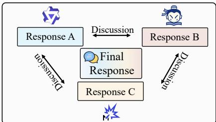

(a) Group thinking  
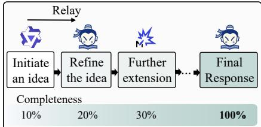  
(b) Relay thinking

Figure 1: Comparison of group thinkingMotivation. Despite their diversity, most MAC methand relay thinking in MAC.ods follow a group thinking collaboration pattern (Janis, 1982), where multiple agents contribute reasoning trajectories in parallel and integrate information through interaction or aggregation (Li et al., 2024; Veluri et al., 2024; Becker et al., 2026) (cf. Fig. 1a). This pattern enables agents to contribute parallel perspectives and reach a synthesized solution. However, collaboration among intelligent systems can take multiple forms. Cognitive science

(a)

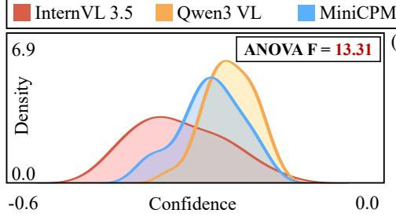

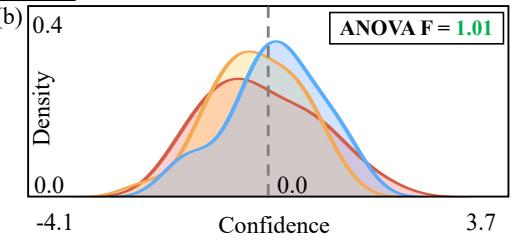  
Figure 2: KDE of local confidence across three models, before (a) and after (b) calibration.

suggests another pattern of collective problem solving, referred to as relay thinking (Michael, 1998; Van Eeckhout et al., 2025), where one participant develops an intermediate idea and transfers it to another participant for further refinement. Inspired by this sequential knowledge transfer process, we explore a relay-style collaboration topology for MAC, where agents progressively inherit and extend a shared reasoning trajectory through sequential ownership transitions (cf. Fig. 1b).

Methodology. Realizing relay collaboration requires addressing two questions: when should reasoning ownership be transferred, and which agent should continue the reasoning process. We use model confidence as a signal for these decisions, motivated by previous studies showing that con fidence estimates can provide information about reasoning reliability (Xu et al., 2026; Wang et al., 2026b; Farquhar et al., 2024). Moreover, we also observe in Fig. 4 that correct and incorrect trajectories are separable in confidence. However, confidence values derived from heterogeneous models are not directly comparable due to differences in model architectures, vocabulary spaces, and probability distributions (cf. Fig. 2). To address this, we propose the Multi-Agent Confidence-guided Relay (MACR). MACR begins by extracting local confidence across a heterogeneous model pool using a sliding window for confidence calibration, reducing the Analysis of Variance (ANOVA) F value from 13.31 to 1.01 (cf. Fig. 2). On this basis of comparable confidence across heterogeneous models, MACR monitors the leading model’s calibrated confidence and interrupts generation to ini tiate bidding once that model shows low confidence, relaying generation rights to the model with the highest confidence. Besides deciding when and to whom to relay, MACR must also determine which model should start the task. To this end, it initializes the leading model via an initial bidding round, selecting the model with the highest calibrated confidence to start the task. These steps togethe constitute MACR’s online “initiation–monitoring–bidding–relay” loop (cf. Fig. 3).

Contributions. First, we offer a new perspective on MAC patterns by drawing on relay thinking, where a reasoning trajectory is progressively refined and synthesized as it is relayed across heterogeneous models. Second, we develop MACR, a confidence-guided relay framework that calibrates confidence across heterogeneous models and jointly determines model initiation and reasoning handoffs through bidding. Third, we reveal two empirical properties underlying effective heterogeneous collaboration: models exhibit complementary strengths across reasoning stages, while reasoning bottlenecks emerge at different stages across tasks. We hope these findings motivate dynamic model scheduling that adapts both reasoning ownership and relay timing throughout inference.

Results and Analysis. Experiments on four multimodal benchmarks show that MACR outperforms single-model strategies in accuracy, e.g., +3.3% on MathVista and +3.9% on MMStar, and remains on par with multi-agent strategies while consuming 6.0× fewer tokens on HallusionBench and MM-Star, respectively. Qualitative analysis reveals that MACR integrates the isolated cues of single mod els into a global reasoning chain(cf. §3.3). Furthermore, our analyses confirm that heterogeneous models in MACR are complementary, both across their capabilities (cf. Fig. 6a) and across reasoning stages(cf. Fig. 6b), and that they are capable of localizing task-agnostic bottlenecks(cf. Fig. 6c).

## 2 METHODOLOGY

MACR requires determining two things. First, it requires the real-time identification of local reasoning bottlenecks. While a model’s logarithmic probabilities indicate its confidence, we find that their confidence is incomparable. Therefore, models’ confidence needs calibration to enable cross-mode bidding. Second, it must evaluate which candidate model is best suited to take over generation. Candidate models perform short trial generations on a shared context, and MACR evaluates their confidence under the calibrated metric to execute handovers.

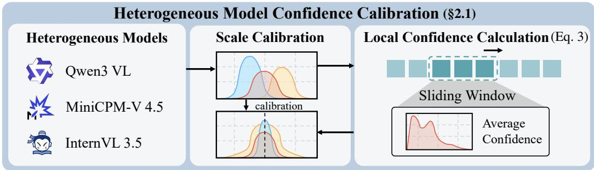

Online Bidding and Relay Generation (\$3.2(§2.2)  
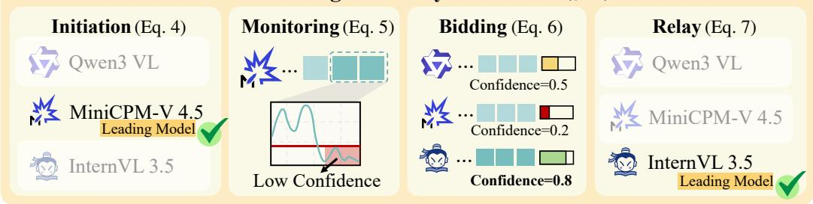  
Figure 3: An overview of MACR’s two phases.

Consequently, the implementation of MACR is naturally divided into two sequential phases: i) Establish a well-calibrated confidence metric offline, ensuring reliable comparability among heterogeneous models (§2.1); ii) Establish an online scheduling workflow comprising “initiation–monitoring–bidding–relay” stages to facilitate real-time collaboration (§2.2).

## 2.1 HETEROGENEOUS MODEL CONFIDENCE SHIFT ANALYSIS AND CALIBRATION

Confidence Shift Analysis. MACR collaborates over a model pool M of three models (Qwen3 VL, InternVL 3.5, Minicpm-V 4.5). We randomly sample 1,000 instances from MMMU (Yue et al., 2024) and allow these models to perform reasoning. To obtain local confidence rather than sequence confidence for identifying reasoning bottlenecks, given a model m ∈ M and its generated logarithmic probability sequence $c _ { i }$ , we define a sliding window of size w to calculate the local confidence:

$$
W _ { i , m } ^ { ( w ) } = \frac { 1 } { w } \sum _ { j = 0 } ^ { w - 1 } c _ { i - j } .\tag{1}
$$

We then extract three models $W _ { m } ^ { ( w ) }$ and visualize them via Kernel Density Estimation (KDE). The KDE visualizations show the distributions of the three models, where we observe clear shifts among them (cf. Fig. 2a). To formally verify this, we conduct a one-way analysis of variance (ANOVA). The F-value measures the ratio of between-group variance to within-group variance, quantifying whether a difference exists among the confidence distributions of the three models:

$$
\begin{array} { r } { F = \frac { \frac { 1 } { k - 1 } \sum _ { m = 1 } ^ { k } n _ { m } ( \bar { x } _ { m } - \bar { x } ) ^ { 2 } } { \frac { 1 } { N - k } \sum _ { m = 1 } ^ { k } \sum _ { i = 1 } ^ { n _ { m } } ( x _ { m i } - \bar { x } _ { m } ) ^ { 2 } } , } \end{array}\tag{2}
$$

where k is the number of candidate models, $n _ { m }$ is the sample size for model m, N is the total sample size, $\hat { x } _ { m }$ is the confidence mean for the model m, and x¯ is the overall mean. The experiment yielded $F = 1 3 . 3 1 ( F \gg 1 )$ , confirming that between-group differences significantly outweigh withingroup random noise. This demonstrates that their raw confidence is mathematically incomparable.

Confidence Calibration. To eliminate the shift, a standardization method based on historical sliding window distributions is employed. Specifically, we aggregate the local confidence samples $W ^ { ( w ) }$ generated by each model on a historical reference dataset. This yields the local baseline mean $\mu _ { m } ^ { ( w ) }$ and standard deviation $\sigma _ { m } ^ { ( w ) }$ for window size w. During generation, each model’s local confidence is transformed into a standardized metric:

$$
Z _ { i , m } ^ { ( w ) } = \frac { W _ { i , m } ^ { ( w ) } - \mu _ { m } ^ { ( w ) } } { \sigma _ { m } ^ { ( w ) } } .\tag{3}
$$

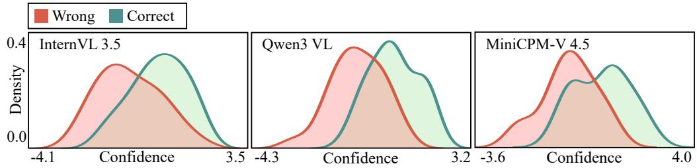  
Figure 4: KDE of standardized local confidence grouped by correctness.

Subsequently, the ANOVA is conducted to verify the removal of shift (cf. Fig. 2b). The KDE distribution redrawn with standardized data shows that the curves of the three models align around 0. Quantitatively, the F-value drops to $F = 1 . 0 1 \left( F \approx 1 \right)$ , indicating that between-group differences are reduced to the level of intra-model random noise, such that the shift across models is eliminated. Furthermore, grouping the standardized data by correctness and visualizing their distributions via KDE (cf. Fig. 4) reveals that correct trajectories exhibit higher local confidence. This separability is consistent with prior studies $( \mathrm { X u }$ et al., 2026; Wang et al., 2026b; Farquhar et al., 2024), jointly confirming that a low confidence indicates a model encountering a bottleneck. Consequently, the historical expected mean and standard deviation for each model m are adopted for cross-model calibration in the scheduling phase.

## 2.2 ONLINE BIDDING AND RELAY GENERATION

MACR applies the calibrated confidence metric (§2.1) to identify local bottlenecks during models generation, executing the “initiation–monitoring–bidding–relay” loop mechanism.

Initiation. To establish the initial leading model, all candidate models $m \in \mathcal { M }$ generate a length-w sequence $T _ { m } = \{ t _ { m , 1 } , t _ { m , 2 } , \ldots , t _ { m , w } \}$ based on the initial context $X _ { 0 }$ . The mean local logarithmic probability for each sequence is calculated:

$$
W _ { m } ^ { ( w ) } = \frac { 1 } { w } et { } { ' } \sum _ { j = 1 } ^ { w } \log p _ { m } ( t _ { m , j } | X _ { 0 } , t _ { m , < j } ) ,\tag{4}
$$

and calibrated to $Z _ { m } ^ { ( w ) }$ using the model’s $\mu _ { m } ^ { ( w ) }$ and $\sigma _ { m } ^ { ( w ) }$ . MACR assigns the initial autoregressive generation dominance to the model m with that maximizes $Z _ { m } ^ { ( w ) }$

Monitoring. The leading model $m ^ { * }$ then performs standard autoregressive generation. At each time-step t, MACR monitors the local confidence and calibrates it to $Z _ { t , m ^ { * } } ^ { ( w ) }$ :

$$
Z _ { t , m ^ { * } } ^ { ( w ) } = \frac { \frac { 1 } { w } \sum _ { j = 0 } ^ { w - 1 } c _ { t - j } - \mu _ { m ^ { * } } ^ { ( w ) } } { \sigma _ { m ^ { * } } ^ { ( w ) } } .\tag{5}
$$

The sliding window calculation enables the identification of reasoning bottlenecks in real-time. Building on the separability of correct trajectories (cf. Fig. 4), we define a threshold τ . If the leading model’s confidence drops below this threshold $( Z _ { t , m ^ { * } } ^ { ( w ) } < \tau )$ , MACR determines it encounters a reasoning bottleneck, halting its generation to trigger the bidding.

Bidding. MACR synchronizes the current context $X _ { t }$ to each model $m \in { \mathcal { M } }$ , prompting it to generate a w-token candidate sequence $T _ { m } = \{ t _ { m , 1 } , t _ { m , 2 } , \ldots , t _ { m , w } \}$ . Evaluating their confidence, MACR selects the model $m ^ { * }$ that maximizes the calibrated confidence:

$$
m ^ { * } = \arg \operatorname* { m a x } _ { m \in \mathcal { M } } \Big ( \frac { \frac { 1 } { w } \sum _ { j = 1 } ^ { w } \log p _ { m } ( t _ { m , j } \mid X _ { t } , t _ { m , < j } ) - \mu _ { m } ^ { ( w ) } } { \sigma _ { m } ^ { ( w ) } } \Big ) .\tag{6}
$$

Relay. After selecting the model with the highest confidence, MACR directly concatenates its sequence $T _ { m ^ { * } }$ ∗ to the existing context, with each model independently maintaining its own KV cache so that no repeated prefilling is needed:

$$
X _ { t + w } = X _ { t } \oplus T _ { m ^ { * } } .\tag{7}
$$

MACR then relays generation ownership to $m ^ { * }$ and resumes monitoring (cf. Eq. 5) until completion.   
The algorithm flow is presented in Alg. 1.

Algorithm 1 Algorithm flow of MACR framework.   
Require: q (query), $\mathcal { M } = \{ m _ { 1 } , . . . , m _ { N } \}$ (model pool), τ (threshold), w (window size)   
1: function MACR(q, M, τ, w)   
2: $c \gets q$ ▷ context   
3: $Z \gets \mathsf { \bar { \{ C a l i b ( } m , }  c \mathsf { ) } \mid m \in \mathcal { M } \}$ ▷ initial confidences   
4: $m ^ { * } \gets \mathbf { B e s t } ( \mathcal { M } , Z )$ ▷ initiation   
5: while not Done(c) do   
6: $x , z \gets \mathrm { M o n i t o r } ( m ^ { * } , c , w )$ ▷ token x, window confidence z   
7: $\mathbf { i f } \ z < \tau$ then   
8: $B \gets \{ ( X _ { m } , z _ { m } ) \mid ( X _ { m } , z _ { m } ) = \mathrm { B i d } ( m , c ) , m \in \mathcal { M } \}$ ▷ bid set   
9: $m ^ { * } , X ^ { * } \gets$ Best $( \mathcal { M } , B )$ ▷ relay   
10: $c \gets \mathrm { A p p } ( c , X ^ { * } )$ ▷ append relayed token sequence $X ^ { * }$   
11: else   
12: $c \gets \mathrm { A p p } ( c , x )$ ▷ append token   
13: end if   
14: end while   
15: return c   
16: end function

## 3 EXPERIMENT

## 3.1 EXPERIMENTAL SETUP

Datasets. To evaluate MACR across diverse dimensions, we adopt four benchmarks. MMStar (Chen et al., 2024) evaluates comprehensive multi-modal capabilities across 6 abilities and 18 tasks. HallusionBench (Guan et al., 2024) diagnoses the visual and knowledge hallucinations. LogicVista (Xiao et al., 2024) assesses structured reasoning in visual contexts, covering inductive, deductive, numerical, spatial, and causal logic. MathVista (Lu et al., 2024) evaluates joint visual-mathematical reasoning across geometry, charts, and word problems.

Baselines. We compare MACR against single-model and multi-agent strategies. The model pool consists of Qwen3-VL-8B-Instruct (Yang et al., 2025a), InternVL3.5-8B (Wang et al., 2025b), and MiniCPM-V-4.5-8B (Yu et al., 2026).

• Single-Model Strategies. We evaluate standard input–output prompting (IO), where the model directly outputs the solution and answer from the given images and question; CCoT (Mitra et al., 2024) prompts the LLM to generate a scene graph capturing objects, attributes, and their relationships first, and then uses that scene graph to produce the final response; and DDCoT (Zheng et al., 2023) decomposes complex problems into actionable sub-tasks and then produces the final answer.

• Multi-Agent Strategies. We benchmark against two multi-agent strategies: Majority Vote (MV) (Wang et al., 2023), establishing consensus across independent model generations, and H-DMAD (Liu et al., 2025), a diverse multi-agent collaboration framework that assigns different reasoning strategies (CoT (Zheng et al., 2023), CCoT, and DDCoT) to different agents, encouraging complementary perspectives to break the fixed mental set, and fuses their outputs into a final answer.

Implementation Details. We set the sliding window size w = 16 and the confidence threshold τ = −0.3 via parameter search on 600 randomly sampled instances from RealWorldQA (X.AI, 2024), which are disjoint from all evaluation sets. All evaluations are conducted under identical settings (e.g., temperature). To ensure reliability and rule out the influence of generation randomness, we conduct all evaluations with three distinct random seeds. We report accuracy as the mean ± standard deviation, and additionally report token usage along with the Incremental Benefit per Cost (IBC), defined as $\Delta \mathrm { A c c } / \Delta$ Tokens relative to each single model’s IO baseline (Aggarwal et al., 2024).

## 3.2 QUANTITATIVE COMPARISON RESULTS

The results demonstrate that MACR consistently surpasses single-model strategies in accuracy while remaining comparable to multi-agent strategies with minimal token overhead (cf. Table 1). MACR yields substantial accuracy gains over the strongest single-model strategies, boosting performance by +3.30% on MathVista (78.00% vs. 74.70%) and +3.87% on MMStar (72.00% vs. 68.13%). It secures these enhancements while maintaining commensurate or reduced token overhead. For instance, MACR demands only 4,150 tokens on MMStar, while single-model strategies like CCoT and

<table><tr><td rowspan="2">Model</td><td colspan="3">MathVista (1,000)</td><td colspan="3">LogicVista (448)</td><td colspan="3">MMStar (1,500)</td><td colspan="3">HallusionBench (951)</td></tr><tr><td>Acc</td><td>Tokens</td><td>IBC</td><td>Acc</td><td>Tokens IBC</td><td></td><td>Acc</td><td>Tokens</td><td>IBC</td><td>Acc</td><td>Tokens IBC</td><td></td></tr><tr><td colspan="10">SINGLE-MODEL STRATEGIES</td><td></td><td></td><td></td></tr><tr><td colspan="10">Qwen3 VL (Yang et al., 2025a)</td><td></td><td></td><td></td><td></td></tr><tr><td>IO</td><td> $7 0 . 5 0 { \scriptstyle \pm 0 . 1 0 }$ </td><td>1,117</td><td></td><td> $5 1 . 3 4 { \scriptstyle \pm 0 . 2 2 }$ </td><td>1,343</td><td></td><td> $6 5 . 9 3 { \scriptstyle \pm 0 . 0 7 }$ </td><td>901</td><td></td><td> $7 2 . 6 6 { \scriptstyle \pm 0 . 1 1 }$ </td><td>1,132</td><td></td></tr><tr><td>CCoT</td><td> $7 1 . 0 0 { \scriptstyle \pm 0 . 1 7 }$ </td><td>2,164</td><td>4.78</td><td> $5 2 . 2 3 { \scriptstyle \pm 0 . 3 9 }$ </td><td>2,350</td><td>8.84</td><td> $6 6 . 6 0 { \scriptstyle \pm 0 . 1 2 }$ </td><td>1,771</td><td>7.70</td><td> $7 2 . 8 7 { \scriptstyle \pm 0 . 1 8 }$ </td><td>2,780</td><td>1.27</td></tr><tr><td>DDCoT</td><td> $7 1 . 7 0 { \scriptstyle \pm 0 . 2 0 }$ </td><td>2,671</td><td>7.72</td><td> $5 3 . 1 3 { \scriptstyle \pm 0 . 2 2 }$ </td><td>3,188</td><td>9.70</td><td> $6 7 . 6 0 { \scriptstyle \pm 0 . 1 3 }$ </td><td>2,135</td><td>13.53</td><td> $7 3 . 6 1 \pm \mathrm { 0 . 2 1 }$ </td><td>2,634</td><td>6.32</td></tr><tr><td colspan="10">InternVL 3.5 (Wang et al., 2025b)</td><td></td><td></td><td></td></tr><tr><td>IO</td><td> $7 3 . 8 0 { \scriptstyle \pm 0 . 2 6 }$ </td><td>2,382</td><td></td><td> $5 1 . 7 9 { \scriptstyle \pm 0 . 3 9 }$ </td><td>2,392</td><td></td><td> $6 7 . 2 0 { \scriptstyle \pm 0 . 1 8 }$ </td><td>2,588</td><td></td><td> $7 1 . 8 2 \substack { \pm 0 . 2 8 }$ </td><td>2,262</td><td></td></tr><tr><td>CCoT</td><td> $7 4 . 2 0 { \scriptstyle \pm 0 . 3 0 }$ </td><td>5,210</td><td>1.41</td><td> $5 2 . 4 6 { \scriptstyle \pm 0 . 2 2 }$ </td><td>5,206</td><td>2.38</td><td> $6 8 . 0 0 { \scriptstyle \pm 0 . 2 0 }$ </td><td>5,434</td><td>2.81</td><td> $7 1 . 9 2 \substack { \pm 0 . 1 1 }$ </td><td>4,913</td><td>0.38</td></tr><tr><td>DDCoT</td><td> $7 4 . 0 0 { \scriptstyle \pm 0 . 1 0 }$ </td><td>4,928</td><td>0.79</td><td> $5 3 . 3 5 { \scriptstyle \pm 0 . 3 9 }$ </td><td>4,837</td><td>6.38</td><td> $6 7 . 6 7 { \scriptstyle \pm 0 . 0 7 }$ </td><td>5,227</td><td>1.78</td><td> $7 2 . 7 7 { \scriptstyle \pm 0 . 1 8 }$ </td><td>4,706</td><td>3.89</td></tr><tr><td colspan="10">MiniCPM-V 4.5 (Yu et al., 2026)</td><td></td><td></td><td></td></tr><tr><td>IO</td><td> $7 4 . 4 0 { \scriptstyle \pm 0 . 1 7 }$ </td><td>607</td><td></td><td> $5 3 . 7 9 { \scriptstyle \pm 0 . 2 2 }$ </td><td>756</td><td></td><td> $6 6 . 6 7 \pm 0 . 1 2$ </td><td>510</td><td></td><td> $7 3 . 1 9 { \scriptstyle \pm 0 . 2 1 }$ </td><td>586</td><td></td></tr><tr><td>CCoT DDCoT</td><td> $7 4 . 7 0 { \scriptstyle \pm 0 . 2 0 }$ </td><td>1,736</td><td>2.66</td><td> $5 4 . 2 4 { \scriptstyle \pm 0 . 3 9 }$ </td><td>2,155</td><td>3.22</td><td> $6 8 . 1 3 { \scriptstyle \pm 0 . 1 3 }$ </td><td>1,564</td><td>13.85</td><td> $7 3 . 2 9 { \scriptstyle \pm 0 . 2 8 }$ </td><td>1,912</td><td>0.75</td></tr><tr><td></td><td> $7 4 . 5 0 { \scriptstyle \pm 0 . 2 6 }$ </td><td>1,396</td><td>1.27</td><td> $5 4 . 0 2 \substack { \pm 0 . 2 2 }$ </td><td>1,801</td><td>2.20</td><td> $6 7 . 3 3 { \scriptstyle \pm 0 . 1 8 }$ </td><td>1,269</td><td>8.70</td><td> $7 3 . 6 1 \pm \mathrm { 0 . 1 1 }$ </td><td>1,424</td><td>5.01</td></tr><tr><td colspan="10">MULTI-AGENT STRATEGIES</td><td></td><td></td><td></td></tr><tr><td>MV</td><td> $7 7 . 8 0 { \scriptstyle \pm 0 . 3 0 }$ </td><td>7,699</td><td>7.80</td><td> $5 5 . 1 3 { \scriptstyle \pm 0 . 3 9 }$ </td><td>7,943</td><td>4.54</td><td> $7 1 . 0 0 { \scriptstyle \pm 0 . 2 0 }$ </td><td>7,508</td><td>7.19</td><td> $7 4 . 1 3 { \scriptstyle \pm 0 . 1 8 }$ </td><td>8,072</td><td>2.45</td></tr><tr><td>H-DMAD MACR</td><td> $7 8 . 8 0 { \scriptstyle \pm 0 . 1 0 }$ </td><td>23,780</td><td>2.63</td><td> $5 5 . 5 8 { \scriptstyle \pm 0 . 2 2 }$ </td><td>27,574</td><td>1.27</td><td> $7 3 . 2 0 { \scriptstyle \pm 0 . 0 7 }$ </td><td>24,677</td><td>2.83</td><td> $7 5 . 5 0 { \scriptstyle \pm 0 . 2 1 }$ </td><td>26,3751.19</td><td></td></tr><tr><td></td><td> $7 8 . 0 0 { \scriptstyle \pm 0 . 1 7 }$ </td><td>4,811</td><td>15.38</td><td> $5 5 . 8 0 { \scriptstyle \pm 0 . 3 9 }$ </td><td>6,149</td><td>7.89</td><td> $7 2 . 0 0 { \scriptstyle \pm 0 . 1 2 }$ </td><td>4,150</td><td>21.35</td><td> $7 4 . 6 6 { \scriptstyle \pm 0 . 2 8 }$ </td><td>4,414</td><td>7.71</td></tr></table>

Table 1: Performance of MLLMs in terms of accuracy (%), token overhead and IBC $( \times 1 0 ^ { - 6 } )$

DDCoT consume 5,434 and 5,227 tokens, respectively. Furthermore, while multi-agent strategies achieve comparable accuracy, their token overhead is far higher. MACR operates with 6.00 × fewer tokens on HallusionBench (4,414 vs. 26,375) and MMStar (4,150 vs. 24,677). To quantify the efficiency gain of MACR, we evaluate the IBC (Aggarwal et al., 2024). MACR dominates IBC across all datasets with a state-of-the-art IBC of 21.35, e.g., boosting performance by +18.52 on MMStar (21.35 vs. 2.83) and +12.75 on MathVista (15.38 vs. 2.63) over H-DMAD, substantiating that relay thinking successfully maximizes collective intelligence while preventing generation waste.

## 3.3 QUALITATIVE ANALYSIS

We compare MACR reasoning trajectories against those of single-model CoT. In cases where CoT fails (cf. Fig. 5, left), single models anchor on isolated cues (e.g., local textures or lighting attributes), whereas MACR succeeds by synthesizing these fragmented cues into a more comprehensive global view. This advantage extends to failure cases where both methods produce an incorrect answer (cf. Fig. 5, right). Even then, MACR still attempts a comprehensive integration, whereas CoT focuses on an isolated patch. This indicates that MACR enhances the generation quality by executing global contextual integration, even when the underlying model pool reaches its capability ceiling.

## 3.4 ANALYSIS

## 3.4.1 CAPABILITY ROUTING ANALYSIS

To validate the necessity of bidding, we analyze the cross-model transition matrix (cf. Fig. 6a). The row-normalized transition probabilities reveal bidirectional relay dynamics. While MiniCPM-V 4.5 has the highest self-transition rate (59.7%), it still yields dominance to InternVL 3.5 or Qwen3 VL in 40.3% of its bids. Furthermore, bidirectional exchanges between peers are frequent. InternVL 3.5 transfers to Qwen3 VL (22.4%), while Qwen3 VL returns control (26.9%). This indicates that no single model maintains absolute dominance. Instead, it demonstrates that they complement each other. By leveraging calibrated local confidence, MACR matches each bottleneck with its optimal model. Our ablation findings corroborate this complementarity (cf. §3.4.4).

## 3.4.2 INFERENCE SURVIVAL ANALYSIS

To quantify the continuous generation capability of models, we conduct a Kaplan-Meier survival analysis (cf. Fig. 6b). MiniCPM-V 4.5 shows the highest early survival, with a number at risk (3,151) roughly twice that of the other two models (1,163 and 1,658). InternVL 3.5 maintains a plateau during later stages, demonstrating long-horizon retention, whereas Qwen3-VL exhibits the poorest long-horizon retention. This indicates that models excel at different stages of generation. Unlike traditional turn-based strategies that may either disrupt long-horizon reasoning or cause early-survival models to accumulate hallucinations during later stages, MACR relays generation according to each model’s stage-wise retention. Consistent with these temporal dynamics, employing punctuation-based fixed triggers degrades performance (cf. §3.4.4).

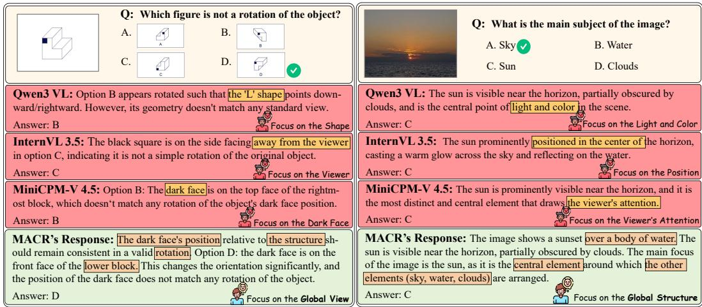  
Figure 5: Qualitative comparison between single-models’ CoT and MACR.

## 3.4.3 TASK-AGNOSTIC BOTTLENECK LOCATION ANALYSIS

To validate that MACR is task-agnostic, we analyze the distribution of bidding triggers across different tasks (cf. Fig. 6c). The distributions reveal contrasting relay patterns across datasets. While logic-heavy tasks (LogicVista, MathVista) exhibit dense relays in the early stage, visual-intensive tasks (MMStar, HallusionBench) concentrate their relays in later stages. Furthermore, across all tasks, bidding frequency consistently stabilizes during the final stage as models converge on final answers. MACR localizes these task-agnostic bottlenecks, adapting to the unique reasoning paradigms of different domains. If MACR adopts task-blind periodic relays, accuracy degrades (cf. §3.4.4).

## 3.4.4 ABLATION STUDY

To verify the necessity of MACR’s initiation, capability matching and bottleneck localization, we ablate the respective modules on 500 randomly sampled instances from MMStar.

Initiation. The initial leading model is fixed to each of the three models in turn while keeping the rest of the pipeline unchanged (Fixed Initiation, FI). FI achieves 71.6%, 71.2%, and 70.4% for MiniCPM-V 4.5, InternVL 3.5, and Qwen3 VL, respectively, compared with MACR’s 72.4%. This shows that confidence-guided initialization outperforms any fixed pattern.

<table><tr><td>Variant</td><td>Acc. (%)</td><td>Tokens</td></tr><tr><td>FIM</td><td>71.60</td><td>374</td></tr><tr><td>FI</td><td>71.20</td><td>322</td></tr><tr><td>FIG</td><td>70.40</td><td>391</td></tr><tr><td>FS</td><td>69.00</td><td>366</td></tr><tr><td>FT</td><td>69.80</td><td>427</td></tr><tr><td>MACR</td><td>72.40</td><td>312</td></tr></table>

Table 2: Ablation study of MACR.

Capability Matching. The selection mechanism (cf. Eq. 6) is replaced with a fixed routing order (MiniCPM-V 4.5 → InternVL 3.5 → Qwen3 VL) (Fixed Selection, FS). FS degrades accuracy from 72.4% to 69.0%. Aligning with the bidirectional exchanges observed in capability routing analysis (cf. §3.4.1), fixed routing fails to exploit the models’ complementarity.

Bottleneck Localization. Confidence-guided bidding (cf. Eq. 5) is replaced with fixed bidding at every sentence boundary (Fixed Trigger, FT). FT degrades accuracy from 72.4% to 69.8%. It is consistent with our findings in inference survival (cf. §3.4.2) and bottleneck location analysis (cf. §3.4.3): FT truncates the reasoning chains of long-horizon models while accumulating hallucinations from short-horizon ones, and it cannot adapt to task-specific characteristics.

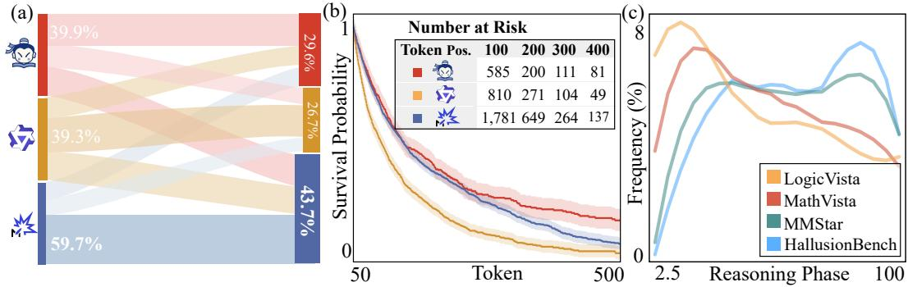  
Figure 6: Analysis experiments of MACR’s performance.

## 3.4.5 ANALYSIS ON MODEL POOL HETEROGENEITY

To validate the necessity of diversity within the model pool, we restrict MACR’s model pool to a single homogeneous model (MiniCPM-V 4.5, InternVL 3.5, or Qwen3 VL) and evaluate two homogeneous multiagent collaboration pattern variants on 500 randomly sampled instances from MMStar (cf. Table 3).

<table><tr><td>Method</td><td>粥</td><td>立</td><td>女</td></tr><tr><td>RPH</td><td>68.00</td><td>70.20</td><td>64.80</td></tr><tr><td>TDH</td><td>66.60</td><td>68.80</td><td>63.60</td></tr><tr><td>MACR</td><td></td><td>72.40</td><td></td></tr></table>

Table 3: Analysis on model heterogene-Role-Playing Pattern (RPH) prompts a single model ity. All results are reported in Acc. (%).with three distinct personas: a Proponent proposing

the initial reasoning and answer, an Opponent formulating rebuttals and alternative perspectives, and a Mediator resolving conflicts (Lu & Su, 2026). RPH achieves 68.0%, 70.2%, and 64.8% for MiniCPM-V 4.5, InternVL 3.5, and Qwen3 VL, respectively, compared with MACR’s 72.4%. This shows that simulated persona diversity fails to match true architectural complementarity.

Temperature-Decoded Pattern (TDH) simulates intra-model diversity by elevating the sampling temperature during the bidding phase, generating three distinct reasoning paths. The trajectory that maximizes local confidence is then adopted and concatenated to the context. TDH yields 66.6%, 68.8%, and 63.6% for MiniCPM-V 4.5, InternVL 3.5, and Qwen3 VL, underperforming MACR. This shows that sampling strategies cannot substitute for complementary heterogeneity.

The results indicate homogeneity leads to performance degradation. Consistent with recent findings (Bertalanic & Fortuna, 2026), homogeneous pools lack intrinsic diversity and thus cannot pro-ˇ duce cognitive diversity. Conformity tendency may drive them to converge on a flawed consensus.

## 3.4.6 LEXICAL PROFILING OF REASONING BOTTLENECKS

To semantically characterize models’ reasoning bottlenecks, we analyze the lexical distribution of tokens generated immediately preceding a bidding trigger (cf. Fig. 7). The resulting distributions show distinct lexical patterns across models. InternVL predominantly falters around analytical evidence extraction (e.g., analyze, examine, identify), MiniCPM-V around spatial localization and attribute binding (e.g., position, top, left, large), and Qwen3-VL around causal deduction (e.g., since, therefore, suggesting). Despite these differences, all models share a universal hesitation signature, frequently outputting stall tokens (e.g., wait, look, check). This lexical heterogeneity aligns with the complementarity we observed (cf. §3.4.1), suggesting that different models tend to hesitate at different stages and motivating MACR’s design of matching each bottleneck with its optimal model.

## 4 RELATED WORK

Multi-Agent Debate (MAD) improves performance by leveraging interactions among LLMs. Existing MAD methods are broadly categorized into two streams. The first category is Collaboration Workflow Optimization (Hong et al., 2024; Maiga et al., 2025; Li et al., 2024; Pham et al., 2024; Zhang et al., 2024; Li et al., 2023; Zhang & Xiong, 2025). These methods structure multi-agent collaboration to resolve tasks, e.g., orchestrating role-based coordination pipelines (Hong et al., 2024; Maiga et al., 2025), communicating via continuous embeddings (Pham et al., 2024), and optimiz

(b) MiniCPM-V 4.5

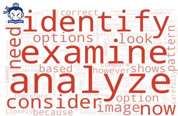  
(a) InternVL 3.5

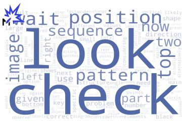

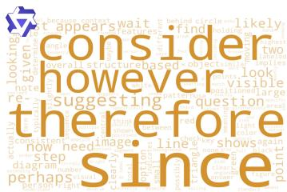  
(c) Qwen3 VL

Figure 7: Lexical distribution of three models.

ing communication topologies or multi-perspective reward frameworks (Li et al., 2024; Zhang et al., 2024; Li et al., 2023; Zhang & Xiong, 2025). The second category is Failure Diagnosis and Intervention (Wynn et al., 2025; Yao et al., 2025; Cemri et al., 2026; Choi et al., 2026a; Yang et al., 2025b). These methods diagnose and mitigate collaborative limitations, e.g., quantifying sycophancy and social conformity to prevent premature convergence (Wynn et al., 2025; Yao et al., 2025), establishing taxonomies for system misalignments (Cemri et al., 2026), and delineating theoretical bounds of debate under test-time scaling (Choi et al., 2026a; Yang et al., 2025b). Despite their impressive performance, these methods are all built around the topology of group thinking, where models produce complete responses that are aggregated after generation.

Unlike methods relying on rigid debate turns, MACR monitors confidence in real time and relays generation rights to the most confident candidate when a model struggles.

Uncertainty and Confidence in LLMs provide signals for evaluating confidence and guiding reasoning. These approaches are broadly divided into two main streams. The first category is Uncertainty Quantification and Decomposition (Wang et al., 2025a; Jayasekera et al., 2026; Feng et al., 2025; Amayuelas et al., 2024; Liu et al., 2026c). They decompose and estimate uncertainty to evaluate confidence or trigger behaviors, establishing bounds or benchmarks for uncertainties (Jayasekera et al., 2026; Wang et al., 2025a), inducing uncertainty awareness through query or tuning (Feng et al., 2025; Amayuelas et al., 2024), and extracting token-level logit margins to dynamically trigger interleaved multimodal reasoning (Liu et al., 2026c). The second category is Confidence-Guided Collaboration and Reinforcement (Zhu et al., 2026; Ai et al., 2025; Yang et al., 2026; Pappu et al., 2026; Li et al., 2026a; Choi et al., 2026b; Li et al., 2026b; Liu et al., 2026a; Park et al., 2025; Zhao et al., 2026). They manage uncertainty within multi-agent frameworks, e.g., modulating belief updates through confidence scores (Zhu et al., 2026; Ai et al., 2025; Yang et al., 2026), mitigating behavioral uncertainties like hallucination, compromise, or bias during debates (Pappu et al., 2026; Li et al., 2026a; Choi et al., 2026b; Li et al., 2026b), and optimizing collaborative policies via translating confidence into reward signals (Liu et al., 2026a; Park et al., 2025; Zhao et al., 2026). Despite quantifying uncertainties and optimizing collaborative policies, these methods evaluate sequencelevel outputs and overlook the comparability of confidence across heterogeneous models.

Unlike these methods, we first identify the incomparability of confidence across heterogeneous models and provide a calibration method for it. Building on this, MACR calibrates local confidence at the window level rather than sequence level, monitoring mid-generation uncertainty and executing cross-model relays the moment a local reasoning bottleneck is detected.

## 5 CONCLUSION

We introduce MACR, transitioning multi-agent collaboration from group thinking mode to relay thinking mode. Addressing incomparable confidence across heterogeneous models, MACR calibrates local confidence, enabling real-time cross-model bidding. Monitoring the leading model, MACR interrupts generation upon detecting reasoning bottlenecks, transferring generation rights to the most confident model. Experiments across four multi-modal benchmarks demonstrate that MACR outperforms all existing single-model baselines in accuracy, while achieving results comparable to existing multi-agent baselines with 6.0× less token overhead. Further analyses verify that this relay mechanism integrates isolated cues into comprehensive global reasoning chains and exploits model complementarity, with a task-agnostic selection mechanism.

## REFERENCES

Mohamad Abou Ali, Fadi Dornaika, and Jinan Charafeddine. Agentic ai: a comprehensive survey of architectures, applications, and future directions. Artificial Intelligence Review, 59(1):11, 2025.

Pranjal Aggarwal, Aman Madaan, Ankit Anand, Srividya Pranavi Potharaju, Swaroop Mishra, Pei Zhou, Aditya Gupta, Dheeraj Rajagopal, Karthik Kappaganthu, Yiming Yang, Shyam Upadhyay, Manaal Faruqui, and Mausam . Automix: Automatically mixing language models. In NeurIPS, 2024.

Rui Ai, Yuqi Pan, David Simchi-Levi, Milind Tambe, and Haifeng Xu. Beyond majority voting: Llm aggregation by leveraging higher-order information. arXiv preprint arXiv:2510.01499, 2025.

Alfonso Amayuelas, Kyle Wong, Liangming Pan, Wenhu Chen, and William Yang Wang. Knowledge of knowledge: Exploring known-unknowns uncertainty with large language models. In Findings ofACL, pp. 6416–6432, 2024.

Sparsh Bajoria, Shreyanshu Ranjan, Adhitya M, Vineet Suri, Vikas Hassija, Vinay Chamola, and Amir Hussain. From language models to agentic ai: A survey of autonomous, action-enabled, and collaborative llm agents. Cognitive Computation, 18(1):103, 2026.

Jonas Becker, Lars Benedikt Kaesberg, Andreas Stephan, Jan Philip Wahle, Terry Ruas, and Bela Gipp. Stay focused: Problem drift in multi-agent debate. In Findings of EACL, pp. 5068–5102, 2026.

Blaz Bertalaniˇ c and Carolina Fortuna. The cost of consensus: Isolated self-correction prevails overˇ unguided homogeneous multi-agent debate. In Proceedings of the ACM Conference on AI and Agentic Systems, pp. 311–329, 2026.

Mert Cemri, Melissa Z Pan, Shuyi Yang, Lakshya A Agrawal, Bhavya Chopra, Rishabh Tiwari, Kurt Keutzer, Aditya Parameswaran, Dan Klein, Kannan Ramchandran, et al. Why do multi-agent llm systems fail? In NeurIPS, 2026.

Lin Chen, Jinsong Li, Xiaoyi Dong, Pan Zhang, Yuhang Zang, Zehui Chen, Haodong Duan, Jiaqi Wang, Yu Qiao, Dahua Lin, et al. Are we on the right way for evaluating large vision-language models? In NeurIPS, pp. 27056–27087, 2024.

Hyeong Kyu Choi, Jerry Zhu, and Sharon Li. Debate or vote: Which yields better decisions in multi-agent large language models? In NeurIPS, pp. 101732–101764, 2026a.

Hyeong Kyu Choi, Jerry Zhu, and Sharon Li. When identity skews debate: Anonymization for bias-reduced multi-agent reasoning. In ACL, pp. 14284–14311, 2026b.

Seyed Pouyan Mousavi Davoudi, Amin Gholami Davodi, Alireza Amiri Margavi, and Mahdi Jafari. Collective reasoning among llms: A framework for answer validation without ground truth. In FLLM, pp. 343–349. IEEE, 2025.

Sebastian Farquhar, Jannik Kossen, Lorenz Kuhn, and Yarin Gal. Detecting hallucinations in large language models using semantic entropy. Nature, 630(8017):625–630, 2024.

Yu Feng, Phu Mon Htut, Zheng Qi, Wei Xiao, Manuel Mager, Nikolaos Pappas, Kishaloy Halder, Yang Li, Yassine Benajiba, and Dan Roth. Rethinking LLM uncertainty: A multi-agent approach to estimating black-box model uncertainty. In Findings ofEMNLP, pp. 12349–12375, 2025.

Mohamed Amine Ferrag, Norbert Tihanyi, and Merouane Debbah. From llm reasoning to autonomous ai agents: A comprehensive review. IEEE Access, 2026.

Tianrui Guan, Fuxiao Liu, Xiyang Wu, Ruiqi Xian, Zongxia Li, Xiaoyu Liu, Xijun Wang, Lichang Chen, Furong Huang, Yaser Yacoob, et al. Hallusionbench: an advanced diagnostic suite for entangled language hallucination and visual illusion in large vision-language models. In CVPR, pp. 14375–14385, 2024.

Deepak Gupta, Pallavi Jha, Chanakya Kumar Jha, Latofatoy Nurislomova, Rakhimjon Rajapboyevich Rakhimov, and Bekzod Madaminov. Multi-agent collaboration frameworks for task-oriented large language models. In ETCOM, pp. 1–7. IEEE, 2025.

Sirui Hong, Mingchen Zhuge, Jonathan Chen, Xiawu Zheng, Yuheng Cheng, Jinlin Wang, Ceyao Zhang, Steven Yau, Zijuan Lin, Liyang Zhou, et al. Metagpt: Meta programming for a multi-agent collaborative framework. In ICLR, volume 2024, pp. 23247–23275, 2024.

Irving Lester Janis. Groupthink: Psychological studies of policy decisions and fiascoes, volume 349. Houghton Mifflin Boston, 1982.

I Shavindra Jayasekera, Jacob Si, Filippo Valdettaro, Wenlong Chen, Aldo Faisal, and Yingzhen Li. Variational uncertainty decomposition for in-context learning. In NeurIPS, pp. 2201–2262, 2026.

Weiqiang Jin, Hongyang Du, Biao Zhao, Xingwu Tian, Bohang Shi, and Guang Yang. A comprehensive survey on multi-agent cooperative decision-making: Scenarios, approaches, challenges and perspectives. arXiv preprint arXiv:2503.13415, 2025.

Ao Li, Jinghui Zhang, Luyu Li, Yuxiang Duan, Lang Gao, Mingcai Chen, Weijun Qin, Shaopeng Li, Fengxian Ji, Ning Liu, et al. M3mad-bench: Are multi-agent debates really effective across domains and modalities? arXiv preprint arXiv:2601.02854, 2026a.

Ruosen Li, Teerth Patel, and Xinya Du. Prd: Peer rank and discussion improve large language model based evaluations. arXiv preprint arXiv:2307.02762, 2023.

Yunxuan Li, Yibing Du, Jiageng Zhang, Le Hou, Peter Grabowski, Yeqing Li, and Eugene Ie. Improving multi-agent debate with sparse communication topology. In Findings of EMNLP, pp. 7281–7294, 2024.

Zhenghao Li, Zhi Zheng, Wei Chen, Jielun Zhao, Yong Chen, Tong Xu, and Enhong Chen. Dynadebate: Breaking homogeneity in multi-agent debate with dynamic path generation. arXiv preprint arXiv:2601.05746, 2026b.

Shuo Liu, Zeyu Liang, Xueguang Lyu, and Christopher Amato. Llm collaboration with multi-agent reinforcement learning. In AAAI, pp. 32150–32158, 2026a.

Xu Liu, Guikun Chen, and Wenguan Wang. Sinktrack: Attention sink based context anchoring for large language models. In ICLR, 2026b.

Xu Liu, Yongheng Zhang, Qiguang Chen, Yao Li, Sheng Wang, and Libo Qin. Let’s think with images efficiently! an interleaved-modal chain-of-thought reasoning framework with dynamic and precise visual thoughts. In AAAI, pp. 32213–32221, 2026c.

Yexiang Liu, Jie Cao, Zekun Li, Ran He, and Tieniu Tan. Breaking mental set to improve reasoning through diverse multi-agent debate. In ICLR, pp. 24666–24725, 2025.

Pan Lu, Hritik Bansal, Tony Xia, Jiacheng Liu, Chunyuan Li, Hannaneh Hajishirzi, Hao Cheng, Kai-Wei Chang, Michel Galley, and Jianfeng Gao. Mathvista: Evaluating mathematical reasoning of foundation models in visual contexts. In ICLR, pp. 23439–23554, 2024.

Zhixiang Lu and Jionglong Su. Dialectic-med: Mitigating diagnostic hallucinations via counterfactual adversarial multi-agent debate. In Findings of ACL, pp. 36877–36894, 2026.

Abdine Maiga, Anoop Shah, and Emine Yilmaz. Error detection in medical note through multi agent debate. In Proceedings ofthe 24th Workshop on Biomedical Language Processing, pp. 124–135, 2025.

Siu Kin Wai Michael. Relay thinking: Inspiration from a relay race. The International Journal of Creativity & Problem Solving, 8(1):21–33, 1998.

Chancharik Mitra, Brandon Huang, Trevor Darrell, and Roei Herzig. Compositional chain-ofthought prompting for large multimodal models. In CVPR, pp. 14420–14431. IEEE, 2024.

Narjes Nourzad, Hanqing Yang, Shiyu Chen, and Carlee Joe-Wong. Dr. well: Dynamic reasoning and learning with symbolic world model for embodied llm-based multi-agent collaboration. arXiv preprint arXiv:2511.04646, 2025.

Aneesh Pappu, Batu El, Hancheng Cao, Carmelo di Nolfo, Yanchao Sun, Meng Cao, and James Zou. Multi-agent teams hold experts back. arXiv preprint arXiv:2602.01011, 2026.

Chanwoo Park, Seungju Han, Xingzhi Guo, Asuman E Ozdaglar, Kaiqing Zhang, and Joo-Kyung Kim. Maporl: Multi-agent post-co-training for collaborative large language models with reinforcement learning. In ACL, pp. 30215–30248, 2025.

Chau Pham, Boyi Liu, Yingxiang Yang, Zhengyu Chen, Tianyi Liu, Jianbo Yuan, Bryan Plummer, Zhaoran Wang, and Hongxia Yang. Let models speak ciphers: Multiagent debate through embeddings. In ICLR, volume 2024, pp. 51899–51928, 2024.

Cheng Qian, Hongyi Du, Hongru Wang, Xiusi Chen, Yuji Zhang, Avirup Sil, Chengxiang Zhai, Kathleen McKeown, and Heng Ji. Modelingagent: Bridging llms and mathematical modeling for real-world challenges. In Findings of EMNLP, pp. 1599–1633, 2025.

Parshin Shojaee, Iman Mirzadeh, Maxwell Horton, Samy Bengio, Mehrdad Farajtabar, et al. The illusion of thinking: Understanding the strengths and limitations of reasoning models via the lens of problem complexity. In NeurIPS, pp. 108018–108059, 2026.

Khanh-Tung Tran, Dung Dao, Minh-Duong Nguyen, Quoc-Viet Pham, Barry O’Sullivan, and Hoang D Nguyen. Multi-agent collaboration mechanisms: A survey of llms. arXiv preprint arXiv:2501.06322, 2025.

Baptiste Van Eeckhout, Nicolas Michinov, and Karine Le Rudulier. Structuring electronic brainstorming tasks to improve group creativity: How structuring serially can benefit idea elaboration. The Journal ofCreative Behavior, 59(2):e70023, 2025.

Bandhav Veluri, Benjamin N Peloquin, Bokai Yu, Hongyu Gong, and Shyamnath Gollakota. Beyond turn-based interfaces: Synchronous llms as full-duplex dialogue agents. In EMNLP, pp. 21390– 21402, 2024.

Dujuan Wang, Tao Cheng, Sutong Wang, Youhua Frank Chen, and Yunqiang Yin. Smr-agents: Synergistic medical reasoning agents for zero-shot medical visual question answering with mllms. Information Processing & Management, 63(1):104297, 2026a.

Kevin Wang, Subre Abdoul Moktar, Jia Li, Kangshuo Li, and Feng Chen. Measuring aleatoric and epistemic uncertainty in llms: Empirical evaluation on id and ood qa tasks. arXiv preprint arXiv:2511.03166, 2025a.

Weiyun Wang, Zhangwei Gao, Lixin Gu, Hengjun Pu, Long Cui, Xingguang Wei, Zhaoyang Liu, Linglin Jing, Shenglong Ye, Jie Shao, et al. Internvl3. 5: Advancing open-source multimodal models in versatility, reasoning, and efficiency. arXiv preprint arXiv:2508.18265, 2025b.

Xuezhi Wang, Jason Wei, Dale Schuurmans, Quoc V Le, Ed H. Chi, Sharan Narang, Aakanksha Chowdhery, and Denny Zhou. Self-consistency improves chain of thought reasoning in language models. In ICLR, 2023.

Yu Wang, Minghao Liu, Jiayun Wang, Jinrui Huang, Ankit Shah, and Wei Wei. Inference time optimization with confidence dynamics. In ICML, 2026b.

Zeqing Wang, Wentao Wan, Qiqing Lao, Runmeng Chen, Minjie Lang, Xiao Wang, Feng Gao, Keze Wang, and Liang Lin. Towards top-down reasoning: An explainable multi-agent approach for visual question answering. IEEE Transactions on Multimedia, 2026c.

Zhiyuan Weng, Guikun Chen, and Wenguan Wang. Do as we do, not as you think: the conformity of large language models. In ICLR, 2025.

Andrea Wynn, Harsh Satija, and Gillian Hadfield. Talk isn’t always cheap: Understanding failure modes in multi-agent debate. arXiv preprint arXiv:2509.05396, 2025.

X.AI. Grok-1.5 vision preview. https://x.ai/blog/grok-1.5v, 2024.

Yijia Xiao, Edward Sun, Tianyu Liu, and Wei Wang. Logicvista: Multimodal llm logical reasoning benchmark in visual contexts. arXiv preprint arXiv:2407.04973, 2024.

Fengli Xu, Qianyue Hao, Chenyang Shao, Zefang Zong, Yu Li, Jingwei Wang, Yunke Zhang, Jingyi Wang, Xiaochong Lan, Jiahui Gong, et al. Toward large reasoning models: A survey of reinforced reasoning with large language models. Patterns, 6(10), 2025.

Ting Xu, Xu He, Yupu Lu, Jiankai Sun, Dong Li, Wai Lam, and Jianye HAO. Unveiling the entropy dynamics of chain-of-thought reasoning. In ICML, 2026.

Yuchen Yan, Yongliang Shen, Yang Liu, Jin Jiang, Mengdi Zhang, Jian Shao, and Yueting Zhuang. Inftythink: Breaking the length limits of long-context reasoning in large language models. In ICLR, pp. 107391–107430, 2026.

An Yang, Anfeng Li, Baosong Yang, Beichen Zhang, Binyuan Hui, Bo Zheng, Bowen Yu, Chang Gao, Chengen Huang, Chenxu Lv, et al. Qwen3 technical report. arXiv preprint arXiv:2505.09388, 2025a.

Yingxuan Yang, Chengrui Qu, Muning Wen, Laixi Shi, Ying Wen, Weinan Zhang, Adam Wierman, and Shangding Gu. Understanding agent scaling in llm-based multi-agent systems via diversity. arXiv preprint arXiv:2602.03794, 2026.

Yongjin Yang, Euiin Yi, Jongwoo Ko, Kimin Lee, Zhijing Jin, and Se-Young Yun. Revisiting multiagent debate as test-time scaling: A systematic study of conditional effectiveness. arXiv preprint arXiv:2505.22960, 2025b.

Binwei Yao, Chao Shang, Wanyu Du, Jianfeng He, Ruixue Lian, Yi Zhang, Hang Su, Sandesh Swamy, and Yanjun Qi. Peacemaker or troublemaker: How sycophancy shapes multi-agent debate. arXiv preprint arXiv:2509.23055, 2025.

Tianyu Yu, Zefan Wang, Chongyi Wang, Fuwei Huang, Wenshuo Ma, Zhihui He, Tianchi Cai, Weize Chen, Yuxiang Huang, Ranchi Zhao, et al. Minicpm-v 4.5: Cooking efficient mllms via architecture, data, and training recipe. In CVPR, pp. 11704–11715, 2026.

Xiang Yue, Yuansheng Ni, Kai Zhang, Tianyu Zheng, Ruoqi Liu, Ge Zhang, Samuel Stevens, Dongfu Jiang, Weiming Ren, Yuxuan Sun, et al. Mmmu: A massive multi-discipline multimodal understanding and reasoning benchmark for expert agi. In CVPR, pp. 9556–9567, 2024.

Duzhen Zhang, Zhong-Zhi Li, Ming-Liang Zhang, Jiaxin Zhang, Zengyan Liu, Yuxuan Yao, Haotian Xu, Junhao Zheng, Xiuyi Chen, Yingying Zhang, et al. From system 1 to system 2: A survey of reasoning large language models. TPAMI, 2025a.

Shaowei Zhang and Deyi Xiong. Debate4math: Multi-agent debate for fine-grained reasoning in math. In Findings ofACL, pp. 16810–16824, 2025.

Wenqi Zhang, Yongliang Shen, Linjuan Wu, Qiuying Peng, Jun Wang, Yueting Zhuang, and Weiming Lu. Self-contrast: Better reflection through inconsistent solving perspectives. In ACL, pp. 3602–3622, 2024.

Yongheng Zhang, Xu Liu, Ruoxi Zhou, Qiguang Chen, Hao Fei, Wenpeng Lu, and Libo Qin. Cchall: A novel benchmark for joint cross-lingual and cross-modal hallucinations detection in large lan guage models. In ACL, pp. 30728–30749, 2025b.

Yujie Zhao, Lanxiang Hu, Yang Wang, Minmin Hou, Hao Zhang, Ke Ding, and Jishen Zhao. Stronger-mas: Multi-agent reinforcement learning for collaborative llms. In ICLR, pp. 150619– 150651, 2026.

Ge Zheng, Bin Yang, Jiajin Tang, Hong-Yu Zhou, and Sibei Yang. Ddcot: Duty-distinct chain-ofthought prompting for multimodal reasoning in language models. In NeurIPS, pp. 5168–5191, 2023.

Xiaochen Zhu, Caiqi Zhang, Yizhou Chi, Tom Stafford, Nigel Collier, and Andreas Vlachos. Demystifying multi-agent debate: The role of confidence and diversity. In Findings of ACL, pp. 33909–33930, 2026.