# MedVTok: A General-Purpose Medical Visual Tokenizer

Chenglong Ma1,2,\*, Yuanfeng Ji3,7,\*, Junzhi Ning4,\*, Jiyao Liu1,\*, Yujie Wei1, Shaohao Rui2,6, Chaoyang Zhang2, Wenjie Li2,6, Wenhao Tang4, Cheng Tang4, Wei Li4,6, Shujian Gao1,4, Yujie Zhang1,2, Ying Chen4, Zilong Li1, Zongyuan Ge5, Diping Song4, Jin Ye4,5, Ming Hu4,5, Junjun He2,4,7,†, Hongming Shan1,†

1Fudan University, China 2Shanghai Innovation Institute, China 3Stanford University School of Medicine, United States

4Shanghai Artificial Intelligence Laboratory, China 5Monash University, Australia 6Shanghai Jiao Tong University, China 7Ant Healthcare, Ant Group, China

clma24@m.fudan.edu.cn yfj@stanford.edu

## Abstract

Multimodal medical AI requires a common visual interface for encoding heterogeneous imaging evidence for patient condition modeling. However, existing medical visual tokenizers are often tied to a specific dimension and imaging modality, forcing multimodal systems to rely onfragmented and poorly reusable representations. We introduce MedVTok, a general-purpose visual tokenizer that maps 2D images and 3D volumes from diverse imaging modalities into a unified token space. Building such a tokenizer poses two key challenges: preserving anatomical structure across dimensions and capturing clinical semantics across modalities. To this end, MedVTok introduces (i) slice differential regularization, which explicitly models inter-slice anatomical coherence missing in previous per-pixel/per-voxel supervision, and (ii) multi-expert representation alignment, which integrates knowledge from multiple medical expert encoders while retaining modality-specific complementary knowledge. Trained on 28M images and 70K volumes across 9 imaging modalities, MedVTok supports classification, retrieval, segmentation, synthesis, visual question answering, and medical report generation through a single tokenizer. Across 24 benchmarks, MedVTok achieves state-of-the-art performance, demonstrating a scalable token interface that unifies medical image dimension, modality, and task usage. Project page: https://masaaki-75.github.io/medvtok

## 1 Introduction

Multimodal medical AI aims to integrate heterogeneous patient evidence, including laboratory measurements, longitudinal records, and medical images, to form a holistic understanding of a patient’s condition. As the field shifts from isolated task-specific models toward generalist multimodal systems [1–3], a central requirement is a shared interface through which diverse clinical evidence can be encoded, transferred, and reused across tasks. Among these evidence sources, medical images are particularly rich and high-dimensional, capturing anatomical structures, pathological findings, and disease progression. Visual tokenization therefore serves as a critical front end that converts raw imaging data into compact visual tokens compatible with multimodal models.

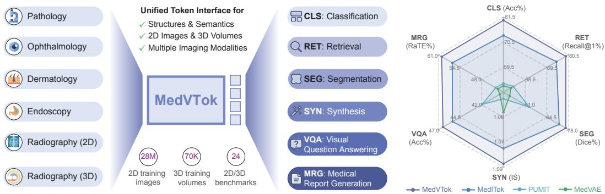  
Figure 1: MedVTok provides a unified token interface for multimodal modeling with medical imaging data. Trained on 28M images and 70K volumes, MedVTok achieves state-of-the-art performance across a broad range of downstream tasks covering 24 2D/3D benchmarks.

However, medical imaging data are highly heterogeneous across both modality and dimension, including 2D images such as dermoscopic images, color fundus photographs (CFP) and histopathology patches, as well as 3D volumes such as computed tomography (CT) and magnetic resonance imaging (MRI). These data differ in acquisition protocol, anatomical coverage, and diagnostic content. Existing medical visual tokenizers are often tied to a specific modality and dimension, producing fragmented representations that are difficult to reuse in a multimodal system. Consequently, downstream models must absorb much of the burden of modality adaptation and cross-modality representation learning [4]. A general-purpose medical visual tokenizer should instead provide a single token interface across modalities while natively supporting both 2D images and 3D volumes.

Building such a tokenizer poses two key challenges. (i) Preserving structuralfidelity across dimensions. Unlike 2D images, 3D scans present volumetric continuity, where organs, vessels, lesions, and tissue boundaries extend across adjacent slices. Existing tokenizers often specialize in either 2D or 3D settings [5, 6], or are optimized for local appearance fidelity or per-pixel/per-voxel reconstruction [7, 8], failing to encode inter-slice structure. (ii) Capturing multimodal semantics across modalities. Different modalities may describe related clinical concepts while exposing distinct evidence, e.g., histopathology reveals cellular and tissue-level morphology, whereas CT and MRI capture organ-level anatomy. Existing semantic alignment strategies typically learn representations of different imaging modalities from a single pretrained semantic encoder [6, 9–11], which may underrepresent modality-specific semantics outside that encoder’s representation space.

In this paper, we introduce MedVTok, a general-purpose medical visual tokenizer that maps heterogeneous 2D images and 3D volumes from diverse imaging modalities into a unified token space. To preserve structural fidelity across dimensions, MedVTok introduces Slice Differential Regularization (SliDR) in addition to per-pixel/per-voxel supervision, which explicitly models inter-slice volumetric continuity. To capture clinical semantics across modalities, MedVTok proposes Multi-Expert Representation Alignment (MERA), which builds a shared representation space integrating knowledge from multiple modality-specialized experts instead of a single one, while retaining complementary semantics in each expert’s representation space. Together, they enable MedVTok to produce visual tokens that preserve structural fidelity and encode multimodal clinical semantics.

To train and evaluate MedVTok at scale, we curate a large-scale medical imaging corpus spanning 9 modalities, with over 28M 2D images and 70K 3D volumes. We assess MedVTok across 6 task types: classification, segmentation, retrieval, synthesis, visual question answering, and medical report generation, covering broad utility across 24 benchmarks. Our results show that MedVTok achieves state-of-the-art performance, demonstrating the value of a scalable token interface that unifies medical image dimension, modality, and downstream task usage.

Contributions. Our main contributions are as follows. (i) We introduce MedVTok, a general-purpose medical visual tokenizer that provides a shared token interface across diverse imaging modalities and natively supports both 2D images and 3D volumes. (ii) We propose a multi-level supervision strategy that combines slice differential regularization for inter-slice continuity with multi-expert representation alignment for cross-modality clinical semantics. (iii) We curate a large-scale medical imaging corpus and conduct comprehensive evaluations across 24 benchmarks, demonstrating the broad utility of MedVTok across classification, segmentation, retrieval, synthesis, visual question answering, and medical report generation

## 2 Related Work

Tokenization across 2D and 3D medical imaging. Visual tokenizers convert images into compact tokens while preserving structural fidelity [7, 12]. Recent tokenizers [9, 13] further explore how a single tokenizer can handle heterogeneous visual formats such as images and videos. In medical imaging, however, tokenizers are commonly tied to specific input dimensionalities [5, 6]. A few works have explored adaptation to different dimensionalities by pooling 3D weights into 2D [8] or by duplicating 2D images to fit a 3D model [14]. While these approaches can handle 2D and 3D inputs simultaneously, they do not consider the respective properties of each dimensionality, e.g., through-plane anatomical continuity in volumes, and thus cannot fully preserve structural fidelity across input forms. In contrast, MedVTok introduces Slice Differential Regularization to explicitly preserve anatomical continuity in volumetric data, and provides a unified 2D–3D token interface via dimension-agnostic patchification.

Semantic representation across medical imaging modalities. Medical image representation learning has produced both broad biomedical encoders and modality-specialized expert models. General medical encoders [15–19] learn transferable representations from large-scale biomedical data, offering broad coverage across medical domains but potentially missing specialty-specific cues. Meanwhile, specialized encoders capture finer clinical semantics within individual imaging modalities or specialties [14, 20–26], yet remain isolated in different representation spaces. Existing tokenizers [5, 6] have only partially captured these different semantics, $e . g .$ , MedITok [6] aligns its representations with those of a single semantic encoder [15], thereby inheriting the single-expert bias and limiting the learning of complementary knowledge across modalities. MedVTok instead uses Multi-Expert Representation Alignment to integrate knowledge from multiple medical experts into a single token space, while retaining modality-specific semantics.

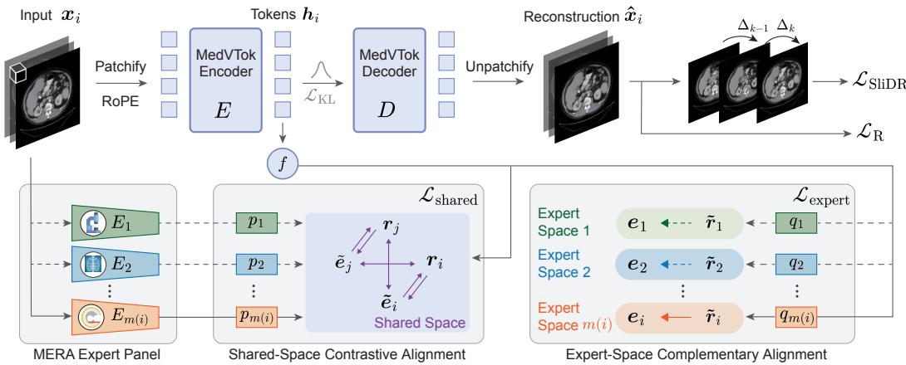  
Figure 2: Overview of the MedVTok training framework. MedVTok learns both (1) structural fidelity across 2D and 3D inputs under the reconstruction loss $\mathcal { L } _ { \mathrm { R } }$ plus the slice differential regularization $\mathcal { L } _ { \mathrm { S l i D R } }$ , and (2) clinical semantics across modalities driven by $\begin{array} { r } { \mathcal { L } _ { \mathrm { M E R A } } = \mathcal { L } _ { \mathrm { s h a r e d } } + \mathcal { L } _ { \mathrm { e x p e r t } } . } \end{array}$

## 3 Method

## 3.1 Overview of MedVTok

MedVTok learns a unified latent space that captures both structural fidelity and clinical semantics for 2D and 3D data via two complementary supervision mechanisms: (1) Slice Differential Regularization, which preserves volumetric anatomical continuity beyond what per-voxel reconstruction can capture (§3.2), and (2) Multi-Expert Representation Alignment (MERA), which integrates clinical knowledge from multiple modality-specific expert encoders into the shared token space (§3.3).

Fig. 2 illustrates the training framework. Specifically, given an input image or volume x ∈ $\mathbb { R } ^ { \tilde { C } \times T \times H \times W }$ , with $T { = } 1$ for images and $T { > } \bar { 1 }$ for volumes, MedVTok first partitions it into $N$ non-overlapping patches of size $C \times P _ { t } { \times } P _ { h } { \times } P _ { w }$ , where $\scriptstyle N = { \frac { \dot { T } H W } { P _ { t } P _ { h } P _ { w } } }$ . Patches from different samples in a batch are joined into a sequence, where each patch is associated with a coordinate that records its position within the original input. This enables variable-resolution and mixed-dimension batching.

Then, the transformer encoder $E ,$ with rotary position embeddings (RoPE) [27] derived from the coordinates, maps the sequence to per-patch tokens $\pmb { h } = E ( \pmb { x } ) \ \in \ \mathbb { R } ^ { N \times d }$ . These tokens are, on the one hand, regularized by a KL divergence term ${ \mathcal { L } } _ { \mathrm { K I } }$ to impose a standard Gaussian constraint after projection and reparameterization; on the other hand, they are processed by the decoder $D$ to reconstruct the original input xˆ. The reconstruction is supervised by the reconstruction loss $\mathcal { L } _ { \mathrm { R } }$ and the proposed slice differential regularization $\mathcal { L } _ { \mathrm { S l i D R } }$ . In parallel, an aggregation head f aggregates the tokens h into a holistic representation $\pmb { r } = f ( \pmb { h } ) \in \mathbb { R } ^ { \tilde { d } } ,$ 1 which is used for semantic alignment via MERA.

## 3.2 Slice Differential Regularization

In tomographic volumes such as CT and MRI scans, adjacent slices share strong anatomical context: organs span continuously across the depth axis, and their boundaries shift gradually from slice to slice. Per-voxel reconstruction losses like $\ell _ { 1 }$ can produce outputs that are individually accurate yet exhibit through-plane discontinuities, compromising diagnostic utility. We address this with the Slice Differential Regularization, which operates on inter-slice continuity rather than individual voxels.

For a 3D volume with $T > 2$ slices along the depth axis, let $\mathbf { \pmb { x } } _ { ( k ) }$ and $\scriptstyle { \hat { \mathbf { x } } } _ { ( k ) }$ denote the k-th axial slice of the input and the reconstruction, respectively. We define the first- and second-order slice differentials $\Delta _ { k } ( { \pmb x } ) = { \pmb x } _ { ( k + 1 ) } - { \pmb x } _ { ( k ) }$ and $\Delta _ { k } ^ { 2 } ( { \pmb x } ) = { \pmb x } _ { ( k + 1 ) } - 2 { \pmb x } _ { ( k ) } + { \pmb x } _ { ( k - 1 ) }$ , and penalize discrepancies between input and reconstructed transitions:

$$
\mathcal { L } _ { \mathrm { S I i D R } } = \frac { 1 } { T - 1 } \sum _ { k = 1 } ^ { T - 1 } \left\| \Delta _ { k } ( \hat { \pmb x } ) - \Delta _ { k } ( \pmb x ) \right\| _ { 1 } + \frac { 1 } { T - 2 } \sum _ { k = 2 } ^ { T - 1 } \left\| \Delta _ { k } ^ { 2 } ( \hat { \pmb x } ) - \Delta _ { k } ^ { 2 } ( \pmb x ) \right\| _ { 1 } ,\tag{1}
$$

where the first term matches inter-slice transitions and the second preserves through-plane curvature.

## 3.3 Multi-Expert Representation Alignment

Apart from structural fidelity, a unified medical visual tokenizer should also encode high-level clinical semantics. Achieving this across the full breadth of medical imaging is challenging as different modalities embed distinct knowledge. Aligning to a single expert [6, 15] constrains the tokenizer to inherit a single semantic geometry, which may underrepresent modalities outside the expert’s training distribution. We therefore propose Multi-Expert Representation Alignment (MERA), which uses a panel of pretrained modality-specific encoders as semantic experts. MERA involves two objectives: (i) shared-space contrastive alignment, which jointly aligns representations from multiple modality experts into a shared space, and (ii) expert-space complementary alignment, which preserves complementary information in each modality expert’s representation space.

Shared-space contrastive alignment. An input $\mathbf { \Delta } _ { \mathbf { \mathcal { X } } _ { i } }$ of imaging modality $m ( i )$ is routed to the corresponding expert $E _ { m ( i ) }$ to produce a feature $\pmb { e } _ { i } = E _ { m ( i ) } ( \pmb { x } _ { i } )$ , which will be linearly projected to a shared space, giving $\pmb { \tilde { e } } _ { i } = p _ { m ( i ) } ( \pmb { e } _ { i } ) \in \mathbb { R } ^ { d }$ . We then apply a contrastive loss $\mathcal { L } _ { \mathrm { s h a r e d } }$ between MedVTok’s representations $\mathbf { \nabla } _ { \mathbf { r } _ { i } }$ and expert features $\tilde { e } _ { i }$ within a batch with a learnable temperature τ :

$$
\mathcal { L } _ { \mathrm { s h a r e d } } = - \frac { 1 } { 2 B } \sum _ { i = 1 } ^ { B } \left[ \log \frac { \exp ( \boldsymbol { r } _ { i } \cdot \tilde { \boldsymbol { e } } _ { i } / \tau ) } { \sum _ { j = 1 } ^ { B } \exp ( \boldsymbol { r } _ { i } \cdot \tilde { \boldsymbol { e } } _ { j } / \tau ) } + \log \frac { \exp \left( \boldsymbol { r } _ { i } \cdot \tilde { \boldsymbol { e } } _ { i } / \tau \right) } { \sum _ { j = 1 } ^ { B } \exp \left( \boldsymbol { r } _ { j } \cdot \tilde { \boldsymbol { e } } _ { i } / \tau \right) } \right] .\tag{2}
$$

Expert-space complementary alignment. Note that $\mathcal { L } _ { \mathrm { s h a r e d } }$ projects heterogeneous expert features into a single space, which may discard modality-specific nuances present in each expert’s native space. To address this issue, we introduce expert-space complementary learning. For each modality

$m ( i )$ , a backprojector $q _ { m ( i ) }$ maps $\mathbf { \nabla } _ { \mathbf { r } _ { i } }$ back to the expert’s space, yielding $\pmb { \tilde { r } } _ { i } = q _ { m ( i ) } ( \pmb { r } _ { i } ) \in \mathbb { R } ^ { d _ { m ( i ) } }$ We then enforce cosine similarity between backprojected representations and original expert features:

$$
\mathcal { L } _ { \mathrm { e x p e r t } } = \frac { 1 } { B } \sum _ { i = 1 } ^ { B } \left( 1 - \frac { \boldsymbol { \tilde { r } } _ { i } \cdot \boldsymbol { e } _ { i } } { \Vert \boldsymbol { \tilde { r } } _ { i } \Vert \cdot \Vert \boldsymbol { e } _ { i } \Vert } \right) .\tag{3}
$$

Together, $\mathcal { L } _ { \mathrm { s h a r e d } }$ and $\mathcal { L } _ { \mathrm { e x p e r t } }$ provide bidirectional representation alignment: the former anchors MedVTok within a single representation space, while the latter preserves modality-specific expert knowledge that might otherwise be compressed away. The total loss for MERA is given by:

$$
\begin{array} { r } { \mathcal { L } _ { \mathrm { M E R A } } = \mathcal { L } _ { \mathrm { s h a r e d } } + \mathcal { L } _ { \mathrm { e x p e r t } } . } \end{array}\tag{4}
$$

## 3.4 Training and Inference

MedVTok is trained with the combined objective:

$$
\mathcal { L } = \mathcal { L } _ { \mathrm { R } } + \lambda _ { \mathrm { K L } } \mathcal { L } _ { \mathrm { K L } } + \lambda _ { \mathrm { S l i D R } } \mathcal { L } _ { \mathrm { S l i D R } } + \lambda _ { \mathrm { M E R A } } \mathcal { L } _ { \mathrm { M E R A } } ,\tag{5}
$$

where the standard [7, 10, 29] reconstruction loss $\mathcal { L } _ { \mathrm { R } }$ consists of pixel-level, LPIPS [30], and adversarial losses. Training proceeds in two stages: Stage 1 uses only 2D images to build foundational visual structure and semantic capabilities, with λ = 0; Stage 2 continues on both 2D images and 3D volumes with $\lambda _ { \mathrm { S l i D R } } = 0 . 1$ . At inference, MedVTok serves as a general-purpose tokenizer: given an image or volume, it encodes tokens that are directly consumed by downstream models and transferable across various tasks without further fine-tuning of the tokenizer.

## 4 Experiments

## 4.1 Pretraining

Training data. We prepare the training data by aggregating existing large-scale publicly available training-ready datasets to ensure image quality and diversity. In total, we obtain 28,769,502 images and 70,144 volumes for training MedVTok. Please refer to § B.1 for data statistics.

Implementation details. We use the AdamW [31] optimizer with $( \beta _ { 1 } , \beta _ { 2 } ) = ( 0 . 9 , 0 . 9 5 )$ and a cosine annealing schedule for 100K steps per stage. The learning rate decays from $1 0 ^ { - 4 } { \mathrm { ~ t o ~ i 0 ^ { - 5 } } }$ in Stage 1 and from $2 \times 1 0 ^ { - 5 } ~ { \mathrm { t o } } ~ 2 { \times } 1 0 ^ { - 6 }$ in Stage 2, with $\lambda _ { \mathrm { K L } } = \mathrm { { 1 \bar { 0 } ^ { - 6 } , \lambda _ { \mathrm { M E R A } } } = 1 }$ , and $\lambda _ { \mathrm { S l i D R } } = 0 . 1$ During Stage 2 training, 2D and 3D data are fed into MedVTok in alternating iterations, with an effective batch size of 600 for 2D images and 48 for 3D volumes. Please see § B.2 for details.

## 4.2 Evaluation on Downstream Tasks

Evaluation protocol. We compare MedVTok with both medical-domain tokenizers [5, 6, 8] and general-domain ones [4, 9, 10, 29, 32]. We first evaluate token fidelity of different tokenizers via autoencoding reconstruction, and then evaluate token representation quality on 6 downstream tasks: image classification, image-to-image retrieval, image segmentation, image synthesis, visual question answering (VQA), and medical report generation. All evaluations use afrozen tokenizer andfocus on the quality ofthe encoded tokens rather than building task-specific models (§ C.2).

Evaluation data. The token fidelity, classification, and retrieval evaluations share 9 benchmarks: JSIEC (fundus, retinal conditions) [33], ChestCTScan (CT, chest cancers) [34], HAM10K (dermoscopy, skin diseases) [35], BRISC (MRI, brain tumor) [36], PolypDiag (endoscopy, polyp detection) [37], OCTDL (OCT, retinal diseases) [38], LungHist700 (pathology, lung cancers) [39], BUSBRA (ultrasound, tumor staging) [40], and Kermany (X-ray, pneumonia) [41]. Segmentation datasets include MaplesDR (fundus, optic disc/cup) [42], MosMedDataPlus (CT, COVID-19 lesion) [43], HAM10K (dermoscopy, lesion) [35], PolypDB (endoscopy, polyp) [44], BRISC (MRI, brain tumor) [36], PanNuke (pathology, different cells) [45], BUSBRA (ultrasound, tumor) [40], and VinDr-RibCXR (X-ray, rib) [46]. Image synthesis uses images from the GMAI-VL-5.5M [1] dataset. VQA benchmarks include GMAI-MMBench [47], Fundus-MMBench [48], PathVQA [49], MM-Skin [50], Kvasir-VQA-x1 [51], and SLAKE [52]. For 3D tasks, we use AMOS-MM [53] and MRISegmenter [54] to evaluate 3D token fidelity. AMOS-MM CT–report pairs are used for report generation evaluation (§ C.1).

Table 1: Token fidelity evaluation via autoencoding reconstruction [PSNR (dB)↑, SSIM (%)↑]. 3D columns are excluded from the 2D average. MedVAE uses separate models for 2D and 3D inputs. The best result is marked in bold and the second-best is underlined.
<table><tr><td>Metrics</td><td>Method</td><td>CFP</td><td>CT</td><td>Derm.</td><td>Endo.</td><td>MRI</td><td>OCT</td><td>Path.</td><td>US</td><td>X-ray</td><td>Avg.</td><td>3D-MRI</td><td>3D-CT</td></tr><tr><td rowspan="9">PSNR (↑)</td><td>SDVAE [29]</td><td>37.62</td><td>36.38</td><td>34.68</td><td>33.57</td><td>34.31</td><td>29.17</td><td>24.43</td><td>32.13</td><td>35.29</td><td>33.06</td><td></td><td></td></tr><tr><td>TokenFlow [4]</td><td>30.57</td><td>25.45</td><td>29.54</td><td>25.75</td><td>24.51</td><td>24.79</td><td>20.17</td><td>22.82</td><td>26.48</td><td>25.56</td><td></td><td></td></tr><tr><td>MingTok [32]</td><td>35.58</td><td>31.23</td><td>32.43</td><td>29.85</td><td>29.37</td><td>26.92</td><td>21.87</td><td>26.42</td><td>31.25</td><td>29.43</td><td></td><td></td></tr><tr><td>UniTok [10]</td><td>34.02</td><td>31.32</td><td>31.89</td><td>30.34</td><td>30.82</td><td>28.00</td><td>24.40</td><td>29.48</td><td>31.57</td><td>30.21</td><td></td><td></td></tr><tr><td>AToken [9]</td><td>41.08</td><td>41.60</td><td>39.00</td><td>39.69</td><td>41.64</td><td>32.94</td><td>28.57</td><td>39.41</td><td>40.02</td><td>38.22</td><td>31.46</td><td>35.68</td></tr><tr><td>PUMIT [8]</td><td>32.03</td><td>32.86</td><td>27.05</td><td>28.73</td><td>32.88</td><td>27.06</td><td>19.43</td><td>23.26</td><td>26.69</td><td>27.78</td><td>29.96</td><td>31.87</td></tr><tr><td>MedVAE [5]</td><td>17.11</td><td>37.97</td><td>22.42</td><td>16.83</td><td>35.72</td><td>30.90</td><td>20.13</td><td>33.47</td><td>37.04</td><td>27.95</td><td>25.89</td><td>31.30</td></tr><tr><td>MedITok [6]</td><td>35.92</td><td>35.61</td><td>33.81</td><td>32.42</td><td>34.82</td><td>30.26</td><td>26.03</td><td>32.62</td><td>34.70</td><td>32.91</td><td></td><td></td></tr><tr><td>MedVTok</td><td>42.22</td><td>44.75</td><td>40.39</td><td>41.42</td><td>43.75</td><td>35.04</td><td>30.16</td><td>42.08</td><td>41.83</td><td>40.18</td><td>31.77</td><td>36.50</td></tr><tr><td rowspan="9">SSIM (↑)</td><td>SDVAE [29]</td><td>89.99</td><td>90.47</td><td>85.73</td><td>90.87</td><td>91.53</td><td>64.05</td><td>53.85</td><td>86.91</td><td>90.24</td><td>82.63</td><td></td><td></td></tr><tr><td>TokenFlow [4]</td><td>83.75</td><td>73.40</td><td>78.03</td><td>77.23</td><td>74.13</td><td>59.89</td><td>31.75</td><td>55.34</td><td>76.99</td><td>67.84</td><td></td><td></td></tr><tr><td>MingTok [32]</td><td>88.63</td><td>83.66</td><td>79.14</td><td>83.83</td><td>83.49</td><td>55.11</td><td>38.00</td><td>66.76</td><td>83.88</td><td>73.61</td><td></td><td></td></tr><tr><td>UniTok [10]</td><td>88.54</td><td>88.70</td><td>82.48</td><td>89.62</td><td>90.12</td><td>65.24</td><td>55.36</td><td>87.21</td><td>88.20</td><td>81.72</td><td></td><td></td></tr><tr><td>AToken [9]</td><td>94.74</td><td>96.24</td><td>92.51</td><td>96.98</td><td>97.61</td><td>80.60</td><td>74.24</td><td>97.13</td><td>95.42</td><td>91.72</td><td>85.19</td><td>95.50</td></tr><tr><td></td><td>88.09</td><td>90.82</td><td>84.84</td><td>90.17</td><td>90.92</td><td>65.34</td><td>57.92</td><td>81.99</td><td>89.30</td><td>82.16</td><td>85.20</td><td></td></tr><tr><td>PUMIT [8] MedVAE [5]</td><td>77.26</td><td>92.67</td><td>86.63</td><td>83.86</td><td>93.87</td><td>72.44</td><td>54.18</td><td>89.97</td><td>92.90</td><td>82.64</td><td>75.14</td><td>90.55 90.44</td></tr><tr><td>MedITok [6]</td><td>91.50</td><td>92.74</td><td>88.22</td><td>93.47</td><td>95.13</td><td>73.81</td><td>64.52</td><td>92.95</td><td>92.46</td><td>87.20</td><td></td><td></td></tr><tr><td>MedVTok</td><td>95.95</td><td>97.86</td><td>94.51</td><td>97.90</td><td>98.66</td><td>86.54</td><td>80.52</td><td>98.28</td><td>97.21</td><td>94.16</td><td>87.79</td><td>95.65</td></tr></table>

Token fidelity evaluation. We assess token fidelity by how well the tokenizer reconstructs input data from its encoded tokens, reporting PSNR and SSIM between the input and the reconstructed data. Table 1 reports 2D reconstruction quality. MedVTok ranks first on all nine modalities in both PSNR and SSIM. The improvement is most notable in challenging domains such as pathology, where other tokenizers suffer from limited training diversity. Medical-domain tokenizers (MedITok, MedVAE) and general-domain ones (TokenFlow, UniTok, MingTok) lag significantly behind, confirming that medical images benefit from specialized architectures and large-scale multimodal training. Fig. 3 visualizes the reconstruction error maps of the competing methods and the reconstructed images produced by MedVTok. The last two columns of Table 1 report native 3D reconstruction. MedVTok achieves the best PSNR and SSIM on both MRI and CT volumes by a large margin over PUMIT and MedVAE. The strong 3D performance suggests that our unified 2D–3D training paradigm effectively transfers learned representations to volumetric data. Please see § C.2 for qualitative comparisons.

Image classification and retrieval evaluation. To directly measure the representation quality for image classification, we adopt a k-nearest neighbor protocol. Each test sample is classified based on its k nearest training neighbors with k ∈ {10, 20, 100, 200}, and we report the highest accuracy among k values for each tokenizer. For retrieval, the training split serves as the gallery, and the test split provides the queries. Gallery images are ranked by cosine similarity, and we report Recall@1 performance.

Results are presented in Table 2. MedVTok achieves the highest average on both tasks, surpassing not only other tokenizers but also dedicated semantic encoders (BiomedCLIP, MedImageInsight, MedSigLIP) that are explicitly trained for representation learning. This indicates that the features produced by MedVTok are highly discriminative. The consistent ranking further confirms that the learned representations generalize across different downstream protocols.

Image segmentation evaluation. We follow Siméoni et al. [55] and adopt a linear segmentation protocol to evaluate the representation quality for image segmentation. Specifically, a single linear segmentation head is trained with a cross-entropy loss on top of the frozen patch tokens produced by each tokenizer, with learning rates searched over $\{ 1 0 ^ { - 2 } , ^ { 2 } 1 0 ^ { - 3 } , 1 0 ^ { - 4 } \}$ . For each tokenizer, the best-performing head on the validation set is selected for evaluation. Results are presented in Table 3. MedVTok achieves the best average Dice score, outperforming all baselines including semantic encoders. This task reveals a clear hierarchy: although general autoencoding tokenizers (e.g., SDVAE, PUMIT) can embed rich low-level details into the latent space, their high-level semantics are not activated, resulting in low segmentation performance. Semantic encoders provide explicit visual semantics and significantly outperform the autoencoding tokenizers. Unified tokenizers (MedITok, MedVTok) encode both fine-grained spatial information and high-level semantics, enjoying the benefits of both and improving dense prediction. Please see § C.2 for qualitative comparisons.

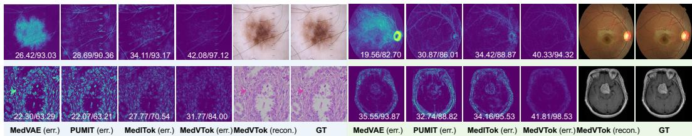  
Figure 3: Qualitative reconstruction for token fidelity evaluation. For each example, we show per-tokenizer absolute error maps with PSNR/SSIM values reported per panel.

Table 2: Image classification and retrieval evaluation [Accuracy (%)↑, Recall@1 (%)↑]. \*: semantic encoder.
<table><tr><td>Metrics</td><td>Method</td><td>CFP</td><td>CT</td><td>Derm.</td><td>Endo.</td><td>MRI</td><td>OCT</td><td>Path.</td><td>US</td><td>X-ray</td><td>Avg.</td></tr><tr><td rowspan="10">Acc. (↑)</td><td>SDVAE [29]</td><td>18.79</td><td>45.68</td><td>60.23</td><td>47.59</td><td>77.47</td><td>62.94</td><td>47.56</td><td>43.97</td><td>78.69</td><td>53.66</td></tr><tr><td>TokenFlow [4]</td><td>35.73</td><td>46.10</td><td>61.95</td><td>42.83</td><td>79.73</td><td>68.53</td><td>45.38</td><td>46.10</td><td>86.91</td><td>57.03</td></tr><tr><td>MingTok [32]</td><td>50.71</td><td>48.10</td><td>67.86</td><td>44.93</td><td>77.70</td><td>64.39</td><td>64.87</td><td>45.04</td><td>83.65</td><td>60.81</td></tr><tr><td>UniTok [10]</td><td>66.95</td><td>74.79</td><td>70.63</td><td>44.82</td><td>80.53</td><td>72.88</td><td>69.23</td><td>46.28</td><td>91.03</td><td>68.57</td></tr><tr><td>AToken [9]</td><td>64.12</td><td>65.82</td><td>72.31</td><td>46.63</td><td>88.13</td><td>66.46</td><td>66.54</td><td>46.19</td><td>91.29</td><td>67.50</td></tr><tr><td>BiomedCLIP* [15]</td><td>60.59</td><td>66.03</td><td>68.78</td><td>46.03</td><td>88.43</td><td>73.91</td><td>79.10</td><td>48.32</td><td>93.80</td><td>69.45</td></tr><tr><td>MedSigLIP* [17]</td><td>81.07</td><td>73.73</td><td>72.13</td><td>46.11</td><td>91.73</td><td>75.88</td><td>84.10</td><td>46.99</td><td>95.30</td><td>74.12</td></tr><tr><td>MedImageInsight* [16]</td><td>75.64</td><td>75.32</td><td>85.87</td><td>44.65</td><td>95.47</td><td>90.79</td><td>71.79</td><td>50.18</td><td>96.21</td><td>76.21</td></tr><tr><td>PUMIT [8]</td><td>13.84 13.28</td><td>43.78</td><td>60.34</td><td>45.85</td><td>78.00</td><td>59.52</td><td>47.44</td><td>43.44</td><td>79.49</td><td>52.41</td></tr><tr><td>MedVAÈ [5]</td><td>74.29</td><td>45.25 78.80</td><td>60.12 72.82</td><td>45.34</td><td>75.57</td><td>57.56</td><td>49.62 74.23</td><td>41.76 50.09</td><td>73.40 95.03</td><td>51.32 73.55</td></tr><tr><td>MedITok [6] MedVTok</td><td>90.25</td><td>89.77</td><td>74.16</td><td>46.80 48.71</td><td>91.23 94.23</td><td>78.67 94.00</td><td>82.69</td><td>51.33</td><td>96.90</td><td>80.23</td></tr><tr><td rowspan="10"></td><td>SDVAE [29]</td><td>22.75</td><td>43.81</td><td>57.41</td><td>56.14</td><td>90.10</td><td>57.14</td><td>32.30</td><td>39.10</td><td>82.53</td><td>53.47</td></tr><tr><td>TokenFlow [4]</td><td>45.06</td><td>50.79</td><td>61.38</td><td>45.08</td><td>91.00</td><td>68.63</td><td>35.02</td><td>44.41</td><td>87.50</td><td>58.76</td></tr><tr><td>MingTok [32]</td><td>54.94</td><td>52.38</td><td>63.16</td><td>44.82</td><td>89.50</td><td>68.01</td><td>53.70</td><td>42.29</td><td>83.01</td><td>61.31</td></tr><tr><td>UniTok [10]</td><td>69.10</td><td>88.25</td><td>64.22</td><td>50.48</td><td>89.80</td><td>73.60</td><td>67.70</td><td>44.87</td><td>87.98</td><td>70.67</td></tr><tr><td>AToken [9]</td><td>66.09</td><td>78.10</td><td>68.72</td><td>44.04</td><td>95.10</td><td>74.53</td><td>63.42</td><td>43.62</td><td>88.46</td><td>69.12</td></tr><tr><td></td><td>62.66</td><td></td><td></td><td></td><td></td><td></td><td></td><td></td><td></td><td></td></tr><tr><td>BiomedCLIP* [15] MedSigLIP* [17]</td><td>82.40</td><td>83.81 92.06</td><td>66.27 67.79</td><td>44.56 44.82</td><td>96.00 96.90</td><td>76.40 77.02</td><td>70.43 83.27</td><td>45.48 39.63</td><td>89.10 94.55</td><td>70.52</td></tr><tr><td>MedImageInsight* [16]</td><td>78.54</td><td>86.67</td><td>84.13</td><td>44.30</td><td>97.80</td><td>92.86</td><td>70.04</td><td>46.54</td><td>95.19</td><td>75.38 77.34</td></tr><tr><td>PUMIT [8]</td><td>15.88</td><td>49.52</td><td>58.66</td><td>48.96</td><td>89.80</td><td>51.24</td><td>38.52</td><td>36.70</td><td>83.49</td><td>52.53</td></tr><tr><td></td><td>12.45</td><td>47.30</td><td>56.15</td><td>53.69</td><td>88.90</td><td>52.48</td><td>38.52</td><td>35.90</td><td>76.28</td><td>51.30</td></tr><tr><td>MedVAE [5]</td><td></td><td>87.62</td><td></td><td></td><td></td><td></td><td></td><td></td><td></td><td></td><td></td></tr><tr><td>MedITok [6]</td><td>MedVTok</td><td>73.82 90.99</td><td>90.16</td><td>68.65 70.70</td><td>52.52 52.59</td><td>95.60 96.10</td><td>80.75 93.79</td><td>72.76 75.49</td><td>46.01 47.61</td><td>92.15 95.19</td><td>74.43 79.18</td></tr></table>

Table 3: Image segmentation evaluation [Dice (%)↑]. \*: semantic encoder.
<table><tr><td>Metrics</td><td>Method</td><td>CFP</td><td>CT</td><td>Derm.</td><td>Endo.</td><td>MRI</td><td>Path.</td><td>US</td><td>X-ray</td><td>Avg.</td></tr><tr><td rowspan="12">Dice (↑)</td><td>SDVAE [29]</td><td>73.03</td><td>14.88</td><td>62.37</td><td>24.67</td><td>12.69</td><td>49.11</td><td>84.19</td><td>35.56</td><td>44.56</td></tr><tr><td>TokenFlow [4]</td><td>70.39</td><td>19.05</td><td>72.62</td><td>40.53</td><td>30.49</td><td>52.34</td><td>91.33</td><td>49.52</td><td>53.28</td></tr><tr><td>MingTok [32]</td><td>85.36</td><td>27.03</td><td>83.91</td><td>57.32</td><td>52.54</td><td>67.68</td><td>92.91</td><td>54.71</td><td>65.18</td></tr><tr><td>UniTok [10]</td><td>60.93</td><td>33.13</td><td>86.25</td><td>67.25</td><td>54.90</td><td>72.51</td><td>93.35</td><td>57.60</td><td>65.74</td></tr><tr><td>AToken [9]</td><td>97.09</td><td>37.33</td><td>87.45</td><td>69.88</td><td>63.57</td><td>74.30</td><td>94.90</td><td>59.69</td><td>73.03</td></tr><tr><td>BiomedCLIP* [15]</td><td>50.22</td><td>31.83</td><td>87.48</td><td>60.64</td><td>57.95</td><td>73.65</td><td>95.41</td><td>59.83</td><td>64.63</td></tr><tr><td>MedSigLIP* [17]</td><td>97.28</td><td>40.79</td><td>87.76</td><td>69.81</td><td>67.32</td><td>76.20</td><td>95.33</td><td>62.48</td><td>74.62</td></tr><tr><td>MedImageInsight* [16]</td><td>92.34</td><td>25.60</td><td>85.45</td><td>66.96</td><td>55.81</td><td>42.93</td><td>95.80</td><td>50.16</td><td>64.38</td></tr><tr><td>PUMIT [8]</td><td>40.05</td><td>25.53</td><td>77.94</td><td>37.32</td><td>36.69</td><td>66.00</td><td>90.73</td><td>54.82</td><td>53.63</td></tr><tr><td>MedVAE [5]</td><td>61.74</td><td>12.57</td><td>57.59</td><td>19.73</td><td>10.13</td><td>36.40</td><td>81.90</td><td>30.81</td><td>38.86</td></tr><tr><td>MedITok [6]</td><td>96.70</td><td>40.52</td><td>80.28</td><td>66.07</td><td>62.42</td><td>75.80</td><td>94.65</td><td>59.47</td><td>71.99</td></tr><tr><td>MedVTok</td><td>97.44</td><td>42.91</td><td>90.25</td><td>72.52</td><td>69.62</td><td>77.74</td><td>96.91</td><td>61.13</td><td>76.07</td></tr></table>

Image synthesis evaluation. We evaluate how the tokenizer influences text-conditioned medical image synthesis within a latent diffusion [29] framework. A UNet denoising backbone is trained from scratch in each tokenizer’s latent space while keeping both the tokenizer and the text encoder frozen. This design isolates the effect of the tokenizer: the architecture, noise scheduler, optimizer, and training data are held constant across experiments. Training uses 70K image–text pairs spanning seven imaging modalities. We report the Fréchet Inception Distance (FID) [56, 57] in Table 4; lower FID indicates higher fidelity. MedVTok achieves the highest image synthesis quality with the best average FID, outperforming both specialized tokenizers (PUMIT, MedVAE) and the previous

Table 4: Image synthesis evaluation (FID ↓). A latent diffusion model is trained from scratch in each frozen tokenizer’s latent space with identical architecture and data.
<table><tr><td>Method</td><td>CFP</td><td>CT</td><td>Derm.</td><td>Endo.</td><td>MRI</td><td>Path.</td><td>X-ray</td><td>Avg.</td></tr><tr><td>PUMIT [8]</td><td>140.40</td><td>183.49</td><td>272.26</td><td>191.49</td><td>227.64</td><td>377.12</td><td>200.14</td><td>227.51</td></tr><tr><td>MedVAE [5]</td><td>118.13</td><td>154.42</td><td>202.09</td><td>170.29</td><td>145.25</td><td>325.87</td><td>88.55</td><td>172.08</td></tr><tr><td>MedITok [6]</td><td>90.65</td><td>142.46</td><td>176.94</td><td>58.38</td><td>122.96</td><td>99.66</td><td>77.24</td><td>109.76</td></tr><tr><td>MedVTok</td><td>59.85</td><td>146.39</td><td>142.87</td><td>82.39</td><td>116.78</td><td>94.65</td><td>69.17</td><td>101.73</td></tr></table>

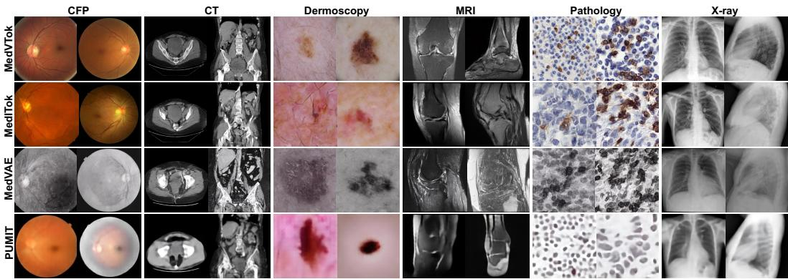  
Figure 4: Image synthesis examples. A latent diffusion model trained from scratch on MedVTok’s tokens produces samples with sharper anatomical structure and fewer artifacts than competing tokenizers across modalities, including fundus, X-ray, and dermoscopy.

unified tokenizer (MedITok), as shown in Fig. 4. PUMIT and MedVAE consistently underperform, confirming that synthesis quality depends not only on reconstruction fidelity but also on a wellstructured, semantically meaningful latent space that facilitates the diffusion model’s learning.  
Table 5: Visual question answering evaluation [Accuracy (%)↑]. Each frozen tokenizer is plugged into the LLaVA-Med [58] framework for evaluation.
<table><tr><td>Method</td><td>FundusMM</td><td>MM-Skin</td><td>Kvasir</td><td>PathVQA</td><td>SLAKE</td><td>GMAI-MM</td><td>Avg.</td></tr><tr><td>PUMIT [8]</td><td>29.84±0.42</td><td>34.74±0.38</td><td> $6 9 . 5 0 { \scriptstyle \pm 0 . 5 1 }$ </td><td> $5 2 . 9 7 { \scriptstyle \pm 0 . 6 3 }$ </td><td> $3 6 . 4 4 { \scriptstyle \pm 0 . 5 5 }$ </td><td> $2 8 . 1 6 { \scriptstyle \pm 0 . 4 7 }$ </td><td> $4 1 . 9 4 { \scriptstyle \pm 0 . 3 3 }$ </td></tr><tr><td>MedVAE [5]</td><td> $2 8 . 3 9 { \scriptstyle \pm 0 . 5 6 }$ </td><td> $3 4 . 2 1 { \scriptstyle \pm 0 . 4 4 }$ </td><td> $6 6 . 6 4 { \scriptstyle \pm 0 . 7 2 }$ </td><td> $5 1 . 1 5 { \scriptstyle \pm 0 . 5 8 }$ </td><td> $3 1 . 5 7 { \scriptstyle \pm 0 . 6 7 }$ </td><td> $2 7 . 6 1 { \scriptstyle \pm 0 . 5 3 }$ </td><td> $3 9 . 9 3 { \scriptstyle \pm 0 . 4 1 }$ </td></tr><tr><td>MedITok [6]</td><td> $3 1 . 2 9 { \scriptstyle \pm 0 . 3 5 }$ </td><td> $3 6 . 1 8 { \scriptstyle \pm 0 . 4 1 }$ </td><td> $\underline { { 7 0 . 6 3 } } \pm 0 . 2 9$ </td><td> ${ \pm 8 . 4 6 } { \pm 0 . 5 2 }$ </td><td> $4 5 . 6 1 { \pm } 0 . 3 8$ </td><td> $3 0 . 1 5 { \scriptstyle \pm 0 . 2 6 }$ </td><td> $4 5 . 3 9 { \scriptstyle \pm 0 . 2 8 }$ </td></tr><tr><td>MedVTok</td><td> $\mathbf { 3 3 . 3 9 } \pm \mathbf { 0 . 3 1 }$ </td><td> $\mathbf { 3 7 . 4 9 } { \scriptstyle \pm 0 . 2 8 }$ </td><td> $7 2 . 9 8 { \scriptstyle \pm 0 . 3 4 }$ </td><td> $5 7 . 2 4 { \scriptstyle \pm 0 . 4 5 }$ </td><td> ${ \bf 4 5 . 9 4 } { \scriptstyle \pm 0 . 3 7 }$ </td><td> ${ \bf 3 1 . 8 1 { \scriptstyle \pm 0 . 2 9 } }$ </td><td> $\mathbf { 4 6 . 4 8 } \pm 0 . 2 2$ </td></tr></table>

Visual question answering evaluation. We evaluate each tokenizer as a frozen visual backbone within the LLaVA-Med [58] framework, training only the LLaVA-Med connector and the LLM, and evaluating the resulting models on VQA benchmarks [6]. We report accuracy assessed via LLM-as-judge grading. As shown in Table 5, MedVTok achieves the best average accuracy among the competing tokenizers. Notably, MedVTok does not use image–text pairs for training, yet still outperforms MedITok, which relies on millions of textual captions for representation learning.

Medical report generation evaluation. Evaluation on generating free-text radiology reports from 3D volumes is similar to VQA, incorporating each frozen tokenizer into the LaMed framework [59] and training the connector and LLM to generate region-specific findings for three anatomical regions (abdomen, chest, and pelvis). We report BLEU-2, RaTEScore [60] (entity-level NER-based evaluation), and GREEN [61] (clinically aware error detection via an LLM judge). Table 6 presents the report generation results. MedVTok achieves the best scores on all metrics. The improvement is consistent across anatomical regions, with particularly strong gains in the pelvic region, which is the most challenging due to its complex anatomy and longer reference reports. Compared with MedITok, MedVTok shows meaningful improvements on clinically aware metrics (GREEN: 0.413 vs. 0.386), suggesting that our tokenizer encodes diagnostically relevant information that translates into more accurate clinical language generation. Additional results are provided in § C.2.

Table 6: Medical report generation evaluation. Each frozen tokenizer is integrated into the LaMed [59] framework for evaluation, generating findings in abdomen, chest, and pelvis regions.
<table><tr><td>Metrics</td><td>Method</td><td>Abdomen</td><td>Chest</td><td>Pelvis</td><td> $\operatorname { A v g } .$ </td></tr><tr><td rowspan="4">BLEU-2 (↑)</td><td>PUMIT [8]</td><td>0.289±0.008</td><td>0.193±0.003</td><td>0.164±0.007</td><td>0.215±0.005</td></tr><tr><td>MedVAE-3D [5]</td><td>0.249±0.038</td><td>0.185±0.020</td><td>0.152±0.010</td><td>0.195±0.013</td></tr><tr><td>MedITok [6]</td><td>0.256±0.013</td><td>0.219±0.020</td><td>0.294±0.017</td><td>0.257±0.012</td></tr><tr><td>MedVTok</td><td>0.272±0.005</td><td>0.263±0.045</td><td>0.288±0.017</td><td>0.274±0.009</td></tr><tr><td rowspan="4">RaTEScore (↑)</td><td>PUMIT [8]</td><td>0.604±0.005</td><td>0.511±0.035</td><td>0.201±0.015</td><td>0.439±0.006</td></tr><tr><td>MedVAE-3D [5]</td><td>0.613±0.022</td><td>0.497±0.053</td><td>0.187±0.003</td><td>0.432±0.011</td></tr><tr><td>MedITok [6]</td><td>0.610±0.006</td><td>0.501±0.008</td><td>0.594±0.031</td><td>0.568±0.015</td></tr><tr><td>MedVTok</td><td>0.619±0.005</td><td>0.570±0.074</td><td>0.612±0.006</td><td>0.600±0.006</td></tr><tr><td rowspan="4">GREEN (↑)</td><td>PUMIT [8]</td><td>0.421±0.017</td><td>0.204±0.010</td><td>0.124±0.019</td><td>0.250±0.009</td></tr><tr><td>MedVAE-3D [5]</td><td>0.401±0.024</td><td>0.186±0.003</td><td>0.105±0.064</td><td>0.230±0.179</td></tr><tr><td>MedITok [6]</td><td>0.412±0.025</td><td>0.256±0.010</td><td>0.492±0.026</td><td>0.386±0.013</td></tr><tr><td>MedVTok</td><td>0.425±0.005</td><td>0.300±0.078</td><td>0.515±0.044</td><td>0.413±0.020</td></tr></table>

## 4.3 Ablation Studies

We ablate the key components of MedVTok in Fig. 5. For efficiency, most components are evaluated on a training subset (3M images) in Stage 1 prior to data scaling.

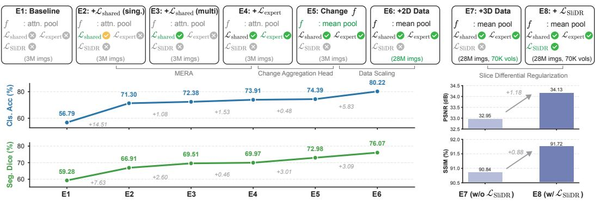  
Figure 5: Ablation studies.

Effect of MERA components. Starting from a baseline without any semantic alignment (E1 in Fig. 5), shared-space contrastive learning with a single-expert $\mathcal { L } _ { \mathrm { s h a r e d } }$ (E2, using MedImageInsight [16]) yields an initial improvement in classification and segmentation, confirming that semantic supervision is critical for downstream understanding. Extending $\mathcal { L } _ { \mathrm { s h a r e d } }$ to multiple experts (E3) further improves both metrics, demonstrating that a panel of modality-specific experts provides more comprehensive semantics. Adding expert-space complementary learning $\mathcal { L } _ { \mathrm { e x p e r t } }$ (E4) brings an additional +1.53% classification gain by preserving modality-specific nuances that shared-space contrastive learning alone may compress away during the shared-space projection.

Aggregation head design. Replacing attention pooling [9, 28] with mean pooling (E4→E5) yields substantial gains in segmentation. Attention pooling tends to collapse patch-level details into a global summary, whereas mean pooling retains spatially distributed information critical for dense prediction tasks while still achieving competitive classification performance.

Data scaling. Scaling the training set from 3M to 28M images (E5→E6) yields consistent improvements, confirming that our framework effectively leverages more diverse training data.

Effect of SliDR. Stage 2 (E7) adds 3D data to enable volumetric tokenization. Adding $\mathcal { L } _ { \mathrm { S l i D R } }$ (E8) improves 3D reconstruction in terms of both PSNR and SSIM, validating that SliDR specifically strengthens through-plane continuity. Please see § C.3 for additional analyses.

## 5 Conclusion

We present MedVTok, a general-purpose medical visual tokenizer that encodes both 2D images and 3D volumes into a shared representational space through a single transformer architecture. Two complementary supervision mechanisms shape this space at different levels: Slice Differential Regularization preserves inter-slice fidelity that per-voxel supervision misses, and Multi-Expert Representation Alignment injects modality-specific clinical semantics from a panel of experts without requiring paired annotations. MedVTok achieves state-of-the-art results across reconstruction and six downstream tasks, ranging from pixel-level fidelity to report generation, demonstrating that structural fidelity and semantic richness can be jointly optimized within a single tokenizer.

We acknowledge several limitations. First, the training data focus on common imaging modalities at present. Other imaging modalities, clinical photos, or illustrations in medical publications remain unexplored. Incorporating these would enhance generalization to non-standard visual inputs encountered in real-world clinical workflows. Second, while MERA uses frozen expert encoders, jointly fine-tuning selected experts or incorporating new ones could further improve domain coverage when the computational budget allows. We hope MedVTok will serve as a useful building block for scalable multimodal medical AI systems that enable patient-level modeling across heterogeneous imaging evidence and clinical tasks.

## References

[1] Tianbin Li, Yanzhou Su, Wei Li, Bin Fu, Zhe Chen, Ziyan Huang, Guoan Wang, Chenglong Ma, Ying Chen, Ming Hu, et al. GMAI-VL & GMAI-VL-5.5M: A large vision-language model and a comprehensive multimodal dataset towards general medical AI. Proceedings of the AAAI Conference on Artificial Intelligence, 40(28):23177–23185, Mar. 2026.

[2] Tianwei Lin, Wenqiao Zhang, Sijing Li, Yuqian Yuan, Binhe Yu, Haoyuan Li, Wanggui He, Hao Jiang, Mengze Li, Song xiaohui, et al. HealthGPT: A medical large vision-language model for unifying comprehension and generation via heterogeneous knowledge adaptation. In Fortysecond International Conference on Machine Learning, 2025. URL https://openreview. net/forum?id=WbP2OwMULq.

[3] Junzhi Ning, Wei Li, Cheng Tang, Jiashi Lin, Chenglong Ma, Chaoyang Zhang, Jiyao Liu, Ying Chen, Shujian Gao, Lihao Liu, et al. UnimedVL: Unifying medical multimodal understanding and generation through observation-knowledge-analysis. In Forty-third International Conference on Machine Learning, 2026. URL https://openreview.net/forum?id= 7UR3rNXMz9.

[4] Liao Qu, Huichao Zhang, Yiheng Liu, Xu Wang, Yi Jiang, Yiming Gao, Hu Ye, Daniel K Du, Zehuan Yuan, and Xinglong Wu. TokenFlow: Unified image tokenizer for multimodal understanding and generation. In Proceedings ofthe Computer Vision and Pattern Recognition Conference, pages 2545–2555, 2025.

[5] Maya Varma, Ashwin Kumar, Rogier Van der Sluijs, Sophie Ostmeier, Louis Blankemeier, Pierre Joseph Marcel Chambon, Christian Bluethgen, Jip Prince, Curtis Langlotz, and Akshay S Chaudhari. MedVAE: Efficient automated interpretation of medical images with large-scale generalizable autoencoders. In Medical Imaging with Deep Learning, 2025. URL https: //openreview.net/forum?id=jNmvKHniMe.

[6] Chenglong Ma, Yuanfeng Ji, Jin Ye, Zilong Li, Chenhui Wang, Junzhi Ning, Wei Li, Lihao Liu, Qiushan Guo, Tianbin Li, Junjun He, and Hongming Shan. MedITok: A unified tokenizer for medical image synthesis and interpretation. arXiv preprint arXiv:2505.19225, 2025.

[7] Patrick Esser, Robin Rombach, and Bjorn Ommer. Taming transformers for high-resolution image synthesis. In CVPR, pages 12873–12883, 2021.

[8] Lingxiao Luo, Xuanzhong Chen, Bingda Tang, Xinsheng Chen, Rong Han, Chengpeng Hu, Yujiang Li, and Ting Chen. Building universal foundation models for medical image analysis with spatially adaptive networks. arXiv preprint arXiv:2312.07630, 2023.

[9] Jiasen Lu, Liangchen Song, Mingze Xu, Byeongjoo Ahn, Yanjun Wang, Chen Chen, Afshin Dehghan, and Yinfei Yang. Atoken: A unified tokenizer for vision. arXiv preprint arXiv:2509.14476, 2025.

[10] Chuofan Ma, Yi Jiang, Junfeng Wu, Jihan Yang, Xin Yu, Zehuan Yuan, Bingyue Peng, and Xiaojuan Qi. UniTok: A unified tokenizer for visual generation and understanding. In The Thirty-ninth Annual Conference on Neural Information Processing Systems, 2026. URL https://openreview.net/forum?id=f6aOPkGE8L.

[11] Shilong Zhang, He Zhang, Zhifei Zhang, Chongjian GE, Shuchen Xue, Shaoteng Liu, Mengwei Ren, Soo Ye Kim, Yuqian Zhou, Qing Liu, Daniil Pakhomov, Kai Zhang, Zhe Lin, and Ping Luo. Both semantics and reconstruction matter: Making representation encoders ready for text-to-image generation and editing. In Forty-third International Conference on Machine Learning, 2026. URL https://openreview.net/forum?id=UmlXZ4t44h.

[12] Aaron Van Den Oord, Oriol Vinyals, and Koray Kavukcuoglu. Neural discrete representation learning. Advances in Neural Information Processing Systems, 30, 2017.

[13] Junke Wang, Yi Jiang, Zehuan Yuan, Binyue Peng, Zuxuan Wu, and Yu-Gang Jiang. Omnitokenizer: A joint image-video tokenizer for visual generation. Advances in Neural Information Processing Systems, 37:28281–28295, 2024.

[14] Chaoyi Wu, Xiaoman Zhang, Ya Zhang, Hui Hui, Yanfeng Wang, and Weidi Xie. Towards generalist foundation model for radiology by leveraging web-scale 2D&3D medical data. Nature Communications, 16(1):7866, 2025.

[15] Sheng Zhang, Yanbo Xu, Naoto Usuyama, Hanwen Xu, Jaspreet Bagga, Robert Tinn, Sam Preston, Rajesh Rao, Mu Wei, Naveen Valluri, et al. A multimodal biomedical foundation model trained from fifteen million image–text pairs. NEJM AI, 2(1):AIoa2400640, 2025. doi: 10.1056/AIoa2400640.

[16] Noel CF Codella, Ying Jin, Shrey Jain, Yu Gu, Ho Hin Lee, Asma Ben Abacha, Alberto Santamaria-Pang, Will Guyman, Naiteek Sangani, Sheng Zhang, et al. Medimageinsight: An open-source embedding model for general domain medical imaging. arXiv preprint arXiv:2410.06542, 2024.

[17] Andrew Sellergren, Sahar Kazemzadeh, Tiam Jaroensri, Atilla Kiraly, Madeleine Traverse, Timo Kohlberger, Shawn Xu, Fayaz Jamil, Cían Hughes, Charles Lau, et al. MedGemma technical report. arXiv preprint arXiv:2507.05201, 2025.

[18] Min Woo Sun, Alejandro Lozano, Javier Gamazo Tejero, Vishwesh Nath, Xiao Xiao Sun, James Burgess, Yuhui Zhang, Kun Yuan, Robert Tibshirani, Sean Huver, et al. No tokens wasted: Leveraging long context in biomedical vision-language models. arXiv preprint arXiv:2510.03978, 2025.

[19] Muhammad Uzair Khattak, Shahina Kunhimon, Muzammal Naseer, Salman Khan, and Fahad Shahbaz Khan. Unimed-CLIP: Towards a unified image-text pretraining paradigm for diverse medical imaging modalities. arXiv preprint arXiv:2412.10372, 2024.

[20] Ming Y Lu, Bowen Chen, Drew FK Williamson, Richard J Chen, Ivy Liang, Tong Ding, Guillaume Jaume, Igor Odintsov, Long Phi Le, Georg Gerber, et al. A visual-language foundation model for computational pathology. Nature Medicine, 30:863–874, 2024.

[21] Siyuan Yan, Ming Hu, Yiwen Jiang, Xieji Li, Hao Fei, Philipp Tschandl, Harald Kittler, and Zongyuan Ge. Derm1m: A million-scale vision-language dataset aligned with clinical ontology knowledge for dermatology. In Proceedings of the IEEE/CVF International Conference on Computer Vision, pages 12681–12690, 2025.

[22] Jiawei Du, Jia Guo, Weihang Zhang, Shengzhu Yang, Hanruo Liu, Huiqi Li, and Ningli Wang. RET-CLIP: A retinal image foundation model pre-trained with clinical diagnostic reports. In Proceedings ofMedical Image Computing and Computer Assisted Intervention – MICCAI 2024, volume LNCS 15012. Springer Nature Switzerland, October 2024.

[23] Meng Wang, Tian Lin, Aidi Lin, Kai Yu, Yuanyuan Peng, Lianyu Wang, Cheng Chen, Ke Zou, Huiyu Liang, Man Chen, et al. Enhancing diagnostic accuracy in rare and common fundus diseases with a knowledge-rich vision-language model. Nature Communications, 16(1):5528, 2025.

[24] Kun yuan, Vinkle Srivastav, Nassir Navab, and Nicolas Padoy. Procedure-aware surgical videolanguage pretraining with hierarchical knowledge augmentation. In The Thirty-eighth Annual Conference on Neural Information Processing Systems, 2024. URL https://openreview. net/forum?id=zuwpeRkJNH.

[25] Cris Claessens, Christiaan Viviers, Giacomo D’Amicantonio, Egor Bondarev, and Fons van der Sommen. Scaling self-supervised and cross-modal pretraining for volumetric CT transformers. arXiv preprint arXiv:2511.17209, 2025.

[26] Chenhui Zhao, Yiwei Lyu, Asadur Zaman Chowdury, Edward S Harake, Akhil Kondepudi, Akshay T Rao, Xinhai Hou, Honglak Lee, and Todd C Hollon. Towards scalable languageimage pre-training for 3d medical imaging. Transactions on Machine Learning Research, 2026. ISSN 2835-8856. URL https://openreview.net/forum?id=WxHf4EcBWA.

[27] Jianlin Su, Murtadha Ahmed, Yu Lu, Shengfeng Pan, Wen Bo, and Yunfeng Liu. RoFormer: Enhanced transformer with rotary position embedding. Neurocomputing, 568:127063, 2024.

[28] Michael Tschannen, Alexey Gritsenko, Xiao Wang, Muhammad Ferjad Naeem, Ibrahim Alabdulmohsin, Nikhil Parthasarathy, Talfan Evans, Lucas Beyer, Ye Xia, Basil Mustafa, et al. SigLIP 2: Multilingual vision-language encoders with improved semantic understanding, localization, and dense features. arXiv:2502.14786, 2025.

[29] Robin Rombach, Andreas Blattmann, Dominik Lorenz, Patrick Esser, and Björn Ommer. High-resolution image synthesis with latent diffusion models. In CVPR, pages 10684–10695, 2022.

[30] Richard Zhang, Phillip Isola, Alexei A Efros, Eli Shechtman, and Oliver Wang. The unreasonable effectiveness of deep features as a perceptual metric. In Proceedings of the IEEE Conference on Computer Vision and Pattern Recognition, pages 586–595, 2018.

[31] Ilya Loshchilov and Frank Hutter. Decoupled weight decay regularization. In International Conference on Learning Representations, 2019. URL https://openreview.net/forum? id=Bkg6RiCqY7.

[32] Ziyuan Huang, DanDan Zheng, Cheng Zou, Rui Liu, Xiaolong Wang, Kaixiang Ji, Weilong Chai, Jianxin Sun, Libin Wang, Yongjie Lv, et al. Ming-univision: Joint image understanding and generation with a unified continuous tokenizer. arXiv preprint arXiv:2510.06590, 2025.

[33] Ling-Ping Cen, Jie Ji, Jian-Wei Lin, Si-Tong Ju, Hong-Jie Lin, Tai-Ping Li, Yun Wang, Jian-Feng Yang, Yu-Fen Liu, Shaoying Tan, et al. Automatic detection of 39 fundus diseases and conditions in retinal photographs using deep neural networks. Nature communications, 12(1): 4828, 2021.

[34] Sibtain Syed, Rehan Ahmed, and Arshad Iqbal. Medical imagining (ct scan, mri, x-ray, and microscopic imagery) data, 2024. URL https://doi.org/10.17632/5kbjrgsncf.3.

[35] Philipp Tschandl, Cliff Rosendahl, and Harald Kittler. The ham10000 dataset, a large collection of multi-source dermatoscopic images of common pigmented skin lesions. Scientific data, 5 (1):180161, 2018.

[36] Amirreza Fateh, Yasin Rezvani, Sara Moayedi, Sadjad Rezvani, Fatemeh Fateh, and Mansoor Fateh. Brisc: Annotated dataset for brain tumor segmentation and classification with swinhafnet. arXiv e-prints, pages arXiv–2506, 2025.

[37] Yu Tian, Guansong Pang, Fengbei Liu, Yuyuan Liu, Chong Wang, Yuanhong Chen, Johan Verjans, and Gustavo Carneiro. Contrastive transformer-based multiple instance learning for weakly supervised polyp frame detection. In International Conference on Medical Image Computing and Computer-Assisted Intervention, pages 88–98. Springer, 2022.

[38] Mikhail Kulyabin, Aleksei Zhdanov, Anastasia Nikiforova, Andrey Stepichev, Anna Kuznetsova, Mikhail Ronkin, Vasilii Borisov, Alexander Bogachev, Sergey Korotkich, Paul A Constable, et al. Octdl: Optical coherence tomography dataset for image-based deep learning methods. Scientific data, 11(1):365, 2024.

[39] Jorge Diosdado, Pere Gilabert, Santi Seguí, and Henar Borrego. Lunghist700: A dataset of histological images for deep learning in pulmonary pathology. Scientific Data, 11(1):1088, 2024.

[40] Wilfrido Gómez-Flores, Maria Julia Gregorio-Calas, and Wagner Coelho de Albuquerque Pereira. Bus-bra: A breast ultrasound dataset for assessing computer-aided diagnosis systems. Medical physics, 51(4):3110–3123, 2024.

[41] Daniel S Kermany, Michael Goldbaum, Wenjia Cai, Carolina CS Valentim, Huiying Liang, Sally L Baxter, Alex McKeown, Ge Yang, Xiaokang Wu, Fangbing Yan, et al. Identifying medical diagnoses and treatable diseases by image-based deep learning. cell, 172(5):1122– 1131, 2018.

[42] Gabriel Lepetit-Aimon, Clément Playout, Marie Carole Boucher, Renaud Duval, Michael H Brent, and Farida Cheriet. Maples-dr: Messidor anatomical and pathological labels for explainable screening of diabetic retinopathy. Scientific Data, 11(1):914, 2024.

[43] Sergey P Morozov, Anna E Andreychenko, Nikolay A Pavlov, AV Vladzymyrskyy, Natalya V Ledikhova, Victor A Gombolevskiy, Ivan A Blokhin, Pavel B Gelezhe, AV Gonchar, and V Yu Chernina. Mosmeddata: Chest ct scans with covid-19 related findings dataset. arXiv preprint arXiv:2005.06465, 2020.

[44] Debesh Jha, Nikhil Kumar Tomar, Vanshali Sharma, Quoc-Huy Trinh, Koushik Biswas, Hongyi Pan, Ritika K Jha, Gorkem Durak, Alexander Hann, Jonas Varkey, et al. Polypdb: A curated multi-center dataset for development of ai algorithms in colonoscopy. arXiv preprint arXiv:2409.00045, 2024.

[45] Jevgenij Gamper, Navid Alemi Koohbanani, Ksenija Benet, Ali Khuram, and Nasir Rajpoot. Pannuke: an open pan-cancer histology dataset for nuclei instance segmentation and classification. In European congress on digital pathology, pages 11–19. Springer, 2019.

[46] Hoang C Nguyen, Tung T Le, Hieu H Pham, and Ha Q Nguyen. Vindr-ribcxr: A benchmark dataset for automatic segmentation and labeling of individual ribs on chest x-rays. arXiv preprint arXiv:2107.01327, 2021.

[47] Pengcheng Chen, Jin Ye, Guoan Wang, Yanjun Li, Zhongying Deng, Wei Li, Tianbin Li, Haodong Duan, Ziyan Huang, Yanzhou Su, et al. Gmai-mmbench: A comprehensive multimodal evaluation benchmark towards general medical ai. Advances in Neural Information Processing Systems, 37:94327–94427, 2024.

[48] Xinyao Liu and Diping Song. Constructing ophthalmic mllm for positioning-diagnosis collaboration through clinical cognitive chain reasoning. In Proceedings of the IEEE/CVF International Conference on Computer Vision, pages 21547–21556, 2025.

[49] Xuehai He, Yichen Zhang, Luntian Mou, Eric Xing, and Pengtao Xie. Pathvqa: 30000+ questions for medical visual question answering. arXiv preprint arXiv:2003.10286, 2020.

[50] Wenqi Zeng, Yuqi Sun, Chenxi Ma, Weimin Tan, and Bo Yan. Mm-skin: Enhancing dermatology vision-language model with an image-text dataset derived from textbooks. In Proceedings of the 33rd ACM International Conference on Multimedia, pages 3769–3778, 2025.

[51] Sushant Gautam, Michael Riegler, and Pål Halvorsen. Kvasir-vqa-x1: A multimodal dataset for medical reasoning and robust medvqa in gastrointestinal endoscopy. In MICCAI Workshop on Data Engineering in Medical Imaging, pages 53–63. Springer, 2025.

[52] Bo Liu, Li-Ming Zhan, Li Xu, Lin Ma, Yan Yang, and Xiao-Ming Wu. Slake: A semanticallylabeled knowledge-enhanced dataset for medical visual question answering. In 2021 IEEE 18th international symposium on biomedical imaging (ISBI), pages 1650–1654. IEEE, 2021.

[53] Yuanfeng Ji, Haotian Bai, Chongjian Ge, Jie Yang, Ye Zhu, Ruimao Zhang, Zhen Li, Lingyan Zhanng, Wanling Ma, Xiang Wan, et al. Amos: A large-scale abdominal multi-organ benchmark for versatile medical image segmentation. Advances in neural information processing systems, 35:36722–36732, 2022.

[54] Yan Zhuang, Tejas Sudharshan Mathai, Pritam Mukherjee, Brandon Khoury, Boah Kim, Benjamin Hou, Nusrat Rabbee, Abhinav Suri, and Ronald M Summers. MRISegmenter: A fully accurate and robust automated multiorgan and structure segmentation tool for t1-weighted abdominal mri. Radiology, 315(1):e241979, 2025.

[55] Oriane Siméoni, Huy V Vo, Maximilian Seitzer, Federico Baldassarre, Maxime Oquab, Cijo Jose, Vasil Khalidov, Marc Szafraniec, Seungeun Yi, Michaël Ramamonjisoa, et al. DINOv3. arXiv preprint arXiv:2508.10104, 2025.

[56] Martin Heusel, Hubert Ramsauer, Thomas Unterthiner, Bernhard Nessler, and Sepp Hochreiter. GANs trained by a two time-scale update rule converge to a local nash equilibrium. Advances in Neural Information Processing Systems, 30, 2017.

[57] McKell Woodland, Austin Castelo, Mais Al Taie, Jessica Albuquerque Marques Silva, Mohamed Eltaher, Frank Mohn, Alexander Shieh, Suprateek Kundu, Joshua P. Yung, Ankit B. Patel, and Kristy K. Brock. Feature extraction for generative medical imaging evaluation: New evidence against an evolving trend. In International Conference on Medical Image Computing and Computer-Assisted Intervention, pages 87–97, 2024.

[58] Chunyuan Li, Cliff Wong, Sheng Zhang, Naoto Usuyama, Haotian Liu, Jianwei Yang, Tristan Naumann, Hoifung Poon, and Jianfeng Gao. LLaVA-med: Training a large language-and-vision assistant for biomedicine in one day. In Thirty-seventh Conference on Neural Information Processing Systems Datasets and Benchmarks Track, 2023. URL https://openreview.net/forum?id=GSuP99u2kR.

[59] Fan Bai, Yuxin Du, Tiejun Huang, Max Q-H Meng, and Bo Zhao. M3D: Advancing 3d medical image analysis with multi-modal large language models. arXiv preprint arXiv:2404.00578, 2024.

[60] Weike Zhao, Chaoyi Wu, Xiaoman Zhang, Ya Zhang, Yanfeng Wang, and Weidi Xie. RaTEScore: A metric for radiology report generation. In Proceedings of the 2024 Conference on Empirical Methods in Natural Language Processing, pages 15004–15019, 2024.

[61] Sophie Ostmeier, Justin Xu, Zhihong Chen, Maya Varma, Louis Blankemeier, Christian Bluethgen, Arne Edward Michalson, Michael Moseley, Curtis Langlotz, Akshay S Chaudhari, and Jean-Benoit Delbrouck. GREEN: Generative radiology report evaluation and error notation. In Findings ofthe Associationfor Computational Linguistics: EMNLP 2024, pages 374–390, November 2024.

[62] Yikang Zhou, Tao Zhang, Dengxian Gong, Yuanzheng Wu, Ye Tian, Haochen Wang, Haobo Yuan, Jiacong Wang, Lu Qi, Hao Fei, Shunping Ji, Anran Wang, Zhuochen Wang, Yujing Wang, Cheng Chen, and Xiangtai Li. SAMTok: Representing any mask with two words. In Proceedings ofthe IEEE/CVF Conference on Computer Vision and Pattern Recognition, pages 37852– 37863, 2026. URL https://openaccess.thecvf.com/content/CVPR2026/html/ Zhou\_SAMTok\_Representing\_Any\_Mask\_with\_Two\_Words\_CVPR\_2026\_paper.html.

[63] Tao Wang, Changxu Cheng, Lingfeng Wang, Senda Chen, and Wuyue Zhao. HiMTok: Learning hierarchical mask tokens for image segmentation with large multimodal model. In Proceedings ofthe IEEE/CVF International Conference on Computer Vision, pages 23267– 23278, 2025. URL https://openaccess.thecvf.com/content/ICCV2025/html/ Wang\_HiMTok\_Learning\_Hierarchical\_Mask\_Tokens\_for\_Image\_Segmentation\_ with\_Large\_ICCV\_2025\_paper.html.

[64] Mikołaj Binkowski, Dougal J. Sutherland, Michael Arbel, and Arthur Gretton. Demystifying´ MMD GANs. In International Conference on Learning Representations, 2018. URL https: //openreview.net/forum?id=r1lUOzWCW.

[65] Tim Salimans, Ian Goodfellow, Wojciech Zaremba, Vicki Cheung, Alec Radford, and Xi Chen. Improved techniques for training gans. Advances in Neural Information Processing Systems, 29, 2016.

[66] Junying Chen, Chi Gui, Ruyi Ouyang, Anningzhe Gao, Shunian Chen, Guiming Hardy Chen, Xidong Wang, Ruifei Zhang, Zhenyang Cai, Ke Ji, Guangjun Yu, Xiang Wan, and Benyou Wang. HuatuoGPT-Vision, towards injecting medical visual knowledge into multimodal LLMs at scale. arXiv:2406.19280, 2024.

[67] An Yang, Anfeng Li, Baosong Yang, Beichen Zhang, Binyuan Hui, Bo Zheng, Bowen Yu, Chang Gao, Chengen Huang, Chenxu Lv, et al. Qwen3 technical report. arXiv preprint arXiv:2505.09388, 2025.

[68] Andrea Acevedo, Anna Merino, Santiago Alférez, Ángel Molina, Laura Boldú, and José Rodellar. A dataset of microscopic peripheral blood cell images for development of automatic recognition systems. Data in Brief, 30:105474, 2020.

[69] MD Anouk Stein, Carol Wu, Chris Carr, Errol Colak, George Shih, Jeff Rudie, John Mongan, Julia Elliott, Luciano Prevedello, MD Marc Kohli, Phil Culliton, and Robyn Ball. RSNA STR Pulmonary Embolism Detection, 2020. URL https://www.kaggle.com/competitions rsna-str-pulmonary-embolism-detection. Kaggle.

[70] Shuang Song, Rui Xu, Yong Luo, Bo Du, Jiancheng Yang, Kaiming Kuang, Yunlang She, and Mengmeng Zhao. Mela dataset: A benchmark for mediastinal lesion analysis (training set part 1), May 2022. URL https://doi.org/10.5281/zenodo.6575197.

[71] Liang Jin, Jiancheng Yang, Kaiming Kuang, Bingbing Ni, Yiyi Gao, Yingli Sun, Pan Gao, Weiling Ma, Mingyu Tan, Hui Kang, Jiajun Chen, and Ming Li. Deep-learning-assisted detection and segmentation of rib fractures from ct scans: Development and validation of fracnet. eBioMedicine, 2020.

[72] Minghui Zhang, Yangqian Wu, Hanxiao Zhang, Yulei Qin, Hao Zheng, Wen Tang, Corey Arnold, Chenhao Pei, Pengxin Yu, Yang Nan, et al. Multi-site, multi-domain airway tree modeling. Medical Image Analysis, 90:102957, 2023.

[73] Samuel G Armato III, Geoffrey McLennan, Luc Bidaut, Michael F McNitt-Gray, Charles R Meyer, Anthony P Reeves, Binsheng Zhao, Denise R Aberle, Claudia I Henschke, Eric A Hoffman, et al. The lung image database consortium (LIDC) and image database resource initiative (IDRI): a completed reference database of lung nodules on CT scans. Medical Physics, 38(2):915–931, 2011.

[74] Jun Ma, Yao Zhang, Song Gu, Cheng Ge, Shihao Mae, Adamo Young, Cheng Zhu, Xin Yang, Kangkang Meng, Ziyan Huang, et al. Unleashing the strengths of unlabelled data in deep learning-assisted pan-cancer abdominal organ quantification: the FLARE22 challenge. The Lancet Digital Health, 6(11):e815–e826, 2024.

[75] R. R. Beichel, E. J. Ulrich, C. Bauer, A. Wahle, B. Brown, T. Chang, K. Plichta, B. Smith, J. Sunderland, T. Braun, A. Fedorov, D. Clunie, M. Onken, V. A. Magnotta, Y. Menda, J. Riesmeier, S. Pieper, R. Kikinis, M. M. Graham, T. L. Casavant, M. Sonka, and J. Buatti. Data from qin-headneck (version 4) [data set], 2015. URL https://www.cancerimagingarchive. net/collection/qin-headneck.

[76] Petr Jordan, Philip M Adamson, Vrunda Bhattbhatt, Surabhi Beriwal, Sangyu Shen, Oskar Radermecker, Supratik Bose, Linda S Strain, Michael Offe, David Fraley, et al. Pediatric chest-abdomen-pelvis and abdomen-pelvis CT images with expert organ contours. Medical Physics, 49(5):3523–3528, 2022.

[77] Jun Ma, Yao Zhang, Song Gu, Cheng Zhu, Cheng Ge, Yichi Zhang, Xingle An, Congcong Wang, Qiyuan Wang, Xin Liu, et al. AbdomenCT-1k: Is abdominal organ segmentation a solved problem? IEEE Transactions on Pattern Analysis and Machine Intelligence, 44(10): 6695–6714, 2021.

[78] Jakob Wasserthal, Hanns-Christian Breit, Manfred T Meyer, Maurice Pradella, Daniel Hinck, Alexander W Sauter, Tobias Heye, Daniel T Boll, Joshy Cyriac, Shan Yang, et al. TotalSegmentator: robust segmentation of 104 anatomic structures in CT images. Radiology: Artificial Intelligence, 5(5):e230024, 2023.

[79] Mitchell Machtay, Fenghai Duan, Barry A Siegel, Bradley S Snyder, Jeremy J Gorelick, Janet S Reddin, Reginald Munden, Douglas W Johnson, Larry H Wilf, Albert DeNittis, et al. Prediction of survival by [18f] fluorodeoxyglucose positron emission tomography in patients with locally advanced non–small-cell lung cancer undergoing definitive chemoradiation therapy: results of the acrin 6668/rtog 0235 trial. Journal ofclinical oncology, 31(30):3823–3830, 2013.

[80] J. Saltz, M. Saltz, P. Prasanna, R. Moffitt, J. Hajagos, E. Bremer, J. Balsamo, and T. Kurc. Stony brook university covid-19 positive cases [data set], 2021. URL https: //www.cancerimagingarchive.net/collection/covid-19-ny-sbu.

[81] Gongning Luo, Kuanquan Wang, Jun Liu, Shuo Li, Xinjie Liang, Xiangyu Li, Shaowei Gan, Wei Wang, Suyu Dong, Wenyi Wang, et al. Efficient automatic segmentation for multi-level pulmonary arteries: The parse challenge. arXiv preprint arXiv:2304.03708, 2023.

[82] Pengbo Liu, Hu Han, Yuanqi Du, Heqin Zhu, Yinhao Li, Feng Gu, Honghu Xiao, Jun Li, Chunpeng Zhao, Li Xiao, Xinbao Wu, and S. Kevin Zhou. Deep learning to segment pelvic bones: large-scale ct datasets and baseline models. International Journal ofComputer Assisted Radiology and Surgery, 16(5):749, 2021.

[83] Patrick Bilic, Patrick Christ, Hongwei Bran Li, Eugene Vorontsov, Avi Ben-Cohen, Georgios Kaissis, Adi Szeskin, Colin Jacobs, Gabriel Efrain Humpire Mamani, Gabriel Chartrand, et al. The liver tumor segmentation benchmark (LiTS). Medical Image Analysis, 84:102680, 2023.

[84] Sergios Gatidis, Tobias Hepp, Marcel Früh, Christian La Fougère, Konstantin Nikolaou, Christina Pfannenberg, Bernhard Schölkopf, Thomas Küstner, Clemens Cyran, and Daniel Rubin. A whole-body FDG-PET/CT dataset with manually annotated tumor lesions. Scientific Data, 9(1):601, 2022.

[85] National Lung Screening Trial Research Team. The national lung screening trial: overview and study design. Radiology, 258(1):243–253, 2011.

[86] Germán González, Daniel Jimenez-Carretero, Sara Rodríguez-López, Carlos Cano-Espinosa, Miguel Cazorla, Tanya Agarwal, Vinit Agarwal, Nima Tajbakhsh, Michael B Gotway, Jianming Liang, et al. Computer aided detection for pulmonary embolism challenge (cad-pe). arXiv preprint arXiv:2003.13440, 2020.

[87] Michela Antonelli, Annika Reinke, Spyridon Bakas, Keyvan Farahani, Annette Kopp-Schneider, Bennett A Landman, Geert Litjens, Bjoern Menze, Olaf Ronneberger, Ronald M Summers, et al. The medical segmentation decathlon. Nature Communications, 13(1):4128, 2022.

[88] Blaine Rister, Darvin Yi, Kaushik Shivakumar, Tomomi Nobashi, and Daniel L Rubin. CT-ORG, a new dataset for multiple organ segmentation in computed tomography. Scientific Data, 7(1):381, 2020.

[89] João Pedrosa, Guilherme Aresta, Carlos Ferreira, Márcio Rodrigues, Patrícia Leitão, André Silva Carvalho, João Rebelo, Eduardo Negrão, Isabel Ramos, António Cunha, et al. LNDb: a lung nodule database on computed tomography. arXiv preprint arXiv:1911.08434, 2019.

[90] Aaron J Grossberg, Abdallah SR Mohamed, Hesham Elhalawani, William C Bennett, Kirk E Smith, Tracy S Nolan, Bowman Williams, Sasikarn Chamchod, Jolien Heukelom, Michael E Kantor, Theodora Browne, , Katherine A Hutcheson, G Brandon Gunn, Adam S Garden, William H Morrison, Steven J Frank, David I Rosenthal, John B Freymann, and Clifton D Fuller. Imaging and clinical data archive for head and neck squamous cell carcinoma patients treated with radiotherapy. Scientific Data, 5(1):1–10, 2018.

[91] Bram Van Ginneken, Samuel G Armato III, Bartjan de Hoop, Saskia van Amelsvoort-van de Vorst, Thomas Duindam, Meindert Niemeijer, Keelin Murphy, Arnold Schilham, Alessandra Retico, Maria Evelina Fantacci, et al. Comparing and combining algorithms for computeraided detection of pulmonary nodules in computed tomography scans: the anode09 study. Medical Image Analysis, 14(6):707–722, 2010.

[92] Yang Deng, Ce Wang, Yuan Hui, Qian Li, Jun Li, Shiwei Luo, Mengke Sun, Quan Quan, Shuxin Yang, You Hao, et al. Ctspine1k: A large-scale dataset for spinal vertebrae segmentation in computed tomography. arXiv preprint arXiv:2105.14711, 2021.

[93] National Cancer Institute Clinical Proteomic Tumor Analysis Consortium (CPTAC). The clinical proteomic tumor analysis consortium head and neck squamous cell carcinoma collection (cptac-hnscc) (version 19) [data set], 2018. URL https://www.cancerimagingarchive. net/collection/cptac-hnscc.

[94] P. Li, S. Wang, T. Li, J. Lu, Y. HuangFu, and D. Wang. A large-scale ct and pet/ct dataset for lung cancer diagnosis (Lung-PET-CT-Dx) [data set], 2020. URL https: //www.cancerimagingarchive.net/collection/lung-pet-ct-dx.

[95] P. Kinahan, M. Muzi, B. Bialecki, B. Herman, and L. Coombs. Data from the acrin 6668 trial nsclc-fdg-pet (version 2) [data set], 2019. URL https://www.cancerimagingarchive. net/collection/acrin-nsclc-fdg-pet.

[96] W. R. Bosch, W. L. Straube, J. W. Matthews, and J. A. Purdy. Head-neck cetuximab [data set], 2015. URL https://www.cancerimagingarchive.net/collection/ head-neck-cetuximab.

[97] P. Kinahan, M. Muzi, B. Bialecki, and L. Coombs. Data from acrin-flt-breast (version 2) [data set], 2017. URL https://www.cancerimagingarchive.net/collection acrin-flt-breast.

[98] Stephanie A Harmon, Thomas H Sanford, Sheng Xu, Evrim B Turkbey, Holger Roth, Ziyue Xu, Dong Yang, Andriy Myronenko, Victoria Anderson, Amel Amalou, et al. Artificial intelligence for the detection of covid-19 pneumonia on chest ct using multinational datasets. Nature Communications, 11(1):4080, 2020.

[99] M. Patnana, S. Patel, and A. Tsao. Anti-PD-1 immunotherapy melanoma dataset [data set], 2019.

[100] Ahmed Shahin, Carmela Wegworth, David, Elizabeth Estes, Julia Elliott, Justin Zita, SimonWalsh, Slepetys, and Will Cukierski. Osic pulmonary fibrosis progression. https: //kaggle.com/competitions/osic-pulmonary-fibrosis-progression, 2020. Kaggle.

[101] Samuel G. Armato, Lubomir Hadjiiski, Georgia D. Tourassi, Karen Drukker, Maryellen L. Giger, Feng Li, George Redmond, Keyvan Farahani, Justin S. Kirby, and Laurence P. Clarke. Spie-aapm-nci lung nodule classification challenge dataset, 2015. URL https://doi.org 10.7937/K9/TCIA.2015.UZLSU3FL.

[102] Emily B Tsai, Scott Simpson, Matthew P Lungren, Michelle Hershman, Leonid Roshkovan, Errol Colak, Bradley J Erickson, George Shih, Anouk Stein, Jayashree Kalpathy-Cramer, et al. The rsna international covid-19 open radiology database (ricord). Radiology, 299(1): E204–E213, 2021.

[103] B. Albertina, M. Watson, C. Holback, R. Jarosz, S. Kirk, Y. Lee, K. Rieger-Christ, and J. Lemmerman. The cancer genome atlas lung adenocarcinoma collection (tcga-luad) (version 4) [data set], 2016. URL https://www.cancerimagingarchive.net/collection/tcga-luad.

[104] P. Madhavi, S. Patel, and A. S. Tsao. Data from anti-pd-1 immunotherapy lung [data set], 2019. URL https://www.cancerimagingarchive.net/collection/anti-pd-1\_lung.

[105] National Cancer Institute Clinical Proteomic Tumor Analysis Consortium (CPTAC). The clinical proteomic tumor analysis consortium lung adenocarcinoma collection (cptac-luad) (version 12) [data set], 2018. URL https://www.cancerimagingarchive.net/collection cptac-luad.

[106] S. Desai, A. Baghal, T. Wongsurawat, S. Al-Shukri, K. Gates, P. Farmer, M. Rutherford, G. D. Blake, T. Nolan, T. Powell, et al. Data from chest imaging with clinical and genomic correlates representing a rural covid-19 positive population, 2020. URL https://doi.org/10.7937/ tcia.2020.py71-5978. [Data set].

[107] Joel Saltz, Michael Saltz, Prateek Prasanna, Richard Moffitt, Justin Hajagos, Emily Bremer, Joseph Balsamo, and Tahsin Kurc. Stony brook university covid-19 positive cases, 2021. URL https://doi.org/10.7937/TCIA.BBAG-2923. [Data set].

[108] S. Kirk, Y. Lee, P. Kumar, J. Filippini, B. Albertina, M. Watson, K. Rieger-Christ, and J. Lemmerman. The cancer genome atlas lung squamous cell carcinoma collection (tcga-lusc), 2016. URL https://doi.org/10.7937/K9/TCIA.2016.TYGKKFMQ. Version 4 [Data set].

[109] Xiangde Luo, Jia Fu, Yunxin Zhong, Shuolin Liu, Bing Han, Mehdi Astaraki, Simone Bendazzoli, Iuliana Toma-Dasu, Yiwen Ye, Ziyang Chen, et al. SegRap2023: A benchmark of organs-at-risk and gross tumor volume segmentation for radiotherapy planning of nasopharyngeal carcinoma. Medical image analysis, 101:103447, 2025.

[110] Anjany Sekuboyina, Malek E. Husseini, Amirhossein Bayat, Maximilian Löffler, Hans Liebl, Hongwei Li, Giles Tetteh, Jan Kukacka, Christian Payer, Darko Štern, Martin Urschler,ˇ Maodong Chen, Dalong Cheng, Nikolas Lessmann, Yujin Hu, Tianfu Wang, Dong Yang, Daguang Xu, Felix Ambellan, Tamaz Amiranashvili, Moritz Ehlke, Hans Lamecker, Sebastian Lehnert, Marilia Lirio, Nicolás Pérez de Olaguer, Heiko Ramm, Manish Sahu, Alexander Tack, Stefan Zachow, Tao Jiang, Xinjun Ma, Christoph Angerman, Xin Wang, Kevin Brown, Alexandre Kirszenberg, Élodie Puybareau, Di Chen, Yiwei Bai, Brandon H. Rapazzo, Timyoas Yeah, Amber Zhang, Shangliang Xu, Feng Hou, Zhiqiang He, Chan Zeng, Zheng Xiangshang, Xu Liming, Tucker J. Netherton, Raymond P. Mumme, Laurence E. Court, Zixun Huang,

Chenhang He, Li-Wen Wang, Sai Ho Ling, Lê Duy Huynh, Nicolas Boutry, Roman Jakubicek,\` Jiri Chmelik, Supriti Mulay, Mohanasankar Sivaprakasam, Johannes C. Paetzold, Suprosanna Shit, Ivan Ezhov, Benedikt Wiestler, Ben Glocker, Alexander Valentinitsch, Markus Rempfler, Björn H. Menze, and Jan S. Kirschke. Verse: A vertebrae labelling and segmentation benchmark for multi-detector ct images. Medical Image Analysis, 73:102166, 2021.

[111] Nicholas Heller, Niranjan Sathianathen, Anurag Kalapara, Eric Walczak, Kelly Moore, Hanna Kaluzniak, Justin Rosenberg, Peter Blake, Zachary Rengel, Michael Oestreich, John Dean, Michael Tradewell, Ankit Shah, Rohan Tejpaul, Zachary Edgerton, Matthew Peterson, Saad Raza, Saugat Regmi, Nikolaos Papanikolopoulos, and Christopher Weight. Data from c4kc-kits, 2019. URL https://doi.org/10.7937/TCIA.2019.IX49E8NX. [Data set].

[112] Bram van Ginneken. Lola11, April 2021. URL https://doi.org/10.5281/zenodo. 4708800.

[113] Pechin Lo, Bram Van Ginneken, Joseph M Reinhardt, Tarunashree Yavarna, Pim A De Jong, Benjamin Irving, Catalin Fetita, Margarete Ortner, Rômulo Pinho, Jan Sijbers, et al. Extraction of airways from CT (EXACT’09). IEEE Transactions on Medical Imaging, 31(11):2093–2107, 2012.

[114] Nicholas Heller, Fabian Isensee, Dasha Trofimova, Resha Tejpaul, Zhongchen Zhao, Huai Chen, Lisheng Wang, Alex Golts, Daniel Khapun, Daniel Shats, et al. The kits21 challenge: Automatic segmentation of kidneys, renal tumors, and renal cysts in corticomedullary-phase ct. arXiv preprint arXiv:2307.01984, 2023.

[115] Benjamin Movsas, Chen Hu, Jeffrey Sloan, Jeffrey Bradley, Ritsuko Komaki, Gregory Masters, Vivek Kavadi, Samir Narayan, Jeff Michalski, Douglas W. Johnson, Christopher Koprowski, Jr Curran, Walter J., Yolanda I. Garces, Rakesh Gaur, Raymond B. Wynn, John Schallenkamp, Daphna Y. Gelblum, Robert M. MacRae, Rebecca Paulus, and Hak Choy. Quality of Life Analysis of a Radiation Dose–Escalation Study of Patients With Non–Small-Cell Lung Cancer: A Secondary Analysis of the Radiation Therapy Oncology Group 0617 Randomized Clinical Trial. JAMA Oncology, 2(3):359–367, 03 2016.

[116] Onur Akin, Paul Elnajjar, Michael Heller, Richard Jarosz, Bradley J. Erickson, Scott Kirk, Y. Lee, W. Marston Linehan, R. Gautam, Rohini Vikram, et al. The cancer genome atlas kidney renal clear cell carcinoma collection (tcga-kirc), 2016. URL https://doi.org/10.7937/ K9/TCIA.2016.V6PBVTDR. Version 3 [Data set].

[117] National Cancer Institute Clinical Proteomic Tumor Analysis Consortium (CPTAC). The clinical proteomic tumor analysis consortium cutaneous melanoma collection (cptac-cm), 2018. URL https://doi.org/10.7937/K9/TCIA.2018.ODU24GZE. Version 11 [Data set].

[118] Rina D. Rudyanto, Sjoerd Kerkstra, Eva M. van Rikxoort, Catalin Fetita, Pierre-Yves Brillet, Christophe Lefevre, Wenzhe Xue, Xiangjun Zhu, Jianming Liang, ˙Ilkay Öksüz, Devrim Ünay, Kamuran Kadipa¸saogˇlu, Raúl San José Estépar, James C. Ross, George R. Washko, Juan-Carlos Prieto, Marcela Hernández Hoyos, Maciej Orkisz, Hans Meine, Markus Hüllebrand, Christina Stöcker, Fernando Lopez Mir, Valery Naranjo, Eliseo Villanueva, Marius Staring, Changyan Xiao, Berend C. Stoel, Anna Fabijanska, Erik Smistad, Anne C. Elster, Frank Lindseth, Amir Hossein Foruzan, Ryan Kiros, Karteek Popuri, Dana Cobzas, Daniel Jimenez-Carretero, Andres Santos, Maria J. Ledesma-Carbayo, Michael Helmberger, Martin Urschler, Michael Pienn, Dennis G.H. Bosboom, Arantza Campo, Mathias Prokop, Pim A. de Jong, Carlos Ortiz de Solorzano, Arrate Muñoz-Barrutia, and Bram van Ginneken. Comparing algorithms for automated vessel segmentation in computed tomography scans of the lung: the vessel12 study. Medical Image Analysis, 18(7):1217–1232, 2014.

[119] Bradley J. Erickson, David Mutch, Laura Lippmann, and Richard Jarosz. The cancer genome atlas uterine corpus endometrial carcinoma collection (tcga-ucec), 2016. URL https://doi. org/10.7937/K9/TCIA.2016.GKJ0ZWAC. Version 4 [Data set].

[120] C. Holback, R. Jarosz, F. Prior, D. G. Mutch, P. Bhosale, K. Garcia, Y. Lee, S. Kirk, C. A. Sadow, S. Levine, et al. The cancer genome atlas ovarian cancer collection (tcga-ov), 2016. URL https://doi.org/10.7937/K9/TCIA.2016.NDO1MDFQ. Version 4 [Data set].

[121] J. Y. Y. Kwan, J. Su, S. H. Huang, L. S. Ghoraie, W. Xu, B. Chan, K. W. Yip, M. Giuliani, A. Bayley, J. Kim, A. J. Hope, J. Ringash, J. Cho, A. McNiven, A. Hansen, D. Goldstein, J. R. de Almeida, H. J. Aerts, J. N. Waldron, B. Haibe-Kains, B. O’Sullivan, S. V. Bratman, and F. F. Liu. Data from radiomic biomarkers to refine risk models for distant metastasis in oropharyngeal carcinoma [data set], 2019. URL https://www.cancerimagingarchive. net/collection/opc-radiomics.

[122] National Cancer Institute Clinical Proteomic Tumor Analysis Consortium (CPTAC). The clinical proteomic tumor analysis consortium sarcomas collection (cptac-sar), 2019. URL https://doi.org/10.7937/tcia.2019.9bt23r95. Version 10 [Data set].

[123] Holger R. Roth, Amal Farag, Evrim B. Turkbey, Le Lu, Jiamin Liu, and Ronald M. Summers. Data from pancreas-ct. https://doi.org/10.7937/K9/TCIA.2016.tNB1kqBU, 2016. The Cancer Imaging Archive.

[124] Michael Green, Edith M Marom, Eli Konen, Nahum Kiryati, and Arnaldo Mayer. Feature aggregation in perceptual loss for ultra low-dose (uld) ct denoising. In 2019 IEEE 16th International Symposium on Biomedical Imaging (ISBI 2019), pages 1635–1638, 2019.

[125] P. Kinahan, M. Muzi, B. Bialecki, and L. Coombs. Ddata from the acrin 6685 trial hnscc-fdgpet/ct [data set], 2019. URL https://www.cancerimagingarchive.net/collection/ acrin-hnscc-fdg-pet-ct.

[126] Holger R Roth, Ziyue Xu, Carlos Tor-Díez, Ramon Sanchez Jacob, Jonathan Zember, Jose Molto, Wenqi Li, Sheng Xu, Baris Turkbey, Evrim Turkbey, et al. Rapid artificial intelligence solutions in a pandemic—the covid-19-20 lung ct lesion segmentation challenge. Medical Image Analysis, 82:102605, 2022.

[127] Xueyan Mei, Zelong Liu, Philip M Robson, Brett Marinelli, Mingqian Huang, Amish Doshi, Adam Jacobi, Chendi Cao, Katherine E Link, Thomas Yang, et al. Radimagenet: an open radiologic deep learning research dataset for effective transfer learning. Radiology: Artificial Intelligence, 4(5):e210315, 2022.

[128] Nicholas Kurtansky, Veronica Rotemberg, Maura Gillis, Kivanc Kose, Walter Reade, and Ashley Chow. Isic 2024: Skin cancer detection with 3d-tbp. https://kaggle.com/ competitions/isic-2024-challenge, 2024. Kaggle competition.

[129] Veronica Rotemberg, Nicholas Kurtansky, Brigid Betz-Stablein, Liam Caffery, Emmanouil Chousakos, Noel Codella, Marc Combalia, Stephen Dusza, Pascale Guitera, David Gutman, et al. A patient-centric dataset of images and metadata for identifying melanomas using clinical context. Scientific Data, 8(1):34, 2021.

[130] Seung Seog Han, Ik Jun Moon, Seong Hwan Kim, Jung-Im Na, Myoung Shin Kim, Gyeong Hun Park, Ilwoo Park, Keewon Kim, Woohyung Lim, Ju Hee Lee, et al. Assessment of deep neural networks for the diagnosis of benign and malignant skin neoplasms in comparison with dermatologists: A retrospective validation study. PLoS medicine, 17(11):e1003381, 2020.

[131] Carlos Hernández-Pérez, Marc Combalia, Sebastian Podlipnik, Noel CF Codella, Veronica Rotemberg, Allan C Halpern, Ofer Reiter, Cristina Carrera, Alicia Barreiro, Brian Helba, et al. BCN20000: Dermoscopic lesions in the wild. Scientific Data, 11(1):641, 2024.

[132] Matthew Groh, Caleb Harris, Luis Soenksen, Felix Lau, Rachel Han, Aerin Kim, Arash Koochek, and Omar Badri. Evaluating deep neural networks trained on clinical images in dermatology with the fitzpatrick 17k dataset. In Proceedings of the IEEE/CVF Conference on Computer Vision and Pattern Recognition, pages 1820–1828, 2021.

[133] Abdurrahim Yilmaz, Sirin Pekcan Yasar, Gulsum Gencoglan, and Burak Temelkuran. Derm12345: A large, multisource dermatoscopic skin lesion dataset with 40 subclasses. Scientific Data, 11(1):1302, 2024.

[134] Philipp Tschandl, Bengu Nisa Akay, Cliff Rosendahl, Veronica Rotemberg, Verche Todorovska, Jochen Weber, Anna Katharina Wolber, Christoph Müller, Nicholas Kurtansky, Allan Halpern,

Wolfgang Weninger, and Harald Kittler. MILK10k: A hierarchical multimodal imaginglearning toolkit for diagnosing pigmented and nonpigmented skin cancer and its simulators. Journal ofInvestigative Dermatology, 146(2):357–364.e7, 2026. ISSN 0022-202X.

[135] Ronald de Jong, HJ Carolus, HA Franciscus, Romy C van Jaarsveld, Richard van Hillegersberg, PW Josien, Peter HN de With, Yasmina al Khalil, Fons van Der Sommen, et al. Scaling up self-supervised learning for improved surgical foundation models. Medical Image Analysis, page 103873, 2025.

[136] Aneeq Zia, Max Berniker, Rogerio Garcia Nespolo, Conor Perreault, Kiran Bhattacharyya, Xi Liu, Ziheng Wang, Satoshi Kondo, Satoshi Kasai, Kousuke Hirasawa, Bo Liu, David Austin, Yiheng Wang, Michal Futrega, Jean-Francois Puget, Zhenqiang Li, Yoichi Sato, Ryo Fujii, Ryo Hachiuma, Mana Masuda, Hideo Saito, An Wang, Mengya Xu, Mobarakol Islam, Long Bai, Winnie Pang, Hongliang Ren, Chinedu Nwoye, Luca Sestini, Nicolas Padoy, Maximilian Nielsen, Samuel Schüttler, Thilo Sentker, Hümeyra Husseini, Ivo Baltruschat, Rüdiger Schmitz, René Werner, Aleksandr Matsun, Mugariya Farooq, Numan Saaed, Jose Renato Restom Viera, Mohammad Yaqub, Neil Getty, Fangfang Xia, Zixuan Zhao, Xiaotian Duan, Xing Yao, Ange Lou, Hao Yang, Jintong Han, Jack Noble, Jie Ying Wu, Tamer Abdulbaki Alshirbaji, Nour Aldeen Jalal, Herag Arabian, Ning Ding, Knut Moeller, Weiliang Chen, Quan He, Muhammad Bilal, Taofeek Akinosho, Adnan Qayyum, Massimo Caputo, Hunaid Vohra, Michael Loizou, Anuoluwapo Ajayi, Ilhem Berrou, Faatihah Niyi-Odumosu, Charlie Budd, Oluwatosin Alabi, Tom Vercauteren, Ruoxi Zhao, Ayberk Acar, John Han, Jumanh Atoum, Yinhong Qin, Jie Ying Wu, Surong Hua, Lu Ping, Wenming Wu, Rongfeng Wei, Jinlin Wu, You Pang, Zhen Chen, Tim Jaspers, Amine Yamlahi, Piotr Kalinowski, Dominik Michael, Tim Rä dsch, Marco Hübner, Danail Stoyanov, Stefanie Speidel, Lena Maier-Hein, and Anthony Jarc. Intuitive surgical surgtoolloc challenge results: 2022-2023. arXiv preprint arXiv:2305.07152, 2025.

[137] Vivek Singh Bawa, Gurkirt Singh, Francis KapingA, Inna Skarga-Bandurova, Elettra Oleari, Alice Leporini, Carmela Landolfo, Pengfei Zhao, Xi Xiang, Gongning Luo, et al. The SARAS endoscopic surgeon action detection (esad) dataset: Challenges and methods, 2021.

[138] Stefanie Speidel, Lena Maier-Hein, Danail Stoyanov, Sebastian Bodenstedt, Annika Reinke, Sophia Bano, Alexander Jenke, Martin Wagner, Marie Daum, Ala Tabibian, et al. Endoscopic vision challenge 2023. In International Conference on Medical Image Computing and Computer Assisted Intervention (MICCAI 2023). Zenodo, 2023. doi: 10.5281/zenodo.8315050. URL https://doi.org/10.5281/zenodo.8315050.

[139] Coen de Vente, Koenraad A. Vermeer, Nicolas Jaccard, He Wang, Hongyi Sun, Firas Khader, Daniel Truhn, Temirgali Aimyshev, Yerkebulan Zhanibekuly, Tien-Dung Le, et al. AIROGS: Artificial intelligence for robust glaucoma screening challenge. IEEE Transactions on Medical Imaging, 43(1):542–557, 2024.

[140] Emma Dugas, Jared, Jorge, and Will Cukierski. Diabetic retinopathy detection. https: //kaggle.com/competitions/diabetic-retinopathy-detection, 2015. Kaggle.

[141] Varun Gulshan, Lily Peng, Marc Coram, Martin C Stumpe, Derek Wu, Arunachalam Narayanaswamy, Subhashini Venugopalan, Kasumi Widner, Tom Madams, Jorge Cuadros, et al. Development and validation of a deep learning algorithm for detection of diabetic retinopathy in retinal fundus photographs. jama, 316(22):2402–2410, 2016.

[142] Alejandro Lozano, Min Woo Sun, James Burgess, Liangyu Chen, Jeffrey J Nirschl, Jeffrey Gu, Ivan Lopez, Josiah Aklilu, Anita Rau, Austin Wolfgang Katzer, et al. Biomedica: An open biomedical image-caption archive, dataset, and vision-language models derived from scientific literature. In Proceedings of the Computer Vision and Pattern Recognition Conference, pages 19724–19735, 2025.

[143] Dmitry Nechaev, Alexey Pchelnikov, and Ekaterina Ivanova. HISTAI: an open-source, largescale whole slide image dataset for computational pathology. arXiv preprint arXiv:2505.12120, 2025.

[144] Yuxuan Sun, Yunlong Zhang, Yixuan Si, Chenglu Zhu, Zhongyi Shui, Kai Zhang, Jingxiong Li, Xingheng Lyu, Tao Lin, and Lin Yang. PathGen-1.6M: 1.6 million pathology image-text pairs generation through multi-agent collaboration. arXiv preprint arXiv:2407.00203, 2024.

[145] Christian Matek, Sebastian Krappe, Christian Münzenmayer, Torsten Haferlach, and Carsten Marr. Highly accurate differentiation of bone marrow cell morphologies using deep neural networks on a large image data set. Blood, The Journal of the American Society of Hematology, 138(20):1917–1927, 2021.

[146] Yiping Jiao, Jeroen van der Laak, Shadi Albarqouni, Zhang Li, Tao Tan, Abhir Bhalerao, Shenghua Cheng, Jiabo Ma, Johnathan Pocock, Josien P.W. Pluim, et al. Lysto: The lymphocyte assessment hackathon and benchmark dataset. IEEE Journal ofBiomedical and Health Informatics, 28(3):1161–1172, 2024. doi: 10.1109/JBHI.2023.3327489.

[147] Ujjwal Baid, Satyam Ghodasara, Suyash Mohan, Michel Bilello, Evan Calabrese, Errol Colak, Keyvan Farahani, Jayashree Kalpathy-Cramer, Felipe C Kitamura, Sarthak Pati, et al. The rsna-asnr-miccai brats 2021 benchmark on brain tumor segmentation and radiogenomic classification. arXiv preprint arXiv:2107.02314, 2021.

[148] IXI. IXI Dataset. https://brain-development.org/ixi-dataset/, 2010. Imperial College London, Creative Commons CC BY-SA 3.0.

[149] Spyridon Bakas, Mauricio Reyes, Andras Jakab, Stefan Bauer, Markus Rempfler, Alessandro Crimi, Russell Takeshi Shinohara, Christoph Berger, Sung Min Ha, Martin Rozycki, et al. Identifying the best machine learning algorithms for brain tumor segmentation, progression assessment, and overall survival prediction in the brats challenge. arXiv preprint arXiv:1811.02629, 2018.

[150] Alessa Hering, Lasse Hansen, Tony CW Mok, Albert CS Chung, Hanna Siebert, Stephanie Häger, Annkristin Lange, Sven Kuckertz, Stefan Heldmann, Wei Shao, et al. Learn2reg: comprehensive multi-task medical image registration challenge, dataset and evaluation in the era of deep learning. IEEE Transactions on Medical Imaging, 42(3):697–712, 2022.

[151] Jonathan Shapey, Aaron Kujawa, Reuben Dorent, Guotai Wang, Alexis Dimitriadis, Diana Grishchuk, Ian Paddick, Neil Kitchen, Robert Bradford, Shakeel R Saeed, et al. Segmentation of vestibular schwannoma from mri, an open annotated dataset and baseline algorithm. Scientific Data, 8(1):286, 2021.

[152] Daniel S Marcus, Anthony F Fotenos, John G Csernansky, John C Morris, and Randy L Buckner. Open access series of imaging studies: longitudinal mri data in nondemented and demented older adults. Journal ofCognitive Neuroscience, 22(12):2677–2684, 2010.

[153] Sook-Lei Liew, Bethany P Lo, Miranda R Donnelly, Artemis Zavaliangos-Petropulu, Jessica N Jeong, Giuseppe Barisano, Alexandre Hutton, Julia P Simon, Julia M Juliano, Anisha Suri, et al. A large, curated, open-source stroke neuroimaging dataset to improve lesion segmentation algorithms. Scientific Data, 9(1):320, 2022.

[154] Natalia Shusharina and Thomas Bortfeld. Glioma image segmentation for radiotherapy: Rt targets, barriers to cancer spread, and organs at risk (glis-rt), 2021. URL https://doi.org/ 10.7937/TCIA.T905-ZQ20. [Data set].

[155] Reuben Dorent, Aaron Kujawa, Marina Ivory, Spyridon Bakas, Nicola Rieke, Samuel Joutard, Ben Glocker, Jorge Cardoso, Marc Modat, Kayhan Batmanghelich, Arseniy Belkov, Maria Baldeon Calisto, Jae Won Choi, Benoit M. Dawant, Hexin Dong, Sergio Escalera, Yubo Fan, Lasse Hansen, Mattias P. Heinrich, Smriti Joshi, Victoriya Kashtanova, Hyeon Gyu Kim, Satoshi Kondo, Christian N. Kruse, Susana K. Lai-Yuen, Hao Li, Han Liu, Buntheng Ly, Ipek Oguz, Hyungseob Shin, Boris Shirokikh, Zixian Su, Guotai Wang, Jianghao Wu, Yanwu Xu, Kai Yao, Li Zhang, Sébastien Ourselin, Jonathan Shapey, and Tom Vercauteren. Crossmoda 2021 challenge: Benchmark of cross-modality domain adaptation techniques for vestibular schwannoma and cochlea segmentation. Medical Image Analysis, 83:102628, 2023.

[156] Huijun Chen, Xihai Zhao, Haozhong Sun, Jiaqi Dou, Chenlin Du, Runyu Yang, Xiaoqi Lin, Han Jiang, Shuwan Yu, Jiachen Liu, Zixuan Han, Chun Yuan, and Niranjan Balu. Cerebral artery segmentation challenge (cas) 2023 [data set], 2023. URL https://codalab.lisn. upsaclay.fr/competitions/9804. Accessed: 2025-05-22.

[157] Zhaohan Xiong, Qing Xia, Zhiqiang Hu, Ning Huang, Cheng Bian, Yefeng Zheng, Sulaiman Vesal, Nishant Ravikumar, Andreas Maier, Xin Yang, et al. A global benchmark of algorithms for segmenting the left atrium from late gadolinium-enhanced cardiac magnetic resonance imaging. Medical image analysis, 67:101832, 2021.

[158] Mohit Prabhushankar, Kiran Kokilepersaud, Yash-yee Logan, Stephanie Trejo Corona, Ghassan AlRegib, and Charles Wykoff. Olives dataset: Ophthalmic labels for investigating visual eye semantics. Advances in Neural Information Processing Systems, 35:9201–9216, 2022.

[159] Daniel Kermany. Labeled optical coherence tomography (OCT) and chest X-ray images for classification. Mendeley data, 2018.

[160] Weiyi Zhang, Peranut Chotcomwongse, Yinwen Li, Pusheng Xu, Ruijie Yao, Lianhao Zhou, Yuxuan Zhou, Hui Feng, Qiping Zhou, Xinyue Wang, et al. Predicting diabetic macular edema treatment responses using OCT: Dataset and methods of APTOS competition. Medical Image Analysis, 109:103942, 2026. ISSN 1361-8415. doi: https://doi.org/10.1016/j.media.2026. 103942.

[161] Malliga Subramanian, Kogilavani Shanmugavadivel, Obuli Sai Naren, K Premkumar, and K Rankish. Classification of retinal oct images using deep learning. In 2022 International Conference on Computer Communication and Informatics (ICCCI), pages 1–7, 2022. doi: 10.1109/ICCCI54379.2022.9740985.

[162] María Sofía Sappia. Acouslic-ai : Abdominal circumference operator- agnostic ultrasound measurement in low-income countries using artificial intelligence, July 2024. URL https: //doi.org/10.5281/zenodo.12697994.

[163] Sun Yat-sen University. Sysu-ceus-fll: Contrast-enhanced ultrasound dataset for focal liver lesions. https://www.kaggle.com/datasets/hoangviet2302/sysu-ceus-fll, 2023. Kaggle dataset.

[164] Hanae Elmekki, Ahmed Alagha, Hani Sami, Amanda Spilkin, Antonela Mariel Zanuttini, Ehsan Zakeri, Jamal Bentahar, Lyes Kadem, Wen-Fang Xie, Philippe Pibarot, et al. Cactus: An open dataset and framework for automated cardiac assessment and classification of ultrasound images using deep transfer learning. Computers in Biology and Medicine, 190:110003, 2025.

[165] Hari M. Trivedi, Maryam Vazirabad, Felipe C. Kitamura, Yan Chen, and Helen Frazer. Opensource dataset for the rsna screening mammography cancer detection challenge. Radiology: Artificial Intelligence, 8(2):e250375, 2026.

[166] Rebecca Sawyer Lee, Francisco Gimenez, Assaf Hoogi, Kanae Kawai Miyake, Mia Gorovoy, and Daniel L Rubin. A curated mammography data set for use in computer-aided detection and diagnosis research. Scientific data, 4(1):170177, 2017.

[167] Hieu T Nguyen, Ha Q Nguyen, Hieu H Pham, Khanh Lam, Linh T Le, Minh Dao, and Van Vu. Vindr-mammo: A large-scale benchmark dataset for computer-aided diagnosis in full-field digital mammography. Scientific Data, 10(1):277, 2023.

[168] Alistair EW Johnson, Tom J Pollard, Seth J Berkowitz, Nathaniel R Greenbaum, Matthew P Lungren, Chih-ying Deng, Roger G Mark, and Steven Horng. MIMIC-CXR, a de-identified publicly available database of chest radiographs with free-text reports. Scientific Data, 6(1): 317, 2019.

[169] Xiaoman Zhang, Julián N Acosta, Josh Miller, Ouwen Huang, and Pranav Rajpurkar. ReXGradient-160k: A large-scale publicly available dataset of chest radiographs with free-text reports. arXiv preprint arXiv:2505.00228, 2025.

[170] Pierre Chambon, Jean-Benoit Delbrouck, Thomas Sounack, Shih-Cheng Huang, Zhihong Chen, Maya Varma, Steven QH Truong, Chu The Chuong, and Curtis P Langlotz. CheXpert Plus: Augmenting a large chest x-ray dataset with text radiology reports, patient demographics and additional image formats. arXiv preprint arXiv:2405.19538, 2024.

[171] Aurelia Bustos, Antonio Pertusa, Jose-Maria Salinas, and Maria De La Iglesia-Vaya. PadChest: A large chest x-ray image dataset with multi-label annotated reports. Medical image analysis, 66:101797, 2020.

[172] Xiaosong Wang, Yifan Peng, Le Lu, Zhiyong Lu, Mohammadhadi Bagheri, and Ronald M Summers. Chestx-ray8: Hospital-scale chest x-ray database and benchmarks on weaklysupervised classification and localization of common thorax diseases. In Proceedings of the IEEE Conference on Computer Vision and Pattern Recognition, pages 2097–2106, 2017.

[173] Yifan Wu, Hayden Gunraj, Chi-en Amy Tai, and Alexander Wong. COVIDx CXR-4: An expanded multi-institutional open-source benchmark dataset for chest x-ray image-based computer-aided covid-19 diagnostics. arXiv preprint arXiv:2311.17677, 2023.

[174] Eduardo P Reis, Joselisa PQ De Paiva, Maria CB Da Silva, Guilherme AS Ribeiro, Victor F Paiva, Lucas Bulgarelli, Henrique MH Lee, Paulo V Santos, Vanessa M Brito, Lucas TW Amaral, et al. Brax, brazilian labeled chest x-ray dataset. Scientific Data, 9(1):487, 2022.

[175] Xiaosong Wang, Yifan Peng, Le Lu, Zhiyong Lu, Mohammadhadi Bagheri, and Ronald M Summers. Chestx-ray8: Hospital-scale chest x-ray database and benchmarks on weaklysupervised classification and localization of common thorax diseases. In Proceedings ofthe IEEE conference on computer vision and pattern recognition, pages 2097–2106, 2017.

[176] Radiological Society of North America (RSNA). Rsna pneumonia detection challenge. https://www.kaggle.com/c/rsna-pneumonia-detection-challenge, 2018. Chest X-ray dataset with pneumonia annotations.

[177] Ha Q Nguyen, Khanh Lam, Linh T Le, Hieu H Pham, Dat Q Tran, Dung B Nguyen, Dung D Le, Chi M Pham, Hang TT Tong, Diep H Dinh, et al. VinDr-CXR: An open dataset of chest X-rays with radiologist’s annotations. Scientific Data, 9(1):429, 2022.

[178] Ibrahim Ethem Hamamci, Sezgin Er, Chenyu Wang, Furkan Almas, Ayse Gulnihan Simsek, Sevval Nil Esirgun, Irem Dogan, Omer Faruk Durugol, Benjamin Hou, Suprosanna Shit, et al. Generalist foundation models from a multimodal dataset for 3d computed tomography. Nature Biomedical Engineering, pages 1–19, 2026.

[179] Martin Vallieres, Emily Kay-Rivest, Léo Jean Perrin, Xavier Liem, Christophe Furstoss, Hugo JWL Aerts, Nader Khaouam, Phuc Felix Nguyen-Tan, Chang-Shu Wang, Khalil Sultanem, et al. Radiomics strategies for risk assessment of tumour failure in head-and-neck cancer. Scientific Reports, 7(1):10117, 2017.

[180] Forithmus. MR-RATE: A vision-language dataset for magnetic resonance imaging, 2026. URL https://huggingface.co/datasets/Forithmus/MR-RATE. Hugging Face.

[181] Meng Lou, Xiaoqing Liu, Yuqing Zhang, Yizhou Yu, and Hong-Yu Zhou. Liver lesion diagnosis challenge on multi-phase MRI, April 2023. URL https://doi.org/10.5281/ zenodo.7852363.

[182] Carlos Martín-Isla, Víctor M Campello, Cristian Izquierdo, Kaisar Kushibar, Carla Sendra-Balcells, Polyxeni Gkontra, Alireza Sojoudi, Mitchell J Fulton, Tewodros Weldebirhan Arega, Kumaradevan Punithakumar, et al. Deep learning segmentation of the right ventricle in cardiac mri: the m&ms challenge. IEEE Journal ofBiomedical and Health Informatics, 27(7): 3302–3313, 2023.

## Appendix

This appendix provides full experimental details and supplementary results. §A presents the tokenizer architecture, including input patchification, attention masking, positional embeddings, and expert encoders. §B describes the training settings: §B.1 details the training data construction and lists the 2D and 3D datasets; §B.2 specifies optimization, adversarial training, and the two-stage training procedure. §C covers evaluation: §C.1 summarizes all evaluation benchmarks grouped by downstream task, §C.2 details the evaluation protocols for each task along with additional quantitative and qualitative results, and §C.3 provides additional ablation studies and analyses. §D discusses broader societal impacts.

## A Tokenizer Overview

Relation to existing tokenizers. MedITok [6] combines reconstruction and semantic alignment for 2D medical images. AToken [9] provides a unified tokenizer for general-domain images, videos, and 3D assets. SAMTok [62] and HiMTok [63] encode segmentation masks as compact token sequences for multimodal language models. MedVTok focuses on a shared representation for medical images and volumes, combining depth-wise reconstruction regularization with semantic supervision from modality-specific experts.

Architecture hyperparameters. The encoder and decoder of MedVTok each consist of 27 transformer blocks with a hidden dimension of $d = 1 1 5 2$ . The encoder is initialized from SigLIP2- SO400M-patch16-NaFlex [28], while other components are trained from scratch. The patch size is $P _ { t } { \times } P _ { h } { \times } P _ { w }$ , where $P _ { t } = 4$ is the depth patch size for 3D volumes and $P _ { h } = 1 6 , P _ { w } = 1 6$ are the spatial patch sizes for both 2D images and 3D volumes. Rotary position embeddings (RoPE) [27] are derived from 3D patch coordinates $( z , x , y )$ . Before the decoder, each encoded d-dimensional token embedding is projected to a 96-dimensional output, which is split into mean and log-variance for a diagonal Gaussian posterior, yielding latent codes of dimension $d _ { z } = 4 8$

Dimension-agnostic input patchification. All inputs, regardless of spatial resolution, aspect ratio, or dimensionality, are converted into a common concatenated patch format before entering the transformer encoder. Each patch spans $P _ { t } { \times } P _ { h } { \times } P _ { w } = 4 { \times } 1 6 { \times } 1 6$ voxels across the depth, height, and width axes, yielding a per-patch feature vector of dimension $P _ { t } \cdot P _ { h } \cdot P _ { w } \cdot C = 3 0 7 2$ for $C = 3$ channels. For a 2D image of spatial size $H \times W$ , the input is first zero-padded along the temporal axis to $P _ { t }$ images. Patchification then yields $\begin{array} { r } { ( H / P _ { h } ) \times ( \dot { W } / P _ { w } ) = \frac { H W } { 2 5 6 } } \end{array}$ patches $( e . g . , \mathrm { { a 2 5 6 } \times 2 5 6 }$ image produces 256 patches). For a 3D volume of depth T and spatial size $H \times W$ , patchification directly operates along all three axes, producing $( T / \bar { P } _ { t } ) \times ( H / \bar { P } _ { h } ) \times ( W / P _ { w } )$ patches (e.g., a 32-slice 256×256 CT volume yields $8 \times 1 6 \times 1 6 = 2 0 4 8$ patches).

All patches from a batch are concatenated into a single flat sequence of shape [N, 3072], where N is the total number of patches across the batch. This eliminates dense padding entirely and achieves $\mathcal O ( N )$ memory regardless of resolution heterogeneity. Each patch is associated with a coordinate vector $( b , z , x , y )$ encoding the batch index, depth position, and spatial position, together with a list of per-sample sequence lengths that enables O(1) batch-wise slicing. Because the representation has no global spatial grid, a single batch can freely mix different spatial resolutions $( e . g . , 2 5 6 \times 2 5 6$ and 512×512), different depths (e.g., 16 and 64 slices), and 2D images with 3D volumes simultaneously.

Attention masking for concatenated sequences. Self-attention in the transformer blocks operates over the full concatenated sequence; however, cross-sample information leakage is prevented via block-diagonal attention masks, restricting each token to attend only within the boundaries of its own sample.

Expert encoders for MERA. Table 7 lists the expert encoders used in MERA. Features from all experts are precomputed offline and stored alongside the training data, so the expert encoders themselves are not loaded during training. Indices 9–10 (3D experts) are included only in Stage 2.

Each input uses the expert assigned to its modality, with a dedicated projector and backprojector. Shared-space alignment brings these representations into one token space, while expert-space alignment retains modality-specific information. Complementary knowledge thus refers to the distinct semantics contributed by experts across modalities.

Table 7: Expert encoders used in MERA.
<table><tr><td>Index</td><td>Expert Encoder</td><td>Domains</td><td> $d _ { j }$ </td></tr><tr><td>0</td><td>DermLIP [21]</td><td>Dermoscopy</td><td>768</td></tr><tr><td>1</td><td>RetCLIP [22]</td><td>CFP</td><td>768</td></tr><tr><td>2</td><td>Conch [20]</td><td>Pathology</td><td>1024</td></tr><tr><td>3</td><td>PeskaVLP [24]</td><td>Endoscopy</td><td>2048</td></tr><tr><td>4-8</td><td>MedImageInsight [16]</td><td>CT, MR, US, X-ray, Other</td><td>2048</td></tr><tr><td>9</td><td>Spectre [25]</td><td>CT 3D</td><td>2160</td></tr><tr><td>10</td><td>HLIP [26]</td><td>MR 3D</td><td>2048</td></tr></table>

## B Training Settings

## B.1 Training Datasets

Figs. 14 and 15 provide a visual overview of the training data composition; Tables 20 and 21 list the 2D and 3D training datasets, respectively. In total, we collect 28,769,502 images and 70,144 volumes spanning 9 imaging modalities.

We curate the training set from publicly available medical imaging repositories. Before quality filtering, we impose minimum dataset size thresholds: only 2D datasets containing at least 9,000 images and 3D datasets containing at least 180 volumes are included. This criterion serves two purposes. First, it prevents commonly used small-scale benchmark datasets from entering the training pool, thereby preserving their integrity for downstream evaluation. Second, it avoids highly fragmented data sources that contribute minimal training signal relative to the overhead of integration.

Following MedITok [6], we apply a series of automated quality filters to remove low-quality or clinically irrelevant 2D images, including checks on dynamic range, minimum resolution, pixel-value diversity, and information content, as well as manual screening to exclude non-clinical illustrations such as tables and plots.

## B.2 Implementation Details

As stated in the main text (Eq. 5), the total training objective is $\mathcal { L } = \mathcal { L } _ { \mathrm { R } } + \lambda _ { \mathrm { S l i D R } } \mathcal { L } _ { \mathrm { S l i D R } } + \lambda _ { \mathrm { K L } } \mathcal { L } _ { \mathrm { K L } } +$ λ L . Below we detail the loss components, the two-stage training procedure, and the optimization settings.

Loss functions. The reconstruction loss is defined as:

$$
\mathcal { L } _ { \mathrm { R } } = \ell _ { 1 } + \ell _ { 2 } + \mathcal { L } _ { \mathrm { L P I P S } } + w _ { \mathrm { a d v } } \mathcal { L } _ { \mathrm { a d v } } ,\tag{6}
$$

where $\ell _ { 1 }$ and $\ell _ { 2 }$ denote mean absolute error and mean squared error, respectively; ${ \mathcal { L } } _ { \mathrm { L P I P S } }$ [30] is the perceptual loss; and ${ \mathcal { L } } _ { \mathrm { a d v } }$ is the adversarial loss with an adaptive weight $w _ { \mathrm { a d v } }$ that balances reconstruction and adversarial gradients on the decoder’s last layer, following VQGAN [7].

For the KL regularization, patch tokens $\pmb { h } \in \mathbb { R } ^ { N \times d }$ are linearly projected to a mean $\pmb { \mu } \in \mathbb { R } ^ { N \times d _ { z } }$ and a log-variance log $\pmb { \sigma } ^ { 2 } \in \mathbb { R } ^ { N \times d _ { z } }$ , where $d _ { z } = 4 8$ . The latent code is sampled via reparameterization $\mathrm { a s } ~ z = \mu + \sigma \odot \epsilon , \epsilon \sim \mathcal { N } ( 0 , \mathbf { I } )$ . The KL term penalizes the deviation of the diagonal Gaussian posterior from the standard normal prior:

$$
\mathcal { L } _ { \mathrm { K L } } = \frac { 1 } { 2 } \sum _ { n , k } \bigl ( \pmb { \mu } _ { n , k } ^ { 2 } + \pmb { \sigma } _ { n , k } ^ { 2 } - 1 - \log \pmb { \sigma } _ { n , k } ^ { 2 } \bigr ) ,\tag{7}
$$

weighted by $\lambda _ { \mathrm { K L } } = 1 0 ^ { - 6 }$ following Rombach et al. [29]. We set $\lambda _ { \mathrm { M E R A } } = 1$ and $\lambda _ { \mathrm { S l i D R } } = 0 . 1$ by default; ablation studies on these coefficients can be found in Sec. C.3.

Two-stage training. In Stage 1, MedVTok is trained exclusively on 2D images with $\mathcal { L } _ { \mathrm { R } } , \mathcal { L } _ { \mathrm { K L } }$ , and $\mathcal { L } _ { \mathrm { M E R A } } \left( \lambda _ { \mathrm { S l i D R } } = 0 \right)$ . Only 2D expert projectors are active. A diversity sampler ensures that each mini-batch contains at least two samples from every available modality group, with the remaining slots filled from the global pool.

In Stage 2, we initialize from the Stage 1 checkpoint, introduce 3D expert projectors (indices 9–10), and activate $\mathcal { L } _ { \mathrm { S l i D R } }$ with $\lambda _ { \mathrm { S l i D R } } = \mathrm { 0 . 1 }$ . Training alternates between 2D and 3D batches at every iteration: even iterations process a 2D batch (effective batch size 600) and odd iterations process a 3D batch (effective batch size 48). The 3D dataloader cycles indefinitely to maintain continuous 3D supervision regardless of the smaller 3D dataset size. Within each 3D batch, a balanced sampler maintains an approximately equal ratio of CT and MR volumes.

Optimization. We use AdamW [31] for both the tokenizer and discriminator. The tokenizer uses $( \bar { \beta _ { 1 } } , \beta _ { 2 } ) = ( 0 . 9 , 0 . 9 5 )$ with a cosine annealing schedule: in Stage 1, the learning rate decays from $1 0 ^ { - 4 } ~ \mathrm { t o } ~ 1 0 ^ { - 5 }$ over ∼100K steps; in Stage 2, from $2 \times 1 0 ^ { - 5 } ~ \mathrm { t o ^ { - } } 2 \times 1 0 ^ { - 6 }$ over ∼100K steps. The discriminator uses $( \beta _ { 1 } , \beta _ { 2 } ) = ( \bar { 0 } . 5 , 0 . 9 )$ . All training uses BFloat16 mixed precision. During training, images are of mixed resolutions: 256, 384, and 512.

Compute resources. Full-scale data training is conducted on 16× NVIDIA H200 GPUs (141 GB); peak GPU memory usage is 132.54 GB per device. Each compute node is an x86\_64 machine with dual Intel Xeon Platinum 8558 processors (2 sockets, 48 physical cores per socket, 2 threads per core). Stage 1 takes approximately 15.75 hours and Stage 2 takes approximately 43.5 hours. The full research project required more compute than reported here due to preliminary and failed experiments during hyperparameter exploration and architecture design.

License. The code and model weights will be released under the Apache 2.0 license.

## C Evaluation

## C.1 Evaluation Datasets

Table 8 summarizes all evaluation datasets used in our experiments, grouped by downstream task.   
We verified that all evaluation datasets listed are excluded from the training corpus.

## C.2 Evaluation Setup and Results

Token fidelity. We use autoencoding reconstruction as a proxy task to evaluate token fidelity: each input is encoded and decoded by the frozen tokenizer, and we measure how faithfully the tokens preserve the original signal. For 2D images, evaluation is performed at 512×512 resolution. We report PSNR and SSIM between the input and reconstructed images. For 3D volumes, we evaluate on CT and MRI using two datasets. CT intensities are clipped to [−1000, 1000] HU; MRI intensities are clipped at the 0.5th and 99.5th percentiles per volume. PSNR and SSIM are computed at the volume level. Only models with native 3D support (PUMIT, MedVAE, AToken, MedVTok) are included in the 3D evaluation.

Additional visualizations of reconstructions on 2D and 3D modalities are presented in Fig. 6 and Fig. 7, respectively.

Classification. We adopt a k-nearest neighbor (k-NN) protocol on frozen features extracted from the CLS token (or equivalent global representation) of each tokenizer. For tokenizers that do not output such a representation $( e . g . , \mathrm { S D V A E } )$ , we concatenate all features along the channel dimension. The feature vectors are L2-normalized, and classification is performed via softmax-weighted voting over the k nearest neighbors using cosine similarity with a temperature of $T = 0 . 0 7$ . We sweep $k \in \{ 1 0 , 2 0 , 1 0 0 , 2 0 0 \}$ on the validation set and report the best accuracy for each model. Image resolution is controlled at 256×256 when possible.

Retrieval. We evaluate image-to-image retrieval using the same frozen features and benchmarks as classification. The training split of each dataset serves as the gallery, and the test split provides the queries. For each query, we compute the cosine similarity between its L2-normalized feature vector and all gallery features, rank the gallery by descending similarity, and report Recall@1 (the fraction of queries whose top-retrieved image shares the same label). Image resolution is controlled at 256×256 when possible, consistent with the classification setup.

Segmentation. We evaluate the quality of frozen patch tokens for dense prediction by training a lightweight linear segmentation head on top of each tokenizer’s output, following the protocol of Siméoni et al. [55]. The segmentation head consists of a batch normalization layer followed by a 1×1 convolution. For each tokenizer, we train separate heads under identical settings and select the best-performing one by validation Dice score. Training runs for 50 epochs with AdamW (no weight decay), a batch size of 32, cross-entropy loss, and learning rates searched over $\{ 1 0 ^ { - 2 } , 1 0 ^ { - 3 } , 1 0 ^ { - 4 } \}$

Table 8: Evaluation datasets grouped by downstream task. Rec: reconstruction, Cls: classification, Ret: retrieval, Seg: segmentation, Syn: image synthesis, VQA: visual question answering, MRG: medical report generation. #Cls denotes the number of target classes. Datasets appearing in multiple task groups are listed separately.
<table><tr><td>Dataset</td><td>Modality</td><td>#Samples</td><td>#Cls</td><td>Task(s)</td></tr><tr><td colspan="5">2D Perception – Reconstruction / Classification / Retrieval</td></tr><tr><td>ChestCTScan [34]</td><td>CT</td><td>1,000</td><td>4</td><td>Rec, Cls, Ret</td></tr><tr><td>JSIEC [33]</td><td>CFP</td><td>1,000</td><td>39</td><td>Rec, Cls, Ret</td></tr><tr><td>HAM10K [35]</td><td>Dermoscopy</td><td>10,015</td><td>7</td><td>Rec, Cls, Ret</td></tr><tr><td>PolypDiag [37]</td><td>Endoscopy</td><td>2,202</td><td>2</td><td>Rec, Cls, Ret</td></tr><tr><td>BRISC [36]</td><td>MRI</td><td>5,023</td><td>4</td><td>Rec, Cls, Ret</td></tr><tr><td>OCTDL [38]</td><td>OCT</td><td>3,236</td><td>7</td><td>Rec, Cls, Ret</td></tr><tr><td>LungHist700 [39]</td><td>Pathology</td><td>691</td><td>3</td><td>Rec, Cls, Ret</td></tr><tr><td>BUSBRA [40]</td><td>Ultrasound</td><td>1,875</td><td>4</td><td>Rec, Cls, Ret</td></tr><tr><td>Kermany [41]</td><td>X-ray</td><td>5,856</td><td>2</td><td>Rec, Cls, Ret</td></tr><tr><td colspan="5">2D Perception – Segmentation</td></tr><tr><td>MaplesDR [42]</td><td>CFP</td><td>192</td><td>3</td><td>Seg</td></tr><tr><td>MosMedDataPlus [43]</td><td>CT</td><td>2,729</td><td>2</td><td>Seg</td></tr><tr><td>HAM10K [35]</td><td>Dermoscopy</td><td>10,015</td><td>2</td><td>Seg</td></tr><tr><td>PolypDB [44]</td><td>Endoscopy</td><td>3,843</td><td>2</td><td>Seg</td></tr><tr><td>BRISC [36]</td><td>MRI</td><td>4,746</td><td>2</td><td>Seg</td></tr><tr><td>PanNuke [45]</td><td>Pathology</td><td>7,901</td><td>6</td><td>Seg</td></tr><tr><td>BUSBRA [40]</td><td>Ultrasound</td><td>1,875</td><td>2</td><td>Seg</td></tr><tr><td>VinDr-RibCXR [46]</td><td>X-ray</td><td>245</td><td>2</td><td>Seg</td></tr><tr><td colspan="5">3D Volumetric Reconstruction</td></tr><tr><td>AMOS-MM [53]</td><td>CT</td><td>100</td><td></td><td>3D Rec</td></tr><tr><td>MRISegmenter [54]</td><td>MRI</td><td>240</td><td></td><td>3D Rec</td></tr><tr><td colspan="5">Image Synthesis</td></tr><tr><td>GMAI-VL-5.5M [1]</td><td>Multi-modality</td><td>70,000</td><td></td><td>Syn</td></tr><tr><td colspan="5">Visual Question Answering (test benchmarks)</td></tr><tr><td>Fundus-MMBench [48] GMAI-MMBench [47]</td><td>CFP</td><td>620</td><td></td><td>VQA</td></tr><tr><td></td><td>Multi-modality</td><td>4,550</td><td></td><td>VQA</td></tr><tr><td>Kvasir-VQA-x1 [51]</td><td>Endoscopy</td><td>15,955</td><td></td><td>VQA</td></tr><tr><td>MM-Skin [50]</td><td>Dermoscopy</td><td>5,481</td><td></td><td>VQA</td></tr><tr><td>PathVQA [49]</td><td>Pathology</td><td>6,719</td><td></td><td>VQA</td></tr><tr><td>SLAKE [52]</td><td>Radiography</td><td>2,094</td><td></td><td>VQA</td></tr><tr><td colspan="5">Medical Report Generation</td></tr><tr><td>AMOS-MM [53]</td><td>CT</td><td>1,687</td><td></td><td>MRG</td></tr></table>

Image resolution is controlled at 256×256 when possible. We report the overall Dice score over segmentation classes. Table 9 further reports Hausdorff Distance at the 95th percentile (HD95), where MedVTok still leads in terms of average performance across modalities.

Comparison with modality experts. Tables 10 and 11 compare MedVTok with the experts used in MERA under the classification and segmentation protocols above. MedVTok exceeds MedImageInsight on seven of nine classification benchmarks and all eight segmentation benchmarks. Among the four specialized experts, it exceeds PeskaVLP in classification and RetCLIP, DermLIP, and PeskaVLP in segmentation. Conch retains higher scores on pathology.

3D segmentation. We evaluate frozen tokenizers on AMOS-MM CT [53] and MRISegmenter MRI [54], both excluded from tokenizer pretraining. For each tokenizer, we train a lightweight 3D convolutional head on volumetric features to predict segmentation masks. Table 12 reports overall and per-organ Dice. MedVTok achieves the highest overall Dice on both datasets.

Cross-dataset 3D segmentation. We apply the models trained on MRISegmenter directly to AMOS-MM MRI, without training or tuning on the target dataset. Evaluation covers the ten shared anatomical labels. MedVTok achieves the highest transfer Dice (Table 13).

Image synthesis. We evaluate how the quality of a tokenizer’s latent space influences text-conditioned medical image synthesis. Each frozen tokenizer is integrated into a latent diffusion framework [29] as the only variable: a UNet denoising backbone following the Stable Diffusion v1.4 architecture

MedVAE (err.)  
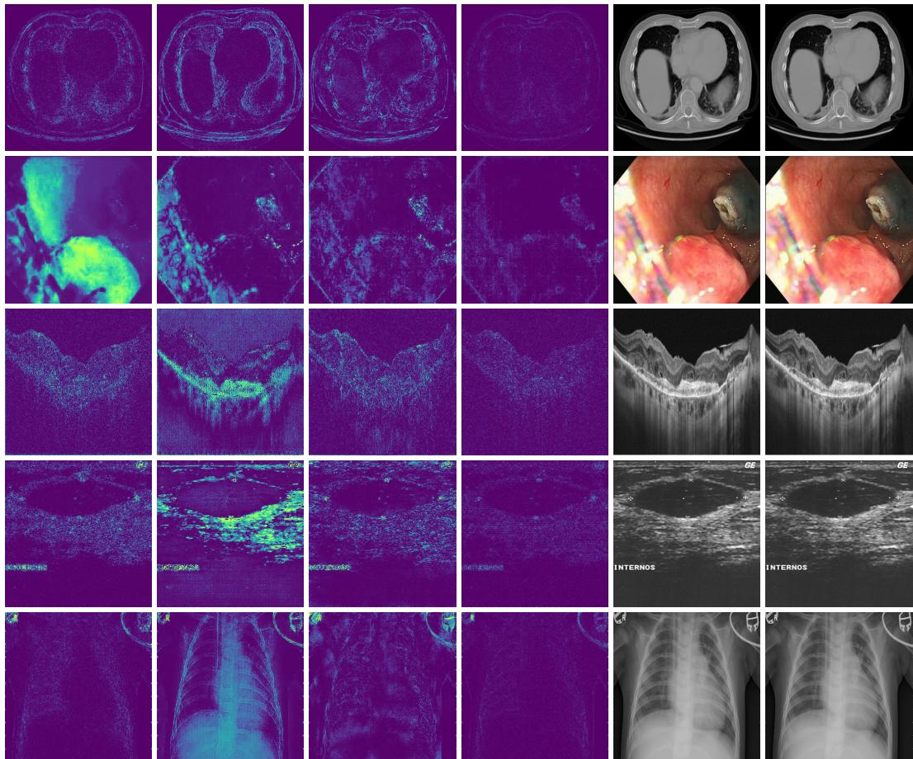  
PUMIT (err.)  
MedITok (err.)  
MedVTok (err.)  
MedVTok (recon.)

Figure 6: Additional reconstruction visualization.

is randomly initialized for each tokenizer (with input/output channels adapted to match the latent dimensionality), and a frozen CLIP-based text encoder provides conditioning. We train separate diffusion models per tokenizer using identical data, architecture, and hyperparameters, ensuring that differences in generation quality are attributable solely to the tokenizer.

Training uses 70,000 images from GMAI-VL-5.5M [1] spanning seven imaging modalities (10,000 images each). The noise scheduler is DDPM with 1,000 timesteps, a scaled-linear beta schedule, and ϵ-prediction parameterization. The model is trained with an effective batch size of 256, the AdamW optimizer, a constant learning rate with 5% linear warmup, and classifier-free guidance dropout of 10%. Note that the purpose of this experiment is to compare the generative suitability ofdifferent tokenizer latent spaces, rather than to build state-of-the-art text-to-image generative models or to benchmark fine-grained synthesis. The original paired descriptions in GMAI-VL-5.5M are often long and fine-grained; using them directly may introduce confounding factors from text complexity. We therefore simplify the setup, replacing each caption with a controlled template, e.g., “A medical {modality} image,” and keep this protocol identical for all tokenizers. Under this setting, differences in generation quality more directly reflect how well each frozen tokenizer organizes medical images into a latent space that is compact, learnable, and amenable to latent diffusion.

At inference, we use DDIM sampling with 100 denoising steps. We generate 500 images per modality and report the Kernel Inception Distance (KID) [64], Fréchet Inception Distance (FID) [56], and Inception Score (IS) [65] for evaluation in Table 14. MedVTok consistently achieves the best average performance across these metrics.

Visual question answering. We evaluate each frozen tokenizer as a visual backbone within the LLaVA-Med [58] framework. Given a medical image, the tokenizer encodes it into patch-level tokens, which are then fed through a two-layer MLP connector into Mistral-7B-Instruct as the language model backbone. We train separate LLaVA-Med variants using identical data and hyperparameters while keeping the tokenizer frozen.

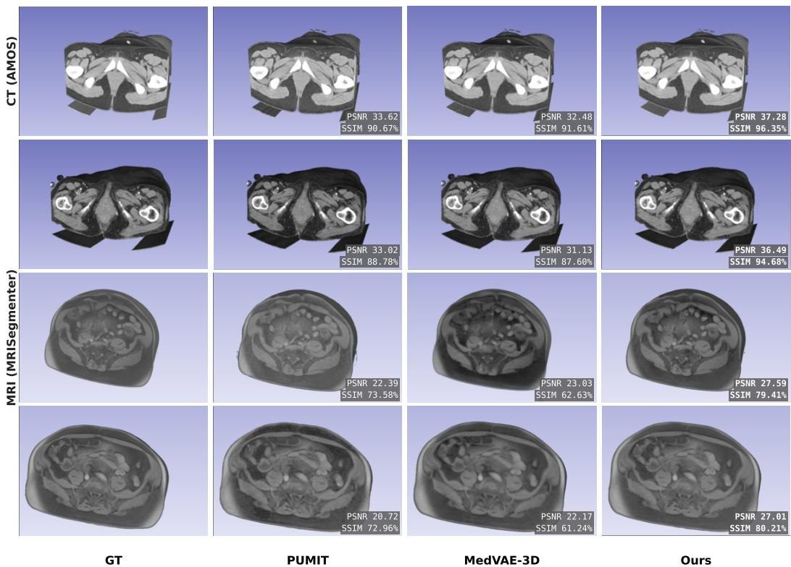  
Figure 7: 3D Reconstruction visualization.

Training follows a two-stage protocol. In the first stage, only the MLP connector is trained on approximately 509,369 image–text pairs (learning rate $\overline { { 1 0 } } ^ { - 3 }$ , one epoch), with 500,000 pairs from PubMedVision [66] and 9,369 pairs from MM-Skin [50]. In the second stage, LoRA adapters (rank=128, α =256, dropout=0.05) are applied to all linear layers of the language model and finetuned jointly with the connector (learning rate $1 0 ^ { - 4 }$ for LoRA, $2 \times 1 0 ^ { - 5 }$ for the connector, one epoch), using 140,151 VQA items for training (70,000 from PubMedVision; 21,778 from the MM-Skin training split; 28,719 from the Kvasir-VQA-x1 training split; 19,654 from the PathVQA training split).

At inference, we use sampling with a temperature of 0.2. Model outputs are evaluated via LLM-asjudge binary grading using Qwen3-235B-A22B [67]. We train each LLaVA-Med variant with three random seeds and report accuracy as mean ± 95% confidence interval in Table 5.

Two representative cases of LLaVA-Med output (integrating MedVTok as the visual encoder) are presented in Fig. 12, where the model identifies the pathological features in the given medical image and answers the question correctly.

VQA controls. We hold the connector, language model, data, LoRA settings, decoding, and judge fixed across tokenizers. We also evaluate a frozen language model with only the connector trained, and re-score the standard model outputs with GPT-5. MedVTok leads under connector-only training, and replacing the Qwen3-235B-A22B judge with GPT-5 preserves the tokenizer ranking (Table 15).

Medical report generation. We use the AMOS-MM [53] dataset, which provides CT volumes paired with radiology reports covering three anatomical regions (abdomen, chest, and pelvis), with 1,287 pairs for training and 400 pairs for evaluation. CT intensities are windowed to [−160, 240] HU. Each frozen visual tokenizer is integrated into the LaMed framework [59] as the visual backbone: given a 3D volume, the tokenizer first encodes it into latent tokens, which are then fed through a connector (a spatial pooling layer that applies 3D average pooling with 2× downsampling per dimension) and into Llama-3.1-8B-Instruct adapted with LoRA (rank=8, α =16, dropout=0.1).

Table 9: Additional results on image segmentation evaluation. Method type: ∗semantic encoder; ‡unified tokenizer.
<table><tr><td>Metrics</td><td>Method</td><td>CFP</td><td>CT</td><td>Derm.</td><td>Endo.</td><td>MRI</td><td>Path.</td><td>US</td><td>X-ray</td><td>Avg.</td></tr><tr><td rowspan="10">Dice (↑)</td><td>SDVAE [29]</td><td>73.03</td><td>14.88</td><td>62.37</td><td>24.67</td><td>12.69</td><td>49.11</td><td>84.19</td><td>35.56</td><td>44.56</td></tr><tr><td>TokenFlow‡ [4]</td><td>70.39</td><td>19.05</td><td>72.62</td><td>40.53</td><td>30.49</td><td>52.34</td><td>91.33</td><td>49.52</td><td>53.28</td></tr><tr><td>MingTok [32]</td><td>85.36</td><td>27.03</td><td>83.91</td><td>57.32</td><td>52.54</td><td>67.68</td><td>92.91</td><td>54.71</td><td>65.18</td></tr><tr><td>UniTok [10]</td><td>60.93</td><td>33.13</td><td>86.25</td><td>67.25</td><td>54.90</td><td>72.51</td><td>93.35</td><td>57.60</td><td>65.74</td></tr><tr><td>AToken‡ [9]</td><td>97.09</td><td>37.33</td><td>87.45</td><td>69.88</td><td>63.57</td><td>74.30</td><td>94.90</td><td>59.69</td><td>73.03</td></tr><tr><td>BiomedCLIP* [15]</td><td>50.22</td><td>31.83</td><td>87.48</td><td>60.64</td><td>57.95</td><td>73.65</td><td>95.41</td><td>59.83</td><td>64.63</td></tr><tr><td>MedSigLIP* [17]</td><td>97.28</td><td>40.79</td><td>87.76</td><td>69.81</td><td>67.32</td><td>76.20</td><td>95.33</td><td>62.48</td><td>74.62</td></tr><tr><td>MedImageInsight* [16]</td><td>92.34</td><td>25.60</td><td>85.45</td><td>66.96</td><td>55.81</td><td>42.93</td><td>95.80</td><td>50.16</td><td>64.38</td></tr><tr><td>PUMIT [8]</td><td>40.05</td><td>25.53</td><td>77.94</td><td>37.32</td><td>36.69</td><td>66.00</td><td>90.73</td><td>54.82</td><td>53.63</td></tr><tr><td>MedVAE [5]</td><td>61.74 96.70</td><td>12.57</td><td>57.59</td><td>19.73 66.07</td><td>10.13 62.42</td><td>36.40 75.80</td><td>81.90</td><td>30.81</td><td>38.86</td></tr><tr><td>MedITok [6] MedVTok‡</td><td></td><td>40.52</td><td>80.28</td><td></td><td></td><td></td><td></td><td>94.65</td><td>59.47</td><td>71.99</td></tr><tr><td rowspan="10"></td><td>SDVAE [29]</td><td>97.44</td><td>42.91</td><td>90.25</td><td>72.52</td><td>69.62</td><td>77.74</td><td>96.91</td><td>61.13</td><td>76.07</td></tr><tr><td>TokenFlow‡ [4]</td><td>109.69</td><td>218.98</td><td>56.30</td><td>124.25</td><td>343.33</td><td>241.99</td><td>172.77</td><td>46.39</td><td>164.21</td></tr><tr><td>MingTok‡ [32]</td><td>57.43</td><td>211.68</td><td>56.90</td><td>73.33</td><td>151.20</td><td>278.48</td><td>45.72</td><td>23.82</td><td>112.32</td></tr><tr><td>UniTok‡ [10]</td><td>115.80</td><td>180.54</td><td>40.70</td><td>109.14</td><td>76.67</td><td>230.27</td><td>51.49</td><td>34.18</td><td>104.85</td></tr><tr><td>AToken‡ [9]</td><td>104.54</td><td>123.44</td><td>18.10</td><td>51.08</td><td>66.77</td><td>162.47</td><td>22.59</td><td>13.85</td><td>70.35</td></tr><tr><td></td><td>22.99</td><td>119.80</td><td>16.05</td><td>47.32</td><td>29.93</td><td>160.72</td><td>16.64</td><td>12.63</td><td>53.26</td></tr><tr><td>BiomedCLIP* [15]</td><td>84.43</td><td>178.88</td><td>12.62</td><td>50.33</td><td>31.22</td><td>145.42</td><td>13.75</td><td>12.97</td><td>66.20</td></tr><tr><td>MedSigLIP* [17]</td><td>38.47</td><td>112.54 248.33</td><td>13.94</td><td>35.48 58.84</td><td>21.55 54.94</td><td>138.56</td><td>16.82</td><td>21.45</td><td>49.85</td></tr><tr><td>MedImageInsight* [16]</td><td>31.83 63.10</td><td>151.79</td><td>17.16 30.78</td><td>76.98</td><td>78.13</td><td>174.84 214.75</td><td>12.50 35.29</td><td>27.52 19.50</td><td>78.24 83.79</td></tr><tr><td>PUMIT [8]</td><td>326.48</td><td>241.19</td><td>69.08</td><td>102.19</td><td>164.70</td><td>343.04</td><td>481.75</td><td>47.13</td><td>221.94</td></tr><tr><td>MedVAE [5]</td><td></td><td></td><td></td><td></td><td></td><td></td><td></td><td></td><td></td><td></td></tr><tr><td>MedITok‡ [6]</td><td></td><td>44.53</td><td>138.61</td><td>37.06</td><td>46.60</td><td>32.97</td><td>140.30</td><td>18.31</td><td>13.85</td><td>59.03</td></tr><tr><td>MedVTok</td><td></td><td>19.12</td><td>105.06</td><td>11.67</td><td>46.31</td><td>24.76</td><td>121.30</td><td>12.43</td><td>15.21</td><td>44.48</td></tr></table>

Table 10: Classification accuracy (%) compared with MERA experts. Specialized experts are evaluated on their respective modalities. Values are means ± 95% confidence intervals
<table><tr><td>Model</td><td>CFP</td><td>CT</td><td>Derm.</td><td>Endo.</td><td>MRI</td><td>OCT</td><td>Path.</td><td>US</td><td>X-ray</td></tr><tr><td>RetCLIP</td><td>91.95±1.05</td><td></td><td></td><td></td><td></td><td></td><td>1</td><td></td><td></td></tr><tr><td>DermLIP</td><td></td><td></td><td> $7 9 . 7 2 { \scriptstyle \pm 0 . 6 6 }$ </td><td></td><td></td><td></td><td></td><td></td><td></td></tr><tr><td>PeskaVLP</td><td></td><td></td><td></td><td>48.64±2.29</td><td></td><td></td><td></td><td></td><td></td></tr><tr><td>Conch</td><td></td><td></td><td></td><td></td><td></td><td></td><td> $\mathbf { 9 3 . 0 8 } { \scriptstyle \pm 2 . 4 4 }$ </td><td></td><td></td></tr><tr><td>MedImageInsight 75.64±2.12</td><td></td><td> $7 5 . 3 2 { \pm } 2 . 8 3 $ </td><td> ${ \bf 8 5 . 8 7 \pm 0 . 3 8 }$ </td><td>44.65±0.74 95.47±0.29</td><td></td><td> $9 0 . 7 9 { \pm } 1 . 1 8 $ </td><td> $7 1 . 7 9 \pm 2 . 9 2$ </td><td>50.18±2.67 96.21±0.83</td><td></td></tr><tr><td>MedVTok</td><td>90.54±1.0587.03±1.64 75.27±0.99</td><td></td><td></td><td>51.00±1.85 95.03±0.52 94.00±1.18 78.97±1.65 52.92±1.68 97.22±0.61</td><td></td><td></td><td></td><td></td><td></td></tr></table>

Table 11: Segmentation Dice (%) compared with MERA experts. Specialized experts are evaluated on their respective modalities. Values are means ± 95% confidence intervals.
<table><tr><td>Model</td><td>CFP</td><td>CT</td><td>Derm.</td><td>Endo.</td><td>MRI</td><td>Path.</td><td>US</td><td>X-ray</td></tr><tr><td>RetCLIP</td><td> $9 2 . 4 6 { \pm } 1 . 6 9$ </td><td>一</td><td></td><td>一</td><td>一</td><td>一</td><td>一</td><td></td></tr><tr><td>DermLIP</td><td>一</td><td>一</td><td>89.05±1.86</td><td>一</td><td>一</td><td>一</td><td>一</td><td>一</td></tr><tr><td>PeskaVLP</td><td>一</td><td>一</td><td></td><td>65.06±1.51</td><td>一</td><td></td><td>一</td><td>一</td></tr><tr><td>Conch</td><td>一</td><td>一</td><td>一</td><td></td><td>一</td><td>二  $\mathbf { 8 3 . 7 7 \pm 1 . 3 9 }$ </td><td></td><td></td></tr><tr><td>MedImageInsight</td><td> $9 2 . 3 4 \pm 1 . 3 9$ </td><td> $2 5 . 6 0 { \pm } 1 . 3 5 $ </td><td> $8 5 . 4 5 { \pm } 2 . 1 0 $ </td><td> $6 6 . 9 6 { \pm } 1 . 3 2$ </td><td> $5 5 . 8 1 \pm 1 . 3 1$ </td><td> $4 2 . 9 3 { \pm } 1 . 8 6 $ </td><td> $9 5 . 8 0 { \pm } 2 . 0 7$ </td><td> $5 0 . 1 6 { \pm } 1 . 4 8 $ </td></tr><tr><td>MedVTok</td><td> ${ \bf 9 7 . 4 4 \pm 1 . 5 9 }$ </td><td> $\mathbf { 4 2 . 9 1 } { \pm 1 . 8 0 }$ </td><td> $\mathbf { 9 0 . 2 5 \pm 0 . 7 7 }$ </td><td> $7 2 . 5 2 { \pm } 1 . 1 5$ </td><td> ${ \bf 6 9 . 6 2 } \pm 1 . 0 7$ </td><td> $7 7 . 7 4 \pm 1 . 5 6$ </td><td> $\mathbf { 9 6 . 9 1 } { \scriptstyle \pm 1 . 8 0 }$ </td><td> ${ \bf 6 1 . 1 3 \pm 1 . 1 7 }$ </td></tr></table>

We train separate LaMed variants, each with a different visual tokenizer as the frozen backbone, using identical data and hyperparameters, and evaluate all variants on the same test set under the same inference settings. Training runs for 15 epochs with AdamW (learning rate $5 \times 1 0 ^ { - 5 }$ , cosine decay, 3% warmup), an effective batch size of 4, and BFloat16 precision.

At inference, the model generates region-specific findings autoregressively with a temperature of $T = 0 . 2$ and top- $\cdot p = 0 . 9$ . We also include MedITok [6], a 2D-only tokenizer, for comparison. To adapt it to 3D inputs, we treat the depth dimension as a batch of 2D slices, encode them independently in parallel with the MedITok encoder, and concatenate the resulting tokens along the depth axis before passing them to the connector and LLM.

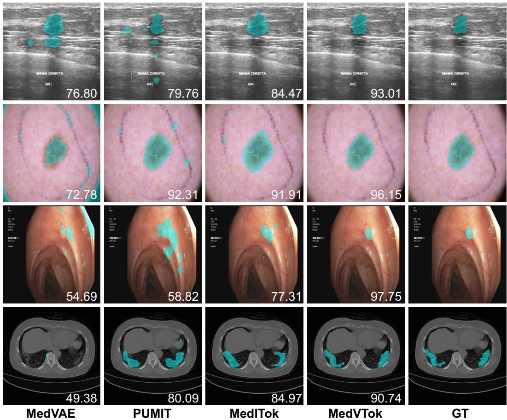  
Figure 8: Qualitative comparison on the image segmentation task. Segmentation powered by MedVTok achieves the best performance, while other tokenizers lead to false segmentation in the background. In each image, the mask is highlighted in cyan; the Dice score is shown in the lower right corner.

Table 12: 3D segmentation Dice (%). Each tokenizer is frozen while a lightweight 3D convolutional head is trained. Values include reported 95% confidence intervals.
<table><tr><td></td><td colspan="4">AMOS-MM CT</td><td colspan="4">MRISegmenter MRI</td></tr><tr><td>Organ</td><td>PUMIT</td><td>MedVAE 3D</td><td>AToken</td><td>MedVTok</td><td>PUMIT</td><td>MedVAE 3D</td><td>AToken</td><td>MedVTok</td></tr><tr><td>Overall</td><td>28.67</td><td>29.71</td><td>36.89</td><td>50.13</td><td> $4 4 . 5 7 { \pm } 0 . 7 6 $ </td><td>43.70±0.80</td><td>54.63±0.68</td><td>57.20±0.76</td></tr><tr><td>Spleen</td><td>63.68±1.58</td><td>42.94±2.64</td><td> $5 5 . 7 6 { \pm } 2 . 4 6 $ </td><td> $\mathbf { 7 0 . 6 1 } \pm 2 . 3 0$ </td><td> $4 0 . 8 3 { \pm } 2 . 1 2$ </td><td>40.68±2.14</td><td>63.28±2.71</td><td>70.60±2.85</td></tr><tr><td>Kidney</td><td>48.94±1.96</td><td> $4 5 . 9 5 { \pm } 2 . 3 6 $ </td><td> $5 9 . 5 6 { \pm } 2 . 4 4 $ </td><td> $\mathbf { 7 4 . 9 3 \pm 1 . 7 4 }$ </td><td> $8 1 . 6 0 { \pm } 1 . 2 9$ </td><td> $7 7 . 4 6 { \pm } 1 . 7 7$ </td><td>83.96±0.67</td><td>86.48±0.95</td></tr><tr><td>Liver</td><td>76.63±2.68</td><td>73.73±2.23</td><td> $8 0 . 5 0 { \pm } 1 . 7 2 $ </td><td> $\mathbf { 8 6 . 3 1 \pm 1 . 0 0 }$ </td><td> $5 8 . 1 1 \pm 1 . 3 2 $ </td><td> $5 9 . 1 1 \pm 1 . 2 3 $ </td><td>85.71±0.94</td><td>85.83±0.70</td></tr><tr><td>Pancreas</td><td>13.42±1.99</td><td>23.51±2.60</td><td> $3 1 . 6 4 \pm 2 . 7 2$ </td><td> ${ \bf 4 1 . 9 0 } { \scriptstyle \pm 2 . 3 6 }$ </td><td> $4 9 . 4 3 { \pm } 2 . 2 2$ </td><td> $4 3 . 9 8 { \pm } 2 . 0 8$ </td><td> $4 9 . 2 3 { \pm } 1 . 9 2 $ </td><td>49.49±2.71</td></tr><tr><td>Adrenal</td><td>16.50±1.30</td><td> $1 2 . 7 4 \pm 1 . 1 0$ </td><td> $2 0 . 4 4 \pm 1 . 4 7$ </td><td> $2 3 . 6 4 \pm 1 . 7 6$ </td><td> $2 4 . 0 0 { \pm } 1 . 4 3 $ </td><td> $2 1 . 6 9 { \pm } 1 . 8 7$ </td><td>25.63±1.49</td><td>23.16±1.64</td></tr><tr><td>Gallbladder</td><td>18.78±2.21</td><td>16.33±2.99</td><td> $1 4 . 9 3 { \pm } 1 . 8 2 $ </td><td>39.69±4.57</td><td> $2 4 . 2 0 { \pm } 3 . 4 6$ </td><td>23.31±3.27</td><td> $3 2 . 8 5 { \pm } 3 . 6 8 $ </td><td>34.94±3.76</td></tr><tr><td>Esophagus</td><td>16.29±1.02</td><td>18.59±2.98</td><td> $1 5 . 1 4 \pm 1 . 8 0 $ </td><td> ${ \bf 1 9 . 0 4 } { \pm 2 . 6 8 }$ </td><td> $4 8 . 0 5 { \pm } 1 . 8 2 $ </td><td>39.28±2.26</td><td>44.92±1.79</td><td>52.78±1.61</td></tr><tr><td>Stomach</td><td>4.96±0.76</td><td>3.71±0.76</td><td> $3 4 . 6 3 \pm 3 . 5 3$ </td><td>62.15±3.87</td><td> $4 0 . 6 6 { \pm } 2 . 0 3$ </td><td>46.67±2.05</td><td>52.08±1.30</td><td>59.89±2.30</td></tr><tr><td>Duodenum</td><td>3.37±1.73</td><td>10.44±2.00</td><td> $1 5 . 0 4 \pm 1 . 4 6$ </td><td>30.48±2.71</td><td> $1 4 . 8 2 { \pm } 1 . 6 4 $ </td><td>16.41±1.62</td><td>40.11±1.75</td><td>39.23±1.80</td></tr><tr><td>Major vessels</td><td>24.14±1.82</td><td>49.19±2.05</td><td>41.22±1.65</td><td>52.53±1.37</td><td>64.00±1.28</td><td>68.46±1.18</td><td>68.52±0.91</td><td>69.56±0.93</td></tr></table>

In Tables 6 and 16, we report BLEU-2, ROUGE-L, METEOR, RaTEScore, and GREEN per anatomi cal region and globally, as mean ± 95% confidence interval over three random seeds. The LaMed model integrating MedVTok as the visual encoder achieves superior performance in terms of the average score on each metric. Representative outputs are shown in Fig. 13, where MedVTok directly encodes the whole CT volume and documents the lesions and abnormalities present.

Table 13: Cross-dataset 3D segmentation Dice (%). Models trained on MRISegmenter are evaluated directly on AMOS-MM MRI. Values are means ± 95% confidence intervals.
<table><tr><td>Model</td><td>MRISegmenter</td><td>AMOS-MM MRI</td></tr><tr><td>PUMIT</td><td> $4 4 . 5 7 { \pm } 0 . 7 6 $ </td><td> $3 1 . 4 4 { \pm } 1 . 5 2 $ </td></tr><tr><td>MedVAE-3D</td><td> $4 3 . 7 0 { \scriptstyle \pm 0 . 8 0 }$ </td><td> $3 3 . 5 2 { \pm } 3 . 8 2$ </td></tr><tr><td>AToken</td><td> $5 4 . 6 3 { \pm } 0 . 6 8 $ </td><td> $4 4 . 3 9 { \pm } 1 . 7 5 $ </td></tr><tr><td>MedVTok</td><td> ${ \pm } 7 . 2 0 { \pm } 0 . 7 6 $ </td><td> $4 7 . 2 4 \pm 1 . 4 7$ </td></tr></table>

Table 14: Additional results on image synthesis evaluation.
<table><tr><td>Metrics</td><td>Method</td><td>CFP</td><td>CT</td><td>Derm.</td><td>Endo.</td><td>MRI</td><td>Path.</td><td>X-ray</td><td>Avg.</td></tr><tr><td rowspan="4">KID (↓)</td><td>PUMIT [8]</td><td>0.098</td><td>0.110</td><td>0.096</td><td>0.110</td><td>0.067</td><td>0.296</td><td>0.080</td><td>0.123</td></tr><tr><td>MedVAE [5]</td><td>0.116</td><td>0.084</td><td>0.135</td><td>0.154</td><td>0.077</td><td>0.288</td><td>0.068</td><td>0.132</td></tr><tr><td>MedITok [6]</td><td>0.256</td><td>0.099</td><td>0.078</td><td>0.024</td><td>0.054</td><td>0.055</td><td>0.055</td><td>0.089</td></tr><tr><td>MedVTok</td><td>0.027</td><td>0.076</td><td>0.077</td><td>0.035</td><td>0.048</td><td>0.139</td><td>0.019</td><td>0.060</td></tr><tr><td rowspan="4">FID (↓)</td><td>PUMIT [8]</td><td>140.40</td><td>183.49</td><td>272.26</td><td>191.49</td><td>227.64</td><td>377.12</td><td>200.14</td><td>227.51</td></tr><tr><td>MedVAE [5]</td><td>118.13</td><td>154.42</td><td>202.09</td><td>170.29</td><td>145.25</td><td>325.87</td><td>88.55</td><td>172.08</td></tr><tr><td>MedITok [6]</td><td>90.65</td><td>142.46</td><td>176.94</td><td>58.38</td><td>122.96</td><td>99.66</td><td>77.24</td><td>109.76</td></tr><tr><td>MedVTok</td><td>59.85</td><td>146.39</td><td>142.87</td><td>82.39</td><td>116.78</td><td>94.65</td><td>69.17</td><td>101.73</td></tr><tr><td rowspan="4">IS (↑)</td><td>PUMIT [8]</td><td>1.024</td><td>1.031</td><td>1.077</td><td>1.048</td><td>1.049</td><td>1.066</td><td>1.057</td><td>1.050</td></tr><tr><td>MedVAE [5]</td><td>1.035</td><td>1.060</td><td>1.069</td><td>1.035</td><td>1.071</td><td>1.061</td><td>1.073</td><td>1.058</td></tr><tr><td>MedITok [6]</td><td>1.039</td><td>1.048</td><td>1.104</td><td>1.038</td><td>1.079</td><td>1.154</td><td>1.076</td><td>1.077</td></tr><tr><td>MedVTok</td><td>1.044</td><td>1.060</td><td>1.127</td><td>1.054</td><td>1.075</td><td>1.159</td><td>1.074</td><td>1.085</td></tr></table>

Table 15: VQA accuracy (%) under training and judge controls. Connector-only training freezes the language model and uses Qwen3-235B-A22B for grading. Standard training updates the connector and language-model LoRA adapters. Values are means ± 95% confidence intervals.
<table><tr><td>Model</td><td>Connector only Qwen3 judge</td><td>Standard Qwen3 judge</td><td>Standard GPT-5 judge</td></tr><tr><td>PUMIT</td><td> $2 3 . 0 5 { \pm } 0 . 4 4$ </td><td> $4 1 . 9 4 { \pm } 0 . 3 3 $ </td><td> $4 1 . 8 3 { \pm } 0 . 3 3 $ </td></tr><tr><td>MedVAE</td><td> $1 7 . 8 8 { \pm } 0 . 4 8 $ </td><td> $3 9 . 9 3 { \pm } 0 . 4 1 $ </td><td> $3 9 . 5 8 { \pm } 0 . 4 2 $ </td></tr><tr><td>MedITok</td><td> $2 4 . 7 6 { \pm } 0 . 3 9$ </td><td> $4 5 . 3 9 { \pm } 0 . 2 8 $ </td><td> $4 4 . 8 2 { \pm } 0 . 2 6 $ </td></tr><tr><td>MedVTok</td><td> ${ \pm 9 . 8 6 \pm 0 . 3 6 }$ </td><td> $\pm 6 . 4 8 \pm 0 . 2 2$ </td><td> $\mathbf { 4 6 . 0 2 } 2 { \scriptstyle \pm 0 . 2 4 }$ </td></tr></table>

## C.3 Additional Analyses

Effect of $\lambda _ { \mathbf { M E R A } } .$ . Fig. 9 shows the effect of the MERA loss weight for values in {0, 0.1, 1, 2}. Without semantic alignment $( \lambda _ { \mathrm { M E R A } } = 0 )$ , classification and segmentation scores remain significantly low despite strong reconstruction, as the tokenizer only learns the low-level structure without discriminating the high-level semantics. Increasing λMERA monotonically improves semantic metrics, but at the cost of reconstruction fidelity: at $\lambda _ { \mathrm { M E R A } } = 2 .$ , PSNR drops by nearly 3 dB and SSIM falls to 0.868. We set $\lambda _ { \mathrm { M E R A } } = 1$ as the default, which achieves strong semantic performance while maintaining reconstruction quality.

Effect of λSliDR. Fig. 10 shows the effect of the SliDR loss weight. As expected, 2D reconstruction is unaffected by λSliDR since SliDR operates only on volumetric data. For 3D reconstruction, both PSNR and SSIM improve substantially when SliDR is enabled. Further increasing the weight to $\lambda _ { \mathrm { S l i D R } } = 0 . 5$ yields marginal 3D gains but degrades classification accuracy by 2.6%, indicating that excessive volumetric regularization interferes with semantic learning. We therefore adopt $\lambda _ { \mathrm { S l i D R } } = 0 . 1$ , which captures most of the 3D benefit without compromising other objectives.

Comparison with alternative depth regularizers. We compare SliDR with direct gradient matching, total variation (TV), and Laplacian regularization. All variants are initialized from the same 2Dtrained MedVTok checkpoint and trained on a controlled subset of 10K volumes. We evaluate volumetric reconstruction on AMOS-MM CT and MRISegmenter MRI (Table 17). SliDR achieves the highest mean PSNR and SSIM on both datasets under this setting.

Table 16: Additional results on medical report generation evaluation.
<table><tr><td>Metrics</td><td>Method</td><td>Abdomen</td><td>Chest</td><td>Pelvis</td><td>Avg.</td></tr><tr><td rowspan="4">BLEU (↑)</td><td>PUMIT [8]</td><td>0.289±0.008</td><td>0.193±0.003</td><td>0.164±0.007</td><td>0.215±0.005</td></tr><tr><td>MedVAE-3D [5]</td><td>0.249±0.038</td><td>0.185±0.020</td><td>0.152±0.010</td><td>0.195±0.013</td></tr><tr><td>MedITok [6]</td><td>0.256±0.013</td><td>0.219±0.020</td><td>0.294±0.017</td><td>0.257±0.012</td></tr><tr><td>MedVTok</td><td>0.272±0.005</td><td>0.263±0.045</td><td>0.288±0.017</td><td>0.274±0.009</td></tr><tr><td rowspan="4">ROUGE-L (↑)</td><td>PUMIT [8]</td><td>0.415±0.005</td><td>0.277±0.005</td><td>0.207±0.007</td><td>0.300±0.003</td></tr><tr><td>MedVAE-3D [5]</td><td>0.398±0.004</td><td>0.266±0.003</td><td>0.183±0.004</td><td>0.282±0.000</td></tr><tr><td>MedITok [6]</td><td>0.389±0.007</td><td>0.299±0.025</td><td>0.407±0.033</td><td>0.365±0.016</td></tr><tr><td>MedVTok</td><td>0.410±0.006</td><td>0.353±0.023</td><td>0.442±0.011</td><td>0.402±0.005</td></tr><tr><td rowspan="4">METEOR (↑)</td><td>PUMIT [8]</td><td>0.353±0.005</td><td>0.213±0.003</td><td>0.189±0.007</td><td>0.252±0.004</td></tr><tr><td>MedVAE-3D [5]</td><td>0.318±0.025</td><td>0.221±0.010</td><td>0.172±0.008</td><td>0.237±0.014</td></tr><tr><td>MedITok [6]</td><td>0.318±0.014</td><td>0.279±0.004</td><td>0.388±0.021</td><td>0.328±0.014</td></tr><tr><td>MedVTok</td><td>0.336±0.005</td><td>0.327±0.045</td><td>0.399±0.019</td><td>0.354±0.007</td></tr><tr><td rowspan="4">RaTEScore (↑)</td><td>PUMIT [8]</td><td>0.604±0.005</td><td>0.511±0.035</td><td>0.201±0.015</td><td>0.439±0.006</td></tr><tr><td>MedVAE-3D [5]</td><td>0.613±0.022</td><td>0.497±0.053</td><td>0.187±0.003</td><td>0.432±0.011</td></tr><tr><td>MedITok [6]</td><td>0.610±0.006</td><td>0.501±0.008</td><td>0.594±0.031</td><td>0.568±0.015</td></tr><tr><td>MedVTok</td><td>0.619±0.005</td><td>0.570±0.074</td><td>0.612±0.006</td><td>0.600±0.006</td></tr><tr><td rowspan="4">GREEN (↑)</td><td>PUMIT [8]</td><td>0.421±0.017</td><td>0.204±0.010</td><td>0.124±0.019</td><td>0.250±0.009</td></tr><tr><td>MedVAE-3D [5]</td><td>0.401±0.024</td><td>0.186±0.003</td><td>0.105±0.064</td><td>0.230±0.179</td></tr><tr><td>MedITok [6]</td><td>0.412±0.025</td><td>0.256±0.010</td><td>0.492±0.026</td><td>0.386±0.013</td></tr><tr><td>MedVTok</td><td>0.425±0.005</td><td>0.300±0.078</td><td>0.515±0.044</td><td>0.413±0.020</td></tr></table>

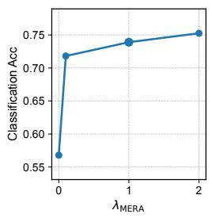

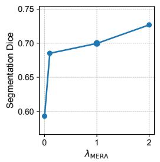

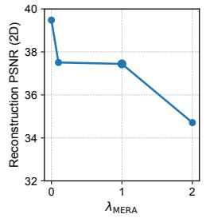

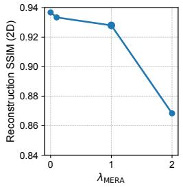  
Figure 9: Ablation study of λMERA. Classification accuracy and segmentation Dice improve with increasing MERA weight, while reconstruction fidelity (PSNR, SSIM) gradually degrades. $\lambda _ { \mathrm { M E R A } } = 1$ balances semantic quality and reconstruction.

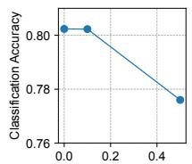  
λSliDR

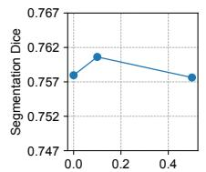  
λSliDR

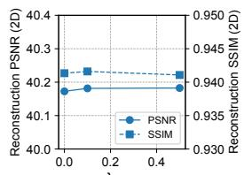  
λSliDR

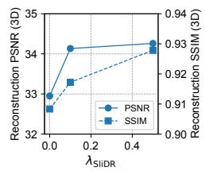  
Figure 10: Ablation study of $\lambda _ { \mathbf { S I i D R } } .$ . SliDR improves 3D reconstruction without affecting 2D fidelity. $\lambda _ { \mathrm { S l i D R } } = 0 . 1$ provides the best trade-off, as larger values degrade classification (left).

TV and Laplacian regularization penalize first- and second-order depth differences of the reconstructed volume, respectively, without reference to the ground truth. These penalties encourage smoothness even where the input contains genuine inter-slice changes. SliDR instead matches both orders of slice differentials to the ground-truth volume (Eq. 1), providing a reconstruction target for anatomical transitions.

Transfer to an unseen modality. We evaluate frozen tokenizer features on PBC [68], a blood-cell microscopy dataset. This dataset and its hematology modality are absent from tokenizer pretraining.

Table 17: Comparison of depth regularization objectives. All variants use the same 2D-trained checkpoint and a controlled 10K-volume training subset. Higher PSNR and SSIM indicate better reconstruction. The best mean in each column is marked in bold.
<table><tr><td rowspan="2"></td><td colspan="2">AMOS-MM CT</td><td colspan="2">MRISegmenter MRI</td></tr><tr><td>PSNR (dB)</td><td>SSIM (%)</td><td>PSNR (dB)</td><td>SSIM (%)</td></tr><tr><td>Objective Direct gradient</td><td> $3 3 . 2 4 { \scriptstyle \pm 0 . 2 2 }$ </td><td> $9 3 . 0 1 { \scriptstyle \pm 0 . 2 5 }$ </td><td> $2 6 . 1 1 { \scriptstyle \pm 0 . 1 4 }$ </td><td> $7 8 . 6 2 { \scriptstyle \pm 0 . 4 4 }$ </td></tr><tr><td>TV</td><td> $3 3 . 0 5 { \scriptstyle \pm 0 . 2 1 }$ </td><td> $9 3 . 0 8 { \pm } 0 . 2 4 $ </td><td> $2 6 . 0 4 { \scriptstyle \pm 0 . 1 4 }$ </td><td> $7 8 . 0 0 { \scriptstyle \pm 0 . 4 5 }$ </td></tr><tr><td>Laplacian</td><td> $3 2 . 9 9 { \scriptstyle \pm 0 . 2 1 }$ </td><td> $9 3 . 0 8 { \pm } 0 . 2 4 $ </td><td> $2 6 . 2 0 { \scriptstyle \pm 0 . 1 5 }$ </td><td> $7 7 . 8 6 { \pm } 0 . 4 5$ </td></tr><tr><td>SliDR</td><td> $3 3 . 4 6 { \scriptstyle \pm 0 . 2 2 }$ </td><td> $\mathbf { 9 3 . 2 1 } { \scriptstyle \pm 0 . 2 5 }$ </td><td> $2 6 . 2 3 { \scriptstyle \pm 0 . 1 5 }$ </td><td> $7 8 . 7 0 { \scriptstyle \pm 0 . 4 4 }$ </td></tr></table>

Table 18: Classification accuracy (%) on the unseen PBC modality. Both protocols use frozen tokenizer features. Values are means ± 95% confidence intervals.
<table><tr><td>Model</td><td>k-NN</td><td>Linear probe</td></tr><tr><td>MedVAE</td><td> $4 0 . 4 7 { \pm } 0 . 1 5$ </td><td> $7 9 . 4 7 { \pm } 1 . 3 5 $ </td></tr><tr><td>PUMIT</td><td> $3 6 . 9 8 { \pm } 0 . 5 5 $ </td><td> $8 3 . 2 5 { \pm } 0 . 8 4 $ </td></tr><tr><td>MedITok</td><td> $9 0 . 7 3 { \scriptstyle \pm 0 . 6 2 }$ </td><td>94.62±0.76</td></tr><tr><td>AToken</td><td> $9 2 . 0 0 { \scriptstyle \pm 2 . 0 7 }$ </td><td>92.84±0.87</td></tr><tr><td>MedVTok</td><td> $\mathbf { 9 4 . 7 8 } { \pm } 1 . 8 1 $ </td><td> $\mathbf { 9 6 . 8 4 \bot 0 . 5 9 }$ </td></tr></table>

Table 19: Comparison on the same 2M training images.
<table><tr><td>Model</td><td>PSNR (dB)</td><td>Accuracy (%)</td><td>Dice (%)</td></tr><tr><td>AToken</td><td>39.35</td><td>63.65</td><td>69.57</td></tr><tr><td>MedITok</td><td>36.83</td><td>66.59</td><td>67.01</td></tr><tr><td>MedVTok</td><td>39.71</td><td>71.70</td><td>73.21</td></tr></table>

We use k-NN classification and train a linear classifier on frozen features. MedVTok achieves the highest accuracy under both protocols: 94.78% and 96.84%, respectively (Table 18).

Comparison on the same training data. For controlled comparison with state-of-the-art tokenizers, we retrain AToken, MedITok, and MedVTok on MedITok’s 2M image–text dataset using the same training settings. AToken and MedITok use text supervision; MedVTok uses the images alone. MedVTok achieves the highest reconstruction PSNR, classification accuracy, and segmentation Dice in this comparison (Table 19).

t-SNE analysis. To qualitatively assess the discriminative structure of the learned representations, we visualize t-SNE embeddings of frozen tokenizer features in Fig. 11. We compare PUMIT, MedVAE, MedITok, and MedVTok on two datasets: (a) a microscopy blood cell dataset PBC [68] (covering multiple cell types: basophil, eosinophil, erythroblast, immature granulocytes, lymphocyte, monocyte, neutrophil, platelet), which is an out-of-distribution modality not seen during training, and (b) the JSIEC [33] fundus dataset. On the PBC dataset, MedVTok produces clearly separated clusters for each cell type despite never seeing microscopy images during training, indicating strong generalization of the learned semantic structure. On JSIEC, MedVTok forms tighter, more coherent clusters for fine-grained retinal conditions compared to the baselines, which exhibit more inter-class overlap. These visualizations corroborate the quantitative classification and retrieval results, confirming that MedVTok encodes semantically meaningful representations that generalize across both in-distribution and out-of-distribution modalities.

## D Broader Impact

A general-purpose medical visual tokenizer can accelerate multimodal medical AI research and patient-level modeling by providing a shared, reusable visual interface across imaging modalities. This may lower the barrier for building clinical decision-support tools, particularly for under-resourced specialties or institutions that lack the data and compute. By open-sourcing the model and code, we aim to promote reproducibility and equitable access to medical AI infrastructure.

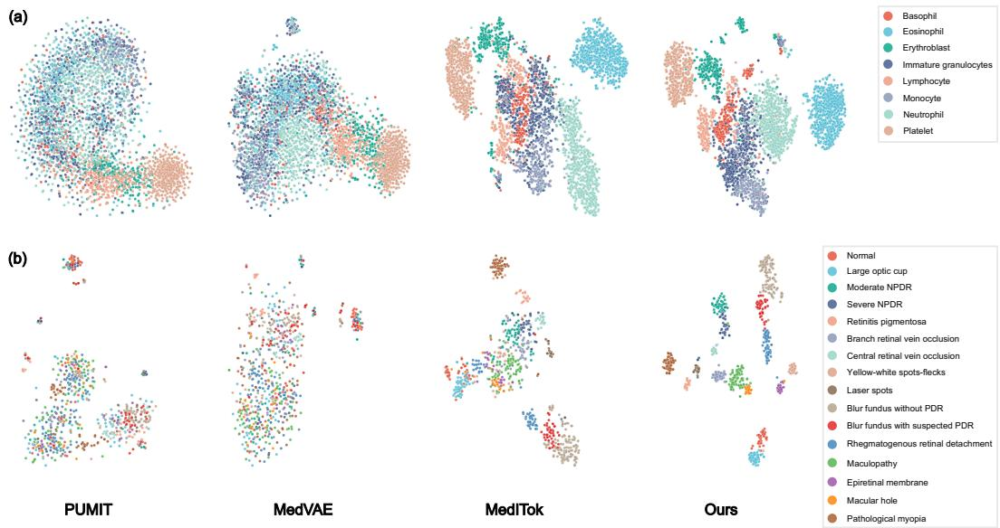  
Figure 11: t-SNE visualization of frozen tokenizer representations. (a) Out-of-distribution microscopy blood cell dataset. (b) JSIEC fundus dataset (showing the top 16 retinal conditions). MedVTok produces the most clearly separated and coherent clusters in both settings.

As with any medical AI component, there is a risk that downstream systems built on MedVTok could produce incorrect predictions that, if acted upon without appropriate clinical oversight, may lead to patient harm. We will release MedVTok under the Apache 2.0 license with clear documentation stating that it is intended for research use. We encourage downstream users to rigorously validate performance on their target populations and to comply with applicable regulations before any clinical deployment.

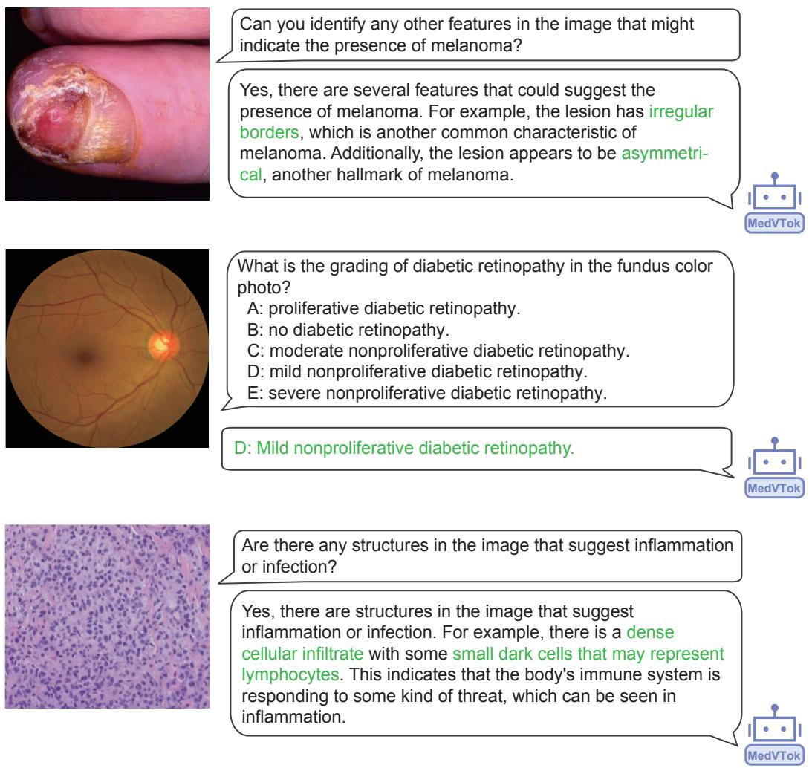  
Figure 12: Representative responses from the LLaVA-Med model integrating MedVTok as the visual backbone.

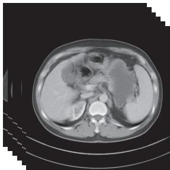

Pelvis: The bladder is filled, with no thickening of the wall. The prostate is not enlarged. No ascites is observed. The uterus is normal, with normal density and no abnormalities. The intestine is normal. The bladder-vesical junction is clear. The pelvic region is normal, with no soft tissue mass and no lymph nodes seen in the pelvic cavity.

Abdomen: A low-density lesion adjacent to the diaphragm is seen in the right posterior lobe of the liver. Within the right kidney, a punctate high-density lesion is noted in the lower calyx along with a small lesion at the posterior margin. There is no dilation of the intrahepatic or extrahepatic bile ducts. The gallbladder is not enlarged, with no thickening of the wall and no abnormal density inside. The spleen, pancreas, and pancreatic duct show normal morphology, size, and density. No signs of ascites are observed.

美 Chest: The lung fields are clear and normal with no evidence ofconsolidation. No obvious abnormalities in the seminal vesicles. Chest bones are normal. No pleural effusion is seen in both pleural cavities or bilateral pleural cavities. No enlargement is observed in the bilateral pulmonary hila. No thickening of the pleura is observed. The shape and size of the heart and great vessels are normal.

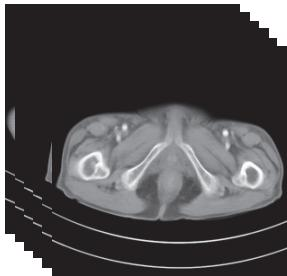

Pelvis: The bladder is inadequately filled, with no definite abnormal density in the cavity and no apparent bladder wall thickening. A punctate hyperdense focus is noted in the prostate. Multiple small retroperitoneal lymph nodes are present, without definite abnormal enhancement on plain or contrast-enhanced imaging.

Abdomen: A soft-tissue mass is present in the pancreatic regionwith indistinct margins from the pancreas and adjacent bowel, associated with irregular bowel wall thickening. There is dilation with fluid in the intrahepatic and extrahepatic bile ducts and the pancreatic duct. The pancreatic body and tail show no enhancement. Multiple round low-density lesions are seen in both kidneys, up to about 19 mm, with clear margins; some show slightly higher density and peripheral punctate calcification. The liver is normal in size and shape with homogeneous density and no focal enhancing lesions.

美 Chest: Cardiac size and contour are normal. No enlarged lymphnodes are identified. There is focal calcified thickening of the right pleura and a small left pleural effusion. Opacities with clear margins are seen in both lungs; the remaining lung fields are clear. The trachea and major bronchi are patent. The aorta and coronary arteries show linear calcifications. No pericardial abnormality is seen.

  
Figure 13: Representative medical reports generated by the LaMed model integrating MedVTok as the visual backbone.

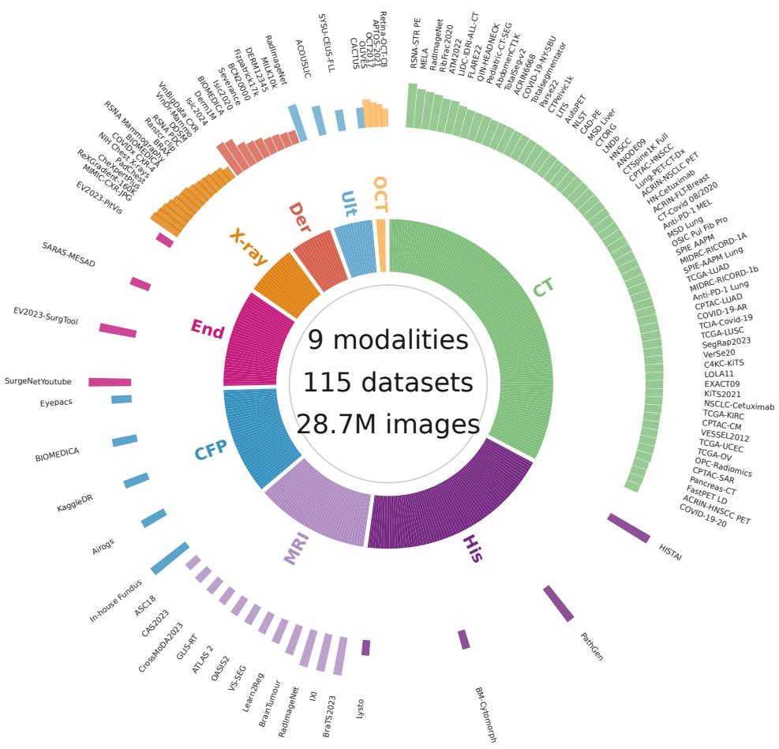  
Figure 14: Training data distribution across imaging modalities (2D corpus). 2D corpus comprising 28.7M images across 9 modalities and 115 datasets. The colored mid-ring encodes modality with arc length proportional to its sample count; outer spokes correspond to source datasets, with spoke length scaled by $\log _ { 1 0 } ( \mathrm { c o u n t } )$ . Cross-modality datasets (e.g., RadImageNet, BIOMEDICA, GLIS-RT) are split equally across their constituent modalities. Long dataset names are abbreviated for layout; full names are listed in Table 20.

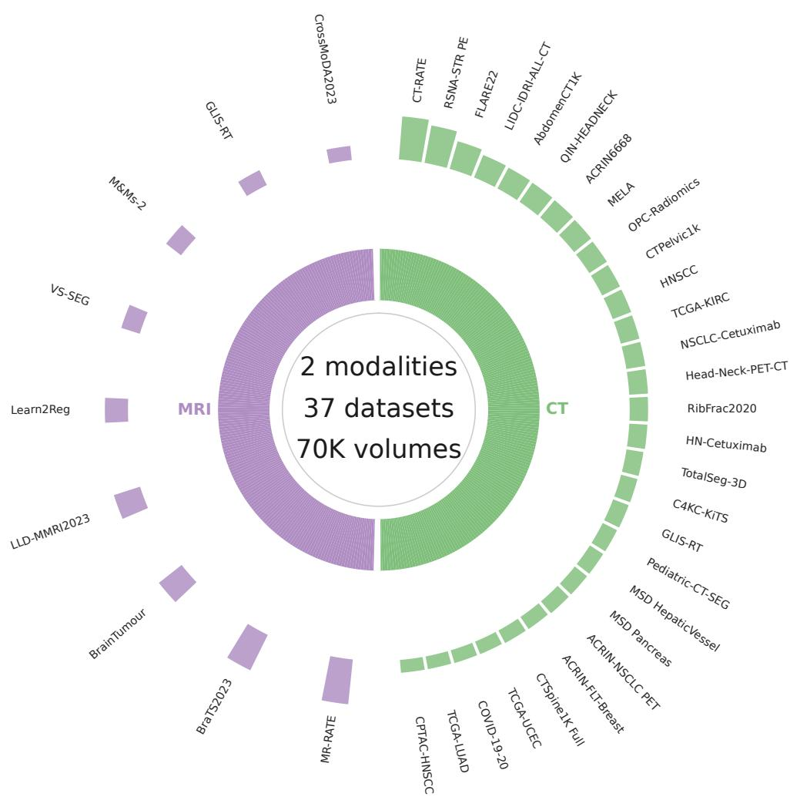  
Figure 15: Training data distribution across imaging modalities (3D corpus). 3D corpus comprising 70K volumes across 2 modalities and 37 datasets. The colored mid-ring encodes modality with arc length proportional to its sample count; outer spokes correspond to source datasets, with spoke length scaled by $\log _ { 1 0 } ( \mathrm { c o u n t } )$ . Cross-modality datasets are split equally across their constituent modalities. Long dataset names are abbreviated for layout; full names are listed in Table 21.

Table 20: 2D training datasets.
<table><tr><td>Dataset</td><td>Modality</td><td>Count</td></tr><tr><td>RSNA STR Pulmonary Embolism Detection [69]</td><td>CT</td><td>2,854,455</td></tr><tr><td>MELA [70]</td><td>CT</td><td>1,198,641</td></tr><tr><td>RibFrac2020 [71]</td><td>CT</td><td>675,992</td></tr><tr><td>ATM2022 [72]</td><td>CT</td><td>419,489</td></tr><tr><td>LIDC-IDRI-ALL-CT [73]</td><td>CT</td><td>403,462</td></tr><tr><td>FLARE22 [74]</td><td>CT</td><td>236,577</td></tr><tr><td>QIN-HEADNECK [75]</td><td>CT</td><td>171,846</td></tr><tr><td>Pediatric-CT-SEG [76]</td><td>CT</td><td>156,111</td></tr><tr><td>AbdomenCT1K [77]</td><td>CT</td><td>145,254</td></tr><tr><td>TotalSegmentator v2 [78]</td><td>CT</td><td>123,420</td></tr><tr><td>ACRIN6668 [79]</td><td>CT</td><td>121,154</td></tr><tr><td>COVID-19-NY-SBU [80]</td><td>CT</td><td>116,764</td></tr><tr><td>Totalsegmentator [78]</td><td>CT</td><td>107,256</td></tr><tr><td>Parse22 [81]</td><td>CT</td><td>104,622</td></tr><tr><td>CTPelvic1k [82]</td><td>CT</td><td>96,949</td></tr><tr><td>LITS [83]</td><td>CT</td><td>90,524</td></tr><tr><td>AutoPET [84]</td><td>CT</td><td>81,135</td></tr><tr><td>NLST [85]</td><td>CT</td><td>76,000</td></tr><tr><td>CAD-PE [86]</td><td>CT</td><td>66,956</td></tr><tr><td>MSD Liver [87]</td><td>CT</td><td>65,104</td></tr><tr><td>CTORG [88]</td><td>CT</td><td>64,904</td></tr><tr><td>LNDb [89]</td><td>CT</td><td>62,969</td></tr><tr><td>HNSCC [90] ANODE09 [91]</td><td>CT</td><td>61,077</td></tr><tr><td>CTSpine1K Full [92]</td><td>CT</td><td>58,647</td></tr><tr><td>CPTAC-HNSCC [93]</td><td>CT</td><td>57,145</td></tr><tr><td>Lung-PET-CT-Dx [94]</td><td>CT</td><td>52,300</td></tr><tr><td>ACRIN-NSCLC-FDG-PET [95]</td><td>CT</td><td>49,055</td></tr><tr><td>Head-Neck Cetuximab [96]</td><td>CT</td><td>42,772</td></tr><tr><td>ACRIN-FLT-Breast [97]</td><td>CT</td><td>42,294</td></tr><tr><td>CT-Covid-19-August2020 [98]</td><td>CT</td><td>41,063</td></tr><tr><td>Anti-PD-1 MELANOMA [99]</td><td>CT</td><td>39,901</td></tr><tr><td>MSD Lung [87]</td><td>CT</td><td>39,852</td></tr><tr><td>OSIC Pul Fib Pro [100]</td><td>CT</td><td>36,684</td></tr><tr><td>SPIE AAPM [101]</td><td>CT</td><td>35,231</td></tr><tr><td>MIDRC-RICORD-1A [102]</td><td>CT</td><td>34,776</td></tr><tr><td>SPIE-AAPM-Lung-CT-Challenge [101]</td><td>CT</td><td>33,928</td></tr><tr><td>TCGA-LUAD [103]</td><td>CT</td><td>33,578</td></tr><tr><td>MIDRC-RICORD-1b [102]</td><td>CT</td><td>33,221</td></tr><tr><td>Anti-PD-1 Lung [104]</td><td>CT</td><td>32,953</td></tr><tr><td>CPTAC-LUAD [105]</td><td>CT</td><td>32,388</td></tr><tr><td>COVID-19-AR [106]</td><td>CT</td><td>30,882</td></tr><tr><td>TCIA-Covid-19 [107]</td><td>CT</td><td>30,304</td></tr><tr><td>TCGA-LUSC [108]</td><td>CT</td><td>30,304</td></tr><tr><td>SegRap2023 [109]</td><td>CT</td><td>29,954</td></tr><tr><td>VerSe20 [110]</td><td>CT</td><td>27,932</td></tr><tr><td>C4KC-KiTS [111]</td><td>CT</td><td>25,860</td></tr><tr><td>LOLA11 [112]</td><td>CT</td><td>25,598</td></tr><tr><td>EXACT09 [113]</td><td>CT CT</td><td>24,156</td></tr><tr><td>KiTS2021 [114]</td><td>CT</td><td>22,747</td></tr><tr><td>NSCLC-Cetuximab [115]</td><td>CT</td><td>22,176 21,911</td></tr><tr><td>TCGA-KIRC [116]</td><td>CT</td><td>20,630</td></tr><tr><td>CPTAC-CM [117]</td><td>CT</td><td>18,513</td></tr><tr><td>VESSEL2012 [118]</td><td>CT</td><td>18,289</td></tr><tr><td>TCGA-UCEC [119]</td><td>CT</td><td>17,924</td></tr><tr><td>TCGA-OV [120]</td><td>CT</td><td>17,917</td></tr><tr><td>OPC-Radiomics [121]</td><td>CT</td><td>17,853</td></tr><tr><td>CPTAC-SAR [122]</td><td>CT</td><td>17,502</td></tr><tr><td>Pancreas-CT [123]</td><td>CT</td><td>14,485</td></tr><tr><td>FastPET LD [124]</td><td>CT</td><td>14,047</td></tr><tr><td>ACRIN-HNSCC-FDG-PET-CT [125]</td><td>CT</td><td>13,989</td></tr><tr><td></td><td></td><td></td></tr><tr><td>COVID-19-20 [126] RadImageNet [127]</td><td>CT CT, MRI, Ultrasound</td><td>12,827 2,639,575</td></tr></table>

Continued on next page

<table><tr><td>Dataset</td><td>Modality</td><td>Count</td></tr><tr><td>Isic2024 [128]</td><td>Dermoscopy</td><td>618,536</td></tr><tr><td>Derm1M [21]</td><td>Dermoscopy</td><td>412,886</td></tr><tr><td>Isic2020 [129]</td><td>Dermoscopy</td><td>44,108</td></tr><tr><td>Severance [130]</td><td>Dermoscopy</td><td>35,170</td></tr><tr><td>BCN20000 [131]</td><td>Dermoscopy</td><td>18,946</td></tr><tr><td>Fitzpatrick17k [132]</td><td>Dermoscopy</td><td>16,577</td></tr><tr><td>DERM12345 [133]</td><td>Dermoscopy</td><td>12,345</td></tr><tr><td>MILK10k [134]</td><td>Dermoscopy</td><td>10,480</td></tr><tr><td>SurgeNetYoutube [135]</td><td>Endoscopy</td><td>2,061,065</td></tr><tr><td>EndoVis2023-Surgtoolloc [136]</td><td>Endoscopy</td><td>745,751</td></tr><tr><td>SARAS-MESAD [137]</td><td>Endoscopy</td><td>35,132</td></tr><tr><td>EndoVis2023-PitVis [138]</td><td>Endoscopy</td><td>19,967</td></tr><tr><td>In-house Fundus Dataset</td><td>CFP</td><td>2,811,937</td></tr><tr><td>Airogs [139]</td><td>CFP</td><td>101,442</td></tr><tr><td>KaggleDR [140]</td><td>CFP</td><td>88,712</td></tr><tr><td>Eyepacs [141] BIOMEDICA [142]</td><td>CFP</td><td>35,126</td></tr><tr><td>HISTAI [143]</td><td>CFP, Dermoscopy, X-ray</td><td>253,443</td></tr><tr><td>PathGen [144]</td><td>Histopathology</td><td>4,000,000</td></tr><tr><td>Bone Marrow Cytomorphology [145]</td><td>Histopathology</td><td>1,606,060</td></tr><tr><td>Lysto [146]</td><td>Histopathology</td><td>27,783</td></tr><tr><td>BraTS2023 [147]</td><td>Histopathology</td><td>14,920</td></tr><tr><td>IXI [148]</td><td>MRI</td><td>973,066</td></tr><tr><td>BrainTumour [149]</td><td>MRI MRI</td><td>924,426 246,671</td></tr><tr><td>Learn2Reg [150]</td><td>MRI</td><td>89,572</td></tr><tr><td>Vestibular-Schwannoma-SEG [151]</td><td>MRI</td><td>51,574</td></tr><tr><td>OASIS2 [152]</td><td>MRI</td><td>39,741</td></tr><tr><td>ATLAS 2 [153]</td><td>MRI</td><td>36,029</td></tr><tr><td>GLIS-RT [154]</td><td>MRI</td><td>24,979</td></tr><tr><td>CrossMoDA2023 [155]</td><td>MRI</td><td>21,981</td></tr><tr><td>CAS2023 [156]</td><td>MRI</td><td>19,200</td></tr><tr><td>ASC18 [157]</td><td>MRI</td><td>13,552</td></tr><tr><td>OLIVES [158]</td><td></td><td>152,346</td></tr><tr><td>OCT2017 [159]</td><td>OCT</td><td>84,484</td></tr><tr><td>APTOS-2021 [160]</td><td>OCT</td><td></td></tr><tr><td>Retina-OCT-C8 [161]</td><td>OCT OCT</td><td>56,972</td></tr><tr><td>ACOUSLIC [162]</td><td>Ultrasound</td><td>24,000 210,929</td></tr><tr><td>SYSU-CEUS-FLL-intv1 [163]</td><td>Ultrasound</td><td>43,611</td></tr><tr><td>CACTUS [164]</td><td>Ultrasound</td><td>37,736</td></tr><tr><td>RSNA Mammography [165]</td><td>X-ray</td><td>54,710</td></tr><tr><td>DDSM [166]</td><td>X-ray</td><td>20,800</td></tr><tr><td>VinDr-Mammo [167]</td><td>X-ray</td><td>19,982</td></tr><tr><td>MIMIC-CXR-JPG [168]</td><td>X-ray</td><td>372,693</td></tr><tr><td>ReXGradient-160K [169]</td><td>X-ray</td><td>273,004</td></tr><tr><td>CheXpertPlus [170]</td><td>X-ray</td><td>223,315</td></tr><tr><td>PadChest [171]</td><td>X-ray</td><td>160,839</td></tr><tr><td>NIH Chest X-rays [172]</td><td>X-ray</td><td>112,120</td></tr><tr><td>COVIDx CXR-4 [173]</td><td>X-ray</td><td>84,817</td></tr><tr><td>BRAX [174]</td><td>X-ray</td><td>40,944</td></tr><tr><td>Ranzcr clip [175]</td><td>X-ray</td><td>33,665</td></tr><tr><td>RSNA PDC [176]</td><td>X-ray</td><td>29,684</td></tr><tr><td>VinBigData CXR [177]</td><td>X-ray</td><td>9,850</td></tr><tr><td>Total</td><td></td><td>28,769,502</td></tr></table>

Table 21: 3D training datasets.
<table><tr><td>Dataset</td><td>Modality</td><td>Count</td></tr><tr><td>CT-RATE [178]</td><td>CT</td><td>15,000</td></tr><tr><td>RSNA STR Pulmonary Embolism Detection [69]</td><td>CT</td><td>7,148</td></tr><tr><td>FLARE22 [74]</td><td>CT</td><td>1,874</td></tr><tr><td>LIDC-IDRI-ALL-CT [73]</td><td>CT</td><td>967</td></tr><tr><td>AbdomenCT1K [77]</td><td>CT</td><td>882</td></tr><tr><td>QIN-HEADNECK [75]</td><td>CT</td><td>816</td></tr><tr><td>ACRIN6668 [79]</td><td>CT</td><td>764</td></tr><tr><td>MELA [70]</td><td>CT</td><td>688</td></tr><tr><td>OPC-Radiomics [121]</td><td>CT</td><td>606</td></tr><tr><td>CTPelvic1k [82]</td><td>CT</td><td>525</td></tr><tr><td>HNSCC [90]</td><td>CT</td><td>507</td></tr><tr><td>TCGA-KIRC [116]</td><td>CT</td><td>474</td></tr><tr><td>NSCLC-Cetuximab [115]</td><td>CT</td><td>465</td></tr><tr><td>Head-Neck-PET-CT [179]</td><td>CT</td><td>443</td></tr><tr><td>RibFrac2020 [71]</td><td>CT</td><td>417</td></tr><tr><td>Head-Neck Cetuximab [96]</td><td>CT</td><td>399</td></tr><tr><td>Totalsegmentator dataset [78]</td><td>CT</td><td>346</td></tr><tr><td>C4KC-KiTS [111]</td><td>CT</td><td>335</td></tr><tr><td>Pediatric-CT-SEG [76]</td><td>CT</td><td>296</td></tr><tr><td>MSD HepaticVessel [87]</td><td>CT</td><td>286</td></tr><tr><td>MSD Pancreas [87]</td><td>CT</td><td>280</td></tr><tr><td>ACRIN-NSCLC-FDG-PET [95]</td><td>CT</td><td>278</td></tr><tr><td>ACRIN-FLT-Breast [97]</td><td>CT</td><td>238</td></tr><tr><td>CTSpine1K Full [92]</td><td>CT</td><td>229</td></tr><tr><td>TCGA-UCEC [119]</td><td>CT</td><td>205</td></tr><tr><td>COVID-19-20 [126]</td><td>CT</td><td>199</td></tr><tr><td>TCGA-LUAD [103]</td><td>CT</td><td>188</td></tr><tr><td>CPTAC-HNSCC [93]</td><td>CT</td><td>186</td></tr><tr><td>GLIS-RT [154]</td><td>CT, MRI</td><td>644</td></tr><tr><td>MR-RATE [180]</td><td>MRI</td><td>20,000</td></tr><tr><td>BraTS2023 [147]</td><td>MRI</td><td>8,956</td></tr><tr><td>BrainTumour [149]</td><td>MRI</td><td>1,936</td></tr><tr><td>LLD-MMRI2023 [181]</td><td>MRI</td><td>1,580</td></tr><tr><td>Learn2Reg [150]</td><td>MRI</td><td>828</td></tr><tr><td>Vestibular-Schwannoma-SEG [151]</td><td>MRI</td><td>484</td></tr><tr><td>M&amp;Ms-2 [182]</td><td>MRI</td><td>448</td></tr><tr><td>CrossMoDA2023 [155]</td><td>MRI</td><td>227</td></tr><tr><td>Total</td><td></td><td>70,144</td></tr></table>