# Metric Scale for Insta360 Structure-from-Motion from the Camera’s Embedded IMU

Preprint, 23 October 2026

Davide Cuttini Diego Di Tommaso Alessio Antoniacomi† Luca Simonetti† Over The Reality {cuttini, ditommaso, antoniacomi, simonetti}@ovr.ai †Technical contributors

## Abstract

Structure-from-motion (SfM) from the dual-fisheye video of a consumer 360-degree camera recovers geometry only up to a similarity transform; in the pipeline considered here, metric scale is obtained from smartphone ARKit or ARCore poses captured alongside the camera. This paper evaluates a self-contained alternative: the IMU embedded in the Insta360 X5 and X6, recorded at 1 kHz. The sensor is characterised (noise density, camera-IMU synchronisation, accelerometer scale factor, bias stability), the camera-IMU rotation and frame timing are estimated from the data, and the scale is recovered by a linear visual-inertial alignment over the SfM poses of a whole survey. The standard formulation, with gravity and accelerometer bias shared across the survey, overestimates the scale by 3.4% on average; estimating each contiguous segment independently and averaging removes the bias. On nine surveys with a co-mounted LiDAR scanner the inertial scale deviates from the LiDAR by 0.81% in mean absolute error, against 1.94% for the smartphone scale; on printed fiducial markers both agree within the 1% uncertainty of the target. On the reference trajectories of thirty sequences of a public benchmark, brought to scales of 1/40, 1 and 40, the estimator recovers the metric scale with a mean error of −0.07% and a standard deviation of 1.28%. On fifty production surveys where the smartphone is the only reference, the two scales agree to a standard deviation of 2.3%, the inertial scale being 0.3% lower on average; the dif ference is uncorrelated with run length, grows with the extent of the smartphone anchor, and cannot be attributed to either reference. An ablation over window construction and a comparison with monocular metric-depth networks complete the study.

## 1 Introduction

Structure-from-motion without a baseline of known length recovers scene structure and camera trajectory up to a similarity transform: shape and trajectory are determined, absolute size is not. For a mapping pipeline that reconstructs scenes from the native dual-fisheye video of an Insta360 camera, the missing scale must be supplied by an external measurement. The current solution uses a smartphone carried by the operator. During the survey the operator captures a burst of photographs whose poses are metric, from ARKit on iOS or ARCore on Android; the photographs are registered jointly with the fisheye frames, and a robust alignment transfers the smartphone scale to the model.

This arrangement has three costs. It requires a second device and a second capture procedure. It makes the metric reference heterogeneous, since the two smartphone platforms and their versions behave diferently. And it extrapolates from a small spatial baseline: the burst is taken within about 15 s over a few metres, so the metric scale of a survey of several hundred metres rests on a short segment of it, and any error in the smartphone poses over that segment propagates to the whole model. Section 5.2 quantifies the consequence: across nine surveys with a co-mounted LiDAR scanner, the smartphone-anchored models deviate from the LiDAR by 1.9% in mean absolute error, with individual surveys reaching 4.4%. The smartphone remains a serviceable reference, and this figure is its measured accuracy rather than a failure; the question addressed here is whether a sensor already inside the camera can take its place.

The Insta360 X5 and X6 contain a gyroscope and an accelerometer sampled at 1000 Hz and written into the recording. The accelerometer measures specific force in metres per second squared. For a trajectory expressed in the arbitrary units of an SfM model there is exactly one scale factor for which its second derivative agrees with the measured accelerations once gravity is accounted for. Recovering that factor is the visual-inertial initialisation problem, which is well studied in the context of real-time SLAM [16, 17, 21]. The setting here difers in three respects: the poses are the output of an ofline SfM pipeline rather than a tracker, the alignment is performed in batch over surveys lasting minutes rather than over the first second of motion, and the frames used by the reconstruction are sparse in time, several per second at most, while the IMU is continuous.

The contributions of this paper are the following.

1. A characterisation of the embedded IMU of the Insta360 X5 and X6 as recorded in the .insv container: noise density, camera-IMU time ofset and axis mapping, accelerometer scale factor and bias stability.

2. A data-driven estimation of the camera-IMU rotation and of the afine frame-timing model, together with a diagnostic that detects a wrong timing model without ground truth.

3. Evidence that the joint linear alignment over a whole survey, with shared gravity and accelerometer bias, is biased high by 3.4% on the surveys with external reference, and that a segment-wise estimate followed by averaging removes the bias. An ablation over window construction shows that the improvement is due to not sharing the nuisance parameters and is insensitive to how the survey is divided.

4. An evaluation against four independent references: nine surveys with a co-mounted LiDAR scanner, one survey with printed fiducial markers of known geometry, 62 production surveys with smartphone poses, and the reference trajectories of thirty sequences of a public benchmark. On the LiDAR surveys the inertial scale is 2.4 times more accurate than the smartphone reference.

5. A comparison with monocular metric-depth networks as an alternative scale source, showing that their scene-dependent bias makes them unsuitable as a reference at the accuracy level considered.

The paper is organised as follows. Section 2 reviews related work. Section 3 describes the method. Section 4 describes the data and the reference measurements. Section 5 reports the sensor characterisation and the experimental results. Section 6 discusses the two main findings and the limitations of the study, and Section 7 concludes.

## 2 Related Work

Visual-inertial initialisation. The linear relation between camera displacement, velocity, gravity and preintegrated accelerometer measurements was formulated in closed form by Martinelli [16] and is used to bootstrap visual-inertial SLAM systems, including ORB-SLAM with inertial support [17] and VINS-Mono [21]. Cam pos et al. [4] refine the linear solution by an inertial-only maximum-a-posteriori optimisation. Preintegration of the inertial measurements between camera frames follows Lupton and Sukkarieh [15], placed on the manifold by Forster et al. [8]. These systems initialise over a few seconds of motion and then track online. The present work applies the same linear formulation ofline, in batch over a whole survey, to poses produced by an SfM pipeline; the diferences that arise at that time scale, in particular the behaviour of the shared gravity and bias parameters, are the subject of Section 5.6 and Section 6.1.

Camera-IMU calibration. The joint estimation of the camera-IMU extrinsic rotation and time ofset is addressed by the continuous-time calibration of Furgale et al. [9], which requires a calibration target. Here the rotation is obtained by a hand-eye formulation on rotation vectors solved with Kabsch’s method [13], and the time model is restricted to a two-parameter afine map estimated from the survey itself, with no target.

Sensor characterisation. Noise density is estimated from the amplitude spectral density with Welch’s method [28]. Bias instability is conventionally characterised by the Allan variance of a long static recording [12, 6].

Alternative scale references. Metric depth networks such as Metric3D [30], ZoeDepth [2], Depth Anything [29] and MoGe [27] predict absolute depth from a single image and could in principle provide scale without inertial data; Section 5.9 evaluates two of them. Fiducial markers of known size [10] provide a local metric reference. LiDAR SLAM of the LOAM family [31] provides a metric map whose registration to the reconstruction, by a closed-form initialisation [26] followed by iterative closest point [1, 22], yields the scale of the model.

Reconstruction. The SfM models used throughout are produced by a standard incremental pipeline in the COLMAP family [24], with learned features and retrieval-based matching in the manner of Sarlin et al. [23] and an equidistant fisheye camera model [14].

## 3 Method

## 3.1 Problem statement and notation

The input is an SfM model with camera poses $\left( \mathrm { R } _ { W C , k } , \mathrm { C } _ { k } \right)$ for frames $k = 1 , \dots , N$ , where $\mathrm { R } _ { W C , k }$ is the rotation from the camera frame � to the model frame � and $\mathrm { C } _ { k }$ is the camera centre in model units, together with gyroscope and accelerometer measurements $\omega ( \tau )$ and $\mathrm { a } ( \tau )$ in the IMU body frame � at 1 kHz. The unknowns are the scale � that converts model units to metres, the gravity vector $\mathrm { g } \in \mathbb { R } ^ { 3 }$ in the model frame, the accelerometer bias $ { \mathrm { b } } _ { a } \in \mathbb { R } ^ { 3 }$ and one velocity $\mathrm { v } _ { k }$ per frame. Two further quantities must be determined from the data before the alignment can be formed: the rotation $\mathrm { R } _ { C B }$ between camera and IMU frames, and the timing model $t _ { k } = a i _ { k } + b$ that maps the video frame index $i _ { k }$ of frame � onto the IMU clock.

## 3.2 Sensor data and timing model

The camera records two HEVC streams of 3840 by 3840 pixels, one per lens, without stitching. The IMU record is read from the container metadata with the telemetry-parser library [11]. Gyroscope and accelerometer are sampled at 1000 Hz with no gaps on recordings of up to 27 min. The X6 stores integer sensor counts; the X5 stores floating-point values that the firmware has low-pass filtered. Files exported by the manufacturer’s desktop software lose the metadata.

The frames used by the reconstruction are taken from the video at a fixed nominal interval, so the time of frame � on the IMU clock is $t _ { i } = a i + b$ . The nominal value of the interval � is not accurate enough for the alignment: an error of 0.1% displaces the video-to-IMU correspondence by 0.6 s over a ten-minute survey, more than a frame interval, and the scale estimate fails. Both timing constants are therefore estimated from the data (Section 3.3); the nominal interval serves only as the starting point of the search, and on one of the fifty surveys in Section 5.5 the interval that fits the data difers from the nominal one by 0.16%, enough to displace the correspondence by 0.9 s over a nine-minute survey. The ofset search of Section 3.3 must therefore cover a range of at least ±1 s once the interval is refined.

## 3.3 Camera-IMU rotation and temporal calibration

For consecutive frames the relative rotation from SfM, $\mathrm { R } _ { C } ^ { k , k + 1 } = \mathrm { R } _ { W C , k } ^ { \top } \mathrm { R } _ { W C , k + 1 } ,$ , must equal the relative rotation integrated from the gyroscope over the same interval, $\mathrm { R } _ { B } ^ { k , k + 1 }$ , expressed in the camera frame:

$$
\mathrm { R } _ { C } ^ { k , k + 1 } = \mathrm { R } _ { C B } \mathrm { R } _ { B } ^ { k , k + 1 } \mathrm { R } _ { C B } ^ { \top } .\tag{1}
$$

On the corresponding rotation vectors this reduces to $\mathrm { r } _ { C } = \mathrm { R } _ { C B } \mathrm { r } _ { B } ,$ , and $\mathrm { R } _ { C B }$ is obtained by Kabsch’s method over all frame pairs. The timing constants � and � are found by minimising the median angular residual of Equation (1). The search is performed in two stages: a coarse grid over candidate intervals, then a fine grid of $\bar { \pm 0 . 4 \% }$ around the best candidate with the ofset re-centred, followed by a local simplex refinement. The two-stage search is necessary. A single unconstrained simplex started from the nominal interval converges only when the motion is smooth; on brisk walking it returns the starting value, leaving a residual of 3 to 4 degrees per interval and a scale estimate in error by tens of percent. With the correct interval the residual is 0.05 to 0.18 degrees per interval on every survey in this study, and the recovered $\mathrm { R } _ { C B }$ is identical across independent surveys, as expected for a rigid sensor assembly.

A wrong timing model is detectable without ground truth. The optimal time ofset � is recomputed on the first and the last quarter of the survey; if the interval � is wrong, the two estimates difer by a drift proportional to the error. On the surveys of Section 5 the drift is below 10 ms, whereas the nominal interval produces 530 ms on a ten-minute survey. The estimator reports failure when the drift exceeds 60 ms.

## 3.4 Linear visual-inertial alignment

For each interval $[ t _ { k } , t _ { k + 1 } ]$ between consecutive frames the accelerometer is integrated at 1 kHz in the model frame. The body orientation $\mathrm { R } _ { W B } ( \tau )$ is initialised from the SfM orientation of frame � through the camera-IMU rotation, $\mathrm { R } _ { W B } ( t _ { k } ) = \mathrm { R } _ { W C , k } \mathrm { \bar { R } } _ { C B }$ , and propagated by the gyroscope. Four quantities are accumulated over the interval, with $\Delta t _ { k } = t _ { k + 1 } - t _ { k }$

$$
\Delta \mathrm { p } _ { k } = \int _ { t _ { k } } ^ { t _ { k + 1 } } \int _ { t _ { k } } ^ { \tau } \mathrm { R } _ { W B } ( \sigma ) \mathrm { a } ( \sigma ) d \sigma d \tau , \qquad \Delta \mathrm { v } _ { k } = \int _ { t _ { k } } ^ { t _ { k + 1 } } \mathrm { R } _ { W B } ( \tau ) \mathrm { a } ( \tau ) d \tau ,\tag{2}
$$

$$
\mathrm { J } _ { k } = \int _ { t _ { k } } ^ { t _ { k + 1 } } \int _ { t _ { k } } ^ { \tau } \mathrm { R } _ { W B } ( \sigma ) d \sigma d \tau , \qquad \mathrm { K } _ { k } = \int _ { t _ { k } } ^ { t _ { k + 1 } } \mathrm { R } _ { W B } ( \tau ) d \tau .\tag{3}
$$

This is the preintegration of Lupton and Sukkarieh [15], in the form of Forster et al. [8]; only the first-order dependence on the bias is retained, and the matrices $\mathrm { J } _ { k }$ and $\mathrm { K } _ { k }$ make the dependence on $\mathrm { b } _ { a }$ linear. Each interval contributes a position equation and a velocity equation:

$$
\begin{array} { r } { s \left( \mathrm { C } _ { k + 1 } - \mathrm { C } _ { k } \right) - \mathrm { v } _ { k } \Delta t _ { k } - \frac { 1 } { 2 } \mathrm { g } \Delta t _ { k } ^ { 2 } + \mathrm { J } _ { k } \mathrm { b } _ { a } = \Delta \mathrm { p } _ { k } , } \end{array}\tag{4}
$$

$$
\mathrm { v } _ { k + 1 } - \mathrm { v } _ { k } - \mathrm { g } \Delta t _ { k } + \mathrm { K } _ { k } \mathrm { b } _ { a } = \Delta \mathrm { v } _ { k } .\tag{5}
$$

Equations (4) and (5) are linear in $( s , \mathrm { g } , \mathrm { b } _ { a } , \mathrm { v } _ { 1 } , \ldots , \mathrm { v } _ { N } )$ and are solved in closed form through sparse normal equations. This is the linear initialisation of Martinelli [16], Mur-Artal and Tardos [17] and Qin et al. [21], applied in batch to a whole survey and without the subsequent non-linear or inertial-only refinement of Campos et al. [4]. Velocities are chained only within a contiguous run of frames, defined as a maximal sequence of frames separated by no more than 1.2 s; runs are interrupted where the pipeline has discarded frames for insuficient sharpness.

## 3.5 Segment-wise estimation

The remaining design choice is how the runs are combined. The joint formulation solves all runs together as one system in which $s , \mathrm { \textbf { g } }$ and $\mathrm { b } _ { a }$ are shared, on the grounds that gravity and sensor bias are properties of the survey rather than of the run. Measured against external ground truth on ten surveys, this formulation overestimates the scale by 3.39% on average, with the same sign on nine of the ten (Section 5.6). The joint solution is not an average of the per-run solutions and is not constrained to lie among them; any violation of the assumption that gravity and bias are constant across runs recorded minutes apart is absorbed by �, because gravity enters each position equation as $\frac { 1 } { 2 } \mathrm { g } \Delta t _ { k } ^ { 2 }$ , a term of the same order as the displacement itself.

The estimator adopted here therefore solves each run separately, with its own $s , \ { \bf g } , \ { \bf b } _ { a }$ and velocities, and reports the mean of the per-run scales. Runs shorter than eight intervals, and runs whose recovered gravity magnitude lies outside 9.3 to $1 0 . 3 ~ \mathrm { m s ^ { - 2 } }$ , are discarded. When fewer than four usable runs remain, as in a recording from which no frame was discarded, the runs are cut into consecutive windows of 25 intervals before the per-window solve; this fallback does not trigger on any survey of this study. On the same ten surveys the segment-wise estimate reduces the mean absolute error from 3.43% to 0.85% and removes the systematic sign. The dispersion of the per-run values provides the uncertainty of the mean directly.

Two biases of opposite sign bound the per-run estimate. Runs that are too short are biased low, because noise in the SfM camera centres enters Equation (4) as an error in the regressor and attenuates the estimated scale; the ablation of Section 5.6 measures this attenuation at −0.6% for sliding windows of 15 intervals and approximately zero for 30. Long windows are biased high for the reason given above, by +0.9% at 60 intervals and +3.4% for the whole survey. Contiguous runs, whose typical length in this pipeline is 15 to 60 intervals, lie close to the point where both efects vanish.

## 3.6 Quality criteria

Several quantities are computed to make the estimate verifiable, all of them from the per-run solutions rather than from the joint one. Gravity is left unconstrained in every run: its magnitude is not needed for the scale, but a correct alignment must recover it, and a run whose gravity magnitude falls outside 9.3 to $\mathrm { 1 0 . 3 ~ m s ^ { - 2 } }$ indicates a wrong timing model, a wrong camera-IMU rotation or a defective reconstruction and is discarded; a survey in which such runs hold more than half of the intervals is reported as failed. The gravity direction used to level the model is the interval-weighted mean of the per-run gravity vectors. The dispersion of the per-run scales is reported with the estimate; its standard deviation across runs is 1 to 3% on the surveys of Section 5, so the standard error of the mean over five to thirteen runs is 0.3 to 1.5%. A survey whose standard error exceeds 2.5%, or which yields fewer than four usable runs, is reported as failed. The per-run scales of the first and second half of the trajectory are averaged separately; a disagreement above 6% indicates internal scale drift in the model, and the per-run values identify segments where the scale is weakly observable, which occurs when the operator moves at constant velocity and the accelerometer measures little beyond gravity. The joint solution and its bootstrap dispersion are still computed and reported as diagnostics, since a large gap between the joint solution and the per-run mean indicates that gravity or bias is not constant over the survey, but they do not enter the acceptance decision. Intervals whose residual exceeds five times the median are removed before a second solve. The second solve isolates segments in which the SfM itself is misregistered: on one survey with 19 m discontinuities in the trajectory the estimator does not converge after outlier removal and reports failure rather than a scale.

## 4 Experimental Setup

## 4.1 Reconstruction pipeline and datasets

All poses used in this study are taken unchanged from the production reconstruction pipeline: COLMAPformat models built from the native dual-fisheye frames with learned features, retrieval-based matching and a two-lens rig constraint in bundle adjustment, that is, the standard components of current large-scale SfM. No reconstruction was recomputed for this work. The estimator reads the frames of one lens of the rig; lens 1 is used on every survey, a choice fixed before any result was read, and lens 0 is reported as a robustness check. All results are computed with the public implementation of the estimator at its default settings [18]. Each registered frame carries its video frame index, so frame times follow from it, and frames discarded by the sharpness filter leave gaps without renumbering.

Five sets of surveys are used (Table 1). The LiDAR set consists of nine surveys acquired with a 3DMakerPro Eagle LiDAR scanner carried on the same pole as an Insta360 X5: one of 112 m from a first campaign (L1) and eight of 101 to 241 m from a second campaign (L2 to L9), lasting 100 to 228 s. L1 carries ARKit poses from an iPhone; L2 to L9 carry ARCore poses from Android phones. The fiducial set is one survey of 159 m and 203 s containing two printed A3 sheets with ArUco markers. The first production set consists of twelve surveys of the current pipeline generation for which an ARKit-anchored scale and an intact reconstruction were available, including one indoor recording reprocessed with the current pipeline for this study; they span indoor and outdoor scenes, with durations of 53 to 600 s and trajectories of 49 to 775 m. The second production set consists of fifty surveys, already scaled by the smartphone registration, of 246 to 708 s and 192 to 1254 m each, 33 km in total; this set is publicly released as OverMaps360-50 [20], https://huggingface.co/datasets/OverTheReality/OverMaps360\_50. The nine LiDAR surveys are released with their recordings, reconstructions, LiDAR clouds and registrations [19]. A fifth set, used in Sections 5.7 and 5.8 only, consists of the thirty sequences of the public Hilti-Trimble-Oxford benchmark [5], recorded indoors on a construction site with an Insta360 ONE RS 1-inch camera and its embedded IMU at 1 kHz, 69 to 276 s and 72 to 352 m each, with a camera trajectory measured by a rigidly attached LiDAR-inertial system. For this set no reconstruction is used: the reference trajectory itself is supplied to the estimator.

Table 1: Survey sets used in the evaluation. The models of the first four sets are dual-fisheye rig reconstructions from the production pipeline; for the public benchmark the input to the estimator is the reference trajectory.
<table><tr><td>set</td><td>surveys</td><td>duration</td><td>path length</td><td>reference</td></tr><tr><td>LiDAR</td><td>9</td><td>100 to 228 s</td><td>101 to 241 m</td><td>co-mounted LiDAR; ARKit (1)</td></tr><tr><td>Fiducial</td><td>1</td><td>203 s</td><td>159 m</td><td>and ARCore (8) ArUco markers;</td></tr><tr><td>Production A</td><td>12</td><td>53 to 600 s</td><td>49 to 775 m</td><td>ARKit ARKit</td></tr><tr><td>Production B</td><td>50</td><td>246 to 708 s</td><td>192 to 1254 m (33</td><td>ARKit</td></tr><tr><td>Public benchmark</td><td>30</td><td>69 to 276 s</td><td>km in total) 72 to 352 m (5.5</td><td>LiDAR-inertial</td></tr></table>

Four further recordings were examined and excluded: one whose reconstruction contains 19 m discontinuities, on which the estimator reports failure; one bundle-adjustment experiment in non-metric units; and two 80 s recordings without smartphone photographs, hence without a reference. Recordings from the previous pipeline generation, whose perspective views were cut from a stabilised equirectangular projection, cannot be used, because stabilisation decouples the image orientation from the gyroscope.

## 4.2 Reference measurements

LiDAR. The scanner builds its map with LiDAR SLAM of the LOAM family. For each survey the LiDAR cloud and the pipeline reconstruction were aligned by a closed-form trajectory initialisation followed by a scaled iterative-closest-point cascade on the dense clouds, which returns the factor converting the reconstruction into LiDAR metres. Since the reconstruction is anchored to the smartphone, that factor is also the error of the smartphone reference. The scanner’s specified accuracy is 2 cm at 10 m, 3 cm at 20 m and 5 cm at 40 m. This is a per-point figure and does not limit a scale comparison: the factor is recovered from millions of points along a whole trajectory, so the random part averages out, while the systematic part of a time-of-flight range is set by a crystal oscillator. The LiDAR map may drift in shape over long paths, but every distance within it is measured in metres directly, which is the quantity the reconstruction lacks.

Fiducial markers. Two A3 sheets, each carrying two ArUco markers of the 4×4 dictionary with a nominal side of 140 mm and a nominal centre-to-centre distance of 255 mm, were placed in the scene. Marker corners were detected with sub-pixel refinement, restricted to views within 50 degrees of the optical axis, unprojected with the model’s fisheye intrinsics and triangulated across 23 to 28 views per marker. Views beyond 50 degrees were excluded because the fisheye distortion model of the reconstruction biases the triangulated marker size there by several percent.

Smartphone. The smartphone reference is the scale obtained by the robust registration of the ARKit or ARCore poses of the photograph burst to the fisheye reconstruction, as described in Section 1.

## 5 Results

## 5.1 Sensor characterisation

Noise density. No static recording was available at the outset, and a moving recording contains the operator’s motion superimposed on sensor noise. The two are separable in frequency: walking and hand motion occupy the band below 50 Hz, so the band from 100 Hz to the Nyquist frequency of 500 Hz contains sensor noise only. The amplitude spectral density of the gyroscope was estimated with Welch’s method over 80 s of hand-held recording (Figure 1). The X6 spectrum is flat above 100 Hz at about 0.006 degrees per second per square root hertz, white noise at the level of a good consumer MEMS device. The X5 spectrum continues to fall with frequency, identifying the firmware low-pass filter. The accelerometer shows an internal low-pass filter as well, with an upper bound of 1 to 5 mm s− $^ { - 2 } \mathrm { H z ^ { - 1 / 2 } }$ on its noise density. The sensor noise is therefore compatible with visual-inertial alignment, and the X5 values are filtered rather than raw.

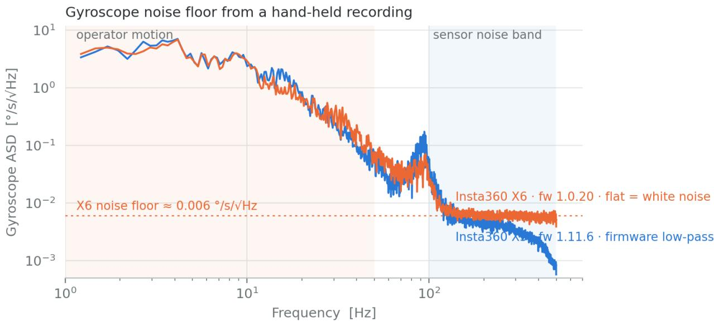  
Figure 1: Amplitude spectral density of the gyroscope y axis for the Insta360 X5 (blue) and X6 (orange) over 80 s of hand-held recording, estimated with Welch’s method (segment length 4096). The band below 50 Hz is dominated by operator motion; above 100 Hz only sensor noise remains. The X6 is flat (white noise); the X5 is attenuated by a firmware low-pass filter.

Synchronisation and axis mapping. Integrating the accelerometer over a frame interval presumes that frame timestamps and IMU timestamps refer to the same clock; a residual ofset would shift every integration window and bias the scale. To test this without a calibration target, the camera rotation was estimated from the video alone and compared with the gyroscope. Shi-Tomasi corners [25] were tracked between consecutive frames with pyramidal Lucas-Kanade optical flow [3] and a forward-backward consistency check; the tracks were unprojected with an equidistant fisheye model, and the inter-frame rotation was estimated by Kabsch alignment inside a RANSAC loop [7] under a pure-rotation assumption. The resulting angular rate was compared with the gyroscope rate averaged over the same frame interval, for gyroscope time shifts from $- 1 5 0 \ \mathrm { t o } \ + 1 5 0$ ms in 1 ms steps and for all signed permutations of the three axes, retaining the combination with the highest mean absolute correlation. On a hand-held sequence with angular rates up to 480 degrees per second the mean correlation is 0.993 and the maximum lies at −2 ms (Figure 2): the IMU timestamps in the file already refer to the video clock. The correlation curve is broad because each visual sample averages the rotation over a 42 ms frame interval, so the ofset is bounded to about ±5 ms rather than resolved to the millisecond. The axis mapping is identical across firmware versions 1.0.6 and 1.11.6, and the rear lens is related to the front lens by a 180-degree rotation about the vertical image axis.

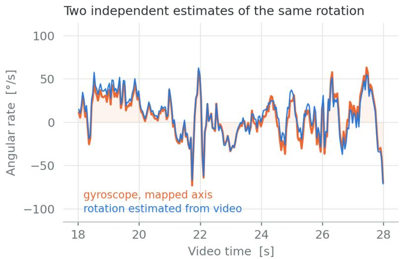

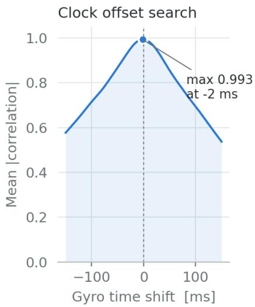  
Figure 2: Left: angular rate about the dominant axis over $1 0 \mathrm { ~ s ~ o f ~ }$ a hand-held sequence with fast rotations, from video-only rotation estimation (blue) and from the gyroscope after axis mapping (orange). Right: mean absolute correlation between the two as a function of the time shift applied to the gyroscope; the maximum lies $\mathrm { a t \mathrm { ~ - 2 ~ } }$ ms, within the ±5 ms resolution of the test, showing that the IMU timestamps stored in the file are aligned to the video.

Accelerometer scale factor and bias stability. Two properties of the accelerometer bear directly on the scale: whether its scale factor is correct, and how far its zero moves during a survey. Both were obtained from an eleven-minute recording with the camera resting on a table. The gyroscope confirms that the camera is stationary, with the norm of the angular rate below 0.44 degrees per second at the 99th percentile. The mean magnitude of the measured specific force is $9 . 8 0 9 2 ~ \mathrm { { m s } ^ { - 2 } }$ , against a local gravity of $\mathrm { { 9 . 8 0 6 ~ m s ^ { - 2 } } }$ at the latitude of the recording; the accelerometer scale factor is therefore correct to 0.03%, which excludes a sensor gain error as an explanation for any scale discrepancy. The bias drifts monotonically with the shape of a thermal warm-up, fastest in the first five minutes and flattening afterwards. Averaged in ten-second blocks, the x axis moves from $- 0 . 3 7 6 ~ \mathrm { t o } \ - 0 . 4 0 8 ~ \mathrm { m s ^ { - 2 } }$ and the z axis from $- 0 . 1 0 8 \ \mathrm { t o } \ - 0 . 1 \breve { 3 } 2 \ \mathrm { m } \mathrm { s } ^ { - 2 } .$ , a vector excursion of $\mathrm { 0 . 0 4 2 \ m s ^ { - 2 } }$ over ten and a half minutes; on a survey of three minutes the expected excursion is about $\mathrm { 0 . 0 1 3 ~ m s ^ { - 2 } }$ . This is an order of magnitude below the value that would be required to explain the bias of the joint formulation (Section 6.1). The gyroscope bias over the same recording has a magnitude of 0.18 degrees per second with an excursion of 0.30 degrees per second, which amounts to 0.06 degrees over one frame interval and is negligible for the hand-eye estimate. The recording is from a third X5 unit, not one of the two used in the surveys; it establishes the order of magnitude of both efects rather than the exact figures for those units.

## 5.2 Co-mounted LiDAR

Table 2 reports the scale error of the inertial estimate and of the smartphone reference relative to the LiDAR on the nine surveys; a positive error denotes a scale larger than the LiDAR. The inertial scale has a mean error of +0.07%, a mean absolute error of 0.81% and a worst case of 2.11%. The smartphone reference has a mean error of −0.41%, a mean absolute error of 1.94% and a worst case of 4.36%. Neither reference shows a systematic sign, as expected of two unbiased references, but the inertial scale is the closer of the two on seven of the nine surveys and is more accurate by a factor of 2.4 overall (Figure 4). The smartphone column mixes ARKit and ARCore, which is representative of the fleet and is one of the costs noted in Section 1. The dispersion of the per-run inertial estimates within each survey is 1.1% to 3.2%, giving a standard erro of the mean between 0.5% and 1.4%, consistent with the scatter observed against the LiDAR.

Table 2: Scale error relative to the co-mounted LiDAR on nine surveys, with path lengths in LiDAR metres, for the smartphone reference that anchors the reconstruction and for the inertial es timate. Mean absolute error: 1.94% (smartphone), 0.81% (IMU). With lens 0 instead of lens 1 the IMU mean absolute error is 0.76%.
<table><tr><td>survey</td><td>campaign</td><td>path</td><td>smartphone error</td><td>IMU error</td></tr><tr><td>L1</td><td>frst</td><td>112 m</td><td>+2.92%</td><td>-2.11%</td></tr><tr><td>L2</td><td>second</td><td>140 m</td><td>-1.18%</td><td>+2.06%</td></tr><tr><td>L3</td><td>second</td><td>105 m</td><td>-4.36%</td><td>+0.02%</td></tr><tr><td>L4</td><td>second</td><td>106 m</td><td>+0.63%</td><td>+1.27%</td></tr><tr><td>L5</td><td>second</td><td>101 m</td><td>-2.79%</td><td>+0.39%</td></tr><tr><td>L6</td><td>second</td><td>233 m</td><td>+0.68%</td><td>-0.10%</td></tr><tr><td>L7</td><td>second</td><td>225 m</td><td>-2.24%</td><td>+0.25%</td></tr><tr><td>L8</td><td>second</td><td>210 m</td><td>+0.76%</td><td>-0.01%</td></tr><tr><td>L9</td><td>second</td><td>241 m</td><td>+1.87%</td><td>-1.10%</td></tr></table>

One survey, L5, was flagged by an earlier version of the quality criteria that compared the two halves of the trajectory under the joint solution, although its scale is accurate to 0.39%; Section 6.3 describes why the criteria were moved to the per-run quantities.

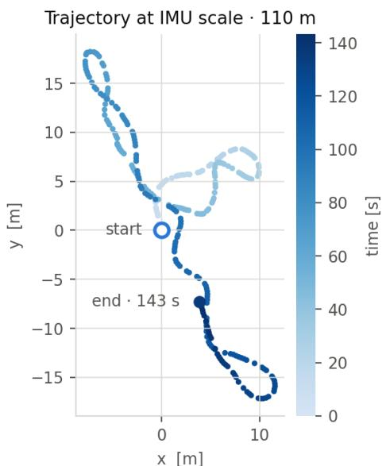

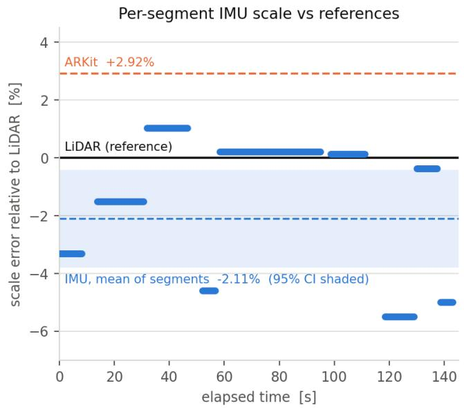  
Figure 3: LiDAR survey L1, with the co-mounted LiDAR as reference. Left: camera trajectory from the production SfM model, scaled by the IMU estimate and aligned to the recovered gravity direction, coloured by elapsed time (110 m at the IMU scale, 112 m in LiDAR metres, over 143 s of registered frames). Right: scale error relative to the LiDAR (solid line at zero) of the inertial estimate on each contiguous segment (bars), of the mean of the segments with its 95% confidence interval (dashed blue line and band, −2.11%) and of the ARKit reference (dashed orange, +2.92%), as in Table 2.

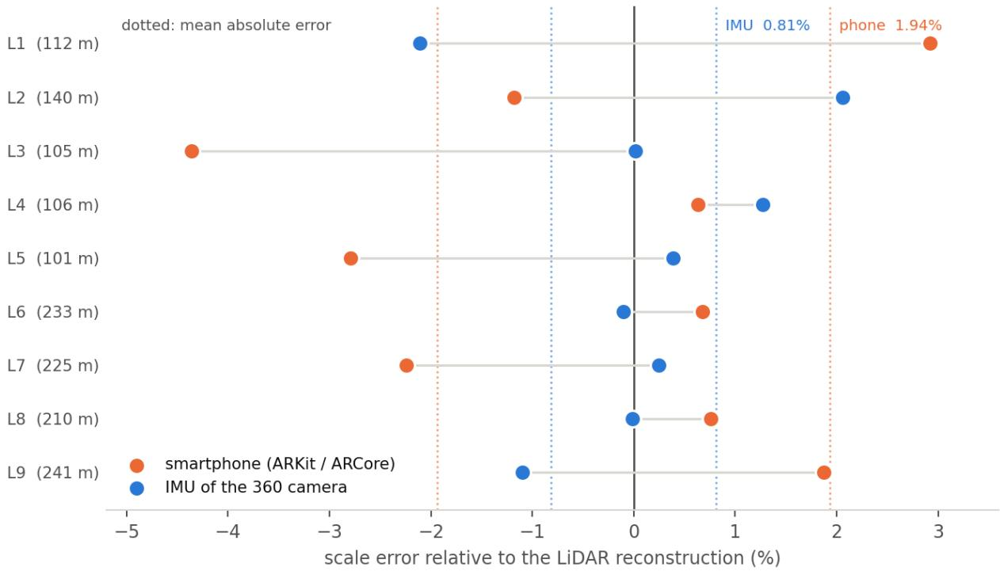  
Figure 4: Scale error relative to the LiDAR reconstruction on the nine co-mounted surveys, for the inertial scale and for the smartphone reference that anchors the reconstruction. Each point is one survey; the dotted lines mark the mean absolute error of each source. The monocular depth networks of Section 5.9, evaluated on survey L1 only, fall outside the range of this plot.

## 5.3 Fiducial markers

The marker reference itself carries a 1% uncertainty. Marker sides measured in model units imply a scale of 1.011 to 1.021, whereas centre distances imply 0.997 to 0.998; the discrepancy is systematic on both sheets and corresponds to an inward bias of the corner localisation of 1.5% to 2% at a marker size of about 130 pixels, so the centre-based estimate is preferred. Rectifying the sheet through the marker homography shows a paper width of 300 to 301 mm against the A3 nominal of 297 mm, that is, the printed content is about 1% smaller than the layout. After this correction the marker-derived scale lies between 0.987 and 1.005. The inertial estimate on this survey is 0.989 and the ARKit scale is 1.000; both fall inside the marker interval (Figure 5).

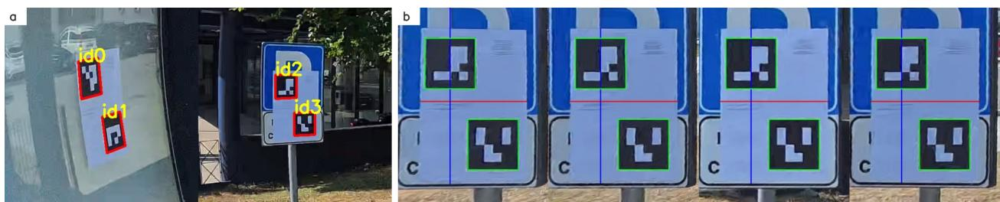  
Figure 5: (a) The two ArUco sheets as seen in the fisheye frames, one viewed obliquely through glass (ids 0 and 1, excluded) and one on a rigid signboard (ids 2 and 3). (b) The signboard sheet rectified through the homography defined by the eight detected corners, with the nominal 140 mm marker outlines (green) overlaid; the black squares fall slightly inside the nominal outlines, consistent with a print scale about 1% below nominal.

## 5.4 Production set A: twelve surveys

All twelve surveys were processed with the same settings and without manual intervention. The ratio between the inertial scale and the ARKit scale has a mean of 0.991, a median of 0.994 and a standard deviation of 3.0%, with extremes of 0.947 and 1.035 (Figure 6, left). The lowest ratio belongs to the reprocessed indoor recording (A12), in which the smartphone photographs cover an area of only 2 by 1.4 m; a monocular depth estimate on the same model agrees with the inertial scale (0.956 against ARKit). The internal uncertainty of the inertial estimate, a median disagreement of 1.5% between trajectory halves, accounts for part of the dispersion; the remainder is attributable to the ARKit reference, in line with the 2.9% error of that reference on LiDAR survey L1. No systematic ofset between the two references is resolved on this sample; Section 5.5 examines the ofset on a larger one. The recovered gravity magnitude is $9 . 7 7 \pm 0 . 0 8 ~ \mathrm { m s ^ { - 2 } }$ across the surveys.

The values in this section were computed with the joint estimator of Section 3.5 and have not been recomputed for the whole set, because nine of the twelve reconstructions are no longer available. Three were re-run with the segment-wise estimator: the ratio to the smartphone scale changes by −0.3, +0.5 and −2.7 percentage points, the last being A12, the survey with the 2 by 1.4 m smartphone coverage. The dispersion quoted above is therefore an upper bound; the part attributable to the estimator is removed by the segment-wise formulation, while the part attributable to the smartphone reference is not.

IMU vs ARKit, production set A (12 surveys)  
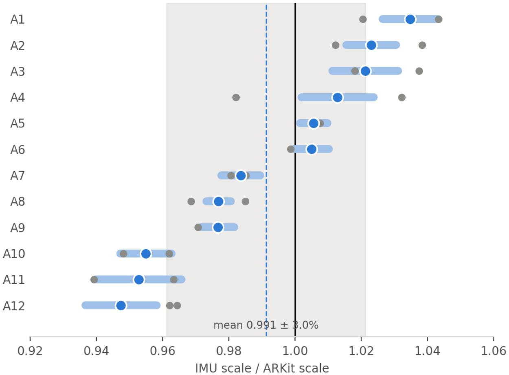  
Figure 6: Ratio between the IMU-derived scale and the ARKit-derived scale for the twelve surveys of production set A (A1 to A12), sorted by value. Filled circles are full-trajectory estimates, shaded bars the ±1� bootstrap interval, small grey circles the estimates from the first and second halves of each trajectory; the grey band is the mean ± one standard deviation across surveys.

## 5.5 Production set B: fifty surveys

The estimator was run unchanged on the fifty surveys of production set B, and all fifty produce an estimate that passes the criteria of Section 3.6. The inertial scale agrees with the ARKit reference to a standard deviation of 2.3%, with a median internal uncertainty of 0.36%, a median per-run dispersion of 2.0%, a median recovered gravity of $9 . 7 9 ~ \mathrm { m s ^ { - 2 } }$ and a median hand-eye residual of 0.08 degrees. The estimator is therefore as well conditioned on this set as on the surveys with ground truth; the dispersion of its agreement with the smartphone scale is comparable to that of set A (3.0%).

The mean ratio is 0.997 and the median 0.994, so the inertial scale lies 0.3% below the smartphone scale on average, and 31 of the fifty surveys fall below unity, with extremes of 0.956 and 1.076 (Figure 7, left). Neither reference is ground truth on this set. The smartphone scale carries a measured error of 1.9% against LiDAR (Section 5.2), and the inertial scale 0.8%; a diference of 0.3% between them is therefore within what the two errors allow, and it does not place the two references in contradiction. It does show that they are not interchangeable survey by survey, and that without an external instrument on the same set the sign of the ofset cannot be assigned to either.

The first factor examined is the window-length dependence of Section 5.6: the recordings of set B are longer than those of set A, and their contiguous runs could be long enough to inherit the upward bias of the joint solution. The correlation between mean run length and the ratio is −0.15 across the set (Figure 7, right), with mean run lengths between 22 and 105 intervals; the correlation with survey duration is 0.00 and with path length +0.07. The second factor is the lens. With lens 0 instead of lens 1 all fifty surveys pass as well, and the mean ratio is 0.991, 0.6% lower; on the LiDAR surveys the two lenses difer by a similar amount in either direction and have a similar accuracy (Table 2). The choice of lens therefore moves the mean ratio on this set by an amount comparable to its ofset from unity, and the origin of the diference between the two lenses has not been isolated.

The third factor is the extent of the smartphone anchor. The photograph bursts of set B contain 42 to 400 photographs spanning 3.2 to 29.0 m, with a median span of 6.3 m. The ratio correlates with that span $( \mathrm { r } = + 0 . 5 2 ;$ Spearman 0.50) and with the number of photographs $\left( \mathrm { r } = + 0 . 5 3 \right)$ . On the 42 surveys whose anchor spans less than 12 m the inertial scale lies 0.8% below the smartphone scale (median −0.8%, standard deviation 1.7%, 29 of the 42 below unity), and within this group the correlation with the span is +0.31; the eight surveys with an anchor of 16 to 29 m and 180 to 400 photographs have a mean of +2.4%, ranging from $- 1 . 6 \% \mathrm { ~ t o ~ } + 7 . 6 \%$ . The dependence is carried largely by these eight surveys, and one of them, at +7.6%, weighs heavily on the correlation. The extreme values are not explained by the diagnostics of the inertial estimate: the survey at −4.4% has 47 photographs spanning 3.7 m, a hand-eye residual of 0.08 degrees, a recovered gravity of $9 . 8 6 ~ \mathrm { m s ^ { - 2 } }$ , a per-run dispersion of 3.2% and the two trajectory halves agreeing to 0.9%. No third reference exists on this set, so the diference between the two scales cannot be attributed with the data in hand; Section 6.2 discusses what can be concluded without one.

The set also exercises the joint solution beyond the ten surveys of Section 5.6. On 34 of the fifty surveys it lies above the segment-wise mean, by 0.4% in median, a milder version of the 3.4% bias measured there; on three it fails outright, returning scales between 0.000 and 0.064 while the segment-wise estimates on the same surveys remain tight, with 2.5% dispersion and 0.4% to 0.7% uncertainty on the mean, and on three more its recovered gravity magnitude falls outside 9.3 to $1 0 . 3 ~ \mathrm { m s ^ { - 2 } }$ while the per-run gravity is normal. Under the per-run criteria of Section 3.6 all fifty surveys pass, with a median disagreement between the two halves of 0.7% and a maximum of 2.6%.

## 5.6 Ablation: window construction

This section separates the two decisions involved in the segment-wise estimate, how the survey is divided into windows and how the window estimates are combined, and measures each against the ten surveys with external ground truth (the nine LiDAR surveys and the fiducial survey). Three window constructions were compared. Contiguous runs uses the natural segmentation, in which a run ends wherever the pipeline has discarded frames. Fixed windows cuts each run into consecutive blocks of � intervals. Sliding windows takes every window of � intervals at stride one, so that windows overlap and each interval is counted many times. A stride variant interpolates between the last two, taking windows of 30 intervals at a stride of 15. Every variant estimates each window independently and reports the mean.

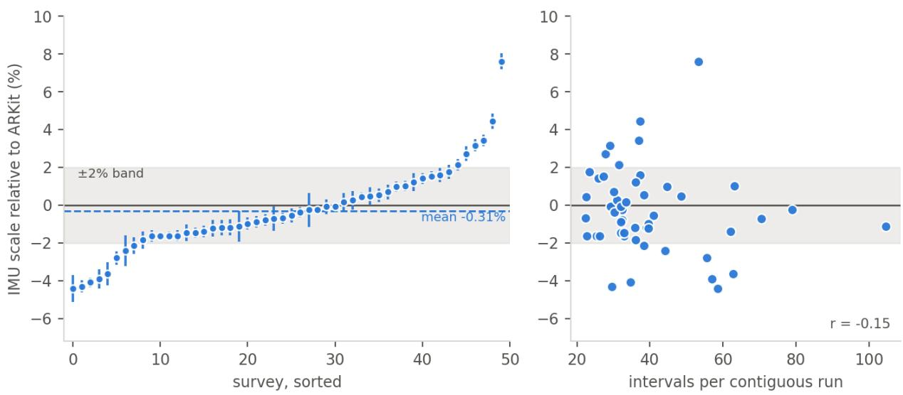

Figure 7: Production set B, fifty surveys without external reference. Left: ratio between the IMU-derived scale and the ARKit-derived scale on the fifty surveys, sorted by value, with the uncertainty on the mean of the per-run estimates as error bar, the ±2% band shaded and the set mean dashed. Right: the same ratio against the mean length of the contiguous runs it is estimated on; the runs span 22 to 105 intervals and the correlation is −0.15, so the window-length bias of Section 5.6 does not account for the diference.  
Table 3: Scale error against external ground truth on the ten surveys with LiDAR or fiducial reference, for each window construction. “Surveys covered” is the number of surveys on which the construction yields at least one valid window.
<table><tr><td>window construction</td><td>surveys covered</td><td>mean error</td><td>mean absolute error</td><td>worst</td></tr><tr><td>whole survey as</td><td>10</td><td>+3.39%</td><td>3.43%</td><td>6.05%</td></tr><tr><td>one system contiguous runs</td><td>10</td><td>-0.05%</td><td>0.85%</td><td>2.11%</td></tr><tr><td>30 intervals, stride</td><td>10</td><td>-0.20%</td><td>0.89%</td><td>1.95%</td></tr><tr><td>15 fixed, 30 intervals</td><td>10</td><td>-0.32%</td><td>0.90%</td><td>2.23%</td></tr><tr><td>fixed, 50 intervals</td><td>10</td><td>-0.24%</td><td>0.90%</td><td>1.91%</td></tr><tr><td>fixed, 25 intervals</td><td>10</td><td>-0.44%</td><td>0.95%</td><td>1.52%</td></tr><tr><td>sliding, 30 intervals</td><td>10</td><td>-0.00%</td><td>0.97%</td><td>2.09%</td></tr><tr><td>sliding, 60 intervals</td><td>10</td><td>+0.86%</td><td>1.17%</td><td>4.56%</td></tr><tr><td>sliding, 15 intervals</td><td>10</td><td>-0.63%</td><td>1.22%</td><td>2.42%</td></tr><tr><td>fixed, 15 intervals</td><td>10</td><td>-0.54%</td><td>1.39%</td><td>3.01%</td></tr></table>

Three observations follow from Table 3 and Figure 8. First, every windowed variant improves on the single joint system by a factor between 2.5 and 4, so the gain of the segment-wise estimate comes from not sharing gravity and bias across the survey rather than from any particular segmentation. Second, the mean absolute error of the windowed constructions ranges from 0.85% to 1.39%, and the contiguous runs adopted in Section 3.5 have the lowest, by a few hundredths of a point over the next constructions; the method is insensitive to this choice, and the contiguous runs are the one construction with no length to set. Third, window length does matter, in the direction predicted in Section 3.5: sliding windows of 15 intervals give a mean error of −0.6%, 30 intervals give approximately zero, and 60 intervals give +0.9% as the window begins to inherit the bias of the joint solution. Overlap has little efect: sliding windows at stride one produce five to fifteen times as many estimates as non-overlapping ones and change the mean absolute error by less than 0.1 percentage points.

## 5.7 Invariance to the input model

The scale of the input model is unknown by assumption and its orientation is arbitrary. Gross per-run outliers are therefore rejected relative to the median of the per-run scales, never against an absolute range, and the joint solution is not used as a reference because it can fail on its own (Section 6.1). To confirm that the estimator exploits neither the scale nor the orientation of the input, each of the thirty reference trajectories of the public benchmark (Section 5.8) was transformed by a similarity with a scale factor of 1/40,

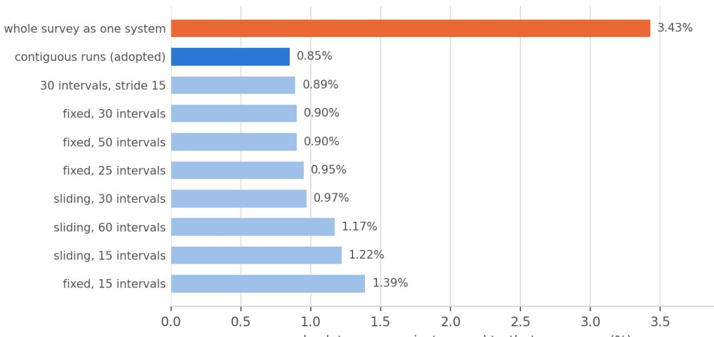  
mean absolute error against ground truth, ten surveys (%)  
Figure 8: Mean absolute error against ground truth on the ten surveys with external reference, for each window construction of Table 3. Orange: the single joint system; blue: the contiguous-run construction adopted here. Every windowed variant improves on the joint system by a factor between 2.5 and 4, and all of them lie within 0.6 percentage points of each other.

On LiDAR survey L1 (A7 in set A), an outdoor open area of 40 by 25 m evaluated on all 290 frames, MoGe-2 deviates from the LiDAR by −3.2% and MoGe-3 by −18.8%, with a per-frame scatter of 8% to 9%. Within a single frame the predicted depth is proportional to the SfM depth to about 1%; the error lies in the global scale the network assigns to the scene, not in its shape. To test whether the outdoor character of the site explains the discrepancy, both networks were run on ten surveys of set A, four indoor and six outdoor, using 30 frames per survey and the production poses and sparse points as geometric reference (Table 4, Figure 9). Because these models are ARKit-scaled, the ratio between depth-derived and model scale is the network’s bias with respect to the ARKit reference; the inertial ratio is listed for comparison.

Table 4: Scale from monocular metric depth relative to the ARKitscaled production model on ten surveys, 30 frames each, with the inertial ratio for comparison. The inertial ratio is the segmentwise estimate of Sections 5.2 and 5.3 for A7 and A5, and the joint estimate of Section 5.4 for the other surveys, whose models are no longer available.
<table><tr><td>survey</td><td>scene</td><td>MoGe-2 ARKit</td><td>MoGe-3</td><td>ARKit</td><td>IMU ARKit</td></tr><tr><td>A10</td><td>indoor</td><td>0.832 (−16.8%)</td><td>0.839</td><td>(−16.1%)</td><td>0.955</td></tr><tr><td>A12</td><td>indoor</td><td>0.956 (−4.4%)</td><td>0.889</td><td>(-11.1%)</td><td>0.947</td></tr><tr><td>A1</td><td>indoor</td><td>0.993 (−0.7%)</td><td>0.974</td><td>(−2.6%)</td><td>1.035</td></tr><tr><td>A3</td><td>indoor</td><td>0.999 (−0.1%)</td><td>1.004</td><td>(+0.4%)</td><td>1.021</td></tr><tr><td>A11</td><td>outdoor</td><td>0.773 (−22.7%)</td><td>0.924</td><td>(−7.6%)</td><td>0.953</td></tr><tr><td>A4</td><td>outdoor</td><td>0.834 (−16.6%)</td><td>1.178</td><td>(+17.8%)</td><td>1.013</td></tr><tr><td>A6</td><td>outdoor</td><td>0.931 (−6.9%)</td><td>0.923</td><td>(-7.7%)</td><td>1.005</td></tr><tr><td>A7 (LiDAR L1)</td><td>outdoor</td><td>0.941 (-5.9%)</td><td>0.789</td><td>(-21.1%)</td><td>0.951</td></tr><tr><td>A5 (fiducial)</td><td>outdoor</td><td>0.977 (−2.3%)</td><td>0.871</td><td>(-12.9%)</td><td>0.989</td></tr><tr><td>A2</td><td>outdoor</td><td>1.086 (+8.6%)</td><td>0.945</td><td>(−5.5%)</td><td>1.023</td></tr></table>

Outdoor surveys are worse on average, with a mean absolute bias of 11% for MoGe-2 and 12% for MoGe-3 against 5% and 8% indoors, but the split is not clean: two indoor surveys (A1, A3) are recovered within

1% by both networks, while a third indoor survey (A10) is of by 16% with both. The two networks also disagree with each other on the same scenes, most visibly on A4, where MoGe-2 reads −17% and MoGe-3 +18%, and on A7, −6% against −21%. The newer and larger MoGe-3 is not more accurate. The controlling variable appears to be the proximity of the scene to the networks’ training distribution rather than the indoor/outdoor distinction as such. On the same ten surveys the inertial scale stays within 6% of ARKit in every case. Since the two networks are trained by the same group on largely the same data, their agreemen on a given scene is not evidence of correctness. A depth-based estimate can serve as a coarse consistency check on the inertial one, but not as the metric reference: its bias depends on the scene and, at the level of accuracy at stake here, exceeds the disagreement it would be asked to resolve.

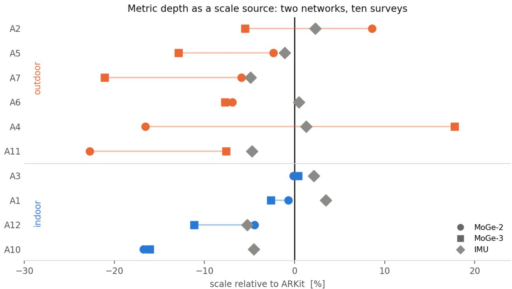  
Figure 9: Scale bias of MoGe-2 (circles) and MoGe-3 (squares) metric depth relative to the ARKit-scaled production model on ten surveys of set A, four indoor (blue) and six outdoor (orange), from 30 frames each; grey diamonds mark the inertial scale. Outdoor surveys are worse on average, but one indoor survey fails with both networks and the two networks disagree by up to 34% on the same scene.

## 6 Discussion

## 6.1 Bias of the joint formulation

The largest single efect in the method is the choice between a joint solution with shared nuisance parameters and a segment-wise solution. Against external ground truth the joint solution is biased high by 3.39% with consistent sign (Table 3), and on the fifty surveys of set B it lies above the segment-wise mean on 34 and fails on three. On the reference trajectories of the public benchmark, which carry no reconstruction error, the joint solution is unbiased (−0.06% on average), which places the source of the bias in the reconstructions rather than in the sensor. The static recording of Section 5.1 bounds the accelerometer bias drift at 0.042 $\mathrm { m } \mathrm { s } ^ { - 2 }$ over ten minutes, an order of magnitude below what would be required to produce the observed shift through the bias term alone, so bias drift is excluded as the cause. The remaining candidate is the gravity term. If the efective gravity direction in the model frame is not constant along the survey, for instance because of residual orientation drift in the reconstruction, the shared-gravity assumption is violated, and because $\frac { 1 } { 2 } \mathrm { g } \Delta t _ { k } ^ { 2 }$ is of the same order as the displacement in Equation (4), the violation is absorbed by �. The ablation of Section 5.6 is consistent with this reading: the bias grows with window length, and every construction that estimates gravity locally removes it regardless of how the windows are placed. The specific mechanism that makes the efective gravity vary along a survey has not been isolated in this study. The per-run estimate is bounded from below by regressor-noise attenuation on short windows and from above by the shared-gravity bias on long ones, and contiguous runs of 15 to 60 intervals lie near the crossover.

## 6.2 Ofset on the production sample and the absence of ground truth

On fifty production surveys the inertial scale lies 0.3% below the smartphone scale on average, on 31 of the fifty. The diference is not correlated with run length, survey duration or path length, and it is of the same size as the diference between the two lenses of the rig (0.6%). It does vary with the spatial extent of the smartphone anchor: on the 42 surveys anchored over less than 12 m the inertial scale is 0.8% lower, while on the eight anchored over 16 to 29 m it is 2.4% higher. The diference between the two references is therefore not a constant property of either, and on average it is smaller than the error the smartphone reference carries against LiDAR, so the two references are not in contradiction. The point to retain is that on production surveys no ground truth exists: the smartphone scale is itself an estimate with a measured error of 1.9% and a worst case of 4.4%, and an agreement of 2.3% between two independent estimates of that quality is what one expects when both are approximately right. Taken together, the LiDAR, fiducial and smartphone comparisons bound the error of the inertial scale at below 1% in mean absolute error, 2.1% in the worst case, where an instrument reading metres is available and at 3 to 4% in the worst case against the smartphone, with no configuration in which the inertial estimate disagrees with every other reference. The source of the residual diference on set B, and of its dependence on the anchor, can only be assigned by a third, metric measurement on the same scenes, which is left to future work.

## 6.3 Quality criteria

The quality criteria were originally designed for the joint estimator, and three of them, the recovered gravity magnitude, the bootstrap dispersion and the half-versus-half comparison, were read from the joint solution. On an earlier sample of fifty production surveys that version rejected six whose segment-wise estimates are unremarkable, and on the LiDAR set it rejected one survey whose scale is accurate to 0.39%; in every such case the joint solution had either collapsed or recovered a gravity magnitude far from 9.81 m s−2 while the per-run solutions were normal. The criteria were therefore restated on the per-run quantities, as described in Section 3.6: gravity is checked run by run, the two halves are compared as means of per-run scales, and the bootstrap of the joint solution is retained only as a diagnostic. Under this version all fifty surveys of set B pass, and the drift of the time ofset along the survey (Section 3.3), the hand-eye residual and the dispersion of the per-run scales remain the criteria that reject a defective alignment.

## 6.4 Limitations

The LiDAR reference is a consumer SLAM instrument whose drift over long paths has not been characterised independently; its per-point accuracy does not limit a scale comparison drawn from millions of points, and it agrees with the smartphone reference to within 1% on average with no systematic sign, but a tape measurement of a known object on one of the LiDAR sites remains the only way to validate either reference without assuming the other. The results of Section 5.4 were computed with the joint estimator and could not be recomputed on all twelve models. The estimator reads one lens of the rig; the two lenses give similar accuracy against the LiDAR but difer by 0.6% on average on the production surveys, for a reason not isolated here. All surveys with external reference were recorded with the X5, while the X6 is characterised as a sensor only. The static characterisation was performed on a third camera unit and establishes orders of magnitude rather than unit-specific figures; a longer static recording would allow a proper Allan-variance analysis of bias instability. Finally, the linear alignment is not followed by a non-linear refinement with preintegration factors and gyroscope bias, which the visual-inertial SLAM literature uses to improve on the closed-form initialisation.

## 7 Conclusion

The IMU embedded in the Insta360 X5 and X6, combined with the camera poses that the SfM pipeline already computes, yields a metric scale without smartphone data. The sensor is recorded at 1 kHz on the video clock to within ±5 ms, its accelerometer scale factor is correct to 0.03% and its bias moves by 0.042 $\mathrm { m } \mathrm { s } ^ { - 2 }$ over ten minutes. A linear visual-inertial alignment recovers the scale of existing reconstructions, independently of the units and orientation of the input model, provided that the frame timing is estimated from the data rather than taken at its nominal value and that the alignment is solved per contiguous segment rather than jointly over the survey. The segment-wise estimate reduces the mean absolute error against external reference from 3.43% to 0.85%. On nine surveys with a co-mounted LiDAR the inertial scale deviates by 0.81% in mean absolute error against 1.94% for the smartphone reference, and on printed fiducial markers both references fall within the 1% uncertainty of the target. On the reference trajectories of thirty sequences of a public benchmark the estimator is unbiased, with a mean error of −0.07% and a dispersion of 1.28% per sequence, whatever the scale of the input. On fifty production surveys the two references agree to a standard deviation of 2.3%, with an unattributed mean diference of 0.3% that varies with the extent of the smartphone anchor and, by a similar amount, with the lens of the rig used for the estimate. The smartphone capture step can therefore be removed from the procedure, with the recovered gravity magnitude, the drift of the video-to-IMU ofset and the dispersion of the per-run scales available to reject a failed alignment. Open items are a third metric reference on the production sample, which is the only way to assign the residual diference to one of the two estimates, and a non-linear refinement of the linear solution.

## References

[1] Besl, P. J. and McKay, N. D., “A Method for Registration of 3-D Shapes”, IEEE Transactions on Pattern Analysis and Machine Intelligence, 1992.

[2] Bhat, S. F., Birkl, R., Wofk, D., Wonka, P. and Muller, M., “ZoeDepth: Zero-shot Transfer by Combining Relative and Metric Depth”, arXiv:2302.12288, 2023.

[3] Bouguet, J.-Y., “Pyramidal Implementation of the Afine Lucas Kanade Feature Tracker”, Intel Corporation, 2001.

[4] Campos, C., Montiel, J. M. M. and Tardos, J. D., “Inertial-Only Optimization for Visual-Inertial Initialization”, IEEE International Conference on Robotics and Automation, 2020.

[5] Centanni, S., Zhang, Y., Tao, Y., Kindle, J., Neuhaus, F., Koss, T., Patel, A., Helmberger, M., Szymanska, E., Graeber, T. and Fallon, M., “Hilti-Trimble-Oxford Dataset: 360 Visual-Inertial Benchmark with Floor Plan Priors for SLAM and Localization”, arXiv:2607.06464, 2026.

[6] El-Sheimy, N., Hou, H. and Niu, X., “Analysis and Modeling of Inertial Sensors Using Allan Variance”, IEEE Transactions on Instrumentation and Measurement, 2008.

[7] Fischler, M. A. and Bolles, R. C., “Random Sample Consensus: A Paradigm for Model Fitting with Applications to Image Analysis and Automated Cartography”, Communications of the ACM, 1981.

[8] Forster, C., Carlone, L., Dellaert, F. and Scaramuzza, D., “On-Manifold Preintegration for Real-Time Visual-Inertial Odometry”, IEEE Transactions on Robotics, 2017.

[9] Furgale, P., Rehder, J. and Siegwart, R., “Unified Temporal and Spatial Calibration for Multi-Sensor Systems”, IEEE/RSJ International Conference on Intelligent Robots and Systems, 2013.

[10] Garrido-Jurado, S., Munoz-Salinas, R., Madrid-Cuevas, F. J. and Marin-Jimenez, M. J., “Automatic Generation and Detection of Highly Reliable Fiducial Markers under Occlusion”, Pattern Recognition, 2014.

[11] Gyroflow, “telemetry-parser”, software, 2024. https://github.com/gyroflow/telemetry-parser

[12] IEEE Std 952-1997, “IEEE Standard Specification Format Guide and Test Procedure for Single-Axis Interferometric Fiber Optic Gyros”, Annex C, Allan variance.

[13] Kabsch, W., “A Solution for the Best Rotation to Relate Two Sets of Vectors”, Acta Crystallographica Section A, 1976.

[14] Kannala, J. and Brandt, S. S., “A Generic Camera Model and Calibration Method for Conventional, Wide-Angle, and Fish-Eye Lenses”, IEEE Transactions on Pattern Analysis and Machine Intelligence, 2006.

[15] Lupton, T. and Sukkarieh, S., “Visual-Inertial-Aided Navigation for High-Dynamic Motion in Built Environments Without Initial Conditions”, IEEE Transactions on Robotics, 2012.

[16] Martinelli, A., “Closed-Form Solution of Visual-Inertial Structure from Motion”, International Journal of Computer Vision, 2014.

[17] Mur-Artal, R. and Tardos, J. D., “Visual-Inertial Monocular SLAM with Map Reuse”, IEEE Robotics and Automation Letters, 2017.

[18] Over The Reality, “imu-metric-scale: metric scale for Insta360 SfM from the embedded IMU”, software, 2026a. https://github.com/OVR-Platform/imu-metric-scale

[19] Over The Reality, “Insta360 surveys with LiDAR reference for metric-scale validation”, Hugging Face dataset, 2026b. https://huggingface.co/datasets/OverTheReality/insta360-imu-metric-scale-surveys

[20] Over The Reality, “OverMaps360-50: 360-degree walk-through surveys with embedded IMU and smartphone poses”, Hugging Face dataset, 2026c. https://huggingface.co/datasets/OverTheReality/OverM aps360\_50

[21] Qin, T., Li, P. and Shen, S., “VINS-Mono: A Robust and Versatile Monocular Visual-Inertial State Estimator”, IEEE Transactions on Robotics, 2018.

[22] Rusinkiewicz, S. and Levoy, M., “Eficient Variants of the ICP Algorithm”, International Conference on 3-D Digital Imaging and Modeling, 2001.

[23] Sarlin, P.-E., Cadena, C., Siegwart, R. and Dymczyk, M., “From Coarse to Fine: Robust Hierarchical Localization at Large Scale”, IEEE/CVF Conference on Computer Vision and Pattern Recognition, 2019.

[24] Schonberger, J. L. and Frahm, J.-M., “Structure-from-Motion Revisited”, IEEE Conference on Computer Vision and Pattern Recognition, 2016. COLMAP, https://colmap.github.io

[25] Shi, J. and Tomasi, C., “Good Features to Track”, IEEE Conference on Computer Vision and Pattern Recognition, 1994.

[26] Umeyama, S., “Least-Squares Estimation of Transformation Parameters Between Two Point Patterns”, IEEE Transactions on Pattern Analysis and Machine Intelligence, 1991.

[27] Wang, R., Xu, S., Dai, C., Xiang, J., Deng, Y., Tong, X. and Yang, J., “MoGe: Unlocking Accurate Monocular Geometry Estimation for Open-Domain Images with Optimal Training Supervision”, arXiv:2410.19115, 2024. https://github.com/microsoft/MoGe

[28] Welch, P. D., “The Use of Fast Fourier Transform for the Estimation of Power Spectra”, IEEE Transactions on Audio and Electroacoustics, 1967.

[29] Yang, L., Kang, B., Huang, Z., Xu, X., Feng, J. and Zhao, H., “Depth Anything: Unleashing the Power of Large-Scale Unlabeled Data”, IEEE/CVF Conference on Computer Vision and Pattern Recognition, 2024.

[30] Yin, W., Zhang, C., Chen, H., Cai, Z., Yu, G., Wang, K., Chen, X. and Shen, C., “Metric3D: Towards Zero-shot Metric 3D Prediction from A Single Image”, IEEE/CVF International Conference on Computer Vision, 2023.

[31] Zhang, J. and Singh, S., “LOAM: Lidar Odometry and Mapping in Real-time”, Robotics: Science and Systems, 2014.