# More Memory, Better Videos? A Controlled Study of Visual Memory in Long-Video Generation

Yuzhuo Chen1,2,† Huafeng Shi2,⋆,‡ Xinyu Wang2,3 Yulong Xu2

Yucheng Wang2,4 Haoqin Hong1,2,5 Guoxin Zhang2 Zehua Ma1,⋆ Weiming Zhang1

1University of Science and Technology of China 2KlingAI Research 3Tsinghua University

4The Hong Kong University of Science and Technology 5City University of Hong Kong

⋆Co-corresponding authors ‡Project leader

†This work was conducted during the author’s internship at KlingAI

previous appearance retrieved reference 1 reference 2

reference 3

composed keyframe

generated clip

What to forget: a dead character returns (context). Uncle Chaiyao has died and only his jacket is named, yet he is back.

What to read: a look-alike is retrieved (selection). The orange dinghy seen just before; memory returns a white look-alike.  

When to read: the story changed her look, memory reads the old one. Axi’s scarf is now a short cape; refs and output keep the scarf.  
  
Figure 1. A relevant past can be wrong for the present. Three qualitative failures from earlier Track-B testbed rollouts (not the main quantitative rerun), showing previous appearances, retrieved frames, composed keyframes, and generated clips. Top: a deceased character reappears when a jacket is mentioned. Middle: a white look-alike replaces the requested orange dinghy. Bottom: retrieved frames preserve Axi’s old scarf despite a new instruction specifying a short cape. Symbols indicate required-entity matches (✓), misses (×), and forbidden appearances (!). These examples illustrate failure paths; they are not fixed-history causal interventions.

## Abstract

Long-video generators increasingly retrieve past visual observations to prevent identity drift. The intuition is compelling: more access to history should make future video more consistent. But an image can be faithful to the past and wrong for the present. Does visual memory always improve the generated story? We investigate this question through VMem-Bench, a two-track diagnostic study. Track-A measures which references are selectedfrom 92 realfilms (16,548 segments), before generation and without generator confounds. Track-B compares four retrieval policies with nomemory and gold-informed last-seen controls on 30 causally generated stories (2,824 segments) using a shared generator.

Retrieval increases entity recallfrom 0.559 to 0.628–0.693 and improves similarity to past appearances, but decreases precision from 0.977 to 0.915–0.938 andforbidden-entity avoidancefrom 0.968 to 0.845–0.898. It can also reinforce obsolete appearances after the story changes them. Conversely, high long-gap recall can arise without memory when the prompt itself supplies the appearance; an appearancestripping analysis exposes this confound. These results distinguish historical fidelity from current-story correctness and show why retrieval relevance orfinal-video consistency alone does not establish memory utility.

## 1. Introduction

More memory, better videos? Causal long-video generation produces a sequence of segments while carrying past observations forward [11, 21, 24]. Historical retrieval can restore visual context when a character returns [4, 23]. Other systems compress frame or KV histories [7, 26], or organize memory by entity [2, 8]. Memory-conditioned storytelling likewise uses earlier shots to anchor later appearances [17, 25]. But the story may have changed: the character wears a new outfit, an object has been destroyed, or a deceased person is mentioned without being present. A retrieved frame can improve fidelity to history while making the current segment less correct (Fig. 1).

Beyond perceptual and cross-shot consistency measured by existing evaluations [3, 6, 20]: when does access to visual history actually help generation, and when does it introduce interference? Three confounds complicate this question. First, the current prompt may already describe a returning entity. Second, historical matching may preserve obsolete appearances; state tracking differs from identity anchoring [8, 29]. Third, relevant references may contain now-forbidden entities. Retrieval evaluation separates relevance, downstream utility, and distracting evidence [14]. For visual generation, current-state correctness and entity exclusion must be measured alongside historical resemblance.

We use VMem-Bench to separate what memory retrieves from what the generator does with it. At step n, a policy reads references $\widehat { \mathcal { C } } _ { n }$ from historical memory $\mathcal { M } _ { n }$ for instruction $g _ { n } ;$ the generator then produces $x _ { n }$ :

$$
{ \mathcal { M } } _ { n } \xrightarrow { R ( g _ { n } ) } { \widehat { \mathcal { C } } } _ { n } \xrightarrow { G ( g _ { n } ) } x _ { n } .\tag{1}
$$

Track-A replays 92 real films, evaluating reference selection against frozen entity-level gold before the next segment is revealed. Track-B runs 30 authored stories causally, comparing four retrieval policies with no-memory and goldinformed last-seen controls under one video-generation pipeline. These matched-prompt comparisons evaluate complete policies: each policy writes its own history. They are not single-step interventions, and the two tracks use different instances.

An unexpected answer. Within this controlled setting, retrieval improves overall entity recall and appearance similarity to historical renderings. Yet it also decreases precision and forbidden-entity avoidance; on changed-state returns it can restore an outdated appearance. Long-gap success partly reflects prompt information: no-memory generation can achieve high recall when instructions describe the entity. Memory utility therefore requires checking what history adds, which temporal state is valid, and what unwanted content it brings. These findings concern visual-history utility, not a memory-capacity scaling law.

Contributions.

• A controlled characterization of memory’s trade-offs. We show, across four retrieval policies and two controls, that historical references increase recall and appearance continuity while also increasing unwanted appearances and sometimes conflicting with updated story states.

• Evidence of an evaluation confound. A targeted appearance-stripping analysis shows why successful longgap reappearance can reflect prompt information rather than long-range memory. We separate historical appearance similarity, present-state correctness, and entity exclusion.

• A reusable diagnostic study framework. VMem-Bench combines pre-generation evidence analysis (92 films, 16,548 segments, 2,803 entities) and post-generation, closed-loop evaluation (30 stories, 2,824 segments, nine memory stresses), with controlled retrieval comparisons, frozen scoring, and explicit limitations on attribution.

## 2. Related Work

Visual memory for video generation. Visual histories support causal generation through compressed frame or KV context [7, 22, 26], historical retrieval [4, 23, 28], and entity-indexed state [2, 8, 29]. OneStory learns adaptive historical-frame conditioning [1]; StoryMem learns memoryconditioned multi-shot generation [25]. LiveEdit studies streaming editing with content-preservation constraints [18]; a broader survey organizes controllable video conditioning mechanisms [9]. Holding the generator fixed across retrieval policies, we test whether reference relevance and historical resemblance predict current-story correctness.

Long-video and memory benchmarks. VBench measures perceptual and semantic quality [6]. MovieBench, MSVBench, and EntityBench evaluate movie-level or crossshot consistency [3, 15, 20]; MBench and NarraStream-Bench test memory or narrative consistency [8, 27]. SubjectAnchor combines subject-aware memory with a trained video model and its own storytelling benchmark, including shot-level inclusion/exclusion control [17]. Our two tracks measure selected evidence before generation and story correctness afterward, complementing these evaluations and SubjectAnchor’s inclusion/exclusion tests. This does not establish superiority over its trained architecture (Supplementary Table 12; App. C).

Retrieval relevance and downstream utility. Long-MemEval and MemoryAgentBench connect memory operations to task success [5, 19]. RAGChecker already separates retrieval quality from generation quality and identifies distracting evidence [14]. Our question concerns temporal validity in visual generation: historical appearance continuity can coexist with an incorrect current state or an unwanted entity. We jointly test selected evidence, updated states, forbidden appearances, and prompt-information sensitivity. No-memory controls check what history adds beyond the current instruction, while complete-policy comparisons measure the outcome of each evolving memory history, with explicit limits on causal attribution.

## 3. Study Design: Evidence and Outcomes

To study the utility of history, we observe two points in Eq. 1: the references a policy selects before generation (Track-A) and the video produced afterward (Track-B). VMem-Bench is the experimental instrument for this investigation; Fig. 2a shows the two protocols. For example, Track-A asks whether selected references cover a puppy requested in a later segment of the real film Spring (Fig. 12). Track-B instead tests memory use in independently authored, generated stories, with no-memory and last-seen controls. The two tracks measure complementary boundaries, not matched instances.

## 3.1. Causal Evaluation Contract

Here causal means no access to future segments. Both tracks process a story chronologically; they differ in what is scored.

Algorithm 1 Causal evaluation contract   
Require: Track $T \in \{ \mathrm { A } , \mathrm { B } \}$ ; instruction stream g1:N ; policy π;   
scoring gold $G$   
Ensure: Per-segment references and scores; G is hidden from   
ordinary policies; gold-ID Last-seen is a privileged Track-B   
diagnostic   
1: Initialize memory $\mathcal { M } _ { 1 }$ from no prior segments   
2: for $n = 1 , \ldots , N$ do   
3: i $\mathrm { f } T = \mathrm { B }$ and π is gold-ID Last-seen then   
4: Select up to K prior frames using gold required-entity   
IDs and this rollout’s earlier clips   
5: else   
6: Give ordinary π only $g _ { n }$ and its earlier-segment mem  
ory $\mathcal { M } _ { n }$   
7: Select reference context ${ \widehat { \mathcal { C } } } _ { n }$ with budget $B _ { n } = | \widehat { \mathcal { C } } _ { n } |$   
8: end if   
9: $\mathbf i \mathbf f T = \mathrm A$ (real-film retrieval) then   
10: Reveal the next real segment only after selection; score   
${ \widehat { \mathcal { C } } } _ { n }$ against its entities and states   
11: Observe the current real segment and update memory;   
no generator runs   
12: else $> T = \mathrm { B }$ (closed-loop generation)   
13: Generate $x _ { n }$ from $g _ { n }$ and ${ \widehat { \mathcal { C } } } _ { n } ;$ ; score entities and states   
against blinded gold   
14: Observe the system’s own $x _ { n }$ and update $\mathcal { M } _ { n + }$ 1   
15: end if   
16: end for

Track-A measures the evidence handed to a generator, without running one; its instructions name the entities on screen. Track-B measures what survives generation, with a shared pipeline across conditions (Sec. 4.1). Because each condition updates memory from its own output, their histories diverge during the closed-loop rollout. Scoring gold describes entities and states; it is hidden from ordinary policies and used only for scoring, except for the explicitly privileged gold-ID Last-seen diagnostic (App. C.4). It supplies no reference pixels or descriptions.

## 3.2. Data, Gold, and Memory Stresses

Track-A is built from BlenderOpenMovies and LSMDC (Table 2): 92 films, 16,548 segments, 44.91 hours, and 2,803 typed characters, props, and locations, with reappearance, multi-instance, scene-return, and state-change slices.

Track-B contains 30 human-authored stories expanded into 2,824 five-second segments (3.92 hours), with reappearances up to 77 segments apart. The instruction gives an entity’s look only when it first appears or changes state; later prompts usually name the entity without repeating its full appearance. Many props, however, carry their look in the name (“the two brass fog bells”), and most returns after 30 or more segments are either such props or characters that come back changed, with the new look spelled out. Each segment is tagged with the memory stresses it exercises (Fig. 2b): six ask the system to remember something and three to keep something out (Table 1).

Track-A gold comes from a staged pipeline: VLM proposals are normalized by deterministic contracts and strongermodel review triggers targeted repair. Humans fix the canonical entity roster, and every blocked unit plus a stratified audit sample of the rest passes blocking human review before a deterministic freeze (App. B.1).

## 3.3. Metrics

Track-A. A pinned Qwen3-VL-32B judge, blind to system identity, checks each reference against the frozen roster and the real next segment. At segment $n ,$ let $C _ { n }$ be the entities that must be remembered (on screen, excluding first appearances) and $k _ { n }$ the number of references. Precision is the fraction of the $k _ { n }$ references that show a correct entity; Recall is the fraction of $C _ { n }$ covered by at least one of them. Both, and their F1, are computed per segment and averaged over a film’s segments, then over films (so the reported F1 is not the harmonic mean of the reported averages). Repetition is measured as $R _ { V }$ , the share of references that repeat an already covered view of the same entity, and $R _ { S }$ , their mean DINOv3 similarity; ${ \mathrm { S e l E f f } } = { \mathrm { P r e c } } \left( 1 - R _ { V } \right)$

Track-B. The same judge sees each generated segment with a blinded list of entities that should appear, should not appear, look alike, or are decoys, each with its gold description, and marks which are present. An entity counts as present when the clip shows something that matches its description; the judge does not compare it with the entity’s earlier renderings, so a fresh, description-matching stranger scores as a hit. Track-B therefore also scores identity: whether a returning entity looks the same as its previous appearance in the same rollout, measured as the DINOv3 similarity of the localized entity over returns detected in both clips, with ArcFace for faces, MegaLoc for locations, and a pairwise VLM judge as a check; thresholds are calibrated on control pairs before any condition is scored (App. D.2). Counts are pooled over all segments. Recall (R) is the fraction of required character and prop appearances that are present; Precision (P) is the fraction of present characters and props that were required; F1 is their harmonic mean; Avoid-OK (A) is the fraction of forbidden appearances that stay absent. Rather than collapse memory usefulness into a single consistency score, we examine the vector of policylevel differences to no memory:

Table 1. Track-B memory-stress families. Each rate is a micro-average over that family’s opportunities.
<table><tr><td>Family</td><td>Metric</td><td>Satisfied when</td></tr><tr><td>Long-gap reappearance</td><td>recall</td><td>A character or prop returns after at least 30 segments.</td></tr><tr><td>Look-alike</td><td>accuracy</td><td>The identity matches the intended member of a confusable pair.</td></tr><tr><td>State change</td><td>accuracy</td><td>A transformed entity appears in its new state.</td></tr><tr><td>Count / multi-instance</td><td>accuracy</td><td>The rendered count matches the authored count.</td></tr><tr><td>Avoidance</td><td>avoidance-OK</td><td>A removed, destroyed, or deceased entity is absent.</td></tr><tr><td>False friend</td><td>accuracy</td><td>A new look-alike is not collapsed into an existing identity.</td></tr><tr><td>State persistence</td><td>accuracy</td><td>A later segment keeps an earlier transformed state.</td></tr><tr><td>Indirect reference</td><td>avoidance-OK</td><td>A deprecated entity stays absent even if named in the prose.</td></tr><tr><td>Temporal reference</td><td>recall</td><td>A name-free time reference recovers the intended entity.</td></tr></table>

Table 2. VMem-Bench Track-A corpus statistics (per dataset). Entities = characters + props + locations; hard-case columns count segments per bucket. BlenderOpenMovies is stylized animation, LSMDC live-action film clips; the two are analyzed separately throughout.
<table><tr><td></td><td colspan="7">Corpus</td><td colspan="4">Hard-case segments</td></tr><tr><td>Dataset</td><td></td><td>Movies Segments</td><td>Entities</td><td>Char.</td><td>Prop.</td><td>Loc.</td><td>Dur. (h)</td><td>Re-app.</td><td></td><td>Multi-inst. Scene-ret.</td><td>State-chg.</td></tr><tr><td>BlenderOpenMovies</td><td>23</td><td>1,364</td><td>369</td><td>106</td><td>149</td><td>114</td><td>3.84</td><td>415</td><td>674</td><td>106</td><td>86</td></tr><tr><td>LSMDC</td><td>69</td><td>15,184</td><td>2,434</td><td>881</td><td>690</td><td>863</td><td>41.07</td><td>5,425</td><td>8,596</td><td>1,582</td><td>179</td></tr><tr><td>Total</td><td>92</td><td>16,548</td><td>2,803</td><td>987</td><td>839</td><td>977</td><td>44.91</td><td>5,840</td><td>9,270</td><td>1,688</td><td>265</td></tr></table>

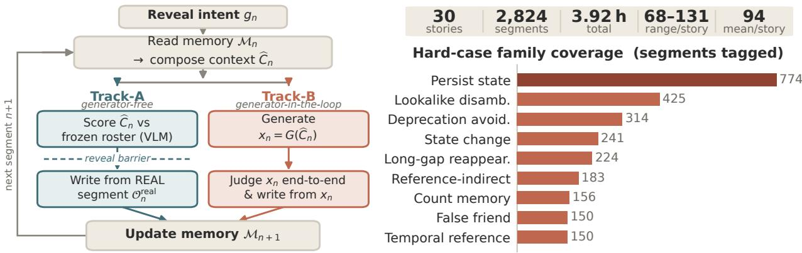  
Figure 2. (a) Causal evaluation. Both tracks read references for the current instruction. Track-A scores references before revealing the real next segment, then updates from that segment. Track-B generates and scores a clip, then updates from its own output. (b) Track-B cohort and stress coverage. A segment can carry multiple stress tags.

$$
\Delta _ { \pi } = ( R _ { \pi } - R _ { \widetilde { \cal Q } } , { \cal P } _ { \pi } - { \cal P } _ { \widetilde { \cal Q } } , { \cal A } _ { \pi } - { \cal A } _ { \widetilde { \cal Q } } ) .\tag{2}
$$

Here π denotes a memory policy and ∅ denotes the nomemory condition. Each stress family has its own rate. Paired story-clustered bootstrap 95% CIs describe variation across stories conditional on one rollout per condition/story (App. D.1). Because each condition writes its own generated history, $\Delta _ { \pi }$ compares whole policies, not isolated reference choices within an identical history.

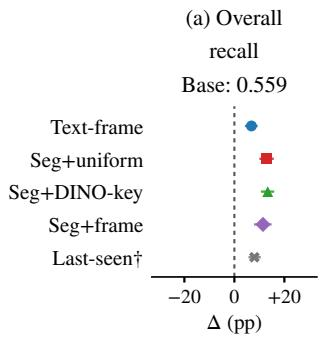

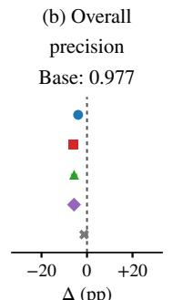  
Δ (pp)

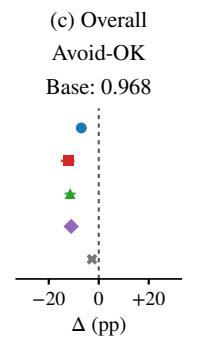

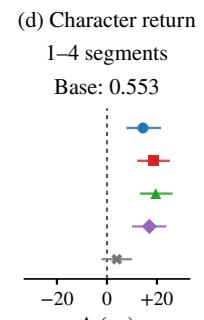  
Δ (pp)

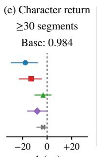  
Δ (pp)

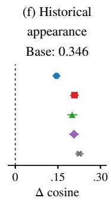  
Figure 3. Overall memory trade-offs and diagnostic slices. Points: policy minus no memory (zero line); whiskers: paired story-bootstrap 95% CIs conditional on one rollout/story. Titles give absolute no-memory baselines. (a,b) Pooled character/prop Recall and Precision; (c) forbidden-entity Avoid-OK. (d,e) Character-return recall; 61/62 long-gap returns change state with prompt-described looks. All five use the same percentage-point scale. (f) Historical DINOv3 cosine on a separate scale, on policy-dependent subsets detected in both appearances; higher need not mean more correct. †Gold-ID Last-seen uses a variable budget; retrieval uses K=3.

Table 3. Track-B: generated-video outcomes by stress (30 stories/system; higher is better). Cells are absolute rates. In shared-generator policy rows, blue/+ and red/− mark paired story-bootstrap 95% CIs above/below the first-row no-memory baseline; unmarked cells have no supported direction. Long-gap pools characters and props; Table 4 separates them. Overall is pooled character/prop recall. The separate released-system block uses different generators and is not a memory-only comparison. Stress-level judge sensitivity: Sec. 4.6.
<table><tr><td rowspan="2">System</td><td colspan="5">Presence, identity, and count</td><td colspan="2">State correctness</td><td colspan="2">Entity exclusion</td><td>All</td></tr><tr><td>Long-gap rec.</td><td>Look-alike False-fr. acc.</td><td>acc.</td><td>Count acc.</td><td>Temporal rec.</td><td>State-chg acc.</td><td>Persist acc.</td><td>Avoid avoid.</td><td>Indirect avoid.</td><td>Overall↑ rec.</td></tr><tr><td colspan="9">Shared generator: no-memory baseline, four retrieval policies, Last-seen control</td><td></td></tr><tr><td>No memory (K=0)</td><td>0.890</td><td>0.952</td><td>0.980</td><td>0.779</td><td>0.867</td><td>0.991</td><td>0.689</td><td>0.964</td><td>0.852</td><td>0.559</td></tr><tr><td>Text-frame ret.</td><td>0.819</td><td>0.964</td><td>0.960</td><td>0.803</td><td>0.827</td><td>0.995</td><td>0.802+</td><td>0.889</td><td>0.694</td><td>0.628+</td></tr><tr><td>Seg+uniform ret.</td><td>0.871</td><td>0.959</td><td>0.900</td><td>0.794</td><td>0.860</td><td>0.991</td><td>0.783+</td><td>0.829</td><td>0.705-</td><td>0.689+</td></tr><tr><td>Seg+DINO-key ret.</td><td>0.905</td><td>0.980</td><td>0.893</td><td>0.819</td><td>0.893</td><td>0.991</td><td>0.772+</td><td>0.839</td><td>0.694⁻</td><td>0.693+</td></tr><tr><td>Seg+frame ret.</td><td>0.871</td><td>0.983+</td><td>0.920</td><td>0.821</td><td>0.887</td><td>0.986</td><td>0.797+</td><td>0.843</td><td>0.628</td><td>0.674+</td></tr><tr><td>Last-seen refs</td><td>0.881</td><td>0.966</td><td>0.967</td><td>0.783</td><td>0.740⁻</td><td>0.996</td><td>0.778+</td><td>0.939-</td><td>0.809</td><td>0.639+</td></tr><tr><td colspan="9">Separate setting: released systems with their own generators</td><td></td><td></td></tr><tr><td>MemFlow</td><td>0.238</td><td>0.957</td><td>0.440</td><td>0.615</td><td>0.300</td><td>0.991</td><td>0.758</td><td>0.921</td><td>0.754</td><td>0.360</td></tr><tr><td>LongLive-RAG</td><td>0.386</td><td>0.981</td><td>0.740</td><td>0.718</td><td>0.327</td><td>0.994</td><td>0.712</td><td>0.983</td><td>0.929</td><td>0.284</td></tr><tr><td>IAMFlow</td><td>0.186</td><td>0.949</td><td>0.393</td><td>0.659</td><td>0.253</td><td>1.000</td><td>0.751</td><td>0.916</td><td>0.781</td><td>0.356</td></tr></table>

## 4. Experimental Findings

## 4.1. Controlled Comparison

We evaluate four retrieval policies. Text-frame ranks individual historical frames by text similarity; Seg+uniform retrieves text-matched segments and samples frames uniformly; Seg+DINO-key chooses visually diverse DINOv3 keyframes from retrieved segments; and Seg+frame re-ranks frames within the top text-retrieved segments. Track-A scores their selected references at a cap of B=16. Track-B uses K=3 references from each condition’s own generated history. One shared generator combines FLUX.2 keyframe composition with Wan2.2-TI2V-5B five-second video generation. We compare against no memory (no historical references) and last-seen (the most recent generated appearance of each required entity, selected using gold entity IDs, but no gold pixels or descriptions). Last-seen is a privileged diagnostic control, not a deployable baseline or a bound on achievable performance. Results use one rollout per story and condition; paired story-clustered 95% CIs characterize variation across these 30 stories, conditional on those rollouts (App. D.1). Released systems form a separate nativegenerator block in Table 3; generator differences preclude memory-only comparisons (App. C).

The evaluated cohort has 152 character, 300 prop, and 120 location records; all 30 stories contain all nine stress families (Supplementary Table 11). These authored probes do not represent the distribution of movie genres.

Table 4. Return recall and prompt information (30 stories). No memory: absolute recall; DINO-key ∆R: difference from it. Gray subscripts: full paired story-bootstrap 95% CI width; bold: CI excludes zero. $+ / - / ? :$ counts of four retrieval policies with CIs above/below/including zero. Gaps: segments; prompts describe changed looks in 61/62 long-gap character returns. Only (b) changes prompts; see Supplementary Table 17.
<table><tr><td colspan="6">(a) Original prompts: observational groups</td></tr><tr><td>Entity</td><td>Gap</td><td>n</td><td>No memory</td><td>DINO-key ∆R</td><td>Policies +/-/?</td></tr><tr><td>Character</td><td>1-4 ≥30</td><td>430 62</td><td>0.553 0.984</td><td> $\mathbf { + 0 . 1 9 5 } _ { 0 . 1 2 0 }$   $- 0 . 0 3 2 _ { 0 . 1 3 0 }$ </td><td>4/0/0 0/2/2</td></tr><tr><td>Prop</td><td>1-4 ≥30148</td><td>271</td><td>0.635 0.851</td><td> $+ 0 . 0 4 1 _ { 0 . 1 1 0 }$   $+ 0 . 0 3 4 _ { 0 . 1 9 0 }$ </td><td>0/0/4 0/0/4</td></tr><tr><td>(b) Appearance intervention: same 62 character returns</td><td></td><td></td><td></td><td></td><td>DINO-key</td></tr><tr><td colspan="6">DINO-key Last-seen  $\mathrm { N o }$ </td></tr><tr><td>Prompt Described</td><td>memory 0.984</td><td></td><td>R</td><td>R</td><td>∆R</td></tr><tr><td>Stripped</td><td>0.565</td><td></td><td>0.952 0.581</td><td>0.952 0.565</td><td> $- 0 . 0 3 2 _ { 0 . 1 3 0 }$   $+ 0 . 0 1 6 _ { 0 . 3 0 7 }$ </td></tr></table>

## 4.2. Finding I: Recall and Continuity Improve

On the shared generator, retrieval increases pooled character/prop recall from 0.559 without memory to 0.628–0.693 (Table 3). For short-gap character returns (1–4 segments), whose instructions typically identify the character by name, no-memory recall is 0.553, versus 0.698–0.749 with retrieval (Fig. 3d). Table 4a separates entity types (Table 3 pools characters and props in its long-gap column): all four retrieval policies reliably help short-gap characters, while none establishes a long-gap gain for characters or props. None establishes a gain for short-gap props either: pooling entity types can hide which returns benefit from memory. These groups differ in prompt content and state changes; they do not isolate an absence-gap effect.

A prompt-intervention check. Long absence alone does not demonstrate a need for memory: no-memory recall rises from 0.58 at gaps of 1–4 segments to 0.89 at 30 or more, where prompts more often specify an object’s appearance or a character’s changed look. Table 4b tests the latter confound on 62 long-gap character returns. Removing appearance descriptions lowers no-memory presence from 0.984 to 0.565. Seg+DINO-key then differs from no memory by only +0.016, with a 95% CI spanning zero. This establishes prompt-information sensitivity, not a reliable retrieval gain on the stripped subset: assess prompt information before attributing long-gap success to memory.

Continuity beyond presence. Memory also changes how a returning entity looks. Conditional on returning entities localized in both appearances, the mean DINOv3 crop similarity to their previous appearance is 0.35 without memory and 0.49–0.57 with retrieved references (Table 5); similar gains occur at longer gaps (App. D.2). This is appearance continuity, not proof that the appearance is correct for the entity’s current story state. Missed or unlocalized returns are excluded, and the detected subset can differ across policies. A pairwise VLM judge also reports continuity gains, but calls 78% of different-entity negative-control pairs the same individual when both entities are visible (Supplementary Table 16). It is therefore an optimistic check (App. D.2).

Table 5. Historical appearance continuity. DINOv3 crop cosine: no-memory means and policy deltas (∆). Bold: paired storybootstrap 95% CI excludes zero. N counts eligible events; detected pairs vary by policy. Changed: characters returning after ≥30 segments; similarity can reward obsolete looks.
<table><tr><td>Policy</td><td>All returns Characters N = 1130</td><td> $N = 4 8 6$ </td><td> $\mathrm { P r o p s }$   $N = 6 4 4$ </td><td>Changed  $N = 6 1$ </td></tr><tr><td>No memory</td><td>0.35</td><td>0.27</td><td>0.41</td><td>0.19</td></tr><tr><td>Text-frame ∆</td><td>+0.15</td><td>+0.13</td><td>+0.16</td><td>+0.18</td></tr><tr><td>Seg+uniform ∆</td><td>+0.21</td><td>+0.20</td><td>+0.21</td><td>+0.20</td></tr><tr><td>Seg+DINO-key ∆</td><td>+0.20</td><td>+0.19</td><td>+0.21</td><td>+0.20</td></tr><tr><td>Seg+frame ∆</td><td>+0.21</td><td>+0.18</td><td>+0.23</td><td>+0.15</td></tr><tr><td>Last-seen ∆</td><td>+0.23</td><td>+0.23</td><td>+0.22</td><td>+0.23</td></tr></table>

## 4.3. Finding II: Past Fidelity Can Harm the Present

The benefit comes with a measurable cost. Pooled Precision drops from 0.977 without memory to 0.915–0.938 with retrieval; pooled Avoid-OK falls from 0.968 to 0.845–0.898 (Fig. 3a–c). These changes have paired story-bootstrap 95% CIs excluding zero under the pinned judge. For example, Seg+DINO-key has a +0.133 Recall gain (95% CI +0.111 to +0.155), but a −0.057 Precision change (−0.066 to −0.048) and a −0.114 Avoid-OK change (−0.132 to −0.098). Report the signed effects in Eq. 2 together: recall gains can conceal unwanted appearances. In cases where a destroyed or deceased entity is forbidden, the deprecationfamily Avoid-OK drops from 0.964 to 0.829–0.889 (the deprecation-avoidance column in Table 3). The generator may render an entity carried in a relevant-looking historical frame, even when that entity should no longer be present. A single-author internal audit of 224 selected units from an earlier rollout traces errors to stored history, retrieval, synthesis, and judging (Fig. 4; App. G).

More subtly, a reference can preserve the wrong appearance. Among 62 long-gap character returns, 61 change state with an updated appearance described in the instruction (App. F). Across all 62 returns, no-memory presence according to the description reaches 0.984; all four retrieval policies decrease it by 0.03–0.18, with two paired CIs below zero (App. F). Their generated appearances move closer to the previous look, even though it is obsolete: on the

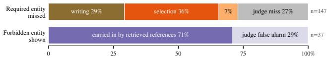  
Figure 4. Track-B: where a failure arises, from a stage-by-stage single-author audit of the four retrieval memories in an earlier rollout (pooled, inclusion-weighted conditional shares, not population failure rates). A missed required entity was already wrong in its previous appearance (writing), present there but not retrieved (selection), retrieved but lost in the keyframe or clip (synthesis), or rendered and missed by the judge. Forbidden-render units are reference-associated or judge false alarms; association does not identify a causal reference effect. Per-stratum shares are in Fig. 16b.

Table 6. Last-seen is not budget matched. Deltas from no memory by references used. Gray subscripts: full paired story-bootstrap 95% CI widths; bold: CI excludes zero. Different segments per group preclude causal count comparisons.
<table><tr><td>Refs</td><td>Segments</td><td>∆R</td><td> $\Delta P$ </td><td>∆A</td></tr><tr><td>1</td><td>1,803</td><td> $\mathbf { + 0 . 0 8 7 } _ { 0 . 0 4 4 }$ </td><td> $- 0 . 0 0 2 _ { 0 . 0 2 0 }$ </td><td> $- 0 . 0 1 2 _ { 0 . 0 2 8 }$ </td></tr><tr><td>2</td><td>842</td><td> $\mathbf { + 0 . 0 7 8 } _ { 0 . 0 6 3 }$ </td><td> $\mathbf { - 0 . 0 2 7 } _ { 0 . 0 2 0 }$ </td><td> $\mathbf { - 0 . 0 4 7 } _ { 0 . 0 3 2 }$ </td></tr><tr><td>3</td><td>149</td><td> $+ 0 . 0 3 8 _ { 0 . 0 9 2 }$ </td><td> $- 0 . 0 3 1 _ { 0 . 0 6 7 }$ </td><td> $- 0 . 0 5 2 _ { 0 . 1 0 4 }$ </td></tr></table>

61 changed returns, DINOv3 similarity rises from 0.19 by +0.15–+0.20 (Table 5). The 62-return presence analysis includes one unchanged return; the two measures also have different visibility conditions. Evaluate current-state correctness alongside historical resemblance; matching the past does not establish correctness now.

The gold-informed last-seen control reduces, but does not eliminate, reference interference: its pooled Recall/Precision/Avoid-OK are 0.639/0.964/0.941. Even an entity-matched historical frame can contain a retired bystander or an outdated state. Its performance must also be read alongside its smaller, variable reference count, rather than interpreted as a budget-matched oracle. Table 6 separates its reference-count groups; their different segments preclude causal count comparisons (App. C.4, App. F.6). Cross-judge support varies by policy; Sec. 4.6 summarizes what replicates and the scope of the H3 backend check.

## 4.4. Finding III: Relevance Is Not Utility

Track-A complements these output measures by scoring retrieved references before generation. Seg+DINO-key yields the highest reference recall (0.923 on BlenderOpenMovies, 0.849 on LSMDC), but lower precision (0.579/0.484) than Text-frame (0.692/0.630). Text-frame instead achieves the best F1 (0.817/0.670; Table 7). The diverse-keyframe policy thus has higher coverage but lower precision; this comparison does not isolate diversity from its other retrieval choices. Inspect reference evidence and generated outcomes separately. These unmatched tracks do not measure a transfer function from retrieval scores to downstream success. The table also reports retrieval redundancy and selection efficiency. Across the tested reference caps, F1 rises with diminishing returns and Text-frame retains the highest F1 (Fig. 5). Each cap truncates a policy’s own reference ranking; this does not isolate reference-count effects in generated videos. The heatmap separates entity and event slices (Fig. 6); among the displayed LSMDC events, DINO-key’s recall advantage over Text-frame is smallest for state changes.

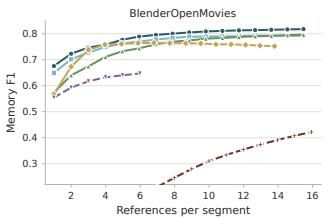

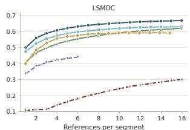  
Text-frame Seg+frame Seg+uniform Seg+DINO-key LongLive-RAG MemFlow

Figure 5. Track-A reference F1 versus budget. Each curve keeps a memory’s own top-ranked references up to a growing cap. F1 keeps rising with the cap but with shrinking returns, and the ordering holds at every budget: Text-frame leads throughout, and the released memories stay far below. Panels: BlenderOpenMovies (left) and LSMDC (right).
<table><tr><td rowspan=2 colspan=1>Text-frameSeg+uniform</td><td rowspan=1 colspan=3>.84.83.79</td><td rowspan=1 colspan=1>.80</td><td rowspan=1 colspan=1>.77.79</td><td rowspan=1 colspan=2>.78.79.80.79</td></tr><tr><td rowspan=1 colspan=1>.86</td><td rowspan=1 colspan=1>.81</td><td rowspan=1 colspan=1>.77</td><td rowspan=1 colspan=1>.81</td><td rowspan=1 colspan=1>.68.74</td><td rowspan=1 colspan=1>.74.77.75</td><td rowspan=1 colspan=1>.73</td></tr><tr><td rowspan=1 colspan=1>Seg+DINO-key</td><td rowspan=1 colspan=1>.93</td><td rowspan=1 colspan=1>.88</td><td rowspan=1 colspan=1>.85</td><td rowspan=1 colspan=1>.86</td><td rowspan=1 colspan=1>.77.82</td><td rowspan=1 colspan=2>.84.85.84.80</td></tr><tr><td rowspan=1 colspan=1>Seg+frame</td><td rowspan=1 colspan=1>.85</td><td rowspan=1 colspan=1>.77</td><td rowspan=1 colspan=1>.77</td><td rowspan=1 colspan=1>.80</td><td rowspan=1 colspan=1>.67.75</td><td rowspan=1 colspan=2>.75.77.76.79</td></tr><tr><td rowspan=1 colspan=1>LongLive-RAG</td><td rowspan=1 colspan=1>.58</td><td rowspan=1 colspan=1>.50</td><td rowspan=1 colspan=1>.57</td><td rowspan=1 colspan=1>.52</td><td rowspan=1 colspan=1>.33.51</td><td rowspan=1 colspan=1>.44.52.38</td><td rowspan=1 colspan=1>.52</td></tr><tr><td rowspan=1 colspan=1>MemFlow</td><td rowspan=1 colspan=1>.51</td><td rowspan=1 colspan=1>.34</td><td rowspan=1 colspan=1>.54</td><td rowspan=1 colspan=1>.58</td><td rowspan=1 colspan=1>.28.45</td><td rowspan=1 colspan=1>.52.54.56</td><td rowspan=1 colspan=1>.47</td></tr><tr><td rowspan=1 colspan=1></td><td rowspan=1 colspan=1>Char.</td><td rowspan=1 colspan=2>Prop Loc. C</td><td rowspan=1 colspan=1>har.</td><td rowspan=1 colspan=1>Prop Loc.</td><td rowspan=1 colspan=1>Re-Multi Scene State</td><td></td></tr></table>

Figure 6. What is hard on Track-A. Continuity recall by entity type (first six columns) and LSMDC event (last four). Darker orange means higher recall on a fixed 0–1 scale. Released memories, below the horizontal line, have lower recall across displayed slices. DINO-key leads nine slices; Text-frame leads LSMDC props.

Our location results do not show a retrieval failure: over 425 returns, retrieval raises whole-frame MegaLoc similarity by +0.15 to +0.21 over no memory (Supplementary Table 18). This embedding measures scene similarity, not location correctness. Separately, viewpoint and layout changes can challenge appearance-only cross-view matching, a problem addressed with geometry cues in Group Editing [10]. Geometry-aware location memory is therefore an untested hypothesis, not an explanation supported by our results.

## 4.5. Clip Quality Is Not Entity Correctness

The quality control scores all 2,824 clips per sharedgenerator condition with six VBench-style metrics [6]. No memory has higher subject and background consistency despite lower entity recall; Seg+DINO-key instead has higher imaging and aesthetic scores (Table 8). No quality metric correlates positively with per-clip entity recall above $\rho = 0 . 1 7$ in any condition. Within-clip stability can coexist with entity-level failures, so quality and entity correctness require separate reporting. This does not establish independence or eliminate all quality confounds.

Table 7. Track-A reference evidence at each memory’s own budget (Refs per segment). Precision/Recall/F1: correctness and entity coverage; $R _ { V } / R _ { S } { : }$ repetition (App. E). ${ \mathrm { S e l E f f } } = { \mathrm { P r e c } } ( 1 - R _ { V } )$ . Underline: highest score/lowest repetition. Refs is not ranked.
<table><tr><td rowspan="3">System</td><td colspan="7">BlenderOpenMovies</td><td colspan="7">LSMDC</td></tr><tr><td colspan="2">Correctness / coverage</td><td colspan="2"></td><td colspan="2">Efficiency / redundancy</td><td>Budget</td><td colspan="2">Correctness / coverage</td><td></td><td colspan="2">Efficiency / redundancy</td><td></td><td>Budget</td></tr><tr><td>Prec↑ Rec↑</td><td></td><td>F1↑</td><td>SelEff↑</td><td> $R _ { V }$  →</td><td> $R _ { S } \downarrow$ </td><td>Refs</td><td>Prec↑ Rec↑</td><td></td><td>F1↑</td><td>SelEff↑</td><td> $R _ { V } \downarrow$   $R _ { S }$ </td><td>→</td><td>Refs</td></tr><tr><td colspan="2">Retrieval memories (testbed)</td><td></td><td></td><td></td><td></td><td></td><td></td><td></td><td></td><td></td><td></td><td></td><td></td><td></td></tr><tr><td>Text-frame ret.</td><td>0.692</td><td>0.887</td><td>0.817</td><td>0.323</td><td>0.492</td><td>0.634</td><td>15.47</td><td>0.630 0.802</td><td></td><td>0.670</td><td>0.330</td><td>0.404</td><td>0.543</td><td>15.94</td></tr><tr><td>Seg+uniform ret.</td><td>0.662</td><td>0.883</td><td>0.796</td><td>0.297</td><td>0.515</td><td>0.650</td><td>15.47</td><td>0.566</td><td>0.769</td><td>0.622</td><td>0.264</td><td>0.454</td><td>0.605</td><td>15.92</td></tr><tr><td>Seg+DINO-key ret.</td><td>0.579</td><td>0.923</td><td>0.752</td><td>0.431</td><td>0.225</td><td>0.488</td><td>13.80</td><td>0.4840.849</td><td></td><td>0.591</td><td>0.393</td><td>0.143</td><td>0.393</td><td>14.82</td></tr><tr><td>Seg+frame ret.</td><td>0.667</td><td>0.869</td><td>0.792</td><td>0.294</td><td>0.525</td><td>0.637</td><td>15.47</td><td>0.5800.772</td><td></td><td>0.630</td><td>0.285</td><td>0.433</td><td>0.573</td><td>15.93</td></tr><tr><td colspan="2">Released memories</td><td></td><td></td><td></td><td></td><td></td><td></td><td></td><td></td><td></td><td></td><td></td><td></td><td></td></tr><tr><td>LongLive-RAG</td><td></td><td>0.6190.648</td><td>0.647</td><td>0.325</td><td>0.433</td><td>0.773</td><td>5.98</td><td>0.4470.506</td><td></td><td>0.441</td><td>0.267</td><td>0.283</td><td>0.665</td><td>6.00</td></tr><tr><td>MemFlow</td><td>0.321</td><td>0.597</td><td>0.422</td><td>0.194</td><td>0.294</td><td>0.625</td><td>15.94</td><td>0.2400.530</td><td></td><td>0.302</td><td>0.185</td><td>0.133</td><td>0.424</td><td>16.00</td></tr></table>

Table 8. Clip quality versus entity recall. Same 2,824 clips per condition; means with story-bootstrap 95% CIs; gray subscripts show full widths (upper minus lower). All metrics are higheris-better. Intervals condition on one rollout per story. Complete conditions and six quality metrics: Supplementary Table 19.
<table><tr><td>Metric</td><td>No memory Seg+DINO-key</td><td></td></tr><tr><td>Imaging</td><td> $0 . 6 4 5 _ { 0 . 0 1 5 }$ </td><td> $0 . 6 5 2 _ { 0 . 0 2 3 }$ </td></tr><tr><td>Aesthetic</td><td> $0 . 5 7 3 _ { 0 . 0 1 3 }$ </td><td> $0 . 5 9 5 _ { 0 . 0 2 4 }$ </td></tr><tr><td>Subject consistency</td><td>0.9350.004</td><td> $0 . 9 2 9 _ { 0 . 0 0 4 }$ </td></tr><tr><td>Background consistency</td><td> $0 . 9 4 1 _ { 0 . 0 0 2 }$ </td><td> $0 . 9 3 1 _ { 0 . 0 0 3 }$ </td></tr><tr><td>Per-clip entity recall</td><td> $0 . 5 5 4 _ { 0 . 0 6 8 }$ </td><td> $0 . 7 4 0 _ { 0 . 0 4 5 }$ </td></tr></table>

Table 9. Judge and backend sensitivity of Seg+DINO-key. Deltas from no memory; gray subscripts give full paired story-bootstrap 95% CI widths, conditional on one rollout per story. Cross-judge support counts policies with same-sign CIs excluding zero. Backend rows retain FLUX.2 keyframes. Limits: Sec. 4.6.
<table><tr><td>Judge / backend</td><td>∆R</td><td>∆P</td><td>∆A</td></tr><tr><td colspan="4">Judge check: Wan2.2, 30 stories</td></tr><tr><td>Qwen3-VL InternVL3.5</td><td> $+ 0 . 1 3 3 _ { 0 . 0 4 4 }$ </td><td> $- 0 . 0 5 7 _ { 0 . 0 1 8 }$ </td><td> $- 0 . 1 1 4 _ { 0 . 0 3 4 }$  +0.1230.049-0.0280.023-0.0500.032</td></tr><tr><td>Cross-judge support</td><td>4/4↑</td><td>3/4↓</td><td> $4 / 4 \downarrow$ </td></tr><tr><td colspan="4">Backend check: Qwen3-VL, 8 matched stories</td></tr><tr><td>Wan2.2</td><td> $+ 0 . 1 5 0 _ { 0 . 0 3 6 }$ </td><td> $- 0 . 0 6 1 _ { 0 . 0 3 2 }$ </td><td> $- 0 . 1 3 0 _ { 0 . 0 6 8 }$ </td></tr><tr><td> $\mathbf { M i n i M a x { - } H } 3$ </td><td> $+ 0 . 1 5 2 _ { 0 . 0 8 0 }$ </td><td> $- 0 . 0 4 6 _ { 0 . 0 3 2 }$ </td><td> $- 0 . 1 0 2 _ { 0 . 0 6 5 }$ </td></tr></table>

Table 8 averages recall over clips with required entities, whereas Table 3 pools entity decisions. Native-generator systems are excluded because their generators differ. Full metrics, conditions, and protocols are in App. F.5.

## 4.6. Sensitivity to the Judge and Video Backend

The aggregate trade-off largely survives rescoring the same videos (Table 9). Both judges support recall gains and Avoid-OK losses for all four retrieval policies. Precision losses are supported for three of four: Text-frame’s interval includes zero under InternVL3.5. On eight matched stories, MiniMax-H3 replaces Wan2.2 while retaining FLUX.2 keyframes and preserves all three Seg+DINO-key effects. Eight stories provide limited coverage of generators and rare states.

Absolute rates remain judge-dependent: no-memory Recall is 0.559 under Qwen3-VL and 0.361 under InternVL3.5. Required-present agreement is only 70–75% (κ = 0.43– 0.52), versus 88–91% for the full roster. Persistent-state gains and losses for indirect references and false friends are not significant under the second judge. Full results and agreement statistics: App. F.6.

Sensitivity to unparsable judgments. Removing 129– 143 of 2,824 segments (4.6–5.1%) per comparison where either arm’s judge output is unparsable preserves all four retrieval policies’ trade-offs: Recall +0.075 to +0.149, Precision −0.064 to −0.041, and Avoid-OK −0.128 to −0.073. All paired 95% CIs exclude zero (Supplementary Table 20a). Retained samples differ by policy, limiting effect-size comparisons. This check does not rule out systematic judging errors or bias from nonrandom missingness.

Crop-conditioned H3 changes the input pathway too; its copying failures are analyzed separately in App. F.6.

## 5. Conclusion

More memory does not necessarily mean better videos. In our controlled study, retrieved history improves entity recall and resemblance to earlier appearances, yet can reintroduce retired entities and reinforce obsolete states. Detailed prompts can also make long-gap generation succeed without visual memory. The practical lesson is to assess three distinct questions: what information history adds, which temporal state is valid, and what unwanted content accompanies useful evidence. Report these alongside perceptual quality; recall or historical resemblance alone does not establish memory utility. VMem-Bench provides evidence- and generation-stage measurements, with an evaluation checklist in App. A. These are assessment principles, not a validated controller or a universal memory-capacity law.

## LLM Usage Statement

We used OpenAI Codex to assist with manuscript writing and editing, as well as code writing and modification for data summarization, reproducibility checks, and figure and table preparation. The authors take full responsibility for the final manuscript, code, analyses, and reported results.

## References

[1] Zhaochong An, Menglin Jia, Haonan Qiu, Zijian Zhou, Xiaoke Huang, Zhiheng Liu, Weiming Ren, Kumara Kahatapitiya, Ding Liu, Sen He, Chenyang Zhang, Tao Xiang, Fanny Yang, Serge Belongie, and Tian Xie. Onestory: Coherent multi-shot video generation with adaptive memory. arXiv preprint arXiv:2512.07802, 2025. 2, 15

[2] Weijia Dou, Hui Li, Jiahao Cui, Lei Zhou, Jingdong Wang, and Siyu Zhu. Slotmemory: Object-centric kv memory for streaming long-video generation. arXiv preprint arXiv:2605.31033, 2026. 2, 17

[3] Ruozhen He, Meng Wei, Ziyan Yang, and Vicente Ordonez. EntityBench: Towards entity-consistent long-range multi-shot video generation. arXiv preprint arXiv:2605.15199, 2026. 2

[4] Qixin Hu, Shuai Yang, Wei Huang, Song Han, and Yukang Chen. Longlive-rag: A general retrieval-augmented framework for long video generation. arXiv preprint arXiv:2606.02553, 2026. 2, 16, 17

[5] Yuanzhe Hu, Yu Wang, and Julian McAuley. Evaluating memory in LLM agents via incremental multi-turn interactions. In International Conference on Learning Representations, 2026. 2

[6] Ziqi Huang, Yinan He, Jiashuo Yu, Fan Zhang, Chenyang Si, Yuming Jiang, Yuanhan Zhang, Tianxing Wu, Qingyang Jin, Nattapol Chanpaisit, Yaohui Wang, Xinyuan Chen, Limin Wang, Dahua Lin, Yu Qiao, and Ziwei Liu. VBench: Comprehensive benchmark suite for video generative models. arXiv preprint arXiv:2311.17982, 2023. 2, 7, 20

[7] Sihui Ji, Xi Chen, Shuai Yang, Xin Tao, Pengfei Wan, and Hengshuang Zhao. Memflow: Flowing adaptive memory for consistent and efficient long video narratives. arXiv preprint arXiv:2512.14699, 2025. 2, 16, 17

[8] Jinzhuo Liu, Jiangning Zhang, Wencan Jiang, Yabiao Wang, Dingkang Liang, Zhucun Xue, Ran Yi, and Yong Liu. Advancing narrative long video generation via training-free identityaware memory. arXiv preprint arXiv:2605.18733, 2026. 2, 16, 17

[9] Yue Ma, Kunyu Feng, Zhongyuan Hu, Xinyu Wang, Yucheng Wang, Mingzhe Zheng, Bingyuan Wang, Qinghe Wang, Xuanhua He, Hongfa Wang, Chenyang Zhu, Hongyu Liu, Yingqing He, Zeyu Wang, Zhifeng Li, Xiu Li, Sirui Han, Yike Guo, Wei Liu, Dan Xu, Linfeng Zhang, and Qifeng Chen. Controllable video generation: A survey. arXiv preprint arXiv:2507.16869, 2025. 2

[10] Yue Ma, Xinyu Wang, Qianli Ma, Qinghe Wang, Mingzhe Zheng, Xiangpeng Yang, Hao Li, Chongbo Zhao, Jixuan Ying, Harry Yang, Hongyu Liu, and Qifeng Chen. Group editing: Edit multiple images in one go. In Proceedings of

the IEEE/CVF Conference on Computer Vision and Pattern Recognition (CVPR), 2026. 7

[11] Yihao Meng, Zichen Liu, Hao Ouyang, Qiuyu Wang, Ka Leong Cheng, Yue Yu, Hanlin Wang, Haobo Li, Jiapeng Zhu, Yanhong Zeng, Xing Zhu, Yujun Shen, Qifeng Chen, and Huamin Qu. Causalcine: Real-time autoregressive generation for multi-shot video narratives. arXiv preprint arXiv:2605.12496, 2026. 2

[12] MiniMax. Minimax h3: An open model breaking the boundaries between tasks and modalities. https://www. minimax.io/blog/minimax-h3, 2026. Accessed: 2026-09-20. 16, 23

[13] Qwen Team. Qwen3-vl technical report. arXiv preprint arXiv:2511.21631, 2025. 13

[14] Dongyu Ru, Lin Qiu, Xiangkun Hu, Tianhang Zhang, Peng Shi, Shuaichen Chang, Jiayang Cheng, Cunxiang Wang, Shichao Sun, Huanyu Li, Zizhao Zhang, Binjie Wang, Jiarong Jiang, Tong He, Zhiguo Wang, Pengfei Liu, Yue Zhang, and Zheng Zhang. RAGChecker: A fine-grained framework for diagnosing retrieval-augmented generation. In Advances in Neural Information Processing Systems, 2024. 2

[15] Haoyuan Shi, Yunxin Li, Nanhao Deng, Zhenran Xu, Xinyu Chen, Longyue Wang, Baotian Hu, and Min Zhang. MSVBench: Towards human-level evaluation of multi-shot video generation. In Findings ofthe Associationfor Computational Linguistics: ACL 2026, 2026. 2

[16] Wan Team. Wan: Open and advanced large-scale video generative models. arXiv preprint arXiv:2503.20314, 2025. 16

[17] Xinyu Wang, Huafeng Shi, Zian Li, Yan Zhou, Xiaoqiang Liu, Yue Ma, and Pengfei Wan. Subjectanchor: Subject-aware memory-to-video for multi-shot storytelling. arXiv preprint arXiv:2609.34502, 2026. 2, 14, 15

[18] Xinyu Wang, Chongbo Zhao, Fangneng Zhan, and Yue Ma. Liveedit: Towards real-time diffusion-based streaming video editing. arXiv preprint arXiv:2606.26740, 2026. ECCV 2026. 2

[19] Di Wu, Hongwei Wang, Wenhao Yu, Yuwei Zhang, Kai-Wei Chang, and Dong Yu. Longmemeval: Benchmarking chat assistants on long-term interactive memory. In International Conference on Learning Representations, 2025. 2

[20] Weijia Wu, Mingyu Liu, Zeyu Zhu, Xi Xia, Haoen Feng, Wen Wang, Kevin Qinghong Lin, Chunhua Shen, and Mike Zheng Shou. Moviebench: A hierarchical movie level dataset for long video generation. In Proceedings ofthe IEEE/CVF Conference on Computer Vision and Pattern Recognition (CVPR), pages 28984–28994, 2025. 2

[21] Shuai Yang, Wei Huang, Ruihang Chu, Yicheng Xiao, Yuyang Zhao, Xianbang Wang, Muyang Li, Enze Xie, Yingcong Chen, Yao Lu, Song Han, and Yukang Chen. Longlive: Real-time interactive long video generation. arXiv preprint arXiv:2509.22622, 2025. 2

[22] Jung Yi, Minjae Kim, Paul Hyunbin Cho, Wooseok Jang, Sangdoo Yun, and Seungryong Kim. Worldkv: Efficient world memory with world retrieval and compression. arXiv preprint arXiv:2605.22718, 2026. 2, 17

[23] Jiwen Yu, Jianhong Bai, Yiran Qin, Quande Liu, Xintao Wang, Pengfei Wan, Di Zhang, and Xihui Liu. Context as

memory: Scene-consistent interactive long video generation with memory retrieval. arXiv preprint arXiv:2506.03141, 2025. 2, 17

[24] Shenghai Yuan, Yuanyang Yin, Zongjian Li, Xinwei Huang, Xiao Yang, and Li Yuan. Helios: Real real-time long video generation model. arXiv preprint arXiv:2603.04379, 2026. 2

[25] Kaiwen Zhang, Liming Jiang, Angtian Wang, Jacob Zhiyuan Fang, Tiancheng Zhi, Qing Yan, Hao Kang, Xin Lu, and Xingang Pan. Storymem: Multi-shot long video storytelling with memory, 2025. 2, 15

[26] Lvmin Zhang, Shengqu Cai, Muyang Li, Gordon Wetzstein, and Maneesh Agrawala. Frame context packing and drift prevention in next-frame-prediction video diffusion models. arXiv preprint arXiv:2504.12626, 2025. 2, 17

[27] Shengjun Zhang, Zhang Zhang, Simin Huang, Zhenyu Tang, Hanyang Wang, Chensheng Dai, Min Chen, Yifan Li, Yuxin Li, Yingjie Chen, Hao Liu, Chen Li, and Jing Lyu. Mbench: A comprehensive benchmark on memory capability for video world models. arXiv preprint arXiv:2606.00793, 2026. 2

[28] Lin Zhao, Yushu Wu, Yifan Gong, Yanzhi Wang, and Pu Zhao. Omnimem: Scalable and adaptive memory retrieval for long video generation. arXiv preprint arXiv:2605.30519, 2026. 2, 17

[29] Jinsong Zhou, Yihua Du, Xinli Xu, Luozhou Wang, Zijie Zhuang, Y. Zhang, Shuaibo Li, Xiaojun Hu, Bolan Su, and Ying-cong Chen. VideoMemory: Toward consistent video generation via memory integration. arXiv preprint arXiv:2601.03655, 2026. 2, 17

# More Memory, Better Videos? A Controlled Study of Visual Memory in Long-Video Generation

Supplementary Material

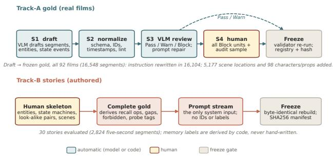  
Figure 7. How the two tracks are built and frozen. Track-A gold starts from a VLM draft of each real film; deterministic normalization and a VLM review route every blocked unit, plus a stratified sample of the rest, to blocking human review before the full validator re-runs and the gold is frozen. Track-B stories are authored: a human writes only the semantic skeleton, code derives every memory label and the prompt stream, and a story is frozen only if both rebuild byte-identically from the skeleton.

## Appendix

Roadmap. Data and cohort coverage: App. B; systems, controls, and reproduction: App. C; scoring and calibration: App. D; additional Track-A and Track-B results: Apps. E and F; author audit: App. G; design implications and limitations: App. H.

## A. Evaluation Lessons and Reader Checklist

What to take away. The study identifies three questions that a memory evaluation should keep distinct: whether history supplies information beyond the current instruction and any baseline context, whether its appearance matches the requested temporal state, and whether useful references carry unwanted entities. These are measurement questions, not a sufficient decision rule for reading memory. For example, a prompt describing a blue coat may still omit the face; textual detail alone does not establish that visual history is redundant. Likewise, an older appearance can be correct for an explicit flashback: validity is relative to the instruction, not simply reference recency. Table 10 turns the findings into reporting actions.

Choose the measurement boundary first. Use Track-A to inspect which references a policy supplies from revealed real-film history, before generation; use Track-B to inspect clips produced from the prompt stream and each policy’s own generated history. Track-A scores refer to selected reference items and entity coverage; Track-B scores refer to rendered appearances. The original tracks use different stories, so neither their absolute scores nor story-level associations form a paired retrieval-to-generation analysis. To study that relationship, use matched inputs and retain both reference and output measurements.

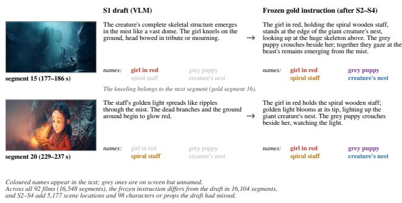  
Figure 8. From S1 draft to frozen gold. In two Spring segments, the VLM draft describes the action but leaves entities that are on screen unnamed, and the first draft also borrows an action from the next segment. The frozen instruction names every present entity by its roster name, so a memory can be asked for each of them. The footer counts the same kind of change over the whole corpus.

Read outcomes before rankings. A description-matching presence hit need not establish the same individual; a high similarity to the previous appearance need not establish the correct current state. Similarity conditions on detection in both appearances, so inspect visibility and missing returns before treating it as an unconditional success rate. In the sharedgenerator block, compare each policy with no memory using the recall/precision/Avoid-OK vector. Higher values are better for those three rates, but higher old-appearance similarity is ambiguous after a requested state change. Nativegenerator rows compare whole systems; Last-seen is a privileged, variable-budget diagnostic control. Neither supplies a memory-only ranking against the shared-generator retrieval policies.

Reproduce the intended object. For table inspection, use the frozen analysis JSON and renderers; for statistical reconstruction, use saved per-segment scores; for a new system, provide chronological outputs and the correctly indexed scoring view. App. C.7 gives the cohort, code, indexing, and snapshot checklist. A new rollout is a new measured trajectory, not a byte-identical reconstruction of the old pixels. Decisions to read, filter, or reject history remain hypotheses in Table 25; evidence for a measurement problem alone does not validate its proposed remedy.

Table 10. A checklist for evaluating visual-memory utility. Actions motivated by existing findings, not new experimental results. The checks distinguish information contribution, temporal validity, and unwanted content while retaining evidence-stage, quality, and uncertainty controls.
<table><tr><td>Assessment</td><td>What to report or compare</td><td>Interpretation boundary</td></tr><tr><td>Information contribution</td><td>Include no memory with the same non-memory inputs; record what Long absence alone does not show memory was appearance information the prompt and any baseline context supply. needed. Our stripping test does not establish a Where possible, contrast matched prompts with and without that reliable retrieval benefit or validate a reading gate. information (Table 4).</td><td></td></tr><tr><td>Temporal validity</td><td>Report description-matching presence and required state alongside Old resemblance can reward an obsolete look. More previous-appearance similarity; retain detection/visibility conditions (Table 5).</td><td>recent is not always more valid: flashbacks may require an earlier state.</td></tr><tr><td>Unwanted content</td><td>Report precision and forbidden-entity avoidance with recall, using the same story requirements (Table 3; Sec. 4.3).</td><td>A recall gain can coincide with extra entities. Whole-policy differences do not isolate a reference&#x27;s causal contribution.</td></tr><tr><td>Evidence versus use</td><td>Inspect selected-reference coverage/precision separately from generated outcomes; use matched instances if relating the two (Table 7).</td><td>Our Track-A and Track-B use different stories; do not infer a per-story correlation or downstream benefit from Track-A alone.</td></tr><tr><td>Perceptual quality</td><td>Retain clip-quality metrics and entity-level outcomes with explicit aggregation and denominators (Table 8).</td><td>Within-clip stability is not entity correctness. Weak measured correlation does not establish independence.</td></tr><tr><td>Uncertainty and controls</td><td>State rollout/seed counts, resampling units, judge agreement, budget, and whether the generator is shared (Table 9).</td><td>Story CIs condition on observed rollouts. Judge-sensitive strata, variable-budget Last-seen, and native-generator rows require separate interpretation.</td></tr></table>

## B. Data Construction and Cohort Coverage

## B.1. Benchmark Construction Pipeline (S1–S4)

Track-A gold is built in four stages followed by a deterministic freeze. Model outputs are replaceable proposals; stable identifiers, prompt completeness, and frozen gold are fixed by deterministic contracts and human adjudication. S1 drafts bounded segments, present entities, first appearances, and finite-ontology state events; a human-confirmed canonical roster is the naming authority. S2 deterministically normalizes schema, identifiers, timestamps, and duplicates and runs structural linting. S3 reviews each segment with Qwen3-VL-8B [13]; low-confidence/conflicting presence claims are rechecked and confirmed entities trigger deterministic prompt repair. Each unit receives PASS, WARN, BLOCK, or RETRYABLEERROR. S4 sends every BLOCK plus a stratified audit sample of the remaining units to blocking human review. Accepted decisions re-run the full deterministic validator. The final freeze writes the gold registry and layout hash; a changed layout/exclusion set creates a new data version. Every stage writes a derived artifact and never mutates the original draft. Fig. 7 summarizes both tracks’ construction, and Fig. 8 shows what the Track-A stages change in practice.

## B.2. Anatomy of a Frozen Gold Instance

A frozen Track-A movie is an ordered sequence of promptcomplete intents with harness-side typed entity records, lifecycle/state events, required memory records, and forbidden/deprecated records. Only the current intent and, after reveal, the real segment are visible to the system. Typed gold identities, persistent gold records, required targets, and forbidden targets remain scoring-only. Entity records use {character, prop, location} with canonical names and aliases. Track-A’s reappearance, multi-instance, scenereturn, and state-change labels are diagnostic tags over this same frozen structure. Fig. 9 shows one frozen film.

## B.3. Authored Stories and Cohort Coverage

A Track-B story is authored rather than annotated: a human writes the entities, their states, look-alike pairs, and scenes, and the scoring gold and prompt stream are derived from that skeleton. Fig. 10 shows how one story places every memory stress on its timeline.

Coverage of the evaluated stories. Table 11 summarizes only the 30 evaluated stories, not the larger authoring pool. They contain 2,824 segments, with median 87.5 and range 68–131 segments, and 181 entities with multiple defined appearance states. Every story contains all nine memory stresses, but counts are uneven: state-change tags occur in 241 segments and persistent states in 774. Tags can overlap; these are authored opportunities, not observed generation outcomes or the scorer’s entity-level denominators. Story titles span settings such as a lighthouse, night market, greenhouse, and subway, but no genre labels or distribution matching to real films are established. Topic variety therefore does not establish representativeness.

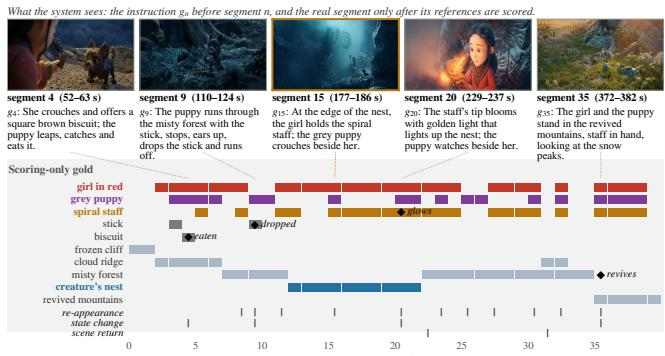  
Figure 9. Anatomy of a Track-A film (Spring, Blender Studio, CC BY 4.0). Top: five story segments with the instruction gn the system receives (English excerpts of the Chinese gold). Bottom, on grey: scoring-only gold for ten of the film’s eleven entities over segments 0–39 (the rest are titles and credits): where each entity is on screen, its state events, and the per-segment diagnostic tags. The grey puppy leaves after segment 10 and returns in segment 15, the case shown in Fig. 12.

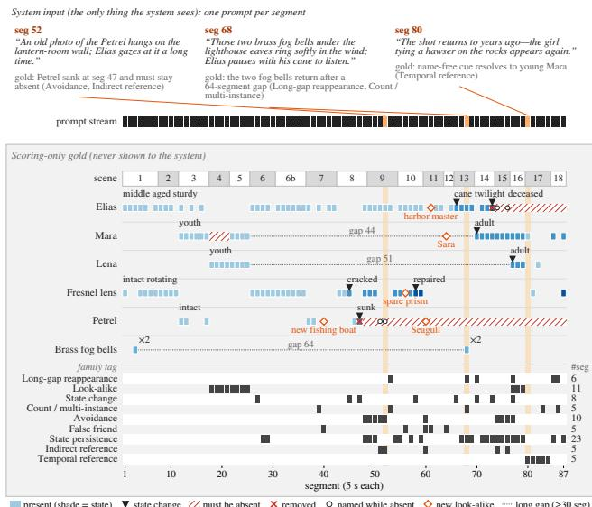  
Figure 10. How a Track-B script plants memory stresses. Story 0001\_lighthouse\_keeper (87 five-second segments, 19 scenes) drawn as a timeline. The system receives only the prompt stream (top; three prompts quoted verbatim); everything in the grey panel is scoring-only gold. Each lane is one of the story’s 19 entities: shade gives its authored state, hatching marks segments where it must be absent (after it is destroyed or dies, or while only its look-alike twin is on screen), open circles mark prompts that still name a removed entity, and diamonds mark newly introduced look-alikes; the bottom rows tick the segments tagged with each family of Table 1, with per-family counts at right.

## C. Systems, Controls, and Reproduction

## C.1. Comparison Scope and Neighboring Work

Relationship to neighboring memory systems. Table 12 compares the reported designs and measurements of OneStory, StoryMem, and SubjectAnchor with our study. They develop trained memory-conditioned generators and evaluate narrative quality, alignment, or identity. SubjectAnchor also explicitly studies shot-level inclusion/exclusion, so entity exclusion itself is not our novelty. Our diagnostic emphasis is the validity of selected historical evidence for the current state, its interaction with prompt information, and the distinction between reference quality and whole-policy outcomes. The table is a comparison of scope, not a common-protocol performance ranking; our policy effects do not establish the behavior of all three trained architectures.

SubjectAnchor comparison feasibility. SubjectAnchor uses a subject-aware trained architecture, a 50-story benchmark, and precomputed subject-centric keyframes with Wan2.2-I2V [17]. Our shared-generator comparison uses FLUX.2 keyframe composition followed by Wan2.2-TI2V. The public preprint links no implementation or checkpoint for running its model under our protocol, so a matched empirical comparison is not currently reproducible. We compare its stated task and findings, without claiming that our observed trade-off applies to every memory architecture.

## C.2. Causal Adapter Contract

Released causal systems are driven through authors’ released memory mechanisms and weights with only protocolrequired substitutions; the four retrieval memories are ours and form the controlled testbed. All scored rows share frozen gold, causal guard, materialization, and scoring. No gold crop or gold identity is exposed to an ordinary system; only the privileged last-seen control uses gold IDs for reference selection (App. C.4). On Track-A, self-generated observation is replaced by the revealed real segment; if a native write requires a model forward, we use one teacher-forced clean-context forward without denoising. Recalled items are mapped back to source frames through temporal identities and dropped if they violate the causal guard. Methods that require future story information or modalities absent from passive film are not assigned surrogate quantitative scores. Table 13 summarizes why the families’ internal diagnostics are not comparable and which common observables VMem-Bench uses.

Table 14 lists, for each memory we cite or test, what it stores, how it decides what to read, and whether and how it forgets.

Table 11. Coverage of the evaluated Track-B cohort. Only the 30 stories used in all six seed-2026 conditions are counted. Entity counts are story-local records. Right: tagged segments, number of stories containing the tag, and per-story count range. Tags overlap and are not scoring denominators or observed generation success rates.
<table><tr><td>Cohort property</td><td>Value</td><td>Memory stress</td><td>Segments</td><td>Stories</td><td>Range</td></tr><tr><td>Stories / segments</td><td>30 / 2,824</td><td>Look-alike</td><td>425</td><td>30</td><td>11-61</td></tr><tr><td>Segments: mean / median</td><td>94.1 / 87.5</td><td>State change</td><td>241</td><td>30</td><td>8-9</td></tr><tr><td>Segments: min-max</td><td>68-131</td><td>Persistent state</td><td>774</td><td>30</td><td>19-46</td></tr><tr><td>Scripted duration</td><td>3.92 h</td><td>Count memory</td><td>156</td><td>30</td><td>5-7</td></tr><tr><td>Character entities</td><td>152</td><td>False friend</td><td>150</td><td>30</td><td>5-5</td></tr><tr><td>Prop entities</td><td>300</td><td>Deprecation avoidance</td><td>314</td><td>30</td><td>8-16</td></tr><tr><td>Location entities</td><td>120</td><td>Indirect reference</td><td>183</td><td>30</td><td>4-10</td></tr><tr><td>Entities with multiple states</td><td>181</td><td>Long-gap return</td><td>224</td><td>30</td><td>5-11</td></tr><tr><td></td><td></td><td>Temporal reference</td><td>150</td><td>30</td><td>5-5</td></tr></table>

Table 12. Scope of neighboring visual-memory work. Designs and evaluation goals reported in the cited papers, rather than scores under a shared protocol. SubjectAnchor explicitly includes inclusion/exclusion control; our distinction concerns evidence-stage diagnostics, current-state scoring, and prompt-information sensitivity. The final row describes the controlled retrieval study, not a newly trained generator.
<table><tr><td>Work</td><td>Historical visual context</td><td>Learned conditioning</td><td>Reported evaluation focus</td></tr><tr><td>OneStory [1]</td><td>Semantically selected frames from earlier Fine-tuned I2V model with frame shots; compact global memory.</td><td>selection and an adaptive patch conditioner.</td><td>Character/environment consistency, shot quality, and semantic alignment in text- and image-conditioned multi-shot generation.</td></tr><tr><td>StoryMem [25]</td><td>Generated-shot keyframes selected semantically and filtered by aesthetic preference; dynamic memory bank.</td><td>using latent concatenation and negative global/single-shot prompt following, temporal RoPE shifts.</td><td>LoRA-trained memory-to-video model ST-Bench: cross-shot consistency, aesthetic quality, and human preference.</td></tr><tr><td>SubjectAnchor [17]</td><td>Subject-related precomputed keyframes traced to historical appearances.</td><td>Trained Wan2.2-I2V with subject-aware RoPE and partitioned memory attention.</td><td>Subject/prompt alignment, identity relative to first/previous appearances, visual quality, and inclusion/exclusion control.</td></tr><tr><td>VMem-Bench (this study)</td><td>Real-film evidence replay (Track-A); references from each policy&#x27;s generated history (Track-B).</td><td>Shared FLUX.2/Wan2.2 pipeline across retrieval policies and controls; no newly trained memory architecture.</td><td>Reference coverage/precision before generation; required and forbidden appearances, current state, conditional appearance similarity, prompt stripping, and judge/backend sensitivity.</td></tr></table>

## C.3. The Four Retrieval Memories

Track-A retrieval definitions. The adapter stores observed segment text and sampled video frames with temporal identities. Text-frame ranks historical frames by cross-modal similarity. Seg+uniform ranks segments by text similarity and uniformly samples frames. Seg+DINO-key uses the same segment ranking, 2-fps dense sampling, and greedy farthest-point DINOv3 diversity. Seg+frame reranking performs text coarse retrieval followed by frame-level cross-modal reranking with reciprocal rank fusion. Track-A reports their native cap B=16 and the budget sweep in Fig. 5.

Audited Track-B generation loop. All six sharedgenerator conditions (the four retrieval memories and the two controls) come from one run of the released testbed (vmem\_bench.testbed, seed 2026): one rollout per story and condition, all generated with the same code revision and scored by the same judge. Each story starts with an empty retrieval store and an empty entity bank. At segment n, the authored prompt $g _ { n }$ is used directly as the retrieval query. The history record for each prior segment stores that same authored prompt as both prompt text and description, together with frames decoded from that memory’s own previously generated MP4; no real-film frame, gold crop, or other memory’s trajectory enters the archive. Retrieval happens before write-back, with eligibility requiring the historical segment end time to be no later than the store clock. The resulting still images are then passed as composed references to a shared keyframe-first stack: FLUX.2 Klein 9B-KV FP8 composes either a text-only or multi-reference keyframe, and Wan2.2-TI2V-5B-Turbo expands it to a 121-frame segment (1280×704 render, delivered at 832×480). The generated segment is then appended to that memory’s own store and becomes available to later segments. The retrieval reference budget is K=3; the audited code defaults are 1-fps uniform sampling, 2-fps dense sampling, top-5 text-ranked segments, three DINO keyframes per segment, and reciprocal-rank fusion with k=60 for Seg+frame reranking. The scorer is the same pinned Qwen3-VL-32B judge used for every Track-B row, applied to the frozen story gold.

Table 13. Different internal memories, one common interface. The families expose different internal states and native diagnostics, so those quantities are not directly comparable and do not by themselves establish what reaches or survives generation. VMem-Bench maps them to common observables: boundary context ${ \widehat { \mathcal { C } } } _ { n }$ before synthesis (Track-A) and generated outcome $x _ { n }$ after synthesis (Track-B).
<table><tr><td>Memory family</td><td>Internal interface / native diagnostic</td><td>What internal-only evaluation cannot establish</td></tr><tr><td>KV</td><td>Window / frames, latents, or KV; recency / native attention; cache reach</td><td>Retention does not imply that intent-relevant evidence crosses the finite conditioning boundary; stale history may remain active.</td></tr><tr><td>Retrieval</td><td>indexed frames / clips; search + rank; Recall@ K / similarity</td><td>Larger K can buy recall while increasing context spend or contamination; a good retrieval decision may still fail in</td></tr><tr><td>Entity / state memory</td><td>persistent identity / state Correct records do not guarantee records; address, update, that the right visual evidence is filter; record validity</td><td>synthesis. materialized under budget or realized correctly by the generator.</td></tr></table>

Realization-layer scope. The reported retrieval rollouts are keyframe-first: selected stills are composed into a single FLUX scene keyframe, and Wan receives that image as its first-frame condition. This is useful for holding a simple realization mechanism fixed, but it introduces a structural bias: memory that should emerge only later in the segment may be pulled into the first frame. The codebase also contains Wan2.2-I2V-A14B backends with SVI/Morphic LoRA variants, but the reported Track-B retrieval rows did not use those paths; they used Wan2.2-TI2V-5B-Turbo. A unified multimodal reference-conditioned generator such as Mini-Max H3 [12], which accepts text, image, video, and audio context directly, is a natural future replacement because it may avoid collapsing multiple memory cues into one forced first-frame keyframe. When we designed the Track-B realization setup, H3 had not yet been open-sourced; the main results therefore use the FLUX-to-Wan scaffold. We have since run all six conditions on 8 stories with two H3 realizations (App. F.6, Table 22); we make no claim that H3 improves VMem-Bench scores.

Provenance. The testbed’s production files are internally 0- indexed whereas Track-B gold is 1-indexed, so scoring reads a view that maps GT seg\_k to production seg\_{k-1}. Every condition scores all 2,824/2,824 segments. The release pins the code revision and the scored snapshots rather than a moving source tree.

## C.4. Last-Seen Reference Control

For Track-B segment n, the control reads the gold cast and keeps the characters and props that must appear and have appeared before. It orders them by gap (longest first), keeps up to three, and for each takes the middle frame of this rollout’s own clip of the segment in which the entity last appeared; duplicates are merged. The generator receives only these frames, never gold text, names, or images, and a guard admits only clips that this run produced strictly before segment n. Because the needed entity was usually on screen just before, 1,803 segments receive one reference, 842 two, 149 three, and 30 (the first segment of each story) none. The control shows what a memory gains by choosing the right entity at its latest moment; it is not an information upper bound, since it hands over fewer references than retrieval and its frame may itself be a wrong earlier rendering.

## C.5. Released Causal-Memory Systems

LongLive-RAG. Each revealed Track-A segment is VAE-encoded to Wan latents [16] with the released LongLive-RAG [4] wrapper and published LatentAE. The released latent-memory rule performs cosine top-k retrieval with memory\_size=6, recent\_exclude=5, and $\mathtt { s i n k \_ s i z e = 1 }$ . Track-B uses the released generatorcoupled system.

MemFlow. MemFlow [7] combines a recent window with a compressed long-term KV bank. We teacher-force each revealed Track-A segment through the released base+LoRA clean-context commit path, record the local window and surviving bank blocks, and recover source frames via bitexact fingerprints of retained KV blocks. The temporal RoPE table is extended to the film length with the same closed-form rotary embedding. Track-B uses the released generator-coupled path.

IAMFlow. IAMFlow [8] scores frames using the native diffusion transformer’s KV cache. Its offline driver precomputes entities from the full prompt list; our causal adapter disables this future look-ahead and uses native per-prompt processing. Track-B uses the released generator-coupled stack. Track-A is reported only as a scalability diagnostic because the native per-frame KV archive exceeds host memory on long films.

## C.6. IAMFlow Track-A Scalability

IAMFlow’s native long-term archive copies per-frame K/V slices to host memory. For its Wan2.1-T2V-1.3B backbone, one archived frame costs approximately $3 0 \times 2 \times 1 5 6 0 \times$ 1536 × 2 bytes ≈ 274 MiB. In our driver, 15-second segments add about 5.3 GiB of anonymous host memory per segment; with an 800–900 GiB host-memory budget, the native carrier reaches a hard horizon of roughly three thousand archived KV frames. We do not substitute a bounded-KV variant because it changes the memory carrier used for recall.

Table 14. How causal video memories read and forget. Every read matches the current instruction, latest frame, camera pose, or attention query by similarity or relevance, and forgetting is either absent, a budget eviction ranked by that same relevance, or age-based compression; no causal system evicts or withholds an entry because the story changed its state. Only IAMFlow and the non-causal VideoMemory keep explicit entity records, and both address them by the entities named in the current instruction or shot.
<table><tr><td>System</td><td>Stored as</td><td>Read by</td><td>Forgets by</td><td>Causal</td></tr><tr><td colspan="5">Released / published memories</td></tr><tr><td>FramePack [26]</td><td>Frame latents, compressed by importance rank</td><td>All history, ordered by recency or similarity</td><td>Geometric compression; tail deleted or pooled</td><td>Partly (endpoint</td></tr><tr><td>MemFlow [7]</td><td>Local KV window + KV bank</td><td>Prompt-to-frame attention, top-k</td><td>Budget; keeps top-k by prompt relevance</td><td>plans) Yes</td></tr><tr><td>IAMFlow [8]</td><td>Entity-ID registry + archived frame KV</td><td>Set cover of IDs named in prompt</td><td>None; archive grows, read capped</td><td>Yes</td></tr><tr><td>LongLive-RAG [4]</td><td>Evicted latent KV + AE embedding</td><td>Cosine to latest latent, top-K</td><td>None; every evicted frame kept</td><td>Yes</td></tr><tr><td>Context-as-Memory [23]</td><td>Raw generated frames</td><td>Camera FOV overlap with target view</td><td>None; read capped at k</td><td>Yes</td></tr><tr><td>WorldKV [22]</td><td>Evicted KV chunks, pose-indexed</td><td>Camera/action pose distance, top-k</td><td>No chunk eviction; redundant tokens pruned</td><td>Yes</td></tr><tr><td>OmniMem [28]</td><td>Full-history KV blocks, GPU/CPU</td><td>Per-head attention top-K, local excluded</td><td>None; LRU only offloads to CPU Yes</td><td></td></tr><tr><td>SlotMemory [2]</td><td>Slot-indexed KV tokens, fixed bank</td><td>Prompt-text + visual relevance, top-k</td><td>Budget; evicts least prompt/visual relevance</td><td>Yes</td></tr><tr><td>VideoMemory [29]</td><td>Entity ID, attribute text, reference image</td><td>LLM attribute match per planned shot</td><td>None; new states appended</td><td>No (full script)</td></tr><tr><td colspan="5">Our testbed probes (App. C.3) Text-frame</td></tr><tr><td></td><td>Segment text + timestamped frames</td><td>Instruction-to-frame cross-modal similarity</td><td>None; append-only, read capped Yes</td><td></td></tr><tr><td>Seg+uniform</td><td>Segment text + timestamped frames</td><td>Segment text similarity; uniform frames</td><td>None; append-only, read capped Yes</td><td></td></tr><tr><td>Seg+DINO-key</td><td>Segment text + timestamped frames</td><td>Segment text similarity; DINOv3 diverse frames</td><td>None; append-only, read capped Yes</td><td></td></tr><tr><td>Seg+frame</td><td>Segment text + timestamped frames</td><td>Segment text, then frame rerank (RRF)</td><td>None; append-only, read capped Yes</td><td></td></tr></table>

## C.7. Reproduction Checklist

The current shared-generator results use run tag testbed\_rerun\_20260927, seed 2026, and code revision 0b41d3d; the older retrieval batches and prospective three-seed commands do not describe additional measured seeds. The reproduction checklist separates three operations: rendering frozen analysis tables, recomputing statistics from saved scores, and generating new video.

1. Use the exact 30-story cohort and its gold/prompt SHA256 list; the larger authoring pool is not the evaluated cohort.

2. Select the six conditions, fixed prompts, seed, and generator configuration; keep Last-seen’s privileged plan separate.

3. Map gold segment k to generated segment k − 1 through the gold-numbered scoring view before calling the scorer.

4. Pin judge models/settings, retain per-segment scores and parse failures, and use the specified paired story boot-

strap.

5. Regenerate tables from the frozen analysis JSON, without replacing those inputs with newly scored or partially completed runs.

6. Check artifact distribution separately: local result symlinks do not establish that a public snapshot is downloadable.

A metadata audit found 180 saved run manifests from the same clean revision, each condition recording all 2,824 successful segments, and 180 corresponding score snapshots. Current cohort gold and prompts match the pinned generation checkout byte for byte. This checks saved metadata and file fingerprints; it does not regenerate pixels or verify external download availability. Only the bundled example is certified by the legacy freeze manifest; the cohort’s 60 input hashes are recorded in the separate coverage snapshot.

Table 15. IAMFlow host-memory growth observed during our Track-A scalability test. The limiting quantity is the number of archived KV frames, which scales with total observed video duration rather than simply with the number of benchmark segments. The predicted GiB column is the archived-KV tensor payload from shape alone; OOM rows exceed the fixed host-memory budget before a full-movie scored output can be produced.
<table><tr><td>Movie</td><td>Segs.</td><td>Mean seg.</td><td>KV frames</td><td>Pred. GiB</td><td>Outcome</td></tr><tr><td>0053_Rendezvous_mit_Joe_Black</td><td>221</td><td>7.3s</td><td>2071</td><td>555</td><td>completed</td></tr><tr><td>sita_sings_the_blues_part1</td><td>164</td><td>14.9s</td><td>3259</td><td>873</td><td>OOM</td></tr><tr><td>0013_Halloween</td><td>128</td><td>14.9s</td><td>2442</td><td>654</td><td>completed</td></tr><tr><td>1005_Signs</td><td>296</td><td>9.8s</td><td>3763</td><td>1008</td><td>OOM</td></tr><tr><td>0017_Pianist</td><td>235</td><td>13.8s</td><td>4287</td><td>1148</td><td>OOM</td></tr></table>

## D. Scoring Protocols and Calibration

## D.1. Entity Scoring and Statistical Uncertainty

Track-A metrics. Precision, Recall, F1, SelEf, $R _ { V }$ , and $R _ { S }$ are defined in Sec. 3.3. The judge scores each reference independently against the frozen roster and the real next segment. Redundancy then uses multimembership groups, so a reference that covers several gold entities contributes to each of those groups rather than to an arbitrary first label. $R _ { V }$ is repeated-view redundancy inside those groups, and $R _ { S }$ is the pair-weighted mean DINOv3 cosine among crops of the same entity. Headline Precision, Recall, and F1 are not rewritten by that grouping. Dataset numbers are unweighted means over a film’s segments, then over films.

Causal guard and budget sweeps. Every reference carries source time and is materialized at that recalled time. Any item at or after the current segment start is dropped. Fig. 5 truncates each system’s own ranked output at increasing caps $K = 1 , \ldots , 1 6 ;$ it is a diagnostic budget sweep, not per-K retuning.

Track-B metrics. Each family f defines an opportunity set $\mathcal { O } _ { f }$ and predicate $\operatorname { s a t } _ { f } ( o )$ with $\begin{array} { r l } { p _ { f } } & { { } = } \end{array}$ $\begin{array} { r } { | \mathcal { O } _ { f } | ^ { - 1 } \sum _ { o \in \mathcal { O } _ { f } } \operatorname { s a t } _ { f } ( o ) } \end{array}$ . Must-remember families use recall, identity/state/count families use accuracy, and must-notrender families use avoidance-OK.

Family definitions and native metrics are in Table 1.

Track-B uses one deterministic judge call per segment $( k _ { \mathrm { v o t e s } } { = } 1$ , temperature 0). The blinded roster mixes present, forbidden/deprecated, look-alike, and deterministic decoy entities. Decoy FPR / abstention for MemFlow, IAMFlow, and LongLive-RAG are 0.050/0.057, 0.054/0.049, and 0.016/0.132, respectively; the last pair illustrates why precision-like metrics must be read with coverage. When the judge returns no parsable answer for a segment, every entity on its list counts as abstained: required entities are missed and forbidden ones absent. This happens for 91, 101, 112, and 115 of the 2,824 segments of Text-frame, Seg+uniform, Seg+DINO-key, and Seg+frame, and for 55 of the no-memory control (2–4%), so it slightly lowers the retrieval memories’ recall relative to the control. Fig. 11 shows judge verdicts next to human labels on real units, including the two kinds of miss that make Track-B recall conservative.

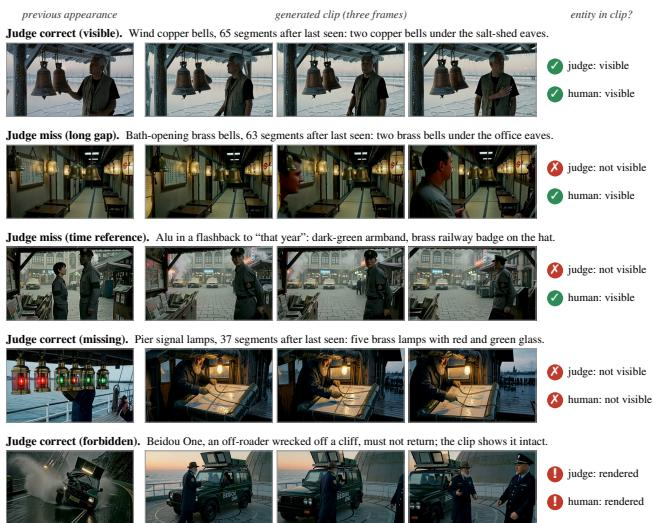  
Figure 11. Track-B judge verdicts checked against human labels on real units. Each row shows the entity’s previous appearance in the same rollout, three frames of the generated clip, the verdict of the pinned Qwen3-VL-32B judge, and the human label for the clip. In rows 1, 4 and 5 the judge is right about a required entity being present or absent and about a forbidden entity being rendered; 28 of 32 judge-confirmed controls were confirmed. In rows 2 and 3 the judge reports a required entity as missing although it is clearly rendered; such misses make up 27% of sampled required-entity failures and concentrate at long gaps and time references, so Track-B recall there is conservative.

Uncertainty of memory effects. Every difference between a retrieval memory and the no-memory control is given with a paired, story-clustered bootstrap: the 30 stories are resampled with replacement 2,000 times (seed 20260925), the same draw is applied to both conditions, and counts are pooled within the draw before taking the rate. The 95% interval is the 2.5th–97.5th percentile of the difference; all values are in tables/experiments/memory\_gain\_ bootstrap.json. Each condition is one closed-loop rollout per story, so these intervals capture story-level variation, not rollout-to-rollout variation.

Table 16. Calibration of the identity-consistency metrics. Positive controls pair two disjoint frame sets of the same clip; negative controls pair two different entities of the same kind and story. For the embeddings, the threshold is the Youden-optimal cut on these controls, fixed before any condition was scored. The VLM judge answers the same question twice with 0.993–1.000 exact agreement.
<table><tr><td>Metric</td><td>pos./neg. pairs</td><td>AUC</td><td>threshold</td><td>pos. median</td><td>neg. median</td></tr><tr><td>DINOv3 crop</td><td>385/389</td><td>1.000</td><td>0.67</td><td>0.96</td><td>0.19</td></tr><tr><td>ArcFace face</td><td>201/157</td><td>0.997</td><td>0.35</td><td>0.84</td><td>0.11</td></tr><tr><td>MegaLoc scene</td><td>200/200</td><td>1.000</td><td>0.66</td><td>0.89</td><td>0.07</td></tr><tr><td>DINOv3 scene</td><td>200/200</td><td>1.000</td><td>0.84</td><td>0.98</td><td>0.17</td></tr></table>

VLM pairwise judge same when both visible: 0.98 (pos.), 0.78 (neg.); neg. not consistent: 0.93

## D.2. Identity Measurement and Calibration

The presence judge checks each entity against its gold description only, so it cannot tell a returning character from a description-matching stranger. Two versioned scorers in VMem-Bench measure identity directly; the full protocol, prompts, thresholds, and model installer are in the benchmark’s scoring documentation.

Units. From the frozen gold, one unit per return of a character or prop that was absent in the previous segment but seen before (1,130 units), plus a seeded 20% sample of returns from the previous segment (583) and the characters that return changed after 30 or more segments (61). The previous appearance is the latest earlier segment whose cast lists the entity; both appearances come from the same rollout of the same condition.

VLM pairwise judge (trackB-identity-1.0). For each appearance, three frames (15, 50, and 85% of the clip) side by side. The judge receives both strips, the entity’s name, kind, and gold description at each appearance (with a note when a state change is expected), is told to ignore camera, pose, lighting, and background, and answers in JSON whether the entity is visible in each strip and, if in both, whether it is the same individual (face, hair, build, clothing; shape, color, material, markings for props). The condition is hidden. The scorer also reports the share of units where the entity is visible in both clips and judged the same, but this rate depends on how well the previous appearance was rendered, which memory affects through the earlier segments of the rollout: for characters returning changed after 30 or more segments, the current clip shows the character in almost every condition (0.98–1.00) and visible pairs are almost always called the same (0.93–1.00), so nearly the whole difference between conditions (0.10 vs. 0.46–0.57) comes from the old appearance. We therefore report the same-individual rate among returns visible in both clips, which compares the two appearances only.

Embeddings (trackB-embed-1.0). GroundingDINO localizes the entity in each frame from its name and description; the crop is embedded with DINOv3 and, for characters, the largest face in the crop with ArcFace. Locations use the whole frame through MegaLoc, a place-recognition model, with whole-frame DINOv3 as a secondary check; wholeframe similarity is not used for characters or props, since a memory that copies a reference’s composition would score high without the entity being the same. The similarity of a unit is the highest cosine over frame pairs detected on both sides; we report its mean over units detected on both sides.

Calibration and uncertainty. Positive controls pair two disjoint frame sets of one clip; negative controls pair two different entities of the same kind and story (Table 16). The embeddings separate them almost perfectly, the VLM judge less so: it rarely calls two visible look-alikes different, so its same-individual rate is optimistic. DINOv3 crop similarity is therefore the primary identity measure and the VLM judge a check. Three frames can miss a brief appearance. Differences to no memory use the same paired story bootstrap as all Track-B results (Table 18).

## E. Additional Track-A Results

## E.1. Coverage, Precision, and Redundancy

The repetition columns of Table 7 separate two kinds of redundancy. Seg+DINO-key has the best selection efficiency (0.431/0.393), the lowest appearance similarity $R _ { S } ~ ( 0 . 4 8 8 / 0 . 3 9 3 )$ , and near-lowest view repetition $R _ { V }$ (0.225/0.143; MemFlow 0.133 on LSMDC), yet it is the least precise retrieval memory: diverse views are not the same as correct views. Fig. 12 shows both effects on one segment.

## E.2. Reference Budget

Fig. 5 lets each memory hand over more of its own topranked references: F1 rises with shrinking returns, and the

Text-frame Seg+frame Seg+uniform Seg+DINO-key LongLive-RAG MemFlow  
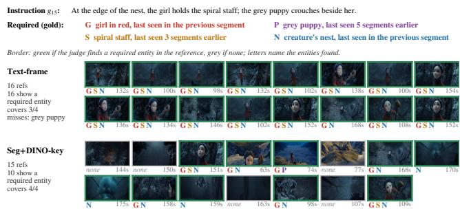  
Figure 12. Every reference two memories hand over for Spring segment 15. Text-frame returns 16 near-identical views of the girl in the forest and never the puppy, last seen five segments earlier. Seg+DINO-key samples diverse views, finds the puppy on the cloud ridge (74 s), and covers all four entities, but five of its 15 references show none of them. Letters are the automatic judge’s labels; it also tags some misty-forest frames before 144 s as the nest, which does not change which references count as correct here.

ordering of the memories holds at every tested budget. The curves are shown in the main paper; they measure reference evidence, not generation utility.

## E.3. Growing History

Fig. 13 tracks F1 as the archived film grows: retrieval stays nearly flat, while the released memories keep losing; since they evict or compress entries while the testbed re-ranks the full history, this decline mixes lossy storage with reading.

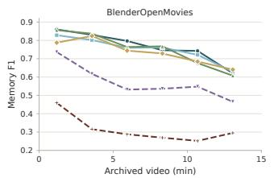

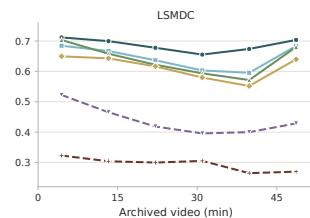  
Figure 13. Track-A memory F1 versus archived-video length (same runs as Table 7). Retrieval remains comparatively stable as history grows; the released causal-memory paths lose more F1. The far bins contain few films. Left: BlenderOpenMovies; right: LSMDC.

## F. Additional Track-B Results

## F.1. Qualitative Rollouts

Fig. 14 shows what the Track-B numbers look like in pixels (from an earlier rollout of the same testbed): on the same prompt stream, retrieval restores a character seen one segment earlier that the no-memory generator replaces with a stranger, and it also returns a dead character whom the prompt names only through his plaque.

## F.2. Return Gaps and Prompt Information

Fig. 15 shows why a recall-versus-gap curve misleads: every condition, including no memory, recalls more at long gaps, because a returning entity is named in the instruction and, after a long absence, usually described (Table 17); paired differences to no memory assess the added benefit of each complete policy.

Entity kind and gap. Table 17 splits recall by entity kind. The gap bins mix kinds: returns within four segments are mostly characters named only by name, while returns after 30 or more segments are mostly props whose names describe them and characters coming back changed with the new look in the instruction. Memory’s gain is concentrated in the first group; in the second, references add nothing for props and hurt for changed characters.

## F.3. Identity and Historical Appearance

Full identity results are in Table 18; protocols and calibration are in App. D.2. Similarities condition on detected/visible pairs and may reward obsolete appearances.

## F.4. Effects across Memory Stresses

Fig. 16 maps every memory stress for no memory, last-seen references, and the four retrieval memories, and repeats the human attribution by stratum.

## F.5. Per-Clip Quality Control

VMem-Bench measures memory, not visual quality; this control asks whether per-clip quality could explain the memory differences within the shared-generator testbed. Every one of the 2,824 Track-B clips of each condition is scored with VBench 0.1.5’s own models and formulas [6]: imaging quality (MUSIQ), aesthetic quality (LAION head on CLIP ViT-L/14), subject consistency (DINO), background consistency (CLIP), dynamic degree (RAFT), and motion smoothness (AMT). Image metrics use eight fixed frames per clip; runs are deterministic. Table 19 reports means with story-clustered bootstrap 95% CIs and the mean per-clip entity recall of the same clips. Across the four retrieval memories the largest standardized difference in any quality metric is 0.27, and no metric correlates with per-clip recall above ρ=0.17 in any condition. The no-memory control has lower recall but higher subject and background consistency (standardized differences 0.18–0.45): these metrics reward within-clip stability, which a rollout that never recalls earlier evidence can achieve. Released systems are omitted because they use different generators.

## (a) Short-gap return

Required: ranger Zheng He, last seen in seg\_011. The prompt calls him only “he”.   
Prompt: “He tears a scrap of tape and sticks the radio's   
loose antenna.”

## (b) Dead, named indirectly

Forbidden: night guard Old Shi, who died in seg\_101. The prompt names only his plaque.   
Prompt: “Maisui's fingertip traces Old Shi's name carved on the founding brass plaque.”

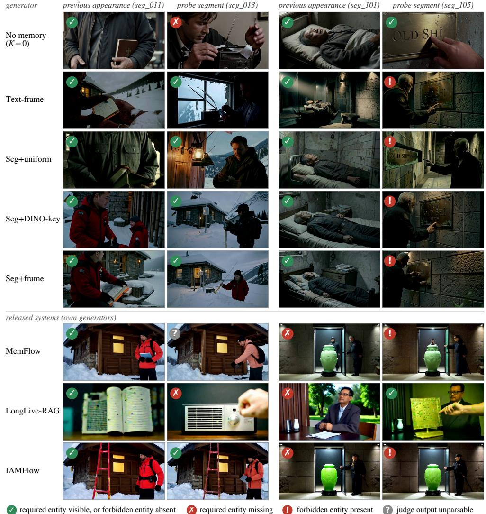  
Figure 14. Track-B rollouts on two memory probes: memory brings back a recently seen character, and also a dead one. Rows are systems given the same prompt stream; columns show the entity’s previous appearance and the probe segment (middle frame of each generated clip). In (a) the no-memory generator draws a stranger for “he” while all four retrieval memories restore the ranger; in (b) no memory keeps the dead guard out, but all four retrieval memories, MemFlow, and IAMFlow put him back at his plaque. Badges are the automatic judge’s verdicts for that entity, and Track-B Recall and Avoid-OK pool such verdicts over all 2,824 segments; the released systems use their own generators.

## F.6. Sensitivity Checks

## F.6.1. Unparsable Judgments and Reference-Count Strata

Table 20 repeats the comparisons with no memory on segments whose judge output parsed in both arms, since an unparsable output counts every required entity as missed and retrieval produces more of them (91–115 segments against 55 for no memory and 79 for last-seen references). All main effects stay: gains at 1–4 segments and for persistent states, no presence gain at 30 or more segments, and lower precision and avoidance. Between 5 and 29 segments the three segment memories also gain significantly (+0.05), which the full data leaves uncertain. The second part splits the last-seen control by how many references it used. Both costs grow with count, but these are unmatched segment groups: the association does not isolate a reference-count effect. At two references, last-seen’s measured costs are about half those of retrieval on its different, three-reference sample.

Table 17. Track-B recall by entity kind and absence gap. No-memory recall and each condition minus no memory (paired story-bootstrap 95% CI; gray subscripts show full CI widths (upper minus lower); bold when it excludes zero). Just seen means the entity was on screen in the previous segment. Characters are named only by name after their first appearance; 61 of the 62 character returns after 30 or more segments come back changed, with the new look in the instruction. Props often carry their look in the name. Text, Uniform, DINO-key, and Frame are the four retrieval memories.
<table><tr><td>Gap (segments)</td><td></td><td colspan="3"> $\mathrm { N o }$  n memory</td><td colspan="3">Uniform DINO-key</td><td>Last-seen</td></tr><tr><td>Character just seen</td><td></td><td>2173</td><td>0.493</td><td> $\mathbf { + 0 . 1 0 6 } _ { 0 . 0 7 }$ </td><td> $\mathbf { + 0 . 1 9 8 } _ { 0 . 0 6 }$ </td><td> $\mathbf { + 0 . 2 0 1 } _ { 0 . 0 6 }$ </td><td> $\mathbf { + 0 . 1 9 1 } _ { 0 . 0 8 }$ </td><td> $\mathbf { + 0 . 1 4 3 } _ { 0 . 0 7 }$ </td></tr><tr><td></td><td>1-4</td><td>430</td><td>0.553</td><td> $\mathbf { + 0 . 1 4 4 } _ { 0 . 1 3 }$ </td><td> $\mathbf { + 0 . 1 8 6 } _ { 0 . 1 2 }$ </td><td> $\mathbf { + 0 . 1 9 5 } _ { 0 . 1 2 }$ </td><td> $\mathbf { + 0 . 1 7 0 } _ { 0 . 1 2 }$ </td><td> $+ 0 . 0 4 0 _ { 0 . 1 2 }$ </td></tr><tr><td></td><td>5-29</td><td>63</td><td>0.714</td><td> $- 0 . 0 4 8 _ { 0 . 2 4 }$ </td><td> $\mathbf { + 0 . 1 4 3 } _ { 0 . 2 3 }$ </td><td> $+ 0 . 1 1 1 _ { 0 . 2 5 }$ </td><td> $+ 0 . 0 6 4 _ { 0 . 2 8 }$ </td><td> $- 0 . 0 1 6 _ { 0 . 2 2 }$ </td></tr><tr><td></td><td>≥30 (returns changed)</td><td>62</td><td>0.984</td><td> $\mathbf { - 0 . 1 7 7 } _ { 0 . 2 1 }$ </td><td> $\mathbf { - 0 . 1 2 9 } _ { 0 . 1 8 }$ </td><td> $- 0 . 0 3 2 _ { 0 . 1 3 }$ </td><td> $- 0 . 0 8 1 _ { 0 . 1 6 }$ </td><td> $- 0 . 0 3 2 _ { 0 . 0 8 }$ </td></tr><tr><td>Prop</td><td>just seen</td><td>1087</td><td>0.399</td><td> $\mathbf { + 0 . 0 7 0 } _ { 0 . 0 6 }$ </td><td> $\mathbf { + 0 . 1 1 8 } _ { 0 . 0 9 }$ </td><td> $\mathbf { + 0 . 1 1 1 } _ { 0 . 0 8 }$ </td><td> $\mathbf { + 0 . 0 8 5 } _ { \mathrm { 0 . 0 9 } }$ </td><td> $\mathbf { + 0 . 0 4 9 } _ { 0 . 0 6 }$ </td></tr><tr><td></td><td>1-4</td><td>271</td><td>0.635</td><td> $+ 0 . 0 1 5 _ { 0 . 0 9 }$ </td><td> $+ 0 . 0 4 4 _ { 0 . 1 1 }$ </td><td> $+ 0 . 0 4 1 _ { 0 . 1 1 }$ </td><td> $+ 0 . 0 4 4 _ { 0 . 0 9 }$ </td><td> $\mathbf { + 0 . 0 9 6 } _ { 0 . 1 1 }$ </td></tr><tr><td></td><td>5-29</td><td>230</td><td>0.717</td><td> $+ 0 . 0 1 3 _ { 0 . 1 0 }$ </td><td> $+ 0 . 0 1 3 _ { 0 . 1 0 }$ </td><td> $+ 0 . 0 2 2 _ { 0 . 0 9 }$ </td><td> $+ 0 . 0 0 0 _ { 0 . 1 0 }$ </td><td> $- 0 . 0 0 4 _ { 0 . 0 9 }$ </td></tr><tr><td></td><td>≥30</td><td>148</td><td>0.851</td><td> $- 0 . 0 2 7 _ { 0 . 1 8 }$ </td><td> $+ 0 . 0 2 7 _ { 0 . 1 8 }$ </td><td> $+ 0 . 0 3 4 _ { 0 . 1 9 }$ </td><td> $+ 0 . 0 0 7 _ { 0 . 1 5 }$ </td><td> $+ 0 . 0 0 0 _ { 0 . 1 5 }$ </td></tr></table>

Table 18. Track-B identity consistency. No-memory value and each condition minus no memory; N counts eligible events, while policy-specific detected/visible subsets determine the analyzed means (bold: paired story-bootstrap 95% CI excludes zero). Embeddings: mean cosine similarity between the previous and current appearance (DINOv3 on the localized entity; MegaLoc on the whole frame for locations), over returns detected on both sides. VLM: share judged the same individual among returns visible in both clips (lenient, Table 16). Returns are character and prop re-appearances after at least one segment away; returns changed are characters whose look changed after 30 or more segments, for which a higher similarity means the return looks more like its old look.
<table><tr><td>Stratum</td><td>Eligible N</td><td> $\mathrm { N o }$  memory</td><td>∆</td><td>Text Uniform ∆</td><td> $\mathrm { D I N O - k e y }$  ∆</td><td>∆</td><td>Frame Last-seen ∆</td></tr><tr><td colspan="8">DINOv3 crop similarity (trackB-embed-1.0)</td></tr><tr><td>All returns</td><td>1130</td><td>0.35</td><td>+0.15</td><td>+0.21</td><td>+0.20</td><td>+0.21</td><td>+0.23</td></tr><tr><td>Characters</td><td>486</td><td>0.27</td><td>+0.13</td><td>+0.20</td><td>+0.19</td><td>+0.18</td><td>+0.23</td></tr><tr><td>Props</td><td>644</td><td>0.41</td><td>+0.16</td><td>+0.21</td><td>+0.21</td><td>+0.23</td><td>+0.22</td></tr><tr><td>Gap 1-4</td><td>688</td><td>0.30</td><td>+0.15</td><td>+0.22</td><td>+0.21</td><td>+0.21</td><td>+0.25</td></tr><tr><td>Gap 5–29</td><td>293</td><td>0.36</td><td>+0.16</td><td>+0.19</td><td>+0.19</td><td>+0.19</td><td>+0.17</td></tr><tr><td> $\mathrm { G a p } \geq 3 0$ </td><td>149</td><td>0.53</td><td>+0.12</td><td>+0.18</td><td>+0.17</td><td>+0.20</td><td>+0.19</td></tr><tr><td>Returns changed,  $\geq 3 0$ </td><td>61</td><td>0.19</td><td>+0.18</td><td>+0.20</td><td>+0.20</td><td>+0.15</td><td>+0.23</td></tr><tr><td colspan="8">VLM pairwise judge: same individual when visible in both (trackB-identity-1.0)</td></tr><tr><td>All returns</td><td>1130</td><td></td><td>0.84 +0.12</td><td>+0.12</td><td>+0.12</td><td>+0.12</td><td>+0.12</td></tr><tr><td>Characters</td><td>486</td><td>0.77</td><td>+0.17</td><td>+0.17</td><td>+0.15</td><td>+0.15</td><td>+0.14</td></tr><tr><td>Props</td><td>644</td><td>0.87</td><td>+0.11</td><td>+0.12</td><td>+0.12</td><td>+0.13</td><td>+0.12</td></tr><tr><td> $\operatorname { G a p 1 - 4 }$ </td><td>688</td><td>0.85</td><td>+0.10</td><td>+0.11</td><td>+0.10</td><td>+0.10</td><td>+0.10</td></tr><tr><td> $\mathrm { G a p } 5 { - 2 9 }$ </td><td>293</td><td>0.86</td><td>+0.11</td><td>+0.11</td><td>+0.12</td><td>+0.14</td><td>+0.11</td></tr><tr><td> $\mathrm { G a p } \geq 3 0$ </td><td>149</td><td>0.80</td><td>+0.17</td><td>+0.19</td><td>+0.18</td><td>+0.19</td><td>+0.18</td></tr><tr><td colspan="8">ArcFace face similarity, characters</td></tr><tr><td>Characters</td><td>486</td><td>0.13</td><td>+0.01</td><td>+0.06</td><td>+0.05</td><td>+0.04</td><td>+0.09</td></tr><tr><td>Returns changed,  $\geq 3 0$ </td><td>61</td><td>0.06</td><td>+0.07</td><td>+0.08</td><td>+0.08</td><td>+0.08</td><td>+0.05</td></tr><tr><td colspan="8">MegaLoc scene similarity, locations</td></tr><tr><td>Locations</td><td>425</td><td></td><td>0.11 +0.15</td><td>+0.21</td><td>+0.18</td><td>+0.19</td><td>+0.09</td></tr></table>

## F.6.2. Independent Judge

Table 21 rescores the same videos with InternVL3.5-30B-A3B, a judge from another model family, given the same roster, prompt, and clip (16 frames). It calls an entity present far less often in every condition (no-memory recall 0.361 against 0.559). The two judges give the same verdict on 88% of roster entries in every memory condition and on

91% without memory, where fewer entities are on screen $( \kappa 0 . 6 2 – 0 . 6 7 ) .$ , so their disagreement is not concentrated in any arm. Under the second judge every memory’s recall gain keeps its size (+0.060 to +0.128, every CI above zero), and the costs of similarity retrieval keep their sign at about half the size (Avoid-OK −0.015 to −0.054, every CI below zero; precision −0.008 to −0.032, three of four below zero), while the smaller costs of last-seen references vanish. The per-stress effects are less stable: the gains for persistent states, the losses for indirect references and false friends, and the last-seen loss for time references are not significant under the second judge, so they rest on the pinned judge alone.

Table 19. Per-clip VBench-style quality on the shared-generator testbed (all 2,824 clips per condition). Each cell gives the mean with its story-clustered bootstrap 95% CI; gray subscripts show full widths (upper minus lower); Clip rec. is the mean per-clip entity recall of the frozen judge on the same clips. Best in each column is underlined.
<table><tr><td>Condition</td><td></td><td>Imaging↑ Aesthetic↑ Subj. cons.↑ Bg. cons.↑ Dynamic↑ Motion sm.↑ Clip rec.↑</td><td></td><td></td><td></td></tr><tr><td>Text-frame</td><td> $0 . 6 3 4 _ { 0 . 0 2 4 }$ </td><td> $0 . 5 8 4 _ { 0 . 0 2 2 }$   $0 . 9 2 6 _ { 0 . 0 0 4 }$ </td><td> $0 . 9 3 0 _ { 0 . 0 0 4 }$ </td><td> $0 . 5 2 1 _ { 0 . 0 5 8 }$   $0 . 9 9 3 3 _ { 0 . 0 0 0 5 }$ </td><td> $0 . 6 7 2 _ { 0 . 0 4 9 }$ </td></tr><tr><td>Seg+uniform</td><td> $\underline { { 0 . 6 6 0 } } _ { 0 . 0 2 2 }$ </td><td> $\underline { { 0 . 5 9 6 } } _ { 0 . 0 2 4 }$   $0 . 9 2 9 _ { 0 . 0 0 5 }$ </td><td> $0 . 9 3 1 _ { 0 . 0 0 3 }$ </td><td> $0 . 4 8 5 _ { 0 . 0 7 1 }$   $0 . 9 9 3 1 _ { 0 . 0 0 0 6 }$ </td><td> $0 . 7 3 5 _ { 0 . 0 4 2 }$ </td></tr><tr><td> $\mathrm { S e g { + } D I N O { - } k e y }$ </td><td> $0 . 6 5 2 _ { 0 . 0 2 3 }$ </td><td> $0 . 5 9 5 _ { 0 . 0 2 4 }$   $0 . 9 2 9 _ { 0 . 0 0 4 }$ </td><td> $0 . 9 3 1 _ { 0 . 0 0 3 }$ </td><td> $0 . 4 9 3 _ { 0 . 0 7 3 }$   $0 . 9 9 3 1 _ { 0 . 0 0 0 5 }$ </td><td> $\underline { { 0 . 7 4 0 _ { 0 . 0 4 5 } } }$ </td></tr><tr><td>Seg+frame</td><td> $0 . 6 5 2 _ { 0 . 0 2 4 }$ </td><td> $0 . 5 9 5 _ { 0 . 0 2 3 }$   $0 . 9 2 8 _ { 0 . 0 0 5 }$ </td><td> $0 . 9 3 1 _ { 0 . 0 0 3 }$ </td><td> $0 . 4 7 5 _ { \mathrm { 0 . 0 6 0 } }$   $\underline { { 0 . 9 9 3 3 } } _ { 0 . 0 0 0 5 }$ </td><td> $0 . 7 3 1 _ { 0 . 0 3 5 }$ </td></tr><tr><td>No memory  $( K { = } 0 )$ </td><td> $0 . 6 4 5 _ { \mathrm { 0 . 0 1 5 } }$ </td><td> $0 . 5 7 3 _ { 0 . 0 1 3 }$   $\underline { { 0 . 9 3 5 } } _ { 0 . 0 0 4 }$ </td><td> $\underline { { 0 . 9 4 1 } } _ { 0 . 0 0 2 }$ </td><td> $\underline { { 0 . 5 4 9 _ { 0 . 0 4 1 } } }$   $0 . 9 9 3 2 _ { 0 . 0 0 0 4 }$ </td><td> $0 . 5 5 4 _ { 0 . 0 6 8 }$ </td></tr></table>

Table 20. Robustness of the Track-B memory effects. Differences to no memory with paired story-bootstrap 95% CIs; gray subscripts show full CI widths (upper minus lower); bold when the CI excludes zero. (a) Dropping every segment on which either arm’s judge output failed to parse leaves all main effects in place; the three segment memories also gain significantly at 5–29 segments. (b) Last-seen effects are stratified by reference count; groups contain different segments, so this is not a count intervention.
<table><tr><td colspan="8">(a) Minus no memory, segments with a parsable judge output in both arms</td></tr><tr><td>Condition</td><td>dropped</td><td>Recall</td><td></td><td>Precision Avoid-OK</td><td>1-4</td><td>5-29</td><td>≥30</td></tr><tr><td>Text-frame</td><td>129</td><td> $\mathbf { + 0 . 0 7 5 } _ { \mathrm { 0 . 0 5 } }$ </td><td> $\mathbf { \sigma } _ { - 0 . 0 4 1 } \mathbf { \sigma } _ { 0 . 0 2 }$ </td><td> $\mathbf { \delta } _ { - 0 . 0 7 3 } \mathbf { \ } _ { 0 . 0 3 }$ </td><td> $\mathbf { + 0 . 1 0 5 } _ { \mathrm { 0 . 0 9 } }$ </td><td> $+ 0 . 0 1 5 _ { 0 . 1 0 }$ </td><td> $- 0 . 0 6 7 _ { 0 . 1 3 }$ </td></tr><tr><td>Seg+uniform</td><td>138</td><td> $\mathbf { + 0 . 1 3 9 } _ { 0 . 0 5 }$ </td><td> $\mathbf { - 0 . 0 6 4 } _ { 0 . 0 3 }$ </td><td> $\mathbf { - 0 . 1 2 8 } _ { 0 . 0 4 }$ </td><td> $\mathbf { + 0 . 1 5 4 } _ { 0 . 1 0 }$ </td><td> $\mathbf { + 0 . 0 5 2 } _ { 0 . 0 9 }$ </td><td> $- 0 . 0 1 4 _ { 0 . 1 4 }$ </td></tr><tr><td>Seg+DINO-key</td><td>143</td><td> $\mathbf { + 0 . 1 4 9 } _ { 0 . 0 5 }$ </td><td> $\mathbf { - 0 . 0 5 7 } _ { 0 . 0 2 }$ </td><td> $\mathbf { - 0 . 1 1 8 } _ { 0 . 0 4 }$ </td><td> $\mathbf { + 0 . 1 5 2 } _ { 0 . 1 0 }$ </td><td> $\mathbf { + 0 . 0 5 0 } _ { 0 . 1 0 }$ </td><td> $+ 0 . 0 2 9 _ { 0 . 1 1 }$ </td></tr><tr><td>Seg+frame</td><td>142</td><td> $\mathbf { + 0 . 1 3 1 } _ { 0 . 0 6 }$ </td><td> $\mathbf { - 0 . 0 5 8 } _ { 0 . 0 2 }$ </td><td> $\mathbf { - 0 . 1 1 4 } _ { 0 . 0 5 }$ </td><td> $\mathbf { + 0 . 1 4 3 } _ { 0 . 1 0 }$ </td><td> $\mathbf { + 0 . 0 5 4 } _ { \mathrm { 0 . 0 9 } }$ </td><td> $- 0 . 0 1 4 _ { 0 . 1 1 }$ </td></tr><tr><td>Last-seen refs</td><td>112</td><td> $\mathbf { + 0 . 0 8 7 } _ { 0 . 0 4 }$ </td><td> $\mathbf { \delta - 0 . 0 1 3 } _ { 0 . 0 1 }$ </td><td> $\mathbf { - 0 . 0 2 8 } _ { 0 . 0 2 }$ </td><td> $\mathbf { + 0 . 0 6 6 } _ { \mathrm { 0 . 0 9 } }$ </td><td> $- 0 . 0 0 4 _ { 0 . 0 9 }$ </td><td> $+ 0 . 0 0 0 _ { 0 . 1 0 }$ </td></tr><tr><td colspan="8">(b) Last-seen refs minus no memory, by number of references used References</td></tr><tr><td></td><td>segments</td><td> $\mathrm { R e c a l l }$ </td><td>Precision</td><td> $\mathbf { A v o i d - O K }$ </td><td></td><td></td><td></td></tr><tr><td>1 2</td><td>1803</td><td> $\mathbf { + 0 . 0 8 7 } _ { 0 . 0 4 }$   $\begin{array} { r l } { 8 4 2 } & { { } + \mathbf { 0 . 0 7 8 } _ { \mathrm { 0 . 0 6 } } } \end{array}$ </td><td> $- 0 . 0 0 2 _ { 0 . 0 2 }$   $\mathbf { - 0 . 0 2 7 } _ { 0 . 0 2 }$ </td><td> $- 0 . 0 1 2 _ { 0 . 0 3 }$ </td><td></td><td></td><td></td></tr><tr><td>3</td><td></td><td></td><td></td><td> $\mathbf { - 0 . 0 4 7 } _ { 0 . 0 3 }$ </td><td></td><td></td><td></td></tr><tr><td></td><td></td><td> $1 4 9 + 0 . 0 3 8 _ { \mathrm { 0 . 0 9 } }$ </td><td> $- 0 . 0 3 1 _ { 0 . 0 6 }$ </td><td> $- 0 . 0 5 2 _ { 0 . 1 0 }$ </td><td></td><td></td><td></td></tr></table>

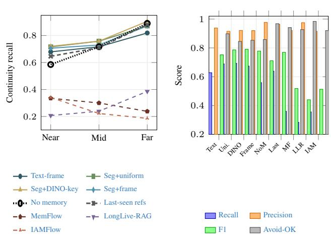  
Figure 15. Track-B generated-video scores (same 30-story pool as Table 3). (a) Continuity recall by absence-gap bin; the dotted line is the same generator with no memory and the grey dashed line with last-seen references. Support is $N { = } 7 0 1 / 2 9 3 / 2 1 0$ for near/mid/far. (b) Pooled Recall, Precision, F1, and Avoid-OK.

## F.6.3. Alternative Video Backends

Table 22 reruns all six conditions on 8 stories with two MiniMax-H3 realizations [12]. Keeping the FLUX.2 keyframe and replacing Wan2.2 with H3 (FL2VA) reproduces every main effect with the same sign and a similar size. Removing the keyframe step, so that H3 receives crops of the entities the instruction names from each retrieved still, reproduces the costs of similarity retrieval (precision −0.064 to −0.076, Avoid-OK −0.106 to −0.140, every CI below zero). In all three realizations last-seen references cost far less than retrieval. Without the keyframe, H3 partly copies its references (near-duplicate adjacent segments), most for last-seen references, whose frames all come from the previous shot; there its recall gain disappears, so this realization informs the retrieval costs, not the last-seen control. Eight stories contain too few changed returns to test the stale-look effect.

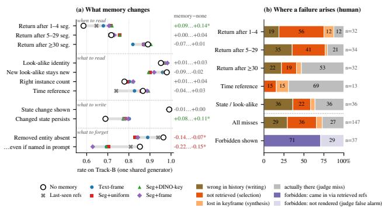  
Figure 16. What memory changes, and where failures arise. (a) Track-B rate per memory stress for the shared generator with no memory (open circle) and with each retrieval memory (filled), with last-seen references as grey crosses, grouped by the decision each stress tests (Sec. 4); the gap rows mix entity kinds (Sec. 4.2). A marker right of the circle means memory helps; left means it hurts; the right column gives memory minus no memory (\* when all four paired 95% CIs exclude zero). Memory helps for recent returns and persistent states and hurts where an entity must stay out. (b) Human attribution of Track-B failures (App. G), by stratum: the share already wrong in the entity’s previous appearance, present there but not retrieved, retrieved but lost in the keyframe, or actually rendered and missed by the judge. The last row splits judge-flagged forbidden renders into those carried in by the references (purple) and judge false alarms (light purple). The two aggregate rows are inclusion-weighted.

Table 21. Track-B memory effects under a second judge (the same videos, 30 stories, same roster, prompts, and clips). Differences to no memory with paired story-bootstrap 95% CI, gray subscripts show full CI widths (upper minus lower); bold when it excludes zero. Agreement / κ is shown for the full roster and required-present entities.
<table><tr><td>Condition</td><td>Recall</td><td>Precision Avoid-OK</td><td></td><td>All A/κ</td><td>Present A/κ</td></tr><tr><td>Qwen3-VL-32B (pinned judge)</td><td></td><td></td><td></td><td></td><td></td></tr><tr><td>No memory</td><td>0.559</td><td> $0 . 9 7 7$ </td><td> $\phantom { - } 0 . 9 6 8$ </td><td>0.908/0.64 0.754/0.52</td><td></td></tr><tr><td>Text-frame</td><td> $\mathbf { + 0 . 0 6 8 } _ { 0 . 0 4 }$ </td><td> $\mathbf { \sigma } _ { - 0 . 0 3 9 _ { 0 . 0 2 } }$ </td><td> $\mathbf { - 0 . 0 7 0 } _ { 0 . 0 2 }$ </td><td>0.882/0.64 0.723/0.46</td><td></td></tr><tr><td>Seg+uniform</td><td> $\mathbf { + 0 . 1 3 0 } _ { 0 . 0 5 }$ </td><td>-0.0620.02</td><td> $\mathbf { - 0 . 1 2 3 } _ { 0 . 0 5 }$ </td><td>0.882/0.67 0.727/0.45</td><td></td></tr><tr><td>Seg+DINO-key</td><td> $\mathbf { + 0 . 1 3 3 } _ { 0 . 0 4 }$ </td><td> $\mathbf { - 0 . 0 5 7 } _ { 0 . 0 2 }$ </td><td> $\mathbf { \delta _ { - 0 . 1 1 4 } } _ { 0 . 0 3 }$ </td><td>0.880/0.66 0.713/0.43</td><td></td></tr><tr><td>Seg+frame</td><td> $\mathbf { + 0 . 1 1 5 } _ { 0 . 0 6 }$ </td><td> $\mathbf { - 0 . 0 5 7 } _ { 0 . 0 2 }$ </td><td> $\mathbf { - 0 . 1 1 0 } _ { 0 . 0 4 }$ </td><td>0.881/0.66 0.721/0.44</td><td></td></tr><tr><td>Last-seen refs</td><td> $\mathbf { + 0 . 0 8 0 } _ { 0 . 0 4 }$ </td><td> $\mathbf { \delta _ { - 0 . 0 1 3 } } _ { 0 . 0 1 }$ </td><td> $\mathbf { \delta } _ { - 0 . 0 2 7 _ { 0 . 0 2 } }$ </td><td>0.881/0.62 0.700/0.43</td><td></td></tr><tr><td>InternVL3.5-30B-A3B</td><td></td><td></td><td></td><td></td><td></td></tr><tr><td>No memory</td><td> $0 . 3 6 I$ </td><td> $\phantom { - } 0 . 9 6 2$ </td><td> $\phantom { - } 0 . 9 6 6$ </td><td></td><td></td></tr><tr><td>Text-frame</td><td> $\mathbf { + 0 . 0 7 5 } _ { 0 . 0 3 }$ </td><td> $- 0 . 0 0 8 _ { 0 . 0 2 }$ </td><td> $\mathbf { - 0 . 0 1 5 } _ { 0 . 0 2 }$ </td><td></td><td></td></tr><tr><td>Seg+uniform</td><td> $\mathbf { + 0 . 1 2 8 } _ { 0 . 0 5 }$ </td><td> $\mathbf { \hat { \Sigma } } \mathbf { 0 . 0 3 2 } _ { 0 . 0 3 }$ </td><td> $\mathbf { - 0 . 0 5 4 } _ { 0 . 0 3 }$ </td><td></td><td></td></tr><tr><td> $\mathrm { S e g + D I N O }$  -key</td><td> $\mathbf { + 0 . 1 2 3 } _ { 0 . 0 5 }$ </td><td> $\mathbf { - 0 . 0 2 8 } _ { 0 . 0 2 }$ </td><td> $\mathbf { - 0 . 0 5 0 } _ { 0 . 0 4 }$ </td><td></td><td></td></tr><tr><td></td><td></td><td></td><td></td><td></td><td></td></tr><tr><td> $_ { \mathrm { S e g + f r a m e } }$ </td><td> $\mathbf { + 0 . 1 1 9 } _ { 0 . 0 4 }$ </td><td> $\mathbf { \sigma } _ { - 0 . 0 2 4 } \mathrm { _ { 0 . 0 3 } }$ </td><td>-0.0410.03</td><td></td><td></td></tr><tr><td>Last-seen refs</td><td> $\mathbf { + 0 . 0 6 0 } _ { 0 . 0 4 }$ </td><td> $+ 0 . 0 0 3 _ { 0 . 0 2 }$ </td><td> $- 0 . 0 0 3 _ { 0 . 0 2 }$ </td><td></td><td></td></tr></table>

Table 22. Track-B memory effects on two MiniMax-H3 realizations (the same 8 stories, 767 segments per condition, seed 2026, same judge). Differences to no memory with paired story-bootstrap 95% CI, gray subscripts show full CI widths (upper minus lower); bold when it excludes zero. Near-dup: adjacent segments whose middle frames nearly coincide (a symptom of the video model copying its references instead of following the instruction).
<table><tr><td>Condition</td><td>Recall</td><td></td><td>Precision Avoid-OK Near-dup</td><td></td></tr><tr><td colspan="5">FLUX.2 → Wan2.2 (main pipeline)</td></tr><tr><td>No memory (level)</td><td> $0 . 5 6 3$ </td><td> $0 . 9 7 9$ </td><td> $\phantom { - } 0 . 9 6 9$ </td><td>0/759</td></tr><tr><td>Text-frame</td><td> $\mathbf { + 0 . 0 8 4 } _ { 0 . 0 5 }$ </td><td> $\mathbf { \sigma } _ { - 0 . 0 3 4 } ^ { - 0 . 0 3 }$ </td><td> $\mathbf { - 0 . 0 6 7 } _ { 0 . 0 6 }$ </td><td>0/759</td></tr><tr><td>Seg+uniform</td><td> $\mathbf { + 0 . 1 5 3 } _ { 0 . 0 6 }$ </td><td> $\mathbf { \partial } _ { - 0 . 0 6 1 } _ { 0 . 0 4 }$ </td><td> $\mathbf { - 0 . 1 3 0 } _ { 0 . 0 8 }$ </td><td>0/759</td></tr><tr><td>Seg+DINO-key</td><td> $\mathbf { + 0 . 1 5 0 } _ { 0 . 0 4 }$ </td><td> $\mathbf { \partial } _ { - 0 . 0 6 1 } _ { 0 . 0 3 }$ </td><td> $\mathbf { - 0 . 1 3 0 } _ { 0 . 0 7 }$ </td><td>0/759</td></tr><tr><td>Seg+frame</td><td> $\mathbf { + 0 . 1 1 5 } _ { 0 . 1 1 }$ </td><td> $\mathbf { - 0 . 0 6 7 } _ { 0 . 0 3 }$ </td><td> $\mathbf { - 0 . 1 3 6 } _ { 0 . 0 5 }$ </td><td>0/759</td></tr><tr><td>Last-seen refs</td><td> $\mathbf { + 0 . 0 7 1 } _ { 0 . 0 5 }$ </td><td> $\mathbf { \sigma } _ { - 0 . 0 1 4 _ { 0 . 0 3 } }$ </td><td> $\mathbf { - 0 . 0 2 9 } _ { 0 . 0 4 }$ </td><td>0/759</td></tr></table>

<table><tr><td colspan="5">FLUX.2 → H3 FL2VA</td></tr><tr><td>No memory (level)</td><td> $\phantom { - } 0 . 5 7 6$ </td><td> $0 . 9 7 7$ </td><td> $\phantom { - } 0 . 9 6 5$ </td><td>0/759</td></tr><tr><td>Text-frame</td><td> $\mathbf { + 0 . 0 7 8 } _ { 0 . 0 7 }$ </td><td> $\mathbf { - 0 . 0 4 7 } _ { 0 . 0 3 }$ </td><td> $\mathbf { - 0 . 0 8 5 } _ { \mathrm { 0 . 0 5 } }$ </td><td>0/759</td></tr><tr><td>Seg+uniform</td><td> $\mathbf { + 0 . 1 4 8 } _ { 0 . 0 7 }$ </td><td> $\mathbf { \partial } _ { - 0 . 0 6 2 _ { 0 . 0 3 } }$ </td><td> $\mathbf { - 0 . 1 3 4 } _ { 0 . 0 6 }$ </td><td>0/759</td></tr><tr><td>Seg+DINO-key</td><td> $\mathbf { + 0 . 1 5 2 } _ { 0 . 0 8 }$ </td><td> $\mathbf { \sigma } _ { - 0 . 0 4 6 _ { 0 . 0 3 } }$ </td><td> $\mathbf { - 0 . 1 0 2 } _ { 0 . 0 6 }$ </td><td>0/759</td></tr><tr><td>Seg+frame</td><td> $\mathbf { + 0 . 1 2 8 } _ { 0 . 0 9 }$ </td><td> $\mathbf { - 0 . 0 4 9 } _ { 0 . 0 4 }$ </td><td> $\mathbf { - 0 . 1 0 0 } _ { 0 . 0 7 }$ </td><td>0/759</td></tr><tr><td>Last-seen refs</td><td> $\mathbf { + 0 . 0 6 9 } _ { 0 . 0 8 }$ </td><td> $- 0 . 0 0 6 _ { 0 . 0 3 }$ </td><td> $\cdot 0 . 0 1 6 _ { 0 . 0 3 }$ </td><td>0/759</td></tr></table>

<table><tr><td colspan="5">H3 Ref2VA, subject crops (no keyframe)</td></tr><tr><td>No memory (level)</td><td> $\phantom { - } O . 5 4 9$ </td><td> $\phantom { - } O . 9 8 8$ </td><td> $\phantom { - } O . 9 8 2$ </td><td>6/759</td></tr><tr><td>Text-frame</td><td> $\mathbf { + 0 . 0 5 1 } _ { 0 . 0 8 }$ </td><td> $\mathbf { - 0 . 0 6 4 } _ { 0 . 0 4 }$ </td><td> $\mathbf { - 0 . 1 0 6 } _ { \mathrm { 0 . 0 9 } }$ </td><td>25/759</td></tr><tr><td>Seg+uniform</td><td> $\mathbf { + 0 . 1 1 7 } _ { 0 . 1 0 }$ </td><td> $\mathbf { - 0 . 0 7 6 } _ { }$  .05</td><td> $\mathbf { - 0 . 1 4 0 } _ { 0 . 1 0 }$ </td><td>46/759</td></tr><tr><td> $\mathrm { S e g { + } D I N O { - } k e y }$ </td><td> $\mathbf { + 0 . 1 0 1 } _ { 0 . 0 9 }$ </td><td> $\mathbf { \delta } _ { - 0 . 0 7 3 } \mathrm { _ { 0 . 0 6 } }$ </td><td> $\mathbf { - 0 . 1 3 0 } _ { 0 . 1 0 }$ </td><td>22/759</td></tr><tr><td>Seg+frame</td><td> $\mathbf { + 0 . 0 9 5 } _ { 0 . 0 6 }$ </td><td> $\mathbf { \partial _ { - 0 . 0 6 7 _ { 0 . 0 3 } } }$ </td><td> $\mathbf { \delta - 0 . 1 2 2 } _ { 0 . 0 6 }$ </td><td>53/759</td></tr><tr><td>Last-seen refs</td><td> $- 0 . 0 3 7 _ { 0 . 0 8 }$ </td><td> $\mathbf { \delta } _ { - 0 . 0 1 6 _ { \mathrm { 0 . 0 1 } } }$ </td><td> $\mathbf { \partial } _ { - 0 . 0 2 2 _ { 0 . 0 3 } }$ </td><td>63/759</td></tr></table>

## G. Author Failure-Attribution Audit

## G.1. Findings and Interpretation

A missed entity may never have been rendered correctly before (writing), not retrieved (selection), dropped by the generator (synthesis), or missed by the judge; the testbed records every step to tell them apart. A single author inspected 224 blinded units from the four retrieval memories as an internal audit, drawn from judge-flagged failures by failure type and gap, with judge-confirmed controls and hidden repeats (App. G). The units, like the examples in Fig. 1, come from an earlier rollout of the same testbed, generator, and prompts.

Of the required-entity failures (Fig. 4; inclusion-weighted with 95% CIs, raw counts 48, 38, 11, and 50 of 147), selection accounts for 36% (27% to 45%), writing for 29% (22% to 37%), synthesis for 7% (3% to 13%), and judge misses for 27% (18% to 36%). Selection is the part Track-A exposes; writing, a wrong generated appearance that memory faithfully stored, is an error only the closed loop exposes. Together, 65% of flagged misses, and 90% of those confirmed as real, are assigned to history or selection by the audit rule. Among 37 resolved forbidden-render units, 26 showed the entity in both references and output (labeled context), and 11 were judge false alarms. No unit received the generator-only label; reference co-occurrence does not establish that the reference caused the render (Sec. 4.3).

## G.2. Audit Protocol

Scope. A single author inspected 224 generated-output units as an internal audit; no external participants were recruited. The audit covers the four shared-generator retrieval memories in an earlier rollout than the one tabulated in Sec. 4, with the same testbed, generator, and prompts. Their intermediates (references, FLUX keyframe, Wan clip) are all recorded; released systems keep memory inside the generator’s KV or latent state, so only their final pixels could be inspected. Track-A needs no such study: no generator is in its scored path, and its gold is human-reviewed (App. B.1).

Frozen sample. From the frozen judge’s per-entity verdicts we form four unit types: a required recall entity absent from the judge’s present set (miss; stratified by absence gap 1–4, 5–29, ≥30, and temporal reference), an entity present in a wrong persisted state (a state already shown earlier, so memory could supply it) or as the wrong look-alike member (wrong), a destroyed or deceased entity rendered (forbidden), and a required entity the judge found (control). Each retrieval memory contributes 56 units (28 miss, 10 wrong, 10 forbidden, 8 control; Table 24) drawn with seed 20260925; 10% of units reappear later as hidden repeats, and five unscored practice items come first. Segments without recorded references or keyframe are excluded before sampling. The manifest, media hashes, and inclusion probabilities were written before any label was collected.

Interface and rule. The box below shows what each item displays, the question asked of every panel, and the deterministic rule that turns the answers into an attribution. The entity card gives the entity’s gold appearance at that point of the story (its latest state).

## Human audit item

Entity card. Old Shi (character): night patrolman in his fifties, gray crew cut, deep-gray security uniform and black leather shoes, patrol baton and key ring at the waist. Required state or look-alike cue, if any, in the story’s original Chinese. Four panels, left to right. (1) the entity’s earlier appearance in the same rollout; (2) the three references memory returned; (3) the composed keyframe; (4) the generated clip.

Question per panel. “Is the correct entity visible here?” (forbidden units: “Is this entity visible here?”). Answer: yes / no / unsure.

Hidden from the annotator. Memory identity, judge verdict, and unit type; required and forbidden items differ only in the question. Items from all memories and unit types are interleaved in a fixed seeded order; five practice items come first and hidden repeats appear in the second half.

Attribution (deterministic, applied after labeling). Required entity: clip shows it → judge miss; else references show it → synthesis; else earlier appearance shows it → selection; else → writing. Forbidden entity: clip does not show it → judge false alarm; else references carry it → context; else → generator. An “unsure” on a deciding panel leaves the unit unresolved.

## G.3. Reliability and Measurement Scope

All 251 items were completed (median 11 s per item). The 22 hidden repeats, which measure how repeatable the labels are rather than agreement between annotators, received the same attribution in 20 cases; 28 of 32 judge-confirmed controls were confirmed, and 8 of 224 units were unresolved. Per-memory shares (Table 23) have intervals of about ±20 points, so the main text uses the pooled row. Judge misses concentrate in long-gap (17 of 32) and temporal-reference (9 of 14) failures, so Track-B recall in these families is conservative for the retrieval memories; the study did not sample the no-memory control, whose parse-failure rate is also lower (App. D.1).

Table 23. Where closed-loop failures arise, by retrieval memory (%, inclusion-weighted). Left: judge-flagged failures of a required entity, by the stage at which it is lost: already wrong in its earlier appearance (Hist., writing), in the history but not retrieved (Select.), in the references but lost in the keyframe or clip (Synth.), or in fact rendered (Judge). Right: judge-flagged forbidden renders: also visible in the references (Context), visible only in the output (Gen.), or not rendered (Judge). These are observational stage labels, not a causa decomposition. Unresolved units excluded; pooled CIs in App. G.1.
<table><tr><td></td><td colspan="5">Required entity missing or wrong</td><td colspan="4">Forbidden entity rendered</td></tr><tr><td>Memory</td><td>Hist.</td><td>Select.</td><td>Synth.</td><td>Judge</td><td>n</td><td>Context</td><td>Gen.</td><td>Judge</td><td>n</td></tr><tr><td>Text-frame</td><td>45</td><td>28</td><td>1</td><td>27</td><td>36</td><td>60</td><td>0</td><td>40</td><td>10</td></tr><tr><td>Seg+uniform</td><td>34</td><td>35</td><td>9</td><td>22</td><td>38</td><td>100</td><td>0</td><td>0</td><td>9</td></tr><tr><td>Seg+DINO-key</td><td>13</td><td>44</td><td>18</td><td>25</td><td>35</td><td>56</td><td>0</td><td>44</td><td>9</td></tr><tr><td>Seg+frame</td><td>25</td><td>38</td><td>2</td><td>34</td><td>38</td><td>67</td><td>0</td><td>33</td><td>9</td></tr><tr><td>Pooled</td><td>29</td><td>36</td><td>7</td><td>27</td><td>147</td><td>71</td><td>0</td><td>29</td><td>37</td></tr></table>

Table 24. Frozen author-audit sample. Units per retrieval memory and unit type, with the size of the judge-flagged pool each was drawn from in parentheses; the unequal draws are why shares are inclusion-weighted. Strata with too few candidates fall back to a neighbouring stratum (time references and look-alike errors are pooled with mid-gap misses and state errors). The 224 units are shown with 22 hidden repeats (246 scored items) after five unscored practice items, 251 items in all.
<table><tr><td></td><td colspan="4">Miss (required entity absent)</td><td></td><td></td><td></td><td></td></tr><tr><td>Memory</td><td>gap 1-4</td><td>5-29</td><td>≥30</td><td>time ref.</td><td>Wrong</td><td>Forbidden</td><td>Control</td><td>Units</td></tr><tr><td>Text-frame</td><td>8 (140)</td><td>8 (56)</td><td>8 (20)</td><td>4 (8)</td><td>10 (109)</td><td>10 (201)</td><td>8 (596)</td><td>56</td></tr><tr><td>Seg+uniform</td><td>8 (155)</td><td>8 (63)</td><td>8 (12)</td><td>4 (6)</td><td>10 (121)</td><td>10 (265)</td><td>8 (582)</td><td>56</td></tr><tr><td>Seg+DINO-key</td><td>8 (116)</td><td>10 (52)</td><td>8 (18)</td><td>2 (2)</td><td>10 (117)</td><td>10 (265)</td><td>8 (639)</td><td>56</td></tr><tr><td>Seg+frame</td><td>8 (109)</td><td>8 (42)</td><td>8 (20)</td><td>4 (5)</td><td>10 (111)</td><td>10 (274)</td><td>8 (632)</td><td>56</td></tr><tr><td>All</td><td>32 (520)</td><td>34 (213)</td><td>32 (70)</td><td>14 (21)</td><td>40 (458)</td><td>40 (1005)</td><td>32 (2449)</td><td>224</td></tr></table>

## H. Discussion, Limitations, and Future Tests

## H.1. What the Closed-Loop Comparison Identifies

Each policy writes its own history, so Track-B compares complete policies. Reference-count strata are also unmatched. To isolate a reference’s effect, branch from the same story prefix and generator state, fix the prompt, seed, and reference count, then replace one reference with a current-state, stale-state, or distractor-filtered alternative. Score required appearances, requested-state fidelity, and forbidden entities separately, so any reduction in interference is read alongside lost useful context. Use the instruction-valid state, including an older state for an explicit flashback. These interventions remain future work; pairing seeds alone would not identify a single-reference effect once histories diverge.

## H.2. Design Hypotheses and Falsification

The 224-unit single-author audit uses an earlier sharedgenerator rollout. Among sampled, judge-flagged requiredentity misses, inclusion-weighted shares are 29% writing, 36% selection, 7% synthesis, and 27% judge misses (App. G). These conditional shares are not population failure frequencies. They motivate tests of necessity (information absent from prompt and recent context), temporal validity (the state requested now, including deliberate flashbacks), and non-interference (unrequested content in useful frames). Table 25 pairs each hypothesis with a result that would count against it. A failed gate or filter would not erase the measured prompt confound or recall/exclusion trade-off; it would show that this particular remedy does not resolve the measurement problem.

## H.3. Limitations and Scope

Internal validity. All primary Track-B conditions use one generator, prompt stream, and scorer, but they generate distinct intermediate histories. Thus differences estimate the effects of complete retrieval policies on these authored stories, not the isolated causal effect of swapping a frame at one fixed generation state. Four retrieval policies use K=3 references; the gold-ID last-seen control uses variable numbers of references and should not be interpreted as a matched-budget upper bound. There is one rollout per story and condition, so story-clustered confidence intervals do not measure sampling across generation seeds.

Measurement validity. The pinned Qwen3-VL judge can miss entities or conflate appearance with identity. A second, independent judge preserves the main aggregate directions but changes absolute rates and some fine-grained significance conclusions (App. F.6.2). Identity similarities are conditional on visible/detected returns and can reward an old appearance that violates the current state. Failure attribution uses one author’s stratified inspection of an earlier rollout and does not yield a population-level causal partition of all failure modes.

Table 25. From observations to falsifiable design hypotheses. Proposed interventions have not been implemented or validated here. Fix generation prefix, prompt, generator state, and seed. Match count for state/filtering tests; reading gates and budget tests intentionally vary access/count and must specify removed or added references. For write policies, match the prefix before write-back and follow the resulting trajectories. A seed match alone does not fix diverged histories.
<table><tr><td>Decision</td><td>Observed evidence</td><td>Hypothesis to test</td><td>Result counting against it</td></tr><tr><td>When to read</td><td>Prompt stripping changes no-memory presence substantially; the stripped retrieval gain is uncertain (Table 4)</td><td>Gate access when history adds information beyond the prompt and baseline context, compared with always reading.</td><td>Gating loses required appearances or valid-state fidelity without reducing interference; textual detail alone is an</td></tr><tr><td></td><td>Which moment Changed returns can become more similar to their obsolete look (Table 5).</td><td>Retrieve the instruction-valid entity state, allowing earlier states for flashbacks.</td><td>inadequate gate. State-matched references do not improve requested-state correctness or damage identity continuity at the same budget.</td></tr><tr><td>How much</td><td>Last-seen costs increase across unmatched Fewer references reduce interference reference-count strata (Table 20).</td><td>without losing needed evidence; vary count using explicitly specified additions.</td><td>The apparent cost increase disappears under the matched comparison; additional references improve recall without an</td></tr><tr><td>What to forget 1</td><td>Retrieval raises recall while reducing precision and avoidance (Sec. 4.3).</td><td>Suppress unrequested content in useful references while retaining required identity/state cues.</td><td>exclusion cost. Suppression fails to improve avoidance or loses useful identity/state evidence; removing more content is not</td></tr><tr><td>What to write</td><td>The earlier single-author audit assigns 29% of sampled flagged misses to stored wrong renderings (App. G).</td><td>Reject or repair incorrect observations before write-back.</td><td>automatically better. Rejecting history discards uniquely useful evidence and worsens later recall/state fidelity compared with retaining it.</td></tr></table>

External validity. Track-B uses 30 authored, entitylabeled stories and a shared keyframe-plus-video pipeline; the alternative video-backend check covers eight stories. Track-A uses two real-film datasets but does not test downstream generation on those exact segments. Our title asks whether providing historical memory helps; we have not established how performance varies monotonically with storage capacity, reference count, or every type of state-aware memory architecture. The results should not be generalized to all genres, interactive policies, or models without further evidence.

Scope of design implications. Table 25 proposes tests, not established remedies. Prompt stripping does not validate a reading gate, and whole-rollout avoidance losses do not validate content filtering. Each proposal requires its own matched intervention and can fail while the measurement distinctions remain useful. Broader generators, seed variation, and interactive stories remain outside the demonstrated scope.