# O2D-MedNet: An Optimization-Aware Dual-Domain Framework for Robust Medical Image Segmentation

Shipeng Hu, Miaohui Wang, Jing Qin, Sukun Tian, and Yuchun Sun

Abstract—Medical image segmentation (MIS) remains challenging due to composite degradations and multi-scale geometric variations, which jointly impair lesion-background separability, structural consistency, and optimization stability. Existing single-stream frameworks entangle heterogeneous cues within a single representation pathway, while hybrid-stream approaches often rely on generic or static fusion, limiting effective coordination across domains and failing to explicitly address optimization instability. To overcome these limitations, we propose a new optimization-aware dual-domain framework for MIS (O2D-MedNet). First, a degradation-aware dual domain interaction (DDI) module integrates Fourier- and Wavelet-domain features to suppress degradation-sensitive responses while preserving structural and fine-detail information. Second, a cross-backbone contour-guided fusion (CGF) module enables selective interaction between CNN-based local detail modeling and visual state-space-based global structure modeling, improving boundary accuracy and representation consistency. Third, a gradient-context optimization (GCO) strategy stabilizes training by adaptively adjusting learning dynamics based on loss trends and gradient statistics, mitigating instability caused by class imbalance and heterogeneous sample difficulty. Extensive experiments on six benchmarks demonstrate consistent improvements over state-of-the-art MIS methods across multiple imaging modalities. Further analyses confirm enhanced sensitivity, structural consistency, and optimization stability, validating the effectiveness of the proposed O2D-MedNet for robust MIS under heterogeneous conditions.

Index Terms—Medical image segmentation, dual-domain modeling, cross-backbone fusion, optimization stability

## 1 INTRODUCTION

EDICAL image segmentation (MIS) [1], [2] is a funassign semantic labels to pixels or voxels for accurate delineation of lesions or anatomical structures. Robust MIS supports a wide range of clinical applications [3], [4], including disease screening, diagnosis, treatment planning, and longitudinal assessment. However, the increasing volume and diversity of medical imaging data (i.e., optical, radiological, and ultrasound images) continue to impose substantial demands on clinical workflows, where manual inspection remains time-consuming and error-prone. Consequently, developing robust and scalable MIS frameworks has become increasingly important for enabling reliable clinical deployment.

Despite recent advances, achieving robust MIS performance across multiple organs and imaging conditions remains challenging [5]. Specifically, medical images often exhibit composite degradations (e.g., noise, artifacts, and specular reflections) together with multi-scale geometric variability in lesion and anatomical structure size, shape, and location. These factors can jointly degrade lesion–background separability, disrupt structural consistency, and lead to unstable optimization during model training. As a result, MIS approaches often struggle to simultaneously preserve finegrained boundaries, maintain global coherence, and generalize across heterogeneous imaging samples.

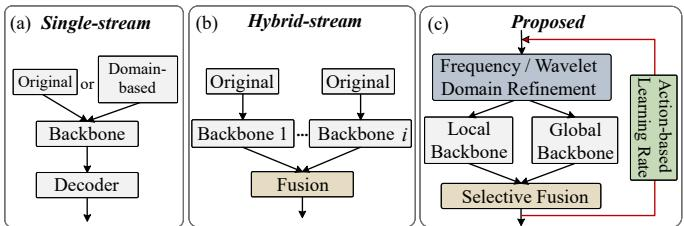  
Fig. 1: Comparison of representative medical image segmentation (MIS) paradigms. (a) Single-stream frameworks process either original or domain-based inputs through a single pathway, limiting their ability to disentangle heterogeneous cues [6], [7], [8]. (b) Hybrid-stream frameworks introduce multiple backbone branches and fuse their features to exploit complementary representations, but the interaction is typically generic or static [9], [10]. (c) In contrast, O2D-MedNet integrates dual-domain refinement, explicit local–global decoupling, contour-guided selective fusion, and optimization-aware learning in a unified framework.

Existing MIS methods can be broadly categorized into single-stream and hybrid-stream frameworks, as illustrated in Figs. 1 (a) and (b). Single-stream approaches rely on a dominant representation pathway for feature extraction and prediction. Representative CNN-based models [6], [11] are effective at capturing local textures and boundary details, whereas Transformer- and state-space-based architectures [7], [12] improve long-range dependency modeling and global structure aggregation. Some studies further incorporate frequency-domain priors [8], [13] to enhance robustness against image degradations. Hybrid-stream frameworks extend this idea by introducing multiple representation pathways, such as CNN-Transformer combinations [9], [10], frequency-decomposition architectures [14], and taskspecific auxiliary streams [1], [15]. Although these methods improve representation diversity, they generally rely on static feature fusion strategies or heuristic interactions, limiting their ability to adapt to local details, global structures, and degradation-sensitive responses under complex conditions.

TABLE 1: Taxonomy and comparison of representative medical image segmentation (MIS) frameworks. Existing methods are categorized according to their dominant representation and stream architecture, with emphasis on local-globa modeling, domain knowledge, cross-stream interaction, degradation modeling, and optimization awareness.
<table><tr><td>Method</td><td>Category</td><td>Representation</td><td>Local Detail</td><td>Global Context</td><td>Domain Knowledge</td><td>Cross-stream Interaction</td><td>Degradation Modeling</td><td>Optimization Awareness</td></tr><tr><td colspan="9">Reference Baselines</td></tr><tr><td>DeepLabv3+ [16]</td><td>Single</td><td>Atrous CNN + ASPP</td><td>Explicit</td><td>Explicit</td><td>No</td><td>No</td><td>No</td><td>No</td></tr><tr><td>U2-Net [17]</td><td>Single</td><td>Nested U-shaped CNN</td><td>Explicit</td><td>Explicit</td><td>No</td><td>No</td><td>No</td><td>No</td></tr><tr><td>MedSAM [18]</td><td>Hybrid</td><td>ViT + Box Prompt</td><td>Implicit</td><td>Explicit</td><td>No</td><td>Explicit</td><td>No</td><td>No</td></tr><tr><td colspan="9">Single-stream Frameworks</td></tr><tr><td>ACNN [19]</td><td>Single</td><td>CNN + Anatomical Prior</td><td>Explicit</td><td>Limited</td><td>Anatomical Prior</td><td>No</td><td>Limited</td><td>No</td></tr><tr><td>DRINet [20]</td><td>Single</td><td>U-shaped CNN</td><td>Explicit</td><td>Limited</td><td>No</td><td>No</td><td>No</td><td>No</td></tr><tr><td>BCDU-Net [21]</td><td>Single</td><td>U-shaped + BiConvLSTM</td><td>Explicit</td><td>Limited</td><td>No</td><td>No</td><td>No</td><td>No</td></tr><tr><td>CyCoSeg [6]</td><td>Single</td><td>CNN + Shape Prior</td><td>Explicit</td><td>Limited</td><td>Shape Prior</td><td>Limited</td><td>No</td><td>No</td></tr><tr><td>Swin-UNet [22]</td><td>Single</td><td>Transformer</td><td>Explicit</td><td>Explicit</td><td>No</td><td>No</td><td>No</td><td>No</td></tr><tr><td>MISSFormer [7]</td><td>Single</td><td>Transformer</td><td>Explicit</td><td>Explicit</td><td>No</td><td>No</td><td>No</td><td>No</td></tr><tr><td>Mamba-UNet [23]</td><td>Single</td><td>VSSM</td><td>Implicit</td><td>Explicit</td><td>No</td><td>No</td><td>No</td><td>No</td></tr><tr><td>LKM-UNet [24]</td><td>Single</td><td>VSSM</td><td>Explicit</td><td>Explicit</td><td>No</td><td>No</td><td>No</td><td>No</td></tr><tr><td>Mamba-Sea [25]</td><td>Single</td><td>VSSM</td><td>Explicit</td><td>Explicit</td><td>No</td><td>No</td><td>Limited</td><td>No</td></tr><tr><td>GobletNet [13]</td><td>Single</td><td>Wavelet-enhanced CNN</td><td>Explicit</td><td>Limited</td><td>Wavelet</td><td>Explicit</td><td>Limited</td><td>No</td></tr><tr><td>MADGNet [8]</td><td>Single</td><td>Multi-frequency Attention</td><td>Explicit</td><td>Limited</td><td>Multi-frequency (DCT)</td><td>No</td><td>Limited</td><td>No</td></tr><tr><td>FFTMed [26]</td><td>Single</td><td>Fourier U-shaped</td><td>Limited</td><td>Explicit</td><td>Fourier</td><td>No</td><td>Explicit</td><td>No</td></tr><tr><td>SAM2-UNet [27]</td><td>Single</td><td>SAM2-Hiera + U-Net</td><td>Explicit</td><td>Explicit</td><td>No</td><td>No</td><td>No</td><td>No</td></tr><tr><td colspan="9">Hybrid-stream Frameworks</td></tr><tr><td>MedT [28]</td><td>Hybrid</td><td>Local-Global Transformer</td><td>Explicit</td><td>Explicit</td><td>No</td><td>Limited</td><td>No</td><td>No</td></tr><tr><td>TransFuse [9]</td><td>Hybrid</td><td>CNN + Transformer</td><td>Explicit</td><td>Explicit</td><td>No</td><td>Explicit</td><td>No</td><td>No</td></tr><tr><td>H2Former [10]</td><td>Hybrid</td><td>CNN + Transformer</td><td>Explicit</td><td>Explicit</td><td>No</td><td>Explicit</td><td>No</td><td>No</td></tr><tr><td>XNet [14]</td><td>Hybrid</td><td>Low + High Frequency</td><td>Explicit</td><td>Limited</td><td>Wavelet</td><td>Explicit</td><td>Limited</td><td>No</td></tr><tr><td>DS2F [1]</td><td>Hybrid</td><td>Segmentation + Super-resolution</td><td>Explicit</td><td>Limited</td><td>No</td><td>Explicit</td><td>No</td><td>No</td></tr><tr><td>MambaEviScrib [15]</td><td>Hybrid</td><td>CNN + Mamba</td><td>Explicit</td><td>Explicit</td><td>No</td><td>Explicit</td><td>Limited</td><td>Limited</td></tr><tr><td>Ours</td><td>Hybrid</td><td>CNN + VSSM</td><td>Explicit</td><td>Explicit</td><td>Fourier + Wavelet</td><td>Explicit</td><td>Explicit</td><td>Explicit</td></tr></table>

We argue that a fundamental limitation of existing MIS frameworks lies in the coupled treatment of degradation suppression, representation learning, and optimization. In most existing MIS approaches, these factors are implicitly handled within a unified learning process, making it difficult to dynamically balance feature restoration, localglobal representation coordination, and optimization stability. Consequently, MIS performance often deteriorates in the presence of composite degradations, large anatomical variations, class imbalance, and heterogeneous sample difficulty.

To address these challenges, we introduce a new optimization-aware dual-domain framework for MIS (O2D-MedNet). The proposed method follows a progressive design principle that explicitly decouples degradation suppression, representation learning, and optimization dynamics. First, a dual-domain interaction module exploits complementary Fourier- and Wavelet-domain information to enhance feature discriminability. Second, a contour-guided cross-backbone fusion mechanism facilitates selective integration of local and global representations, mitigating redundant and noisy feature propagation. Third, a gradient-context-aware optimization strategy dynamically adapts learning behavior according to loss trends and gradient statistics, improving optimization stability under heterogeneous data conditions. Extensive experiments on six benchmark segmentation datasets spanning three medical imaging categories as well as diverse lesions and anatomical structures demonstrate the effectiveness and generalization of the proposed MIS framework.

The main contributions are summarized as follows:

• We propose O2D-MedNet, an optimization-aware dualdomain cross-backbone interaction framework that explicitly decouples degradation suppression, representation learning, and training dynamics, enabling robust MIS under composite degradations and multi-scale anatomical variations.

• We introduce a degradation-aware dual-domain interaction (DDI) mechanism that exploits complementary Fourier- and Wavelet-domain representations to improve lesion–background separability while preserving both structural integrity and fine-grained details.

• We design a cross-backbone contour-guided fusion (CGF) module that adaptively integrates CNN-based local features with state-space-based global representations, enhancing structural consistency across complex anatomical morphologies and scale variations.

• We develop a stable gradient-context optimization (GCO) strategy that modulates optimization behavior according to loss dynamics and gradient statistics, improving optimization stability and training robustness under class imbalance and heterogeneous sample difficulty.

## 2 RELATED WORK

MIS has been widely studied, with recent advances largely driven by deep neural networks. From the perspective of network architecture, existing MIS methods can be broadly

categorized into reference baselines, single-stream frameworks, and hybrid-stream frameworks, as summarized in Table 1.

## 2.1 Reference Baselines

We first review several representative reference baselines that provide distinct architectural paradigms for image segmentation. DeepLabv3+ [16] integrates atrous spatial pyramid pooling with an encoder–decoder architecture to capture multi-scale contextual information and progressively refine object boundaries. U2-Net [17] adopts a nested U-shaped architecture composed of residual Ublocks, enabling the joint modeling of fine-grained local details and multi-scale contextual features. In contrast, Med-SAM [18] exemplifies the promptable medical foundationmodel paradigm. It employs a ViT-based image encoder to extract image representations and a prompt encoder to embed input prompts, which are subsequently integrated by the mask decoder to generate segmentation masks. These methods represent three complementary architectural paradigms, ranging from conventional encoder-decoder networks and nested multi-scale architectures to promptconditioned foundation MIS models.

## 2.2 Single-stream Frameworks

Single-stream MIS frameworks [29], [30], [31] rely on a dominant network pathway, where feature extraction, context aggregation, and prediction are conducted on a single backbone architecture, including U-shaped- or CNNbased, Transformer-based, visual state-space model (VSSM)- based, and other domain-based models.

U-shaped or CNN-based. Early MIS methods are primarily based on U-shaped encoder–decoder or CNN-based networks, where hierarchical convolutional features are progressively encoded and decoded for dense prediction [32], [33]. Representative models, such as ACNN [19], DRINet [20], BCDU-Net [21], CyCoSeg [6], FusionNet [34], UNeXt [35], MBP-SSNet [36], and EAG-SAE-ESTF [11], enhance this paradigm through improved skip connections, contextual modeling, and feature refinement. These methods are effective at capturing local textures and boundary details, which are essential for segmenting small lesions and thin anatomical structures. However, their convolution-dominant design inherently relies on local receptive fields, making it difficult to model long-range dependencies and maintain global structural coherence when anatomical variations are large or spatially dispersed.

Transformer-based. To address the above limitation, Transformer-based single-stream MIS models introduce selfattention mechanisms to enhance global structure modeling. For instance, Swin-UNet [22], MISSFormer [7], LeViT-UNet [37], FAT-Net [12], and CSWin-UNet [38] capture long-range dependencies through various attention designs. More recently, SAM2-UNet [27] integrates the Hiera backbone of SAM2 with a U-shaped decoder and lightweight adapters for prompt-free segmentation, retaining a dominant singlestream pathway. While these approaches improve the representation of large-scale structures, they still operate within a single pathway, where local detail preservation and global structure modeling are tightly coupled. This coupling makes it difficult to adaptively prioritize boundary-sensitive cues or global semantics under varying imaging conditions. Especially, global aggregation may smooth fine structures or weaken subtle lesion boundaries in low-contrast or noisy regions.

VSSM-based. More recently, VSSM-based architectures, such as Mamba-UNet [23], LKM-UNet [24], H-vmuNet [39], UltraLight VM [40], and Mamba-Sea [25], provide an alternative mechanism for efficient long-range modeling. These methods improve computational efficiency while maintaining global structure awareness. However, similar to CNNand Transformer-based MIS schemes, they still encode local details, global structures, and scale variations within a single pathway. Consequently, they continue to face an inherent trade-off between local sensitivity and global coherence, especially under composite degradations and heterogeneous anatomical variations.

Domain-based. Another line of MIS work incorporates frequency-domain information to enhance robustness. For example, GobletNet [13] explores wavelet-based highfrequency, while MADGNet [8] and FFTMed [26] introduces multi-frequency of discrete cosine transform (DCT)- or Fourier-domain cues to strengthen boundary sensitivity and suppress noise. Although these approaches improve degradation robustness, they typically inject domain information into a single-stream backbone with fixed or weakly adaptive fusion strategies. Consequently, degradation suppression is not explicitly coordinated with representation learning or training dynamics, limiting their effectiveness under complex medical imaging conditions.

Summary. Despite their diverse network architectures, single-stream MIS methods fundamentally entangle degradation suppression, representation learning, and optimization within a unified or single pathway. This implicit coupling assumes that a single representation can simultaneously resolve degradation-induced ambiguity, capture multi-scale structural variations, or maintain stable optimization dynamics. However, such an assumption becomes weak or invalid under heterogeneous imaging conditions, where these factors impose competing and conditiondependent requirements. As a result, single-stream MIS models lack the flexibility to adaptively prioritize local detail, global structure, or robustness to degradations, leading to compromised segmentation performance.

## 2.3 Hybrid-stream Frameworks

Hybrid-stream MIS frameworks [41], [42] aim to alleviate the bottlenecks of single-stream models by introducing multiple pathways to exploit complementary information, including hybrid-backbone-based, hybrid-frequency-based, and hybrid-task-based models.

Hybrid-backbone-based. One common MIS architecture design combines CNN-based local modeling with Transformer-style global modeling. For example, MedT [28], TransFuse [9], and H2Former [10] capture both fine-grained local details and long-range dependencies, demonstrating that local and global representations are inherently complementary for MIS. However, these methods implicitly assume that complementary representations can be effectively combined through static or heuristic fusion mechanisms. In addition, they also lack an explicit strategy to determine when local details should dominate and when global structures should be emphasized under varying degradation levels and boundary ambiguities. Consequently, fusion may propagate redundant or noisy features, or suppress subtle yet important structures.

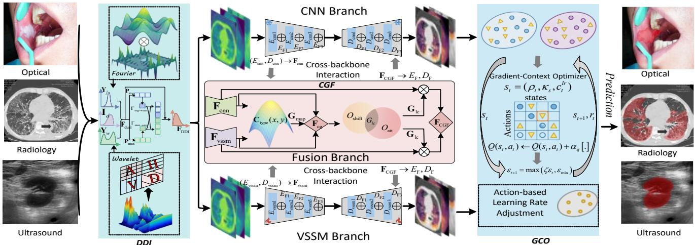  
Fig. 2: Overview of the proposed dual-domain cross-backbone interaction framework for MIS (O2D-MedNet). A dualdomain refinement (DDI) module integrates global spectral and local multi-resolution cues to suppress degradations and enhance feature separability. Parallel CNN and VSSM branches then capture local details and global structures, respectively. A contour-guided fusion (CGF) module enables selective cross-backbone interaction in skip connections to improve multi scale structural consistency and reduce redundant propagation. Finally, a gradient-context optimization (GCO) strategy adapts training based on loss evolution and gradient statistics to improve optimization stability and generalization.

Hybrid-frequency-based. Hybrid frequencies [43], [44] provide another form of complementary modeling. For instance, XNet [14] separates low- and high-frequency components, processes them with dedicated encoders, and produces dual-branch segmentation predictions. While this design improves representation diversity, its complementarity is largely constrained to frequency decomposition and consistency learning. Moreover, it does not explicitly coordinate local-global backbone biases, nor does it address optimization instability during training.

Hybrid-task-based. Other hybrid MIS approaches incorporate auxiliary tasks or supervision strategies [45], [46], [47], such as super-resolution DS2F [1] or weak supervision MambaEviScrib [15]. These methods further highlight the benefit of multi-stream modeling under specific settings. Nevertheless, their interaction mechanisms are often task-dependent, and their optimization processes remain governed by fixed or empirically tuned schedules. Consequently, their robustness may degrade under heterogeneous imaging samples or complex degradations.

Summary. Hybrid-stream MIS frameworks partially relax the representation bottleneck by introducing multiple pathways, yet they typically treat degradation handling, crossstream interaction, and optimization as loosely coupled components. Their fusion strategies often rely on static or weakly adaptive mechanisms, implicitly assuming that complementary representations can be combined without considering condition-dependent dominance or degradation sensitivity. Moreover, learning optimization remains external to network architectures, limiting the ability to stabilize training. As a result, although hybrid-stream models improve representation diversity, they still lack a unified and adaptive mechanism to coordinate degradation suppression, representation interaction, and optimization dynamics under challenging conditions.

## 3 METHODOLOGY

The overall architecture of O2D-MedNet is illustrated in Fig. 2. The framework consists of three main components: (1) a degradation-aware dual-domain interaction (DDI) module, (2) a cross-backbone contour-guided fusion (CGF) module, and (3) a stable gradient-context optimization (GCO) strategy. Given an input medical image, DDI first enhances feature discriminability through complementary Fourier- and Wavelet-domain processing. The refined features are subsequently encoded by parallel CNN and VSSM branches, where CGF enables selective fusion between local and global representations. During training, GCO dynamically adapts optimization behavior according to gradient context to improve optimization stability.

## 3.1 Degradation-Aware Dual-Domain Interaction

In MIS, composite degradations are often amplified in early feature representations, leading to ambiguous lesion–background boundaries and unstable downstream learning [48]. Since such degradation-induced responses cannot be reliably suppressed by representation learning alone, we first introduce a dual-domain refinement stage to improve feature separability before high-level modeling.

## 3.1.1 Dual-Domain Feature Representation

Specifically, we propose the DDI module, which jointly exploits Fourier-domain and Wavelet-domain representations. Given the input feature map after a 1×1 convolution, $\mathbf { I } _ { d } ~ \in ~ \mathbb { R } ^ { B \times C \times ^ { \mathbf { \lambda } } H \times W }$ , where B, C, H, and W denote the batch size, channel number, height, and width, respectively.

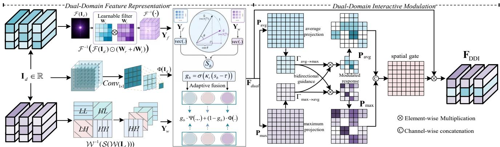  
Fig. 3: Illustration of the proposed DDI module. Input features are processed in parallel by Fourier and Wavelet branches to capture global structural and multi-resolution detail cues, respectively. Similarity-aware gating adaptively fuses the responses, followed by cross-branch interaction to enhance spatial complementarity.

The Fourier branch performs global spectral transform and a learnable filter $( \mathbf { W } _ { r } ^ { \mathbf { - } } , \mathbf { W } _ { i } )$ is used to modulate the associated spectrum, yielding:

$$
\mathbf { Y } _ { f } = \Re \big ( \mathcal { F } ^ { - 1 } ( \mathcal { F } ( \mathbf { I } _ { d } ) \odot ( \mathbf { W } _ { r } + i \mathbf { W } _ { i } ) ) \big ) ,\tag{1}
$$

where $\mathbf { Y } _ { f }$ denotes the Fourier-domain response after spectral modulation, $\Re ( \cdot )$ extracts the real part, and ⊙ denotes element-wise multiplication. $\mathcal { F }$ and ${ \mathcal { F } } ^ { - { \bar { 1 } } }$ denote the forward and inverse Fourier transforms, respectively. $\mathbf { W } _ { r }$ and $\mathbf { W } _ { i }$ represent the learnable real- and imaginary- part filters used to multiply with $\mathcal { F } ( \mathbf { I } _ { d } )$ . The Fourier branch mainly suppresses unstable high-frequency responses while maintaining low-frequency structural consistency.

In parallel, the Wavelet branch extracts localized multiresolution features through wavelet decomposition and reconstruction:

$$
\mathbf { Y } _ { w } = \mathcal { W } ^ { - 1 } ( \mathcal { S } ( \mathcal { W } ( \mathbf { I } _ { d } ) ) ) ,\tag{2}
$$

where $\mathbf { Y } _ { w }$ denotes the Wavelet-domain response reconstructed from the modulated multi-scale coefficients. W and $\mathcal { W } ^ { - 1 }$ denote the wavelet decomposition and reconstruction, respectively. $\boldsymbol { \mathcal { S } } ( \cdot )$ denotes a learnable subbandwise coefficient selection and modulation operation, which suppresses degradation-sensitive weak coefficients and enhances boundary-related subbands across scales. The Wavelet branch mainly focuses on multi-resolution localdetail preservation.

To adaptively balance Fourier-domain global spectral feature and Wavelet-domain localized multi-resolution feature, we vectorize $\mathbf { Y } _ { f }$ and $\mathbf { Y } _ { w } ,$ and compute a sample-wise cosine similarity:

$$
s _ { b } = \frac { \left. \mathrm { v e c } \left( \mathbf { Y } _ { f } ^ { ( b ) } \right) , \mathrm { v e c } \left( \mathbf { Y } _ { w } ^ { ( b ) } \right) \right. } { \left\| \mathrm { v e c } \left( \mathbf { Y } _ { f } ^ { ( b ) } \right) \right\| _ { 2 } \left\| \mathrm { v e c } \left( \mathbf { Y } _ { w } ^ { ( b ) } \right) \right\| _ { 2 } + \epsilon _ { 0 } } , \quad b = 1 , \ldots , B .\tag{3}
$$

where $s _ { b }$ measures the response consistency between the Fourier and Wavelet branches for the b-th sample, b indexes the sample within the mini-batch with the size of $B , \epsilon _ { 0 }$ represents a small constant for numerical stability, and vec(·) flattens the feature map into a vector. A larger $s _ { b }$ indicates stronger agreement between the two domain responses.

Moreover, we construct a gating mechanism $g _ { b }$ to control the sample-wise contribution of the dual-domain response and the original feature mapping:

$$
g _ { b } = \sigma _ { s } ( \kappa _ { t } ( s _ { b } - \tau ) ) ,\tag{4}
$$

where $\sigma _ { s } ( \cdot )$ denotes the Sigmoid function, $\kappa _ { t }$ represents a temperature coefficient, and $\tau { = } 0 . 5$ represents a threshold. As a result, the dual-domain features are fused by

$$
\mathbf { F } _ { \mathrm { d u a l } } ^ { ( b ) } = g _ { b } \cdot \boldsymbol { \Psi } \Big ( \mathbf { Y } _ { f } ^ { ( b ) } , \mathbf { Y } _ { w } ^ { ( b ) } \Big ) + \left( 1 - g _ { b } \right) \cdot \boldsymbol { \Phi } \Big ( \mathbf { I } _ { d } ^ { ( b ) } \Big ) ,\tag{5}
$$

where $\mathbf { F } _ { \mathrm { d u a l } } ^ { ( b ) }$ denotes the adaptively fused dual-domain feature of the b-th sample, and the mini-batch feature $\mathbf { F } _ { \mathrm { d u a l } }$ is obtained by stacking all sample-wise outputs $\mathbf { F } _ { \mathrm { d u a l } } \ =$ $[ \mathbf { F } _ { \mathrm { d u a l } } ^ { ( 1 ) } , \mathbf { F } _ { \mathrm { d u a l } } ^ { ( 2 ) } , . . . , \mathbf { F } _ { \mathrm { d u a l } } ^ { ( B ) } ]$ along the batch dimension. $\Psi ( \cdot , \cdot )$ denotes a lightweight fusion mapping for the two domain responses, implemented by channel concatenation followed by a 1×1 convolution. $\Phi \dot { ( \cdot ) }$ is implemented by a 1×1 convolution and maps $\mathbf { I } _ { d } ^ { ( b ) }$ to the same feature shape as the fused dual-domain response. As a result, $\Psi ( \mathbf { Y } _ { f } ^ { ( b ) } , \dot { \mathbf { Y } } _ { w } ^ { ( b ) } )$ and $\Phi ( \mathbf { I } _ { d } ^ { ( b ) } )$ have compatible dimensions for weighted fusion.

## 3.1.2 Dual-Domain Interactive Modulation

The sample-level gate and the subsequent spatial recalibration address different levels of degradation uncertainty, as shown in Fig. 3. Meanwhile, composite degradations often vary substantially across samples: some images are dominated by specular highlights, whereas others are mainly affected by noise, artifacts, or weak contrast. Therefore, the scalar gate $g _ { b }$ estimates the global reliability of dual-domain responses for each sample, which is broadcast to all channel and spatial positions during fusion. However, lesions and anatomical structures are also spatially non-uniform within the same sample. A spatial modulation step is thus required to suppress local false responses while preserving informative lesion regions. In this sense, $g _ { b }$ determines how much dual-domain information should be trusted globally, whereas the spatial gate refines where such information should be emphasized locally.

In the DDI module, we further introduce dual-domain dynamic interaction to enhance spatial complementarity. Specifically, channel-wise average projection and maximum projection followed by spatial downsampling are applied to $\mathbf { F } _ { \mathrm { d u a l . } }$ , producing two complementary descriptor maps: $\mathbf { P } _ { \mathrm { a v g } } = \bar { \mathrm { D o w n } } s \mathrm { a m p l } \Lt \big ( \mathrm { P o o l } _ { \mathrm { a v g } } ( \mathbf { F } _ { \mathrm { d u a l } } ) \big )$ and $\mathbf { P } _ { \operatorname* { m a x } } =$ Downsampl $\mathrm { e } \big ( \mathrm { P o o l } _ { \mathrm { m a x } } ( \mathbf { F } _ { \mathrm { d u a l } } ) \big )$ , where $\mathbf { P } _ { \mathrm { a v g } }$ denotes the average-response descriptor and captures stable regionlevel responses, while $\bar { \mathbf { P } } _ { \operatorname* { m a x } }$ denotes the max-response descriptor and highlights locally discriminative activations and boundary-sensitive cues. $\left\{ \mathbf { P } _ { \mathrm { a v g } } , \mathbf { P } _ { \mathrm { m a x } } \right\} \in \mathbb { R } ^ { B \times 1 \times h \times w } .$ where h and w denote the downsampled spatial resolution.

We then adopt two zero-initialized convolutional branches to predict dual-domain interactive modulation terms $\Gamma _ { \mathrm { a v g \to m a x } }$ and $\Gamma _ { \mathrm { m a x } \to \mathrm { a v g } } ,$ , and perform bidirectional guidance as:

$$
\begin{array} { r } { \Big ( \widehat { \mathbf { P } } _ { \mathrm { m a x } } , \widehat { \mathbf { P } } _ { \mathrm { a v g } } \Big ) = \big ( \sigma _ { s } \big ( \Gamma _ { \mathrm { a v g \to m a x } } ( \mathbf { P } _ { \mathrm { a v g } } ) \big ) \odot \mathbf { P } _ { \mathrm { m a x } } , \sigma _ { s } \big ( \Gamma _ { \mathrm { m a x \to a v g } } ( \mathbf { P } _ { \mathrm { m a x } } ) \big ) \odot \mathbf { P } _ { \mathrm { a v g } } \big ) , } \end{array}\tag{6}
$$

where $\widehat { \mathbf { P } } _ { \operatorname* { m a x } }$ and $\hat { \mathbf { P } } _ { \mathrm { a v g } }$ denote the modulated maxresponse and average-response descriptors. $\Gamma _ { \mathrm { a v g \to m a x } } ( \cdot )$ and $\Gamma _ { \mathrm { m a x \to a v g } } ( \cdot )$ denote learnable modulation functions implemented by zero-initialized convolutional branches. Both branches preserve the spatial size of their inputs, so that $\Gamma _ { \mathrm { a v g \to m a x } } ( \mathbf { \hat { P } } _ { \mathrm { a v g } } )$ and $\Gamma _ { \mathrm { m a x } \to \mathrm { a v g } } ( \mathbf { P } _ { \mathrm { m a x } } )$ are compatible with $\mathbf { P } _ { \mathrm { m a x } }$ and $\mathbf { P } _ { \mathrm { a v g } } ,$ respectively. During training, the bidirectional modulation is progressively learned, allowing regional responses to suppress spurious local peaks while preserving boundary-sensitive cues.

Finally, $\widehat { \mathbf { P } } _ { \operatorname* { m a x } }$ and $ { \hat { \mathbf { P } } } _ { \mathrm { a v g } }$ are concatenated and transformed into a spatial gate through a 1×1 convolution, bilinear upsampling, and Sigmoid normalization:

$$
\mathbf { F } _ { \mathrm { D D I } } = \mathrm { R e } \operatorname { L U } \left( \mathbf { F } _ { \mathrm { d u a l } } \odot \sigma _ { s } \left( \operatorname { U p s a m p l e } \left( \operatorname { C o n v } _ { 1 \times 1 } \left( \left[ \hat { \mathbf { P } } _ { \mathrm { a v g } } , \hat { \mathbf { P } } _ { \operatorname* { m a x } } \right] \right) \right) \right) \right) .\tag{7}
$$

where $\mathbf { F } _ { \mathrm { D D I } }$ denotes the final output feature of the DDI module. Through this dual-domain interactive modulation, degradation-induced response is effectively reduced before entering the representation stage. This not only improves lesion–background separability, but also provides a more stable foundation for subsequent local–global modeling.

## 3.2 Cross-Backbone Contour-Guided Fusion

After dual-domain feature interaction, the model proceeds to representation learning through parallel CNN and VSSM branches. It is noted that CNN features are sensitive to local textures and boundary details, and VSSM features are effective for modeling long-range dependencies and global semantics. However, directly fusing these heterogeneous representations assumes feature compatibility, which is often violated under complex degradations and scale variations [49].

## 3.2.1 Contour-Guided Selective Fusion

To address this issue, we propose the CGF module as shown in Fig. 4, which performs selective and structureaware cross-backbone interaction. The DDI-refined feature $\mathbf { F } _ { \mathrm { D D I } }$ is first delivered to the CNN and VSSM branch, where each branch contains three encoder stages and three decoder stages. The hierarchical feature representations extracted from the CNN and VSSM encoderdecoder pathways at each corresponding network stage are denoted as $\mathbf { F } _ { \mathrm { c n n } }$ and $\mathbf { F } _ { \mathrm { v s s m } } ,$ respectively. Specifically, the CNN pathway produces stage-wise features through its encoder stages $( E _ { \mathrm { c n n } } ^ { 1 } , E _ { \mathrm { c n n } } ^ { 2 } , E _ { \mathrm { c n n } } ^ { 3 } )$ and decoder stages $( D _ { \mathrm { c n n } } ^ { 1 } , D _ { \mathrm { c n n } } ^ { 2 } , D _ { \mathrm { c n n } } ^ { 3 } ) _ { . }$ , while the VSSM pathway generates corresponding stage-wise features through $( E _ { \mathrm { v s s m } } ^ { \mathrm { i } } , E _ { \mathrm { v s s m } } ^ { 2 } , E _ { \mathrm { v s s m } } ^ { 3 } )$ and $( \breve { D } _ { \mathrm { v s s m } } ^ { 1 } , D _ { \mathrm { v s s m } } ^ { 2 } , D _ { \mathrm { v s s m } } ^ { 3 } )$ . At each stage, the paired CNN and VSSM features are fed into CGF for cross-backbone interaction. Given the paired features $\mathbf { F } _ { \mathrm { c n n } }$ and $\mathbf { F } _ { \mathrm { v s s m } } ,$ CGF first computes Gaussian-residual responses to emphasize contour-sensitive transitions in the feature space. For a spatial location $( x , y )$ , this operation is defined as:

$$
\begin{array} { r l r } {  { \mathbf { C } _ { \mathrm { t y p e } } ( x , y ) = \mathbf { F } _ { \mathrm { t y p e } } ( x , y ) - \sum _ { u = - \lfloor K _ { g } / 2 \rfloor } ^ { \lfloor K _ { g } / 2 \rfloor } \cdot \sum _ { v = - \lfloor K _ { g } / 2 \rfloor } ^ { \lfloor K _ { g } / 2 \rfloor } } , } \\ & { } & { G _ { \sigma } ( u , v ) \mathbf { F } _ { \mathrm { t y p e } } ( x - u , y - v ) , \mathrm { t y p e } \in \{ \mathrm { c n n } , \mathrm { v s s m } \} , \quad \quad } \end{array}\tag{8}
$$

where $\mathbf { C } _ { \mathrm { t y p e } }$ denotes the contour-sensitive Gaussianresidual response of the CNN or VSSM branch, $G _ { \sigma }$ denotes a normalized Gaussian kernel with standard deviation $\sigma { = } 1 . 0 ,$ and $K _ { g } = 5$ denotes the kernel size. The Gaussian-residual response explicitly suppresses smooth background components while highlighting boundary-relevant structures, thus producing more stable contour-aware responses.

These two contour responses $\mathbf { C } _ { \mathrm { c n n } }$ and $\mathbf { C } _ { \mathrm { v s s m } }$ are then concatenated along the channel dimension, and a spatial gating map $\mathbf { G } _ { \mathrm { m a p } }$ is generated:

$$
\mathbf { G } _ { \mathrm { m a p } } = \sigma _ { s } \mathopen { } \mathclose \bgroup \left( \mathrm { C o n v } _ { 1 \times 1 } \mathopen { } \mathclose \bgroup \left( \left[ \mathbf { C } _ { \mathrm { c n n } } , \mathbf { C } _ { \mathrm { v s s m } } \aftergroup \egroup \right] \aftergroup \egroup \right) \aftergroup \egroup \right) \in ( 0 , 1 ) ^ { B \times 1 \times H \times W } .\tag{9}
$$

where $\mathbf { G } _ { \mathrm { m a p } }$ adaptively indicates whether each spatial position should rely more on CNN-based local details or VSSM-based global structure. [·, ·] denotes channel-wise concatenation. Consequently, the two backbone features are selectively fused by the gating map as:

$$
\mathbf { F } _ { \mathrm { c g } } = \mathbf { G } _ { \mathrm { m a p } } \odot \mathbf { F } _ { \mathrm { c n n } } + ( 1 - \mathbf { G } _ { \mathrm { m a p } } ) \odot \mathbf { F } _ { \mathrm { v s s m } } ,\tag{10}
$$

where $\mathbf { F } _ { \mathrm { c g } }$ denotes the contour-guided fused feature. It serves as a carrier for estimating local-consistency cues, rather than as the final output of CGF.

## 3.2.2 Local-Consistency Feature Refinement

On top of the contour-guided fusion, $\mathbf { F } _ { \mathrm { c g } }$ is projected by three 1×1 convolutions to generate the query Q, key $\dot { \bf K } ,$ and value V. The upper path performs shift-based local feature refinement. Specifically, the projected feature is first processed by a linear projection and then shifted along neighboring spatial directions to exchange local responses. The shifted features are concatenated and projected by a 1×1 convolution to obtain the shift-based local response $\mathbf { \hat { O } } _ { \mathrm { s h i f t } } \mathbf { : }$

$$
\mathbf { O } _ { \mathrm { s h i f t } } = \operatorname { C o n v } _ { 1 \times 1 } \big ( \operatorname { C o n c a t } _ { r \in \mathcal { R } } \big ( \operatorname { S h i f t } _ { r } \big ( \phi _ { \mathrm { s h i f t } } \big ( [ \mathbf { Q } , \mathbf { K } , \mathbf { V } ] \big ) \big ) \big ) \big ) ,\tag{11}
$$

where [Q, K, V] denotes channel-wise concatenation of the query, key, and value features. $\phi _ { \mathrm { s h i f t } } ( \cdot )$ denotes a linear projection for channel mixing, R denotes the set of spatial shift directions, and $\mathrm { S h i f t } _ { r } ( \cdot )$ shifts the projected feature along direction r.

In parallel, the lower path computes local self-attention within a local window $\hat { \mathcal { N } ( i ) }$

$$
\mathbf { O } _ { \mathrm { a t t } } ( i ) = \sum _ { j \in \mathcal { N } ( i ) } \frac { \exp \left( \frac { \mathbf { Q } _ { i } ^ { \top } \mathbf { K } _ { j } } { \sqrt { d } } + b _ { i - j } \right) } { \sum _ { k \in \mathcal { N } ( i ) } \exp \left( \frac { \mathbf { Q } _ { i } ^ { \top } \mathbf { K } _ { k } } { \sqrt { d } } + b _ { i - k } \right) } \mathbf { V } _ { j } ,\tag{12}
$$

where $\mathbf { O } _ { \mathrm { a t t } }$ denotes the local self-attention response, i denotes the query position after flattening the spatial dimension of the feature map, and $j$ and k denote neighboring positions in ${ \mathcal { N } } ( i ) ,$ , d denotes the feature dimension, and $b _ { i - j }$ denotes the relative positional bias. The shift-based path captures displacement-aware local refinement, while the self-attention path aggregates context-aware neighborhood responses.

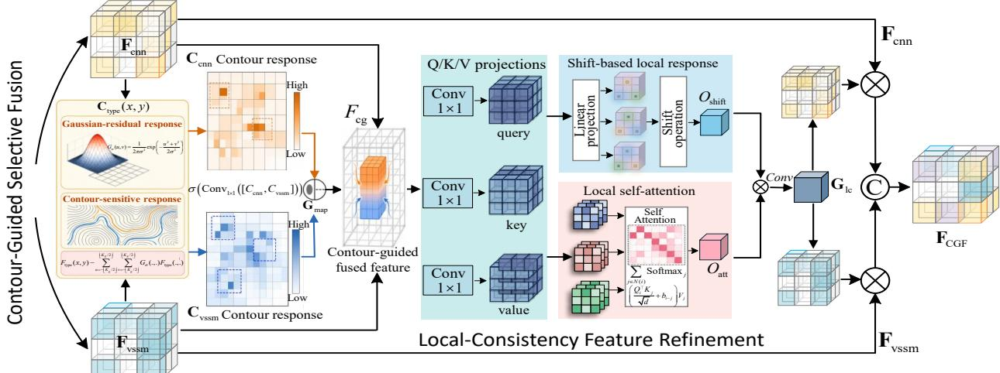  
Fig. 4: Illustration of the CGF module. CNN and VSSM features are transformed into contour-enhanced responses using Gaussian-based high-pass filtering. A contour-guided gating map enables selective cross-backbone fusion, balancing local details and global structures. The fused features are reinjected into both branches and refined by lightweight local attention to enhance multi-scale structural consistency and suppress redundant responses.

The shift-based response and the local self-attention response are then combined to estimate a local-consistency modulation map $\mathbf { G } _ { \mathrm { l c } } \mathbf { . }$

$$
\mathbf { G } _ { \mathrm { l c } } = \sigma _ { s } \bigl ( \mathrm { C o n v 1 } { \times } 1 \left( \mathbf { O } _ { \mathrm { s h i f t } } \odot \mathbf { O } _ { \mathrm { a t t } } \right) \bigr ) ,\tag{13}
$$

where $\mathbf { G } _ { \mathrm { l c } }$ is generated from the refinement between the shift-based local response $\mathbf { O } _ { \mathrm { s h i f t } }$ and the local self-attention response $\mathbf { O } _ { \mathrm { a t t } }$

Consequently, the contour-guided fusion feature $\mathbf { F } _ { \mathrm { C G F } }$ is obtained by applying the same modulation map to the CNN feature $\mathbf { F } _ { \mathrm { c n n } }$ and the VSSM feature $\mathbf { F } _ { \mathrm { v s s m } } ,$ , and the two recalibrated branch-specific features are concatenated and projected by a 1×1 convolution:

$$
\mathbf { F } _ { \mathrm { C G F } } = \mathrm { C o n v } _ { 1 \times 1 } \left( \left[ \mathbf { G } _ { \mathrm { l c } } \odot \mathbf { F } _ { \mathrm { c n n } } , \mathbf { G } _ { \mathrm { l c } } \odot \mathbf { F } _ { \mathrm { v s s m } } \right] \right) .\tag{14}
$$

The generated contour-guided feature $\mathbf { F } _ { \mathrm { C G F } }$ provides stagespecific refinement representations for both encoder and decoder pathways, denoted as $E _ { F }$ and ${ \cal D } _ { F } ,$ respectively. For each network stage, the generated refinement features are element-wise added to the corresponding encoder and decoder features at the same stage. Specifically, the refinement feature associated with the i-th stage is injected into the i-th encoder and decoder of both the CNN and VSSM branches through residual connections. The refined feature representations are then propagated to the subsequent network stages for further feature extraction and cross-backbone interaction.

## 3.3 Stable Gradient-Context Optimization

Even with improved feature representations, fixed or empirically designed learning rate schemes are insufficient to ensure fast convergence and stable optimization in complex degradations [50]. To address this issue, we propose the GCO strategy that treats hyperparameter scheduling as an adaptive decision process. At the end of epoch $t ,$ the controller observes state $s _ { t } ,$ selects action $a _ { t } ,$ and maps it to the learning rate $\ln _ { t + 1 }$ for the next epoch. After training epoch $t + 1$ , it receives reward $\boldsymbol { r } _ { t } ,$ observes the next state $s _ { t + 1 . }$ , and updates the Q-table $\mathcal { Q } ( s _ { t } , a _ { t } )$ .

## 3.3.1 Optimization State Construction

Specifically, we denote the average training loss as $\mathcal { L } _ { t }$ for the epoch $t ,$ the learning rate as $\ln _ { t }$ , and the mini-batch gradient norm as $h _ { t , b } = \| \nabla _ { \theta } \mathcal { L } _ { t , b } \| _ { 2 } ,$ , where b indexes the mini-batch. We first compute the mean $\mu _ { t } = \mathtt { M e a n } _ { b } ( h _ { t , b } )$ and the standard deviation $\sigma _ { t } ~ = ~ \mathsf { S t d } _ { b } ( h _ { t , b } )$ of gradient norms within the current epoch and define a gradientstability score $\kappa _ { s } \colon$

$$
\kappa _ { s } = \frac { \mu _ { t } } { \sigma _ { t } + \epsilon _ { 0 } } ,\tag{15}
$$

where $\epsilon _ { 0 }$ denotes a small constant for numerical stability. A larger $\kappa _ { s }$ indicates more consistent update magnitudes and a more stable optimization trajectory.

Together with $\kappa _ { s } ,$ we further compute the recent average learning rate:

$$
\overline { { \mathrm { l r } } } _ { t } = \frac { 1 } { K _ { t } } et { } { ' } \sum _ { i = t - K _ { t } + 1 } ^ { t } \mathrm { l r } _ { i } ,\tag{16}
$$

where $K _ { t } = \mathbf { m i n } ( K , t )$ denotes the effective history length at the epoch t. Then, two context variables $( \rho _ { t } , c _ { t } ^ { \mathrm { l r } } )$ are defined to describe the loss progress and recent learning rate history:

$$
\left( \rho _ { t } , c _ { t } ^ { \mathrm { l r } } \right) = \left( \frac { \mathcal { L } _ { t } } { \operatorname* { m a x } _ { 1 \leq i \leq t } \mathcal { L } _ { i } + \epsilon _ { 0 } } , \frac { \log \overline { { \mathrm { l r } } } _ { t } - \log \mathrm { l r } _ { \operatorname* { m i n } } } { \log \mathrm { l r } _ { \operatorname* { m a x } } - \log \mathrm { l r } _ { \operatorname* { m i n } } } \right) ,\tag{17}
$$

where $\rho _ { t }$ describes the relative loss progress, and $c _ { t } ^ { \mathrm { l r } }$ encodes the recent learning rate regime in the normalized log space. Including $c _ { t } ^ { \mathrm { l r } }$ makes the state partially aware of recent step-size decisions, which helps the controller distinguish whether the current optimization behavior occurs

under an aggressive or conservative learning rate regime.   
$[ \mathrm { l r } _ { \mathrm { m i n } } , \mathrm { l r } _ { \mathrm { m a x } } ]$ denotes the allowable learning rate range.

Finally, the three context variables $( \rho _ { t } , \kappa _ { s } , c _ { t } ^ { \mathrm { l r } } )$ are discretized into a finite state:

$$
s _ { t } = \mathtt { B i n } ( \rho _ { t } ; N _ { \mathrm { b i n } } ) N _ { \mathrm { b i n } } ^ { 2 } + \mathtt { B i n } ( \kappa _ { s } ; N _ { \mathrm { b i n } } ) N _ { \mathrm { b i n } } + \mathtt { B i n } ( c _ { t } ^ { \mathrm { l r } } ; N _ { \mathrm { b i n } } ) ,\tag{18}
$$

where $\mathtt { B i n } ( \cdot ; N _ { \mathtt { b i n } } )$ maps each scalar context variable into one of $N _ { \mathrm { b i n } }$ discrete bins. Thus, the state space has the size of $N _ { \mathrm { b i n } } ^ { 3 }$

## 3.3.2 Action-based Learning Rate Adjustment

Given the state $s _ { t } ,$ the agent selects an action $ { \boldsymbol { a } } _ { t } \in$ $\{ 0 , \ldots , N _ { \mathrm { a c t } } - 1 \}$ from the Q-table using an εt-greedy policy, where $N _ { \mathrm { a c t } }$ denotes the total number of candidate learning rate actions:

$$
a _ { t } = \left\{ \begin{array} { l l } { \mathrm { U n i } \mathrm { f o r m } ( 0 , N _ { \mathrm { a c t } } - 1 ) , } & { \mathrm { w i t h } \mathrm { p r o b . } \varepsilon _ { t } , } \\ { \mathrm { a r g } \mathbf { m } \mathbf { a x } _ { a \in \{ 0 , \dots , N _ { \mathrm { a c t } } - 1 \} } \mathscr { Q } ( s _ { t } , a ) , } & { \mathrm { w i t h } \mathrm { p r o b . } 1 - \varepsilon _ { t } , } \end{array} \right.\tag{19}
$$

where the selected action is mapped to the learning rate for the next epoch in the logarithmic space, allowing the policy to cover the interval $[ \mathrm { l r } _ { \mathrm { m i n } } , \mathrm { l r } _ { \mathrm { m a x } } ]$ without additional gradient computation:

$$
\mathrm { l r } _ { t + 1 } = \mathrm { l r } _ { \mathrm { m i n } } \left( \frac { \mathrm { l r } _ { \mathrm { m a x } } } { \mathrm { l r } _ { \mathrm { m i n } } } \right) ^ { a _ { t } / ( N _ { \mathrm { a c t } } - 1 ) } .\tag{20}
$$

## 3.3.3 Reward Design and Online Q-table Update

Let $\mathcal { W } _ { t + 1 } = \{ \mathfrak { m a x } ( 1 , t - K + 2 ) , \dots , t + 1 \}$ denote the recent temporal window after applying the action $a _ { t } .$ After the training epoch $t + 1$ with $\ln _ { t + 1 . }$ , the reward is defined as

$$
r _ { t } = \lambda _ { \mathrm { s l o p e } } \bigl ( - \mathsf { S } \mathsf { \Delta } \mathrm { c p e } ( \mathcal { L } _ { \mathcal { W } _ { t + 1 } } ) \bigr ) + \lambda _ { \mathrm { d r o p } } ( \mathcal { L } _ { t } - \mathcal { L } _ { t + 1 } ) - \lambda _ { \mathrm { s t a b } } \mathsf { S } \mathsf { t } \mathsf { d } ( \kappa _ { \mathcal { W } _ { t + 1 } } ) ,\tag{21}
$$

where $\mathsf { S 1 o p e } ( \mathcal { L } _ { \mathcal { W } _ { t + 1 } } )$ denotes the least-squares slope of the loss sequence within the recent window, $\boldsymbol { \mathcal { L } } _ { t } - \boldsymbol { \mathcal { L } } _ { t + 1 } ^ { \mathrm { ~ ~ } }$ measures short-term loss reduction after applying the selected learning rate, and $\operatorname { S t d } ( \kappa _ { \mathcal { W } _ { t + 1 } } )$ penalizes unstable gradient context. The slope term $\lambda _ { \mathrm { s l o p e } }$ encourages a sustained downward loss trend, the drop term $\lambda _ { \mathrm { d r o p } }$ rewards immediate improvement, and the stable term $\lambda _ { \mathrm { s t a b } }$ adjusts the gradientcontext penalty.

The next state $s _ { t + 1 }$ is obtained by discretizing $( \rho _ { t + 1 } , \kappa _ { t + 1 } , c _ { t + 1 } ^ { \mathrm { l r } } )$ in the same way as Eq. (18). The Q-table is initialized from scratch and updated online during network training, and it is not pre-trained on separate tasks. The Qtable update is defined as:

$$
\begin{array} { r } { \mathcal { Q } ( s _ { t } , a _ { t } ) \gets \mathcal { Q } ( s _ { t } , a _ { t } ) + \alpha _ { q } \Big [ r _ { t } + \gamma _ { q } \mathbf { m a x } _ { a ^ { \prime } } \mathcal { Q } ( s _ { t + 1 } , a ^ { \prime } ) - \mathcal { Q } ( { s _ { t } , a _ { t } } ) \Big ] , } \end{array}\tag{22}
$$

where $a ^ { \prime }$ denotes a candidate action in the next state $s _ { t + 1 } ,$ ma $\mathrm { x } _ { a ^ { \prime } } \mathcal { Q } ( s _ { t + 1 } , a ^ { \prime } )$ represents the estimated optimal future value, $\alpha _ { q }$ denotes the Q-table update rate, and $\gamma _ { q }$ represents the discount factor. The exploration rate is gradually decayed by

$$
\varepsilon _ { t + 1 } = \operatorname* { m a x } \mathopen { } \mathclose \bgroup \mathopen { } \mathclose \bgroup \mathopen { } \mathclose \bgroup \mathopen { } \mathclose \bgroup \mathopen { } \mathclose \bgroup \mathopen { } \mathclose \bgroup \mathopen { } \mathclose \bgroup \mathopen { } \mathclose \bgroup \mathopen { } \mathclose \bgroup \mathopen { } \mathclose \bgroup \left( \zeta \varepsilon _ { t } , \varepsilon _ { \operatorname* { m i n } } \aftergroup \egroup \aftergroup \egroup \aftergroup \egroup \aftergroup \egroup \aftergroup \egroup \aftergroup \egroup \aftergroup \egroup \aftergroup \egroup \aftergroup \egroup \aftergroup \egroup \aftergroup \egroup \aftergroup \egroup \right) .\tag{23}
$$

where $\varepsilon _ { t }$ denotes the exploration rate at the epoch $t ,$ which controls the probability of randomly selecting a learning rate action in the εt-greedy policy. $\zeta \in \mathsf { \Gamma } ( 0 , 1 )$ represents the decay factor that progressively reduces the exploration rate, $\varepsilon _ { \mathrm { { m i n } } }$ denotes the minimum exploration rate, and the max(·) operation prevents the exploration probability from becoming smaller than this lower bound.

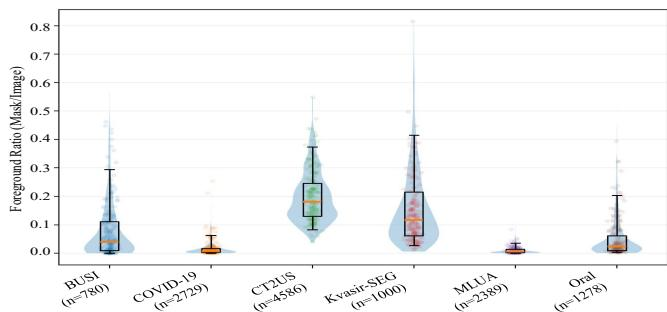  
Fig. 5: Foreground-ratio distributions across the six datasets. The evident cross-dataset shifts indicate substantial variation in target-scale statistics.

## 4 EXPERIMENTAL VALIDATIONS

In the experiments, we evaluate three aspects of O2D-MedNet: (1) the robustness of MIS performance under heterogeneous degradations, (2) the effectiveness of explicit local-global decoupling with selective cross-backbone interaction, and (3) the impact of optimization-aware training on optimization stability. Specifically, we have conducted comprehensive evaluations across various heterogeneous medical imaging datasets, diverse segmentation backbones, and extensive ablation settings, together with computational complexity analysis.

## 4.1 Experimental Protocols

## 4.1.1 Datasets

We evaluate O2D-MedNet on six benchmark datasets spanning three imaging modalities and diverse anatomical structures, including optical RGB images (Oral [51] and Kvasir-SEG [52]), radiological images (COVID-19 [53] and MLUA [54]), and ultrasound images (BUSI [55] and CT2US [56]).

• Oral: An in-house dataset with 1,278 expert-annotated oral mucosal RGB images, characterized by small, scattered lesions and strong specular highlights.

• Kvasir-SEG: A polyp segmentation dataset with 1,000 endoscopic RGB images, featuring large variations in lesion scale, shape, and illumination.

• COVID-19: A collection of 2,729 annotated CT images aggregated from three public datasets, exhibiting low contrast, blurred boundaries, and imaging artifacts.

• MLUA: A dental panoramic X-ray image dataset for caries segmentation containing 2,389 images, characterized by subtle contrast differences and complex lesion–background boundaries.

• CT2US: A dataset with 4,586 kidney segmentation ultrasound image samples, where synthesized ultrasound-like appearance introduces complex texture variations.

• BUSI: A breast ultrasound image dataset containing 780 images from 600 patients, with severe speckle noise and intensity inhomogeneity.

The six datasets exhibit substantial differences in foreground scale and object scale, resulting in significant changes in distribution across datasets. The heterogeneity of these datasets can effectively validate the robustness of subsequent comparison approaches. As shown in Fig. 5, CT2US generally contains larger foreground regions, whereas COVID-19, MLUA, and Oral are dominated by small or sparse targets. In contrast, BUSI and Kvasir-SEG present broader and more heavy-tailed distributions.

TABLE 2: Quantitative comparison in terms of mIoU and Dice on the Oral, Kvasir-SEG, COVID-19, MLUA, CT2US, and BUSI datasets. Comparison methods are grouped into Reference Baselines, Single-stream Frameworks, and Hybrid-stream Frameworks. The best and second-best results in each column are highlighted in red and blue, respectively.
<table><tr><td rowspan=3 colspan=15>Optical RGB Dataset                    Radiological Dataset                    Ultrasound DatasetGroup     Method</td></tr><tr><td rowspan=1 colspan=4></td><td rowspan=1 colspan=8></td></tr><tr><td rowspan=1 colspan=4>mIoU↑ Dice↑ mIoU↑ Dice↑</td><td rowspan=1 colspan=1>mIoU↑</td><td rowspan=1 colspan=3>Dice↑ mIoU↑ Dice↑</td><td rowspan=1 colspan=1>mIoU↑</td><td rowspan=1 colspan=2>Dice↑ mIoU↑</td><td rowspan=1 colspan=1>Dice↑</td></tr><tr><td rowspan=1 colspan=3>U2-Net [17]        8</td><td rowspan=1 colspan=1>2.3±3.1</td><td rowspan=1 colspan=1>90.3±1.7</td><td rowspan=1 colspan=1>78.5±3.8</td><td rowspan=1 colspan=1>88.0±3.2</td><td rowspan=1 colspan=1>79.4±3.8</td><td rowspan=1 colspan=1>88.5±3.3</td><td rowspan=1 colspan=1>59.5±5.8</td><td rowspan=1 colspan=1>68.5±5.2</td><td rowspan=1 colspan=1>95.3±4.0</td><td rowspan=1 colspan=1>97.6±2.7</td><td rowspan=1 colspan=1>61.9±4.1</td><td rowspan=1 colspan=1>76.4±3.6</td></tr><tr><td rowspan=3 colspan=3>DeepLabV3+ [16]ReferenceSFM [57]BáselinesTherNet [58]</td><td rowspan=1 colspan=1>81.6±2.3</td><td rowspan=1 colspan=1>89.8±1.4</td><td rowspan=1 colspan=1>50.1±6.7</td><td rowspan=1 colspan=1>66.8±6.1</td><td rowspan=1 colspan=1>78.3±4.6</td><td rowspan=1 colspan=1>87.8±4.3</td><td rowspan=1 colspan=1>59.1±4.8</td><td rowspan=1 colspan=1>74.3±4.6</td><td></td><td></td><td></td><td></td></tr><tr><td rowspan=1 colspan=1></td><td rowspan=1 colspan=1>70.0±3.0</td><td rowspan=1 colspan=1>82.4±2.4</td><td rowspan=1 colspan=1>68.8±5.1</td><td rowspan=1 colspan=1>81.5±4.7</td><td rowspan=1 colspan=1>75.4±5.3</td><td rowspan=1 colspan=1>85.9±3.2</td><td rowspan=1 colspan=1>45.6±6.2</td><td rowspan=1 colspan=1>62.6±5.6</td><td rowspan=1 colspan=1>94.4±2.1</td><td rowspan=1 colspan=1>97.1±1.4</td><td rowspan=1 colspan=1>58.7±3.9</td><td rowspan=1 colspan=1>74.0±3.6</td></tr><tr><td rowspan=1 colspan=1></td><td rowspan=1 colspan=1>82.5±2.9</td><td rowspan=1 colspan=1>90.4±1.9</td><td rowspan=1 colspan=1>74.4±3.8</td><td rowspan=1 colspan=1>85.3±2.9</td><td rowspan=1 colspan=1>78.3±2.9</td><td rowspan=1 colspan=1>87.8±2.5</td><td rowspan=1 colspan=1>46.9±6.7</td><td rowspan=1 colspan=1>63.8±6.7</td><td rowspan=1 colspan=1>95.0±4.1</td><td rowspan=1 colspan=1>97.4±2.2</td><td rowspan=1 colspan=1>50.9±6.8</td><td rowspan=1 colspan=1>67.4±6.4</td></tr><tr><td rowspan=1 colspan=2>MWCNN [</td><td rowspan=1 colspan=1>59]</td><td rowspan=1 colspan=1>78.6±3.5</td><td rowspan=1 colspan=1>88.0±2.6</td><td rowspan=1 colspan=1>70.8±4.6</td><td rowspan=1 colspan=1>82.9±3.6</td><td rowspan=1 colspan=1>71.4±4.1</td><td rowspan=1 colspan=1>83.3±3.4</td><td rowspan=1 colspan=1>40.8±7.2</td><td rowspan=1 colspan=1>58.0±6.8</td><td rowspan=1 colspan=1>94.8±3.8</td><td rowspan=1 colspan=1>97.3±1.9</td><td rowspan=1 colspan=1>40.5±7.6</td><td rowspan=1 colspan=1>57.6±7.3</td></tr><tr><td rowspan=1 colspan=3>MedSAM [18]</td><td rowspan=1 colspan=1>79.4±4.5</td><td rowspan=1 colspan=1>88.2±2.9</td><td rowspan=1 colspan=1>77.6±3.1</td><td rowspan=1 colspan=1>81.9±2.6</td><td rowspan=1 colspan=1>75.7±5.2</td><td rowspan=1 colspan=1>86.0±4.6</td><td rowspan=1 colspan=1>62.5±5.5</td><td rowspan=1 colspan=1>74.8±6.3</td><td rowspan=1 colspan=1>94.0±3.0</td><td rowspan=1 colspan=1>97.2±1.9</td><td rowspan=1 colspan=1>67.1±3.8</td><td rowspan=1 colspan=1>73.9±3.6</td></tr><tr><td rowspan=1 colspan=3>BCDU-Net [21]</td><td rowspan=1 colspan=1>85.8±2.6</td><td rowspan=1 colspan=1>92.3±1.6</td><td rowspan=1 colspan=1>72.6±4.7</td><td rowspan=1 colspan=1>84.1±3.8</td><td rowspan=1 colspan=1>78.8±3.0</td><td rowspan=1 colspan=1>88.1±2.7</td><td rowspan=1 colspan=1>58.2±5.7</td><td rowspan=1 colspan=1>73.6±4.4</td><td rowspan=1 colspan=1>94.4±3.3</td><td rowspan=1 colspan=1>97.1±2.1</td><td rowspan=1 colspan=1>58.1±5.3</td><td rowspan=1 colspan=1>73.5±4.8</td></tr><tr><td rowspan=1 colspan=3>MTG-Net [60]</td><td rowspan=1 colspan=1>73.1±7.4</td><td rowspan=1 colspan=1>81.2±4.0</td><td rowspan=1 colspan=1>68.5±8.5</td><td rowspan=1 colspan=1>74.4±5.9</td><td rowspan=1 colspan=1>72.4±6.7</td><td rowspan=1 colspan=1>76.6±4.8</td><td rowspan=1 colspan=1>59.6±6.9</td><td rowspan=1 colspan=1>74.7±6.1</td><td rowspan=1 colspan=1>74.1±6.0</td><td rowspan=1 colspan=1>85.1±2.9</td><td rowspan=1 colspan=1>48.2±7.9</td><td rowspan=1 colspan=1>55.3±6.4</td></tr><tr><td rowspan=1 colspan=1></td><td rowspan=1 colspan=2>FAT-Net [12]</td><td rowspan=1 colspan=1>83.3±3.5</td><td rowspan=1 colspan=1>90.9±2.2</td><td rowspan=1 colspan=1>78.0±3.6</td><td rowspan=1 colspan=1>87.6±3.6</td><td rowspan=1 colspan=1>78.1±4.6</td><td rowspan=1 colspan=1>87.7±3.6</td><td rowspan=1 colspan=1>60.4±4.9</td><td rowspan=1 colspan=1>75.3±5.0</td><td rowspan=1 colspan=1>95.3±3.5</td><td rowspan=1 colspan=1>97.6±2.1</td><td rowspan=1 colspan=1>58.6±4.6</td><td rowspan=1 colspan=1>73.9±4.2</td></tr><tr><td rowspan=1 colspan=1></td><td rowspan=1 colspan=2>MISSFormer [7]</td><td rowspan=1 colspan=1>67.5±2.5</td><td rowspan=1 colspan=1>80.6±1.6</td><td rowspan=1 colspan=1>75.8±2.3</td><td rowspan=1 colspan=1>86.2±2.3</td><td rowspan=1 colspan=1>76.4±3.1</td><td rowspan=1 colspan=1>86.6±2.8</td><td rowspan=1 colspan=1>44.9±6.8</td><td></td><td></td><td></td><td></td><td></td></tr><tr><td rowspan=1 colspan=1></td><td rowspan=1 colspan=2>LeViT-UNet [37]</td><td rowspan=1 colspan=1>86.9±2.4</td><td rowspan=1 colspan=1>93.0±1.2</td><td rowspan=1 colspan=1>76.5±3.0</td><td rowspan=1 colspan=1>86.7±2.5</td><td rowspan=1 colspan=1>78.6±3.6</td><td rowspan=1 colspan=1>88.0±2.9</td><td rowspan=1 colspan=1>59.4±6.3</td><td rowspan=1 colspan=1>74.5±5.5</td><td rowspan=1 colspan=1>95.2±3.2</td><td rowspan=1 colspan=1>97.5±1.8</td><td rowspan=1 colspan=1>60.9±5.3</td><td rowspan=1 colspan=1>75.7±4.1</td></tr><tr><td rowspan=1 colspan=1></td><td rowspan=1 colspan=2>Swin-UNet [22]</td><td rowspan=1 colspan=1>62.1±5.1</td><td rowspan=1 colspan=1>69.2±3.8</td><td rowspan=1 colspan=1>69.9±7.0</td><td rowspan=1 colspan=1>77.1±6.2</td><td rowspan=1 colspan=1>72.1±5.5</td><td rowspan=1 colspan=1>83.8±5.8</td><td rowspan=1 colspan=1>43.2±6.6</td><td rowspan=1 colspan=1>53.3±5.7</td><td rowspan=1 colspan=1>92.1±5.5</td><td rowspan=1 colspan=1>95.8±2.5</td><td rowspan=1 colspan=1>46.3±8.5</td><td rowspan=1 colspan=1>51.7±8.3</td></tr><tr><td rowspan=1 colspan=1></td><td rowspan=1 colspan=2>CyCoSeg [6]</td><td rowspan=1 colspan=1>66.5±4.5</td><td rowspan=1 colspan=1>79.9±3.0</td><td rowspan=1 colspan=1>68.6±4.2</td><td rowspan=1 colspan=1>81.3±3.1</td><td rowspan=1 colspan=1>75.2±4.7</td><td rowspan=1 colspan=1>85.9±4.1</td><td rowspan=1 colspan=1>47.1±7.1</td><td rowspan=1 colspan=1>64.0±5.8</td><td rowspan=1 colspan=1>94.1±3.4</td><td rowspan=1 colspan=1>96.9±1.6</td><td rowspan=1 colspan=1>57.9±5.9</td><td rowspan=1 colspan=1>73.3±4.7</td></tr><tr><td rowspan=2 colspan=3>UltraLight VM [40]</td><td rowspan=1 colspan=2>Mamba-] INet [23]</td><td rowspan=1 colspan=1>80.9±3.0</td><td rowspan=1 colspan=1>89.4±1.8</td><td rowspan=1 colspan=1>78.1±4.5</td><td rowspan=1 colspan=1>87.7±4.2</td><td rowspan=1 colspan=1>76.0±5.5</td><td rowspan=1 colspan=1>86.3±3.1</td><td rowspan=1 colspan=1>58.4±5.6</td><td rowspan=1 colspan=1>73.7±5.2</td><td rowspan=1 colspan=1>94.7±3.8</td><td rowspan=1 colspan=1>97.3±2.0</td></tr><tr><td rowspan=1 colspan=1>79.4±3.7</td><td rowspan=1 colspan=1>88.5±2.0</td><td rowspan=1 colspan=1>79.6±3.9</td><td rowspan=1 colspan=1>88.6±3.7</td><td rowspan=1 colspan=1>78.9±3.9</td><td rowspan=1 colspan=1>88.2±5.3</td><td rowspan=1 colspan=1>60.4±4.8</td><td rowspan=1 colspan=1>75.3±4.4</td><td rowspan=1 colspan=1>94.6±4.5</td><td rowspan=1 colspan=1>97.2±2.5</td><td rowspan=1 colspan=1>54.8±4.2</td><td rowspan=1 colspan=1>70.8±3.7</td></tr><tr><td rowspan=1 colspan=3>Single-stream LKM-UNet [24]</td><td rowspan=1 colspan=1>86.4±2.2</td><td rowspan=1 colspan=1>92.7±1.5</td><td rowspan=1 colspan=1>79.5±3.3</td><td rowspan=1 colspan=1>88.6±2.8</td><td rowspan=1 colspan=1>79.3±3.6</td><td rowspan=1 colspan=1>88.4±3.4</td><td rowspan=1 colspan=1>59.5±6.4</td><td rowspan=1 colspan=1>74.6±5.5</td><td rowspan=1 colspan=1>95.7±2.9</td><td rowspan=1 colspan=1>97.8±2.2</td><td rowspan=1 colspan=1>60.2±6.6</td><td rowspan=1 colspan=1>75.1±6.3</td></tr><tr><td rowspan=1 colspan=3>Frameworks H-vmuNet [39]</td><td rowspan=1 colspan=1>83.1±2.5</td><td rowspan=1 colspan=1>90.8±1.8</td><td rowspan=1 colspan=1>72.7±4.7</td><td rowspan=1 colspan=1>84.2±3.6</td><td rowspan=1 colspan=1>77.5±3.2</td><td rowspan=1 colspan=1>87.3±2.5</td><td rowspan=1 colspan=1>52.5±5.6</td><td rowspan=1 colspan=1>68.9±4.7</td><td rowspan=1 colspan=1>95.3±3.3</td><td rowspan=1 colspan=1>97.6±2.1</td><td rowspan=1 colspan=1>63.1±5.8</td><td rowspan=1 colspan=1>77.4±5.3</td></tr><tr><td rowspan=1 colspan=3>Mamba-Sea [25]</td><td rowspan=1 colspan=1>75.7±6.4</td><td rowspan=1 colspan=1>83.1±4.0</td><td rowspan=1 colspan=1>75.4±7.3</td><td rowspan=1 colspan=1>82.3±5.7</td><td rowspan=1 colspan=1>63.4±5.4</td><td rowspan=1 colspan=1>73.6±6.4</td><td rowspan=1 colspan=1>55.5±5.9</td><td rowspan=1 colspan=1>71.4±5.3</td><td rowspan=1 colspan=1>94.9±1.8</td><td rowspan=1 colspan=1>97.3±1.3</td><td rowspan=1 colspan=1>54.2±8.5</td><td rowspan=1 colspan=1>61.0±8.8</td></tr><tr><td rowspan=2 colspan=3>FusionNet [34]MBP-SSNet [36]</td><td rowspan=1 colspan=1>77.3±4.3</td><td rowspan=1 colspan=1>87.2±2.4</td><td rowspan=1 colspan=1>78.4±2.9</td><td rowspan=1 colspan=1>88.1±2.4</td><td rowspan=1 colspan=1>77.1±3.6</td><td rowspan=1 colspan=1>87.1±4.1</td><td rowspan=1 colspan=1>60.0±6.0</td><td rowspan=1 colspan=1>75.0±4.8</td><td rowspan=1 colspan=1>95.2±1.5</td><td rowspan=1 colspan=1>97.5±1.0</td><td rowspan=1 colspan=1>61.6±4.6</td><td rowspan=1 colspan=1>76.3±4.2</td></tr><tr><td rowspan=1 colspan=1>81.5±2.1</td><td rowspan=1 colspan=1>89.8±2.1</td><td rowspan=1 colspan=1>71.1±3.1</td><td rowspan=1 colspan=1>83.1±2.6</td><td rowspan=1 colspan=1>75.4±3.7</td><td rowspan=1 colspan=1>85.9±3.0</td><td rowspan=1 colspan=1>63.3±5.8</td><td rowspan=1 colspan=1>77.5±5.0</td><td rowspan=1 colspan=1>92.1±3.5</td><td rowspan=1 colspan=1>95.9±2.5</td><td rowspan=1 colspan=1>56.2±4.8</td><td rowspan=1 colspan=1>72.0±4.5</td></tr><tr><td rowspan=1 colspan=3>EAG-SAE-ESTF[11]</td><td rowspan=1 colspan=1>74.9±2.5</td><td rowspan=1 colspan=1>85.6±1.8</td><td rowspan=1 colspan=1>79.0±2.5</td><td rowspan=1 colspan=1>88.3±2.2</td><td rowspan=1 colspan=1>77.7±2.8</td><td rowspan=1 colspan=1>87.4±2.6</td><td rowspan=1 colspan=1>61.1±4.9</td><td rowspan=1 colspan=1>75.9±4.2</td><td rowspan=1 colspan=1>95.4±2.8</td><td rowspan=1 colspan=1>97.6±1.1</td><td rowspan=1 colspan=1>63.7±4.0</td><td rowspan=1 colspan=1>77.8±3.6</td></tr><tr><td rowspan=1 colspan=3>GobletNet [13]</td><td rowspan=1 colspan=1>85.3±2.2</td><td rowspan=1 colspan=1>92.0±1.3</td><td rowspan=1 colspan=1>80.0±2.8</td><td rowspan=1 colspan=1>88.9±2.2</td><td rowspan=1 colspan=1>79.0±2.8</td><td rowspan=1 colspan=1>88.2±2.3</td><td rowspan=1 colspan=1>55.1±4.9</td><td rowspan=1 colspan=1>71.1±4.5</td><td rowspan=1 colspan=1>95.0±2.5</td><td rowspan=1 colspan=1>97.4±1.1</td><td rowspan=1 colspan=1>65.3±3.8</td><td rowspan=1 colspan=1>79.0±4.2</td></tr><tr><td rowspan=2 colspan=3>MADGNet [8]FFTMed [26]CSWin-UNet [38]</td><td rowspan=1 colspan=1>82.4±2.6</td><td rowspan=1 colspan=1>90.3±1.4</td><td rowspan=1 colspan=1>77.6±3.3</td><td rowspan=1 colspan=1>87.4±2.9</td><td rowspan=1 colspan=1>78.9±4.3</td><td rowspan=1 colspan=1>88.2±4.6</td><td rowspan=1 colspan=1>61.3±5.1</td><td rowspan=1 colspan=1>76.0±3.6</td><td rowspan=1 colspan=1>95.1±3.0</td><td rowspan=1 colspan=1>97.5±2.1</td><td rowspan=1 colspan=1>60.8±3.7</td><td rowspan=1 colspan=1>75.6±3.1</td></tr><tr><td rowspan=1 colspan=1>66.4±5.3</td><td rowspan=1 colspan=1>70.2±2.0</td><td rowspan=1 colspan=1>70.9±7.3</td><td rowspan=1 colspan=1>78.6±5.7</td><td rowspan=1 colspan=1>59.9±3.5</td><td rowspan=1 colspan=1>71.2±5.4</td><td rowspan=1 colspan=1>55.6±5.4</td><td rowspan=1 colspan=1>71.4±4.6</td><td rowspan=1 colspan=1>80.5±4.2</td><td rowspan=1 colspan=1>85.4±3.7</td><td rowspan=1 colspan=1>58.8±3.9</td><td rowspan=1 colspan=1>74.1±3.5</td></tr><tr><td rowspan=1 colspan=3>SAM2-UNet [27]</td><td rowspan=1 colspan=1>67.8±4.4</td><td rowspan=1 colspan=1>78.5±3.2</td><td rowspan=1 colspan=1>79.4±2.8</td><td rowspan=1 colspan=1>87.9±2.4</td><td rowspan=1 colspan=1>68.1±4.6</td><td rowspan=1 colspan=1>79.6±3.4</td><td rowspan=1 colspan=1>47.9±6.3</td><td rowspan=1 colspan=1>50.1±7.6</td><td rowspan=1 colspan=1>95.6±1.4</td><td rowspan=1 colspan=1>97.7±1.3</td><td rowspan=1 colspan=1>64.8±4.5</td><td rowspan=1 colspan=1>71.5±3.2</td></tr><tr><td rowspan=3 colspan=3>MedT [28]Hybrid-streamTransFuse [9]H2Former [10]ŠrameworksMambaEviScrib [15]</td><td rowspan=1 colspan=1>68.4±5.4</td><td rowspan=1 colspan=1>75.2±1.9</td><td rowspan=1 colspan=1>67.9±4.2</td><td rowspan=1 colspan=1>80.8±3.9</td><td rowspan=1 colspan=1>76.8±2.8</td><td rowspan=1 colspan=1>86.9±2.5</td><td rowspan=1 colspan=1>54.3±6.6</td><td rowspan=1 colspan=1>61.0±4.9</td><td rowspan=1 colspan=1>69.3±6.6</td><td rowspan=1 colspan=1>81.8±4.3</td><td rowspan=1 colspan=1>50.2±6.6</td><td rowspan=1 colspan=1>66.8±6.0</td></tr><tr><td rowspan=1 colspan=1>83.1±2.4</td><td rowspan=1 colspan=1>90.7±1.6</td><td rowspan=1 colspan=1>78.1±2.6</td><td rowspan=1 colspan=1>87.7±2.4</td><td rowspan=1 colspan=1>78.2±4.6</td><td></td><td></td><td></td><td></td><td></td><td></td><td></td></tr><tr><td rowspan=1 colspan=2>H2Former [10l</td><td rowspan=1 colspan=1>80.1±2.7</td><td rowspan=1 colspan=1>88.9±1.7</td><td rowspan=1 colspan=1>72.3±3.6</td><td rowspan=1 colspan=1>83.9±2.7</td><td rowspan=1 colspan=1>78.2±2.9</td><td rowspan=1 colspan=1>87.7±2.6</td><td rowspan=1 colspan=1>59.7±6.7</td><td rowspan=1 colspan=1>74.7±5.3</td><td rowspan=1 colspan=1>95.3±2.6</td><td rowspan=1 colspan=1>97.6±2.1</td><td rowspan=1 colspan=1>57.3±5.7</td><td rowspan=1 colspan=1>72.9±5.9</td></tr><tr><td rowspan=1 colspan=1></td><td rowspan=1 colspan=2>XNet [14]</td><td rowspan=1 colspan=1>85.0±2.7</td><td rowspan=1 colspan=1>91.9±2.0</td><td rowspan=1 colspan=1>79.0±3.2</td><td rowspan=1 colspan=1>88.2±3.0</td><td rowspan=1 colspan=1>78.9±3.4</td><td rowspan=1 colspan=1>88.2±3.7</td><td rowspan=1 colspan=1>64.1±4.8</td><td rowspan=1 colspan=1>78.1±4.1</td><td rowspan=1 colspan=1>95.3±3.1</td><td rowspan=1 colspan=1>97.6±1.5</td><td rowspan=1 colspan=1>63.1±6.5</td><td rowspan=1 colspan=1>77.4±5.8</td></tr><tr><td rowspan=1 colspan=1>D</td><td rowspan=1 colspan=3>S2F [1]          78.9±2.1</td><td rowspan=1 colspan=1>88.2±1.5</td><td rowspan=1 colspan=1>75.8±2.9</td><td rowspan=1 colspan=1>86.2±2.6</td><td rowspan=1 colspan=1>78.1±3.3</td><td rowspan=1 colspan=1>87.7±2.5</td><td rowspan=1 colspan=1>50.9±6.3</td><td rowspan=1 colspan=1>67.5±5.3</td><td rowspan=1 colspan=1>94.5±2.3</td><td rowspan=1 colspan=1>97.1±1.7</td><td rowspan=1 colspan=1>60.4±4.6</td><td rowspan=1 colspan=1>75.3±4.2</td></tr><tr><td rowspan=1 colspan=4>Ours             91.9±1.9</td><td rowspan=1 colspan=1>96.8±1.1</td><td rowspan=1 colspan=1>83.4±2.3</td><td rowspan=1 colspan=1>90.9±2.1</td><td rowspan=1 colspan=1>82.6±2.5</td><td rowspan=1 colspan=1>90.4±2.1</td><td rowspan=1 colspan=1>67.9±4.5</td><td rowspan=1 colspan=1>80.9±3.1</td><td rowspan=1 colspan=1>96.2±1.2</td><td rowspan=1 colspan=1>98.0±0.9</td><td rowspan=1 colspan=1>69.3±3.5</td><td rowspan=1 colspan=1>81.9±3.1</td></tr></table>

## 4.1.2 Evaluation Metrics

We adopt Dice similarity coefficient (DSC, Dice) [61], mean intersection-over-union (mIoU) [62], and Sensitivity [63] to measure region overlap and foreground detection capability, which have been widely used in existing MIS frameworks [18], [64], [65]. In addition, Betti Error (BE) [66] is widely used to evaluate topological consistency by measuring the discrepancy between predicted and ground-truth Betti numbers. For multiclass settings, Dice and mIoU are macroaveraged over foreground classes excluding the lesionbackground, and for binary settings, all metrics are computed on the foreground class.

## 4.1.3 Comparison Methods

We compare O2D-MedNet with a broad set of representative MIS approaches, following the taxonomy established in Section 2. Specifically, all competing methods are grouped into three categories: (1) Reference Baselines, (2) Single-stream Frameworks, and (3) Hybrid-stream Frameworks.

• Reference Baselines. We adopt six widely-used segmentation backbones and classical architectures, including U2-Net [17], DeepLabV3+ [16], SFM [57], TherNet [58], MWCNN [59], and MedSAM [18]. These methods provide standardized baselines for evaluating general segmentation capability and robustness under varying imaging conditions.

• Single-stream Frameworks. We consider representative CNN-based, Transformer-based, VSSM-based, and frequency-enhanced single-stream models, such as SAM2- UNet [27], BCDU-Net [21], MTG-Net [60], MISSFormer [7], Swin-UNet [22], Mamba-UNet [23], LKM-UNet [24], GobletNet [13], MADGNet [8], and FFTMed [26]. These methods represent diverse strategies for enhancing local detail, global structure, and domain-based representations within a single network pathway.

• Hybrid-stream Frameworks. We further compare with representative hybrid architectures that combine heterogeneous representations, including MedT [28], Trans-Fuse [9], H2Former [10], MambaEviScrib [15], XNet [14], and DS2F [1]. These methods incorporate multi-branch designs to exploit complementary local-global or multidomain information, providing strong baselines for evaluating the effectiveness of cross-stream interaction and fusion strategies.

## 4.1.4 Implementation Details

O2D-MedNet is implemented in PyTorch and trained on an Intel i9-10980XE CPU and an NVIDIA GeForce RTX4090 GPU. Adam is used as the base optimizer, with an initial learning rate of $1 \times 1 0 ^ { - 3 }$ and a weight decay of $1 \times 1 0 ^ { - 2 } .$ For all experiments, images are resized to 224 × 224 and each input is converted to a three-channel representation by channel replication when necessary and normalized to [0, 1]. We adopt five-fold cross-validation for all datasets. In each round, one fold is used for testing and the remaining four folds are used for training. The related network is optimized using the binary cross-entropy with logits loss (i.e., BCEWithLogits loss), while the learning rate schedule is adaptively controlled by our GCO module. Finally, training is conducted for 500 epochs with a batch size of 4.

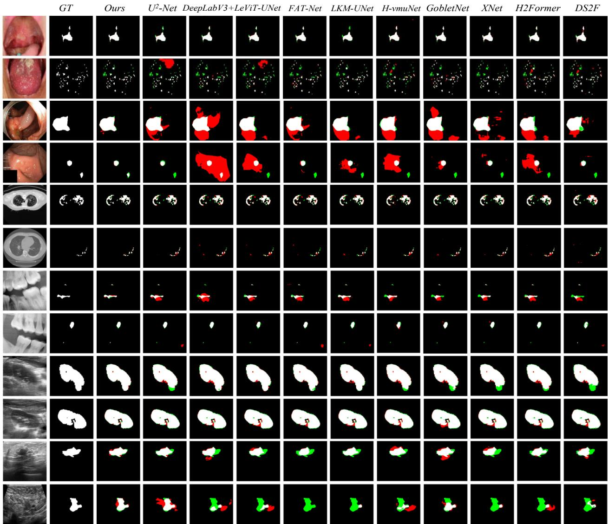  
Fig. 6: Qualitative comparison across different modalities of medical imaging data. For representative coverage, the competitive methods consist of Reference Baselines, Single-stream Frameworks, and Hybrid-stream Frameworks. White indicates correct overlap, red indicates false positives, and green indicates false negatives.

For all experiments, GCO uses fixed hyperparameters across datasets and folds. The state and action spaces are discretized with $N _ { \mathrm { b i n } } { = } 5$ levels and $N _ { \mathrm { a c t } } { = } 6$ logarithmically spaced learning rates in $[ l r _ { \mathrm { m i n } } , l r _ { \mathrm { m a x } } ] { = } [ 1 0 ^ { - 8 } , 1 0 ^ { - 3 } ]$ , yielding $\hat { N } _ { \mathrm { b i n } } ^ { 3 } { = } 1 2 5$ states. The optimization window is $K { = } 5 ,$ with $\scriptstyle \alpha _ { q } = 0 . 0 1$ and $\gamma _ { q } { = } 0 . 9 5$ . Exploration follows $\varepsilon _ { 1 } = 1 . 0 , \ \zeta = 0 . 9 9 9 5$ and $\varepsilon _ { \mathrm { m i n } } { = } 0 . 1$ . The reward weights are $\lambda _ { \mathrm { s l o p e } } { = } 1 0 0 , \lambda _ { \mathrm { d r o p } } { = } 1 0$ and $\lambda _ { \mathrm { s t a b } } { = } 0 . 5 ,$ with $\scriptstyle \epsilon _ { 0 } = 1 0 ^ { - 8 }$ for numerical stability.

In addition, all comparison methods are evaluated on six benchmark datasets (i.e., Oral, Kvasir-SEG, COVID-19, MLUA, CT2US, and BUSI) using mIoU and Dice as evaluation metrics. To ensure fairness, we strictly follow the official implementations and training protocols when available, and otherwise adopt unified training settings, including identical data splits, input resolutions, and optimization schedules. This setup enables a consistent and comprehensive comparison across different methodological paradigms.

## 4.2 Comparison Performance

## 4.2.1 Quantitative Comparison

Table 2 reports the quantitative results on six MIS dataset benchmarks. For clarity, competing methods are grouped into Reference Baselines, Single-stream Frameworks, Hybridstream Frameworks, and our O2D-MedNet. As seen, O2D-MedNet consistently achieves the best performance across all datasets, yielding the highest mIoU and Dice values. This uniform dominance across heterogeneous imaging modalities indicates strong robustness to variations in degradation patterns, target scale, and anatomical complexity.

Compared with the highest-competing method in Table 2 on each dataset, O2D-MedNet improves mIoU/Dice by 5.0/3.8 on Oral, 3.4/2.0 on Kvasir-SEG, 3.2/1.9 on COVID-19, 3.8/2.8 on MLUA, 0.5/0.2 on CT2US, and 2.2/2.9 on

TABLE 3: Ablation study on the Oral and COVID-19 datasets. Higher values indicate better performance for mIoU, Dice, and Sensitivity (‘Sens.’), while lower values indicate better performance for Betti Error (BE).
<table><tr><td colspan="10">(a) Oral</td></tr><tr><td>Order</td><td>CNN</td><td>VSSM</td><td>CGF</td><td>DDI</td><td>GCO</td><td>mIoU↑</td><td>Dice↑</td><td>Sens.↑</td><td>BE↓</td></tr><tr><td>①</td><td>√</td><td></td><td></td><td></td><td></td><td>86.0</td><td>92.4</td><td>92.3</td><td>13.0</td></tr><tr><td>②</td><td>√</td><td>√</td><td></td><td></td><td></td><td>87.7</td><td>93.4</td><td>91.1</td><td>10.3</td></tr><tr><td>③</td><td>√</td><td>√</td><td>√</td><td></td><td></td><td>88.5</td><td>93.9</td><td>93.3</td><td>7.9</td></tr><tr><td>④</td><td>√</td><td>√</td><td>√</td><td>√</td><td></td><td>90.1</td><td>94.8</td><td>93.2</td><td>5.3</td></tr><tr><td>⑤</td><td>√</td><td>√</td><td>√</td><td>√</td><td>√</td><td>91.9</td><td>96.8</td><td>95.5</td><td>3.4</td></tr></table>

(b) COVID-19
<table><tr><td>Order</td><td>CNN</td><td>VSSM</td><td>CGF</td><td>DDI</td><td>GCO</td><td>mIoU↑</td><td>Dice↑</td><td>Sens.↑</td><td>BE↓</td></tr><tr><td>①</td><td>√</td><td></td><td></td><td></td><td></td><td>79.2</td><td>88.4</td><td>88.0</td><td>15.8</td></tr><tr><td>②</td><td>√</td><td>√</td><td></td><td></td><td></td><td>79.7</td><td>88.7</td><td>88.6</td><td>11.4</td></tr><tr><td>③</td><td>√</td><td>√</td><td>√</td><td></td><td></td><td>80.2</td><td>88.9</td><td>89.2</td><td>8.8</td></tr><tr><td>④</td><td>√</td><td>√</td><td>√</td><td>√</td><td></td><td>81.9</td><td>90.1</td><td>89.7</td><td>5.8</td></tr><tr><td>⑤</td><td>√</td><td>√</td><td>√</td><td>√</td><td>√</td><td>82.6</td><td>90.4</td><td>89.9</td><td>4.0</td></tr></table>

BUSI. Notably, the gains are more significant on datasets with small or sparse targets, ambiguous boundaries, and severe degradations (e.g., Oral, BUSI, and MLUA), while remaining consistent on CT2US. In addition, O2D-MedNet often achieves lower or comparable standard deviations, suggesting greater robustness rather than optimization for specific data splits.

## 4.2.2 Qualitative Comparison

Fig. 6 presents qualitative comparisons across different image modalities. To ensure representative coverage, we select two Reference Baselines (U2-Net and DeepLabV3+), five Single-stream Frameworks (LeViT-UNet, FAT-Net, LKM-UNet, H-vmuNet, and GobletNet), and three Hybrid-stream Frameworks (XNet, H2Former, and DS2F). Overall, O2D-MedNet produces predictions that are more consistent with ground truth (GT), with cleaner boundaries, fewer false positives, and reduced missed regions.

For optical RGB images, MIS methods are often affected by illumination variations and specular reflections, whereas O2D-MedNet suppresses such degradations and improves lesion-background separation. For radiological images, it maintains both global coherence and local detail, reducing fragmentation and omission. For ultrasound images, it produces more continuous boundaries under speckle noise. Benefiting from dual-domain refinement, local-global decoupling, and contour-guided selective interaction, O2D-MedNet better preserves both regional coherence and fine lesion delineation across various modalities.

## 4.3 Ablation Studies

## 4.3.1 Quantitative Analysis

Table 3 presents component-wise ablation results on Oral and COVID-19. The ablation pipeline follows the construction of O2D-MedNet, starting from a CNN baseline and progressively adding the VSSM branch, CGF, DDI, and GCO. As the model is extended from setting 1 to setting 5 , mIoU and Dice results consistently improve, along with significant reductions in BE. This indicates that the proposed components improve not only overlap accuracy but also structural and topological consistency.

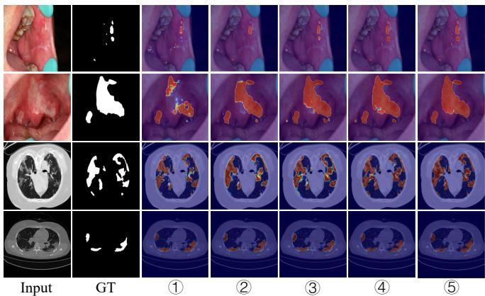  
Fig. 7: Qualitative ablation results on representative samples from Oral and COVID-19 datasets. The predictions show progressively improved completeness and structural consistency.

Introducing the VSSM branch reduces the BE results from 13.0 to 10.3 on Oral and from 15.8 to 11.4 on COVID-19, showing that long-range dependency modeling improves global structural coherence. However, it slightly reduces sensitivity from 92.3 to 91.1 on Oral, suggesting that global modeling alone is insufficient for stable detection of subtle lesions.

After incorporating CGF, BE further decreases to 7.9, while sensitivity recovers to 93.3 on Oral, validating its role in coordinating local and global features. Adding DDI yields substantial gains, especially on COVID-19, where Dice increases from 88.9 to 90.1 and BE decreases from 8.8 to 5.8. This is consistent with its role in suppressing degradation-sensitive responses on composite distortions. Finally, GCO further reduces BE from 5.3 to 3.4 on Oral, and it also improves the sensitivity from 93.2 to 95.5. These results indicate that GCO mainly contributes by alleviating under-convergence and training oscillation, thereby improving recall and structural stability.

## 4.3.2 Qualitative Analysis

Fig. 7 presents qualitative results that are consistent with the quantitative trends in Table 3. In the CNN-only setting 1 , the predictions exhibit scattered activations and fragmented lesion regions, particularly in the oral lesion cases and the CT case. Incorporating the VSSM branch in setting 2 improves spatial coherence, although boundary delineation remains coarse and some lesion regions are still misaligned with the GT results.

With CGF in the setting 3 , lesion-background interfaces become more stable, and spurious connectivity or holelike errors are reduced, indicating more effective localglobal decoupling. Adding DDI in setting 4 suppresses spurious activations and produces cleaner responses around lesion boundaries. The full O2D-MedNet in setting 5 yields the most balanced predictions, preserving lesion structures while reducing lesion-background interference, resulting in more compact and accurate segmentation results across both oral and CT cases.

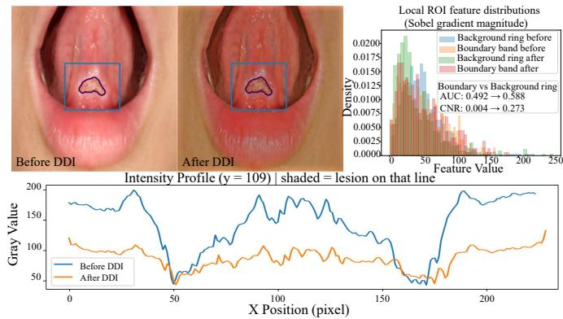  
Fig. 8: Effectiveness of DDI. Comparison of local ROIs before and after DDI, along with Sobel gradient distributions and scanline intensity profiles. DDI suppresses spurious highfrequency responses while preserving true boundary structures, thereby improving lesion-background separability.

## 4.4 Effectiveness Analysis

Although the ablation study quantifies the contribution of each component, it does not fully explain the underlying mechanisms. Therefore, we further analyze the effectiveness of the key modules (i.e., DDI, CGF, and GCO) from the perspectives of input-feature separability, cross-backbone interaction, and optimization dynamics.

## 4.4.1 DDI Module

As illustrated in Fig. 8, DDI modifies the local response distribution within the lesion-centered regions of interest (ROI). Compared with the response before DDI (top-left), the response after DDI exhibits reduced activation intensity in surrounding regions while preserving the main lesion contour. This effect is further reflected in the intensity profile along the sampled horizontal line (bottom), where the response becomes smoother and local fluctuations are noticeably attenuated.

The corresponding Sobel gradient distributions (topright) show improved separation between the lesion boundary band and the surrounding lesion-background ring after DDI, accompanied by consistent increases in Area-Under-the-Curve (AUC) and Contrast-to-Noise Ratio (CNR). These results indicate that DDI suppresses degradationsensitive and background-related responses while preserving boundary-relevant structures, leading to improved lesion-background separability and a more reliable feature representation for subsequent segmentation.

## 4.4.2 CGF Module

As shown in Fig. 9, CGF is compared with several representative fusion modules, including DFM [67], CRIMs [68], CRFM [69], and CGAF [70]. Specifically, DFM performs pixel-wise adaptive fusion by concatenating two-branch features, CRIMs uses channel-resolution cross-attention to exchange information between high-resolution location features and high-channel shape features, CRFM conducts cross-resolution feature interaction to align and fuse features with different spatial granularities, and CGAF adopts content-guided attention to estimate spatial mixing weights and combines low- and high-level features. CGF consistently achieves the best overall performance. On the Oral dataset, it achieves the highest Dice (96.8), Sensitivity (95.5), and mIoU (91.9), while achieving the lowest Betti Error (3.4). Similar trends are observed on the COVID-19 dataset, where CGF obtains the highest Dice (90.4), Sensitivity (89.9), and mIoU (82.6), together with the lowest Betti Error (4.0).

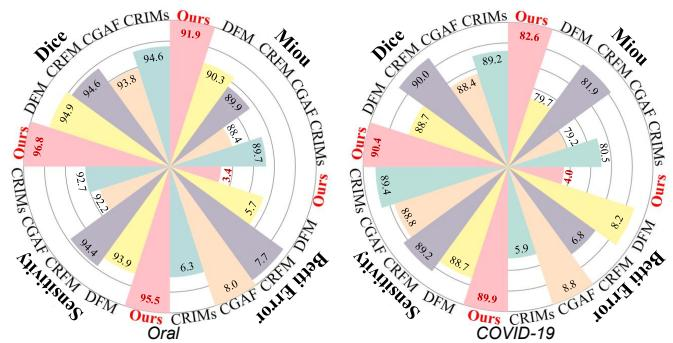  
Fig. 9: Effectiveness of CGF. Comparison with DFM, CRIMs, CRFM, and CGAF on Oral and COVID-19. CGF achieves the best performance in both overlap accuracy and topological consistency.

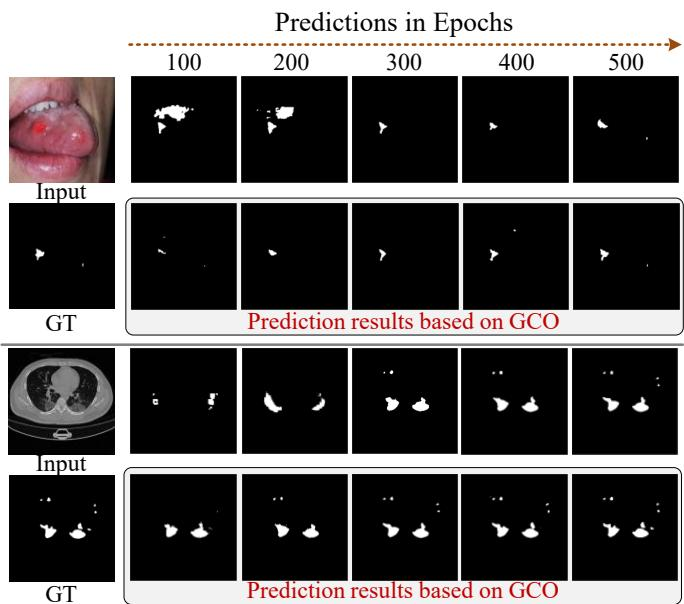  
Fig. 10: Effectiveness of GCO. Prediction evolution across training epochs on representative samples from Oral and COVID-19 datasets.

The consistent improvements across both overlap- and topology-related metrics indicate that CGF effectively enhances cross-backbone feature integration. By combining contour-guided selective interaction with local-consistency modulation, CGF better coordinates CNN-based local details and VSSM-based global structure, resulting in improved robust MIS performance.

## 4.4.3 GCO Module

As illustrated in Fig. 10, we visualize prediction evolution at 100, 200, 300, 400, and 500 epochs for representative Oral and COVID-19 samples. Without GCO, the predictions exhibit noticeable instability across training epochs, characterized by fluctuations in lesion size and spatial localization. For the Oral sample, lesion responses emerge at early epochs but progressively shrink from 300 to 500 epochs. Similarly, the COVID-19 sample shows irregular variations in both lesion extent and spatial distribution throughout training.

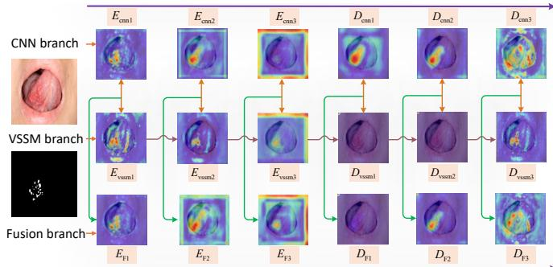  
Fig. 11: Activation responses of the proposed local–global decoupling and scale-wise interaction. Compared with the CNN and VSSM branches, the fused branch produces more complete and lesion-aligned activations during decoding, indicating effective integration of local detail and global structure.

In contrast, incorporating GCO yields more stable prediction evolution. For the Oral sample, the predicted lesion remains consistently localized around the GT region across all epochs, avoiding the abrupt shrinkage observed without GCO. For the COVID-19 sample, the predicted regions maintain more consistent bilateral localization and better preserve the major lesion structures throughout training. These observations suggest that GCO stabilizes the optimization trajectory through gradient-context-aware learning rate adaptation, resulting in more consistent convergence and reliable segmentation predictions.

## 4.5 Activation Response Analysis

As shown in Fig. 11, we visualize the activation responses of the CNN branch, the VSSM branch, and the fusion branch at the encoding and decoding stages. The three branches exhibit complementary response patterns. The CNN branch produces strong lesion-related activations in shallow encoding stages $( e . g . , E _ { \mathrm { c n n 1 } }$ and $E _ { \mathrm { c n n 2 } } )$ and decoding stages (e.g., $D _ { \mathrm { c n n 1 } }$ and $D _ { \mathrm { c n n } 2 } )$ , indicating high sensitivity to local textures, boundary cues, and fine structural variations. However, lesion-background and boundary-adjacent responses are also observed in deeper stages, suggesting susceptibility to local interference.

In contrast, the VSSM branch generates more spatially distributed activations, reflecting its ability to capture broader contextual information. Nevertheless, its responses around lesion regions are occasionally less concentrated, as observed in $D _ { \mathrm { v s s m 1 } }$ and $D _ { \mathrm { v s s m } 2 } ,$ , indicating reduced sensitivity to small or localized structures.

The fusion branch (see Fig. 2) effectively combines these complementary characteristics. Across both the encoding and decoding stages, lesion-related activations are preserved more consistently $( e . g . , \ E _ { \mathrm { F } 1 } - E _ { \mathrm { F } 3 }$ and $D _ { \mathrm { F } 2 } – D _ { \mathrm { F } 3 } )$ while irrelevant lesion-background responses are progressively suppressed. As a result, the fused features exhibit stronger alignment with the lesion regions, demonstrating that the proposed fusion strategy successfully integrates CNN-based local discriminability with VSSM-based contextual modeling to provide more informative representations for segmentation.

TABLE 4: Computational complexity and inference efficiency under a unified input resolution and hardware setting. Lower values indicate better performance. Best results are highlighted in bold.
<table><tr><td>Method</td><td>Params (M)↓</td><td>GFLOPs↓</td><td>Time (msec.)↓</td></tr><tr><td>u2-Net</td><td>1.131</td><td>9.751</td><td>17.047</td></tr><tr><td>DeepLabV3+</td><td>40.347</td><td>13.268</td><td>7.433</td></tr><tr><td>SFM</td><td>25.874</td><td>7.871</td><td>19.055</td></tr><tr><td>TherNet</td><td>48.072</td><td>27.835</td><td>24.513</td></tr><tr><td>MWCNN</td><td>24.929</td><td>51.907</td><td>4.619</td></tr><tr><td>MedSAM</td><td>90.689</td><td>35.565</td><td>18.478</td></tr><tr><td>BCDU-Net</td><td>21.031</td><td>28.237</td><td>2.923</td></tr><tr><td>MTG-Net</td><td>26.992</td><td>151.940</td><td>12.563</td></tr><tr><td>FAT-Net</td><td>28.759</td><td>22.781</td><td>12.738</td></tr><tr><td>MISSFormer</td><td>42.462</td><td>9.860</td><td>22.679</td></tr><tr><td>LeViT-UNet</td><td>52.154</td><td>25.547</td><td>13.141</td></tr><tr><td>Swin-UNet</td><td>27.168</td><td>6.126</td><td>10.134</td></tr><tr><td>CyCoSeg</td><td>0.053</td><td>0.060</td><td>17.165</td></tr><tr><td>Mamba-UNet</td><td>44.274</td><td>7.517</td><td>29.675</td></tr><tr><td>UltraLight VM</td><td>0.049</td><td>0.052</td><td>14.942</td></tr><tr><td>LKM-UNet</td><td>15.317</td><td>21.778</td><td>22.174</td></tr><tr><td>H-vmuNet</td><td>8.973</td><td>0.808</td><td>79.417</td></tr><tr><td>Mamba-Sea</td><td>27.447</td><td>4.091</td><td>19.659</td></tr><tr><td>FusionNet</td><td>4.918</td><td>5.149</td><td>6.306</td></tr><tr><td>MBP-SSNet</td><td>639.272</td><td>80.752</td><td>11.899</td></tr><tr><td>EAG-SAE-ESTF</td><td>48.843</td><td>36.381</td><td>10.305</td></tr><tr><td>GobletNet</td><td>133.248</td><td>141.612</td><td>8.366</td></tr><tr><td>MADGNet</td><td>31.219</td><td>7.666</td><td>32.389</td></tr><tr><td>FFTMed</td><td>3.919</td><td>1.659</td><td>12.379</td></tr><tr><td>CSWin-UNet</td><td>23.568</td><td>5.009</td><td>33.237</td></tr><tr><td>SAM2-UNet</td><td>216.530</td><td>93.961</td><td>28.169</td></tr><tr><td>MedT</td><td>11.354</td><td>18.268</td><td>13.535</td></tr><tr><td>TransFuse</td><td>14.637</td><td>5.904</td><td>8.172</td></tr><tr><td>H2Former</td><td>33.679</td><td>24.824</td><td>13.734</td></tr><tr><td>MambaEviScrib</td><td>3.706</td><td>4.215</td><td>13.043</td></tr><tr><td>XNet</td><td>135.816</td><td>114.736</td><td>6.685</td></tr><tr><td>DS2F</td><td>39.205</td><td>36.991</td><td>32.385</td></tr><tr><td>Ours</td><td>158.310</td><td>12.533</td><td>37.902</td></tr></table>

## 4.6 Computational Complexity

Table 4 compares model complexity and inference efficiency in terms of parameter count, GFLOPs, and per-image latency. A clear trade-off can be observed among existing methods. Lightweight models such as CyCoSeg and Ultra-Light VM achieve low computational cost, but their limited capacity may constrain performance under heterogeneous imaging conditions. Conversely, high-capacity models, including XNet, GobletNet, and MBP-SSNet, require substantially more parameters or computational operations, indicating that increasing model scale alone does not necessarily yield a more efficient or effective solution.

O2D-MedNet contains 158.31M parameters, 12.533 GFLOPs, and 37.902 millisecond latency per image. Although the dual-backbone architecture and cross-backbone interactions increase the parameter count and inference latency, the overall computational cost remains competitive, with lower GFLOPs than several high-capacity baselines, including MTG-Net, MBP-SSNet, GobletNet, and XNet. Combined with the quantitative segmentation results, these findings suggest that O2D-MedNet achieves a favorable balance between segmentation performance and computational efficiency, with its gains arising from effective architectural design rather than model scale alone.

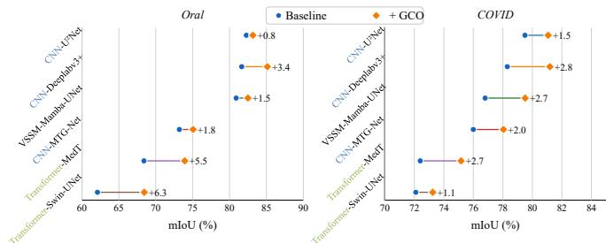  
Fig. 12: Cross-backbone generalization of GCO on the Oral and COVID-19 datasets.

## 4.7 Further Cross-Architecture Validation of GCO

To evaluate the generalization of GCO beyond O2D-MedNet, we integrate it into six representative segmentation backbones spanning CNN-, Transformer-, and VSSM-based architectures. As shown in Fig. 12, GCO consistently improves mIoU on both the Oral and COVID-19 datasets across all evaluated models, yielding average gains of 3.2 and 2.1 points, respectively. These consistent improvements suggest that the effectiveness of GCO is not tied to a specific network architecture.

Combined with the prediction evolution analysis in Fig. 10, the results indicate that GCO primarily operates at the optimization level rather than the representation level. By adaptively regulating the learning rate based on gradient-context information, GCO promotes more stable training dynamics and reliable convergence, leading to improved segmentation performance across diverse backbone architectures and heterogeneous medical imaging scenarios.

## 5 CONCLUSION AND FUTURE WORK

This paper presents an optimization-aware dual-domain network for robust medical image segmentation (O2D-MedNet) under composite degradations and multi-scale geometric variations. The proposed framework is based on the observation that degradation suppression, local-global representation learning, and optimization stability are inherently coupled and should be addressed in a coordinated manner. To this end, O2D-MedNet integrates dualdomain feature refinement, contour-guided cross-backbone interaction, and gradient-context-aware optimization within a unified framework. Extensive experiments on six benchmark datasets spanning multiple imaging modalities and anatomical targets demonstrate consistent improvements in segmentation accuracy, sensitivity, and topological consistency, highlighting the effectiveness of jointly modeling feature representation and optimization dynamics.

Despite these promising results, several limitations remain. The current study is restricted to 2D segmentation tasks, and extending the framework to 3D volumes and temporal imaging data requires further investigation. In addition, resizing inputs to a fixed resolution may compromise extremely fine-grained structures, while the dual-backbone design introduces additional parameters and inference latency compared with lightweight architectures. Although improved topological metrics indicate enhanced structural consistency, further clinical validation is necessary to assess practical utility in real-world settings. Future work will focus on extending the framework to 3D and longitudinal imaging scenarios, improving robustness under limited annotations and cross-center domain shifts, and incorporating uncertainty-aware modeling to further enhance reliability and generalization.

## REFERENCES

[1] Z. Qiu, Y. Hu, X. Chen, D. Zeng, Q. Hu, and J. Liu, “Rethinking Dual-Stream Super-Resolution Semantic Learning in Medical Image Segmentation,” IEEE Transactions on Pattern Analysis and Machine Intelligence, vol. 46, no. 1, pp. 451–464, 2024.

[2] T. Zhang, S. Zheng, J. Cheng, X. Jia, J. Bartlett, X. Cheng, Z. Qiu, H. Fu, J. Liu, A. Leonardis et al., “Structure and Intensity Unbiased Translation for 2D Medical Image Segmentation,” IEEE Transactions on Pattern Analysis and Machine Intelligence, vol. 46, no. 12, pp. 10 060–10 075, 2024.

[3] M. Antonelli, A. Reinke, S. Bakas, K. Farahani, A. Kopp-Schneider, B. A. Landman, G. Litjens, B. Menze, O. Ronneberger, R. M. Summers et al., “The Medical Segmentation Decathlon,” Nature Communications, vol. 13, no. 1, p. 4128, 2022.

[4] J. Liu, F. Liu, K. Sun, Z. Cui, T. Sun, Z. Cao, J. Huang, S. Bai, Y. Wang, Y. Dou et al., “BrainParc: unified lifespan brain parcellation from structural magnetic resonance images,” Nature Computational Science, vol. 6, no. 6, pp. 588–602, 2026.

[5] Y. Yang, B. Wang, D. Zhang, Y. Yuan, Q. Yan, S. Zhao, Z. You, and J. Han, “Self-supervised interactive embedding for one-shot organ segmentation,” IEEE Transactions on Biomedical Engineering, vol. 70, no. 10, pp. 2799–2808, 2023.

[6] D. O. Medley, C. Santiago, and J. C. Nascimento, “CyCoSeg: A Cyclic Collaborative Framework for Automated Medical Image Segmentation,” IEEE Transactions on Pattern Analysis and Machine Intelligence, vol. 44, no. 11, pp. 8167–8182, 2021.

[7] X. Huang, Z. Deng, D. Li, X. Yuan, and Y. Fu, “MISSFormer: An Effective Transformer for 2D Medical Image Segmentation,” IEEE Transactions on Medical Imaging, vol. 42, no. 5, pp. 1484–1494, 2023.

[8] J.-H. Nam, N. S. Syazwany, S. J. Kim, and S.-C. Lee, “Modalityagnostic domain generalizable medical image segmentation by multi-frequency in multi-scale attention,” in Proceedings of the IEEE/CVF Conference on Computer Vision and Pattern Recognition (CVPR), 2024, pp. 11 480–11 491.

[9] Y. Zhang, H. Liu, and Q. Hu, “TransFuse: Fusing Transformers and CNNs for Medical Image Segmentation,” in Springer International Conference on Medical Image Computing and Computer Assisted Intervention (MICCAI), 2021, pp. 14–24.

[10] A. He, K. Wang, T. Li, C. Du, S. Xia, and H. Fu, “H2Former: An Efficient Hierarchical Hybrid Transformer for Medical Image Segmentation,” IEEE Transactions on Medical Imaging, vol. 42, no. 9, pp. 2763–2775, 2023.

[11] X. Zhang, S. Wang, W. Lv, M. Zhou, S. Li, J. Yang, M. Huang, Y. Su, and T. Shen, “EAG-SAE-ESTF: An Entropy-Aware Gated Network With Scale-Adaptive Enhancement and Elastic Spatial Topology Fusion for Coronary Artery Segmentation,” Elsevier Information Fusion, pp. 1–18, 2026.

[12] H. Wu, S. Chen, G. Chen, W. Wang, B. Lei, and Z. Wen, “FAT-Net: Feature Adaptive Transformers for Automated Skin Lesion Segmentation,” Elsevier Medical Image Analysis, vol. 76, pp. 1–14, 2022.

[13] Y. Zhou, L. Li, C. Wang, L. Song, and G. Yang, “GobletNet: Wavelet-Based High-Frequency Fusion Network for Semantic Segmentation of Electron Microscopy Images,” IEEE Transactions on Medical Imaging, vol. 44, no. 2, pp. 1058–1069, 2025.

[14] Y. Zhou, J. Huang, C. Wang, L. Song, and G. Yang, “XNet: Wavelet-Based Low and High Frequency Fusion Networks for Fully- and Semi-Supervised Semantic Segmentation of Biomedical Images,” in Proceedings of the IEEE/CVF International Conference on Computer Vision (ICCV), 2023, pp. 21 085–21 096.

[15] X. Han, X. Li, J. Shang, Y. Liu, K. Chen, S. Xu, Q. Liu, and Q. Zhang, “MambaEviScrib: Mamba and Evidence-Guided Consistency Enhance CNN Robustness for Scribble-Based Weakly Supervised Ultrasound Image Segmentation,” Elsevier Information Fusion, vol. 126, p. 103590, 2026.

[16] L.-C. Chen, Y. Zhu, G. Papandreou, F. Schroff, and H. Adam, “Encoder-Decoder With Atrous Separable Convolution for Semantic Image Segmentation,” in Proceedings of the European conference on computer vision (ECCV), 2018, pp. 801–818.

[17] X. Qin, Z. Zhang, C. Huang, M. Dehghan, O. R. Zaiane, and M. Jagersand, “U2-Net: Going Deeper with Nested U-structure for Salient Object Detection,” Elsevier Pattern Recognition, vol. 106, pp. 1–12, 2020.

[18] J. Ma, Y. He, F. Li, L. Han, C. You, and B. Wang, “Segment Anything in Medical Images,” Nature Communications, vol. 15, no. 1, p. 654, 2024.

[19] O. Oktay, E. Ferrante, K. Kamnitsas, M. Heinrich, W. Bai, J. Caballero, S. A. Cook, A. De Marvao, T. Dawes, D. P. O‘Regan et al., “Anatomically Constrained Neural Networks (ACNNs): Application to Cardiac Image Enhancement and Segmentation,” IEEE Transactions on Medical Imaging, vol. 37, no. 2, pp. 384–395, 2018.

[20] L. Chen, P. Bentley, K. Mori, K. Misawa, M. Fujiwara, and D. Rueckert, “DRINet for Medical Image Segmentation,” IEEE Transactions on Medical Imaging, vol. 37, no. 11, pp. 2453–2462, 2018.

[21] R. Azad, M. Asadi-Aghbolaghi, M. Fathy, and S. Escalera, “Bi-Directional ConvLSTM U-Net with Densley Connected Convolutions,” in Proceedings of the IEEE/CVF International Conference on Computer Vision (ICCV) Workshops, 2019, pp. 1–10.

[22] H. Cao, Y. Wang, J. Chen, D. Jiang, X. Zhang, Q. Tian, and M. Wang, “Swin-Unet: Unet-Like Pure Transformer for Medical Image Segmentation,” in Springer European Conference on Computer Vision (ECCV), 2022, pp. 205–218.

[23] Z. Wang, J.-Q. Zheng, Y. Zhang, G. Cui, and L. Li, “Mamba-UNet: UNet-Like Pure Visual Mamba for Medical Image Segmentation,” arXiv preprint arXiv:2402.05079, 2024.

[24] J. Wang, J. Chen, D. Chen, and J. Wu, “LKM-UNet: Large Kernel Vision Mamba UNet for Medical Image Segmentation,” in Springer International Conference on Medical Image Computing and Computer Assisted Intervention (MICCAI), 2024, pp. 360–370.

[25] Z. Cheng, J. Guo, J. Zhang, L. Qi, L. Zhou, Y. Shi, and Y. Gao, “Mamba-Sea: A Mamba-Based Framework With Global-to-Local Sequence Augmentation for Generalizable Medical Image Segmentation,” IEEE Transactions on Medical Imaging, vol. 44, no. 9, pp. 3741–3755, 2025.

[26] V. T. Pham, M. H. Ha, B. V. Bui, and T. S. Hy, “FFTMed: Leveraging Fast-Fourier Transform for a Lightweight and Adversarial-Resilient Medical Image Segmentation Framework,” Scientific Reports, vol. 15, no. 1, p. 37879, 2025.

[27] X. Xiong, Z. Wu, S. Tan, W. Li, F. Tang, Y. Chen, S. Li, J. Ma, and G. Li, “SAM2-UNet: Segment Anything 2 Makes Strong Encoder for Natural and Medical Image Segmentation,” Springer Visual Intelligence, vol. 4, no. 1, p. 2, 2026.

[28] J. M. J. Valanarasu, P. Oza, I. Hacihaliloglu, and V. M. Patel, “Medical Transformer: Gated Axial-Attention for Medical Image Segmentation,” in Springer International Conference on Medical Image Computing and Computer Assisted Intervention (MICCAI), 2021, pp. 36–46.

[29] Y. Shi, Y. Gao, S. Liao, D. Zhang, Y. Gao, and D. Shen, “Semiautomatic segmentation of prostate in CT images via coupled feature representation and spatial-constrained transductive lasso,” IEEE Transactions on Pattern Analysis and Machine Intelligence, vol. 37, no. 11, pp. 2286–2303, 2015.

[30] A. Rahman, J. M. J. Valanarasu, I. Hacihaliloglu, and V. M. Patel, “Ambiguous medical image segmentation using diffusion models,” in IEEE/CVF Conference on Computer Vision and Pattern Recognition (CVPR), 2023, pp. 11 536–11 546.

[31] S. M. Fischer, J. Kiechle, L. Daza, L. Felsner, R. Osuala, D. M. Lang, K. Lekadir, J. C. Peeken, and J. A. Schnabel, “Progressive growing of patch size: Curriculum learning for accelerated and improved medical image segmentation,” Elsevier Medical Image Analysis, p. 104195, 2026.

[32] R. Azad, E. K. Aghdam, A. Rauland, Y. Jia, A. H. Avval, A. Bozorgpour, S. Karimijafarbigloo, J. P. Cohen, E. Adeli, and D. Merhof, “Medical Image Segmentation Review: The Success of U-Net,” IEEE Transactions on Pattern Analysis and Machine Intelligence, vol. 46, no. 12, pp. 10 076–10 095, 2024.

[33] L. Kreitner, J. C. Paetzold, N. Rauch, C. Chen, A. M. Hagag, A. E. Fayed, S. Sivaprasad, S. Rausch, J. Weichsel, B. H. Menze et al., “Synthetic optical coherence tomography angiographs for detailed retinal vessel segmentation without human annotations,” IEEE Transactions on Medical Imaging, vol. 43, no. 6, pp. 2061–2073, 2024.

[34] T. M. Quan, D. G. C. Hildebrand, and W.-K. Jeong, “FusionNet: A Deep Fully Residual Convolutional Neural Network for Image Segmentation in Connectomics,” Frontiers in Computer Science, vol. 3, pp. 1–12, 2021.

[35] J. M. J. Valanarasu and V. M. Patel, “UNeXt: MLP-Based Rapid Medical Image Segmentation Network,” in Springer International Conference on Medical Image Computing and Computer Assisted Intervention (MICCAI), 2022, pp. 23–33.

[36] Y. Wang, Y. Zhang, L. Zhang, Y. Xu, R. Feng, H. Cai, J. Xue, Z. Zhao, X. Guo, Y. Wei et al., “Multi-Bottleneck Progressive Propulsion Network for Medical Image Semantic Segmentation With Integrated Macro-Micro Dual-Stage Feature Enhancement and Refinement,” Elsevier Expert Systems with Applications, vol. 252, pp. 1–25, 2024.

[37] G. Xu, X. Zhang, X. He, and X. Wu, “LeViT-UNet: Make Faster Encoders with Transformer for Medical Image Segmentation,” in Springer Chinese Conference on Pattern Recognition and Computer Vision (PRCV), 2023, pp. 42–53.

[38] X. Liu, P. Gao, T. Yu, F. Wang, and R.-Y. Yuan, “CSWin-UNet: Transformer UNet with Cross-Shaped Windows for Medical Image Segmentation,” Elsevier Information Fusion, vol. 113, pp. 1–12, 2025.

[39] R. Wu, Y. Liu, P. Liang, and Q. Chang, “H-vmuNet: High-order Vision Mamba UNet for Medical Image Segmentation,” Elsevier Neurocomputing, vol. 624, pp. 1–11, 2025.

[40] R. Wu, Y. Liu, G. Ning, P. Liang, and Q. Chang, “UltraLight VM-UNet: Parallel Vision Mamba Significantly Reduces Parameters for Skin Lesion Segmentation,” Elsevier Patterns, vol. 6, no. 11, 2025.

[41] V. A. Zimmer, A. Gomez, E. Skelton, N. Toussaint, T. Zhang, B. Khanal, R. Wright, Y. Noh, A. Ho, J. Matthew et al., “Towards whole placenta segmentation at late gestation using multi-view ultrasound images,” in Springer International Conference on Medical Image Computing and Computer Assisted Intervention (MICCAI), 2019, pp. 628–636.

[42] S. Seidlitz, J. Sellner, J. Odenthal, B. Ozdemir, A. Studier-Fischer,¨ S. Knodler, L. Ayala, T. J. Adler, H. G. Kenngott, M. Tizabi¨ et al., “Robust deep learning-based semantic organ segmentation in hyperspectral images,” Elsevier Medical Image Analysis, vol. 80, p. 102488, 2022.

[43] J. M. J. Valanarasu, V. A. Sindagi, I. Hacihaliloglu, and V. M. Patel, “KiU-Net: Overcomplete Convolutional Architectures for Biomedical Image and Volumetric Segmentation,” IEEE Transactions on Medical Imaging, vol. 41, no. 4, pp. 965–976, 2022.

[44] L. Zhou, Y. Zhang, J. Zhang, X. Qian, C. Gong, K. Sun, Z. Ding, X. Wang, Z. Li, Z. Liu et al., “Prototype learning guided hybrid network for breast tumor segmentation in DCE-MRI,” IEEE Transactions on Medical Imaging, vol. 44, no. 1, pp. 244–258, 2024.

[45] I. Oksuz, J. R. Clough, B. Ruijsink, E. P. Anton, A. Bustin, G. Cruz, C. Prieto, A. P. King, and J. A. Schnabel, “Deep Learning-Based Detection and Correction of Cardiac MR Motion Artefacts During Reconstruction for High-Quality Segmentation,” IEEE Transactions on Medical Imaging, vol. 39, no. 12, pp. 4001–4010, 2020.

[46] S. Zhou, D. Nie, E. Adeli, Q. Wei, X. Ren, X. Liu, E. Zhu, J. Yin, Q. Wang, and D. Shen, “Semantic instance segmentation with discriminative deep supervision for medical images,” Elsevier Medical Image Analysis, vol. 82, p. 102626, 2022.

[47] J. Xie, Q. Zhang, Z. Cui, C. Ma, Y. Zhou, W. Wang, and D. Shen, “Integrating eye tracking with grouped fusion networks for semantic segmentation on mammogram images,” IEEE Transactions on Medical Imaging, vol. 44, no. 2, pp. 868–879, 2025.

[48] H. Lu, L. Du, and P. Zhou, “Wavelet Multi-scale Region-Enhanced Network for Medical Image Segmentation,” in Proceedings of the International Joint Conference on Artificial Intelligence (IJCAI), 2025, pp. 1675–1683.

[49] J. Huang, Y. Zhao, Y. Li, Z. Dai, C. Chen, and Q. Lai, “ACM-UNet: Adaptive Integration of CNNs and Mamba for Efficient Medical Image Segmentation,” arXiv preprint arXiv:2505.24481, 2025.

[50] W. Qi, J. Wu, and S.-C. Chan, “Gradient-Aware for Class-Imbalanced Semi-supervised Medical Image Segmentation,” in Springer European Conference on Computer Vision (ECCV), 2024, pp. 473–490.

[51] S. Hu, S. Tian et al., “Oral mucosal lesion segmentation dataset,” 2026, accessed: Jul. 27, 2026. [Online]. Available: https://drive.google.com/file/d/ 118E1L5hyf4Uc0L03Yfc3wGVjmmSLgjFh/view?usp=drive link

[52] D. Jha, P. H. Smedsrud, M. A. Riegler, P. Halvorsen, T. De Lange, D. Johansen, and H. D. Johansen, “Kvasir-SEG: A Segmented

Polyp Dataset,” in Springer International Conference on Multimedia Modeling (MMM), 2019, pp. 451–462.

[53] J. Ma, C. Ge, Y. Wang, X. An, J. Gao, Z. Yu, M. Zhang, X. Liu, X. Deng, S. Cao et al., “COVID-19 CT Lung and Infection Segmentation Dataset,” Zenodo, 2020.

[54] X. Wang, S. Gao, K. Jiang, H. Zhang, L. Wang, F. Chen, J. Yu, and F. Yang, “Multi-level Uncertainty Aware Learning for Semisupervised Dental Panoramic Caries Segmentation,” Elsevier Neurocomputing, vol. 540, pp. 1–11, 2023.

[55] W. Al-Dhabyani, M. Gomaa, H. Khaled, and A. Fahmy, “Dataset of Breast Ultrasound Images,” Elsevier Data in Brief, vol. 28, pp. 1–5, 2020.

[56] Y. Song, J. Zheng, L. Lei, Z. Ni, B. Zhao, and Y. Hu, “CT2US: Crossmodal Transfer Learning for Kidney Segmentation in Ultrasound Images with Synthesized Data,” Elsevier Ultrasonics, vol. 122, pp. 1–9, 2022.

[57] L. Chen, Y. Fu, L. Gu, D. Zheng, and J. Dai, “Spatial Frequency Modulation for Semantic Segmentation,” IEEE Transactions on Pattern Analysis and Machine Intelligence, vol. 47, no. 11, pp. 9767– 9784, 2025.

[58] J. Chen, S. Shu, C. Meng, and X. Bai, “TherNet: Thermal Segmentation Network Harnessing Physical Properties,” IEEE Transactions on Pattern Analysis and Machine Intelligence, vol. 47, no. 12, pp. 11 768–11 784, 2025.

[59] P. Liu, H. Zhang, K. Zhang, L. Lin, and W. Zuo, “Multi-Level Wavelet-CNN for Image Restoration,” in Proceedings of the IEEE/CVF Conference on Computer Vision and Pattern Recognition (CVPR) Workshops, 2018, pp. 773–782.

[60] T. Chen, D. Zhang, D. Chen, H. Fu, K. Jin, S. Wang, L. D. Cohen, Y. Zhao, Q. Yi, and J. Zhang, “Neovascularization Segmentation via a Multilateral Interaction-Enhanced Graph Convolutional Network,” IEEE Transactions on Pattern Analysis and Machine Intelligence, vol. 47, no. 12, pp. 11 107–11 123, 2025.

[61] C. Xu, T. Zhang, D. Zhang, D. Zhang, and J. Han, “Deep generative adversarial reinforcement learning for semi-supervised segmentation of low-contrast and small objects in medical images,” IEEE Transactions on Medical Imaging, vol. 43, no. 9, pp. 3072–3084, 2024.

[62] T. Eelbode, J. Bertels, M. Berman, D. Vandermeulen, F. Maes, R. Bisschops, and M. B. Blaschko, “Optimization for Medical Image Segmentation: Theory and Practice When Evaluating With Dice Score or Jaccard Index,” IEEE Transactions on Medical Imaging, vol. 39, no. 11, pp. 3679–3690, 2021.

[63] R. Wang, S. Chen, C. Ji, J. Fan, and Y. Li, “Boundary-Aware Context Neural Network for Medical Image Segmentation,” Elsevier Medical Image Analysis, vol. 78, p. 102395, 2022.

[64] T. Rueckert, D. Rauber, R. Maerkl, L. Klausmann, S. R. Yildiran, M. Gutbrod, D. W. Nunes, A. F. Moreno, I. Luengo, D. Stoyanov et al., “Comparative validation of surgical phase recognition, instrument keypoint estimation, and instrument instance segmentation in endoscopy: Results of the PhaKIR 2024 challenge,” Elsevier Medical Image Analysis, p. 103945, 2026.

[65] L. Maier-Hein, A. Reinke, P. Godau, M. D. Tizabi, F. Buettner, E. Christodoulou, B. Glocker, F. Isensee, J. Kleesiek, M. Kozubek et al., “Metrics reloaded: recommendations for image analysis validation,” Nature Methods, vol. 21, no. 2, pp. 195–212, 2024.

[66] L. Li, Q. Ma, C. Ouyang, J. C. Paetzold, D. Rueckert, and B. Kainz, “Topology optimization in medical image segmentation with fast χ euler characteristic,” IEEE Transactions on Medical Imaging, vol. 44, no. 12, pp. 5221–5232, 2025.

[67] H. Chen, W. Ding, Z. Wang, and H. Zhang, “Skin Lesion Segmentation Network Based on State Space Modeling and Convolutional Perception,” Elsevier Engineering Applications of Artificial Intelligence, vol. 164, pp. 1–11, 2026.

[68] T. Chen, Z. Tan, T. Gong, Q. Chu, B. Liu, and N. Yu, “Feature Preservation and Shape Cues Assist Infrared Small Target Detection,” IEEE Transactions on Geoscience and Remote Sensing, vol. 62, pp. 1–12, 2024.

[69] B. Yu, J. Li, and X. Huang, “STSNet: A Cross-Spatial Resolution Multi-Modal Remote Sensing Deep Fusion Network for High Resolution Land-Cover Segmentation,” Elsevier Information Fusion, vol. 114, pp. 1–18, 2025.

[70] Z. Chen, Z. He, and Z.-M. Lu, “DEA-Net: Single Image Dehazing Based on Detail-Enhanced Convolution and Content-Guided Attention,” IEEE Transactions on Image Processing, vol. 33, pp. 1002– 1015, 2024.