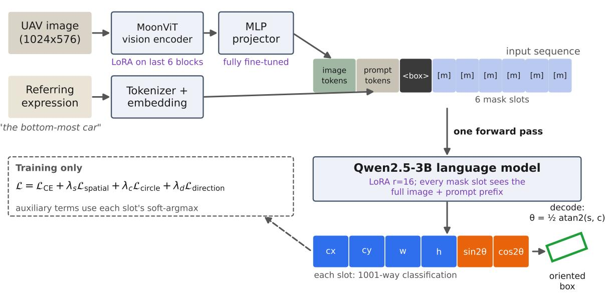
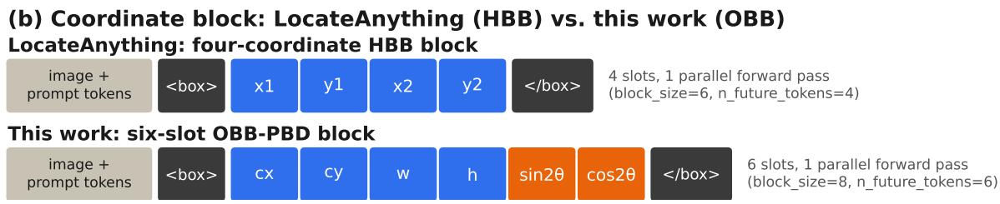
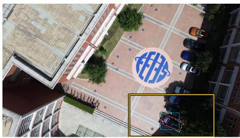
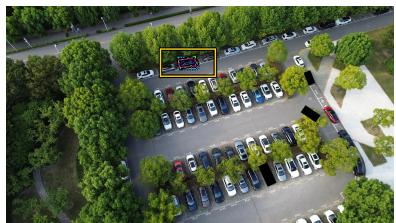
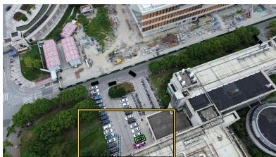
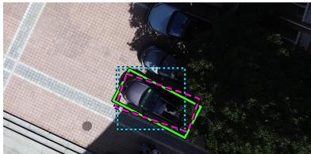
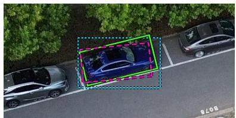
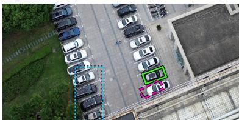

Article

# OBB-PBD: Extending Parallel Box Decoding to Oriented Bounding Boxes for Referring Expression Grounding in Aerial Imagery†

Chang Woo Song and Yeong Jun Koh \*

Department of Computer Science & Engineering, Chungnam National University, Daejeon 34134, Republic of Korea; 202460116@o.cnu.ac.kr

Correspondence: yjkoh@cnu.ac.kr

† Published in Remote Sensing 2026, 18(20), 3535, https://doi.org/10.3390/rs18203535, under the Creative Commons Attribution (CC BY 4.0) license. This version has the same content as the published article; only the layout differs.

## Highlights

What are the main findings?

• We extend Parallel Box Decoding, which predicts all bounding-box coordinates in a single forward pass, from four-coordinate horizontal boxes to a six-slot oriented representation. We further validate the extension using image/prompt-shuffle controls and visibility/leakage probes rather than relying solely on the training loss.

• On the aerial vehicle visual grounding (AVVG) benchmark, whose targets are genuinely oriented, the extended model improves rotated intersection over union (rotIoU) from 0.1253 for the zero-shot baseline to 0.303 ± 0.012 (mean ± standard deviation over three training seeds) across the complete 6139-record test split. Further analysis indicates that part of the improvement comes from learning oriented boxes instead of their axis-aligned envelopes $( + 0 . 0 5 5 \pm 0 . 0 0 8$ rotIoU, with each seed’s 95% confidence interval excluding zero), not merely from the larger coordinate representation.

What are the implications of the main findings?

• Diagnostic controls such as shuffle tests and visibility/leakage probes can reveal defects that benchmark accuracy alone may fail to detect, providing a verification framework for other blockparallel decoding extensions.

• Most of the improvement comes from the joint effect of domain adaptation and a change of decoding path, but learning oriented geometry adds a consistent gain that the format change alone does not provide, supporting oriented bounding boxes as a more appropriate target than horizontal boxes for referring expression grounding in overhead and aerial imagery.

## Abstract

Referring expression grounding in overhead imagery requires oriented bounding boxes rather than horizontal ones, since aerial objects appear at arbitrary orientations. Most grounding models emit box coordinates sequentially; Parallel Box Decoding (PBD) instead predicts all geometry slots in one forward pass, but only for four-coordinate horizontal boxes. We extend this block-aligned interface to a six-slot oriented representation using a double-angle parameterization. Rather than assuming correctness from a decreasing loss curve, we verify the extension with image/prompt-shuffle controls and visibility/leakage probes, which show that the corrected model depends on both the image and the prompt rather than on prompt statistics alone. On the aerial vehicle visual grounding (AVVG) benchmark, whose targets are genuinely oriented, the extended model improves rotated intersection over union (rotIoU) from 0.1253 for the zero-shot baseline to $0 . 3 0 3 \pm 0 . 0 1 2$ (mean ± standard deviation over three training seeds) across the complete 6139-record test split spanning all 120 images. Learning oriented boxes rather than their axis-aligned envelopes adds $0 . 0 5 5 \pm 0 . 0 0 8$ rotIoU beyond a matched control (per-seed 95% confidence intervals all excluding zero), whereas block expansion alone yields no rotIoU gain distinguishable from zero.

Keywords: oriented bounding box; referring expression grounding; parallel box decoding; visionlanguage model; UAV imagery; double-angle parameterization; remote sensing visual grounding

## 1. Introduction

Referring expression grounding—localizing the object referred to by a natural-language expression—has been studied extensively on natural images [1,2], and increasingly on remote-sensing and unmanned aerial vehicle (UAV) imagery [3–5]. The remote-sensing setting is harder for reasons largely absent from natural-image benchmarks: scenes are dense with many similar objects (rows of vehicles, repeated structures), targets are small relative to the image, and referring expressions often depend on relational or comparative language (“the car closest to the camera”) that cannot be resolved from box geometry alone. A further difficulty specific to overhead imagery is that objects appear at arbitrary in-plane orientations. A horizontal bounding box (HBB), the output format most grounding systems still use, fits an elongated, rotated object poorly, as the aerial-detection literature has documented at length [6,7]. An oriented bounding box (OBB), parameterized by center, size, and orientation, is the natural alternative when the referred object has a meaningful aspect ratio and heading.

Most vision-language grounding models emit box coordinates as autoregressively generated tokens, one coordinate at a time. This costs one decoding step per coordinate and treats a geometrically atomic quantity—one box—as an arbitrarily ordered token sequence. LocateAnything [8] addresses this with Parallel Box Decoding (PBD): a block-aligned interface in which a trigger token is followed by a single forward pass that predicts every coordinate slot together, rather than one token at a time. This is faster and keeps the coordinate representation aligned with the geometric unit it describes, but the released formulation covers only four-coordinate horizontal boxes. Whether this block-aligned interface extends to a six-slot oriented representation—and what computational and accuracy tradeoffs that extension entails—was not examined by the original method and is the main focus of this study. Separately, joint-regression architectures such as SATGround [9] predict OBB parameters with a dedicated regression head rather than a coordinate-token interface. This is a different architectural design from the block-aligned decoding extended here, and the two are not compared head-to-head in this study (Section 5.2).

Extending the PBD interface from four coordinates to six is not merely a matter of changing a configuration value. The block-alignment guarantee of PBD—that coordinate slots see the image and prompt through an intact causal prefix—can fail silently: in the pretrained backbone’s training path, the coordinate slots lost visibility of the image and prompt while the training loss still decreased normally. Such a failure is invisible in a loss curve and was found only with targeted diagnostic probes (Section 3.3), which is why this study treats verification of the extension as part of the method rather than as an afterthought.

This paper makes three contributions:

1. A structurally validated extension of PBD to oriented boxes: the six-slot geometry block is confirmed to align with the underlying architecture’s coordinate interface, and the codec’s round-trip error is measured separately from model accuracy, so that representation error is distinguished from grounding error (Section 3.2).

2. A diagnostic protocol for block-parallel extensions: image/prompt-shuffle controls and visibility/leakage probes test whether the model uses the image and whether the reported metric reflects the trained decoding path (Section 3.6); applied to this backbone, they expose and verify the correction of a silent loss of visual conditioning (Section 3.3).

3. A measured, bounded performance result under this validated protocol: the extended model improves over the zero-shot backbone on the complete test split of the aerial vehicle visual grounding (AVVG) benchmark, with checkpoint selection kept disjoint from that split (Section 3.5).

A three-step decomposition separates the improvement into the joint effect of domain adaptation and a decoding-path change, the six-slot block format alone, and learning oriented geometry (Section 4.2); scope and limitations are discussed in Section 5.2.

The remainder of this paper is organized as follows. Section 2 reviews related work across naturalimage grounding, remote-sensing grounding, oriented aerial detection, and structured coordinate decoding. Section 3 formulates the task and describes the OBB-PBD extension, training configuration, and evaluation protocol. Section 4 reports the main quantitative results, the HBB-envelope control that isolates the format-switch effect from the orientation-learning effect, the image-dependence diagnostic, and efficiency. Section 5 interprets these results and discusses limitations, and Section 6 concludes.

## 2. Related Work

## 2.1. Visual Grounding on Natural Images

Visual grounding—localizing the object referred to by a natural-language expression—has mostly been studied as text-conditioned detection on natural images. The task originates from crowd-sourced referring-expression benchmarks such as ReferItGame [10] and the RefCOCO, RefCOCO+, and Ref-COCOg splits [11,12], which pair a natural-language description with a single target region in everyday photographs. The detection transformer (DETR) [13] later provided an end-to-end, set-prediction backbone that grounding-specific models build on. Modulated DETR (MDETR) [1] trains an end-to-end detector on aligned text-image pairs, jointly reasoning over phrases and image regions to support both phrase grounding and referring expression comprehension. Grounded language-image pretraining (GLIP) [2] unifies object detection and phrase grounding as a single grounded pretraining objective at scale, showing that a shared text-image formulation transfers across detection and grounding benchmarks. More recent open-vocabulary detectors and multimodal large language models extend this lineage further: Grounding DINO [14] combines a DETR-style detector with grounded pretraining for open-set detection, while Kosmos-2 [15], Shikra [16], and Ferret [17] equip general-purpose visionlanguage models with coordinate grounding by representing boxes or points as tokens or continuous features the language model can emit or consume. All of the above establish the text-conditioned detection lineage that remote-sensing grounding methods build on, but none addresses oriented geometry or a parallel, block-aligned coordinate decoder.

## 2.2. Remote-Sensing Visual Grounding

Remote-sensing visual grounding (RSVG) adapts the grounding problem to aerial and satellite imagery, where small targets, dense scenes, and orientation variation make localization substantially harder than in natural images. RSVG [3] defines the task with image-expression-box triplets on DIOR-RSVG using horizontal bounding boxes, starting the remote-sensing grounding benchmark lineage without oriented annotations. Later remote-sensing vision-language models add oriented or multi-format grounding: GeoChat [4] is a region-level dialogue model whose remote-sensing setting includes oriented annotations, and GeoGround [5] unifies horizontal-box, oriented-box, and mask grounding in one model, introducing the RefGeo instruction-following collection this study’s AVVG subset is drawn from. GeoChat and GeoGround therefore already demonstrate that oriented-box remote-sensing grounding is achievable.

This grounding capability belongs to a broader wave of remote-sensing vision-language models built by instruction-tuning a general-purpose backbone on remote-sensing-specific data. RSGPT [18] provides image-captioning and visual question answering benchmarks and training data, and VRS-Bench [19] adds visual grounding to those two tasks. SkyEyeGPT [20], EarthGPT [21], and LHRS-Bot [22] extend instruction tuning to multi-task or multi-sensor remote-sensing understanding, in which visual grounding is one of several supported tasks rather than the primary target. A related but distinct output formulation is referring segmentation: RRSIS [23] predicts a pixel-wise mask rather than a box. None of these systems is evaluated here under this study’s PBD coordinate-block protocol, and their reported numbers use different datasets, splits, and metrics, so they are not directly comparable to the AVVG results in Section 4.1.

## 2.3. Oriented Object Detection in Aerial Imagery

A parallel line of work treats oriented bounding boxes as a detection-geometry problem rather than a language-grounding one. DOTA [6] established a large-scale aerial object detection benchmark with quadrilateral annotations, motivating oriented representations by documenting the scale, orientation, and aspect-ratio variation that horizontal boxes fail to capture in aerial scenes; FAIR1M [24] and HRSC2016 [25] extend this benchmark lineage to fine-grained category labels and ship-specific imagery, respectively, each also using oriented annotations. A large family of detectors builds directly on these benchmarks: the region-of-interest (RoI) Transformer [26] learns a spatial transformation of region proposals under OBB supervision, Gliding Vertex [27] regresses relative vertex offsets on a horizontal box instead of an angle, ${ \mathsf { S } } ^ { 2 } { \mathsf { A } } { \mathsf { - N e t } }$ [28] aligns convolutional features to refined oriented anchors, ReDet [29] incorporates rotation-equivariant backbone features, and Oriented R-CNN [7] is a representative high-performance detector built directly around oriented proposals and regression. A separate line of work addresses the angle-regression discontinuity directly; the same discontinuity motivates this study’s double-angle parameterization (Section 3.1). SCRDet [30] adds an IoU-smooth L1 loss, which uses the intersection over union (IoU) between boxes to reduce the loss discontinuity near the periodic boundary, circular smooth label [31] recasts angle regression as classification over discretized bins, and the Kullback–Leibler divergence (KLD) [32] and Gaussian Wasserstein distance (GWD) [33] losses instead convert the rotated box into a Gaussian distribution and regress a distribution distance that is well behaved at the periodic boundary. None of these methods is a text-conditioned grounding system. They motivate the oriented-geometry problem that this study addresses within a language-grounding model rather than a closed-set detector, and their reported metrics (mean average precision, mAP, under detection-style matching) are not directly comparable to the rotated-IoU grounding protocol used here.

## 2.4. Structured and Parallel Coordinate Decoding

Representing structured outputs as token sequences is a broader trend: Pix2Seq [34] casts object detection as language modeling over a serialized sequence of quantized box-and-class tokens, and OFA [35] unifies captioning, grounding, and other vision-language tasks under the same sequence-tosequence interface. Both, like the grounding models discussed above, decode one token at a time. Two lines of prior work instead pursue non-autoregressive or partially parallel decoding: in machine translation, non-autoregressive neural machine translation [36] produces all output tokens in a single forward pass at some cost in output quality, and in object detection, Deformable DETR [37] predicts a fixed set of object queries in parallel through cross-attention to deformable sampling points rather than a serialized coordinate sequence. Most vision-language grounding models, however, still emit box coordinates as a sequence of autoregressively generated tokens, one coordinate at a time. LocateAnything [8] instead introduces Parallel Box Decoding (PBD), treating a box as a single structured unit whose geometry slots are predicted together in one block-aligned forward pass rather than in four sequential token predictions. LocateAnything’s released formulation covers four-coordinate horizontal boxes; it does not report an oriented extension or the angle-prediction behavior that orientation introduces into the same block-aligned interface. This is the method that the present work extends. Separately, SATGround [9] interfaces a remote-sensing grounding module through specialized localization control tokens on a fine-tuned vision-language model, jointly reasoning over language and spatial information to regress oriented box geometry. Because a joint OBB regression head of this kind already exists in the remote-sensing grounding literature, this study’s contribution is specifically the PBD coordinate-block mechanism, not joint OBB regression as such. This study does not compare against SATGround head-to-head under a matched protocol; see the scope note in Section 5.2.

## 2.5. Positioning

This study investigates the oriented-box extension of the PBD interface introduced by LocateAnything [8], adding center, size, and double-angle orientation slots to the same block-aligned interface and evaluating the result under a validated implementation and evaluation protocol (Sections 3.2 and 3.5). Building on the oriented-box grounding capability GeoChat and GeoGround already establish (Section 2.2) and the structured decoding LocateAnything already provides (Section 2.4), the contribution here is an empirically validated architectural extension together with a diagnostic evaluation protocol: integrating orientation into a LocateAnything-style, block-aligned parallel decoding interface and characterizing its accuracy and latency trade-offs under a controlled protocol (Sections 4.1–4.4).

## 3. Materials and Methods

## 3.1. Task Formulation

We study referring expression grounding in overhead UAV imagery. Given an image and a natural-language description, the model predicts one oriented bounding box (OBB) for the referred object. The target geometry is represented by its center, width, height, and orientation. We use the double-angle parameterization $( c _ { x } , c _ { y } , w , h , \sin ( 2 \theta ) , \cos ( 2 \theta ) )$ , which avoids the discontinuity at the $0 ^ { \circ } / 1 8 0 ^ { \circ }$ boundary while preserving the 180◦ periodicity of a rectangle.

Because a rectangle satisfies $( w , h , \theta ) \equiv ( h , w , \theta + 9 0 ^ { \circ } )$ , an oriented bounding box admits two equivalent $( w , h , \theta )$ parameterizations for the same physical box. We resolve this before encoding by canonicalizing every box to $w \ge h \ i$

$$
{ \mathrm { i f ~ } } w < h : \quad ( w , h )  ( h , w ) , \qquad \theta  ( \theta + 9 0 ^ { \circ } ) { \mathrm { ~ m o d ~ } } 1 8 0 ^ { \circ } .\tag{1}
$$

Every coordinate is quantized with the same uniform codec: [0, 1] is divided into 1000 equal-width intervals, and their 1001 endpoints form the quantization levels, each represented by one coordinate token $( < 0 > , \dots , < 1 0 0 0 > )$ . A value v already normalized to $[ 0 , 1 ] \ ( \mathrm { i . e . } \ c _ { x } / W , \ : c _ { y } / H , w / W ,$ or $h / H )$ is encoded as the nearest of these 1001 levels and decoded by inverting that scale:

$$
q ( v ) = \operatorname { r o u n d } ( v \cdot 1 0 0 0 ) \in \{ 0 , \ldots , 1 0 0 0 \} , \qquad v = q / 1 0 0 0 .\tag{2}
$$

A signed value $u \in [ - 1 , 1 ] ( { \mathrm { i . e . } } \sin ( 2 \theta )$ or $\cos ( 2 \theta ) )$ is first rescaled to [0, 1] before applying the same unit codec, and inverted the same way in reverse:

$$
\begin{array} { r } { q ( u ) = \mathrm { r o u n d } \Big ( \frac { u + 1 } { 2 } \cdot 1 0 0 0 \Big ) , \qquad u = 2 \cdot ( q / 1 0 0 0 ) - 1 . } \end{array}\tag{3}
$$

At decode time, the two orientation levels are read back to $\hat { s } = \sin ( 2 \theta ) , \hat { c } = \cos ( 2 \theta )$ via Equation (3), and the angle is recovered as

$$
\begin{array} { r } { \theta = \left( \frac { 1 } { 2 } \operatorname { a t a n 2 } ( \hat { s } , \hat { c } ) \right) \mod 1 8 0 ^ { \circ } , } \end{array}\tag{4}
$$

followed by the same $w \geq h$ canonicalization of Equation (1) applied to the decoded $\left( w , h , \theta \right)$ , so a decoded box is always compared against the ground truth in the same canonical form it was encoded in.

## 3.2. Parallel OBB Decoding

Our implementation extends LocateAnything’s [8] four-coordinate horizontal-box (HBB) block, which emits corner coordinates $\left( x _ { 1 } , y _ { 1 } , x _ { 2 } , y _ { 2 } \right)$ , to six parallel geometry slots parameterized by center, size, and orientation. Figure 1 shows the resulting extension: the first four slots change representation (corner → center-and-size), and two orientation slots are added. Center-and-size replaces corner coordinates because the double-angle orientation term is defined about the box center. The emitted structure is

$$
< { \bf b } \mathsf { o } \mathbf { x } > \mathrm { ~ } c _ { x } \mathrm { ~ } c _ { y } \textit { \textbf { w } } h \sin ( 2 \theta ) \cos ( 2 \theta ) < / \mathsf { b } \mathsf { o } \mathbf { x } >
$$

The resulting configuration has block\_size=8 and n\_future\_tokens=6: the opening <box> token triggers one parallel coordinate forward pass, the six geometry slots are predicted together, and the closing </box> token is generated at the following step. Each coordinate is represented with the existing 1001-level quantization codec of Equation (2). The codec’s round-trip error is evaluated independently of model prediction: encoding and decoding the ground-truth polygons directly yields a mean round-trip IoU of 0.9903 on the training split and 0.9823 on the validation split (minimum 0.8379), indicating that quantization error is negligible relative to model grounding error.

## 3.3. Backbone Corrections Required by the Extension

Because a block-alignment failure can corrupt training without appearing in the loss curve, the sixslot extension was validated with the diagnostic probes of Section 3.6 before any performance metric was reported. One finding matters for the method: in the backbone’s training path, the causal-prefix length that should expose the image and prompt tokens to the coordinate slots was computed from a position-ID pattern that training never produces, so the coordinate slots saw none of the image or prompt tokens while the loss still decreased. We recover the prefix length from the mask-token region, as the inference path already does, and the visibility probe confirms the fix: on the same training batch, the first coordinate slot’s attention mask goes from 7 of 894 keys, none of them image or prompt tokens, to all 894. Four further defects in the backbone code caused outright failures (crashes) rather than silent ones; they are also corrected and are listed in Appendix ${ \mathrm { A } } ,$ and the source changes are available as described in the Data Availability Statement.

The extended model itself is evaluated exclusively through direct decoding, and the backbone’s upstream generate() path is used only to reproduce the zero-shot baseline as it would ordinarily be run; the decoding-speed comparison in Section 4.4 uses its own cached autoregressive implementation.

(a) End-to-end OBB-PBD grounding  

  
Figure 1. OBB-PBD architecture. (a) End-to-end inference: MoonViT image features, projected by the multilayer perceptron (MLP) projector, and the tokenized referring expression form the prefix; the <box> trigger is followed by six mask slots, and a single forward pass of the language model predicts all six geometry tokens, which the codec of Section 3.1 decodes into an oriented box. Purple labels mark the adapted components (Section 3.4); the dashed box shows the training objective (Section 3.4). (b) The six-slot OBB-PBD block extends LocateAnything’s four-slot HBB block [8]: the first four slots switch from corner coordinates to center-and-size, and the two orange slots (sin(2θ), cos(2θ)) are the only wholly new addition (Section 3.2). Solid arrows show the inference data flow; the dashed arrow indicates that the predicted slots enter the training objective.

## 3.4. Training Configuration

We fine-tune the LocateAnything-3B backbone [8]—a Qwen2.5-3B-Instruct language model [38] paired with a MoonViT vision encoder—on AVVG, the RefGeo subset introduced by [5]. The language model uses low-rank adaptation (LoRA) [39] with rank $^ { 1 6 , }$ the last six MoonViT vision blocks are adapted with LoRA, and the multimodal projector mlp1 is trained as a full module, so the vision pipeline is updated through both the MoonViT LoRA adapters and the projector. The projector’s learning rate is one tenth of the adapters’ $( 1 \times 1 0 ^ { - 5 } )$ , and gradients are clipped at norm 1.0. The main training settings are given in Table 1. Training used Python 3.11.10, PyTorch 2.5.1, Transformers 4.57.1, and PEFT 0.20.0 on three NVIDIA RTX 6000 Ada graphics processing units (GPUs; 48 GB each; NVIDIA Corporation, Santa Clara, CA, USA).

The base loss $\mathcal { L } _ { \mathrm { C E } }$ is the backbone’s standard next-token cross-entropy over the full response, in which each of the six coordinate slots is itself a classification target over the 1001-way coordinate vocabulary—the block format alone already turns coordinate prediction into token classification. Three additional, differentiable terms are added on top of this discrete classification signal, each computed from a soft-argmax expectation over a slot’s level probabilities rather than from the hard argmax, so that all three remain differentiable with respect to the logits. For a slot with softmax probabilities $p ( k )$ over the 1001 levels $k \in \{ 0 , \ldots , 1 0 0 0 \}$ , the soft-argmax estimate is $\begin{array} { r } { \hat { v } = \sum _ { k } p ( k ) k / 1 0 0 0 } \end{array}$ (or, for a signed slot, the same sum rescaled by Equation (3)).

Table 1. Main training settings of the OBB-PBD models.
<table><tr><td>Setting</td><td>Value</td></tr><tr><td>Dataset</td><td>AVVG subset of the RefGeo-derived data [5]  $^ { 2 6 , 4 5 1 }$  usable records after removing 31 out-of-frame annotations, split into a</td></tr><tr><td>Training samples</td><td>421-image training set (22,495 records) and a 74-image held-out validation set (3956 records) disjoint from the test split (Section 3.5)</td></tr><tr><td>Image source</td><td>495 DJI UAV aerial images (421 training + 74 validation, disjoint from the 120-image test split),  $4 0 0 0 \times 2 2 5 0$  pixels</td></tr><tr><td>Optimizer</td><td>AdamW (weight decay 0.01), constant learning rate  $1 \times 1 0 ^ { - 4 }$  (no schedule, no warmup)</td></tr><tr><td>Batch and precision</td><td>1 per GPU, gradient accumulation  $4 , 3 \bar { \mathrm { G P U s } }$  (global batch size 12); bfloat16 (auxiliary losses computed in float32)</td></tr><tr><td>Loss weights</td><td> $\lambda _ { \mathrm { s p a t i a l } } = 2 . 5 , \lambda _ { \mathrm { c i r c l e } } = 0 . 2 5 , \lambda _ { \mathrm { d i r e c t i o n } } = 0 . 5$ </td></tr><tr><td>Vision adaptation</td><td>last 6 MoonViT blocks + full mlp1 projector</td></tr><tr><td>Training budget</td><td>5 epochs; checkpoint saved after every epoch</td></tr><tr><td>Run count</td><td>three training seeds per model (seed sets initialization and data order; split fixed)</td></tr></table>

The spatial loss applies a Smooth-L1 penalty between this soft-argmax estimate and the groundtruth target, independently for each of the four spatial slots $c _ { x } , c _ { y } , w ,$ , h and averaged over them:

$$
\mathcal { L } _ { \mathrm { s p a t i a l } } = \frac { 1 } { 4 } \sum _ { i \in \{ c _ { x } , c _ { y } , w , h \} } { \mathrm { S m o o t h L } } \boldsymbol { 1 } _ { \beta = 0 . 0 1 } ( \hat { \boldsymbol { v } } _ { i } , \boldsymbol { v } _ { i } ) .\tag{5}
$$

The circular consistency loss penalizes the predicted double-angle pair $\textstyle ( { \hat { s } } , { \hat { c } } )$ for departing from the unit circle that a valid (sin(2θ), cos(2θ)) pair must lie on:

$$
{ \mathcal { L } } _ { \mathrm { c i r c l e } } = { \left( \hat { s } ^ { 2 } + \hat { c } ^ { 2 } - 1 \right) } ^ { 2 } .\tag{6}
$$

The directional loss is a cosine distance between the predicted and ground-truth double- angle vectors,

$$
\mathcal { L } _ { \mathrm { d i r e c t i o n } } = k \lvert c \rvert _ { \mathrm { n o r m } } \geq 1 . 0 5 ] \bigg ( 1 - \frac { \hat { s } s + \hat { c } c } { \sqrt { \hat { s } ^ { 2 } + \hat { c } ^ { 2 } + \epsilon } \sqrt { s ^ { 2 } + c ^ { 2 } + \epsilon } } \bigg ) ,\tag{7}
$$

averaged over the samples with $r _ { \mathrm { n o r m } } ~ \ge ~ 1 . 0 5$ in the batch, where $( s , c )$ is the ground-truth pair, $\epsilon = 1 0 ^ { - 7 } ,$ , and $r _ { \mathrm { n o r m } } = \operatorname* { m a x } ( w / W , h / H ) / \operatorname* { m i n } ( w / W , h / H )$ is the image-normalized side ratio: the ratio of the box’s width and height after each is divided by the corresponding image dimension. It is not the box’s physical aspect ratio $w / h ;$ it equals 1 for a box whose shape matches the image, not for a square box. The gate was designed to zero the directional gradient for near-square boxes, whose orientation is nearly undefined and whose gradient is therefore close to noise. Because AVVG’s images are non-square $( 4 0 0 0 \times 2 2 5 0 )$ , the gate as defined instead excludes boxes whose aspect ratio is close to the image’s (about 16:9), and physically near-square boxes still receive the directional loss. To test whether this matters, we retrained OBB-PBD with the gate computed from the physical aspect ratio w/h, keeping seed 1’s initialization and data order so that only the gate changes. It reached a rotated IoU (rotIoU) of 0.3008 (95% confidence interval (CI) [0.2799, 0.3228]), lower than the 0.3124 of the otherwise identical seed-1 run with the normalized gate (paired difference −0.012, per-record imagecluster $\operatorname { C I } \left[ - 0 . 0 1 9 , - 0 . 0 0 4 \right] ;$ . That interval reflects test-set sampling only; with a single physical-gate run, it cannot separate the gate’s effect from training randomness, and the result lies within the spread of the three normalized-gate seeds (0.290–0.312). Correcting the gate therefore does not improve the model, and the normalized gate is retained. The total training loss is

$$
{ \mathcal { L } } = { \mathcal { L } } _ { \mathrm { C E } } + \lambda _ { \mathrm { s p a t i a l } } { \mathcal { L } } _ { \mathrm { s p a t i a l } } + \lambda _ { \mathrm { c i r c l e } } { \mathcal { L } } _ { \mathrm { c i r c l e } } + \lambda _ { \mathrm { d i r e c t i o n } } { \mathcal { L } } _ { \mathrm { d i r e c t i o n } } ,\tag{8}
$$

with the λ values of Table 1.

RefGeo [5] consolidates five subsets (AVVG, RSVG, DIOR-RSVG, GeoChat, VRSBench), each with its own image pool and train/test split files. This study uses only the AVVG subset, which includes oriented bounding box annotations and provides complete native aerial imagery. A data audit found that 97.85% of the boxes are not axis-aligned and that the image file could be resolved for 100% of the audited records; paired image and annotation examples were also rendered for visual verification before training. Every training and evaluation script in this study therefore uses the AVVG subset, and the other four RefGeo subsets are not used anywhere in the reported results.

Generative artificial intelligence (AI) tools assisted with this study’s execution: Claude Code (Anthropic; Claude Sonnet 5 and Claude Opus 5.5) and Codex (OpenAI; GPT-6-Sol) assisted with implementation, execution of author-approved experiments, and manuscript drafting, and Codex and Antigravity (Google; Gemini 3.8 Flash) were used for independent manuscript cross-checks. All research questions, methodological choices, and result interpretations remain the authors’ own; see Acknowledgments for full disclosure.

## 3.5. Evaluation Protocol and Checkpoint Selection

We evaluate with the direct PBD decoder, which constructs the prompt, the <box> token, and six coordinate mask slots and obtains the geometry logits in a single forward pass. This path matches the training block definition. The upstream generate() path implements multi-token prediction only for the original six-token HBB block, so the six-slot model is evaluated through the direct decoder.

The primary metric is rotated IoU (rotIoU): the IoU between the predicted and ground-truth oriented boxes, computed from the polygon intersection of the two oriented quadrilaterals using the Shapely library (version 2.1.2) rather than a custom clipping routine. We also report axis-aligned IoU (aabbIoU), the IoU between the HBB envelopes (defined below) of the predicted and ground-truth boxes, which compares with the original HBB baseline on its own terms. The remaining metrics are threshold accuracies at rotIoU 0.50 and 0.75 (Acc@0.50, Acc@0.75), angle mean absolute error (MAE) in degrees, and the decoded percentage. A decoding failure is assigned zero IoU and is included in the denominator.

Because θ is only defined modulo 180◦ after the canonicalization of Equation (1), a naive $| { \hat { \theta } } - \theta |$ difference would overstate the error for pairs that straddle the $0 ^ { \circ } / 1 8 0 ^ { \circ }$ wrap-around $( \mathrm { e . g . } , \ \hat { \theta } = 1 ^ { \circ }$ against $\theta = 1 7 9 ^ { \circ }$ is a $2 ^ { \circ }$ error, not 178◦). Angle MAE is therefore the mean of the periodic distance

$$
d ( \hat { \theta } , \theta ) = \operatorname * { m i n } ( | \hat { \theta } - \theta | \operatorname { m o d } 1 8 0 ^ { \circ } , 1 8 0 ^ { \circ } - \left( | \hat { \theta } - \theta | \operatorname { m o d } 1 8 0 ^ { \circ } \right) )\tag{9}
$$

over all samples with a successful decode. For every trained run, the reported checkpoint is the epoch with the highest rotIoU on the held-out validation split defined in Table 1. Each model is trained with three seeds; a seed sets both parameter initialization and the data order, while the image-level split is identical across seeds. For OBB-PBD, validation rotIoU rose over the five epochs in seeds 1 and 2 and plateaued between epochs 4 and 5 in seed 3 (0.2780 at both), so epochs 5, 5 and 4 are selected.

The baseline is the zero-shot LocateAnything-3B backbone evaluated with its upstream generate() path on the complete AVVG test split, and serves as the primary HBB baseline. We define the HBB envelope of a box as the tightest axis-aligned rectangle enclosing it. A reference derived from the ground truth (GT), the GT-derived HBB envelope (reference)—the HBB envelope of each target’s GT oriented box—is reported alongside the baseline; it is a computed reference, not a learned model. This rectangle is a natural, easily computed reference point that illustrates the gap between horizontal and oriented representations, but it is not guaranteed to be the rotIoU-maximizing axis-aligned rectangle for each target, so its score should be read as a reference value rather than as a formal upper bound on what any axis-aligned prediction could achieve (Section 4.1).

## 3.6. Diagnostic Checks

We use three complementary checks beyond the main score:

1. Image dependence: evaluate each selected checkpoint with matched image/prompt pairs, independently shuffled images, and independently shuffled prompts (Section 4.3). A large matched-versus-image-shuffled gap is required before treating the score as evidence that the coordinate slots use visual input. This check is motivated by the broader concern that a high grounding score need not demonstrate use of every required input modality: Cirik et al. [40] show that a system given only the image, with the referring expression withheld, still reaches 71.2% top-2 precision on a standard benchmark, indicating that the benchmark’s own label distribution—not language understanding—accounts for much of that score. Their ablation tests dependence on language; the image-shuffled condition here tests the complementary case, dependence on vision.

2. Implementation visibility and leakage probes: verify that coordinate slots can attend to the image and that ground-truth coordinate tokens are not injected into the model input during training.

3. Qualitative overlays: render predictions and target OBBs on the original UAV frames to distinguish geometric errors from referring failures, such as placing a box on a neighboring vehicle (Figure 2).

  
(a) rotIoU 0.82

  
(b) rotIoU 0.79

  
(c) rotIoU 0.00

<table><tr><td></td><td colspan="6">OBB-PBD</td><td colspan="4">Baseline (HBB)</td></tr><tr><td>Panel</td><td> $\Delta c _ { x }$ </td><td> $\Delta c _ { y }$ </td><td>∆w</td><td>∆h</td><td>|∆θ|(°)</td><td>rotIoU</td><td> $\Delta c _ { x }$ </td><td> $\Delta c _ { y }$ </td><td>rotIoU</td><td>aabbIoU</td></tr><tr><td>(a)</td><td>+1</td><td>-4</td><td>-18</td><td>+2</td><td>8.6</td><td>0.82</td><td>-27</td><td>-23</td><td>0.53</td><td>0.66</td></tr><tr><td>(b)</td><td>-6</td><td>+6</td><td>-7</td><td>-2</td><td>8.2</td><td>0.79</td><td>+2</td><td>+6</td><td>0.60</td><td>0.87</td></tr><tr><td>(c)</td><td>-17</td><td>+83</td><td>+5</td><td>-5</td><td>8.2</td><td>0.00</td><td>-387</td><td>+110</td><td>0.00</td><td>0.00</td></tr></table>

Figure 2. Three illustrative examples from the AVVG test split, rendered from the OBB-PBD seed-1 checkpoint (Table A2). Each panel shows the full scene (top), in which the yellow box marks the enlarged region, and an enlargement (bottom). Green solid: ground truth. Magenta dashed: OBB-PBD prediction. Cyan dotted: the LocateAnything baseline’s axis-aligned prediction, decoded through the same upstream generate() path used for the Table 2 baseline row. All outlines are drawn over a black border for visibility. The table below the panels gives each prediction’s deviation from the

ground truth (prediction minus ground truth, in pixels of the original 4000 × 2250 image; |∆θ| is the periodic angle error of Equation (9)); for the axis-aligned baseline, only the center offset and IoUs are meaningful. (a) “the bottom-most car” (OBB-PBD rotIoU 0.82, angle error $8 . 6 ^ { \circ } ;$ baseline rotIoU 0.53, aabbIoU 0.66): both models localize the same car, but the baseline’s axis-aligned box cannot represent its tilt. (b) “the blue bmw mid-size car in the top-middle” (OBB-PBD rotIoU 0.79, angle error 8.2◦; baseline rotIoU 0.60, aabbIoU 0.87): the same pattern in a different scene. (c) “the brown skoda suv car in the bottom-middle” (rotIoU 0.00 for both models): both models place a well-formed box (OBB-PBD angle error $8 . 2 ^ { \circ } )$ on a different, neighboring car rather than the one referred to. These three records were selected to illustrate these contrasting behaviors, not sampled at random.

Table 2. Main results on the complete AVVG test split (6139 records, 120 images). Every row is evaluated once on data withheld from checkpoint selection (Section 3.5). OBB-PBD: mean ± standard deviation over three training seeds.
<table><tr><td>Method</td><td>Inference Path</td><td>aabbIoU</td><td>rotIoU</td><td>Acc@0.50</td><td>Acc@0.75</td><td>Angle MAE (°) Decoded</td><td></td></tr><tr><td>GT HBB envelope (ref.)</td><td>GT-derived</td><td>1.0000</td><td>0.6037</td><td>78.6%</td><td>16.7%</td><td>32.33</td><td></td></tr><tr><td>LocateAnything (zero-shot)</td><td>Upstream</td><td>0.1512</td><td>0.1253</td><td>15.1%</td><td>3.3%</td><td>一</td><td>99.9%</td></tr><tr><td>OBB-PBD (ours)</td><td>generate() Direct PBD</td><td>0.334 ± 0.012 0.303 ± 0.012 37.1 ± 1.5% 22.0 ± 0.8%</td><td></td><td></td><td></td><td> $9 . 9 8 \pm 0 . 3 4$ </td><td>99.9%</td></tr></table>

Bold indicates the best value among the evaluated models; the GT HBB envelope row is a reference computed from the ground truth and is excluded.

## 4. Results

## 4.1. Main Quantitative Results

We evaluate OBB-PBD on the AVVG test split using the direct PBD decoder. Table 2 reports the zero-shot baseline, a GT-derived HBB envelope reference, and OBB-PBD on the complete AVVG test split (6139 records, 120 images)—every number in this table comes from locked checkpoints evaluated once on data that played no role in selecting them. OBB-PBD is reported as the mean and sample standard deviation over three independently trained seeds (Section 3.4); per-seed values with image-cluster confidence intervals are in Table A2 (Appendix B). The reference row is a deterministic statistic—the axis-aligned envelope of each target polygon, scored against the oriented ground truth— not a trained model; Section 4.2 introduces a separate, trained HBB-envelope control that predicts this envelope instead of computing it directly. An axis-aligned box can still exceed 0.75 rotIoU against a near-square or near-axis-aligned target, which is why the reference’s Acc@0.75 is 16.7% rather than 0%.

Relative to the zero-shot baseline, OBB-PBD improves rotIoU by $0 . 1 7 8 \pm 0 . 0 1 2$ (from 0.1253 to 0.303, about 142% relative, computed as the ratio of the three-seed means) and aabbIoU by $0 . 1 8 3 \pm 0 . 0 1 2 ;$ Acc@0.75 rises from 3.3% to 22.0%. An image-cluster bootstrap over the 120 test images (resampling images with replacement and pooling every record belonging to each resampled image, the correct unit of resampling given within-image correlation) gives the baseline a rotIoU 95% confidence interval (CI) of [0.1073, 0.1460] and each OBB-PBD seed an interval lying entirely above it (Table A2). The paired per-record improvement over the baseline, bootstrapped on the same resampled images, excludes zero by a wide margin in every seed: the smallest lower bounds are +0.151 rotIoU and +0.155 aabbIoU (Table A3).

This is a cross-path comparison, not a matched ablation: the baseline row runs the upstream generate() path while OBB-PBD runs this study’s direct decoder. Section 4.2 isolates the orientationlearning effect specifically using fine-tuned controls that share OBB-PBD’s data, decoder, and training budget.

## 4.2. HBB-Envelope Control: Isolating the Format-Switch Effect from the Orientation-Learning Effect

The improvement in Table 2 could in principle come from the six-slot block format itself rather than from learning to predict orientation. To separate these two effects, we trained a control arm with a recipe identical to the reported model—the same block size, six-slot collator, loss weights, and LoRA targets—except that the training target is the axis-aligned envelope of the ground-truth polygon, so its orientation is structurally fixed to $0 ^ { \circ } / 9 0 ^ { \circ }$ . Ground truth for scoring remains the original oriented box in both arms, so this control isolates the format-switch effect from the orientation-learning effect without changing the evaluation. Because a tilted target’s envelope is larger than its oriented box, the orientation-learning step necessarily compares learning the oriented box with learning its larger envelope; part of its gain is the tighter extent that representing orientation permits, which cannot be separated from orientation itself. A third arm, HBB-PBD, separates the two-slot expansion from the effect of adapting to AVVG itself: it keeps the original upstream four-slot corner block (<box> x1 y1 x2 y2 </box>, block\_size = 6) rather than the six-slot block, fine-tuned on the same subset with the same axis-aligned envelope target as the HBB-envelope control. All three arms are trained with the same three seeds and use the same validation-disjoint checkpoint-selection protocol (Section 3.5); the selected epoch is 5 in eight of the nine trained runs and 4 for OBB-PBD seed 3, whose validation rotIoU plateaued between epochs 4 and 5. HBB-PBD’s evaluation does not exclude corner-touching targets: the four-slot format cannot represent axis-aligned envelopes that touch a corner of the resized image (about 4% of this test split), and those cases are scored as ordinary decode failures (IoU 0) rather than excluded, so this arm is evaluated on the same test records as every row of Table 2. Its own training set is nonetheless about 10.3% smaller than the HBB-envelope control’s and the main model’s (20,182 vs. 22,495 AVVG training records), because the same corner-frame constraint that is tolerated as a decode failure at test time was applied as an exclusion filter at train time; this arm’s numbers should be read with that training-data asymmetry in mind.

Paired image-cluster bootstraps (the same resampling procedure as Section 4.1, applied to each step’s per-record delta, separately for each seed; Table A3) give the same picture in every seed. The adaptation step’s rotIoU and aabbIoU intervals exclude zero in all three seeds. The format-switch step’s rotIoU interval includes zero in all three seeds (−0.005 to +0.000): expanding the block from four slots to six without learning orientation produces no rotIoU improvement distinguishable from zero, despite the two arms’ training-data-size asymmetry noted above. The orientation-learning step’s rotIoU interval excludes zero in all three seeds (+0.046 to +0.060; smallest lower bound +0.036), an 18.7–23.7% relative increase over the matched control’s own rotIoU. The gain does not depend on the six-slot control alone: OBB-PBD also exceeds the four-slot HBB-PBD arm in every seed (+0.041 to +0.060 rotIoU, every interval excluding zero).

aabbIoU moves much less than rotIoU across the three fine-tuned arms. The HBB-envelope control is 0.012 ± 0.003 below HBB-PBD (interval excluding zero in seeds 2 and 3), and OBB-PBD is 0.010 ± 0.010 below the HBB-envelope control (−0.002 to −0.021). Learning orientation therefore improves rotated alignment without improving axis-aligned localization; if anything, axis-aligned agreement is slightly lower.

Most of the baseline-to-final gain thus comes from the first step, the joint effect of domain adaptation on AVVG and the change of decoding path, which a four-slot model shows too (Table 3 †); the present comparisons do not separate these two parts. The six-slot block format adds no distinguishable gain, and orientation learning adds a smaller further gain (Table 3). The zero-shot baseline comparison in Table 2 remains this paper’s primary result; the decomposition here is evidence for the narrower claim that learning the oriented box rather than its axis-aligned envelope—not merely having more coordinate slots—is responsible for part of that improvement, at a small cost in axis-aligned agreement. The HBB-PBD arm’s training-data-size confound noted above still applies to this comparison.

Table 3. Decomposition of the reported improvement into an adaptation step (domain adaptation combined with a change of decoding path), a format-switch step, and an orientation-learning step, on the complete AVVG test split (6139 records, 120 images). Each step is the paired per-record difference between consecutive arms, given as mean ± standard deviation over three training seeds; per-seed values with image-cluster confidence intervals are in Table A3. The orientation-learning step includes the tighter extent an oriented box allows (Section 4.2).
<table><tr><td>Step</td><td>∆aabbIoU</td><td>∆rotIoU</td></tr><tr><td>Baseline → HBB-PBD, 4-slot (adaptation + decoding path) †</td><td> $+ 0 . 2 0 5 \pm 0 . 0 0 1$ </td><td> $+ 0 . 1 2 5 \pm 0 . 0 0 2$ </td></tr><tr><td>HBB-PBD → HBB-envelope, 6-slot (format-switch effect)</td><td> $- 0 . 0 1 2 \pm 0 . 0 0 3$ </td><td> $- 0 . 0 0 2 \pm 0 . 0 0 3$ </td></tr><tr><td>HBB-envelope → ours (orientation-learning effect)</td><td> $- 0 . 0 1 0 \pm 0 . 0 1 0$ </td><td> $+ 0 . 0 5 5 \pm 0 . 0 0 8$ </td></tr><tr><td>Baseline → ours (total, Table 2)</td><td> $+ 0 . 1 8 3 \pm 0 . 0 1 2$ </td><td> $+ 0 . 1 7 8 \pm 0 . 0 1 2$ </td></tr></table>

† Joint effect of domain adaptation and a decoding-path change: the baseline runs the upstream generate() path, while every trained arm uses this study’s direct decoder, so this row does not isolate fine-tuning alone.

## 4.3. Image-Dependence Diagnostic

To verify that the trained model uses the image rather than relying on prompt statistics or a mean-box prior, we repeated the evaluation after shuffling images and prompts independently, on the complete test split (6139 records, 120 images) using the same image-cluster bootstrap as Section 4.1. The diagnostic was repeated for each of the three OBB-PBD seeds; the matched condition reproduces each seed’s main result, and in every seed, the matched and image-shuffled confidence intervals are disjoint by a wide margin.

In each seed, the matched condition is 46–51 times the image-shuffled rotIoU (49.96, 45.79 and 50.96 from unrounded values), and the angle error increases by about 29.5◦ after image shuffling. This is evidence of image dependence under the validated pairing.

The image-shuffled condition still retains a small rotIoU (0.0057–0.0067 across seeds), so we examined whether it reflects prior knowledge of the prompts or of typical target locations. Because the derangement is over records and each test image carries about 51 records, 1.1% of shuffled records received another record’s image that happens to be their own; these records score 0.22–0.29 rotIoU and account for 44–50% of the residual across the three seeds. Excluding them, the residual is 0.0032– 0.0034 (seed 1: 95% CI [0.0027, 0.0041]), which matches a model-free location prior—predicting for every record the mean target box of the test records from all other images—at 0.0038 ([0.0024, 0.0052]). The remaining residual is therefore at the level of a generic location-and-size prior, not evidence of grounding from the text alone.

## 4.4. Efficiency and Limitations of the Result

Latency is measured on a single GPU (NVIDIA RTX 6000 Ada, 48 GB) at batch size one over 60 test samples. The six-slot rows use the OBB-PBD seed-1 checkpoint (Table A2); the four-slot row uses the base weights in the upstream four-slot layout, since latency depends on the block configuration rather than on the fine-tuned weight values. Expanding the parallel coordinate block from four HBB slots to six OBB slots increases latency from 306.87 ms to 329.82 ms (median 306.58 ms and 329.77 ms, 95th percentile 309.45 ms and 332.57 ms), a 1.075× ratio—a modest slot-expansion overhead.

To measure what parallel decoding saves, we also decode the same six geometry tokens autoregressively. This baseline runs one full forward pass over the image, prompt, and <box> token, then emits the six geometry tokens and the closing </box> one at a time, each step running only the language model on the previous greedy token with the cached keys and values. The vision encoder therefore runs once, as in standard cached generation, and both paths produce the same number of output tokens. Autoregressive decoding takes 568.65 ms (median 568.85 ms, 95th percentile 571.13 ms), so one parallel pass is 1.72× faster for the same six coordinates. The gain is smaller than the token count alone would suggest because the shared prefix, including the vision encoder, dominates the cost of both paths.

The main accuracy limitation is referring failures in dense aerial scenes. Qualitative overlays (Figure 2) and the per-sample analysis show cases where the predicted geometry is close but the prediction is placed on a neighboring object. The AVVG prompts also contain subjective attributes such as “the cheapest car,” which cannot always be resolved from box geometry alone. Further limitations are discussed in Section 5.2.

## 5. Discussion

## 5.1. Decomposition of Format and Orientation Effects

The HBB-envelope control tests whether expanding the coordinate block from four to six slots could explain the improvement without learning orientation. The format-switch comparison (Table 3) provides no evidence that block expansion alone improves rotIoU: its 95% CI includes zero in every seed, although the HBB-PBD arm was trained on fewer samples. By contrast, learning orientation, compared with an otherwise matched control, adds $0 . 0 5 5 \pm 0 . 0 0 8$ rotIoU over three seeds, with each seed’s image-cluster CI excluding zero, an 18.7–23.7% relative increase over that control’s own rotIoU. Because the control learns the axis-aligned envelope, this gain covers both the angle and the tighter extent an oriented box allows. Most of the baseline-to-final gain arises earlier, in the joint step of domain adaptation and decoding-path change, which a four-slot model shows too; that comparison does not isolate fine-tuning alone (Table 3 †).

The aabbIoU results separate localization from orientation. The adaptation step raises aabbIoU by about 0.2 in every arm, whereas the differences among the three fine-tuned arms are an order of magnitude smaller (0.002–0.036), with OBB-PBD slightly below the axis-aligned controls. The adaptation step therefore accounts for most of the axis-aligned localization gain, while the orientation slots improve rotated alignment specifically. Reporting aabbIoU preserves comparability with the horizontal-box baseline, but the benefit of orientation learning appears only in rotIoU; in aabbIoU, it comes with a small cost (up to 0.021 below the HBB-envelope control, with the interval excluding zero in seed 3).

## 5.2. Limitations

First, this study is limited to the validated AVVG/UAV setting. Its results constitute a controlled benchmark under that protocol (Section 3.5), not evidence of generalization across datasets, sensors, object scales, or grounding annotation formats, nor of the optimality of OBBs or PBD beyond that setting.

Second, referring failures in dense aerial scenes remain the main observed error mode (Section 4.4).

Third, this study does not compare head-to-head against joint-regression architectures for orientedbox grounding that use localization tokens and a multilayer perceptron (MLP) head, such as SAT-Ground [9] (Section 2.4). Such a comparison would require reimplementing a different architecture family under this study’s backbone, data, and evaluation protocol, which is outside the scope of characterizing the specific PBD block extension studied here (Section 2.5). The claim in this paper is accordingly limited to the cost and accuracy of extending LocateAnything’s block-aligned decoding interface to orientation; it is not a claim of superiority over joint OBB regression.

Fourth, Angle MAE (Table 2, Table 4) averages over all successfully decoded samples, including those with $r _ { \mathrm { n o r m } } ~ < ~ 1 . 0 5$ for which the directional loss assigns zero gradient (Equation (7)). As Section 3.4 notes, on AVVG’s non-square images this gate selects boxes near the image’s aspect ratio rather than physically near-square boxes. Because these samples can still contribute large periodicdistance errors, Angle MAE should be read as an aggregate over the full test population, not as an orientation-quality diagnostic restricted to the subset optimized by the directional loss.

Table 4. Image-dependence diagnostic on the complete AVVG test split: mean ± standard deviation over the three OBB-PBD seeds, with the range of the per-seed image-cluster 95% CIs.
<table><tr><td>Condition</td><td>rotIoU</td><td>Per-Seed 95% CIs</td><td>Acc@0.75</td><td>Angle MAE (°)</td></tr><tr><td>Matched image and prompt</td><td> ${ \bf 0 . 3 0 3 \ \pm 0 . 0 1 2 }$ </td><td>0.269-0.334</td><td> $2 2 . 0 \pm 0 . 8 \%$ </td><td> ${ \pm 0 . 9 8 \pm 0 . 3 4 }$ </td></tr><tr><td>Image shuffled</td><td> $0 . 0 0 6 \pm 0 . 0 0 1$ </td><td>0.004-0.008</td><td> $0 . 2 \pm 0 . 0 \%$ </td><td> $3 9 . 4 6 \pm 0 . 1 9$ </td></tr><tr><td>Prompt shuffled</td><td> $0 . 0 4 4 \pm 0 . 0 0 2$ </td><td>0.033-0.056</td><td> $3 . 1 \pm 0 . 3 \%$ </td><td> $1 9 . 1 8 \pm 0 . 2 8$ </td></tr></table>

Bold marks the highest rotIoU and Acc@0.75 and the lowest Angle MAE (the matched condition).

## 6. Conclusions

This paper extends LocateAnything’s Parallel Box Decoding interface from a four-coordinate horizontal box to a six-slot oriented box and reports what the extension costs and gains under a diagnostic evaluation protocol. Diagnostic probes exposed a backbone defect that let the training loss decrease while the coordinate slots could not see the image, and verified its correction; shuffle controls and visibility/leakage probes check the reported decoding path throughout. Under this protocol, and across three training seeds, the extension improves rotIoU over the zero-shot baseline on the complete AVVG test split, with checkpoint selection kept disjoint from that split (Section 3.5). Matched control arms isolate how much of this gain comes from learning the oriented box rather than from the larger coordinate block alone (Section 4.2).

Two methodological directions follow directly from what this study leaves open. First, future work should validate the loss weights in Table 1 through multi-seed, equal-budget ablations of the reported five-epoch configuration. Second, a matched-protocol comparison with localization-token/MLP jointregression architectures such as SATGround [9] (Section 5.2) would quantify how coordinate-token decoding and dedicated regression heads differ in accuracy, decoded percentage, and inference cost. Beyond these, extending the validated protocol to remote-sensing settings outside the AVVG/UAV data studied here—different sensors, object scales, or grounding annotation formats—remains untested and is not claimed here.

Author Contributions: Conceptualization, methodology, software, validation, formal analysis, investigation, data curation, writing—original draft preparation, and visualization, C.W.S.; writing—review and editing and supervision, Y.J.K. All authors have read and agreed to the published version of the manuscript.

Funding: This work was partly supported by the National Research Foundation of Korea (NRF) grants funded by the Korea government (MSIT) (No. RS-2025-00559165), and partly by Institute of Information & communications Technology Planning & Evaluation (IITP) grant funded by the Korea government (MSIT) (No. RS-2022-00155857, Artificial Intelligence Convergence Innovation Human Resources Development (Chungnam National University)).

Institutional Review Board Statement: Not applicable.

Data Availability Statement: Publicly available datasets were analyzed in this study. The AVVG subset of RefGeo used for training and evaluation is available at https://huggingface.co/datasets/erenzhou/refGeo under the S-Lab License 1.0. The LocateAnything-3B backbone extended in this work is available at https: //huggingface.co/nvidia/LocateAnything-3B under the NVIDIA License. Code implementing the OBB-PBD extension, training configuration, and evaluation protocol described in this paper, together with trained model checkpoints under the same NVIDIA License and Qwen RESEARCH LICENSE AGREEMENT conditions that apply to the LocateAnything-3B backbone they extend, will be available at https://github.com/ce-dric/OBB-PBD and https://huggingface.co/ce-dric/OBB-PBD. A unified source diff of the five fixed upstream defects (Section 3.3) against the pinned pristine upstream revision, and a post-run package inventory captured from the retained training container (Ubuntu 22.04.5, Python 3.11.10, PyTorch 2.5.1+cu121, Transformers 4.57.1), will be included in that same code release.

Acknowledgments: During the preparation of this study, the authors used Claude Code (Anthropic; Claude Sonnet 5 and Claude Opus 5.5) and Codex (OpenAI; GPT-6-Sol) to assist with implementation, execution of author-approved experiments, and manuscript drafting, and Codex and Antigravity (Google; Gemini 3.8 Flash)

for independent manuscript cross-checks; model versions varied over the course of the study (2026). The authors reviewed, tested, and edited all AI-assisted outputs and take full responsibility for the content of this publication. Conflicts of Interest: The authors declare no conflicts of interest.

## Appendix A. Upstream Implementation Defects

Table A1 lists the backbone corrections referred to in Section 3.3. U1 only affects configurations with more than four coordinate slots; U2–U5 affect any fine-tuning of this backbone.

Table A1. Corrections to the pretrained LocateAnything-3B code made during this study.
<table><tr><td>ID</td><td>Symptom</td><td>Cause and Correction</td></tr><tr><td>U1</td><td>Eight-token block cannot be constructed.</td><td>Block size capped by a hard-coded min(4, block_size); now read from the configuration.</td></tr><tr><td>U2</td><td>Crash in training mode.</td><td>Forward pass returned a tuple instead of CausalLMOutputWithPast; return type corrected.</td></tr><tr><td>U3</td><td>Backward pass fails (in-place write into a leaf view).</td><td>Embeddings reshaped for image-token injection re- mained a leaf view; . clone() added.</td></tr><tr><td>U4</td><td>Evaluation loss crashes when input_ids=None.</td><td>Mask selection keyed only on self.training; input_ids=None calls now use the training mask. Causal-prefix length derived from position-ID drops that</td></tr><tr><td>U5</td><td>No crash; loss decreases, but coordinate slots see no image or prompt tokens (on one batch, the first coordinate slot attended to 7 of 894 keys; 894 of 894 after the fix).</td><td>training never produces (–1 for every sample); now re- covered from the mask-token region, as at inference.</td></tr></table>

## Appendix B. Per-Seed Results

Tables A2 and A3 give the per-seed values behind the means in Tables 2–3. Seeds 1–3 use training seeds 20260812, 20260813, and 20260814 with distinct data-order seeds; the image-level split is identical across seeds. Intervals are 95% image-cluster bootstrap CIs (120 test images, 10,000 draws).

Table A2. Per-seed results of the three trained arms on the complete AVVG test split (6139 records, 120 images). Zero-shot baseline for reference: rotIoU 0.1253 [0.1073, 0.1460], aabbIoU 0.1512.
<table><tr><td>Arm</td><td>Seed</td><td>Epoch</td><td>rotIoU [95% CI]</td><td>aabbIoU [95% CI]</td><td>Acc@0.75</td><td>Angle MAE (°)</td></tr><tr><td rowspan="3">OBB-PBD</td><td>1</td><td>5</td><td>0.3124 [0.2918,0.3342]</td><td>0.3441 [0.3234, 0.3659]</td><td>22.8%</td><td>9.59</td></tr><tr><td>2</td><td>5</td><td>0.3062 [0.2867,0.3273]</td><td>0.3378 [0.3184,0.3585]</td><td>22.1%</td><td>10.16</td></tr><tr><td>3</td><td>4</td><td>0.2898 [0.2693,0.3117]</td><td>0.3207 [0.3000, 0.3426]</td><td>21.2%</td><td>10.20</td></tr><tr><td rowspan="3">HBB-envelope</td><td>1</td><td>5</td><td>0.2527 [0.2364,0.2702]</td><td>0.3465 [0.3261, 0.3682]</td><td>3.1%</td><td>22.01</td></tr><tr><td>2</td><td>5</td><td>0.2476 [0.2321,0.2637]</td><td>0.3432 [0.3229, 0.3644]</td><td>2.9%</td><td>22.31</td></tr><tr><td>3</td><td>5</td><td>0.2442 [0.2275,0.2624]</td><td>0.3420 [0.3208, 0.3642]</td><td>2.3%</td><td>22.09</td></tr><tr><td rowspan="3">HBB-PBD</td><td>1</td><td>5</td><td>0.2523 [0.2358,0.2696]</td><td>0.3552 [ [0.3337,0.3780]</td><td>4.0%</td><td>30.57</td></tr><tr><td>2</td><td>5</td><td>0.2484 [0.2322,0.2655]</td><td>0.3572 [0.3345, 0.3812]</td><td>3.9%</td><td>30.57</td></tr><tr><td>3</td><td>5</td><td>0.2493 [0.2335,0.2660]</td><td>0.3564 [0.3349, 0.3786]</td><td>4.1%</td><td>29.89</td></tr></table>

Table A3. Per-seed paired differences between arms (later arm minus earlier arm, per record), with 95% imagecluster CIs. The last block compares OBB-PBD directly with the four-slot HBB- PBD arm.
<table><tr><td>Step</td><td>Seed</td><td>∆rotIoU [95% CI]</td><td></td><td>∆aabbIoU [95% CI]</td></tr><tr><td>Baseline → HBB-PBD (adaptation + decoding path)†</td><td>1</td><td>+0.1271 [+0.1128, +0.1410]</td><td></td><td>+0.2040 [+0.1893, +0.2187]</td></tr><tr><td></td><td>2</td><td>+0.1231 [+0.1098, +0.1361]</td><td></td><td>+0.2060 [+0.1912, +0.2206]</td></tr><tr><td></td><td>3</td><td>+0.1241 [+0.1100, +0.1376]</td><td></td><td>+0.2052 [+0.1903, +0.2198]</td></tr><tr><td>HBB-PBD → HBB-envelope (format switch)</td><td>1</td><td>+0.0004 [−0.0076, +0.0085]</td><td></td><td>-0.0087 [-0.0188, +0.0017]</td></tr><tr><td></td><td>2</td><td>-0.0009 [-0.0095, +0.0079]</td><td></td><td>-0.0140 [−0.0263, -0.0016]</td></tr><tr><td>HBB-envelope → OBB-PBD (orientation</td><td>3</td><td>-0.0051 [-0.0139, +0.0030]</td><td></td><td>-0.0143 [-0.0260, -0.0034]</td></tr><tr><td>learning)</td><td>1</td><td>+0.0597 [+0.0495, +0.0702]</td><td></td><td>-0.0024 [-0.0112, +0.0066]</td></tr><tr><td></td><td>2</td><td>+0.0587 [+0.0488, +0.0689]</td><td></td><td>-0.0054 [-0.0135, +0.0025]</td></tr><tr><td></td><td>3</td><td>+0.0456 [+0.0359, +0.0560]</td><td></td><td>-0.0214 [-0.0315, -0.0106]</td></tr><tr><td>Baseline → OBB-PBD (total)</td><td>1</td><td>+0.1872 [+0.1742, +0.2004]</td><td>+0.1930 [</td><td>[+0.1797, +0.2062]</td></tr><tr><td></td><td>2</td><td>+0.1810 [+0.1681, +0.1937]</td><td>+0.1866</td><td>[+0.1729, +0.1998]</td></tr><tr><td></td><td>3</td><td>+0.1645 [+0.1512, +0.1780]</td><td>+0.1695</td><td>[+0.1554, +0.1834]</td></tr><tr><td>HBB-PBD → OBB-PBD (check)</td><td>1</td><td>+0.0601 [+0.0489, +0.0719]</td><td></td><td>-0.0111 [-0.0203, -0.0015]</td></tr><tr><td></td><td>2</td><td>+0.0578 [+0.0458, +0.0696]</td><td></td><td>-0.0194 [-0.0314, -0.0075]</td></tr><tr><td></td><td>3</td><td>+0.0405 [+0.0277, +0.0540]</td><td></td><td>-0.0357 [-0.0465, -0.0245]</td></tr></table>

† Joint effect of domain adaptation and a decoding-path change; does not isolate fine-tuning alone (Table 3).

## References

1. Kamath, A.; Singh, M.; LeCun, Y.; Synnaeve, G.; Misra, I.; Carion, N. MDETR–Modulated Detection for End-to-End Multi-Modal Understanding. In 2021 IEEE/CVF International Conference on Computer Vision (ICCV); IEEE: New York, NY, USA, 2021; pp. 1760–1770. https://doi.org/10.1109/ICCV48922.2021.00180.

2. Li, L.H.; Zhang, P.; Zhang, H.; Yang, J.; Li, C.; Zhong, Y.; Wang, L.; Yuan, L.; Zhang, L.; Hwang, J.N.; et al. Grounded Language-Image Pre-Training. In 2022 IEEE/CVF Conference on Computer Vision and Pattern Recognition (CVPR); IEEE: New York, NY, USA, 2022; pp. 10955–10965. https://doi.org/10.1109/CVPR526 88.2022.01069.

3. Zhan, Y.; Xiong, Z.; Yuan, Y. RSVG: Exploring Data and Models for Visual Grounding on Remote Sensing Data. IEEE Trans. Geosci. Remote Sens. 2023, 61, 5604513. https://doi.org/10.1109/TGRS.2023.3250471.

4. Kuckreja, K.; Danish, M.S.; Naseer, M.; Das, A.; Khan, S.; Khan, F.S. GeoChat: Grounded Large Vision-Language Model for Remote Sensing. In 2024 IEEE/CVF Conference on Computer Vision and Pattern Recognition (CVPR); IEEE: New York, NY, USA, 2024; pp. 27831–27840. https://doi.org/10.1109/CVPR52733.2024.02629.

5. Zhou, Y.; Lan, M.; Li, X.; Feng, L.; Ke, Y.; Jiang, X.; Li, Q.; Yang, X.; Zhang, W. GeoGround: A Unified Large Vision-Language Model for Remote Sensing Visual Grounding. arXiv 2024, arXiv:2411.11904.

Xia, G.S.; Bai, X.; Ding, J.; Zhu, Z.; Belongie, S.; Luo, J.; Datcu, M.; Pelillo, M.; Zhang, L. DOTA: A Large-Scale Dataset for Object Detection in Aerial Images. In 2018 IEEE/CVF Conference on Computer Vision and Pattern Recognition (CVPR); IEEE: New York, NY, USA, 2018; pp. 3974–3983. https://doi.org/10.1109/CVPR.2018.0 0418.

7. Xie, X.; Cheng, G.; Wang, J.; Yao, X.; Han, J. Oriented R-CNN for Object Detection. In 2021 IEEE/CVF International Conference on Computer Vision (ICCV); IEEE: New York, NY, USA, 2021; pp. 3500–3509. https: //doi.org/10.1109/ICCV48922.2021.00350.

Wang, S.; Liu, S.; Kuang, Y.; Wei, X.; Liu, Y.; Li, Z.; Man, Y.; Chen, G.; Tao, A.; Liu, G.; et al. LocateAnything: Fast and High-Quality Vision-Language Grounding with Parallel Box Decoding. In Proceedings of the Computer Vision—ECCV 2026, Part LXVI, Malmö, Sweden, 8–12 September 2026; Lecture Notes in Computer Science; Springer: Berlin/Heidelberg, Germany, 2026; pp. 336–357. https://doi.org/10.1007/978-3-032-3771 8-0\_20.

9. Toker, A.; Oncescu, A.M.; Miles, R.; Elezi, I.; Deng, J. SATGround: A Spatially-Aware Approach for Visual Grounding in Remote Sensing. arXiv 2025, arXiv:2512.08881.

10. Kazemzadeh, S.; Ordonez, V.; Matten, M.; Berg, T.L. ReferItGame: Referring to Objects in Photographs of Natural Scenes. In Proceedings of the 2014 Conference on Empirical Methods in Natural Language Processing (EMNLP), Doha, Qatar, 25–29 October 2014; pp. 787–798.

11. Yu, L.; Poirson, P.; Yang, S.; Berg, A.C.; Berg, T.L. Modeling Context in Referring Expressions. In Proceedings of the Computer Vision—ECCV 2016, Amsterdam, The Netherlands, 11–14 October 2016; Lecture Notes

in Computer Science; Springer: Berlin/Heidelberg, Germany, 2016; Volume 9906, pp. 69–85. https: //doi.org/10.1007/978-3-319-46475-6\_5.

12. Mao, J.; Huang, J.; Toshev, A.; Camburu, O.; Yuille, A.L.; Murphy, K. Generation and Comprehension of Unambiguous Object Descriptions. In 2016 IEEE Conference on Computer Vision and Pattern Recognition (CVPR); IEEE: New York, NY, USA, 2016; pp. 11–20 https://doi.org/10.1109/CVPR.2016.9.

13. Carion, N.; Massa, F.; Synnaeve, G.; Usunier, N.; Kirillov, A.; Zagoruyko, S. End-to-End Object Detection with Transformers. In Proceedings of the Computer Vision—ECCV 2020, Glasgow, UK, 23–28 August 2020; Lecture Notes in Computer Science; Springer: Berlin/Heidelberg, Germany, 2020; Volume 12346, pp. 213–229. https://doi.org/10.1007/978-3-030-58452-8\_13.

14. Liu, S.; Zeng, Z.; Ren, T.; Li, F.; Zhang, H.; Yang, J.; Jiang, Q.; Li, C.; Yang, J.; Su, H.; et al. Grounding DINO: Marrying DINO with Grounded Pre-Training for Open-Set Object Detection. In Proceedings of the Computer Vision—ECCV 2024, Milan, Italy, 29 September–4 October 2024; Lecture Notes in Computer Science; Springer: Berlin/Heidelberg, Germany, 2024; Volume 15105, pp. 38–55. https://doi.org/10.1007/97 8-3-031-72970-6\_3.

15. Peng, Z.; Wang, W.; Dong, L.; Hao, Y.; Huang, S.; Ma, S.; Ye, Q.; Wei, F. Grounding Multimodal Large Language Models to the World. In Proceedings of the 12th International Conference on Learning Representations (ICLR), Vienna, Austria, 7–11 May 2024;

16. Chen, K.; Zhang, Z.; Zeng, W.; Zhang, R.; Zhu, F.; Zhao, R. Shikra: Unleashing Multimodal LLM’s Referential Dialogue Magic. arXiv 2023, arXiv:2306.15195.

17. You, H.; Zhang, H.; Gan, Z.; Du, X.; Zhang, B.; Wang, Z.; Cao, L.; Chang, S.F.; Yang, Y. Ferret: Refer and Ground Anything Anywhere at Any Granularity. In Proceedings of the 12th International Conference on Learning Representations (ICLR), Vienna, Austria, 7–11 May 2024;

18. Hu, Y.; Yuan, J.; Wen, C.; Lu, X.; Liu, Y.; Li, X. RSGPT: A Remote Sensing Vision Language Model and Benchmark. ISPRS J. Photogramm. Remote Sens. 2025, 224, 272–286. https://doi.org/10.1016/j.isprsjprs.2025 .03.028.

19. Li, X.; Ding, J.; Elhoseiny, M. VRSBench: A Versatile Vision-Language Benchmark Dataset for Remote Sensing Image Understanding. In Proceedings of the Advances in Neural Information Processing Systems (NeurIPS), Datasets and Benchmarks Track, Vancouver, BC, Canada, 10–15 December 2024; Volume 37, pp. 3229–3242. https://doi.org/10.52202/079017-0106.

20. Zhan, Y.; Xiong, Z.; Yuan, Y. SkyEyeGPT: Unifying Remote Sensing Vision-Language Tasks via Instruction Tuning with Large Language Model. ISPRS J. Photogramm. Remote Sens. 2025, 221, 64–77. https://doi.org/ 10.1016/j.isprsjprs.2025.01.020.

21. Zhang, W.; Cai, M.; Zhang, T.; Zhuang, Y.; Mao, X. EarthGPT: A Universal Multi-modal Large Language Model for Multi-sensor Image Comprehension in Remote Sensing Domain. IEEE Trans. Geosci. Remote Sens. 2024, 62, 5917820. https://doi.org/10.1109/TGRS.2024.3409624.

22. Muhtar, D.; Li, Z.; Gu, F.; Zhang, X.; Xiao, P. LHRS-Bot: Empowering Remote Sensing with VGI-Enhanced Large Multimodal Language Model. In Proceedings of the Computer Vision—ECCV 2024, Milan, Italy, 29 September–4 October 2024; Lecture Notes in Computer Science; Springer: Berlin/Heidelberg, Germany, 2024; Volume 15132, pp. 440–457. https://doi.org/10.1007/978-3-031-72904-1\_26.

23. Yuan, Z.; Mou, L.; Hua, Y.; Zhu, X.X. RRSIS: Referring Remote Sensing Image Segmentation. IEEE Trans. Geosci. Remote Sens. 2024, 62, 5613312. https://doi.org/10.1109/TGRS.2024.3369720.

24. Sun, X.; Wang, P.; Yan, Z.; Xu, F.; Wang, R.; Diao, W.; Chen, J.; Li, J.; Feng, Y.; Xu, T.; et al. FAIR1M: A Benchmark Dataset for Fine-grained Object Recognition in High-Resolution Remote Sensing Imagery. ISPRS J. Photogramm. Remote Sens. 2022, 184, 116–130. https://doi.org/10.1016/j.isprsjprs.2021.12.004.

25. Liu, Z.; Yuan, L.; Weng, L.; Yang, Y. A High Resolution Optical Satellite Image Dataset for Ship Recognition and Some New Baselines. In Proceedings of the 6th International Conference on Pattern Recognition Applications and Methods (ICPRAM), Porto, Portugal, 24–26 February 2017; pp. 324–331. https://doi.org/ 10.5220/0006120603240331.

26. Ding, J.; Xue, N.; Long, Y.; Xia, G.S.; Lu, Q. Learning RoI Transformer for Oriented Object Detection in Aerial Images. In 2019 IEEE/CVF Conference on Computer Vision and Pattern Recognition (CVPR); IEEE: New York, NY, USA, 2019; pp. 2844–2853. https://doi.org/10.1109/CVPR.2019.00296.

27. Xu, Y.; Fu, M.; Wang, Q.; Wang, Y.; Chen, K.; Xia, G.S.; Bai, X. Gliding Vertex on the Horizontal Bounding Box for Multi-Oriented Object Detection. IEEE Trans. Pattern Anal. Mach. Intell. 2021, 43, 1452–1459. https://doi.org/10.1109/TPAMI.2020.2974745.

28. Han, J.; Ding, J.; Li, J.; Xia, G.S. Align Deep Features for Oriented Object Detection. IEEE Trans. Geosci. Remote Sens. 2022, 60, 5602511. https://doi.org/10.1109/TGRS.2021.3062048.

29. Han, J.; Ding, J.; Xue, N.; Xia, G.S. ReDet: A Rotation-Equivariant Detector for Aerial Object Detection. In 2021 IEEE/CVF Conference on Computer Vision and Pattern Recognition (CVPR); IEEE: New York, NY, USA, 2021; pp. 2785–2794. https://doi.org/10.1109/CVPR46437.2021.00281.

30. Yang, X.; Yang, J.; Yan, J.; Zhang, Y.; Zhang, T.; Guo, Z.; Sun, X.; Fu, K. SCRDet: Towards More Robust Detection for Small, Cluttered and Rotated Objects. In 2019 IEEE/CVF International Conference on Computer Vision (ICCV); IEEE: New York, NY, USA, 2019; pp. 8231–8240. https://doi.org/10.1109/ICCV.2019.00832.

31. Yang, X.; Yan, J. Arbitrary-Oriented Object Detection with Circular Smooth Label. In Proceedings of the Computer Vision—ECCV 2020, Glasgow, UK, 23–28 August 2020; Lecture Notes in Computer Science; Springer: Berlin/Heidelberg, Germany, 2020; Volume 12353, pp. 677–694. https://doi.org/10.1007/978-3-030-58598- 3\_40.

32. Yang, X.; Yang, X.; Yang, J.; Ming, Q.; Wang, W.; Tian, Q.; Yan, J. Learning High-Precision Bounding Box for Rotated Object Detection via Kullback-Leibler Divergence. In Proceedings of the Advances in Neural Information Processing Systems (NeurIPS), Virtual, 6–14 December 2021; Volume 34, pp. 18381–18394.

33. Yang, X.; Yan, J.; Ming, Q.; Wang, W.; Zhang, X.; Tian, Q. Rethinking Rotated Object Detection with Gaussian Wasserstein Distance Loss. In Proceedings of the 38th International Conference on Machine Learning (ICML), Virtual, 18–24 July 2021; Proceedings of Machine Learning Research: London, UK, 2021; Volume 139, pp. 11830–11841.

34. Chen, T.; Saxena, S.; Li, L.; Fleet, D.J.; Hinton, G. Pix2seq: A Language Modeling Framework for Object Detection. In Proceedings of the 10th International Conference on Learning Representations (ICLR), Virtual, 25–29 April 2022.

35. Wang, P.; Yang, A.; Men, R.; Lin, J.; Bai, S.; Li, Z.; Ma, J.; Zhou, C.; Zhou, J.; Yang, H. OFA: Unifying Architectures, Tasks, and Modalities Through a Simple Sequence-to-Sequence Learning Framework. In Proceedings of the 39th International Conference on Machine Learning (ICML), Baltimore, MD, USA, 17–23 July 2022; Proceedings ofMachine Learning Research: London, UK, 2022; Volume 162, pp. 23318–23340.

36. Gu, J.; Bradbury, J.; Xiong, C.; Li, V.O.K.; Socher, R. Non-Autoregressive Neural Machine Translation. In Proceedings of the 6th International Conference on Learning Representations (ICLR), Vancouver, BC, Canada, 30 April–3 May 2018.

37. Zhu, X.; Su, W.; Lu, L.; Li, B.; Wang, X.; Dai, J. Deformable DETR: Deformable Transformers for End-to-End Object Detection. In Proceedings of the 9th International Conference on Learning Representations (ICLR), Virtual, 3–7 May 2021.

38. Yang, A.; Yang, B.; Zhang, B.; Hui, B.; Zheng, B.; Yu, B.; Li, C.; Liu, D.; Huang, F.; Wei, H.; et al. Qwen2.5 Technical Report. arXiv 2024, arXiv:2412.15115.

39. Hu, E.J.; Shen, Y.; Wallis, P.; Allen-Zhu, Z.; Li, Y.; Wang, S.; Wang, L.; Chen, W. LoRA: Low-Rank Adaptation of Large Language Models. In Proceedings of the 10th International Conference on Learning Representations (ICLR), Virtual, 25–29 April 2022

40. Cirik, V.; Morency, L.P.; Berg-Kirkpatrick, T. Visual Referring Expression Recognition: What Do Systems Actually Learn? In Proceedings of the 2018 Conference of the North American Chapter of the Associationfor Computational Linguistics: Human Language Technologies, Volume 2 (Short Papers); Association for Computational Linguistics: Stroudsburg, PA, USA, 2018; pp. 781–787. https://doi.org/10.18653/v1/N18-2123.