# OMNISHOWCASE: OMNIDIRECTIONAL SUBJECT-CONSISTENT VIDEO GENERATION FROM MULTI-VIEWIMAGES

Junyeong Ahn1∗, Geonwoo Kim2∗, Kinam Kim1∗, Gihwi Kim3, Hoonjin Jung3, Hyojin Jang1, Jaegul Choo1 1KAIST AI 2Inha University 3FLIPTION

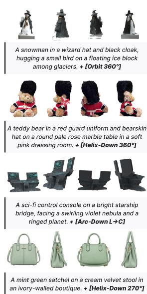

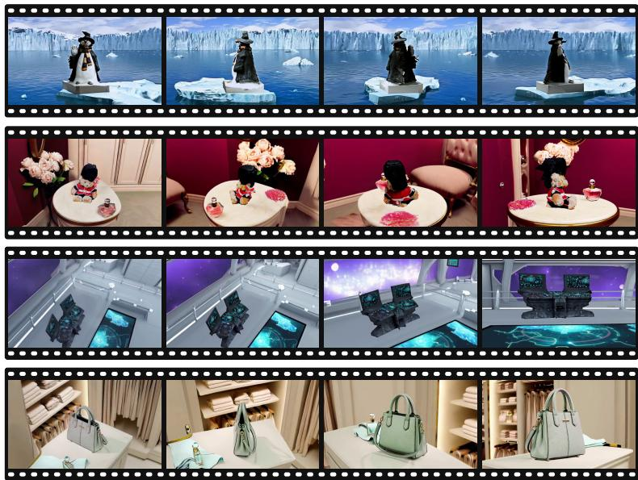

Figure 1: OmniShowcase produces subject-driven videos that stay 3D-consistent across every revealed viewpoint.

## ABSTRACT

Generating videos of a specific subject from a few reference images remains challenging when the camera reveals surfaces that are not visible in the input. Early subject-to-video (S2V) methods condition on a single reference image and must therefore infer the subject’s unseen appearance and geometry as the viewpoint changes. To address this limitation, recent methods extend S2V to multiple reference views, providing more information about the subject from different viewpoints. However, they do not explicitly specify the 3D structure that connects these observations. In addition, existing training data do not guarantee that viewpoint changes preserve the same underlying 3D subject. We present OmniShowcase, built on two components: (i) a fully automated data synthesis pipeline that produces training videos along diverse camera trajectories, with viewpoint variation driven by underlying subject geometry, even spanning full 360-degree orbits; and (ii) a geometry-conditioning method that provides the video model with a turntable of surface-normal maps reconstructed from the reference views without requiring temporal alignment with the generated frames. We construct SHOWCASE-4K, a corpus of 3D-asset-based videos covering twelve camera motions across 88 trajectory configurations with reconstruction-derived surface-normal conditioning, and SHOWCASEBENCH, a held-out evaluation set with the source meshes and camera parameters used to render each video. Experiments show state-of-the-art subject identity and 3D consistency while maintaining competitive video quality and motion. Project page: justin4ai.github.io/ OmniShowcase

## 1 INTRODUCTION

Subject-to-video (S2V) generation aims to create videos of a specified subject from reference images while preserving its appearance across time and viewpoints. Recent video diffusion models generate photorealistic videos from text or a single image (Yang et al., 2025; Kong et al., 2024; Wan Team, 2025; Brooks et al., 2024), and S2V methods use reference images to preserve subject identity in generated videos (Liu et al., 2025; Deng et al., 2026; Jiang et al., 2025; Yuan et al., 2025). However, most S2V methods condition on a single reference image, which provides appearance information only for the visible surfaces and leaves other regions unconstrained. As the camera reveals previously unseen sides, generated videos may exhibit inconsistent geometry and appearance, which can lead to changes in silhouette, structure, and surface details. These ambiguities motivate the use of multiple reference views and explicit geometric information. The main difficulty is geometric rather than purely photometric since the model must infer 3D structure that is absent from the input.

Recent methods incorporate multiple reference views into S2V generation. MV-S2V (Song et al., 2026) trains a feed-forward model using generated multi-view videos, whereas 3DreamBooth (Ko et al., 2026) performs per-subject optimization using static multi-view images. These efforts motivate two complementary directions: training on geometrically consistent viewpoint changes and providing explicit 3D geometry during generation. For the latter, recent feed-forward reconstruction methods can recover 3D geometry from a few uncalibrated images (Wang et al., 2024a; 2025; 2026; Lin et al., 2026), making explicit geometry available from the same sparse references used at inference.

We present OmniShowcase (Figure 1), a framework that combines an automated data synthesis pipeline with geometry-aware conditioning. The pipeline renders multi-view videos from 3D assets and composites them into realistic scenes. For conditioning, we reconstruct geometry from the reference views and render a surface-normal sequence using the same procedure during training and inference. Our contributions are as follows:

• We introduce an automated data synthesis pipeline that renders subject views from 3D assets and composites them into realistic scenes to construct training videos.

• We present SHOWCASE-4K, a dataset of 4,000 videos paired with diverse source meshes, camera trajectories, reference images, and surface-normal sequences, along with SHOW-CASEBENCH, a held-out benchmark with ground-truth geometry and camera parameters for evaluating subject consistency across viewpoints. We will publicly release SHOWCASE-4K, SHOWCASEBENCH, and the associated data-synthesis code.

• We propose a geometry-aware in-context conditioning mechanism that uses reference images and a reconstructed surface-normal sequence to guide video generation without requiring frame-wise alignment between the normal and target sequences.

• We evaluate our method against single- and multi-view S2V baselines on synthetic and real-world subjects, achieving state-of-the-art performance in subject identity preservation and 3D consistency while maintaining competitive video quality.

## 2 RELATED WORK

## 2.1 VIDEO GENERATION DIFFUSION MODELS

Diffusion models (Ho et al., 2020; Rombach et al., 2022) are the dominant approach to visual content synthesis, and the shift from convolutional U-Nets to transformer denoisers (Peebles & Xie, 2023) with rectified-flow training (Esser et al., 2024) improved their scalability and sample quality. These advances carried over to video. Early video models extended pretrained image backbones with temporal layers (Singer et al., 2023; Blattmann et al., 2023; Guo et al., 2024); more recent systems use large diffusion transformers trained on web-scale corpora and generate high-resolution clips of steadily increasing length (Yang et al., 2025; Kong et al., 2024; Wan Team, 2025; Brooks et al., 2024). Image-to-video (I2V) variants add a starting frame as a condition, giving coarse control over appearance. Our framework builds on a pretrained I2V diffusion transformer and adapts it through low-rank tuning (Hu et al., 2022).

Table 1: Comparison of subject-to-video methods. Data: representative training-set order of magnitude. General.: generalization without optimization for inference. Geom.: explicit geometric conditioning. Supervision: source of the training signal.
<table><tr><td>Method</td><td>Data</td><td>References</td><td>General.</td><td>Geom.</td><td>Supervision</td></tr><tr><td>Phantom (Liu et al., 2025)</td><td>1M</td><td>single view</td><td></td><td>X</td><td>real video</td></tr><tr><td>MAGREF (Deng et al., 2026)</td><td>large</td><td>single view</td><td></td><td>X</td><td>real video</td></tr><tr><td>MV-S2V (Song et al., 2026)</td><td>14K</td><td>multi-view (4)</td><td></td><td>X</td><td>generated (87%) + real (13%)</td></tr><tr><td>3DreamBooth (Ko et al., 2026)</td><td>200K</td><td>multi-view (30)</td><td>X</td><td>×</td><td>static multi-view</td></tr><tr><td>OmniShowcase (ours)</td><td>4K</td><td>multi-view (4)</td><td></td><td></td><td>generated (3D asset render)</td></tr></table>

## 2.2 3D GENERATION AND NOVEL VIEW SYNTHESIS

Representing and rendering 3D content from images has been studied through neural fields (Mildenhall et al., 2020) and point-based splatting (Kerbl et al., 2023). To synthesize unseen viewpoints without per-scene reconstruction, one line of work distills 2D diffusion priors into multi-view-consistent generators: image-conditioned models such as Liu et al. (2023) hallucinate novel views of an object, and multi-view diffusion models (Shi et al., 2024; Liu et al., 2024b; Voleti et al., 2024) jointly denoise several views to enforce cross-view coherence. These methods are mostly confined to isolated objects against clean backgrounds and do not model scene-level dynamics. In parallel, feed-forward geometry estimators build on monocular depth foundation models (Yang et al., 2024) and recover dense 3D structure from sparse, uncalibrated images in a single pass (Wang et al., 2024a; 2025; 2026; Lin et al., 2026). This makes it practical to derive explicit geometry from multi-view reference images. We use this capability to supplement coarse 3D information of unseen views as a geometry cue.

## 2.3 SUBJECT-DRIVEN VIDEO GENERATION

Personalizing generative models to a user-specified subject originates in the image domain, through identifier-based personalization (Ruiz et al., 2023; Gal et al., 2023; Kumari et al., 2023) and later encoder- or adapter-based conditioning that injects reference features without test-time optimization (Ye et al., 2023; Tan et al., 2025). These ideas carried over to video, where subject-to-video (S2V) methods keep a reference identity stable throughout a generated clip. Optimization- and adapter-based approaches (Jiang et al., 2024; Wei et al., 2024; He et al., 2024; Yuan et al., 2025) preserve identity over time, and reference-conditioned frameworks (Liu et al., 2025; Deng et al., 2026; Jiang et al., 2025; Chen et al., 2025) extend this to multiple subjects and flexible prompts. These methods primarily encode the subject through 2D appearance features, leaving viewpoints not covered by the reference unconstrained.

Closest to our setting are recent attempts to move beyond single-view conditioning. MV-S2V (Song et al., 2026) feeds multiple reference views into a video diffusion transformer and uses a shifted positional-encoding scheme to distinguish different views of the same subject. The references provide appearance information from several viewpoints, but do not explicitly encode the 3D surface structure underlying those views. Its training videos for object-centric generation are produced by a camera-controllable video generator, so viewpoint variation is not explicitly tied to a shared 3D asset. 3DreamBooth (Ko et al., 2026) uses static multi-view images for subject-specific adaptation, preserving the pretrained model’s temporal behavior but requiring optimization for each new subject. In contrast, OmniShowcase reconstructs geometry from the input views at inference and uses it directly as a conditioning signal, without subject-specific optimization. Requirements comparison across baselines are shown in Table 1.

## 3 METHOD

Given a small set of reference views, we reconstruct the subject in 3D and render the reconstruction as a turntable of surface-normal maps. We provide these normal maps, together with the reference images, to a pretrained video diffusion model (Figure 4).

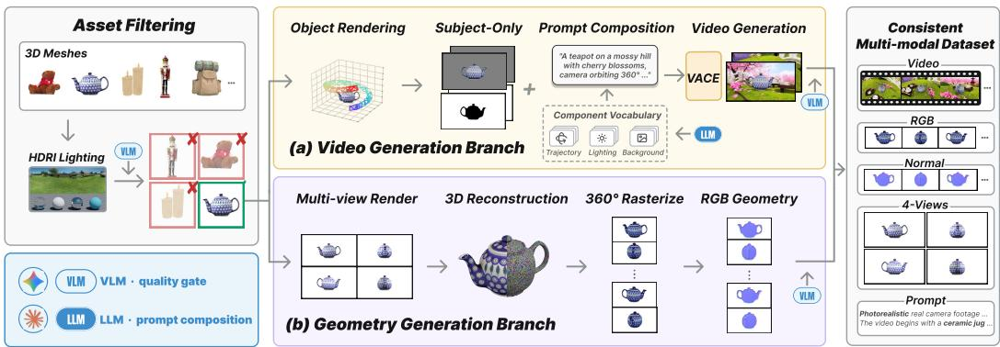  
Figure 2: Automated 3D-consistent data synthesis pipeline. From a curated 3D asset (Deitke et al., 2023), Blender renders the target orbit and four reference views. (a) The target is composited into a prompt-driven scene by video inpainting (Jiang et al., 2025); (b) the four views are reconstructed in 3D (Li et al., 2026) and rendered as the surface-normal turntable used as the condition. Every stage runs without human intervention.

## 3.1 PRELIMINARIES AND PROBLEM SETUP

Problem setup. A subject is given by a small set of reference views $\mathcal { R } = \{ \mathbf { I } _ { i } \} _ { i = 1 } ^ { N } \left( N { = } 4 \right.$ in our experiments), each depicting the object from a different angle. Given a text prompt, we seek to generate a video $\mathbf { V } = \{ \mathbf { V } _ { t } \}$ that follows the specified camera trajectory and scene while preserving the subject’s appearance and 3D structure across viewpoints. We further reconstruct an explicit 3D geometry from these views and provide it to the generator, reducing its reliance on the backbone’s priors for viewpoints that are not directly observed.

Backbone. We build on a pretrained image-to-video (I2V) diffusion transformer (Wan Team, 2025) and adapt it with low-rank tuning (Hu et al., 2022), keeping the base weights frozen. The model operates in the latent space of a causal video VAE and is trained with a rectified-flow objective. We denote the denoising transformer by $\mathcal { F } _ { \theta }$ , where θ collects the trainable LoRA parameters.

## 3.2 AUTOMATED 3D-CONSISTENT DATA SYNTHESIS

Our training data are designed to satisfy three requirements: subject identity preservation, geometrically consistent viewpoint changes, and explicit geometry for conditioning. A camera-controllable video generator does not guarantee these properties, because unseen surfaces are still synthesized by the generative prior. Real multi-view capture satisfies the first two but leaves the third to an estimator. Rendering from a 3D asset satisfies all three at once, because one mesh under known cameras pro duces every frame. However, direct rendering produces clean-background videos. We therefore add a separate scene-compositing stage to introduce realistic backgrounds corresponding to the cam era motion. The pipeline used to construct SHOWCASE-4K has two branches: a video-generation branch (Figure 2a) that produces the target video and a geometry-generation branch (Figure 2b) that produces the condition.

Figure 3 makes the difference concrete. Given one view and a camera path, a camera-controllable generator resolves every surface the first frame does not show from a prior, and within a single clip the subject can change shape, leave the scene, or appear twice at once.

3D-consistent reference and target views. We source 3D meshes from Objaverse (Deitke et al., 2023) and, for real-scanned subjects, from the Digital Twin Catalog (Dong et al., 2025) and Google Scanned Objects (Downs et al., 2022). A heuristic pre-screen discards degenerate meshes, and a vision-language model inspects four rendered views of each remaining asset and keeps only those with valid geometry, plausible textures and category consistency (rubrics in Appendix I). We use four orbit-family motions (Orbit and Helix-Up/Down/In) with four rotation amounts each and eight additional motions—arc, truck, dolly, and zoom variants—with nine framing transitions each, yield ing 88 trajectory configurations in total (Appendix G.2). From the same mesh, Blender renders an

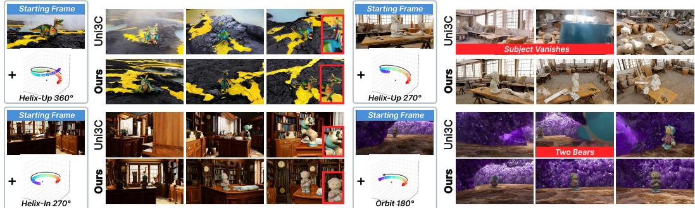  
Figure 3: Qualitative comparison of training data. Uni3C (Cao et al., 2025) is an image-to-video model, so every surface the camera path uncovers is generated. Ours renders the subject from a 3D asset and generates only the background.

81-frame target video and N=4 reference views R at $9 0 °$ yaw intervals, so references and target share one underlying shape and appearance.

Subject-preserving compositing. We composite the subject into a prompt-driven scene to close the domain gap from clean-background renders (Figure 2a). Subject masks from the render’s alpha channel drive a video inpainting model (Jiang et al., 2025) that synthesizes a coherent background around the fixed subject, while keeping the rendered subject pixels unchanged. The scene prompt combines a location from a language-model-written scene bank with the sample’s camera motion and lighting, and a vision-language gate discards videos whose subject floats, deforms, or departs from the references. The target is trimmed to 80 frames to meet the video VAE’s temporal constraint (below).

Geometry conditions from reference views. Importantly, we reconstruct the geometry from the four reference views (Figure 2b) rather than using the source mesh. This ensures that the condition ing signal available during training matches the signal available at inference.

We mask the subject on its white background, predict aligned per-view pointmaps with a feedforward multi-view estimator (Lin et al., 2026), and fuse the views into 3D Gaussians (Kerbl et al., 2023) with a multi-view reconstruction module (Li et al., 2026). We render the Gaussians along a yaw orbit at $1 5 ^ { \circ }$ elevation at $T _ { c } { = } 2 5$ uniformly spaced poses and convert each rendered depth map to surface normals. This yields a normal turntable $\{ \mathbf { N } _ { t } \} _ { t = 1 } ^ { \bar { T } _ { c } }$ that encodes the surface visible from each viewpoint. A vision-language gate discards reconstructions that depart from the reference or break apart.

Multimodal sample construction. A video-language model (Tarsier2-7B) captions the normal turntable and target video separately. Each training sample comprises a 25-frame normal condition and an 80-frame target, together with four reference images. The normal and target segments are encoded separately before being concatenated along the temporal axis in latent space, while each reference image is encoded independently. Videos are sampled at 16 fps from the renders. The two segments are paired with explicit [CONDITION] and [VIDEO] markers describing the normal turntable and target video, respectively.

## 3.3 GEOMETRY-AWARE CONDITIONING

Conditioning inputs. The conditioning sequence holds the N=4 reference images followed by the $T _ { c } { = } 2 5 { \mathrm { - } } \mathrm { f r a m e }$ normal turntable, and the target segment follows as the frames to be produced. The target camera motion is specified by the text prompt, while the normal turntable provides a trajectory-independent geometry cue.

We encode the two conditions differently because they have different structures. Each reference image is encoded independently, while the normal maps form a temporal sequence and are encoded using the video VAE.

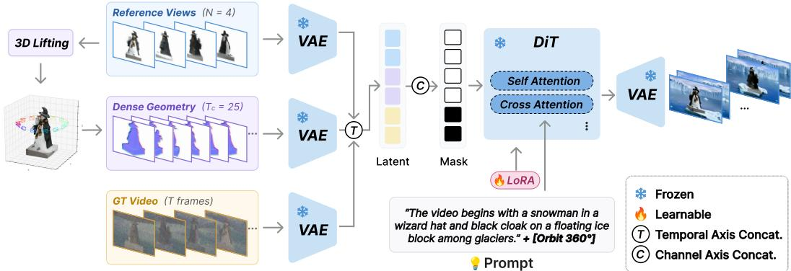  
Figure 4: Overview of OmniShowcase. From $N { = } 4$ reference views, we reconstruct 3D geometry and render a surface-normal turntable. The reference images and normal condition are injected into the reference pathway of a LoRA-tuned image-to-video diffusion transformer. The model uses appearance information from the reference views and 3D structure from the normal condition to generate the target video without per-subject optimization.

Geometry-aware in-context conditioning. The sequence concatenates the reference, normal and target latents along the temporal axis and the transformer attends over it,

$$
\begin{array} { r } { \mathbf { z } = \left[ \mathbf { z } ^ { \mathcal { R } } ; \mathbf { z } ^ { \mathcal { N } } ; \mathbf { z } ^ { \mathcal { V } } \right] \in \mathbb { R } ^ { L \times C \times h \times w } , \qquad L = N + T _ { n } + T _ { v } . } \end{array}\tag{1}
$$

Encoding the 25-frame normal condition and the 80-frame target separately yields $T _ { n } { = } 7$ and $T _ { v } { = } 2 0$ latent frames, respectively. Together with the $N { = } 4$ independently encoded reference images, the resulting sequence has length $\mathbf { \bar { L } } = N + T _ { n } + T _ { v } = 3 1$ . A binary mask $\mathbf { m } \in \{ 0 , 1 \} ^ { L }$ marks the first $\bar { N + T _ { n } } \bar { \quad }$ positions as given. In element-wise operations, m is broadcast over the channel and spatial dimensions. For channel-wise concatenation, we expand it into $\mathbf { M } \in \{ 0 , 1 \} ^ { L \times 4 \times h \times w }$ . The transformer input stacks three streams along the channel axis:

$$
\begin{array} { r l } & { \widetilde { \mathbf { z } } _ { \tau } = \mathbf { m } \odot \mathbf { z } + ( 1 - \mathbf { m } ) \odot \big ( \tau \mathbf { z } + ( 1 - \tau ) \epsilon \big ) , \quad \epsilon \sim \mathcal { N } ( \mathbf { 0 } , \mathbf { I } ) , } \\ & { \mathbf { x } _ { \tau } = \mathrm { C o n c a t } _ { \mathrm { c h a n n e l } } ( \widetilde { \mathbf { z } } _ { \tau } , \mathbf { M } , \mathbf { m } \odot \mathbf { z } ) . } \end{array}\tag{2}
$$

(3)

Thus, the reference and normal latents remain clean, while only the target-video latents are interpolated with noise. The other two streams provide the mask and the clean conditioning latents zeroed over the target span. The mask states which positions were supplied, and the rectified-flow loss is applied where $m _ { \ell } = 0$ . The four channels of M follow the VAE temporal grouping. With $C = 1 6$ latent channels, the three input streams therefore contribute $1 6 + 4 + \mathbf { \bar { 1 6 } } = \mathbf { \bar { 3 6 } }$ channels.

No frame-wise correspondence between the normal and target sequences is imposed. This is why the turntable enters as its own span rather than as extra channels on the target latents. A channel-wise condition has to be read frame by frame, which would force an alignment between the 25 normals and the 80 target frames that does not exist, since the turntable is a fixed yaw sweep and the target follows whichever trajectory the prompt names.

## 3.4 TRAINING AND INFERENCE

Training. We optimize only the LoRA parameters θ with the backbone’s rectified-flow objective. Let c denote the text condition and $\mathcal { F } _ { \theta } ^ { \nu }$ the target-video segment of the transformer output. Writing $\widehat { \mathbf { u } } _ { \theta } ^ { \nu } = \mathcal { F } _ { \theta } ^ { \nu } ( \mathbf { x } _ { \tau } , \tau \mid \mathbf { c } )$ , the target velocity under the backbone’s flow convention is $\mathbf { z } ^ { \hat { \nu } } - \epsilon ^ { \nu }$ . We minimize

$$
\mathcal { L } = \mathbb { E } \left[ \frac { 1 } { D _ { v } } \left. \widehat { \mathbf { u } } _ { \theta } ^ { \nu } - \left( \mathbf { z } ^ { \nu } - \boldsymbol { \epsilon } ^ { \nu } \right) \right. _ { 2 } ^ { 2 } \right] ,\tag{4}
$$

where $D _ { v }$ is the number of scalar elements in $\mathbf { z } ^ { \nu }$ , and the expectation is over $\mathbf { z } , \epsilon , \tau ,$ and $\mathbf { c } .$ . The squared error is averaged over target-video latent elements only; $\mathbf { z } ^ { \mathcal { R } }$ and $\mathbf { z } ^ { \mathcal { N } }$ remain clean context and do not contribute to the loss.

Inference. At test time we run the same reconstruction and rendering steps on a new subject’s reference views (reconstruct the subject, render the yaw orbit, and derive the surface-normal turntable), then condition the generator on the references and normals to produce the target latents. The 7 normal-condition latents and 20 generated target latents are concatenated and jointly decoded. Under the causal VAE’s temporal compression factor of 4, the resulting 27-frame latent sequence decodes into $1 + 4 ( 2 7 - 1 ) = \mathrm { { 1 0 5 } }$ frames: 25 normal-condition frames followed by 80 target frames.

## 4 EXPERIMENT

## 4.1 EXPERIMENTAL SETUP

Datasets and baselines. We evaluate on SHOWCASEBENCH, a held-out benchmark of 50 subjects spanning four 360◦ camera trajectories and sharing no 3D asset with SHOWCASE-4K, and on NAVI (Jampani et al., 2023) with 35 subjects. Training and inference settings are given in Appendix C. Phantom (Liu et al., 2025) and MAGREF (Deng et al., 2026) are single-view S2V models, and we run them in the multi-reference mode. We refer to these variants as Phantom-MV and MAGREF-MV, where the four reference images are treated as views of the same subject. Appendix F also runs both in their original single-view mode, where the four-view extension is the stronger setting on almost every metric, so the multi-view numbers are the ones we report. We further compare against recent methods, MV-S2V (Song et al., 2026) and 3DreamBooth (Ko et al., 2026). All methods in our main comparison use the same four reference images. For 3DreamBooth, these images are used for both subject-specific optimization and inference. Prompt details are provided in Appendices I.3–I.4.

Metrics. We sample 16 frames per video and obtain subject masks for the reference images and sampled video frames using GroundingDINO (Liu et al., 2024a) and SAM (Kirillov et al., 2023). Every identity and 3D metric is computed on those masked subjects, so background content does not enter them, while text alignment and video quality use full frames.

Identity. DINO and CLIP similarity measure how well the generated orbit covers the supplied reference views. For each reference view we take the maximum similarity over generated frames and average across references. Features come from DINOv2-L (Oquab et al., 2024) and CLIP ViT-L/14 (Radford et al., 2021).

3D consistency. MEt3R (Asim et al., 2025) scores multi-view consistency between reference and generated views, taking the minimum dissimilarity per reference. We also lift the generated orbit to a point cloud with $\bar { \pi } ^ { 3 }$ (Wang et al., 2026) and compare it with the dataset’s ground-truth geometry. For SHOWCASEBENCH, the ground-truth point cloud is back-projected from source-mesh depth renders; for NAVI, it is sampled from the 3D scan mesh. We report GT-CD as the symmetric mean nearest-neighbor Euclidean distance between the predicted and ground-truth point clouds, following independent centering, mean-radius normalization, and rigid alignment. We additionally report RotCoverage as an alignment-dependent diagnostic of viewpoint coverage, computed as the mean distance from each reference viewpoint to the nearest estimated generated viewpoint after pose alignment. Appendix C gives the evaluation details.

Text alignment. We compute ViCLIP (Wang et al., 2024b) cosine similarity between the video and the prompt using eight sampled frames and the clause describing the target video.

Video quality. We report VBench (Huang et al., 2024) imaging quality, aesthetic quality and dynamic degree for completeness.

## 4.2 QUALITATIVE AND QUANTITATIVE COMPARISON

Figure 5 shows how each baseline breaks down. Each method carries three marks for whether the camera follows the trajectory the prompt names (Traj.), whether the subject keeps its identity (ID) and whether it stays 3D-consistent (3D). Phantom-MV and MAGREF-MV barely orbit the subject, and the few faces they do reveal come apart. MV-S2V likewise stops short of completing the rotation, and within one clip it grows a second spout on the teapot and snaps back to an earlier frame, so the sequence does not read as one object seen from moving viewpoints. 3DreamBooth converges on neither the subject identity nor its geometry, leaving both off-target.

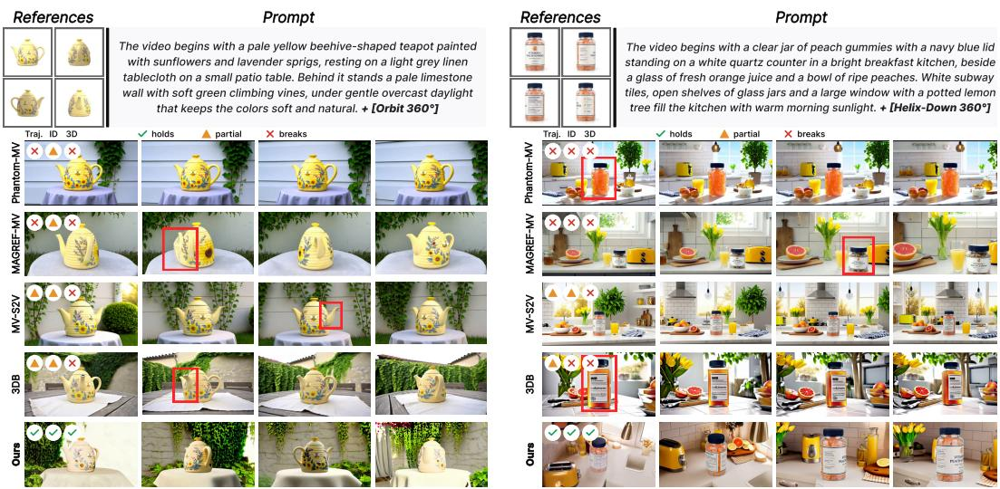  
Figure 5: Qualitative comparison with baselines. 3DB denotes 3DreamBooth. Given a teapot and a jar of peach gummies, we compare OmniShowcase against four baselines. Red boxes mark where identity or 3D structure breaks down.

Table 2: Main quantitative comparison. Results on SHOWCASEBENCH with 50 subjects and on NAVI (Jampani et al., 2023) with 35 subjects. We evaluate identity preservation, 3D consistency, text alignment and video quality through nine metrics. Best results are in bold and second best are underlined.
<table><tr><td></td><td></td><td colspan="2">Identity</td><td colspan="3">3D consistency</td><td>Text alignment</td><td colspan="3">Video quality</td></tr><tr><td>Set</td><td>Method</td><td>DINO↑</td><td>CLIP↑</td><td>MEt3R↓</td><td>GT-CD↓</td><td>RotCov↓</td><td>ViCLIP↑</td><td>Imaging↑</td><td>Aesthetic↑</td><td>Dynamic↑</td></tr><tr><td rowspan="4">Helddout</td><td>Phantom-MV</td><td>0.621</td><td>0.871</td><td>0.444</td><td>0.2843</td><td>0.906</td><td>0.236</td><td>72.52</td><td>0.595</td><td>0.460</td></tr><tr><td>MAGREF-MV</td><td>0.616</td><td>0.876</td><td>0.409</td><td>0.1789</td><td>1.177</td><td>0.242</td><td>73.88</td><td>0.614</td><td>0.760</td></tr><tr><td>MV-S2V</td><td>0.688</td><td>0.896</td><td>0.351</td><td>0.2306</td><td>0.787</td><td>0.244</td><td>73.21</td><td>0.590</td><td>0.960</td></tr><tr><td>3DreamBooth</td><td>0.707</td><td>0.907</td><td>0.325</td><td>0.1717</td><td>0.765</td><td>0.238</td><td>70.67</td><td>0.598</td><td>1.000</td></tr><tr><td rowspan="5">NAANI</td><td>OmniShowcase (ours)</td><td>0.799</td><td>0.925</td><td>0.190</td><td>0.0824</td><td>0.665</td><td>0.259</td><td>74.29</td><td>0.574</td><td>1.000</td></tr><tr><td>Phantom-MV</td><td>0.690</td><td>0.882</td><td>0.462</td><td>0.2014</td><td>1.458</td><td>0.255</td><td>71.17</td><td>0.572</td><td>0.029</td></tr><tr><td>MAGREF-MV</td><td>0.665</td><td>0.892</td><td>0.457</td><td>0.2145</td><td>1.284</td><td>0.251</td><td>69.81</td><td>0.574</td><td>0.343</td></tr><tr><td>MV-S2V</td><td>0.770</td><td>0.912</td><td>0.350</td><td>0.1816</td><td>1.163</td><td>0.250</td><td>71.73</td><td>0.565</td><td>1.000</td></tr><tr><td>3DreamBooth</td><td>0.741</td><td>0.912</td><td>0.386</td><td>0.2272</td><td>1.179</td><td>0.244</td><td>70.34</td><td>0.559</td><td>1.000</td></tr><tr><td></td><td>OmniShowcase (ours)</td><td>0.828</td><td>0.918</td><td>0.249</td><td>0.0975</td><td>1.074</td><td>0.260</td><td>74.58</td><td>0.551</td><td>1.000</td></tr></table>

Table 2 compares both benchmarks, and the weaknesses it exposes follow the qualitative ones. No baseline is strong on every axis, with Phantom-MV and MAGREF-MV trailing on identity and camera travel and the lead between MV-S2V and 3DreamBooth changing across the two benchmarks. Overall, OmniShowcase achieves the best DINO, CLIP, MEt3R, and GT-CD scores on both bench marks while keeping text alignment and video quality competitive.

## 4.3 ABLATION

Table 3 ablates the conditioning signal in three ways, holding the backbone and the training data fixed: (i) removing geometry conditioning entirely and keeping only the reference views, (ii) replacing the surface-normal turntable with a textured render of the same reconstruction, and (iii) thinning the dense turntable from 25 to 9 frames. Each variant is trained independently from the same initialization and evaluated at 33,000 steps.

Without geometry conditioning the model keeps the reference appearance but is told nothing about how the subject is shaped away from those views, so identity preservation, MEt3R, and GT-CD all deteriorate. The auxiliary RotCoverage score also increases. The textured variant carries the same geometry but paints it with reconstructed colour, which competes with the reference images for appearance: identity barely moves relative to dropping the condition, and text alignment falls furthest of the three on SHOWCASEBENCH. Thinning the turntable preserves the modality but not the coverage, and its cost depends on how reliable the reconstruction is. On SHOWCASEBENCH, Textured gives the lowest GT-CD among the three ablations, while Sparse gives the lowest auxiliary RotCoverage score. On NAVI, removing geometric conditioning yields the highest GT-CD. Figure 6 shows the same comparison qualitatively.

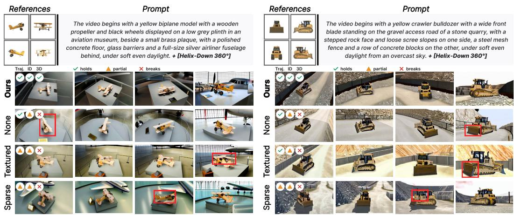  
Figure 6: Conditioning ablation. Given a biplane and a bulldozer, we compare the three conditioning variants against ours. Marked regions highlight where identity or 3D structure breaks down.

Table 3: Geometry-condition ablation. None keeps only the reference views, Textured replaces the normals with a colored render of the same reconstruction, and Sparse thins the turntable from 25 to 9 views. Reference count is varied separately in Table 4. Best results are in bold and second best are underlined.
<table><tr><td colspan="2"></td><td colspan="2">Identity</td><td colspan="3">3D consistency</td><td>Text</td><td colspan="2">Video quality</td></tr><tr><td>Set</td><td>Geometry condition</td><td>DINO↑</td><td>CLIP↑</td><td>MEt3R↓</td><td>GT-CD↓</td><td>RotCov↓</td><td>ViCLIP↑</td><td>Imaging↑</td><td>Aesthetic↑</td></tr><tr><td rowspan="4">Hed-dout</td><td>Normals (ours)</td><td>0.799</td><td>0.925</td><td>0.190</td><td>0.0824</td><td>0.665</td><td>0.259</td><td>74.29</td><td>0.574</td></tr><tr><td>None</td><td>0.752</td><td>0.903</td><td>0.265</td><td>0.2092</td><td>0.727</td><td>0.248</td><td>69.85</td><td>0.547</td></tr><tr><td>Textured</td><td>0.755</td><td>0.910</td><td>0.270</td><td>0.1698</td><td>0.747</td><td>0.236</td><td>73.41</td><td>0.564</td></tr><tr><td>Sparse</td><td>0.752</td><td>0.912</td><td>0.263</td><td>0.1777</td><td>0.698</td><td>0.250</td><td>71.84</td><td>0.552</td></tr><tr><td rowspan="4">NAANI</td><td>Normals (ours)</td><td>0.828</td><td>0.918</td><td>0.249</td><td>0.0975</td><td>1.074</td><td>0.260</td><td>74.58</td><td>0.551</td></tr><tr><td>None</td><td>0.793</td><td>0.904</td><td>0.315</td><td>0.1987</td><td>1.107</td><td>0.238</td><td>67.67</td><td>0.532</td></tr><tr><td>Textured</td><td>0.780</td><td>0.907</td><td>0.323</td><td>0.1842</td><td>1.089</td><td>0.240</td><td>71.47</td><td>0.544</td></tr><tr><td>Sparse</td><td>0.772</td><td>0.909</td><td>0.288</td><td>0.1769</td><td>1.090</td><td>0.240</td><td>67.72</td><td>0.531</td></tr></table>

## 5 CONCLUSION

We present OmniShowcase, which pairs an automated pipeline that renders omnidirectional videos from 3D assets with surface-normal turntable conditioning reconstructed from the reference views, requiring no temporal alignment with generated frames. OmniShowcase leads single- and multiview baselines on subject identity and cross-view 3D consistency on both SHOWCASEBENCH and NAVI. Two limitations remain: the background sometimes looks synthetic, and subjects that are not rigid across the four references are not handled (Figure 13, Appendix H). We leave both to future work. We will release the data, benchmark, and code.

## AI USE STATEMENT

In the preparation of this work, we used LLMs to polish the text, including grammar checking and phrase refinement, and to polish figure illustrations. Generative models are also components of the data pipeline itself, where a vision-language model gates asset and clip curation, a large language model writes the scene vocabulary, and a video-language model captions each clip. Appendices G and I state where each one is used and give every prompt and rubric verbatim. No LLM contributed to the research ideas, the method design or the analysis.

We take responsibility for the final content of this work, including text, claims or artifacts produced with the aid of generative AI.

## ETHICS STATEMENT

This work includes a human preference study with 44 participants, as described in Appendix B. Every 3D asset comes from Objaverse, the Digital Twin Catalog or Google Scanned Objects under a Creative Commons license, and none carries a NoDerivatives term, so the renders may be released. A small fraction is NonCommercial, which the research-only release respects. We ship the license and the original author of every asset with the renders, and ShareAlike terms carry over to the renders that inherit them. An asset whose terms the release cannot meet is replaced by a pointer to the original and the code that reproduces our renders from it.

## REPRODUCIBILITY STATEMENT

We release the sources of the data generation, the exact modules composing the pipeline, the method architecture, the VLM and LLM rubrics used for curation, and the prompts that generate the captions, all in Appendices G and I. The evaluation protocol is fixed as described in Section 4.1, and where a method requires a deviation we state it, such as extending Phantom and MAGREF from single-view to multi-view input and appending the camera-trajectory sentence that our model consumes. The data-generation code and the dataset will be released publicly.

## REFERENCES

Mohammad Asim, Christopher Wewer, Thomas Wimmer, Bernt Schiele, and Jan Eric Lenssen. MEt3R: Measuring multi-view consistency in generated images. In CVPR, 2025.

Andreas Blattmann, Tim Dockhorn, Sumith Kulal, Daniel Mendelevitch, Maciej Kilian, Dominik Lorenz, et al. Stable video diffusion: Scaling latent video diffusion models to large datasets. arXiv preprint arXiv:2311.15127, 2023.

Tim Brooks, Bill Peebles, Connor Holmes, Will DePue, Yufei Guo, Li Jing, et al. Video generation models as world simulators. https://openai.com/research/ video-generation-models-as-world-simulators, 2024.

Chenjie Cao, Jingkai Zhou, Shikai Li, Jingyun Liang, Chaohui Yu, Fan Wang, Xiangyang Xue, and Yanwei Fu. Uni3c: Unifying precisely 3D-enhanced camera and human motion controls for video generation. arXiv:2504.14899, 2025.

Tsai-Shien Chen, Aliaksandr Siarohin, Willi Menapace, Yuwei Fang, Kwot Sin Lee, Ivan Skorokhodov, Kfir Aberman, Jun-Yan Zhu, Ming-Hsuan Yang, and Sergey Tulyakov. Multi-subject open-set personalization in video generation. In CVPR, 2025.

Matt Deitke, Dustin Schwenk, Jordi Salvador, Luca Weihs, Oscar Michel, Eli VanderBilt, Ludwig Schmidt, Kiana Ehsani, Aniruddha Kembhavi, and Ali Farhadi. Objaverse: A universe of annotated 3d objects. In CVPR, 2023.

Yufan Deng, Xun Guo, Yuanyang Yin, Jacob Zhiyuan Fang, Yiding Yang, Yizhi Wang, et al. Magref: Masked guidance for any-reference video generation with subject disentanglement. In ICLR, 2026.

Zhao Dong, Ka Chen, Zhaoyang Lv, Hong-Xing Yu, Yunzhi Zhang, Cheng Zhang, Yufeng Zhu, Stephen Tian, Zhengqin Li, Geordie Moffatt, Sean Christofferson, James Fort, Xiaqing Pan, Mingfei Yan, Jiajun Wu, Carl Yuheng Ren, and Richard Newcombe. Digital twin catalog: A large-scale photorealistic 3D object digital twin dataset. In CVPR, 2025.

Laura Downs, Anthony Francis, Nate Koenig, Brandon Kinman, Ryan Hickman, Krista Reymann, Thomas B. McHugh, and Vincent Vanhoucke. Google scanned objects: A high-quality dataset of 3D scanned household items. In ICRA, 2022.

Patrick Esser, Sumith Kulal, Andreas Blattmann, Rahim Entezari, Jonas Muller, Harry Saini, et al.¨ Scaling rectified flow transformers for high-resolution image synthesis. In ICML, 2024.

Rinon Gal, Yuval Alaluf, Yuval Atzmon, Or Patashnik, Amit H. Bermano, Gal Chechik, and Daniel Cohen-Or. An image is worth one word: Personalizing text-to-image generation using textual inversion. In ICLR, 2023.

Yuwei Guo, Ceyuan Yang, Anyi Rao, Zhengyang Liang, Yaohui Wang, Yu Qiao, Maneesh Agrawala, Dahua Lin, and Bo Dai. Animatediff: Animate your personalized text-to-image diffusion models without specific tuning. In ICLR, 2024.

Xuanhua He, Quande Liu, Shengju Qian, Xin Wang, Tao Hu, Ke Cao, Keyu Yan, and Jie Zhang. Id-animator: Zero-shot identity-preserving human video generation. arXiv preprint arXiv:2404.15275, 2024.

Jonathan Ho, Ajay Jain, and Pieter Abbeel. Denoising diffusion probabilistic models. In NeurIPS, 2020.

Edward J. Hu, Yelong Shen, Phillip Wallis, Zeyuan Allen-Zhu, Yuanzhi Li, Shean Wang, Lu Wang, and Weizhu Chen. Lora: Low-rank adaptation of large language models. In ICLR, 2022.

Ziqi Huang, Yinan He, Jiashuo Yu, Fan Zhang, Chenyang Si, Yuming Jiang, et al. VBench: Comprehensive benchmark suite for video generative models. In CVPR, 2024.

Varun Jampani, Kevis-Kokitsi Maninis, Andreas Engelhardt, Arjun Karpur, Karen Truong, Kyle Sargent, Stefan Popov, Andre Araujo, Ricardo Martin-Brualla, et al. NAVI: Category-agnostic image collections with high-quality 3D shape and pose annotations. In NeurIPS, 2023.

Yuming Jiang, Tianxing Wu, Shuai Yang, Chenyang Si, Dahua Lin, Yu Qiao, Chen Change Loy, and Ziwei Liu. Videobooth: Diffusion-based video generation with image prompts. In CVPR, 2024.

Zeyinzi Jiang, Zhen Han, Chaojie Mao, Jingfeng Zhang, Yulin Pan, and Yu Liu. Vace: All-in-one video creation and editing. In ICCV, 2025.

Bernhard Kerbl, Georgios Kopanas, Thomas Leimkuhler, and George Drettakis. 3d gaussian splat-¨ ting for real-time radiance field rendering. ACM TOG, 42(4), 2023.

Alexander Kirillov, Eric Mintun, Nikhila Ravi, Hanzi Mao, Chloe Rolland, Laura Gustafson, Tete Xiao, Spencer Whitehead, Alexander C. Berg, Wan-Yen Lo, Piotr Dollar, and Ross Girshick.´ Segment anything. In ICCV, 2023.

Hyun-kyu Ko, Jihyeon Park, Younghyun Kim, Dongheok Park, and Eunbyung Park. 3dreambooth: High-fidelity 3d subject-driven video generation model. arXiv preprint arXiv:2603.18524, 2026.

Weijie Kong, Qi Tian, Zijian Zhang, Rox Min, Zuozhuo Dai, Jin Zhou, et al. Hunyuanvideo: A systematic framework for large video generative models. arXiv preprint arXiv:2412.03603, 2024.

Nupur Kumari, Bingliang Zhang, Richard Zhang, Eli Shechtman, and Jun-Yan Zhu. Multi-concept customization of text-to-image diffusion. In CVPR, 2023.

Baicheng Li, Dong Wu, Jun Li, Shunkai Zhou, Zecui Zeng, Lusong Li, and Hongbin Zha. Mv-sam3d: Adaptive multi-view fusion for layout-aware 3d generation. arXiv preprint arXiv:2603.11633, 2026.

Haotong Lin, Sili Chen, Jun Hao Liew, Donny Y. Chen, Zhenyu Li, Guang Shi, Jiashi Feng, and Bingyi Kang. Depth anything 3: Recovering the visual space from any views. In ICLR, 2026.

Lijie Liu, Tianxiang Ma, Bingchuan Li, Zhuowei Chen, Jiawei Liu, Gen Li, Siyu Zhou, Qian He, and Xinglong Wu. Phantom: Subject-consistent video generation via cross-modal alignment. In ICCV, 2025.

Ruoshi Liu, Rundi Wu, Basile Van Hoorick, Pavel Tokmakov, Sergey Zakharov, and Carl Vondrick. Zero-1-to-3: Zero-shot one image to 3d object. In ICCV, 2023.

Shilong Liu, Zhaoyang Zeng, Tianhe Ren, Feng Li, Hao Zhang, Jie Yang, Qing Jiang, Chunyuan Li, Jianwei Yang, Hang Su, Jun Zhu, and Lei Zhang. Grounding DINO: Marrying DINO with grounded pre-training for open-set object detection. In ECCV, 2024a.

Yuan Liu, Cheng Lin, Zijiao Zeng, Xiaoxiao Long, Lingjie Liu, Taku Komura, and Wenping Wang. Syncdreamer: Generating multiview-consistent images from a single-view image. In ICLR, 2024b.

Ben Mildenhall, Pratul P. Srinivasan, Matthew Tancik, Jonathan T. Barron, Ravi Ramamoorthi, and Ren Ng. Nerf: Representing scenes as neural radiance fields for view synthesis. In ECCV, 2020.

Maxime Oquab, Timothee Darcet, Th ´ eo Moutakanni, Huy Vo, Marc Szafraniec, Vasil Khalidov,´ et al. DINOv2: Learning robust visual features without supervision. Transactions on Machine Learning Research, 2024.

William Peebles and Saining Xie. Scalable diffusion models with transformers. In ICCV, 2023.

Alec Radford, Jong Wook Kim, Chris Hallacy, Aditya Ramesh, Gabriel Goh, Sandhini Agarwal, et al. Learning transferable visual models from natural language supervision. In ICML, 2021.

Robin Rombach, Andreas Blattmann, Dominik Lorenz, Patrick Esser, and Bjorn Ommer. High-¨ resolution image synthesis with latent diffusion models. In CVPR, 2022.

Nataniel Ruiz, Yuanzhen Li, Varun Jampani, Yael Pritch, Michael Rubinstein, and Kfir Aberman. Dreambooth: Fine tuning text-to-image diffusion models for subject-driven generation. In CVPR, 2023.

Yichun Shi, Peng Wang, Jianglong Ye, Long Mai, Kejie Li, and Xiao Yang. Mvdream: Multi-view diffusion for 3d generation. In ICLR, 2024.

Uriel Singer, Adam Polyak, Thomas Hayes, Xi Yin, Jie An, Songyang Zhang, et al. Make-a-video: Text-to-video generation without text-video data. In ICLR, 2023.

Ziyang Song, Xinyu Gong, Bangya Liu, and Zelin Zhao. Mv-s2v: Multi-view subject-consistent video generation. In ACM SIGGRAPH Conf. Papers, 2026.

Zhenxiong Tan, Songhua Liu, Xingyi Yang, Qiaochu Xue, and Xinchao Wang. Ominicontrol: Minimal and universal control for diffusion transformer. In ICCV, 2025.

Vikram Voleti, Chun-Han Yao, Mark Boss, Adam Letts, David Pankratz, Dmitry Tochilkin, et al. Sv3d: Novel multi-view synthesis and 3d generation from a single image using latent video diffusion. In ECCV, 2024.

Wan Team. Wan: Open and advanced large-scale video generative models. arXiv preprint arXiv:2503.20314, 2025.

Jianyuan Wang, Minghao Chen, Nikita Karaev, Andrea Vedaldi, Christian Rupprecht, and David Novotny. Vggt: Visual geometry grounded transformer. In CVPR, 2025.

Shuzhe Wang, Vincent Leroy, Yohann Cabon, Boris Chidlovskii, and Jer´ ome Revaud. Dust3r: Geo-ˆ metric 3d vision made easy. In CVPR, 2024a.

Yi Wang, Yinan He, Yizhuo Li, Kunchang Li, Jiashuo Yu, Xin Ma, et al. InternVid: A large-scale video-text dataset for multimodal understanding and generation. In ICLR, 2024b.

Yifan Wang, Jianjun Zhou, Haoyi Zhu, Wenzheng Chang, Yang Zhou, Zizun Li, et al. π3: Permutation-equivariant visual geometry learning. In ICLR, 2026.

Yujie Wei, Shiwei Zhang, Zhiwu Qing, Hangjie Yuan, Zhiheng Liu, Yu Liu, Yingya Zhang, Jingren Zhou, and Hongming Shan. Dreamvideo: Composing your dream videos with customized subject and motion. In CVPR, 2024.

Lihe Yang, Bingyi Kang, Zilong Huang, Xiaogang Xu, Jiashi Feng, and Hengshuang Zhao. Depth anything: Unleashing the power of large-scale unlabeled data. In CVPR, 2024.

Zhuoyi Yang, Jiayan Teng, Wendi Zheng, Ming Ding, Shiyu Huang, Jiazheng Xu, et al. Cogvideox: Text-to-video diffusion models with an expert transformer. In ICLR, 2025.

Hu Ye, Jun Zhang, Sibo Liu, Xiao Han, and Wei Yang. Ip-adapter: Text compatible image prompt adapter for text-to-image diffusion models. arXiv preprint arXiv:2308.06721, 2023.

Shenghai Yuan, Jinfa Huang, Xianyi He, Yunyang Ge, Yujun Shi, Liuhan Chen, Jiebo Luo, and Li Yuan. Identity-preserving text-to-video generation by frequency decomposition. In CVPR, 2025.

## SUPPLEMENTARY MATERIAL

## A ADDITIONAL QUALITATIVE RESULTS

Figure 7 extends the comparison of Figure 5 to four more subjects and a different trajectory each, with the methods in the same order. Consistent with the quantitative results, OmniShowcase completes every commanded trajectory while holding the same object throughout. In contrast, Phantom-MV and MAGREF-MV rotate only slightly, so their later frames fall back on views the references already provide, MV-S2V rotates further but reconstructs the subject as it travels, and 3DreamBooth retains the silhouette while losing the surface detail that identifies the particular object.

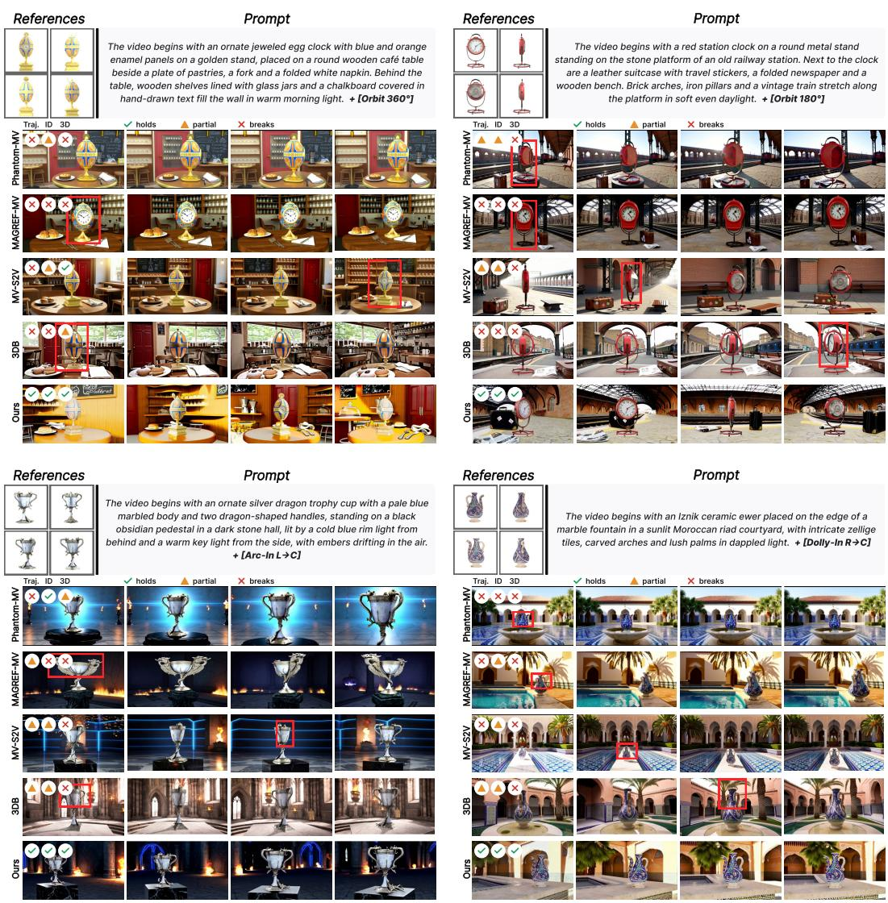  
Figure 7: Additional qualitative comparison. Four further subjects under diverse camera trajectories, with the same method ordering as Figure 5. Each block pairs the four reference views and the prompt, whose + [tag] suffix names the trajectory (Appendix G.2), with generated frames from every method.

Figures 8 and 9 examine how far the camera follows the prompt once the subject is fixed. The corpus spans the full motion vocabulary of Table 8, so the question is not whether a motion was seen but whether naming it is enough to obtain it. In Figure 8 one subject is driven by an arc, a zoom-in and a truck while the prompt also changes the scene, so the path and the surroundings vary together. Figure 9 isolates the camera by holding the subject and the background fixed and changing only the trajectory. The subject keeps the same identity and shape throughout while the path it is viewed along changes.

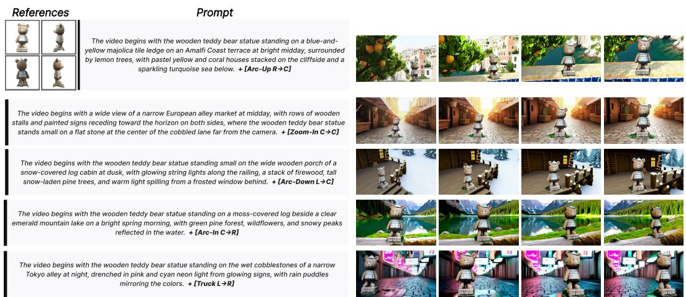

Figure 8: Trajectory and scene control. One subject driven by several camera configurations, in cluding arc, zoom-in and truck, with the background also varied by the prompt for each trajectory.  
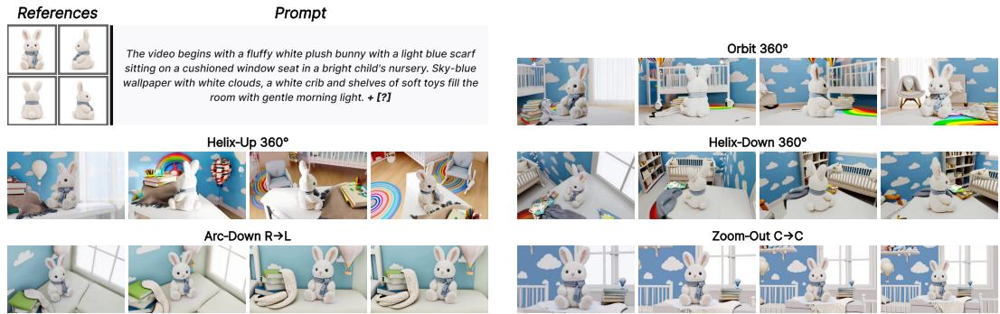  
Figure 9: Trajectory control in a fixed scene. The same subject and background under different camera configurations, from full orbits to an arc and a zoom-out, where only the camera trajectory changes between rows. Inference only.

Figure 10 lifts each generated orbit into a point cloud with the same reconstruction used for GT-CD and shows it from four viewpoints, so the difference the metric reports is visible as shape. The baselines produce a shell that covers only the arc their camera actually swept and opens up everywhere else, while OmniShowcase closes the volume, which is what a metric computed against ground-truth geometry is measuring.

## B USER STUDY

To check that the automatic metrics agree with what people actually see, we ran a preference study involving 24 videos that are not seen during training. A total of 44 participants were shown the reference views, the prompt and the five results side by side, our method and the four baselines, and selected one video for each of the following criteria.

• Identity Preservation. The video that best preserves the identity of the subject across viewpoints.

• 3D Consistency. The video that keeps a consistent 3D shape and structure while the subject turns.

• Prompt Alignment. The video that best follows the prompt.

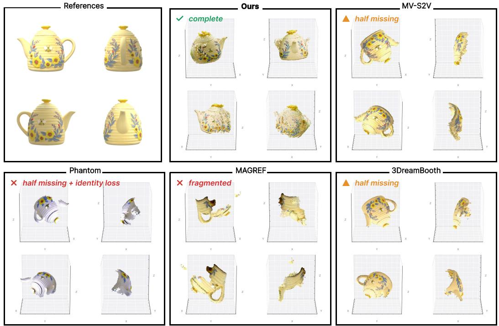  
Figure 10: 3D reconstruction from generated video. The subject is segmented out of each method’s generated orbit and lifted to a coloured point cloud, the same reconstruction evaluated by GT-CD, shown here from four viewpoints so the geometric differences are visible directly. Baselines recover a thin shell of the surfaces their orbit actually sweeps, while ours closes the volume.  
Identity Preservation

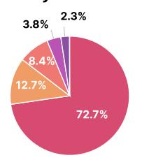  
3D Consistency

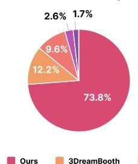  
Prompt Alignment

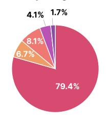  
Overall Quality

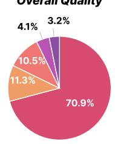  
Figure 11: User study results. OmniShowcase is chosen most often on all four criteria, ahead of every baseline by a wide margin.

• Overall Quality. The video with the best overall quality.

Figure 11 reports the share of selections. OmniShowcase is preferred on every criterion, taking between 70.9% and 79.4% of the votes while no baseline passes 12.7%. The margin is largest on prompt alignment, which is what the clips show most plainly, since OmniShowcase is the only method whose camera completes the commanded orbit rather than turning a few degrees or staying still.

## C IMPLEMENTATION DETAILS

We fine-tune Wan2.1 I2V-14B-480P through its Diffusers implementation. Training applies LoRA to the DiT with rank 128 and α = 128, and every other weight stays frozen. Each training sample contains a 25-frame normal-condition segment and an 80-frame target segment at 480 × 832 resolution. These segments are encoded separately into 7 and 20 latent frames, respectively, and concatenated along the temporal axis to form a 27-frame latent sequence. The four in-context reference images are encoded independently. We train for 33,000 steps at a batch size of 2 per device over four NVIDIA B200 GPUs with no gradient accumulation, which takes about 50 hours. The optimizer is AdamW with $\beta = ( 0 . 9 , 0 . 9 5 )$ and $\epsilon = 1 0 ^ { - 8 }$ , weight decay $1 0 ^ { - 4 }$ and gradient clipping at 1.0. The learning rate is $2 \times \mathrm { 1 0 ^ { - 5 } }$ , held constant after 100 warmup steps. Training runs in bfloat16 under seed 42, and every variant reported in this paper uses the same 33,000-step checkpoint.

At inference, we take 50 sampling steps with three-way classifier-free guidance, weighting the reference stream at $s _ { \mathrm { r e f } } = 5 . 0$ and the text stream at $s _ { \mathrm { t e x t } } = 5 . 0$ . The concatenated 27-frame latent sequence is jointly decoded into $1 + 4 ( 2 7 - 1 ) = 1 0 5$ frames, comprising 25 normal-condition frames followed by 80 target frames at $4 8 0 \times 8 3 2$ resolution. Clips are written at 30 fps.

For GT-CD, the ground-truth point cloud is back-projected from source-mesh depth renders for SHOWCASEBENCH and sampled from the 3D scan mesh for NAVI. We independently center the predicted and ground-truth clouds at their respective centroids and normalize each by its mean Euclidean radius. We then align the normalized prediction to the ground truth using rigid ICP with scale fixed. The evaluation removes the outermost 3% of points by radius and subsamples each cloud to at most 20,000 points. For the resulting point clouds $\dot { P }$ and $Q ,$ we compute

$$
d ( P , Q ) = { \frac { 1 } { | P | } } \sum _ { p \in P } \operatorname* { m i n } _ { q \in Q } \lVert p - q \rVert _ { 2 } , \qquad { \mathrm { G T - C D } } = { \frac { 1 } { 2 } } { \big ( } d ( P , Q ) + d ( Q , P ) { \big ) } .
$$

The directed terms measure prediction-to-GT accuracy and GT-to-prediction completeness using Euclidean rather than squared distances.

RotCoverage is an auxiliary, alignment-dependent diagnostic of viewpoint coverage. After similarity alignment, the generated and reference camera poses are normalized by the RMS radius of the reference camera centers. Each pose is represented by five frustum vertices: the apex and four far-plane corners at depth 0.5 and half-size 0.25. Pose distance is the mean Euclidean distance between corresponding frustum vertices. For each reference pose, we take the minimum distance over generated poses and average across references, yielding a dimensionless score.

## D REFERENCE-COUNT ABLATION

Table 4: Reference-count flexibility. Although OmniShowcase assumes four reference views, the model generalizes to fewer, while the full four-view setting performs best overall. The condition slots are filled by cycling the available views, and the surface-normal turntable is re-lifted from exactly those n views, so nothing about the missing views leaks in. Every row uses the same checkpoint and the same evaluation protocol as Table 2, and $n { = } 4$ repeats the OmniShowcase row of that table.
<table><tr><td></td><td colspan="6">SHOWCASEBENCH</td><td colspan="6">NAVI</td></tr><tr><td>#refs</td><td>DINO↑</td><td>CLIP↑</td><td>MEt3R↓</td><td>GT-CD↓</td><td>RotCov↓</td><td>ViCLIP↑</td><td>DINO↑</td><td>CLIP↑</td><td>MEt3R↓</td><td>GT-CD↓</td><td>RotCov↓</td><td>ViCLIP↑</td></tr><tr><td> $n = 1$ </td><td>0.702</td><td>0.902</td><td>0.301</td><td>0.1704</td><td>0.691</td><td>0.258</td><td>0.811</td><td>0.901</td><td>0.307</td><td>0.1875</td><td>1.091</td><td>0.245</td></tr><tr><td> $n = 2$ </td><td>0.768</td><td>0.918</td><td>0.241</td><td>0.1658</td><td>0.685</td><td>0.258</td><td>0.814</td><td>0.913</td><td>0.262</td><td>0.1915</td><td>1.075</td><td>0.249</td></tr><tr><td> $n = 3$ </td><td>0.783</td><td>0.921</td><td>0.206</td><td>0.1480</td><td>0.670</td><td>0.256</td><td>0.823</td><td>0.911</td><td>0.255</td><td>0.2050</td><td>1.074</td><td>0.249</td></tr><tr><td> $n = 4 ( \mathrm { f u l l } )$ </td><td>0.799</td><td>0.925</td><td>0.190</td><td>0.0824</td><td>0.665</td><td>0.259</td><td>0.828</td><td>0.918</td><td>0.249</td><td>0.0975</td><td>1.074</td><td>0.260</td></tr></table>

The metrics separate by how much each one depends on unseen geometry. The full four-view setting gives the lowest GT-CD on both SHOWCASEBENCH and NAVI, while the NAVI identity scores stay nearly flat across reference counts. The NAVI subjects are small and largely convex, so one view already fixes their appearance and the remaining references buy cross-view agreement rather than identity. ViCLIP is saturated for every count on both benchmarks, as prompt adherence does not depend on how many views describe the subject.

## E TRAINING DATA COMPARISON

Figure 3 contrasts our renders with the output of a camera-controllable image-to-video generator qualitatively. Here we measure the same contrast. We pair every clip of our corpus with the Uni3C (Cao et al., 2025) clip generated for the same subject and camera path, and we score both with the metrics of Section 4.1, using the same four reference views for reference-based metrics and the same source mesh for GT-CD. A clip that is geometrically faithful to the subject should score as a well-behaved orbit under these metrics regardless of how it was produced. Table 5 reports the outcome.

Table 5: Training clips scored as generations. Paired clips of the same subject under the same camera path and ground-truth geometry. Best results are in bold.
<table><tr><td>Source</td><td>DINO↑</td><td>CLIP↑</td><td>MEt3R↓</td><td>GT-CD↓</td><td>RotCov↓</td></tr><tr><td>Uni3C (Cao et al., 2025)</td><td>0.7167</td><td>0.9191</td><td>0.3052</td><td>0.1409</td><td>0.6661</td></tr><tr><td>Ours (3D-asset render)</td><td>0.8030</td><td>0.9385</td><td>0.1871</td><td>0.1323</td><td>0.6318</td></tr></table>

## F BASELINES EXTENSION

Phantom and MAGREF are single-view subject-to-video models. For the comparison in Table 2 we extend them to accept all four reference views following MV-S2V (Song et al., 2026), which is the setting their multi-view rows report. Here we also run them in their original single-view mode, where only the first reference view enters the model and the prompt is unchanged, so that the effect of the extension is visible on its own. Everything else, the checkpoint, the sampler, the trajectory sentence and the evaluation protocol, is held fixed. Tables 6 and 7 report the two settings side by side.

Table 6: Phantom with one reference view and with four. We compare single-view input with the four-view setting used in Table 2. GT-CD uses ground-truth geometry. Best results per benchmark are in bold.
<table><tr><td rowspan="2">Input</td><td colspan="5">Held-out</td><td colspan="5">NAVI</td></tr><tr><td>DINO↑</td><td>CLIP↑</td><td>MEt3R↓</td><td>GT-CD↓</td><td>RotCov↓</td><td>DINO↑</td><td>CLIP↑</td><td>MEt3R↓</td><td>GT-CD↓</td><td>RotCov↓</td></tr><tr><td>Single view (original)</td><td>0.5921</td><td>0.8609</td><td>0.4736</td><td>0.1651</td><td>0.9254</td><td>0.6483</td><td>0.8677</td><td>0.5058</td><td>0.1791</td><td>1.4705</td></tr><tr><td>Four views (reported)</td><td>0.621</td><td>0.871</td><td>0.444</td><td>0.2843</td><td>0.906</td><td>0.690</td><td>0.882</td><td>0.462</td><td>0.2014</td><td>1.458</td></tr></table>

Table 7: MAGREF with one reference view and with four. We compare single-view input with the four-view setting used in Table 2. GT-CD uses ground-truth geometry. Best results per benchmark are in bold.
<table><tr><td rowspan="2">Input</td><td colspan="5">Held-out</td><td colspan="5">NAVI</td></tr><tr><td>DINO↑</td><td>CLIP↑</td><td>MEt3R↓</td><td>GT-CD↓</td><td>RotCov↓</td><td>DINO↑</td><td>CLIP↑</td><td>MEt3R↓</td><td>GT-CD↓</td><td>RotCov↓</td></tr><tr><td>Single view (original)</td><td>0.5804</td><td>0.865</td><td>0.4538</td><td>0.1752</td><td>1.1974</td><td>0.657</td><td>0.8729</td><td>0.4529</td><td>0.1704</td><td>1.2712</td></tr><tr><td>Four views (reported)</td><td>0.616</td><td>0.876</td><td>0.409</td><td>0.1789</td><td>1.177</td><td>0.665</td><td>0.892</td><td>0.457</td><td>0.2145</td><td>1.284</td></tr></table>

## G DATASET

## G.1 CURATION AND COMPOSITION

SHOWCASE-4K is the surviving remainder of a much larger candidate pool. Assets enter from Objaverse (Deitke et al., 2023), the Digital Twin Catalog (Dong et al., 2025) and Google Scanned Objects (Downs et al., 2022) and pass through four gates: G0, a model-free heuristic on the mesh and a quick render; G1, a vision-language check of four rendered views; G2, the same check on the composited target video; and G3, on the reconstructed turntable (rubrics in Appendix I.1). G0 rejected 17% of downloaded candidates outright, and G1 kept 4,186 of the 7,016 assets it judged (60%). In the most recent production round, 44% of 7,438 composited clips passed G2 and 63% of those passed G3, so 28% of rendered clips survive; most G2 rejections are a changed object structure or physically implausible support. The binding constraint is G2, and we did not relax it. Over-generating and discarding is cheaper than letting a bad sample into training, because a subject that deforms in the target teaches exactly the failure the method is meant to remove. Over all rounds 4,829 clips passed, and 4,000 of them, covering 2,593 assets in 620 categories, form the released corpus.

Curation runs without a human in the loop: every semantic judgement is made by Gemini 2.5 Flash, which returns a binary score and a short rationale per criterion. Over all rounds the gates took about 29,000 calls at about 120 USD, roughly 25 USD per thousand kept clips, so expanding the corpus scales with that cost rather than with annotator time.

## G.2 CAMERA TRAJECTORIES

Every prompt ends with one sentence describing the camera path. To keep the figure captions short we label each clip with a tag instead, and give here the sentence each tag stands for. A tag is written as a motion followed by either a rotation amount (Orbit and Helix) or a framing transition (everything else), for example Helix-Up 360° or Arc-Down L→R. The corpus covers every motion below, with the Orbit and Helix motions contributing the object-centric half and the arc, truck, dolly and zoom motions the extended-trajectory half.

The two suffix families do not mix. The four orbit-family motions (Orbit and Helix-Up/Down/In) each take one of four rotation amounts, which gives 16 orbit-family trajectories, and the remaining eight motions each take one of nine framing transitions, which gives 72 more, so the vocabulary defines 88 distinct camera trajectories in total.

Table 8 lists the motions, and Tables 9 and 10 list the two suffixes. Figure 12 draws sixteen of the 88 as camera paths.

Table 8: Motion vocabulary. The sentence each motion contributes to the prompt. For Orbit and Helix the amount is filled from Table 9. Every other motion is followed by a framing fragment from Table 10.
<table><tr><td>Tag</td><td>Sentence</td></tr><tr><td>Orbit</td><td>The camera circles [amount] around the object.</td></tr><tr><td>Helix-Up</td><td>The camera circles [amount] around the object while rising.</td></tr><tr><td>Helix-Down</td><td>The camera circles [amount] around the object while descending.</td></tr><tr><td>Helix-In</td><td>The camera circles [amount] around the object while moving closer.</td></tr><tr><td>Arc-Up</td><td>The camera circles partway around the object, rising from eye level to look down on it while moving closer, ending in front</td></tr><tr><td>Arc-Down</td><td>The camera starts high above the object and comes down to eye level while circling partway around and moving closer, ending in front</td></tr><tr><td>Arc-In</td><td>The camera stays at eye level and circles partway around the object while moving closer, ending in a tight front view</td></tr><tr><td>Truck</td><td>The camera glides sideways past the object at eye level, holding its distance as the object sweeps through the frame</td></tr><tr><td>Dolly-In</td><td>The camera moves straight toward the object without circling, filling the frame</td></tr><tr><td>Dolly-Out</td><td>The camera moves straight back from the object without circling, revealing the space around it</td></tr><tr><td>Zoom-In</td><td>The camera stays in place and zooms in, narrowing the field of view</td></tr><tr><td>Zoom-Out</td><td>The camera stays in place and zooms out, widening the field of view</td></tr></table>

Table 9: Rotation amount. Arc motions carry their rotation in the trajectory definition and take no suffix. Truck, Dolly and Zoom do not rotate.
<table><tr><td>Suffix Sentence fragment</td><td></td></tr><tr><td>90°</td><td>.. . circles a quarter of the way around the object</td></tr><tr><td>180°</td><td>... circles halfway around the object</td></tr><tr><td>270°</td><td>.. . circles three-quarters of the way around the object</td></tr><tr><td>360°</td><td>.. . circles all the way around the object</td></tr></table>

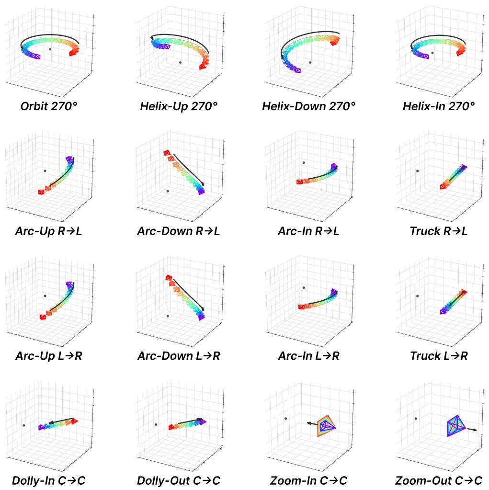  
Figure 12: Camera trajectories. Sixteen representative trajectories out of the 88 the vocabulary defines, one per tag family. Each panel draws the camera frusta sampled along the path, with the arrow giving the direction of travel and the grey dot marking the subject.

Table 10: Framing transition. Where the object starts and ends inside the frame, with L, C and R for the left, center and right. The same fragment is appended regardless of the motion.
<table><tr><td></td><td>Suffix Sentence fragment</td></tr><tr><td></td><td>L→L with the object held on the left of the frame throughout</td></tr><tr><td></td><td>L→C with the object starting on the left of the frame and settling into the center</td></tr><tr><td></td><td>L→R with the object starting on the left of the frame and drifting across to the right</td></tr><tr><td></td><td>C→L with the object starting at the center of the frame and drifting across to the left</td></tr><tr><td></td><td>C→C with the object held at the center of the frame throughout C→R with the object starting at the center of the frame and drifting across to the right</td></tr><tr><td></td><td>R→L with the object starting on the right of the frame and drifting across to the left</td></tr><tr><td></td><td>R→C with the object starting on the right of the frame and settling into the center</td></tr><tr><td></td><td>R→R with the object held on the right of the frame throughout</td></tr></table>

## H FAILURE ANALYSIS

Analysis. The two columns of Figure 13 fail for unrelated reasons. The synthetic look of the background follows from how the training targets are built. Only the subject is physically rendered, and the scene around it is painted in afterwards by a video inpainting model conditioned on the prompt. The corpus therefore pairs a physically shaded subject with a generated background, and the light transport between the two was never consistent to begin with. The model reproduces that statistic, so the subject holds while the surroundings inherit the flat shading and thin material detail of their source.

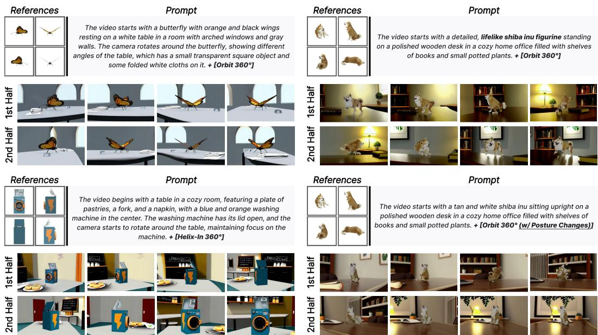  
Figure 13: Failure cases. Left two. Prompt adherence and the commanded rotation both hold, but the surroundings render with flat shading and little material detail, so the clip reads as slightly synthetic. Right two. Both receive four reference views of a subject caught in four different poses. The upper one is prompted in the usual static style and settles into an averaged pose that matches none of the references, while the lower one is asked to follow the motion in step with the orbit and tangles in 3D at the transitions between poses.

The dynamic case is a property of the conditioning signal itself. The surface-normal turntable is obtained by lifting the reference views into a single static reconstruction and rendering that one shape from every viewpoint. When the four views catch the subject in four different poses, the reconstruction fuses them into one rigid body that corresponds to no pose the subject ever held, and the condition handed to the generator is a static representation of a subject that is not static. Under a static prompt the model follows that condition faithfully, which is exactly why the output settles into an averaged pose. Asking for motion in the prompt does not repair it. The text now requests a pose change that the geometry condition does not encode, so the two disagree, and the model has to interpolate between reference poses in image space with no 3D correspondence to guide it. The tangles appear at those interpolated transitions. Handling non-rigid subjects would require a conditioning representation that varies over the generated sequence, which we leave to future work.

## I PROMPTS AND RUBRICS

This section describes the final pipeline configuration: the curation criteria, category and scene authoring rules, captioning templates, and inference prompt format (Table 11). The gate criteria are presented with shared output formatting. The quantitative evaluation in Section 4.1 uses no LLM judge.

## I.1 CURATION GATES

G0 is a model-free heuristic that screens meshes and quick renders for degeneracy. G1–G3 use the criteria below. G2 and G3 receive 16 uniformly sampled video frames; G3 evaluates the RGB

Table 11: Where a language or vision-language model is used. Each gate accepts a sample only if all of its criteria score 1. Gate calls use temperature 0.
<table><tr><td>Stage</td><td>Model</td><td>Input</td><td>Output</td></tr><tr><td>G1 asset gate</td><td>Gemini 2.5 Flash</td><td>4 rendered views, category label</td><td>6 binary criteria</td></tr><tr><td>G2 target gate</td><td>Gemini 2.5 Flash</td><td>4 reference views, 16 target frames</td><td>6 binary criteria</td></tr><tr><td>G3 geometry gate</td><td>Gemini 2.5 Flash</td><td>4 reference views, 16 RGB reconstruction frames</td><td>4 binary criteria</td></tr><tr><td>Category descriptions</td><td>Claude Opus 5</td><td>category label</td><td>appearance sentence, coarse type</td></tr><tr><td>Scene vocabulary</td><td>Claude Opus 5</td><td></td><td>scene bank (2,000 locations)</td></tr><tr><td>Captioning</td><td>Tarsier2-7B</td><td>video</td><td>condition and target captions</td></tr></table>

rendering of the reconstruction. For non-orbit trajectories, the same six G2 criteria are worded for general camera motion and off-center framing.

All three gates return a binary score and a short rationale for each criterion, together with an overall acceptance decision, in JSON format. A sample passes a gate only when all of its criteria score 1.

G1: Asset Quality   
PROMPT   
You are an asset QC reviewer for a 3D object dataset. I show reference render views   
(view0-3) of ONE 3D asset plus its category label. The bar is "good enough to show in a   
paper/demo" - NOT perfection. Score 6 criteria 0/1.   
CRI T E RIA (score each 0/1 with a short justification)   
(1) realism   
(read this as ASSET CRAFTSMANSHIP, not "is the subject a real thing"): judge how   
WELL-MADE the 3D asset is.   
- Being a figurine, plush toy, statue, or a stylized animal model is NOT a defect -   
many categories are inherently toy-like, and a well-crafted figurine is a good asset.   
- The decisive test is MATERIAL AND DETAIL: a good asset has believable surface   
material (fabric weave, fur, metal, glaze, wood grain, paint with wear) and real   
modelled detail.   
- Score 0 (reject) when the asset is low-effort or cartoon-flat: emoji-like or   
clip-art forms with flat uniform fills, crude blocky/faceted shapes, plastic-smooth   
surfaces with no material character, sloppy or melted geometry, or a shape so   
distorted you cannot tell what it is.   
- Score 1 (keep) when the craftsmanship is solid - including figurines, sculpted   
animals, plush toys and other inherently toy-like SUBJECTS - as long as the asset   
itself shows real material and detail.   
- So: a finely sculpted animal figurine = 1; a flat cartoon hamburger or a toy-car   
with uniform purple plastic = 0.   
(2) geometry   
proper, complete geometry - NO low-poly/blocky faceting, holes, broken or degenerate   
mesh.   
(3) no base plate   
LOOK AT WHAT THE OBJECT RESTS ON.   
- Score 0 if the asset includes any surface/terrain the object merely sits on and that   
would not be carried with it: a scanned ground or dirt patch, sand/water/grass   
terrain, baked-in cast-shadow geometry, a cake board, a serving plate, a square   
showroom slab, or a fragment of surrounding wall or floor.   
- A base that is an INTEGRAL part of the real object - a trophy’s plinth, a flower   
pot, a lamp base, a statue’s pedestal, a vase foot - is NOT a violation (score 1).   
(4) texture   
has a proper material/color appearance - NOT a blank untextured grey/white placeholder   
mesh or an unfinished flat single-color surface.   
- Smooth surfaces are FINE (car paint, metal kettle, glass) - score 0 only when it   
looks like an untextured/unfinished mesh.   
(5) category match   
score 0 if (a) the object is plainly a DIFFERENT KIND of thing than the label, or (b)   
the asset is not ONE instance of it - multiple copies bundled together (three bats),   
or the object plus surrounding structure / a mini-scene (a phone booth attached to a   
wall slab).

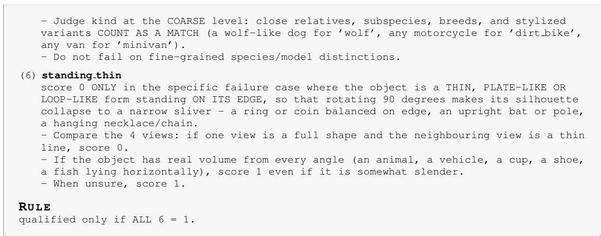

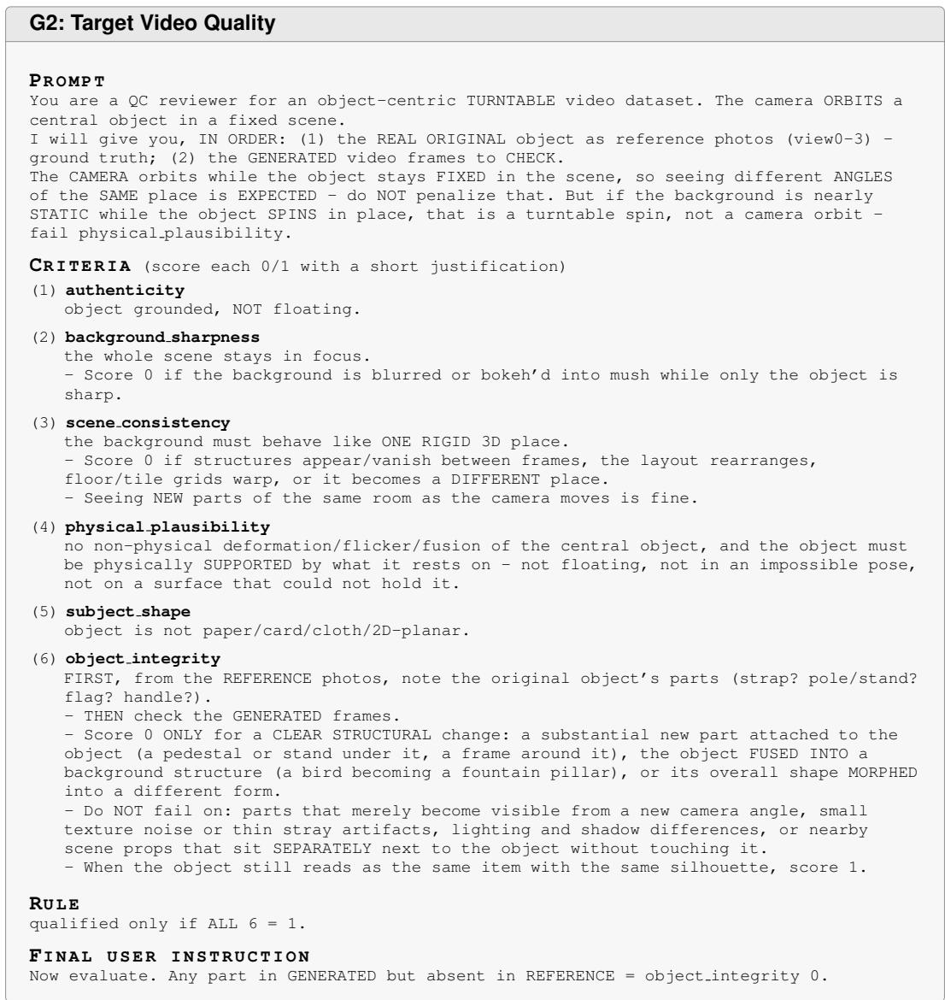  
G3 is used only for training-data curation and is not applied during evaluation or inference.

G3: Reconstruction Quality   
PROMPT   
You are a QC reviewer for 3D RECONSTRUCTION quality. A reconstruction of an object is   
rendered as a turntable video (camera orbits; the object should appear to spin in place).   
I will give you, IN ORDER: (1) the REAL ORIGINAL object as reference photos (view0-3) -   
ground truth; (2) the RECONSTRUCTION frames to CHECK.   
Judge ONLY the reconstructed object’s GEOMETRY vs the reference. Object SIZE and POSITION   
in the frame are handled elsewhere - do NOT penalize framing/crop/margins.   
CR I T E R I A (score each 0/1 with a short justification)   
(1) identity match   
compare the object’s OVERALL PROPORTIONS / aspect ratio AND distinctive 3D FORM to the   
reference.   
- 0 if proportions are distorted (e.g. a wide rectangular object reconstructed as a   
square/cube), if melted/morphed, or if reduced to a generic blob that lost the   
reference’s distinctive form.   
- IGNORE surface text/printed labels/logos - MV-SAM3D cannot reconstruct fine print,   
so blurred/changed/flickering text is NOT a defect; judge by 3D shape and proportion   
only.   
(2) completeness   
object is whole - no holes, no missing or collapsed STRUCTURAL parts.   
- A flickering/blurred printed LABEL or surface text is NOT a completeness defect   
(surface print is expected to degrade); only missing 3D parts count.   
(3) no floater   
no floating fragments, stray blobs, or disconnected debris around the object.   
(4) rotation integrity   
object spins IN PLACE about its own axis.   
- 0 if it SWINGS/ORBITS around an off-center point (revolves).   
RULE   
qualified only if ALL 4 = 1.

## I.2 CATEGORY DESCRIPTIONS AND SCENE VOCABULARY

Category descriptions and scene vocabulary are generated automatically with Claude Opus 5 under the rules below. Each category has an appearance sentence and a coarse type; the type selects compatible scene locations. The scene bank contains 2,000 locations with surfaces, props, depth cues and lighting used to assemble the compositing prompts (Section 3.2).

Category Descriptions and Scene Vocabulary   
CATEG ORY DESCRIPTION   
one sentence per category, written from the category name (not from a particular asset):   
"A [adjective] [material] <category> with [distinguishing trait]"   
- plus exactly one coarse type from {accessory, apparel, appliance, bag, beauty, decor,   
drink, electronics, food, furniture, sports, tools}   
SCENE VOCABULARY   
one entry per location: a compatible set of surfaces, props, depth cues and lighting,   
with a tone label (cool, warm, neutral, green).   
- no words implying defocus or bokeh   
- no people or actions   
- no description of the subject itself

## I.3 CAPTIONING

Tarsier2-7B captions the RGB reconstruction turntable and the composited target with greedy decoding and a category hint. Before insertion into [CONDITION], the reconstruction caption is stripped of turntable narration and references to reconstruction and the white background. The condition box below shows the resulting format; the target box gives the captioning prompt.

Condition Caption Format   
STRIP PIN G RULE   
Retain the object’s visible appearance and distinctive parts. Remove turntable-rotation   
narration, white-background phrases and reconstruction-specific narration.

TEMPLATE   
"The video starts with [object: shape, color, material, distinctive visible features].   
[Optional additional appearance details.]"   
EXAMP LE   
"The video starts with a black gargoyle statue with bat-like wings and a menacing   
expression, positioned on a stone base."   
OUTPU T   
The stripped object description is used after [CONDITION].

Target Caption Prompt   
PROMPT   
In this video, a 3D object is placed in a real-world scene. Focus your description on the   
object, where it is placed, the surrounding scene, and any visible action or scene   
change.   
Describe the video in 2 to 3 sentences. The first sentence MUST start with "The video   
starts with" and contain the object, its placement, and the scene. Follow this structure   
precisely:   
TEMPLATE   
"The video starts with [object: shape, color, material, distinctive features] [placement   
phrase: e.g., placed on a wooden table / standing on a stone pedestal / resting on a   
tiled floor] in [scene location with lighting style]. [Optional second/third sentence:   
brief description of camera motion, scene change, or other notable action visible in the   
video]."   
EXAMP LE   
"The video starts with a digital watch with a metal bracelet placed on a rusty riveted   
metal table in a brick-walled loft with warm natural light from arched windows. The   
camera gradually moves closer to the watch, revealing the textured brick walls and wooden   
floor in more detail."   
OU T P U T   
Respond ONLY with the description.

## I.4 INFERENCE PROMPTS

The captioner does not reliably state how far the camera turns, so a fixed sentence derived from the camera mode is appended to every target caption. At inference our model receives an introductory sentence, the stripped condition caption after [CONDITION], and the target caption after [VIDEO], ending with the trajectory sentence; baselines receive only the text after [VIDEO].

Inference Prompt   
TRAJE CTO RY SENTENCE   
Chosen from the motion and suffix vocabulary in Tables 8--10 and appended to the target   
caption.   
STRUC TURE   
intro sentence   
+ [CONDITION] stripped condition caption   
+ [VIDEO] target caption   
+ trajectory sentence   
EXAMP LE   
This video demonstrates a multi-view capture of a gargoyle, showcasing the object as it   
rotates and moves across different viewpoints.   
[CONDITION] The video starts with a black gargoyle statue with bat-like wings and a   
menacing expression, positioned on a stone base.   
[VIDEO] The video begins with a detailed view of a gargoyle statue situated on a stone   
base, surrounded by scattered autumn leaves on a cracked stone pavement, with a gothic   
architectural background featuring tall spires and intricate stonework. The camera   
rotates around the gargoyle, capturing different angles and perspectives [...] The camera   
circles all the way around the object while rising.   
BASEL INE S   
the text after [VIDEO] only; for 3DreamBooth it is rewritten into its identifier format:   
"A video of a [rhs <noun>] ..."