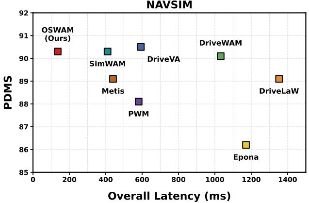
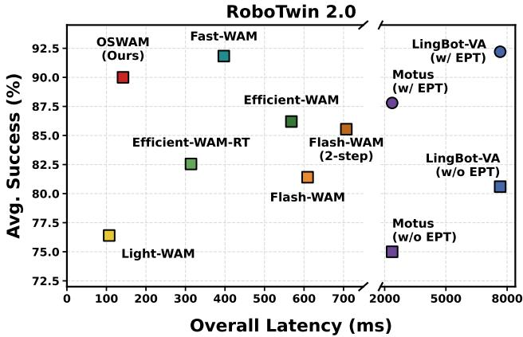
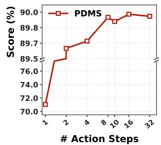
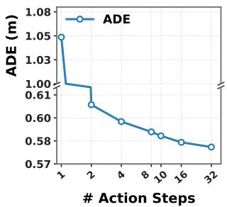
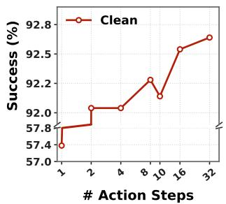
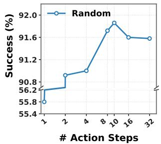
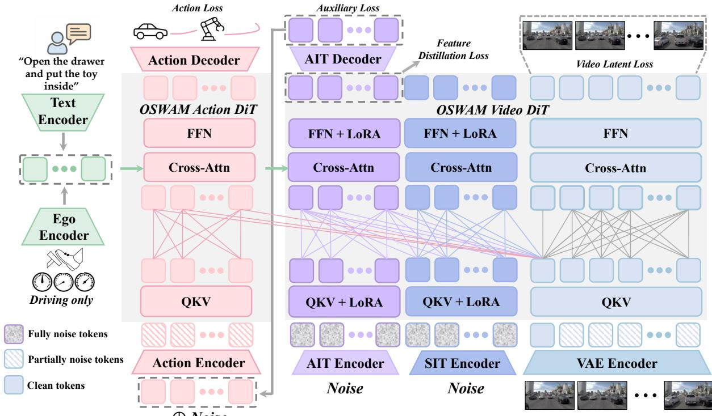
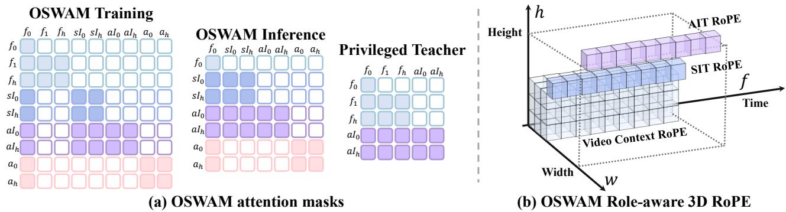
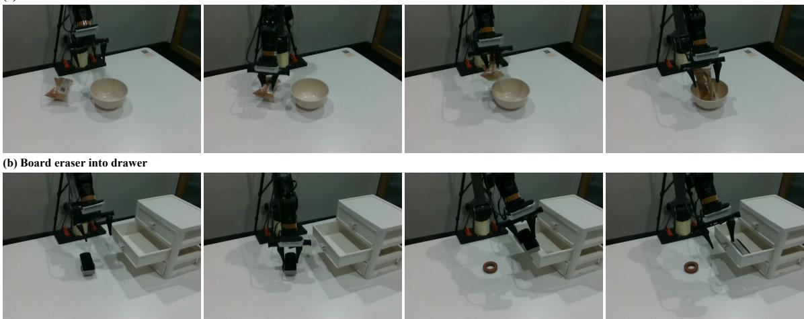
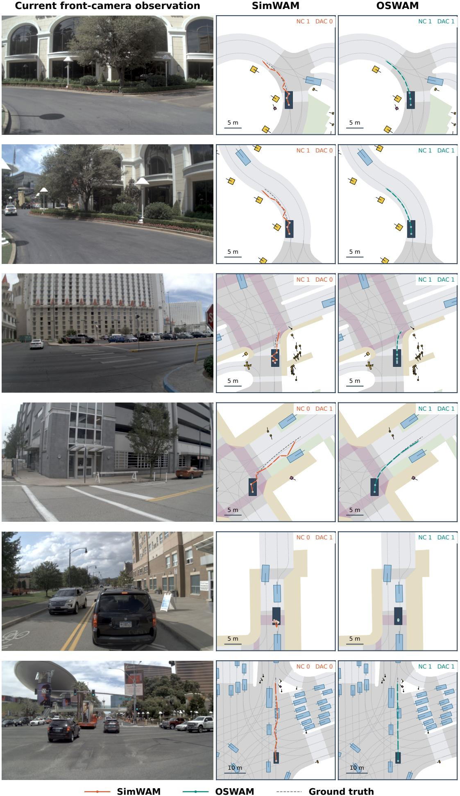

POLYU VCLAB •PREPRINT 2026

# OSWAM: An Efective World Action Model with One-Step Action Generation

Guowen Zhang★1 Liyi Chen★1 Xu Hu1 Pengfei Wang1 Jingfan Chen1 Chenhang He1 Lei Zhang†1

1 The Hong Kong Polytechnic University

★ Equal contribution. † Corresponding author.

(guowen.zhang@connect.polyu.hk, cslzhang@comp.polyu.edu.hk).

Project Page Code

Abstract. Direct-policy World Action Models (WAM) have demonstrated the benefits of decoupling action generation from explicit future visual prediction for eficient inference in autonomous driving and embodied control. However, they still require tens of denoising steps to achieve competitive action quality, incurring substantial latency and hindering real-time deployment. Simply reducing the number of denoising steps will collapse the nonlinear multi-step denoising trajectory into coarse updates, substantially degrading action quality. To reduce the denoising steps while enabling real-time action generation, we present an efective world action model with one-step action generation, namely OSWAM, for autonomous driving and embodied control. We argue that it is the absence of structured action priors in random noise initialization that forces direct-policy WAMs to recover coherent action sequences through iterative denoising. Hence, we construct imagination tokens to initialize the difusion process, providing physical priors and action-conditioned representations. We further introduce privileged information distillation with future conditioning to enhance future-aware action generation. As a result, OSWAM can eficiently and efectively generate high quality actions in just one difusion step. Our experiments demonstrate that OSWAM achieves comparable or even better results in both autonomous driving and embodied control than direct-policy WAM and Joint-WAM that require tens of steps. It obtains approximately 3× speedup over direct-policy WAM baselines and supports real-time compiled inference with latency as low as 40ms on an NVIDIA RTX 5090 GPU.

KEYWORDS : World Action Model, Autonomous Driving, Embodied Control

## 1 Introduction

Physical intelligence [1, 2], including autonomous driving [3] and embodied control [4], holds the promise of freeing human workers from physical tasks that are dangerous, laborious, or tedious. A general-purpose physical agent should not only act from visual observations, but also anticipate the physical consequences of their actions. Existing Vision-Language-Action (VLA) models, including those standard models [5–7] and specialized end-to-end ones [8–10], typically predict actions directly without explicitly modeling the future evolution of the environment. This has motivated a shift toward World Action Models (WAMs) [4, 11–13] for physical AI, which build on pretrained video generative models [14, 15] to jointly predict future visual states and their corresponding actions.

However, WAMs follow the imagine-then-execute paradigm [12, 16] and incur prohibitive inference latency, rendering them impractical for latency-critical applications such as autonomous driving. Borrowing few-step techniques from image and video generation, some methods apply step distillation [17] to reduce this latency, but often at the expense of a substantial drop in control accuracy, as illustrated in Fig. 1. To address this issue, eforts [4, 11] propose to switch from the imagine-then-execute paradigm to direct-policy WAMs. These methods retain video prediction as a training-time objective that shapes physically grounded representations, without synthesizing future observations at test time. This direct-policy formulation is more than 3× faster than the imagine-then-execute paradigm.

  
Figure 1. NAVSIM and Robotwin 2.0 inference eficiency-performance comparison. EPT denotes embodied pretraining. All latencies are measured on NVIDIA H20 GPU.

  
(a) Navsim Results

  
(b) RoboTwin Results  
Figure 2. Quantitative comparison of the Fast-WAM [4] test-time scaling with diferent action denoising steps on (a) the autonomous driving dataset Navsim, and (b) embodied control dataset RoboTwin.

Despite this speedup, eficiently generating high-quality actions remains a key challenge for direct-policy WAMs. They require tens of denoising steps to achieve competitive action quality, resulting in latency that remains too high for real-time applications such as autonomous driving. This bottleneck cannot be resolved by reducing the number of denoising steps. Specifically, as shown in Fig. 2, the performance degrades as the step count decreases, dropping by 20% on NAVSIM (autonomous driving) and 40% on RoboTwin (embodied control) in the one-step setting. We attribute this to the lack of action structure in random noise: multiple denoising steps can gradually impose temporal and physical consistency, whereas one-step generation must recover a coherent action sequence in a single update. Existing few-step accelerations, such as step distillation [17] and trajectory rectification [18], still start from Gaussian noise and, therefore, do not supply the missing action prior. This motivates introducing structured action priors at initialization, providing an informed starting point for high-quality action generation in a single denoising step.

In addition, direct-policy WAMs [4, 11] remain limited in their ability to exploit future dynamics for efective control. They use a consistent first-frame-only interface during training and inference, relying on video co-training to encode future dynamics into the current representation. However, compressing all future information into a single first-frame representation may provide insuficient temporal context for efective future-aware control. To address this limitation, subsequent methods reintroduce future features at inference and mitigate the associated rollout cost through caching, sparse interaction [19], or compact latent representations [20]. Despite these eforts to reduce rollout cost, generating and incorporating future features at test time still incurs additional inference overhead.

To address the aforementioned issues, we propose OSWAM, a world action model with one-step action generation for more efective physical control. Our key observation is that previous one-step action generation methods fail mainly because the action difusion processing is initialized from unstructured Gaussian noise. To supply the missing action structure, we learn a compact set of imagination tokens from the video Difusion Transformer (DiT) and use them as structured start points for action denoising. These tokens are far fewer than video first-frame tokens and are obtained in a single forward pass, so they add negligible computation, yet they interact with visual features to accumulate physically grounded, action-relevant context. We then noise the imagination tokens to an intermediate timestep and decode them with the action DiT in one step, replacing the long denoising trajectory required by random initialization. To enhance future-aware control, we train these imagination tokens with privileged-information distillation. A teacher attends to visual tokens over the full future horizon, while the student imagination tokens, at test time, attend only to the first frame. By distilling the teacher’s privileged representations into the imagination tokens and subsequently into the action DiT, OSWAM transfers long-horizon context without reintroducing future-dependent features at inference. This design preserves the first-frame-only interface of direct-policy WAMs, while enabling high-quality action generation in a single denoising step.

Our contributions are summarized as follows:

• We propose OSWAM, a world action model that enables high-quality one-step action generation. It learns compact imagination tokens from the video DiT as structured start points for the action DiT. These tokens are obtained in a single forward pass with negligible overhead and are decoded in one denoising step.

• We introduce privileged-information distillation to transfer long-horizon context into the imagination tokens. A teacher attends to visual tokens over the full future horizon, while the student remains first-frame-only at test time, preserving the interface of direct-policy WAMs without future-dependent features at inference.

• Experiments on autonomous driving and embodied control show that OSWAM achieves competitive results with multi-step WAMs while being substantially faster.

## 2 Related Work

## 2.1 World Action Models for Autonomous Driving

Autonomous driving has recently shifted from modular pipelines with separate perception [21–24] and planning [25] modules toward end-to-end frameworks [26]. To further integrate future dynamics modeling, world models [14, 27–29] for autonomous driving have recently been extended into world action models (WAMs). Existing methods fall into two categories: bird’s-eye view (BEV)-based and video-generation-based world models. BEV-based approaches [10, 30, 31] forecast occupancy evolution and ego motion, predict future latent scene features, or infer future BEV layouts for online trajectory evaluation. They are computationally eficient but do not exploit large-scale video generative priors. A complementary line of research leverages pretrained video generators and predicts the future in the image domain. These methods [13, 32, 33] transfer such priors to driving, but jointly rolling out video features at test time remains ineficient. SimWAM [11] follows the direct-policy design of Fast-WAM [4] to avoid test-time video rollout, yet the remaining multi-step denoising is still impractical for onboard driving. In contrast, our proposed OSWAM inherits large-scale video generative priors without test-time video rollout, and reduces action generation to a single denoising step.

## 2.2 World Action Models for Embodied Control

Unlike autonomous driving, where compact BEV representations naturally encode road topology and trafic interactions, embodied control needs to model fine-grained object interactions and appearance changes in close-range scenes. As these phenomena are naturally captured in video, embodied WAMs are predominantly built on pretrained video generators for image-domain future modeling in two ways: explicit future imagination and direct-policy inference. Explicit-imagination methods [12, 16] generate future visual representations at test time to guide action prediction, incurring substantial rollout latency. Direct-policy WAMs [4] retain video prediction as a training signal but generate actions directly from current observations, avoiding test-time visual rollout; however, its iterative action denoising remains a bottleneck for high-frequency closed-loop control. In contrast, OSWAM preserves large-scale video-generative priors without test-time visual rollout and reduces action generation to a single denoising step.

## 2.3 Efective World Action Models

The main deployment bottleneck for WAMs lies in the high computational cost of difusion-based video and action generators, whose test-time latency is prohibitive for onboard driving and closed-loop manipulation.

  
Figure 3. The overall architecture of OSWAM. A single Video DiT pass produces an observation-conditioned action prior with AIT and complementary scene context with SIT, providing a structured initialization for one-step Action DiT denoising. Privileged-information distillation injects future-informed representations during training, while inference uses only the current observation.

Drawing one-step distillation from video generation, Flash-WAM [17] compresses joint video-action difusion to a single denoising step per modality, but still synthesizes future video at inference. Fast-WAM [4] removes test-time video rollout by predicting actions from current observations only, yet retains iterative action denoising. Light-WAM [34] further replaces the generative action expert with a lightweight fusion head for single-pass action prediction, but underperforms on challenging benchmarks such as RoboTwin. SimWAM [11] follows Fast-WAM to drop test-time video rollout, but its multi-step action denoising keeps inference latency well above the budget required for onboard deployment. Building on this video-rollout-free direct-policy formulation, OSWAM addresses the remaining action-generation bottleneck through one-step action denoising.

## 3 Method

We present OSWAM, a direct-policy world action model that enables high-quality one-step action generation for autonomous driving and embodied control. The preliminary concepts associated with our method are provided in Sec. 3.1. In the following sections, we first present the overall architecture of OSWAM, then describe in detail the fundamental components of OSWAM, including imagination tokens, Role-aware 3D RoPE, and privileged-information distillation.

## 3.1 Preliminary

A world action model predicts an action chunk by introducing future visual observations as an intermediate variable. Let � be the current observation, � an optional command, $a _ { 1 : H }$ an action chunk, and $\nu _ { 1 : T }$ the future visual states. Inverse-dynamics WAMs [12] first model the distribution of future visual states conditioned on the current observation and command, and then infer actions from the generated future:

$$
p ( a _ { 1 : H } \mid o , l ) = \int p \left( \nu _ { 1 : T } \mid o , l \right) p ( a _ { 1 : H } \mid o , l , \nu _ { 1 : T } ) d \nu _ { 1 : T } .\tag{1}
$$

Joint-WAMs [16], in contrast, model future video and actions within a shared generative process, $p ( a _ { 1 : H } , \nu _ { 1 : T }$ | $o , l )$ . Both paradigms tightly couple control prediction with iterative future-video generation, which introduces substantial computational overhead.

Direct-policy WAMs [4, 11] remove explicit test-time video generation by retaining video prediction only as a training objective. At inference, the video DiT produces a latent representation $z ( o )$ in a single forward pass, and actions are predicted directly as:

$$
p ( a _ { 1 : H } \mid o , l ) = p ( a _ { 1 : H } \mid z ( o ) ) .\tag{2}
$$

However, action generation is iterative due to flow matching. Given $a _ { t } = ( 1 - t ) a + t \epsilon$ with velocity target $\epsilon - a$ , inference integrates the learned velocity field from noise $( t _ { K } = 1 )$ to data $\left( t _ { 0 } = 0 \right)$ as:

$$
a _ { t _ { k - 1 } } = a _ { t _ { k } } + \left( t _ { k - 1 } - t _ { k } \right) \nu _ { \theta } ( a _ { t _ { k } } , t _ { k } ) . \qquad k = K , \ldots , 1 ,\tag{3}
$$

High-quality actions typically require multiple velocity evaluations, making � a remaining inference bottleneck. Our proposed OSWAM aims to preserve this direct-policy interface while reducing action generation to a single velocity evaluation, $K = 1$ . A one-step update from an arbitrary time $t \in ( 0 , 1 ]$ is:

$$
\hat { a } = a _ { t } - t \nu _ { \theta } ( a _ { t } , t ) .\tag{4}
$$

When the start is pure noise, $t = 1$ and $\hat { a } = a _ { 1 } - \nu _ { \theta } ( a _ { 1 } , 1 )$ . OSWAM instead starts from a structured intermediate state with $t < 1$ , which makes this single update suficient for applications that require latency-critical control, such as autonomous driving.

## 3.2 Overall Architecture

An overview of OSWAM is shown in Fig. 3. As in previous works [4, 11], we consider predicting an action chunk $\mathbf { a } _ { 1 : H }$ from the current frame $f _ { 0 }$ and an optional task instruction �, with ego-state information additionally provided for driving tasks. We follow Fast-WAM in the world model backbone configuration and direct-policy setting. Specifically, the Video DiT uses the Wan2.2-5B backbone [14], accompanied by its pretrained T5 text encoder and video VAE. The Action DiT is initialized by interpolating and downsampling the pretrained Video DiT weights. For autonomous driving, we add an ego encoder to encode the ego state and the driving command. The task languages and ego states are both provided to all tokens through cross-attention. The full model is organized as a Mixture-of-Transformer (MoT) architecture with shared attention between the video and action blocks. We also follow the direct-policy protocol: video modeling is used only as a training signal, and future video is not rolled out at inference.

Unlike prior direct-policy methods, which use the Video DiT at inference solely to encode the first-frame visual feature for Action DiT through shared MoT attention, OSWAM additionally introduces two groups of imagination tokens into the Video DiT: Action Imagination Tokens (AIT) and Scene Imagination Tokens (SIT). As shown in Fig. 3, both AIT and SIT are initialized from noise in the Video DiT and interact with the first-frame visual features. The resulting AIT representation then replaces the unstructured Gaussian initialization of the Action DiT, providing a compact, structured start point for action denoising. SIT provides additional latent slots that aggregate scene context for AIT; they are updated indirectly through privileged distillation and the auxiliary action loss on AIT. Together, AIT and SIT comprise far fewer tokens than the first-frame visual input and therefore introduce only a small computational overhead during inference. To strengthen future-aware control under this first-frame-only interface, we introduce privileged-information distillation. The privileged teacher comprises a Video DiT with AIT that attends to visual tokens over the full clip, while the AIT in OSWAM attends only first-frame visual context. By aligning OSWAM’s intermediate imagination token features with those of the teacher, we transfer this privileged information to improve action generation, while OSWAM remains first-frame-only at inference.

## 3.3 Imagination Tokens

Direct-policy WAMs eliminate future video generation at inference but still require multi-step denoising. To enable one-step action generation, we introduce two groups of imagination tokens.

Action and Scene Imagination Tokens. As mentioned in the last subsection, we augment the Video DiT input with two groups of noise-initialized latent tokens: AIT and SIT. We adapt the Video DiT using LoRA [35] to support these additional tokens. Their combined token count is much smaller than that of the first-frame visual input tokens, introducing only a small computational overhead during inference.

During training, video tokens follow the standard difusion process with randomly sampled noise levels, whereas AIT are constructed by encoding an initial action noise sample $\epsilon \sim { \cal N } ( 0 , I )$ and assigned the fixed timestep $t _ { \mathrm { m a x } }$ . Within the Video DiT, AIT attends to first-frame visual tokens, SIT, and other AIT, while receiving task conditioning through cross-attention. These interactions integrate visual evidence and scene context into AIT. An auxiliary decoder maps the resulting AIT representations to an action velocity $\hat { \mathbf { v } } ^ { A }$ , yielding a structured action prior $\bar { \mathbf { a } } = \epsilon - \hat { \mathbf { v } } ^ { A }$ . We then detach this prior and renoise it with the same initial noise that was encoded into AIT:

  
Figure 4. (a) The attention mask of OSWAM and the privileged teacher. (b) Role-aware RoPE explicitly disentangles token groups using unique positional encodings. �� is SIT and �� is AIT.

$$
\mathbf { a } _ { \tau _ { r } } ^ { \mathrm { i n i t } } = \left( 1 - \sigma _ { r } \right) \mathrm { s g } ( \bar { \mathbf { a } } ) + \sigma _ { r } \epsilon , \qquad \sigma _ { r } = \tau _ { r } / t _ { \mathrm { m a x } } ,\tag{5}
$$

where $\sigma _ { r }$ controls the noise level and sg prevents gradients from propagating through the structured action prior. Conditioned on first-frame visual features and task inputs, the Action DiT predicts a refinement velocity $\hat { \mathbf { v } } ^ { \mathrm { a c t } }$ and performs the single denoising step:

$$
\hat { \mathbf { a } } = \mathbf { a } _ { \tau _ { r } } ^ { \mathrm { i n i t } } - \sigma _ { r } \hat { \mathbf { v } } ^ { \mathrm { a c t } } .\tag{6}
$$

Its training target is $( \mathbf { a } _ { \tau _ { r } } ^ { \mathrm { i n i t } } - \mathbf { a } _ { \mathrm { g t } } ) / \sigma _ { r }$ , enabling the Action DiT to refine the structured initialization into the target action in a single denoising step.

To complement the action prior encoded by AIT, SIT acts as latent context slots that aggregate scene context for AIT to attend to. They are initialized from Gaussian noise independent of the AIT, projected into the Video DiT input space through a separate encoder, and assigned the timestep $t _ { \mathrm { m a x } }$ . As shown in Fig. 4 (a), under the structured attention mask, SIT attends to first-frame visual tokens and other SIT, while AIT additionally attends to SIT to access the aggregated scene context. SIT is learned indirectly through the auxiliary loss and feature distillation on AIT, with gradients flowing through the attention connections from AIT to SIT.

Role-aware 3D RoPE. As shown in Fig. 4 (b), we introduce Role-aware 3D RoPE to reflect the distinct functions of video tokens, AIT, and SIT within a shared positional coordinate system. Video tokens represent local visual content and retain their original spatiotemporal coordinates. AIT encodes action structure and is assigned spatial coordinates outside the video grid to distinguish them from visual tokens. SIT serves as scene context aggregators and is anchored at the grid center, providing a common spatial reference for gathering information across the scene:

$$
\begin{array} { r } { \mathbf { p } _ { t , h , w } ^ { V } = ( t , h , w ) , \quad \mathbf { p } _ { n } ^ { A } = ( t _ { n } , H _ { \nu } , W _ { \nu } ) , \quad \mathbf { p } _ { n } ^ { S } = \left( t _ { n } , \frac { H _ { \nu } - 1 } { 2 } , \frac { W _ { \nu } - 1 } { 2 } \right) . } \end{array}\tag{7}
$$

where $H _ { \nu }$ and $W _ { \nu }$ are the video token grid dimensions. For each action position �, the corresponding AIT and SIT share the temporal coordinate $t _ { n } = n s _ { a } / ( s _ { \nu } d _ { t } )$ . Here, $s _ { a }$ and $s _ { \nu }$ are the action and video sampling strides, and $d _ { t }$ is the VAE temporal downsampling factor. This converts action positions to the video latent timeline. Thus, AIT and SIT share temporal coordinates but use distinct spatial anchors, preserving temporal alignment while providing role-specific positional cues for action initialization and scene context aggregation, respectively.

## 3.4 Privileged-Information Distillation

Although imagination tokens provide a structured action prior, long-horizon context is only implicitly encoded in the first-frame representation. We therefore introduce privileged-information distillation to transfer representations learned from privileged future observations into OSWAM’s AIT, strengthening their predictive capability without requiring future observations at inference.

We separately train a Video DiT teacher with auxiliary AIT, following the same training settings as OSWAM except for the token groups and attention masks. As shown in Fig. 4 (a), the teacher contains video tokens and AIT, with AIT attending to the full video clip. OSWAM additionally includes SIT, and its AIT attends to first-frame visual tokens, SIT, and other AIT, while SIT attends only to first-frame visual tokens and other SIT.

During distillation, we freeze the teacher and provide it with ground-truth video latents over the full future horizon. The first-frame latents remain clean, while all future-frame latents are corrupted with noise at a fixed difusion timestep $\tau _ { \nu } ^ { T }$ before the teacher forward pass. The teacher’s AIT remains initialized from pure noise at $t _ { \mathrm { m a x } }$ and acquires privileged information by attending to these future video tokens. OSWAM retains its standard training procedure, using a randomly sampled video timestep and the fixed AIT timestep $t _ { \mathrm { m a x } }$ . The teacher and OSWAM share the same video noise and action noise samples, respectively. We then align OSWAM’s AIT features with the corresponding teacher features at a set of Video DiT blocks ${ \mathcal { T } } ,$ , providing multi-depth distillation supervision. SIT is supervised indirectly through their attention connections to AIT. At inference, the teacher is discarded, preserving OSWAM’s first-frame-only interface without additional computation.

## 3.5 Training Objective

OSWAM jointly learns visual dynamics, structured action DiT start points, and one-step action denoising. The Video DiT is supervised by video flow matching, while its AIT representations receive complementary action and privileged feature supervision to learn the structured initialization consumed by the Action DiT:

$$
\mathcal { L } _ { \mathrm { v i d } } = \mathbb { E } \big [ \| \hat { \mathbf { v } } ^ { V } - ( \epsilon ^ { V } - \mathbf { z } ^ { + } ) \| _ { 2 } ^ { 2 } \big ] ,\tag{8}
$$

where ${ \mathbf { z } } ^ { + }$ denotes clean future video latents and $\epsilon ^ { V }$ is the video noise. To learn an observation-conditioned action prior, the AIT decoder is supervised with the action velocity target at $t _ { \mathrm { m a x } }$

$$
\mathcal { L } _ { \mathrm { A I T } } = \mathbb { E } \left[ \| \hat { \mathbf { v } } ^ { A } - \left( \epsilon - \mathbf { a } _ { \mathrm { g t } } \right) \| _ { 2 } ^ { 2 } \right] .\tag{9}
$$

Privileged feature distillation further guides the prior by aligning the OSWAM’s AIT representations with teacher across the selected blocks J:

$$
\mathcal { L } _ { \mathrm { d i s t } } = | \mathcal { T } | ^ { - 1 } \mathbb { E } \big [ \sum _ { j \in \mathcal { T } } \| \mathbf { h } _ { j } ^ { \mathrm { s t u } } - \mathrm { s g } ( \mathbf { h } _ { j } ^ { \mathrm { t e a } } ) \| _ { 2 } ^ { 2 } \big ] ,\tag{10}
$$

where $\mathbf { h } _ { j } ^ { \mathrm { s t u } }$ and $\mathbf { h } _ { j } ^ { \mathrm { t e a } }$ denote corresponding AIT features after block $j .$ Together, $\mathcal { L } _ { \mathrm { A I T } }$ and $\mathcal { L } _ { \mathrm { d i s t } }$ support learning an observation-conditioned structured initialization for the Action DiT. Given $\mathbf { a } _ { \tau _ { r } } ^ { \mathrm { i n i t } }$ constructed from the AIT prediction, the Action DiT learns to predict the demonstrated action chunks in one denoising step:

$$
\mathcal { L } _ { \mathrm { a c t } } = \mathbb { E } \left[ \| \hat { \mathbf { v } } ^ { \mathrm { a c t } } - \sigma _ { r } ^ { - 1 } ( \mathbf { a } _ { \tau _ { r } } ^ { \mathrm { i n i t } } - \mathbf { a } _ { \mathrm { g t } } ) \| _ { 2 } ^ { 2 } \right] .\tag{11}
$$

Scaling the action residual by $\sigma _ { r } ^ { - 1 }$ ensures that one Euler update with step size $\sigma _ { r }$ directly moves $\mathbf { a } _ { \tau _ { r } } ^ { \mathrm { i n i t } }$ to the ground-truth action $\mathbf { a } _ { \mathrm { g t } }$ . The overall objective is:

$$
\mathcal { L } = \mathcal { L } _ { \mathrm { v i d } } + \mathcal { L } _ { \mathrm { A I T } } + \lambda _ { \mathrm { d i s t } } \mathcal { L } _ { \mathrm { d i s t } } + \mathcal { L } _ { \mathrm { a c t } } .\tag{12}
$$

## 4 Experiments

## 4.1 Datasets and Evaluation Metrics

Autonomous Driving. For autonomous driving, we evaluate OSWAM on the NAVSIM [43], which provides real-world driving data sampled at 2Hz, with eight cameras covering a 360-degree field of view and LiDAR observations. The dataset comprises 1192 scenarios for training and 136 scenarios for testing. NAVSIM introduces practical and reliable metrics that efectively bridge open-loop and closed-loop evaluation. Specifically, NAVSIM evaluates model performance using the Predictive Driver Model Score (PDMS), which is calculated based on five factors: No At-Fault Collision (NC), Drivable Area Compliance (DAC), Time-to-Collision (TTC), Comfort (Comf.), and Ego Progress (EP). We report PDMS, which is calculated as PDMS = $\mathrm { N C } \times \mathrm { D A C } \times ( 5 \times \mathrm { E P } + 5 \times \mathrm { T T C } + 2 \times \mathrm { C } ) / 1 2$

Embodied Control. For embodied control, we evaluate OSWAM on RoboTwin 2.0 [44], which is a challenging bimanual manipulation benchmark featuring more than 50 tasks that require coordinated dual-arm control. We adopt the multi-task setting of Fast-WAM, using data from over 50 tasks. The training data consist of 2,500 demonstrations from clean scenes and 25,000 demonstrations collected with heavy scene randomization. Performance is evaluated by the average success rate over 100 trials per task under both clean and randomized conditions.

Table 1. Comparison with state-of-the-art planners on the NAVSIM navtest. $N ^ { \nu }$ and $N ^ { a }$ denote the number of video and action denoising steps. †SimWAM is reported without reinforcement learning. ‡DriveVA is reported without CARLA mix training. ∗Latency reproduced by us.
<table><tr><td>Method</td><td> $N ^ { \nu }$ </td><td> $N ^ { a }$ </td><td>NC↑</td><td>DAC↑</td><td>EP↑</td><td>TTC↑</td><td>C↑</td><td>PDMS↑</td><td>Latency↓</td></tr><tr><td>Human Agent</td><td></td><td></td><td>100.0</td><td>100.0</td><td>87.5</td><td>100.0</td><td>99.9</td><td>94.8</td><td></td></tr><tr><td colspan="10">Traditional E2E and VLA-based planners</td></tr><tr><td>UniAD [36]</td><td></td><td></td><td>97.8</td><td>91.9</td><td>78.8</td><td>92.9</td><td>100.0</td><td>83.4</td><td></td></tr><tr><td>TransFuser [26]</td><td></td><td>一</td><td>97.7</td><td>92.8</td><td>79.2</td><td>92.8</td><td>100.0</td><td>84.0</td><td>一</td></tr><tr><td>DiffusionDrive [8]</td><td></td><td></td><td>98.2</td><td>96.2</td><td>82.2</td><td>94.7</td><td>100.0</td><td>88.1</td><td></td></tr><tr><td>WoTE [31]</td><td></td><td></td><td>98.5</td><td>96.8</td><td>81.9</td><td>94.9</td><td>99.9</td><td>88.3</td><td></td></tr><tr><td>UniWorldVLA [37]</td><td></td><td></td><td>98.7</td><td>96.7</td><td>83.2</td><td>96.1</td><td>100.0</td><td>89.4</td><td></td></tr><tr><td>DriveDreamer-Policy [38]</td><td></td><td></td><td>98.4</td><td>97.1</td><td>83.5</td><td>95.1</td><td>100.0</td><td>89.2</td><td></td></tr><tr><td>AutoVLA [39]</td><td></td><td></td><td>98.4</td><td>95.6</td><td>81.9</td><td>98.0</td><td>99.9</td><td>89.1</td><td>一</td></tr><tr><td>DriveVLA-W0 [7]</td><td></td><td>一</td><td>98.7</td><td>99.1</td><td>83.3</td><td>95.3</td><td>99.3</td><td>90.2</td><td>一</td></tr><tr><td colspan="10">Imagine-then-execute-based WAM methods</td></tr><tr><td>Epona [40]</td><td>一</td><td>100</td><td>97.9</td><td>95.1</td><td>80.4</td><td>93.8</td><td>99.9</td><td>86.2</td><td>1171</td></tr><tr><td>PWM [41]</td><td>一</td><td>1</td><td>98.6</td><td>95.9</td><td>81.8</td><td>95.4</td><td>100.0</td><td>88.1</td><td>581</td></tr><tr><td>DriveLaW [33]</td><td>1</td><td>5</td><td>99.0</td><td>97.1</td><td>81.3</td><td>96.7</td><td>100.0</td><td>89.1</td><td>1353</td></tr><tr><td>DriveVA‡ [13]</td><td>2</td><td>2</td><td>99.0</td><td>97.3</td><td>83.2</td><td>98.4</td><td>100.0</td><td>90.5</td><td>593*</td></tr><tr><td>DriveWAM [32]</td><td>3</td><td>10</td><td>98.3</td><td>98.1</td><td>84.3</td><td>95.2</td><td>100.0</td><td>90.1</td><td>1032</td></tr><tr><td colspan="10">Direct policy-based WAM planners</td></tr><tr><td>SimWAM† [11]</td><td></td><td>10</td><td>98.7</td><td>98.0</td><td>83.9</td><td>95.9</td><td>100.0</td><td>90.3</td><td>410</td></tr><tr><td>Metis [42]</td><td></td><td>10</td><td>98.3</td><td>97.1</td><td>83.4</td><td>94.7</td><td>100.0</td><td>89.1</td><td>440*</td></tr><tr><td>OSWAM (Ours)</td><td>一</td><td>1</td><td>98.6</td><td>98.0</td><td>84.3</td><td>95.6</td><td>100.0</td><td>90.3</td><td>136</td></tr></table>

## 4.2 Implementation Details

Following Fast-WAM, we initialize OSWAM from Wan2.2-5B and adopt the Action DiT with a reduced hidden dimension of 1024. The imagination-token LoRA adapters use rank 8 and $\alpha = 4$ . For NAVSIM, we follow [11] to use a single front camera at $3 8 4 \times 6 7 2$ resolution and predict eight waypoints over four seconds at 2Hz. We use the current frame and eight future frames in training. For RoboTwin, we concatenate the head and two wris views into a $3 8 4 \times 3 2 0$ image and use an action horizon of 32, with nine video frames sampled at a temporal stride of 4. For temporal RoPE, we set $s _ { a } = 1$ and $d _ { t } = 4$ on both benchmarks, with $s _ { \nu } = 1$ for NAVSIM and $s _ { \nu } = 4$ for RoboTwin. AIT and SIT therefore use $t _ { n } = n / 4 , ( n = 1 , \ldots , 8 )$ on NAVSIM and $t _ { n } = n / 1 6$ $( n = 1 , \ldots , 3 2 )$ on RoboTwin; video latents use temporal coordinates {0, 1, 2} in training.

We train with AdamW using a learning rate of $1 0 ^ { - 4 }$ , weight decay of 0.01, and cosine decay with 5% linear warmup. NAVSIM training runs for 40,000 steps with a global batch size of 256, while RoboTwin training runs for 29,335 steps with a global batch size of 1024. For distillation, the frozen teacher uses a video timestep of 200, and feature alignment is applied after Video DiT blocks [8, 16, 24, 30]. We set $\lambda _ { \mathrm { d i s t } } = 1 0$ . Distillation starts after 500 steps, with its weight increasing linearly over the next 500 steps. Across both benchmarks, we set the AIT difusion timestep to $t _ { \mathrm { m a x } } = 1 0 0 0$ and the re-noising timestep for Action DiT initialization to $\tau _ { r } = 5 0 0 \left( \sigma _ { r } = 0 . 5 \right)$ . During inference, we use a single Action DiT denoising step. Unless otherwise specified, all latency measurements are conducted on a single NVIDIA H20 GPU and Intel Xeon Max 9468 CPU.

## 4.3 Main Results

NAVSIM. Table 1 compares OSWAM with state-of-the-art planners on NAVSIM. OSWAM achieves a competitive PDMS of 90.3 with a latency of 136 ms. Compared with SimWAM, OSWAM matches its PDMS while reducing action denoising from ten steps to one, yielding a 3.01× speedup. OSWAM also outperforms Metis by 1.2 PDMS with a 3.24× speedup. Compared with DriveVA, OSWAM achieves a 4.36× speedup with only a 0.2 lower PDMS. These results demonstrate the efectiveness of structured initialization in enabling eficient one-step action generation while maintaining competitive planning performance.

RoboTwin 2.0. Table 2 reports success rates across 50 tasks under Clean and Randomized settings. OSWAM achieves an average success rate of 90.00% with a latency of 142ms. Compared with Fast-WAM, OSWAM reduces action denoising from ten steps to one and achieves a 2.80× speedup, with only 1.83% decrease in average success rate. Compared with the one-step Flash-WAM variant, OSWAM improves average success by 8.59% and achieves a 4.29× speedup. While Light-WAM achieves lower latency, OSWAM substantially improves the average success at the cost of only 35ms additional latency. Overall, OSWAM is competitive with multi-step direct-policy WAMs while substantially accelerating inference on embodied control tasks.

Table 2. Success rates on RoboTwin 2.0 simulation (Clean and Randomized splits, 50 tasks). EPT denotes embodied pretraining.
<table><tr><td>Method</td><td> $N ^ { \nu }$ </td><td> $N ^ { a }$ </td><td>EPT</td><td>Clean</td><td>Rand.</td><td>Average</td><td>Latency (ms)</td></tr><tr><td>VLA-based methods</td><td></td><td></td><td></td><td></td><td></td><td></td><td></td></tr><tr><td>π0 [5]</td><td>一</td><td>一</td><td>w/</td><td>65.92</td><td>58.40</td><td>62.20</td><td>一</td></tr><tr><td>π0.5 [6]</td><td>一</td><td>一</td><td>w/</td><td>82.74</td><td>76.76</td><td>79.80</td><td>一</td></tr><tr><td>X-VLA [45]</td><td>一</td><td>一</td><td>w/</td><td>72.90</td><td>72.80</td><td>72.80</td><td>一</td></tr><tr><td colspan="8">Imagine-then-execute-based WAM methods</td></tr><tr><td>Motus [16]</td><td>一</td><td>一</td><td>w/</td><td>88.66</td><td>87.02</td><td>87.80</td><td>2367</td></tr><tr><td>Motus [16]</td><td>一</td><td>一</td><td>w/o</td><td>77.56</td><td>77.00</td><td>77.30</td><td>2367</td></tr><tr><td>LingBot-VA [12]</td><td>25</td><td>50</td><td>w/</td><td>92.90</td><td>91.50</td><td>92.20</td><td>7659</td></tr><tr><td>LingBot-VA [12]</td><td>25</td><td>50</td><td>w/o</td><td>80.60</td><td></td><td>80.60</td><td>7659</td></tr><tr><td>Flash-WAM [17]</td><td>1</td><td>2</td><td>w/o</td><td>88.42</td><td>82.66</td><td>85.54</td><td>707</td></tr><tr><td>Flash-WAM [17]</td><td>1</td><td>1</td><td>w/o</td><td>82.56</td><td>80.26</td><td>81.41</td><td>609</td></tr><tr><td>Efficient-WAM [20]</td><td>10</td><td>10</td><td>w/o</td><td>86.70</td><td>85.70</td><td>86.20</td><td>568</td></tr><tr><td>Efficient-WAM-RT [20]</td><td>2</td><td>10</td><td>w/o</td><td>83.10</td><td>82.00</td><td>82.55</td><td>314</td></tr><tr><td colspan="8">Direct policy-based WAM methods</td></tr><tr><td>Fast-WAM [4]</td><td></td><td>10</td><td>w/o</td><td>91.88</td><td>91.78</td><td>91.83</td><td>397</td></tr><tr><td>Faster-WAM [46]</td><td>一</td><td>10</td><td>w/o</td><td>89.70</td><td>88.64</td><td>89.17</td><td></td></tr><tr><td>Light-WAM [34]</td><td>一</td><td>一</td><td>w/o</td><td>76.40</td><td>76.30</td><td>76.40</td><td>107</td></tr><tr><td>OSWAM (Ours)</td><td>一</td><td>1</td><td>w/o</td><td>90.04</td><td>89.96</td><td>90.00</td><td>142</td></tr></table>

Table 3. Inference eficiency on RoboTwin 2.0 and Navsim. Latency is measured with cached language context on a single NVIDIA RTX 5090 GPU and Intel Xeon Platinum 8470Q. All time are reported in milliseconds (ms).
<table><tr><td>Dataset</td><td>Model</td><td>VAE GPU Time</td><td>Visual GPU Time</td><td>Action GPU Time</td><td>Peak Mem. (GB)</td><td>Overall Latency</td><td>Compiled Latency</td></tr><tr><td rowspan="4">RoboTwin 2.0</td><td>LingBot-VA</td><td>32.65</td><td>1165.12</td><td>1205.38</td><td>19.12</td><td>3365.35</td><td>一</td></tr><tr><td>Motus</td><td>11.14</td><td>567.37</td><td>Shared</td><td>17.95</td><td>1472.85</td><td></td></tr><tr><td>Fast-WAM</td><td>5.27</td><td>18.45</td><td>67.61</td><td>12.70</td><td>323.67</td><td>73.64</td></tr><tr><td>OSWAM</td><td>5.27</td><td>23.93</td><td>6.78</td><td>12.75</td><td>95.35</td><td>40.81</td></tr><tr><td rowspan="2">Navsim</td><td>SimWAM</td><td>9.83</td><td>22.80</td><td>72.78</td><td>12.87</td><td>330.8</td><td>90.53</td></tr><tr><td>OSWAM</td><td>9.82</td><td>30.87</td><td>7.32</td><td>12.90</td><td>99.70</td><td>52.64</td></tr></table>

Inference Eficiency. Table 3 compares inference eficiency with cached language context under the same environment. On RoboTwin 2.0, OSWAM reduces action GPU time from 67.61 to 6.78ms compared with Fast-WAM, while imagination tokens increase visual GPU time by 5.48ms. This yields a 3.39× overall speedup, reducing latency from 323.67 to 95.35ms with nearly unchanged peak memory. On NAVSIM, OSWAM similarly achieves a 3.32× speedup over SimWAM, reducing overall latency to 99.70ms. With compiled inference using torch.compile and CUDA Graph optimization, OSWAM achieves latencies of 40.81ms on RoboTwin 2.0 and 52.64ms on NAVSIM, supporting inference rates above 10Hz and facilitating deployment in latency-critical applications such as autonomous driving. These results show that the reduction in action denoising cost outweighs the additional computation introduced by imagination tokens.

## 4.4 Ablation Studies

Efectiveness of Each Component. To more clearly illustrate the efectiveness of the diferent components in OSWAM, we conduct experiments by adding each of them to a baseline, which is set to one-step Fast-WAM. As shown in Table 4, AIT substantially improves performance across both benchmarks, raising NAVSIM PDMS from 71.04 to 89.81, and increasing RoboTwin success rates from 57.38% to 87.42% under Clean settings and from 55.80% to 88.16% under Randomized settings. The gains demonstrate the importance of structured start points for one-step action generation. Besides, privileged-information distillation further improves PDMS to 89.96 and RoboTwin success rates to 89.42% and 89.62%, without increasing inference latency. Finally, incorporating SIT yields the best performance on both benchmarks, demonstrating the complementary benefit of aggregating scene context for learning efective action priors.

Table 4. Component ablations on NAVSIM and RoboTwin.
<table><tr><td rowspan="2">Method</td><td colspan="2">NAVSIM</td><td colspan="3">RoboTwin</td></tr><tr><td>Latency↓ PDMS↑</td><td>ADE↓</td><td>Latency↓</td><td>Clean↑</td><td>Rand.↑</td></tr><tr><td>Baseline</td><td>108.35</td><td>71.04</td><td>1.049</td><td>112.84</td><td>57.38 55.80</td></tr><tr><td>+ AIT</td><td>135.92</td><td>89.81</td><td>0.594</td><td>139.82 87.42</td><td>88.16</td></tr><tr><td>+ Distillation</td><td>135.92</td><td>89.96</td><td>0.589</td><td>139.82 89.42</td><td>89.62</td></tr><tr><td>+ SIT</td><td>136.09</td><td>90.28</td><td>0.587</td><td>142.67</td><td>90.04 89.96</td></tr></table>

Table 5. Ablation on $\lambda _ { \mathrm { d i s t } }$
<table><tr><td> $\lambda _ { \mathrm { d i s t } }$ </td><td>PDMS↑ ADE↓</td><td></td></tr><tr><td>Baseline</td><td>89.81</td><td>0.594</td></tr><tr><td>0.01</td><td>89.71</td><td>0.595</td></tr><tr><td>0.1</td><td>89.92</td><td>0.596</td></tr><tr><td>1</td><td>90.01</td><td>0.591</td></tr><tr><td>10</td><td>90.28</td><td>0.587</td></tr></table>

Table 7. Teacher video timestep ablation.

Table 6. Action initialization ablation.
<table><tr><td>Tr</td><td>PDMS↑</td><td>ADE↓</td></tr><tr><td>Rectified-flow refinement</td><td>89.97</td><td>0.609</td></tr><tr><td>400</td><td>90.17</td><td>0.587</td></tr><tr><td>500</td><td>90.28</td><td>0.587</td></tr><tr><td>600</td><td>90.08</td><td>0.598</td></tr><tr><td>Uniform (400-600)</td><td>90.02</td><td>0.591</td></tr></table>

<table><tr><td>Teacher video timestep PDMS↑</td><td>ADE↓</td></tr><tr><td>0 90.20</td><td>0.585</td></tr><tr><td>200</td><td>90.28 0.587</td></tr><tr><td>400 90.19</td><td>0.588</td></tr><tr><td>600 90.16</td><td>0.590</td></tr><tr><td>800 90.16</td><td>0.591</td></tr></table>

Distillation Weight. Table 5 studies the efect of the distillation weight $\lambda _ { \mathrm { d i s t } }$ on NAVSIM. While a small weight of 0.01 slightly underperforms the baseline, increasing the distillation strength generally improves performance. The best result is obtained with $\lambda _ { \mathrm { d i s t } } = 1 0$ , reaching a 90.28 PDMS and a 0.587 ADE. This suggests that suficiently strong distillation supervision is important for transferring future context into AIT. We therefore use $\lambda _ { \mathrm { d i s t } } = 1 0$ as the default setting.

Action Initialization. To evaluate diferent strategies for utilizing the structured action prior, we compare rectified-flow refinement [18] with re-noising at diferent noise levels. As shown in Table 6, all re-noising variants outperform rectified-flow refinement, achieving higher PDMS and lower ADE. Increasing $\tau _ { r }$ from 400 to 500 improves PDMS without afecting ADE, whereas a further increase to 600 slightly degrades both metrics. Uniformly sampling $\tau _ { r }$ from 400 to 600 also underperforms the fixed setting of 500. These results suggest that a fixed intermediate noise level provides a favorable trade-of between preserving the structured prior and allowing suficient action refinement; we therefore set $\tau _ { r } = 5 0 0$ by default.

Teacher Video Timestep. To investigate how the teacher noise level afects AIT distillation, we vary the teacher video timestep $\tau _ { \nu } ^ { T }$ from 0 to 800. As shown in Table 7, performance changes only slightly across the evaluated settings, with PDMS ranging from 90.16 to 90.28. Even at $\tau _ { \nu } ^ { T } = 8 0 0$ , where future video inputs are pure noise, OSWAM achieves a PDMS of 90.16, close to the clean-future setting $( \tau _ { \nu } ^ { T } = 0 )$ . This suggests that the teacher’s learned future-modeling representations can provide useful supervision for AIT even without access to clean ground-truth future frames. We use $\tau _ { \nu } ^ { T } = 2 0 0$ by default, as it achieves the highest PDMS.

## 4.5 Real-World Evaluation

We further evaluate OSWAM on a PiPER robotic arm using two real-world tabletop manipulation tasks: placing a packaged bread into a bowl and placing a board eraser into an open drawer. Both tasks require coordinated grasping, transport, and accurate placement, while the drawer task additionally imposes clearance constraints from the drawer opening and sur-

Table 8. Real-world evaluation on PiPER. SR: success rate (%). Time: video-estimated completion time over successful episodes.
<table><tr><td></td><td colspan="2">Fast-WAM</td><td colspan="2">OSWAM (Ours)</td></tr><tr><td>Task</td><td>SR↑</td><td>Time (s) ↓</td><td>SR↑</td><td>Time (s) ↓</td></tr><tr><td>Bread into bowl</td><td>80</td><td>24.6</td><td>85</td><td>16.2</td></tr><tr><td>Eraser into drawer</td><td>75</td><td>17.6</td><td>80</td><td>13.8</td></tr></table>

rounding cabinet. We use 50 training demonstrations for bread and eraser placement, respectively. Each method is evaluated over 20 trials per task. A trial is successful if the object is released into the target container and

(a) Bread into bowl  
  
Figure 5. Real-world manipulation with OSWAM on a PiPER robotic arm: (a) placing bread into a bowl and (b) placing a board eraser into an open drawer.

remains inside at the end of the execution.

As shown in Table 8, OSWAM achieves success rates of 85% on bread placement and 80% on eraser placement, compared with 80% and 75% for Fast-WAM, respectively. These results indicate that OSWAM’s structured action initialization followed by a single Action DiT denoising step supports efective physical manipulation, with higher observed success rates than Fast-WAM on both evaluated tasks. Among successful episodes, OSWAM reduces the mean video-estimated task completion time by 34.2% for bread placement and 21.8% for eraser placement compared with Fast-WAM. Figure 5 presents representative successful rollouts, showing the progression from grasping and transport to final placement. OSWAM places the bread inside the bowl and releases the board eraser into the target drawer. Together, the quantitative results and execution examples complement our simulation evaluation and demonstrate the applicability of OSWAM to real-world manipulation. Additional execution videos are available at https://gwenzhang.github.io/OSWAM.

## 5 Conclusion

In this paper, we presented OSWAM, an eficient world-action model for one-step action generation. To address the reliance of direct-policy WAMs on iterative action denoising, we introduced Action Imagination Tokens to learn a structured initialization, supported by Scene Imagination Tokens that aggregate complementary scene context. We further developed privileged-information distillation to transfer full future context into the Action Imagination Tokens. Together, these designs enable action generation with a single Video DiT pass and one Action DiT denoising step. Experiments on NAVSIM and RoboTwin 2.0 demonstrated the competitive planning and manipulation performance of OSWAM and its substantial latency reductions over direct-policy baselines. OSWAM ofers a practical approach to eficient world-action modeling for latency-critical control.

Limitations. Our study is focused on learning action DiT structured initialization. Although SIT and privileged-information distillation support this objective, their potential to directly enhance the Action DiT remains unexplored. Extending scene-context conditioning and privileged supervision to the action expert is a promising direction for future work.

## References

[1] Niket Agarwal, Arslan Ali, Maciej Bala, Yogesh Balaji, Erik Barker, Tifany Cai, Prithvijit Chattopadhyay, Yongxin Chen, Yin Cui, Yifan Ding, et al. Cosmos world foundation model platform for physical ai. arXiv preprint arXiv:2501.03575, 2025.

[2] Niket Agarwal, Arslan Ali, Jon Allen, Martin Antolini, Adeline Aubame, Alisson Azzolini, Junjie Bai, Maciej Bala, Yogesh Balaji, Josh Bapst, et al. Cosmos 3: Omnimodal world models for physical ai. arXiv preprint arXiv:2606.02800, 2026.

[3] Li Chen, Penghao Wu, Kashyap Chitta, Bernhard Jaeger, Andreas Geiger, and Hongyang Li. End-to-end autonomous driving: Challenges and frontiers. IEEE Transactions on Pattern Analysis and Machine Intelligence, 46(12): 10164–10183, 2024.

[4] Tianyuan Yuan, Zibin Dong, Yicheng Liu, and Hang Zhao. Fast-wam: Do world action models need test-time future imagination? arXiv preprint arXiv:2603.16666, 2026.

[5] Kevin Black, Noah Brown, Danny Driess, Adnan Esmail, Michael Equi, Chelsea Finn, Niccolo Fusai, Lachy Groom, Karol Hausman, Brian Ichter, et al. A vision-language-action flow model for general robot control. arXiv preprint arXiv:2410.24164, 2024.

[6] Physical Intelligence, Kevin Black, Noah Brown, James Darpinian, Karan Dhabalia, Danny Driess, Adnan Esmail, Michael Equi, Chelsea Finn, Niccolo Fusai, et al. a vision-language-action model with open-world generalization. arXiv preprint arXiv:2504.16054, 2025.

[7] Yingyan Li, Shuyao Shang, Weisong Liu, Bing Zhan, Haochen Wang, Yuqi Wang, Yuntao Chen, Xiaoman Wang, Yasong An, Chufeng Tang, et al. Drivevla-w0: World models amplify data scaling law in autonomous driving. In International Conference on Learning Representations, volume 2026, pages 7890–7911, 2026.

[8] Bencheng Liao, Shaoyu Chen, Haoran Yin, Bo Jiang, Cheng Wang, Sixu Yan, Xinbang Zhang, Xiangyu Li, Ying Zhang, Qian Zhang, et al. Difusiondrive: Truncated difusion model for end-to-end autonomous driving. In 2025 IEEE/CVF Conference on Computer Vision and Pattern Recognition (CVPR), pages 12037–12047. IEEE, 2025.

[9] Cheng Chi, Zhenjia Xu, Siyuan Feng, Eric Cousineau, Yilun Du, Benjamin Burchfiel, Russ Tedrake, and Shuran Song. Difusion policy: Visuomotor policy learning via action difusion. The International Journal ofRobotics Research, 44(10-11):1684–1704, 2025.

[10] Yingyan Li, Lue Fan, Jiawei He, Yuqi Wang, Yuntao Chen, Zhaoxiang Zhang, and Tieniu Tan. Enhancing end-to-end autonomous driving with latent world model. In International Conference on Learning Representations, volume 2025, pages 42942–42959, 2025.

[11] Zongchuang Zhao, Xin Zhou, Tianyang Xu, Zhengyang Sun, Kaixuan Zhou, Honglin Li, Dingkang Liang, and Xiang Bai. Simwam: A simple world action model for end-to-end autonomous driving. arXiv preprint arXiv:2608.07468, 2026.

[12] Lin Li, Qihang Zhang, Yiming Luo, Shuai Yang, Ruilin Wang, Fei Han, Mingrui Yu, Zelin Gao, Nan Xue, Xing Zhu, et al. Causal world modeling for robot control. arXiv preprint arXiv:2601.21998, 2026.

[13] Mengmeng Liu, Diankun Zhang, Jiuming Liu, Jianfeng Cui, Hongwei Xie, Guang Chen, Hangjun Ye, Michael Ying Yang, Francesco Nex, and Hao Cheng. Driveva: Video action models are zero-shot drivers. arXiv preprint arXiv:2604.04198, 2026.

[14] Team Wan, Ang Wang, Baole Ai, Bin Wen, Chaojie Mao, Chen-Wei Xie, Di Chen, Feiwu Yu, Haiming Zhao, Jianxiao Yang, Jianyuan Zeng, Jiayu Wang, Jingfeng Zhang, Jingren Zhou, Jinkai Wang, Jixuan Chen, Kai Zhu, Kang Zhao, Keyu Yan, Lianghua Huang, Mengyang Feng, Ningyi Zhang, Pandeng Li, Pingyu Wu, Ruihang Chu, Ruili Feng, Shiwei Zhang, Siyang Sun, Tao Fang, Tianxing Wang, Tianyi Gui, Tingyu Weng, Tong Shen, Wei Lin, Wei Wang, Wei Wang, Wenmeng Zhou, Wente Wang, Wenting Shen, Wenyuan Yu, Xianzhong Shi, Xiaoming Huang, Xin Xu, Yan Kou, Yangyu Lv, Yifei Li, Yijing Liu, Yiming Wang, Yingya Zhang, Yitong Huang, Yong Li, You Wu, Yu Liu, Yulin Pan, Yun Zheng, Yuntao Hong, Yupeng Shi, Yutong Feng, Zeyinzi Jiang, Zhen Han, Zhi-Fan Wu, and Ziyu Liu. Wan: Open and advanced large-scale video generative models. arXiv preprint arXiv:2503.20314, 2025.

[15] Robbyant Team, Zelin Gao, Qiuyu Wang, Yanhong Zeng, Jiapeng Zhu, Ka Leong Cheng, Yixuan Li, Hanlin Wang, Yinghao Xu, Shuailei Ma, Yihang Chen, Jie Liu, Yansong Cheng, Yao Yao, Jiayi Zhu, Yihao Meng, Kecheng Zheng, Qingyan Bai, Jingye Chen, Zehong Shen, Yue Yu, Xing Zhu, Yujun Shen, and Hao Ouyang. Advancing open-source world models. arXiv preprint arXiv:2601.20540, 2026.

[16] Hongzhe Bi, Hengkai Tan, Shenghao Xie, Zeyuan Wang, Shuhe Huang, Haitian Liu, Ruowen Zhao, Yao Feng, Chendong Xiang, Yinze Rong, et al. Motus: A unified latent action world model. In Proceedings ofthe IEEE/CVF Conference on Computer Vision and Pattern Recognition, pages 35101–35113, 2026.

[17] Arman Akbari, Ci Zhang, Arash Akbari, Lin Zhao, Yixiao Chen, Weiwei Chen, Xuan Zhang, Geng Yuan, and Yanzhi Wang. Flash-wam: Modality-aware distillation for world action models. arXiv preprint arXiv:2606.05254, 2026.

[18] Xingchao Liu, Chengyue Gong, and Qiang Liu. Flow straight and fast: Learning to generate and transfer data with rectified flow. arXiv preprint arXiv:2209.03003, 2022.

[19] Weiheng Zhao, Haoyi Jiang, Xin Shi, Liu Liu, Fan Huang, Zhizhong Su, Wei Sui, and Xinggang Wang. Faster-wam: Eficient inference-time future conditioning for robust world action models. arXiv preprint arXiv:2608.04404, 2026.

[20] Jiajun Li, Tiecheng Guo, Yifan Ye, Rongyu Zhang, Xiaowei Chi, Qianpu Sun, Ying Li, Yunfan Lou, Yan Huang, Zhihe Lu, et al. Eficient-wam: A 1b-parameter world-action model with low-cost future imagination. arXiv preprint arXiv:2606.10040, 2026.

[21] Guowen Zhang, Lue Fan, Chenhang He, Zhen Lei, Zhaoxiang Zhang, and Lei Zhang. Voxel mamba: Group-free state space models for point cloud based 3d object detection. Advances in Neural Information Processing Systems, 37:81489–81509, 2024

[22] Guowen Zhang, Junsong Fan, Liyi Chen, Zhaoxiang Zhang, Zhen Lei, and Lei Zhang. General geometry-aware weakly supervised 3d object detection. In European Conference on Computer Vision, pages 290–309. Springer, 2024.

[23] Chenhang He, Ruihuang Li, Guowen Zhang, and Lei Zhang. Scatterformer: Eficient voxel transformer with scattered linear attention. In European Conference on Computer Vision, pages 74–92. Springer, 2024.

[24] Guowen Zhang, Chenhang He, Liyi Chen, and Lei Zhang. Bevdilation: Lidar-centric multi-modal fusion for 3d object detection. In Proceedings ofthe AAAI Conference on Artificial Intelligence, volume 40, pages 12448–12456, 2026.

[25] Jie Cheng, Yingbing Chen, and Qifeng Chen. Pluto: Pushing the limit of imitation learning-based planning for autonomous driving. arXiv preprint arXiv:2404.14327, 2024.

[26] Kashyap Chitta, Aditya Prakash, Bernhard Jaeger, Zehao Yu, Katrin Renz, and Andreas Geiger. Transfuser: Imitation with transformer-based sensor fusion for autonomous driving. IEEE transactions on pattern analysis and machine intelligence, 45(11):12878–12895, 2022.

[27] Liyi Chen, Pengfei Wang, Guowen Zhang, Zhiyuan Ma, and Lei Zhang. Omni-3dedit: Generalized versatile 3d editing in one-pass. In Proceedings ofthe IEEE/CVF Conference on Computer Vision and Pattern Recognition, pages 12640–12650, 2026.

[28] Liyi Chen, Ruihuang Li, Guowen Zhang, Pengfei Wang, and Lei Zhang. Fast multi-view consistent 3d editing with video priors. In Proceedings ofthe AAAI Conference on Artificial Intelligence, volume 40, pages 2948–2956, 2026.

[29] Pengfei Wang, Liyi Chen, Zhiyuan Ma, Yanjun Guo, Guowen Zhang, and Lei Zhang. One2scene: Geometric consistent explorable 3d scene generation from a single image. arXiv preprint arXiv:2602.19766, 2026.

[30] Wenzhao Zheng, Weiliang Chen, Yuanhui Huang, Borui Zhang, Yueqi Duan, and Jiwen Lu. Occworld: Learning a 3d occupancy world model for autonomous driving. In European conference on computer vision, pages 55–72. Springer, 2024.

[31] Yingyan Li, Yuqi Wang, Yang Liu, Jiawei He, Lue Fan, and Zhaoxiang Zhang. End-to-end driving with online trajectory evaluation via bev world model. In 2025 IEEE/CVF International Conference on Computer Vision (ICCV), pages 27137–27146. IEEE, 2025.

[32] Chen Shi, Jinrui Xu, Shaoshuai Shi, Kehua Sheng, Bo Zhang, and Li Jiang. Drivewam: Video generative priors enable scalable world-action modeling for autonomous driving. arXiv preprint arXiv:2605.28544, 2026.

[33] Tianze Xia, Yongkang Li, Lijun Zhou, Jingfeng Yao, Kaixin Xiong, Haiyang Sun, Bing Wang, Kun Ma, Guang Chen, Hangjun Ye, et al. Drivelaw: Unifying planning and video generation in a latent driving world. In Proceedings of the IEEE/CVF Conference on Computer Vision and Pattern Recognition, pages 39701–39712, 2026.

[34] Ziang Li, Dongzhou Cheng, Yibin Wang, Shiyue Wang, Xiaoyang Xu, Lingxuan Weng, Juan Wang, and Jiaqi Wang. Light-wam: Eficient world action models with state-fusion action decoding. arXiv preprint arXiv:2606.08242, 2026.

[35] Edward J Hu, Yelong Shen, Phillip Wallis, Zeyuan Allen-Zhu, Yuanzhi Li, Shean Wang, Lu Wang, and Weizhu Chen. Lora: Low-rank adaptation of large language models. arXiv preprint arXiv:2106.09685, 2021.

[36] Yihan Hu, Jiazhi Yang, Li Chen, Keyu Li, Chonghao Sima, Xizhou Zhu, Siqi Chai, Senyao Du, Tianwei Lin, Wenhai Wang, et al. Planning-oriented autonomous driving. In 2023 IEEE/CVF Conference on Computer Vision and Pattern Recognition (CVPR), pages 17853–17862. IEEE, 2023.

[37] Qiqi Liu, Huan Xu, Jingyu Li, Bin Sun, Zhihui Hao, Dangen She, Xiatian Zhu, and Li Zhang. Uni-world vla: Interleaved world modeling and planning for autonomous driving. arXiv preprint arXiv:2603.27287, 2026.

[38] Yang Zhou, Xiaofeng Wang, Hao Shao, Letian Wang, Guosheng Zhao, Jiangnan Shao, Jiagang Zhu, Tingdong Yu, Zheng Zhu, Guan Huang, et al. Drivedreamer-policy: A geometry-grounded world-action model for unified generation and planning. arXiv preprint arXiv:2604.01765, 2026.

[39] Zewei Zhou, Tianhui Cai, Seth Zhao, Yun Zhang, Zhiyu Huang, Bolei Zhou, and Jiaqi Ma. Autovla: A visionlanguage-action model for end-to-end autonomous driving with adaptive reasoning and reinforcement fine-tuning. Advances in Neural Information Processing Systems, 38:27920–27956, 2026.

[40] Kaiwen Zhang, Zhenyu Tang, Xiaotao Hu, Xingang Pan, Xiaoyang Guo, Yuan Liu, Jingwei Huang, Li Yuan, Qian Zhang, Xiao-Xiao Long, et al. Epona: Autoregressive difusion world model for autonomous driving. In 2025 IEEE/CVF International Conference on Computer Vision (ICCV), pages 27220–27230. IEEE, 2025.

[41] Zhida Zhao, Talas Fu, Yifan Wang, Lijun Wang, and Huchuan Lu. From forecasting to planning: Policy world model for collaborative state-action prediction. Advances in Neural Information Processing Systems, 38:134585–134611, 2026.

[42] Jingyu Li, Zhe Liu, Dongnan Hu, Junjie Wu, Zipei Ma, Wenxiao Wu, Chao Han, Zhihui Hao, Zhikang Liu, Kun Zhan, et al. Metis: A generalizable and eficient world-action model for autonomous driving and urban navigation. arXiv preprint arXiv:2606.15869, 2026.

[43] Daniel Dauner, Marcel Hallgarten, Tianyu Li, Xinshuo Weng, Zhiyu Huang, Zetong Yang, Hongyang Li, Igor Gilitschenski, Boris Ivanovic, Marco Pavone, et al. Navsim: Data-driven non-reactive autonomous vehicle simulation and benchmarking. Advances in Neural Information Processing Systems, 37:28706–28719, 2024.

[44] Tianxing Chen, Zanxin Chen, Baijun Chen, Zijian Cai, Yibin Liu, Zixuan Li, Qiwei Liang, Xianliang Lin, Yiheng Ge, Zhenyu Gu, et al. Robotwin 2.0: A scalable data generator and benchmark with strong domain randomization for robust bimanual robotic manipulation. arXiv preprint arXiv:2506.18088, 2025.

[45] Jinliang Zheng, Jianxiong Li, Zhihao Wang, Dongxiu Liu, Xirui Kang, Yuchun Feng, Yinan Zheng, Jiayin Zou, Yilun Chen, Jia Zeng, et al. X-vla: Soft-prompted transformer as scalable cross-embodiment vision-language-action model, 2025. URL https://arxiv. org/abs/2510.10274.

[46] Liheng Ma, Rui Heng Yang, Zhanguang Zhang, Mateo Clemente, Ziwen Hu, Tongtong Cao, and Yingxue Zhang. Faster-wam: Do world action models need deep action modules? arXiv preprint arXiv:2608.02365, 2026.

[47] Holger Caesar, Varun Bankiti, Alex H Lang, Sourabh Vora, Venice Erin Liong, Qiang Xu, Anush Krishnan, Yu Pan, Giancarlo Baldan, and Oscar Beijbom. nuscenes: A multimodal dataset for autonomous driving. In Proceedings of the IEEE/CVF conference on computer vision and pattern recognition, pages 11621–11631, 2020.

[48] Shihao Wang, Zhiding Yu, Xiaohui Jiang, Shiyi Lan, Min Shi, Nadine Chang, Jan Kautz, Ying Li, and Jose M Alvarez. Omnidrive: A holistic vision-language dataset for autonomous driving with counterfactual reasoning. In 2025 IEEE/CVF Conference on Computer Vision and Pattern Recognition (CVPR), pages 22442–22452. IEEE, 2025.

[49] Kailin Li, Zhenxin Li, Shiyi Lan, Yuan Xie, Zhizhong Zhang, Jiayi Liu, Zuxuan Wu, Zhiding Yu, and Jose M Alvarez. Hydra-mdp++: Advancing end-to-end driving via expert-guided hydra-distillation. arXiv preprint arXiv:2503.12820, 2025.

[50] Zhenxin Li, Wenhao Yao, Zi Wang, Xinglong Sun, Joshua Chen, Nadine Chang, Maying Shen, Zuxuan Wu, Shiyi Lan, and Jose M Alvarez. Generalized trajectory scoring for end-to-end multimodal planning. arXiv preprint arXiv:2506.06664, 2025.

[51] Wenhao Yao, Zhenxin Li, Shiyi Lan, Zi Wang, Xinglong Sun, Jose M Alvarez, and Zuxuan Wu. Drivesuprim: Towards precise trajectory selection for end-to-end planning. In Proceedings ofthe AAAI Conference on Artificial Intelligence, volume 40, pages 11910–11918, 2026.

[52] Renju Feng, Ning Xi, Duanfeng Chu, Rukang Wang, Zejian Deng, Anzheng Wang, Liping Lu, Jinxiang Wang, and Yanjun Huang. Artemis: Autoregressive end-to-end trajectory planning with mixture of experts for autonomous driving. IEEE Robotics and Automation Letters, 11(1):226–233, 2025.

[53] Kaixin Xiong, Xiangyu Guo, Fang Li, Sixu Yan, Gangwei Xu, Lijun Zhou, Long Chen, Haiyang Sun, Bing Wang, Kun Ma, et al. Recogdrive: A reinforced cognitive framework for end-to-end autonomous driving. In International Conference on Learning Representations, volume 2026, pages 157518–157556, 2026.

[54] Jingyu Li, Junjie Wu, Dongnan Hu, Xiangkai Huang, Bin Sun, Zhihui Hao, Xianpeng Lang, Xiatian Zhu, and Li Zhang. Sgdrive: Scene-to-goal hierarchical world cognition for autonomous driving. arXiv preprint arXiv:2601.05640, 2026.

[55] Shengchao Hu, Li Chen, Penghao Wu, Hongyang Li, Junchi Yan, and Dacheng Tao. St-p3: End-to-end vision-based autonomous driving via spatial-temporal feature learning. In European Conference on Computer Vision, pages 533–549. Springer, 2022.

[56] Wenwen Tong, Chonghao Sima, Tai Wang, Li Chen, Silei Wu, Hanming Deng, Yi Gu, Lewei Lu, Ping Luo, Dahua Lin, et al. Scene as occupancy. In 2023 IEEE/CVF International Conference on Computer Vision (ICCV), pages 8372–8381. IEEE, 2023.

[57] Bo Jiang, Shaoyu Chen, Qing Xu, Bencheng Liao, Jiajie Chen, Helong Zhou, Qian Zhang, Wenyu Liu, Chang Huang, and Xinggang Wang. Vad: Vectorized scene representation for eficient autonomous driving. In 2023 IEEE/CVF International Conference on Computer Vision (ICCV), pages 8306–8316. IEEE, 2023.

[58] Wenzhao Zheng, Ruiqi Song, Xianda Guo, Chenming Zhang, and Long Chen. Genad: Generative end-to-end autonomous driving. In European Conference on Computer Vision, pages 87–104. Springer, 2024.

[59] Wenzhao Zheng, Zetian Xia, Yuanhui Huang, Sicheng Zuo, Jie Zhou, and Jiwen Lu. Doe-1: Closed-loop autonomous driving with large world model. arXiv preprint arXiv:2412.09627, 2024.

## Appendix

We provide the following materials in this appendix:

• Section A: More experiment results.

• Section B: Qualitative visualizations.

## A More experiment results

## A.1 More Implementation Details

nuScene. We also evaluate OSWAM on the nuScenes [47] dataset for autonomous driving. nuScenes comprises 1,000 real-world driving scenes, with keyframes annotated at 2 Hz. The scene images are captured by 6 cameras covering 360 degree FOV horizontally. The dataset is split into 700 scenes for training, 150 for validation, and 150 for testing. Following previous works [41, 48], $L _ { 2 }$ Displacement Error (DE) and Collision Rate (CR) are adopted to comprehensively evaluate the planning performance.

For nuScenes, we use a single front camera at 384 × 672 resolution. Each training sample contains the current frame and eight future frames sampled at 2Hz. We use eight action steps to match the four-second video horizon, with supervision and evaluation limited to the first three seconds. Each action is represented as $( x , y , \theta )$ in the current LiDAR coordinate frame, with padded and unsupervised positions excluded from the action loss. For Role-aware 3D RoPE, we set $s _ { a } = s _ { \nu } = 1$ and $d _ { t } = 4 ,$ , giving AIT and SIT temporal coordinates $t _ { n } = n / 4$ for $( n = 1 , \ldots , 8 )$ . Video latents use temporal coordinates {0, 1, 2} during training.

We train for 10,000 steps with a global batch size of 128 using AdamW, a learning rate of $1 0 ^ { - 4 }$ , weight decay of 0.01, and cosine decay with 5% linear warmup. For distillation, the frozen teacher uses a video timestep of 200, and feature alignment is applied after Video DiT blocks [8, 16, 24, 30]. We set $\lambda _ { \mathrm { d i s t } } = 1 0$ . Distillation starts after 500 steps, with its weight increased linearly over the next 500 steps. We set the AIT difusion timestep to $t _ { \mathrm { m a x } } = 1 0 0 0$ and the re-noising timestep for Action DiT initialization to $\tau _ { r } = 5 0 0 \left( \sigma _ { r } = 0 . 5 \right)$

## A.2 More Results

Navsim v2. Compared with Navsim v1, Navsim v2 introduces the Extended Predictive Driver Model Score (EPDMS). EPDMS incorporates Driving Direction Compliance (DDC), Trafic Light Compliance (TLC), Lane Keeping (LK), and Extended Comfort (EC), while extending the original comfort metric to History Comfort (HC). As shown in Table A.1, OSWAM achieves the highest EPDMS of 90.3 among the compared planners with only one action denoising step. It slightly surpasses SimWAM 90.2 and outperforms Metis 89.5, both of which require ten action denoising steps. These results further demonstrate the efectiveness of OSWAM under more comprehensive evaluation criteria encompassing safety, trafic-rule compliance, and driving comfort.

Table A.1. Comparison with state-of-the-art planners on the NAVSIM- $\mathbf { \nabla } \cdot \mathbf { v } ^ { 2 }$ navtest. $N ^ { \nu }$ and $N ^ { a }$ denote the number of video and action denoising steps, respectively.
<table><tr><td>Method</td><td> $N ^ { \nu }$ </td><td> $N ^ { a }$ </td><td>NC↑</td><td>DAC↑</td><td>DDC↑</td><td>TLC↑</td><td>EP↑</td><td>TTC↑</td><td>LK↑</td><td>HC↑</td><td>EC↑</td><td>EPDMS↑</td></tr><tr><td>Human Agent</td><td></td><td></td><td>100.0</td><td>100.0</td><td>99.8</td><td>100.0</td><td>87.4</td><td>100.0</td><td>100.0</td><td>98.1</td><td>90.1</td><td>90.3</td></tr><tr><td colspan="9">Traditional E2E and VLA-based planners</td><td></td><td></td><td></td></tr><tr><td>TransFuser [26]</td><td>1</td><td>一</td><td>96.9</td><td>89.9</td><td>97.8</td><td>99.7</td><td>87.1</td><td>95.4</td><td>92.7</td><td>98.3</td><td>87.2</td><td>76.7</td></tr><tr><td>Hydra-MDP++ [49]</td><td>一</td><td>一</td><td>97.2</td><td>97.5</td><td>99.4</td><td>99.6</td><td>83.1</td><td>96.5</td><td>94.4</td><td>98.2</td><td>70.9</td><td>81.4</td></tr><tr><td>GTRS-Dense [50]</td><td>一</td><td>一</td><td>97.6</td><td>97.5</td><td>99.0</td><td>99.9</td><td>87.9</td><td>97.0</td><td>95.9</td><td>97.5</td><td>55.9</td><td>82.3</td></tr><tr><td>DriveSuprim [51]</td><td>一</td><td>一</td><td>97.5</td><td>96.5</td><td>99.4</td><td>99.6</td><td>88.4</td><td>96.6</td><td>95.5</td><td>98.3</td><td>77.0</td><td>83.1</td></tr><tr><td>ARTEMIS [52]</td><td>一</td><td></td><td>98.3</td><td>95.1</td><td>98.6</td><td>99.8</td><td>81.5</td><td>97.4</td><td>96.5</td><td>98.3</td><td></td><td>83.1</td></tr><tr><td>DiffusionDrive [8]</td><td></td><td></td><td>98.2</td><td>95.9</td><td>99.4</td><td>99.8</td><td>87.5</td><td>97.3</td><td>96.8</td><td>98.3</td><td>87.7</td><td>84.5</td></tr><tr><td>ReCogDrive [53]</td><td>一</td><td></td><td>98.3</td><td>95.2</td><td>99.5</td><td>99.8</td><td>87.1</td><td>97.5</td><td>96.6</td><td>98.3</td><td>86.5</td><td>83.6</td></tr><tr><td>SGDrive [54]</td><td></td><td></td><td>98.6</td><td>94.3</td><td>99.5</td><td>99.9</td><td>86.0</td><td>97.9</td><td>96.1</td><td>98.3</td><td>85.9</td><td>86.2</td></tr><tr><td>DriveVLA-W0 [7]</td><td>一</td><td>一</td><td>98.5</td><td>99.1</td><td>98.0</td><td>99.7</td><td>86.4</td><td>98.1</td><td>93.2</td><td>97.9</td><td>58.9</td><td>86.1</td></tr><tr><td>WAM-based planners</td><td></td><td></td><td></td><td></td><td></td><td></td><td></td><td></td><td></td><td></td><td></td><td></td></tr><tr><td>Epona [40]</td><td>一</td><td>100</td><td>97.1</td><td>95.7</td><td>99.3</td><td>99.7</td><td>88.6</td><td>96.3</td><td>97.0</td><td>98.0</td><td>67.8</td><td>85.1</td></tr><tr><td>DriveLaW [33]</td><td>1</td><td>5</td><td>98.7</td><td>96.9</td><td>99.6</td><td>99.8</td><td>87.5</td><td>98.3</td><td>97.6</td><td>98.4</td><td>77.4</td><td>88.6</td></tr><tr><td>Metis [42]</td><td>1</td><td>10</td><td>98.4</td><td>97.2</td><td>99.6</td><td>99.8</td><td>87.8</td><td>97.7</td><td>97.8</td><td>98.4</td><td>88.0</td><td>89.5</td></tr><tr><td>SimWAM [11]</td><td>一</td><td>10</td><td>98.6</td><td>98.0</td><td>99.7</td><td>99.9</td><td>87.5</td><td>98.4</td><td>97.9</td><td>98.3</td><td>84.4</td><td>90.2</td></tr><tr><td>OSWAM (Ours)</td><td>一</td><td>1</td><td>98.5</td><td>98.0</td><td>99.7</td><td>99.8</td><td>87.9</td><td>98.4</td><td>98.0</td><td>98.4</td><td>84.3</td><td>90.3</td></tr></table>

Table A.2. End-to-end motion planning performance on the nuScenes [47] dataset.
<table><tr><td rowspan="2">Method</td><td rowspan="2">Auxiliary Supervision</td><td colspan="4">L2 (m) ↓</td><td colspan="4">Collision Rate (%) ↓</td></tr><tr><td>1s</td><td>2s</td><td>3s</td><td>Avg.</td><td>1s</td><td>2s</td><td>3s</td><td>Avg.</td></tr><tr><td>ST-P3 [55]</td><td>Map &amp; Box &amp; Depth</td><td>1.33</td><td>2.11</td><td>2.90</td><td>2.11</td><td>0.23</td><td>0.62</td><td>1.27</td><td>0.71</td></tr><tr><td>UniAD [36]</td><td>Map &amp; Box &amp; Motion &amp; Tracklets &amp; Occ</td><td>0.48</td><td>0.96</td><td>1.65</td><td>1.03</td><td>0.05</td><td>0.17</td><td>0.71</td><td>0.31</td></tr><tr><td>OccNet [56]</td><td>3D-Occ &amp; Map &amp; Box</td><td>1.29</td><td>2.13</td><td>2.99</td><td>2.14</td><td>0.21</td><td>0.59</td><td>1.37</td><td>0.72</td></tr><tr><td>OccWorld [30]</td><td>3D-Occ</td><td>0.52</td><td>1.27</td><td>2.41</td><td>1.40</td><td>0.12</td><td>0.40</td><td>2.08</td><td>0.87</td></tr><tr><td>VAD-Tiny [57]</td><td>Map &amp; Box &amp; Motion</td><td>0.60</td><td>1.23</td><td>2.06</td><td>1.30</td><td>0.31</td><td>0.53</td><td>1.33</td><td>0.72</td></tr><tr><td>VAD-Base [57]</td><td>Map &amp; Box &amp; Motion</td><td>0.54</td><td>1.15</td><td>1.98</td><td>1.22</td><td>0.04</td><td>0.39</td><td>1.17</td><td>0.53</td></tr><tr><td>GenAD [58]</td><td>Map &amp; Box &amp; Motion</td><td>0.36</td><td>0.83</td><td>1.55</td><td>0.91</td><td>0.06</td><td>0.23</td><td>1.00</td><td>0.43</td></tr><tr><td>Doe-1 [59]</td><td>QA</td><td>0.50</td><td>1.18</td><td>2.11</td><td>1.26</td><td>0.04</td><td>0.37</td><td>1.19</td><td>0.53</td></tr><tr><td>Epona [40]</td><td>None</td><td>0.61</td><td>1.17</td><td>1.98</td><td>1.25</td><td>0.01</td><td>0.22</td><td>0.85</td><td>0.36</td></tr><tr><td>DriveLaW [33]</td><td>None</td><td>0.44</td><td>1.10</td><td>1.91</td><td>1.15</td><td>0.15</td><td>0.10</td><td>0.48</td><td>0.24</td></tr><tr><td>PWM [41]</td><td>Text</td><td>0.20</td><td>0.38</td><td>0.65</td><td>0.41</td><td>0.01</td><td>0.02</td><td>0.09</td><td>0.04</td></tr><tr><td>OSWAM (Ours)</td><td>None</td><td>0.19</td><td>0.36</td><td>0.66</td><td>0.41</td><td>0.00</td><td>0.01</td><td>0.07</td><td>0.03</td></tr></table>

Table A.3. One-step planning performance on NAVSIM.
<table><tr><td>Method</td><td>PDMS↑</td><td>NC↑</td><td>DAC↑</td></tr><tr><td>SimWAM (1-step)</td><td>68.9</td><td>97.4</td><td>91.3</td></tr><tr><td>Metis (1-step)</td><td>87.0</td><td>一</td><td></td></tr><tr><td>DriveVA (1-step)</td><td>13.2</td><td>61.8</td><td>36.9</td></tr><tr><td>OSWAM (Ours)</td><td>90.3</td><td>98.6</td><td>98.0</td></tr></table>

Table A.4. One-step success rates on RoboTwin 2.0.
<table><tr><td>Method</td><td>Clean↑</td><td>Rand.↑</td><td>Average↑</td></tr><tr><td>Fast-WAM (1-step)</td><td>57.38</td><td>55.80</td><td>56.59</td></tr><tr><td>OSWAM (Ours)</td><td>90.04</td><td>89.96</td><td>90.00</td></tr></table>

nuScene. Table A.2 reports open-loop planning performance on nuScenes. Without auxiliary supervision, OSWAM achieves an average 0.41 m L2 error, matching PWM, while reducing the average collision rate from 0.04% to 0.03%. It also achieves the lowest L2 errors at 1 and 2 seconds and the lowest collision rates across all evaluated horizons. These results demonstrate that OSWAM not only accelerates action generation but also delivers strong open-loop planning performance, matching the best average L2 error while achieving the lowest average collision rate.

RoboTwin Per-task Success Rates. Table B.5 reports per-task success rates across 50 manipulation tasks on RoboTwin 2.0. OSWAM matches or exceeds Light-WAM on 49 tasks under the clean setting and 46 tasks under the randomized setting. OSWAM also matches or exceeds Fast-WAM on 22 tasks under the clean setting and 15 tasks under the randomized setting. Notably, OSWAM achieves substantial gains over Fast-WAM on Open Microwave under both settings, as well as on Move Stapler Pad, Hanging Mug, and Move Can Pot under the randomized setting. Together with the 2.80× inference speedup over Fast-WAM, these findings show that OSWAM maintains competitive task-level performance while substantially reducing inference latency.

One-Step Action Generation. Tables A.3 and A.4 compare OSWAM with direct policy baselines with a one-step denoising setting. On NAVSIM, OSWAM achieves a PDMS of 90.3, outperforming the reported one-step results of SimWAM, Metis, and DriveVA by 21.4, 3.3, and 77.1 points, respectively. On RoboTwin 2.0, OSWAM improves the average success rate from 56.59% to 90.00% over our one-step Fast-WAM baseline, with consistent gains under both Clean and Randomized settings. These results demonstrate that OSWAM enables efective one-step action generation across both autonomous driving and embodied control.

## B Qualitative visualizations

Figure B.1 compares SimWAM and OSWAM under the one-step action generation setting. SimWAM struggles to produce smooth trajectories, particularly when turning or navigating complex interactions with surrounding agents, leading to drivable-area violations and at-fault collisions. In contrast, OSWAM handles these challenging examples with a single action denoising step, producing smoother trajectories while satisfying both no-at-fault collision and drivable-area compliance criteria. Together with the real-time inference speed reported in Table 3, these results highlight the potential of OSWAM for practical deployment in autonomous driving.

Table B.5. Per-task success rates (%) on RoboTwin 2.0 under clean and randomized settings.
<table><tr><td rowspan="2">Task</td><td colspan="2">OSWAM</td><td colspan="2">Fast-WAM</td><td colspan="2">Light-WAM</td><td colspan="2">LingBot-VA</td><td colspan="2">Motus</td><td colspan="2"> $\pi _ { 0 . 5 }$ </td></tr><tr><td>Clean Rand. Clean Rand. Clean Rand.</td><td></td><td></td><td></td><td></td><td></td><td>. Clean Rand.</td><td></td><td>Clean Rand.</td><td></td><td>. Clean Rand.</td></tr><tr><td>Adjust Bottle</td><td>100</td><td>99</td><td>100</td><td>100</td><td>100 100</td><td>90</td><td>94</td><td>89</td><td>93</td><td>100</td><td>99</td></tr><tr><td>Beat Block Hammer</td><td>99 92</td><td></td><td>99 97</td><td></td><td>83 80</td><td>96</td><td>98</td><td>95</td><td>88</td><td>96</td><td>93</td></tr><tr><td>Blocks Ranking RGB</td><td>99</td><td>97 100</td><td>100</td><td></td><td>96 91</td><td>99</td><td>98</td><td>99</td><td>97</td><td>92</td><td>85</td></tr><tr><td>Blocks Ranking Size</td><td>84</td><td>81</td><td>94</td><td>98</td><td>57 54</td><td>94</td><td>96</td><td>75</td><td>63</td><td>49</td><td>26</td></tr><tr><td>Click Alarmclock</td><td>100</td><td>99</td><td>100 100</td><td>100</td><td>100</td><td>99</td><td>100</td><td>100</td><td>100</td><td>98</td><td>89</td></tr><tr><td>Click Bell</td><td>97</td><td>99</td><td>100 100</td><td></td><td>100 100</td><td>100</td><td>100</td><td>100</td><td>100</td><td>99</td><td>66</td></tr><tr><td>Dump Bin Bigbin</td><td>92</td><td>95</td><td>97</td><td>96</td><td>81 75</td><td>89</td><td>96</td><td>95</td><td>91</td><td>92</td><td>97</td></tr><tr><td>Grab Roller</td><td>100</td><td>100</td><td>100 100</td><td></td><td>100 98</td><td>100</td><td>100</td><td>100</td><td>100</td><td>100</td><td>100</td></tr><tr><td>Handover Block</td><td>84</td><td>79</td><td>95</td><td>81</td><td>71 59</td><td>99</td><td>78</td><td>86</td><td>73</td><td>66</td><td>57</td></tr><tr><td>Handover Mic</td><td>96</td><td>100</td><td>99 100</td><td></td><td>90 94</td><td>94</td><td>96</td><td>78</td><td>63</td><td>98</td><td>97</td></tr><tr><td>Hanging Mug</td><td>47</td><td>68</td><td>58</td><td>62</td><td>25 17</td><td>40</td><td>28</td><td>38</td><td>38</td><td>18</td><td>17</td></tr><tr><td>Lift Pot</td><td>100</td><td>98</td><td>100 100</td><td></td><td>93 93</td><td>100</td><td>99</td><td>96</td><td>99</td><td>96</td><td>85</td></tr><tr><td>Move Can Pot</td><td>74</td><td>94</td><td>90</td><td>88</td><td>57</td><td>74 94</td><td>97</td><td>34</td><td>74</td><td>51</td><td>55</td></tr><tr><td>Move Pillbottle Pad</td><td>97</td><td>96</td><td>100</td><td>99</td><td>69</td><td>74 99</td><td>99</td><td>93</td><td>96</td><td>84</td><td>61</td></tr><tr><td>Move Playingcard Away</td><td>99</td><td>99</td><td>100 100</td><td></td><td>93</td><td>92 100</td><td>99</td><td>100</td><td>96</td><td>96</td><td>84</td></tr><tr><td>Move Stapler Pad</td><td>69</td><td>72</td><td>77</td><td>64</td><td>26</td><td>34 91</td><td>79</td><td>83</td><td>85</td><td>56</td><td>42</td></tr><tr><td>Open Laptop</td><td>99</td><td>98</td><td>98</td><td>100</td><td>91</td><td>97 92</td><td>94</td><td>95</td><td>91</td><td>90</td><td>96</td></tr><tr><td>Open Microwave</td><td>82</td><td>76</td><td>62</td><td>45</td><td>76 59</td><td>82</td><td>86</td><td>95</td><td>91</td><td>34</td><td>77</td></tr><tr><td>Pick Diverse Bottles</td><td>80</td><td>80</td><td>80</td><td>85</td><td>61</td><td>57 89</td><td>82</td><td>90</td><td>91</td><td>81</td><td>71</td></tr><tr><td>Pick Dual Bottles</td><td>97</td><td>92</td><td>100</td><td>96</td><td>90</td><td>63 100</td><td>99</td><td>96</td><td>90</td><td>93</td><td>63</td></tr><tr><td>Place A2B Left</td><td>89</td><td>95</td><td>95</td><td>93</td><td>84</td><td>83 97</td><td>93</td><td>88</td><td>79</td><td>87</td><td>82</td></tr><tr><td>Place A2B Right</td><td>96</td><td>94</td><td>93</td><td>99</td><td>89</td><td>85 97</td><td>95</td><td>91</td><td>87</td><td>87</td><td>84</td></tr><tr><td>Place Bread Basket</td><td>96</td><td>96</td><td>91</td><td>93</td><td>81</td><td>80 97</td><td>95</td><td>91</td><td>94</td><td>77</td><td>64</td></tr><tr><td>Place Bread Skillet</td><td>92</td><td>85</td><td>90</td><td>93</td><td>92</td><td>82 95</td><td>90</td><td>86</td><td>83</td><td>85</td><td>66</td></tr><tr><td>Place Burger Fries</td><td>97</td><td>99</td><td>96</td><td>99</td><td>95</td><td>98 97</td><td>95</td><td>98</td><td>98</td><td>94</td><td>87</td></tr><tr><td>Place Can Basket</td><td>79</td><td>65</td><td>71</td><td>69</td><td>57</td><td>57 81</td><td>84</td><td>81</td><td>76</td><td>62</td><td>62</td></tr><tr><td>Place Cans Plasticbox</td><td>97</td><td>94</td><td>99</td><td>96</td><td>37</td><td>68 100</td><td>99</td><td>98</td><td>94</td><td>94</td><td>84</td></tr><tr><td>Place Container Plate</td><td>99</td><td>99</td><td>96</td><td>100</td><td>99</td><td>94 99</td><td>97</td><td>98</td><td>99</td><td>99</td><td>95</td></tr><tr><td>Place Dual Shoes</td><td>83</td><td>87</td><td>94</td><td>88</td><td>53</td><td>51 94</td><td>89</td><td>93</td><td>87</td><td>75</td><td>75</td></tr><tr><td>Place Empty Cup</td><td>98</td><td>100</td><td>100</td><td>100</td><td>91</td><td>95 100</td><td>100</td><td>99</td><td>98</td><td>100</td><td>99</td></tr><tr><td>Place Fan</td><td>95</td><td>89</td><td>96</td><td>96</td><td>77</td><td>74 99</td><td>93</td><td>91</td><td>87</td><td>87</td><td>85</td></tr><tr><td>Place Mouse Pad</td><td>83</td><td>83</td><td>83</td><td>89</td><td>58</td><td>62 93</td><td>96</td><td>66 81</td><td>68 87</td><td>60</td><td>39</td></tr><tr><td>Place Object Basket</td><td>86</td><td>78 90</td><td>89 90</td><td>88 97</td><td>81 72</td><td>72 91 74 96</td><td>88 95</td></table>

  
Figure B.1. Qualitative comparison of one-step SimWAM and OSWAM on Navsim v1.