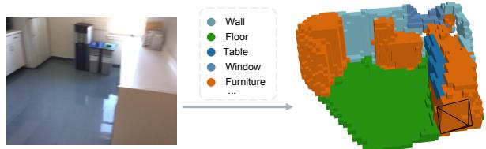
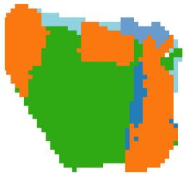
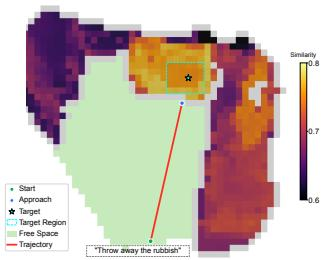
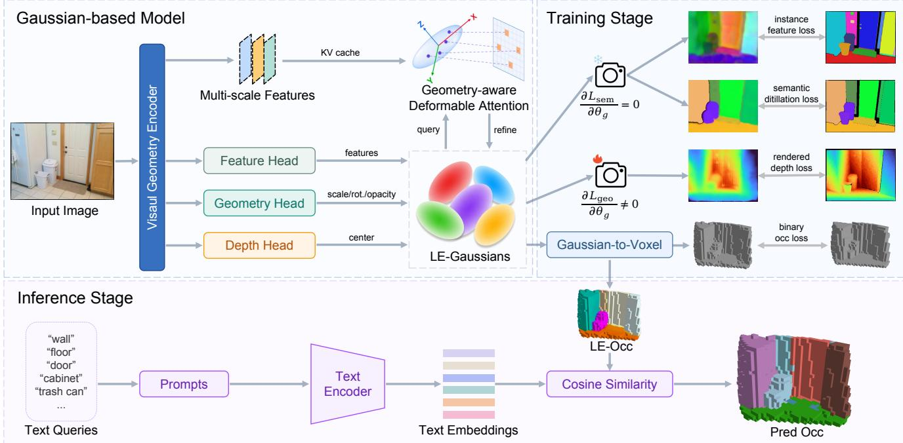
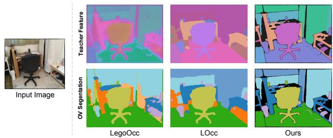
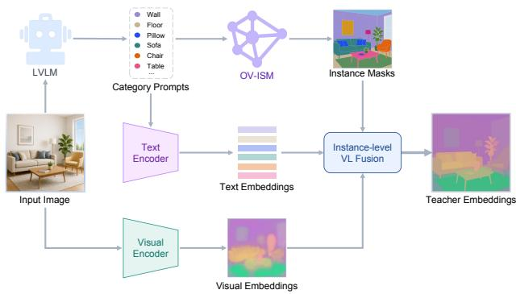
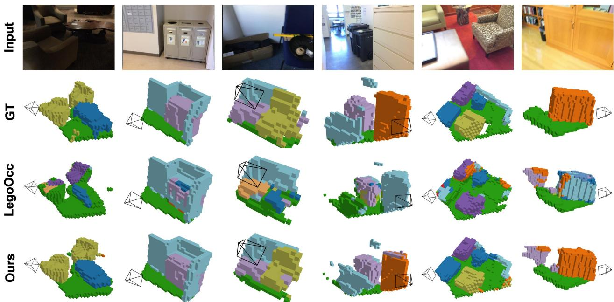
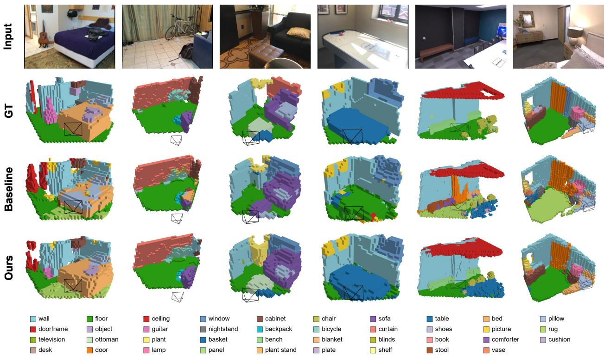

# OVM-Occ: Open-Vocabulary Monocular Occupancy Prediction via Geometry-Aware Vision-Language Distillation

Shuyang Yu1,2, Haibo Qin2, Shaohan Hu2, Wei Shan2, Xiaoqing Guan1, You Wang1,†, and Guang Li1

Abstract— Monocular occupancy prediction in indoor scenes aims to recover a scene’s 3D geometry and semantics from a single RGB image. Existing methods are restricted to a closed set of predefined categories, limiting their ability to generalize to unseen categories. This limitation is particularly critical in indoor scenes, where objects exhibit highly diverse and finegrained semantic categories. We study open-vocabulary monocular occupancy prediction for indoor scenes and present OVM-Occ, a Gaussian-based occupancy framework with an instanceaware vision-language teacher. Specifically, we adopt Language-Embedded Gaussians as the intermediate scene representation, propose a geometry-aware deformable attention module to refine Gaussian semantic features, and construct instance-level vision-language embeddings to provide reliable semantic supervision. We further introduce geometry-aware decoupled semantic distillation to mitigate the interference between geometry learning and semantic learning. To evaluate open-vocabulary occupancy prediction performance, we introduce OpenOcc-ScanNet and OpenOcc-Replica, two extended benchmarks with more diverse and fine-grained semantic categories. Experiments show that our method achieves state-of-the-art performance in open-vocabulary monocular occupancy prediction for indoor scenes, outperforming the previous state-of-the-art approach by 12.2 mIoU and 0.6 IoU on the Occ-ScanNet dataset, with consistent gains under new open-vocabulary evaluation protocols.

## I. INTRODUCTION

A comprehensive understanding of the surrounding 3D environment is fundamental to embodied perception, robotic navigation, and physical interaction [1], [2]. Occupancy prediction represents the environment as a dense volumetric grid, jointly estimating the occupancy state of each spatial element and assigning semantic labels to occupied regions [3]. This unified representation, which integrates geometry and semantics, supports fine-grained spatial reasoning and downstream embodied tasks [4].

Vision-based occupancy prediction has rapidly advanced in autonomous driving scenarios [5]–[8], where multi-view images provide strong geometric and semantic cues. By contrast, indoor occupancy prediction is more challenging and comparatively underexplored due to denser layouts and more severe occlusions. These challenges become even more pronounced in the monocular setting, where 3D occupancy must be inferred from a single RGB image without multiview constraints. Recent methods [9]–[11] have explored Gaussian-based representations for occupancy prediction, achieving promising improvements in indoor scenes.

In addition to geometric complexity, indoor scenes contain diverse, fine-grained, and long-tailed semantic categories.

  
(a) Open-vocabulary occupancy prediction

  
(b) Semantic BEV map  
(c) Query-guided planning  
Fig. 1: Illustration of open-vocabulary occupancy prediction and its potential downstream applications. (a) Given a monocular image and arbitrary semantic text queries, openvocabulary occupancy prediction infers a query-conditioned 3D occupancy representation. (b) The predicted 3D occupancy representation can be further projected into a semantic BEV map. (c) The representation supports language-guided navigation, such as planning a path toward targets specified by language instructions, e.g., ”throw away the rubbish”.

However, most existing occupancy prediction methods [8], [12], [13] are trained under closed-vocabulary settings with a predefined set of categories. This restriction limits their ability to recognize rare or previously unseen objects, motivating the need for open-vocabulary occupancy prediction. Recent advances in Vision-Language Models (VLMs), such as CLIP [14] and SigLIP [15], have demonstrated remarkable zero-shot transferability by aligning visual representations with natural language. By transferring language-aligned representations into 3D space, open-vocabulary occupancy prediction enables recognition of arbitrary categories beyond predefined label sets via natural-language queries, as illustrated in Fig. 1.

In this work, we study open-vocabulary monocular occupancy prediction for indoor scenes and propose OVM-Occ. OVM-Occ employs Language-Embedded Gaussians (LE-Gaussians) [16] as the intermediate scene representation, and constructs an instance-aware vision-language teacher that integrates visual appearance cues with language semantic anchors, enabling instance-level feature distillation and openvocabulary embedding alignment. The main contributions of this paper can be summarized as follows:

• We propose OVM-Occ, a Gaussian-based openvocabulary occupancy framework, with a geometryaware deformable attention mechanism to refine Gaussian semantic features and a geometry-aware decoupled semantic distillation strategy to mitigate interference between geometry learning and semantic learning.

• We introduce an instance-aware vision-language teacher that provides reliable instance-level semantic supervision via confidence-calibrated vision-language fusion.

• We introduce OpenOcc-ScanNet and OpenOcc-Replica, two extended benchmarks with more diverse and fine-grained semantic categories for open-vocabulary monocular occupancy evaluation. Extensive experiments demonstrate that our method outperforms previous state-of-the-art approaches on both Occ-ScanNet and the newly introduced benchmarks.

## II. RELATED WORK

## A. Monocular Occupancy Prediction

Multi-camera occupancy prediction has been extensively studied in autonomous driving and has achieved remarkable performance [5]–[8]. Motivated by embodied perception and advances in visual geometry foundation models [17], [18], recent studies have explored monocular occupancy prediction for indoor scene understanding. MonoScene [12] is a pioneering work in monocular 3D occupancy prediction. ISO [13] leverages monocular depth estimation to lift image features into dense 3D volumes for occupancy prediction. Recent works [9]–[11], [19] employ Gaussian primitives as an intermediate scene representation and optimize occupancy prediction via differentiable rendering. However, these methods primarily focus on improving geometric reconstruction, while semantic modeling remains restricted to predefined label sets, limiting generalization to unseen categories.

## B. Open-Vocabulary Occupancy Prediction

Open-vocabulary occupancy prediction incorporates semantic knowledge from VLMs, enabling semantic understanding beyond predefined categories. POP-3D [20] and AGO [21] establish pixel-to-voxel correspondences through geometric projection and distill the corresponding visual embeddings into voxel representations for 3D occupancy prediction. LOcc [22] employs a 2D open-vocabulary semantic segmentation model to generate category-specific masks and distills the corresponding text embeddings into voxel representations. However, these methods are primarily designed for outdoor driving scenarios with multi-view cameras, and their direct transfer to indoor monocular settings leads to inferior performance [9]. LegoOcc [23] extends open-vocabulary occupancy prediction to indoor monocular scenes under geometry-only supervision. It introduces 3D LE-Gaussians to jointly model scene geometry and semantics, renders Gaussian semantic features into the image plane, and distills them with vision-language embeddings. Overall, research on open-vocabulary occupancy prediction for indoor monocular scenes remains relatively underexplored.

## III. METHODOLOGY

This section details the proposed OVM-Occ framework, whose overall architecture is illustrated in Fig. 2.

## A. Problem Definition

Given a monocular RGB image $\textbf { I } ~ \in ~ \mathbb { R } ^ { H \times W \times 3 }$ , the goal is to predict a voxel-wise semantic occupancy field $\mathbf { \bar { O } } \in \mathbb { R } ^ { X \times \bar { Y } \times Z \times N _ { c } } ,$ , where X, Y, and $Z$ denote the spatial resolution, and $N _ { c }$ is the number of semantic categories. During training, only binary occupancy labels and depth observations are used, without voxel-level semantic annotations. Semantic categories are specified only at inference time through text queries.

## B. Language-Embedded Gaussian Representation

Building on previous works [16], [23], [24], we adopt LE-Gaussians as the intermediate scene representation. Each LE-Gaussian is parameterized as:

$$
\mathcal { G } = \{ \mu , \mathbf { s } , \mathbf { r } , \alpha , \mathbf { f } \} ,\tag{1}
$$

where $\pmb { \mu } \in \mathbb { R } ^ { 3 } , \mathbf { s } \in \mathbb { R } ^ { 3 } , \mathbf { r } \in \mathbb { R } ^ { 3 } , \alpha \in [ 0 , 1 ]$ , and $\textbf { f } \in \mathbb { R } ^ { d }$ denote the Gaussian center, scale, rotation, opacity, and language-aligned feature, respectively.

Following GPOcc [11], we initialize surface Gaussian centers from the predicted depth and extend them along camera rays to construct volumetric Gaussians:

$$
\pmb { \mu } _ { n } ( p ) = \left( \hat { D } ( p ) + \Delta _ { n } ( p ) \right) \mathbf { d } ( p ) , \quad n = 0 , \hdots , N - 1\tag{2}
$$

where $\mathbf { d } ( \boldsymbol { p } )$ denotes the unit camera ray at pixel $p , \hat { D } ( p )$ and $\Delta _ { n } ( p )$ represent the predicted depth and depth offset, and N represents the total number of Gaussians sampled per ray.

We introduce a geometry-aware deformable attention module to refine Gaussian semantic features through geometryguided feature sampling and aggregation. We exploit the explicit geometric properties of 3D Gaussians to perform structured sampling. Specifically, four fixed samples are placed along the two major axes, complemented by two learnable samples that adapt to local visual cues. The sampling offset $\epsilon _ { j } \in \mathbb { R } ^ { 3 }$ is defined in the local coordinate system, transformed by the Gaussian scale and rotation into a 3D sampling point, and projected onto the 2D image plane:

$$
{ \bf u } _ { j } = \pi \left( \pmb { \mu } + \mathbf { R } \mathrm { d i a g } ( \mathbf { s } ) \pmb { \epsilon } _ { j } \right) ,\tag{3}
$$

where $\mathbf { u } _ { j }$ denotes the 2D sampling location, R is the rotation matrix derived from r, and $\pi ( \cdot )$ is the projection function. For each sample, an attention weight is adaptively predicted by a multi-layer perceptron (MLP) based on the sampled features and geometric cues:

$$
\tilde { w } _ { j } = \mathrm { M L P } \left( \mathrm { C o n c a t } \left( \mathbf { q } _ { g } , \mathbf { k } _ { j } , \cos ( \mathbf { q } _ { g } , \mathbf { k } _ { j } ) , d _ { g } , \Delta d _ { j } \right) \right)\tag{4}
$$

$$
w _ { j } = \mathrm { S o f t m a x } ( \tilde { \mathbf { w } } ) _ { j } ,\tag{5}
$$

where $\mathbf { q } _ { g }$ denotes the Gaussian query feature, $\mathbf { k } _ { j }$ denotes the sampled image features, $d _ { g }$ is the Gaussian depth, and $\Delta d _ { j }$

  
Fig. 2: Overview of OVM-Occ. Given a monocular RGB image, the Gaussian-based model predicts Language-Embedded Gaussians (LE-Gaussians) and refines their features using geometry-aware deformable attention. During training, the LE-Gaussians are rendered into camera views for 2D semantic and depth supervision, while being aggregated into voxel representations for 3D geometric occupancy supervision. At inference, the LE-Gaussians are aggregated into Language-Embedded Occupancy (LE-Occ), where the occupancy features are matched with query text embeddings via cosine similarity to produce open-vocabulary occupancy predictions.

is the depth difference between the predicted depth of the sampled pixel and the Gaussian depth. The sampled features are then aggregated using the attention weights:

$$
\mathbf { h } = \sum _ { l = 1 } ^ { L } \sum _ { j = 1 } ^ { J } w _ { l , j } \mathbf { F } _ { l } ( \mathbf { u } _ { l , j } ) ,\tag{6}
$$

where $\mathbf { { F } } _ { l }$ denotes the l-th feature map, and h denotes the aggregated feature, which is further projected by an MLP to yield the language-aligned feature f.

Following LegoOcc [23], we adopt the Poisson-based splatting strategy to project LE-Gaussians into voxel-wise occupancy representations with language-aligned features.

## C. Instance-Aware Vision-Language Teacher

Existing open-vocabulary occupancy prediction methods [20], [21], [23] typically rely on dense visual embeddings extracted from CLIP-based models as teacher supervision. However, these embeddings are learned through imagelevel contrastive pre-training [14] and inevitably encode background context and irrelevant regions, thereby yielding noisy semantic supervision. In contrast, LOcc [22] employs language teacher embeddings together with open-vocabulary semantic masks. While the language embeddings provide relatively clean category-level supervision, the semantic masks lack explicit instance awareness, leading to ambiguous supervision around instance boundaries. Moreover, LOcc ignores rich visual appearance cues, which are crucial for openvocabulary tasks. Fig. 3 provides a qualitative comparison of the aforementioned teachers and their corresponding openvocabulary segmentation results. To leverage the complementary strengths of both modalities, we construct an instanceaware vision-language teacher, where language embeddings serve as semantic anchors while visual embeddings provide instance-specific appearance cues, as shown in Fig. 4.

We employ a large vision-language model (LVLM) to extract semantic categories from the input image. The predicted categories are subsequently refined through text denoising and temporal completion, yielding the final category set $\boldsymbol { \mathcal { C } } = \{ c _ { i } \} _ { i = 1 } ^ { K }$ . The category set is then encoded by the CLIP text encoder to obtain language embeddings $\boldsymbol { \mathcal { T } } = \{ \mathbf { t } _ { i } \} _ { i = 1 } ^ { K } .$ Meanwhile, the categories are used as text prompts for an open-vocabulary instance segmentation model (OV-ISM) to generate instance masks $\mathcal { M } = \{ M _ { i } \} _ { i = 1 } ^ { M }$ . Consequently, each instance mask $M _ { i }$ is naturally associated with the language embedding of its corresponding text prompt, denoted as $\hat { \mathbf { t } } _ { i } .$

The vision branch employs a CLIP-based visual encoder to extract pixel-wise embeddings F, which are aligned with the text embedding space. Given the instance masks M, we perform masked average pooling over the dense embeddings F to obtain instance-level visual embeddings $\mathbf { \nabla } \mathcal { V } = \{ \mathbf { v } _ { i } \} _ { i = 1 } ^ { M }$

$$
\mathbf { v } _ { i } = \frac { \sum _ { p } M _ { i } ( p ) \mathbf { F } ( p ) } { \sum _ { p } M _ { i } ( p ) } ,\tag{7}
$$

where $M _ { i } ( p ) \in \{ 0 , 1 \}$ indicates whether spatial location $p$ belongs to the i-th instance mask, and $\mathbf { F } ( \boldsymbol { p } )$ denotes the corresponding visual feature.

  
Fig. 3: Comparison of different teacher embeddings and their corresponding open-vocabulary semantic segmentations. Top: PCA visualization of teacher embeddings. Each method is visualized independently; therefore, colors are only comparable within each visualization. Bottom: Corresponding open-vocabulary segmentation results. The color legend is provided in Table I.

For each instance mask $M _ { i } .$ , we apply L2 normalization to the visual embedding $\mathbf { v } _ { i }$ and its corresponding language embedding $\hat { \mathbf { t } } _ { i }$ , and then construct a fused representation:

$$
\begin{array} { r } { \tilde { \mathbf { e } } _ { i } = \lambda _ { \mathrm { v i s } } \mathbf { v } _ { i } + ( 1 - \lambda _ { \mathrm { v i s } } ) \hat { \mathbf { t } } _ { i } , } \end{array}\tag{8}
$$

where $\lambda _ { \mathrm { v i s } }$ denotes the weighting coefficient of the visual modality. The cross-modal consistency between the visual and language embeddings is measured by cosine similarity:

$$
s _ { i } = \mathrm { m a x } ( \mathbf { v } _ { i } ^ { \top } \hat { \mathbf { t } } _ { i } , 0 ) .\tag{9}
$$

The fused representation is normalized to preserve its direction, while the confidence score modulates its magnitude, yielding the final instance-aware vision-language teacher embedding:

$$
\mathbf { e } _ { i } = s _ { i } \frac { \tilde { \mathbf { e } } _ { i } } { \lVert \tilde { \mathbf { e } } _ { i } \rVert _ { 2 } } .\tag{10}
$$

## D. Geometry-Aware Decoupled Semantic Distillation

Semantic-to-geometry decoupling. LegoOcc [23] renders Gaussian semantic features onto the image plane and applies feature supervision. During optimization, the gradients from the feature rendering loss are propagated to the geometry branch. As a result, the optimization may tend to reduce the rendering loss by adjusting Gaussian geometry rather than improving semantic representations. Meanwhile, the highdimensional CLIP teacher embeddings inevitably contain noisy semantic responses, introducing unreliable supervision signals into the geometry branch.

To address this issue, we detach the gradients of Gaussian geometry parameters in feature rendering optimization:

$$
\frac { \partial \mathcal { L } _ { \mathrm { s e m } } } { \partial \theta _ { g } } = 0\tag{11}
$$

where $\theta _ { g } = \{ \mu , \mathbf { s } , \mathbf { r } , \alpha \}$ denotes the geometry parameters. Geometry-to-semantic decoupling. Inaccurate depth estimation may cause misalignment between projected Gaussian features and image features, resulting in unreliable semantic supervision. We apply a depth-error-aware mask to filter geometrically unreliable pixels during semantic distillation:

$$
M ^ { d } = \mathbb { I } \left( | \hat { D } - D ^ { \mathrm { g t } } | < \tau _ { d } \right) ,\tag{12}
$$

  
Fig. 4: Construction of the instance-aware vision-language teacher. A large vision-language model (LVLM) extracts semantic categories from the input image, which are then fed into an open-vocabulary instance segmentation model (OV-ISM) to generate instance masks and into a text encoder to produce text embeddings. In parallel, a visual encoder extracts dense visual embeddings from the input image. The text and visual embeddings are fused, guided by the instance masks, to obtain instance-aware teacher embeddings.

where $\hat { D }$ and $D ^ { \mathrm { g t } }$ denote the predicted and ground-truth depth maps, respectively, and $\tau _ { d }$ is the depth error threshold.

## E. Training Objective

Geometry supervision. We employ the binary focal loss ${ \mathcal { L } } _ { \mathrm { f o c a l } }$ and the Lovasz loss ´ $\mathcal { L } _ { \mathrm { l o v } }$ [25] to supervise voxel-wise 3D occupancy prediction. The Huber loss ${ \mathcal { L } } _ { \mathrm { d e p t h } }$ is adopted for dense depth estimation in the input view and depth rendering in neighboring views.

Semantic supervision. We render Gaussian features into the 2D image plane of the input and neighboring views for supervision. The rendered semantic features are optimized using a confidence-weighted distillation loss $\mathcal { L } _ { \mathrm { s e m } }$ based on cosine similarity with the teacher embeddings:

$$
\mathcal { L } _ { \mathrm { s e m } } = \frac { \sum _ { i = 1 } ^ { M } \sum _ { p } s _ { i } M _ { i } ( p ) M ^ { d } ( p ) \left[ 1 - \cos \left( \mathbf { f } ( p ) , \mathbf { e } _ { i } \right) \right] } { \sum _ { i = 1 } ^ { M } \sum _ { p } s _ { i } M _ { i } ( p ) M ^ { d } ( p ) } .\tag{13}
$$

Additionally, an auxiliary instance feature contrastive loss ${ \mathcal { L } } _ { \mathrm { i n s } }$ is introduced to enhance instance-level consistency.

The overall training objective is formulated as:

$$
\mathcal { L } = \lambda _ { 1 } \mathcal { L } _ { \mathrm { f o c a l } } + \lambda _ { 2 } \mathcal { L } _ { \mathrm { l o v } } + \lambda _ { 3 } \mathcal { L } _ { \mathrm { d e p t h } } + \lambda _ { 4 } \mathcal { L } _ { \mathrm { s e m } } + \lambda _ { 5 } \mathcal { L } _ { \mathrm { i n s } } ,\tag{14}
$$

where $\lambda _ { i }$ denotes the balancing weight for each loss term.

## IV. EXPERIMENTS

## A. Experimental Setup

Datasets. We evaluate our method on the ScanNet [26] and Replica [27] datasets. The Occ-ScanNet [13] benchmark provides annotations for only 11 semantic classes, limiting its ability to support open-vocabulary occupancy evaluation. To address this issue, we construct the OpenOcc-ScanNet and OpenOcc-Replica benchmarks with fine-grained semantic annotations, yielding four evaluation protocols: OpenOcc-ScanNet11, OpenOcc-ScanNet20, OpenOcc-ScanNet40, and OpenOcc-Replica35.

TABLE I: Comparison of monocular occupancy prediction performance on the Occ-ScanNet benchmark. Closed-vocabulary methods are trained with both semantic and occupancy ground-truth annotations, whereas open-vocabulary methods use only occupancy ground truth. The best result among open-vocabulary methods is highlighted in bold.
<table><tr><td>Method</td><td>IoU</td><td>Ceing ■</td><td>F0</td><td>a </td><td>d</td><td>Cha</td><td>Bed</td><td>Soa</td><td>Tabe</td><td>ΛV</td><td>Fureie</td><td>obects</td><td>mIoU</td></tr><tr><td colspan="10">Closed-vocabulary: supervised by full annotations.</td><td></td><td></td><td></td><td></td><td></td></tr><tr><td>TPVFormer [6]</td><td>33.39</td><td>6.96</td><td>32.97</td><td>14.41</td><td>9.10</td><td>24.01</td><td>41.49</td><td>45.44</td><td>28.61</td><td>10.66</td><td>35.37</td><td>25.31</td><td>24.94</td></tr><tr><td>GaussianFormer [8] MonoScene [12]</td><td>40.91 41.60</td><td>20.70 15.17</td><td>42.00 44.71</td><td>23.40 22.41</td><td>17.40 12.55</td><td>27.00 26.11</td><td>44.30 27.03</td><td>44.80 35.91</td><td>32.70 28.32</td><td>15.30 6.57</td><td>36.70 32.16</td><td>25.00 19.84</td><td>29.93 24.62</td></tr><tr><td>ISO [13]</td><td>42.16</td><td>19.88</td><td>41.88</td><td>22.37</td><td>16.98</td><td>29.09</td><td>42.43</td><td>42.00</td><td>29.60</td><td>10.62</td><td>36.36</td><td>24.61</td><td>28.71</td></tr><tr><td>SurroundOcc [7]</td><td>42.52</td><td>18.90</td><td>49.30</td><td>24.80</td><td>18.00</td><td>26.80</td><td>42.00</td><td>44.10</td><td>32.90</td><td>18.60</td><td>36.80</td><td>26.90</td><td>30.83</td></tr><tr><td></td><td>53.55</td><td>39.60</td><td>50.40</td><td>41.40</td><td>31.70</td><td>40.90</td><td>55.00</td><td>61.40</td><td>44.00</td><td>36.10</td><td>53.90</td><td>42.20</td><td>45.15</td></tr><tr><td>EmbodiedOcc [9]</td><td>54.90</td><td>36.40</td><td>53.10</td><td>41.80</td><td>34.40</td><td>42.90</td><td>57.30</td><td>64.10</td><td>45.20</td><td>34.80</td><td>54.20</td><td></td><td></td></tr><tr><td>EmbodiedOcc++ [19]</td><td>56.48</td><td>45.36</td><td>53.49</td><td></td><td>34.81</td><td>43.38</td><td>56.93</td><td>63.35</td><td>46.35</td><td></td><td></td><td>44.10</td><td>46.20</td></tr><tr><td>RoboOcc [10]</td><td></td><td>51.42</td><td>50.35</td><td>44.35</td><td>41.84</td><td>46.98</td><td>60.39</td><td>66.16</td><td>50.51</td><td>36.12</td><td>55.48</td><td>44.78</td><td>47.67</td></tr><tr><td>GPOcc-DPT [11]</td><td>56.96</td><td></td><td></td><td>46.97</td><td></td><td></td><td></td><td></td><td></td><td>47.97</td><td>58.88</td><td>49.23</td><td>51.88</td></tr><tr><td colspan="10">Open-vocabulary: supervised by geometry-only annotations.</td><td></td><td></td><td></td><td></td></tr><tr><td>POP-3D [20]</td><td>35.32 36.70</td><td>0.00 0.00</td><td>23.89 24.40</td><td>16.59</td><td>0.01 1.83</td><td>4.62 9.31</td><td>8.65 10.73</td><td>2.01 23.42</td><td>7.61 11.29</td><td>0.00</td><td>2.14</td><td>0.08</td><td>5.96</td></tr><tr><td>LOcc [22]</td><td></td><td>17.81</td><td>41.65</td><td>17.37</td><td></td><td>19.32</td><td>33.05</td><td>34.92</td><td></td><td>0.01</td><td>3.15</td><td>0.19</td><td>9.25</td></tr><tr><td>LegoOcc [23]</td><td>59.50</td><td></td><td></td><td>28.52</td><td>18.91</td><td></td><td></td><td></td><td>19.16</td><td>5.36</td><td>5.88</td><td>6.94</td><td>21.05</td></tr><tr><td>OVM-Occ (Ours)</td><td>60.10</td><td>44.82</td><td>52.76</td><td>36.78</td><td>19.38</td><td>33.22</td><td>52.07</td><td>50.90</td><td>30.92</td><td>3.88</td><td>25.63</td><td>15.33</td><td>33.25</td></tr></table>

Evaluation metrics. Following prior work [9], [13], [23], we use overall occupancy IoU and mean IoU (mIoU) over all semantic categories as the evaluation metrics.

Implementation details. For teacher construction, we use Qwen2.5-VL-3B [28] for semantic category extraction, CLIP text encoder for text embedding extraction, SAM 3 [29] for open-vocabulary instance segmentation, and OpenSeg [30] for visual embedding extraction. For the student model, following [9], [11], [23], we employ a finetuned DepthAnything-V2 [17] as the backbone. The network is optimized using AdamW with a weight decay of 0.01. The initial learning rate is set to $2 \times 1 0 ^ { - 4 }$ and follows a cosine annealing schedule. The model is trained for 10 epochs with a batch size of 8 on 4 NVIDIA RTX 5090 GPUs. For key hyperparameters, we set the number of Gaussians sampled per ray to $N = 8 .$ , the visual weight $\lambda _ { \mathrm { v i s } } = 0 . 3 .$ the depth error threshold $\tau _ { d } = 0 . 3 .$ , and the loss weights $\lambda _ { 1 } = 1 0 0 . 0 , \lambda _ { 2 } = 1 . 0 , \lambda _ { 3 } = 2 . 0 , \lambda _ { 4 } = 2 . 0 , \lambda _ { 5 } = 0 . 5$ . More implementation details will be provided in the released code.

## B. Main Results

We compare OVM-Occ with representative openvocabulary methods, including POP-3D [20], LOcc [22], and LegoOcc [23]. Table I reports the quantitative comparison results on the Occ-ScanNet benchmark. OVM-Occ achieves state-of-the-art performance among all openvocabulary methods, with 60.10 IoU and 33.25 mIoU, outperforming LegoOcc by 0.60 and 12.20, respectively. We further evaluate the open-vocabulary generalization ability on the OpenOcc-ScanNet benchmark, which contains more diverse and fine-grained semantic categories. As shown in Table II, our method consistently outperforms baselines under all evaluation protocols. Notably, OVM-Occ maintains substantial performance gains even under the challenging 40- class protocol, demonstrating the robustness of the proposed method under a significantly expanded semantic label space.

We evaluate few-shot transfer performance on the OpenOcc-Replica benchmark. As shown in Table III, our method consistently outperforms LegoOcc across all training settings. With pre-training on Occ-ScanNet, our method achieves comparable semantic performance using only 100 frames from Replica, reaching 14.44 mIoU versus 14.62 mIoU when trained from scratch on 1.1K frames. With 1.1K frames for fine-tuning, our method further improves to 77.88 IoU and 23.28 mIoU.

Fig. 5 presents qualitative comparisons on the Occ-ScanNet benchmark. Compared with LegoOcc, OVM-Occ produces more accurate semantic occupancy predictions with fewer category confusions. Moreover, our method preserves stronger instance-level consistency, assigning coherent semantic labels to the same object while reducing fragmented predictions, which demonstrates the effectiveness of the proposed instance-aware vision-language supervision.

Fig. 6 presents qualitative comparisons on the OpenOcc-ScanNet and OpenOcc-Replica benchmarks with the expanded semantic label space. OVM-Occ exhibits noticeably more reliable and coherent predictions in these challeng ing settings. Furthermore, OVM-Occ successfully recognizes long-tail semantic categories (e.g., guitar and bicycle), demonstrating its open-vocabulary generalization capability beyond frequent categories.

## C. Ablation Study

a) Factorized ablation of teacher embeddings and student frameworks: Table IV presents a factorized ablation by combining different teacher embeddings with different student frameworks. Compared with the Trident [31] teacher, the proposed instance-aware vision-language teacher consistently improves semantic prediction by over 8 mIoU points for both LegoOcc and our framework. Under the same teacher, our framework consistently surpasses LegoOcc, achieving gains of 3.49 and 3.75 mIoU with the Trident and proposed teacher, respectively. These results verify the effectiveness of both the proposed teacher and student framework.

  
Fig. 5: Qualitative comparison of the results from LegoOcc and our proposed OVM-Occ on the Occ-ScanNet benchmark. The color legend is provided in Table I.

TABLE II: Comparison of monocular occupancy prediction performance on the OpenOcc-ScanNet benchmark. Per-class IoU is reported for a subset of semantic categories under the OpenOcc-ScanNet40 protocol.
<table><tr><td rowspan="2">Method</td><td rowspan="2">IoU</td><td colspan="10">per-class IoU</td><td rowspan="2"></td><td colspan="3">mIoU</td></tr><tr><td>Cabinet</td><td>Counter</td><td>Pillow</td><td>Books</td><td>Towel</td><td>Mirror</td><td>Fridge</td><td>Toilet</td><td>Sink</td><td>Bathtub</td><td></td><td>11-class 20-class 40-class</td><td></td></tr><tr><td>POP-3D [20]</td><td>48.94</td><td>0.28</td><td>4.54</td><td>0.11</td><td>0.00</td><td>9.28</td><td>0.00</td><td>7.97</td><td></td><td>9.79</td><td>11.02</td><td>1.07</td><td>13.22</td><td>11.37</td><td>6.19</td></tr><tr><td>LOcc [22]</td><td>44.70</td><td>17.30</td><td>26.17</td><td>0.00</td><td>0.00</td><td>0.00</td><td></td><td>0.00</td><td>17.39</td><td>14.25</td><td>9.84</td><td>37.87</td><td>18.89</td><td>21.86</td><td>12.91</td></tr><tr><td>LegoOcc [23]</td><td>56.22</td><td>8.73</td><td>9.10</td><td>9.13</td><td>10.63</td><td>6.15</td><td>0.00</td><td>4.96</td><td></td><td>13.82</td><td>17.13</td><td>33.41</td><td>23.77</td><td>20.64</td><td>12.93</td></tr><tr><td>OVM-Occ (Ours)</td><td>56.82</td><td>22.77</td><td>21.44</td><td>28.82</td><td>19.68</td><td>18.62</td><td></td><td>24.06</td><td>19.56</td><td>32.06</td><td>38.18</td><td>57.38</td><td>32.40</td><td>30.83</td><td>21.79</td></tr></table>

TABLE III: Open-vocabulary occupancy prediction results on OpenOcc-Replica35 under different training settings. Each entry reports IoU / mIoU.
<table><tr><td>Method</td><td>From Scratch 1.1K frames</td><td>Pre-trained 100 frames</td><td>Pre-trained 1.1K frames</td></tr><tr><td>LegoOcc</td><td>62.85 / 9.27</td><td>47.76 / 8.12</td><td>73.65 / 14.90</td></tr><tr><td>Ours</td><td>64.21 / 14.62</td><td>50.09 / 14.44</td><td>77.88 / 23.28</td></tr></table>

TABLE IV: Ablation of different teacher embeddings and student frameworks. VL denotes vision-language.
<table><tr><td>Student</td><td>Teacher</td><td>IoU</td><td>mIoU</td></tr><tr><td>LegoOcc</td><td>Trident Visual Embedding [31]</td><td>59.50</td><td>21.05</td></tr><tr><td>LegoOcc</td><td>Instance-aware VL Embedding</td><td>59.71</td><td>29.50</td></tr><tr><td>Ours</td><td>Trident Visual Embedding [31]</td><td>60.07</td><td>24.54</td></tr><tr><td>Ours</td><td>Instance-aware VL Embedding</td><td>60.10</td><td>33.25</td></tr></table>

b) Ablation of teacher construction: Table V compares different teacher construction strategies. The instance-aware vision-language teacher achieves the best performance, outperforming the pixel-level vision and category-level language teachers by 5.09 and 1.97 mIoU points, respectively. These results demonstrate that the proposed teacher construction effectively exploits the complementary strengths of visual appearance cues and language semantic anchors.

TABLE V: Ablation of teacher construction.
<table><tr><td>Teacher Construction</td><td>IoU</td><td>mIoU</td></tr><tr><td>Pixel-level Vision</td><td>60.20</td><td>28.16</td></tr><tr><td>Category-level Language</td><td>60.09</td><td>31.28</td></tr><tr><td>Instance-aware Vision-Language</td><td>60.10</td><td>33.25</td></tr></table>

TABLE VI: Ablation of feature refinement modules.
<table><tr><td>Refinement Module</td><td>IoU</td><td>mIoU</td></tr><tr><td>None</td><td>59.57</td><td>31.98</td></tr><tr><td>Deformable Attention</td><td>60.02</td><td>32.43</td></tr><tr><td>Geometry-aware Deformable Attention</td><td>60.10</td><td>33.25</td></tr></table>

c) Ablation of geometry-aware feature refinement: Table VI reports the ablation results of different feature refinement modules. In the ”None” setting, only an MLP is used to project Gaussian features into the semantic embedding space, achieving 59.57 IoU and 31.98 mIoU. Introducing a deformable attention module to aggregate information from multi-scale image features leads to improved performance. The proposed geometry-aware deformable attention further improves to 60.10 IoU and 33.25 mIoU, demonstrating that incorporating Gaussian geometric priors enables more accurate feature sampling for Gaussian feature refinement.

  
Fig. 6: Qualitative results on the OpenOcc-ScanNet and OpenOcc-Replica benchmarks with more diverse semantic categories.

d) Ablation of geometry-aware decoupled semantic distillation: We evaluate the effectiveness of different geometry-semantic decoupling strategies during feature distillation, as summarized in Table VII. Applying only Spatial SG improves mIoU from 31.11 to 32.12, indicating that decoupling Gaussian geometry from semantic supervision enables more effective feature distillation. In contrast, Opacity SG primarily benefits geometric occupancy prediction, increasing IoU from 58.38 to 59.39. This suggests that decoupling Gaussian opacity prevents the optimization from reducing the distillation loss by suppressing Gaussian opacity, thereby avoiding interference with geometric occupancy optimization. Combining both stop-gradient strategies achieves further improvements in geometric occupancy and semantic performance, demonstrating their complementary effects in mitigating geometry-semantic interference. Finally, incorporating depth-error-aware masks yields additional gains in IoU and mIoU, indicating that filtering out geometrically unreliable regions provides cleaner semantic supervision.

e) Runtime analysis: Table VIII summarizes the runtime and memory consumption under different numbers of sampled Gaussians N along each ray. All measurements are conducted on an NVIDIA RTX 5090 GPU. Increasing

TABLE VII: Ablation of geometry-semantic decoupling strategies. Spatial SG and Opacity SG denote stop-gradient operations on Gaussian geometry attributes (mean, rotation, and scale) and opacity, respectively.

<table><tr><td>Spatial SG Opacity SG</td><td>Depth Mask</td><td>IoU</td><td>mIoU</td></tr><tr><td></td><td></td><td>58.3831.11</td><td></td></tr><tr><td>√</td><td></td><td>58.3032.12</td><td></td></tr><tr><td>√</td><td></td><td>59.3931.55</td><td></td></tr><tr><td>V √</td><td></td><td>59.8632.51</td><td></td></tr><tr><td>√ √</td><td></td><td>60.10 33.25</td><td></td></tr></table>

TABLE VIII: Runtime and memory analysis under different numbers of sampled Gaussians N per ray.
<table><tr><td>N</td><td>#Gauss.</td><td>Mem. (GB)</td><td>Time (ms)</td><td>IoU</td><td>mIoU</td></tr><tr><td>1</td><td>4,144</td><td>1.59</td><td>32.93</td><td>58.99</td><td>31.26</td></tr><tr><td>2</td><td>8,288</td><td>1.65</td><td>47.50</td><td>59.77</td><td>32.11</td></tr><tr><td>4</td><td>16,576</td><td>2.22</td><td>65.12</td><td>59.99</td><td>32.59</td></tr><tr><td>8</td><td>33,152</td><td>4.00</td><td>81.26</td><td>60.10</td><td>33.25</td></tr><tr><td>16</td><td>66,304</td><td>7.56</td><td>108.84</td><td>59.76</td><td>32.84</td></tr></table>

N from 1 to 8 consistently improves both IoU and mIoU, indicating that denser Gaussian sampling provides a more complete volumetric representation of the scene. However, the improvement saturates at N = 8, and further increasing N to 16 may introduce redundant volumetric samples, leading to slightly degraded performance while substantially increasing runtime and memory consumption. Therefore, N = 8 is adopted as the default setting, achieving the optimal trade-off between accuracy and efficiency.

## V. CONCLUSION

In this work, we present OVM-Occ, a Gaussian-based framework for open-vocabulary monocular occupancy prediction in indoor scenes. OVM-Occ introduces an instanceaware vision-language teacher that provides instance-level semantic supervision by integrating visual appearance cues with language semantic anchors. Furthermore, geometryaware deformable attention and geometry-aware decoupled semantic distillation enable more effective semantic representation learning. We establish OpenOcc-ScanNet and OpenOcc-Replica, two benchmarks with more diverse and fine-grained semantic categories. Extensive experiments demonstrate that our method achieves state-of-the-art performance for open-vocabulary monocular occupancy prediction.

## REFERENCES

[1] H. Liu, D. Guo, and A. Cangelosi, “Embodied intelligence: A synergy of morphology, action, perception and learning,” ACM Computing Surveys, vol. 57, no. 7, pp. 1–36, 2025.

[2] T. Wang, X. Mao, C. Zhu, R. Xu, R. Lyu, P. Li, X. Chen, W. Zhang, K. Chen, T. Xue, X. Liu, C. Lu, D. Lin, and J. Pang, “Embodiedscan: A holistic multi-modal 3d perception suite towards embodied ai,” in IEEE Conference on Computer Vision and Pattern Recognition (CVPR), 2024.

[3] X. Tian, T. Jiang, L. Yun, Y. Mao, H. Yang, Y. Wang, Y. Wang, and H. Zhao, “Occ3d: A large-scale 3d occupancy prediction benchmark for autonomous driving,” Advances in Neural Information Processing Systems, vol. 36, pp. 64318–64330, 2023.

[4] R. Liu, W. Wang, and Y. Yang, “Volumetric environment representation for vision-language navigation,” in Proceedings of the IEEE/CVF conference on computer vision and pattern recognition, pp. 16317– 16328, 2024.

[5] Z. Li, W. Wang, H. Li, E. Xie, C. Sima, T. Lu, Y. Qiao, and J. Dai, “Bevformer: Learning bird’s-eye-view representation from multi-camera images via spatiotemporal transformers,” in Proceedings of the European Conference on Computer Vision, pp. 1–18, 2022.

[6] Y. Huang, W. Zheng, Y. Zhang, J. Zhou, and J. Lu, “Tri-perspective view for vision-based 3d semantic occupancy prediction,” in Proceedings of the IEEE/CVF conference on computer vision and pattern recognition, pp. 9223–9232, 2023.

[7] Y. Wei, L. Zhao, W. Zheng, Z. Zhu, J. Zhou, and J. Lu, “Surroundocc: Multi-camera 3d occupancy prediction for autonomous driving,” in Proceedings of the IEEE/CVF International Conference on Computer Vision, pp. 21729–21740, 2023.

[8] Y. Huang, W. Zheng, Y. Zhang, J. Zhou, and J. Lu, “Gaussianformer: Scene as gaussians for vision-based 3d semantic occupancy prediction,” in European Conference on Computer Vision, pp. 376–393, Springer, 2024.

[9] Y. Wu, W. Zheng, S. Zuo, Y. Huang, J. Zhou, and J. Lu, “Embodiedocc: Embodied 3d occupancy prediction for vision-based online scene understanding,” in Proceedings of the IEEE/CVF International Conference on Computer Vision, pp. 26360–26370, 2025.

[10] Z. Zhang, Q. Zhang, W. Cui, S. Shi, Y. Guo, G. Han, W. Zhao, H. Ren, R. Xu, and J. Tang, “Roboocc: Enhancing the geometric and semantic scene understanding for robots,” arXiv preprint arXiv:2504.14604, 2025.

[11] C. Zhou, Y. Luo, and C. Chen, “Generalizing visual geometry priors to sparse gaussian occupancy prediction,” in Proceedings of the IEEE/CVF Conference on Computer Vision and Pattern Recognition, pp. 28578–28587, 2026.

[12] A.-Q. Cao and R. De Charette, “Monoscene: Monocular 3d semantic scene completion,” in Proceedings of the IEEE/CVF Conference on Computer Vision and Pattern Recognition, pp. 3991–4001, 2022.

[13] H. Yu, Y. Wang, Y. Chen, and Z. Zhang, “Monocular occupancy prediction for scalable indoor scenes,” in European Conference on Computer Vision, pp. 38–54, 2024.

[14] A. Radford, J. W. Kim, C. Hallacy, A. Ramesh, G. Goh, S. Agarwal, G. Sastry, A. Askell, P. Mishkin, J. Clark, et al., “Learning transferable visual models from natural language supervision,” in International conference on machine learning, pp. 8748–8763, PmLR, 2021.

[15] X. Zhai, B. Mustafa, A. Kolesnikov, and L. Beyer, “Sigmoid loss for language image pre-training,” in 2023 IEEE/CVF International Conference on Computer Vision (ICCV), pp. 11941–11952, IEEE, 2023.

[16] J.-C. Shi, M. Wang, H.-B. Duan, and S.-H. Guan, “Language embedded 3d gaussians for open-vocabulary scene understanding,” in Proceedings of the IEEE/CVF Conference on Computer Vision and Pattern Recognition, pp. 5333–5343, 2024.

[17] L. Yang, B. Kang, Z. Huang, Z. Zhao, X. Xu, J. Feng, and H. Zhao, “Depth anything v2,” Advances in Neural Information Processing Systems, vol. 37, pp. 21875–21911, 2024.

[18] J. Wang, M. Chen, N. Karaev, A. Vedaldi, C. Rupprecht, and D. Novotny, “Vggt: Visual geometry grounded transformer,” in Proceedings of the Computer Vision and Pattern Recognition Conference, pp. 5294–5306, 2025.

[19] H. Wang, X. Wei, X. Zhang, J. Li, C. Bai, Y. Li, M. Lu, W. Zheng, and S. Zhang, “Embodiedocc++: Boosting embodied 3d occupancy prediction with plane regularization and uncertainty sampler,” in Proceedings of the 33rd ACM International Conference on Multimedia, pp. 925–934, 2025.

[20] A. Vobecky, O. Simeoni, D. Hurych, S. Gidaris, A. Bursuc, P. P ´ erez, ´ and J. Sivic, “Pop-3d: Open-vocabulary 3d occupancy prediction from images,” Advances in Neural Information Processing Systems, vol. 36, pp. 50545–50557, 2023.

[21] P. Li, S. Ding, Y. Zhou, Q. Zhang, O. Inak, L. Triess, N. Hanselmann, M. Cordts, and A. Zell, “Ago: Adaptive grounding for open world 3d occupancy prediction,” in Proceedings of the IEEE/CVF international conference on computer vision, pp. 8645–8655, 2025.

[22] Z. Yu, B. Pang, L. Liu, R. Zhang, Q. Li, S.-Y. Cao, M. Luo, M. Chen, S. Yang, and H.-L. Shen, “Language driven occupancy prediction,” in Proceedings of the IEEE/CVF International Conference on Computer Vision, pp. 7548–7558, 2025.

[23] C. Zhou, Y. Luo, H. Zhang, Z. Jiang, and C. Chen, “Monocular open vocabulary occupancy prediction for indoor scenes,” in Proceedings of the IEEE/CVF Conference on Computer Vision and Pattern Recognition, pp. 21627–21637, 2026.

[24] M. Qin, W. Li, J. Zhou, H. Wang, and H. Pfister, “Langsplat: 3d language gaussian splatting,” in Proceedings of the IEEE/CVF Conference on Computer Vision and Pattern Recognition, pp. 20051– 20060, 2024.

[25] M. Berman, A. R. Triki, and M. B. Blaschko, “The lovasz-softmax´ loss: A tractable surrogate for the optimization of the intersectionover-union measure in neural networks,” in Proceedings of the IEEE conference on computer vision and pattern recognition, pp. 4413– 4421, 2018.

[26] A. Dai, A. X. Chang, M. Savva, M. Halber, T. Funkhouser, and M. Nießner, “Scannet: Richly-annotated 3d reconstructions of indoor scenes,” in Proceedings of the IEEE conference on computer vision and pattern recognition, pp. 5828–5839, 2017.

[27] J. Straub, T. Whelan, L. Ma, Y. Chen, E. Wijmans, S. Green, J. J. Engel, R. Mur-Artal, C. Y. Ren, S. Verma, A. Clarkson, M. Yan, B. Budge, Y. Yan, X. Pan, J. Yon, Y. Zou, K. Leon, N. Carter, J. Briales, T. Gillingham, E. Mueggler, L. Pesqueira, M. Savva, D. Batra, H. Strasdat, R. D. Nardi, M. Goesele, S. Lovegrove, and R. A. Newcombe, “The replica dataset: A digital replica of indoor spaces,” ArXiv, vol. abs/1906.05797, 2019.

[28] S. Bai, K. Chen, X. Liu, J. Wang, W. Ge, S. Song, K. Dang, P. Wang, S. Wang, J. Tang, H. Zhong, Y. Zhu, M. Yang, Z. Li, J. Wan, P. Wang, W. Ding, Z. Fu, Y. Xu, J. Ye, X. Zhang, T. Xie, Z. Cheng, H. Zhang, Z. Yang, H. Xu, and J. Lin, “Qwen2.5-vl technical report,” arXiv preprint arXiv:2502.13923, 2025.

[29] N. Carion, L. Gustafson, Y.-T. Hu, S. Debnath, R. Hu, D. Suris, C. Ryali, K. V. Alwala, H. Khedr, A. Huang, J. Lei, T. Ma, B. Guo, A. Kalla, M. Marks, J. Greer, M. Wang, P. Sun, R. Radle, T. Afouras,¨ E. Mavroudi, K. Xu, T.-H. Wu, Y. Zhou, L. Momeni, R. Hazra, S. Ding, S. Vaze, F. Porcher, F. Li, S. Li, A. Kamath, H. K. Cheng, P. Dollar, N. Ravi, K. Saenko, P. Zhang, and C. Feichtenhofer, “Sam´ 3: Segment anything with concepts,” 2026.

[30] G. Ghiasi, X. Gu, Y. Cui, and T.-Y. Lin, “Scaling open-vocabulary image segmentation with image-level labels,” in European conference on computer vision, pp. 540–557, Springer, 2022.

[31] Y. Shi, M. Dong, and C. Xu, “Harnessing vision foundation models for high-performance, training-free open vocabulary segmentation,” arXiv preprint arXiv:2411.09219, 2024.