# PosePlaner: Denoising Any Feed-Forward Pose Predictor from Pairwise Planar Geometry

Yihang Chen1,2 Bin Tan2,‡ Yujun Shen2 Yinghao Xu1,‡ Nan Xue2

1HKUST, Hong Kong, China 2Robbyant, Ant Group, China

‡Corresponding Authors

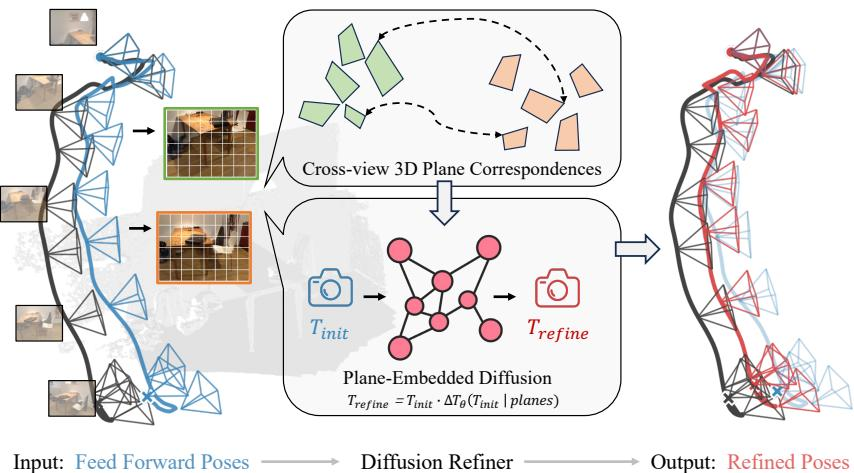  
Figure 1: Our proposed PosePlaner refines any feed-forward pose in one Euler step of a plane-embedded difusion adapter, and extends to n-view streaming via per-edge view-graph refinement aggregated by rotation averaging and a Glomap-style positioner. Left: $T _ { \mathrm { i n i t } }$ (blue) drifts from GT (black). Middle: conditioned on per-view planar primitives, the refiner yield $T _ { \mathrm { r e f i n e } } \stackrel { \cdot } { = } T _ { \mathrm { i n i t } } \cdot \Delta T _ { \theta } ( T _ { \mathrm { i n i t } }$ planes) (red) in one step. Right: refined trajectory (red), raw feed-forward (blue), GT (black).

Recent multi-view Transformers (e.g., DUSt3R and VGGT) have advanced 3D reconstruction by scaling training data and model capacity from two views to many views and long sequences, subsuming the classical SfM/SLAM pipeline of feature extraction, matching, and pose estimation in a single feed-forward pass. Yet this subsumption hides the interfaces between pipeline stages—correspondences, geometry, and pose are entangled in a single forward pass, leaving supervised fine-tuning as the major path to improvement and ofering no mechanism to correct predictions from geometric evidence at test time. We propose PosePlaner to close this gap by reviving the classical coupling between correspondences and pose via flow matching, treating pose refinement as a conditional generation problem that takes coarse geometric matches and initial pose as input condition and fuses the resulting pose hypotheses into a single refined estimate, providing a continuous, data-driven analog of RANSAC voting. Our method is trained eficiently on two-view data, yet serves as a periodic refiner for streaming n-view pose estimators with no retraining. Empirically, it corrects failures of feed-forward predictors, substantially improves correspondence-based solvers, and reduces accumulated drift in long streaming sequences. Project page: https://robbyant-research.github.io/PosePlaner/.

## 1. Introduction

Recovering relative camera pose between views of a scene is a foundational primitive in 3-D vision and the entry point of structure-from-motion (Schönberger & Frahm, 2016), multi-view stereo (Yao et al., 2018), SLAM (Mur-Artal et al., 2015), and novel-view synthesis (Mildenhall et al., 2022; Kerbl et al., 2023). The problem is hard at both ends: in the two-view setting under limited baselines and outlier-prone correspondences, and across long streaming sequences where errors accumulate frame by frame. Every pose failure propagates into the downstream pipeline.

Two prominent paradigms in recent work reach this problem from opposite directions. Feed-forward pose predictors (Wang et al., 2025a; 2024) map an image pair directly to (R, t) via visual priors, but their prediction is terminal: downstream correspondences cannot refine it. Matcher-plus-solver pipelines (Sarlin et al., 2020; Sun et al., 2021; Edstedt et al., 2024; Leroy et al., 2024) hand rich correspondences to a five-point solver (Nistér, 2004) wrapped in RANSAC (Fischler & Bolles, 1981), but the matcher’s priors collapse into per-pair inlier / outlier decisions and the RANSAC threshold tuning seldom transfers across scenes. Both paradigms break the match-pose coupling: visual priors and per-match geometric evidence never reach the same diferentiable channel.

In this paper, we bridge the gap between these two paradigms by reintroducing visual correspondences into feed-forward 3D reconstruction. Analogous to the algebraic solvers that seed the classical SfM pipeline (Schönberger & Frahm, 2016), we treat feed-forward models as pose initializers and refine their output as a learned geometric correction step. Our key insight is that 3D surface points paired with their normals already encode a cross-view geometric constraint: under the true relative pose, matched patch-normal pairs must satisfy an algebraic warping identity, and departures from it yield diferentiable residuals that grow with pose error. Planar primitives realize this constraint compactly—one 3-D center and one normal per image patch. We learn to denoise the pose residual via flow matching, conditioned on the initialized pose and matched patch-normal pairs, yielding a refiner that generalizes from two-view training to N-view inference without retraining.

We introduce PosePlaner (Fig. 1), a pose refiner that accepts any initial pose $T _ { \mathrm { i n i t } }$ and returns a refined relative pose given patch-normal matching pairs. Building on Plana3r (Liu et al., 2025a), we use planar primitives as compact patch-normal representations, where each patch predicts a 3D center and plane normal in its own camera frame; pairing these patch-level primitives via an external pixel matcher (e.g., MASt3R (Leroy et al., 2024), LoFTR (Sun et al., 2021)) yields M two-view correspondences whose warping residuals serve as the conditioning signal for the refiner. For pose refinement in SE(3), we exploit the asymmetric dificulty of rotation and translation: a flow-matching (Liu et al., 2023; Lipman et al., 2023) multi-query Transformer (Vaswani et al., 2017; Peebles & Xie, 2023) denoises the rotation residual conditioned on the plane-warping residuals, producing M hypotheses that a learned score head fuses with the initial pose by softmax-weighted voting; translation is then recovered by a geometric solver under the refined rotation. Trained once on two-view pairs, PosePlaner extends as a periodic tail refiner for streaming n-view pose estimators on long sequences with no retraining. Beyond classical bundle adjustment and pose-graph backends (Schönberger & Frahm, 2016), to the best of our knowledge this is the first learned, difusion-based refiner that operates on the pose outputs of streaming n-view estimators without sequence-specific retraining. Experimentally, our PosePlaner consistently improves upstream estimators from both paradigms on two benchmarks, and its gains grow with sequence length in the streaming setting, where drift correction matters most—e.g., on ScanNet at N=2000, rotation AUC@5◦ improves by +20 points for CUT3R (Wang et al., 2025b) and +21 for TTT3R (Chen et al., 2025).

## Our contributions.

• We propose PosePlaner, the first learned, difusion-based pose refiner that revives the classical correspondence–pose coupling for feed-forward 3D reconstruction models, treating pose refinement as a conditional generation problem over plane-warping residuals.

• We design a hybrid SE(3) refinement scheme: a flow-matching multi-query Transformer for rotation with score-based hypothesis fusion, and a geometric solver for translation, enabling single-step

inference.

• We show that a model trained once on two-view pairs serves as a periodic tail refiner for streaming n-view estimators with no retraining.

## 2. Related Work

Two-view and feed-forward pose estimation. Classical structure-from-motion (Schönberger & Frahm, 2016; Mur-Artal et al., 2015) recovers relative pose from sparse correspondences via a closedform essential-matrix solver (Nistér, 2004) wrapped in RANSAC (Fischler & Bolles, 1981); modern matchers (Sarlin et al., 2020; Sun et al., 2021; Edstedt et al., 2024; Leroy et al., 2024) replace hand crafted descriptors with learned dense features, but the discrete solver still collapses each match into an inlier / outlier vote, and a single bad RANSAC threshold can erase the entire inlier set. Diferentiable RANSAC variants (Brachmann et al., 2017; Brachmann & Rother, 2018; 2022) relax this voting into a soft, end-to-end-trainable selection, yet gradients still flow through aggregate inlier counts rather than per-correspondence geometric residuals. A complementary line skips the solver and regresses pose directly via large feed-forward 3-D backbones (Wang et al., 2024; Leroy et al., 2024; Wang et al., 2025a) or their online streaming descendants (Wang et al., 2025b; Chen et al., 2025; Li et al., 2025; Yuan et al., 2026; Zhuo et al., 2025; Lan et al., 2025; Wang & Agapito, 2025; Chen et al., 2026); both produce a terminal prediction whose downstream correspondences and accumulated drift never re-enter the prediction loop. PosePlaner sits downstream of either paradigm, correcting any initial pose using the geometric constraint encoded in matched plane primitives and restoring the pose–correspondence coupling that both break.

Planar primitives for 3-D understanding. Indoor scenes are dominated by piecewise-planar structure, motivating reconstruction by sparse 3-D plane primitives rather than dense points or meshes (Yu et al., 2019; Jin et al., 2021; Xie et al., 2022; Tan et al., 2025; Zhao et al., 2024; Liu et al., 2025b;a). Early feed-forward methods (Liu et al., 2018; 2019; Shi et al., 2023) regress plane masks and per-pixel plane parameters via instance segmentation, but depend on manually annotated plane labels (ScanNetV2 (Dai et al., 2017), Matterport3D (Chang et al., 2017)), capping both training scale and cross-dataset generalization. PlanarSplatting (Tan et al., 2025) breaks this bottleneck with a diferentiable plane-primitive rasterizer whose rendering loss is annotation-free, and Plana3r (Liu et al., 2025a) uses it to train a feed-forward stereo plane-primitive backbone at scale, predicting per-patch normals and centers end-to-end. On the pose side, NopeSAC (Tan et al., 2023) matches a few scene-level plane instances, feeds each pair through a shared MLP to produce one pose hypothesis per correspondence, and soft-fuses these (with the init) via a learned scoring layer over their warping costs. PosePlaner retains the soft-fusion idea but operates at the much denser patch level and replaces the per-plane MLP regressor with a continuous flow-matching denoiser jointly conditioned on the plane-warping residuals of all matched patch pairs.

Difusion models for pose and 3-D. Denoising difusion (Ho et al., 2020) has been adapted to pose by PoseDiffusion (Wang et al., 2023) (camera trajectories conditioned on image features), RayDiffusion (Zhang et al., 2024) (denoising a per-pixel ray bundle), and DiffusionSfM (Zhao et al., 2025) (jointly denoising per-pixel ray origins and endpoints to recover structure and motion); all three are visual-prior-driven, with no explicit per-correspondence geometric channel. Flow matching (Lipman et al., 2023; Liu et al., 2023) replaces the noise-prediction objective with a deterministic vector-field target, enabling single-step inference. PosePlaner adopts this flow-matching parameterization and conditions on plane-warping residuals rather than pixels, so the denoiser sees the algebraic quantity a classical solver would minimize—a geometric channel decoupled from any single matcher’s visual statistics.

## 3. Method

PosePlaner takes any initial two-view relative pose $T _ { \mathrm { i n i t } }$ of the input image pair $( \mathbb { Z } _ { 1 } , \mathbb { Z } _ { 2 } )$ and refines it into a more accurate estimate. The main idea rests on a classical observation:

Proposition 1 (Plane-Warping Identity). Let $( n _ { 1 } , d _ { 1 } )$ and $( n _ { 2 } , d _ { 2 } )$ be the parameters of a 3D plane observed in two camera frames related by a relative pose $T _ { r e l } = ( R , { \bf { t } } )$ . Then

$$
\pmb { n } _ { 1 } = R \pmb { n } _ { 2 } , \qquad d _ { 1 } = d _ { 2 } - ( R \pmb { n } _ { 2 } ) ^ { \top } \pmb { t } .\tag{1}
$$

Departures from this identity produce the plane-warping residuals

$$
\Delta { \boldsymbol { n } } ( { \boldsymbol { R } } ) = \left\| { \boldsymbol { n } } _ { 1 } - { \boldsymbol { R } } { \boldsymbol { n } } _ { 2 } \right\| _ { 2 } , \qquad \Delta d ( { \boldsymbol { R } } , t ) = \left| d _ { 1 } - d _ { 2 } + ( { \boldsymbol { R } } { \boldsymbol { n } } _ { 2 } ) ^ { \top } { \boldsymbol { t } } \right| ,\tag{2}
$$

which vanish at the true pose and grow with pose error.

These residuals provide an estimator-agnostic conditioning signal for any upstream source. Given a two-view Vision Transformer that reads out patch-level 3D planes in each view’s own camera frame (Sec. 3.1), we compute the plane-warping residuals between matched pairs and use them as conditioning for a flow-matching Transformer that denoises the rotation residual; translation is then recovered by a geometric solver under the refined rotation (Sec. 3.2). See Fig. 2 for an overview.

## 3.1. Patchwise Plane Primitives and Correspondences

Our method follows the convention of Vision Transformers (Dosovitskiy et al., 2021), patchifying the input images $( \mathbb { Z } _ { 1 } , \mathbb { Z } _ { 2 } )$ into $S$ patch tokens each. A siamese ViT encoder processes both views independently, and two cross-attention decoders fuse information across views, predicting a 3D planar primitive per patch, specifically a center depth, two radii, and an orientation quaternion from which the plane normal n and ofset d are recovered.

Plane representation from Siamese Vision Transformers. Each patch in a view predicts a local planar primitive parameterized by a 3D center $\pmb { P } \in \mathbb { R } ^ { 3 }$ and a unit surface normal ${ \mathbf { \Omega } } _ { n } \in S ^ { 2 }$ , both expressed in its own camera frame. The plane ofset follows as $d = - \pmb { n } ^ { \top } \pmb { P }$ , giving a compact $( n , d )$ per patch. We adopt the architecture of Plana3r (Liu et al., 2025a) with one key change: whereas Plana3r expresses all primitives in a shared global frame (view 1), we set each primitive to live in its own source camera’s frame. The training details of this Siamese Vision Transformer network are in $\mathrm { A p p }$ . B.1.

Two-view plane correspondences. After the plane head produces $( n , d )$ for every patch in both views, we establish patch-level correspondences from any external pixel matcher $( \mathrm { e . g . }$ , SuperGlue (Sarlin et al., 2020), LoFTR (Sun et al., 2021), ROMA (Edstedt et al., 2024), or MASt3R (Leroy et al., 2024)). Given pixel-level matches, we convert each matched pixel pair to its enclosing patch indices and accumulate a vote matrix $V \in \mathbb { R } ^ { S \times S }$ counting the number of pixel matches per patch pair. Patch-level correspondences are then extracted by mutual nearest neighbors: patch i in view 1 is matched to patch j in view 2 if and only ${ \mathrm { i f ~ } } j = \arg \operatorname* { m a x } _ { k } V _ { i k }$ and i = arg max $V _ { k j }$ . This yields M matched plane pairs $\{ ( \pmb { n } _ { m } ^ { 1 } , d _ { m } ^ { 1 } ) , ~ ( \pmb { n } _ { m } ^ { 2 } , d _ { m } ^ { 2 } ) \} _ { m = 1 } ^ { M }$ , which we pack into geometry tokens

$$
{ \pmb g } _ { m } = [ { \pmb n } _ { m } ^ { 1 } \| \vec { d } _ { m } ^ { 1 } \| \pmb { n } _ { m } ^ { 2 } \| \vec { d } _ { m } ^ { 2 } \| \in \mathbb { R } ^ { 8 } , \qquad m = 1 , \dots , M ,\tag{3}
$$

where $\hat { d } _ { m } ^ { v }$ denotes the scene-normalized ofset (Sec. 3.2). Each token is the minimal suficient statistic for evaluating the plane-warping residuals of Eq. (2) at any candidate pose. Note that M is not a fixed hyperparameter: it is determined per image pair by the matcher’s mutual-NN output and varies with scene texture and matcher density (typically tens to a few hundred per pair for the matchers we use). The M residuals collectively expose the pose error along diverse normal orientations, forming the conditioning signal consumed by the flow-matching refiner below.

## 3.2. Flow-Matching Difusion Refiner

The refiner takes $T _ { \mathrm { i n i t } } = ( R _ { \mathrm { i n i t } } , t _ { \mathrm { i n i t } } )$ and the geometry tokens $\left\{ \pmb { g } _ { m } \right\}$ of Sec. 3.1, and produces a refined pose via flow matching (Lipman et al., 2023; Liu et al., 2023). For $t \sim \mathcal { U } [ 0 , 1 ]$ and $\epsilon \sim \mathcal { N } ( 0 , I )$ , the formulation defines a linear probability path and a constant target velocity

$$
z _ { t } = ( 1 - t ) z _ { 0 } + t \epsilon , \qquad v ^ { \star } ( z _ { t } , t ) = \epsilon - z _ { 0 } ,\tag{4}
$$

and the refiner $F _ { \theta }$ regresses $v ^ { \star }$ at every $( z _ { t } , t )$ . The straight-line path admits a single deterministic Euler step at inference, so refinement reduces to one forward pass (see App. A.3 for the formal argument).

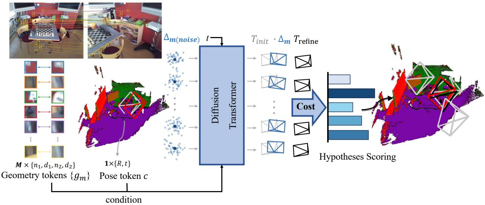  
Figure 2: PosePlaner pipeline. A per-view local-frame plane head produces M geometry tokens $\{ \pmb { g } _ { m } \}$ (paired plane primitives across the two views) and a global pose token c that encodes the initial relative pose $T _ { \mathrm { i n i t } }$ . The multi-query difusion Transformer denoises $T _ { \mathrm { i n i t } }$ in a single Euler step under these conditioning tokens, yielding M hypothesis frustums $h _ { 1 } , \ldots , h _ { M }$ . A score head softly fuses the hypotheses into the final refined pose $T _ { \mathrm { r e f i n e d } }$ , used to align the two-view reconstruction.

Velocity field parameterization. The velocity field $F _ { \theta }$ is specified by three choices: the coordinate system, the denoising target, and the conditioning signal.

We normalize all plane ofsets by a per-pair scalar $\begin{array} { r } { \sigma = \frac { 1 } { 2 } ( \overline { { | d ^ { 1 } | } } + \overline { { | d ^ { 2 } | } } ) } \end{array}$ so that $\bar { d } _ { m } ^ { v } = d _ { m } ^ { v } / \sigma$ . A robust median over the matched pairs recovers the normalized translation scale:

$$
s _ { \mathrm { e s t } } ( R , \hat { t } ) = \mathrm { m e d i a n } _ { m \in \mathcal { M } ^ { \star } } \bigg | \frac { \bar { d } _ { m } ^ { 2 } - \bar { d } _ { m } ^ { 1 } } { ( R n _ { m } ^ { 2 } ) ^ { \top } \hat { t } } \bigg | , \qquad \tau \ = \ s _ { \mathrm { e s t } } ( R , \hat { t } ) \hat { t } ,\tag{5}
$$

where $\mathcal { M } ^ { \star }$ excludes matches with near-zero denominators. This maps any $T _ { \mathrm { i n i t } }$ into the range of ¯d regardless of its metric scale; the metric translation is recovered by $t = \sigma \tau$

The denoising target is the 9-dimensional residual

$$
z _ { 0 } ~ = ~ \big [ \mathrm { \ r o t { 6 d } } ( R _ { \mathrm { g t } } R _ { \mathrm { i n i t } } ^ { \top } ) ~ \big \| ~ \tau _ { \mathrm { g t } } - \tau _ { \mathrm { i n i t } } \big ] \in \mathbb { R } ^ { 9 } ,\tag{6}
$$

with rotation in the continuous 6-D representation of Zhou et al. (2019) (see App. A.2 for why quaternions are suboptimal under flow matching). Although our final output uses only the rotation, the translation channel acts as a contextual signal that tightens the rotation prediction (Sec. 4.3).

The refiner conditions on the M geometry tokens $\left\{ \pmb { g } _ { m } \right\}$ from Eq. (3) and a global pose token $c =$ $\psi ( [ \mathrm { r o t 6 d } ( R _ { \mathrm { i n i t } } ) | | \tau _ { \mathrm { i n i t } } ] ) \in \mathbb { R } ^ { d }$ . Linear projections lift both to width d and $L _ { \mathrm { c o n d } } { = } 4$ self-attention blocks produce the context $\hat { C }$ consumed by the denoiser.

Multi-query denoiser. The denoiser instantiates M queries, one per correspondence, each solving the same pose-residual denoising problem under a diferent local geometric condition. Every query shares a latent-time component

$$
\pmb q _ { 0 } = \phi _ { z } ( \pmb z _ { t } ) + \phi _ { t } \big ( \mathrm { S i n E m b } ( t ) \big ) \in \mathbb { R } ^ { d } ,\tag{7}
$$

and adds a per-match geometry bias $\pmb q _ { m } = \pmb q _ { 0 } + W _ { b } \pmb { \hat { g } } _ { m }$ that grounds each query in correspondence m. The M queries cross-attend to $\hat { C }$ and emit per-match velocity predictions $\boldsymbol { v } _ { m } \in \mathbb { R } ^ { 9 }$ . During training, these per-match predictions are aggregated into a single fused velocity by geometric weights

$$
\omega _ { m } = \mathrm { s o f t m a x } ( - \beta g _ { m } ) , \qquad g _ { m } = \| \Delta { \pmb n } _ { m } \| _ { 2 } + \lambda | \Delta { \pmb d } _ { m } | , \qquad ( \lambda , \beta ) = ( 3 , 1 0 ) ,\tag{8}
$$

so the M queries cooperatively regress the shared FM target $v ^ { \star }$ via their weighted average; correspondences with small warping residuals dominate the gradient. Per-query diversity at inference arises from the per-match geometry bias $W _ { b } \hat { \pmb g } _ { m }$ , which biases each ${ \pmb v } _ { m }$ toward a diferent local geometric condition. At inference, each query is integrated independently into one of M hypothesis poses, and the $M { + 1 }$ hypotheses (with $T _ { \mathrm { i n i t } } )$ are fused by the score head below.

Score-based fusion. A score head evaluates each of the $M { + 1 }$ hypotheses (including $T _ { \mathrm { i n i t } } )$ on planewarping costs

$$
c _ { h , m } ^ { r } = \big \| R _ { h } \pmb { n } _ { m } ^ { 2 } - \pmb { n } _ { m } ^ { 1 } \big \| _ { 2 } , \qquad c _ { h , m } ^ { t } = \big \| ( \vec { d } _ { m } ^ { 2 } - ( R _ { h } \pmb { n } _ { m } ^ { 2 } ) ^ { \top } \tau _ { h } ) R _ { h } \pmb { n } _ { m } ^ { 2 } - \vec { d } _ { m } ^ { 1 } \pmb { n } _ { m } ^ { 1 } \big \| _ { 2 } ,\tag{9}
$$

and produces softmax weights $\mathbf { \boldsymbol { w } } _ { r } , \mathbf { \boldsymbol { w } } _ { t }$ over the hypotheses. The fused refined pose reads

$$
R _ { \mathrm { r e f } } = \Pi _ { \mathrm { S O ( 3 ) } } \Big ( \sum _ { h = 0 } ^ { M } w _ { r , h } ~ \mathrm { r o t } 6 \mathrm { d } ( R _ { h } ) \Big ) , \qquad \tau _ { \mathrm { r e f } } = \sum _ { h = 0 } ^ { M } w _ { t , h } \tau _ { h } ,\tag{10}
$$

with $\Pi _ { \mathrm { S O ( 3 ) } }$ Gram–Schmidt orthogonalization.

Training objective. The refiner and the score head are optimized jointly with

$$
{ \mathcal { L } } _ { \mathrm { r e f i n e } } ~ = ~ \underbrace { { \left\| { \sum _ { m } } \omega _ { m } v _ { m } - v ^ { \star } \right\| } _ { 1 } } _ { { \mathcal { L } } _ { \mathrm { F M } } } + 0 . 1 \cdot \underbrace { { \mathbb E } _ { t } { \left[ ( 1 - t ) ^ { 2 } \sum _ { m } \right]} \omega _ { m } g _ { m }  } _ { { \mathcal { L } } _ { \mathrm { g e o } } } + 0 . 0 1 \cdot { \mathcal { L } } _ { \mathrm { s c o r e } } ,\tag{11}
$$

where $\mathcal { L } _ { \mathrm { s c o r e } }$ denotes the hypothesis-selection loss of (Tan et al., 2023), concentrating ${ \pmb w } _ { r }$ (resp. wt) on the hypothesis with the smallest rotation (resp. translation) error and penalizing of-diagonal entries of the correspondence-indexed cost matrix. The three terms encode complementary signals: $\mathcal { L } _ { \mathrm { F M } }$ drives the velocity regression on the pose residual, $\mathcal { L } _ { \mathrm { g e o } }$ constrains the predicted trajectory to the $( \Delta n , \Delta d )  { \bf 0 }$ manifold of $\mathrm { E q . ~ } ( 2 )$ , and $\mathcal { L } _ { \mathrm { s c o r e } }$ supervises the soft hypothesis selection used in Eq. (10). The temporal weight $( 1 - t ) ^ { 2 }$ in $\mathcal { L } _ { \mathrm { g e o } }$ concentrates geometric supervision on iterates near $z _ { \mathrm { 0 } }$ , where the warping residuals become linearly informative of the remaining pose error.

## 3.3. Inference

At test time we sample $z _ { 1 } \sim \mathcal { N } ( 0 , I )$ , broadcast it to the M queries, and take a single forward Euler step per query along the learned velocity field,

$$
z _ { 0 , m } = z _ { 1 } - \pmb { v } _ { m } ( z _ { 1 } , t = 1 ) , \qquad m = 1 , \ldots , M ,\tag{12}
$$

whose unit step covers the full $t \in [ 0 , 1 ]$ interval. Decoding each $z _ { 0 , m }$ and composing with $T _ { \mathrm { i n i t } }$ yields M pose hypotheses $\lbrace T _ { m } \rbrace _ { m = 1 } ^ { M }$ in one evaluation of $F _ { \theta } ;$ the score head then fuses them with $T _ { \mathrm { i n i t } }$ through Eq. (10) into the refined pose $( R _ { \mathrm { r e f } } , \tau _ { \mathrm { r e f } } )$ . We take $R ^ { \star } { = } R _ { \mathrm { r e f } }$ as the final rotation and recover the metric translation by the geometric step below, warm-started from $t _ { \mathrm { i n i t } }$

Two-view translation refinement. With R fixed to $R ^ { \star }$ , translation reduces to a near-linear problem. We lock the magnitude $s = \| t _ { \mathrm { i n i t } } \|$ at the scale from Eq. (5) and optimize only the unit direction $\hat { \pmb { t } } \in S ^ { 2 }$ via a Huber-robust objective combining the plane-ofset residual $\Delta d _ { m }$ and a 3-D point-alignment residual $\Delta P _ { m } = P _ { m } ^ { 1 } - { R ^ { \star } } P _ { m } ^ { 2 } - s \hat { t } .$ , where $P _ { m } ^ { v }$ is the back-projection of matched pixel m in view v through the dense depth that PlanarSplatting rasterizes from the plane-head primitives. The objective is regularized by an init-anchored Tikhonov prior on the direction:

$$
\hat { t } ^ { \star } = \underset { \hat { t } \in S ^ { 2 } } { \arg \operatorname* { m i n } } \ \sum _ { m \in \mathcal { M } } \left[ \rho _ { d } \big ( \Delta d _ { m } \big ) + \rho _ { p } \big ( \| \Delta \boldsymbol { P } _ { m } \| _ { 2 } \big ) \right] \ + \ \lambda _ { \mathrm { r e g } } \| \hat { t } - \hat { t } _ { \mathrm { i n i t } } \| _ { 2 } ^ { 2 } .\tag{13}
$$

$\rho _ { d }$ and $\rho _ { p }$ are Huber loss functions and $\lambda _ { \mathrm { r e g } }$ is set adaptively from the init’s self-consistency with the predicted plane field, so that an already-accurate init is protected (large $\lambda _ { \mathrm { r e g } } .$ , solver returns $\approx \hat { \mathbf { t } } _ { \mathrm { i n i t } } )$ while a poor init lets the data terms dominate. The closed-form schedule and the construction of the dense $P _ { m } ^ { v }$ are detailed in App. B.3.

Multi-view aggregation. For streaming n-view inputs, we run the difusion refiner on every edge of the refinement window to obtain refined pairwise rotations $\{ R _ { i j } ^ { \star } \}$ while keeping the upstream’s raw pairwise translation directions $\{ t _ { i j } ^ { \mathrm { r a w } } \}$ unchanged. Per-frame absolute rotations are then recovered by rotation averaging (Hartley et al., 2013; Chatterjee & Govindu, 2013) on $\{ R _ { i j } ^ { \star } \}$ , and per-frame camera centers by a Glomap-style fix-rotation positioner (Pan et al., 2024) initialised from the raw translations; the explicit objectives are given in App. B.3. The two-view LM translation solver of Eq. (13) is bypassed at n-view scale—per-frame translations are determined globally by RA + the positioner from the dense edge set—so the same learned refiner (whose only role at n-view is to refine each $R _ { i j } )$ serves both regimes without retraining.

## 4. Experiment

We evaluate PosePlaner as a plug-in refiner for both two-view and streaming n-view pose estimators across two benchmarks, ScanNet1500 (Dai et al., 2017) and 7Scenes (Shotton et al., 2013), in Sec. 4.1 and Sec. 4.2; an additional zero-shot two-view evaluation on Matterport3D (Chang et al., 2017) (SparsePlanes (Jin et al., 2021) test split) is reported in App. C.1 (Tab. 7). Implementation and training details are in App. B.

## 4.1. Two-View Camera Pose Refinement

Evaluation protocol. We evaluate on ScanNet1500 (Dai et al., 2017) (1500 standard test pairs from (Sarlin et al., 2020)) and 7Scenes (Shotton et al., 2013) (4070 pairs formed at frame gap 50 across all 46 sequences; zero-shot, not in our training mixture). We attach PosePlaner downstream of seven upstream pose sources: four correspondence-based solvers (SuperGlue (Sarlin et al., 2020), LoFTR (Sun et al., 2021), ROMA (Edstedt et al., 2024), MASt3R (Leroy et al., 2024)) and three difusion-based pose estimators (PoseDiffusion (Wang et al., 2023), RayDiffusion (Zhang et al., 2024), DiffusionSfM (Zhao et al., 2025)). Each correspondence-based upstream uses its own native pose solver followed by a two-view bundle adjustment to produce the init pose. We report pairwise rotation and translation AUC at 5◦ and 10◦ (higher is better).

NopeSAC configuration. We evaluate the frozen NopeSAC (Tan et al., 2023) refinement head using MASt3R patch matches and our predicted plane pairs. Initial poses are post-BA estimates for correspondence-based upstreams and independently rerun predictions for difusion-based upstreams on the same test pairs. We bypass its PlaneTR frontend, native matching, and pixel camera prediction, retaining the oficial plane warp, AIM, 50-slot head, and soft fusion. The released ScanNet checkpoint is used without retraining on either benchmark. We report its directly predicted rotation and translation; PosePlaner retains its geometric translation refinement (Eq. (13)). This evaluates the released head under shared frontend inputs.

Quantitative results. In Tab. 1, PosePlaner outperforms the NopeSAC head at both reported rotation and translation thresholds for all four correspondence-based upstreams on both benchmarks. The visual-conditioning outputs of PoseDiffusion, RayDiffusion, and DiffusionSfM also improve substantially after refinement, indicating that the plane-warping residuals carry information complementary to visual-only priors.

Comparison with classical refinement. Both methods start from the same LoFTR- or MASt3Rderived pre-BA poses and share the same MASt3R matching output. BA uses MASt3R’s point correspondences, while PosePlaner uses patch-level correspondences. Overall, PosePlaner substantially outperforms BA with LoFTR initialization on both datasets and achieves higher rotation AUC with MASt3R initialization on 7Scenes (Tab. 2).

Plane primitives also work as a stand-alone match filter. The per-patch plane primitives also help without invoking the refiner: applying the cut $\| \Delta \pmb { n } \| + | \Delta \pmb { d } | \leq 1$ to LoFTR matches removes a large fraction of RANSAC outliers while preserving inliers, and re-solving pose on the filtered subset substantially reduces rotation and translation error (Fig. 3).

Table 1: Two-view pose refinement on ScanNet1500 (Dai et al., 2017) and 7Scenes (Shotton et al., 2013). R/t: rotation/translation-direction AUC at 5◦ and 10◦ (%, higher is better). Valid gives the common evaluation subset within each block. PosePlaner uses MASt3R conditioning throughout (Tab. 9). Best per block in bold. † Tested zero-shot.
<table><tr><td rowspan="2">Method</td><td colspan="5">ScanNet1500</td><td colspan="5"> $7 \mathrm { S c e n e s } ^ { \dagger }$ </td></tr><tr><td>R@5 R@10 t@5 t@10</td><td></td><td></td><td></td><td>Valid</td><td></td><td>R@5 R@10</td><td>t@5 t@10</td><td></td><td>Valid</td></tr><tr><td>Correspondence-based solvers</td><td></td><td></td><td></td><td></td><td></td><td></td><td></td><td></td><td></td><td></td></tr><tr><td>SUPERGLUE (Sarlin et al., 2020)</td><td>43.9</td><td>62.4</td><td>21.3</td><td></td><td>39.6 1427/1500|</td><td>42.3</td><td>65.9</td><td>18.9</td><td>37.6</td><td>4014/4070</td></tr><tr><td>SUPERGLUE + NoPESAC head</td><td>34.9</td><td>58.7</td><td>7.4</td><td>19.9</td><td></td><td>34.3</td><td>61.5</td><td>7.1</td><td>19.9</td><td></td></tr><tr><td>SUPERGLUE + POSEPLANER</td><td>48.9</td><td>68.9</td><td>21.5</td><td>40.4</td><td></td><td>45.8</td><td>69.7</td><td>19.0</td><td>37.6</td><td></td></tr><tr><td>LoFTR (Sun et al., 2021)</td><td>11.5</td><td>25.0</td><td>2.1</td><td>5.6</td><td>1028/1500</td><td>17.7</td><td>34.2</td><td>3.7</td><td>10.1</td><td>3585/4070</td></tr><tr><td>LoFTR +NoPESAC head</td><td>26.7</td><td>49.9</td><td>1.6</td><td>4.6</td><td></td><td>27.1</td><td>52.8</td><td>2.6</td><td>8.3</td><td></td></tr><tr><td>LoFTR + POSEPLANER</td><td>29.4</td><td>52.9</td><td>3.5</td><td>9.0</td><td></td><td>31.2</td><td>56.8</td><td>4.4</td><td>12.7</td><td></td></tr><tr><td>ROMA (Edstedt et al., 2024)</td><td>66.7</td><td>81.2</td><td>39.1</td><td>58.8</td><td>1500/1500</td><td>50.7</td><td>73.3</td><td>25.6</td><td>46.7</td><td>4068/4070</td></tr><tr><td>ROMA + NoPESAC head</td><td>38.6</td><td>61.8</td><td>9.8</td><td>25.6</td><td></td><td>35.4</td><td>62.6</td><td>8.4</td><td>23.2</td><td></td></tr><tr><td>ROMA + POSEPLANER</td><td>64.1</td><td>80.1</td><td>37.0</td><td>57.3</td><td></td><td>52.0</td><td>74.1</td><td>25.4</td><td>46.1</td><td></td></tr><tr><td>MAST3R (Leroy et al., 2024)</td><td>66.5</td><td>82.4</td><td>41.3</td><td>61.6</td><td>1495/1500</td><td>50.6</td><td>73.3</td><td>26.7</td><td>47.9</td><td>4065/4070</td></tr><tr><td>MAST3R + NoPESAC head</td><td>38.2</td><td>61.6</td><td>10.2</td><td>26.0</td><td></td><td>35.4</td><td>62.7</td><td>8.8</td><td>23.2</td><td></td></tr><tr><td>MAST3R + POSEPLANER</td><td>65.0</td><td>81.7</td><td>38.6</td><td>59.8</td><td></td><td>51.5</td><td>74.0</td><td>26.0</td><td>47.0</td><td></td></tr><tr><td colspan="9">Diffusion-based pose estimators (visual conditioning)</td><td></td><td></td></tr><tr><td>PosEDIFF. (Wang et al., 2023)</td><td>2.2</td><td>9.0</td><td>0.5</td><td>1.2</td><td>1500/1500</td><td>3.2</td><td>12.2</td><td>0.4</td><td>1.5</td><td>4070/4070</td></tr><tr><td>POSEDIFF. + NoPESAC head</td><td>18.2</td><td>41.3</td><td>0.8</td><td>3.0</td><td></td><td>18.0</td><td>42.4</td><td>0.4</td><td>1.5</td><td></td></tr><tr><td>POSEDIFF. + POSEPLANER</td><td>18.9</td><td>38.8</td><td>2.2</td><td>6.0</td><td></td><td>20.6</td><td>44.6</td><td>1.0</td><td>3.8</td><td></td></tr><tr><td>RAYDIFF. (Zhang et al., 2024)</td><td>11.7</td><td>33.4</td><td>1.7</td><td>6.9</td><td>1500/1500</td><td>10.3</td><td>32.7</td><td>1.0</td><td>4.4</td><td>4070/4070</td></tr><tr><td>RAYDIFF. + NoPESAC head</td><td>6.5</td><td>19.2</td><td>0.3</td><td>1.3</td><td></td><td>7.4</td><td>20.5</td><td>0.2</td><td>0.7</td><td></td></tr><tr><td>RAYDIFF. + POSEPLANER</td><td>25.3</td><td>50.5</td><td>5.4</td><td>15.5</td><td></td><td>23.3</td><td>51.4</td><td>2.2</td><td>7.6</td><td></td></tr><tr><td>DIFFUSIONSFM (Zhao et al., 2025)</td><td>37.8</td><td>64.3</td><td>3.0</td><td>16.0</td><td>1500/1500</td><td>39.6</td><td>66.6</td><td>3.9</td><td>16.5</td><td>4070/4070</td></tr><tr><td>DIFFUSIONSFM + NoPESAC head</td><td>35.0</td><td>59.5</td><td>4.1</td><td>13.8</td><td></td><td>33.5</td><td>61.1</td><td>4.3</td><td>14.9</td><td></td></tr><tr><td>DIFFUSIONSFM + POSEPLANER</td><td>43.6</td><td>68.6</td><td>12.8</td><td>30.5</td><td></td><td>43.6</td><td>69.1</td><td>6.2</td><td>20.3</td><td></td></tr></table>

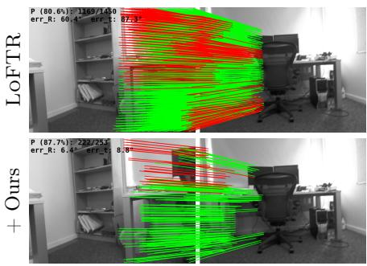

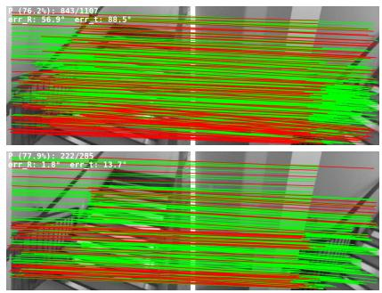

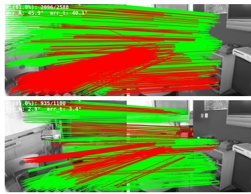  
Figure 3: Planar primitives as a stand-alone match filter. Three 7Scenes pairs, LoFTR (Sun et al., 2021) upstream. Top: raw LoFTR matches. Bottom: matches surviving the cut $\| \Delta \pmb { n } \| + | \Delta \dot { d } | \le 1$ Green/red mark RANSAC inliers/outliers; top-left numbers are inlier ratio and pose error.

## 4.2. Multi-View Refinement on Streaming Pose Estimators

Evaluation protocol. On ScanNet (Dai et al., 2017) and 7Scenes (Shotton et al., 2013) (zero-shot), we form N-frame trajectories at $N \in \{ 2 0 0 , 5 0 0 , 2 0 0 0 \}$ at frame gap 2; the streaming baseline ingests the first N frames unrefined and PosePlaner refines the last 100 pairwise. Both raw and refined per-pair (R, t) pass through the same multi-view backend (rotation averaging + fix-rotation Glomap-style positioner (Pan et al., 2024); full details in $\mathrm { A p p }$ . B.3), so the only diference is whether each input pair is refined. We evaluate four streaming reconstructors (CUT3R (Wang et al., 2025b), TTT3R (Chen et al., 2025), WinT3R (Li et al., 2025), Spann3R (Wang & Agapito, 2025)) and report pairwise rotation and translation AUC at $5 ^ { \circ }$ and $2 0 ^ { \circ }$ over the $\binom { 1 0 0 } { 2 }$ tail pairs.

Table 2: Controlled comparison with bundle adjustment. BA and PosePlaner use the same initial poses and MASt3R correspondences. R@5, R@10, and R@20 are rotation AUC at $5 ^ { \circ }$ , 10◦, and $2 0 ^ { \circ }$ (%, higher is better). Best results in each initialization group are bold. Table 1’s correspondence-based initializations have already undergone BA.
<table><tr><td rowspan="2">Initialization/ refinement</td><td colspan="3">ScanNet1500</td><td colspan="3">7Scenes</td></tr><tr><td>R@5</td><td>R@10</td><td>R@20</td><td>R@5</td><td>R@10</td><td>R@20</td></tr><tr><td>LoFTR (pre-BA)</td><td>11.5</td><td>25.2</td><td>44.1</td><td>17.8</td><td>34.3</td><td>53.4</td></tr><tr><td>+ BA</td><td>13.4</td><td>26.5</td><td>44.9</td><td>24.4</td><td>39.6</td><td>56.7</td></tr><tr><td>+ POSEPLANER</td><td>29.5</td><td>53.1</td><td>70.7</td><td>31.2</td><td>56.8</td><td>75.4</td></tr><tr><td>MAST3R (pre-BA)</td><td>66.0</td><td>82.1</td><td>90.9</td><td>49.6</td><td>72.7</td><td>86.1</td></tr><tr><td>+ BA</td><td>66.5</td><td>82.4</td><td>91.1</td><td>50.6</td><td>73.3</td><td>86.4</td></tr><tr><td>+ POSEPLANER</td><td>64.7</td><td>81.5</td><td>90.6</td><td>50.9</td><td>73.6</td><td>86.5</td></tr></table>

Quantitative results. Tab. 3 sweeps N to vary the drift entering refinement. At N=200 the baseline has accumulated little drift and refinement is roughly at parity, while at N=500 and especially N=2000 both rotation and translation AUC improve clearly across all four baselines on both datasets, with the gap widening monotonically with N. This converts streaming pose estimation from an unbounded-error regime into a bounded-error one at the cost of a single refinement pass over the last 100 frames.

Qualitative comparisons. Fig. 4 visualizes a representative ScanNet trajectory under our sliding window refinement protocol (full details in App. C.3). The raw streaming baselines (blue) drift progressively from ground truth (black); after refinement (red) the refined tail snaps back into close agreement across all three baselines (CUT3R, TTT3R, WinT3R), mirroring the tail-100-frame AUC improvements that Tab. 3 reports. Additional sequences are in App. C.3.

Zero-shot outdoor generalization. We evaluate zero-shot multi-view refinement on Oxford Spires (Tao et al., 2026) and MatrixCity (Li et al., 2023) with CUT3R and TTT3R at N ∈ {200, 500, 2000} (Tab. 4). Both the plane predictor and pose refiner are trained only on indoor data and kept frozen. Rotation AUC improves at N = 500 and N = 2000, while gains at N = 200 are less consistent and some translation metrics decline. Additional tests on CrossLoc (Yan et al., 2022) drone sequences at N = 200 and N = 500, together with trajectory construction details, are provided in App. C.1.

## 4.3. Ablation Study

We ablate PosePlaner along three axes within Tab. 5: (i) what conditioning the refiner needs $( w / o$ $\{ \pmb { g } _ { m } \} , \pmb { c } )$ , (ii) how the M+1 pose hypotheses are aggregated $( w / o$ score head, i.e., the softmax-weighted score-head fusion is replaced by a uniform average), and (iii) how the pose residual is parameterized $( w / o$ translation drops the translation channel from z0, leaving a rot-only $z _ { 0 } \in \mathbb { R } ^ { 6 }$ ; w/o rot6d replaces the rot6d rotation latent with a unit quaternion in $\mathbb { R } ^ { 4 } )$

Conditioning ablation. Removing the geometry tokens $\left\{ g _ { m } \right\}$ collapses performance to the init level: without per-match evidence the model can only reproduce the prior mean. Removing the pose token c (equivalently, replacing $T _ { \mathrm { i n i t } }$ with the identity) forces the model to estimate pose from scratch; the SuperGlue and LoFTR columns become identical since the upstream pose no longer enters the model. The model still recovers a reasonable pose from warping residuals alone, but consistently below the accuracy obtained with a real init.

Table 3: n-view pose accuracy on streaming ScanNet (Dai et al., 2017) and 7Scenes (Shotton et al., 2013). Pairwise R and t AUC at $5 ^ { \circ }$ and $2 0 ^ { \circ }$ over the $\binom { 1 0 0 } { 2 }$ pairs in the refined tail. Higher is better. † Tested zero-shot.
<table><tr><td rowspan="2">Method</td><td colspan="4">N=200</td><td colspan="4">N=500</td><td colspan="4">N=2000</td></tr><tr><td>R@5</td><td>R@20</td><td>t@5</td><td>t@20</td><td>R@5</td><td>R@20</td><td>t@5</td><td>t@20</td><td>R@5</td><td>R@20</td><td>t@5</td><td>t@20</td></tr><tr><td>ScanNet</td><td></td><td></td><td></td><td></td><td></td><td></td><td></td><td></td><td></td><td></td><td></td><td></td></tr><tr><td>CUT3R</td><td>23.3</td><td>65.0</td><td>4.1</td><td>24.0</td><td>16.5</td><td>55.7</td><td>2.2</td><td>19.0</td><td>17.3</td><td>53.4</td><td>1.0</td><td>13.2</td></tr><tr><td>CUT3R + POSEPLANER</td><td>40.5</td><td>80.3</td><td>7.7</td><td>38.0</td><td>37.3</td><td>78.9</td><td>6.3</td><td>38.4</td><td>37.3</td><td>79.8</td><td>3.4</td><td>31.2</td></tr><tr><td>TTT3R</td><td>46.2</td><td>83.1</td><td>11.1</td><td>42.7</td><td>36.1</td><td>79.3</td><td>8.0</td><td>38.7</td><td>27.5</td><td>72.5</td><td>3.4</td><td>28.6</td></tr><tr><td>TTT3R + POSEPLANER</td><td>50.7</td><td>85.6</td><td>10.8</td><td>45.9</td><td>47.1</td><td>84.3</td><td>10.8</td><td>47.3</td><td>48.2</td><td>85.0</td><td>10.4</td><td>41.8</td></tr><tr><td>WINT3R</td><td>37.7</td><td>77.1</td><td>8.4</td><td>37.4</td><td>28.3</td><td>66.3</td><td>5.5</td><td>28.8</td><td>19.2</td><td>48.6</td><td>3.1</td><td>16.8</td></tr><tr><td>WINT3R + POSEPLANER</td><td>45.9</td><td>83.7</td><td>9.5</td><td>42.7</td><td>42.5</td><td>80.7</td><td>7.8</td><td>41.3</td><td>27.9</td><td>65.0</td><td>3.9</td><td>20.8</td></tr><tr><td>SPANN3R</td><td>32.4</td><td>69.2</td><td>6.9</td><td>31.9</td><td>20.0</td><td>55.6</td><td>3.5</td><td>21.4</td><td>19.4</td><td>52.8</td><td>1.8</td><td>16.0</td></tr><tr><td>SPANN3R + POSEPLANER</td><td>45.6</td><td>82.2</td><td>9.3</td><td>42.2</td><td>38.8</td><td>76.4</td><td>7.0</td><td>37.1</td><td>37.1</td><td>77.4</td><td>4.2</td><td>30.9</td></tr><tr><td>7Scenes†</td><td></td><td></td><td></td><td></td><td></td><td></td><td></td><td></td><td></td><td></td><td></td><td></td></tr><tr><td>CUT3R</td><td>22.0</td><td>65.4</td><td>3.2</td><td>24.8</td><td>16.2</td><td>54.4</td><td>2.0</td><td>17.4</td><td>12.0</td><td>47.3</td><td>0.4</td><td>7.7</td></tr><tr><td>CUT3R + POSEPLANER</td><td>35.1</td><td>77.7</td><td>5.9</td><td>34.8</td><td>35.1</td><td>78.0</td><td>4.7</td><td>35.7</td><td>28.1</td><td>71.0</td><td>2.2</td><td>26.0</td></tr><tr><td>TTT3R</td><td>44.1</td><td>83.9</td><td>11.2</td><td>48.8</td><td>36.0</td><td>79.4</td><td>7.9</td><td>40.5</td><td>38.4</td><td>82.1</td><td>3.4</td><td>27.1</td></tr><tr><td>TTT3R + POSEPLANER</td><td>44.5</td><td>83.3</td><td>11.0</td><td>47.8</td><td>41.9</td><td>83.7</td><td>9.7</td><td>47.3</td><td>41.7</td><td>83.6</td><td>4.0</td><td>31.2</td></tr><tr><td>WINT3R</td><td>40.0</td><td>81.7</td><td>7.4</td><td>37.8</td><td>44.2</td><td>82.9</td><td>12.7</td><td>45.7</td><td>41.6</td><td>78.7</td><td>12.7</td><td>35.5</td></tr><tr><td>WINT3R + POSEPLANER</td><td>43.9</td><td>83.4</td><td>7.6</td><td>42.4</td><td>46.3</td><td>85.0</td><td>12.8</td><td>49.4</td><td>42.9</td><td>81.2</td><td>15.2</td><td>38.4</td></tr><tr><td>SPANN3R</td><td>34.5</td><td>77.2</td><td>7.7</td><td>37.3</td><td>35.7</td><td>76.5</td><td>8.1</td><td>38.9</td><td>39.6</td><td>77.0</td><td>9.2</td><td>32.5</td></tr><tr><td>SPANN3R + POSEPLANER</td><td>40.8</td><td>81.8</td><td>8.9</td><td>42.9</td><td>42.1</td><td>82.6</td><td>9.4</td><td>46.8</td><td>43.7</td><td>79.7</td><td>8.2</td><td>33.9</td></tr></table>

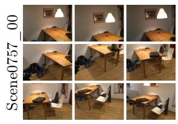

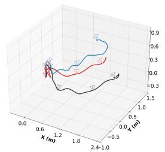  
CUT3R ± ours

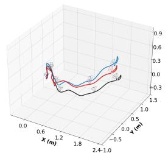  
TTT3R ± ours

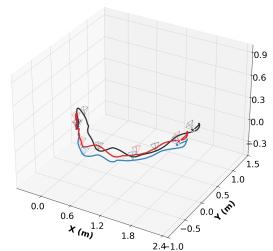  
WinT3R ± ours  
Figure 4: Streaming pose refinement on a representative ScanNet (Dai et al., 2017) sequence (Scene0757\_00). Left: sample frames. Right three panels: estimated camera trajectories under CUT3R (Wang et al., 2025b), TTT3R (Chen et al., 2025), and WinT3R (Li et al., 2025). Black: ground-truth; blue: raw baseline; red: after PosePlaner refinement. • start, × end.

Score-head fusion vs. uniform averaging. The $w / o$ score head variant uniform-averages the M+1 pose hypotheses instead of fusing them by the score head’s softmax weights. Performance drops: outlier hypotheses receive the same weight as well-aligned ones, whereas the score head learns to discount them via plane-warping cost (Eq. (9)).

Pose-residual parameterization matters. The $w / o$ translation variant drops the translation channel from the difusion residual (rot-only $z _ { 0 } \in \mathbb { R } ^ { 6 } )$ ; rotation accuracy degrades because the bilinear coupling between R and t in $\Delta d$ provides a contextual signal that tightens the rotation prediction. The $w / o$ rot6d variant replaces the continuous 6-D rotation representation (Zhou et al., 2019) with a unit quaternion in $\mathbb { R } ^ { 4 }$ and reduces rotation accuracy. Quaternions form a double cover of $\mathrm { S O } ( 3 )$ : q and $- q$ represent the same rotation. Choosing a unique quaternion for each rotation introduces discontinuities that can produce abrupt changes in Euclidean flow-matching targets. The continuous 6-D representation avoids this ambiguity. Appendix $\mathrm { A . 2 }$ provides the mathematical explanation.

Training objective. Flow matching with a single Euler step outperforms direct regression and 100- step DDPM in rotation and translation-direction AUC on ScanNet1500 with LoFTR initialization.

Table 4: Zero-shot outdoor multi-view refinement. R@5/R@20 and t@5/t@20 are rotation and translation-direction AUC at 5◦/20◦ (%, ↑). Better results within each pair are bold. † Tested zero-shot.
<table><tr><td rowspan="2">Method</td><td colspan="3">N = 200</td><td colspan="3"></td><td colspan="2">N = 500</td><td colspan="4">N = 2000</td></tr><tr><td>R@5</td><td>R@20</td><td>t@5</td><td>t@20</td><td>R@5</td><td>R@20</td><td>t@5</td><td>t@20</td><td>R@5</td><td>R@20</td><td>t@5</td><td>t@20</td></tr><tr><td>Oxford Spires†</td><td></td><td></td><td></td><td></td><td></td><td></td><td></td><td></td><td></td><td></td><td></td><td></td></tr><tr><td>CUT3R</td><td>59.1</td><td>85.1</td><td>28.9</td><td>66.2</td><td>35.5</td><td>75.7</td><td>8.1</td><td>52.5</td><td>34.0</td><td>70.1</td><td>11.6</td><td>46.5</td></tr><tr><td>CUT3R + POSEPLANER</td><td>65.8</td><td>90.8</td><td>33.5</td><td>70.5</td><td>50.4</td><td>82.8</td><td>22.4</td><td>64.1</td><td>53.3</td><td>85.8</td><td>22.7</td><td>67.4</td></tr><tr><td>TTT3R</td><td>73.6</td><td>92.7</td><td>45.8</td><td>77.3</td><td>59.7</td><td>88.5</td><td>27.5</td><td>74.9</td><td>37.2</td><td>76.5</td><td>11.4</td><td>53.2</td></tr><tr><td>TTT3R + POSEPLANER</td><td>72.3</td><td>92.5</td><td>42.0</td><td>74.9</td><td>62.9</td><td>89.2</td><td>29.8</td><td>74.0</td><td>51.3</td><td>85.6</td><td>19.9</td><td>67.9</td></tr><tr><td>MatrixCity†</td><td></td><td></td><td></td><td></td><td></td><td></td><td></td><td></td><td></td><td></td><td></td><td></td></tr><tr><td>CUT3R</td><td>13.2</td><td>48.5</td><td>4.8</td><td>20.1</td><td>12.4</td><td>49.3</td><td>3.1</td><td>15.9</td><td>9.9</td><td>40.4</td><td>3.7</td><td>15.2</td></tr><tr><td>CUT3R + POSEPLANER</td><td>16.4</td><td>55.6</td><td>5.6</td><td>22.8</td><td>15.1</td><td>53.5</td><td>3.5</td><td>17.8</td><td>15.5</td><td>54.0</td><td>8.2</td><td>22.2</td></tr><tr><td>TTT3R</td><td>18.1</td><td>52.7</td><td>5.2</td><td>18.8</td><td>10.5</td><td>45.3</td><td>4.3</td><td>18.7</td><td>12.7</td><td>47.2</td><td>3.8</td><td>15.8</td></tr><tr><td>TTT3R + POSEPLANER</td><td>20.6</td><td>56.9</td><td>6.6</td><td>23.0</td><td>14.4</td><td>49.7</td><td>5.2</td><td>19.4</td><td>17.2</td><td>54.5</td><td>7.3</td><td>20.2</td></tr></table>

Table 5: Ablation study on ScanNet1500 with SuperGlue and LoFTR upstream. R and t AUC at $\tau \in \{ 5 , 1 0 , 2 0 \} ^ { \circ }$ ; higher is better, best per column in bold. Removing the pose token c forces the model to estimate pose without the upstream init, so the SuperGlue and LoFTR blocks of that row are identical by construction.
<table><tr><td rowspan="2">Variant</td><td colspan="6">Init: SUPERGLUE</td><td colspan="6">Init: LoFTR</td></tr><tr><td>R@5</td><td>R@10</td><td>R@20</td><td>t@5</td><td>t@10</td><td>t@20</td><td>R@5</td><td>R@10</td><td>R@20</td><td>t@5</td><td>t@10</td><td>t@20</td></tr><tr><td>Full (ours)</td><td>48.9</td><td>68.9</td><td>82.1</td><td>21.5</td><td>40.4</td><td>59.5</td><td>29.4</td><td>52.9</td><td>70.6</td><td>3.5</td><td>9.0</td><td>18.4</td></tr><tr><td>w/o {gm}</td><td>43.0</td><td>61.7</td><td>76.0</td><td>21.3</td><td>39.6</td><td>58.0</td><td>11.5</td><td>25.1</td><td>44.2</td><td>2.1</td><td>5.6</td><td>13.0</td></tr><tr><td>w/o c</td><td>17.4</td><td>36.2</td><td>54.5</td><td>2.1</td><td>5.0</td><td>10.9</td><td>17.4</td><td>36.2</td><td>54.5</td><td>2.1</td><td>5.0</td><td>10.9</td></tr><tr><td>w/o score head</td><td>48.0</td><td>68.1</td><td>81.6</td><td>21.4</td><td>40.4</td><td>59.4</td><td>26.5</td><td>50.4</td><td>69.0</td><td>3.2</td><td>8.7</td><td>17.9</td></tr><tr><td>w/o translation</td><td>40.5</td><td>61.1</td><td>77.3</td><td>21.0</td><td>39.7</td><td>58.7</td><td>16.4</td><td>36.1</td><td>58.4</td><td>2.3</td><td>6.7</td><td>15.9</td></tr><tr><td>w/o rot6d</td><td>43.7</td><td>65.0</td><td>79.7</td><td>21.0</td><td>40.1</td><td>58.9</td><td>20.4</td><td>43.3</td><td>64.0</td><td>2.3</td><td>7.5</td><td>16.9</td></tr></table>

Appendix C.4 presents the quantitative results and experimental setup.

## 4.4. Limitations

PosePlaner relies on reliable planar evidence, so scenes with limited planar structure or inaccurate plane predictions can reduce refinement gains. The plane source is interchangeable: Appendix C.5 demonstrates refinement with MoGe-derived planes (Wang et al., 2025c), suggesting that improved geometry predictors could further benefit our method. For already-accurate initial poses, plane-prediction noise can outweigh the remaining opportunity for correction and cause slight regressions, as observed for ROMA and MASt3R on ScanNet1500 (Tab. 1). Refinement is therefore most useful when the initialization leaves substantial room for correction; it is not guaranteed to improve an already-near-optimal estimate.

## 5. Conclusion

We presented PosePlaner, a flow-matching pose refiner that restores correspondence–pose coupling in feed-forward 3-D reconstruction. It combines single-step rotation refinement conditioned on matched planar primitives with geometric translation recovery for two-view inputs. Trained on two-view pairs, the same refiner improves streaming multi-view poses without retraining. Experiments demonstrate gains across correspondence-based and difusion-based pose estimators and reduced drift in streaming reconstruction. Extending the conditioning to other geometric primitives is a promising direction for future work.

## References

Brachmann, E. and Rother, C. Learning less is more - 6d camera localization via 3d surface regression. In 2018 IEEE Conference on Computer Vision and Pattern Recognition, CVPR 2018, Salt Lake City, UT, USA, June 18-22, 2018, pp. 4654–4662. Computer Vision Foundation / IEEE Computer Society, 2018. doi: 10.1109/CVPR.2018.00489. URL http://openaccess.thecvf.com/content\_cvpr\_2018/ html/Brachmann\_Learning\_Less\_Is\_CVPR\_2018\_paper.html. 3

Brachmann, E. and Rother, C. Visual camera re-localization from RGB and RGB-D images using DSAC. IEEE Trans. Pattern Anal. Mach. Intell., 44(9):5847–5865, 2022. doi: 10.1109/TPAMI.2021.3070754. URL https://doi.org/10.1109/TPAMI.2021.3070754. 3

Brachmann, E., Krull, A., Nowozin, S., Shotton, J., Michel, F., Gumhold, S., and Rother, C. DSAC - diferentiable RANSAC for camera localization. In 2017 IEEE Conference on Computer Vision and Pattern Recognition, CVPR 2017, Honolulu, HI, USA, July 21-26, 2017, pp. 2492–2500. IEEE Computer Society, 2017. doi: 10.1109/CVPR.2017.267. URL https://doi.org/10.1109/CVPR.2017. 267. 3

Chang, A. X., Dai, A., Funkhouser, T. A., Halber, M., Nießner, M., Savva, M., Song, S., Zeng, A., and Zhang, Y. Matterport3d: Learning from RGB-D data in indoor environments. In 2017 International Conference on 3D Vision, 3DV 2017, Qingdao, China, October 10-12, 2017, pp. 667–676. IEEE Computer Society, 2017. doi: 10.1109/3DV.2017.00081. URL https://doi.org/10.1109/3DV.2017. 00081. 3, 7, 25

Chatterjee, A. and Govindu, V. M. Eficient and robust large-scale rotation averaging. In IEEE International Conference on Computer Vision, ICCV 2013, Sydney, Australia, December 1-8, 2013, pp. 521–528. IEEE Computer Society, 2013. doi: 10.1109/ICCV.2013.70. URL https://doi.org/10. 1109/ICCV.2013.70. 7, 24, 26

Chen, L.-Z., Gao, J., Chen, Y., Cheng, K. L., Sun, Y., Hu, L., Xue, N., Zhu, X., Shen, Y., Yao, Y., et al. Geometric context transformer for streaming 3d reconstruction. arXiv preprint arXiv:2604.14141, 2026. 3

Chen, X., Chen, Y., Xiu, Y., Geiger, A., and Chen, A. TTT3R: 3d reconstruction as test-time training. CoRR, abs/2509.26645, 2025. doi: 10.48550/ARXIV.2509.26645. URL https://doi.org/10.48550/ arXiv.2509.26645. 2, 3, 9, 10, 26

Dai, A., Chang, A. X., Savva, M., Halber, M., Funkhouser, T. A., and Nießner, M. Scannet: Richlyannotated 3d reconstructions of indoor scenes. In 2017 IEEE Conference on Computer Vision and Pattern Recognition, CVPR 2017, Honolulu, HI, USA, July 21-26, 2017, pp. 2432–2443. IEEE Computer Society, 2017. doi: 10.1109/CVPR.2017.261. URL https://doi.org/10.1109/CVPR.2017. 261. 3, 7, 8, 10, 23, 24

Dehghan, A., Baruch, G., Chen, Z., Feigin, Y., Fu, P., Gebauer, T., Kurz, D., Dimry, T., Jofe, B., Schwartz, A., and Shulman, E. Arkitscenes: A diverse real-world dataset for 3d indoor scene understanding using mobile RGB-D data. In Vanschoren, J. and Yeung, S. (eds.), Proceedings of the Neural Information Processing Systems Track on Datasets and Benchmarks 1, NeurIPS Datasets and Benchmarks 2021, December 2021, virtual, 2021. URL https://datasets-benchmarks-proceedings. neurips.cc/paper/2021/hash/66f041e16a60928b05a7e228a89c3799-Abstract-round1.html. 23, 24

Dosovitskiy, A., Beyer, L., Kolesnikov, A., Weissenborn, D., Zhai, X., Unterthiner, T., Dehghani, M., Minderer, M., Heigold, G., Gelly, S., Uszkoreit, J., and Houlsby, N. An image is worth 16x16 words: Transformers for image recognition at scale. In 9th International Conference on Learning Representations, ICLR 2021, Virtual Event, Austria, May 3-7, 2021. OpenReview.net, 2021. URL https://openreview.net/forum?id=YicbFdNTTy. 4

Edstedt, J., Sun, Q., Bökman, G., Wadenbäck, M., and Felsberg, M. Roma: Robust dense feature matching. In IEEE/CVF Conference on Computer Vision and Pattern Recognition, CVPR 2024, Seattle, WA, USA, June 16-22, 2024, pp. 19790–19800. IEEE, 2024. doi: 10.1109/CVPR52733.2024. 01871. URL https://doi.org/10.1109/CVPR52733.2024.01871. 2, 3, 4, 7, 8, 27

Fischler, M. A. and Bolles, R. C. Random sample consensus: A paradigm for model fitting with applications to image analysis and automated cartography. Commun. ACM, 24(6):381–395, 1981. doi: 10.1145/358669.358692. URL https://doi.org/10.1145/358669.358692. 2, 3

Hartley, R. I., Trumpf, J., Dai, Y., and Li, H. Rotation averaging. Int. J. Comput. Vis., 103(3):267–305, 2013. doi: 10.1007/S11263-012-0601-0. URL https://doi.org/10.1007/s11263-012-0601-0. 7, 24, 26

Ho, J., Jain, A., and Abbeel, P. Denoising difusion probabilistic models. In Larochelle, H., Ranzato, M., Hadsell, R., Balcan, M., and Lin, H. (eds.), Advances in Neural Information Processing Systems 33: Annual Conference on Neural Information Processing Systems 2020, NeurIPS 2020, December 6-12, 2020, virtual, 2020. URL https://proceedings.neurips.cc/paper/2020/hash/ 4c5bcfec8584af0d967f1ab10179ca4b-Abstract.html. 3, 21

Hu, M., Yin, W., Zhang, C., Cai, Z., Long, X., Chen, H., Wang, K., Yu, G., Shen, C., and Shen, S. Metric3d v2: A versatile monocular geometric foundation model for zero-shot metric depth and surface normal estimation. IEEE Trans. Pattern Anal. Mach. Intell., 46(12):10579–10596, 2024. doi: 10.1109/TPAMI.2024.3444912. URL https://doi.org/10.1109/TPAMI.2024.3444912. 23

Jin, L., Qian, S., Owens, A., and Fouhey, D. F. Planar surface reconstruction from sparse views. In 2021 IEEE/CVF International Conference on Computer Vision, ICCV 2021, Montreal, QC, Canada, October 10-17, 2021, pp. 12971–12980. IEEE, 2021. doi: 10.1109/ICCV48922.2021.01275. URL https://doi.org/10.1109/ICCV48922.2021.01275. 3, 7, 25, 26

Kerbl, B., Kopanas, G., Leimkühler, T., and Drettakis, G. 3d gaussian splatting for real-time radiance field rendering. ACM Trans. Graph., 42(4):139:1–139:14, 2023. doi: 10.1145/3592433. URL https: //doi.org/10.1145/3592433. 2

Lan, Y., Luo, Y., Hong, F., Zhou, S., Chen, H., Lyu, Z., Yang, S., Dai, B., Loy, C. C., and Pan, X. Stream3r: Scalable sequential 3d reconstruction with causal transformer. CoRR, abs/2508.10893, 2025. doi: 10.48550/ARXIV.2508.10893. URL https://doi.org/10.48550/arXiv.2508.10893. 3

Leroy, V., Cabon, Y., and Revaud, J. Grounding image matching in 3d with mast3r. In Leonardis, A., Ricci, E., Roth, S., Russakovsky, O., Sattler, T., and Varol, G. (eds.), Computer Vision - ECCV 2024 - 18th European Conference, Milan, Italy, September 29-October 4, 2024, Proceedings, Part LXXII, Lecture Notes in Computer Science, pp. 71–91. Springer, 2024. doi: 10.1007/978-3-031-73220-1\_5. URL https://doi.org/10.1007/978-3-031-73220-1\_5. 2, 3, 4, 7, 8, 23, 27

Li, Y., Jiang, L., Xu, L., Xiangli, Y., Wang, Z., Lin, D., and Dai, B. Matrixcity: A large-scale city dataset for city-scale neural rendering and beyond. In IEEE/CVF International Conference on Computer Vision, ICCV 2023, Paris, France, October 1-6, 2023, pp. 3182–3192. IEEE, 2023. doi: 10.1109/ICCV51070.2023.00297. URL https://doi.org/10.1109/ICCV51070.2023.00297. 9, 25

Li, Z., Zhou, J., Wang, Y., Guo, H., Chang, W., Zhou, Y., Zhu, H., Chen, J., Shen, C., and He, T. Wint3r: Window-based streaming reconstruction with camera token pool. CoRR, abs/2509.05296, 2025. doi: 10.48550/ARXIV.2509.05296. URL https://doi.org/10.48550/arXiv.2509.05296. 3, 9, 10, 26

Lipman, Y., Chen, R. T. Q., Ben-Hamu, H., Nickel, M., and Le, M. Flow matching for generative modeling. In The Eleventh International Conference on Learning Representations, ICLR 2023, Kigali, Rwanda, May 1-5, 2023. OpenReview.net, 2023. URL https://openreview.net/forum?id=PqvMRDCJT9t. 2, 3, 4, 21

Liu, C., Yang, J., Ceylan, D., Yumer, E., and Furukawa, Y. Planenet: Piece-wise planar reconstruction from a single RGB image. In 2018 IEEE Conference on Computer Vision and Pattern Recognition, CVPR 2018, Salt Lake City, UT, USA, June 18-22, 2018, pp. 2579–2588. Computer Vision Foundation / IEEE Computer Society, 2018. doi: 10.1109/CVPR.2018.00273. URL http://openaccess.thecvf. com/content\_cvpr\_2018/html/Liu\_PlaneNet\_Piece-Wise\_Planar\_CVPR\_2018\_paper.html. 3

Liu, C., Kim, K., Gu, J., Furukawa, Y., and Kautz, J. Planercnn: 3d plane detection and reconstruction from a single image. In IEEE Conference on Computer Vision and Pattern Recognition, CVPR 2019, Long Beach, CA, USA, June 16-20, 2019, pp. 4450–4459. Computer Vision Foundation / IEEE, 2019. doi: 10.1109/CVPR.2019. 00458. URL http://openaccess.thecvf.com/content\_CVPR\_2019/html/Liu\_PlaneRCNN\_3D\_ Plane\_Detection\_and\_Reconstruction\_From\_a\_Single\_Image\_CVPR\_2019\_paper.html. 3

Liu, C., Tan, B., Ke, Z., Zhang, S., Liu, J., Qian, M., Xue, N., Shen, Y., and Braud, T. PLANA3R: zero-shot metric planar 3d reconstruction via feed-forward planar splatting. CoRR, abs/2510.18714, 2025a. doi: 10.48550/ARXIV.2510.18714. URL https://doi.org/10.48550/arXiv.2510.18714. 2, 3, 4, 22, 23, 24

Liu, J., Yu, R., Chen, S., Huang, S. X., and Guo, H. Towards in-the-wild 3d plane reconstruction from a single image. In IEEE/CVF Conference on Computer Vision and Pattern Recognition, CVPR 2025, Nashville, TN, USA, June 11-15, 2025, pp. 27027– 27037. Computer Vision Foundation / IEEE, 2025b. doi: 10.1109/CVPR52734.2025.02517. URL https://openaccess.thecvf.com/content/CVPR2025/html/Liu\_Towards\_In-the-wild\_3D\_ Plane\_Reconstruction\_from\_a\_Single\_Image\_CVPR\_2025\_paper.html. 3

Liu, X., Gong, C., and Liu, Q. Flow straight and fast: Learning to generate and transfer data with rectified flow. In The Eleventh International Conference on Learning Representations, ICLR 2023, Kigali, Rwanda, May 1-5, 2023. OpenReview.net, 2023. URL https://openreview.net/forum?id= XVjTT1nw5z. 2, 3, 4, 21

Loshchilov, I. and Hutter, F. Decoupled weight decay regularization. In 7th International Conference on Learning Representations, ICLR 2019, New Orleans, LA, USA, May 6-9, 2019. OpenReview.net, 2019. URL https://openreview.net/forum?id=Bkg6RiCqY7. 23

Mildenhall, B., Srinivasan, P. P., Tancik, M., Barron, J. T., Ramamoorthi, R., and Ng, R. Nerf: representing scenes as neural radiance fields for view synthesis. Commun. ACM, 65(1):99–106, 2022. doi: 10.1145/3503250. URL https://doi.org/10.1145/3503250. 2

Mur-Artal, R., Montiel, J. M. M., and Tardós, J. D. ORB-SLAM: A versatile and accurate monocular SLAM system. IEEE Trans. Robotics, 31(5):1147–1163, 2015. doi: 10.1109/TRO.2015.2463671. URL https://doi.org/10.1109/TRO.2015.2463671. 2, 3

Nistér, D. An eficient solution to the five-point relative pose problem. IEEE Trans. Pattern Anal. Mach. Intell., 26(6):756–777, 2004. doi: 10.1109/TPAMI.2004.17. URL https://doi.org/10.1109/TPAMI. 2004.17. 2, 3

Pan, L., Baráth, D., Pollefeys, M., and Schönberger, J. L. Global structure-from-motion revisited. In Leonardis, A., Ricci, E., Roth, S., Russakovsky, O., Sattler, T., and Varol, G. (eds.), Computer Vision - ECCV 2024 - 18th European Conference, Milan, Italy, September 29-October 4, 2024, Proceedings, Part XL, Lecture Notes in Computer Science, pp. 58–77. Springer, 2024. doi: 10.1007/978-3-031-73661-2\_4. URL https://doi.org/10.1007/978-3-031-73661-2\_4. 7, 9, 24, 25, 26

Peebles, W. and Xie, S. Scalable difusion models with transformers. In IEEE/CVF International Conference on Computer Vision, ICCV 2023, Paris, France, October 1-6, 2023, pp. 4172–4182. IEEE, 2023. doi: 10.1109/ICCV51070.2023.00387. URL https://doi.org/10.1109/ICCV51070.2023.00387. 2

Sarlin, P., DeTone, D., Malisiewicz, T., and Rabinovich, A. Superglue: Learning feature matching with graph neural networks. In 2020 IEEE/CVF Conference on Computer Vision and Pattern Recognition, CVPR 2020, Seattle, WA, USA, June 13-19, 2020, pp. 4937– 4946. Computer Vision Foundation / IEEE, 2020. doi: 10.1109/CVPR42600.2020.00499. URL https://openaccess.thecvf.com/content\_CVPR\_2020/html/Sarlin\_SuperGlue\_Learning\_ Feature\_Matching\_With\_Graph\_Neural\_Networks\_CVPR\_2020\_paper.html. 2, 3, 4, 7, 8, 26, 27

Savva, M., Malik, J., Parikh, D., Batra, D., Kadian, A., Maksymets, O., Zhao, Y., Wijmans, E., Jain, B., Straub, J., Liu, J., and Koltun, V. Habitat: A platform for embodied AI research. In 2019 IEEE/CVF International Conference on Computer Vision, ICCV 2019, Seoul, Korea (South), October 27 - November 2, 2019, pp. 9338–9346. IEEE, 2019. doi: 10.1109/ICCV.2019.00943. URL https://doi.org/10.1109/ICCV.2019.00943. 23, 24

Schönberger, J. L. and Frahm, J. Structure-from-motion revisited. In 2016 IEEE Conference on Computer Vision and Pattern Recognition, CVPR 2016, Las Vegas, NV, USA, June 27-30, 2016, pp. 4104–4113. IEEE Computer Society, 2016. doi: 10.1109/CVPR.2016.445. URL https://doi.org/10. 1109/CVPR.2016.445. 2, 3

Shi, J., Zhi, S., and Xu, K. Planerectr: Unified query learning for 3d plane recovery from a single view. In IEEE/CVF International Conference on Computer Vision, ICCV 2023, Paris, France, October 1-6, 2023, pp. 9343–9352. IEEE, 2023. doi: 10.1109/ICCV51070.2023.00860. URL https: //doi.org/10.1109/ICCV51070.2023.00860. 3

Shotton, J., Glocker, B., Zach, C., Izadi, S., Criminisi, A., and Fitzgibbon, A. W. Scene coordinate regression forests for camera relocalization in RGB-D images. In 2013 IEEE Conference on Computer Vision and Pattern Recognition, Portland, OR, USA, June 23-28, 2013, pp. 2930–2937. IEEE Computer Society, 2013. doi: 10.1109/CVPR.2013.377. URL https://doi.org/10.1109/CVPR.2013.377. 7, 8, 10

Sun, J., Shen, Z., Wang, Y., Bao, H., and Zhou, X. Loftr: Detector-free local feature matching with transformers. In IEEE Conference on Computer Vision and Pattern Recognition, CVPR 2021, virtual, June 19-25, 2021, pp. 8922–8931. Computer Vision Foundation / IEEE, 2021. doi: 10.1109/ CVPR46437.2021.00881. URL https://openaccess.thecvf.com/content/CVPR2021/html/Sun\_ LoFTR\_Detector-Free\_Local\_Feature\_Matching\_With\_Transformers\_CVPR\_2021\_paper.html. 2, 3, 4, 7, 8, 26, 27

Tan, B., Xue, N., Wu, T., and Xia, G. NOPE-SAC: neural one-plane RANSAC for sparse-view planar 3d reconstruction. IEEE Trans. Pattern Anal. Mach. Intell., 45(12):15233–15248, 2023. doi: 10.1109/TPAMI.2023.3314745. URL https://doi.org/10.1109/TPAMI.2023.3314745. 3, 6, 7, 19

Tan, B., Yu, R., Shen, Y., and Xue, N. Planarsplatting: Accurate planar surface reconstruction in 3 minutes. In IEEE/CVF Conference on Computer Vision and Pattern Recognition, CVPR 2025, Nashville, TN, USA, June 11-15, 2025, pp. 1190– 1199. Computer Vision Foundation / IEEE, 2025. doi: 10.1109/CVPR52734.2025. 00119. URL https://openaccess.thecvf.com/content/CVPR2025/html/Tan\_PlanarSplatting\_ Accurate\_Planar\_Surface\_Reconstruction\_in\_3\_Minutes\_CVPR\_2025\_paper.html. 3, 22

Tao, Y., Muñoz-Bañón, M. Á., Zhang, L., Wang, J., Fu, L. F. T., and Fallon, M. The oxford spires dataset: Benchmarking large-scale lidar-visual localisation, reconstruction and radiance field methods. Int. J. Robotics Res., 45(6):839–857, 2026. doi: 10.1177/02783649251369905. URL https://doi.org/10.1177/02783649251369905. 9, 25

Vaswani, A., Shazeer, N., Parmar, N., Uszkoreit, J., Jones, L., Gomez, A. N., Kaiser, L., and Polosukhin, I. Attention is all you need. In Guyon, I., von Luxburg, U., Bengio, S., Wallach, H. M., Fergus, R., Vishwanathan, S. V. N., and Garnett, R. (eds.), Advances in Neural Information Processing Systems 30: Annual Conference on Neural Information Processing Systems 2017, December 4-9, 2017, Long Beach, CA, USA, pp. 5998–6008, 2017. URL https://proceedings.neurips.cc/paper/2017/hash/ 3f5ee243547dee91fbd053c1c4a845aa-Abstract.html. 2

Wang, H. and Agapito, L. 3d reconstruction with spatial memory. In International Conference on 3D Vision, 3DV 2025, Singapore, March 25-28, 2025, pp. 78–89. IEEE, 2025. doi: 10.1109/3DV66043. 2025.00013. URL https://doi.org/10.1109/3DV66043.2025.00013. 3, 9

Wang, J., Rupprecht, C., and Novotný, D. Posedifusion: Solving pose estimation via difusion-aided bundle adjustment. In IEEE/CVF International Conference on Computer Vision, ICCV 2023, Paris, France, October 1-6, 2023, pp. 9739–9749. IEEE, 2023. doi: 10.1109/ICCV51070.2023.00896. URL https://doi.org/10.1109/ICCV51070.2023.00896. 3, 7, 8

Wang, J., Chen, M., Karaev, N., Vedaldi, A., Rupprecht, C., and Novotný, D. VGGT: visual geometry grounded transformer. In IEEE/CVF Conference on Computer Vision and Pattern Recognition, CVPR 2025, Nashville, TN, USA, June 11-15, 2025, pp. 5294–5306. Computer Vision Foundation / IEEE, 2025a. doi: 10.1109/CVPR52734.2025.00499. URL https://openaccess.thecvf.com/content/ CVPR2025/html/Wang\_VGGT\_Visual\_Geometry\_Grounded\_Transformer\_CVPR\_2025\_paper.html. 2, 3

Wang, Q., Zhang, Y., Holynski, A., Efros, A. A., and Kanazawa, A. Continuous 3d perception model with persistent state. In IEEE/CVF Conference on Computer Vision and Pattern Recognition, CVPR 2025, Nashville, TN, USA, June 11-15, 2025, pp. 10510–10522. Computer Vision Foundation / IEEE, 2025b. doi: 10.1109/CVPR52734.2025. 00983. URL https://openaccess.thecvf.com/content/CVPR2025/html/Wang\_Continuous\_3D\_ Perception\_Model\_with\_Persistent\_State\_CVPR\_2025\_paper.html. 2, 3, 9, 10, 26

Wang, R., Xu, S., Dai, C., Xiang, J., Deng, Y., Tong, X., and Yang, J. Moge: Unlocking accurate monocular geometry estimation for open-domain images with optimal training supervision. In IEEE/CVF Conference on Computer Vision and Pattern Recognition, CVPR 2025, Nashville, TN, USA, June 11-15, 2025, pp. 5261–5271. Computer Vision Foundation / IEEE, 2025c. doi: 10.1109/CVPR52734.2025.00496. URL https://openaccess.thecvf.com/content/CVPR2025/html/Wang\_MoGe\_Unlocking\_Accurate\_ Monocular\_Geometry\_Estimation\_for\_Open-Domain\_Images\_with\_CVPR\_2025\_paper.html. 11, 27

Wang, S., Leroy, V., Cabon, Y., Chidlovskii, B., and Revaud, J. Dust3r: Geometric 3d vision made easy. In IEEE/CVF Conference on Computer Vision and Pattern Recognition, CVPR 2024, Seattle, WA, USA, June 16-22, 2024, pp. 20697–20709. IEEE, 2024. doi: 10.1109/CVPR52733.2024.01956. URL https://doi.org/10.1109/CVPR52733.2024.01956. 2, 3

Xie, Y., Gadelha, M., Yang, F., Zhou, X., and Jiang, H. Planarrecon: Real-time 3d plane detection and reconstruction from posed monocular videos. CoRR, abs/2206.07710, 2022. doi: 10.48550/ARXIV. 2206.07710. URL https://doi.org/10.48550/arXiv.2206.07710. 3

Yan, Q., Zheng, J., Reding, S., Li, S., and Doytchinov, I. Crossloc: Scalable aerial localization assisted by multimodal synthetic data. In IEEE/CVF Conference on Computer Vision and Pattern Recognition, CVPR 2022, New Orleans, LA, USA, June 18-24, 2022, pp. 17337–17347. IEEE, 2022. doi: 10.1109/CVPR52688.2022.01684. URL https://doi.org/10.1109/CVPR52688.2022.01684. 9, 26

Yao, Y., Luo, Z., Li, S., Fang, T., and Quan, L. Mvsnet: Depth inference for unstructured multi-view stereo. In Ferrari, V., Hebert, M., Sminchisescu, C., and Weiss, Y. (eds.), Computer Vision - ECCV 2018 - 15th European Conference, Munich, Germany, September 8-14, 2018, Proceedings, Part VIII, Lecture Notes in Computer Science, pp. 785–801. Springer, 2018. doi: 10.1007/978-3-030-01237-3\_47. URL https://doi.org/10.1007/978-3-030-01237-3\_47. 2

Yeshwanth, C., Liu, Y., Nießner, M., and Dai, A. Scannet++: A high-fidelity dataset of 3d indoor scenes. In IEEE/CVF International Conference on Computer Vision, ICCV 2023, Paris, France, October 1-6, 2023, pp. 12–22. IEEE, 2023. doi: 10.1109/ICCV51070.2023.00008. URL https: //doi.org/10.1109/ICCV51070.2023.00008. 23, 24

Yu, Z., Zheng, J., Lian, D., Zhou, Z., and Gao, S. Single-image piece-wise planar 3d reconstruction via associative embedding. In IEEE Conference on Computer Vision and Pattern Recognition, CVPR 2019, Long Beach, CA, USA, June 16-20, 2019, pp. 1029–1037. Computer Vision Foundation / IEEE, 2019. doi: 10.1109/CVPR.2019.00112. URL http://openaccess.thecvf.com/content\_CVPR\_2019/html/Yu\_Single-Image\_Piece-Wise\_ Planar\_3D\_Reconstruction\_via\_Associative\_Embedding\_CVPR\_2019\_paper.html. 3

Yuan, S., Yang, Y., Yang, X., Zhang, X., Zhao, Z., Zhang, L., and Zhang, Z. Infinitevggt: Visual geometry grounded transformer for endless streams. CoRR, abs/2601.02281, 2026. doi: 10.48550/ ARXIV.2601.02281. URL https://doi.org/10.48550/arXiv.2601.02281. 3

Zhang, J. Y., Lin, A., Kumar, M., Yang, T., Ramanan, D., and Tulsiani, S. Cameras as rays: Pose estimation via ray difusion. In The Twelfth International Conference on Learning Representations, ICLR 2024, Vienna, Austria, May 7-11, 2024. OpenReview.net, 2024. URL https://openreview. net/forum?id=EanCFCwAjM. 3, 7, 8

Zhao, Q., Lin, A., Tan, J., Zhang, J. Y., Ramanan, D., and Tulsiani, S. Difusionsfm: Predicting structure and motion via ray origin and endpoint difusion. In IEEE/CVF Conference on Computer Vision and Pattern Recognition, CVPR 2025, Nashville, TN, USA, June 11-15, 2025, pp. 6317–6326. Computer Vision Foundation / IEEE, 2025. doi: 10.1109/CVPR52734. 2025.00592. URL https://openaccess.thecvf.com/content/CVPR2025/html/Zhao\_DiffusionSfM\_ Predicting\_Structure\_and\_Motion\_via\_Ray\_Origin\_and\_Endpoint\_CVPR\_2025\_paper.html. 3, 7, 8

Zhao, W., Liu, J., Zhang, S., Li, Y., Chen, S., Huang, S. X., Liu, Y., and Guo, H. Monoplane: Exploiting monocular geometric cues for generalizable 3d plane reconstruction. In IEEE/RSJ International Conference on Intelligent Robots and Systems, IROS 2024, Abu Dhabi, United Arab Emirates, October 14-18, 2024, pp. 8481–8488. IEEE, 2024. doi: 10.1109/IROS58592.2024.10802672. URL https: //doi.org/10.1109/IROS58592.2024.10802672. 3

Zhou, Y., Barnes, C., Lu, J., Yang, J., and Li, H. On the continuity of rotation representations in neural networks. In IEEE Conference on Computer Vision and Pattern Recognition, CVPR 2019, Long Beach, CA, USA, June 16-20, 2019, pp. 5745–5753. Computer Vision Foundation / IEEE, 2019. doi: 10.1109 CVPR.2019.00589. URL http://openaccess.thecvf.com/content\_CVPR\_2019/html/Zhou\_On\_the\_ Continuity\_of\_Rotation\_Representations\_in\_Neural\_Networks\_CVPR\_2019\_paper.html. 5, 10, 20

Zhuo, D., Zheng, W., Guo, J., Wu, Y., Zhou, J., and Lu, J. Streaming 4d visual geometry transformer. CoRR, abs/2507.11539, 2025. doi: 10.48550/ARXIV.2507.11539. URL https://doi.org/10.48550/ arXiv.2507.11539. 3

## Appendix Contents

A Geometric and Algorithmic Foundations 19   
A.1 Plane-Warping Residuals as Conditioning Signal 19   
A.2 Rotation as a Continuous 6-D Representation 20   
A.3 Flow Matching as a Linear Denoising Process 21   
B Model and Training Details 22   
B.1 Plane Head Training Details 22   
B.2 Refiner Architecture Details 23   
B.3 Training and Inference Details 23   
C Additional Evaluation Setup and Results 25   
C.1 Pair and Sequence Construction . 25   
C.2 External Match-Source Sensitivity 26   
C.3 Additional Streaming Trajectories 26   
C.4 Training Objective Comparison 27   
C.5 Alternative Plane Source 27   
D Social Impacts 28

## Technical Appendices and Supplementary Material

## A. Geometric and Algorithmic Foundations

This section formalizes three pieces of background that the main text builds on: the plane-warping residuals used as conditioning (Sec. A.1), the continuous 6-D rotation representation carried by the pose latent (Sec. A.2), and the flow-matching parameterization under which a single Euler step at inference is suficient (Sec. A.3).

## A.1. Plane-Warping Residuals as Conditioning Signal

Vanishing at the true pose; monotonic away from it. Let $\pmb { e } _ { n } ( R ) : = \pmb { n } _ { 1 } - R \pmb { n } _ { 2 }$ and $e _ { d } ( R , t ) : =$ $d _ { 1 } - d _ { 2 } + ( R { \pmb n } _ { 2 } ) ^ { \top } { \pmb t }$ denote the (vector / signed) raw residuals whose norm and absolute value are the $\Delta n$ and $\Delta d$ of Eq. (2). By construction, $e _ { n } ( \dot { R } _ { \mathrm { g t } } ) = { \bf 0 }$ and $e _ { d } ( R _ { \mathrm { g t } } , t _ { \mathrm { g t } } ) = 0$ identically. Under a joint first-order perturbation $R = \exp ( [ \delta \pmb { r } ] _ { \times } ) R _ { \mathrm { g t } }$ and $\mathbf { \check { t } } = \mathbf { \check { t } } _ { \mathrm { g t } } + \delta \mathbf { \check { t } }$ , these raw residuals expand to

$$
{ \pmb e } _ { n } ( { \boldsymbol { R } } ) \approx - [ \delta { \pmb r } ] \times { \boldsymbol { R } } _ { \mathrm { g t } } { \pmb n } _ { \mathrm { 2 } } ,\tag{14}
$$

$$
\begin{array} { r } { e _ { d } ( R , t ) \ \approx \ \left( R _ { \mathrm { g t } } \pmb { n } _ { 2 } \right) ^ { \top } \delta \pmb { t } \ + \ \left( \left[ \delta \pmb { r } \right] _ { \times } R _ { \mathrm { g t } } \pmb { n } _ { 2 } \right) ^ { \top } \pmb { t } _ { \mathrm { g t } } . } \end{array}\tag{15}
$$

$\Delta n = \| e _ { n } \| _ { 2 }$ is therefore linear in the rotation error along the angle between $\delta r$ and $R _ { \mathrm { g t } } { \boldsymbol { n } } _ { \mathrm { 2 } } ; \Delta d = | e _ { d } |$ contains a translation-only probe along the direction $R _ { \mathrm { g t } } n _ { 2 }$ plus a rotation-coupled term whose strength scales with $\| \pmb { t } _ { \mathrm { g t } } \|$ . A set of M correspondences with diverse normals therefore exposes the full $\delta r / \delta t$ error along M diferent directions, efectively a dense per-direction error map.

Estimator-agnostic by construction. Eqs. (14)–(15) read the residuals of paired plane primitives and a candidate pose alone, with no dependency on how that pose was produced. The same conditioning signal is therefore presented to the refiner regardless of upstream—feed-forward network, matcher-plus solver, or identity initialization.

Empirical verification: the refiner implicitly learns the warp. In contrast to NopeSAC (Tan et al., 2023), which explicitly warps view-1’s plane parameters by the initial pose to feed the network a pre-aligned representation, PosePlaner provides only the raw per-view primitives $( { \pmb n } _ { m } ^ { 1 } , \bar { d } _ { m } ^ { 1 } , { \pmb n } _ { m } ^ { 2 } , \bar { d } _ { m } ^ { 2 } )$ in each camera’s own local frame; the warping residuals $( \Delta n , \Delta d )$ enter only as detached geometric weights $\omega _ { m } \ ( { \mathrm { E q . ~ } } \left( 8 \right) )$ and the auxiliary $\mathcal { L } _ { \mathrm { g e o } } ^ { \mathrm { ~ - ~ } } ( \mathrm { E q . ~ ( 1 1 ) } )$ , never as inputs. This setup encourages the network to learn the warping algebra from the geometric supervision rather than rely on input-space normalization. Fig. 5 suggests the network does pick up this implicit warp: across all matched plane pairs, both histograms collapse markedly toward zero after refinement—median $\| \Delta \pmb { n } \| _ { 2 }$ drops from 0.200 to 0.084 and median $| \Delta d |$ from 0.072 to 0.064—even though neither residual is fed in, and the efect transfers across ScanNet1500 (in-distribution) and 7Scenes (zero-shot).

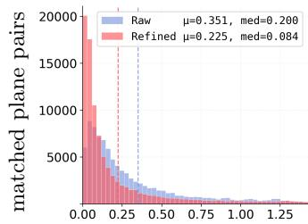

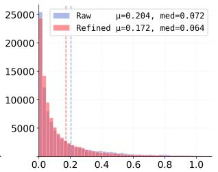

(a) ScanNet1500, upstream = LoFTR  
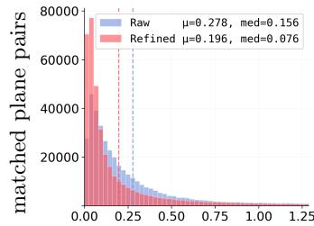

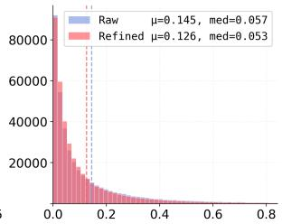  
(b) 7Scenes, upstream = LoFTR  
Figure 5: Refinement collapses the plane-warping residuals. (a) ScanNet1500 and (b) 7Scenes, LoFTR upstream. Each sub-figure: $\| \Delta \boldsymbol { n } \| _ { 2 }$ (left) and $| \Delta d |$ (right, scene-normalized) over all matched plane pairs; blue = raw, red = after PosePlaner; dashed lines mark means.

## A.2. Rotation as a Continuous 6-D Representation

The rotation part of the pose residual $z _ { \mathrm { 0 } }$ in $\operatorname { E q . }$ (6) is encoded in the 6-D representation of Zhou et al. (2019), not as a unit quaternion. Under a flow-matching objective this choice is forced, not cosmetic: quaternions carry a topological discontinuity that interacts destructively with continuous probability paths.

Formal definition of a continuous representation. Following Zhou et al. (2019), a representation of SO(3) with domain $X \subseteq \mathbb { R } ^ { d }$ is a pair of maps

$$
f : \mathrm { S O } ( 3 ) \to X , \qquad g : X \to \mathrm { S O } ( 3 ) , \qquad g \circ f = \mathrm { i d } _ { \mathrm { S O } ( 3 ) } ,\tag{16}
$$

and the representation is continuous when both $f$ and g are continuous under the Euclidean topology of $\mathbb { R } ^ { d }$ . Neural networks are continuous under this topology, so a discontinuous $g$ forces the network to reproduce a discontinuity somewhere inside its training support.

The $d \leq 4$ obstruction. Zhou et al. (2019) prove that no continuous representation of $\mathrm { S O ( 3 ) }$ exists for $d \leq 4$ . Concretely, the discontinuity always lives in the encoder $f ,$ since the polynomial decoders typically used for these representations are themselves continuous:

• Euler angles $\scriptstyle ( d = 3 )$ have a gimbal-lock singularity where $f$ is not unique and $g$ is not one-to-one.

• Axis-angle $\scriptstyle ( d = 3 )$ maps $\mathrm { S O ( 3 ) }$ to a closed ball of radius $\pi .$ , with antipodal points on the boundary $\| \boldsymbol { r } \| = \pi$ identified to the same rotation; the encoder f must therefore choose one of the two boundary representatives, creating a sign-flip discontinuity at $\| \boldsymbol { r } \| = \pi$

• Unit quaternions $( d { = } 4 )$ form a double cover of $\mathrm { S O ( 3 ) }$ : every R maps to an antipodal pair $\pm \pmb { q }$ on $S ^ { 3 }$ . The decoder $g : { \dot { \mathbb { R } } } ^ { 4 } \to \mathrm { \tilde { S } O } ( 3 )$ is the standard quaternion-to-matrix polynomial, which is continuous everywhere; the obstruction lies in the encoder ${ \bar { f } } : \mathrm { S O } ( 3 )  S ^ { 3 }$ , which must select one of $\pm \pm$ globally and therefore admits no continuous global section—arbitrarily close rotations either side of the chosen branch are encoded to far-apart quaternions of opposite sign.

SO(3) is compact and topologically non-trivial, so no homeomorphism to $\mathbb { R } ^ { d }$ exists for any finite $d ;$ a continuous embedding is the best one can hope for, and Zhou et al. (2019) show $d = 5$ is the minimum $( d = 6$ is the simplest practical construction).

The 6-D continuous representation. The encoder drops the third column of $R _ { : }$

$$
f \big ( [ \pmb { r } _ { 1 } | \pmb { r } _ { 2 } | \pmb { r } _ { 3 } ] \big ) = [ \pmb { r } _ { 1 } ; \pmb { r } _ { 2 } ] \in \mathbb { R } ^ { 6 } .\tag{17}
$$

The decoder $g : \mathbb { R } ^ { 6 }  \mathrm { S O } ( 3 )$ is Gram–Schmidt orthonormalization on the two column vectors: given $( \pmb { a } _ { 1 } , \pmb { a } _ { 2 } ) \in \mathbb { R } ^ { 3 } \times \mathbb { R } ^ { 3 }$ linearly independent,

$$
b _ { 1 } = N ( { \pmb a } _ { 1 } ) , \quad b _ { 2 } = N \big ( { \pmb a } _ { 2 } - ( { \pmb b } _ { 1 } \cdot { \pmb a } _ { 2 } ) { \pmb b } _ { 1 } \big ) , \quad b _ { 3 } = b _ { 1 } \times b _ { 2 } ,\tag{18}
$$

with $g ( \pmb { a } _ { 1 } , \pmb { a } _ { 2 } ) = [ \pmb { b } _ { 1 } \ | \ \pmb { b } _ { 2 } \ | \ \pmb { b } _ { 3 } ]$ and $N ( \pmb { v } ) = \pmb { v } / \| \pmb { v } \| _ { 2 }$ . Both $f$ and $g$ are continuous on the full-measure open subset of $\mathbb { R } ^ { 6 }$ where ${ \mathbf { } } a _ { 1 } , a _ { 2 }$ are linearly independent, and $g \circ f = \mathrm { i d } _ { \mathrm { S O ( 3 ) } }$ by construction.

Why continuity is critical under flow matching. The flow-matching path of Eq. (19) is a straight line in the ambient Euclidean space, not on $S ^ { \less 3 }$ . The encoder $f$ enters only at the endpoint $z _ { 0 } = \overline { { f } } ( R _ { \mathrm { g t } } R _ { \mathrm { i n i t } } ^ { \top } )$ , but precisely because $f$ is discontinuous along the antipodal branch cut, two arbitrarily close ground-truth rotations on either side of the cut are encoded to quaternions of opposite sign $\pm \pmb { q }$ producing two FM target velocities ${ \pmb v } ^ { \star } = \pmb { \epsilon } - ( \pmb { \pm { q } } )$ that disagree by $2 q$ for the same input geometric condition. The network is then forced to average two conflicting targets near the cut, biasing the learned velocity toward the conditional mean of the bimodal label distribution rather than either branch. With rot6d, the encoder $f$ is continuous on the open dense subset where $R$ has linearly independent first two columns, so $z _ { \mathrm { 0 } }$ varies continuously with R and $v ^ { \star }$ is single-valued at every $( z _ { t } , t )$ . The one-step Euler guarantee established in $\mathrm { A p p }$ . A.3 therefore holds end-to-end only when the encoder is continuous.

## A.3. Flow Matching as a Linear Denoising Process

This subsection reviews the flow-matching objective used by the refiner and then explains why a single Euler step at inference is suficient, via an analogy to Newton’s method on linear systems.

Flow-matching preliminaries. Flow matching (Lipman et al., 2023; Liu et al., 2023) defines a continuous probability path $p _ { t } ( z )$ between a tractable prior $p _ { 1 } = \mathcal { N } ( 0 , I )$ and the data distribution p0 through a straight-line interpolation,

$$
z _ { t } = ( 1 - t ) z _ { 0 } + t \epsilon , \epsilon \sim \mathcal { N } ( 0 , I ) , t \in [ 0 , 1 ] .\tag{19}
$$

Diferentiating with respect to t gives the instantaneous target velocity

$$
{ \pmb v } ^ { \star } ( z _ { t } , t ) = \frac { d z _ { t } } { d t } = \epsilon - z _ { 0 } ,\tag{20}
$$

which is constant along the line connecting $z _ { \mathrm { 0 } }$ and ϵ. The training objective regresses a learned velocity field ${ \mathbf { } } v _ { \theta } ( z _ { t } , t )$ to this target,

$$
\mathcal { L } _ { \mathrm { F M } } = \mathbb { E } _ { t , z _ { 0 } , \epsilon } \bigl [ \bigl | \boldsymbol { v } _ { \boldsymbol { \theta } } ( \boldsymbol { z } _ { t } , t ) - \boldsymbol { v } ^ { \star } \bigr | \bigr | _ { 1 } \bigr ] .\tag{21}
$$

At inference, $z _ { \mathrm { 0 } }$ is recovered by integrating the learned ODE from $t = 1$ to $t = 0$

$$
z _ { 0 } = z _ { 1 } - \int _ { 0 } ^ { 1 } \pmb { v } _ { \theta } ( z _ { t } , t ) d t .\tag{22}
$$

Comparison with DDPM. Standard DDPM (Ho et al., 2020) regresses either ϵ or $z _ { \mathrm { 0 } }$ under a variance-preserving schedule whose probability path is curved (a geodesic on a Gaussian manifold, not a straight line). Integrating a curved path requires many steps to stay close to it, so DDPM samplers typically use 50–1000 steps. Flow matching replaces the curve with a line, so the integrand in Eq. (22) becomes constant in t and sampling accuracy decouples from step count.

Why one Euler step sufices: conditional-mean regression at $t = 1$ . The most striking empirical property of our refiner is that a single Euler step at inference $\left( \mathrm { E q . ~ } \left( 1 2 \right) \right)$ matches a many-step DDPM sampler. The clean justification is not that the learned ODE is constant along paths—it is not, since the network regresses the marginal velocity ${ \pmb v } _ { \theta } ( z _ { t } , t ) = \mathbb { E } [ { \pmb \epsilon } - z _ { 0 } \mid z _ { t } , t ]$ rather than the sample-specific $v ^ { \star } { \mathrm { - b u t } }$ rather that, at the single time t = 1 we use, this marginal velocity reduces to a conditional-mean estimator of $z _ { \mathrm { 0 } }$ . Concretely, since $z _ { 1 } = \epsilon \sim \mathcal { N } ( 0 , I )$ is independent of $z _ { \mathrm { 0 } }$ under the FM coupling,

$$
v _ { \theta } ( \epsilon , 1 ) = \mathbb { E } [ \epsilon - z _ { 0 } | z _ { 1 } = \epsilon ] = \epsilon - \mathbb { E } [ z _ { 0 } | { \it c } ] ,\tag{23}
$$

where $c$ collects the conditioning tokens (geometry $\left\{ \hat { \pmb g } _ { m } \right\}$ and pose cˆ). A single forward Euler step from $z _ { 1 }$ therefore yields

$$
z _ { 1 } - v _ { \theta } ( z _ { 1 } , 1 ) = \epsilon - \left( \epsilon - \mathbb { E } [ z _ { 0 } \mid c ] \right) = \mathbb { E } [ z _ { 0 } \mid c ] .\tag{24}
$$

That is, single-step FM inference is mathematically equivalent to direct conditional-mean regression of $z _ { \mathrm { 0 } }$ given the geometric conditioning. Additional Euler steps between t = 1 and t = 0 only matter when the marginal field is non-afine in t along the integration trajectory; they cannot improve the t=1 readout, which is already an unbiased estimator of $\mathbb { E } [ z _ { 0 } \mid c ]$

Newton-style intuition. The structural reason this conditional-mean readout is sharp in our setting is the same one that makes Newton’s method exact on linear systems: a tractable forward map admits a closed-form inverse, so iteration is only useful when the map is non-afine. Here the FM forward process $z _ { t } = ( 1 - t ) z _ { 0 } +$ tϵ is afine in t, and the conditioning c collapses the residual distribution $p ( z _ { 0 } \mid c )$ to a low-variance, near-unimodal cluster (the pose-residual is small once a sensible $T _ { \mathrm { i n i t } }$ has been provided). Three properties of our problem keep this conditional-mean estimator low-variance:

• The pose-residual is concentrated near a fixed point in this 9-D space by construction, via scene normalization and the residual parameterization of Eq. (6), so $p ( z _ { 0 } \mid c )$ is sharply peaked.

• The FM path is continuous end to end $\left( \mathrm { A p p . ~ A . 2 } \right)$ , so the conditional mean varies smoothly with c.

A single Euler step at t = 1 is therefore the natural inference choice for pose-residual denoising under our flow-matching probability path.

## B. Model and Training Details

## B.1. Plane Head Training Details

This section gives the plane-head representation, the per-view local-frame convention, and the training objective omitted from Sec. 3.1.

Representation. The plane head produces a patch-level planar description of each view: every decoder token emits one plane $( n , d )$ , giving one normal-ofset pair per patch. Following Plana3r (Liu et al., 2025a), each token regresses not $( n , d )$ directly but a compact tuple $( d _ { \pi } ^ { i } , r _ { \pi } ^ { i } , q _ { \pi } ^ { i , j } )$ : the center depth along the token’s viewing ray in source view $I ^ { i }$ , two elliptical radii defining the primitive’s disk footprint, and a unit quaternion expressed in the frame of a reference camera $I ^ { j }$ . From this tuple,

$$
\pmb { n } _ { \pi } = R ( \pmb { q } _ { \pi } ^ { i , j } ) [ 0 , 0 , 1 ] ^ { \top } , d _ { \pi } = - \pmb { n } _ { \pi } ^ { \top } \pmb { P } _ { \pi } ,\tag{25}
$$

with $P _ { \pi }$ the primitive’s 3-D center in $I ^ { j }$ , so $\mathbf { } _ { \mathbf { } ^ { n _ { \pi } } }$ and $d _ { \pi }$ live in $I ^ { j }$ . Our sole departure from Plana3r is the choice of $j \colon$ the original fixes $\scriptstyle { j = 1 \ ( \mathrm { a } }$ single global frame, which forces view-2 primitives to be transformed through the predicted pose before supervision), whereas we set $j { = } i ,$ so every primitive lives in its own source camera’s frame. Three consequences follow. (i) Plane prediction decouples from pose and scales directly to $n \geq 2$ views. (ii) The plane-head loss decomposes per view: each view’s primitives are compared only against its own ground truth, so no pose enters the plane-head gradient. Training still uses image pairs, and we keep Plana3r’s paired sampling, siamese encoder, and cross-attention decoders to preserve metric-scale consistency within each pair. (iii) The warping identity (1) becomes observable: the two views produce genuinely distinct $( n ^ { 1 } , \dot { d } ^ { 1 } )$ and $( \acute { n } ^ { 2 } , d ^ { 2 } )$ , so the residuals $( \Delta n , \Delta d )$ of Eq. (2) turn into non-trivial conditioning signals that carry the pose error into Sec. 3.2. All remaining components (ViT encoder, two cross-attention decoders, the hierarchical primitive prediction architecture (HPPA) with low ${ \frac { H } { 1 6 } } \times { \frac { W } { 1 6 } }$ and high ${ \frac { H } { 8 } } \times { \frac { W } { 8 } }$ resolutions selectively fused, and the PlanarSplatting rasterizer (Tan et al., 2025)) are inherited from Plana3r unchanged.

Training objective and refiner input. We supervise the head with the plane-only losses of Plana3r, applied per view in its own local frame. Following (Liu et al., 2025a, Eq. 3), the patch loss on each HPPA resolution $\ast \in \{ \mathrm { l o w } , \mathrm { h i g h } \}$ is

$$
\mathcal { L } _ { * } ^ { \mathrm { p a t c h } } = \alpha _ { 1 } \big \| 1 - ( N _ { * } ^ { \mathrm { p a t c h } } ) ^ { \top } N _ { * } ^ { \mathrm { r } } { , } ^ { \mathrm { g t } } \big \| _ { 1 } + \alpha _ { 1 } \big \| N _ { * } ^ { \mathrm { p a t c h } } - N _ { * } ^ { \mathrm { r } , \mathrm { g t } } \big \| _ { 1 } + \alpha _ { 2 } \big \| D _ { * } ^ { \mathrm { p a t c h } } - D _ { * } ^ { \mathrm { r } , \mathrm { g t } } \big \| _ { 1 } ,\tag{26}
$$

where $( N _ { * } ^ { \mathrm { r } , \mathrm { g t } } , D _ { * } ^ { \mathrm { r } , \mathrm { g t } } )$ are the source-view ground-truth normal and depth maps resized to the HPPA grid. The rendering loss $\mathcal { L } _ { * } ^ { \mathrm { r e n d e r } }$ (Liu et al., 2025a, Eq. 4) has the identical functional form, substituting $N _ { * } ^ { \mathrm { p a t c h } } {  } N _ { * } ^ { \mathrm { r e n d e r } }$ and $D _ { * } ^ { \mathrm { p a t c h } } {  } D _ { * } ^ { \mathrm { r e n d e r } }$ (the full-resolution PlanarSplatting renderings) against the original-resolution $( N ^ { \mathrm { g t } } , D ^ { \mathrm { g t } } )$ with weights $( \beta _ { 1 } , \beta _ { 2 } )$ and index $* \in$ {low, high, selected}. The plane-head objective sums the two losses over the two views,

$$
\mathcal { L } _ { \mathrm { p l a n e } } = \sum _ { i = 1 , 2 } \left[ \mathcal { L } ^ { \mathrm { p a t c h } , ( i ) } + \mathcal { L } ^ { \mathrm { r e n d e r } , ( i ) } \right] .\tag{27}
$$

We drop the pose loss of the original Plana3r (Liu et al., 2025a, Eq. 5): under our local-frame convention it is both unnecessary (pose is not part of the head’s output) and inconsistent with the per-view decomposition above. At inference, the refiner consumes only the low-resolution primitives $\{ ( { \pmb n } _ { m } ^ { i } , d _ { m } ^ { i } ) \} _ { m = 1 } ^ { M }$ from the native ${ \frac { H } { 1 6 } } \times { \frac { W } { 1 6 } }$ HPPA grid (without the deconvolution upsampler), yielding M plane correspondences per pair; this keeps M small enough for full self-attention in the refiner and retains the resolution at which the planar assumption is most reliable.

Training data. Both the plane head and the refiner are trained on the same four-indoor-scene mixture used by Plana3r (Liu et al., 2025a), summarized in Tab. $6 \colon \sim 3 . 9 4 \mathrm { M }$ two-view pairs from ScanNetV2 (Dai et al., 2017), ScanNet++ (Yeshwanth et al., 2023), ARKitScenes (Dehghan et al., 2021), and Habitat (Savva et al., 2019). Pseudo ground-truth normal maps are generated by Metric3Dv2 (Hu et al., 2024); depth maps are taken directly from the datasets.

Visualization. Fig. 6 visualizes both the plane head’s per-pixel rasterized normal and the MASt3R (Leroy et al., 2024) patch correspondences entering the refiner as $\{ \pmb { g } _ { m } \} _ { m = 1 } ^ { M } \ ( \mathrm { E q . \ ( 3 ) } )$ on three 7Scenes pairs. Color-uniform tiles correspond to single plane primitives; the yellow corr lines pair patches that, after rasterization, look like the same physical plane viewed from two cameras.

## B.2. Refiner Architecture Details

This section expands the multi-query denoiser introduced in Sec. 3.2 with the per-query construction, attention depth, output head, and the precomputable-context optimization that the single-step inference relies on.

Per-query latent-time and geometry bias. The latent-time component of Eq. (7) uses $\phi _ { z } : \mathbb { R } ^ { 9 }  \mathbb { R } ^ { d }$ and $\phi _ { t } : \mathbb { R } ^ { d _ { t } }  \mathbb { R } ^ { d }$ as small ${ \mathrm { M L P s } } ,$ , with $\operatorname { S i n E m b } ( \cdot )$ a sinusoidal time embedding. The per-match geometry bias $\pmb q _ { m } = \pmb q _ { 0 } + W _ { b } \pmb { \hat { g } } _ { m }$ , with learned $W _ { b } \in \mathbb { R } ^ { d \times d }$ , grounds query m in correspondence m.

Cross-attention stack and output head. The M queries pass through $L _ { \mathrm { d e n } } { = } 4$ pre-norm crossattention blocks attending to the context $\hat { C } _ { i }$ followed by a LayerNorm+Linear $( d , 9 )$ head that emits the per-match velocity predictions ${ \pmb v } _ { m } ( { \pmb z } _ { t } , t )$

Precomputable context. The time step t modulates only the queries (no AdaLN-Zero on $\hat { C } )$ , so $\hat { C }$ is computed once per pair and reused across all queries and Euler steps—a natural fit for the single-step inference of Sec. 3.2.

## B.3. Training and Inference Details

Implementation. The plane head adopts the training recipe of Plana3r (Liu et al., 2025a) adapted to the per-view local-frame convention of Sec. 3.1: the ViT encoder and the two cross-attention decoders are initialized from DUSt3R’s 512-DPT pre-trained weights, optimized with AdamW (Loshchilov & Hutter, 2019) (learning rate $1 \times 1 0 ^ { - 4 } \to \mathrm { { 1 \bar { \times } 1 0 ^ { - 6 } } ) }$ under the plane-related losses of Eq. (27) at input resolution $5 1 2 \times 3 8 4$ , with a one-epoch warm-up under the patch loss alone followed by ten epochs jointly optimizing patch and rendering losses; the gradient threshold for selectively fusing the low- and high-resolution primitives is $g _ { \mathrm { t h } } = 0 . 5$ . With the plane head frozen, the difusion refiner and the score head are then trained on our four-dataset mixture (Tab. 6) with Eq. (11) for 20 epochs at per-GPU batch size 12, using AdamW with the same $1 \times 1 0 ^ { - 4 } \to \dot { 1 } \times 1 0 ^ { - 6 }$ schedule, $L _ { \mathrm { c o n d } } = L _ { \mathrm { d e n } } = 4$ Transformer blocks, and M query tokens per pair. At inference, a single Euler step (Eq. (12)) yields the refined rotation $R ^ { \star }$ translation is recovered by the adaptively regularized Levenberg–Marquardt solver of Eq. (13). Total compute is 128 GPU-days on NVIDIA A800 GPUs.

The remainder of this subsection details the inference-time solvers omitted from Sec. 3.2.

Scene-range normalization. The per-pair scalar σ that non-dimensionalises d in Eq. (5) is the mean absolute plane ofset across all S patches per view,

$$
\begin{array} { r } { \sigma = \frac { 1 } { 2 S } \Big ( \sum _ { p = 1 } ^ { S } | d _ { p } ^ { 1 } | + \sum _ { p = 1 } ^ { S } | d _ { p } ^ { 2 } | \Big ) , } \end{array}\tag{28}
$$

which makes $\bar { d } _ { m } ^ { v } = d _ { m } ^ { v } / \sigma$ approximately O(1) across pairs.

Table 6: Training data and sample sizes. Same mixture used by Plana3r (Liu et al., 2025a).
<table><tr><td>Dataset</td><td>Type</td><td># Pairs</td></tr><tr><td>SCANNETV2 (Dai et al., 2017)</td><td>Indoor / Real</td><td></td></tr><tr><td>ScANNET++ (Yeshwanth et al., 2023)</td><td>Indoor / Real</td><td>610K 810K</td></tr><tr><td>ARKITSCENEs (Dehghan et al., 2021)</td><td>Indoor / Real</td><td>2,400K</td></tr><tr><td>HABITAT (Savva et al., 2019)</td><td>Indoor / Synthetic</td><td>120K</td></tr></table>

∼3,940K

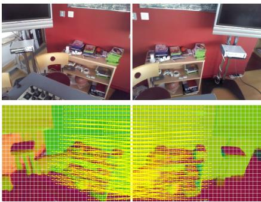  
(a) chess, seq-01

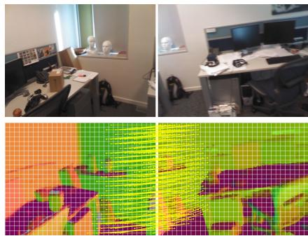  
(b) office, seq-01

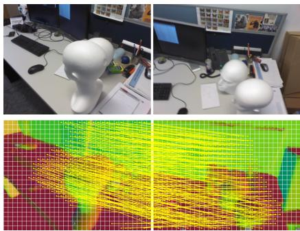  
(c) stairs, seq-01  
Figure 6: Predicted plane primitives and matched patch correspondences. Three 7Scenes pairs (columns). Top: input RGB (view 1 | view 2). Bottom: PlanarSplatting-rasterized normal from our plane head with the $2 4 \times 3 2$ patch grid (white); yellow lines connect MASt3R’s matched patch centers, which form $\{ \pmb { g } _ { m } \} _ { m = 1 } ^ { M }$ in Eq. (3).

Two-view translation solver (Eq. (13)). Locking $s = \| t _ { \mathrm { i n i t } } \|$ , the two data residuals are

$$
\Delta d _ { m } ( { \hat { t } } ) = d _ { m } ^ { 1 } - d _ { m } ^ { 2 } + ( R ^ { \star } { \pmb { n } } _ { m } ^ { 2 } ) ^ { \top } ( s { \hat { t } } ) ,\tag{29}
$$

$$
\Delta P _ { m } ( \hat { t } ) = P _ { m } ^ { 1 } - R ^ { \star } P _ { m } ^ { 2 } - s \hat { t } ,\tag{30}
$$

where $P _ { m } ^ { v } = z _ { m } ^ { v } K _ { v } ^ { - 1 } [ u _ { m } ; 1 ]$ is the back-projection of matched pixel $u _ { m }$ through the dense depth $z _ { m } ^ { v }$ rasterized by PlanarSplatting from the per-patch plane primitives. Both $\rho _ { d } , \rho _ { p }$ are Huber losses with threshold 0.1 and weights $w _ { d } = w _ { p } = 1$ . The init-anchored Tikhonov weight $\lambda _ { \mathrm { r e g } }$ adapts to the init’s quality: with $r _ { m } ^ { ( 0 ) } = ( R ^ { \star } { \pmb n } _ { m } ^ { 2 } ) ^ { \top } { \pmb t } _ { \mathrm { i n i t } } - ( d _ { m } ^ { 2 } - d _ { m } ^ { 1 } )$ the $\Delta d$ residual at $\hat { \pmb { t } } _ { \mathrm { i n i t } }$ , we set $\sigma _ { \mathrm { i n i t } } = 1 . 4 8 2 6 \mathrm { M A D } ( r ^ { ( 0 ) } )$ on its 20–80% IQR-trimmed core and

$$
\lambda _ { \mathrm { { r e g } } } = \mathrm { c l i p } \big ( \lambda _ { 0 } ( \sigma _ { \mathrm { { r e f } } } / \sigma _ { \mathrm { i n i t } } ) ^ { \alpha } , \lambda _ { \mathrm { { m i n } } } , \lambda _ { \mathrm { { m a x } } } \big ) , \quad ( \lambda _ { 0 } , \sigma _ { \mathrm { { r e f } } } , \alpha , \lambda _ { \mathrm { { m i n } } } , \lambda _ { \mathrm { { m a x } } } ) = ( 2 0 0 , 0 . 5 , 4 , 1 , 1 0 ^ { 6 } ) ,\tag{31}
$$

so a small $\sigma _ { \mathrm { i n i t } }$ (init already consistent with the predicted planes) inflates $\lambda _ { \mathrm { r e g } }$ and the solver returns ≈ $\hat { \pmb { t } } _ { \mathrm { i n i t } }$ while a large $\sigma _ { \mathrm { i n i t } }$ lets the data terms drive the solve. We optimize via scipy.optimize.least\_squares (TRF, Huber $f _ { \mathrm { s c a l e } } = 0 . 1 )$ over $\hat { t } \in S ^ { 2 } , \leq 1 5$ Jacobian evaluations.

Multi-view aggregation (n-view). For streaming n-view inputs we follow the Glomap (Pan et al., 2024) global-SfM pipeline—rotation averaging, multi-view track construction, point-based global positioning, and bundle adjustment—over the refinement-window edge set E. The difusion refiner is invoked only for the per-edge rotation $R _ { i j } ^ { \star }$ ; the per-edge translation $t _ { i j } ^ { \mathrm { r a w } }$ is taken directly from the upstream estimator and used unchanged downstream.

Rotation averaging. Per-frame absolute rotations are recovered from the pairwise $\{ R _ { i j } ^ { \star } \}$ by robust least-squares (Hartley et al., 2013; Chatterjee & Govindu, 2013),

$$
\{ R _ { i } \} ^ { \star } = \underset { \{ R _ { i } \} } { \arg \operatorname* { m i n } } \sum _ { ( i , j ) \in \mathcal { E } } \rho \Bigl ( d ( R _ { j } ^ { \top } R _ { i j } ^ { \star } R _ { i } , I ) \Bigr ) ,\tag{32}
$$

with ρ a Huber loss and d chordal distance.

Tracks and translation warm-start. Multi-view tracks $\{ \tau _ { k } \}$ are built by union-find over pixel-cell-quantized correspondences from the matcher; the upstream’s raw pairwise translations $\{ t _ { i j } ^ { \operatorname { r a w } } \}$ together with $\{ R _ { i } \} ^ { \star }$ are composed into an absolute c2w trajectory and used as warm-start camera centers for the positioner below.

Global positioning. With $\{ R _ { i } \}$ fixed and tracks $\{ \tau _ { k } \}$ attached with bearings $v _ { k i } = R _ { i } ^ { \top } K _ { i } ^ { - 1 } [ u _ { k i } ; 1 ]$ Glomap’s point-based mode (Pan et al., 2024) jointly optimizes camera centers, 3-D point positions, and per-observation scales,

$$
\big \{ c _ { i } , X _ { k } , s _ { k i } \big \} ^ { \star } = \arg \operatorname* { m i n } \sum _ { k } \sum _ { ( k , i ) \in \tau _ { k } } \rho ( \| v _ { k i } - s _ { k i } ( X _ { k } - c _ { i } ) \| _ { 2 } ) , \quad s _ { k i } \geq 0 .\tag{33}
$$

Bundle adjustment. A Huber-robust BA (Pan et al., 2024) over $( c _ { i } , \pmb { X } _ { k } )$ with pinhole reprojection error refines centers and 3-D points; we run Glomap with fix\_rotations=True so that $\{ R _ { i } \} ^ { \star }$ from rotation averaging remain frozen throughout positioning and BA, and the entire downstream pipeline only ever consumes the refined rotations. The two-view LM translation solver of Eq. (13) is bypassed entirely at n-view scale, since the dense edge set E already over-constrains every $\mathbf { { c } } _ { i }$ through the $\mathrm { R A } + \mathrm { G P } \ \overset { \cdot } { + }$ BA pipeline; the same plane-conditioned refiner—whose only role at n-view is to produce $\{ R _ { i j } ^ { \star } \}$ per edge—therefore serves both regimes without retraining.

## C. Additional Evaluation Setup and Results

## C.1. Pair and Sequence Construction

This subsection gives the per-sequence quantitative breakdown deferred from Sec. 4 for the two-view and streaming evaluation splits.

7Scenes two-view pair list. We use all 46 sequences across the seven scenes (chess, fire, heads, ofice, pumpkin, redkitchen, stairs) without any train/test restriction. Pairs are formed as (i, i+50) at stride 10 within each sequence, producing 95 pairs per 1000-frame sequence and 45 per 500-frame stairs sequence, totalling $4 0 \times 9 5 + 6 \times \hat { 4 } 5 = 4 0 7 \hat { 0 }$ pairs. The exact pair list is released with our code.

Matterport3D two-view pair list. For an additional zero-shot test, we use the 7996-pair test set of SparsePlanes (Jin et al., 2021) on Matterport3D (Chang et al., 2017). Results in Tab. 7 mirror the pattern from ScanNet1500 and 7Scenes: PosePlaner delivers a large gain on the weaker LoFTR upstream (R@5: 10.7 → 20.2, R@20: 30.6 → 52.8) and a smaller but consistent gain on the stronger SuperGlue upstream (R@5: 38.3→40.8, R@20: 66.7→70.6).

ScanNet streaming. The 100 trajectories of the ScanNet1500 test set (scenes 0707–0806) range in raw length from 163 to 4168 frames; we sample at frame gap 2 to obtain the streaming sequences. For each input-length threshold $N \in \{ 2 0 0 , 5 0 0 , 2 0 \bar { 0 } 0 \}$ we retain trajectories with ≥ 2N raw frames (equivalently ≥ N sampled frames)—99, 86, and 7 respectively—and let the streaming baseline ingest the first N sampled frames while PosePlaner refines the last 100.

7Scenes streaming. We form N-frame trajectories at frame gap 2 from the same 46 sequences as the two-view setup. For N ∈ {200, 500} we take the first N sampled frames of every sequence with ≥ 2N raw frames—46 trajectories at N=200 (every sequence qualifies) and 40 at N=500 (the six 500-frame stairs sequences fall below the 1000-frame raw threshold). For N=2000 no single sequence is long enough, so we concatenate sequences within each scene end-to-end and take the first 2000 sampled frames, yielding 5 scene-level trajectories (chess, fire, ofice, pumpkin, redkitchen; heads and stairs have insuficient total raw frames after gap-2 subsampling).

Outdoor multi-view sequences. We preserve the source frame order and take the first $N \in$ {200, 500, 2000} frames of each suficiently long trajectory. Oxford Spires (Tao et al., 2026) provides 14 trajectories at each length, and MatrixCity (Li et al., 2023) provides 10 (five aerial and five street-level).

Table 7: Two-view rotation refinement on Matterport3D. Evaluated zero-shot on the 7996-pair test set of SparsePlanes (Jin et al., 2021). Rotation $\operatorname { A U C @ } { \tau ^ { \circ } }$ for two upstream matchers in two configurations: init and $+ \mathrm { P o s e P I }$ laner. The Valid column counts pairs with a valid upstream pose; AUC is computed only on this subset. Higher is better; best per block in bold.
<table><tr><td rowspan="2">Method</td><td colspan="4">LoFTR (Sun et al., 2021)</td><td colspan="4">SUPERGLUE (Sarlin et al., 2020)</td></tr><tr><td>R@5</td><td>R@10</td><td>R@20</td><td>Valid</td><td>R@5</td><td>R@10</td><td>R@20</td><td>Valid</td></tr><tr><td>init + POSEPLANER</td><td>10.7 20.2</td><td>18.8 36.0</td><td>30.6 52.8</td><td>4385/7996</td><td>38.3 40.8</td><td>53.5 57.2</td><td>66.7 70.6</td><td>6853/7996</td></tr></table>

The four CrossLoc (Yan et al., 2022) flight segments contain 1176, 841, 623, and 373 frames, giving four trajectories at $N = 2 0 0 .$ , three at $N = 5 0 0$ , and none at $N = 2 0 0 0$ . CUT3R and TTT3R use the same inputs. We evaluate relative-pose pairs among the final 100 frames and average per-trajectory AUCs without weighting. Pairs with undefined translation direction are excluded from translation AUC in both branches. Both branches share the reconstruction backend over all N frames; PosePlaner supplies refined pairwise rotations. Table 8 reports the additional tests on CrossLoc drone sequences at $N = 2 0 0$ and N = 500.

Table 8: Zero-shot multi-view refinement on CrossLoc drone sequences. R@5/R@20 and t@5/t@20: rotation/translation-direction AUC at $5 ^ { \circ } / 2 0 ^ { \circ } ~ ( \% , \uparrow )$ . Better results within each pair are bold.
<table><tr><td rowspan="2">Method</td><td colspan="4"> $N = 2 0 0$ </td><td colspan="4"> $N = 5 0 0$ </td></tr><tr><td>R@5</td><td>R@20</td><td>t@5</td><td>t@20</td><td>R@5</td><td>R@20</td><td>t@5</td><td>t@20</td></tr><tr><td>CUT3R</td><td>20.5</td><td>55.2</td><td>22.6</td><td>64.6</td><td>11.7</td><td>42.7</td><td>5.1</td><td>45.0</td></tr><tr><td>CUT3R + POSEPLANER</td><td>20.3</td><td>60.9</td><td>24.6</td><td>68.4</td><td>12.1</td><td>44.5</td><td>5.7</td><td>48.1</td></tr><tr><td>TTT3R</td><td>26.0</td><td>69.6</td><td>33.3</td><td>73.5</td><td>20.5</td><td>70.9</td><td>24.8</td><td>73.6</td></tr><tr><td> $\mathrm { T T T 3 R + P o s e P L A N E R }$ </td><td>26.2</td><td>70.0</td><td>29.6</td><td>65.9</td><td>25.1</td><td>73.0</td><td>28.2</td><td>75.0</td></tr></table>

## C.2. External Match-Source Sensitivity

PosePlaner’s geometry tokens $\{ \pmb { g } _ { m } \}$ come from patch correspondences produced by an external matcher (Sec. 3.1); this matcher is in principle independent of the upstream pose source. To verify that the refiner’s gain is not tied to a particular matcher, we fix the upstream pose source to either SuperGlue or LoFTR and sweep four matchers (SuperGlue, LoFTR, ROMA, MASt3R) as the source of patch correspondences fed into the difusion refiner. Tab. 9 reports the resulting two-view rotation AUC on ScanNet1500. PosePlaner improves over the init pose for the vast majority of (upstream, matcher) combinations, and stronger matchers (ROMA, MASt3R) yield clearly larger gains; the qualitative trend is preserved across all four matchers, confirming that the refiner is robust to the choice of correspondence source.

## C.3. Additional Streaming Trajectories

Sliding-window protocol. Each trajectory is 200 frames long. We slide a 100-frame window with 50-frame overlap, so the trajectory contains three refinement windows ([0, 100), [50, 150), [100, 200)); within each window, PosePlaner treats every pair as the two-view problem of Sec. 4.1 and the per-pair refined poses are aggregated by rotation averaging (Hartley et al., 2013; Chatterjee & Govindu, 2013) plus a fix-rotation Glomap-style positioner (Pan et al., 2024). The same protocol is used for the main paper’s Fig. 4.

Additional trajectories. Fig. 7 extends the streaming results of Sec. 4.2 with three additional sequences spanning low-texture and cluttered indoor settings; each is refined on top of CUT3R (Wang et al., 2025b), TTT3R (Chen et al., 2025), and WinT3R (Li et al., 2025). Across all three sequences the refined trajectory tracks the ground truth substantially closer than the raw baseline, confirming that the refiner’s drift correction is consistent across upstream estimators rather than tuned to any one of them.

Table 9: Sensitivity to the external match source. Two-view rotation AUC on ScanNet1500 with the upstream pose fixed to SuperGlue or LoFTR, while the matcher used to produce patch correspondences for PosePlaner’s conditioning is varied across four options. The init row reports each upstream’s raw pose accuracy from Tab. 1. Higher is better.
<table><tr><td rowspan="2">Conditioning match</td><td colspan="3">Upstream: SuPERGLUE</td><td colspan="3">Upstream: LoFTR</td></tr><tr><td>R@5</td><td>R@10</td><td>R@20</td><td>R@5</td><td>R@10</td><td>R@20</td></tr><tr><td>init (no refinement)</td><td>43.9</td><td>62.4</td><td>76.4</td><td>11.5</td><td>25.0</td><td>44.0</td></tr><tr><td>+ PoSEPLANER, SUPERGLUE (Sarlin et al., 2020) match</td><td>45.1</td><td>64.1</td><td>78.0</td><td>17.8</td><td>38.8</td><td>59.5</td></tr><tr><td>+ PosEPLANER, LoFTR (Sun et al., 2021) match</td><td>43.5</td><td>62.6</td><td>76.8</td><td>14.5</td><td>31.1</td><td>50.5</td></tr><tr><td>+ PosEPLANER, ROMA (Edstedt et al., 2024) match</td><td>49.8</td><td>69.6</td><td>82.5</td><td>32.9</td><td>56.3</td><td>72.8</td></tr><tr><td>+ PosEPLANER, MAST3R (Leroy et al., 2024) match</td><td>48.9</td><td>68.9</td><td>82.1</td><td>29.4</td><td>52.9</td><td>70.6</td></tr></table>

## C.4. Training Objective Comparison

We compare flow matching with deterministic Direct-x0 regression and DDPM pred-x0, using the same architecture, training data, and 20-epoch schedule. Direct-x predicts the clean pose residual in one forward pass; DDPM uses 100 denoising steps, and flow matching uses one Euler step. All variants use MASt3R correspondences and the same geometric translation solver. Both alternatives improve the LoFTR initialization, but flow matching achieves higher rotation and translation-direction AUC at all reported thresholds (Tab. 10). Each objective is trained once.

Table 10: Training objective comparison on ScanNet1500. LoFTR initialization, 1028 valid pairs. R@θ/t@θ: rotation/translation-direction AUC at θ◦ (%, ↑). Best results are bold.
<table><tr><td>Method</td><td>R@5</td><td>R@10</td><td>R@20</td><td>t@5</td><td>t@10</td><td>t@20</td></tr><tr><td>LoFTR init</td><td>11.5</td><td>25.0</td><td>44.0</td><td>2.1</td><td>5.6</td><td>13.0</td></tr><tr><td>Direct-x0</td><td>14.8</td><td>30.3</td><td>49.2</td><td>2.3</td><td>6.6</td><td>14.5</td></tr><tr><td>DDPM pred-x0</td><td>16.7</td><td>33.2</td><td>51.8</td><td>2.2</td><td>6.5</td><td>14.6</td></tr><tr><td>Flow matching</td><td>29.4</td><td>52.9</td><td>70.6</td><td>3.5</td><td>9.0</td><td>18.4</td></tr></table>

## C.5. Alternative Plane Source

We replace the learned plane predictions with planes fitted to frozen MoGe (Wang et al., 2025c) point maps using patchwise RANSAC/PCA. The refiner, initial poses, correspondences, and remaining modules are unchanged, with no retraining. Table 11 shows that MoGe-derived planes retain substantial gains over the LoFTR initialization, although our learned planes achieve higher rotation AUC at all three thresholds.

Table 11: Alternative plane source on ScanNet1500. Rotation AUC at $5 ^ { \circ } / 1 0 ^ { \circ } / 2 0 ^ { \circ } ~ ( \% , \uparrow )$ on the same 1028 valid LoFTR pairs. Best results are bold.
<table><tr><td>Plane source</td><td>R@5</td><td>R@10</td><td>R@20</td></tr><tr><td>LoFTR init (no refinement)</td><td>11.5</td><td>25.0</td><td>44.0</td></tr><tr><td>MoGe + RANSAC</td><td>27.1</td><td>50.4</td><td>69.2</td></tr><tr><td>Learned planes (ours)</td><td>29.4</td><td>52.9</td><td>70.6</td></tr></table>

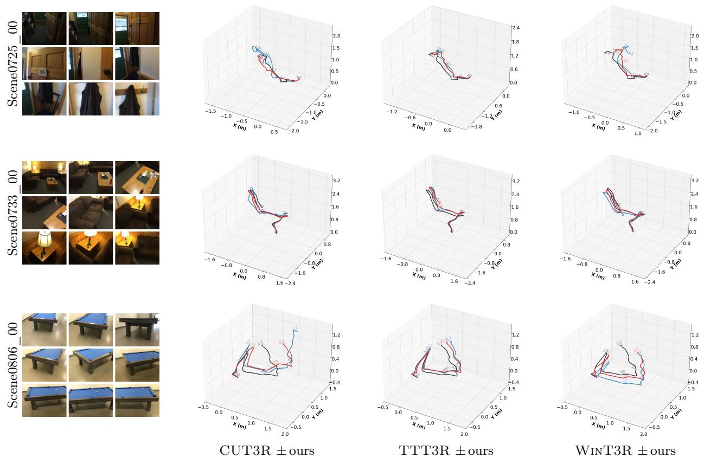  
Figure 7: Additional streaming trajectories on ScanNet. Each row is one 200-frame sequence refined by PosePlaner in the same 100-frame sliding-window scheme as Fig. 4 (50-frame overlap). Right three columns plot the estimated camera trajectory under CUT3R, TTT3R, and WinT3R; black is ground truth, blue is the raw baseline, and red is after PosePlaner refinement.

## D. Social Impacts

Positive social impact. PosePlaner corrects relative camera pose at the geometric level and extends from two-view training to streaming n-view inference without retraining. This makes accurate pose estimation more accessible to downstream applications such as AR/VR, robotics, and indoor scene understanding.

Potential negative impact. As with any technology that improves camera pose estimation, our method could in principle be used in privacy-sensitive contexts. We recommend deploying it within a broader pipeline that applies the appropriate consent and access controls.