# Pretraining Knows What, Simulation Teaches How: Compositional Generalization in a Sim-Trained Robot Agent

Benjamin Pikus, Daniel Saunders, Mircea Mironenco, Salman Mohammadi, Mathew Mathew, Sirou Zhu, Divya Makkar, Xuhua Huang, Qinbo Li, Supreeth Narasimhaswamy, Siyuan Cen, Dejia Xu∗, Shyamal Buch∗, Thomas Neff∗ Luma AI

Abstract: A robot policy needs to understand what a task is asking for in a scene, and how to move the robot to accomplish that task. To achieve these two skills, we introduce Zero-real Agent Policy (ZAP), a recipe that teaches a small off-theshelf vision-language model to control a robot via a simple tool harness. We use a pretrained 27B parameter model to bootstrap world understanding and reasoning, followed by supervised fine-tuning and GRPO on simple simulated tasks to teach it how to move the robot. Without any real-world robot data during training, ZAP reaches 96.7% success on real-world tasks, matching GPT-6 Astra in our harness and outperforming the MolmoAct2 VLA (33.3%), while running 3× faster and 17× cheaper than GPT-6 Astra. We demonstrate that ZAP also generalizes to completely new objects, goals, strategies, and language by seating a test tube in a rack (and choosing a different hole in the rack when prompted), handing a test tube between arms mid-air, drawing an X on a tic-tac-toe board, and playing chess. These goals and types of manipulation don’t appear in our training data. Furthermore, ZAP also transfers to an unseen embodiment. On a single-arm Franka, ZAP reaches 55.9% on RoboLab-120, 4.9 percentage points ahead of the leading VLA/WAM baseline.

Trained in simulation

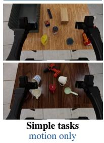

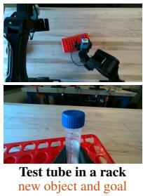

Tested zero-shot on a real robot: new objects, goals, strategies and reasoning  
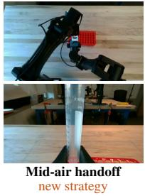  
Figure 1: Motion learned in simulation carries over to new real tasks that need reasoning. Left: two of th simulated training tasks. These simple pick and place, stacking, and reorientation tasks with everyday objects teach the model only how to move. Right: the same model, trained exclusively in simulation, tested zero-shot on a real bi-manual robot. No real robot data is used in training. Each task is new in a different way. The test tube and rack are a new object and a new goal. The mid-air handoff strategy has nothing close to it in the training distribution. Similarly, drawing an X in the center of a tic-tac-toe grid is a new type of manipulation guided by reading the board. Playing a mate in one requires reasoning about chess, drawing from the model’s pretraining capabilities.

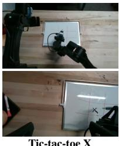  
Tic-tac-toe X new skill and reasoning

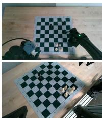  
Chess mate in one complex reasoning

<table><tr><td>Approach</td><td>Speed</td><td>Cost</td><td>Generalization</td></tr><tr><td>VLAs / WAMs</td><td>√</td><td>√</td><td>一</td></tr><tr><td>Code as Policies</td><td>√</td><td>√</td><td></td></tr><tr><td>Large agent as policy (frontier LLM + tools)</td><td>一</td><td></td><td>√</td></tr><tr><td>ZAP (ours)</td><td>√</td><td>√</td><td>√</td></tr></table>

Table 1: Comparing robot policy paradigms. VLAs/WAMs and Code as Policies offer fast, inexpensive execution, while frontier agents provide broader generalization at higher latency and cost. ZAP combines fast, low-cost execution with generalization to new instructions, objects, scenes, and goals.

## 1 Introduction

A robot policy has to do two difficult things at once: it needs semantic reasoning to understand instructions in a potentially unfamiliar scene, and motion control to translate that understanding into precise physical actions.

We introduce Zero-real Agent Policy (ZAP), which adds motion to a small pretrained visionlanguage model through supervised fine-tuning (SFT) and reinforcement learning (RL), entirely in simulation. We evaluate how these skills carry over to new tasks, real hardware, and a new embodiment. Existing methods tend to trade off performance in one of these areas for the others, and broadly fall into three groups (Table 1).

Models that directly output robot actions. Vision-language-action models (VLAs) and worldaction models (WAMs) learn semantic reasoning & motion control from robot action data [1, 2, 3, 4]. Because diverse action data is scarce, both skills end up tied to the training distribution: the policy often generalizes poorly to new prompts, objects, scenes and goals, and a new task usually means training again.

Code that directly drives the robot. In Code as Policies [5, 6], a language model writes a program that composes perception and control APIs. This is quick and reliable when the situations it will face can be anticipated when the program is written, but struggles outside that script, for example with an unexpected failure, an unfamiliar object or an ambiguous instruction. Adapting to a new task or scene means rewriting the program.

Large frontier models controlling the robot through tools. Frontier language models interacting with the robot via an agentic harness bring world understanding, reasoning and generalization [7, 8, 9]. But they are not explicitly trained to move a robot, and a trillion-parameter model is slow and costs dollars for a task that smaller policy models, when they can do them, do in seconds and cost pennies.

ZAP combines semantic reasoning from vision-language pretraining with motion control learned entirely in simulation. We start with Qwen 3.6 27B [10], which contributes world understanding and reasoning. We then teach the model motion control in simulation - first SFT on its own mined successful traces, followed by RL across 40 pick-and-place, stacking, and reorientation tasks. Neither stage uses real-world robot demonstrations. At test time, the policy combines pretrained semantic reasoning with learned motion control to perform real-world tasks it was never trained to execute, generalizing to new objects, goals, and robot embodiments.

Our contributions are as follows:

• Teacher-free training of an agent policy in simulation. We teach a pretrained vision-language model to control a robot with no frontier teacher and no real robot data. The model commands end-effector poses and gripper openings through a harness that is identical in simulation and on hardware. We seed it with successful traces mined from its own rollouts, then refine it with RL using a dense reward ladder that credits partial progress (§3).

• Transfer to hardware and new embodiment. With no real-world robot training data, ZAP matches GPT-6 Astra on 10 real tasks at 3× the speed and 1/17 the cost. The same checkpoint transfers without retraining to a completely new embodiment (single-arm Franka) exceeding the performance of leading VLA/WAM baselines on RoboLab-120 (§4).

• Generalization to new goals, language, and reasoning. ZAP combines pretrained semantic reasoning with learned motion control to execute real-world tasks unseen during robot training. The policy handles new objects and goals, follows instructions for manipulation strategies it never practiced, and applies complex reasoning to tasks such as chess and drawing (§5).

## 2 Related work

Composing reasoning and motion. Task-and-motion planners compose symbolic operators that ground into geometric motion [11, 12]. Large language models then proved to be better high-level planners, sequencing a library of learned skills [13, 14, 15] or handing subgoals to low-level policies [16, 17]. ZAP keeps the split between reasoning and motion but drops the fixed skill library. Motion is a skill the model learns itself, through a minimal harness that leaves scene reasoning and action sequencing to the model rather than imposing macros that simplify familiar tasks but limit generalization.

End-to-end policies. VLAs and WAMs fold reasoning and motion into one network trained on robot actions [1, 3, 18, 4]. Several studies show that these policies keep the intent of an instruction but fail to execute it on new tasks, perturbations or skill combinations [19, 20, 21, 22]. ZAP instead inherits the reasoning and language ability of a pretrained LLM and learns only motion, in simulation. It never has to learn language from action data, so it is not tied to the instructions that data happens to contain, and it follows what an instruction means rather than how it is worded.

Foundation models as robot agents. Code as Policies and its successors compose perception and control APIs into programs [5, 23], and frontier agents now act directly as closed-loop policies through tool harnesses [7, 8, 9]. They bring reasoning for free, but they are slow, expensive and not trained to move a robot. The closest work trains compact tool-calling agents, mostly by distilling a frontier teacher: Guava into a 4B agent with object-referenced grasp and align tools, refined with GRPO on two tasks [24], RACaP into an 8B model over evolved policy APIs [25], and Robo-Harness K1 into a 9B student evaluated in simulation [9]. ZAP uses no teacher: its fine-tuning data are its own successful rollouts, and RL trains it on all 40 tasks, so no teacher sets its ceiling. It commands complete end-effector poses rather than grasp macros. Guava’s unseen tasks recombine the grasp, place and push primitives it was trained on; ZAP composes motions it never practiced, such as a mid-air handoff and a marker stroke, and runs on a different robot without retraining.

Appendix E gives a more detailed discussion.

## 3 Method

We first describe the harness, the tool interface through which the model perceives and acts, identical in simulation and on hardware (§3.1). We then describe how we train the model to move entirely in simulation using GRPO and a dense reward ladder (§3.2), and how we initialize that run from successful traces gathered by a short GRPO warm-up and prefix-tree search (§3.3).

## 3.1 One interface across simulation and hardware

ZAP controls two 6-DoF (degrees-of-freedom) YAM arms with parallel-jaw grippers [26]. It commands absolute end-effector poses and gripper openings, rather than joint angles, trajectories, or action chunks. We frame tasks as a conversation between the model and its environment through the harness: the model first writes a plan and names the objects to locate based on camera views of the environment, then repeatedly issues perception and movement tool calls to complete its task.

The harness uses SAM 3.1 [27, 28] to segment the objects named in the model’s perception queries in each camera stream. These masks are combined with calibrated depth cameras to yield each object’s

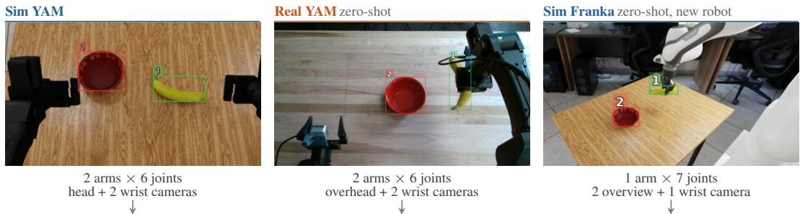  
Figure 2: Three scenes, one shared interface. Left to right: separate banana-in-bowl episodes on the simulated bi-manual YAM, the real YAM, and a simulated single-arm Franka, an embodiment never seen in training. From the agent’s perspective, the only thing that changes is the system prompt specifying the details of the robot and camera layouts. Across all three settings, ZAP uses the same interface: camera images annotated with SAM 3.1 masks and numbered boxes, 3D object readouts, end-effector pose commands, and controller feedback. The box below shows one step from the Franka episode: a 3D object readout, the agent’s move\_to command, and the motion controller’s response. Both YAM settings use these same formats.

3D centroid, height, and principal axes. This process runs continuously and asynchronously in the background: the model steers perception by changing its queries, and receives object measurements and annotated camera images.

The model controls the robot and manages the episode through five tools, two of which move the robot: move\_to sets a complete end-effector pose for one or both arms, and set\_gripper sets each jaw opening. change\_query sets what perception looks for, update\_todo keeps a short plan in view across turns, and done ends the episode. There are no grasp macros or motion primitives, so every approach, grasp, lift and release is a sequence of these two motion tools that the model plans itself.

Appendix A describes the rest of the harness: the pose and orientation parameterization, the observations, validation, the motion controller and its outcome reports, and how the same harness runs in simulation and on hardware. Appendix B steps through a complete real-robot episode turn by turn.

## 3.2 Learning to move in simulation

We build our simulated tasks in Isaac Sim [29] by adding simulated YAM arms with calibrated cameras and arm dynamics against real YAM arms.

Learning motion control on simulated tasks. We design 40 simulated tasks, none of which appea in RoboLab-120, that exercise the same families of everyday object manipulation skills: grasping and lifting, single- and multi-object pick and place, stacking, and reorientation. The goals are delib erately simple, and none requires heavy reasoning. This lets us test whether motion control learned on simple tasks can combine with pretrained semantic reasoning to solve unseen tasks with new goals and strategies.

GRPO with dense rewards. The GRPO run is initialized from the checkpoint detailed in §3.3 and trains on all 40 tasks (hyperparameters in Appendix C). Binary reward based on task success is inefficient since some tasks start with zero successes, and therefore a pass/fail reward would provide zero advantage and contribute no gradient. We instead shape a dense ladder of partial credit judged on the final state of the scene, manually designed per task type.

For example, for pick and place tasks, approaching the object earns up to 0.2 in proportion to the gripper fingertip-to-object distance closed; grasping earns 0.2 and lifting up to a further 0.55, in proportion to height up to 8 cm. Transport raises the total to at most 0.9, in proportion to the distance to the goal closed. Completing a task earns 5.0, minus a small length penalty which penalizes the model for taking too many turns to complete the task. The specific numbers for partial credit were not ablated and instead holistically chosen: our guiding principle was that final task success must have a much higher reward than partial reward; otherwise, the model settles for collecting partia credit. The success checker is hardened against reward hacking, for example, by requiring that the goal hold for at least half a second.

We penalize turns where either no tool call is made, or where invalid motion is proposed and doesn’t pass certain validation checks (see Appendix A). These turns (but not the whole sequence) receive a negative advantage, regardless of the episode’s score. In earlier runs without these penalties, the corresponding error rates reached as high as 4% and 34%, respectively. With penalties, these rates fall to 0% and 3%.

## 3.3 Initializing the model

Seeding the model with its own successes. A model which is on-distribution for its task space helps reduce variance during RL training, so we first fine-tune on successful agent traces. That raises the question of how to collect them. One option is rejection sampling from either our fixed base model or a larger open model. However, this is prohibitively inefficient, and many tasks never succeed even after hundreds of attempts per task. Instead, initializing from the base model, we run a short GRPO warm-up run of several dozen steps and over-sample the harder tasks, and mine its successful rollouts for SFT. As the policy improves, harder tasks start to yield successes, so the data comes from a slightly evolved version of the model itself, a self-distillation loop that is close to on-policy.

Prefix-tree search. For tasks that still never succeed, we perform a tree-search over partial episodes (Appendix Figure 8). A node is created after each physical action settles; to expand it, we reset the simulator to the task’s deterministic start, replay the node’s stored actions, restore the agent’s context, and sample a new continuation. A best-first rule favors high dense reward and less-explored nodes and prunes failing branches, with up to about 1,000 leaves per task. This found successful traces for several tasks that RL sampling never solved, and these traces are added to the fine-tuning data.

## 4 Quantitative evaluation

We perform quantitative evaluation on tasks in bimanual simulation, on real hardware, and on a new embodiment. We finally examine two ablations on data quality and embodiment.

## 4.1 Simulation on the Bimanual YAM

<table><tr><td>Model Success (%)</td></tr><tr><td>Base Qwen 3.6 27B 8.3</td></tr><tr><td>ZAP (SFT) 58.3</td></tr><tr><td>ZAP (SFT + RL) 74.0</td></tr><tr><td>GPT-6 Astra 72.2</td></tr><tr><td>Opus 5.5 61.2</td></tr></table>

Table 2: Success on the bimanual YAM adaptation of RoboLab-120 [30]. ZAP exceeds both GPT-6 Astra and Opus 5.5.

SFT raises success on RoboLab-120 from the base model’s 8.3% to 58.3%, and RL raises it to 74.0% (Table 2), above both GPT-6 Astra and Opus 5.5. Motion learned on 40 simple tasks carries over to new objects and tasks.

Note that, with the same harness, the base Qwen model fails on almost every task. Looking at its thinking, it clearly understands the scene and goal. What it lacks is the ability to properly move

<table><tr><td>Model Success (%)</td></tr><tr><td>ZAP (ours, 27B) 96.7</td></tr><tr><td>GPT-6 Astra (our harness) 96.7</td></tr><tr><td>GPT-6 Astra (Robocurve) 36.7</td></tr><tr><td>MolmoAct2 33.3</td></tr><tr><td>Base Qwen 3.6 27B 16.7</td></tr><tr><td></td></tr></table>

<table><tr><td>Per task</td><td>ZAP</td><td>GPT-6 Astra</td></tr><tr><td>Time (s)</td><td> ${ \bf 1 4 6 \pm 8 3 }$ </td><td> $3 9 7 \pm 1 5 9$ </td></tr><tr><td>Turns</td><td> $2 1 . 9 \pm 1 0 . 9$ </td><td> $1 9 . 4 \pm 8 . 0$ </td></tr><tr><td>Time per turn (s)</td><td> ${ \bf 6 . 2 \pm 4 . 5 }$ </td><td> $1 9 . 0 \pm 8 . 6$ </td></tr><tr><td>Cost (USD)</td><td> ${ \bf 0 . 2 9 \pm 0 . 1 6 }$ </td><td> $4 . 8 7 \pm 3 . 0 3$ </td></tr></table>

Table 3: Real-world results. Left: success rate (%) over 30 trials per model. Right: mean ± std per task. ZAP is served with vLLM [33] on one B300 priced at \$7.10/hour, with a 2-token multi-token-prediction head.

the robot. It fails to choose the right grasp orientation and height, approach the object correctly and translate 3D perception into motion commands. Training with SFT and RL adds this missing motion control skill.

## 4.2 Real-world transfer

Setup. We recreate 10 tasks of diverse complexity from the RoboLab-120 task list on the real robot (Appendix D lists each task prompt and each model’s success rate). We ran 3 trials per task on a bimanual rig with two YAM arms and the same three-camera layout as in simulation. We compare against GPT-6 Astra [31] (reasoning level max) in our harness, GPT-6 Astra in the Robocurve Inspect Robots harness [8, 32], MolmoAct2 [4], a public VLA for bimanual YAM arms, and the base Qwen 3.6 27B we started from.

Parity with GPT-6 Astra. ZAP matches GPT-6 Astra in the same harness (Table 3), and both clearly outperform GPT-6 Astra in the Robocurve harness, MolmoAct2, and the base model. The base model, with the same reasoning and harness but no motion training, succeeds on 16.7%.

Where the VLA breaks. MolmoAct2’s failures follow the meaning of the instruction more than the difficulty of the motion (Appendix Table 6). For example, we evaluate the model’s ability to pick & place a Rubik’s cube in different locations. When asked to place in a bowl, it places it successfully 3/3 times. But when prompted to place the cube behind the bowl, it never succeeds (0/3), often still placing it into the bowl. In another task, the VLA must place exactly 3 bananas in a bin and always places too many. The motions are nearly the same; what changes is a spatial relation or count, reflected in the prompt. A VLA can only learn what words like behind or exactly three mean from its robot action data, whereas ZAP already understands them from vision-language pretraining.

Harness comparison. The same GPT-6 Astra succeeds in 96.7% of trials in our harness and in 36.7% in the Robocurve harness. A capable model is not enough on its own: what it observes and how it can act shape what it achieves.

3× faster, 17× cheaper. ZAP completes a task in 146 s on average against 397 s for GPT-6 Astra. Both models take a similar number of turns, so all of the gain comes from faster model responses: 6.2 s per turn against 19 s. Per task, ZAP costs an estimated \$0.29 against \$4.87.

## 4.3 Transfer to a new embodiment

Generalization to a new robot embodiment comes for free. We take the same checkpoint, trained only on bimanual YAM arms, and evaluate it on a single-arm Franka. From the agent’s perspective, only the system prompt describing the embodiment changes; the harness stays exactly the same. The Franka differs from the YAM in most of the ways that matter to a policy that outputs joint angles or action chunks: one arm instead of two, seven joints instead of six, a different gripper, different reach, and different cameras. ZAP is unaffected by these differences: it commands end-effector poses through the harness, which handles the embodiment-specific joint control.

On RoboLab-120 it reaches 55.9%, ahead of Lakeside (51%) and FLUX 3 Action (42.9%), the current state-of-the-art VLA/WAM baselines (Table 4). What the model learned in simulation is therefore not a mapping tied to the YAM arms, but how to manipulate the robot arm through space to move an object to a target. The harness lets that skill carry over from two arms to one without retraining.

<table><tr><td>RoboLab-120, single-arm Franka</td><td>Success (%)</td></tr><tr><td>ZAP (transferred from bimanual YAM)</td><td>55.9</td></tr><tr><td>Lakeside</td><td>51.0</td></tr><tr><td>FLUX 3 Action</td><td>42.9</td></tr></table>

Table 4: The same motion skill on a new robot. Without any Franka training, ZAP exceeds Lakeside and FLUX 3 Action, the leading VLA/WAM policies on the current RoboLab-120 leaderboard [34].

## 4.4 Ablations

Better SFT data improves generalization. We compare two SFT runs: one using 455 successful traces mined early in GRPO, and one using 3.9k traces mined more aggressively after GRPO runs longer, especially on harder tasks. RoboLab-120 success rises from 17.2% to 58.3% (Table 5, left), a gain of 41.1 points from the same recipe with better data. The longer run mines especially the harder tasks that the early policy rarely solved, so the model sees how to succeed on a wider range of tasks, and that breadth carries over to tasks it never trained on.

The recipe also works when trained directly on Franka. Separately, we train Qwen-3.5 9B on single-arm Isaac Sim tasks. As before, none of these tasks appear in the RoboLab-120 evaluation. We use a smaller 9B model both for faster experiments, and to test whether the recipe also holds at a smaller scale. We follow a similar, lighter version of the recipe as above; we first train on 4.6k examples gathered from mining successes from GRPO runs, before performing a final GRPO run. The policy exceeds current SOTA VLAs (Table 5, right), suggesting that the recipe works across model sizes and embodiments while preserving generalization to entirely unseen tasks.

<table><tr><td>SFT data</td><td>Num Traces</td><td>RoboLab-120 Success (%)</td></tr><tr><td>Early mining</td><td>455</td><td>17.2</td></tr><tr><td>Longer mining</td><td>3.9k</td><td>58.3</td></tr></table>

<table><tr><td>Franka-trained model</td><td>Success (%)</td></tr><tr><td>ZAP 9B</td><td>53.4</td></tr><tr><td>Lakeside</td><td>51.0</td></tr><tr><td>FLUX 3 Action</td><td>42.9</td></tr></table>

Table 5: Ablations. Left: more extensive trace mining improves SFT generalization on RoboLab-120 with the bimanual YAM. Right: a 9B model trained directly on separate single-arm Isaac Sim tasks also transfers to RoboLab-120. Lakeside and FLUX 3 Action results are from the benchmark leaderboard [34].

## 5 Composing the skills on new tasks

We next test the model, trained exclusively in simulation, on real-world tasks far outside anything seen in training, from bimanual handoffs to drawing and chess, each requiring reasoning and motion the model never practiced (Figure 1).

## What generalization we are looking for.

• New tasks and objects: the policy should handle objects, scenes, and goals that appear nowhere in training, and construct a physical strategy for them without demonstrations.

• New strategies on request: it should be possible to prompt the policy into manipulations it never practiced, such as coordinating two arms.

• Complex reasoning: the policy should be able to carry over the reasoning capabilities the pretrained LLM has into physical world actions.

• Language and instruction following: VLAs are notoriously sensitive to their prompts—slight deviations that do not change the meaning can significantly change the policy success rate [35].

None of the goals, objects, or scenes below appear in training, and neither do any of the more complex prompts, strategies, or reasoning they require.

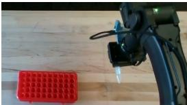  
(a) Pick up the tube

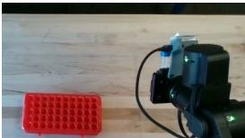  
(b) Rotate the gripper

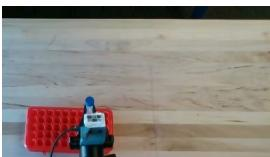  
(c) Carry it over the rack

  
(d) Set it into a hole

Figure 3: A new object and a new goal. Frames from the single test tube episode (a–c: overhead camera, zoomed; d: wrist camera). The model picks up the tube lying on its side, rotates the gripper so the tube stands upright, carries it over the rack and lowers it into a hole, cap up.  
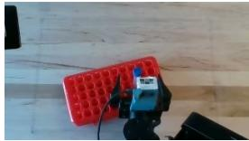

(a) Default prompt: overhead and wrist views  
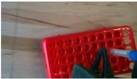

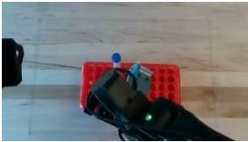  
(b) “Top left of the rack”: overhead and wrist views

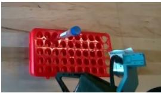  
Figure 4: Steered by the instruction. Final scenes of two episodes from the same starting scene: (a) the default prompt; (b) a request for a hole at the top left of the rack.

A new object and a new task: the test tube. We ask the model to vertically lower a test tube into a rack (Figure 3). Both objects and the goal are unseen in training. The model constructs the strategy itself: it grasps the tube lying on its side, turns the gripper so the tube is vertical, and lowers it into a hole. This is challenging because, at the moment of placement, the hole is hidden from every camera. A VLA would typically need task-specific demonstrations of each of these steps; ZAP receives only a single text instruction and, without demonstrations or parameter updates, infers the required motion.

Steered by the instruction. The model brings the language understanding of its pretrained LLM into its actions. VLAs often respond poorly to changes in their prompts [35]. ZAP is able to follow precise instructions; on the same starting scene, we replace the instruction with a request to place the tube in a hole at the top left of the rack. With the default prompt, the model picks a hole on its own; with the new one, the tube ends up in the top-left corner (Figure 4).

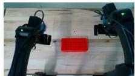  
(a) Start

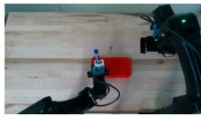  
(b) Held up mid-table

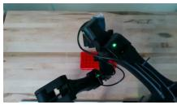  
(c) Other arm grasps cap

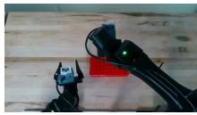  
(d) Giving arm away

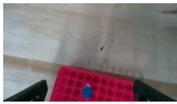  
(e) Placed (wrist)  
Figure 5: Mid-air bimanual handoff. Frames from the handoff episode, described step by step in the text. Training contains no bimanual interaction close to a handoff.

A new strategy on request: bimanual handoff. We then ask for a completely different way to reach the same goal: hand the tube from one arm to the other in mid-air, then place it in the rack (Figure 5). The prompt describes the handoff in writing, but training contains no bimanual interaction even close to a handoff. The model orients the tube-cap up and brings it, held by one arm, to the middle of the table; brings the other arm over the tube and descends from above, just far enough to grasp the cap but not so low that it hits the first arm; closes the receiving gripper, then opens the giving one; moves the giving arm out of the way; and lowers the tube into a hole. Getting this right means timing the two grippers against each other: if the giving arm lets go too early the tube falls, and if the receiving arm comes in too low the grippers collide.

Complex reasoning: tic-tac-toe and chess. The last two tasks require the model to reason about what a goal means before it can act (Figure 6). For tic-tac-toe, we prompt the model to draw an X in the center of a tic tac toe game drawn on a whiteboard. It picks up the marker, recognizes what a tic-tac-toe board is and where its center square lies, and draws the X: it keeps enough contact to leave a line through each stroke, without pressing so hard that it breaks or dislodges the marker. The instruction determines both a place on the board and the motion needed to draw there.

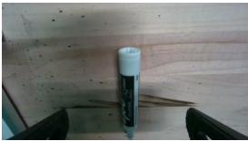  
(a) Picking up the marker

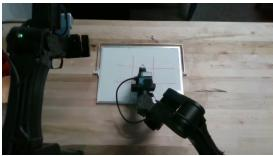  
(b) Marker over the center

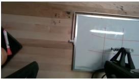  
(c) First stroke

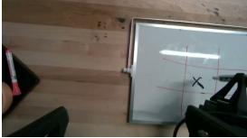  
(d) X in the center square

  
(e) Starting position

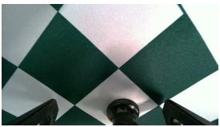  
(f) Piece grasped (wrist view)

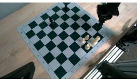  
(g) Carrying the piece

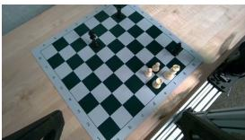  
(h) Checkmate played  
Figure 6: Reasoning about what the goal means. Top: tic-tac-toe, prompted to draw an X in the center of the board. Bottom: chess, prompted with black to move, mate in one.

For chess, we prompt the model that it is black to move, with mate in one. It observes the board, reasons about the rules of chess to find the single mating move, and then picks up the correct piece and sets it on the target square to complete the checkmate. Through reasoning, the model has determined which piece to grasp and where to put it.

## 6 Conclusion

A robot policy does not need to learn reasoning and motion together from scarce robot data. A 27B VLM brings world understanding and reasoning from pretraining, and SFT followed by RL on 40 simple simulated tasks adds the skill of moving a bimanual robot. A checkpoint trained exclusively in simulation reaches 96.7% success on real hardware tasks, matching GPT-6 Astra in our harness while running 3× faster and 17× cheaper, and transfers to a single-arm Franka. Its skills also compose on new real tasks, objects, language and goals: seating a test tube, choosing a different hole when asked, performing a mid-air handoff, drawing an X on a tic-tac-toe board, and playing a checkmate. Because the motion skill comes entirely from simulation, extending it calls for more simulated tasks rather than more robot demonstrations.

## References

[1] A. Brohan et al. RT-2: Vision-language-action models transfer web knowledge to robotic control. arXiv preprint arXiv:2307.15818, 2023.

[2] M. J. Kim, K. Pertsch, S. Karamcheti, et al. OpenVLA: An open-source vision-languageaction model. arXiv preprint arXiv:2406.09246, 2024.

[3] K. Black et al. π0: A vision-language-action flow model for general robot control. arXiv preprint arXiv:2410.24164, 2024.

[4] H. Fang et al. MolmoAct2: Action reasoning models for real-world deployment. arXiv preprint arXiv:2605.02881, 2026.

[5] J. Liang, W. Huang, F. Xia, P. Xu, K. Hausman, B. Ichter, P. Florence, and A. Zeng. Code as policies: Language model programs for embodied control. arXiv preprint arXiv:2209.07753, 2022.

[6] L. Fu et al. CaP-X: A framework for benchmarking and improving coding agents for robot manipulation. arXiv preprint arXiv:2603.22435, 2026.

[7] M. Jia et al. Agent as policy for robotic manipulation. arXiv preprint arXiv:2609.12541, 2026.

[8] Robocurve. Inspect robots: The open-source evaluation framework for physical AI. Software, 2026.

[9] Z. Li et al. Robo-Harness K1: Harnessing robot-use agents via perception augmentation. arXiv preprint arXiv:2609.29389, 2026.

[10] Qwen Team. Qwen3.6-27B: Flagship-level coding in a 27b dense model. Blog post and model release, 2026.

[11] M. Toussaint. Logic-geometric programming: An optimization-based approach to combined task and motion planning. In International Joint Conference on Artificial Intelli gence (IJCAI), pages 1930–1936, 2015. URL https://www.ijcai.org/Proceedings/ 15/Papers/274.pdf.

[12] C. R. Garrett, R. Chitnis, R. Holladay, B. Kim, T. Silver, L. P. Kaelbling, and T. Lozano-Pérez. Integrated task and motion planning. Annual Review of Control, Robotics, and Autonomous Systems, 2021. URL https://arxiv.org/abs/2010.01083.

[13] M. Ahn et al. Do as I can, not as I say: Grounding language in robotic affordances. arXiv preprint arXiv:2204.01691, 2022.

[14] W. Huang et al. Inner monologue: Embodied reasoning through planning with language models. arXiv preprint arXiv:2207.05608, 2022.

[15] K. Lin, C. Agia, T. Migimatsu, M. Pavone, and J. Bohg. Text2Motion: from natural language instructions to feasible plans. Autonomous Robots, 2023. URL https://arxiv.org/abs/ 2303.12153.

[16] M. Dalal, T. Chiruvolu, D. Chaplot, and R. Salakhutdinov. Plan-Seq-Learn: language model guided RL for solving long horizon robotics tasks. In International Conference on Learning Representations (ICLR), 2024. URL https://arxiv.org/abs/2405.01534.

[17] M. Dalal, M. Liu, W. Talbott, C. Chen, D. Pathak, J. Zhang, and R. Salakhutdinov. Local policies enable zero-shot long-horizon manipulation. In IEEE International Conference on Robotics and Automation (ICRA), 2025. URL https://arxiv.org/abs/2410.22332.

[18] S. Ye, Y. Ge, K. Zheng, S. Gao, S. Yu, G. Kurian, S. Indupuru, Y. L. Tan, C. Zhu, J. Xiang, A. Malik, K. Lee, W. Liang, N. Ranawaka, J. Gu, Y. Xu, G. Wang, F. Hu, A. Narayan, J. Bjorck, J. Wang, G. Kim, D. Niu, R. Zheng, Y. Xie, J. Wu, Q. Wang, R. Julian, D. Xu, Y. Du, Y. Chebotar, S. Reed, J. Kautz, Y. Zhu, L. Fan, and J. Jang. World action models are zero-shot policies. arXiv preprint arXiv:2602.15922, 2026. URL https://arxiv.org/ abs/2602.15922.

[19] J. Zhou, K. Ye, J. Liu, T. Ma, Z. Wang, R. Qiu, K.-Y. Lin, Z. Zhao, and J. Liang. Exploring the limits of Vision-Language-Action manipulations in cross-task generalization. arXiv preprint arXiv:2505.15660, 2025. URL https://arxiv.org/abs/2505.15660.

[20] I. Fang, J. Zhang, S. Tong, and C. Feng. From intention to execution: Probing the generalization boundaries of Vision-Language-Action models. arXiv preprint arXiv:2506.09930, 2025. URL https://arxiv.org/abs/2506.09930.

[21] X. Zhou, Y. Xu, G. Tie, Y. Chen, G. Zhang, D. Chu, P. Zhou, and L. Sun. LIBERO-PRO: towards robust and fair evaluation of Vision-Language-Action models beyond memorization. arXiv preprint arXiv:2510.03827, 2025. URL https://arxiv.org/abs/2510.03827.

[22] S. Park, W. Kim, Y. In, and C. Park. Do VLAs really follow instructions? diagnosing how-level instruction following in Vision-Language-Action models. arXiv preprint arXiv:2610.21251, 2026. URL https://arxiv.org/abs/2610.21251.

[23] W. Huang, C. Wang, R. Zhang, Y. Li, J. Wu, and L. Fei-Fei. VoxPoser: composable 3D value maps for robotic manipulation with language models. In Conference on Robot Learning (CoRL), 2023. URL https://arxiv.org/abs/2307.05973.

[24] H. Liu et al. Guava: Distilling frontier VLMs into a compact agent through a robotic manipulation harness. arXiv preprint arXiv:2606.18363, 2026.

[25] Z. Li, Y. Zhang, H. Huang, B. Zhou, W. Li, C. Wang, Y. Chang, Y. Wei, T. Zhang, Y.-C. Chen, K. Zhou, Y. Li, and J. Cheng. RACaP: Agentic reasoning, acting, and coding as policies for evolvable robot learning. arXiv preprint arXiv:2609.29394, 2026. URL https: //arxiv.org/abs/2609.29394.

[26] I2RT Robotics. YAM arm series. Product documentation, 2026.

[27] Meta. SAM 3.1: Faster and more accessible real-time video detection and tracking with multiplexing and global reasoning. Blog post and model release, 2026.

[28] N. Carion et al. SAM 3: Segment anything with concepts. arXiv preprint arXiv:2511.16719, 2025.

[29] NVIDIA. Isaac sim. Software, version 6.0.1, 2026.

[30] J. X. Yang et al. RoboLab: A high-fidelity simulation benchmark for analysis of task generalist policies. In Robotics: Science and Systems (RSS), 2026. arXiv:2604.09860.

[31] OpenAI. GPT-6 Astra system card, 2026.

[32] A. Menon et al. GPT-6 Astra on robot arms. Robocurve, 2026.

[33] W. Kwon, Z. Li, S. Zhuang, Y. Sheng, L. Zheng, C. H. Yu, J. E. Gonzalez, H. Zhang, and I. Stoica. Efficient memory management for large language model serving with PagedAttention. In ACM Symposium on Operating Systems Principles (SOSP), 2023.

[34] NVIDIA. RoboLab leaderboard, 2026. URL https://research.nvidia.com/labs/ srl/projects/robolab/leaderboard.html. Accessed October 18, 2026.

[35] M. Watts and Y. Cui. Rephrase before you act: Characterizing and mitigating language sensitivity in Vision-Language-Action models. arXiv preprint arXiv:2610.10526, 2026. URL https://arxiv.org/abs/2610.10526.

[36] Z. Shao, P. Wang, Q. Zhu, R. Xu, J. Song, M. Zhang, Y. K. Li, Y. Wu, and D. Guo. DeepSeek-Math: Pushing the limits of mathematical reasoning in open language models. arXiv preprint arXiv:2402.03300, 2024.

[37] Z. Liu et al. Understanding R1-Zero-like training: A critical perspective. In Conference on Language Modeling (COLM), 2025. arXiv:2503.20783.

[38] S. Liu et al. STAPO: Stabilizing reinforcement learning for LLMs by silencing rare spurious tokens. arXiv preprint arXiv:2602.15620, 2026.

[39] P. Qi et al. Rethinking the trust region in LLM reinforcement learning. arXiv preprint arXiv:2602.04879, 2026.

[40] Prime Intellect. prime-rl. Software, 2025.

[41] C. R. Garrett, T. Lozano-Pérez, and L. P. Kaelbling. PDDLStream: integrating symbolic planners and blackbox samplers via optimistic adaptive planning. In International Conference on Automated Planning and Scheduling (ICAPS), 2020. URL https://arxiv.org/abs/ 1802.08705.

[42] D. Xu, S. Nair, Y. Zhu, J. Gao, A. Garg, L. Fei-Fei, and S. Savarese. Neural task programming: Learning to generalize across hierarchical tasks. In IEEE International Conference on Robotics and Automation (ICRA), 2018. URL https://arxiv.org/abs/1710.01813.

[43] R. Wang, J. Mao, J. Hsu, H. Zhao, J. Wu, and Y. Gao. Programmatically grounded, compositionally generalizable robotic manipulation. In International Conference on Learning Representations (ICLR), 2023. URL https://arxiv.org/abs/2304.13826.

[44] J. Mao, J. B. Tenenbaum, T. Lozano-Pérez, and L. P. Kaelbling. Learning reusable manipulation strategies. In Conference on Robot Learning (CoRL), 2023. URL https: //arxiv.org/abs/2311.03293.

[45] W. Liu, N. Nie, R. Zhang, J. Mao, and J. Wu. Learning compositional behaviors from demonstration and language. In Conference on Robot Learning (CoRL), 2024. URL https://arxiv.org/abs/2505.21981.

[46] U. A. Mishra, S. Xue, Y. Chen, and D. Xu. Generative skill chaining: Long-Horizon skill planning with diffusion models. In Conference on Robot Learning (CoRL), 2023. URL https://arxiv.org/abs/2401.03360.

[47] L. Wang, J. Zhao, Y. Du, E. H. Adelson, and R. Tedrake. PoCo: policy composition from and for heterogeneous robot learning. In Robotics: Science and Systems (RSS), 2024. URL https://arxiv.org/abs/2402.02511.

[48] M. Merler, B. Li, J. Roy, Y. Liang, Q. Wang, Y. Huang, and T. Silver. Coding agents for generalized task and motion planning problems. arXiv preprint arXiv:2609.30233, 2026. URL https://arxiv.org/abs/2609.30233.

[49] W. Huang, P. Abbeel, D. Pathak, and I. Mordatch. Language models as Zero-Shot planners: Extracting actionable knowledge for embodied agents. In International Conference on Machine Learning (ICML), 2022. URL https://arxiv.org/abs/2201.07207.

[50] I. Singh, V. Blukis, A. Mousavian, A. Goyal, D. Xu, J. Tremblay, D. Fox, J. Thomason, and A. Garg. ProgPrompt: generating situated robot task plans using large language models. In IEEE International Conference on Robotics and Automation (ICRA), 2023. URL https: //arxiv.org/abs/2209.11302.

[51] Z. Yang, C. Garrett, D. Fox, T. Lozano-Pérez, and L. P. Kaelbling. Guiding Long-Horizon task and motion planning with vision language models. In IEEE International Conference on Robotics and Automation (ICRA), 2025. URL https://arxiv.org/abs/2410.02193.

[52] N. Kumar, W. Shen, F. Ramos, D. Fox, T. Lozano-Pérez, L. P. Kaelbling, and C. R. Garrett. Open-World task and motion planning via Vision-Language model generated constraints. IEEE Robotics and Automation Letters, 2026. URL https://arxiv.org/abs/ 2411.08253.

[53] D. Driess, F. Xia, M. S. M. Sajjadi, C. Lynch, A. Chowdhery, B. Ichter, A. Wahid, J. Tompson, Q. Vuong, T. Yu, et al. PaLM-E: an embodied multimodal language model. In International Conference on Machine Learning (ICML), 2023. URL https://arxiv.org/abs/2303. 03378.

[54] Open X-Embodiment Collaboration, A. O’Neill, A. Rehman, A. Gupta, A. Maddukuri, A. Gupta, A. Padalkar, A. Lee, A. Pooley, A. Gupta, et al. Open X-Embodiment: robotic learning datasets and RT-X models. In IEEE International Conference on Robotics and Automation (ICRA), 2024. URL https://arxiv.org/abs/2310.08864.

[55] M. Shukor, D. Aubakirova, F. Capuano, P. Kooijmans, S. Palma, A. Zouitine, M. Aractingi, C. Pascal, M. Russi, A. Marafioti, et al. SmolVLA: a Vision-Language-Action model for affordable and efficient robotics. arXiv preprint arXiv:2506.01844, 2025. URL https: //arxiv.org/abs/2506.01844.

[56] Physical Intelligence, K. Black, N. Brown, J. Darpinian, K. Dhabalia, D. Driess, A. Esmail, M. Equi, C. Finn, N. Fusai, et al. π0.5: a Vision-Language-Action model with Open-World generalization. arXiv preprint arXiv:2504.16054, 2025. URL https://arxiv.org/abs/ 2504.16054.

[57] NVIDIA, J. Bjorck, F. Castañeda, N. Cherniadev, X. Da, R. Ding, L. J. Fan, Y. Fang, D. Fox, F. Hu, et al. GR00T N1: an open foundation model for generalist humanoid robots. arXiv preprint arXiv:2503.14734, 2025. URL https://arxiv.org/abs/2503.14734.

[58] Gemini Robotics Team, S. Abeyruwan, J. Ainslie, J.-B. Alayrac, M. G. Arenas, T. Armstrong, A. Balakrishna, R. Baruch, M. Bauza, M. Blokzijl, et al. Gemini Robotics: Bringing AI into the physical world. arXiv preprint arXiv:2503.20020, 2025. URL https://arxiv.org/ abs/2503.20020.

[59] J. Chen, K. Wang, K. Chen, S. Chen, F. Gao, W. Tang, Z. Li, W. Liu, Z. Yao, B. Li, Y. Xu, and C. Yu. LaWAM: Latent world action models for efficient dynamics-aware robot policies. arXiv preprint arXiv:2606.15768, 2026. URL https://arxiv.org/abs/2606.15768.

[60] Z. Lu, H. Zhai, G. Wang, H. Zeng, J. Yang, J. Liu, L. Cheng, Y. Zhang, Y. Qiu, Z. Cheng, I. Laptev, D. Xu, B. Riviere, G. Loianno, E. Xing, and X. Zuo. World-action models for robot learning and control: A survey. arXiv preprint arXiv:2609.16074, 2026. URL https: //arxiv.org/abs/2609.16074.

[61] J. Zhou, Q. Zhang, G. Xu, C. Fan, Y. Zhao, R. Wang, Y. Luo, S. Yang, X. Zhu, Y. Shen, J. Liang, and Y. Xu. Zero-WAM: In-context world-action modeling from human videos for open-ended task generalization. arXiv preprint arXiv:2608.26103, 2026. URL https:// arxiv.org/abs/2608.26103.

[62] H. Ma, Y. Li, Z. Zhao, X. Wang, M. Li, X. Guo, L. Zhu, A. Song, C. Lu, and J. Sun. Obj-Dream: Guiding Vision-Language-Action models with object-level understanding and future state prediction. arXiv preprint arXiv:2610.20223, 2026. URL https://arxiv.org/abs/ 2610.20223.

[63] M. Zawalski, W. Chen, K. Pertsch, O. Mees, C. Finn, and S. Levine. Robotic control via embodied Chain-of-Thought reasoning. In Conference on Robot Learning (CoRL), 2024. URL https://arxiv.org/abs/2407.08693.

[64] L. X. Shi, B. Ichter, M. Equi, L. Ke, K. Pertsch, Q. Vuong, J. Tanner, A. Walling, H. Wang, N. Fusai, et al. Hi Robot: Open-Ended instruction following with hierarchical Vision-Language-Action models. In International Conference on Machine Learning (ICML), 2025. URL https://arxiv.org/abs/2502.19417.

[65] C.-P. Huang, Y.-H. Wu, M.-H. Chen, Y.-C. F. Wang, and F.-E. Yang. ThinkAct: Vision-Language-Action reasoning via reinforced visual latent planning. In Advances in Neural Information Processing Systems (NeurIPS), 2025. URL https://arxiv.org/abs/2507. 16815.

[66] Gemini Robotics Team, A. Abdolmaleki, S. Abeyruwan, J. Ainslie, J.-B. Alayrac, M. G. Arenas, A. Balakrishna, N. Batchelor, A. Bewley, J. Bingham, et al. Gemini Robotics 1.5: pushing the frontier of generalist robots with advanced embodied reasoning, thinking, and motion transfer. arXiv preprint arXiv:2510.03342, 2025. URL https://arxiv.org/abs/ 2510.03342.

[67] T. Yang, Y. Na, Y. Cho, and S.-E. Yoon. Same scene, different task: Skill alignment for compositional generalization in VLAs. arXiv preprint arXiv:2610.00524, 2026. URL https: //arxiv.org/abs/2610.00524.

[68] J. Gao, A. Xie, T. Xiao, C. Finn, and D. Sadigh. Efficient data collection for robotic manipu lation via compositional generalization. In Robotics: Science and Systems (RSS), 2024. URL https://arxiv.org/abs/2403.05110.

[69] J. A. Mendez, M. Hussing, M. Gummadi, and E. Eaton. CompoSuite: a compositional reinforcement learning benchmark. In Conference on Lifelong Learning Agents (CoLLAs), 2022. URL https://arxiv.org/abs/2207.04136.

[70] Z. Zhang, B. Ran, Y. Wu, Z. Zhang, Y. Wang, J. Jiang, J. Xiao, W. Shi, L. Kang, Y. Qin, et al. Arm-wise compositional generalization in Dual-Arm Vision-Language-Action models. arXiv preprint arXiv:2610.06184, 2026. URL https://arxiv.org/abs/2610.06184.

[71] B. Liu, Y. Zhu, C. Gao, Y. Feng, Q. Liu, Y. Zhu, and P. Stone. LIBERO: benchmarking knowledge transfer for lifelong robot learning. In Advances in Neural Information Processing Systems (NeurIPS), Datasets and Benchmarks Track, 2023. URL https://arxiv.org/ abs/2306.03310.

[72] X. Li, K. Hsu, J. Gu, K. Pertsch, O. Mees, H. R. Walke, C. Fu, I. Lunawat, I. Sieh, S. Kirmani, et al. Evaluating Real-World robot manipulation policies in simulation. In Conference on Robot Learning (CoRL), 2024. URL https://arxiv.org/abs/2405.05941.

[73] W. Huang, C. Wang, Y. Li, R. Zhang, and L. Fei-Fei. ReKep: Spatio-Temporal reasoning of relational keypoint constraints for robotic manipulation. In Conference on Robot Learning (CoRL), 2024. URL https://arxiv.org/abs/2409.01652.

[74] S. Yao, J. Zhao, D. Yu, N. Du, I. Shafran, K. Narasimhan, and Y. Cao. ReAct: synergizing reasoning and acting in language models. In International Conference on Learning Representations (ICLR), 2023. URL https://arxiv.org/abs/2210.03629.

[75] R. Huang, X. Zhang, H. Chen, Y. Li, Y.-J. Wang, B. Lyu, H. Ye, C. Hong, Y. Wang, C. Su, H. Xiong, Y. Wu, E. Xie, T. Manderson, S. Ermon, P. Abbeel, A. Torralba, D. Song, W. Ye, and Y. Du. RAX: Scaling online exploration for robot agents. GitHub repository, 2026. URL https://github.com/robot-agent-exploration/rax. Accessed October 18, 2026.

[76] Y. Cai, T. Kamijo, N. Lu, Z. Hu, and S. Yang. MoCaP: Mobile code-as-policies for zero-shot mobile manipulation from passive human videos. arXiv preprint arXiv:2610.20998, 2026. URL https://arxiv.org/abs/2610.20998.

[77] R. Yang, H. Chen, J. Zhang, M. Zhao, C. Qian, K. Wang, Q. Wang, T. V. Koripella, M. Movahedi, M. Li, et al. EmbodiedBench: comprehensive benchmarking multi-modal large language models for Vision-Driven embodied agents. In International Conference on Machine Learning (ICML), 2025. URL https://arxiv.org/abs/2502.09560.

[78] Z. J. Zhang, S. Machcha, S. Zou, T. K. Chan, and J. Chooi. GPT-6 Astra vs MolmoAct2 on bimanual robotic manipulation (StationeryBench). Robocurve blog post, 2026. URL https://openai.robocurve.org/stationerybench/. September 10, 2026.

[79] cookiegg. GPT-6 Astra × RoboDojo: an independent simulation pilot of LLMs as policies. Project page (author’s real name not given), 2026. URL https://cookiegg.github.io/ llm-as-policies/. September 2026.

[80] B. Y. Tsui, A. Y. Fang, and T. J. Hwu. Demonstration-Free robotic control via LLM agents. In IEEE/RSJ International Conference on Intelligent Robots and Systems (IROS), 2026. URL https://arxiv.org/abs/2601.20334.

[81] Z. Chu, E. T. Barr, C. L. Goues, P. O’Hearn, M. Harman, F. Sarro, and H. Ye. OpenRUA: Robot-Use agents are Zero-Shot visuomotor policies. arXiv preprint arXiv:2610.02459, 2026. URL https://arxiv.org/abs/2610.02459.

[82] H. Hu, P. Sundaresan, J. Gao, and D. Sadigh. VIA: visual interface agent for robot control. arXiv preprint arXiv:2607.11119, 2026. URL https://arxiv.org/abs/2607.11119.

[83] D. Cheng, T. Yi, Y. Fang, X. Zhang, F. Feng, Y. Li, G. Zhuang, R. Wang, S. Yang, W. Song, et al. In-Context robot learning with VLM agents. arXiv preprint arXiv:2609.19138, 2026. URL https://arxiv.org/abs/2609.19138.

[84] M.-H. Guo, Z.-H. Mo, J.-J. Wang, Y. Zhang, K. Wang, Y.-X. Deng, J.-P. Zhang, Y. Rao, and S.-M. Hu. Transferring the intelligence of VLMs to robotic control. arXiv preprint arXiv:2609.22966, 2026. URL https://arxiv.org/abs/2609.22966.

[85] Y. Zhang, H. Huang, Y. Chang, J. Su, B. Zhou, Y. Xu, W. Chen, T. Zhou, C. Wang, T. Zhang, et al. World Action Agent: Harnessing VLMs for robot manipulation via world action rehearsal. arXiv preprint arXiv:2609.29964, 2026. URL https://arxiv.org/abs/2609. 29964.

[86] H. Liu et al. SIMPACT: Simulation-enabled action planning using vision-language models. arXiv preprint arXiv:2512.05955, 2025.

[87] X. Wang, B. Li, H. Wang, L. Zhang, A. Y. Cui, Z. Tang, S. Buch, and D. Xu. SEAR: Selfevolving agentic robotics. arXiv preprint arXiv:2610.18792, 2026. URL https://arxiv. org/abs/2610.18792.

[88] X. Wang, W. Wu, M. Zhang, Z. Wang, K. Shao, J. Luan, Y. Li, Q. Li, S. Gu, H. Zhou, et al. HarnessPAI: an evolving harness for physical AI. arXiv preprint arXiv:2609.29166, 2026. URL https://arxiv.org/abs/2609.29166.

[89] R. Lu, Y. Wu, E. Kou, L. Fu, W. Xiao, A. Mandlekar, Y. Xu, G. Shi, K. Goldberg, A. Chen, et al. ASPIRE: agentic /skills discovery for robotics. arXiv preprint arXiv:2607.00272, 2026. URL https://arxiv.org/abs/2607.00272.

[90] S. Kim, J. Lee, M. Kim, B. Kim, and N. Kwak. Recursive harness distillation across agents for robot manipulation. arXiv preprint arXiv:2609.33378, 2026. URL https://arxiv. org/abs/2609.33378.

[91] Z. Shen, H. You, Y. Liu, Z. Zheng, L. Zha, K. Yamazaki, M. Zhang, S. Huang, J. Sun, Q. Chen, et al. EmbodiedSWE: coding agents for long horizon dexterous robotics. arXiv preprint arXiv:2609.27308, 2026. URL https://arxiv.org/abs/2609.27308.

[92] Y. Liu, J. Mao, D. Hsu, L. P. Kaelbling, and T. Lozano-Pérez. RAPID: robot agentic programming from demonstrations. arXiv preprint arXiv:2609.30249, 2026. URL https: //arxiv.org/abs/2609.30249.

[93] Y. Wang, Y. Li, L. Fei-Fei, J. Wu, and H. Huang. DexAgent: an agentic Human2Sim2Robot framework for dexterous manipulation with Self-Evolving tool library. arXiv preprint arXiv:2609.35318, 2026. URL https://arxiv.org/abs/2609.35318.

[94] S. Ge, A. Zhou, J. Zeng, Y. Wan, D. Wu, Z. Zheng, Y. Wang, Z. Jia, X. Shangguan, J. Zhu, Y. Liu, L. He, S. Wu, X. He, and H. Gao. Make code as policy great again: Frontier agents write, call, and evolve robot tools. arXiv preprint arXiv:2609.39018, 2026. URL https: //arxiv.org/abs/2609.39018.

[95] B. Xu, W. Bao, X. Liu, J. Zhou, Y. Shang, and E. Ferrara. ChunkAct: Action chunking for agentic robotics. arXiv preprint arXiv:2610.18874, 2026. URL https://arxiv.org/abs/ 2610.18874.

[96] Z. Wang, J.-N. Li, Y. Tang, Y. Yu, B. Wu, M. Fang, X. Li, and Y. Zhong. Cracking mobile manipulation: From failure diagnosis to agentic robot system. arXiv preprint arXiv:2610.19600, 2026. URL https://arxiv.org/abs/2610.19600.

[97] Z. Wang, Y. Liu, Y. Chen, S. Yang, J. Ye, P. Chen, C. Lu, S. Liu, B. Yu, and J. Jia. CarryOn: A dual-loop harness for personalized and reliable robot assistance. arXiv preprint arXiv:2610.21453, 2026. URL https://arxiv.org/abs/2610.21453.

[98] P. Wang, Y. Chang, Z. Ma, X. Yang, S. Feng, D. Liu, Y. Yang, X. Cao, C. Wang, J. Su, and D. Wang. AdaRSI: On-demand recursive self-improvement for embodied agents. arXiv preprint arXiv:2610.20474, 2026. URL https://arxiv.org/abs/2610.20474.

[99] Y.-J. Wang, H. Jiang, S. Deng, H. Xue, W. Ye, R. Duan, N. Haghtalab, S. S. Sastry, P. Abbeel, and H. Qi. Reconstruct, practice, go real: Guided Self-Improvement for embodied agents. arXiv preprint arXiv:2610.02204, 2026. URL https://arxiv.org/abs/2610.02204.

[100] X. He, S. Ma, C. Yu, Y. Chen, Y. Huang, Y. N. Wu, Y. Yang, and C. Jiang. Skill2Real: agentic skill learning for Zero-Shot Sim-to-Real robot manipulation. arXiv preprint arXiv:2610.02788, 2026. URL https://arxiv.org/abs/2610.02788.

[101] C. Li, Z. Zhao, R. Li, Y. Gao, K. Liu, J. Li, D. Wang, T. Si, M. Pan, W. Ouyang, and D. Zhou. RoboBridge: a Self-Evolving embodied agent framework for Sim-to-Real transfer. arXiv preprint arXiv:2610.02717, 2026. URL https://arxiv.org/abs/2610.02717.

[102] J. Hu, R. Martin-Martin, P. Stone, R. Duan, Z. Jiang, and G. Shi. SimEX: Simulationintegrated robotics autoresearch. arXiv preprint arXiv:2609.38982, 2026. URL https: //arxiv.org/abs/2609.38982.

[103] J. Yi, S. Zhang, Z. Zhou, H. Wang, H. Sun, Y. Dong, X. Xu, X. Shen, T. Zhang, Y. Liu, and J. Zhang. VLMs are native action models: Unleashing the manipulation capabilities of VLMs with explicit action-space grounding. arXiv preprint arXiv:2610.12832, 2026. URL https://arxiv.org/abs/2610.12832.

[104] Y. Chen et al. Show-Harness: Just a VLM agent can play robots. arXiv preprint arXiv:2609.10522, 2026.

[105] V. Bhat et al. PROBE: Manipulation-grounded visual question answering with VLM agents. arXiv preprint arXiv:2608.17129, 2026.

[106] Y. Jiang, Z. Gan, X. Wang, T. He, C. Zhao, M. Wu, X. Wang, J. Wang, J. He, J. Wang, and Q. Shao. AR-WAM: a Visual-Conditioned Agent-Ready world action model for robotic manipulation. arXiv preprint arXiv:2609.23578, 2026. URL https://arxiv.org/abs/ 2609.23578.

[107] T. Carta, C. Romac, T. Wolf, S. Lamprier, O. Sigaud, and P.-Y. Oudeyer. Grounding large language models in interactive environments with online reinforcement learning. In International Conference on Machine Learning (ICML), 2023. URL https://arxiv.org/abs/ 2302.02662.

[108] A. Szot, M. Schwarzer, H. Agrawal, B. Mazoure, W. Talbott, K. Metcalf, N. Mackraz, D. Hjelm, and A. Toshev. Large language models as generalizable policies for embodied tasks. In International Conference on Learning Representations (ICLR), 2024. URL https://arxiv.org/abs/2310.17722.

[109] Y. Zhai, H. Bai, Z. Lin, J. Pan, S. Tong, Y. Zhou, A. Suhr, S. Xie, Y. LeCun, Y. Ma, and S. Levine. Fine-Tuning large Vision-Language models as Decision-Making agents via reinforcement learning. In Advances in Neural Information Processing Systems (NeurIPS), 2024. URL https://arxiv.org/abs/2405.10292.

[110] B. Pikus, P. R. Tiwari, and B. Ye. Hard examples are all you need: Maximizing GRPO posttraining under annotation budgets. arXiv preprint arXiv:2508.14094, 2025. URL https: //arxiv.org/abs/2508.14094.

[111] Y. Zhou, A. Zanette, J. Pan, S. Levine, and A. Kumar. ArCHer: training language model agents via hierarchical Multi-Turn RL. In International Conference on Machine Learning (ICML), 2024. URL https://arxiv.org/abs/2402.19446.

[112] Z. Wang, K. Wang, Q. Wang, P. Zhang, L. Li, Z. Yang, X. Jin, K. Yu, M. N. Nguyen, L. Liu, et al. RAGEN: understanding Self-Evolution in LLM agents via Multi-Turn reinforcement learning. arXiv preprint arXiv:2504.20073, 2025. URL https://arxiv.org/abs/2504. 20073.

[113] K. Wang, P. Zhang, Z. Wang, Y. Gao, L. Li, Q. Wang, H. Chen, C. Wan, Y. Lu, Z. Yang, et al. VAGEN: reinforcing world model reasoning for Multi-Turn VLM agents. In Advances in Neural Information Processing Systems (NeurIPS), 2025. URL https://arxiv.org/abs/ 2510.16907.

[114] Y. Yuan, H. Cui, Y. Huang, Y. Chen, F. Ni, Z. Dong, P. Li, Y. Zheng, H. Tang, and J. Hao. Embodied-R1: reinforced embodied reasoning for general robotic manipulation. In International Conference on Learning Representations (ICLR), 2026. URL https: //arxiv.org/abs/2508.13998.

[115] D. Kim, S. Park, H. Jang, J. Shin, J. Kim, and Y. Seo. Robot-R1: reinforcement learning for enhanced embodied reasoning in robotics. In Advances in Neural Information Processing Systems (NeurIPS), 2025. URL https://arxiv.org/abs/2506.00070.

[116] NVIDIA, A. Azzolini, J. Bai, H. Brandon, J. Cao, P. Chattopadhyay, H. Chen, J. Chu, Y. Cui, J. Diamond, et al. Cosmos-Reason1: from physical common sense to embodied reasoning. arXiv preprint arXiv:2503.15558, 2025. URL https://arxiv.org/abs/2503.15558.

[117] J. Liu, F. Gao, B. Wei, X. Chen, Q. Liao, Y. Wu, C. Yu, and Y. Wang. What can RL bring to VLA generalization? an empirical study. In Advances in Neural Information Processing Systems (NeurIPS), 2025. URL https://arxiv.org/abs/2505.19789.

[118] H. Li, Y. Zuo, J. Yu, Y. Zhang, Z. Yang, K. Zhang, X. Zhu, Y. Zhang, T. Chen, G. Cui, et al. SimpleVLA-RL: scaling VLA training via reinforcement learning. arXiv preprint arXiv:2509.09674, 2025. URL https://arxiv.org/abs/2509.09674.

[119] G. Lu, W. Guo, C. Zhang, Y. Zhou, H. Jiang, Z. Gao, Y. Tang, and Z. Wang. VLA-RL: towards masterful and general robotic manipulation with scalable reinforcement learning. arXiv preprint arXiv:2505.18719, 2025. URL https://arxiv.org/abs/2505.18719.

[120] X. Zhang, Y. Weng, Q. Liu, Y. Mu, and Y. Li. Learning robust execution in robotic manipulation with agentic reinforcement learning. arXiv preprint arXiv:2607.13818, 2026. URL https://arxiv.org/abs/2607.13818.

[121] A. Choi, X. Wang, Z. Su, and W. Xu. Scaling Sim-to-Real VLA reinforcement learning with generative 3D worlds. In Conference on Robot Learning (CoRL), 2026. URL https: //arxiv.org/abs/2603.18532.

[122] J. Tobin, R. Fong, A. Ray, J. Schneider, W. Zaremba, and P. Abbeel. Domain randomization for transferring deep neural networks from simulation to the real world. arXiv preprint arXiv:1703.06907, 2017.

[123] X. B. Peng, M. Andrychowicz, W. Zaremba, and P. Abbeel. Sim-to-Real transfer of robotic control with dynamics randomization. In IEEE International Conference on Robotics and Automation (ICRA), 2018. URL https://arxiv.org/abs/1710.06537.

[124] OpenAI, I. Akkaya, M. Andrychowicz, M. Chociej, M. Litwin, B. McGrew, A. Petron, A. Paino, M. Plappert, G. Powell, et al. Solving Rubik’s cube with a robot hand. arXiv preprint arXiv:1910.07113, 2019. URL https://arxiv.org/abs/1910.07113.

[125] A. Deshpande, M. Guru, R. Hendrix, S. Jauhri, A. Eftekhar, R. Tripathi, M. Argus, J. Sal vador, H. Fang, M. Wallingford, et al. MolmoB0T: Large-Scale simulation enables Zero-Shot manipulation. arXiv preprint arXiv:2603.16861, 2026. URL https://arxiv.org/abs/ 2603.16861.

[126] K. Kim, N. Saito, H. Kim, K. Ikeuchi, J. Choo, and Y. Matsushita. Object-Centric residual RL for Zero-Shot Sim-to-Real VLA enhancement. arXiv preprint arXiv:2606.18953, 2026. URL https://arxiv.org/abs/2606.18953.

[127] NVIDIA, M. Mittal, P. Roth, J. Tigue, A. Richard, O. Zhang, P. Du, A. Serrano-Muñoz, X. Yao, R. Zurbrügg, et al. Isaac Lab: A GPU-Accelerated simulation framework for Multi-Modal robot learning. arXiv preprint arXiv:2511.04831, 2025. URL https://arxiv.org/ abs/2511.04831.

[128] X. Liu, T. Chen, W. Li, X. Hu, and H. Wei. The Sim-to-Real gap of foundation model agents: A unified MDP perspective. In ACM SIGKDD Conference on Knowledge Discovery and Data Mining (KDD), Blue Sky Ideas Track, 2026. URL https://arxiv.org/abs/2606.07017.

## A The harness

Tools. ZAP has five tools. move\_to moves one or both arms to a complete end-effector pose; naming both arms in one call produces a single synchronized motion. set\_gripper sets each jaw opening, from 0 (closed) to 1 (fully open). change\_query sets the text descriptions of the objects that perception segments. update\_todo writes a short plan that is repeated in every later observation, so it survives when old turns are dropped from context. done ends the episode.

Poses. Each move\_to gives an absolute position of the tool center point, in meters, and a full orientation, in a world frame shared by both arms. Perception reports object positions in the same frame and units, so a measured centroid can be used directly as a target. The harness has no relative moves, grasp macros or approach primitives. In earlier versions, such macros raised success on the objects they were designed around but got in the way on everything else. Without them, the model plans the approach, grasp, lift, transport and release itself, and the motions it learned on pick and place carry over to rotating a tube, a mid-air handoff and drawing with a marker (§5).

Orientation. Orientation is given by three angles, each measured counterclockwise from world +x (Figure 7). Slot yaw ψ is the heading of the jaw slot, the axis a held object lies along. Tilt τ is the angle of the tool axis from straight down: 0◦ is top-down and 90◦ is horizontal. Tilt direction ϕ is the compass direction the fingertips point toward. We use these instead of Euler angles or quaternions for two reasons. Neither of those states directly where the gripper points or how its jaws are aligned, the two quantities that decide a grasp. And a horizontal tool, as in a side grasp, lies at an Euler singularity, where a few degrees of physical error can show up as a change of about 100◦ in the reported angles. Our angles are ambiguous only when the tool points straight down or straight up, where tilt direction has no physical meaning.

Observations and perception. Each turn adds one observation to the conversation: one downscaled RGB image from each of the three cameras (for bimanual YAM, overhead and one per wrist), the perception results, the measured tool pose and jaw opening of each arm, and the remaining step budget. Perception uses SAM 3.1 [27, 28], which runs continuously in the background on every camera stream rather than as a tool the model calls and waits on. It segments the objects named by the current queries, draws their masks and numbered boxes on the images, and uses depth to compute each object’s 3D centroid, height and principal axes in world coordinates. The model controls perception only through change\_query, which it can call at any time, for example to find a missed object or to segment part of one, such as the cap of a tube. Detections are not fused across cameras; the model decides which ones refer to the same object. In simulation, perception runs on the rendered images and depth, as it does on the real cameras, and never reads any privileged information such as object poses that would be unavailable on hardware.

Validation. Before a move\_to call reaches the controller, the harness checks it against limits declared for the robot, such as tilt range and workspace bounds. A call that fails a check is refused rather than clipped to a nearby feasible value, and the model receives the reason as an error message so it can try something else.

Controller and outcome reports. The controller turns a valid pose into a straight-line Cartesian path, solves inverse kinematics densely along it, and refuses the motion if the resulting joint path cannot be validated. When the arm comes to rest, the controller reports one of five outcomes per arm: reached (execution completed and the arm came to rest within tolerance), short (the arm came to rest outside tolerance), incomplete (execution began but did not finish, for example because of a stall), not attempted (nothing moved, for example because no valid path exists) or unknown (the outcome could not be determined). Any outcome other than reached also reports its cause, whether it arose in planning or execution, and the measured position and orientation errors.

One harness for simulation and hardware. The harness is the same in simulation and on the real robot. Everything specific to a robot, such as joint limits, cameras and workspace bounds, comes from a declarative embodiment description. Moving from the simulator to the real rig, or to the

Franka, means swapping that description and the low-level backend, and nothing else. This is why a policy trained only in simulation runs on the real robot without changes.

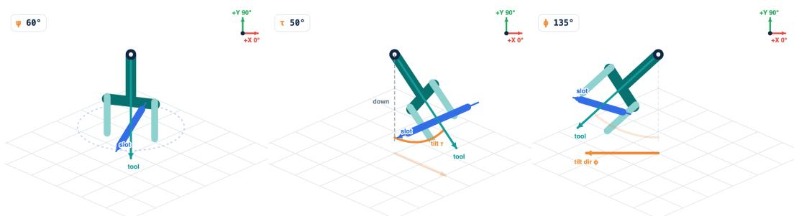  
Figure 7: Slot yaw, tilt and tilt direction. The gripper orientation parameterization used by move\_to (§3.1). Left: slot yaw ψ turns the jaw slot (blue), the axis a held object lies along, about the vertical. Middle: tilt τ leans the tool axis (teal) away from straight down; 0◦ is top-down and 90◦ horizontal. Right: tilt direction ϕ sets the compass direction the fingertips tip toward. Each angle changes exactly one thing about the gripper that can be seen. All angles are measured counterclockwise from world +x.

## B A real-robot episode, turn by turn

To make the agent loop of §3.1 concrete, we step through one complete episode of ZAP on the real bimanual rig. The task is “pick up both blocks”. The episode succeeds in 9 turns and 74.6 s of wallclock time, with 4 robot actions, 118,985 input tokens and 1,920 output tokens. Each image is the observation the agent received at the start of that turn (left wrist, overhead, right wrist); from turn 2 on it includes the SAM 3.1 masks and numbered boxes for the current perception queries, computed in the background. The overhead camera faces the arms from across the table, so its image-left is the robot’s right. Below each image we give an excerpt of the model’s reasoning, the single tool call it emitted, and the result the harness returned, which reaches the agent as the tool message at the start of the next turn. Reasoning is abridged with [. . . ]; tool calls are verbatim.

Turn 1  
t = 0.0–1.6 s  
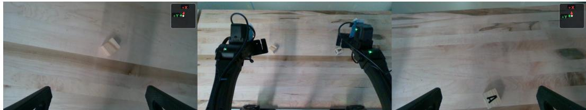  
Reasoning: I need to pick up both blocks. I can see two blocks in the overview: one appears to be a plain wooden block on the left side, and another is a white block with the letter “A” on the right side. [. . . ] Let me first query for both blocks to get their metric positions.  
Tool call: change\_query(queries=["plain wooden block", "white block with letter A"])  
Result: Perception query generation 1 set. The next snapshot will run these queries on its exact frame.

Turn 2  
t = 1.6–7.4 s  
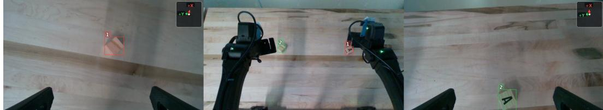  
Reasoning: From the depth data: plain wooden block: left wrist centroid (0.412, 0.200, 0.009), top\_z 0.011, ∼36–39 mm wide. A block: right wrist centroid (0.394, −0.237, 0.023), top\_z 0.025, ∼37 mm wide. I’ll use left arm for plain block and right arm for A block. [. . . ] I need to approach top-down, descend, close, lift, and verify both retained.

Tool call: update\_todo(items=["Pick both blocks: plain at \~<0.412,0.200>, top z0.011; A at \~<0.394,-0.237>, top z0.025.", "Use left for plain, right for A. Approach top-down at z0.12, descend to grasp heights \~0.003 and 0.010, close, lift to z0.15 and verify retention."])   
Result: Todo list replaced (2 items).

Turn 3  
t = 7.4–20.8 s  
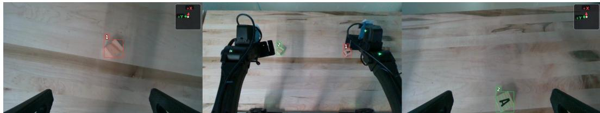  
Reasoning: $[ \dots ]$ First, I’ll move both arms to approach positions above the blocks with top-down orientation. Tool call: move\_to(left: x=0.412, y=0.2, z=0.12, slot\_yaw=180, tilt=0; right: x=0.394, y=-0.237, z=0.12, slot\_yaw=180, tilt=0)

$$
\leq 1
$$

$$
< 0 . 2 ^ { \circ } ;
$$

Turn 4  
t = 20.8–32.2 s  
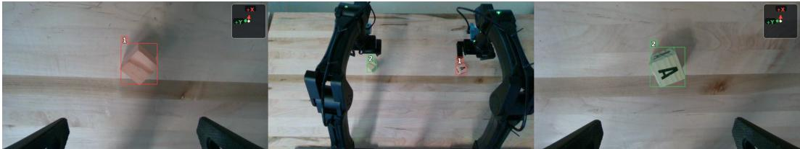  
Reasoning: The blocks are now clearly visible in the wrist cameras. [. . . ] Plain block: grasp at z0.003. A block: grasp at z0.010. I’ll descend, close, lift, and verify.

Turn 5  
t = 32.2–39.9 s  
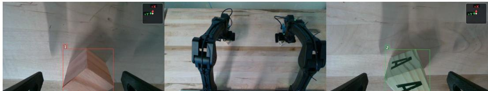  
Reasoning: The blocks are now at the grasp heights. I need to close the grippers, lift, and verify both are retained.  
Tool call: set\_gripper(left: opening=0; right: opening=0)  
Result: Grippers stalled as intended on the objects: left jaws stopped at 50.0 mm, right at 37.0 mm.

Tool call: done(outcome="success", summary="Both blocks have been picked up. [...]") Result: Episode ended: success.

Turn 6  
t = 39.9–55.3 s  
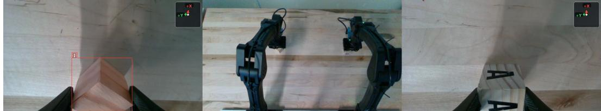  
Reasoning: The grippers have closed on both blocks. [. . . ] Lift to z0.15, keep orientation, then verify blocks are still between jaws and have moved up.  
Tool call: move\_to(left: x=0.412, y=0.2, z=0.15, slot\_yaw=180, tilt=0; right: x=0.394, y=-0.237, z=0.15, slot\_yaw=180, tilt=0)

Turn 7  
t = 55.3–62.4 s  
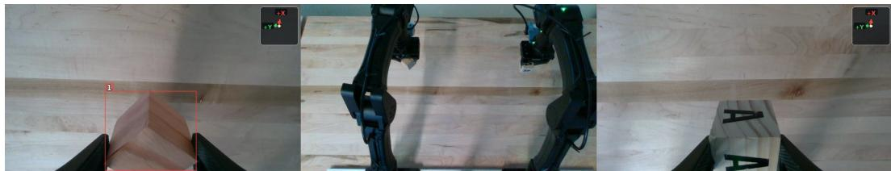  
Reasoning: Both blocks have been lifted. [. . . ] Left: plain block visible in left wrist, top\_z changed from 0.010 to 0.155 after lift, aperture 49.9 mm. [. . . ] I should verify the A block’s depth after lift, and then confirm both are held.  
Tool call: change\_query(queries=["wooden block with the letter A on it"]) Result: Perception query generation 2 set.

Turn 8  
t = 62.4–68.6 s  
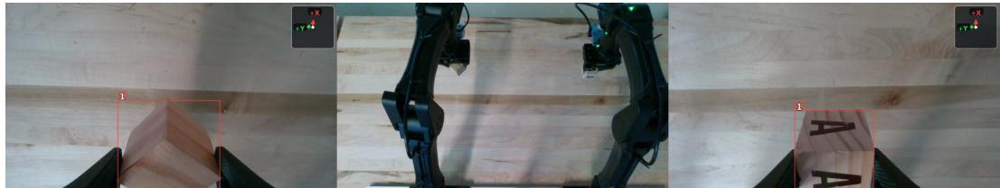  
Reasoning: [. . . ] Right: A block, initial top z0.025, now top z0.163. [. . . ] Both blocks are clearly visible in the wrist cameras and their top\_z has increased from ∼0.01/0.025 to ∼0.15/0.16, confirming they are lifted off the table.

Tool call: update\_todo(items=["Both blocks successfully picked up and lifted to TCP z0.15. [...]", "Lift verified by block top\_z increasing [...] Task complete."]) Result: Todo list replaced (2 items).  
Turn 9  
t = 68.6–72.8 s  
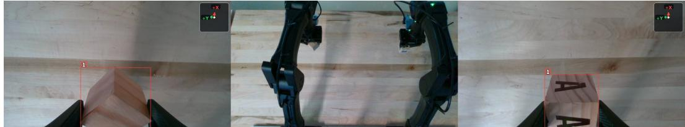  
Reasoning: I have successfully grasped both blocks and lifted them to a height of 0.15 m. The visual evidence confirms that both blocks are retained in the grippers after lifting. [. . . ] I should now declare the task as successful.

## C Training details

GRPO. We train with GRPO [36] in the style of Dr. GRPO [37], with no standard-deviation or per-sequence length normalization, using LoRA. 2 groups per task and 8 rollouts per group: 640 episodes per batch over 40 tasks. LoRA, rank 64. Up to 50 turns per episode; maximum sequence length 127k tokens. STAPO [38] enabled; DPPO [39] mask with threshold 0.2; maximum staleness 5. Asynchronous training in the style of prime-rl [40].

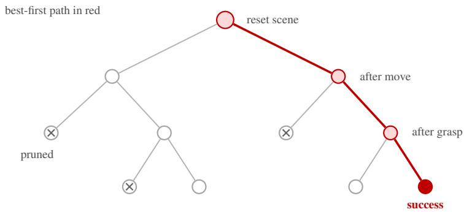  
Figure 8: Prefix-tree search (§3.3). A node is created after each physical action (a move, grasp or release) settles. The search keeps returning to the most promising partial episode and branching from there, instead of starting every attempt from scratch; branches that keep failing are pruned. We allow up to about 1,000 leaves per task.

## D Per-task real-world results

<table><tr><td>Task prompt</td><td>ZAP</td><td>GPT-6 Astra</td><td>GPT-6 Astra (RC)</td><td>MolmoAct2</td><td>Base Qwen</td></tr><tr><td>Put the mustard in the left bin</td><td>3/3</td><td>3/3</td><td>2/3</td><td>1/3</td><td>0/3</td></tr><tr><td>Pack canned foods into the bin</td><td>3/3</td><td>2/3</td><td>1/3</td><td>1/3</td><td>1/3</td></tr><tr><td>Put the whiteboard marker in the mug</td><td>2/3</td><td>3/3</td><td>1/3</td><td>0/3</td><td>0/3</td></tr><tr><td>Put the cube and the banana in the bowl</td><td>3/3</td><td>3/3</td><td>0/3</td><td>2/3</td><td>0/3</td></tr><tr><td>Put the Rubiks cube in the bowl</td><td>3/3</td><td>3/3</td><td>0/3</td><td>3/3</td><td>0/3</td></tr><tr><td>Put the white cup in the center of the table</td><td>3/3</td><td>3/3</td><td>1/3</td><td>0/3</td><td>2/3</td></tr><tr><td>Stack the left block onto the right block</td><td>3/3</td><td>3/3</td><td>2/3</td><td>0/3</td><td>0/3</td></tr><tr><td>Put the rubiks cube behind the bowl</td><td>3/3</td><td>3/3</td><td>0/3</td><td>0/3</td><td>0/3</td></tr><tr><td>Put the canned food in the grey bin</td><td>3/3</td><td>3/3</td><td>1/3</td><td>3/3</td><td>2/3</td></tr><tr><td>Make sure there are 3 bananas in the grey bin</td><td>3/3</td><td>3/3</td><td>3/3</td><td>0/3</td><td>0/3</td></tr></table>

Table 6: Per-task successes. RC: Robocurve harness.

## E Extended related work

Compositional reasoning in robotics. Classical robotics composes behavior explicitly. Task-andmotion planners search over symbolic operators that ground into geometric motion [11, 41, 12]. Learned variants acquire the operators, their abstractions or their programs from data [42, 43, 44, 45], or chain learned skills with generative models [46], or compose diffusion policies across tasks and domains [47]. Coding agents can also synthesize generalized TAMP programs [48]. Language models later took over the high-level planner: they plan zero-shot in language or as programs [49, 50], sequence a library of learned skills [13, 14, 15], hand subgoals to RL-trained or local low-level policies [16, 17], or supply open-world constraints to a TAMP solver [51, 52]. ZAP keeps the split between reasoning and motion but drops the fixed skill library. The interface is a set of tools in physical units, and motion is a skill the model learns itself, so a grasp learned on pick and place can be reused as a tube rotation or a marker stroke.

End-to-end policies and their compositional limits. Embodied multimodal language models [53] and vision-language-action models (VLAs) fold reasoning and motion into one network trained on robot actions, increasingly pooled across embodiments [54, 55, 1, 2, 3, 56, 57, 58, 4]. World-action models (WAMs) additionally predict future observations alongside actions, using video as a dense representation of how the world evolves [18, 59, 60]. Zero-WAM uses in-context human videos to guide unseen tasks [61], while ObjDream uses object-level representations and future object-state prediction to improve generalization to new layouts and backgrounds [62]. Some recover a hierarchy inside the model through embodied chain-of-thought or a high-level policy [63, 64, 65, 66]. Several studies show that these policies keep the intent of an instruction but fail to execute it on new tasks, held-out perturbations or new skill combinations [19, 20, 21, 67]. Recent diagnoses also find that current VLAs struggle with instructions specifying how to carry out a task [22]. One reason is that compositional coverage in action data is expensive to collect [68]. Benchmarks now measure compositional generalization directly, from compositional RL suites [69] to arm-wise composition in dual-arm VLAs [70], alongside standard manipulation benchmarks [71] and real-to-sim evaluation [72]. ZAP learns no reasoning from action data; it learns only motion, and only in simulation.

Foundation models as robot agents. Code as Policies and its successors compose perception and control APIs into programs or value maps [5, 23, 73], in the style of tool-using agents [74]. RAX compiles a coding agent’s online exploration into robot programs that run without the agent [75]; MoCaP uses passive human videos to guide code-as-policy for mobile manipulation [76]. Multimodal language-model agents remain weak at low-level manipulation when used off the shelf [77]. Recent work nonetheless uses frontier agents directly as closed-loop policies: on real YAM arms [7, 8, 32], including head-to-head comparisons with VLAs on bimanual tasks [78] and in simulation [79], through general agent frameworks [80, 81], through a visual interface [82], through in-context learning [83], through primitive motion commands [84], or with perception tools and test-time simulation [9, 85, 86]. SEAR compares code-as-policy, agent-as-policy and VLA autoresearch, with controls that separate retained experience from repeated attempts and larger budgets [87].

Other work improves the harness, with evolving code, skill libraries or playbooks [88, 89, 90, 91, 92, 93]. URAI lets frontier agents write, call and evolve reusable robot tools [94], while ChunkAct chains primitives into action chunks to reduce model calls [95]. Some harnesses surround a VLA: Cracking Mobile Manipulation adds planning, navigation and local-motion interventions around a fixed policy [96], and CarryOn adds planning and execution loops with reusable recovery skills [97]. AdaRSI first improves the harness, then fine-tunes the executor on sub-steps that remain unreliable [98].

Concurrent work adapts frontier-agent skills from simulation to hardware without weight updates [99, 100, 101]. SimEX develops a robot toolbox in simulation, then adapts it and the simulator through a few physical trials [102]. ZAP trains the motion skill into an open 27B model that runs 3× faster and 17× cheaper than the frontier model it matches.

VLMs that directly predict actions. EASG projects a tool-center-point action frame into the wristcamera image and lets a pretrained VLM generate continuous translations and rotations as text [103]. This grounds the action space for zero-shot manipulation, and the same interface supports finetuning on robot trajectories. ZAP also uses the model’s native text generation to command motion, learning full absolute end-effector poses through SFT and RL entirely in simulation.

Small trained robot agents. The closest work trains compact agents. Guava distills frontier-model trajectories collected in simulation into a 4B agent using semantic grasp and align tools [24]. RACaP evolves reusable policy APIs, then distills frontier-model ReAct decisions into an 8B model for efficient deployment [25]. Show-Harness fine-tunes a 2B model on discrete action units, partly on RoboLab [104]. Robo-Harness K1 distills a 9B student, evaluated only in simulation [9]. CaP-RL trains a 7B code-writing model with GRPO in simulation and transfers it to cube lifting and stacking [6].

Other work fine-tunes VLM agents for manipulation question answering [105] or calls a small agentready action model through tools [106]. ZAP trains mainly with RL on its own multi-turn simulation rollouts to command full robot poses. Beyond Guava’s tested recombinations of familiar skills, ZAP shows new real-world strategies, including a mid-air handoff and marker drawing, and transfers the same checkpoint from bimanual YAM to simulated Franka without retraining.

RL for language-model agents and embodied reasoning. Online RL can ground language models as policies in text and simulated environments [107, 108, 109]. Multi-turn agent RL has since scaled with GRPO-style objectives [36, 110, 111, 112, 113]. In robotics, RL has sharpened embodied and physical reasoning in VLMs, for example pointing and keypoint prediction [114, 115, 116], has fine-tuned VLAs in simulation [117, 118, 119], and has trained agentic recovery decisions over VLA execution [120], including at scale for sim-to-real transfer [121]. ZAP applies multi-turn GRPO to a VLM tool agent whose actions are real robot motions.

Sim-to-real. Domain and dynamics randomization made simulation-only training viable for lowlevel control [122, 123, 124]. Large procedurally generated simulations now transfer manipulation policies zero-shot [125], and object-centric abstractions narrow the gap further [126]. We use Isaac Sim and RoboLab [29, 127, 30]. Our tool interface acts as the abstraction: the observations and actions the model sees are the same in simulation and on hardware [128]. As a result, only dynamics and perception, not the interface, differ between the two.