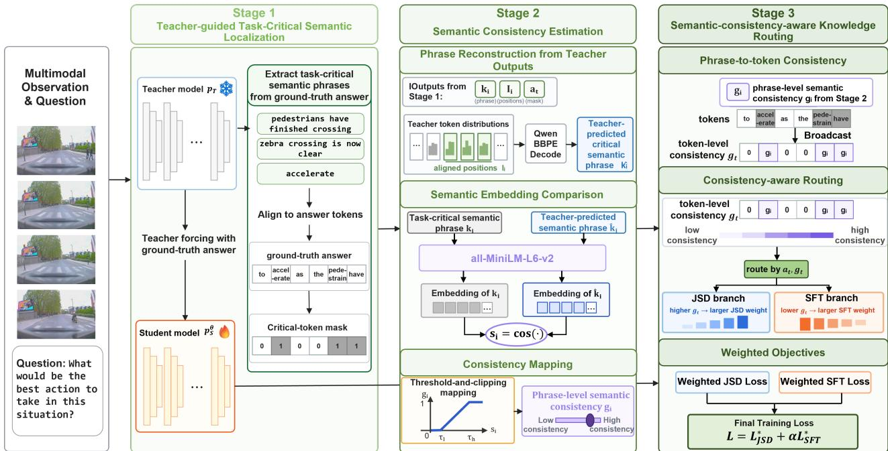

# RSKD: GROUNDING SEMANTIC CONSISTENCY IN DRIVING VLMS VIA DISTILLATION

Chuchu Xie1, Yang Zhong2, Kangan Qian1, Hao Ye2, Kun Jiang1, Diange Yang1

1 School of Vehicle and Mobility, Tsinghua University, Beijing, China

2 Automotive and Robotics, Xiaomi Corporation, Beijing, China

1 xcc22@mails.tsinghua.edu.cn, qka8203191007@163.com

1 jiangkun@tsinghua.edu.cn, ydg@tsinghua.edu.cn

2 zhongyang3@xiaomi.com, rawk.vx@gmail.com

## ABSTRACT

Knowledge distillation can transfer large multimodal models to compact models for autonomous driving, but uniform token-level matching can dilute planning-relevant semantics and amplify teacher errors. We propose RSKD, a semanticconsistency-guided distillation framework that routes supervision according to both the task importance of an answer phrase and its semantic consistency with the teacher prediction. Task-critical semantic phrases are localized in the ground-truth answer, and a phrase-level consistency score controls the balance between Jensen–Shannon divergence (JSD) distillation and ground-truth supervision. Teacher information is emphasized only where it is semantically consistent, while semantically inconsistent phrases receive stronger ground-truth supervision. We evaluate RSKD on DrivingVQA, LingoQA, and MapLMv2. RSKD improves over the compared student-based baselines on DrivingVQA and LingoQA and remains competitive on MapLMv2.

Index Terms— knowledge distillation, autonomous driving, multimodal large language models

## 1. INTRODUCTION

Multimodal large language models (MLLMs) have recently shown promising capabilities in autonomous driving, supporting scene understanding, visual question answering, and reasoning over complex traffic environments [1, 2, 3]. Despite their strong reasoning capabilities, deploying large-scale MLLMs in practical autonomous systems remains challenging due to their substantial computational and memory costs. Knowledge distillation (KD) provides an effective approach to transferring knowledge from a powerful teacher model to a compact student model [4, 5, 6].

However, effective knowledge transfer in autonomous driving requires more than uniformly matching teacher distributions across answer tokens. Driving-oriented answers contain heterogeneous semantic information: some tokens encode task-critical elements such as traffic participants, traffic states, spatial relations, road constraints, and driving behaviors, whereas others mainly serve descriptive or linguistic purposes. Consequently, treating all answer positions identically may dilute supervision on planning-relevant knowledge.

Recent studies have therefore explored fine-grained knowledge distillation by adapting supervision according to tokenlevel learning signals [7, 8]. While such strategies improve the granularity of knowledge transfer, model-derived token statistics do not necessarily indicate whether the corresponding tokens encode task-critical driving semantics. Semantic importance alone, however, does not determine how strongly the teacher should supervise a task-critical semantic phrase, which the teacher may still predict incorrectly.

Teacher confidence does not necessarily imply semantic correctness; a teacher may confidently predict an incorrect spatial relation, traffic state, or driving constraint. Strengthening distribution matching in such regions may propagate teacher errors to the student. Therefore, fine-grained distillation for autonomous driving should jointly answer two questions: what knowledge is criticalfor the task, and whether the teacher is semantically consistent on that knowledge.

Motivated by this observation, we propose RSKD, a semantic-consistency-guided knowledge distillation framework for driving VLMs. RSKD first localizes task-critical semantic phrases in the ground-truth answer and evaluates the semantic consistency of the corresponding teacher-predicted phrases. The resulting semantic consistency score controls the balance between JSD distillation and ground-truth supervision, emphasizing teacher signals that agree with the answer while reducing the influence of inconsistent predictions.

Our main contributions are summarized as follows:

• We introduce RSKD, a semantic-consistency-guided distillation framework for driving VLMs that explicitly identifies task-critical semantic phrases rather than treating all answer tokens uniformly.

• We propose a phrase-level semantic consistency mechanism that evaluates teacher predictions against the ground-truth semantics and adaptively routes JSD distillation and ground-truth supervision, strengthening teacher guidance only when it is semantically consistent.

• Experiments on DrivingVQA, LingoQA, and MapLMv2 show gains on the two QA benchmarks and competitive performance on MapLMv2 under the reported setting.

## 2. RELATED WORK

Knowledge distillation transfers knowledge from a large teacher to a compact student through distribution matching [4]. GKD [6] extends distribution-level distillation to autoregressive language models, while multimodal distillation methods such as LLAVADI [9] investigate token- and logit-level knowledge transfer in multimodal models. These approaches mainly focus on improving teacher–student distribution or representation alignment, without explicitly identifying task-critical semantic phrases in driving answers.

Fine-grained methods further adapt supervision at the token level. ToDi [7] and AdaKD [8] adjust knowledge transfer according to teacher–student divergence or token learning difficulty, while recent work also explores uncertainty-aware supervision [10]. In contrast, RSKD localizes task-critical semantic phrases from the ground-truth answer, evaluates the semantic consistency of teacher predictions on these phrases, and uses the resulting signal to jointly route distribution distillation and ground-truth supervision.

## 3. METHOD

## 3.1. Problem Formulation and Conventional Distillation

Given an autonomous-driving multimodal question-answering instance, let x denote the multimodal input and $y = ( y _ { 1 } , \dots , y _ { T } )$ the ground-truth answer. The teacher and student models are denoted by $p _ { T }$ and $p _ { S } ^ { \theta }$ , with next-token distributions

$$
p _ { t } ( v ) = p _ { T } ( v \mid x , y _ { < t } ) , \qquad q _ { t } ^ { \theta } ( v ) = p _ { S } ^ { \theta } ( v \mid x , y _ { < t } ) , \quad v \in \mathcal { V } ,\tag{1}
$$

where $t \in \tau$ indexes valid answer-token positions and V is the vocabulary. Following GKD [6], we use the generalized Jensen–Shannon divergence

$$
\begin{array} { r l } & { D _ { \mathrm { J S D } } ^ { \beta } ( p _ { t } \Vert q _ { t } ^ { \theta } ) = \beta D _ { \mathrm { K L } } ( p _ { t } \Vert m _ { t } ) + ( 1 - \beta ) D _ { \mathrm { K L } } ( q _ { t } ^ { \theta } \Vert m _ { t } ) , } \\ & { \qquad m _ { t } = \beta p _ { t } + ( 1 - \beta ) q _ { t } ^ { \theta } . } \end{array}\tag{2}
$$

Together with ground-truth supervision, the conventional objective is

$$
\mathcal { L } _ { \mathrm { j o i n t } } = \frac { 1 } { | \mathcal { T } | } \sum _ { t \in \mathcal { T } } \left[ D _ { \mathrm { J S D } } ^ { \beta } ( p _ { t } \Vert \boldsymbol { q } _ { t } ^ { \theta } ) - \alpha \log q _ { t } ^ { \theta } ( \boldsymbol { y } _ { t } ) \right] ,\tag{3}
$$

where α controls the ground-truth supervision strength. Uniform token-level supervision, however, ignores both semantic importance and teacher semantic consistency. RSKD addresses these factors through task-critical semantic localization, consistency estimation, and consistency-aware routing.

## 3.2. Framework Overview

Figure 1 summarizes RSKD in three stages. We first localize task-critical semantic phrases in the ground-truth answer, then estimate teacher semantic consistency on these phrases, and finally broadcast the phrase-level score to answer tokens to control JSD distillation and ground-truth supervision in opposite directions.

The main symbols are: x for the multimodal observation and question, y for the ground-truth answer, $\kappa$ for extracted task-critical semantic phrases, $a _ { t }$ for the critical-token mask, $g _ { i }$ and $g _ { t }$ for phrase- and token-level semantic consistency scores, and $w _ { t } ^ { \mathrm { { { \bar { J } } S D } } }$ and $w _ { t } ^ { \mathrm { S F T } }$ for the routing weights. The teacher remains frozen throughout semantic extraction and distillation.

## 3.3. Teacher-guided Task-Critical Semantic Localization

The first step of our framework is to identify task-critical semantic phrases that are highly relevant to autonomous driving reasoning. Given the input x and the ground-truth answer y, we prompt the teacher model to extract task-critical semantic phrases from the answer.

The extracted task-critical semantic phrase set is denoted as $\mathcal { K } ~ = ~ \{ k _ { 1 } , k _ { 2 } , \ldots , k _ { N } \}$ , where each $k _ { i }$ denotes a taskcritical semantic phrase extracted from the ground-truth answer. Unlike answer generation, this process does not require the teacher model to generate a new answer. Instead, it performs semantic annotation over the known ground-truth answer, aiming to identify information that contributes most to driving-related reasoning.

To obtain token-level task-critical semantic localization, each phrase $k _ { i }$ is aligned with the tokenized answer sequence. Let ${ \mathcal T } _ { i } = { \mathcal A } ( k _ { i } , y )$ denote the set of answer-token positions aligned with $k _ { i } .$ The global critical-token mask is defined as

$$
a _ { t } = { \left\{ \begin{array} { l l } { 1 , } & { t \in \bigcup _ { i = 1 } ^ { N } { \mathcal { T } } _ { i } , } \\ { 0 , } & { { \mathrm { o t h e r w i s e } } , } \end{array} \right. }\tag{4}
$$

where $\boldsymbol { \mathcal { A } } ( \cdot )$ aligns each phrase by exact token-subsequence matching within the tokenized ground-truth answer.

The resulting mask $a _ { t }$ provides a semantic prior indicating which answer tokens require consistency-aware supervision adjustment.

  
Fig. 1. Overview of the proposed RSKD.

## 3.4. Semantic Consistency Estimation

For each task-critical semantic phrase $k _ { i } ,$ we reconstruct the teacher prediction at its aligned positions $\mathcal { T } _ { i }$ under teacher forcing:

$$
\hat { k } _ { i } = \mathrm { D e c } _ { \mathrm { t o k } } \left( \left[ \operatorname * { a r g m a x } _ { v \in \mathcal { V } } p _ { t } ( v ) \right] _ { t \in \mathcal { T } _ { i } } \right) ,\tag{5}
$$

where De $\mathrm { \dot { \ z } _ { t o k } }$ denotes decoding with the Qwen3 tokenizer BBPE [11].

We then encode $k _ { i }$ and $\hat { k } _ { i }$ using a frozen all-MiniLM-L6- ${ \bf v } 2$ sentence encoder [12, 13]. Their semantic similarity and consistency score are

$$
s _ { i } = \cos \Bigl ( \phi ( k _ { i } ) , \phi ( \hat { k } _ { i } ) \Bigr ) , \qquad g _ { i } = \mathrm { c l i p } \biggl ( { \frac { s _ { i } - \tau _ { l } } { \tau _ { h } - \tau _ { l } } } , 0 , 1 \biggr )\tag{6}
$$

A larger $g _ { i }$ indicates stronger semantic agreement between the teacher prediction and the ground-truth phrase, making its predictive distribution more reliable for supervising student distillation; a smaller $g _ { i }$ , in contrast, calls for greater reliance on ground-truth supervision. Explicit contradictions between mutually exclusive driving relations are assigned $g _ { i } = 0$ . The phrase-level score is then broadcast to the aligned token positions as $g _ { t } = g _ { i }$ for $t \in \mathcal { T } _ { i }$

## 3.5. Semantic-consistency-aware Knowledge Routing

Given the critical-token mask $a _ { t }$ and consistency score $g _ { t } ,$ we route JSD and ground-truth supervision in opposite direc-

tions:

$$
\begin{array} { r l } & { w _ { t } ^ { \mathrm { J S D } } = 1 - a _ { t } + a _ { t } \left[ w _ { \mathrm { m i n } } ^ { \mathrm { J S D } } + \left( w _ { \mathrm { m a x } } ^ { \mathrm { J S D } } - w _ { \mathrm { m i n } } ^ { \mathrm { J S D } } \right) g _ { t } \right] , } \\ & { w _ { t } ^ { \mathrm { S F T } } = 1 - a _ { t } + a _ { t } \left[ w _ { \mathrm { m i n } } ^ { \mathrm { S F T } } + \left( w _ { \mathrm { m a x } } ^ { \mathrm { S F T } } - w _ { \mathrm { m i n } } ^ { \mathrm { S F T } } \right) \left( 1 - g _ { t } \right) \right] . } \end{array}\tag{7}
$$

Thus, critical tokens with high semantic consistency receive stronger JSD supervision, while those with low consistency receive stronger ground-truth supervision.

The weighted objectives and final loss are

$$
\begin{array} { r l } & { \mathcal { L } _ { \mathrm { J S D } } ^ { * } = \frac { \sum _ { t \in \mathcal { T } } w _ { t } ^ { \mathrm { J S D } } D _ { \mathrm { J S D } } ^ { \beta } ( p _ { t } \| q _ { t } ^ { \theta } ) } { \sum _ { t \in \mathcal { T } } w _ { t } ^ { \mathrm { J S D } } } , } \\ & { \mathcal { L } _ { \mathrm { S F T } } ^ { * } = - \frac { \sum _ { t \in \mathcal { T } } w _ { t } ^ { \mathrm { S F T } } \log q _ { t } ^ { \theta } ( y _ { t } ) } { \sum _ { t \in \mathcal { T } } w _ { t } ^ { \mathrm { S F T } } } , } \\ & { \quad \quad \mathcal { L } = \mathcal { L } _ { \mathrm { J S D } } ^ { * } + \alpha \mathcal { L } _ { \mathrm { S F T } } ^ { * } . } \end{array}\tag{8}
$$

Each branch is normalized by its own weight sum, so routing changes the relative emphasis within each supervision source rather than enforcing a fixed global JSD-to-SFT ratio.

## 4. EXPERIMENTS

## 4.1. Experimental Setup

Benchmarks and baselines. We evaluate on DrivingVQA [14], LingoQA [15], and MapLMv2 [16] using their official metrics. We report the frozen teacher and unadapted student as references, and compare against SFT, off-policy GKD [6], ToDi [7], and RSKD. All trained student methods use the same training mixture of DrivingVQA, LingoQA, and MapLMv2.

Table 1. Main results on three autonomous-driving visionlanguage benchmarks. Higher is better. Trained student results are averaged over multiple random seeds; the best student-based result is bold.
<table><tr><td>Method</td><td>DrivingVQA ↑</td><td>LingoQA ↑</td><td>MapLMv2 ↑</td></tr><tr><td>Teacher</td><td>49.81</td><td>0.642</td><td>79.00</td></tr><tr><td>Student</td><td>3.30</td><td>0.584</td><td>53.26</td></tr><tr><td>SFT</td><td>14.06</td><td>0.631</td><td>81.85</td></tr><tr><td>GKD</td><td>16.34</td><td>0.640</td><td>81.08</td></tr><tr><td>ToDi [7]</td><td>16.35</td><td>0.649</td><td>81.80</td></tr><tr><td>RSKD</td><td>16.60</td><td>0.672</td><td>81.82</td></tr></table>

Implementation details. We use Qwen3-VL-4B-Instruct as the student and an internally fine-tuned XEmbodied teacher [17] based on Qwen3-VL-30B-A3B-Instruct [11]. The student is adapted with LoRA [18] on all linear languagemodel layers with rank 8, scaling factor 32, and dropout 0.05, while the visual encoder and aligner are frozen. We train for two epochs with BF16, a learning rate of $1 \times 1 0 ^ { - 5 }$ , per-device batch size 1, no gradient accumulation, warmup ratio 0.05, and maximum sequence length 32,000. Each trained configuration is repeated with 3 random seeds, and we report the mean performance across runs. Training is distributed over 96 NVIDIA H20 GPUs, averaging 52h 20min per run.

For task-critical semantic phrase extraction, the teacher is prompted to return exact contiguous substrings from the ground-truth answer describing traffic participants, states, spatial relations, road constraints, or required behaviors. These phrases are aligned to answer tokens by exact tokensubsequence matching; empty, malformed, or unmatched phrases are ignored. Teacher predictions that contradict the ground-truth phrase on predefined mutually exclusive driving relations (e.g., left/right, front/behind, moving/stopped, or accelerate/decelerate) are assigned zero consistency.

We set $\tau _ { l } = 0 . 6$ and $\tau _ { h } = 0 . 8$ using the validation split and use JSD/SFT weight ranges of [0, 2]/[2, 4]. We further select the loss coefficient α, JSD mixing coefficient β, and distillation temperature on the validation split by searching over α ∈ {0.1, 0.5, 1, 2}, $\beta \in \{ 0 . 1 , 0 . 5 , 0 . 9 \}$ , and temperatures {1, 2, 4}, yielding α = 1, β = 0.5, and temperature 1. No test data are used for hyperparameter selection.

## 4.2. Main Results

Table 1 reports the main results. RSKD achieves the best student performance on DrivingVQA and LingoQA, reaching 16.60 and 0.672, respectively, and consistently outperforming SFT, GKD, and ToDi. The improvements over GKD and ToDi suggest that explicitly incorporating task-critical semantic localization and teacher–ground-truth consistency can complement uniform or divergence-based distillation. On MapLMv2, the teacher itself performs relatively weakly (79.00), limiting the useful knowledge available for transfer. RSKD nevertheless reaches 81.82, substantially above the

Table 2. Ablation on a fixed 50% LingoQA subset under the same reduced training budget.
<table><tr><td>Variant</td><td></td><td></td><td></td><td>Loc. Cons. JSD Rt. SFT Rt. Score ↑</td><td></td></tr><tr><td>Random Spans</td><td>Rand.</td><td>V</td><td></td><td>√</td><td>0.474</td></tr><tr><td>w/o Consistency</td><td>√</td><td></td><td></td><td></td><td>0.475</td></tr><tr><td>w/o SFT Routing</td><td>√</td><td>√</td><td>√</td><td></td><td>0.468</td></tr><tr><td>Full RSKD</td><td>√</td><td>√</td><td>√</td><td>√</td><td>0.480</td></tr></table>

teacher and GKD and nearly matching SFT (81.85), which is consistent with its design of reducing reliance on semantically inconsistent teacher signals while strengthening ground-truth supervision.

## 4.3. Ablation Study

For efficiency, all ablations use the same 50% LingoQA subset under an identical reduced training budget, and Table 2 is compared only within this setting. Random Spans replaces task-critical spans with random answer spans, while w/o Consistency removes consistency estimation using fixed semantic weights, and w/o SFT Routing disables consistency-aware routing in the ground-truth supervision branch. Replacing task-critical spans with random ones reduces the score from 0.480 to 0.474, confirming the value of semantic localization, while removing consistency estimation yields 0.475, showing that semantic importance alone is insufficient. Removing SFT routing causes the largest drop to 0.468, highlighting the importance of stronger ground-truth supervision when teacher predictions are semantically inconsistent.

## 4.4. Limitations

RSKD has several limitations. Its semantic consistency estimation depends on teacher phrase extraction and a frozen MiniLM encoder, making the routing sensitive to extraction and embedding errors. The fixed similarity thresholds and rule-based contradiction detection may also require recalibration across datasets with different response styles. In addition, RSKD introduces extra computation during training, while our evaluation is currently limited to a single teacher–student pair; broader validation is left for future work.

## 5. CONCLUSION

We present RSKD, a semantic-consistency-guided distillation framework for driving VLMs that localizes task-critical semantic phrases and routes teacher and ground-truth supervision according to semantic similarity. Experiments on DrivingVQA, LingoQA, and MapLMv2 show gains over distillation baselines on the two QA benchmarks and competitive performance when the teacher advantage is limited, highlighting the need to identify task-critical semantics and assess whether teacher predictions preserve their ground-truth meaning.

## 6. REFERENCES

[1] Chonghao Sima, Katrin Renz, Kashyap Chitta, Li Chen, Hanxue Zhang, Chengen Xie, Jens Beißwenger, Ping Luo, Andreas Geiger, and Hongyang Li, “Drivelm: Driving with graph visual question answering,” in European conference on computer vision. Springer, 2024, pp. 256–274.

[2] Xiaoyu Tian, Junru Gu, Bailin Li, Yicheng Liu, Yang Wang, Zhiyong Zhao, Kun Zhan, Peng Jia, XianPeng Lang, and Hang Zhao, “Drivevlm: The convergence of autonomous driving and large vision-language models,” in Proceedings of The 8th Conference on Robot Learning. 2025, vol. 270 of Proceedings of Machine Learning Research, pp. 4698–4726, PMLR.

[3] Shihao Wang, Zhiding Yu, Xiaohui Jiang, Shiyi Lan, Min Shi, Nadine Chang, Jan Kautz, Ying Li, and Jose M Alvarez, “Omnidrive: A holistic vision-language dataset for autonomous driving with counterfactual reasoning,” in 2025 IEEE/CVF Conference on Computer Vision and Pattern Recognition (CVPR). IEEE, 2025, pp. 22442–22452.

[4] Geoffrey Hinton, Oriol Vinyals, and Jeff Dean, “Distilling the knowledge in a neural network,” arXiv preprint arXiv:1503.02531, 2015.

[5] Yuxian Gu, Li Dong, Furu Wei, and Minlie Huang, “Minillm: Knowledge distillation of large language models,” in International Conference on Learning Representations, 2024, vol. 2024, pp. 32694–32717.

[6] Rishabh Agarwal, Nino Vieillard, Yongchao Zhou, Piotr Stanczyk, Sabela Ramos Garea, Matthieu Geist, and Olivier Bachem, “On-policy distillation of language models: Learning from self-generated mistakes,” in International Conference on Learning Representations, 2024, vol. 2024, pp. 21246–21263.

[7] Seongryong Jung, Suwan Yoon, DongGeon Kim, and Hwanhee Lee, “Todi: Token-wise distillation via finegrained divergence control,” in Proceedings ofthe 2025 Conference on Empirical Methods in Natural Language Processing, 2025, pp. 8089–8102.

[8] Xurong Xie, Zhucun Xue, Jiafu Wu, Jian Li, Yabiao Wang, Xiaobin Hu, Yong Liu, and Jiangning Zhang, “Llm-oriented token-adaptive knowledge distillation,” in Proceedings ofthe AAAI Conference on Artificial Intelligence, 2026, vol. 40, pp. 34070–34078.

[9] Shilin Xu, Xiangtai Li, Haobo Yuan, Lu Qi, Yunhai Tong, and Ming-Hsuan Yang, “LLAVADI: What matters for multimodal large language models distillation,” 2024.

[10] Jingchen Sun, Shaobo Han, Deep Patel, Wataru Kohno, Can Jin, and Changyou Chen, “Uncertainty-aware knowledge distillation for multimodal large language models,” in Proceedings of the IEEE/CVF Conference on Computer Vision and Pattern Recognition (CVPR), June 2026, pp. 5585–5595.

[11] Shuai Bai, Yuxuan Cai, Ruizhe Chen, Keqin Chen, Xionghui Chen, Zesen Cheng, Lianghao Deng, Wei Ding, Chang Gao, Chunjiang Ge, et al., “Qwen3- vl technical report,” arXiv preprint arXiv:2511.21631, 2025.

[12] Nils Reimers and Iryna Gurevych, “Sentence-bert: Sentence embeddings using siamese bert-networks,” in Proceedings of the 2019 conference on empirical methods in natural language processing and the 9th international joint conference on natural language processing (EMNLP-IJCNLP), 2019, pp. 3982–3992.

[13] Wenhui Wang, Furu Wei, Li Dong, Hangbo Bao, Nan Yang, and Ming Zhou, “Minilm: Deep self-attention distillation for task-agnostic compression of pre-trained transformers,” Advances in neural information processing systems, vol. 33, pp. 5776–5788, 2020.

[14] Charles Corbiere, Simon Roburin, Syrielle Montariol,\` Antoine Bosselut, and Alexandre Alahi, “Drivingvqa: A dataset for interleaved visual chain-of-thought in realworld driving scenarios,” in Findings ofthe Association for Computational Linguistics: EACL 2026, 2026, pp. 3309–3333.

[15] Ana-Maria Marcu, Long Chen, Jan Hunermann, Al-¨ ice Karnsund, Benoit Hanotte, Prajwal Chidananda, Saurabh Nair, Vijay Badrinarayanan, Alex Kendall, Jamie Shotton, et al., “Lingoqa: Visual question answering for autonomous driving,” in European Conference on Computer Vision. Springer, 2024, pp. 252–269.

[16] Xu Cao, Tong Zhou, Yunsheng Ma, Wenqian Ye, Can Cui, Kun Tang, Zhipeng Cao, Kaizhao Liang, Ziran Wang, James M Rehg, et al., “Maplm: A realworld large-scale vision-language benchmark for map and traffic scene understanding,” in 2024 IEEE/CVF Conference on Computer Vision and Pattern Recognition (CVPR). IEEE, 2024, pp. 21819–21830.

[17] Kangan Qian, Chuchu Xie, Yang Zhong, et al., “Xembodied: A foundation model with enhanced geometric and physical cues for large-scale embodied environments,” arXiv preprint arXiv:2604.18484, 2026.

[18] Edward J. Hu, Yelong Shen, Phillip Wallis, Zeyuan Allen-Zhu, Yuanzhi Li, Shean Wang, Lu Wang, and Weizhu Chen, “Lora: Low-rank adaptation of large language models,” in International Conference on Learning Representations, 2022.