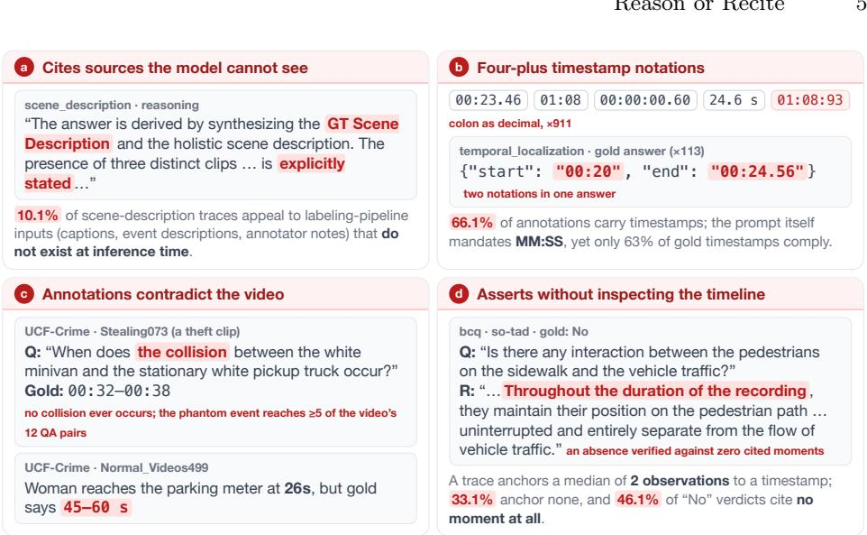
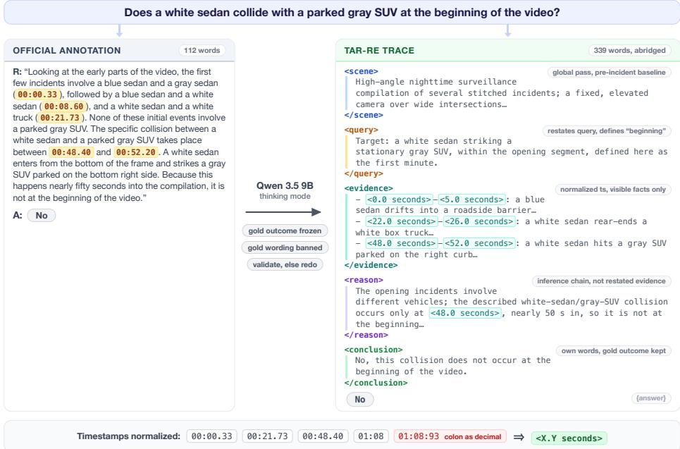
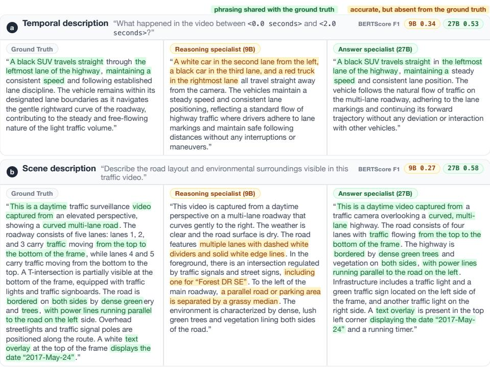

# Reason or Recite: Complementary Specialists with an LLM Judge for Trafic Anomaly Reasoning

Mayur Kulkarni

Stellarview AI, Pune, India

mayur.k@stellarview.ai

Abstract. Road anomalies such as collisions, violations, and sudden hazards demand more from video understanding than detection: a practical system must verify what happened, describe the scene, and explain the cause. We find these competences pull in opposite directions for vision-language models: closed-form questions reward precise, evidencegrounded reasoning, while open-ended answers are scored by similarity to reference text, where matching the annotation style matters as much as reasoning correctly. We present Reason-or-Recite (RoR), a two-specialist framework for the Trafic Anomaly Reasoning track of the 2026 AI City Challenge. RoR (1) rewrites the oficial chain-of-thought annotations into a structured, temporally grounded schema and LoRA-tunes a 9B visionlanguage model on the enhanced traces; (2) fine-tunes a 4-bit-quantized 27B model on answers alone, absorbing the annotation style; and (3) selects between the two candidates per question with a training-free LLM judge. RoR ranks first on the in-domain leaderboard with mean score 0.6788.

Keywords: Trafic anomaly reasoning · Vision-language models · LLMas-judge · Chain-of-thought · AI City Challenge

## 1 Introduction

Understanding anomalous events in transportation goes well beyond flagging that something unusual happened: a practical system must verify whether a specific event occurred, describe the scene and actors, localize the event in time, and explain why it happened. Track 3 of the 2026 AI City Challenge [38] operationalizes this via the Trafic Anomaly Reasoning (TAR) benchmark: a unified video-language model must answer ten heterogeneous task types, nine of them scored, over CCTV trafic footage, ranging from binary event verification and multiple-choice QA to open-ended causal analysis, scene description, and video summarization.

Two properties of the benchmark shape our solution. First, the task types demand diferent competences: closed-form questions (binary and multiple-choice) reward precise, evidence-grounded reasoning, while the seven open-ended tasks are scored with BERTScore [55] against a single reference answer. Second, similarity to a single reference rewards matching that reference’s register and contentselection policy as much as answering correctly, and the training annotations, machine-generated by a VLM auto-labeling pipeline (Sec. 3.2), are the only available sample of the style being scored against: a model that reasons better than its supervision can paradoxically score worse.

We therefore decouple the two competences. For evidence-grounded reasoning, we rewrite the oficial chain-of-thought annotations into a structured, evidence-grounded schema (<scene>, <query>, <evidence> with timestamps, <reason>, <conclusion>) using an of-the-shelf LLM, and LoRA-tune [17] a Qwen 3.5 9B VLM on the enhanced traces (Secs. 4.2 and 4.3). For open-ended tasks, we fine-tune a larger Qwen 3.6 27B model with QLoRA [7] on the answers only, letting it absorb the training annotation distribution directly (Sec. 4.4). At inference, a frozen Qwen 3.6 27B judge selects the better candidate per question, with no additional training (Sec. 4.5).

Our contributions are:

– Structured reasoning enhancement (TAR-RE): an LLM-driven reannotation of the TAR reasoning traces into an explicit, temporally grounded schema, substantially improving closed-form QA after fine-tuning.

– Answer-distribution specialization for reference-scored generation: an answer-only QLoRA fine-tune of a larger model that absorbs the autolabeled annotation distribution directly and outperforms reasoning-tuned models on the BERTScore-scored open-ended tasks, showing that under single-reference scoring, matching the annotation distribution can outweigh gains in reasoning quality.

Evidence-gated per-question arbitration: a training-free LLM judge that selects between the specialists per question; unconstrained, it scores below the stronger specialist due to position and family bias, while our conservative design gains over both.

– First place: 1st on the Track 3 in-domain (TAR) leaderboard with mean score 0.6788, including perfect binary event verification.

## 2 Related Work

## 2.1 Vision-Language Models for Video Understanding

Open multimodal LLMs have matured rapidly into capable video reasoners [1, 3, 25, 40, 56, 58], with recent backbones built for long, temporally rich video [43]: Qwen3-VL interleaves textual timestamps with video tokens over a 256K context [2]. On the language side, Qwen3 [47] integrates a fast non-thinking mode and an explicit thinking mode into a single model, a reasoning/answering duality our two-specialist design mirrors at the system level. We build on this line: the reasoning specialist applies LoRA [17] to Qwen 3.5 9B [32] and the answer specialist QLoRA [7] to Qwen 3.6 27B [33], its architecturally identical, further post-trained successor. A complementary line grounds video reasoning in time, via timestamp-bound features, supervised event boundaries, timestamped causal traces, or temporally indexed evidence banks [10, 14, 18, 34, 44]; rather than encoding time in the architecture or the retrieval stage, our structured traces make timestamped evidence explicit in the supervision itself.

## 2.2 From Anomaly Detection to Reasoning Supervision

Trafic and surveillance anomaly analysis began as detection: weakly supervised methods score video snippets from video-level labels [35,39], supported by traficspecific benchmarks spanning dashcam and CCTV views [5, 11, 26, 46, 50]. Such systems localize anomalies but cannot explain them, so a second wave reframes anomaly analysis as language understanding via multimodal LLMs [8, 36, 54], prompted foundation models [52], or verbalized learning [51]; most recently, VAD-R1 [19] and VAU-R1 [59] make the model reason before answering, optimizing the reasoning with GRPO-style reinforcement learning. How that reasoning should be supervised is a question of its own: chain-of-thought prompting improves answer accuracy [45], the structure of the trace matters [4,49], distillation trains directly on rationales [16, 27, 53], with recent evidence that rewriting traces to fit the student is what makes it succeed [22], while reinforcement learning abandons trace supervision altogether [6, 12]. Auto-generated supervision, finally, carries the generator’s stylistic fingerprint [30], an efect central to our setting (Sec. 3.2). We improve the supervision rather than the optimizer: restructuring weak auto-labeled traces into an evidence-grounded schema is far cheaper than RL rollouts and remains compatible with lightweight LoRA fine-tuning.

## 2.3 Output Selection and LLM-as-Judge

Reliability can be improved by choosing among candidate outputs rather than trusting a single decode: self-consistency marginalizes over sampled reasoning paths [42], LLM-Blender ranks and fuses outputs from multiple models [20], strong LLMs have proven reliable automated judges of response quality [57], and routers such as RouteLLM [29] instead pick a model before inference to trade of cost and quality. Our judge difers on both axes: training-free, it arbitrates after generation between two heterogeneous fine-tuned specialists, per question.

## 2.4 VLM Solutions in the AI City Challenge

Successive AI City Challenges [37,41] have pushed VLMs into fine-grained traffic understanding: CityLLaVA [9] established bounding-box visual prompting and best-view selection, later extended with domain-aware expert priors and QLoRA tuning [15]; other strong entries decompose captions into spatial and temporal segments [28] or combine spatially guided fine-tuning with caption refinement [31]. Closest to our design, Kyem et al. [23] route statically by task type between two specialists, and Kachhadiya et al. [21] dispatch each question type to the agent with the best validation accuracy; both rely on a precomputed routing table, whereas our judge arbitrates per question; our annotation enhancement restructures reasoning traces rather than decomposing captions.

## 3 Task and Dataset

## 3.1 The TAR Benchmark

The TAR training set comprises 44,040 annotations over 3,670 CCTV videos (965 anomalous, 2,705 normal; ∼26.1 hours) drawn from eight public datasets [38], including UCF-Crime [35], TAD [26,46], SO-TAD [5], VAD-R1 [19], and Accident-Bench [13]. Each annotation attaches a question, its gold answer, and a chainof-thought reasoning trace to a video. The ten task types fall into three groups: Basic (event verification (binary), event verification with explanation, multiplechoice QA, multiple-choice QA with explanation, and open-ended QA); Scene (scene description and video summarization); and Temporal (temporal localization, causal linkage, and event description). The in-domain test set contains 960 human-verified annotations over 80 clips trimmed from 17 public YouTube videos. Binary and multiple-choice answers are scored by exact accuracy (regex extraction), all open-ended tasks by BERTScore F1 [55] (roberta-large, rescaled); the leaderboard mean is the unweighted average over nine task types (temporal localization was excluded from scoring by the organizers).

## 3.2 How the Annotations Were Made, and Why It Matters

The 44,040 training annotations are machine-generated by a three-stage VLM auto-labeling pipeline [38]: Gemini 3.1 Pro produces a caption and a structured event description for each video, and Gemma-4 converts these into multi-task Q&A pairs with chain-of-thought reasoning. For 910 of the 3,670 videos, preexisting NVIDIA human annotations served as supplementary context; the test references, in contrast, are human-verified [38]. Before training anything, we examined the training annotations, with programmatic checks across the full set and manual inspection of a small sample of videos; the four defect classes this surfaced (Fig. 1, quantified in Tab. 1) shaped every design decision in RoR.

(a) The reasoning cites sources the model cannot see. Reasoning distilled from a labeling pipeline inherits the pipeline’s inputs: many traces justify an answer not from the video but from the captions and annotator notes the teacher models were prompted with (Fig. 1a). Conservative phrase matching (“ground truth”, “the provided description”, etc.) flags 10.1% of scene-description reasoning and ∼1% overall, a lower bound since only explicit wording is detectable; fine-tuning on such traces teaches a model to appeal to an authority it will never have.

(b) Timestamps are everywhere, in no consistent format. Temporal grounding permeates the supervision: 66.1% of all annotations contain at least one timestamp, most inside the reasoning itself (Tab. 1), in chaotic notation: four conventions coexist, often within a single item, 911 timestamps use a colon as a decimal separator, and 113 gold answers mix two conventions inside one JSON object (Fig. 1b).

  
Fig. 1: Four defect classes of the oficial TAR annotations, with verbatim training examples; each is detailed in Sec. 3.2. Panel (c) shows UCF-Crime [35] clips.

(c) Some annotations contradict the video. Manual inspection of sampled clips surfaced annotations whose premise or timing is simply wrong (Fig. 1c), including an entire question family premised on a collision that never occurs: all task types derive from the same event description, so one upstream hallucination propagates into every task for that video. We deliberately do not relabel, since gold outcomes anchor our regeneration (Sec. 4.2), but such noise bounds what any method can extract from this training distribution.

(d) The reasoning asserts without inspecting the timeline. Excluding scene description, whose global character needs no timestamps, a trace anchors a median of two observations to a timestamp, and 33.1% anchor none. The verification case is sharpest: when a binary question’s gold answer is No, establishing that absence requires scanning the whole video, yet 46.1% of “No” traces cite no timestamp (Fig. 1d), teaching a model to output verdicts about a timeline it never inspects.

Beyond these four classes, the traces are uniformly shallow: the mean trace length, computed per task type, ranges from 109 words on the shortest task to 244 on the longest, and the traces are largely a restatement of the answer they should derive (token-level ROUGE-L [24] between the two reaches 0.33; Tab. 1). Defects (a)–(d) and this shallowness motivate regenerating the reasoning specialist’s supervision (Sec. 4.2). The same provenance cuts the other way, too: these machine-generated answers are the only available sample of the register the open-ended tasks are scored against, the property the answer specialist exploits (Sec. 4.4).

Table 1: Auditing the oficial TAR training annotations, and the efect of reasoning regeneration (TAR-RE, Sec. 4.2). TS = share of annotations containing at least one timestamp; Words = mean reasoning length; R-L = mean token-level ROUGE-L F1 between a reasoning trace and its gold answer (higher = more restatement; omitted where the answer is a single word, option letter, or timestamp pair). Plain BCQ and MCQ match their -OE rows to within 0.3 and are omitted.
<table><tr><td></td><td></td><td></td><td colspan="2">Words</td><td colspan="2">R-L vs. answer</td></tr><tr><td>Task</td><td>#Items</td><td>TS %</td><td>Official</td><td>TAR-RE</td><td>Official</td><td>TAR-RE</td></tr><tr><td>BCQ-OE</td><td>7,340</td><td>59.8</td><td>109</td><td>429</td><td>0.128</td><td>0.058</td></tr><tr><td>MCQ-OE</td><td>3,670</td><td>53.0</td><td>123</td><td>463</td><td>0.141</td><td>0.065</td></tr><tr><td>Open QA</td><td>3,670</td><td>57.2</td><td>126</td><td>471</td><td>0.246</td><td>0.151</td></tr><tr><td>Scene description</td><td>3,670</td><td>3.0</td><td>118</td><td>483</td><td>0.326</td><td>0.212</td></tr><tr><td>Video summarization</td><td>3,670</td><td>89.0</td><td>117</td><td>482</td><td>0.289</td><td>0.233</td></tr><tr><td>Temporal localization</td><td>3,670</td><td>100.0</td><td>139</td><td>468</td><td></td><td></td></tr><tr><td>Event description</td><td>3,670</td><td>100.0</td><td>164</td><td>485</td><td>0.203</td><td>0.147</td></tr><tr><td>Causal linkage</td><td>3,670</td><td>100.0</td><td>244</td><td>505</td><td>0.276</td><td>0.195</td></tr></table>

## 4 Method

## 4.1 Overview

RoR turns the diagnosis of Sec. 3 into a system in three parts: TAR-RE (Sec. 4.2) repairs the training supervision; two specialists are then fine-tuned, one per scoring regime: the reasoning specialist on the regenerated TAR-RE traces (Sec. 4.3), the answer specialist on the gold answers alone, with the reasoning stripped entirely (Sec. 4.4); and at inference both specialists answer every test question independently, and a frozen, training-free judge selects between the two candidates per question (Sec. 4.5).

MCQ with explanation is answered by construction. Each MCQ-OE test item restates an MCQ item on the same video: the same stem and candidate options, re-shufled and occasionally lightly re-worded. The multiple-choice inference therefore already contains the open-ended answer, and we generate nothing for MCQ-OE: the option text of the final MCQ prediction is matched to the corresponding option of the MCQ-OE twin, and that option’s wording is submitted verbatim: a benchmark-specific shortcut, orthogonal to the method. Under single-reference BERTScore (Sec. 3.2), reproducing the correct option’s exact wording is the strongest submission available whenever the underlying MCQ prediction is right.

## 4.2 Structured Reasoning Enhancement (TAR-RE)

TAR-RE (TAR Reasoning Enhanced) repairs the supervision defects of Sec. 3.2 in two steps: normalize time, then regenerate the reasoning.

Unified timestamps. We first canonicalize every timestamp in every field to a single textual form, <X.Y seconds>, parsing all the conventions catalogued in Sec. 3.2 (Fig. 2, bottom). Decimal seconds need no base-60 arithmetic, and the format matches the textual timestamps Qwen3-VL interleaves with video tokens [2]: the supervision speaks the backbone’s native representation of video time.

Regenerating the reasoning. We then use Qwen 3.5 9B in thinking mode to rewrite every training trace. For each item, the model receives the video together with the task name, the question, the gold answer, and the original reasoning; it deliberates in its native thinking channel and must emit the five-part trace of Fig. 2 (scene, query, timestamped evidence, reason, conclusion), separating what is visible (evidence) from what is inferred (reason), under the per-section depth floors shown there and total floors of 220 words for closed-form and 320 words for descriptive tasks: brevity, not verbosity, is the failure mode of the oficial traces. Two constraints keep the rewrite honest: the gold outcome is frozen (the Yes/No polarity, option letter, or timestamp values must match the oficial answer, so regeneration cannot silently relabel the data, including, deliberately, the erroneous labels of Sec. 3.2), and the gold wording is forbidden (a validator rejects any trace that misses a structural tag, misses the depth floors, or contains the gold answer verbatim; since the LLM samples at non-zero temperature, rejected traces are simply regenerated until they pass).

Why these five sections. The schema adapts the perception-to-cognition trace structure of VAD-R1 [19] to the multi-task setting of TAR: global before local, perception before cognition, visible fact separated from inference. <query> pins down what to look for, since TAR spans ten task types where VAD-R1 answers one fixed question; <evidence> ties each observation to a timestamp; and <conclusion> paraphrases the derived outcome, so the answer that follows the think block restates a result rather than leaps to one.

Table 1 summarizes the efect: the traces become far longer yet less similar to their answers, with ROUGE-L overlap roughly halved on every open-ended task. Over 99% use the unified timestamp format exclusively, the median number of time-anchored observations per trace rises from two to 16–30, and the share of traces citing no moment at all falls from 33.1% to 0.2% (scene description excluded). These statistics measure structure, not factual grounding: defects (a), (b), and (d) of Sec. 3.2 are removed by construction, but nothing here certifies that every cited observation is correct; the downstream efect on accuracy is measured in Sec. 5.3.

A joint target for the Scene-group tasks. Scene description and video summarization are the two tasks whose prompts carry no distinguishing content. For the answer specialist (Sec. 4.4), rather than train them as separate items, we merge each video’s pair into a single coarse-to-fine target: the scene description first, the summarization second, delimited as <scene>. . . </scene> 
. . . 
, from which the two answers are sliced per task at inference; emitting the global scene before the event narrative forces the model to commit to coarse structure before fine-grained detail. The reasoning specialist, by contrast, trains on all ten fitasks in the single think-then-answer format of Sec. 4.3.

  
Fig. 2: The TAR-RE rewrite (Sec. 4.2) on one training item: the oficial annotation (left) is regenerated under our contract (center) into the five-part trace (right), preserving the gold outcome. Bottom: timestamp canonicalization.

## 4.3 Reasoning Specialist: 9B LoRA on TAR-RE

The reasoning specialist, a Qwen 3.5 9B VLM adapted to the TAR-RE traces with LoRA [17], exists to reason before it answers: unlike the answer specialist, it is supervised to reproduce the full trace, not merely the outcome.

Training target: think, then answer. We exploit Qwen 3.5’s native thinking channel. For every task type, the target places the complete five-part TAR-RE trace of Sec. 4.2 inside the model’s think block, and the gold outcome immediately after it:

$$
< \mathrm { t h i n k } > \langle \mathrm { s c e n e } \rangle \ldots \langle / \mathrm { c o n c l u s i o n } \rangle < / \mathrm { t h i n k } > \{ \mathrm { a n s w e r } \} .
$$

The question and video tokens are masked from the loss; supervision covers trace and answer alike, and all ten task types share this one format. The model deliberates in the channel the backbone was designed for, and answer extraction is a single deterministic step: we decode greedily, split on </think>, and read the text that follows, so closed-form outputs reach the exact-match scorer without task-specific parsing.

  
Fig. 3: Reason or recite, on two open-ended validation items: the auto-labeled reference beside both specialists’ answers; green marks phrasing shared with the reference, amber accurate but unrewarded content; BERTScore F1 at top right. (a) The referfl flence narrates one of three vehicles; matching its selection outscores reporting all three. (b) Both perceive correctly; near clause-for-clause parallelism beats diferent words.

Adaptation. We fine-tune on the 80% TAR-RE training split and keep the checkpoint with the lowest validation loss; the adapter placement (shared with the answer specialist), optimizer, schedule, and video sampling are in Sec. 5.1.

## ffi4.4 Answer Specialist: 27B QLoRA, Answer-Only SFT

The answer specialist is a Qwen 3.6 27B VLM fine-tuned with QLoRA [7], and it exists to win the seven open-ended tasks. Since these are scored against references whose register only the training answers sample (Sec. 3.2), we treat them as distribution matching rather than reasoning and supervise on the answer alone: no trace, no schema, no deliberation. With no reasoning scafold to lean on, the model must carry the register in its weights, a capacity question on which the 27B backbone [33] outperforms the 9B (Sec. 5.3). Training uses the backbone’s non-thinking mode with the chat template’s empty think block masked from the loss (Sec. 5.1), and targets the merged coarse-to-fine Scene-group answer (Sec. 4.2). The result is the “recite” half of RoR: the model routinely emits nearparaphrases of references it has never seen (the splits are video-disjoint; Sec. 5.1), and Fig. 3 traces the specialists’ open-ended gap to register and content selection rather than perception.

Table 2: Top 6 teams on the AI City Challenge 2026 Track 3 in-domain (TAR) leaderboard. BCQ and MCQ are exact-match accuracy; the remaining seven tasks (-OE: with explanation; OQA: open-ended QA; T-Desc: temporal event description; Summ.: video summarization) are BERTScore F1; Mean is the unweighted average over the nine scored task types. Best value per column in bold.
<table><tr><td>#</td><td>Team</td><td>Mean</td><td>BCQ</td><td>MCQ</td><td>BCQ-OE</td><td>MCQ-OE</td><td>OQA</td><td>Causal</td><td>Scene</td><td>T-Desc</td><td>Summ.</td></tr><tr><td>1</td><td>Stellarview AI (ours)</td><td>0.6788</td><td>1.000</td><td>0.950</td><td>0.669</td><td>0.969</td><td>0.499</td><td>0.531</td><td>0.437</td><td>0.514</td><td>0.541</td></tr><tr><td>2</td><td>FPT AI Vision</td><td>0.6696</td><td>0.963</td><td>0.950</td><td>0.631</td><td>0.952</td><td>0.522</td><td>0.525</td><td>0.445</td><td>0.498</td><td>0.542</td></tr><tr><td>3</td><td>Smart Vision</td><td>0.6669</td><td>1.000</td><td>0.925</td><td>0.634</td><td>0.967</td><td>0.501</td><td>0.528</td><td>0.437</td><td>0.485</td><td>0.525</td></tr><tr><td>4</td><td>CHT-IVS</td><td>0.6563</td><td>0.988</td><td>0.938</td><td>0.643</td><td>0.957</td><td>0.465</td><td>0.516</td><td>0.406</td><td>0.491</td><td>0.503</td></tr><tr><td>5</td><td>CHT IVS</td><td>0.6562</td><td>0.988</td><td>0.938</td><td>0.642</td><td>0.957</td><td>0.465</td><td>0.516</td><td>0.405</td><td>0.491</td><td>0.503</td></tr><tr><td>6</td><td>first gogogo</td><td>0.6369</td><td>0.994</td><td>0.975</td><td>0.619</td><td>0.973</td><td>0.464</td><td>0.470</td><td>0.374</td><td>0.445</td><td>0.420</td></tr></table>

Where it excels, and where it does not. Stronger on the open-ended tasks, the model is weaker on the closed-form ones, where it asserts while the reasoning specialist verifies: on validation items whose verdict hinges on inspecting the video, it recites the salient prior (a collision implies a red light was run) where the reasoning specialist cites timestamped <evidence> and returns the correct verdict. BERTScore barely separates such a false verdict from a true one (0.57 vs. 0.61), but the exact-match tasks punish it outright; this per-question complementarity is what the judge (Sec. 4.5) exists to exploit.

## 4.5 Judge-Guided Selection

For every test question (MCQ-OE excepted; Sec. 4.1), a frozen, out-of-the-box Qwen 3.6 27B receives the video frames, the question, and both candidate answers and returns which one to submit: no fine-tuning and no precomputed routing table. The prompt casts the judge as a conservative verifier rather than a free selector, a design dictated by its measured position bias and family selfpreference (Sec. 5.3): the candidate expected to win, the output of the specialist with the higher validation score on the question’s task type, is presented last and is kept unless clearly contradicted by the video, and a brief per-task instruction states what separates a correct answer from an incorrect one. A deterministic pre-filter settles uncontested items, so the judge adjudicates only where the candidates genuinely disagree.

## 5 Experiments

## 5.1 Implementation Details

Hardware and quantization. All training runs on a single GPU: the 9B reasoning specialist on one NVIDIA RTX 5090 (32 GB), the 27B answer specialist on one

NVIDIA RTX PRO 6000 Blackwell (96 GB), with the 27B’s frozen base quantized to 4-bit NormalFloat while bf16 LoRA adapters train; the vision tower is exempt and stays in bf16, since the answer specialist’s value depends on perception.

Training stack. At the time of writing, no widely used fine-tuning framework offers stable support for video inputs to the Qwen 3.5/3.6 series, so we implement our own training and evaluation pipeline on top of transformers, TRL, PEFT, and bitsandbytes, keeping prompt construction byte-identical between training and inference. A chunked loss computes the cross-entropy in slices, never materializing the full logits tensor over the large vocabulary; we release the pipeline with our code.

Fine-tuning recipe. Both specialists share one recipe. Their backbones are hybrids [32] interleaving Gated DeltaNet linear attention [48] with full softmax attention in a fixed 3:1 pattern, with a SwiGLU MLP in every layer; rank-64 LoRA adapters $( \alpha = 1 2 8$ , dropout 0.05, no bias) attach to every linear projection of all three block types: the full-attention $q / k / v / o$ maps, the Gated DeltaNet query/key/value streams with their decay, update, and output gates, and the SwiGLU gate/up/down maps, twelve module types in all; the mixer’s non-matrix parameters, the vision tower, and the token embeddings stay frozen. Training uses maximum sequence length 5120, a fixed 32 frames per video at a per-frame budget of 131,072 pixels (floor 3,136), AdamW with a peak learning rate of $2 \times 1 0 ^ { - 4 }$ on a cosine schedule with 3% warmup and no weight decay, a per-device batch size of 1 with gradient accumulation 16, bf16 precision, gradient checkpointing, and FlashAttention-2; the 9B trains for four epochs, the 27B for two. The 27B otherwise difers only as Sec. 4 dictates, training the same adapters over its NF4-quantized base and keeping them unmerged at inference. All inference, including the judge’s, uses greedy decoding.

Data splits and hygiene. The TAR-RE data is split 80/10/10 into training, validation, and internal test sets by video: all annotations of a video share a split, so no validation or internal-test video appears in training under any task type, and the assignment is stratified by source dataset (seed 42), with uniform task weighting. Both specialists train on the 80% split; the validation split drives every development-time decision (checkpoint selection, the judge’s prompt and pre-filter; the judge’s weights stay frozen); the internal test split is never trained on, drives no development-time decision, and is reserved for the ablations of Sec. 5.3, whose numbers therefore estimate uncontaminated generalization.

## 5.2 Main Results

Tab. 2 reports the final in-domain (TAR) leaderboard. RoR ranks first with a mean score of 0.6788. The win comes from breadth rather than a single task: our submission attains the best score on four of the nine scored task types (perfect binary event verification (BCQ, 100%), event verification with explanation, causal linkage, and temporal event description) and remains within 0.025 of the per-column best on every other task. The leaderboard scores the combined submission; the per-column pattern matches the division of labor seen on validation (Sec. 5.3).

Table 3: Reasoning-supervision ablation on the 9B backbone: identical recipe (Sec. 5.1), training target either the gold answer alone or the full TAR-RE thinkthen-answer trace (Sec. 4.3); greedy decoding on identical items from a subset of the internal test split. BCQ and MCQ are exact-match accuracy, the rest BERTScore F1; ∆ is reasoning minus answer-only.
<table><tr><td>Task</td><td>#Items Answer-only TAR-RE reasoning</td><td></td><td></td><td>Δ</td></tr><tr><td>BCQ</td><td>140</td><td>0.9571</td><td>0.9714</td><td>+0.0143</td></tr><tr><td>MCQ</td><td>70</td><td>0.9429</td><td>1.0000</td><td>+0.0571</td></tr><tr><td>BCQ-OE</td><td>140</td><td>0.6972</td><td>0.6460</td><td>-0.0512</td></tr><tr><td>Open QA</td><td>70</td><td>0.4426</td><td>0.4618</td><td>+0.0192</td></tr><tr><td>Scene description</td><td>70</td><td>0.4453</td><td>0.4620</td><td>+0.0167</td></tr></table>

Table 4: Ablation of the selection strategy on the internal test split: 70 videos, 490 items over the six free-text task types (one item per video and task; two for BCQ-OE). Mean score is the average over items.
<table><tr><td>Selection strategy</td><td>Mean score</td></tr><tr><td rowspan="3">Reasoning specialist (9B) only Answer specialist (27B) only</td><td>0.4460</td></tr><tr><td>0.4958</td></tr><tr><td>0.4887</td></tr><tr><td>Judge, neutral rubric Judge-guided selection (ours)</td><td>0.5043</td></tr><tr><td>Oracle per-question selection</td><td>0.5347</td></tr></table>

## 5.3 Ablation Study

Reasoning supervision. Table 3 isolates the value of the TAR-RE traces on the 9B backbone. Trace supervision decides the closed-form tasks: multiple choice reaches 100% and binary verification also gains. The picture inverts on BCQ-OE, which the answer-only arm wins by 5.1 BERTScore points, while open QA and scene description sit within two points. Reasoning supervision pays where answers are scored exactly and costs where similarity to the reference register is scored, the division of labor the two specialists instantiate.

Selection strategy. Table 4 isolates the selection mechanism on the internal test split. Because the answer specialist wins every free-text task on average on validation, a static per-task router collapses to the 27B-only row, so 0.4958 is the ceiling of any routing table. Judge-guided selection scores 0.5043; gains over the 27B can arise only where the judge selected the reasoning specialist’s answer, so this margin is realized per-question flip recovery, not routing. The prompt is what makes the recovery positive: a neutral “pick the better answer” rubric scores 0.4887, below the 27B alone, overturning good defaults on position and verbosity more often than content earns correct overrides, so the 0.0156 between the two rubrics is purely the value of constraining the judge. An oracle reaches 0.5347; the judge recovers roughly a fifth of that gap, the remainder being the price of guarding against its own biases, quantified below.

Table 5: Levers that did not work. Deltas are BERTScore F1 against the base configuration on the validation data (leaderboard where marked LB); paired bootstrap puts the noise floor at roughly 0.012–0.016, so smaller deltas are ties.
<table><tr><td>Task</td><td>Lever</td><td colspan="2">∆</td><td>Failure mode</td></tr><tr><td colspan="5">Rewriting the answer after generation</td></tr><tr><td>OQA</td><td>Text-only LLM rewrites the answers</td><td></td><td>-0.071</td><td>polishes away gold-matching detail</td></tr><tr><td>BCQ-OE</td><td>LLM cleanup of drafts</td><td></td><td>-0.012</td><td>deletes words that match the gold</td></tr><tr><td>BCQ-OE</td><td>LLM fusion of four candidates</td><td></td><td>-0.016</td><td>invents detail the drafts agree is absent</td></tr><tr><td>Scene</td><td>Trim last sentence / keep first three</td><td>-0.028 / -0.074</td><td></td><td>the metric is recall-driven</td></tr><tr><td></td><td>Injecting content from outside the model</td><td></td><td></td><td></td></tr><tr><td>Scene</td><td>Vehicle-enumeration prompting</td><td></td><td>-0.014</td><td>recall +0.04, precision -0.07</td></tr><tr><td>Scene</td><td>Appending gold open-QA content</td><td></td><td>-0.083</td><td>event narration is not scene inventory</td></tr><tr><td>OQA</td><td>Sibling-description hints in the prompt</td><td></td><td>-0.016</td><td>propagates the hints&#x27; errors</td></tr><tr><td></td><td>Adding capacity or input resolution</td><td></td><td></td><td></td></tr><tr><td>Scene</td><td>Vision-tower LoRA (last 4 / 8 blocks)</td><td>+0.002 / +0.003</td><td></td><td>rotates hallucinations, does not reduce them</td></tr><tr><td>Scene</td><td>rsLoRA, rank 128</td><td></td><td>-0.012</td><td>shorter outputs drop marginal attributes</td></tr><tr><td>Scene</td><td>32→ 64 frames; larger pixel budget</td><td></td><td>~0</td><td>input levers saturated</td></tr><tr><td>Scene</td><td>Few frames at very high resolution</td><td>-0.077 (LB)</td><td></td><td>transcribes distant incidental signage</td></tr></table>

Complementarity, not routing. The oracle’s headroom is located in flips: items whose better answer comes from the specialist that loses that task on average, precisely the answers static task-to-model routing [21, 23] discards by construction. On the internal test split, flips are 41% of BCQ-OE items (worth +0.060 per flipped item under oracle selection), 49% of causal linkage (+0.035), 37% of temporal description (+0.027), 24% of open-ended QA (+0.024), and 13% of scene description (+0.008); only video summarization, at 0%, would be fully served by a routing table. The recoverable score concentrates in the reasoning-heavy tasks, hence arbitration per question rather than per task.

Judge behavior. Three measurements shape how the judge is deployed. First, position bias [57]: under the neutral rubric the judge favors the last-presented candidate on 65–79% of items regardless of author, and only 51.6% of its verdicts survive swapping the order (chance level). A judge this position-driven cannot be granted free choice; the winner-last ordering of Sec. 4.5 aligns this prior with the validation-favored candidate, so an override must be earned by visual evidence rather than by slot. Second, self-preference [30]: averaged over both orders, the neutral judge selects the same-family 27B candidate on 42.8% of items against the oracle’s 37.8%. Third, who can judge at all: a 9B sibling returns the lastpresented candidate on every item, so the frozen 27B is the smallest family member with any content sensitivity, and neither specialist can take the role, since judging a comparison containing one’s own answer forfeits independence.

## 5.4 What Did Not Work

Tab. 5 lists our main negative results; three lessons stand out.

A single reference cannot be paraphrased toward. Every post-hoc transform that reworded a generated answer regressed: LLM rewriting, cleanup, fusion, and every truncation. The metric rewards token-level proximity to one specific reference, and a paraphrase made without that reference in hand moves away from it on average; proximity must instead be trained into the weights: hence the answer specialist’s design, and why the judge selects rather than edits. The only edits that survived injected verifiable content extracted with Gemini 3.1 Pro and left surrounding text untouched: transcribing the location overlay burned into each test frame (read from a native-resolution crop) into the scene descriptions (+0.004 LB), and anchoring open-ended answers to event windows Gemini localized from cropped clips, checked against sibling-task facts (+0.008 LB).

The remaining headroom points to perception, not capacity. On scene description, grafting in the references’ vehicle sentences by oracle gains +0.06, so headroom exists. But every deployable route to it traded a small recall gain for a larger precision loss, and every capacity lever (vision-tower LoRA, higher rank, more frames, more pixels) tied or regressed: the binding constraint is the precision of what the model asserts it saw, and only fine-tuning improved it.

Local validation is not a leaderboard proxy. Our best-ever validation configuration for scene description scored 0.077 below the shipped model on the leaderboard. The two sets are drawn diferently: the organizer test set is dominated by short, collision-heavy clips (median length ∼10 s), whereas our local split follows the released-data distribution. A configuration tuned on the latter (few frames, very high resolution) reads and transcribes storefront signage in the sign-dense test domain, collapsing precision. After this inversion we trusted validation only for the component it directly measures and verified configurations on the evaluation server, as permitted.

## 6 Conclusion

We presented RoR, the winning entry to the Trafic Anomaly Reasoning track of the 2026 AI City Challenge: an annotation audit, reasoning supervision regenerated into a structured, timestamp-grounded schema (TAR-RE), two complementary specialists trained on it, and a training-free LLM judge arbitrating per question, ranking first with mean score 0.6788. Our analysis shows unconstrained multimodal judging is unreliable; position-bias control is what makes arbitration profitable. The broader lesson: when a benchmark’s supervision is auto-labeled and its metric scores similarity to a single reference, reasoning quality and reference matching are separable objectives, and conflating them in one model leaves accuracy on the table.

## References

1. Bai, J., Bai, S., Yang, S., Wang, S., Tan, S., Wang, P., Lin, J., Zhou, C., Zhou, J.: Qwen-VL: A versatile vision-language model for understanding, localization, text reading, and beyond. arXiv preprint arXiv:2308.12966 (2023)

2. Bai, S., Cai, Y., Chen, R., Chen, K., et al.: Qwen3-VL technical report. arXiv preprint arXiv:2511.21631 (2025)

3. Bai, S., Chen, K., Liu, X., Wang, J., Ge, W., Song, S., et al.: Qwen2.5-VL technical report. arXiv preprint arXiv:2502.13923 (2025)

4. Chen, W., Ma, X., Wang, X., Cohen, W.W.: Program of thoughts prompting: Disentangling computation from reasoning for numerical reasoning tasks. TMLR (2023)

5. Chen, X., Xu, H., Ruan, M., Bian, M., Chen, Q., Huang, Y.: SO-TAD: A surveillance-oriented benchmark for trafic accident detection. Neurocomputing 618, 129061 (2025)

6. DeepSeek-AI: DeepSeek-R1 incentivizes reasoning in LLMs through reinforcement learning. Nature 645, 633–638 (2025)

7. Dettmers, T., Pagnoni, A., Holtzman, A., Zettlemoyer, L.: QLoRA: Eficient finetuning of quantized LLMs. In: NeurIPS (2023)

8. Du, H., Zhang, S., Xie, B., Nan, G., Zhang, J., Xu, J., Liu, H., Leng, S., Liu, J., Fan, H., Huang, D., Feng, J., Chen, L., Zhang, C., Li, X., Zhang, H., Chen, J., Cui, Q., Tao, X.: Uncovering what, why and how: A comprehensive benchmark for causation understanding of video anomaly. In: CVPR. pp. 18793–18803 (2024)

9. Duan, Z., Cheng, H., Xu, D., Wu, X., Zhang, X., Ye, X., Xie, Z.: CityLLaVA: Eficient fine-tuning for VLMs in city scenario. In: CVPRW (2024)

10. Fan, Y., Ma, X., Wu, R., Du, Y., Li, J., Gao, Z., Li, Q.: VideoAgent: A memoryaugmented multimodal agent for video understanding. In: ECCV (2024)

11. Fang, J., Yan, D., Qiao, J., Xue, J., Wang, H., Li, S.: DADA-2000: Can driving accident be predicted by driver attention? analyzed by a benchmark. In: IEEE Intell. Transp. Syst. Conf. (ITSC) (2019)

12. Feng, K., Gong, K., Li, B., Guo, Z., Wang, Y., Peng, T., Wu, J., Zhang, X., Wang, B., Yue, X.: Video-R1: Reinforcing video reasoning in MLLMs. arXiv preprint arXiv:2503.21776 (2025)

13. Gu, S., Wang, X., Ying, D., Zhao, H., Yang, R., Jin, M., Li, B., Pavone, M., Yeung-Levy, S., Wang, J., Song, D., Spanos, C.: AccidentBench: Benchmarking multimodal understanding and reasoning in vehicle accidents and beyond. arXiv preprint arXiv:2509.26636 (2025)

14. Guo, Y., Liu, J., Li, M., Liu, Q., Chen, X., Tang, X.: TRACE: Temporal grounding video LLM via causal event modeling. In: ICLR (2025)

15. Ha, V.T.D., Tran, T.H., Dong, G.T., Chu, N.C., Vu, H., Nguyen, T.C.: Domainaware enhancements to vision-language models for urban trafic safety question answering. In: ICCVW (2025)

16. Hsieh, C.Y., Li, C.L., Yeh, C.K., Nakhost, H., Fujii, Y., Ratner, A., Krishna, R., Lee, C.Y., Pfister, T.: Distilling step-by-step! outperforming larger language models with less training data and smaller model sizes. In: Findings Assoc. Comput. Linguist. (ACL) (2023)

17. Hu, E.J., Shen, Y., Wallis, P., Allen-Zhu, Z., Li, Y., Wang, S., Wang, L., Chen, W.: LoRA: Low-rank adaptation of large language models. In: ICLR (2022)

18. Huang, B., Wang, X., Chen, H., Song, Z., Zhu, W.: VTimeLLM: Empower LLM to grasp video moments. In: CVPR (2024)

19. Huang, C., Wang, B., Wen, J., Liu, C., Wang, W., Shen, L., Cao, X.: Vad-R1: Towards video anomaly reasoning via perception-to-cognition chain-of-thought. In: NeurIPS (2025)

20. Jiang, D., Ren, X., Lin, B.Y.: LLM-Blender: Ensembling large language models with pairwise ranking and generative fusion. In: ACL (2023)

21. Kachhadiya, R., Patil, D., Anastasiu, D.C.: Multi-agent cooperation for trafic safety description and analysis. In: ICCVW (2025)

22. Kim, J., Seo, K., Lee, D.: In their own words: Reasoning traces tailored for small models make them better reasoners. arXiv preprint arXiv:2509.22230 (2025)

23. Kyem, B.A., Owor, N.J., Danyo, A., Asamoah, J.K., Denteh, E., Muturi, T., Dontoh, A., Adu-Gyamfi, Y., Aboah, A.: Task-specific dual-model framework for comprehensive trafic safety video description and analysis. In: ICCVW (2025)

24. Lin, C.Y.: ROUGE: A package for automatic evaluation of summaries. In: Text Summarization Branches Out (ACL Workshop). pp. 74–81 (2004)

25. Lin, J., Yin, H., Ping, W., Molchanov, P., Shoeybi, M., Han, S.: VILA: On pretraining for visual language models. In: CVPR (2024)

26. Lv, H., Zhou, C., Cui, Z., Xu, C., Li, Y., Yang, J.: Localizing anomalies from weakly-labeled videos. IEEE TIP 30, 4505–4515 (2021)

27. Mukherjee, S., Mitra, A., Jawahar, G., Agarwal, S., Palangi, H., Awadallah, A.: Orca: Progressive learning from complex explanation traces of GPT-4. arXiv preprint arXiv:2306.02707 (2023)

28. Nguyen-Nhu, T.A., Dao Hoang Minh, T., To-Thanh, D., Le-Gia, P., Vo-Lan, T., Nguyen, T.H.: STER-VLM: Spatio-temporal with enhanced reference visionlanguage models. In: ICCVW (2025)

29. Ong, I., Almahairi, A., Wu, V., Chiang, W.L., Wu, T., Gonzalez, J.E., Kadous, M.W., Stoica, I.: RouteLLM: Learning to route LLMs with preference data. In: ICLR (2025)

30. Panickssery, A., Bowman, S.R., Feng, S.: LLM evaluators recognize and favor their own generations. In: NeurIPS (2024)

31. Phimsiri, S., Sunpawatr, S., Cherdchusakulchai, R., Kiawjak, P., Tosawadi, T., Tungjitnob, S., Trairattanapa, V., Vatathanavaro, S., Kudisthalert, W., Utintu, C., Saetan, W., Kongsawat, N., Borisuitsawat, P., Mahakijdechachai, K., Su-Inn, N., Thamwiwatthana, E., Suttichaya, V.: TraficInternVL: Spatially-guided finetuning with caption refinement for fine-grained trafic safety captioning and visual question answering. In: ICCVW (2025)

32. Qwen Team: Qwen3.5: Towards native multimodal agents. https://qwen.ai/ blog?id=qwen3.5 (2026), blog post, accessed 2026-07-18

33. Qwen Team: Qwen3.6-27B: Flagship-level coding in a 27b dense model. https: //qwen.ai/blog?id=qwen3.6-27b (2026), blog post, accessed 2026-07-18

34. Ren, S., Yao, L., Li, S., Sun, X., Hou, L.: TimeChat: A time-sensitive multimodal large language model for long video understanding. In: CVPR (2024)

35. Sultani, W., Chen, C., Shah, M.: Real-world anomaly detection in surveillance videos. In: CVPR. pp. 6479–6488 (2018)

36. Tang, J., Lu, H., Wu, R., Xu, X., Ma, K., Fang, C., Guo, B., Lu, J., Chen, Q., Chen, Y.C.: HAWK: Learning to understand open-world video anomalies. In: NeurIPS (2024)

37. Tang, Z., Wang, S., Anastasiu, D.C., Chang, M.C., Sharma, A., et al.: The 9th AI city challenge. In: ICCVW. pp. 5526–5535 (2025)

38. Tang, Z., Wang, S., Anastasiu, D.C., Chang, M.C., et al.: The 10th AI City Challenge. In: Eur. Conf. Comput. Vis. Worksh. Malmö, Sweden (2026), arXiv:2608.17044

39. Tian, Y., Pang, G., Chen, Y., Singh, R., Verjans, J.W., Carneiro, G.: Weaklysupervised video anomaly detection with robust temporal feature magnitude learning. In: ICCV. pp. 4955–4966 (2021)

40. Wang, P., Bai, S., Tan, S., Wang, S., Fan, Z., Bai, J., et al.: Qwen2-VL: Enhancing vision-language model’s perception of the world at any resolution. arXiv preprint arXiv:2409.12191 (2024)

41. Wang, S., Anastasiu, D.C., Tang, Z., Chang, M.C., Yao, Y., Zheng, L., et al.: The 8th AI city challenge. In: CVPRW. pp. 7261–7272 (2024)

42. Wang, X., Wei, J., Schuurmans, D., Le, Q., Chi, E., Narang, S., Chowdhery, A., Zhou, D.: Self-consistency improves chain of thought reasoning in language models. In: ICLR (2023)

43. Wang, Y., Li, X., Yan, Z., He, Y., Yu, J., Zeng, X., et al.: InternVideo2.5: Empowering video MLLMs with long and rich context modeling. arXiv preprint arXiv:2501.12386 (2025)

44. Wang, Z., Yu, S., Stengel-Eskin, E., Yoon, J., Cheng, F., Bertasius, G., Bansal, M.: VideoTree: Adaptive tree-based video representation for LLM reasoning on long videos. In: CVPR (2025)

45. Wei, J., Wang, X., Schuurmans, D., Bosma, M., Ichter, B., Xia, F., Chi, E., Le, Q.V., Zhou, D.: Chain-of-thought prompting elicits reasoning in large language models. In: NeurIPS (2022)

46. Xu, Y., Hu, H., Huang, C., Nan, Y., Liu, Y., Wang, K., Liu, Z., Lian, S.: TAD: A large-scale benchmark for trafic accidents detection from video surveillance. IEEE Access 13, 2018–2033 (2025)

47. Yang, A., Li, A., Yang, B., Zhang, B., Hui, B., et al.: Qwen3 technical report. arXiv preprint arXiv:2505.09388 (2025)

48. Yang, S., Kautz, J., Hatamizadeh, A.: Gated delta networks: Improving Mamba2 with delta rule. In: ICLR (2025)

49. Yao, S., Yu, D., Zhao, J., Shafran, I., Grifiths, T.L., Cao, Y., Narasimhan, K.: Tree of thoughts: Deliberate problem solving with large language models. In: NeurIPS (2023)

50. Yao, Y., Wang, X., Xu, M., Pu, Z., Wang, Y., Atkins, E., Crandall, D.: DoTA: Unsupervised detection of trafic anomaly in driving videos. IEEE TPAMI 45(1), 444–459 (2023)

51. Ye, M., Liu, W., He, P.: VERA: Explainable video anomaly detection via verbalized learning of vision-language models. In: CVPR. pp. 8679–8688 (2025)

52. Zanella, L., Menapace, W., Mancini, M., Wang, Y., Ricci, E.: Harnessing large language models for training-free video anomaly detection. In: CVPR (2024)

53. Zelikman, E., Wu, Y., Mu, J., Goodman, N.D.: STaR: Bootstrapping reasoning with reasoning. In: NeurIPS (2022)

54. Zhang, H., Xu, X., Wang, X., Zuo, J., Han, C., Huang, X., Gao, C., Wang, Y., Sang, N.: Holmes-VAD: Towards unbiased and explainable video anomaly detection via multi-modal LLM. arXiv preprint arXiv:2406.12235 (2024)

55. Zhang, T., Kishore, V., Wu, F., Weinberger, K.Q., Artzi, Y.: BERTScore: Evaluating text generation with BERT. In: ICLR (2020)

56. Zhang, Y., Wu, J., Li, W., Li, B., Ma, Z., Liu, Z., Li, C.: Video instruction tuning with synthetic data. arXiv preprint arXiv:2410.02713 (2024)

57. Zheng, L., Chiang, W.L., Sheng, Y., Zhuang, S., Wu, Z., Zhuang, Y., Lin, Z., Li, Z., Li, D., Xing, E.P., Zhang, H., Gonzalez, J.E., Stoica, I.: Judging LLM-as-a-judge with MT-Bench and Chatbot Arena. In: NeurIPS (2023)

58. Zhu, J., Wang, W., Chen, Z., et al.: InternVL3: Exploring advanced training and test-time recipes for open-source multimodal models. arXiv preprint arXiv:2504.10479 (2025)

59. Zhu, L., Chen, Q., Shen, X., Cun, X.: VAU-R1: Advancing video anomaly understanding via reinforcement fine-tuning. arXiv preprint arXiv:2505.23504 (2025)