# Recovering Black-Box Point Cloud Models from Pose Shifts via Derivative-Free Optimization

Seonghwan Park, Min-Gyu Park Korea Electronics Technology Institute (KETI) {shpark97, mpark}@keti.re.kr

## Abstract

Point cloud models are increasingly deployed through scoreonly “black-box” interfaces. Under this access model, testtime rotations outside the training distribution can substantially degrade performance. Although existing mitigations such as equivariant retraining and gradient-based adaptation are effective, they are infeasible without access to model weights or gradients. To address this limitation, we propose CANDO, a test-time canonicalization method that recovers lost performance using only forward queries. Specifically, CANDO searches for an input transformation that maximizes model confidence and uses derivative-free optimization to perform this search without gradients. We further identify three conditions for successful recovery: a training augmentation gap, an accuracy-aligned confidence surrogate, and global search over a multi-modal objective. Across multiple architectures and benchmarks, CANDO recovers 76% of the oracle gap under azimuthal misorientation and 51% under arbitrary SO(3) rotations for object part segmentation. These results show thatfrozen score-only point cloud models can recoverfrom rotation-induced distribution shifts through post-deployment canonicalization alone.

## 1. Introduction

Point clouds are the native data representation for depth and LiDAR sensing in autonomous driving, robotics, and augmented reality [3, 11]. Deep neural networks have become the de facto standard for processing them, from the Point-Net family [34, 35] to modern convolutional and transformer backbones [14, 36, 53, 69]. As these models move into largescale deployment, they are increasingly exposed through score-only black-box interfaces that return probabilities or logits but provide no access to weights or gradients [55].

A key challenge under this access model is rotationinduced distribution shift. Point cloud models are typically trained on canonical poses or limited orientation augmentations, biasing representations toward the training orientation distribution [7, 10, 68]. At test time, rotations alter the coordinate representation while preserving semantic content, creating a train-test orientation mismatch. For standard backbones without built-in rotation invariance or equivariance, this mismatch can substantially degrade predictions [7, 10].

Addressing this rotation-induced shift requires capabilities unavailable after black-box deployment: rotationinvariant or equivariant architectures and learned canonicalizers require pre- or auxiliary training [7, 20, 68], testtime adaptation requires gradients or mutable internal statistics [52, 57, 67], and generative-prior methods rely on large external models [44, 46]. These requirements are incompatible with frozen score-only models, where adaptation relies solely on forward queries. This motivates our central question: “Can a frozen point cloud model recover from rotationinduced distribution shift using only forward queries?”

Answering this inquiry necessitates optimization without gradients. Since the black-box restricts internal access, we turn to derivative-free optimization (DFO) [6, 22, 39], which operates exclusively on the scalar outputs of evaluated samples. However, its query efficiency deteriorates in highdimensional spaces [9, 12, 47], making direct optimization over point coordinates or model parameters impractical. A viable black-box adaptation method must therefore exploit a low-dimensional structure in the test-time shift.

Rotation-induced shifts naturally provide such a structure. Rotations in SO(3) have three degrees of freedom and can be represented by standard parameterizations, e.g., Rodrigues vectors [23, 40] or constrained unit quaternions [45]. We exploit this compact search space with CANDO, a test-time Canonicalization method via DFO. Given a frozen scoreonly point cloud model, CANDO searches over candidate rotations and selects the transformation that maximizes the model’s confidence as a label-free surrogate objective. A do-no-harm identity prior preserves the original orientation unless another transformation yields a higher score. Thus, CANDO performs post-deployment canonicalization using only forward queries, without labels, gradients, or weights, to mitigate rotation-induced distribution shifts (see Figure 1).

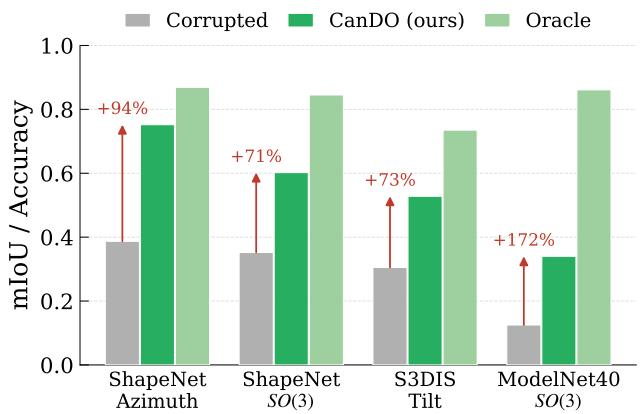  
(a) Recovery from rotation-induced shifts

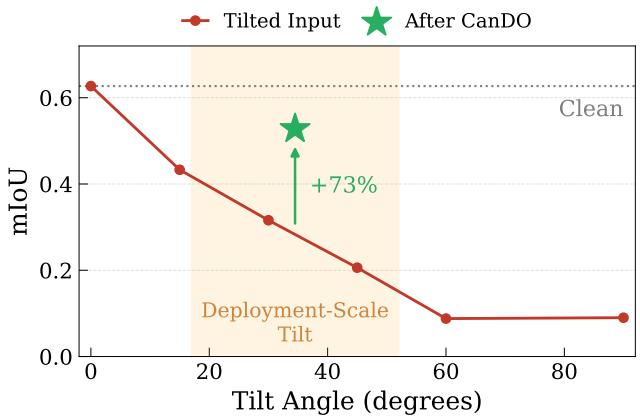  
(b) Augmentation gap under tilt  
Figure 1. (a) Rotation-induced shifts within each frozen point cloud model’s augmentation gap collapse performance, and CANDO recovers a large share of the gap to the supervised oracle from forward queries alone. (b) A frozen point cloud model on S3DIS collapses under tilt despite yaw augmentation; the star marks the mIoU recovered by CANDO over the shaded deployment band, without labels or gradients.

Beyond the method itself, we analyze when such recovery is possible. We identify three key factors: (i) an augmentation gap, where the model remains sensitive to rotations absent from training; (ii) confidence-accuracy alignment, where confidence serves as a proxy for task performance; and (iii) global search, which avoids poor solutions in non-convex landscapes. These analyses also clarify when confidenceonly adaptation suffices and when additional task-specific constraints or external priors are required.

Our key contributions are threefold:

• We formalize the score-only black-box adaptation setting, where a frozen 3D point cloud model must overcome severe pose shifts relying strictly on forward queries.

• We propose CANDO, a test-time canonicalization method that leverages DFO to maximize model confidence, recovering lost performance without labels or gradients.

• We demonstrate that CANDO outperforms prior forwardonly methods across multiple tasks, scales, and architectures. We complement this empirical success with a rigorous analysis of the conditions required for recovery and the limits of a self-contained optimization objective.

## 2. Related Work

Point cloud models and robustness. Point cloud models have evolved through diverse architectures, including pointbased networks [8, 34–36], graph and convolutional models [53, 58], transformer backbones [30, 69], and rotationequivariant architectures [7]. Despite their strong performance, these models remain vulnerable to corruptions, acquisition noise, and distribution shifts [38, 56]. Among these, rotations are particularly challenging because they preserve semantic labels while changing the coordinate frame, exposing a mismatch between the learned orientation bias and the test-time orientation distribution [7, 10].

Rotation robustness. Rotation robustness is commonly addressed through architectural design or canonicalization. Invariant [68] and equivariant architectures [7, 10, 54] encode rotation robustness into the network, thus requiring pre-deployment model design and training. Canonicalization maps inputs to a reference orientation, either with parameterfree heuristics prone to sign, symmetry, and degeneracy ambiguities [64], or with learned modules trained to predict canonical frames [20, 41, 48, 51]. These methods do not directly apply to deployed models without architecture changes, retraining, or an additional trained component.

Test-time adaptation. Test-time adaptation (TTA) adapts models on unlabeled test data by updating parameters, normalization statistics, or auxiliary modules. Common objectives include self-supervision [52], entropy minimization [57, 67], information maximization [24], and normalization updates [27, 28]. Backpropagation-free TTA reduces computation but still assumes parameter access or trainable components [59]. Input-space methods keep the task model fixed, but CloudFixer [44] and FOCAL [46] rely on external diffusion or foundation-model priors. In contrast, CANDO uses only the deployed model’s score outputs.

Derivative-free optimization. Derivative-free optimization (DFO) solves optimization problems using only queried function values. Representative families include evolutionary strategies [16, 42, 60], Bayesian optimization [43], and finite-difference or simultaneous-perturbation methods [9, 12, 25, 47]. DFO has been used for black-box adversarial attacks [4, 19] and black-box tuning of pretrained models [31, 49, 50]; we apply it to post-deployment point cloud canonicalization over low-dimensional rotation parameters.

## 3. Proposed Method

In this section, we present CANDO, a test-time canonicalization method that restores the performance of frozen point cloud black-box models using only forward queries. We first formalize the black-box problem setting (Section 3.1) and then parameterize rotation-induced shifts as low-dimensional input transformations (Section 3.2). Without labels or gradients, we score candidate transformations with a confidence surrogate and a do-no-harm prior (Section 3.3). We optimize this objective using an evolution strategy (Section 3.4).

## 3.1. Problem Formulation

Let g be a frozen point cloud model exposed only through score-based forward queries. Each query returns class probabilities or logits. Given an input point cloud $\mathbf { P } = \{ p _ { i } \} _ { i = 1 } ^ { N }$ with N points and $\pmb { p } _ { i } \in \mathbb { R } ^ { 3 }$ , our goal is to prepend an input transformation T that maximizes downstream task performance. If the task loss ℓ and ground-truth target y were available, the ideal per-input objective would be

$$
\mathbf { T } ^ { * } ( \mathbf { P } ) \ = \ \underset { \mathbf { T } } { \mathrm { a r g m i n } } \ \ell ( g ( \mathbf { T } ( \mathbf { P } ) ) , y ) ,\tag{1}
$$

with $g$ held fixed. However, the black-box regime imposes two critical constraints that prevent standard optimization. First, because we lack access to the model’s internal weights, no gradient of ℓ can propagate through $^ { g ; }$ thus, T cannot be optimized via backpropagation. Second, labels are unavailable at test-time, rendering the evaluation of ℓ impossible.

## 3.2. Parameterizing the Input Transform

The formulation above does not specify the transformation T. Motivated by the low-dimensional structure of rotations, we instantiate T as a global rotation of the input point cloud. Although $S O ( 3 )$ admits standard parameterizations including unit quaternions [45] and axis-angle vectors [23, 40], we use the Rodrigues form as a direct three-parameter representation. This matches the intrinsic degrees of freedom of SO(3) while avoiding constrained quaternion optimization. Let ${ \bf \dot { \theta } } \in \mathbb { R } ^ { 3 }$ be an axis-angle vector with rotation angle $\phi = \| \pmb \theta \|$ . We obtain the rotation matrix $\mathbf { R } _ { \theta } \in S O ( 3 )$ using Rodrigues’ formula:

$$
{ \bf R } _ { \theta } = { \bf I } + \frac { \sin \phi } { \phi } [ \theta ] _ { \times } + \frac { 1 - \cos \phi } { \phi ^ { 2 } } [ \theta ] _ { \times } ^ { 2 } ,\tag{2}
$$

where $[ \cdot ] _ { \times }$ denotes the skew-symmetric cross-product matrix. We use the standard limit at $\phi = 0$ . For a point cloud represented as row vectors, the transformed input is

$$
\mathbf { T } _ { \theta } ( \mathbf { P } ) \mathbf { \Psi } = \mathbf { \Phi } \mathbf { P } \mathbf { R } _ { \theta } ^ { \top } .\tag{3}
$$

This formulation covers all transformation families considered in our experiments. Restricting θ to the gravity axis yields a one-dimensional azimuthal search, restricting the axis to the horizontal plane yields a two-dimensional tilt search, and leaving θ unconstrained gives full $S O ( 3 )$ search. For isotropic scaling, we append a single scalar scale parameter. Thus, CANDO searches over a compact transformation space rather than the high-dimensional point coordinates.

## 3.3. Search Objective

Optimizing the transform requires a score for each candidate, yet the task loss ℓ demands labels we do not have. Drawing inspiration from the TTA literature, we leverage the model’s own output confidence as a self-supervised signal [24, 57, 67]. Let $[ g ( \cdot ) ] _ { i , c }$ represent the predicted probability of class c at point i. We maximize the mean maximum probability

$$
J ( \pmb \theta ) = \frac { 1 } { N } \sum _ { i = 1 } ^ { N } \operatorname* { m a x } _ { c } \left[ g ( \mathbf { T } _ { \pmb \theta } ( \mathbf { P } ) ) \right] _ { i , c } ,\tag{4}
$$

which reduces to a single maximum probability for classification. This surrogate guides recovery only insofar as it tracks accuracy. Empirically, the correlation between J and mean Intersection-over-Union (mIoU) across poses landscape, typically ranging between 0.5 and 0.65 (see Section 5).

However, indiscriminately maximizing J is hazardous, as an unconstrained search may inadvertently rotate an alreadycanonical input out of alignment. To mitigate this, we introduce a simple yet effective do-no-harm prior that penalizes the transform magnitude and always retains the identity $\pmb \theta = \mathbf 0$ as a candidate, giving the final selected transform

$$
\widehat { \pmb \theta } \equiv \operatorname * { a r g m a x } _ { \pmb \theta \in \{ \mathbf 0 \} \cup \Theta } \big [ \boldsymbol J ( \pmb \theta ) - \lambda \lVert \pmb \theta \rVert \big ] ,\tag{5}
$$

where Θ denotes the pool of candidate transformations evaluated by the optimizer, and λ controls the penalty strength. This regularization ensures the input remains untouched unless an alternative pose yields a conclusively higher confidence score, acting as a safeguard for already-upright inputs.

## 3.4. The CMA Evolution Strategy

To navigate the set of candidates Θ, the optimizer must operate exclusively on forward evaluations of J. Given the highly non-convex nature of the pose landscape, we utilize the Covariance Matrix Adaptation Evolution Strategy (CMA-ES) [16, 17], a population-based evolutionary search well suited for continuous, multi-modal objectives [31, 49, 50]. At each generation t, CMA-ES samples a population $\theta _ { m } \sim$ $\mathcal { N } ( \mu _ { t } , \sigma _ { t } ^ { 2 } \mathbf { C } _ { t } )$ defined by its mean $\pmb { \mu } _ { t } .$ , step size $\sigma _ { t } .$ , and covariance $\mathbf { C } _ { t } ,$ , then updates these from the ranked scores,

$$
\begin{array} { c } { \displaystyle \pmb { \mu } _ { t + 1 } = \sum _ { m = 1 } ^ { \mu } w _ { m } \pmb { \theta } _ { ( m ) } , } \\ { \displaystyle ( \sigma _ { t + 1 } , \mathbf { C } _ { t + 1 } ) = \mathrm { u p d a t e } \big ( \sigma _ { t } , \mathbf { C } _ { t } , \{ \pmb { \theta } _ { ( m ) } \} \big ) , } \end{array}\tag{6}
$$

where $\theta _ { ( m ) }$ are the candidates ordered by J and $w _ { m }$ are rank weights; we refer the reader to [15] for the details.

Algorithm 1 CANDO: Black-Box Pose Canonicalization   
Require: Input point cloud P, frozen point cloud model $^ { g , }$   
transform family $\left\{ \mathbf { T } _ { \theta } \right\}$ , objective $^ { J , }$ query budget M,   
population $K ,$ prior weight λ, CMA-ES optimizer ${ \mathcal { A } } .$   
Ensure: Prediction for P in its original frame.   
1: Initialize evaluation log $\mathcal { E }  \bar { \{ ( \mathbf { 0 } , \ : J ( \mathbf { 0 } ) , \ : g ( \mathbf { P } ) ) \} }$ with   
the identity, and query counter $q \gets 1 .$   
2: while $q < M$ do   
3: Sample the next generation of candidates:   
$\triangleright \Theta _ { q }  \mathcal { A } . \mathrm { a s k } ( \operatorname* { m i n } \{ K , M - q \} )$   
4: Evaluate each candidate with a single query:   
$\triangleright \Pi _ { \pmb \theta }  g ( \mathbf { T } _ { \pmb \theta } ( \mathbf { P } ) ) \quad \forall \pmb \theta \in \Theta _ { q }$   
5: Record the scores and predictions:   
▷ $\mathcal { E }  \mathcal { E } \cup \{ ( \pmb { \theta } , J ( \pmb { \theta } ) , \Pi _ { \pmb { \theta } } ) \} _ { \pmb { \theta } \in \Theta _ { q } }$   
6: Update the optimizer from the ranked scores:   
▷ A. tel $[ ( \Theta _ { q } , \{ J ( \pmb { \theta } ) \} )$ $q \gets q + | \Theta _ { q } |$   
7: end while   
8: Select the pose via the do-no-harm prior (Equation (5)):   
$\begin{array} { r } { \triangleright \widehat { \pmb \theta }  \operatorname { a r g m a x } _ { ( \pmb \theta , j , \Pi ) \in \mathcal E } [ j - \lambda \| \pmb \theta \| ] } \end{array}$   
9: return cached $\hat { \Pi }$ at ${ \widehat { \theta } } ,$ inverse-warped to original frame.

CMA-ES provides two critical advantages for this framework. First, its global search capability allows it to bypass local optima that routinely trap gradient-based methods. Second, it demonstrates outstanding convergence efficiency among global DFO methods, requiring the fewest queries to locate the canonical pose (see Section 5.2 for the details).

Algorithm 1 summarizes the complete CANDO pipeline. Each scored pose θ returns the model’s class-probability output $\Pi _ { \pmb { \theta } } = g ( \mathbf { T } _ { \pmb { \theta } } ( \mathbf { P } ) )$ , from which Equation (4) computes the confidence $J ( \pmb \theta )$ . The prediction at the selected pose $\widehat { \pmb { \theta } }$ is cached during the search and inverse-warped to the original frame, so the final output costs no extra query.

## 4. Experiments

## 4.1. Experimental Setup

Datasets. We evaluate CANDO on three standard point cloud benchmarks covering dense and global prediction tasks. For object part segmentation, we use ShapeNet-Part [66], which contains CAD objects from 16 categories with point-level part annotations. For scene semantic segmentation, we use S3DIS [1], an indoor-scene dataset with dense semantic labels. For object classification, we use ModelNet40 [63], a CAD benchmark with 40 object categories.

Backbone models. Our primary evaluation employs Point-Net++ [35] and PointNeXt-S [36], two widely adopted backbones representing a foundational and a modern point-based design, both accessed solely through forward queries.

Table 1. Test-time pose recovery performance of frozen point cloud models under pose corruptions across various tasks, scales, and architectures. Relying exclusively on forward queries, CANDO bridges a substantial portion of the oracle gap across all evaluated benchmarks and backbones.
<table><tr><td colspan="3"></td><td colspan="3">mIoU / Accuracy</td><td rowspan="2">% Gap</td></tr><tr><td>Benchmark</td><td>Transform</td><td>Backbone</td><td>Corrupted</td><td>Recovered</td><td>Oracle</td></tr><tr><td rowspan="4">ShapeNetPart</td><td rowspan="2">Azimuth</td><td>PointNet++</td><td>0.387±0.005</td><td>0.752±0.002</td><td>0.869±0.000</td><td>76</td></tr><tr><td>PointNeXt-S</td><td>0.396±0.005</td><td>0.718±0.003</td><td>0.871±0.000</td><td>68</td></tr><tr><td rowspan="2">SO(3)</td><td>PointNet++</td><td>0.352±0.001</td><td>0.602±0.003</td><td>0.845±0.001</td><td>51</td></tr><tr><td>PointNeXt-S</td><td>0.372±0.002</td><td>0.637±0.003</td><td>0.843±0.001</td><td>56</td></tr><tr><td rowspan="2">S3DIS</td><td rowspan="2">Tilt</td><td>PointNet++</td><td>0.305±0.005</td><td>0.528±0.046</td><td>0.735±0.023</td><td>52</td></tr><tr><td>PointNeXt-S</td><td>0.249±0.013</td><td>0.599±0.050</td><td>0.756±0.025</td><td>69</td></tr><tr><td rowspan="2">ModelNet40</td><td rowspan="2">SO(3)</td><td>PointNet++</td><td>0.125±0.005</td><td>0.340±0.007</td><td>0.861±0.003</td><td>29</td></tr><tr><td>PointNeXt-S</td><td>0.160±0.004</td><td>0.480±0.004</td><td>0.920±0.001</td><td>42</td></tr></table>

Implementation details. All models are frozen and accessed only through forward queries on a single RTX A6000, and results are averaged over three different random seeds. CMA-ES uses two restarts and a population of 10 to 12, and headline results take the highest-confidence solution without a magnitude penalty. Further details are in Supp. B.3, and the code is available at https://github.com/ shpark97/CanDO.

Baselines. We compare CANDO with two kinds of methods: gradient-free methods compatible with our black-box setting, and gradient-based methods that require white-box access and serve only as references. For gradient-free methods, we consider three baselines: (1) Principal-Axis Canonicalization, which rotates the input into the frame of its principal axes, e.g., PCA [64], with a confidence-disambiguated variant that resolves the per-axis sign ambiguity by the model’s own confidence; (2) Normalization-Statistic Adaptation, which updates the model’s batch-norm statistics per input, e.g., DUA [27]; and (3) External-Prior Canonicalization, scoring candidate poses with a separate frozen classifier instead of the task model’s own confidence. For gradientbased methods, we consider two baselines: (1) Parameter-Space TTA, minimizing prediction entropy by backpropagating into the model’s parameters, e.g., TENT [57] and MEMO [67]; and (2) Gradient-based Canonicalization, white-box gradient ascent on the input rotation under a matched query budget. We additionally report the oracle, a supervised ceiling selecting the best pose by the true metric.

Evaluation protocol. Each test input is corrupted by a random pose, an azimuth, a horizontal-axis tilt, or a randomaxis SO(3) rotation [7, 10]. As metrics, we report mIoU for segmentation and accuracy for classification, propagating segmentation predictions back to the full cloud by threenearest-neighbor voting; on ShapeNetPart we follow the standard protocol of feeding the object category as a one-hot input and scoring category-masked mIoU.

Table 2. Performance comparison of pose recovery against established baselines and a supervised oracle, under SO(3) rotation. Using solely forward queries, CANDO achieves the highest recovery, outperforming even the white-box baselines. Bold denotes the best results
<table><tr><td colspan="5"></td><td colspan="2">mIoU</td><td>Accuracy</td></tr><tr><td>Method</td><td>Gradient</td><td>Update</td><td>Label</td><td>ShapeNetPart [66]</td><td>S3DIS [1]</td><td></td><td>ModelNet40 [63]</td></tr><tr><td>Source (No Adaptation)</td><td>x</td><td>X</td><td>X</td><td> $0 . 3 5 1 \pm 0 . 0 0 4$ </td><td></td><td> $0 . 3 3 8 \pm 0 . 0 1 1$ </td><td> $0 . 1 2 8 \pm 0 . 0 0 7$ </td></tr><tr><td>PCA Canonicalization [64]</td><td>X</td><td>x</td><td>x</td><td> $0 . 2 3 7 \pm 0 . 0 0 3$ </td><td></td><td> $0 . 0 4 7 \pm 0 . 0 0 4$ </td><td> $0 . 2 2 1 \pm 0 . 0 0 8$ </td></tr><tr><td>PCA + Confidence</td><td>X</td><td>X</td><td>X</td><td> $0 . 2 9 3 \pm 0 . 0 0 4$ </td><td></td><td> $0 . 0 4 7 \pm 0 . 0 0 4$ </td><td> $0 . 2 6 0 \pm 0 . 0 0 9$ </td></tr><tr><td>External Prior (Classifier)</td><td>X</td><td>X</td><td>X</td><td> $0 . 3 5 9 \pm 0 . 0 0 5$ </td><td></td><td>N/A</td><td>N/A</td></tr><tr><td>DUA [27]</td><td>X</td><td>√</td><td>X</td><td> $0 . 3 5 6 \pm 0 . 0 0 5$ </td><td></td><td> $0 . 3 5 7 \pm 0 . 0 1 1$ </td><td> $0 . 1 1 8 \pm 0 . 0 0 7$ </td></tr><tr><td>TENT [57]</td><td>√</td><td>√</td><td>X</td><td></td><td> $0 . 3 5 3 \pm 0 . 0 0 5$ </td><td> $0 . 3 5 3 \pm 0 . 0 1 1$ </td><td> $0 . 1 2 3 \pm 0 . 0 0 7$ </td></tr><tr><td>MEMO [67]</td><td>√</td><td>√</td><td>X</td><td> $0 . 3 5 4 \pm 0 . 0 0 5$ </td><td></td><td> $0 . 3 5 7 \pm 0 . 0 1 1$ </td><td> $0 . 1 2 6 \pm 0 . 0 0 7$ </td></tr><tr><td>Gradient-Based Canonicalization</td><td>√</td><td>X</td><td>X</td><td> $0 . 5 0 0 \pm 0 . 0 0 6$ </td><td></td><td> $0 . 4 4 0 \pm 0 . 0 1 7$ </td><td> $0 . 1 4 9 \pm 0 . 0 0 7$ </td></tr><tr><td>Ours (CANDO)</td><td>X</td><td>X</td><td>X</td><td></td><td> $\mathbf { 0 . 6 0 6 \pm 0 . 0 0 6 }$ </td><td> $\mathbf { 0 . 5 2 3 \pm 0 . 0 2 2 }$ </td><td> $\mathbf { 0 . 3 5 4 \pm 0 . 0 1 0 }$ </td></tr><tr><td>Oracle (Ground Truth)</td><td>X</td><td>X</td><td>√</td><td></td><td> $0 . 8 4 5 \pm 0 . 0 0 3$ </td><td> $0 . 7 5 2 \pm 0 . 0 1 1$ </td><td> $0 . 8 6 1 \pm 0 . 0 0 7$ </td></tr></table>

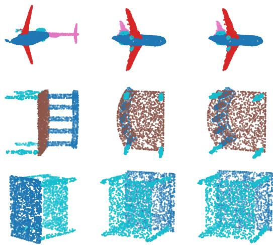  
Figure 2. Qualitative results of pose recovery on ShapeNetPart. From left to right, each column depicts the misoriented input, the pose recovery achieved by CANDO, and the clean upright target.

## 4.2. Results

Restoring frozen models under rotation-induced shifts. We evaluate whether frozen point cloud models can be recovered from rotation-induced shifts using only forward queries. As shown in Table 1, CANDO recovers a substantial portion of the oracle gap, i.e., the performance difference between the corrupted input and the oracle-selected transformation. On PointNet++, it recovers 76% of the gap under azimuth rotations and 51% under arbitrary SO(3) rotations for part segmentation. The corresponding rates are 52% for scene tilt and 29% for SO(3) classification. For the PointNeXt-S backbone, recovery increases to 68%, 56%, 69%, and 42% across the same settings. Recovery is comparatively lower for classification because a single softmax confidence correlates less strongly with task accuracy, yet CANDO still restores a substantial fraction of the lost performance.

Figure 2 illustrates qualitative recovery results on ShapeNet part segmentation. The columns denote the misoriented input (left), the pose recovered by CANDO (middle), and the clean upright target (right), all color-coded according to their ground-truth parts. The recovered orientation closely aligns with the upright target, effectively restoring the accurate per-part labels. Collectively, both quantitative and qualitative findings demonstrate that maximizing the inherent confidence of a frozen model successfully guides the input back toward the optimally scoring pose.

Comparison to baselines. Table 2 compares CANDO with representative gradient-free and gradient-based baselines [27, 57, 64, 67] under full SO(3) corruption. On ShapeNet part segmentation, gradient-free baselines provide little benefit because their scoring signals are weakly aligned with the canonical orientation, reaching at most 0.359 mIoU. Gradient-based adaptation performs similarly: entropy-minimization TTA [57, 67] remains near 0.35 mIoU, while even white-box gradient ascent reaches only 0.500 mIoU after becoming trapped in the non-convex confidence landscape (see Section 5.2). By contrast, CANDO achieves 0.606 mIoU by globally searching model confidence over low-dimensional rotations, outperforming the best gradientfree and white-box gradient baselines by 0.247 and 0.106.

The same pattern extends beyond object part segmentation. On S3DIS under out-of-plane tilt, CANDO reaches 0.523 mIoU. Competing baselines remain near the corrupted performance; even white-box gradient ascent reaches only 0.440 mIoU, while PCA further collapses to 0.047 by ignoring gravity. On ModelNet40 classification, CANDO reaches 0.354 accuracy, outperforming the strongest baseline by 0.094. Overall, CANDO consistently outperforms competing methods across object, scene, and classification tasks while relying solely on forward queries.

## 5. Further Analysis

In this section, we analyze the factors governing CANDO’s recovery. We first study transformation recoverability (Section 5.1), showing that recovery requires both an augmentation gap and an accuracy-aligned confidence surrogate. We then characterize the confidence landscape and compare optimization strategies (Section 5.2), highlighting the need for global search. Finally, we evaluate surrogate reliability (Section 5.3), the identity prior (Section 5.4), and equivariant backbones (Section 5.5) to determine when confidence-only recovery is sufficient, insufficient, or unnecessary.

## 5.1. Transformation Recoverability

To determine which transformations are recoverable, we first probe a frozen PointNet++ model trained with yaw augmentation on S3DIS. We evaluate five transformations that differ in whether they were covered during training and whether confidence remains aligned with accuracy. As shown in Table 3, successful recovery requires two conditions: (i) an augmentation gap, i.e., a transformation that is not sufficiently covered during training and degrades performance, and (ii) a confidence surrogate that remains informative under the transformation. Yaw has almost no recoverable headroom because the model is already robust to it through training augmentation. Scale and color also produce small accuracy drops of 0.08 and 0.06, leaving limited room for improvement. A vertical offset causes a larger accuracy drop of 0.22, but remains difficult to recover because the confidence objective does not select offsets that improve task accuracy. In contrast, unseen out-of-plane tilt satisfies both conditions and is recovered by CANDO, improving accuracy by 0.22. We further validate this behavior on alternative point cloud architectures in Supp. A.2.

The preceding analysis is based on existing training configurations and is therefore correlational. To test the causal role of augmentation gaps, we train PointNet++ models on ShapeNetPart under four rotation augmentation regimes: none, yaw, tilt, and full SO(3). We then apply the corresponding test-time rotations and measure corrupted-torecovered mIoU. As shown in Table 4, recovery is largest when the test corruption is poorly covered by the training augmentation. For example, the model trained without rotation augmentation improves substantially under yaw, tilt, and SO(3) corruptions. The yaw-augmented model shows little change under yaw but larger gains under unseen tilt and SO(3) rotations. Conversely, models trained with tilt or full SO(3) augmentation show smaller recovery because their corrupted performance is already closer to clean performance. These results support the augmentation-gap hypothesis while also showing that coverage is not binary: partial gains can remain when training augmentation only partially matches the test rotation.

Table 3. Conditions for recoverability on the S3DIS PointNet++ model. Recovery requires performance headroom (an accuracy drop) and an accuracy-aligned confidence surrogate. The unseen tilt (green) best satisfies both prerequisites. Recovery ∆ denotes the accuracy change after label-free recovery.
<table><tr><td>Transform</td><td>Augmented</td><td>Accuracy Drop</td><td>Recovery ∆</td><td>Recoverable</td></tr><tr><td>Yaw</td><td>Yes</td><td>0.01</td><td>+0.00</td><td>X (no headroom)</td></tr><tr><td>Scale</td><td>No</td><td>0.08</td><td>+0.00</td><td>X (no headroom)</td></tr><tr><td>z-offset</td><td>No</td><td>0.22</td><td>-0.02</td><td>X (misaligned confidence)</td></tr><tr><td>Color</td><td>No</td><td>0.06</td><td>+0.03</td><td>X (no headroom)</td></tr><tr><td>Tilt</td><td>No</td><td>0.42</td><td>+0.22</td><td></td></tr></table>

Table 4. Causal link between augmentation gaps and recoverability on ShapeNetPart. Cells report corrupted → recovered mIoU, shaded by recovery gain so that darker red indicates larger improvements. Recovery is largest when the corruption is absent from training augmentation and reduced when it is covered.
<table><tr><td>Augmentation</td><td>Clean</td><td>Yaw</td><td>Tilt</td><td>SO(3)</td></tr><tr><td>None</td><td>0.828</td><td>0.390→0.562</td><td>0.505→0.613</td><td>0.447→0.558</td></tr><tr><td>Yaw</td><td>0.825</td><td>0.824→0.829</td><td>0.529→0.655</td><td>0.539→0.668</td></tr><tr><td>Tilt</td><td>0.826</td><td>0.733→0.765</td><td>0.813→0.819</td><td>0.779→0.798</td></tr><tr><td>SO(3)</td><td>0.820</td><td>0.804→0.811</td><td>0.808→0.815</td><td>0.805→0.812</td></tr></table>

## 5.2. Optimization Strategy

We next study recovery from an optimization perspective. To characterize the objective optimized by forward-query methods, we sweep the recovery rotation over corrupted inputs and record the confidence objective J(θ) alongside accuracy. As shown in Figure 3, the resulting landscape is highly multi-modal but remains well aligned with task performance. Although J(θ) contains multiple local maxima for each shape, its global maximum consistently coincides with the pose achieving the highest mIoU. Local optimizers therefore become trapped in suboptimal peaks, whereas global search reliably identifies the correct pose. Across shapes and rotations, J(θ) exhibits a pooled Pearson correlation of 0.51 with accuracy. These results indicate that the confidence objective is informative, making landscape multi-modality the main challenge for successful recovery.

We then compare representative DFO methods on the full SO(3) part-segmentation recovery task using a matched budget of approximately 300 queries per shape. As detailed in Table 5, performance sharply diverges between local and global methods. Four local gradient-estimation methods [6, 47, 60, 61] plateau, recovering only 17% to 27% of the oracle performance gap. By contrast, global search algorithms [2, 16, 43] bypass these spurious local optima and recover roughly twice as much: random search reaches 53%, CMA-ES 55%, and Bayesian optimization 57%. This local-global gap reinforces that navigating the multi-modal landscape is the critical determinant of successful recovery.

Having established the advantage of global search, we next compare the query efficiency of the three global optimizers. As shown in Table 6, performance depends on the query budget. CMA-ES dominates under constrained budgets, recovering 52% and 54% of the gap with 60 and 120 queries, whereas random search and Bayesian optimization recover 42% and 41% at 60 queries. The methods converge after several hundred queries, where Bayesian optimization reaches 56% at 240. Because practical deployment favors low query budgets, we adopt CMA-ES as the default optimizer.

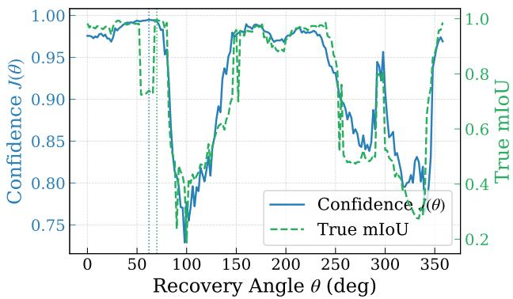

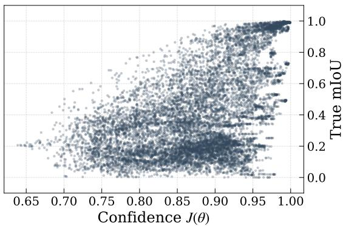  
Figure 3. (Left) For one shape, the confidence objective is multi-modal yet peaks at the same pose as the true mIoU, so a local search is trapped while a global one is not. (Right) Across shapes and poses the objective tracks accuracy, with a pooled Pearson correlation of 0.51.

Table 5. Optimizer comparison on SO(3) part segmentation recovery. Performance is measured as the percentage of the oracle gap recovered under a matched budget of approximately 300 queries per shape. Global search strategies significantly outperform local estimators, which plateau at spurious local optima.
<table><tr><td>Optimizer</td><td>Family</td><td>% of Oracle Gap</td></tr><tr><td>Coordinate Finite Differences [6]</td><td>Local</td><td>17</td></tr><tr><td>NES [60]</td><td>Local</td><td>18</td></tr><tr><td>Score-Function [61]</td><td>Local</td><td>19</td></tr><tr><td>SPSA [47]</td><td>Local</td><td>27</td></tr><tr><td>Bayesian Optimization [43]</td><td>Global</td><td>57</td></tr><tr><td>Random Search [2]</td><td>Global</td><td>53</td></tr><tr><td>CMA-ES [16]</td><td>Global</td><td>55</td></tr></table>

Table 6. Query efficiency of global search algorithms on SO(3) recovery. Performance is reported as the percentage of the oracle gap recovered across varying query budgets. Algorithmic rankings are budget-dependent: CMA-ES dominates constrained regimes, whereas Bayesian optimization prevails at higher query counts.
<table><tr><td>Budget</td><td>Bayesian [43]</td><td>Random Search [2]</td><td>CMA-ES [16]</td></tr><tr><td>60</td><td>41</td><td>42</td><td>52</td></tr><tr><td>120</td><td>46</td><td>43</td><td>54</td></tr><tr><td>240</td><td>56</td><td>51</td><td>53</td></tr></table>

## 5.3. Surrogate Reliability

We next assess whether the confidence surrogate remains reliable beyond pure rotation shifts. This matters because CANDO selects transformations by maximizing confidence, which can fail if confidence increases without improving task accuracy. We therefore evaluate the recovery procedure on the PointCloud-C corruption suite [38], including transform, noise, and density corruptions. As shown in Table 7, dense per-point segmentation scores are more reliable than a single classification softmax. The segmentation objective remains non-negative across all corruption families and achieves a mean gain of +0.002. It also keeps the identity transformation on 89% of inputs, avoiding unnecessary changes when no beneficial pose exists. By contrast, the classification softmax gains only +0.015 on transform corruptions but loses 0.070 on noise and 0.028 on density. Its mean change is −0.034, with the identity retained on only 62% of inputs. These results suggest that surrogate reliability improves with denser confidence signals.

Table 7. Robustness across PointCloud-C corruptions. The dense per-point segmentation objective remains stable under confidence maximization, whereas the single classification softmax is more susceptible to overconfidence and performance degradation.
<table><tr><td>Objective</td><td>Transform ∆</td><td>Noise ∆</td><td>Density ∆</td><td>Mean ∆</td><td>Identity Kept</td></tr><tr><td>Part Segmentation</td><td>+0.001</td><td>+0.002</td><td>+0.001</td><td>+0.002</td><td>89%</td></tr><tr><td>Classification</td><td>+0.015</td><td>-0.070</td><td>-0.028</td><td>-0.034</td><td>62%</td></tr></table>

To understand where this difference comes from, Table 8 provides a per-corruption breakdown. The gains mainly come from rotation, which improves by 0.055. Non-pose corruptions instead show mild drops because confidence can increase without improving correctness. This effect is largest for global outlier additions, where accuracy falls by 0.093. Replacing confidence with a marginal-entropy objective [67] amplifies the same pattern. It improves rotation recovery to +0.169 but worsens the mean change from −0.034 to −0.058. These results suggest that the reliability of confidence-only recovery depends on the information contained in the surrogate. For corruptions that induce overconfidence without a correctable pose, reliable recovery may require additional task-specific constraints or external priors from diffusion or foundation models [44, 46].

Table 8. Change in accuracy (∆) across ModelNet-C corruptions when optimized using confidence and marginal-entropy objectives. Performance gains are predominantly localized to rotational transformations, and the marginal-entropy formulation fails to mitigate the performance degradation observed under non-pose corruptions.
<table><tr><td>Corruption</td><td>Family</td><td>△ Confidence</td><td>∆ Marginal Entropy</td></tr><tr><td>Rotate</td><td>Transform</td><td>+0.055</td><td>+0.169</td></tr><tr><td>Scale</td><td>Transform</td><td>-0.026</td><td>-0.037</td></tr><tr><td>Jitter</td><td>Noise</td><td>-0.054</td><td>-0.125</td></tr><tr><td>Add (Global)</td><td>Noise</td><td>-0.093</td><td>-0.150</td></tr><tr><td>Add (Local)</td><td>Noise</td><td>-0.064</td><td>-0.150</td></tr><tr><td>Dropout (Global)</td><td>Density</td><td>-0.018</td><td>-0.038</td></tr><tr><td>Dropout (Local)</td><td>Density</td><td>-0.038</td><td>-0.050</td></tr><tr><td>Mean Over Seven</td><td></td><td>-0.034</td><td>-0.058</td></tr></table>

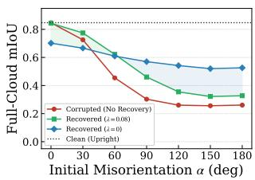  
(a) ShapeNet

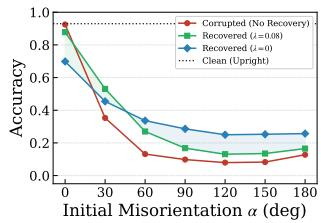  
(b) ModelNet40  
Figure 4. Recovery across initial misorientation angles α under random-axis SO(3) rotations on ShapeNetPart and ModelNet40. The identity prior preserves canonical inputs but struggles with near-inversions. Conversely, omitting the prior improves largerotation recovery but degrades well-posed inputs.

## 5.4. Identity Prior

We next examine the stability-recovery trade-off introduced by the identity prior. We evaluate the frozen partsegmentation and classification models across initial misorientation angles α with and without the prior. As shown in Figure 4, the default prior $\lambda { = } 0 . 0 8$ performs best at smallto-moderate misorientations. It preserves canonical inputs and stays within 0.003 of clean accuracy at $\alpha { = } 0$ . However, the magnitude penalty discourages the large corrective rotations needed for near-inversions. Removing the prior with λ=0 reverses this behavior. It recovers roughly half of the oracle gap even at $1 8 0 ^ { \circ }$ but harms well-posed inputs. At $\alpha { = } 0$ , accuracy drops from 0.847 to 0.702. The two settings cross between $6 0 ^ { \circ }$ and $9 0 ^ { \circ }$ . Since our target deployment setting involves moderate rotational offsets, we use $\lambda { = } 0 . 0 8$ by default. Deployments that expect extreme misorientations may benefit from a smaller λ.

## 5.5. Beyond Equivariance

We close the analysis by asking whether architectural rotation robustness removes the recovery headroom exploited by CANDO. To this end, we evaluate frozen equivariant part-segmentation backbones based on Vector Neurons [7]. Because these networks use rotation-equivariant operations, pose corruptions rotate the feature space without changing per-point predictions. As shown in Table 9, VN backbones remain invariant under $S O ( 3 )$ . Their corrupted and CANDO mIoU therefore match clean performance, making CANDO effectively an identity operation. In contrast, non-equivariant PointNet++ and PointNeXt-S degrade under SO(3) rotations, and CANDO recovers a substantial portion of the gap.

Table 9. Performance of frozen ShapeNet models under SO(3) corruption. Equivariant Vector-Neurons [7] remain strictly invariant, rendering CANDO an identity operation (green). Conversely, non-equivariant backbones suffer severe degradation, from which CANDO recovers a substantial portion of the oracle gap (red).
<table><tr><td>Frozen model</td><td>Equivariance</td><td>Clean</td><td>SO(3)</td><td>+CANDO</td></tr><tr><td>PointNet++ [35]</td><td>x</td><td>0.847</td><td>0.352</td><td>0.602</td></tr><tr><td>PointNeXt-S [36]</td><td>x</td><td>0.841</td><td>0.372</td><td>0.637</td></tr><tr><td>VN-PointNet [7]</td><td>√</td><td>0.794</td><td>0.794</td><td>0.794</td></tr><tr><td>VN-DGCNN [7]</td><td>√</td><td>0.774</td><td>0.774</td><td>0.774</td></tr></table>

This identity behavior is a useful feature rather than a limitation. First, CANDO does not degrade rotation-robust models, enabling a unified deployment policy without prior knowledge of backbone equivariance. Second, architectural equivariance can lower the clean-performance ceiling, causing VN backbones to underperform non-equivariant counterparts on canonical inputs. This gap is larger for object-level classification. Third, recent embodied agents [18], robotic manipulation policies [5], and grasping models [13, 62] often build 3D perception front-ends from frozen non-equivariant encoders such as PointNet++ and PointNeXt. These frontends encounter arbitrary object poses but cannot be retrained, making post-deployment recovery necessary when equivariant redesign is unavailable.

## 6. Conclusion

This work has studied score-only adaptation for frozen 3D point cloud models under rotation-induced distribution shifts. We showed that recovery is possible without weights, gradients, or labels by casting test-time canonicalization as a compact search over input rotations. Our method, CANDO, uses DFO to maximize a confidence surrogate over this lowdimensional space. An identity prior prevents unnecessary changes when the input is already well aligned. Across tasks, scales, and architectures, CANDO recovers a substantial fraction of the performance lost under unseen rotations using only forward queries. Our analysis identifies the key factors enabling recovery: an augmentation gap, confidenceaccuracy alignment, and global search over a multi-modal landscape. It also clarifies when confidence-only adaptation is insufficient. These findings provide a practical path toward robust black-box 3D perception and motivate future methods that combine forward-query pose recovery with task-specific constraints or external generative priors.

## Acknowledgements

This work was supported by the Institute of Information & Communications Technology Planning & Evaluation (IITP) grant funded by the Korea government (MSIT) (No. RS-2025-25441838 and No. RS-2022-II220926).

## References

[1] Iro Armeni, Ozan Sener, Amir R Zamir, Helen Jiang, Ioannis Brilakis, Martin Fischer, and Silvio Savarese. 3d semantic parsing of large-scale indoor spaces. In CVPR, 2016. 4, 5, 17

[2] James Bergstra and Yoshua Bengio. Random search for hyperparameter optimization. 2012. 6, 7, 12, 16

[3] Holger Caesar, Varun Bankiti, Alex H Lang, Sourabh Vora, Venice Erin Liong, Qiang Xu, Anush Krishnan, Yu Pan, Giancarlo Baldan, and Oscar Beijbom. nuscenes: A multimodal dataset for autonomous driving. In CVPR, 2020. 1

[4] Pin-Yu Chen, Huan Zhang, Yash Sharma, Jinfeng Yi, and Cho-Jui Hsieh. Zoo: Zeroth order optimization based black-box attacks to deep neural networks without training substitute models. In ACM workshop on artificial intelligence and security, 2017. 2

[5] Shizhe Chen, Ricardo Garcia, Cordelia Schmid, and Ivan Laptev. Polarnet: 3d point clouds for language-guided robotic manipulation. In CoRL, 2023. 8

[6] Andrew R Conn, Katya Scheinberg, and Luis N Vicente. Introduction to derivative-free optimization. SIAM, 2009. 1, 6, 7, 16

[7] Congyue Deng, Or Litany, Yueqi Duan, Adrien Poulenard, Andrea Tagliasacchi, and Leonidas J Guibas. Vector neurons: A general framework for so (3)-equivariant networks. In ICCV, 2021. 1, 2, 4, 8

[8] Xin Deng, WenYu Zhang, Qing Ding, and XinMing Zhang. Pointvector: A vector representation in point cloud analysis. In CVPR, 2023. 2, 13

[9] John C Duchi, Michael I Jordan, Martin J Wainwright, and Andre Wibisono. Optimal rates for zero-order convex optimization: The power of two function evaluations. IEEE Transactions on Information Theory, 2015. 1, 2

[10] Carlos Esteves, Christine Allen-Blanchette, Ameesh Makadia, and Kostas Daniilidis. Learning so (3) equivariant representations with spherical cnns. In ECCV, 2018. 1, 2, 4

[11] Andreas Geiger, Philip Lenz, and Raquel Urtasun. Are we ready for autonomous driving? the kitti vision benchmark suite. In CVPR, 2012. 1

[12] Saeed Ghadimi and Guanghui Lan. Stochastic first-and zerothorder methods for nonconvex stochastic programming. SIAM journal on optimization, 2013. 1, 2

[13] Dingkun Guo, Yuqi Xiang, Shuqi Zhao, Xinghao Zhu, Masayoshi Tomizuka, Mingyu Ding, and Wei Zhan. Phygrasp: generalizing robotic grasping with physics-informed large multimodal models. In IROS, 2025. 8

[14] Yulan Guo, Hanyun Wang, Qingyong Hu, Hao Liu, Li Liu, and Mohammed Bennamoun. Deep learning for 3d point clouds: A survey. TPAMI, 2020. 1

[15] Nikolaus Hansen. The cma evolution strategy: A tutorial. arXiv preprint arXiv:1604.00772, 2016. 3

[16] Nikolaus Hansen and Andreas Ostermeier. Completely derandomized self-adaptation in evolution strategies. Evolutionary computation, 2001. 2, 3, 6, 7, 12

[17] Nikolaus Hansen, Sibylle D Muller, and Petros Koumout-¨ sakos. Reducing the time complexity of the derandomized evolution strategy with covariance matrix adaptation (cma-es). Evolutionary computation, 2003. 3

[18] Jiangyong Huang, Silong Yong, Xiaojian Ma, Xiongkun Linghu, Puhao Li, Yan Wang, Qing Li, Song-Chun Zhu, Baoxiong Jia, and Siyuan Huang. An embodied generalist agent in 3d world. In ICML, 2024. 8

[19] Andrew Ilyas, Logan Engstrom, Anish Athalye, and Jessy Lin. Black-box adversarial attacks with limited queries and information. In ICML, 2018. 2

[20] Sekou-Oumar Kaba, Arnab Kumar Mondal, Yan Zhang,´ Yoshua Bengio, and Siamak Ravanbakhsh. Equivariance with learned canonicalization functions. In ICML, 2023. 1, 2

[21] Pang Wei Koh, Thao Nguyen, Yew Siang Tang, Stephen Mussmann, Emma Pierson, Been Kim, and Percy Liang. Concept bottleneck models. In ICML, 2020. 14

[22] Tamara G Kolda, Robert Michael Lewis, and Virginia Torczon. Optimization by direct search: New perspectives on some classical and modern methods. SIAM review, 2003. 1

[23] Zexiang Li, Shankar Sastry, and R Murray. A mathematical introduction to robotic manipulation. CRC press, 2017. 1, 3

[24] Jian Liang, Dapeng Hu, and Jiashi Feng. Do we really need to access the source data? source hypothesis transfer for unsupervised domain adaptation. In ICML, 2020. 2, 3

[25] Sijia Liu, Pin-Yu Chen, Bhavya Kailkhura, Gaoyuan Zhang, Alfred O Hero III, and Pramod K Varshney. A primer on zeroth-order optimization in signal processing and machine learning: Principals, recent advances, and applications. IEEE Signal Processing Magazine, 2020. 2

[26] Sadhika Malladi, Tianyu Gao, Eshaan Nichani, Alex Damian, Jason D Lee, Danqi Chen, and Sanjeev Arora. Fine-tuning language models with just forward passes. In NeurIPS, 2023. 16

[27] M Jehanzeb Mirza, Jakub Micorek, Horst Possegger, and Horst Bischof. The norm must go on: Dynamic unsupervised domain adaptation by normalization. In CVPR, 2022. 2, 4, 5, 15

[28] M. Jehanzeb Mirza, Inkyu Shin, Wei Lin, Andreas Schriebl, Kunyang Sun, Jaesung Choe, Mateusz Kozinski, Horst Possegger, In So Kweon, Kun-Jin Yoon, and Horst Bischof. Mate: Masked autoencoders are online 3d test-time learners. In ICCV, 2023. 2

[29] Changdae Oh, Hyeji Hwang, Hee-young Lee, YongTaek Lim, Geunyoung Jung, Jiyoung Jung, Hosik Choi, and Kyungwoo Song. Blackvip: Black-box visual prompting for robust transfer learning. In CVPR, 2023. 16

[30] Yatian Pang, Eng Hock Francis Tay, Li Yuan, and Zhenghua Chen. Masked autoencoders for point cloud self-supervised learning. In ECCV, 2022. 2, 13

[31] Seonghwan Park, Jaehyeon Jeong, Yongjun Kim, Jaeho Lee, and Namhoon Lee. Zip: An efficient zeroth-order prompt

tuning for black-box vision-language models. In ICLR, 2025. 2, 3, 16

[32] Seonghwan Park, Jueun Mun, Donghyun Oh, and Namhoon Lee. An analysis of concept bottleneck models: Measuring, understanding, and mitigating the impact of noisy annotations. In NeurIPS, 2025. 14

[33] Seonghwan Park, Hyunji Jung, Dongyeop Lee, and Namhoon Lee. Exploiting local flatness for efficient out-of-distribution detection. In ECCV, 2026. 14

[34] Charles R Qi, Hao Su, Kaichun Mo, and Leonidas J Guibas. Pointnet: Deep learning on point sets for 3d classification and segmentation. In CVPR, 2017. 1, 2, 13

[35] Charles Ruizhongtai Qi, Li Yi, Hao Su, and Leonidas Guibas. Pointnet++: Deep hierarchical feature learning on point sets in a metric space. In NeurIPS, 2017. 1, 4, 8, 13

[36] Guocheng Qian, Yuchen Li, Houwen Peng, Jinjie Mai, Hasan Hammoud, Mohamed Elhoseiny, and Bernard Ghanem. Pointnext: Revisiting pointnet++ with improved training and scaling strategies. In NeurIPS, 2022. 1, 2, 4, 8, 13

[37] Jie Ren, Stanislav Fort, Jeremiah Liu, Abhijit Guha Roy, Shreyas Padhy, and Balaji Lakshminarayanan. A simple fix to mahalanobis distance for improving near-ood detection. arXiv preprint arXiv:2106.09022, 2021. 14

[38] Jiawei Ren, Liang Pan, and Ziwei Liu. Benchmarking and analyzing point cloud classification under corruptions. In ICML, 2022. 2, 7, 17

[39] Luis Miguel Rios and Nikolaos V Sahinidis. Derivativefree optimization: a review of algorithms and comparison of software implementations. Journal ofGlobal Optimization, 2013. 1

[40] Olinde Rodrigues. Des lois geom´ etriques qui r´ egissent les´ deplacements d’un syst´ eme solide dans l’espace, et de la\` variation des coordonnees provenant de ces d´ eplacements´ consider´ es ind ´ ependamment des causes qui peuvent les pro-´ duire. Journal de mathematiques pures et appliqu´ ees´ , 1840. 1, 3

[41] Rahul Sajnani, Adrien Poulenard, Jivitesh Jain, Radhika Dua, Leonidas J Guibas, and Srinath Sridhar. Condor: Selfsupervised canonicalization of 3d pose for partial shapes. In CVPR, 2022. 2

[42] Tim Salimans, Jonathan Ho, Xi Chen, Szymon Sidor, and Ilya Sutskever. Evolution strategies as a scalable alternative to reinforcement learning. arXiv preprint arXiv:1703.03864, 2017. 2

[43] Bobak Shahriari, Kevin Swersky, Ziyu Wang, Ryan P Adams, and Nando De Freitas. Taking the human out of the loop: A review of bayesian optimization. Proceedings of the IEEE, 2015. 2, 6, 7, 16

[44] Hajin Shim, Changhun Kim, and Eunho Yang. Cloudfixer: Test-time adaptation for 3d point clouds via diffusion-guided geometric transformation. In ECCV, 2024. 1, 2, 7

[45] Ken Shoemake. Animating rotation with quaternion curves. In Proceedings ofthe 12th annual conference on Computer graphics and interactive techniques, 1985. 1, 3

[46] Utkarsh Singhal, Ryan Feng, Stella X Yu, and Atul Prakash. Test-time canonicalization by foundation models for robust perception. In ICML, 2025. 1, 2, 7

[47] James C Spall. Multivariate stochastic approximation using a simultaneous perturbation gradient approximation. IEEE transactions on automatic control, 1992. 1, 2, 6, 7, 16

[48] Riccardo Spezialetti, Federico Stella, Marlon Marcon, Luciano Silva, Samuele Salti, and Luigi Di Stefano. Learning to orient surfaces by self-supervised spherical cnns. In NeurIPS, 2020. 2

[49] Tianxiang Sun, Zhengfu He, Hong Qian, Yunhua Zhou, Xuan-Jing Huang, and Xipeng Qiu. Bbtv2: Towards a gradient-free future with large language models. In EMNLP, 2022. 2, 3

[50] Tianxiang Sun, Yunfan Shao, Hong Qian, Xuanjing Huang, and Xipeng Qiu. Black-box tuning for language-model-as-aservice. In ICML, 2022. 2, 3

[51] Weiwei Sun, Andrea Tagliasacchi, Boyang Deng, Sara Sabour, Soroosh Yazdani, Geoffrey E Hinton, and Kwang Moo Yi. Canonical capsules: Self-supervised capsules in canonical pose. In NeurIPS, 2021. 2

[52] Yu Sun, Xiaolong Wang, Zhuang Liu, John Miller, Alexei Efros, and Moritz Hardt. Test-time training with selfsupervision for generalization under distribution shifts. In ICML, 2020. 1, 2

[53] Hugues Thomas, Charles R Qi, Jean-Emmanuel Deschaud, Beatriz Marcotegui, Franc¸ois Goulette, and Leonidas J Guibas. Kpconv: Flexible and deformable convolution for point clouds. In ICCV, 2019. 1, 2

[54] Nathaniel Thomas, Tess Smidt, Steven Kearnes, Lusann Yang, Li Li, Kai Kohlhoff, and Patrick Riley. Tensor field networks: Rotation-and translation-equivariant neural networks for 3d point clouds. arXiv preprint arXiv:1802.08219, 2018. 2

[55] Florian Tramer, Fan Zhang, Ari Juels, Michael K Reiter, and\` Thomas Ristenpart. Stealing machine learning models via prediction {APIs}. In USENIX Security Symposium, 2016. 1

[56] Mikaela Angelina Uy, Quang-Hieu Pham, Binh-Son Hua, Thanh Nguyen, and Sai-Kit Yeung. Revisiting point cloud classification: A new benchmark dataset and classification model on real-world data. In ICCV, 2019. 2

[57] Dequan Wang, Evan Shelhamer, Shaoteng Liu, Bruno Olshausen, and Trevor Darrell. Tent: Fully test-time adaptation by entropy minimization. In ICLR, 2021. 1, 2, 3, 4, 5, 12, 15

[58] Yue Wang, Yongbin Sun, Ziwei Liu, Sanjay E Sarma, Michael M Bronstein, and Justin M Solomon. Dynamic graph cnn for learning on point clouds. ACM Transactions on Graphics, 2019. 2

[59] Yanshuo Wang, Ali Cheraghian, Zeeshan Hayder, Jie Hong, Sameera Ramasinghe, Shafin Rahman, David Ahmedt-Aristizabal, Xuesong Li, Lars Petersson, and Mehrtash Harandi. Backpropagation-free network for 3d test-time adaptation. In CVPR, 2024. 2

[60] Daan Wierstra, Tom Schaul, Tobias Glasmachers, Yi Sun, Jan Peters, and Jurgen Schmidhuber. Natural evolution strategies.¨ JMLR, 2014. 2, 6, 7, 16

[61] Ronald J Williams. Simple statistical gradient-following algorithms for connectionist reinforcement learning. Machine learning, 1992. 6, 7, 16

[62] Kevin Yuanbo Wu, Tianxing Zhou, Isaac Tu, Billy Yan, Irmak Guzey, David Fouhey, Dandan Shan, and Lerrel Pinto. Human universal grasping. arXiv preprint arXiv:2606.17054, 2026. 8

[63] Zhirong Wu, Shuran Song, Aditya Khosla, Fisher Yu, Linguang Zhang, Xiaoou Tang, and Jianxiong Xiao. 3d shapenets: A deep representation for volumetric shapes. In CVPR, 2015. 4, 5, 17

[64] Zelin Xiao, Hongxin Lin, Renjie Li, Lishuai Geng, Hongyang Chao, and Shengyong Ding. Endowing deep 3d models with rotation invariance based on principal component analysis. In IEEE international conference on multimedia and expo, 2020. 2, 4, 5, 15

[65] Jingkang Yang, Pengyun Wang, Dejian Zou, Zitang Zhou, Kunyuan Ding, Wenxuan Peng, Haoqi Wang, Guangyao Chen, Bo Li, Yiyou Sun, Xuefeng Du, Kaiyang Zhou, Wayne Zhang, Dan Hendrycks, Yixuan Li, and Ziwei Liu. Openood: Benchmarking generalized out-of-distribution detection. In NeurIPS Datasets and Benchmarks Track, 2022. 14

[66] Li Yi, Vladimir G Kim, Duygu Ceylan, I-Chao Shen, Mengyan Yan, Hao Su, Cewu Lu, Qixing Huang, Alla Sheffer, and Leonidas Guibas. A scalable active framework for region annotation in 3d shape collections. ACM Transactions on Graphics, 2016. 4, 5, 16

[67] Marvin Zhang, Sergey Levine, and Chelsea Finn. Memo: Test time robustness via adaptation and augmentation. In NeurIPS, 2022. 1, 2, 3, 4, 5, 7, 12, 15

[68] Zhiyuan Zhang, Binh-Son Hua, David W Rosen, and Sai-Kit Yeung. Rotation invariant convolutions for 3d point clouds deep learning. In 3DV, 2019. 1, 2

[69] Hengshuang Zhao, Li Jiang, Jiaya Jia, Philip HS Torr, and Vladlen Koltun. Point transformer. In ICCV, 2021. 1, 2

## A. Additional Results

This section presents additional experiments supporting Section 5. We first study optimizer behavior and query efficiency. We then extend the augmentation-gap analysis to part segmentation and additional architectures. Finally, we examine surrogate reliability and identity-prior safety.

## A.1. Optimizer and Query Budget

Does local search catch up with budget? A natural question is whether the baselines are simply under-budgeted. Figure 5 compares CMA-ES, random search, and white-box gradient ascent under a common model-evaluation budget. Performance is reported as the best solution at each budget. This sweep uses a smaller evaluation subset, so we focus on relative trends. Even after 512 evaluations, local search remains well below global search. Gradient ascent plateaus at 0.494 mIoU, whereas random search and CMA-ES reach 0.522 and 0.574 mIoU. The three-restart variant of Table 2 reaches a similar plateau of 0.500 mIoU, indicating that restarts do not change this behavior. As shown in Table 10, extending the budget to 8192 evaluations leads to the same conclusion. CMA-ES and random search saturate after roughly 128 evaluations, whereas gradient ascent reaches only 0.528 mIoU. Both global methods exceed this value after only 32 evaluations. Increasing the budget does not rescue local optimization.

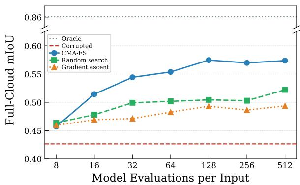  
Figure 5. Recovery versus optimization budget on a common model-evaluation axis. Gradient ascent plateaus well below global search, whereas CMA-ES is the most query-efficient.

Query-budget curve. We then examine how recovery scales with the number of forward queries. As shown in Figure 6, recovery increases monotonically with diminishing returns. On part segmentation, performance improves from 0.43 to 0.49 with only 16 queries and reaches 0.55 with 256 queries. Classification follows the same trend, improving from 0.21 to 0.32. Most of the achievable gain therefore arrives within a few dozen queries. This supports the practical viability of recovery under limited query budgets.

Table 10. Budget-saturation study. Each row varies its own budget and is comparable only within the row. Increasing the budget provides little additional benefit across methods.
<table><tr><td>Method</td><td>Budgets</td><td>Results at Each Budget</td><td></td><td></td></tr><tr><td>TENT [57]</td><td>1 / 10 / 50</td><td>0.345</td><td>0.346</td><td>0.301</td></tr><tr><td>MEMO [67]</td><td>1 / 10 / 50</td><td>0.344</td><td>0.357</td><td>0.337</td></tr><tr><td>Gradient Ascent</td><td>32 / 128 / 8192</td><td>0.509</td><td>0.515</td><td>0.528</td></tr><tr><td>Random Search [2]</td><td>32 / 128 / 8192</td><td>0.541</td><td>0.575</td><td>0.567</td></tr><tr><td>CMA-ES [16]</td><td>32 / 128 / 8192</td><td>0.552</td><td>0.602</td><td>0.577</td></tr></table>

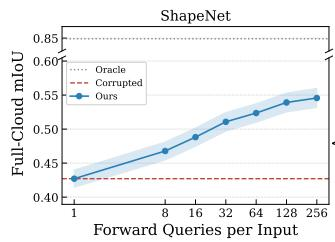

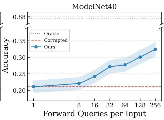  
Figure 6. Recovery versus query budget under random-axis SO(3). Recovery shows diminishing returns and remains bounded by the oracle. Shaded bands denote standard error.

## A.2. Augmentation Gap

Augmentation ablation on part segmentation. To verify that the augmentation-gap analysis of Section 5.1 extends beyond scene segmentation, we repeat the causal study on ShapeNetPart. We train PointNet++ under three rotationaugmentation regimes and evaluate yaw, tilt, and full SO(3) corruptions. As shown in Table 11, the same trend holds for part segmentation. Recovery is consistently larger when the training augmentation does not cover the test corruption. Recovery becomes smaller once the corresponding augmentation is introduced. Unlike classification, the clean cost of SO(3) augmentation is modest. Performance decreases from 0.842 to 0.835 mIoU. On this task, the motivation for test-time recovery stems primarily from the frozen-model constraint rather than the clean-performance trade-off.

Table 11. Augmentation ablation on ShapeNetPart part segmentation. Each cell reports corrupted → recovered mIoU. Recovery decreases as augmentation coverage increases.
<table><tr><td>Augmentation</td><td>Clean</td><td>Yaw</td><td>Tilt</td><td>SO(3)</td></tr><tr><td>None</td><td>0.842</td><td>0.376→0.540</td><td>0.520→0.621</td><td>0.469→0.586</td></tr><tr><td>Yaw</td><td>0.838</td><td>0.840→0.842</td><td>0.539→0.628</td><td>0.547→0.682</td></tr><tr><td>SO(3)</td><td>0.835</td><td>0.820→0.828</td><td>0.822→0.827</td><td>0.819→0.827</td></tr></table>

Cross-architecture sensitivity. We next examine whether transformation sensitivity generalizes across architectures. Figure 1b shows the tilt-sensitivity curve of the scene segmentation model. Increasing tilt monotonically reduces mIoU from 0.627 when upright to 0.088 at 60◦. By contrast, yaw rotations of the same magnitude leave performance unchanged. Table 12 extends the comparison across architectures. All three backbones exhibit similar tilt sensitivity while remaining robust to yaw, including vanilla PointNet [34]. The two scalable models [35, 36] are also robust within their trained scale range. These results indicate that training augmentation, rather than architecture, determines robustness.

Table 12. Accuracy drops under tilt, scale, and color across architectures. All backbones remain robust to augmented transformations but degrade substantially under the unseen tilt.
<table><tr><td>Drop Under</td><td>Tilt</td><td>Large Scale</td><td>Color</td></tr><tr><td>PointNet [34]</td><td>0.48</td><td></td><td></td></tr><tr><td>PointNet++ [35]</td><td>0.42</td><td>0.20</td><td>0.09</td></tr><tr><td>PointNeXt-S [36]</td><td>0.53</td><td>0.20</td><td>0.08</td></tr></table>

Cross-architecture recovery. We then test whether recovery also generalizes across architectures. We repeat the SO(3) classification experiment of Table 1 on three additional non-equivariant backbones spanning MLP, convolutional, and transformer families [8, 30, 35, 36]. Each backbone is frozen and accessed only through forward queries. As shown in Table 13, all models suffer severe degradation under SO(3) rotations. CANDO consistently recovers a substantial portion of the oracle gap. The weaker recovery therefore stems from the single-softmax objective rather than the architecture. Point-MAE supports this conclusion by showing the same behavior as the other backbones. The confidence-accuracy correlation also remains positive across backbones, indicating that the recovery condition generalizes across architectures.

Table 13. Classification recovery under SO(3) rotations across architecture families. CANDO consistently recovers a substantial portion of the oracle gap, and confidence-accuracy correlation remains positive across backbones.
<table><tr><td>Backbone</td><td>Family</td><td>Clean</td><td>SO(3)</td><td>+CANDO</td><td>% Gap</td><td>Corr</td></tr><tr><td>PointNet++ [35]</td><td>MLP</td><td>0.92</td><td>0.13</td><td>0.34</td><td>29</td><td>0.31</td></tr><tr><td>PointNeXt-S [36]</td><td>Conv</td><td>0.93</td><td>0.16</td><td>0.48</td><td>42</td><td>0.52</td></tr><tr><td>PointVector-S [8]</td><td>Conv</td><td>0.93</td><td>0.15</td><td>0.47</td><td>40</td><td>0.54</td></tr><tr><td>Point-MAE [30]</td><td>Transformer</td><td>0.93</td><td>0.15</td><td>0.41</td><td>34</td><td>0.26</td></tr></table>

## A.3. Surrogate Reliability

Full corruption benchmark. The main text reports percorruption ModelNet-C results for classification in Table 8. We further evaluate the segmentation model on all seven ShapeNet-C corruptions in Table 14. The dense per-point objective does not degrade performance at full evaluation. Every change is non-negative and at most +0.004 mIoU. On shared corruptions, the segmentation objective keeps the identity transform for 86-92% of inputs. Classification keeps the identity for only 50-80%. The qualitative pattern is stable: dense confidence is less susceptible to harmful overconfidence than the single-softmax classification signal.

Table 14. ShapeNet-C recovery with the part-segmentation model. The dense per-point confidence surrogate remains reliable across all corruption families, with every change between +0.001 and +0.004 mIoU.
<table><tr><td>Corruption</td><td>Family</td><td>Source</td><td>+CANDO</td><td>∆</td></tr><tr><td>Rotate</td><td>Transform</td><td>0.805</td><td>0.806</td><td>+0.001</td></tr><tr><td>Scale</td><td>Transform</td><td>0.839</td><td>0.840</td><td>+0.001</td></tr><tr><td>Jitter</td><td>Noise</td><td>0.791</td><td>0.795</td><td>+0.004</td></tr><tr><td>Add (Global)</td><td>Noise</td><td>0.813</td><td>0.815</td><td>+0.002</td></tr><tr><td>Add (Local)</td><td>Noise</td><td>0.837</td><td>0.839</td><td>+0.002</td></tr><tr><td>Dropout (Global)</td><td>Density</td><td>0.850</td><td>0.852</td><td>+0.001</td></tr><tr><td>Dropout (Local)</td><td>Density</td><td>0.821</td><td>0.822</td><td>+0.001</td></tr><tr><td>Mean Over Seven</td><td>一</td><td>0.822</td><td>0.824</td><td>+0.002</td></tr></table>

Calibration and logit access. Because CANDO optimizes model confidence, its performance could depend on score calibration or on whether the API exposes probabilities rather than logits. We evaluate both factors in Table 15. We re-run SO(3) recovery on ModelNet40 using temperature-scaled confidence, maximum log-probability, and negative entropy. Recovery remains stable from sharpening to mild softening. It ranges from 0.297 to 0.309 for $T \in [ 0 . 5 , 2 ]$ and drops only under extreme softening to 0.277 at T=4. The logprobability objective matches probability access at 0.309 because selecting the best rotation is invariant to monotone score transformations. Negative entropy reaches 0.307, and it also covers the divergence from the uniform distribution u, since $\mathrm { K L } ( \pmb { p } \| \pmb { u } ) = \log C - \mathcal { H } ( \pmb { p } )$ for C classes and therefore ranks candidates identically. These results indicate that CANDO requires only an ordinal confidence signal rather than calibrated probabilities.

Table 15. Calibration study of SO(3) recovery on ModelNet40. Recovery remains stable across temperature scaling and is identical under logit and probability access.
<table><tr><td>Objective</td><td>Prob.</td><td>Temp.0.5</td><td>Temp.2</td><td>Temp. 4</td><td>Log-prob.</td><td>Neg. Entropy</td></tr><tr><td>Recovered</td><td>0.309</td><td>0.297</td><td>0.309</td><td>0.277</td><td>0.309</td><td>0.307</td></tr></table>

Per-category and failure analysis. Figure 7 breaks the SO(3) recovery study down by category. Gains concentrate on categories with distinctive canonical frames. Tables improve by 0.38 mIoU, skateboards by 0.37, chairs by 0.35, and airplanes by 0.30. Losses instead concentrate on rotationally ambiguous shapes. Guitars lose 0.16, rockets 0.10, mugs 0.05, and cars 0.04. For these categories, multiple orientations explain the geometry equally well. The confidence surrogate can therefore favor an incorrect pose. Overall, 63% of shapes improve by more than 0.01 mIoU and 26% degrade by the same margin. The mean change is +0.23. Recovery also increases with corruption magnitude. Inputs below 1.2 radians improve from 0.571 to 0.662 mIoU, whereas inputs above 2.2 radians improve from 0.244 to 0.551 mIoU. These results indicate that the remaining failures arise primarily from geometric ambiguity rather than optimization.

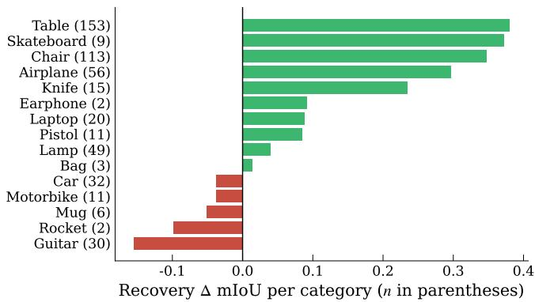

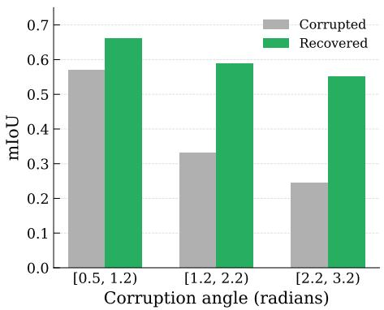  
Figure 7. Per-category analysis of SO(3) recovery. (Left) Categories with distinctive canonical frames exhibit the largest gains, whereas rotationally ambiguous categories show limited or negative recovery. (Right) Recovery increases with corruption magnitude, indicating tha residual failures arise primarily from geometric ambiguity rather than optimization.

## A.4. Identity Prior and Safety

Do-no-harm on clean inputs. Beyond the average tradeoff in Figure 4, we measure how often recovery harms already well-aligned inputs. As shown in Table 16, the identity prior (λ=0.08) limits degradation beyond 1% to only 6% of clean inputs. The mean change is −0.005 mIoU for part segmentation. Without the prior, 41% of inputs degrade by more than 1% and the mean change falls to −0.143. The identity prior therefore suppresses unnecessary transformations on clean inputs while preserving recovery, making it essential for safe deployment.

Table 16. Tail risk on clean inputs for part segmentation and classification: mean accuracy change and the fraction of inputs degraded by more than 1, 5, and 10%, with and without the identity prior.
<table><tr><td>Task</td><td>Prior</td><td>Mean ∆</td><td>&gt; 1% harmed</td><td>&gt; 5% harmed</td><td>&gt; 10% harmed</td></tr><tr><td>Part Seg.</td><td>λ=0.08</td><td>-0.005</td><td>6.2%</td><td>3.2%</td><td>2.6%</td></tr><tr><td>Part Seg.</td><td>λ=0</td><td>-0.143</td><td>41.0%</td><td>31.6%</td><td>29.1%</td></tr><tr><td>Classif.</td><td>λ=0.08</td><td>-0.053</td><td>6.0%</td><td>6.0%</td><td>6.0%</td></tr><tr><td>Classif.</td><td>λ=0</td><td>-0.231</td><td>23.4%</td><td>23.4%</td><td>23.4%</td></tr></table>

Identity-prior ablation. Table 17 evaluates different values of the identity-prior weight λ. Larger values preserve the identity transformation more often while maintaining rotation recovery. They also reduce degradation on nonpose corruptions. Outlier addition remains the most difficult corruption because the confidence surrogate becomes overconfident without improving correctness. Smaller values increase harm on jitter and outlier addition without improving rotation recovery. They are therefore beneficial only when inputs are known to contain large pose errors.

Table 17. Identity-prior ablation: change in accuracy versus the prior weight λ on ModelNet-C. Larger λ preserves the rotation gain while reducing harm on non-pose corruptions.
<table><tr><td>λ</td><td>Rotate</td><td>Scale</td><td>Jitter</td><td>Add (Global)</td></tr><tr><td>0.2</td><td>+0.086</td><td>-0.031</td><td>-0.086</td><td>-0.148</td></tr><tr><td>0.4</td><td>+0.047</td><td>-0.016</td><td>-0.055</td><td>-0.102</td></tr><tr><td>0.7</td><td>+0.031</td><td>-0.016</td><td>-0.047</td><td>-0.062</td></tr></table>

Confidence-margin gate. Table 18 evaluates a confidencemargin gate that accepts a recovered rotation only if its confidence exceeds the identity by a margin τ . The gate preserves rotation recovery while reducing degradation on jitter and dropout. It has little effect on global outlier addition because the surrogate remains confidently incorrect. This limitation therefore reflects the confidence surrogate rather than the acceptance threshold. Gating adaptation by predictive uncertainty parallels concept bottleneck models [21], where correcting only the most uncertain concepts mitigates annotation noise [32]. Lightweight post-hoc OOD detectors [33, 37, 65] could further flag non-pose corruptions before search.

Table 18. Confidence-margin gate on ModelNet-C: change in accuracy versus the acceptance margin τ, with τ=0 the ungated method. Larger τ reduces harm on corruptions with misaligned confidence while preserving the rotation gain, but cannot fix outlier addition.
<table><tr><td>Corruption</td><td>Family</td><td>τ=0</td><td>τ=0.05</td><td>τ=0.1</td><td>τ=0.2</td></tr><tr><td>Rotate</td><td>Transform</td><td>+0.060</td><td>+0.058</td><td>+0.067</td><td>+0.054</td></tr><tr><td>Jitter</td><td>Noise</td><td>-0.067</td><td>-0.058</td><td>-0.048</td><td>-0.067</td></tr><tr><td>Add (Global)</td><td>Noise</td><td>-0.073</td><td>-0.065</td><td>-0.067</td><td>-0.060</td></tr><tr><td>Dropout (Global)</td><td>Density</td><td>-0.017</td><td>-0.017</td><td>-0.002</td><td>-0.002</td></tr></table>

Mixed deployment stream. Table 19 evaluates a single acceptance policy on a mixed deployment stream containing canonical, mildly rotated, and severely rotated inputs. Increasing the confidence threshold leaves more canonical inputs untouched but gradually reduces recovery on rotated ones. Part segmentation admits an operating point that preserves canonical inputs while maintaining a positive net gain. Classification instead exhibits an unavoidable trade-off because confidently incorrect rotations can satisfy any practical threshold. The reported results therefore characterize the deployment range of a single fixed policy for each surrogate.

Table 19. Mixed-stream single-policy sweep, averaged over three seeds. Part segmentation admits a do-no-harm operating point with positive net gain, whereas classification trades canonical harm for the rotated gain at every threshold.
<table><tr><td rowspan=1 colspan=6>Task    T   Net Gain Clean ∆ Mild ∆ Severe ∆ Identity Kept</td></tr><tr><td rowspan=1 colspan=1>0.00</td><td rowspan=1 colspan=1>+0.036</td><td rowspan=1 colspan=1>-0.002</td><td rowspan=1 colspan=1>+0.081</td><td rowspan=1 colspan=2>+0.067     70%</td></tr><tr><td rowspan=2 colspan=1>0.05Part Seg.0.10</td><td rowspan=1 colspan=1>+0.030</td><td rowspan=1 colspan=1>-0.004</td><td rowspan=1 colspan=1>+0.066</td><td rowspan=1 colspan=1>+0.064</td><td rowspan=1 colspan=1>98%</td></tr><tr><td rowspan=1 colspan=1>+0.021</td><td rowspan=1 colspan=1>-0.003</td><td rowspan=1 colspan=1>+0.039</td><td rowspan=1 colspan=1>+0.051</td><td rowspan=1 colspan=1>99%</td></tr><tr><td rowspan=1 colspan=1>0.20</td><td rowspan=1 colspan=1>+0.003</td><td rowspan=1 colspan=1>+0.000</td><td rowspan=1 colspan=1>+0.001</td><td rowspan=1 colspan=1>+0.013</td><td rowspan=1 colspan=1>100%</td></tr><tr><td rowspan=1 colspan=1>0.00</td><td rowspan=1 colspan=1>+0.028</td><td rowspan=1 colspan=1>-0.051</td><td rowspan=1 colspan=1>+0.156</td><td rowspan=1 colspan=1>+0.060</td><td rowspan=1 colspan=1>70%</td></tr><tr><td rowspan=2 colspan=1>0.05Classif.0.10</td><td rowspan=1 colspan=1>+0.029</td><td rowspan=1 colspan=1>-0.049</td><td rowspan=1 colspan=1>+0.154</td><td rowspan=1 colspan=1>+0.060</td><td rowspan=1 colspan=1>83%</td></tr><tr><td rowspan=1 colspan=1>+0.031</td><td rowspan=1 colspan=1>-0.040</td><td rowspan=1 colspan=1>+0.146</td><td rowspan=1 colspan=1>+0.058</td><td rowspan=1 colspan=1>87%</td></tr><tr><td rowspan=1 colspan=1>0.20</td><td rowspan=1 colspan=1>+0.033</td><td rowspan=1 colspan=1>-0.025</td><td rowspan=1 colspan=1>+0.132</td><td rowspan=1 colspan=1>+0.052</td><td rowspan=1 colspan=1>91%</td></tr></table>

## B. Experimental Details

This section provides additional details on the experimental framework, including baselines, optimizer comparisons, implementation details, and dataset preprocessing.

## B.1. Baselines

We compare CANDO with gradient-free methods compatible with black-box access and gradient-based methods that serve as white-box references. This section expands the setup in Section 4.1 by specifying the rule used by each baseline.

Principal-axis canonicalization [64]. This baseline aligns the input to its principal axes. It forms the centered coordinate covariance and eigendecomposes it,

$$
\mathbf { C } = \frac { 1 } { N } \sum _ { i = 1 } ^ { N } ( \pmb { p } _ { i } - \bar { \pmb { p } } ) ( \pmb { p } _ { i } - \bar { \pmb { p } } ) ^ { \top } = \mathbf { V } \mathbf { \Lambda } \mathbf { V } ^ { \top } ,\tag{7}
$$

then canonicalizes each point as $\widehat { \pmb { p } _ { i } } = \mathbf { V } ^ { \top } ( \pmb { p } _ { i } - \bar { \pmb { p } } )$ . Because each eigenvector is defined only up to sign, the canonical frame is ambiguous under the $\bar { 2 ^ { 3 } }$ sign flips of the columns of V. The confidence-disambiguated variant resolves this ambiguity by selecting the flip that maximizes the model confidence $J .$

Normalization-statistic adaptation [27]. DUA keeps all weights fixed and updates only batch-normalization statistics.

For each normalization layer, it blends the stored running statistics $( \mu , \sigma ^ { 2 } )$ with the test-input statistics $( \mu _ { \mathrm { P } } , \sigma _ { \mathrm { P } } ^ { 2 } )$ ,

$$
\begin{array} { r l r } { \pmb { \mu }  ( 1 - \rho ) \pmb { \mu } + \rho \pmb { \mu } _ { \mathbf { P } } , } & { { } } & { \pmb { \sigma } ^ { 2 }  ( 1 - \rho ) \pmb { \sigma } ^ { 2 } + \rho \pmb { \sigma } _ { \mathbf { P } } ^ { 2 } , } \end{array}\tag{8}
$$

then recomputes the prediction with the adapted statistics. We use 16 augmented copies of the input and apply three updates with momentum $\rho { = } 0 . 1$

External-prior canonicalization. This baseline keeps the pose search of CANDO but replaces the scoring signal. It selects

$$
\widehat { \pmb { \theta } } = \operatorname * { a r g m a x } _ { \pmb { \theta } } J ^ { \prime } ( \pmb { \theta } ) ,\tag{9}
$$

where $J ^ { \prime }$ is the confidence of a separate frozen classifier $g ^ { \prime }$ rather than the task model. It then returns the task prediction $g ( \mathbf { T } _ { \widehat { \theta } } ( \mathbf { P } ) )$ at the selected pose. This isolates the effect of the scoring model at the cost of an auxiliary network. We use a frozen ModelNet40 PointNet++ classifier as $g ^ { \prime }$ and therefore report this baseline only on ShapeNetPart, since an object classifier provides no meaningful pose prior for S3DIS scene blocks and on ModelNet40 it would coincide with the task model.

TENT [57]. TENT takes gradient-descent steps on the Shannon entropy of the prediction $\begin{array} { r } { \pmb { p } = \pmb { g } ( \mathbf { P } ) } \end{array}$ ,

$$
\begin{array} { r l } { \underset { \{ \gamma , \beta \} } { \operatorname* { m i n } } } & { \mathcal { H } ( p ) } \\ { \mathrm { s . t . } } & { \mathcal { H } ( p ) = - \displaystyle \sum _ { c } p _ { c } \log p _ { c } . } \end{array}\tag{10}
$$

updating only the affine normalization parameters $\{ \gamma , \beta \}$ All other weights remain fixed. We use SGD steps with momentum 0.9 and learning rate $5 \times 1 0 ^ { - 4 }$ for segmentation and $1 0 ^ { - 3 }$ for classification.

MEMO [67]. MEMO minimizes the marginal entropy of predictions over augmentations $\{ a _ { b } \} _ { b = 1 } ^ { B }$

$$
\begin{array} { r l } { \operatorname* { m i n } } & { { } { \displaystyle \mathcal { H } ( { \bar { p } } ) } } \\ { \mathrm { s . t . } } & { { } { \bar { p } } = \displaystyle \frac { 1 } { B } \sum _ { b = 1 } ^ { B } g ( a _ { b } ( { \bf P } ) ) . } \end{array}\tag{11}
$$

and updates model parameters to encourage confident and augmentation-consistent outputs. We use $B { = } 8$ augmentations for segmentation and $B { = } 1 6$ for classification. The SGD settings match TENT.

Gradient-based canonicalization. This white-box reference applies CANDO’s pose search with exact gradients. It ascends the confidence objective over the input rotation,

$$
\pmb { \theta } _ { t + 1 } = \pmb { \theta } _ { t } + \eta \nabla _ { \pmb { \theta } } J ( \pmb { \theta } _ { t } ) ,\tag{12}
$$

where gradients are backpropagated through the model. We run 20 ascent steps with step size 0.2 from three restarts under a query budget matched to CANDO.

Oracle. The oracle provides a supervised upper bound. For each input, it selects

$$
\begin{array} { r } { \pmb { \theta } ^ { \star } = \underset { \pmb { \theta } } { \operatorname { a r g m a x } } \mathcal { M } ( g ( \mathbf { T } _ { \theta } ( \mathbf { P } ) ) , y ) , } \end{array}\tag{13}
$$

where M is the true task metric against the ground-truth label y. We use mIoU for segmentation and accuracy for classification. No label-free method can exceed this oracle.

## B.2. Optimization Baselines

The optimizer study in Section 5.2 compares CMA-ES with local gradient estimators and alternative global searches. All methods use only forward queries of the confidence objective $J ( \pmb \theta )$ . Each baseline uses three random restarts under a query budget matched to CANDO. Zeroth-order methods have also been made query- and memory-efficient for tuning large black-box models [26, 29, 31]; such estimators may matter for transformation families richer than the three-dimensional rotations considered here.

Coordinate finite differences [6]. This estimator probes each axis independently with step size ε. The i-th component is estimated by the central difference

$$
\widehat { g } _ { i } = \frac { J ( \pmb \theta + \varepsilon \pmb e _ { i } ) - J ( \pmb \theta - \varepsilon \pmb e _ { i } ) } { 2 \varepsilon } ,\tag{14}
$$

and the optimizer ascends along the assembled gradient ${ \widehat { \pmb { g } } } .$ We set ε=0.1.

SPSA [47]. SPSA estimates the full gradient using a single random Rademacher perturbation $\pmb { \Delta }$ of magnitude c. The estimator is

$$
\widehat { \pmb { g } } = \frac { J ( \pmb { \theta } + c \pmb { \Delta } ) - J ( \pmb { \theta } - c \pmb { \Delta } ) } { 2 c } \pmb { \Delta } ^ { - 1 } ,\tag{15}
$$

where $\Delta ^ { - 1 }$ denotes the componentwise inverse. We set c=0.1.

Natural evolution strategies [60]. NES smooths J with a Gaussian search distribution of scale σ. It estimates an antithetic search gradient from m symmetric sample pairs:

$$
\widehat { \pmb { g } } = \frac { 1 } { \sigma m } \sum _ { k = 1 } ^ { m } \Bigl [ J ( \pmb { \theta } + \sigma \epsilon _ { k } ) - J ( \pmb { \theta } - \sigma \epsilon _ { k } ) \Bigr ] \pmb { \epsilon } _ { k } ,\tag{16}
$$

where $\epsilon _ { k } \sim \mathcal { N } ( \mathbf { 0 } , \mathbf { I } )$ are i.i.d. Gaussian perturbations. The symmetric pairs reduce variance by canceling odd components around θ. We use $\sigma { = } 0 . 1 5$ and m=4 pairs.

Score-function estimator [61]. The score-function estimator uses the same Gaussian smoothing with one-sided samples and a running baseline b:

$$
\widehat { \pmb { g } } = \frac { 1 } { \sigma m } \sum _ { k = 1 } ^ { m } \bigl [ \pmb { J } ( \pmb { \theta } + \sigma \epsilon _ { k } ) - b \bigr ] \star _ { k } .\tag{17}
$$

This follows the REINFORCE log-derivative estimator. The running mean score b reduces variance. We use $\sigma { = } 0 . 1 5$ and m=8 samples.

Random search [2]. Random search samples a fixed pool of M candidate rotations independently from a search prior π and returns the highest-scoring candidate:

$$
\widehat { \pmb { \theta } } = \mathop { \mathrm { a r g m a x } } _ { k } J ( \pmb { \theta } _ { k } ) ,\tag{18}
$$

where $\theta _ { k } \sim \pi$ independently for all k. We use $M \in$ {96, 128, 256} depending on the experiment.

Bayesian optimization [43]. Bayesian optimization fits a Gaussian-process surrogate to observed pose-score pairs $\mathcal { D } _ { t } = \{ ( \pmb { \theta } _ { j } , J ( \pmb { \theta } _ { j } ) ) \}$ . It selects each query by maximizing an acquisition function α:

$$
\pmb { \theta } _ { t + 1 } = \operatorname * { a r g m a x } _ { \pmb { \theta } } \alpha ( \pmb { \theta } ; \mathcal { D } _ { t } ) .\tag{19}
$$

This balances exploration and exploitation.

## B.3. Implementation Details

For every input, the front-end applies the rotation transform of Eq. (2). Candidate transformations are scored by the confidence surrogate of Eq. (4) and selected using the identity prior of Eq. (5). Full SO(3) search uses CMA-ES with two restarts: a population of 12, $\sigma _ { 0 } { = } 1 . 0$ , and 300 queries for PointNet++ part segmentation; a population of 10, $\sigma _ { 0 } { = } 1 . 2$ and 300 queries for PointNeXt-S part segmentation and the optimizer study; and a population of 10 (12 in Table 2), $\sigma _ { 0 } { = } 1 . 2 $ , and 240 queries for classification. Azimuth recovery scans 16 angles and refines the best one with 15 SPSA steps. S3DIS tilt recovery evaluates a deterministic 13×13 grid over the two tilt parameters (169 queries) in Table 1 and uses CMA-ES with a population of 8, $\sigma _ { 0 } { = } 0 . 5$ , and 160 queries in Table 2. The identity-prior weight λ is selected once on a small labeled validation split and fixed thereafter. A per-input random seed initializes every estimator. All experiments are run on a single RTX A6000.

## B.4. Datasets and Preprocessing

ShapeNetPart [66]. Each shape is normalized to the unit sphere and sampled as a point cloud with surface normals. Coordinates and normals are used as input. Predictions on transformed points are propagated to the original cloud by three-nearest-neighbor voting. We report category-masked instance mIoU following the standard evaluation protocol.

S3DIS [1]. We evaluate Area 5 using the standard blockbased preprocessing with 4096-point nine-channel inputs. Tilt corruption and recovery rotate the input coordinates and recompute all geometric channels from the transformed geometry. Color channels remain unchanged.

ModelNet40 [63]. We use the standard resampled benchmark with 1024 points per shape. Each shape is normalized to the unit sphere and represented only by point coordinates.

Corruptions. Pose corruptions sample a uniform azimuth, a random-axis SO(3) rotation, or a horizontal-axis tilt independently for each input. The SO(3) rotation angle is sampled uniformly above a small minimum rather than from the Haar measure. Experiments under Haar-uniform rotations lead to the same conclusions. The non-pose study of Section 5.3 uses the official PointCloud-C generators [38] with seven corruption types at five severity levels.

## C. Limitations and Future Work

Limitations. The method targets rotation-induced shifts and does not address noise or density corruptions when confidence is misaligned with task performance. Classification recovers less than segmentation because a single softmax provides a weaker optimization signal than dense per-point confidence. The method also assumes a low-dimensional input transformation, probability or logit access, and a moderate forward-query budget. Finally, our evaluation considers synthetic pose shifts, leaving validation on real sensor tilt and outdoor LiDAR data to future work.

Future Work. A natural next step is to extend the transformation family beyond rotations to richer parameterizations such as affine transformations, or to infer the transformation family automatically rather than specifying it a priori. Another promising direction is to combine forward-query pose recovery with external generative or foundation-model priors, extending the framework to distribution shifts that cannot be resolved by a confidence-only objective.