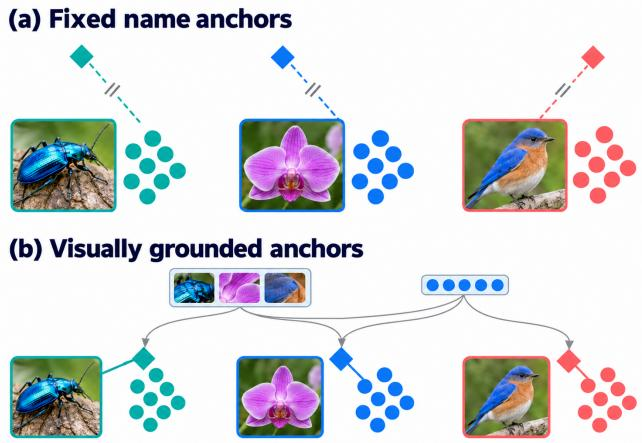
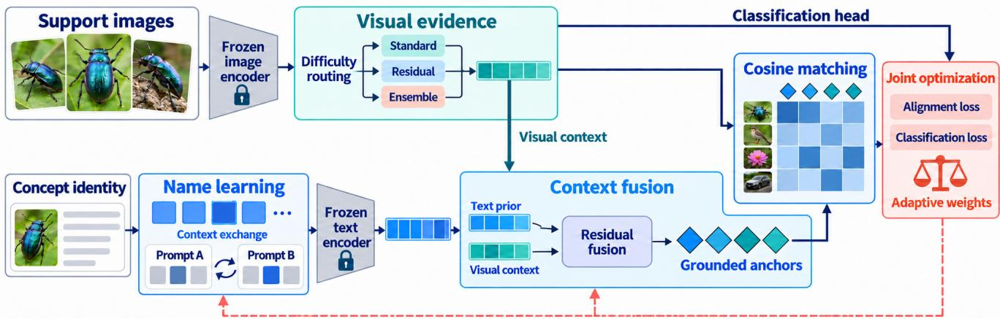
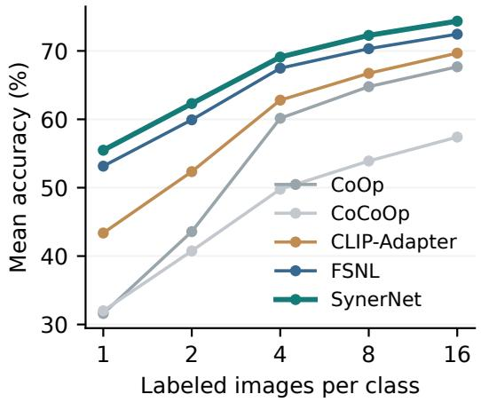
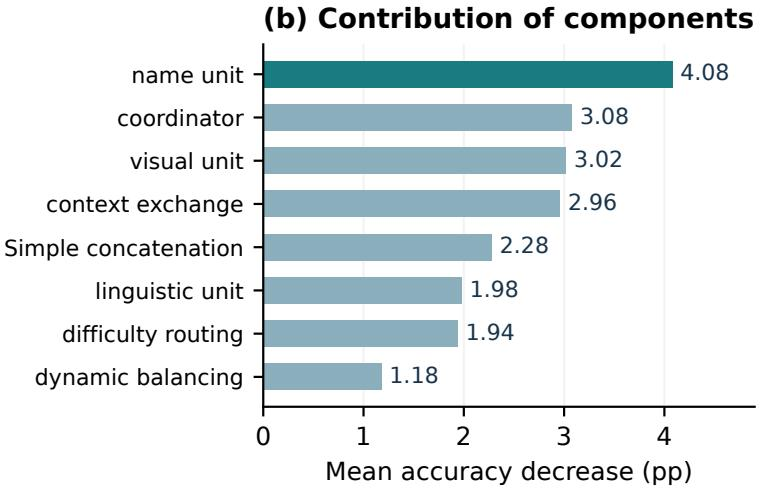
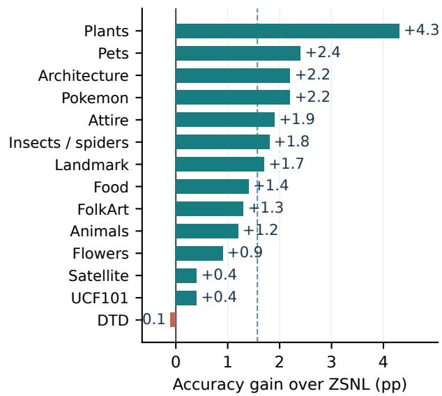

# Seeing Before Naming: Context-Grounded Learning of Novel Visual Concepts

Gabriel Adineera Texas A&M University-Commerce USA

Jinoh Kim\* Texas A&M University-Commerce USA

## Abstract

Learning an unfamiliar visual category requires more than adapting a classifier: the model must connect its visual evidence to a useful semantic name. A pre-trained visionlanguage model can retain discriminative image features while providing a weak textual anchorfor the target concept. We address this imbalance through context-grounded semantic anchoring. Our framework, SynerNet, learns conceptspecific name embeddings, exposes them to compatible linguistic contexts, and conditions their representations on visual evidence. Difficulty-aware processing and adaptive objective weighting coordinate this adaptation while retaining the pre-trained backbone. Onfour VISTA-Beyond domains, SynerNet reaches a mean 16-shot accuracy of74.35%, compared with 72.45%forfew-shot name learning. Across 14 domains in the name-masked transfer setting, it improves mean accuracyfrom 45.17% to 46.74%. Ablations identify concept-specific name embeddings and cross-modal context integration as important components. These results support treating concept acquisition as the construction of visually grounded semantic anchors.

## 1. Introduction

A few photographs can make a category visually recognizable before its name becomes meaningful. Vision-language recognition often converts a category name directly into a classifier weight, obscuring this distinction. A model may retain informative shape, texture, and appearance features while poorly representing the corresponding name. Improving vision alone does not repair that cross-modal association.

Contrastive vision-language pre-training, exemplified by CLIP [17] and reproducible OpenCLIP models [3], makes this association useful across a broad range of recognition tasks. Downstream adaptation often learns prompt context [45, 46], transforms features [5], or combines text priors with support-image evidence [8, 44]. These methods provide effective tools for transferring pre-trained knowledge. However, the role of a category name becomes particularly important when the target concept is unfamiliar or poorly aligned with its pre-trained textual representation.

  
Figure 1. Visual discrimination need not imply semantic alignment. Circles denote visual evidence and diamonds denote name anchors. Fixed anchors can remain separated from their corresponding visual groups; name learning and visual context ground the anchors. This is a conceptual schematic with generated example thumbnails.

Prior work on learning class names [16] and out-of-pretraining concepts [1] makes this issue explicit through name learning. We build on that motivation and ask a more operational question: how should a name representation adapt when its most reliable evidence comes from a small collection of images? A name should preserve the reusable structure of language while being anchored to the visual distinctions that define the current task. Learning the token in isolation leaves the quality of its surrounding context unresolved. Conditioning a text representation on visual evidence without preserving a stable name representation can instead make the semantic anchor too dependent on the current example.

Our central idea is context-grounded semantic anchoring. The concept identity is carried by learnable name embeddings. Compatible linguistic contexts expose that identity under different descriptions. Visual context then adjusts the resulting text representation toward the evidence available in the adaptation task. Together, these operations connect concept identity, description, and visual evidence.

SynerNet combines four interacting modules. The visual perception unit extracts evidence and context; the nominal embedding unit learns concept identity; the linguistic context unit integrates visual and language information; and the coordinator balances alignment and classification. Together, they construct the semantic anchor.

Adaptation difficulty also varies across images and concepts. A single fixed feature-processing rule or loss balance may overemphasize unstable visual evidence or underweight the name representation. SynerNet therefore uses a featurebased difficulty estimate to control processing and learnable weights to balance its objectives.

The experimental results show complementary effects across settings. In 16-shot recognition, SynerNet improves the four-domain mean over FSNL by 1.90 percentage points, with gains on each evaluated domain. In name-masked transfer, its mean accuracy is 46.74% across 14 domains, versus 45.17% for ZSNL. The gain is not uniform: DTD remains a difficult case, and FolkArt favors TransCLIP. The ablations further show that removing the name-learning unit produces the largest mean reduction among the individual module removals.

Our contributions are:

• A formulation of novel-concept adaptation around contextgrounded semantic anchors, connecting concept-specific name learning with compatible linguistic variation and visual conditioning.

• A coordinated adaptation framework that combines these anchors with difficulty-aware visual processing and adaptive alignment–classification optimization.

• An evaluation across few-shot recognition, name-masked transfer, and component ablations that identifies both improvements and domain-dependent limitations.

Throughout the paper, “novel” refers to target concepts in the adaptation task. An assertion that a concept was absent from pre-training requires a separate corpus audit and is not implied by this terminology.

## 2. Related Work

Vision-language representation learning. CLIP [17] and ALIGN [9] learn transferable image-text representations; OpenCLIP [3] and LAION-400M [19] support reproducible pre-training. BLIP [13] and ALBEF [12] combine alignment with multimodal objectives, while DenseCLIP [18] extends language guidance to dense prediction. We study downstream concept anchors under limited target supervision.

Parameter-efficient and prompt adaptation. Adapters [6] and low-rank updates [7] adapt selected model parameters. Prompt tuning [11] and visual prompt tuning [10] instead adapt inputs. CoOp [46] learns text context, CoCoOp [45] conditions context on images, CasPL [24] separates generic and task-specific prompts, and DAPT [4] considers visual-textual feature distributions. SynerNet adapts concept-bearing tokens and their interaction with visual context.

Feature adaptation and knowledge preservation. CLIP-Adapter [5] blends residual features, Tip-Adapter [44] retrieves support evidence, and TaskRes [26] learns classifier residuals. LP++ [8] combines prototypes and text embeddings; CLAP [20] studies class-adaptive regularization. WiSE-FT [23] and robust few-shot fine-tuning [21] address knowledge preservation under distribution shift. OOD generalization [14] remains distinct from auditing pre-training concept coverage.

Learning names for unfamiliar concepts. Parisot et al. [16] learn class-specific word embeddings from images. Chen et al. [1] introduce few-shot and zero-shot name learning for out-of-pre-training concepts. SynerNet adds visualcontext integration, linguistic variation, and coordination. TransCLIP [27] provides a complementary transductive comparison. CF-VLM [29] trains on causal counterfactual edits; our context exchange instead aims to preserve concept identity while varying compatible descriptions.

Grounded and compact multimodal representations. MM-CoT [30] separately probes visual consistency and logical coherence, while top-down semantic refinement [31] plans image captions through hierarchical refinement. These tasks require evidence beyond a plausible linguistic output. HTC-VLM [40] combines continuous appearance features with discrete semantic anchors for token compression. Video encoders built on image representations [42] retain framespecific evidence before temporal refinement. Our anchors serve class discrimination; the experiments do not evaluate reasoning, captioning, compression, or temporal understanding.

Adaptive computation and coordination. AdaViT [15] allocates visual computation by input; DrDiff [34] schedules experts during text diffusion. KABB [38] selects experts, OSC [35] adapts inter-agent communication, and MAT-Agent [28] coordinates training choices. GAM-Agent [36] uses uncertainty to trigger visual-reasoning debate; Agora [39] trades structured visual uncertainty. Failuredriven workflow refinement [33] edits workflows using recurring counterexamples. Alongside learning-dynamics-aware fine-tuning [32], these studies illustrate several levels of adaptation.

Markets of Minds [43] evaluates expert assistance by expected gain over default continuation, separating repair benefit from regression risk under shared budgets and service capacity. It distinguishes request difficulty from assistance value and the opportunity cost of allocating scarce resources. SynerNet’s module-level routing and objective weighting do not model these population-level opportunity costs.

## 3. Context-Grounded Semantic Anchoring

## 3.1. Problem Formulation

Let Y denote the target vocabulary, and let $\begin{array} { r l } { s } & { { } = } \end{array}$ $\{ ( x _ { i } , y _ { i } , d _ { i } ) \} _ { i = 1 } ^ { N }$ contain the available adaptation images, class identities, and associated descriptions. In the K-shot setting, each target class contributes K labeled images. A pre-trained image encoder f and text encoder g map images and prompts into a shared space. With normalized embeddings v(x) and $t ( y )$ , the standard classifier is

$$
P ( y \mid x ) = \frac { \exp ( v ( x ) ^ { \top } t ( y ) / \tau ) } { \sum _ { j \in y } \exp ( v ( x ) ^ { \top } t ( j ) / \tau ) } .\tag{1}
$$

Our objective is to improve the semantic anchor $t ( y )$ using limited visual evidence while retaining the reusable representation in the pre-trained backbone.

The framework contains four modules, denoted $\Omega _ { V } , \Omega _ { L }$ $\Omega _ { N }$ , and $\Omega _ { C }$ . Their outputs are visual features, contextualized language features, learned name tokens, and optimization controls, respectively. Information exchange is represented as a typed message

$$
m _ { a  b } = ( a , b , \eta _ { a b } ) ,\tag{2}
$$

where $\eta _ { a b }$ contains the feature, context, or control quantity consumed by the receiving module. This notation specifies data flow; the modules operate within a shared differentiable adaptation pipeline.

## 3.2. Learning the Concept-Bearing Name

The nominal embedding unit associates each target concept y with a learnable sequence of tokens

$$
V _ { y } = [ e _ { y , 1 } , \boldsymbol { \cdot } \boldsymbol { \cdot } \boldsymbol { \cdot } , e _ { y , L _ { y } } ] , \qquad e _ { y , \ell } \in \mathbb { R } ^ { d _ { t } } .\tag{3}
$$

A prompt template $\mathcal { P } _ { m }$ inserts these tokens into a linguistic context. The resulting name-conditioned feature is

$$
t _ { y } ^ { ( m ) } = g ( \mathcal { P } _ { m } ( V _ { y } ) ) .\tag{4}
$$

The tokens carry the target identity, while the template supplies the surrounding description. Learning the tokens allows an unfamiliar category to acquire a representation beyond its original surface string.

Context exchange. Given a description $d _ { i } = \mathcal { P } _ { i } ( y _ { i } )$ , we retain the concept identity and replace its linguistic context with a context drawn from another adaptation example:

$$
d _ { i } ^ { \prime } = \mathcal { P } _ { j } ( y _ { i } ) , \qquad j \neq i .\tag{5}
$$

The corresponding prompt uses $V _ { y _ { i } }$ in both contexts. The purpose is to expose the same name representation under multiple descriptions rather than to create a new visual class. Contexts should remain compatible with the target identity; exchanging a background phrase is different from transferring an attribute that defines another class. This is especially relevant in fine-grained recognition, where a small descriptive change can alter category meaning.

Context exchange reuses the same image-text correspondence; its removal is evaluated in the ablation study.

## 3.3. Visual Evidence and Difficulty-Aware Processing

The visual unit supplies both the image representation used for recognition and the evidence used to condition the semantic anchor. Its standard representation is $F _ { V } ^ { \mathrm { s t d } } ( x ) = f ( x )$ The scale-controlled residual representation is

$$
F _ { V } ^ { \mathrm { r e s } } ( x ) = \frac { f ( x ) } { \| f ( x ) \| _ { 2 } } + \beta ~ \mathrm { s g } ( f ( x ) ) ,\tag{6}
$$

where sg denotes a stopped-gradient reference. This operation changes the scale entering context fusion; for a fixed image it does not introduce a new feature direction. The distinction matters because cosine normalization removes a pure scale change, whereas the context transformation can still respond to its magnitude.

For a feature summary $\bar { v } ( x )$ produced by the visual unit, the difficulty predictor is

$$
d ( x ) = \sigma ( W _ { 2 } \mathrm { R e L U } ( W _ { 1 } \bar { v } ( x ) + b _ { 1 } ) + b _ { 2 } ) .\tag{7}
$$

The score controls the selection between standard, residual, and ensemble processing modes. With thresholds $\theta _ { 1 } < \theta _ { 2 }$ the routing policy is

$$
\mathcal { R } ( x ) = \left\{ \begin{array} { l l } { \mathrm { s t a n d a r d , } } & { d ( x ) < \theta _ { 1 } , } \\ { \mathrm { r e s i d u a l , } } & { \theta _ { 1 } \leq d ( x ) < \theta _ { 2 } , } \\ { \mathrm { e n s e m b l e , } } & { d ( x ) \geq \theta _ { 2 } . } \end{array} \right.\tag{8}
$$

The ensemble mode combines available visual processing outputs. Let $F _ { V } ( x )$ denote the selected representation. Features are normalized when used for cosine classification, while their context summaries are passed to the linguistic unit. The effect of the difficulty mechanism is evaluated by disabling this routing component.

  
Figure 2. SynerNet architecture. Frozen encoders supply image and text features. Name learning and context exchange form conceptspecific text representations. Visual context conditions residual fusion to produce semantic anchors for cosine matching. An auxiliary visua classifier and cross-modal alignment provide the joint objectives. Dashed coral arrows denote adaptation feedback. Example thumbnails and the similarity grid are schematic.

## 3.4. Conditioning the Semantic Anchor on Visual Context

The linguistic unit receives a name-conditioned text feature and a visual context vector c. The latter is an aggregate of the visual features available to the current adaptation batch. A two-layer transformation integrates the modalities:

$$
G _ { \mathrm { c t x } } ( h ) = W _ { 4 } \mathrm { R e L U } ( W _ { 3 } h + b _ { 3 } ) + b _ { 4 } .\tag{9}
$$

For a prompt embedding $t _ { y }$ , the contextualized anchor is

$$
\widetilde { t } _ { y } = \lambda t _ { y } + ( 1 - \lambda ) G _ { \mathrm { c t x } } ( [ t _ { y } ; c ] ) , \qquad 0 \le \lambda \le 1 .\tag{10}
$$

Here $[ \cdot ; \cdot ]$ denotes concatenation. The residual text term preserves the language prior; the transformed term introduces evidence about the visual task. The transformation therefore changes how a learned name is positioned in the shared space without replacing its identity with an image feature.

We normalize $F _ { V } ( x )$ and $\widetilde { t } _ { y }$ before computing their cosine similarity. The resulting classifier retains the form of Equation (1), with the contextualized anchor replacing the fixed category-name feature. The visual context is obtained from model inputs rather than query labels. Because context is aggregated, batching is part of the inference configuration and should remain consistent when comparing methods.

The nonlinear integration and residual mixture distinguish this construction from direct concatenation, which we evaluate as an ablation. The nominal unit supplies the identity; the context unit grounds it in the visual task.

## 3.5. Sensitivity of the Grounded Semantic Anchor

The residual form gives a direct interpretation of how visual context changes a name representation. Let $t _ { y } \ne 0$ be the

text prior, $u _ { y } = G _ { \mathrm { c t x } } ( [ t _ { y } ; c ] )$ , and $a _ { y } = \lambda t _ { y } + ( 1 - \lambda ) u _ { y }$ Before normalization, its displacement is exactly

$$
a _ { y } - t _ { y } = ( 1 - \lambda ) ( u _ { y } - t _ { y } ) .\tag{11}
$$

Thus the mixing coefficient controls the magnitude of the context correction, while the learned transformation determines its direction. The identity branch remains present throughout this adjustment.

For nonzero $a _ { y }$ and normalized query v, normalization obeys

$$
\begin{array} { r l r } & { } & { \displaystyle { \left. v ^ { \top } \left( \frac { a _ { y } } { \| a _ { y } \| _ { 2 } } - \frac { t _ { y } } { \| t _ { y } \| _ { 2 } } \right) \right. \leq \frac { 2 \left\| a _ { y } - t _ { y } \right\| _ { 2 } } { \| t _ { y } \| _ { 2 } } } } \\ & { } & { \quad \quad \quad = \frac { 2 ( 1 - \lambda ) \left\| u _ { y } - t _ { y } \right\| _ { 2 } } { \left\| t _ { y } \right\| _ { 2 } } \equiv \epsilon _ { y } . } \end{array}\tag{12}
$$

To see the first inequality, apply Cauchy–Schwarz, expand the normalized-vector difference using the common denominator $\| t _ { y } \| _ { 2 }$ , and use the reverse triangle inequality for the two feature norms. No assumption about an empirical feature distribution is required.

If the original cosine-score margin between classes y and j is $m _ { y j }$ , the grounded margin is at least $m _ { y j } - \epsilon _ { y } - \epsilon _ { j }$ . In particular, a margin larger than this combined perturbation is preserved. This is a sensitivity property of the residual representation, rather than a guarantee of classification correctness. It explains the design tradeoff: a larger context contribution can repair an unsuitable name anchor, while the residual prior limits how strongly that anchor is displaced. The same coefficient should therefore be interpreted together with the scale of the context transformation, not as an independent measure of confidence.

Algorithm 1 Context-grounded adaptation and recognition   
1: for each adaptation batch do   
2: Encode images; select difficulty-dependent features.   
3: Build prompts from concept tokens and exchange compati  
ble linguistic contexts.   
4: Fuse text features with the visual context.   
5: Compute ${ \mathcal { L } } _ { \mathrm { c o n } }$ and ${ \mathcal { L } } _ { \mathrm { c l s } } ;$ update adaptive components and   
coordination parameters.   
6: end for   
7: Retain learned tokens and transformations for evaluation.   
8: Normalize image and anchor features; predict the highest co  
sine score over the target vocabulary.

## 3.6. Coordinated Optimization

The coordinator balances cross-modal alignment and class discrimination. For a batch of B image-text pairs, define $s _ { i j } = \langle \widehat { F } _ { V } ( x _ { i } ) , \widehat { \widetilde { t } } _ { j } \rangle$ , where hats denote normalized features. The symmetric contrastive objective is

$$
\begin{array} { r } { \mathcal { L } _ { \mathrm { c o n } } = \frac { 1 } { 2 } ( \mathcal { L } _ { I  T } + \mathcal { L } _ { T  I } ) , } \end{array}\tag{13}
$$

$$
\mathcal { L } _ { I  T } = - \frac { 1 } { B } \sum _ { i } \log \frac { \exp ( s _ { i i } / \tau ) } { \sum _ { j } \exp ( s _ { i j } / \tau ) } ,\tag{14}
$$

$$
\mathcal { L } _ { T  I } = - \frac { 1 } { B } \sum _ { i } \log \frac { \exp ( s _ { i i } / \tau ) } { \sum _ { j } \exp ( s _ { j i } / \tau ) } .\tag{15}
$$

An auxiliary classification head encourages classdiscriminative visual features:

$$
\mathcal { L } _ { \mathrm { c l s } } = - \frac { 1 } { B } \sum _ { i } \log \mathrm { s o f t m a x } ( W _ { \mathrm { c l s } } F _ { V } ( x _ { i } ) ) _ { y _ { i } } .\tag{16}
$$

The total objective is

$$
\begin{array} { r } { \mathcal { L } = w _ { \mathrm { c o n } } \mathcal { L } _ { \mathrm { c o n } } + w _ { \mathrm { c l s } } \mathcal { L } _ { \mathrm { c l s } } . } \end{array}\tag{17}
$$

The coordinator adjusts the two objective coefficients and the temperature, using bounded values to control the optimization scale. The weights determine relative emphasis and are not interpreted as probabilities. The backbone is retained as a pre-trained reference, with adaptation concentrated in concept-specific embeddings and the lightweight coordination and context components.

Adaptation flow. Algorithm 1 summarizes the computation. Context exchange varies the description of a stable concept, and the coordinator adjusts alignment and classification during adaptation. Recognition then uses the learned anchors under the evaluation configuration.

## 4. Experiments

## 4.1. Experimental Settings

Evaluation suite. We evaluate on VISTA-Beyond: four few-shot domains (Insects / spiders, Landmark, Flowers, and DTD), 14 transfer domains, and five ablation domains. These settings have different target vocabularies and supervision conditions and are analyzed separately.

Few-shot protocol. Labeled adaptation examples per class vary over $K \in \{ 1 , 2 , 4 , 8 , 1 6 \}$ . Adaptation uses OpenCLIP and target image-text pairs, with AdamW and a cosine learning-rate schedule. The configuration considers learning rates between $1 0 ^ { - 5 }$ and $1 0 ^ { - 3 }$ and three random seeds. We report top-1 accuracy and percentage-point differences.

Name-masked transfer. Transfer uses 16 target images per class during adaptation and masks names at inference, testing learned concept representations under restricted name information. This differs from conventional zero-shot recognition without target adaptation. The comparison includes OpenCLIP, TransCLIP, ZSNL, and SynerNet.

Comparators. The few-shot baselines are CoOp [46], Co-CoOp [45], CLIP-Adapter [5], and FSNL [1]. They respectively adapt prompt context, condition prompts on images, modify features through lightweight adapters, and learn concept-specific name representations. FSNL is especially relevant because it directly addresses the concept name. TransCLIP [27] contributes a transductive transfer comparison; ZSNL [1] is the name-learning comparator in the transfer table.

## 4.2. Few-Shot Recognition

Table 1 reports the complete per-domain comparison for the five labeled-data budgets. SynerNet improves on FSNL in all 20 domain–shot combinations. Averaged over the four domains, the gains are 2.33, 2.38, 1.63, 1.95, and 1.90 percentage points for 1, 2, 4, 8, and 16 shots, respectively.

Fine-grained visual concepts. Insects / spiders requires distinguishing categories whose visual differences may be subtle relative to their shared structure. SynerNet reaches 33.8% with one shot and 45.4% with 16 shots, compared with 31.4% and 43.7% for FSNL. The 2-shot improvement is 2.6 points.

Landmarks. The Landmark domain exhibits a strong response to additional labeled examples. SynerNet improves from 72.7% at one shot to 96.7% at 16 shots. Its advantage over FSNL is largest at one shot, at 2.7 points, and remains 1.3 points at 16 shots.

Table 1. Few-shot recognition on four VISTA-Beyond domains. Top-1 accuracy (%). Bold indicates the best result within each domain and shot count.
<table><tr><td>Domain</td><td>Method</td><td>1-shot</td><td>2-shot</td><td>4-shot</td><td>8-shot</td><td>16-shot</td></tr><tr><td rowspan="5">Insects / spiders</td><td>CoOp</td><td>19.3</td><td>22.9</td><td>26.6</td><td>29.8</td><td>32.5</td></tr><tr><td>CoCoOp</td><td>16.4</td><td>17.2</td><td>17.8</td><td>19.9</td><td>22.6</td></tr><tr><td>CLIP-Adapter</td><td>24.3</td><td>26.8</td><td>29.5</td><td>32.8</td><td>36.0</td></tr><tr><td>FSNL</td><td>31.4</td><td>35.7</td><td>39.7</td><td>41.9</td><td>43.7</td></tr><tr><td>SynerNet</td><td>33.8</td><td>38.3</td><td>41.2</td><td>43.5</td><td>45.4</td></tr><tr><td rowspan="5">Landmark</td><td>CoOp</td><td>43.8</td><td>59.9</td><td>80.1</td><td>85.8</td><td>89.4</td></tr><tr><td>CoCoOp</td><td>39.7</td><td>45.9</td><td>50.5</td><td>56.9</td><td>62.1</td></tr><tr><td>CLIP-Adapter</td><td>57.5</td><td>69.4</td><td>85.2</td><td>88.5</td><td>91.3</td></tr><tr><td>FSNL</td><td>70.0</td><td>80.9</td><td>92.5</td><td>94.7</td><td>95.4</td></tr><tr><td>SynerNet</td><td>72.7</td><td>82.8</td><td>93.9</td><td>96.0</td><td>96.7</td></tr><tr><td rowspan="5">Flowers</td><td>CoOp</td><td>35.8</td><td>54.5</td><td>81.5</td><td>87.7</td><td>90.4</td></tr><tr><td>CoCoOp</td><td>41.6</td><td>59.4</td><td>79.1</td><td>84.3</td><td>87.8</td></tr><tr><td>CLIP-Adapter</td><td>52.3</td><td>67.4</td><td>84.3</td><td>88.6</td><td>91.5</td></tr><tr><td>FSNL</td><td>63.4</td><td>72.7</td><td>82.9</td><td>87.3</td><td>91.0</td></tr><tr><td>SynerNet</td><td>66.1</td><td>75.5</td><td>85.8</td><td>90.6</td><td>93.8</td></tr><tr><td rowspan="5">DTD</td><td>CoOp</td><td>27.5</td><td>37.0</td><td>52.4</td><td>55.8</td><td>58.4</td></tr><tr><td>CoCoOp</td><td>30.3</td><td>40.5</td><td>51.7</td><td>54.5</td><td>57.1</td></tr><tr><td>CLIP-Adapter</td><td>39.4</td><td>45.8</td><td>52.2</td><td>57.0</td><td>59.9</td></tr><tr><td>FSNL</td><td>47.8</td><td>50.4</td><td>54.8</td><td>57.4</td><td>59.7</td></tr><tr><td>SynerNet</td><td>49.3</td><td>52.6</td><td>55.5</td><td>59.0</td><td>61.5</td></tr></table>

Flowers. The Flowers domain shows a sustained advantage across support sizes. SynerNet reaches 85.8% at four shots and 93.8% at 16 shots. Its largest gain over FSNL is 3.3 points at eight shots. At 16 shots, CLIP-Adapter is the strongest listed baseline at 91.5%, giving SynerNet a 2.3- point improvement over the best comparator in that column.

Texture recognition. On DTD, SynerNet reaches 61.5% at 16 shots, compared with 59.9% for CLIP-Adapter and 59.7% for FSNL. The gain over FSNL is smaller at four shots, at 0.7 points, than in the one- or two-shot conditions. Familiar texture words can already provide useful semantic anchors in this domain.

Aggregate behavior. The macro-average curves in Figure 3 summarize the shot-dependent behavior without pooling images across differently sized domains. At 16 shots, the mean accuracies are 67.68% for CoOp, 57.40% for CoCoOp, 69.68% for CLIP-Adapter, 72.45% for FSNL, and 74.35% for SynerNet. The ablations examine the additional roles of context integration and coordination.

## 4.3. Name-Masked Transfer Across Domains

Table 3 reports the transfer results. SynerNet achieves the best accuracy in 12 of the 14 domains. Its macro-average is 46.74%, compared with 45.17% for ZSNL, a gain of 1.57 points. The comparison with the strong name-learning baseline is more informative about the additional contribution of SynerNet than its much larger gap to the unadapted Open-CLIP baseline.

The largest gain over ZSNL occurs on Plants: accuracy increases from 26.0% to 30.3%, an improvement of 4.3 points. Other improvements include 2.2 points on Architecture, 2.4 on Pets, and 2.2 on Pokemon. Landmark improves from 43.9% to 45.6%. These changes span both natural and constructed visual categories, although they do not imply that every domain benefits equally.

There are two instructive exceptions. On FolkArt, TransCLIP achieves 29.5%, compared with 29.1% for SynerNet and 27.8% for ZSNL. On DTD, SynerNet scores 44.6%, slightly below ZSNL at 44.7%. Satellite images also show a small gain over ZSNL, from 89.5% to 89.9%. A strong existing semantic anchor or useful unlabeled distribution structure can therefore leave limited room for this adaptation mechanism.

Figure 4 shows the paired domain-level differences against ZSNL. Thirteen domains improve, while DTD declines by 0.1 points. This differs from the best-of-allmethods count because TransCLIP remains strongest on FolkArt. The distribution of gains also separates the strong Plants improvement from smaller changes in Satellite and UCF101; the macro-average alone obscures that variation.

(a) Few-shot recognition  

  
Figure 3. Accuracy and component contributions. (a) Macro-average accuracy across the four few-shot domains, computed from Table 1. (b) Mean accuracy decrease for each ablation, computed from the five domain scores in Table 2. The panels summarize different experimenta settings and should not be interpreted as sharing the same evaluation population.

Table 2. Component ablations. Accuracy (%) in the five-domain ablation setting. The final column is the arithmetic mean decrease from the full model, in percentage points.
<table><tr><td>Variant</td><td>Animals</td><td>Architecture</td><td>Attire</td><td>Food</td><td>Pokemon</td><td>Mean drop ↓</td></tr><tr><td>Full SynerNet</td><td>53.9</td><td>89.4</td><td>82.0</td><td>92.9</td><td>79.7</td><td></td></tr><tr><td>w/o visual unit</td><td>52.1</td><td>86.3</td><td>78.3</td><td>89.8</td><td>76.3</td><td>3.02</td></tr><tr><td>w/o linguistic unit</td><td>52.8</td><td>87.3</td><td>79.8</td><td>90.3</td><td>77.8</td><td>1.98</td></tr><tr><td>w/o name unit</td><td>50.8</td><td>85.8</td><td>77.3</td><td>88.3</td><td>75.3</td><td>4.08</td></tr><tr><td>w/o coordinator</td><td>51.3</td><td>86.8</td><td>78.3</td><td>89.3</td><td>76.8</td><td>3.08</td></tr><tr><td>w/o context exchange</td><td>51.5</td><td>86.5</td><td>78.6</td><td>89.5</td><td>77.0</td><td>2.96</td></tr><tr><td>Simple concatenation</td><td>52.3</td><td>87.3</td><td>79.3</td><td>90.3</td><td>77.3</td><td>2.28</td></tr><tr><td>w/o difficulty routing</td><td>52.5</td><td>87.6</td><td>79.8</td><td>90.7</td><td>77.6</td><td>1.94</td></tr><tr><td>w/o dynamic balancing</td><td>53.3</td><td>88.3</td><td>80.8</td><td>91.3</td><td>78.3</td><td>1.18</td></tr></table>

## 4.4. Component Ablations

Table 2 removes or simplifies individual components in the five-domain setting. The full model averages 79.58% accuracy over Animals, Architecture, Attire, Food, and Pokemon. Each removal reduces accuracy, but the magnitude varies by module and domain.

Concept-specific name embeddings. Removing the nominal embedding unit produces the largest mean reduction, 4.08 points. The drop is 4.7 points on Attire and 4.6 on Food, indicating that the effect is not confined to one category family. This result supports the role of the concept-bearing token representation within the complete model.

Visual and linguistic evidence. Removing the visual unit reduces the mean by 3.02 points; removing the linguistic unit reduces it by 1.98 points. The coordinator removal causes a 3.08-point reduction. These results connect the contribution of the name representation to the components that supply evidence, integrate context, and regulate adaptation. They do not by themselves show that the effects are additive or prove a causal interaction between modules.

Context exchange and integration. Disabling context exchange reduces the mean by 2.96 points. Replacing nonlinear integration with simple concatenation reduces it by 2.28 points. The difference suggests that exposing a concept to multiple language contexts and learning how those contexts interact with visual evidence are both useful within this architecture. Context exchange alone is not sufficient to explain the performance of the full system.

Adaptive processing and optimization. Removing difficulty assessment reduces the mean by 1.94 points, while removing dynamic balancing reduces it by 1.18 points. Their smaller but consistent contributions support their role as stabilizing components around the central anchoring process. The results favor a coordinated adaptation pipeline rather than assigning all improvement to the name embeddings or any single control mechanism.

Table 3. Name-masked transfer across 14 domains. Top-1 accuracy (%). Target adaptation uses 16 images per class; names are masked at inference. Bold marks the best score in each row.
<table><tr><td>Domain</td><td>OpenCLIP</td><td>TransCLIP</td><td>ZSNL</td><td>Ours</td></tr><tr><td>Animals</td><td>19.4</td><td>21.7</td><td>26.4</td><td>27.6</td></tr><tr><td>Architecture</td><td>22.3</td><td>24.4</td><td>39.1</td><td>41.3</td></tr><tr><td>Attire</td><td>16.8</td><td>18.8</td><td>34.5</td><td>36.4</td></tr><tr><td>FolkArt</td><td>26.7</td><td>29.5</td><td>27.8</td><td>29.1</td></tr><tr><td>Food</td><td>8.9</td><td>10.4</td><td>29.3</td><td>30.7</td></tr><tr><td>Insects / spiders</td><td>16.7</td><td>17.9</td><td>24.3</td><td>26.1</td></tr><tr><td>Landmark</td><td>25.8</td><td>29.6</td><td>43.9</td><td>45.6</td></tr><tr><td>Plants</td><td>15.7</td><td>16.5</td><td>26.0</td><td>30.3</td></tr><tr><td>Pokemon</td><td>16.2</td><td>19.6</td><td>62.6</td><td>64.8</td></tr><tr><td>Flowers</td><td>9.9</td><td>12.7</td><td>48.3</td><td>49.2</td></tr><tr><td>Pets</td><td>18.7</td><td>20.9</td><td>68.7</td><td>71.1</td></tr><tr><td>Satellite</td><td>22.3</td><td>24.7</td><td>89.5</td><td>89.9</td></tr><tr><td>DTD</td><td>14.5</td><td>15.3</td><td>44.7</td><td>44.6</td></tr><tr><td>UCF101</td><td>19.9</td><td>20.6</td><td>67.3</td><td>67.7</td></tr><tr><td>Mean</td><td>18.13</td><td>20.19</td><td>45.17</td><td>46.74</td></tr></table>

  
Figure 4. Domain-level transfer gains. SynerNet minus ZSNL, computed from Table 3. The dashed line is the macro-average gain of 1.57 percentage points. Positive gains occur in 13 of the 14 domains.

## 4.5. Interpretation

Few-shot recognition measures sensitivity to labeled support size; name-masked transfer examines restricted inferencetime language; ablations identify contributions within the

full pipeline. Together, they support learning unfamiliar names through visual evidence and linguistic context while retaining useful pre-trained structure.

## 5. Limitations

SynerNet depends on the quality of the pre-trained visual representation. When the encoder does not preserve the distinctions needed for the target task, adjusting a semantic anchor cannot recover the missing visual information. Context exchange also requires care: transferring a classdefining attribute can change the meaning of a description rather than simply diversify its context.

The four-module pipeline introduces more adaptation and coordination than a fixed text classifier. Visual-context aggregation makes batch construction relevant to inference behavior, and difficulty-based routing introduces additional control parameters. The current experiments establish accuracy behavior but do not quantify a latency–accuracy tradeoff. Moreover, the domain-dependent transfer results show that a learned name representation is not universally preferable to strong textual priors or transductive structure. Extending the approach to finer attribute distinctions and more varied naming conventions remains an open direction.

The scope of the evaluation is image recognition. DepthSSC [25] aligns depth and spatial evidence for voxel prediction; 3D-Agent’s Tri-MARF framework [37] combines views, language, and geometry for 3D annotation. The ActPhysCause challenge [41] evaluates action-conditioned future videos. The NTIRE super-resolution challenge [2] separates reconstruction fidelity from perceptual quality, while deepfake scaling laws [22] concern detector errors across source domains and forgery methods. Extending semantic anchoring to these tasks would require task-specific objectives and evaluation; the present accuracy tables do not establish such capabilities.

## 6. Conclusion

SynerNet adapts novel visual concepts through contextgrounded semantic anchoring. It learns concept-bearing name representations, varies their linguistic contexts, and integrates visual evidence into the semantic anchors. Difficultyaware processing and objective weighting coordinate adaptation. Few-shot, name-masked transfer, and ablation results show gains across domains, with limitations when existing anchors are already strong. The approach emphasizes the learned association between visual evidence and a concept name, alongside the quality of each modality.

## References

[1] Ziliang Chen, Xin Huang, Xiaoxuan Fan, Keze Wang, Yuyu Zhou, Quanlong Guan, and Liang Lin. Reproducible visionlanguage models meet concepts out of pre-training. In IEEE/CVF Conference on Computer Vision and Pattern Recognition, pages 14701–14711, 2025. 1, 2, 5

[2] Zheng Chen, Kai Liu, Jingkai Wang, Xianglong Yan, Jianze Li, Ziqing Zhang, Jue Gong, Jiatong Li, Lei Sun, Xiaoyang Liu, Radu Timofte, Yulun Zhang, et al. The fourth challenge on image super-resolution (×4) at NTIRE 2026: Benchmark results and method overview, 2026. arXiv preprint arXiv:2604.14558. 8

[3] Mehdi Cherti, Romain Beaumont, Ross Wightman, Mitchell Wortsman, Gabriel Ilharco, Cade Gordon, Christoph Schuhmann, Ludwig Schmidt, and Jenia Jitsev. Reproducible scaling laws for contrastive language-image learning. In 2023 IEEE/CVF Conference on Computer Vision and Pattern Recognition (CVPR), pages 2818–2829. IEEE, 2023. 1, 2

[4] Eulrang Cho, Jooyeon Kim, and Hyunwoo J Kim. Distribution-aware prompt tuning for vision-language models. In Proceedings of the IEEE/CVF International Conference on Computer Vision (ICCV), pages 22004–22013, 2023. 2

[5] Peng Gao, Shijie Geng, Renrui Zhang, Teli Ma, Rongyao Fang, Yongfeng Zhang, Hongsheng Li, and Yu Qiao. Clipadapter: Better vision-language models with feature adapters. arXiv preprint arXiv:2110.04544, 2021. 1, 2, 5

[6] Neil Houlsby, Andrei Giurgiu, Stanislaw Jastrzebski, Bruna Morrone, Quentin de Laroussilhe, Andrea Gesmundo, Mona Attariyan, and Sylvain Gelly. Parameter-efficient transfer learning for nlp, 2019. arXiv preprint arXiv:1902.00751. 2

[7] Edward J. Hu, Yelong Shen, Phillip Wallis, Zeyuan Allen-Zhu, Yuanzhi Li, Shean Wang, Lu Wang, and Weizhu Chen. Lora: Low-rank adaptation of large language models, 2021. arXiv preprint arXiv:2106.09685. 2

[8] Yunshi Huang, Fereshteh Shakeri, Jose Dolz, Malik Boudiaf, Houda Bahig, and Ismail Ben Ayed. LP++: A surprisingly strong linear probe for few-shot CLIP. In IEEE/CVF Conference on Computer Vision and Pattern Recognition, 2024. 1, 2

[9] Chao Jia, Yinfei Yang, Ye Xia, Yi-Ting Chen, Zarana Parekh, Hieu Pham, Quoc V. Le, Yunhsuan Sung, Zhen Li, and Tom Duerig. Scaling up visual and vision-language representation learning with noisy text supervision, 2021. arXiv preprint arXiv:2102.05918. 2

[10] Menglin Jia, Luming Tang, Bor-Chun Chen, Claire Cardie, Serge Belongie, Bharath Hariharan, and Ser-Nam Lim. Visual prompt tuning. In European Conference on Computer Vision, 2022. 2

[11] Brian Lester, Rami Al-Rfou, and Noah Constant. The power of scale for parameter-efficient prompt tuning. In Conference on Empirical Methods in Natural Language Processing, 2021. 2

[12] Junnan Li, Ramprasaath R. Selvaraju, Akhilesh Deepak Gotmare, Shafiq Joty, Caiming Xiong, and Steven Hoi. Align before fuse: Vision and language representation learning with momentum distillation, 2021. arXiv preprint arXiv:2107.07651. 2

[13] Junnan Li, Dongxu Li, Caiming Xiong, and Steven Hoi. Blip: Bootstrapping language-image pre-training for unified visionlanguage understanding and generation. In ICML, 2022. 2

[14] Jiashuo Liu, Zheyan Shen, Yue He, Xingxuan Zhang, Renzhe Xu, Han Yu, and Peng Cui. Towards out-of-distribution generalization: A survey, 2023. arXiv preprint arXiv:2108.13624. 2

[15] Lingchen Meng, Hengduo Li, Bor-Chun Chen, Shiyi Lan, Zuxuan Wu, Yu-Gang Jiang, and Ser-Nam Lim. Adavit: Adaptive vision transformers for efficient image recognition, 2021. arXiv preprint arXiv:2111.15668. 2

[16] Sarah Parisot, Yongxin Yang, and Steven McDonagh. Learning to name classes for vision and language models. In IEEE/CVF Conference on Computer Vision and Pattern Recognition, 2023. 1, 2

[17] Alec Radford, Jong Wook Kim, Chris Hallacy, Aditya Ramesh, Gabriel Goh, Sandhini Agarwal, Girish Sastry, Amanda Askell, Pamela Mishkin, Jack Clark, Gretchen Krueger, and Ilya Sutskever. Learning transferable visual models from natural language supervision. In International Conference on Machine Learning, 2021. 1, 2

[18] Yongming Rao, Wenliang Zhao, Guangyi Chen, Yansong Tang, Zheng Zhu, Guan Huang, Jie Zhou, and Jiwen Lu. Denseclip: Language-guided dense prediction with contextaware prompting. In Proceedings of the IEEE Conference on Computer Vision and Pattern Recognition (CVPR), 2022. 2

[19] Christoph Schuhmann, Richard Vencu, Romain Beaumont, Robert Kaczmarczyk, Clayton Mullis, Aarush Katta, Theo Coombes, Jenia Jitsev, and Aran Komatsuzaki. Laion-400m: Open dataset of clip-filtered 400 million image-text pairs, 2021. arXiv preprint arXiv:2111.02114. 2

[20] Julio Silva-Rodríguez, Sina Hajimiri, Ismail Ben Ayed, and Jose Dolz. A closer look at the few-shot adaptation of large vision-language models. In IEEE/CVF Conference on Computer Vision and Pattern Recognition, 2024. 2

[21] Kevin Vogt-Lowell, Noah Lee, Theodoros Tsiligkaridis, and Marc Vaillant. Robust fine-tuning of vision-language models for domain generalization, 2023. arXiv preprint arXiv:2311.02236. 2

[22] Wenhao Wang, Jusheng Zhang, Longqi Cai, Taihong Xiao, Yuxiao Wang, and Ming-Hsuan Yang. Scaling laws for deepfake detection, 2025. arXiv preprint arXiv:2510.16320. 8

[23] Mitchell Wortsman, Gabriel Ilharco, Jong Wook Kim, Mike Li, Simon Kornblith, Rebecca Roelofs, Raphael Gontijo-Lopes, Hannaneh Hajishirzi, Ali Farhadi, Hongseok Namkoong, and Ludwig Schmidt. Robust fine-tuning of zeroshot models. In IEEE/CVF Conference on Computer Vision and Pattern Recognition, 2022. 2

[24] Ge Wu, Xin Zhang, Zheng Li, Zhaowei Chen, Jiajun Liang, Jian Yang, and Xiang Li. Cascade prompt learning for visionlanguage model adaptation. In European Conference on Computer Vision, 2024. 2

[25] Jiawei Yao, Jusheng Zhang, Xiaochao Pan, Tong Wu, and Canran Xiao. DepthSSC: Monocular 3D semantic scene completion via depth-spatial alignment and voxel adaptation. In Proceedings of the Winter Conference on Applications of Computer Vision, pages 2154–2163, 2025. 8

[26] Tao Yu, Zhihe Lu, Xin Jin, Zhibo Chen, and Xinchao Wang. Task residual for tuning vision-language models. In Proceedings ofthe IEEE/CVF Conference on Computer Vision and Pattern Recognition, pages 10899–10909, 2023. 2

[27] Maxime Zanella, Benoît Gérin, and Ismail Ben Ayed. Boosting vision-language models with transduction. In Advances in Neural Information Processing Systems, 2024. 2, 5

[28] Jusheng Zhang, Kaitong Cai, Yijia Fan, Ningyuan Liu, and Keze Wang. MAT-agent: Adaptive multi-agent training optimization. In The Thirty-ninth Annual Conference on Neural Information Processing Systems, 2025. 2

[29] Jusheng Zhang, Kaitong Cai, Yijia Fan, Jian Wang, and Keze Wang. CF-VLM: Counterfactual vision-language fine-tuning. In Advances in Neural Information Processing Systems, 2025. 2

[30] Jusheng Zhang, Kaitong Cai, Xiaoyang Guo, Sidi Liu, Qinhan Lv, Ruiqi Chen, Jing Yang, Yijia Fan, Xiaofei Sun, Jian Wang, Ziliang Chen, Liang Lin, and Keze Wang. MM-CoT: A benchmark for probing visual chain-of-thought reasoning in multimodal models, 2025. arXiv preprint arXiv:2512.08228. 2

[31] Jusheng Zhang, Kaitong Cai, Jing Yang, Jian Wang, Chengpei Tang, and Keze Wang. Top-down semantic refinement for image captioning, 2025. arXiv preprint arXiv:2510.22391. 2

[32] Jusheng Zhang, Kaitong Cai, Jing Yang, and Keze Wang Learning dynamics of vlm finetuning, 2025. arXiv preprint arXiv:2510.11978. 3

[33] Jusheng Zhang, Kaitong Cai, Qinglin Zeng, Ningyuan Liu, Stephen Fan, Ziliang Chen, and Keze Wang. Failure-driven workflow refinement, 2025. arXiv preprint arXiv:2510.10035. 2

[34] Jusheng Zhang, Yijia Fan, Kaitong Cai, Zimeng Huang, Xiaofei Sun, Jian Wang, Chengpei Tang, and Keze Wang. DrDiff: Dynamic routing diffusion with hierarchical attention for breaking the efficiency-quality trade-off. In Proceedings ofthe 2025 Conference on Empirical Methods in Natural Language Processing, pages 9320–9340. Association for Computational Linguistics, 2025. 2

[35] Jusheng Zhang, Yijia Fan, Kaitong Cai, Xiaofei Sun, and Keze Wang. OSC: Cognitive orchestration through dynamic knowledge alignment in multi-agent LLM collaboration. In Findings of the Association for Computational Linguistics: EMNLP 2025, pages 6320–6337. Association for Computational Linguistics, 2025. 2

[36] Jusheng Zhang, Yijia Fan, Wenjun Lin, Ruiqi Chen, Haoyi Jiang, Wenhao Chai, Jian Wang, and Keze Wang. GAM-Agent: Game-theoretic and uncertainty-aware collaboration for complex visual reasoning. In Advances in Neural Information Processing Systems, 2025. 2

[37] Jusheng Zhang, Yijia Fan, Zimo Wen, Jian Wang, and Keze Wang. 3D-Agent: A tri-modal multi-agent responsive framework for comprehensive 3D object annotation. In Advances in Neural Information Processing Systems, 2025. 8

[38] Jusheng Zhang, Zimeng Huang, Yijia Fan, Ningyuan Liu, Mingyan Li, Zhuojie Yang, Jiawei Yao, Jian Wang, and Keze Wang. KABB: Knowledge-aware bayesian bandits for dynamic expert coordination in multi-agent systems. In Forty-

second International Conference on Machine Learning, 2025. 2

[39] Jusheng Zhang, Yijia Fan, Kaitong Cai, Jing Yang, Jiawei Yao, Jian Wang, Guanlong Qu, Ziliang Chen, and Keze Wang. Why keep your doubts to yourself? trading visual uncertainties in multi-agent bandit systems. In International Conference on Learning Representations, 2026. 2

[40] Jusheng Zhang, Xiaoyang Guo, Kaitong Cai, Qinhan Lv, Yijia Fan, Wenhao Chai, Jian Wang, and Keze Wang. Hybrid token compression for vision-language models. In Proceedings of the IEEE/CVF Conference on Computer Vision and Pattern Recognition, pages 31889–31899, 2026. 2

[41] Jusheng Zhang, Qinhan Lyu, Ruichong Gao, Enyu Liu, Tongyu Mo, Zijie Liang, Sidi Liu, Xuekun Wu, Xin Li, Wenhao Wang, Guangrun Wang, Keze Wang, Tianshui Chen, Philip Torr, and Liang Lin. The LoViF 2026 ActPhysCause challenge: A baseline report on action-conditioned video world models. ECCV Workshop on Low-Level Vision Frontiers (LoViF), challenge report, 2026. 8

[42] Jusheng Zhang, Wenhao Wang, Longqi Cai, Liangzhe Yuan, Yuxiao Wang, and Ming-Hsuan Yang. Video encoders built on image representations, 2026. arXiv preprint arXiv:2610.06616. 2

[43] Jusheng Zhang, Xuekun Wu, Wenhao Wang, Mark Wang, and Ming-Hsuan Yang. Markets of minds: A 51-billion-state economy of intelligence, 2026. arXiv preprint arXiv:2610.32190. 3

[44] Renrui Zhang, Wei Zhang, Rongyao Fang, Peng Gao, Kunchang Li, Jifeng Dai, Yu Qiao, and Hongsheng Li. Tipadapter: Training-free adaption of CLIP for few-shot classification. In European Conference on Computer Vision, 2022. 1, 2

[45] Kaiyang Zhou, Jingkang Yang, Chen Change Loy, and Ziwei Liu. Conditional prompt learning for vision-language models. In IEEE/CVF Conference on Computer Vision and Pattern Recognition, 2022. 1, 2, 5

[46] Kaiyang Zhou, Jingkang Yang, Chen Change Loy, and Ziwei Liu. Learning to prompt for vision-language models. International Journal of Computer Vision, 130(9):2337–2348, 2022. 1, 2, 5