# Seeing Through Distractions: Context-Stable Attribution via the Least Core

Sai Ganesh Nagarajan1

University of Southern Denmark

Toshinori Yamauchi

IMADA

Chiba University Graduate School of Informatics

Hiroshi Kera

t.yamauchi@chiba-u.jp

sgnagarajan@imada.sdu.dk

Chiba University National Institute of Informatics

kera@chiba-u.jp

Abstract. Shapley-value-based explanations are widely used for feature attribution in machine learning. However, in computer vision, a feature may reduce the target-class score when added to the complete genuine image, even when the predicted label remains unchanged. We formalize such features as contextual distractors and investigate their attributions under semivalues and the least core. Under a weak average marginal monotonicity assumption, we derive quantitative semivalue–least-core gap bounds and suficient conditions based on the probability of sampling smaller contexts. We further show that shifting semivalue weights toward larger contexts decreases the signed gap. Finally, controlled image-classification experiments and evaluations on Salient ImageNet provide strong empirical support for our theoretical findings.

## 1 Introduction

A central goal in explainable AI is to understand why a classifier makes a particular decision. For a fixed input, this often amounts to identifying a subset of features that best accounts for the prediction. In image classification, for instance, one may seek a small subset of pixels, patches, or segments whose presence sufices to preserve the predicted label under masking. The size constraint is important: without it, the full image would often be a trivial but uninformative explanation. This problem becomes especially challenging in computer vision, where explanations must scale to high-dimensional inputs and, at the same time, remain meaningful.

Game-theoretic methods have proved useful in this setting because they provide principled ways to reason about feature importance. In particular, the Shapley value [Sha53] has become a standard attribution mechanism, due to its simplicity and its appealing axiomatic properties. However, two dificulties remain. The first, which is widely recognized, is computational: exact Shapley values require evaluating the characteristic function on all subsets of the N players. As a result, much of the literature has focused on approximation methods, especially samplingbased schemes [SK10, LL17, GZ19, AJL21, JSC+22], as well as more eficient computation under structural assumptions on the characteristic function [FWJ08, CGT09]. These guarantees have been further improved under assumptions such as submodularity [BS15, BSV17] and supermodularity [LNSWW12]. However, such assumptions are unlikely to hold in natural settings, especially in computer vision, so these positive guarantees generally do not extend to the regimes of interest.

While the computational challenge of Shapley values is well understood, a second and more conceptual issue that is less studied, is the efect of averaging-based attributions in the presence of spurious contextual cues. In particular, a group of features may appear beneficial on average, even though it is harmful precisely in the contexts that are most informative for the prediction. In computer vision, for example, background patches, textures, or correlated artifacts can bias the classifier toward a label without capturing the actual object of interest. Furthermore, the characteristic function that is induced from such efects is unlikely to satisfy regularities such as submodularity/supermodularity. See Figure 1 for an illustration of this efect.

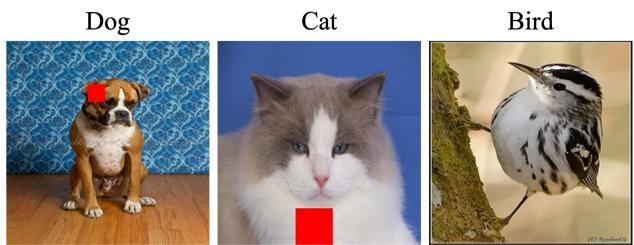  
Figure 1: Controlled marker-bias setup. A red marker is added to all dog images and a subset of cat images, while bird images remain unmarked. This creates a dog-associated cue that may act as a contextual distractor for cat predictions. In Section 4, we observe that while Shapley by nature, averages contributions across contexts, the least core incorporates stability constraints that account for the marker’s efect on the complete genuine image and the predicted label.

This phenomenon is closely related to several well-known shortcut examples in computer vision. In [RSG16], background snow can spuriously drive a wolf-vs-husky classifier. In [BVHP18], animal classifiers are shown to rely on contextual cues such as water rather than the animal itself. The Waterbirds benchmark in [LHC+21] makes this explicit by contrasting waterbird/landbird identity with background, so that background can dominate the prediction. Similarly, [SMG+20] documents situations in which a correlated context, such as the presence of a person together with a skateboard, can dominate the classifier’s reasoning. In [LWB+19], explanation maps reveal that models sometimes rely on artifacts such as source tags rather than the object. These examples suggest that a feature group can look useful on average, yet still be harmful in the important contexts one actually cares about. This is precisely the type of behavior that Shapley values may overlook through contextual averaging. This perspective motivates moving beyond purely averaging-based attributions toward stability-based notions such as the least-core [MPS79], which focus on the coalitions that matter most rather than averaging over all contexts, which is precisely the direction we pursue in this work.

## Our Contributions. Our main contributions are as follows.

1. In Section 3.1, we formalize the shortcut phenomenon through contextual distractors, feature groups that reduce the target-class score when added to the complete genuine image, even when the predicted label remains unchanged.

2. We establish conditions under which the least core captures this harmful efect and derive quantitative semivalue–least-core gap bounds under a weak average marginal monotonicity assumption. We further characterize how the gap changes as semivalues place greater weight on larger contexts.

3. Through controlled image-classification experiments and evaluations on Salient ImageNet [SF22], we compare contextual-distractor attributions across methods. We find that Shapley and other attribution methods often assign greater importance to distractors than the least core, even when the genuine image content is suficient for correct classification.

An earlier workshop version of this work appeared at the ICML 2026 NExT-Game Workshop [NYK26]. The present paper substantially extends that preliminary version by developing a general semivalue–least-core theory, deriving new gap conditions and weight-shifting results under weaker assumptions, and adding further experiments and evaluations, including on Salient ImageNet.

Related Work. Our work is related to three strands of literature. First, Shapley-valuebased explanations and, more broadly, semivalue methods such as Data Shapley, Beta Shapley, Data Banzhaf, and weighted Banzhaf have become standard tools for attribution in machine learning, including in computer vision through Shapley estimators tailored to vision transformers [LL17, SN20, KZ22, WJ23, CKL23]. Unlike this line of work, which remains averaging-based, we compare semivalue methods against a stable attribution method, which is the least-core.

Second, a growing literature studies limitations of Shapley-style explanations, including their dependence on the choice of value function, baseline values, occlusion strategy, or feature distribution, and the possibility of misleading feature-importance scores [SN20, JMB20, AJL21, HMS24, RZCZ23, BVS22, BVS24]. Our work complements these critiques by identifying a specific mechanism behind such failures in vision-like settings, namely the presence of contextual distractors.

Third, our work is related to the literature on shortcut learning, spurious correlations, and explanation-based bias detection in classifiers [AMAK22]. This work documents that models can rely on spurious cues and studies whether post hoc explanations can reveal such behavior. Our contribution is about formalizing this phenomenon through coalitional games and the notion of a contextual distractor. Furthermore, we show both theoretically and empirically when stability-based explanations can difer sharply from averaging-based ones.

Recent work has also modified Shapley-style attribution considering interactions $[ \mathrm { Z X Z ^ { + } 2 1 }$ CLC25, SKK24, BVS22], but these approaches remain within the averaging paradigm are modified Shapley values, whereas our focus is on the least-core as an alternative principle.

Finally, with respect to the least core as a viable alternative to Shapley-style explanations, works such as [YP21, $\mathrm { G L M ^ { + } 2 4 } |$ have developed computational methods for approximating it in large games. In the setting of contextual-distractor games, Kera et al. [KYN26] study the complementary problem of how least-core attributions can be computed and selected in practice. More recently, Li et al. [LLYL26] study attribution methods beyond Shapley, including the egalitarian least core, which selects the minimum- $\cdot \ell _ { 2 } { \mathrm { - n o r m } }$ allocation from the least-core set, and evaluate how well such methods identify important features.

Our contribution addresses a diferent question. We study when context-dependent feature efects create a systematic separation between Shapley/semivalue and least-core explanations in a broad non-convex regime. In particular, our theoretical guarantees apply to every allocation in the least-core set, rather than to a specific least-core selector.

## 2 Game Theory Preliminaries

In this section, we introduce some game theory preliminaries, including the concept of the least-core and semivalues. Consider a transferable-utility game $\mathcal { G } = ( N , v )$ , where N denotes th set of players and $v : 2 ^ { N } \to$ R denotes the characteristic function or value function. A payof vector is any vector $x \in \mathbb { R } ^ { | N | }$ , where $x _ { i }$ denotes the payof assigned to player $i \in N$ . For any coalition $S \subseteq N$ , we write

$$
x ( S ) : = \sum _ { i \in S } x _ { i } .
$$

When $x ( N ) = v ( N )$ , the payof vector is called eficient. See [CEW11] (Chapter 2) for more details.

The goal of an explanation method is precisely to distribute this total value among the features. In this view, each subset $S \subseteq N$ defines a coalition, and its worth is given by a scalar coalition value $v ( S )$ . Diferent explanation methods correspond to diferent solution concepts for performing this allocation/attribution.

## 2.1 Semivalues

Semivalues, introduced by Dubey, Neyman, and Weber [DNW81], generalize the Shapley and Banzhaf values. We consider symmetric semivalues, which assign equal weight to coalitions of the same size, although the total weight may vary across sizes.

Theorem 1 (Representation of semivalues [DNW81]). Let $n = | N |$ . A symmetric semivalue admits a representation

$$
\phi ^ { w } ( i ; v ) = \sum _ { k = 0 } ^ { n - 1 } w _ { k } \frac { 1 } { \binom { n - 1 } { k } } \sum _ { \underset { | S | = k } { S \subseteq N \setminus \{ i \} } } \big ( v ( S \cup \{ i \} ) - v ( S ) \big ) ,
$$

where $w _ { k } \geq 0$ and $\textstyle \sum _ { k = 0 } ^ { n - 1 } w _ { k } = 1$

Shapley value. Setting $w _ { k } = 1 / n$ for every $k = 0 , \ldots , n - 1$ recovers the Shapley value:

$$
\phi ^ { \mathrm { { S h a p } } } ( i ; v ) = \frac { 1 } { n } \sum _ { k = 0 } ^ { n - 1 } \frac { 1 } { \binom { n - 1 } { k } } \sum _ { \stackrel { S \subseteq N \setminus \{ i \} } { | S | = k } } \left( v ( S \cup \{ i \} ) - v ( S ) \right) .\tag{1}
$$

Unlike general semivalues, the Shapley value satisfies eficiency and is the unique eficient semivalue. The Banzhaf value instead assigns equal weight to every individual coalition, corresponding to $w _ { k } = { \binom { n - 1 } { k } } / 2 ^ { n - 1 }$

Group semivalues. To attribute value to a group $D \subseteq N ,$ we treat it as a single player [Sha53, FMT19]. Let $m : = | N \backslash D |$ . The resulting group semivalue is

$$
\phi _ { D } ^ { w } ( v ) = \sum _ { k = 0 } ^ { m } w _ { k } \frac { 1 } { { \binom { m } { k } } } \sum _ { { T \subseteq N \setminus D } \atop { | T | = k } } \bigl ( v ( T \cup D ) - v ( T ) \bigr ) ,\tag{2}
$$

where $w _ { k } \geq 0$ and $\scriptstyle \sum _ { k = 0 } ^ { m } w _ { k } = 1$

Sampling interpretation. The size weights $w = ( w _ { 0 } , \dots , w _ { m } )$ induce a probability distribution over contexts $T \subseteq N \setminus D$

$$
\mu _ { w } ( T ) = \frac { w _ { | T | } } { { \binom { m } { | T | } } } .
$$

Equivalently, one first samples the context size k according to w, then samples uniformly among all k-subsets of $N \backslash D$ . Writing $\Delta _ { D } ( T ) : = v ( T \cup D ) - v ( T )$ and suppressing the dependence on v, we obtain

$$
\begin{array} { r } { \phi _ { D } ^ { w } = \mathbb { E } _ { T \sim \mu _ { w } } [ \Delta _ { D } ( T ) ] . } \end{array}\tag{3}
$$

This representation naturally suggests estimating semivalues by sampling contexts and averaging their marginal contributions. Approximation guarantees have also been studied under additional structural assumptions, including submodularity and related restricted settings [BSV17, LNSWW12].

## 2.2 Least Core

The core seeks a stable payof allocation. For a payof vector x, let $\textstyle x ( S ) : = \sum _ { i \in S } x _ { i }$ denote the payof assigned to coalition $S \subseteq N$ . An allocation is eficient if $x ( N ) = v ( N )$ . It is stable if no coalition $S$ can improve upon its allocation by forming its own coalition, $\mathrm { i . e . , } x ( S ) \geq v ( S )$ . This gives the definition of the core, attributed to Shapley and Gillies [Sha55, Gil59].

Definition 1. The core of a game $\mathcal { G } = ( N , v )$ is the set

$$
\mathcal { C } ( \mathcal { G } ) : = \{ x \in \mathbb { R } ^ { | N | } : x ( N ) = v ( N ) , \ x ( S ) \geq v ( S ) \ \forall S \subseteq N \} .
$$

The core may be empty; see Example 2.22 in [CEW11]. One remedy is to impose additional structure. For supermodular (or convex) games, satisfying $v ( S \cup T ) + v ( S \cap T ) \geq v ( S ) + v ( T )$ for all $S , T \subseteq N ,$ , the core is nonempty and contains the Shapley value [Sha71]. Thus, the Shapley value is also stable in this setting, although this guarantee does not extend to general games. An alternative, introduced by $\mathrm { [ M P S 7 9 ] }$ , is to relax stability through the ε-core.

Definition 2. $F o r \varepsilon \geq 0$ , the ε-core of $\mathcal { G } = ( N , v )$ is

$$
\mathcal C _ { \varepsilon } ( \mathcal G ) : = \{ x \in \mathbb R ^ { | N | } : x ( N ) = v ( N ) , \ x ( S ) \geq v ( S ) - \varepsilon \ \forall S \subseteq N \} .
$$

Since the ε-core is nonempty for suficiently large ε, we seek the smallest relaxation admitting a feasible allocation.

Definition 3. The least-core value is $\varepsilon ^ { * } ( { \mathcal { G } } ) : = \operatorname* { m i n } \{ \varepsilon \geq 0 : { \mathcal { C } } _ { \varepsilon } ( { \mathcal { G } } ) \neq \emptyset \}$ . The least core is $\mathcal { L } \mathcal { C } ( \mathcal { G } ) : = \mathcal { C } _ { \varepsilon ^ { * } ( \mathcal { G } ) } ( \mathcal { G } )$

Computing the least core. The least-core value is obtained from the linear program

$$
\operatorname* { m i n } _ { x , \varepsilon \geq 0 } \varepsilon \quad \mathrm { s . t . } \quad x ( N ) = v ( N ) , \qquad x ( S ) \geq v ( S ) - \varepsilon \quad \forall S \subseteq N .\tag{4}
$$

An allocation $x ^ { * }$ belongs to the least core precisely when $( \boldsymbol { x } ^ { * } , \varepsilon ^ { * } )$ is feasible for this program.

In practice, one can use approximate procedures that search for highly violated coalitions. Recent works such as $\mathrm { [ Y P 2 1 , G L M ^ { + } 2 4 ] }$ pursue this direction through sampling-based and gradientbased schemes for approximately solving the least-core problem. However, coalition sampling may itself afect the resulting attribution: in contextual-distractor games, Kera et al. [KYN26] observe that sampling can make harmful features harder to identify, even when useful features remain well identified.

A separate issue is that the least core is set-valued, so practical applications require a selector to choose a particular allocation. Kera et al. [KYN26] further show that this choice can matter in practice and propose the entropic least core, a smooth selection procedure that approaches the nucleolus as its temperature parameter decreases. Our theoretical results, however, hold for every allocation in the least core and are therefore independent of the choice of selector.

## 3 Explanations in Classifications with Contextual Distractors

Shapley values have been widely used in image classification to visualize which pixels or image regions contribute most to a model’s output for a given target class.

Let X and $\mathcal { V } = \{ 1 , \ldots , K \}$ denote the image and label spaces, respectively. An image classifier is a map $f : \mathcal { X } \to \mathbb { R } ^ { K }$ , where $f ( x )$ is the vector of logits for an image $x \in \mathcal { X }$ . The predicted label is the class with the largest logit.

To associate a cooperative game with a fixed image x, let N denote its set of pixels (or features). For each $S \subseteq N$ , let $x _ { S }$ denote the masked image that retains only the features in S and replaces the remaining features with a fixed baseline. For a target class $y \in \mathcal { V }$ , define the induced value function by

$$
v _ { f } ^ { x , y } ( S ) : = [ f ( x _ { S } ) ] _ { y } .
$$

Thus, $v _ { f } ^ { x , y } ( S )$ is the logit corresponding to class y and may be negative. The target class is fixed across all coalitions, regardless of the predicted label of the masked image.

Importantly, the same feature may have diferent marginal contributions depending on the target class being explained. For notational simplicity, we fix x and y and write v instead of

$v _ { f } ^ { x , y }$ . The resulting cooperative game is denoted by $\mathcal { G } = ( N , v )$ . Our theoretical results apply to any fixed target class, although their assumptions and the resulting attribution magnitudes may difer across classes.

## 3.1 Contextual Distractors

In this section, we study how the contribution of a feature can depend strongly on the surrounding image context. Importantly, this efect is relative to the target class being explained: the same feature may suppress the output of one class while supporting another. This is particularly relevant for spurious features that become associated with a class during training. Such a feature may act as a supportive cue for the associated class, while becoming a contextual distractor when explaining another class.

We focus on the latter phenomenon. Given a fixed target class, a contextual distractor is a feature whose presence reduces the corresponding model output in the complete genuine image context. Its marginal efect may nevertheless be substantially diferent in partial contexts, which creates a distinction between attribution methods that average over contexts and core-based notions that are constrained by particular coalitions.

Definition 4 (Contextual distractor). Fix a target class y and let $D \subseteq N$ be a feature or group of features, treated as a single player. Let $C : = N \backslash D$ denote the remaining genuine image features. We call D a γ-contextual distractor, $f o r \gamma > 0$ , if

$$
\Delta _ { D } ( C ) : = v ( C \cup D ) - v ( C ) = v ( N ) - v ( C ) \leq - \gamma .
$$

Thus, adding D to the complete genuine image reduces the target-class logit $b y$ at least $\gamma$

This definition concerns only the efect of D on the complete genuine image and imposes no restrictions on its contribution in smaller contexts. In particular, a contextual distractor may initially be helpful when little genuine image content is present, but its contribution may decrease as more context is revealed, eventually becoming harmful. More generally, its contribution may remain negative throughout while becoming increasingly harmful. We study this behavior through an average marginal monotonicity assumption, which requires only that the average contribution of D is nonincreasing with context size. We observe this both in controlled experiments and on natural images from the Salient ImageNet dataset studied in Section 4, particularly in Figures 2 and 3, where we observe a near-linear decrease.

Assumption 1 (Average marginal monotonicity). Let $m = | C |$ and let T be drawn uniformly at random from $2 ^ { C }$ . For each $j = 0 , \ldots , m$ , define

$$
r _ { j } : = \mathbb { E } \big [ \Delta _ { D } ( T ) \mid | T | = j \big ] = \frac { 1 } { \binom { m } { j } } \sum _ { T \subseteq C \atop | T | = j } \Delta _ { D } ( T ) .
$$

Since $C$ is the only coalition of size $m _ { \mathit { \Pi } }$ , we have $r _ { m } = \Delta _ { D } ( C )$ . We assume that the average marginal contribution of D is nonincreasing with context size:

$$
r _ { 0 } \geq r _ { 1 } \geq \cdot \cdot \cdot \geq r _ { m } = \Delta _ { D } ( C ) .
$$

We state our main theorem below and provide some explanations surrounding it.

Theorem 2 (Semivalue–least-core gap). Let D be a γ-contextual distractor satisfying average marginal monotonicity. Let $\phi _ { D } ^ { w }$ be a symmetric semivalue and let J denote its sampled context size, so that $\Pr ( J = j ) = w _ { j }$ . Define $d _ { k } : = r _ { k - 1 } - r _ { k } \ge 0$ for $k = 1 , \ldots , m$

Then every $x \in \mathcal { L C }$ satisfies

$$
\phi _ { D } ^ { w } - x ( D ) \geq \sum _ { k = 1 } ^ { m } d _ { k } \operatorname* { P r } _ { w } ( J < k ) - \varepsilon ^ { \star } .\tag{5}
$$

In particular, a gap of at least $\delta > 0$ is guaranteed $i f$

$$
\sum _ { k = 1 } ^ { m } d _ { k } \operatorname* { P r } _ { w } ( J < k ) \geq \varepsilon ^ { \star } + \delta .
$$

Moreover, suppose that $r _ { k } > \beta$ for some $k < m ,$ where $\beta + \gamma > 0$ . Consequently, a gap of at least $\delta > 0$ is guaranteed whenever

$$
\operatorname* { P r } _ { w } ( J \geq k + 1 ) \leq 1 - \frac { \varepsilon ^ { \star } + \delta } { \beta + \gamma } .
$$

The proof of this theorem is given in Appendix A.1. Here, we give explain the conditions and consequences in detail. Firstly, the suficient condition captures the tension between the averaging behavior of semivalues and the coalitional stability of the least core. Suppose the distractor is helpful on average in smaller contexts $\left( r _ { k } > \beta > 0 \right)$ , but harmful in the complete genuine context $( r _ { m } \leq - \gamma < 0 )$ . A gap of at least $\delta > 0$ is guaranteed whenever

$$
\operatorname* { P r } _ { w } ( J \geq k + 1 ) \leq 1 - \frac { \varepsilon ^ { \star } + \delta } { \beta + \gamma } .
$$

Thus, when a semivalue places suficiently little weight on larger contexts, it may overlook the distractor’s harmful efect in the presence of the genuine image features and assign it greater attribution than the least core. The condition becomes easier to satisfy as the contrast $\beta + \gamma$ increases, and harder as the least-core value $\varepsilon ^ { \star }$ increases.

Remark 1 (Interpretation of the attribution gap). Consider a cat image that is correctly classified both with and without a distractor D, but whose cat logit decreases when D is added. Ideally, the explanation should reflect the contribution of the genuine cat features rather than assign excessive credit to the distractor.

A positive Shapley–least-core gap therefore captures the greater relative attribution assigned to the distractor by Shapley, consistent with our experimental observations.

The following lemma characterizes how the semivalue–least-core gap changes with context weighting. Under average marginal monotonicity, shifting weight toward larger contexts decreases the signed gap.

Lemma 1 (Efect of context weighting on the gap). Suppose D satisfies average marginal monotonicity, $i . e . , r _ { 0 } \ge r _ { 1 } \ge \cdot \cdot \cdot \ge r _ { m }$ . Consider two symmetric semivalues with context-size distributions w and $w ^ { \prime }$ . Suppose w′ places stochastically greater weight on larger contexts:

$$
\sum _ { j = k } ^ { m } w _ { j } ^ { \prime } \geq \sum _ { j = k } ^ { m } w _ { j } , \qquad k = 1 , \dots , m .
$$

Define their signed gaps by

$$
G _ { w } : = \phi _ { D } ^ { w } - \operatorname* { m a x } _ { x \in \mathcal { L C } } x ( D ) , \qquad G _ { w ^ { \prime } } : = \phi _ { D } ^ { w ^ { \prime } } - \operatorname* { m a x } _ { x \in \mathcal { L C } } x ( D ) .
$$

Then

$$
G _ { w } - G _ { w ^ { \prime } } = \sum _ { k = 1 } ^ { m } ( r _ { k - 1 } - r _ { k } ) \sum _ { j = 0 } ^ { k - 1 } ( w _ { j } - w _ { j } ^ { \prime } ) \geq 0 .\tag{6}
$$

The inequality is strict if both factors in at least one summand are strictly positive.

The proof of this lemma is stated in Appendix A.2. Experimental evalutions shown in Appendix B.2.2 confirm this pattern, in particular Figure 6. We next discuss the limitations of semivalues that concentrate their weights on either very large or very small contexts.

Remark 2 (Limitations of extreme context weighting). Although placing greater weight on larger contexts reduces the semivalue–least-core gap, this need not yield a more informative explanation. A feature may genuinely support the target class in smaller contexts, but become less helpful or harmful as more features are revealed. Semivalues that concentrate excessively on larger contexts may overlook this positive contribution, just as those emphasizing smaller contexts may overlook its harmful efect in the complete image. The least core, in contrast, considers all coalitions through its stability constraints rather than assigning fixed weights to diferent context sizes.

Specializations. Our results apply directly to Shapley, weighted Banzhaf, and Beta-Shapley values. For Shapley, the single-threshold condition in Theorem 2 simplifies to

$$
\operatorname* { P r } _ { \mathrm { S h } } ( J \geq k + 1 ) = \frac { m - k } { m + 1 } \leq 1 - \frac { \varepsilon ^ { \star } + \delta } { \beta + \gamma } .
$$

Furthermore, Lemma 1 shows that the signed gap is nonincreasing in the weighted Banzhaf parameter $p ,$ and nondecreasing in a and nonincreasing in b for Beta-Shapley. The corresponding corollaries and proofs are given in Appendix $\mathrm { A . 3 }$

## 4 Experiments

We investigate contextual distractors in two settings: controlled image-classification experiments and evaluations on Salient ImageNet. We compare their efects on Shapley and least-core attributions, with additional experiments reported in Appendix B.

## 4.1 Controlled Marker-bias experiments

First, we conduct a controlled marker-bias experiment to test whether the theoretical Shapley– least-core gap appears in image classification.

We construct a three-class dog/cat/bird task and train a ResNet-50 [HZRS16] classifier. As shown in $\mathrm { F i g . 2 ( a ) }$ , a red marker region D is added to 100% of dog images and 30% of cat images, while bird images have no marker. This makes D strongly associated with dog, so that it can act as a misleading contextual cue for cat images.

We first verify that D behaves as a contextual distractor for cat predictions. Each image is divided into a grid of patches, which define the player set N. The marker region $D \subseteq N$ is represented by the set of patches overlapping the red marker. We then sample coalitions $T \subseteq N \backslash$ D from the non-marker patches and compute $\Delta _ { D } ( T ) = v ( T \cup D ) - v ( T )$ . As shown in Fig. 2(b), $\Delta _ { D } ( T )$ decreases as the context becomes stronger and changes from positive to negative. Thus, the marker helps cat prediction in weak contexts but suppresses it when strong cat evidence is already present.

Finally, we compare the attribution assigned to the marker region. Images $( 2 2 4 \times 2 2 4 )$ are divided into an $8 \times 8$ grid, yielding 64 patch players. Shapley values are estimated by Monte Carlo permutation sampling using 100 random permutations per image. For each permutation, we sequentially add the 64 patches and record the change in the model output, resulting in $1 0 0 \times 6 4$ sampled output changes per image. For least-core, we avoid enumerating all coalitions and instead solve the linear program on sampled constraints [YP21]. We sample 6,400 coalitions by independently including each player with probability $p = 0 . 5$ , and add the empty and grand coalitions. Optimization is implemented with CVXPY. Neural-network evaluations are performed with PyTorch on CUDA, while the CVXPY optimization is typically run on CPU. Figure 2(c) shows that Shapley assigns larger values to D than the least-core for most images. This supports our theoretical prediction that Shapley can over-credit a contextual distractor by averaging over contexts, whereas least-core penalizes features that destabilize high-value coalitions.

Dog  

Cat  
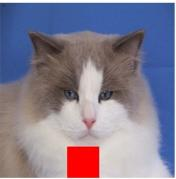  
(a)

Bird  

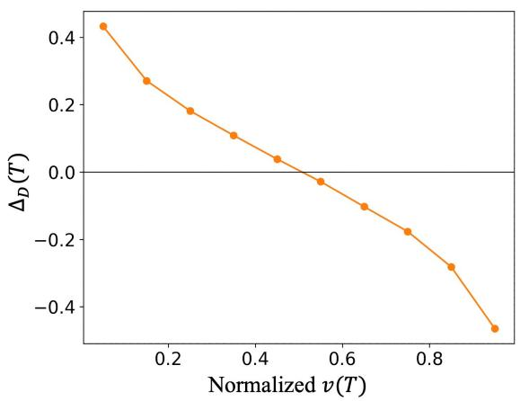  
(b)

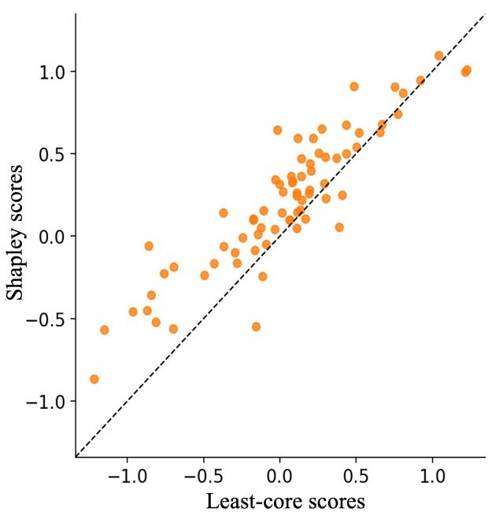  
(c)  
Figure 2: Analysis of the controlled marker-bias experiment. (a) Example images with synthetic markers. (b) For 100 cat-class images, the x-axis shows the normalized cat-class logit $v ( T )$ of masked images, where coalitions $T$ are sampled from non-marker regions. The y-axis shows the logit change caused by adding the marker region D, i.e., $v ( T \cup D ) - v ( T )$ . (c) Comparison of Shapley and least-core scores for the marker region over the same 100 cat-class images. Each point corresponds to one image, and the dashed line indicates equal attribution by the two methods.

## 4.2 Contextual Distractors in Natural Images

We next test whether the same separation occurs for naturally occurring regions rather than synthetic markers. We use class–feature pairs from Salient ImageNet [SF22] to identify candidate spurious regions in ImageNet training images. Each image is represented as a $7 \times 7$ patch game, and the target-class logit is used as the coalition value. Candidate regions are independently localized using Grounding DINO $\mathrm { [ L Z R ^ { + } 2 4 ] }$ and SAM [KMR+23], and are retained only when the resulting region D satisfies the contextual-distractor sign reversal: its mean marginal contribution is positive in weak contexts and negative in strong contexts, with the expected sign observed in at least 60% of sampled contexts in both groups. We analyze 354 contextual distractors for ResNet-50 and 108 for ViT-B/16, considering only images for which the model prediction matches the ground-truth label. Full selection and computation details are given in Appendix B.4. Further evaluations are shown in Appendix B.3.

For each candidate, we compare Monte Carlo Shapley with a sampled egalitarian leastcore allocation (Core, see Appendix B.4.3 for details), reporting total distractor attribution $\textstyle A _ { D } = \sum _ { i \in D } a _ { i }$ and mask-weighted attribution $\begin{array} { r } { A _ { \mathrm { m a s k } } = \sum _ { i = 1 } ^ { 4 9 } a _ { i } w _ { i } } \end{array}$ , where $w _ { i }$ is the fraction of patch i covered by the final mask. As controls, we generate 200 prediction-active random-SAM regions per architecture, excluding those, where the contextual-distractors are harmful enough that they change the label.

Qualitative evaluation. Figure 3 illustrates the same mechanism with two natural-image examples. In the stove image, the fire acts as the distractor D, whereas in the flagpole image, the U.S. flag serves as D. In both examples, the context-dependence plots show that $\Delta _ { D } ( T )$ decreases as the target-class logit $v ( T )$ of the surrounding context increases, changing from positive in weak contexts to negative in strong contexts. Thus, the fire and the flag do not provide uniformly useful class evidence; instead, their contributions depend on the surrounding context, consistent with the behavior of contextual distractors.

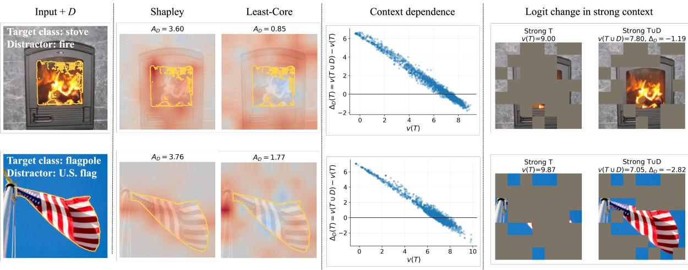  
Figure 3: Representative examples of contextual distractors. Input + D: the original input, with the distractor region D outlined in yellow. Shapley and Least-Core: patch-attribution heatmaps, where red and blue indicate positive and negative attribution, respectively; $A _ { D }$ gives the total attribution assigned to the patches in D. Context dependence: the marginal contribution $\Delta _ { D } ( T ) = v ( T \cup D ) - v ( T )$ plotted against the target-class logit $v ( T )$ obtained from the surrounding context T. Logit change in strong context: a sampled strong coalition $T$ before and after adding D, reporting the resulting target-class logit $v ( T \cup D )$ and its change $\Delta _ { D }$ from $v ( T )$

The strong-context examples further illustrate this efect. For the stove image, the surrounding context alone already yields a high stove logit of $v ( T ) = 9 . 0 0$ . Adding the fire decreases the logit to $v ( T \cup D ) = 7 . 8 0$ , giving $\Delta _ { D } = - 1 . 1 9$ . This example shows that the fire is not necessary to sustain a high stove score in this context; rather, other visual evidence, such as the stove frame, is suficient and remains informative. Nevertheless, Shapley assigns a large attribution of $A _ { D } = 3 . 6 0$ to the fire, whereas Core assigns only 0.85 and places relatively greater emphasis on the stove structure. A similar pattern appears in the flagpole example. The pole provides stable evidence for the target class, whereas adding the U.S. flag to the displayed strong context decreases the flagpole logit from 9.87 to 7.05, yielding $\Delta _ { D } = - 2 . 8 2$ . Despite this negative marginal contribution, Shapley assigns $A _ { D } = 3 . 7 6$ to the flag, compared with 1.77 under Core, which places relatively greater emphasis on the pole.

These examples show how Shapley heatmaps may overemphasize context-dependent cues such as fire or flags, even in the presence of stronger contexts. The least core assigns them less credit, placing greater emphasis on evidence that remains useful.

## 5 Limitations and Discussion

Our results highlight the least core as a complementary attribution method, particularly for computer vision, where a large semivalue–least-core gap may indicate shortcut features or contextual distractors. Its main limitation is computational: Eqn. (4) involves exponentially many coalition constraints. Although the LP can be solved in polynomial time given an eficient separation oracle via the ellipsoid method [GLS88, $\mathrm { F L S ^ { + } 1 6 } |$ , such oracles may be dificult to obtain in practice. Developing scalable least-core algorithms, through application-specific structure or heuristic separation oracles, remains an important direction for future work.

We conclude with the perspective of Hart and Mas-Colell [HMC88], who emphasize the value of studying diferent cooperative solution concepts:

A simpler solution may be easier to study and apply, which increases its usefulness. However, it is important to look at diferent solution concepts, based on diferent postulates, because they illuminate the problem from diferent angles.

In this spirit, the least core ofers a complementary perspective to the Shapley value by emphasizing coalitional stability rather than average marginal contributions.

## Acknowledgments

This research was partially supported by JST PRESTO Grant Number JPMJPR24K4, JST BOOST Program Grant Number JPMJBY24C6, JSPS KAKENHI Grant Number JP23KK0208 and 26K02996, and MEXT Supporting Pioneering Research through AI for 1,000 Discovery challenges Program (SPReAD) Japan Grant Number JPMXP1726301424.

## References

[AJL21] Kjersti Aas, Martin Jullum, and Anders Løland. Explaining individual predictions when features are dependent: More accurate approximations to shapley values. Artificial Intelligence, 298:103502, 2021.

[AMAK22] Julius Adebayo, Michael Muelly, Harold Abelson, and Been Kim. Post hoc explanations may be inefective for detecting unknown spurious correlation. In International conference on learning representations, 2022.

[BS15] Eric Balkanski and Yaron Singer. Mechanisms for fair attribution. In Proceedings of the Sixteenth ACM Conference on Economics and Computation, pages 529–546, 2015.

[BSV17] Eric Balkanski, Umar Syed, and Sergei Vassilvitskii. Statistical cost sharing. Advances in Neural Information Processing Systems, 30, 2017.

[BVHP18] Sara Beery, Grant Van Horn, and Pietro Perona. Recognition in terra incognita. In Proceedings of the European conference on computer vision (ECCV), pages 456–473, 2018.

[BVS22] Stefan Blücher, Johanna Vielhaben, and Nils Strodthof. PredDif: Explanations and interactions from conditional expectations. Artificial Intelligence, 312:103774, 2022.

[BVS24] Stefan Blücher, Johanna Vielhaben, and Nils Strodthof. Decoupling pixel flipping and occlusion strategy for consistent XAI benchmarks. Transactions on Machine Learning Research, 2024. URL: https://openreview.net/forum?id=bIiLXdtUVM.

[CEW11] Georgios Chalkiadakis, Edith Elkind, and Michael Wooldridge. Computational aspects of cooperative game theory. Morgan & Claypool Publishers, 2011.

[CGT09] Javier Castro, Daniel Gómez, and Juan Tejada. Polynomial calculation of the shapley value based on sampling. Computers & operations research, 36(5):1726–1730, 2009.

[CKL23] Ian Connick Covert, Chanwoo Kim, and Su-In Lee. Learning to estimate Shapley values with vision transformers. In International Conference on Learning Representations, 2023.

[CLC25] Wonjoon Chang, Myeongjin Lee, and Jaesik Choi. Rethinking shapley value for negative interactions in non-convex games. In The Thirteenth International Conference on Learning Representations, 2025.

[CSHB18] Aditya Chattopadhay, Anirban Sarkar, Prantik Howlader, and Vineeth N Balasubramanian. Grad-cam++: Generalized gradient-based visual explanations for deep convolutional networks. In IEEE Winter Conference on Applications of Computer Vision (WACV), pages 839–847, 2018.

[DNW81] Pradeep Dubey, Abraham Neyman, and Robert James Weber. Value theory without eficiency. Mathematics of Operations Research, 6(1):122–128, 1981.

[FLS+16] Qizhi Fang, Bo Li, Xiaoming Sun, Jia Zhang, and Jialin Zhang. Computing the least-core and nucleolus for threshold cardinality matching games. Theoretical Computer Science, 609:500–510, 2016.

[FMT19] Ramón Flores, Elisenda Molina, and Juan Tejada. The shapley value as a tool for evaluating groups: Axiomatization and applications. In Handbook of the Shapley Value, pages 255–279. Chapman and Hall/CRC, 2019.

[FWJ08] Shaheen S Fatima, Michael Wooldridge, and Nicholas R Jennings. A linear approximation method for the shapley value. Artificial Intelligence, 172(14):1673–1699, 2008.

[Gil59] Donald B. Gillies. Solutions to general non-zero-sum games. In Albert W. Tucker and R. Duncan Luce, editors, Contributions to the Theory of Games, Volume IV, number 40 in Annals of Mathematics Studies, pages 47–85. Princeton University Press, Princeton, NJ, 1959.

[GLM+24] Ian Gemp, Marc Lanctot, Luke Marris, Yiran Mao, Edgar A. Duéñez-Guzmán, Sarah Perrin, András György, Romuald Elie, Georgios Piliouras, Michael Kaisers, Daniel Hennes, Kalesha Bullard, Kate Larson, and Yoram Bachrach. Approximating the core via iterative coalition sampling. In Proceedings of the 23rd International Conference on Autonomous Agents and Multiagent Systems (AAMAS), pages 669–678. IFAAMAS, 2024.

[GLS88] Martin Grötschel, László Lovász, and Alexander Schrijver. Geometric Algorithms and Combinatorial Optimization, volume 2 of Algorithms and Combinatorics. Springer, 1988. doi:10.1007/978-3-642-97881-4.

[GZ19] Amirata Ghorbani and James Zou. Data shapley: Equitable valuation of data for machine learning. In International conference on machine learning, pages 2242–2251. PMLR, 2019.

[HMC88] Sergiu Hart and Andreu Mas-Colell. The potential of the shapley value. In Alvin E. Roth, editor, The Shapley Value: Essays in Honor of Lloyd S. Shapley, pages 127–138. Cambridge University Press, 1988. doi:10.1017/CBO9780511528446.010.

[HMS24] Xuanxiang Huang and Joao Marques-Silva. On the failings of shapley values for explainability. International Journal of Approximate Reasoning, 171:109112, 2024.

[HZRS16] Kaiming He, Xiangyu Zhang, Shaoqing Ren, and Jian Sun. Deep residual learning for image recognition. In Proceedings of the IEEE/CVF Conference on Computer Vision and Pattern Recognition (CVPR), pages 770–778, 2016.

[JMB20] Dominik Janzing, Lenon Minorics, and Patrick Blöbaum. Feature relevance quantification in explainable ai: A causal problem. In International Conference on artificial intelligence and statistics, pages 2907–2916. PMLR, 2020.

[JSC+22] Neil Jethani, Mukund Sudarshan, Ian Covert, Su-In Lee, and Rajesh Ranganath. Fast-SHAP: Real-time shapley value estimation. In International Conference on Learning Representations, 2022.

[KMR+23] Alexander Kirillov, Eric Mintun, Nikhila Ravi, Hanzi Mao, Chloe Rolland, Laura Gustafson, Tete Xiao, Spencer Whitehead, Alexander C. Berg, Wan-Yen Lo, Piotr Dollar, and Ross Girshick. Segment anything. In Proceedings of the IEEE/CVF International Conference on Computer Vision (ICCV), pages 4015–4026, October 2023.

[KYN26] Hiroshi Kera, Toshinori Yamauchi, and Sai Ganesh Nagarajan. Rethinking least-core computation in contextual-distractor games. arXiv preprint arXiv:2610.06087, 2026.

[KZ22] Yongchan Kwon and James Zou. Beta Shapley: A unified and noise-reduced data valuation framework for machine learning. In Proceedings of the 25th International Conference on Artificial Intelligence and Statistics, volume 151 of Proceedings of Machine Learning Research, pages 8780–8802. PMLR, 2022.

[LHC+21] Evan Z Liu, Behzad Haghgoo, Annie S Chen, Aditi Raghunathan, Pang Wei Koh, Shiori Sagawa, Percy Liang, and Chelsea Finn. Just train twice: Improving group robustness without training group information. In International Conference on Machine Learning, pages 6781–6792. PMLR, 2021.

[LL17] Scott M Lundberg and Su-In Lee. A unified approach to interpreting model predictions. Advances in neural information processing systems, 30, 2017.

[LLYL26] Weida Li, Zhuanghua Liu, Yaoliang Yu, and Bryan Kian Hsiang Low. Nonlinear axiomatic attribution for cooperative games. In Proceedings of the 42nd Conference on Uncertainty in Artificial Intelligence, volume 337 of Proceedings of Machine Learning Research, pages 3581–3603. PMLR, 2026.

[LNSWW12] David Liben-Nowell, Alexa Sharp, Tom Wexler, and Kevin Woods. Computing shapley value in supermodular coalitional games. In International Computing and Combinatorics Conference, pages 568–579. Springer, 2012.

[LWB+19] Sebastian Lapuschkin, Stephan Wäldchen, Alexander Binder, Grégoire Montavon, Wojciech Samek, and Klaus-Robert Müller. Unmasking clever hans predictors and assessing what machines really learn. Nature communications, 10(1):1096, 2019.

[LZR+24] Shilong Liu, Zhaoyang Zeng, Tianhe Ren, Feng Li, Hao Zhang, Jie Yang, Qing Jiang, Chunyuan Li, Jianwei Yang, Hang Su, Jun Zhu, and Lei Zhang. Grounding DINO: Marrying DINO with grounded pre-training for open-set object detection. In Computer Vision – ECCV 2024, pages 38–55. Springer, 2024. doi:10.1007/978-3-031-72970-6\_3.

[MPS79] Michael Maschler, Bezalel Peleg, and Lloyd S Shapley. Geometric properties of the kernel, nucleolus, and related solution concepts. Mathematics of operations research, 4(4):303–338, 1979.

[NYK26] Sai Ganesh Nagarajan, Toshinori Yamauchi, and Hiroshi Kera. Seeing through distractions: Stable attribution via the core. In ICML 2026 Workshop on New Frontiers in Game-Theoretic Learning (NExT-Game), 2026.

[RSG16] Marco Tulio Ribeiro, Sameer Singh, and Carlos Guestrin. “Why Should I Trust You?”: Explaining the predictions of any classifier. In Proceedings of the 22nd ACM SIGKDD International Conference on Knowledge Discovery and Data Mining, pages 1135–1144. ACM, 2016. doi:10.1145/2939672.2939778.

[RZCZ23] Jie Ren, Zhanpeng Zhou, Qirui Chen, and Quanshi Zhang. Can we faithfully represent masked states to compute shapley values on a DNN? In The Eleventh International Conference on Learning Representations, 2023. URL: https://openreview.net/forum?id= YV8tP7bW6Kt.

[SCD+17] Ramprasaath R. Selvaraju, Michael Cogswell, Abhishek Das, Ramakrishna Vedantam, Devi Parikh, and Dhruv Batra. Grad-cam: Visual explanations from deep networks via gradientbased localization. In Proceedings of the IEEE International Conference on Computer Vision (ICCV), pages 618–626, 2017.

[SF22] Sahil Singla and Soheil Feizi. Salient imagenet: How to discover spurious features in deep learning? In International Conference on Learning Representations, 2022. URL: https://openreview.net/forum?id=XVPqLyNxSyh.

[Sha53] Lloyd S. Shapley. A value for n-person games. In Harold W. Kuhn and Albert W. Tucker, editors, Contributions to the Theory of Games, Volume II, pages 307–318. Princeton University Press, 1953. doi:10.1515/9781400881970-018.

[Sha55] Lloyd S. Shapley. Markets as cooperative games. Technical Report P-629, RAND Corporation, March 1955.

[Sha71] Lloyd S. Shapley. Cores of convex games. International Journal of Game Theory, 1(1):11–26, 1971. doi:10.1007/BF01753431.

[SK10] Erik Strumbelj and Igor Kononenko. An eficient explanation of individual classifications using game theory. The Journal of Machine Learning Research, 11:1–18, 2010.

[SKK24] Kosuke Sumiyasu, Kazuhiko Kawamoto, and Hiroshi Kera. Identifying important group of pixels using interactions. In Proceedings of the IEEE/CVF Conference on Computer Vision and Pattern Recognition, pages 6017–6026, 2024.

[SMG+20] Krishna Kumar Singh, Dhruv Mahajan, Kristen Grauman, Yong Jae Lee, Matt Feiszli, and Deepti Ghadiyaram. Don’t judge an object by its context: Learning to overcome contextual bias. In Proceedings of the IEEE/CVF Conference on Computer Vision and Pattern Recognition, pages 11070–11078, 2020.

[SN20] Mukund Sundararajan and Amir Najmi. The many shapley values for model explanation. In International conference on machine learning, pages 9269–9278. PMLR, 2020.

[WJ23] Jiachen T Wang and Ruoxi Jia. Data banzhaf: A robust data valuation framework for machine learning. In International conference on artificial intelligence and statistics, pages 6388–6421. PMLR, 2023.

[YP21] Tom Yan and Ariel D. Procaccia. If you like shapley then you’ll love the core. In Proceedings of the 35th AAAI Conference on Artificial Intelligence, pages 5751–5759. AAAI Press, 2021. doi:10.1609/aaai.v35i6.16721.

[ZXZ+21] Hao Zhang, Yichen Xie, Longjie Zheng, Die Zhang, and Quanshi Zhang. Interpreting multivariate Shapley interactions in DNNs. In Proceedings of the AAAI Conference on Artificial Intelligence, 2021.

## A Missing Proofs and Additional Corollaries

## A.1 Proof of Theorem 2

Proof. Let $x \in \mathcal { L C }$ be any least-core allocation. By eficiency and the least-core constraint for $C ,$

$$
x ( D ) = v ( N ) - x ( C ) \leq v ( N ) - v ( C ) + \varepsilon ^ { \star } = r _ { m } + \varepsilon ^ { \star } .
$$

Since $\begin{array} { r } { \phi _ { D } ^ { w } = \sum _ { j = 0 } ^ { m } w _ { j } r _ { j } } \end{array}$ and $\textstyle \sum _ { j = 0 } ^ { m } w _ { j } = 1$ , we obtain

$$
\phi _ { D } ^ { w } - x ( D ) \geq \sum _ { j = 0 } ^ { m - 1 } w _ { j } ( r _ { j } - r _ { m } ) - \varepsilon ^ { \star } .
$$

Writing $d _ { \ell } : = r _ { \ell - 1 } - r _ { \ell } \ge 0$ , average marginal monotonicity gives

$$
r _ { j } - r _ { m } = \sum _ { \ell = j + 1 } ^ { m } d _ { \ell } .
$$

Exchanging the order of summation yields

$$
\phi _ { D } ^ { w } - x ( D ) \ge \sum _ { \ell = 1 } ^ { m } d _ { \ell } \operatorname* { P r } _ { w } ( J < \ell ) - \varepsilon ^ { \star } .
$$

This establishes the general gap bound.

Now suppose that $r _ { k } > \beta > 0$ for some $k < m$ . By average marginal monotonicity, $r _ { j } \ge r _ { k } > \beta$ for every $j \le k$ . Since D is a γ-contextual distractor, $r _ { m } \le - \gamma$ , and hence

$$
r _ { j } - r _ { m } > \beta + \gamma \qquad \mathrm { f o r ~ e v e r y ~ } j \leq k .
$$

For $j > k$ , monotonicity still guarantees $r _ { j } - r _ { m } \ge 0$ . Therefore,

$$
\begin{array} { r l } { \displaystyle \phi _ { D } ^ { w } - x ( D ) \geq \sum _ { j = 0 } ^ { m - 1 } w _ { j } ( r _ { j } - r _ { m } ) - \varepsilon ^ { \star } } & { } \\ { \geq ( \beta + \gamma ) \operatorname* { P r } ( J \leq k ) - \varepsilon ^ { \star } } & { } \\ { = ( \beta + \gamma ) \big ( 1 - \operatorname* { P r } ( J \geq k + 1 ) \big ) - \varepsilon ^ { \star } . } \end{array}
$$

Consequently, if

$$
\operatorname* { P r } _ { w } ( J \geq k + 1 ) \leq 1 - \frac { \varepsilon ^ { \star } + \delta } { \beta + \gamma } ,
$$

then $\phi _ { D } ^ { w } - x ( D ) \geq \delta$ for every $x \in \mathcal { L C }$

## A.2 Proof of Lemma 1

Proof. Let $d _ { k } : = r _ { k - 1 } - r _ { k } \ge 0$ . For every $j = 0 , \ldots , m$ , we have

$$
r _ { j } = r _ { m } + \sum _ { k = j + 1 } ^ { m } d _ { k } .
$$

Using $\textstyle \sum _ { j = 0 } ^ { m } w _ { j } = 1$ and exchanging the order of summation gives

$$
\phi _ { D } ^ { w } = \sum _ { j = 0 } ^ { m } w _ { j } r _ { j }
$$

$$
= r _ { m } + \sum _ { k = 1 } ^ { m } d _ { k } \sum _ { j = 0 } ^ { k - 1 } w _ { j } .
$$

The least-core term is identical for both semivalues, since the underlying game is fixed. Subtracting the analogous expression for $w ^ { \prime }$ therefore yields

$$
G _ { w } - G _ { w ^ { \prime } } = \sum _ { k = 1 } ^ { m } d _ { k } \left( \sum _ { j = 0 } ^ { k - 1 } w _ { j } - \sum _ { j = 0 } ^ { k - 1 } w _ { j } ^ { \prime } \right) .
$$

By stochastic dominance and the fact that both distributions sum to one,

$$
\sum _ { j = 0 } ^ { k - 1 } w _ { j } - \sum _ { j = 0 } ^ { k - 1 } w _ { j } ^ { \prime } = \sum _ { j = k } ^ { m } w _ { j } ^ { \prime } - \sum _ { j = k } ^ { m } w _ { j } \geq 0 .
$$

Since $d _ { k } \geq 0$ , every summand is nonnegative, proving the result.

## A.3 Consequences for classical semivalues

The general gap theorem gives explicit conditions for standard semivalues by substituting their context-size distributions. The weight-shifting lemma additionally characterizes how the gap changes when their parameters are varied.

Corollary 1 (Shapley specialization). Under the hypotheses of Theorem ${ \it 2 } ,$ the grouped Shapley value satisfies

$$
\begin{array} { l } { { \phi _ { D } ^ { \mathrm { S h } } - x ( D ) \geq \displaystyle \frac { 1 } { m + 1 } \sum _ { j = 0 } ^ { m - 1 } ( r _ { j } - r _ { m } ) - \varepsilon ^ { \star } } } \\ { { \displaystyle = \frac { 1 } { m + 1 } \sum _ { k = 1 } ^ { m } k ( r _ { k - 1 } - r _ { k } ) - \varepsilon ^ { \star } } } \end{array}\tag{7}
$$

for every $x \in \mathcal { L C }$

Moreover, suppose that $r _ { k } - r _ { m } \ge \eta > 0$ for some $k < m$ . A gap of at least $\delta > 0$ is guaranteed whenever

$$
\operatorname* { P r } _ { \mathrm { S h } } ( J \geq k + 1 ) = \frac { m - k } { m + 1 } \leq 1 - \frac { \varepsilon ^ { \star } + \delta } { \eta } .
$$

In particular, if $r _ { k } > \beta > 0$ and $r _ { m } \le - \gamma$ , it sufices that

$$
\frac { m - k } { m + 1 } \leq 1 - \frac { \varepsilon ^ { \star } + \delta } { \beta + \gamma } .
$$

Proof. For Shapley, $w _ { j } = 1 / ( m + 1 )$ for every $j .$ . Substituting these weights into Theorem 2 gives the first inequality in (7). The equality follows from

$$
r _ { j } - r _ { m } = \sum _ { \ell = j + 1 } ^ { m } ( r _ { \ell - 1 } - r _ { \ell } )
$$

by exchanging the order of summation.

Now suppose $r _ { k } - r _ { m } \ge \eta > 0$ . By average marginal monotonicity, $r _ { j } - r _ { m } \ge \eta$ for every $j \le k$ , while $r _ { j } - r _ { m } \ge 0$ for $j > k .$ . Consequently,

$$
\begin{array} { r l } & { \phi _ { D } ^ { \mathrm { S h } } - x ( D ) \geq \eta \mathrm { P r } ( J \leq k ) - \varepsilon ^ { \star } } \\ & { \qquad = \eta \bigl ( 1 - \mathrm { P r } ( J \geq k + 1 ) \bigr ) - \varepsilon ^ { \star } . } \end{array}
$$

Since Shapley samples context sizes uniformly,

$$
\operatorname* { P r } _ { \mathrm { S h } } ( J \geq k + 1 ) = \frac { m - k } { m + 1 } .
$$

The stated suficient condition follows. Finally, $r _ { k } > \beta$ and $r _ { m } \le - \gamma$ imply $r _ { k } - r _ { m } > \beta + \gamma$ , giving the last condition. □

Corollary 2 (Weighted Banzhaf specialization). Under the hypotheses of Theorem ${ \it 2 } ,$ consider the p-weighted Banzhaf semivalue, with

$$
w _ { j } ( p ) = { \binom { m } { j } } p ^ { j } ( 1 - p ) ^ { m - j } , \qquad 0 < p < 1 .
$$

For every $x \in \mathcal { L C }$

$$
\phi _ { D } ^ { \mathrm { B a n z } ( p ) } - x ( D ) \geq \sum _ { j = 0 } ^ { m - 1 } { \binom { m } { j } } p ^ { j } ( 1 - p ) ^ { m - j } ( r _ { j } - r _ { m } ) - \varepsilon ^ { \star } .\tag{8}
$$

Furthermore:

(a) Monotonicity in $p .$ The actual signed gap $G _ { \mathrm { B a n z } ( p ) }$ is nonincreasing in $p .$

(b) Concentration on smaller contexts. $I f p \leq 1 / ( m + 1 )$ , then

$$
G _ { \mathrm { B a n z } ( p ) } \geq G _ { \mathrm { S h } } .
$$

Thus, any suficient condition establishing a δ-gap for Shapley also establishes a δ-gap for these weighted Banzhaf values.

Standard Banzhaf corresponds to $p = 1 / 2$

Proof. The bound follows from Theorem 2 by substituting the binomial size weights.

For (a), diferentiating the attribution gives

$$
\frac { d } { d p } \phi _ { D } ^ { \mathrm { B a n z } ( p ) } = m \sum _ { j = 0 } ^ { m - 1 } { \binom { m - 1 } { j } } p ^ { j } ( 1 - p ) ^ { m - 1 - j } ( r _ { j + 1 } - r _ { j } ) \le 0 .
$$

Since the least-core term does not depend on $p ,$ the signed gap is also nonincreasing.

For (b), when $p \leq 1 / ( m + 1 )$ , the sequence $j \mapsto w _ { j } ( p )$ is nonincreasing because

$$
\frac { w _ { j + 1 } ( p ) } { w _ { j } ( p ) } = \frac { m - j } { j + 1 } \frac { p } { 1 - p } \le 1 .
$$

A nonincreasing probability distribution on $\{ 0 , \ldots , m \}$ is stochastically dominated by the uniform distribution on these sizes. Lemma 1 therefore gives the desired comparison with Shapley. □

Corollary 3 (Monotonicity for Beta-Shapley). Under the hypotheses of Theorem ${ \it 2 } ,$ consider Beta-Shapley with parameters $a , b > 0$ and size weights

$$
w _ { j } ^ { ( a , b ) } = { \binom { m } { j } } { \frac { \mathrm { B e t a } ( j + b , m - j + a ) } { \mathrm { B e t a } ( b , a ) } } , \qquad j = 0 , \ldots , m .
$$

Its signed gap satisfies

$$
G _ { a , b } \geq \sum _ { j = 0 } ^ { m - 1 } w _ { j } ^ { ( a , b ) } ( r _ { j } - r _ { m } ) - \varepsilon ^ { \star } .
$$

Moreover:

(a) For fixed $b , G _ { a , b }$ is nondecreasing in a.

(b) For fixed $a , G _ { a , b }$ is nonincreasing in b.

In particular, increasing the relative weight on larger contexts decreases the signed gap. Shapley is recovered when $a = b = 1$

Proof. The gap bound is an immediate application of Theorem 2.

For the monotonicity statements, use the beta-binomial representation

$$
\Theta _ { a , b } \sim \mathrm { B e t a } ( b , a ) , \qquad J _ { a , b } \mid \Theta _ { a , b } = \theta \sim \mathrm { B i n } ( m , \theta ) .
$$

For fixed $b ,$ increasing a shifts $\Theta _ { a , b }$ stochastically downward and hence shifts $J _ { a , b }$ toward smaller context sizes. For fixed a, increasing b shifts both distributions stochastically upward. Both conclusions now follow from Lemma 1. □

## B Additional Experimental Results

## B.1 Epsilon evaluation for explanation methods

We evaluate explanation methods using a ResNet-50 classifier [HZRS16] on 100 ImageNet test images.   
Each image is resized to $2 2 4 \times 2 2 4$ and divided into an $8 \times 8$ grid, yielding 64 patch players.

For a fixed attribution vector $x ,$ we define the epsilon value as the worst coalition deficit:

$$
\boldsymbol { \epsilon } ( \boldsymbol { x } ) = \operatorname* { m a x } _ { \boldsymbol { S } \subseteq N } \left( \boldsymbol { v } ( \boldsymbol { S } ) - \boldsymbol { x } ( \boldsymbol { S } ) \right) ,
$$

where $\textstyle x ( S ) = \sum _ { i \in S } x _ { i }$ . In practice, this maximum is approximated over 4,096 sampled coalitions.

For Grad-CAM [SCD+17] and Grad-CAM++ [CSHB18], the explanation methods do not directly produce an epsilon value. We therefore convert each heat map into a patch-level allocation x by averaging the heat map within each patch. Since these heat maps do not necessarily satisfy the eficiency constraint, we rescale x so that

$$
\sum _ { i } x _ { i } = v ( N ) .
$$

We then evaluate $\epsilon ( x )$ by sampled coalitions.

For Monte Carlo Shapley, we compute $\epsilon ( x )$ as a post-hoc evaluation of the resulting attribution vector. Shapley values are estimated by Monte Carlo permutation sampling using 64 random patch orderings per image $6 4 \times 6 4 = 4 , 0 9 6$ sampled output changes per image).

For least-core, we use the same 64 patch players and solve the least-core optimization over 4,096 sampled coalition constraints. We directly report the optimized ϵ returned by the least-core solver. Thus, the least-core epsilon is not a post-hoc evaluation of a generated heat map, but the objective value obtained during the least-core optimization.

Lower epsilon indicates that the explanation better satisfies the sampled core constraints and is therefore more stable from a coalitional perspective. Table 1 summarizes the results.

Table 1: Epsilon values on 100 ImageNet test images. Lower is better.
<table><tr><td>Grad-CAM</td><td> $\mathrm { { G r a d { - } C A M { + } { + } } }$ </td><td>Shapley-MC</td><td>Least-Core</td></tr><tr><td> $\epsilon \ ( \mathrm { m e a n } \pm \mathrm { s t d } )$   $0 . 6 9 9 0 \pm 0 . 1 4 4 5$ </td><td> $0 . 6 8 9 9 \pm 0 . 1 3 9 7$ </td><td> $0 . 6 8 5 1 \pm 0 . 1 6 3 7$ </td><td> $\mathbf { 0 . 5 8 2 2 \pm 0 . 1 3 8 9 }$ </td></tr></table>

## B.2 Controlled marker experiments

## B.2.1 Main attribution comparison

We evaluate the contextual-distractor efect using the controlled dog/cat/bird task in Figure 4. A red marker is added to all dog images and to 30% of cat images, while bird images remain unmarked. We train ResNet-50 and ViT-B/16 classifiers and use the cat-class logit as the coalition value. Images are divided into an $8 \times 8 ~ \mathrm { g r i d }$ , and D consists of the patches overlapping the marker.

ViT  
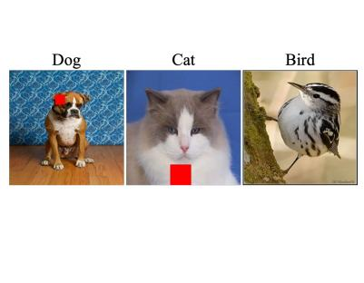

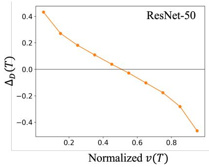

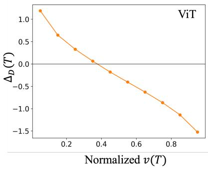  
Figure 4: Controlled marker-bias experiment. Left: representative inputs. The marker is correlated with the dog class and can therefore mislead cat predictions. Middle and right: for both ResNet-50 and $\mathrm { V i T - B } / 1 6$ , the marginal contribution $\Delta _ { D } ( T ) = v ( T \cup D ) - v ( T )$ decreases with the strength of the non-marker context. The marker helps in weak contexts but suppresses the cat logit in strong contexts.

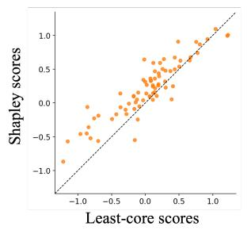

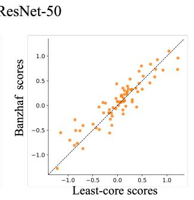

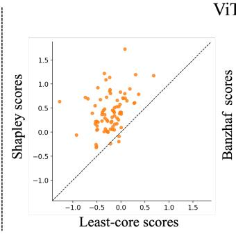

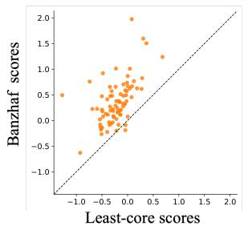  
Figure 5: Per-image marker attribution for ResNet-50 (left) and ViT-B/16 (right). We compare the Shapley and Banzhaf $( p = 0 . 5 )$ scores with the corresponding least-core scores. Each point represents one retained image, and the dashed line indicates equal attribution; points above the line receive more attribution from the semivalue than from the least-core.

We characterize the contextual behavior of D on correctly classified, marker-bearing cat images. For each image, we sample 2,000 coalitions $T \subseteq N \setminus D$ by including each non-marker patch independently with probability 0.5, and additionally evaluate the full non-marker context. We retain 100 images per backbone for which the mean marginal contribution $\Delta _ { D } ( T ) = v ( T \cup D ) - v ( T )$ is positive in the bottom 20% of contexts ranked by $v ( T )$ and negative in the top 20%. On these selected cohorts, the mean lowand high-context contributions are 0.351 and −0.373 for ResNet-50, and 0.917 and −1.331 for ViT-B/16. Thus, the marker helps cat prediction when little cat evidence is visible, but suppresses it once the surrounding evidence becomes strong.

We compare the attribution assigned to the marker by Shapley, Banzhaf, and the least-core. Shapley is estimated using 100 random permutations per image, giving 100 marginal samples for each of the 64 patches. Banzhaf likewise uses 100 marginal samples per patch. Its context-size weights are

$$
\alpha _ { k } ( p ) = { \binom { | N | - 1 } { k } } p ^ { k } ( 1 - p ) ^ { | N | - 1 - k } , \qquad k = 0 , \ldots , | N | - 1 .
$$

Larger p places more weight on larger contexts. We use $p = 0 . 5$ , which includes each other patch independently with equal probability and recovers the standard Banzhaf value. For the least-core, we sample 6,400 constraints by including each patch independently with probability 0.5, add the empty and grand coalitions, and solve the resulting linear program with CVXPY. Model evaluations use $\mathrm { P y }$ Torch on CUDA and the linear program is solved on CPU. We report the mean attribution over patches with at least 40% of their area overlapping the marker. This yields 74 ResNet-50 images and 80 ViT-B/16 images.

Figure 5 shows the per-image comparisons, and Table 2 summarizes their means. Both semivalues assign more attribution to the distractor than the least-core on average. The separation is pronounced for ViT-B/16 and is also observed for Shapley on ResNet-50, whereas the ResNet-50 Banzhaf gap is smaller. These results support the predicted averaging efect: a marker that appears useful across sampled contexts can receive positive average credit even though it is harmful when the surrounding cat evidence is strong. The smaller Banzhaf gap for ResNet-50 may partly reflect the diferent context-size distributions sampled by Banzhaf and Shapley; we examine the efect of this sampling diference in the following section.

Table 2: Mean marker-patch attribution. Each Gap column reports the corresponding semivalue minus the least-core attribution; a positive value indicates that the semivalue assigns more credit to the marker.
<table><tr><td>Model</td><td>Least-core</td><td>Shapley</td><td>Gap</td><td>Banzhaf  $( p = 0 . 5 )$ </td><td>Gap</td></tr><tr><td>ResNet-50</td><td>0.041</td><td>0.220</td><td>0.179</td><td>0.076</td><td>0.035</td></tr><tr><td>ViT-B/16</td><td>-0.221</td><td>0.419</td><td>0.639</td><td>0.355</td><td>0.576</td></tr></table>

## B.2.2 Efect of context weighting on the group semivalue gap

We next examine how the distribution over context sizes afects the semivalue–least-core gap. This experiment treats the entire marker region D as a single player and directly estimates its group marginal

$$
\Delta _ { D } ( T ) = v ( T \cup D ) - v ( T ) , \qquad T \subseteq N \setminus D .
$$

This is distinct from summing the individual semivalue attributions of the marker patches. For a context-size distribution α, we estimate

$$
\phi _ { \alpha } ^ { \mathrm { g r o u p } } ( D ) = \mathbb { E } _ { T \sim \mu _ { \alpha } } [ \Delta _ { D } ( T ) ]
$$

and compare it with $\begin{array} { r } { x ^ { * } ( D ) = \sum _ { i \in D } x _ { i } ^ { * } } \end{array}$ from the least-core solution of the original patch game. We report the signed gap

$$
G _ { \alpha } : = \phi _ { \alpha } ^ { \mathrm { g r o u p } } ( D ) - x ^ { * } ( D ) ,
$$

so that $G _ { \alpha } > 0$ means that the group semivalue assigns more credit to the marker than the least-core does.

Context-weighting families. We use the same 100 marker-bearing cat images per backbone as in the preceding experiment and vary the context-size distribution while leaving the model, masking procedure, baseline, and least-core allocation fixed. For the p-weighted Banzhaf family, each patch in $N \backslash D$ is included independently with probability

$$
p \in \{ 0 . 2 , 0 . 3 5 , 0 . 5 , 0 . 6 5 , 0 . 8 \} .
$$

Thus, larger p shifts probability mass toward larger contexts, while $p = 0 . 5$ gives the standard Banzhaf value. We also consider the Beta-Shapley family with

$$
( a , b ) \in \{ ( 4 , 1 ) , ( 2 , 1 ) , ( 1 , 1 ) , ( 1 , 2 ) , ( 1 , 4 ) \} ,
$$

whose expected normalized context size is $b / ( a + b ) ; ( a , b ) = ( 1 , 1 )$ recovers the group Shapley value. As a reference baseline, we also estimate the group Shapley value independently rather than identifying it only with the $( a , b ) = ( 1 , 1 )$ Beta-Shapley setting. Each group semivalue, including this group Shapley baseline, is estimated from 3,200 marginal samples per image. Since one marginal sample evaluates both T and $T \cup D$ , this matches the nominal 6,400 coalition-evaluation budget used for the least-core constraints.

Results. As shown in Figure 6, increasing the weight on large contexts consistently lowers the signed gap. For ResNet-50, the mean weighted-Banzhaf gap decreases from 0.457 at $p = 0 . 2$ to 0.243, 0.091, −0.030, and −0.145 as p increases. For ViT-B/16, it decreases from 1.742 to 1.208, 0.610, 0.132, and −0.093. The Beta-Shapley sweep shows the same behavior: moving from $( a , b ) = ( 4 , 1 )$ to (1, 4) changes the gap from 0.479 to −0.171 for ResNet-50 and from 1.331 to 0.069 for ViT-B/16. The independently estimated group Shapley gaps are 0.138 and 0.703, respectively, consistent with the corresponding (1, 1) Beta-Shapley estimates.

Weighted Banzhaf  
Weighted Banzhaf  
Beta-Shapley  
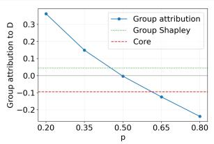

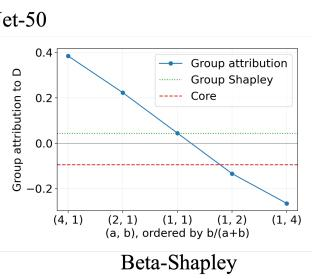

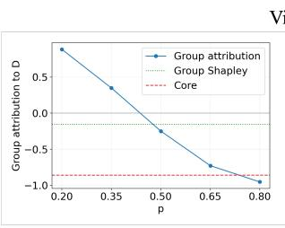

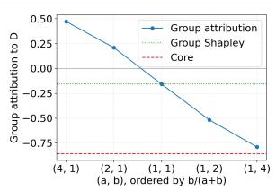  
Figure 6: Efect of context-size weighting on the group attribution to the marker region D. The left two panels show ResNet-50 and the right two show ViT-B/16. Within each pair, the first panel varies p for the weighted-Banzhaf family, and the second shifts the Beta-Shapley parameters from small-context weighting (4, 1) to large-context weighting (1, 4). The solid blue curves show the group semivalue obtained at each parameter setting. The dotted green and dashed red lines show the independently estimated group Shapley baseline and the least-core attribution, respectively.

Table 3: Shapley and sampled egalitarian least-core attribution for contextual distractors and prediction-active random-SAM controls. Gap is Shapley minus Core, and $\mathrm { S } > \mathrm { C }$ is the fraction of regions for which the Shapley attribution exceeds the Core attribution.
<table><tr><td>Model</td><td>Region</td><td>Outcome</td><td>Shapley</td><td>Core</td><td>Gap</td><td> $\mathrm { S } > \mathrm { C }$ </td></tr><tr><td rowspan="3">ResNet-50</td><td>Contextual distractor</td><td> $A _ { D }$ </td><td>2.338</td><td>1.262</td><td>1.076</td><td>82.5%</td></tr><tr><td></td><td> $A _ { \mathrm { m a s k } }$ </td><td>1.528</td><td>0.873</td><td>0.655</td><td>78.8%</td></tr><tr><td>Random-SAM control</td><td> $A _ { D }$   $A _ { \mathrm { m a s k } }$ </td><td>0.614 0.434</td><td>0.838 0.579</td><td>-0.224 -0.144</td><td>33.1% 33.1%</td></tr><tr><td rowspan="4">ViT-B/16</td><td>Contextual distractor</td><td> $A _ { D }$ </td><td>2.177</td><td></td><td></td><td>80.6%</td></tr><tr><td></td><td> $A _ { \mathrm { m a s k } }$ </td><td>1.435</td><td>1.645 1.112</td><td>0.532 0.323</td><td>76.9%</td></tr><tr><td>Random-SAM control</td><td> $A _ { D }$ </td><td>1.810</td><td>1.959</td><td>-0.149</td><td>40.5%</td></tr><tr><td></td><td> $A _ { \mathrm { m a s k } }$ </td><td>1.188</td><td>1.295</td><td>-0.107</td><td>39.5%</td></tr></table>

These results agree with the mechanism in Lemma 1, i.e., placing mass toward larger contexts increases the chance of evaluating D where it is harmful. Its group attribution therefore decreases toward the least-core attribution, reducing the positive over-credit gap. At the largest weights the signed gap can cross zero, so the result should not be read as saying that the absolute discrepancy must decrease indefinitely; rather, increasing large-context weight systematically removes the positive semivalue over-credit predicted for contextual distractors.

## B.3 Contextual Distractors in Natural Images

We provide additional evaluations for the experiments described in Section 4 for the Salient ImageNet dataset.

Quantitative evaluation. Table 3 shows a clear contrast between the two region types. On contextual distractors, Shapley assigns systematically more credit than Core: the mean $A _ { D }$ gap is 1.076 for ResNet-50 and 0.532 for ViT-B/16, with positive gaps in 82.5% and 80.6% of candidates, respectively. The conclusion is unchanged under mask weighting. In contrast, the random-SAM controls show the opposite tendency: the Core attribution is larger than the Shapley attribution on average for both architectures and for both $A _ { D }$ and $A _ { \mathrm { m a s k } }$ . Accordingly, the mean Shapley–Core gaps are negative for the controls, whereas they are positive for the contextual distractors.

These results indicate that the positive Shapley–Core gap is enriched among regions exhibiting context-dependent sign reversal and is not a generic property of localized regions that afect the prediction.

The same pattern appears for both architectures and for both region summaries.

## B.4 Details of the Natural-Image Experiments

## B.4.1 Data, preprocessing, and cooperative game

We use Salient ImageNet class–feature pairs and their corresponding ImageNet training images. Both RGB images and Salient ImageNet masks are resized to 256 pixels and center-cropped to 224 × 224 pixels. Each image is divided into a $7 \times 7$ grid, yielding 49 players. For a coalition $S \subseteq N$ , patches outside S are replaced by the fixed ImageNet RGB mean (0.485, 0.456, 0.406) before model normalization. The game value is defined as the target-class logit,

$$
v ( S ) = f _ { c } ( x _ { S } ) .\tag{9}
$$

We evaluate torchvision ResNet-50 with IMAGENET1K\_V2 weights and ViT-B/16 with IMAGENET1K\_V1 weights.

## B.4.2 Contextual-distractor selection

Spurious-feature screening. Each Salient ImageNet class–feature pair is annotated by five MTurk workers [SF22]. We retain features that a majority of workers judge not to be part of the main object. The workers’ free-text descriptions are used as textual prompts for the localization stage described below.

Initial sign-reversal search. The Salient ImageNet soft mask is binarized at its image-specific 90th percentile, and masks covering more than 25% of the image are excluded. A patch is assigned to a preliminary distractor region D when at least 20% of its area overlaps the binary mask.

For each candidate region, we sample contexts $T \subseteq N \setminus D$ by first sampling the context size uniformly and then sampling a subset of that size uniformly. We evaluate the region marginal contribution

$$
\Delta _ { D } ( T ) = v ( T \cup D ) - v ( T ) .\tag{10}
$$

Let τ denote the 70th percentile of the sampled v(T) values, and define

$$
\begin{array} { r } { \mathcal { T } _ { \mathrm { w e a k } } = \{ T : v ( T ) < \tau \} , } \end{array}\tag{11}
$$

$$
\mathcal { T } _ { \mathrm { s t r o n g } } = \{ T : v ( T ) \geq \tau \} .\tag{12}
$$

We retain candidates whose mean marginal contribution is positive in weak contexts and negative in strong contexts,

$$
\mathbb { E } \left[ \Delta _ { D } ( T ) \mid T \in \mathcal { T } _ { \mathrm { w e a k } } \right] > 0 ,\tag{13}
$$

$$
\begin{array} { r } { \mathbb { E } \left[ \Delta _ { D } ( T ) \mid T \in \mathcal { T } _ { \mathrm { s t r o n g } } \right] < 0 , } \end{array}\tag{14}
$$

while also requiring the corresponding sign to occur in a majority of sampled contexts in each group.

Independent localization and re-evaluation. To obtain an independent localization of the candidate feature, we use Grounding DINO [LZR+24] with the worker-provided textual prompt and refine the resulting regions using SAM [KMR+23]. We retain regions that suficiently agree with the Salient ImageNet mask and exclude excessively large masks. The distractor region D is then redefined from the resulting agreement mask, and the context-dependent sign-reversal test is repeated.

The same localization procedure is used for both architectures. For each model, the sign-reversal criterion is evaluated using that model’s own coalition values, allowing the resulting contextual-distractor sets to difer across architectures.

## B.4.3 Shapley and sampled egalitarian least-core computation

Shapley values are approximated using random player permutations. For player $i ,$

$$
\widehat { \phi } _ { i } = \frac { 1 } { R } \sum _ { r = 1 } ^ { R } \left[ v ( P _ { i } ^ { ( r ) } \cup \{ i \} ) - v ( P _ { i } ^ { ( r ) } ) \right] ,\tag{15}
$$

where $P _ { i } ^ { ( r ) }$ contains the players preceding i in permutation $r _ { \cdot }$

For the least-core approximation, we sample coalition constraints by including each player independently with probability 0.5 and explicitly include the empty and grand coalitions. We shift the game as

$$
v ^ { \prime } ( S ) = v ( S ) - v ( \emptyset ) ,\tag{16}
$$

and solve

$$
\operatorname* { m i n } _ { x , \varepsilon } \quad \varepsilon\tag{17}
$$

$$
{ \mathrm { s . t . } } \quad \sum _ { i \in N } x _ { i } = v ^ { \prime } ( N ) ,\tag{18}
$$

$$
\sum _ { i \in S } x _ { i } + \varepsilon \geq v ^ { \prime } ( S ) , \qquad S \in { \mathcal { C } } _ { \mathrm { s a m p l e } } ,\tag{19}
$$

$$
\varepsilon \geq 0 .\tag{20}
$$

After obtaining $\varepsilon ^ { \star }$ , we select an egalitarian least-core allocation by minimizing

$$
\| { \boldsymbol { x } } \| _ { 2 } ^ { 2 }\tag{21}
$$

under the same coalition and eficiency constraints with ε fixed to $\varepsilon ^ { \star }$ up to numerical tolerance. We do not impose nonnegativity on the allocation. Here and in Section 4.2, Core refers to this sampled egalitarian least-core allocation.

## B.4.4 Prediction-active random-SAM controls

We construct a separate control cohort for each architecture. Candidate images are drawn from the same ImageNet pool after excluding the selected contextual-distractor images. Randomly placed boxes, with sizes matched to the contextual-distractor region distribution, are provided to SAM to obtain control regions. Neither Salient ImageNet masks nor Grounding DINO are used to determine the control location.

To avoid prediction-irrelevant regions, we retain only controls whose mean absolute marginal contribution exceeds the 10th percentile of the corresponding contextual-distractor distribution, yielding thresholds of 0.60 logit units for ResNet-50 and 0.90 for ViT-B/16. Regions satisfying the contextual sign-reversal criterion are excluded. Neither Shapley nor Core attribution is used during control selection. The selected controls are evaluated using the same Shapley and sampled least-core procedures as the contextual distractors.

## B.4.5 Scope of the comparison

The natural contextual-distractor cohort is selected using human annotations, independent localization, and a context-dependent sign-reversal criterion. The reported attribution results therefore characterize this selected population rather than ImageNet images in general. Furthermore, because the contextualdistractor and random-SAM cohorts are constructed using diferent selection criteria, their comparison should be interpreted as an empirical comparison between the resulting cohorts rather than as a causal efect of sign reversal alone.