# Honeycomb-Surfels: Compact Hexagonal Primitives for Eficient Scene Rendering and Reconstruction

Prakhar Kaushik\* Soumava Paul\* Alan Yuille

CCVL, Johns Hopkins University

Project page: https://honeycomb-surfels.github.io/ • Code: https://github.com/honeycomb-surfels/hexels

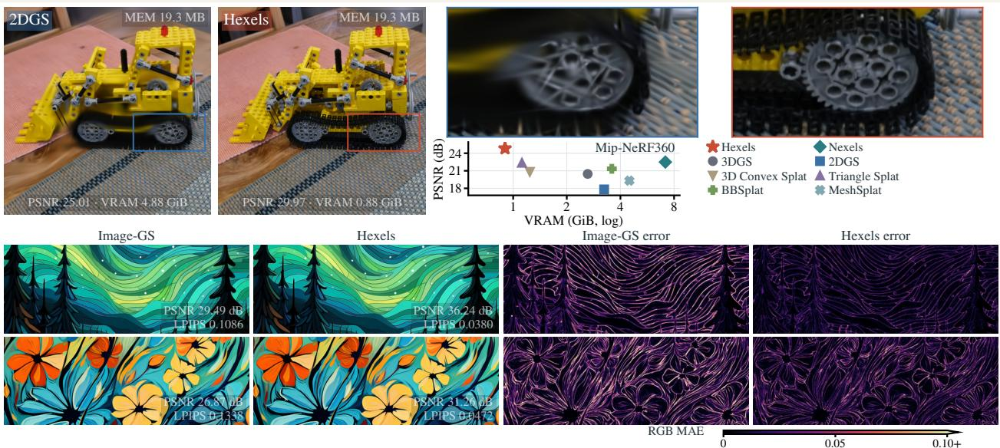  
Figure 1. Hexels capture finer details using less memory. Hexels are planar surface elements that combine hexagonal support with a first-order spatial color field and capitalize on structural redundancy. Top: At the same model memory (MEM), Hexels shows a gain of 4.96 dB over 2DGS with 5.51× less peak VRAM (0.88 versus 4.88 GiB). Graph: Hexels outperform (mean PSNR) all other methods while requiring significantly less memory on 9 scenes in Mip-NeRF360 (Table 2). Bottom: Hexels can also efficiently represent images and outperform Image-GS with the same number of primitives (10k).

## Abstract

Novel view synthesis and 3D reconstruction have advanced rapidly with radiance fields and splatting, yet their memory and computational demands limit their use in resourceconstrained settings. We introduce Hexels: novel planar hexagonal surface elements with a first-order spatial color field for eficient 3D scene and 2D image representation. Hexels exploit locally planar regions with smoothly varying appearance using fewer, larger primitives. Their hexagonal support provides an area- and boundary-eficient domain, while the local color field captures appearance variation within each primitive. Across 34 scenes, Hexels improve PSNR over memory-matched 2DGS by 4.53–7.38 dB across datasets while requiring lower training VRAM. We further ablate Hexels by showing that per primitive, Hexels outperform 2DGS by upto 4.74 dB while using lower training VRAM and having 2.31× faster FPS. Even in unconstrained settings, Hexels ofers complementary quality-memory trade-ofs. For eficient 3D surface reconstruction, Hexels reduce error by 28.9% compared with memory-matched 2DGS across 15 DTU scans. On 6 Tanks and Temples surface scenes, Hexels achieves the highest mean F1 among compared methods (34.38%, versus 31.72% for 2DGS). We further also show that Hexels, as a general primitive, improves 2D image representation over Image-GS. Hexels push the Pareto frontier on the quality-eficiency trade-of of surface-aligned primitives.

Keywords: Surface elements, hexagonal primitives, novel view synthesis, surface reconstruction, image representation

## 1 Introduction

Novel view synthesis and 3D reconstruction have progressed rapidly, from neural radiance fields [25] to explicit Gaussian primitives that render in real time [18] to surface aligned planar primitives like 2DGS [14], and Triangle Splatting [13]. These methods difer in geometry, but all face the same question: how much ofthe scene can one primitive represent, and at what cost? This has led to the search for an overarching universal primitive which is eficient, expressive, and retains high geometric fidelity. This is even more important in resource-constrained settings, where eficiency includes not only rendering speed and model size but also the memory required during training. Previous methods have often traded one aspect for another. For example, conventional Gaussian and triangle splats typically represent one view-conditioned color per primitive, so spatial variation emerges through many overlapping elements, leading to large overdraw. Others like BBSplat [33] add per-primitive textures, or use shared neural appearance fields like NeST [39] and Nexels [30]. These methods increase per-element capacity, but move complexity into textures, grids, or decoders. In contrast, we target the entire quality–eficiency trade-of at the primitive itself. For resource-constrained settings, this eficiency includes not only rendering speed and model size, but also the memory required during training.

At constrained representation budgets, we seek a balance between geometric fidelity and appearance expressivity. Since agreement with training images alone does not guarantee accu rate geometry [36], we therefore target both surface reconstruction accuracy and novel-view rendering quality within a compact surface primitive.

We are motivated by the idea that natural images and scenes are highly structured: large regions are often locally planar with smoothly varying appearance. An eficient surface primitive should therefore be able to exploit this underlying structure, wherever possible, and do so in a compact and self-contained manner.

We introduce Hexels, planar surface elements that combine a hexagonal support with a first-order spatial color field. Natural scenes contain large regions that are locally simple in geometry and appearance; a Hexel can represent such a region with one large primitive, including smooth color variation within it, while smaller Hexels capture boundaries, curvature, and fine detail. This directly targets redundancy in surface-aligned splatting: rather than approximating structured regions with many overlapping, spatially constant primitives, Hexels increase what each primitive can represent.

Why a hexagon? Regular hexagons tile a plane without gaps and cover more area for the same boundary length than triangles or squares (other tileable primitives) [9] (discussed in Appendix G). When combined with the local color field, each Hexel can model both the region itself and smooth appearance variation within it. In 3D, Hexels are rendered as oriented surface elements using perspective-correct ray-plane intersection and depth-ordered blending. The same primitive can be placed directly in the image plane for 2D image representation. Thus, Hexels provide a single compact primitive family for novel-view synthesis, surface reconstruction, and image representation, without requiring texture maps, neural appearance fields, or decoding networks.

We evaluate Hexels for 3D novel view synthesis (memorymatched, primitive-matched, and unconstrained), surface reconstruction, and 2D image representation. We primarily use 34 scenes across DTU [16], Tanks and Temples [21], and Mip NeRF360 [1]. At matched model sizes, Hexels improves PSNR over 2DGS by 4.53–7.38 dB with upto 3.6× less VRAM requirements and over Triangle Splatting by 1.70–2.90 dB, with up to 1.87× higher rendering FPS (Table 2). At matched primitive budgets, Hexels improves PSNR over 2DGS by up to 4.74 dB, using 1.76–1.95× less model size and upto 7× less VRAM, and renders up to 2.31× faster (Table 3). Under unrestricted model sizes, Hexels still improve PSNR over 2DGS by 0.90 dB on both Tanks and Temples and DTU, while rendering 1.37× and 2.26× faster, respectively. For surface reconstruction, Hexels achieves 0.978 mm mean Chamfer distance over 15 DTU scans, versus 1.375 mm for 2DGS at the same model-memory budget (Table 5). On 6 Tanks and Temples surface scenes, mean F1 for Hexels is 34.38%, versus 31.72% for 2DGS (Table 6). Hexels also converges faster (Figure 4) and improves 2D image representation over Image-GS [40] (Table 1).

## Contributions.

• Compact Hexel primitive. We introduce Hexels, compact, self-contained surface primitives for resource-constrained rendering and reconstruction, combining eficient hexagonal support with a first-order local color field without textures, feature grids, neural decoders, or baking.

• Strong quality-eficiency trade-ofs. Under matched primitive budgets, Hexels outperform 2DGS by 2.08–4.74 dB while using 2× less learned storage per primitive, upto 7× lower peak training VRAM, and up to 2.31× higher rendering throughput. Under matched model-memory budgets, they improve PSNR by 4.53–7.38 dB while using upto 3.6× lower peak training VRAM and rendering up to 1.87× faster.

• One primitive across tasks. The same representation applies across novel-view synthesis, surface reconstruction, and 2D image representation, achieving strong performance and eficiency without changing the underlying primitive.

## 2 Related Work

Novel view synthesis and 3D reconstruction have improved rapidly since NeRF [25], which represents scenes as neural fields of density and view-dependent radiance. Feature grids and explicit encodings reduced their training and rendering cost [6, 26], while 3DGS [18] replaced neural fields with explicit anisotropic Gaussian primitives, enabling real-time rasterization. 2DGS [14] further replaced volumetric Gaussians with planar surfels, substantially improving surface reconstruction. These advances made rendering faster and geometry more accurate, but eficient representation requires more: high quality together with low model storage, low training VRAM, few primitives, and high FPS. Appendix H discusses these trade-ofs.

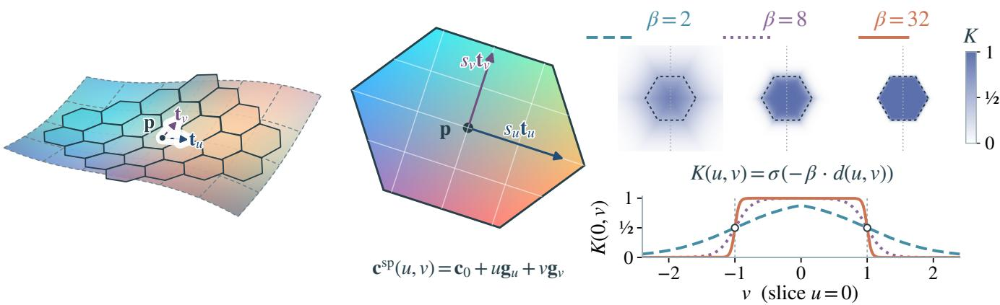  
Figure 2. A Hexel is a planar patch with a soft hexagonal boundary; together, Hexels approximate a 3D surface (left). Its center �, orthogonal unit tangents $\mathbf { t } _ { u } , \mathbf { t } _ { v }$ , and scales $s _ { u } , s _ { v }$ determine its position, orientation, and size (center). Color varies linearly from $\mathbf { c } _ { 0 }$ at the center, with RGB gradients $\mathbf { g } _ { u } , \mathbf { g } _ { v }$ along local coordinates �, �. � (spatial weight) controls the patch’s influence: increasing sharpness $\beta$ sharpens the boundary (right). The tileable hexagonal support and local linear color field jointly exploit structure in scene geometry and appearance, allowing each Hexel to represent larger coherent regions while retaining a controllably sharp boundary.

Subsequent work improves diferent parts of this trade-of, but usually with a catch. Triangle Splatting [13], Deformable Beta Splatting [23], and 3D Convex Splatting [11] redesign the primi tive or kernel to improve expressiveness or rendering speed, but at cost of higher memory and VRAM usage. Hybrid methods such as BBSplat [33], NeST [39], and Nexels [30] reduce geometric redundancy by separating geometry from appearance through textures or neural fields; this shifts capacity into additional memory, training state, and computation. Other methods retrofit existing representations through pruning, parameter sharing, quantization, distillation, or baking [2, 5, 19, 24] but still largely struggled to address the eficiency problem on all of its axes. Hexels provides a solution to the eficiency problem by redesigning the primitive itself to exploit local structure and geometry in appearance. The resulting primitive is compact in the form in which it is learned and rendered, simultaneously targeting storage, training VRAM, primitive count, FPS, and reconstruction quality. Further, unlike previous works, Hexels are general surface primitives: the same underlying design applies directly to oriented 3D surfaces and to 2D images without major changes to the representation or optimization.

## 3 Hexels: Hexagonal Surface Elements

We introduce Hexels, planar hexagonal surface elements designed to reduce overlap and overdraw, avoid the long tails of Gaussian footprints, and represent more appearance within each primitive. Each Hexel combines a soft hexagonal support with a first-order spatial color field, allowing a single primitive to cover a larger coherent surface region while modeling smooth appearance variation within it. In 3D, a Hexel is an oriented planar patch with a local 2D coordinate system. Following 2DGS [14], we evaluate each primitive at the perspective-correct ray-plane intersection and blend the resulting contributions in depth order.

Modeling. A Hexel (Figure 2) is centered at $\mathbf { p } _ { i } \in \mathbb { R } ^ { 3 }$ with two orthogonal unit tangent directions $\mathbf { t } _ { u , i }$ and $\mathbf { t } _ { v , i }$ and positive tangent scales $s _ { u , i }$ and $s _ { v , i } . \mathrm { A }$ local point (�, �) maps to world space as

$$
\begin{array} { r } { P _ { i } ( u , v ) = \mathbf { p } _ { i } + s _ { u , i } \mathbf { t } _ { u , i } u + s _ { v , i } \mathbf { t } _ { v , i } v . } \end{array}\tag{1}
$$

The tangent directions are obtained from a normalized quaternion, with $\mathbf { n } _ { i } = \mathbf { t } _ { u , i } \times \mathbf { t } _ { v , i }$ defining the surface normal. This maps the hexagon to an oriented, anisotropically scaled planar patch in 3D.

Hexagonal support. In the local plane, we define

$$
\begin{array} { r } { d ( u , v ) = \operatorname* { m a x } \left. | v | , \left| \frac { \sqrt { 3 } } { 2 } u + \frac { 1 } { 2 } v \right| , \left| \frac { \sqrt { 3 } } { 2 } u - \frac { 1 } { 2 } v \right| \right. - 1 . } \end{array}\tag{2}
$$

The contour $d ( u , v ) = 0$ defines the canonical regular hexagon, with $d < 0$ inside and $d > 0$ outside. We convert this into a soft support weight

$$
K _ { i } ( u , v ) = \sigma ( - \beta _ { i } d ( u , v ) ) , \qquad \sigma ( a ) = \frac { 1 } { 1 + \exp ( - a ) } ,\tag{3}
$$

where $\beta _ { i } > 0$ controls edge sharpness. Increasing $\beta _ { i }$ produces a sharper transition around the hexagon while preserving the $K _ { i } = 1 / 2$ contour. The scales in Eq. (1) control the spatial extent of the support, while the rasterizer truncates negligible sigmoid tails below its contribution threshold (See Appendix A for details).

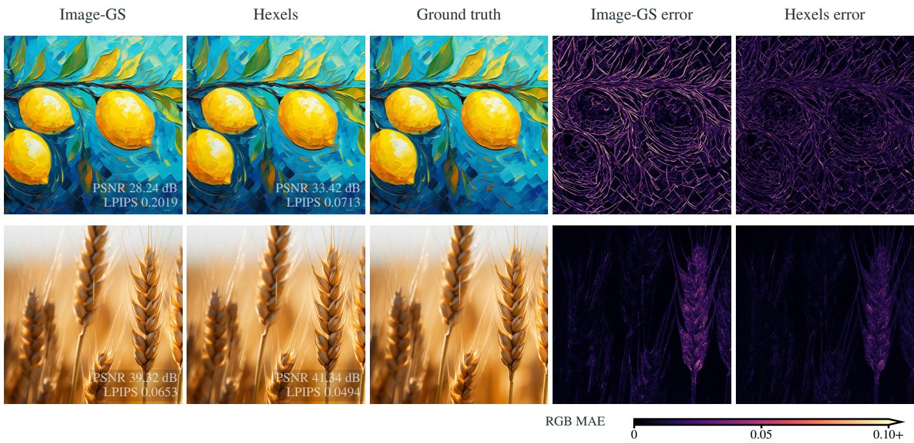  
Figure 3. 2D reconstruction on the Image-GS benchmark. Two 2048×2048 examples from the ImageGS dataset with 10K final primitives per method. Hexels preserves finer boundaries and structure, with lower RGB error.

We use a hexagon because it provides an eficient, nearly isotropic way to cover a plane. Regular hexagons tile a plane without gaps and, at equal area, require less perimeter than regular triangles or squares, consistent with the honeycomb theorem [9]. More concretely, under the local first-order approximation model of Appendix ${ \mathrm { G } } ,$ a suitably oriented and anisotropically scaled hexagon can cover about 30% more area than the corresponding square and twice the area of the corresponding triangle for the same bounded color error (See Proposition G.2). Our results reflect that these ideas do help structure a more eficient primitive even in non-ideal settings.

Spatial appearance. We model appearance within each Hexel using a first-order color field:

$$
\mathbf { c } _ { i } ^ { \mathrm { s p } } ( u , v ) = \mathbf { c } _ { 0 , i } + u \mathbf { g } _ { u , i } + v \mathbf { g } _ { v , i } ,\tag{4}
$$

where ${ \bf c } _ { 0 , i }$ is the base RGB color and $\mathbf { g } _ { u , i } , \mathbf { g } _ { v , i }$ are RGB gradients along the two local coordinates. This allows one Hexel to represent smooth appearance variation across its surface rather than assigning a single spatial color to the primitive. Since the field is defined in local coordinates, increasing a tangent scale spreads the same color variation over a larger physical region. We refer to this view-independent model as $V 1 ,$ with 20 learned parameters per Hexel, compared with 58 for the evaluated 2DGS primitive. Our V2 variant adds compact view dependence through a linear residual $\mathbf { r } _ { i } ( \mathbf { d } _ { i } ) \ : = \ : A _ { i } \mathbf { d } _ { i }$ , where ${ \bf d } _ { i }$ is the normalized direction from the camera center to the Hexel center, for 29 parameters in total. We also consider an optional V3 variant that replaces the linear residual with degree-three spherical harmonics. See $\mathrm { A p } \cdot$ pendix A.1 for the complete parameterization details.

Splatting. Following 2DGS, we recover local coordinates $( u _ { i } , v _ { i } )$ at each pixel using perspective-correct ray–plane intersection and composite primitives front-to-back in depth order. A Hexel contributes $\alpha _ { i } = \operatorname* { m i n } \{ o _ { i } K _ { i } ( u _ { i } , v _ { i } ) , 0 . 9 9 \}$ , with color evaluated from its local appearance field at $( u _ { i } , v _ { i } )$ . Thus, relative to 2DGS, the rasterization and compositing remain unchanged; we replace the Gaussian weight with the Hexel support and evaluate spatially varying color within each primitive. Implementation details are given in Appendix B.

Training. We optimize all Hexel parameters directly from calibrated training images with Adam [20], using the standard photometric objective $\begin{array} { r } { \bar { \mathcal { L } } = ( 1 - \lambda ) \| \hat { I } - I \| _ { 1 } + \bar { \lambda } ( 1 - \mathrm { S S I M } ( \hat { I } , I ) ) } \end{array}$ . Hexels are initialized from either sparse COLMAP points [31] or, where stated, a denser MVS reconstruction [32] obtained from the training views. Unless otherwise specified, our reported models use a fixed primitive population.

Densification and Pruning. For unconstrained training, we additionally consider standard densification and pruning, following 3DGS and 2DGS. Primitives with large position gradients are cloned or split, with new Hexels initialized near the parent in its tangent plane. We conservatively prune mature primitives that make negligible contributions across the training views. More details are given in Appendix C.

At inference, we precompute camera-independent quantities and use an RGB-only rasterizer; depth ordering and compositing are unchanged from the training renderer. Full implementation details are provided in Appendix B.

## 3.1 Representing 2D Images as Hexels

Unlike most 3D surface primitives, Hexels are general and can be used directly for both 3D scenes and 2D images. For eficient image representation, a 2D Hexel is defined by its image-plane center $\mathbf { m } _ { i } ,$ rotation $\theta _ { i } ,$ two scales $s _ { x , i } , s _ { y , i } ,$ and support sharpness $\beta _ { i }$ . The same hexagonal support from $\operatorname { E q . } \left( 2 \right)$ is evaluated directly at each pixel, without projection, ray–plane intersection, opacity, or depth ordering. Let $\mathbf { S } _ { i } = \mathrm { d i a g } ( s _ { x , i } , s _ { y , i } )$ be the positive scale matrix and $\mathbf { R } ( \theta _ { i } )$ the planar rotation. For a pixel �, we compute

$$
\mathbf { u } _ { i } = \mathbf { S } _ { i } ^ { - 1 } \mathbf { R } ( \theta _ { i } ) ^ { \top } ( \mathbf { m } _ { i } - \mathbf { x } ) , \qquad w _ { i } ( \mathbf { x } ) = \sigma ( - \beta _ { i } d ( \mathbf { u } _ { i } ) ) ,
$$

Here $w _ { i } ( \mathbf { x } )$ is a blending weight: it is larger inside the Hexel’s footprint and decreases smoothly outside it. Following Image-GS [40], each pixel retains up to $K = 1 0$ Hexels with the largest weights among those assigned to its tile. $\operatorname { L e t } { \mathcal { S } } _ { K } ( \mathbf { x } )$ be the indices ofthese selected Hexels. Their RGB colors ${ \bf c } _ { i } ( { \bf x } )$ form a weighted average:

$$
\mathbf { c } ( \mathbf { x } ) = \frac { \sum _ { i \in \mathcal { S } _ { K } ( \mathbf { x } ) } w _ { i } ( \mathbf { x } ) \mathbf { c } _ { i } ( \mathbf { x } ) } { \sum _ { i \in \mathcal { S } _ { K } ( \mathbf { x } ) } w _ { i } ( \mathbf { x } ) + \epsilon } .
$$

$\epsilon = 1 0 ^ { - 4 }$ prevents division by zero.

Table 1. 2D image representation on ImageGS dataset (45 images). Constant and linear RGB using 10K primitives. Metrics use unquantized FP32 parameters; Memory is losslessly compressed image files, including decoding metadata.
<table><tr><td>Method</td><td>PSNR↑</td><td>SSIM↑</td><td>LPIPS↓</td><td>Iter.↓</td><td>Train (s)↓)</td><td>Memory (kB)↓</td></tr><tr><td>Image-GS</td><td>33.16</td><td>.9141</td><td>.1372</td><td>10,000</td><td>238.40</td><td>292.175</td></tr><tr><td>Hexels (constant)</td><td>34.16</td><td>.9208</td><td>.1099</td><td>5,100</td><td>112.11</td><td>289.799</td></tr><tr><td>Hexels</td><td>35.82</td><td>.9359</td><td>.0924</td><td>5,100</td><td>157.07</td><td>551.174</td></tr></table>

We use the first-order spatial color field as the primary 2D appearance model, expressed in image coordinates; constant-color Hexels, with a fixed shared $\beta ,$ match Image-GS’s eight stored scalars per primitive. Both methods use image-gradient-based initialization from [40] and an L1 plus SSIM loss. Image-GS retains its original training, densification, and pruning methodology. Appendix D provides more training and inference details. This 2D representation setting permits a straightforward way to evaluate overdraw using reconstruction error and primitive overlap. On the 45-image Image-GS benchmark, Hexels improve PSNR from 33.16 to 35.82 dB and reduce LPIPS from .1372 to .0924 over ImageGS. They use 5.1K rather than 10K iterations and 157.07 rather than 238.40 seconds of image fitting/training time (Table 1). Even using constant-color instead of linear color representation, Hexels still improve all three quality metrics, fit in 112.11 seconds, and occupy 289.799 kB memory, versus 292.175 kB for Image-GS. Figure 3 shows qualitative comparisons.

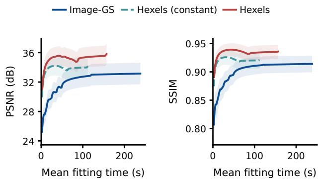  
Figure 4. Hexels converge faster. On the Image-GS benchmark, Hexels show faster convergence versus Image-GS while also outperforming it in terms of PSNR and SSIM.

## 4 Experiments

We evaluate novel-view synthesis under matched model memory, matched primitive budgets and native baseline settings. As our focus is on fundamental parameter-based eficiency, all Hexels results do not utilize any post-quantization or compression. For initial runtime compression analysis, refer to Appendix I.3.

Implementation. Hexels start from sparse COLMAP points and train for 30K iterations. Fixed configurations retain the initial population; densified configurations use mixed clone/split growth and contribution-based pruning, with a 2M limit.

Appendix I.2 reports all configurations. Training and evaluation details are in Appendix E.1.

Datasets, baselines, and metrics. We evaluate nine Mip-NeRF360 scenes [1], fifteen DTU scans [16], and ten Tanks and Temples scenes [21], using common held-out views and resolutions. We report PSNR, SSIM [34], LPIPS [37], training time, peak train ing VRAM, rendering FPS, and deployment memory size, averaged over scenes. Our baselines are 3DGS [18], 3D Convex Splatting [11], BBSplat [33], Nexels [30], 2DGS [14], Triangle Splatting [13], and MeshSplatting [12]. Tables group methods into vol umetric primitives, textured or neural surfels, and native surfacealigned primitives with local appearance. We select these baselines as competitive representatives of their respective classes, spanning complementary quality-eficiency trade-ofs. The final group - 2DGS, Triangle Splatting, and MeshSplatting - provides the closest comparison to Hexels, as these methods use explicit surface-aligned primitives without separate texture maps or neural appearance fields; we therefore emphasize this group in our analysis. To our knowledge, this evaluation over 34 real-world scenes is the largest quantitative NVS evaluation, by scene count, among the original papers introducing the compared methods.

Table 2. Matched model memory. Hexels achieves the best PSNR and SSIM and the best or tied-best LPIPS across all three benchmarks, with low peak training VRAM and high rendering rates. Colors rank methods within each primitive group.
<table><tr><td rowspan="3">Method</td><td colspan="6">Tanks and Temples (10)</td><td colspan="6">Mip-NeRF 360 (9)</td><td colspan="6">DTU (15)</td></tr><tr><td>Train</td><td>VRAM</td><td>FPS</td><td>PSNR</td><td>SSIM</td><td>LPIPS</td><td>Train</td><td>VRAM</td><td>FPS</td><td>PSNR</td><td>SSIM</td><td>LPIPS</td><td>Train</td><td>VRAM</td><td>FPS</td><td>PSNR</td><td>SSIM</td><td>LPIPS</td></tr><tr><td>min ↓</td><td>GiB↓</td><td></td><td>dB↑</td><td></td><td>VGG↓ 7</td><td>min↓</td><td>GiB↓</td><td></td><td>↑</td><td>dB↑</td><td>↑ VGG↓</td><td></td><td>min↓</td><td>GiB↓</td><td>↑</td><td>dB↑</td><td>↑VGG↓</td></tr><tr><td></td><td></td><td></td><td></td><td></td><td></td><td></td><td colspan="3">Volumetric primitives</td><td></td><td></td><td></td><td></td><td></td><td></td><td></td><td></td><td></td></tr><tr><td>3DGS</td><td>5.6</td><td>1.60</td><td>807.5</td><td>20.39</td><td>0.683</td><td>0.477</td><td>8.2</td><td>2.62</td><td>852.6</td><td>20.46</td><td>0.528</td><td>0.614</td><td>4.5</td><td>0.47</td><td>1035.0</td><td>27.06</td><td>0.840</td><td>0.395</td></tr><tr><td>3D Convex</td><td>20.3</td><td>0.96</td><td>203.5</td><td>19.71</td><td>0.680</td><td>0.481</td><td>35.5</td><td>1.24</td><td>146.1</td><td>20.82</td><td>0.570</td><td>0.564</td><td>12.0</td><td>0.61</td><td>316.6</td><td>26.74</td><td>0.847</td><td>0.382</td></tr><tr><td></td><td></td><td></td><td></td><td></td><td></td><td></td><td></td><td colspan="3">Hybrid primitives</td><td></td><td></td><td></td><td></td><td></td><td></td><td></td><td></td></tr><tr><td>BBSplat</td><td>21.1</td><td></td><td>1.27 132.0</td><td>19.00</td><td>0.624</td><td>0.548</td><td>37.0</td><td>3.58</td><td>87.7</td><td>21.340.535</td><td></td><td>0.603</td><td>14.4</td><td>0.65</td><td>179.9</td><td></td><td>26.900.833</td><td>0.380</td></tr><tr><td>Nexels</td><td>72.2</td><td>3.62</td><td>99.6</td><td>21.32</td><td>0.695</td><td>0.424</td><td>82.7</td><td>7.15</td><td>49.9</td><td>22.49</td><td>0.590</td><td>0.493</td><td>29.0</td><td>2.21</td><td>155.5</td><td>28.23</td><td>0.876</td><td>0.303</td></tr><tr><td></td><td></td><td></td><td></td><td></td><td></td><td></td><td></td><td>Surface primitives</td><td></td><td></td><td></td><td></td><td></td><td></td><td></td><td></td><td></td><td></td></tr><tr><td>2DGS</td><td>10.6</td><td>1.37</td><td>284.5</td><td>18.52</td><td>0.652</td><td>0.508</td><td>20.0</td><td>3.24 201.2</td><td></td><td>17.82</td><td>0.494</td><td>0.658</td><td>8.4</td><td>0.68</td><td>478.0</td><td>21.56</td><td>0.757</td><td>0.476</td></tr><tr><td>Triangle Spl.</td><td>9.4</td><td>0.74</td><td>495.2</td><td>21.35</td><td>0.731</td><td>0.409</td><td>15.8</td><td>1.12 312.7</td><td></td><td>22.36</td><td>0.588</td><td>0.538</td><td>7.4</td><td>0.69</td><td>517.5</td><td>26.04</td><td>0.835</td><td>0.381</td></tr><tr><td>MeshSplatting</td><td>17.2</td><td>2.15</td><td>119.6</td><td>16.29</td><td>0.565</td><td>0.567</td><td>33.1</td><td>4.49</td><td>60.8</td><td>19.31</td><td>0.475</td><td>0.634</td><td>13.3</td><td>1.92</td><td>130.7</td><td>21.14</td><td>0.666</td><td>0.505</td></tr><tr><td>Hexels V1</td><td>13.3</td><td>0.56</td><td>438.4</td><td>23.05</td><td>0.811</td><td>0.295</td><td>24.2</td><td>0.90 377.8</td><td></td><td>24.82</td><td>0.705</td><td>0.410</td><td>8.4</td><td>0.55</td><td>830.8</td><td>28.94</td><td>0.890</td><td>0.303</td></tr></table>

Table 3. Matched primitive budgets. At matched primitive-count budgets, Hexels combines high reconstruction quality with low peak train ing VRAM and compact models.
<table><tr><td rowspan="2">Method</td><td colspan="5">Tanks and Temples (10)</td><td colspan="5">Mip-NeRF 360 (9)</td><td colspan="5">DTU (15)</td><td colspan="5"></td></tr><tr><td></td><td>Train VRAM</td><td>FPS</td><td>PSNR</td><td>SSIM</td><td>LPIPS Deploy.</td><td>Train</td><td>VRAM</td><td>FPS</td><td>PSNR</td><td>SSIM</td><td>LPIPS</td><td>Deploy.</td><td>Train</td><td>VRAM</td><td>FPS</td><td>PSNR</td><td>SSIM</td><td>LPIPS</td><td>Deploy.</td></tr><tr><td></td><td>min ↓</td><td>GiB↓</td><td>↑</td><td>dB↑</td><td>↑ VGG↓</td><td></td><td>MB↓min↓</td><td>GiB↓</td><td>↑</td><td>dB↑</td><td>↑</td><td>VGG↓</td><td>MB↓min↓</td><td></td><td>GiB↓</td><td>↑</td><td>dB↑</td><td>↑</td><td>VGG↓</td><td>MB↓</td></tr><tr><td></td><td></td><td></td><td></td><td></td><td></td><td></td><td></td><td>Volumetric primitives</td><td></td><td></td><td></td><td></td><td></td><td></td><td></td><td></td><td></td><td></td><td></td><td></td></tr><tr><td>3DGS 3D Convex</td><td>7.5 29.2</td><td>2.11 1.60</td><td>581.8</td><td>22.95</td><td>0.773</td><td>0.361</td><td>45.15</td><td>9.8 2.79</td><td>607.2</td><td>23.38</td><td>0.599</td><td>0.527</td><td>28.45</td><td>5.1</td><td>0.64</td><td>819.6</td><td>29.29</td><td>0.893</td><td>0.324</td><td>8.43</td></tr><tr><td></td><td></td><td></td><td>114.3</td><td>22.20</td><td>0.758</td><td>0.376</td><td>46.90 45.7</td><td>1.90</td><td>83.0</td><td>23.88</td><td>0.652</td><td>0.466</td><td>30.35</td><td>15.0</td><td>0.82</td><td>213.3</td><td>28.24</td><td>0.887</td><td>0.305</td><td>8.12</td></tr><tr><td>BBSplat</td><td>64.7</td><td>8.90</td><td>49.8</td><td>24.41</td><td></td><td>0.224</td><td>146.64</td><td></td><td>Hybrid primitives</td><td></td><td></td><td></td><td></td><td></td><td></td><td></td><td></td><td></td><td></td><td>25.91</td></tr><tr><td>Nexels</td><td>76.9</td><td>4.86</td><td>77.8</td><td>23.48</td><td>0.842 0.803</td><td>0.272</td><td>77.7 183.02 91.2</td><td>14.45 8.04</td><td>34.1</td><td>26.50</td><td>0.767</td><td>0.296</td><td>96.28</td><td>22.0</td><td>1.88</td><td>125.4 142.9</td><td>30.19 29.00</td><td>0.913</td><td>0.228 0.209</td><td>143.37</td></tr><tr><td></td><td></td><td></td><td></td><td></td><td></td><td></td><td></td><td></td><td>44.2</td><td>25.49</td><td>0.736</td><td>0.304</td><td>164.99</td><td>31.5</td><td>3.14</td><td></td><td></td><td>0.891</td><td></td><td></td></tr><tr><td>2DGS</td><td>12.4</td><td>2.64</td><td>193.2</td><td>21.40</td><td></td><td></td><td>40.01 22.0</td><td>5.15</td><td>Surface primitives</td><td></td><td></td><td></td><td></td><td></td><td></td><td></td><td></td><td></td><td></td><td>8.29</td></tr><tr><td>Triangle Spl.</td><td>11.6</td><td>1.08</td><td>407.2</td><td>22.90</td><td>0.741</td><td>0.396</td><td></td><td></td><td>161.9</td><td>21.65</td><td>0.573</td><td>0.566</td><td>27.98</td><td>9.1</td><td>1.01</td><td>364.8</td><td>24.83</td><td>0.832</td><td>0.399</td><td>8.39</td></tr><tr><td>MeshSplatting</td><td>18.0</td><td>2.59</td><td>116.8</td><td>16.42</td><td>0.803</td><td>0.310</td><td>47.63</td><td>18.4</td><td>1.32 278.7</td><td>24.73</td><td>0.677</td><td>0.434</td><td>30.21</td><td>8.4</td><td>0.79</td><td>488.1</td><td>27.14</td><td>0.860</td><td>0.331</td><td>4.58</td></tr><tr><td>Hexels V1</td><td>13.3</td><td>0.56</td><td>438.4</td><td>23.05</td><td>0.599 0.811</td><td>0.548 0.295</td><td>28.33 16.22</td><td>31.5 24.2</td><td>4.54 60.9 0.70 377.8</td><td>18.93 24.82</td><td>0.498 0.705</td><td>0.620</td><td>19.90 10.22</td><td>12.5</td><td>1.96</td><td>135.3 830.8</td><td>22.96 28.94</td><td>0.729 0.890</td><td>0.471 0.303</td><td>3.04</td></tr><tr><td>Hexels V2</td><td>14.4</td><td>0.60</td><td>386.9</td><td>23.49</td><td>0.819</td><td>0.287</td><td>22.77</td><td>24.5</td><td>0.74 375.0</td><td>25.06</td><td>0.711</td><td>0.410 0.405</td><td>14.35</td><td>8.4 8.5</td><td>0.55 0.56</td><td>845.6</td><td>29.57</td><td>0.895</td><td>0.298</td><td>4.26</td></tr><tr><td>Hexels V3</td><td>14.6</td><td>0.71</td><td>370.6</td><td>23.78</td><td>0.824</td><td>0.281</td><td>48.99</td><td>24.3</td><td>0.81 366.9</td><td>25.41</td><td>0.716</td><td>0.401</td><td>30.86</td><td>8.5</td><td>0.58</td><td>792.3</td><td>29.95</td><td>0.899</td><td>0.293</td><td>9.15</td></tr></table>

## 4.1 Novel View Synthesis

Matched memory. Like BBSplat’s fixed-storage comparisons [33], we constrain baseline primitive counts and other learned components to compare methods under matched uncompressed model-memory budgets. Table 2 compares all methods at the V1 model-memory budget along with corresponding training resources and rendering rates; additional comparisons at the V2 and V3 budgets are provided in Appendix I.1. At matched model-memory budgets, Hexels V1 improves PSNR over 2DGS by 4.53–7.38 dB and over Triangle Splatting by 1.70–2.90 dB across the three benchmarks. Average rendering speed (FPS) range from 377.8 to 830.8 FPS, or 1.54–1.87× those of 2DGS. On Mip-NeRF360, the mean PSNR gain is 6.99 dB. All these improvements come with upto 3.6× less VRAM usage than 2DGS. Figure 5 shows that Hexels retain fine scene structure under these compact memory budgets. This matched-memory evaluation is our primary eficiency setting, in which Hexels establish the strongest overall quality–eficiency trade-of among the evaluated methods. Full experimental details are provided in Appendix E.1.

Matched primitive budget. We use this equal-primitive experi ment to ablate the Hexel primitive design as a whole under an equal primitive population ceiling. Table 3 uses each scene’s SfM point count as the common budget across all methods. Hexel V1/V2 provide compact alternatives, while V3 uses a richer appearance model with a larger per-primitive memory cost. V3 outperforms 2DGS, Triangle Splatting, and MeshSplatting in mean PSNR across all three datasets. V3 exceeds Triangle Splatting in mean PSNR by 0.68 dB on Mip-NeRF360, 2.82 dB on DTU and 0.88 dB on Tanks and Temples. Hexels remain the most efi-

MeshSplatting

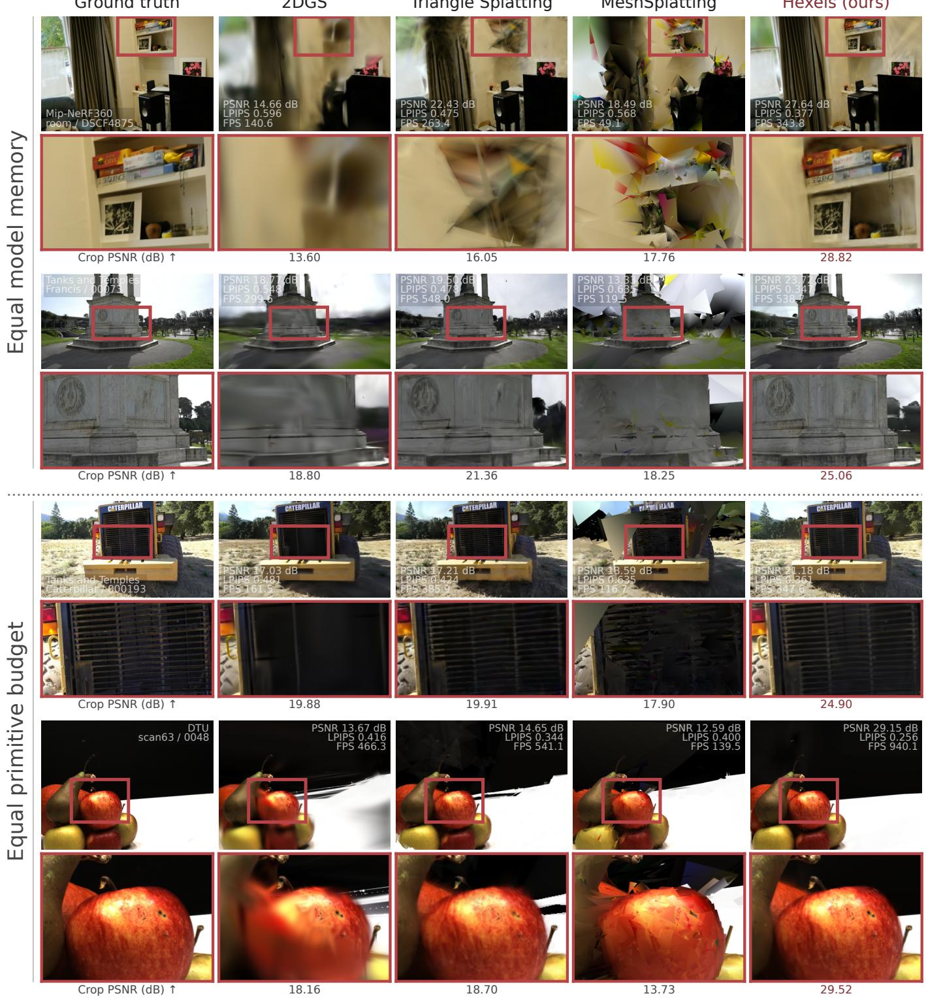  
Figure 5. Qualitative comparisons under matched model-memory and primitive budgets. Top: fixed Hexels V1 on room (Mip-NeRF360) and Francis (Tanks and Temples). Bottom: fixed V3 on Caterpillar (Tanks and Temples) and DTU scan63. Zoomed crops highlight sharper shel detail, pedestal carvings, radiator slats, and fruit texture achieved by Hexels over baseline methods.

Table 4. Native novel-view synthesis. Native baseline settings are compared with densified Hexels V3 and fixed-population V2. Deploy. gives deployment size in MB; Prims. gives primitive count in thousands. Mip-NeRF 360 uses scene-count-weighted means over five outdoor and four indoor scenes. Colors rank methods within each primitive group.
<table><tr><td rowspan=1 colspan=11>Tanks and Temples (10)                         Mip-NeRF 360 (9)                              DTU (15)Method    Train VRAM FPSPSNR SSIM LPIPS Deploy.Prims.Train VRAM FPSPSNR SSIM LPIPS Deploy.Prims.Train VRAMFPSPSNR SSIM LPIPSDeploy.Prims.</td></tr><tr><td rowspan=1 colspan=11>min ↓GiB ↓ ↑ dB↑ 7VGG↓MB   K min↓GiB↓ ↑ dB↑ 7VGG↓MB↓   K min ↓GiB  ↑ dB↑ ↑ VGG↓MB↓ K</td></tr><tr><td rowspan=1 colspan=11>Volumetric primitives</td></tr><tr><td rowspan=1 colspan=1>3DGS</td><td rowspan=1 colspan=1>18.1 4.65 157.524.350.8460.237</td><td rowspan=1 colspan=3>294.751188.532.88.6094.7 27.550.8170.259</td><td rowspan=1 colspan=1>680.482</td><td rowspan=1 colspan=2>743.8310.5</td><td rowspan=1 colspan=2>1.72301.828.910.9100.24997.27</td><td rowspan=1 colspan=1>392.2</td></tr><tr><td rowspan=1 colspan=1>3D Convex</td><td rowspan=1 colspan=1>70.2 13.95 44.424.800.8410.224</td><td rowspan=1 colspan=3>488.65 1586.5 97.8 14.68 35.1 27.240.8020.245</td><td rowspan=1 colspan=1>792.46 2</td><td rowspan=1 colspan=2>572.9 21.8</td><td rowspan=1 colspan=2>1.32136.328.490.8980.25422.21</td><td rowspan=1 colspan=1>72.1</td></tr><tr><td rowspan=2 colspan=1>BBSplat</td><td rowspan=1 colspan=9>Hybrid primitives</td><td rowspan=1 colspan=1></td></tr><tr><td rowspan=1 colspan=9>100.530.67 27.424.520.8440.2183 229.48300.0156.721.7714.026.750.7830.274184.02237.834.313.34 74.530.260.9140.22141.99</td><td rowspan=1 colspan=1>60.0</td></tr><tr><td rowspan=1 colspan=1>Nexels</td><td rowspan=1 colspan=10>94.5 7.5445.824.140.8290.234 241.35399.6116.311.64 25.3 27.350.8020.235241.40399.843.23.8296.529.030.9050.1862241.40399.8</td></tr><tr><td rowspan=1 colspan=1></td><td rowspan=1 colspan=9>Surface primitives</td><td rowspan=2 colspan=1>230.3</td></tr><tr><td rowspan=1 colspan=1>2DGS</td><td rowspan=1 colspan=5>19.2 4.37103.623.640.8290.270177.56727.741.211.0648.926.820.7980.301494.72</td><td rowspan=1 colspan=3>2027.512.72.04213.228.860.9070.265</td><td rowspan=1 colspan=1>56.20</td></tr><tr><td rowspan=1 colspan=1>Triangle Spl.</td><td rowspan=1 colspan=5>38.6 14.44121.423.150.8380.2271039.862821.0 42.8314.5285.827.020.8080.23331093.15</td><td rowspan=1 colspan=3>3595.316.52.38278.727.050.8730.2571</td><td rowspan=1 colspan=2>27.76362.6</td></tr><tr><td rowspan=1 colspan=1>MeshSplatting</td><td rowspan=1 colspan=1>49.310.3843.3 20.730.7540.358</td><td rowspan=1 colspan=3>498.08 3694.1 73.213.4823.824.740.7310.3667</td><td rowspan=1 colspan=1>07.77 5</td><td rowspan=1 colspan=3>379.5517.05.6494.7 25.850.8100.408</td><td rowspan=1 colspan=1>34.71</td><td rowspan=1 colspan=1>285.1</td></tr><tr><td rowspan=1 colspan=1>Hexels V3</td><td rowspan=1 colspan=1>24.312.06142.724.530.8390.248</td><td rowspan=1 colspan=1>198.84</td><td rowspan=1 colspan=1>739.1</td><td rowspan=1 colspan=1>37.513.95100.726.520.7800.307</td><td rowspan=1 colspan=1>246.76</td><td rowspan=1 colspan=1>917.3</td><td rowspan=1 colspan=2>10.61.21483.129.760.9020.268</td><td rowspan=1 colspan=1>27.03</td><td rowspan=1 colspan=1>100.4</td></tr><tr><td rowspan=1 colspan=1>Hexels V2</td><td rowspan=1 colspan=1>14.40.60 386.923.490.8190.287</td><td rowspan=1 colspan=1>22.77</td><td rowspan=1 colspan=1>182.1</td><td rowspan=1 colspan=1>24.50.74 375.025.060.7110.405</td><td rowspan=1 colspan=1>14.35</td><td rowspan=1 colspan=1>114.7</td><td rowspan=1 colspan=2>8.50.56 845.629.570.8950.298</td><td rowspan=1 colspan=1>4.26</td><td rowspan=1 colspan=1>34.0</td></tr></table>

cient primitives amongst all compared surface alignment methods. While we find that BBSplat sometimes outperforms Hexels, it comes at the expense of all relevant eficiency metrics, including training time, FPS, VRAM, and memory, as it requires a separate appearance model and therefore belongs to a separate primitive category. Figure 5 shows the detail retained by Hexels under this common primitive budget. At the same primitive budget, Hexels V2 outperforms 2DGS on all quality metrics across all three datasets, improving PSNR by up to 4.74 dB while using up to 7× lower peak training VRAM, 1.76–1.95× less deployment memory, and rendering up to 2.31× faster.

Native baselines. Although unconstrained training is not the primary focus of our eficiency-oriented evaluation, we also compare against all baselines in their native settings in Table 4. This tests whether Hexels remain competitive when model memory and primitive count are unrestricted. On Mip-NeRF360, densified V3 is within 0.30 dB of 2DGS while rendering 2.06× faster and using 2.00× less deployment memory. On DTU and T&T, it improves PSNR over 2DGS by 0.90 and 0.90 dB, respectively, while rendering 2.26× and 1.37× faster. Hexel (FP32 deployment) memory is 27.03 MB versus 56.20 MB for 2DGS on DTU, and 198.84 MB versus 177.56 MB on T&T. BBSplat remains 0.50 dB better on DTU, while 3D Convex Splatting is 0.27 dB better on T&T; however, neither provides a direct comparison to Hexels as a native surface-aligned primitive. The fixed V2 variant provides the corresponding lower-cost yet highperformance alternative. In fact, for comparative visual quality, V2 uses upto 14× less peak VRAM during training and upto 34× less memory during inference compared to 2DGS. Figure 6 compares densified V3 with the native/unconstrained baselines on Mip-NeRF360 and Tanks and Temples scenes.

Across 34 scenes, Hexels consistently achieve a strong quality– eficiency trade-of. In our primary matched-memory setting, Hexels outperform every evaluated baseline in PSNR, including volumetric and textured or neural representations. We further evaluate the primitive design as a whole under the same primitive-count budget. In this setting, Hexels outperform all evaluated native surface-aligned methods while using substantially less training VRAM and, for V1/V2, less deployment/inference storage memory; Hexels also achieves the highest FPS on each dataset. Finally, Hexels remain competitive in the native unconstrained setting, where the fixed and densified variants together provide the strongest overall quality–eficiency trade-of among the evaluated native surface-aligned representations.

## 4.2 Eficient Surface Reconstruction

We further evaluate surface reconstruction on all 15 DTU scans and 6 Tanks and Temples surface scenes. As can be seen from the results (Table 5), our primary comparison is with 2DGS, and our primary setting is memory-matched and primitivematched as before, while we also report unconstrained results. Table 5 reports mean DTU Chamfer distance (CD). Hexels reaches 0.978 mm, compared with 1.375 mm and 1.449 mm for the memory- and primitive-controlled 2DGS variants. Triangle Splatting and MeshSplatting obtain 1.124 mm and 1.662 mm, respectively. Unconstrained 2DGS achieves 0.794 mm, however trails Hexels in memory usage which use 0.61 GiB mean peak training VRAM, versus 1.02 GiB and 0.98 GiB for the two memory/primitive matched 2DGS variants. Notably, Hexels in Table 5 are fixed, whereas other methods allow densification and pruning even beyond the final memory/primitive capacity. We report further improvements in surface reconstruction with densification for Hexels in Appendix F. In summary, Hexels retain substantially better surface geometry for the same model memory and even the same number ofprimitives.

On Tanks and Temples, Table 6 reports the average of the 6 scene-wise F1 scores at the oficial thresholds. Hexels achieves

Ground truth  
2DGS  
Triangle Splatting  
MeshSplatting  
Hexels (ours)  
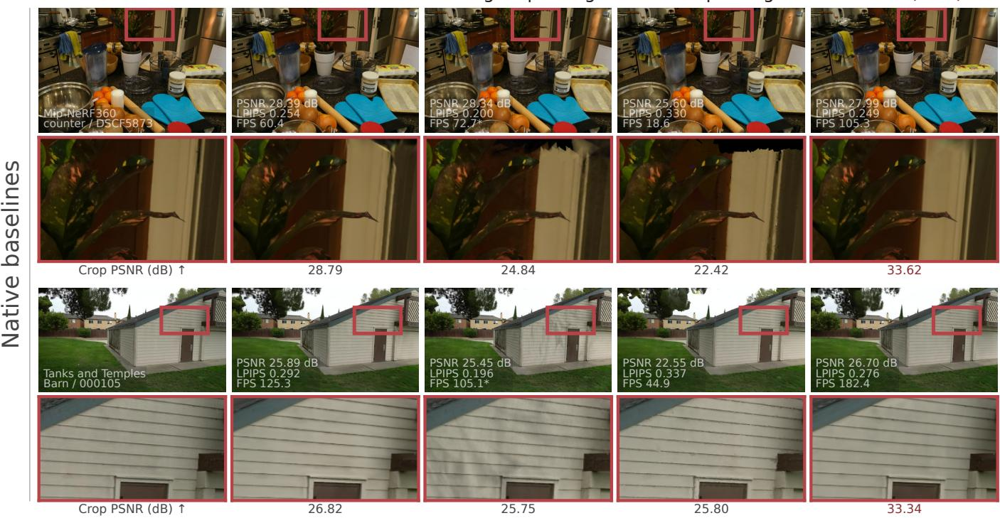  
Figure 6. Unconstrained/Native NVS on Mip-NeRF360 and Tanks and Temples. Densified Hexels V3 preserves fine detail, with PSNR gains (in crops) of 4.84 dB and 6.52 dB over the best baseline.

Table 5. DTU surface reconstruction. We report mean Chamfer distance (CD) over 15 DTU scans. Hexels achieves 0.978 mm, vs 1.375 mm and 1.449 mm for memory-matched and primitivematched 2DGS, respectively with lower peak VRAM usage than all 2DGS variants.
<table><tr><td rowspan=1 colspan=1>Method</td><td rowspan=1 colspan=1>CD (mm).↓</td><td rowspan=1 colspan=1>VRAM (GiB)↓</td></tr><tr><td rowspan=1 colspan=1>2DGS unconstrained</td><td rowspan=1 colspan=1>0.794</td><td rowspan=1 colspan=1>1.93</td></tr><tr><td rowspan=1 colspan=1>2DGS matched mem.</td><td rowspan=1 colspan=1>1.375</td><td rowspan=1 colspan=1>1.02</td></tr><tr><td rowspan=1 colspan=1>2DGS matched prim.</td><td rowspan=1 colspan=1>1.449</td><td rowspan=1 colspan=1>0.98</td></tr><tr><td rowspan=1 colspan=1>Triangle Splatting</td><td rowspan=1 colspan=1>1.124</td><td rowspan=1 colspan=1>2.29</td></tr><tr><td rowspan=1 colspan=1>MeshSplatting</td><td rowspan=1 colspan=1>1.662</td><td rowspan=1 colspan=1>2.65</td></tr><tr><td rowspan=1 colspan=1>Hexels (V3)</td><td rowspan=1 colspan=1>0.978</td><td rowspan=1 colspan=1>0.61</td></tr></table>

34.38%, versus 31.72% for unconstrained 2DGS, and 22.05% and 21.03% for our main memory- and primitive-controlled settings, followed by 18.63% for Triangle Splatting and 27.13% for Mesh-Splatting.

Figure 7 shows qualitative results of surface reconstruction. Hexels demonstrate reduced wall holes and surface fragmentation despite using significantly less VRAM and memory.

Table 6. Tanks and Temples surface reconstruction. We report mean F1 over six scenes, with higher values indicating better reconstruction. Hexels achieves the highest score among native and budget-controlled 2DGS, as well as reproduced triangle and mesh baselines.
<table><tr><td colspan="2">Tanks and Temples (6 scenes)</td></tr><tr><td>Method</td><td>F1 (%)↑</td></tr><tr><td>2DGS unconstrained</td><td>31.72</td></tr><tr><td>2DGS matched mem.</td><td>22.05</td></tr><tr><td>2DGS matched prim.</td><td>21.03</td></tr><tr><td>Triangle Splatting</td><td>18.63</td></tr><tr><td>MeshSplatting</td><td>27.13</td></tr><tr><td>Hexels (V3)</td><td>34.38</td></tr></table>

## 4.3 Applications

Direct Surface-Cell Extraction. Hexels provide an explicit surface representation that can be exported definably and in constant time after optimization from images. Unlike the depth-fusion pipeline used for mesh extraction in 2DGS [14], this conversion requires no depth rendering, voxel grid, or Marching Cubes. The resulting surface cells can be used directly in object-centric appli cations such as 3D generation, segmentation, and representation learning, which we leave to future work.

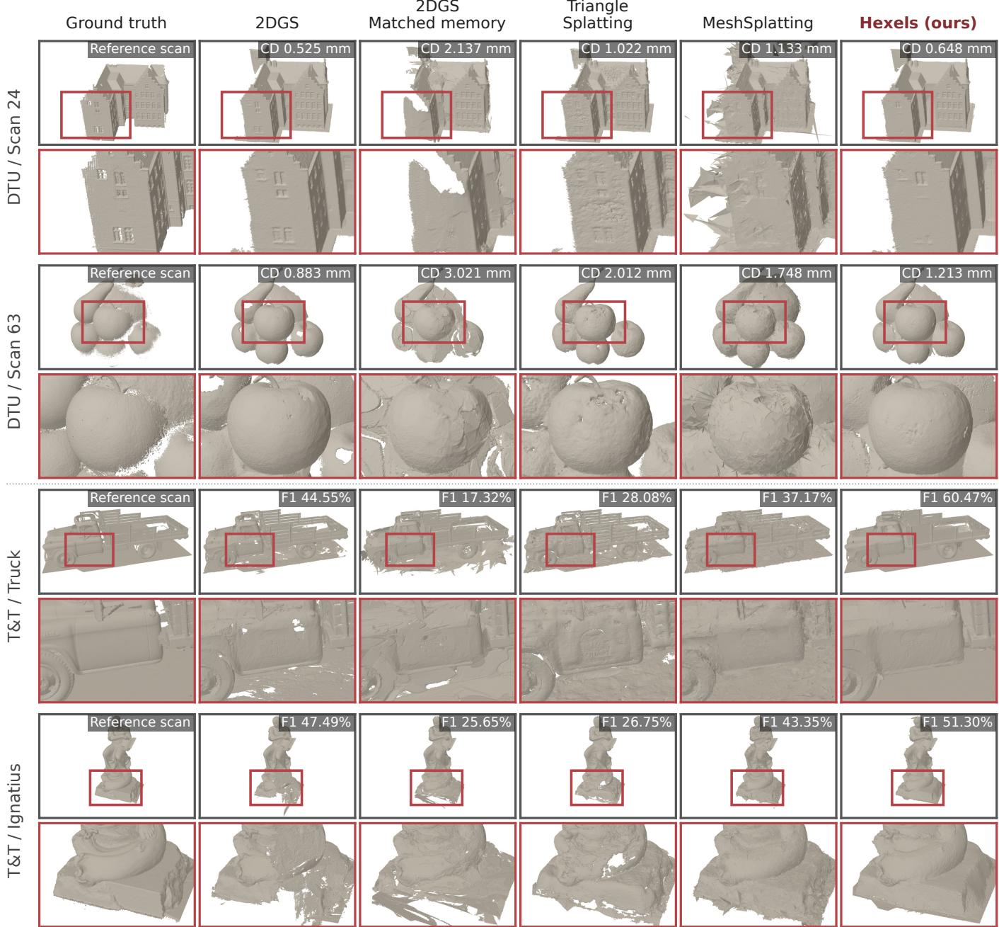  
Figure 7. Efficient Surface reconstruction on DTU and Tanks and Temples scenes. Hexels reduces wall holes, surface fragmentation (see Scan 63) and broken surfaces relative to memory-matched 2DGS and other surface splatting baselines.

For each retained Hexel, we transform the six vertices of its canonical hexagon, defined by � = 0, into world space using Eq. (1). Connecting consecutive vertices produces six edges and one polygonal face. Colors are obtained from the base RGB or evaluated from the spatial color field. Each cell remains associated with its parent Hexel, providing direct access to its geometry and appearance, for any downstream application-based optimization, as the associated Position and parameters remain differentiable with respect to the task.

The conversion requires �(1) work per Hexel. The exported cells can be optimized independently, opening avenues for many downstream applications in both 3D and 4D. Figure 8 shows the resulting wireframes and surface cells. More details in Ap-

Reference imag

Monochrome wireframe  
Colored surface cel s  
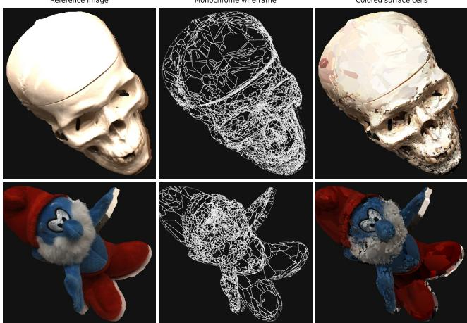  
Figure 8. Direct surface extraction from Hexels.

pendix E.5.

Resource-constrained reconstruction. Compact, fixed-population Hexels retain high reconstruction quality while requiring little model memory and training VRAM and supporting fast rendering. These gains arise directly from the primitive and do not rely on texture atlases, neural decoders, pruning, or quantization. This makes Hexels well suited to reconstruction and rendering on memory-limited and edge devices. Pruning and quantization remain optional extensions that could further reduce deployment storage.

We have also developed an eficient renderer that directly eval uates the same Hexel representation used during training, without baking or conversion to a separate deployment representation. We will release it together with the training code. This provides a direct path toward on-device NVS and surface reconstruction, where captured images and reconstructed scene data can remain local to the device.

## 4.4 Additional Ablation

To further isolate the efects of Hexel’s shape and spatial appearance, we ablate Gaussian and hexagonal shape supports with constant RGB color or first-order RGB gradients (Hexel V1). We use planar image fitting for our ablation instead of a 3D scene to keep surface normals and depth order fixed, therefore avoiding confounding changes in reconstructed geometry and multiview visibility. All four settings of our ablation use the same primitive count, initialization, loss (MSE), and optimization (6K-step Adam).

This difers from the Image-GS comparison in Section 3.1, which uses normalized top-� blending and quantization-aware training. The objective here is to do one-to-one analysis of shape and appearance.

Figure 9 compares the four ablative settings on flat and smoothly shaded targets with 256 primitives. At either appearance model, Hexels achieve higher PSNR than Gaussians on both targets, isolating the efect of support shape. Adding spatial gradients improves both shapes, showing the benefit of using our color gradients within each primitive, and providing support to our motivation for the appearance design. The linear color gradient Hexel achieves the lowest error: on the shaded target, it reaches 37.07 dB versus 35.13 dB for the same appearance Gaussian, while reducing the overdraw - represented using mean blended contributions ofprimitives from 10.47 to 2.48 per pixel. The error and contribution maps in the figure show these improvements.

Figure 10 shows more results regarding the overdraw benefits for complicated and detailed artworks. Hexels require significantly fewer primitives per pixel (reducing mean blends/pixel contributions by 71–80% relative to their Gaussian counterparts) to achieve similar perceptual quality.

## 5 Conclusion

We introduced Hexels, a general surface primitive, for 2D and 3D, that exploits the local structure of the data it represents: hexagonal support eficiently covers coherent surface regions, while a first-order spatial color field models appearance variation within each primitive. Across our three 3D benchmarks, Hexels establish a new quality–eficiency frontier among the evaluated surface-aligned representations, improving PSNR by up to 7.38 dB at matched model memory, using lower peak training VRAM and up to 2× less learned state at matched primitive count, while rendering up to 2.31× faster than 2DGS. The same primitive also performs strongly for memory-constrained surface reconstruction and directly generalizes to eficient 2D image representation. Hexels therefore move eficiency into the primitive itself, opening a path toward high-quality novel-view synthesis and explicit surface reconstruction on edge and resourceconstrained hardware.

Limitations and Future Work. A first-order color model cannot represent arbitrary texture within a single primitive. High frequency or uncorrelated appearance requires smaller primitives or a richer color model, reducing the expected benefit of exploiting local smoothness. Sparse initialization can also leave parts of a scene poorly covered, and the independent surface cells do not form a watertight mesh. Sharper footprints do not by themselves prevent sampling artifacts, especially at small projected sizes or grazing views. Hexels does not outperform every baseline on every metric; the appendix provides the full comparisons. Our current primitives are planar. A natural exten sion is developable Hexels: curved patches with zero Gaussian curvature that remain locally isometric to the planar canonical hexagon. Such primitives could bend along one principal direction, for example, as cylindrical or conical patches, while preserving the simple 2D footprint and afine appearance parameterization. This may allow individual primitives to cover larger regions of locally near-developable geometry without introducing additional overlap.

Reference   
256 primitives   
Flat color   
Smooth shading   
Overdraw   
0 10 20 30 40   
Blends / pixel   
Error   
0.0 0.1 0.2 0.3 0.4   
RGB RMSE / pixel

Gaussian

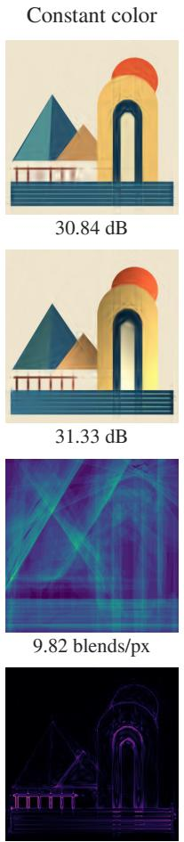

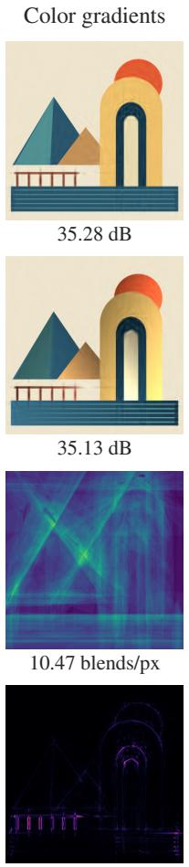

Hexel

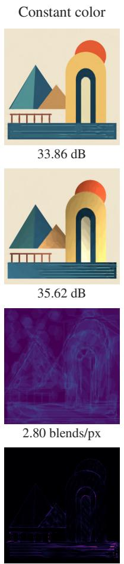

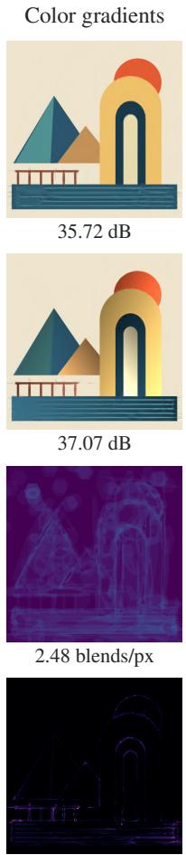

Figure 9. Shape, color, and overdraw ablation for Hexels. Gaussian and Hexel shapes are paired with constant color or spatial RGB color gradients (V1) under same optimization conditions. Top: flat and smoothly shaded images using 256 primitives; labels give PSNR. Bottom: overdraw (how many primitives contribute to every pixel - blends/pixel) and per-pixel RGB error for the shaded target;

## References

[1] Jonathan T Barron, Ben Mildenhall, Dor Verbin, Pratul P Srinivasan, and Peter Hedman. Mip-nerf360: Unbounded anti-aliased neural radiance fields. In Proceedings of the IEEE/CVF Conference on Computer Vision and Pattern Recognition, pages 5470–5479, 2022. 2, 5

[2] Zhiqin Chen, Thomas Funkhouser, Peter Hedman, and Andrea Tagliasacchi. Mobilenerf: Exploiting the polygon rasterization pipeline for eficient neural field rendering on mobile architectures. In Proceedings of the IEEE/CVF Conference on Computer Vision and Pattern Recognition, pages 16569–16578, 2023. 3

[3] Albert Cohen and Jean-Marie Mirebeau. Adaptive and anisotropic piecewise polynomial approximation. arXiv preprint arXiv:1101.1587, 2011. 22

[4] Peter Deutsch. Deflate compressed data format specification version 1.3. Technical report, 1996. 28

[5] Zhiwen Fan, Kevin Wang, Kairun Wen, Zehao Zhu, Dejia Xu, and

Zhangyang Wang. LightGaussian: Unbounded 3D gaussian compression with 15x reduction and 200+ FPS. In Advances in Neural Information Processing Systems, 2024. 3, 27

[6] Sara Fridovich-Keil, Alex Yu, Matthew Tancik, Qinhong Chen, Benjamin Recht, and Angjoo Kanazawa. Plenoxels: Radiance fields without neural networks. In CVPR, 2022. 2, 25

[7] Antoine Guédon and Vincent Lepetit. Sugar: Surface-aligned gaussian splatting for eficient 3d mesh reconstruction and high-quality mesh rendering. arXiv preprint arXiv:2311.12775, 2023. 25

[8] Antoine Guédon, Diego Gomez, Nissim Maruani, Bingchen Gong, George Drettakis, and Maks Ovsjanikov. MILo: Mesh-in-the-loop gaussian splatting for detailed and eficient surface reconstruction. arXiv preprint arXiv:2506.24096, 2025. 26

[9] Thomas C. Hales. The honeycomb conjecture. Discrete & Computational Geometry, 25:1–22, 2001. 2, 4, 22

[10] Abdullah Hamdi, Luke Melas-Kyriazi, Jinjie Mai, Guocheng Qian, Ruoshi Liu, Carl Vondrick, Bernard Ghanem, and Andrea Vedaldi. GES: Generalized exponential splatting for eficient radiance field

rendering. In Proceedings ofthe IEEE/CVF Conference on Computer Vision and Pattern Recognition, pages 19812–19822, 2024. 26

[11] Jan Held, Renaud Vandeghen, Abdullah Hamdi, Adrien Deliege, Anthony Cioppa, Silvio Giancola, Andrea Vedaldi, Bernard Ghanem, and Marc Van Droogenbroeck. 3D Convex Splatting: Radiance field rendering with 3D smooth convexes. In Proceedings of the IEEE/CVF Conference on Computer Vision and Pattern Recognition, 2025. 3, 5, 26

[12] Jan Held, Sanghyun Son, Renaud Vandeghen, Daniel Rebain, Matheus Gadelha, Yi Zhou, Anthony Cioppa, Ming C. Lin, Marc Van Droogenbroeck, and Andrea Tagliasacchi. Meshsplatting: Diferentiable rendering with opaque meshes. In Proceedings ofthe IEEE/CVF Conference on Computer Vision and Pattern Recognition (CVPR), pages 7320–7329, 2026. 5, 26

[13] Jan Held, Renaud Vandeghen, Adrien Deliege, Abdullah Hamdi, Silvio Giancola, Daniel Rebain, Anthony Cioppa, Bernard Ghanem, Andrea Vedaldi, Andrea Tagliasacchi, et al. Triangle splatting for real-time radiance field rendering. In 2026 International Conference on 3D Vision (3DV), pages 1248–1257. IEEE, 2026. 2, 3, 5, 26

[14] Binbin Huang, Zehao Yu, Anpei Chen, Andreas Geiger, and Shenghua Gao. 2D Gaussian Splatting for Geometrically Accurate Radiance Fields. In ACM SIGGRAPH 2024 Conference Papers, 2024. 2, 3, 5, 9, 17, 21, 25

[15] Laki Iinbor, Zhiyang Dou, and Wojciech Matusik. Soft anisotropic diagrams for diferentiable image representation. ACM Transactions on Graphics, 2026. SIGGRAPH 2026. 27

[16] Rasmus Jensen, Anders Dahl, George Vogiatzis, Engin Tola, and Henrik Aanæs. Large scale multi-view stereopsis evaluation. In Proceedings of the IEEE conference on computer vision and pattern recognition, pages 406–413, 2014. 2, 5

[17] Neel Kelkar, Simon Niedermayr, Kaloian Petkov, Klaus Engel, and Rüdiger Westermann. Bake it till you make it: Ultrafast spatial texture-atlas splatting, 2026. 26

[18] Bernhard Kerbl, Georgios Kopanas, Thomas Leimkühler, and George Drettakis. 3d gaussian splatting for real-time radiance field rendering. ACM Transactions on Graphics, 42(4), 2023. 2, 5, 17, 25

[19] Shakiba Kheradmand, Daniel Rebain, Gopal Sharma, Weiwei Sun, Jef Tseng, Hossam Isack, Abhishek Kar, Andrea Tagliasacchi, and Kwang Moo Yi. 3d gaussian splatting as markov chain monte carlo. In Advances in Neural Information Processing Systems, 2024. 3, 26

[20] Diederik P. Kingma and Jimmy Ba. Adam: A method for stochastic optimization. In International Conference on Learning Representations, 2015. 4

[21] Arno Knapitsch, Jaesik Park, Qian-Yi Zhou, and Vladlen Koltun. Tanks and temples: Benchmarking large-scale scene reconstruction. ACM Transactions on Graphics, 36(4), 2017. 2, 5

[22] Joo Chan Lee, Daniel Rho, Xiangyu Sun, Jong Hwan Ko, and Eunbyung Park. Compact 3d gaussian representation for radiance field. In Proceedings ofthe IEEE/CVF Conference on Computer Vision and Pattern Recognition (CVPR), pages 21719–21728, 2024. 27

[23] Rong Liu, Dylan Sun, Meida Chen, Yue Wang, and Andrew Feng. Deformable beta splatting. arXiv preprint arXiv:2501.18630, 2025. 3, 26

[24] Tao Lu, Mulin Yu, Linning Xu, Yuanbo Xiangli, Limin Wang, Dahua Lin, and Bo Dai. Scafold-GS: Structured 3D gaussians for

view-adaptive rendering. In Proceedings ofthe IEEE/CVF Conference on Computer Vision and Pattern Recognition, pages 20654–20664, 2024. 3, 26

[25] Ben Mildenhall, Pratul P. Srinivasan, Matthew Tancik, Jonathan T. Barron, Ravi Ramamoorthi, and Ren Ng. Nerf: Representing scenes as neural radiance fields for view synthesis. In ECCV, 2020. 2, 25

[26] Thomas Müller, Alex Evans, Christoph Schied, and Alexander Keller. Instant neural graphics primitives with a multiresolution hash encoding. ACM Trans. Graph., 41(4):102:1–102:15, 2022. 2, 25

[27] Simon Niedermayr, JosefStumpfegger, and Rüdiger Westermann. Compressed 3d gaussian splatting for accelerated novel view synthesis, 2024. 27

[28] Christian Reiser, Richard Szeliski, Dor Verbin, Pratul P. Srinivasan, Ben Mildenhall, Andreas Geiger, Jonathan T. Barron, and Peter Hedman. Merf: Memory-eficient radiance fields for real-time view synthesis in unbounded scenes. ACM Transactions on Graphics, 2023. 25

[29] Shiwei Ren, Tianci Wen, Yongchun Fang, and Biao Lu. Fastgs: Training 3d gaussian splatting in 100 seconds, 2025. 26

[30] Victor Rong, Jan Held, Victor Chu, Daniel Rebain, Marc Van Droogenbroeck, Kiriakos N. Kutulakos, Andrea Tagliasacchi, and David B. Lindell. Nexels: Neurally-textured surfels for real-time novel view synthesis with sparse geometries. arXiv preprint arXiv:2512.13796, 2025. 2, 3, 5, 26

[31] Johannes Lutz Schönberger and Jan-Michael Frahm. Structure-from-motion revisited. In Conference on Computer Vision and Pattern Recognition (CVPR), 2016. 4

[32] Johannes Lutz Schönberger, Enliang Zheng, Marc Pollefeys, and Jan-Michael Frahm. Pixelwise view selection for unstructured multi-view stereo. In European Conference on Computer Vision (ECCV), 2016. 4

[33] David Svitov, Pietro Morerio, Lourdes Agapito, and Alessio Del Bue. BillBoard Splatting (BBSplat): Learnable textured primitives for novel view synthesis. In Proceedings of the IEEE/CVF International Conference on Computer Vision, 2025. 2, 3, 5, 6, 26

[34] Zhou Wang, Alan C. Bovik, Hamid R. Sheikh, and Eero P. Simoncelli. Image quality assessment: From error visibility to structural similarity. IEEE Transactions on Image Processing, 13(4): 600–612, 2004. 5

[35] Sebastian Weiss and Derek Bradley. Gaussian billboards: Expressive 2D gaussian splatting with textures. arXiv preprint arXiv:2412.12734, 2024. 26

[36] Kai Zhang, Gernot Riegler, Noah Snavely, and Vladlen Koltun. Nerf++: Analyzing and improving neural radiance fields. arXiv:2010.07492, 2020. 2

[37] Richard Zhang, Phillip Isola, Alexei A. Efros, Eli Shechtman, and Oliver Wang. The unreasonable efectiveness ofdeep features as a perceptual metric. In Proceedings of the IEEE Conference on Computer Vision and Pattern Recognition, 2018. 5

[38] Xinjie Zhang, Xingtong Ge, Tongda Xu, Dailan He, Yan Wang, Hongwei Qin, Guo Lu, Jing Geng, and Jun Zhang. GaussianImage: 1000 FPS image representation and compression by 2D gaussian splatting. In European Conference on Computer Vision, pages 327–345. Springer, 2024. 27

[39] Xin Zhang, Anpei Chen, Jincheng Xiong, Pinxuan Dai, Yujun Shen, and Weiwei Xu. Neural shell texture splatting: More details and fewer primitives. In Proceedings ofthe IEEE/CVF International Conference on Computer Vision, 2025. 2, 3, 26

[40] Yunxiang Zhang, Bingxuan Li, Alexandr Kuznetsov, Akshay Jindal, Stavros Diolatzis, Kenneth Chen, Anton Sochenov, Anton Kaplanyan, and Qi Sun. Image-gs: Content-adaptive image representation via 2d gaussians. In Proceedings of the Special Interest Group on Computer Graphics and Interactive Techniques Conference Conference Papers, pages 1–11. ACM, 2025. 2, 5, 19, 27

[41] Ziyu Zhang, Binbin Huang, Hanqing Jiang, Liyang Zhou, Xiaojun Xiang, and Shunhan Shen. Quadratic gaussian splatting: High quality surface reconstruction with second-order geometric primitives. arXiv preprint arXiv:2411.16392, 2025. 26

## Appendix contents

A Hexel Parameterization 15   
A.1 Appearance . . 15   
A.2 Derivatives 15   
B Rasterization 17   
C Densification and Pruning 18   
D 2D Image Representation 18   
E Implementation Details 19   
E.1 Datasets and Metrics 19   
E.2 Initialization and Training . . 20   
E.3 Baseline Settings . 20   
E.4 Timing and Memory 20   
E.5 Hexel Surface-Cell Representation . 21   
E.6 Spatial Appearance Ablations . 21   
F Surface Reconstruction Ablations 21   
G Why Hexagons and Spatial Color? 22   
G.1 Linear Color 22   
G.2 Patch Shape 24   
G.3 3D Alpha Compositing 25   
H Extended Related Work 25   
Full NVS Results 27   
I.1 Matched Model Memory 27   
I.2 Fixed and Densified Hexels . 27   
I.3 Deployment Compression analysis . . 27   
J Per-Scene NVS Results 29   
K Additional Qualitative Comparisons 29

## A Hexel Parameterization

Stored parameters. A 3D Hexel stores its center $\mathbf { p } _ { i } \in \mathbb { R } ^ { 3 }$ , two positive tangent scales $s _ { u , i }$ and $s _ { v , i } ,$ a quaternion defining its orientation, opacity $o _ { i } ,$ , and support sharpness $\beta _ { i } .$ . The quaternion is normalized before constructing the tangent frame, and its first two axes define the orthogonal tangent directions $\mathbf { t } _ { u , i }$ and $\mathbf { t } _ { v , i } .$ Thus, the geometric and support parameters require 11 learned scalars: three for position, two for scale, four for orientation, one for opacity, and one for support sharpness.

The V1 appearance model adds a base RGB value and two RGB spatial gradients, for nine additional scalars. A V1 Hexel therefore contains 20 learned scalars in total. V2 adds nine directional coefficients, while V3 adds 45 spherical-harmonic coeficients, giving 29 and 65 learned scalars, respectively.

## A.1 Appearance

The spatial appearance field used by all three variants is

$$
\begin{array} { r } { \mathbf { c } _ { i } ^ { \mathrm { s p } } ( u , v ) = \mathbf { c } _ { 0 , i } + u \mathbf { g } _ { u , i } + v \mathbf { g } _ { v , i } , } \end{array}\tag{5}
$$

where $\mathbf { c } _ { 0 , i } \in \mathbb { R } ^ { 3 }$ is the base color and ${ \bf g } _ { u , i } , { \bf g } _ { v , i } \in \mathbb { R } ^ { 3 }$ are RGB gradients along the two local Hexel coordinates. V1 uses this spatial field directly. V2 and V3 add a view-dependent RGB residual:

$$
\mathbf { c } _ { i } ( u , v , \mathbf { d } _ { i } ) = \mathbf { c } _ { i } ^ { \mathrm { s p } } ( u , v ) + \mathbf { r } _ { i } ( \mathbf { d } _ { i } ) ,\tag{6}
$$

where ${ \bf d } _ { i }$ is the normalized world-space direction from the camera center to the Hexel center $\mathbf { p } _ { i } ,$ and

$$
\mathbf { r } _ { i } ( \mathbf { d } _ { i } ) = \left\{ \begin{array} { l l } { 0 , } & { \mathrm { V 1 } , } \\ { \mathbf { A } _ { i } \mathbf { d } _ { i } , } & { \mathrm { V 2 } , } \\ { \displaystyle \sum _ { \ell = 1 } ^ { 3 } \sum _ { m = - \ell } ^ { \ell } \mathbf { a } _ { i , \ell m } Y _ { \ell m } ( \mathbf { d } _ { i } ) , } & { \mathrm { V 3 } . } \end{array} \right.\tag{7}
$$

Here $\mathbf { A } _ { i } \in \mathbb { R } ^ { 3 \times 3 }$ gives the nine coeficients ofthe linear V2 residual. For $\mathrm { V } 3 , Y _ { \ell m }$ denotes a real spherical-harmonic basis function and $\mathbf { a } _ { i , \ell m } \in \mathbb { R } ^ { 3 }$ its RGB coeficient. Degrees one through three contain 15 basis functions, giving 45 learned coeficients; the base RGB $\mathbf { c } _ { 0 , i }$ provides the view-independent constant component.

The viewing direction is evaluated once at the Hexel center. Therefore, for a fixed camera, the V2 and V3 residuals are constant over the primitive: view dependence changes its RGB ofset but not the spatial gradients $\mathbf { g } _ { u , i }$ and $\mathbf { g } _ { v , i } .$

## A.2 Derivatives

Support derivatives. Let $\mathbf { u } = ( u , v ) ^ { \top }$ and define the three unit normals

$$
{ \bf n } _ { 0 } = ( 0 , 1 ) ^ { \top } , \quad { \bf n } _ { 1 } = ( \sqrt { 3 } / 2 , 1 / 2 ) ^ { \top } , \quad { \bf n } _ { 2 } = ( \sqrt { 3 } / 2 , - 1 / 2 ) ^ { \top } .\tag{8}
$$

Together, $\mathcal { N } = \{ \pm \mathbf { n } _ { 0 } , \pm \mathbf { n } _ { 1 } , \pm \mathbf { n } _ { 2 } \}$ are the outward normals of the six sides of the canonical hexagon. The hexagonal function can therefore be written as

$$
d ( \mathbf { u } ) = \operatorname* { m a x } _ { \mathbf { n } \in \mathcal { N } } \mathbf { n } ^ { \top } \mathbf { u } - 1 = \operatorname* { m a x } _ { e \in \{ 0 , 1 , 2 \} } | \mathbf { n } _ { e } ^ { \top } \mathbf { u } | - 1 .\tag{9}
$$

Its zero level set defines the canonical hexagonal boundary, with $d < 0$ inside and $d > 0$ outside.

At a point where one projection is strictly larger than the other five, let $\mathbf { n } ^ { \star }$ denote the corresponding normal. For suficiently small changes in $\mathbf { u } ,$ this projection remains the largest, so $d ( \mathbf { u } ) = \mathbf { n } ^ { \star \top } \mathbf { u } - 1$ and

$$
\nabla _ { \mathbf { u } } d = \mathbf { n } ^ { \star } .\tag{10}
$$

When two or more projections tie for the largest value, small movements in diferent directions can select diferent side normals. The function remains continuous, but has no ordinary gradient at that point. Any ofthe tied maximizing normals is a valid subgradient: one of the slopes that can be used for optimization

Gaussian

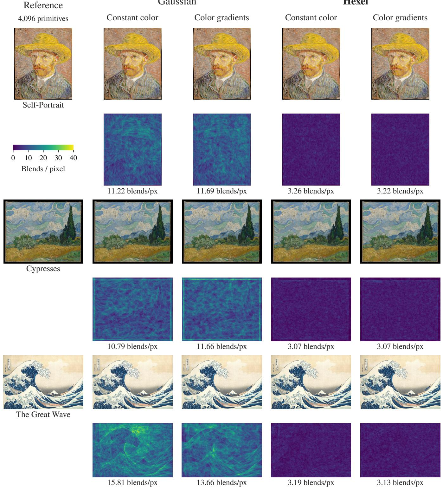

Figure 10. Overdraw Ablation. Reference images and Gaussian/Hexel reconstructions are followed by their overdraw maps, using 4,096 primi tives and same optimization setup. Labels below the maps give mean blends/pixel i.e. overdraw; The four ablative settings match those in Figure 9. This visualization shows that the Hexel primitive requires lower overdraw for similar or better visual quality as compared to Gaussians.

at this corner ofthe function. These ties form a zero-area set, so the ordinary gradient exists almost everywhere. Although � gives the exact hexagonal contour and inside-outside sign, it is not the Euclidean signed distance outside the hexagon near its vertices.

For the soft support $K ( \mathbf { u } ) = \sigma ( - \beta d ( \mathbf { u } ) )$ , the chain rule gives

$$
\nabla _ { \mathbf { u } } K = - \beta K ( 1 - K ) \nabla _ { \mathbf { u } } d , \qquad { \frac { \partial K } { \partial \beta } } = - d ( \mathbf { u } ) K ( 1 - K ) .\tag{11}
$$

The spatial derivative holds wherever � is diferentiable. At a tie, substituting a selected maximizing normal gives the corresponding gradient choice for optimization. The derivative with respect to � exists at every point.

The rendered opacity contribution is $\alpha = \operatorname* { m i n } \{ o K , 0 . 9 9 \}$ For $o K < 0 . 9 9$

$$
\frac { \partial \alpha } { \partial o } = K , \qquad \frac { \partial \alpha } { \partial K } = o .\tag{12}
$$

For � $K > 0 . 9 9 ,$ � is locally constant, and both derivatives are zero. $\mathrm { A t } o K = 0 . 9 9$ , our backward implementation uses the unclamped-branch derivatives.

Color and compositing derivatives. For the spatial color field, $\partial \mathbf { c } _ { i } ^ { \mathrm { s p } } / \partial u = \mathbf { g } _ { u , i }$ and $\partial \mathbf { c } _ { i } ^ { \mathrm { s p } } / \partial v \ = \ \mathbf { g } _ { v , i }$ . Changes in local coordinates therefore afect both the support weight and the color within the Hexel.

Let ${ \bf c } _ { > i }$ be the color obtained by compositing only the retained Hexels behind primitive �, including the background and starting with transmittance one. With the retained contributions and their order fixed, let $\begin{array} { r } { T _ { i } = \prod _ { j < i } ( 1 - \alpha _ { j } ) } \end{array}$ be the transmittance reaching primitive �. Then

$$
\frac { \partial \mathbf c ( \mathbf x ) } { \partial \mathbf c _ { i } } = T _ { i } \alpha _ { i } \mathbf I _ { 3 } , \qquad \frac { \partial \mathbf c ( \mathbf x ) } { \partial \alpha _ { i } } = T _ { i } ( \mathbf c _ { i } - \mathbf c _ { > i } ) ,\tag{13}
$$

where $\mathbf { I } _ { 3 }$ is the $3 \times 3$ identity matrix. The first expression weights the color derivative by the primitive’s blending weight. The second describes how increasing its opacity replaces some of the color behind it with its own color.

A back-to-front traversal accumulates these derivatives. Gradients propagate to appearance and opacity, and through the local coordinates and ray–plane intersection to geometry. For $_ { \textrm V 2 }$ and V3, moving the Hexel center also changes its view-dependent color. We diferentiate through the numerically stabilized view direction $\mathbf { d } _ { i } = ( \mathbf { p } _ { i } - \mathbf { o } ) / \sqrt { \| \mathbf { p } _ { i } - \mathbf { o } \| ^ { 2 } + 1 0 ^ { - 8 } }$ , where � is the camera center.

Using $\delta _ { i } = \mathbf { p } _ { i } - \mathbf { o }$ and $\rho _ { i } = \sqrt { \| \delta _ { i } \| ^ { 2 } + 1 0 ^ { - 8 } }$ , the additional position gradient is

$$
\frac { \partial \mathbf { d } _ { i } } { \partial \mathbf { p } _ { i } } = \frac { \mathbf { I } _ { 3 } } { \rho _ { i } } - \frac { \delta _ { i } \delta _ { i } ^ { \top } } { \rho _ { i } ^ { 3 } } .\tag{14}
$$

The V2 variant has Jacobian $\mathbf { A } _ { i }$ with respect to ${ \bf { d } } _ { i } ;$ Hexel V3 has a diferentiable polynomial SH basis. Both therefore contribute to the position gradient in addition to the ray–plane geometry.

Optimization coordinates. For 3D applications, (positive) scales and sharpness parameters are represented exponentially, and

opacity is derived using a sigmoid: $s _ { a } = \exp ( \ell _ { a } ) , \beta = \exp ( b )$ and $o = \sigma ( a )$ . For a latent or upstream gradient $\bar { z } = { \partial \mathcal { L } } / { \partial z } _ { ; }$

$$
\begin{array} { r } { \bar { \ell } _ { a } = s _ { a } \bar { s } _ { a } , \qquad \bar { b } = \beta \bar { \beta } , \qquad \bar { a } = o ( 1 - o ) \bar { o } . } \end{array}\tag{15}
$$

For the forward pass, the kernel applies the floor function for sharpness parameter at $1 0 ^ { - 4 }$ for numerical stability. Below this value, its backward pass uses the support derivative evaluated at the floor, using a straight-through gradient value.

## B Rasterization

Perspective-correct coordinates. Like 2DGS [14], we recover local Hexel coordinates through ray–plane intersection. Let $\mathbf { T } _ { i } \in$ $\mathbb { R } ^ { 3 \times 3 }$ map local homogeneous coordinates $( u , v , 1 ) ^ { \top }$ to homogeneous image coordinates, combining Eq. (1) with the calibrated camera. It factors as $\mathbf { T } _ { i } = \pi \mathbf { M } _ { i } ,$ where the local-to-world matrix

$$
\begin{array} { r l } & { \mathbf { M } _ { i } = \left( \begin{array} { c c c } { s _ { u , i } \mathbf { t } _ { u , i } } & { s _ { v , i } \mathbf { t } _ { v , i } } & { \mathbf { p } _ { i } } \\ { 0 } & { 0 } & { 1 } \end{array} \right) \in \mathbb { R } ^ { 4 \times 3 } , } \\ & { \mathbf { T } _ { i } = \pmb { I I M } _ { i } . } \end{array}\tag{16}
$$

is Eq. (1) written as a matrix: it maps $( u , v , 1 ) ^ { \top }$ to the world point $P _ { i } ( u , v )$ in homogeneous form, $\left( P _ { i } ( u , v ) , 1 \right) ^ { - }$ ⊤. It places the Hexel plane in the world. $\mathbf { T } _ { i }$ is therefore the exact perspective map of the Hexel plane, whereas 3DGS [18] projects each Gaussian with a local afine approximation. Denote its rows by $\mathbf { t } _ { x } ^ { \top } , \mathbf { t } _ { y } ^ { \top }$ , and $\mathbf { t } _ { z } ^ { \top }$ For a pixel $( x , y )$ , define

$$
{ \bf k } = x { \bf t } _ { z } - { \bf t } _ { x } , \qquad 1 = y { \bf t } _ { z } - { \bf t } _ { y } , \qquad { \bf h } = { \bf k } \times { \bf l } .\tag{17}
$$

The intersection must satisfy $\mathbf { k } ^ { \top } ( u , v , 1 ) ^ { \top } = \Gamma ^ { \top } ( u , v , 1 ) ^ { \top } = 0 .$ Since � is orthogonal to both � and �, the local coordinates are $( u , v ) \ : = \ : ( h _ { x } / h _ { z } , h _ { y } / h _ { z } )$ when $h _ { z } \neq 0 .$ . This recovers the perspective-correct intersection without a per-pixel matrix inverse. We skip intersections with $h _ { z } = 0$ or camera-space depth below the near-plane threshold of0.2. Before Hexels are assigned to image tiles (see Visibility and compositing below), we also discard every Hexel whose center has camera-space depth at most 0.2. The same local coordinates are used to evaluate the hexagonal support and spatial color field.

Support bounds. The sigmoid is nonzero outside the canonical hexagon, so we bound the region that can contribute above the rasterizer’s alpha threshold $\tau = 1 / 2 5 5$ . Since $\alpha _ { i } \leq K _ { i } ,$ , a contribution with $\alpha _ { i } \geq \tau$ must satisfy $K _ { i } \geq \tau$ . Substituting $K _ { i } =$ $\sigma ( - \beta _ { i } d )$ gives

$$
d ( u , v ) \leq \frac { 1 } { \beta _ { i } } \log \frac { 1 - \tau } { \tau } = \frac { \log 2 5 4 } { \beta _ { i } } .\tag{18}
$$

This defines a larger regular hexagon with center-to-edge distance 1 + log $2 5 4 / \beta _ { i }$ . It is enclosed by a circle with radius

$$
r _ { i } = \frac { 2 } { \sqrt { 3 } } \left( 1 + \frac { \log { 2 5 4 } } { \beta _ { i } } \right) .\tag{19}
$$

The radius is in local Hexel coordinates, before tangent scaling and projection. We use this enclosing circle with the projective bounding routine inherited from 2DGS to determine the image tiles assigned to each primitive. The bound is conservative in the local plane because it uses the maximum possible opacity, rather than the learned opacity of each Hexel. The kernel computes a second, tighter box using the learned opacity. A contribution passes the threshold only if $o _ { i } K _ { i } \ge \tau ,$ which holds only inside the smaller hexagon $d ( u , v ) \leq \beta _ { i } ^ { - 1 } \log ( o _ { i } / \tau - 1 )$ ; a Hexel with $o _ { i } < \tau$ with $o _ { i } < \tau$ cannot contribute.

Visibility and compositing. We divide the image into 16×16-pixel tiles and assign each Hexel to the tiles intersecting its projected bound. Within each tile, primitives are sorted by their centers’ camera-space depth. This order is shared by the pixels in the tile; we do not sort intersections separately at each pixel.

For each candidate intersection, we evaluate its opacity as $\alpha _ { i } =$ min $\{ o _ { i } K _ { i } ( u _ { i } , v _ { i } ) , 0 . 9 9 \}$ and skip contributions with $\alpha _ { i } <$ $1 / 2 5 5$ . Let � be the remaining transmittance before processing the candidate. $\mathrm { I f } T ( 1 - \alpha _ { i } ) < \mathrm { 1 0 ^ { - 4 } }$ , we stop without accumulating that candidate or updating � . Otherwise, its color contribution is $T \alpha _ { i } \mathbf { c } _ { i } ( u _ { i } , v _ { i } , \mathbf { d } _ { i } )$ , and we update $T \gets T ( 1 - \alpha _ { i } )$

For the � contributions actually accumulated at a pixel, indexed in their compositing order, the final color is

$$
\begin{array} { c } { { \displaystyle { \bf c } ( { \bf x } ) = \sum _ { i = 1 } ^ { m } T _ { i } \alpha _ { i } { \bf c } _ { i } ( u _ { i } , v _ { i } , { \bf d } _ { i } ) + T _ { \mathrm { e n d } } { \bf c } _ { \mathrm { b g } } , } } \\ { { { \cal T } _ { i } = \displaystyle { \prod _ { j < i } ( 1 - \alpha _ { j } ) } , \qquad T _ { \mathrm { e n d } } = \prod _ { i = 1 } ^ { m } ( 1 - \alpha _ { i } ) . } } \end{array}\tag{20}
$$

Here $\mathbf { c } _ { \mathrm { b g } }$ is the background color. Its weight is the transmittance remaining after the contributions actually accumulated, not the tentative value that triggered early termination.

## C Densification and Pruning

Hexels (V1/V2/V3 - Fixed) do not primarily use densification and pruning to avoid exceeding memory and/or primitive constraints in our primary experiments. Given our focus on practical eficiency, we want to avoid any hacks to improve our performance by temporarily going over the memory or primitive limits - which is why the peak VRAM values are very important, as often, other eficiency-focused methods do not report them. We, however, also report the densified NVS and surface reconstruction counterparts in our results - primarily in unconstrained settings - which are not the focus ofour work. Notably, our baseline methods are allowed to temporarily exceed memory and primitive constraints to achieve better results, as they often perform much worse when forced to remain below these requirements.

Mixed growth. Our densification strategy is similar to 3DGS and 2DGS. Between two growth triggers, for each Hexel, we track the norm of the loss gradient with respect to its projected 2D center, averaged over the iterations in which the Hexel is visible. A Hexel becomes a parent Hexel when this average is large, it was visible often enough, and it is not too young. Small parents are cloned, and large parents are split. A parent Hexel counts as small when its larger tangent scale is at most 1% ofthe scene extent. A clone is a copy of the parent Hexel whose center is moved within the parent’s tangent plane by a random Gaussian ofset, scaled by the parent’s two scales. A split replaces the parent with two children, each ofset randomly in the same plane, with both scales divided by 1.6, as in 3DGS, and an opacity $o _ { \mathrm { c h i l d } } = 1 - \sqrt { 1 - o _ { \mathrm { p a r e n t } } } .$ New Hexels copy the parent’s appearance coeficients.

Contribution-based pruning. Pruning removes Hexels that contribute very little to the scene. Each pruning session renders all training views $\mathcal { V } _ { \mathrm { t r a i n } }$ and scores Hexel � by its mean blending weight

$$
q _ { i } = \frac { 1 } { | \mathcal { V } _ { \mathrm { t r a i n } } | } \sum _ { v \in \mathcal { V } _ { \mathrm { t r a i n } } } \frac { 1 } { | \Omega _ { v } | } \sum _ { \mathbf { x } \in \Omega _ { v } } T _ { i , v } ( \mathbf { x } ) \alpha _ { i , v } ( \mathbf { x } ) ,\tag{21}
$$

where $\Omega _ { v }$ is the set of pixels of view � and $T _ { i , v } ( \mathbf { x } ) \alpha _ { i , v } ( \mathbf { x } )$ is the weight of Hexel � at pixel � in Eq. (20). The weight is zero whenever the Hexel does not contribute – outside its tiles, below the alpha threshold, or after early termination. A Hexel can be pruned when $q _ { i }$ is below a threshold or has existed for longer than a grace period – this gives opportunity for newer Hexels to contribute.

Schedule and thresholds. All densified (G) V1/V2/V3 models, for both NVS and surface reconstruction, use mixed growth every 500 iterations from 5.5K through 14.5K, with a ceiling of 2M Hexels. A parent Hexel needs an average gradient norm of at least $2 \times 1 0 ^ { - 4 }$ , at least 20 observations since the previous growth trigger, and a minimum age of 500 iterations. Clone and split ofsets have standard deviations of 0.25 and 0.5 times the parent’s scales, and a clone’s opacity is at most 0.02. Pruning runs every 1K iterations from 5K to 16K, with a 500-iteration grace period, a threshold of $1 0 ^ { - 7 }$ on $q _ { i }$ , and at most 2% of the Hexels are removed per trigger. At each growth trigger, we also remove every Hexel with opacity below 0.005, regardless of its age or the 2% limit. Opacities are never reset.

## D 2D Image Representation

Hexels can represent an image directly by placing the primitives in the image plane. We retain the hexagonal support and firstorder spatial color model, but replace 3D projection and depthordered compositing with image-space evaluation and blending.

Geometry and function support. For a pixel $\mathbf { x } = ( x , y ) ^ { \top } , \mathrm { l e t } \mathbf { m } _ { i } =$ $( m _ { x , i } , m _ { y , i } ) ^ { \top }$ be the Hexel center, $\mathbf { R } ( \theta _ { i } )$ its planar rotation, and $\mathbf { S } _ { i } = \mathrm { d i a g } ( s _ { x , i } , s _ { y , i } )$ its positive scale matrix. We compute local coordinates and the soft support weight (for numerical stability) $\begin{array} { r } { \tilde { \mathbf { S } } _ { i } = \mathbf { S } _ { i } + 1 0 ^ { - 8 } \mathbf { I } _ { 2 } \colon } \end{array}$

$$
\begin{array} { r } { \mathbf { u } _ { i } ( \mathbf { x } ) = \tilde { \mathbf { S } } _ { i } ^ { - 1 } \mathbf { R } ( \theta _ { i } ) ^ { \top } ( \mathbf { m } _ { i } - \mathbf { x } ) , \qquad w _ { i } ( \mathbf { x } ) = \sigma ( - \beta _ { i } d ( \mathbf { u } _ { i } ( \mathbf { x } ) ) ) , } \end{array}\tag{22}
$$

where � is the hexagonal function from Eq. (2) and $\beta _ { i } ~ > ~ 0$ is the support sharpness. This evaluates the support directly at each pixel, without projection or ray–plane intersection. Since $d ( \mathbf { u } ) = d ( - \mathbf { u } ) _ { : }$ , reversing the displacement does not change the support weight. Scales are optimized as log-scales. Hexels (V1) learn $\beta _ { i } = \mathrm { \bar { s o f t p l u s } } ( \tilde { \beta } _ { i } )$ , initialized near 10; the constant-color ablation uses a fixed $\beta = 1 0$ shared by all primitives and not stored.

Spatial appearance. We use the first-order spatial color model of V1, expressed here in image coordinates:

$$
\mathbf { c } _ { i } ( \mathbf { x } ) = \mathbf { c } _ { 0 , i } + \eta \left[ ( m _ { x , i } - x ) \mathbf { g } _ { x , i } + ( m _ { y , i } - y ) \mathbf { g } _ { y , i } \right] ,\tag{23}
$$

where ${ \bf c } _ { 0 , i }$ is the base RGB color, $\mathbf { g } _ { x , i } , \mathbf { g } _ { y , i } \in \mathbb { R } ^ { 3 }$ are the spatial color coeficients, and $\eta = 0 . 1$ controls their scale. The coefficients describe color changes along the image axes, using the center-minus-pixel displacement shown above. Unlike Eq. (4), these coordinates are not rotated or normalized by the Hexel scales. Both formulations represent an afine color field, but use diferent coordinate parameterizations. The constant-color ablation omits the two spatial terms, giving $\mathbf { c } _ { i } ( \mathbf { x } ) = \mathbf { c } _ { 0 , i }$ . Neither model uses view-dependent appearance.

Rendering. Following Image-GS [40], we retain the $K \ = \ 1 0$ largest support weights among the primitives assigned to the pixel’s tile. Let $\mathcal { S } _ { K } ( { \bf x } )$ denote their indices. We blend their colors as

$$
\mathbf { c } ( \mathbf { x } ) = \frac { \displaystyle \sum _ { i \in \mathcal { S } _ { K } ( \mathbf { x } ) } w _ { i } ( \mathbf { x } ) \mathbf { c } _ { i } ( \mathbf { x } ) } { \displaystyle \sum _ { i \in \mathcal { S } _ { K } ( \mathbf { x } ) } w _ { i } ( \mathbf { x } ) + \epsilon } ,\tag{24}
$$

where $\epsilon ~ = ~ 1 0 ^ { - 4 }$ prevents division by zero. Unlike the 3D compositor, this blend has no transmittance, depth ordering, or learned opacity: each retained primitive contributes according to its support weight relative to the others. During optimization, gradients propagate through the selected weights and colors to the Hexel parameters. The selected indices are treated as fixed when computing these gradients. Backward pass reuses the saved top-� indices and reevaluates only their support weights and colors.

Finite support. Each Hexel is assigned to the 16 × 16 tiles overlapping a square of half-width $\begin{array} { r } { r _ { i } ~ = ~ \lceil \frac { 2 } { \sqrt { 3 } } \operatorname* { m a x } ( s _ { x , i } , s _ { y , i } ) ( 1 + } \end{array}$ $4 . 5 / \beta _ { i } ) ]$ pixels, which encloses the contour $d = 4 . 5 / \beta _ { i }$ where $w _ { i } = \sigma ( - 4 . 5 )$ ≈ 0.011. Every candidate in these tiles is evaluated without a weight threshold, and pixels in tiles without candidates are rendered as zero. Unlike the 3D bound of $\operatorname { E q . } \left( 1 8 \right)$ , this cutofdoes not use 1/255.

Experiment details. We fit all 45 Image-GS images at 2048×2048 resolution for a primary 2D representation experiment. We use the Image-GS image-gradient initializer for both methods, with 30% sampled uniformly; base RGB values are sampled from the target image, scales are initialized at five pixels, while rotations and spatial color gradients are zero-initialized. Each Hexel is initialized with 20K primitives. From iterations 550 through 3000, we prune 200 primitives every 50 iterations, converging to 10K primitives. Hexels use L1 plus 0.1(1 − SSIM) loss and the Adam optimizer and stop early at 5100 iterations since Hexels converge faster. In a smaller experiment, we found that further training to $1 0 { , } 0 0 0$ iterations did see marginal improvements in quality. All parameters and optimizer states are in FP32. For all methods in Table 1 same precision is used for all parameters. Memory size includes every active parameter and any relevant decoding metadata. Figure 4 uses values with the mean ofthree diferent experimental runs, with the variance spread displaying the diferences in convergence across the entire Image-GS dataset.

Primitive Overdraw. We distinguish the total number of primitives from the number covering each pixel. Since both Gaussian and Hexel supports have nonzero tails, we count a primitive as covering a pixel when its support weight reaches a common fraction $\tau \in ( 0 , 1 )$ of its own peak:

$$
C _ { \tau } ( \mathbf { x } ) = \sum _ { i = 1 } ^ { N } \mathbf { 1 } \bigg [ \frac { w _ { i } ( \mathbf { x } ) } { \operatorname* { m a x } _ { \mathbf { y } } w _ { i } ( \mathbf { y } ) } \geq \tau \bigg ] .\tag{25}
$$

Here � is the total primitive count and � is the indicator function. A value $C _ { \tau } ( \mathbf { x } ) \mathbf { \Psi } = \mathbf { \Psi } 0$ means that no primitive covers the pixel at this threshold; $C _ { \tau } ( \mathbf { x } ) = 1$ means that exactly one does, and larger values indicate overlapping supports. We count supports before top-� selection, rather than summing the normalized blending weights. This measures spatial overlap that we refer to as overdraw.

We summarize coverage by the mean of $C _ { \tau }$ over the full image and the fractions of pixels covered by zero or multiple supports. A mean tending to one can result from uncovered pixels ofsetting heavily overlapping regions. Primitive count and reconstruction quality are also reported for completeness. Compar ing methods at matched reconstruction quality additionally tests whether Hexels require fewer primitives, rather than simply reducing overlap at the expense of quality.

## E Implementation Details

## E.1 Datasets and Metrics

We evaluate 34 scenes: nine from Mip-NeRF360, fifteen DTU scans (24, 37, 40, 55, 63, 65, 69, 83, 97, 105, 106, 110, 114, 118 and 122), and ten from Tanks and Temples (Barn, Caterpillar, Courthouse, Francis, Horse, Ignatius, Lighthouse, Meetingroom, Train and Truck). Every eighth camera is held out, with identical cameras and images across methods. Mip-NeRF360 uses quarterresolution outdoor and half-resolution indoor images; DTU and T&T use half-resolution. PSNR and SSIM use float RGB images, and LPIPS-VGG inputs are normalized. We average reported metrics over test views, then equally over scenes for each configuration.

Colors rank methods within each primitive family and dataset. Teal and blue mark the best volumetric and hybrid values, respectively; red, orange, and yellow mark the top three surface values. F/G denote fixed/grown (densified) Hexels.

## E.2 Initialization and Training

Hexels V1-V3 start from sparse COLMAP points and colors unless stated otherwise, with one Hexel per point and its color used as the base RGB point. Rotations start at identity quaternion initialization, without estimated surface normals. Both tangent scales are initialized to one quarter of the root-mean-square distance to the three nearest neighbors, capped at 5% of the scene camera extent. Opacity is initialized at 0.1 and sharpness parameter at 10. Spatial color gradients and view-dependent coeficients are initialized to zero. We optimize geometry, opacity, sharpness, and appearance parameters jointly. We train using Adam optimizer for 30K iterations using the photometric loss and with SSIM weight 0.2. Experiments using densification, usually in the unconstrained case, use the method described in Appendix C. Unlike some other baselines, for NVS experiments, Hexels do not use depth distortion, normal regularization, or MVS initialization. Details regarding learning rates are given in Table 7.

Table 7. Initial learning rates for the Hexel V1-V3 models for NVS experiments. Only parameters enabled by a variant are optimized. All rates are halved after 15K, 20K, and 25K iterations.
<table><tr><td>Parameter</td><td>Learning rate</td></tr><tr><td>Center</td><td> $1 . 6 \times 1 0 ^ { - 4 }$ </td></tr><tr><td>Log tangent scales</td><td> $5 \times 1 0 ^ { - 3 }$ </td></tr><tr><td>Rotation quaternion</td><td> $1 0 ^ { - 3 }$ </td></tr><tr><td>Opacity logit</td><td> $1 0 ^ { - 1 }$ </td></tr><tr><td>Base RGB</td><td> $1 0 ^ { - 2 }$ </td></tr><tr><td>Spatial color gradients</td><td> $5 \times 1 0 ^ { - 3 }$ </td></tr><tr><td>Linear view coefficients (V2)</td><td> $5 \times 1 0 ^ { - 3 }$ </td></tr><tr><td>SH coefficients (V3)</td><td> $5 \times 1 0 ^ { - 4 }$ </td></tr><tr><td>Log boundary sharpness</td><td> $1 0 ^ { - 2 }$ </td></tr></table>

2D image fitting. For the image-representation experiments, Hexels use following learning rates: $5 \times 1 0 ^ { - 4 }$ for centers, 10−2 for (log-)scales, $2 \times \overline { { 1 0 } } ^ { - 3 }$ for rotation angles, $5 \times 1 0 ^ { - 3 }$ for base RGB, and $1 0 ^ { - 3 }$ for spatial RGB gradients and support-sharpness parameters when present. All rates are reduced tenfold at iteration 5001. Hexels stop at 5100 iterations after pruning from 20K to 10K primitives, as detailed in Appendix D. Image-GS retains its original parameterization and hyperparameters.

## E.3 Baseline Settings

We use the authors’ implementations of2DGS, 3DGS, 3D Convex Splatting, Triangle Splatting, BBSplat, MeshSplatting, and Nexels. BBSplat trains for 32K iterations and includes compressed textures to reduce reported memory requirements post hoc.

Reported model memory, including matched model memory experiments, includes all primitive and appearance parameters, including textures, feature grids and decoders. Nexels use a reduced feature grid to fit within each experimental budget.

MeshSplatting is matched at initialization; native remeshing can change its final memory. Matched-primitive experiments limit final populations to the scene’s SfM point count while retaining native growth and pruning. Native comparisons use each baseline’s original population policy.

For DTU surface reconstruction experiment, native unconstrained and budget-controlled 2DGS use normal-consistency and depth-distortion loss weights of 0.05 and 1000, respectively. For the constrained experiments, the Hexels primitive or modelmemory budget determines the final population ceiling; after initialization and each densification/pruning update, we retain the highest-opacity primitives up to that ceiling. This means that during densification, 2dGS can and does go beyond the set primitive limits - we note that if these limits are used strictly, 2DGS and other baselines perform poorly. This further shows that Hexels, which actually do strictly conform to the memory or primitive budgets, usually without doing densification, are state-of-the-art or surface line primitives in terms of eficiency-quality frontier.

## E.4 Timing and Memory

Hardware and rendering speed. Experiments use RTX A5000 GPUs; starred rows are experiments that were run on RTX 6000 Ada as A5000 memory was insuficient for that specific experiment. For FPS calculations, we perform two warmup passes and run four trials often passes across all test camera viewpoints, with GPU synchronization. We report the median FPS per scene and average over scenes, excluding loading, image transfer, and metric computation.

2D image fitting/training timing. The 2D fitting times include optimization and pruning, excluding initialization, evaluation and any post-hoc I/O. For Table 1, all three stored representations are decoded and timed using the same A5000 rendering protocol: 10 warmup renders followed by 5 trials of20 renders, with GPU synchronization. We take the median latency per image, convert it to FPS, and average equally over all 45 images. These repeated renders of a single image measure rendering throughput, excluding file I/O.

Model memory and deployment size. Model memory is the memory of the uncompressed model used for inference: all FP32 parameters needed for rendering, without optimizer state. Hexels V1/V2/V3 use 80/116/260 bytes per primitive. Deployment size includes files needed for inference, including configuration and appearance parameters, in decimal MB. NVS comparison tables report the original uncompressed FP32 inference files; compression for deployment is evaluated separately in Appendix I.3.

Training resources. Peak VRAM is the sampled process GPU memory during training, in GiB; dataset values average the perscene peaks. Training time includes initialization, optimization and checkpoint saving, but excludes separate evaluation, compression, and video generation. For VRAM calculation, we run multiple runs and sample GPU memory at approximately 2 ms or

5 ms intervals using NVIDIA’s NVML API. All mean text VRAM calculations use this, while some in the appendix may use just 5ms sampling.

## E.5 Hexel Surface-Cell Representation

A Hexel can be used to specify a hexagonal cell through $d ( u , v ) =$ 0 in Eq. (2). The six vertices can be mapped analytically into the world space through Eq. (1). Importantly, this is diferentiable and can be done in constant time per Hexel or any other polygonal primitive with low overdraw. However, this might not be possible for the more prevalent Gaussian-based surfels like 2DGS. A Gaussian surfel [14] has a smooth local representation $G ( u , v ) = \exp [ - ( u ^ { 2 } { + } v ^ { 2 } ) / 2 ]$ , with no explicitly finite boundary; therefore, getting such a diferentiable, constant-time surface cell representation is non-trivial.

## E.6 Spatial Appearance Ablations

Tables 14 and 15 compare all six Hexels configurations (V1/V2/V3 with fixed or densified populations) on Mip-NeRF360, DTU, and Tanks and Temples. V3 with densification achieves the high est PSNR across all three datasets. Fixed population variants require less memory and render faster. Densification improves V3’s PSNR on Mip-NeRF360 and Tanks and Temples; on DTU, fixed V3 achieves slightly higher PSNR (29.95 versus 29.76 dB), whereas densified V3 improves LPIPS (0.268 versus 0.293).

## F Surface Reconstruction Ablations

In this section, we perform ablations on the Hexels’ model underlying our DTU surface reconstruction results in Table 5: a fixed-population V3 model initialized from multi-view stereo (MVS) points and trained with the normal-consistency and depth-distortion losses, similar to 2DGS. Starting with this configuration, we change one group of choices at a time.

• Surface losses (Table 8(a)): we drop normal consistency, depth distortion, or both.

• Initialization (Table 8(a)): we start from sparse structurefrom-motion (SfM) points instead of MVS points.

• Appearance and population (Table 8(b)): keeping both losses, we train V1, V2, and V3 from SfM or MVS points, each with a fixed population or with the densification and pruning of Appendix C.

Every experiment uses the same 15 DTU scans, all registered training views, 30,000 training iterations, with the same TSDF extraction and oficial DTU evaluation. Chamfer distance (CD) is the mean ofaccuracy and completeness, measured in millimeters and averaged over scans. When enabled, the normal-consistency and depth-distortion weights are 0.05 and 1000, respectively.

Surface losses. Table 8(a) reports 1.575 mm CD without either loss, 1.246 mm with depth distortion alone, 0.986 mm with normal consistency alone and 0.978 mm with both losses. Normal consistency provides the larger individual improvement, with a smaller complementary benefit from depth distortion.

Table 8. DTU surface ablations (15 scans). (a) Surface losses and initialization for fixed V3; the last row is the model of Table 5. (b) Ablation over appearance model, initialization, and population, with normal and depth distortion losses enabled.
<table><tr><td colspan="4">(a) Fixed-V3 surface-loss controls</td></tr><tr><td>Initialization</td><td>Normal Distortion</td><td>CD (mm)↓</td><td>Model (MB)↓</td></tr><tr><td>MVS</td><td>No No</td><td>1.575</td><td>8.83</td></tr><tr><td>MVS</td><td>No Yes</td><td>1.246</td><td>8.83</td></tr><tr><td>MVS</td><td>Yes No</td><td>0.986</td><td>8.83</td></tr><tr><td>SfM</td><td>Yes Yes</td><td>1.146</td><td>8.83</td></tr><tr><td>MVS</td><td>Yes Yes</td><td>0.978</td><td>8.83</td></tr><tr><td colspan="4">(b) Appearance, initialization and population</td></tr><tr><td>Variant</td><td>Init. Population</td><td>CD (mm).↓</td><td>Model (MB)↓</td></tr><tr><td>V1</td><td>SfM Fixed</td><td>1.717</td><td>2.72</td></tr><tr><td>V1</td><td>SfM Densified</td><td>1.406</td><td>10.20</td></tr><tr><td>V1</td><td>MVS Fixed</td><td>1.388</td><td>2.72</td></tr><tr><td>V1</td><td>MVS Densified</td><td>1.204</td><td>11.17</td></tr><tr><td>V2</td><td>SfM Fixed</td><td>1.693</td><td>3.94</td></tr><tr><td>V2</td><td>SfM</td><td>Densified 1.528</td><td>13.57</td></tr><tr><td>V2</td><td>MVS Fixed</td><td>1.387</td><td>3.94</td></tr><tr><td>V2</td><td>MVS</td><td>Densified</td><td>1.253 14.62</td></tr><tr><td>V3</td><td>SfM</td><td>Fixed</td><td>1.146 8.83</td></tr><tr><td>V3</td><td>SfM</td><td>Densified</td><td>1.193 31.00</td></tr><tr><td>V3</td><td>MVS</td><td>Fixed</td><td>0.978 8.83</td></tr><tr><td>V3</td><td>MVS</td><td>Densified</td><td>0.922 33.17</td></tr></table>

Initialization. For fixed V3 with both losses enabled, MVS initialization reduces mean CD from 1.146 mm for structure-frommotion (SfM) initialization to 0.978 mm, a 14.6% reduction at unchanged primitive count and model memory.

Appearance andpopulation. In Table 8(b), V3 has the lowest CD with either setting of initialization or population, and MVS initialization beats SfM for every variant. Densification improves CD in 5 out of 6 appearance mode and initialization pairs; the only exception is V3 with SfM (1.146 mm fixed versus 1.193 mm densified). Densified V3 from MVS has the lowest CD overal (0.922 mm), but it needs 33.17 MB model memory vs 8.83 MB in the fixed variant, so the memory-matched comparison in Table 5 uses fixed V3. Figures 11 and 12 show the runs of Table 8(a) and (b) on DTU scan24.

Unconstrained surface reconstruction. We additionally evaluate the methods without a matched memory budget. Native 2DGS achieves lower DTU CD than Hexels (0.794 mm), but Hexels remains competitive (0.978 mm) while requiring substantially less model memory and training resources (1.93 GiB VRAM for 2DGS vs. 0.61 GiB for Hexels). On Tanks and Temples, Hexels has higher mean F1 (34.38% versus 31.72%). Figure 13 provides additional qualitative results. The zoomed crops show holes in Triangle Splatting’s skull and pedestal surfaces and spurious sheets above the ‘Caterpillar’ cab in the memory-matched 2DGS results. Hexels reduces these artifacts in the displayed regions.

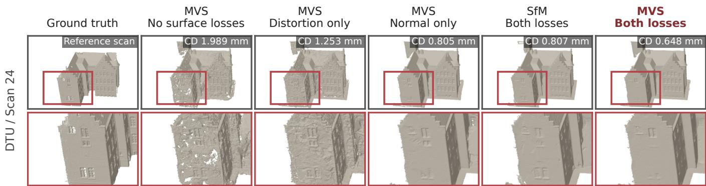  
Figure 11. Surface loss and initialization ablation on DTU scan24. Ground truth and the five fixed-V3 runs of Table 8(a). Normal consistency reduces facade roughness and holes; MVS with both losses gives the lowest error on this scan.

## G Why Hexagons and Spatial Color?

We want each Hexel to represent a large surface region without losing the appearance variation inside it. This requires two choices: a shape that can cover surfaces eficiently, and a color model that can describe more than a constant color. The hon eycomb theorem motivates the first choice: regular hexagons minimize boundary length among equal-area partitions of the plane [9]. The spatial color field addresses the second.

We examine these choices on one planar patch at a fixed viewing direction. First, we show that an afine color field represents the local color slope, with the remaining error controlled by how that slope changes across the patch. This determines a region where one color field stays within a chosen error tolerance. We then show that, within the same region, the largest afine hexagon covers twice the area of the largest afine triangle and about 30% more than the largest afine square.

## G.1 Linear Color

We fix a viewing direction and use orthonormal coordinates � ∈ $\mathbb { R } ^ { 2 }$ on a localized plane. Let � be the patch center and $\mathbf { h } = \mathbf { x } - \mathbf { p }$ In axes aligned with the primitive, $\mathbf { h } = ( s _ { u } u , s _ { v } v ) ^ { \top }$ , where (�, �) are its normalized local coordinates.

Let � be one target color (channel). An afine color field represents a constant and a linear change in color. The remaining approximation error depends on the second derivatives of �, which describe how its slope changes across the patch. We are assuming a standard local approximation argument underlying piecewisepolynomial representations [3].

Proposition G.1 (Local error of an afine color field). Let � be twice continuously diferentiable on an open convex neighborhood � containing �. Suppose a fixed symmetric positive-definite matrix � satisfies

$$
\begin{array} { r } { | \mathbf { z } ^ { \top } D ^ { 2 } f ( \mathbf { x } ) \mathbf { z } | \leq \mathbf { z } ^ { \top } \mathbf { Q } \mathbf { z } \qquad f o r a l l \mathbf { x } \in U , \ \mathbf { z } \in \mathbb { R } ^ { 2 } . } \end{array}\tag{26}
$$

Then, for every $\mathbf { p } + \mathbf { h } \in U ,$ , the afine field $\ell _ { \mathbf { p } } ( \mathbf { p } + \mathbf { h } ) = f ( \mathbf { p } ) +$ $\nabla f ( \mathbf { p } ) { \dot { } }$ ⊤� satisfies

$$
\begin{array} { r } { | f ( \mathbf { p } + \mathbf { h } ) - \ell _ { \mathbf { p } } ( \mathbf { p } + \mathbf { h } ) | \leq \frac { 1 } { 2 } \mathbf { h } ^ { \top } \mathbf { Q } \mathbf { h } . } \end{array}\tag{27}
$$

In particular, $\begin{array} { r } { i f \| D ^ { 2 } f ( \mathbf { x } ) \| _ { \mathrm { o p } } \leq M } \end{array}$ throughout $U ,$ the error is at most $M r ^ { 2 } / 2$ wherever $\| \mathbf { h } \| \leq r .$

Proof. Define $g ( t ) \ = \ f ( \mathbf { p } + t \mathbf { h } )$ for $t \in [ 0 , 1 ]$ . Applying the fundamental theorem ofcalculus twice gives

$$
\begin{array} { r } { f \displaystyle ( \mathbf { p } + \mathbf { h } ) - \ell _ { \mathbf { p } } ( \mathbf { p } + \mathbf { h } ) = \int _ { 0 } ^ { 1 } ( 1 - t ) g ^ { \prime \prime } ( t ) d t , } \\ { g ^ { \prime \prime } ( t ) = \mathbf { h } ^ { \top } D ^ { 2 } f ( \mathbf { p } + t \mathbf { h } ) \mathbf { h } . } \end{array}\tag{28}
$$

The segment lies in $U ,$ so $\operatorname { E q } .$ (26) gives

$$
{ \begin{array} { r } { \displaystyle | f ( \mathbf { p } + \mathbf { h } ) - \ell _ { \mathbf { p } } ( \mathbf { p } + \mathbf { h } ) | \leq \int _ { 0 } ^ { 1 } ( 1 - t ) \left| \mathbf { h } ^ { \top } D ^ { 2 } f ( \mathbf { p } + t \mathbf { h } ) \mathbf { h } \right| d t } \\ { \leq \mathbf { h } ^ { \top } \mathbf { Q } \mathbf { h } \int _ { 0 } ^ { 1 } ( 1 - t ) d t = { \frac { 1 } { 2 } } \mathbf { h } ^ { \top } \mathbf { Q } \mathbf { h } . } \end{array} }\tag{29}
$$

The operator-norm statement follows by replacing the quadraticform bound with $M \| \mathbf { h } \| ^ { 2 }$ □

The afine field therefore accounts for the local slope, leaving an error controlled by changes in that slope. In comparison, using only the constant value $f ( \mathbf { p } )$ gives an error bound of�� when $\| \nabla f \| \leq L .$ A nonconstant afine color ramp is represented exactly by the afine field, but not by one constant color. This compares individual color fields; blending constant-color primitives can also produce spatial variation.

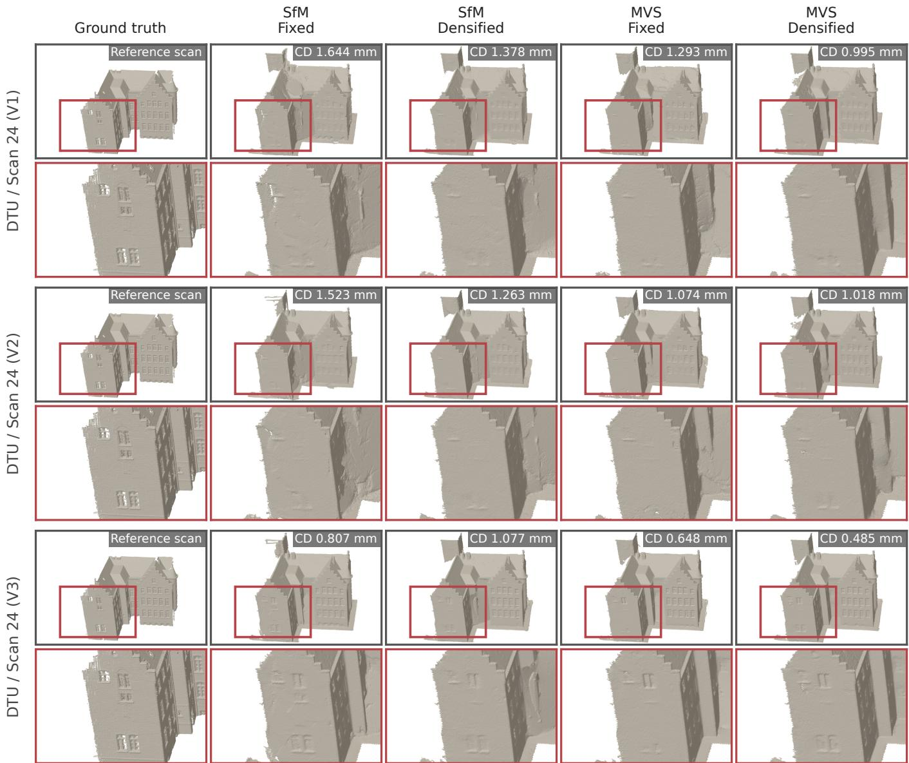  
Figure 12. Appearance, initialization and primitive number ablation in surface reconstruction. Rows show Hexels V1/V2/V3; columns compare SfM/MVS with fixed/densified promotives on DTU scan24, with both surface losses. V3/MVS retains facade openings in the close-up, and its densified variant has the lowest CD on this scan.

The Hexel spatial field contains this Taylor approximation. For one color channel, in primitive-aligned physical coordinates, the required coeficients are

$$
c _ { 0 } = f ( { \bf p } ) , \qquad g _ { u } = s _ { u } \partial _ { 1 } f ( { \bf p } ) , \qquad g _ { v } = s _ { v } \partial _ { 2 } f ( { \bf p } ) .\tag{30}
$$

Substituting these into $c _ { 0 } + u g _ { u } + v g _ { \ i }$ gives $\ell _ { \mathbf { p } } ( \mathbf { p } + \mathbf { h } )$ . Normalized local coordinates therefore change the coeficients, not the class of afine functions that can be represented.

For RGB, apply the same argument to each channel using a common matrix $\mathbf { Q } .$ . Let � be the target RGB field and $\ell _ { \mathbf { p } }$ its

channel-wise Taylor approximation. For a learned field $\mathbf { C } ,$ define $\eta ( \mathbf { x } ) = \| \mathbf { C } ( \mathbf { x } ) \dot { - } \ell _ { \mathbf { p } } ( \hat { \mathbf { x } } ) \| _ { \infty }$ . Then

$$
\begin{array} { r } { \| \mathbf { C } ( \mathbf { p } + \mathbf { h } ) - \mathbf { f } ( \mathbf { p } + \mathbf { h } ) \| _ { \infty } \leq \eta ( \mathbf { p } + \mathbf { h } ) + \frac { 1 } { 2 } \mathbf { h } ^ { \top } \mathbf { Q } \mathbf { h } . } \end{array}\tag{31}
$$

Here $\| \cdot \| _ { \infty }$ is the largest absolute RGB-channel error. The term � accounts for the diference between the learned field and the Taylor field. The result establishes the available approximation capacity, rather than assuming that optimization reaches the Taylor coeficients.

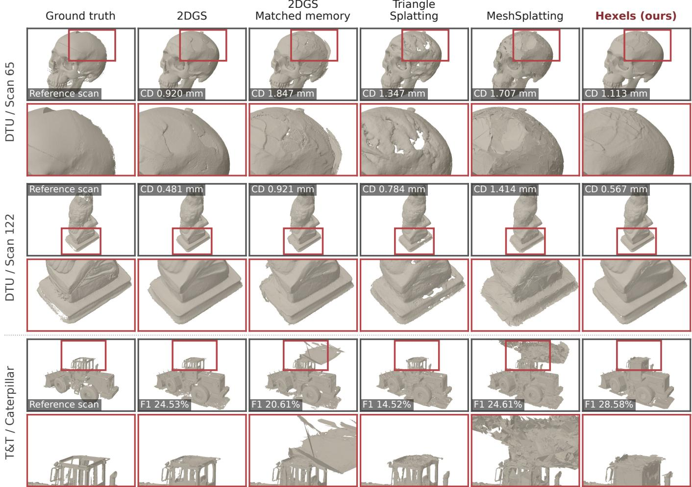  
Figure 13. Additional surface reconstruction close-ups. The selected views reveal holes in Triangle Splatting’s skull and pedestal surfaces and spurious sheets above the Caterpillar cab in the memory-matched 2DGS reconstructions. Hexels reduces these artifacts.

## G.2 Patch Shape

For a tolerance $\varepsilon > 0$ , define

$$
E = \{ \mathbf { p } + \mathbf { h } : \mathbf { h } ^ { \top } \mathbf { Q } \mathbf { h } \leq 2 \varepsilon \} .\tag{32}
$$

Provided $E \subset U ,$ , the Taylor color error is at most � throughout this ellipse. Its longer directions allow larger displacements while satisfying the same error bound. The matrix � bounds changes in color slope; it is not a surface curvature matrix and is not estimated by our training procedure.

The regular triangle, square, and hexagon each tile the plane. We now compare their afine images inside the same error ellipse: how much area can each patch cover while satisfying the same Taylor color-error bound?

Proposition G.2 (Patch area within one error ellipse). Let $H _ { m }$ be a filled regular �-gon centered at the origin, with � $\geq 3$ and unit circumradius. Among all translated, nonsingular afine images of $\mathrm { \Delta } \cdot \mathrm { H } _ { m }$ contained in $E ,$ the maximum area is

$$
A _ { m } ^ { \mathrm { m a x } } = \frac { m \sin ( 2 \pi / m ) \varepsilon } { \sqrt { \mathrm { d e t } { \bf Q } } } .\tag{33}
$$

A maximizer is $\mathbf { p } + \sqrt { 2 \varepsilon } \mathbf { Q } ^ { - 1 / 2 } \mathbf { R } H _ { m } ,$ , where � is any orthogonal matrix. Consequently,

$$
\frac { A _ { 6 } ^ { \mathrm { m a x } } } { A _ { 4 } ^ { \mathrm { m a x } } } = \frac { 3 \sqrt { 3 } } { 4 } \approx 1 . 2 9 9 , \qquad \frac { A _ { 6 } ^ { \mathrm { m a x } } } { A _ { 3 } ^ { \mathrm { m a x } } } = 2 .\tag{34}
$$

Proof. The coordinate change $\mathbf { y } = \mathbf { Q } ^ { 1 / 2 } ( \mathbf { x } - \mathbf { p } ) / \sqrt { 2 \varepsilon }$ maps � to the unit disk.

Let $\mathbf { v } _ { i } , j = 0 , \dots , m - 1$ , be the vertices of $H _ { m }$ . Their equal angular spacing gives

$$
\frac { 1 } { m } \sum _ { j } \mathbf { v } _ { j } = 0 , \qquad \frac { 1 } { m } \sum _ { j } \mathbf { v } _ { j } \mathbf { v } _ { j } ^ { \top } = \frac { 1 } { 2 } \mathbf { I } _ { 2 } .\tag{35}
$$

These identities follow from the sums of the sine and cosine terms at the vertex angles and at twice those angles.

Consider an afine image $\mathbf { t } + \mathbf { B } H _ { m }$ contained in the unit disk. Every vertex has squared distance at most one, so

$$
\| \mathbf { t } \| ^ { 2 } + \frac { 1 } { 2 } \operatorname { t r } ( \mathbf { B } ^ { \top } \mathbf { B } ) = \frac { 1 } { m } \sum _ { j } \| \mathbf { t } + \mathbf { B } \mathbf { v } _ { j } \| ^ { 2 } \leq 1 .\tag{36}
$$

Let $\sigma _ { 1 } , \sigma _ { 2 }$ be the singular values of �. Then

$$
| \operatorname* { d e t } \mathbf { B } | = \sigma _ { 1 } \sigma _ { 2 } \leq { \frac { 1 } { 2 } } ( \sigma _ { 1 } ^ { 2 } + \sigma _ { 2 } ^ { 2 } ) \leq 1 - \| \mathbf { t } \| ^ { 2 } \leq 1 .\tag{37}
$$

Thus, no translated afine image has greater area than the centered regular polygon. Equality is attained with $\textbf { t } = \textbf { 0 }$ and � orthogonal, for which the polygon lies inside the disk.

The area of $H _ { m }$ is � sin $( 2 \pi / m ) / 2$ . Returning to the original coordinates multiplies area by $2 \varepsilon / { \sqrt { \operatorname* { d e t } \mathbf { Q } } } ,$ yielding Eq. (33).

Connection to the Hexel parameterization. The maximizing hexagon can be represented using the rotation and two tangent scales already present in Hexels. Write $\mathbf { Q } = \mathbf { U } \mathrm { d i a g } ( \lambda _ { 1 } , \lambda _ { 2 } ) \mathbf { \bar { U } } ^ { \top }$ where $\lambda _ { 1 } , \lambda _ { 2 } > 0$ and the eigenvectors in � are chosen to form a rotation. Align the tangent axes with these eigenvectors. Since our canonical hexagon has inradius one and circumradius $2 / { \sqrt { 3 } } ,$ choose

$$
s _ { u } = \sqrt { \frac { 3 \varepsilon } { 2 \lambda _ { 1 } } } , \qquad s _ { v } = \sqrt { \frac { 3 \varepsilon } { 2 \lambda _ { 2 } } } .\tag{38}
$$

This places the six vertices on the error ellipse and attains �max6 .

Thus, among afine images of these three regular tiling cells, the hexagon covers the largest area inside the same suficient color-error ellipse. Combined with the tiling motivation, this supports using a hexagonal patch with an afine color field: one element can represent a larger region than the corresponding tri angular or square element under this local approximation bound.

## G.3 3D Alpha Compositing

The preceding results concern the color represented within individual patches. In 3D rendering, the final pixel also depends on alpha compositing and the remaining background transmittance.

Proposition G.3 (Error under alpha compositing). At one pixel, let $0 \leq \alpha _ { i } \leq 1$ be a finite ordered list of retained contributions, with colors $C _ { i } .$ . Define

$$
w _ { i } = \alpha _ { i } \prod _ { j < i } ( 1 - \alpha _ { j } ) , \qquad T = \prod _ { i } ( 1 - \alpha _ { i } ) , \qquad I = \sum _ { i } w _ { i } C _ { i } + T b ,\tag{39}
$$

where � is the background color. For any target color � and any norm,

$$
\| I - f \| \leq \sum _ { i } w _ { i } \| C _ { i } - f \| + T \| b - f \| .\tag{40}
$$

Proof. Set $T _ { 0 } = 1$ and $\begin{array} { r } { T _ { i } = \prod _ { j \leq i } ( 1 - \alpha _ { j } ) } \end{array}$ . Then $w _ { i } = T _ { i - 1 }$ $T _ { i } \geq 0 ;$ , giving $\begin{array} { r } { \sum _ { i } w _ { i } + T = 1 } \end{array}$ . Hence,

$$
I - f = \sum _ { i } w _ { i } ( C _ { i } - f ) + T ( b - f ) .
$$

The result follows from the triangle inequality.

Thus, if every contributing color difers from the target by at most $^ { e , }$ the image error is at most $( 1 - T ) e + T \| b - \bar { f } \|$ . This result is independent of the primitive shape. It also shows why local color accuracy alone does not ensure an accurate image: the contributions must approximate the same pixel target, and the remaining background contribution must be included.

Soft support and visibility. The sigmoid support extends beyond the nominal hexagon, where the local Taylor bound may no longer apply. Let � contain contributions with valid bounds $\| C _ { i } - f \| _ { \infty } \leq e _ { i }$ relative to the target color at this pixel. If the remaining contributions have error at most � and total weight $\begin{array} { r } { \bigm \langle = \sum _ { i \notin \mathcal { G } } w _ { i } , } \end{array}$ then

$$
\| I - f \| _ { \infty } \leq \sum _ { i \in \mathcal { G } } w _ { i } e _ { i } + \zeta D + T \| b - f \| _ { \infty } .\tag{41}
$$

Equation (31) can supply $e _ { i }$ when the local target at the intersection is the desired pixel color. An accurate approximation to a diferent, occluded surface does not provide that bound. Since individual Hexel colors are unclamped, $D = 1$ cannot be assumed.

These statements apply to the contributions actually accumulated by the renderer, with � their remaining transmittance.

## H Extended Related Work

Novel view synthesis and surface reconstruction. NeRF [25] was in troduced for novel view synthesis and represents a scene as a neural field ofdensity and view-dependent radiance. This representation enabled high-quality novel-view rendering. However, the repeated network evaluations required for volumetric rendering made the original NeRF expensive to train and slow to render. A large body of follow-up work introduced explicit feature grids, hash encodings, precomputed representations, and baked representations to reduce the sampling, rendering, and computational demands ofthe original neural-field models [6, 26, 28].

3DGS [18] introduced an alternative for substantially more eficient rendering using explicit anisotropic Gaussian volume primitives, enabling real-time rasterization. However, because of their volumetric nature, 3D Gaussians are not naturally surface aligned and can produce inaccurate geometry. To remedy this, works such as SuGaR [7] regularize Gaussians toward surfaces. An important solution was introduced by 2DGS [14], which instead represents the scene using oriented planar Gaussian surfels and perspective-correct ray–plane intersections, retaining fast rasterization while substantially improving the geometry.

Despite the large improvements made by 3DGS and 2DGS in training and rendering time relative to NeRF, these improvements are still not enough for truly resource-constrained settings. Eficiency requires several things at the same time: learned model storage and training VRAM should be as low as possible, primitive count should remain small relative to the cost of each primitive, and the representation should still retain high reconstruction quality and fast rendering. 3DGS and 2DGS can both require large primitive populations and substantial memory. Despite this, we find that 2DGS remains the strongest prior native surface representation in terms ofthe overall performance– eficiency balance when these factors are considered together, even after a number of subsequent works have attempted to improve diferent parts ofthe problem.

Primitive-based diferentiable rendering. Diferent follow-up works have tried to make the primitive more expressive, reduce the number of primitives, increase rendering speed, reduce model storage, or address limitations of 2DGS and earlier Gaussian representations, such as the infinite support of Gaussian kernels. GES [10], for example, replaces the Gaussian with a more flexible generalized exponential kernel, while Deformable Beta Splatting [23] introduces bounded and deformable kernels. 3D Convex Splatting [11] instead uses smooth 3D convex primitives, allowing more flexible volumetric geometry and sharper boundaries, but remains a volumetric rather than surface-aligned representation.

Triangle Splatting [13], on the other hand, optimizes an independent triangle soup so that high rendering speeds can be achieved while retaining a surface-aligned primitive. However, high-quality scenes can still require very large triangle populations, increasing both model storage and the computation and memory required during optimization. The independent triangle soup also does not provide surface connectivity. MeshSplatting [12] follows this work by introducing explicit connectivity and an opaque mesh representation, trading the independence of individual splats for a conventional connected surface. Other works increase geometric complexity in diferent ways, including Quadratic Gaussian Splatting [41], which introduces curved patches, and MILo [8], which brings mesh construction directly into Gaussian optimization. In our experiments, we focus on 2DGS, Triangle Splatting, and MeshSplatting, which we find provide the strongest overall quality–eficiency trade-ofs among prior native surface-aligned representations.

Hexels are also primitive-based renderers, but we try to solve a more fundamental problem: can we design a more eficient primitive that is able to exploit the structure found in the world, both in geometry and appearance? Like 2DGS, we retain independent planar elements, but change the region represented by one element and the signal represented inside it. We use an afine hexagonal patch, which gives a large, nearly isotropic local region, together with a first-order color field that models smooth appearance variation across a surface. We find that much of the variation on local surfaces is smooth, making such a representation particularly eficient.

A first-order color field, by itself, is not unique to Hexels: a vertex-colored triangle (another tiling primitive), for example, can also represent an afine color field. The domain of our primitive, however, makes an important diference. Under the same local approximation-error ellipse, our analysis shows that the largest admissible afine regular hexagon can cover twice the area of the corresponding afine triangle and about 1.3× that of the square (Appendix G). Hexels therefore increase the amount represented by a simple planar element without requiring complex geometry, volumetric convexes, or mesh connectivity.

Hybrid primitives and representations. The most direct comparisons to Hexels are fundamentally native surface primitives. However, there has also been a trend toward hybrid representations that separate geometry from appearance in order to improve particular aspects of eficiency over 2DGS-like representations. Gaussian Billboards [35], for example, introduces spatially varying appearance through per-splat texture interpolation. BBSplat [33] learns separate RGB and alpha texture maps to reduce the number ofgeometric primitives required. This can substantially reduce primitive count, but the textures themselves become part of the model and training cost. NeST [39] follows a related idea by separating sparse surface geometry from a neural appearance representation. Nexels [30] similarly combines sparse surfels with a shared neural appearance field and per-primitive colors. These methods can substantially reduce geometric primitive count, but this capacity is moved into texture maps, feature fields, or neural networks, which introduce additional memory, training state, and computation. Concurrent work such as Bake It Till You Make It [17], which is also centered on improving the eficiency ofsurface splats, follows this hybrid direction. It uses sparse surface geometry together with a hashbased appearance representation during optimization, and later bakes high-frequency appearance into a texture atlas for rendering. This can reduce the number ofgeometric surface primitives and improve rendering speed, but appearance is again moved outside the primitive and requires a separate representation and baking pipeline.

These ideas of separating geometry and appearance, neural textures, and texture baking are interesting, but they can in principle be applied on top of diferent native surface primitives. They also often come with a diferent set of trade-ofs, be it slower rendering, more memory or non-ideal decoupled optimization. They therefore answer a somewhat diferent question from ours. We include these methods in our comparisons, but count their full learned representation, including textures, feature grids, and neural decoders, rather than only the number of geometric elements. These hybrid setups, however, are not the objective of our work.

Population control and compression. Given the multifaceted nature of the eficiency problem, another body of work has developed around interventions on existing primitives to improve different aspects of their eficiency. Scafold-GS [24], for example, reduces 3DGS redundancy through anchors that generate viewadaptive Gaussian attributes rather than storing every Gaussian independently. 3DGS-MCMC [19] improves primitive allocation through stochastic updates and relocation. FastGS [29] instead focuses on training time, using multi-view-consistent densification and pruning to reduce unnecessary Gaussian growth.

A related line of work compresses already learned representations. LightGaussian [5] prunes low-importance Gaussians, distills appearance into lower-order spherical harmonics, and applies vector quantization to reduce model size. Compact 3D Gaussian Representation [22] combines learnable masking with shared neural appearance, vector quantization, and entropy coding. Compressed 3DGS [27] similarly uses quantization-aware clustering and codebooks to reduce storage. Related ideas have also been developed for surface-based Gaussian representations.

These methods are useful and complementary, but they start with an already chosen primitive and add additional methodology around it. They may greatly improve one aspect of eficiency without necessarily reducing the memory and computation required elsewhere, particularly during training. Our focus is therefore the more fundamental question: we can add pruning, quantization, codebooks, texture atlases, neural decoders, and other post-hoc compression, but can we also start with a more eficient native surface primitive? Hexels address this question before these additional techniques are applied; many ofthem could still be applied on top ofHexels afterward.

Neural Image Representations. A similar line of research has de veloped independently in 2D, where neural image representations are used to encode visual media. Earlier approaches often relied on autoencoders or implicit neural functions. More recently, GaussianImage [38] adapted ideas from Gaussian splat ting to represent images using simple 2D Gaussian primitives, demonstrating fast fitting and rendering. Image-GS [40] further improves this representation using content-adaptive initialization and progressive optimization of anisotropic 2D Gaussians. SAD [15] instead represents the image through a soft anisotropic partition whose regions depend on neighboring sites rather than independently parameterized primitives. We compare Hexels primarily with Image-GS because both use independently parameterized image primitives, enabling a direct comparison of quality and eficiency per primitive. SAD instead represents images through a coupled partition whose regions depend on neighboring sites, addressing a diferent representation regime that we leave for future comparison.

We show that Hexels can also be used directly for 2D image representation, where they outperform Image-GS in reconstruction quality and training convergence under our evaluated settings. More importantly, Hexels are designed as a general surface primitive rather than separate 2D and 3D representations. In 2D, the primitive is placed directly in the image plane; in 3D, it is oriented on a surface patch. While the compositor changes where required by visibility and depth ordering, the basic hexagonal support and appearance model remain the same. This gives Hexels a general capability across image representation, novel-view synthesis, and surface reconstruction, rather than requiring a separate representation for each setting.

Overall eficiency. A common pattern across methods that have tried to make surface-aligned representations more eficient is that the cost is often moved to another part ofthe problem. Faster rasterization may still require a very large primitive population. Sparse geometry may move capacity into external texture maps or neural fields, increasing representation complexity, training VRAM, or final model storage. Compression can make the deployed scene small while having much less efect on the size and memory required during training. Richer geometry can reduce primitive count while increasing the cost of each primitive.

Hexels are designed to alleviate these problems together, without first resorting to post-hoc retrofitting and before pruning or compression is applied. We use the fact that natural images, surfaces, and scenes contain local structure. Large regions are often approximately planar and vary smoothly in appearance. A Hexel covers a bounded, eficient local region and models first-order appearance variation inside it, allowing simple regions to be represented by larger and fewer elements. This allows us to target high quality, low learned storage, low training VRAM, few primitives, and high FPS in the same native surface representation, in both 2D and 3D. Pruning, quantization, neural appearance models, and other post-hoc improvements remain possible additions rather than requirements of the representation.

## I Full NVS Results

We report additional model-memory experiments, all six Hexels configurations (V1, V2, V3 fixed and densified), initial compression results, and per-scene results on the 34-scene benchmark. � stands for fixed primitives from SfM initialization whereas � stands for their densified counterparts, unless stated otherwise.

## I.1 Matched Model Memory

At the V2 memory budget, Hexels exceeds Triangle Splatting by 1.40 dB outdoors and 2.19 dB indoors on Mip-NeRF360 (Table 9). On DTU, it renders at 1.65× Triangle’s mean FPS (Table 10). At the V3 budget, the PSNR gains over Triangle are 0.54/0.55 dB on outdoor/indoor Mip-NeRF360 (Table 11) and 2.73/0.83 dB on DTU/T&T (Table 12). Across these V2/V3 budgets, Hexels has higher PSNR than MeshSplatting across all 3 datasets, with higher SSIM and lower LPIPS. Table 13 lists the model-memory budgets for each scene.

## I.2 Fixed and Densified Hexels

Densifying V3 improves PSNR by 1.37 dB outdoors and 0.78 dB indoors on Mip-NeRF360 (Table 14), increasing deployment size from 17.0 to 337.6 MB and 48.2 to 133.2 MB, respectively. On DTU, densified V3 has 0.20 dB lower PSNR than fixed V3 but 0.026 lower LPIPS; on T&T it gains 0.76 dB (Table 15). Fixed models therefore ofer a particularly compact option for DTU, while growth improves quality on the larger scenes.

## I.3 Deployment Compression analysis

While outside our core eficiency objectives, we also provide an initial analysis of lossless compression and appearance parameter quantization (PQ1024) on all six variants across 34 scenes. Our lossless compression analysis keeps every FP32 parameter exact. It regroups the bytes of each parameter array by position (all first bytes of the 4-byte values, then all second bytes, and so on), so that the highly repetitive sign and exponent bytes are stored together. It then compresses the result with DEFLATE [4], the standard LZ77 and Hufman-coding compressor used by ZIP and gzip software. PQ1024 replaces RGB appearance vectors with 1,024-entry codebooks: one per SH coeficient for V3, and corresponding codebooks for the spatial and directional gradients of V1/V2. Geometry and base color remain lossless. Parameters are decoded to FP32 before rendering, without retraining.

Table 9. Matched model memory on Mip-NeRF360. Fixed-population Hexels V2-F defines mean budgets of7.33/20.77 MB outdoors/indoors. Hexels V2 improves PSNR by 1.40/2.19 dB relative to Triangle Splatting, respectively.
<table><tr><td rowspan="2">Method</td><td colspan="6">Mip-NeRF360 outdoor (5)</td><td colspan="6">Mip-NeRF360 indoor (4)</td></tr><tr><td>Train</td><td>VRAM</td><td>FPS</td><td>PSNR</td><td>SSIM</td><td>LPIPS</td><td>Train</td><td>VRAM</td><td>FPS</td><td>PSNR</td><td>SSIM</td><td>LPIPS</td></tr><tr><td>min ↓</td><td></td><td>GiB↓</td><td>↑</td><td>dB↑</td><td>↑</td><td>VGG↓</td><td>min ↓</td><td>GiB↓</td><td>↑</td><td>dB↑</td><td>↑</td><td>VGG↓</td></tr><tr><td colspan="12">Volumetric primitives</td></tr><tr><td>3DGS</td><td>6.3</td><td>0.66</td><td>1112.3</td><td>16.72</td><td>0.313</td><td>0.722</td><td>11.4</td><td>2.44</td><td>376.6</td><td>27.13</td><td>0.823</td><td>0.412</td></tr><tr><td>3D Convex</td><td>24.3</td><td>0.88</td><td>178.0</td><td>19.04</td><td>0.416</td><td>0.638</td><td>54.6</td><td>1.86</td><td>49.3</td><td>25.04</td><td>0.826</td><td>0.404</td></tr><tr><td colspan="10"></td><td colspan="3"></td></tr><tr><td>BBSplat</td><td>28.0</td><td>1.41</td><td>109.0</td><td>19.24</td><td>Hybrid primitives 0.374</td><td>0.688</td><td>52.2</td><td>8.00</td><td>44.4</td><td>25.19</td><td>0.779</td><td>0.443</td></tr><tr><td>Nexels</td><td>61.3</td><td>4.71</td><td>59.4</td><td>20.72</td><td>0.460</td><td>0.534</td><td>111.3</td><td>7.97</td><td>33.6</td><td>25.74</td><td>0.807</td><td>0.379</td></tr><tr><td colspan="10">Surface primitives</td><td colspan="3"></td></tr><tr><td>2DGS</td><td>16.5</td><td>1.92</td><td>245.1</td><td>16.11</td><td>0.328</td><td>0.736</td><td>25.1</td><td>5.93</td><td>115.4</td><td>22.13</td><td>0.762</td><td>0.489</td></tr><tr><td>Triangle Spl.</td><td>12.9</td><td>0.96</td><td>358.9</td><td>20.71</td><td>0.448</td><td>0.592</td><td>21.0</td><td>1.45</td><td>233.8</td><td>26.55</td><td>0.843</td><td>0.383</td></tr><tr><td>MeshSplatting</td><td>27.0</td><td>3.70</td><td>72.9</td><td>18.81</td><td>0.349</td><td>0.674</td><td>40.9</td><td>5.52</td><td>45.1</td><td>20.83</td><td>0.665</td><td>0.558</td></tr><tr><td>Hexels V2-F</td><td>17.8</td><td>0.63</td><td></td><td>22.11</td><td>0.562</td><td>0.497</td><td>32.8</td><td>0.87</td><td>228.9</td><td>28.74</td><td>0.897</td><td>0.290</td></tr><tr><td></td><td></td><td></td><td>491.9</td><td></td><td></td><td></td><td></td><td></td><td></td><td></td><td></td><td></td></tr></table>

Table 10. Matched model memory on DTU and Tanks and Temples. Fixed-population Hexels V2-F defines mean budgets of 3.94/21.12 MB. Hexels V2 improves PSNR by 2.92/1.44 dB relative to Triangle Splatting, respectively.
<table><tr><td rowspan="2">Method</td><td colspan="6">DTU (15)</td><td colspan="6">Tanks and Temples (10)</td></tr><tr><td>Train min ↓</td><td>VRAM GiB↓</td><td>FPS ↑</td><td>PSNR dB↑</td><td>SSIM ↑</td><td>LPIPS VGG↓</td><td>Train min ↓</td><td>VRAM GiB↓</td><td>FPS ↑</td><td>PSNR</td><td>SSIM</td><td>LPIPS</td></tr><tr><td colspan="10"></td><td>dB↑</td><td>↑</td><td>VGG↓</td></tr><tr><td></td><td></td><td>0.45</td><td>937.2</td><td>28.34</td><td>Volumetric primitives 0.867</td><td>0.365</td><td></td><td>0.94</td><td>723.5</td><td></td><td></td><td></td></tr><tr><td>3DGS 3D Convex</td><td>4.7 12.8</td><td>0.61</td><td>280.9</td><td>27.49</td><td>0.863</td><td>0.356</td><td>6.1 22.4</td><td>0.91</td><td>172.3</td><td>21.53 20.72</td><td>0.718</td><td>0.430</td></tr><tr><td colspan="2"></td><td></td><td></td><td></td><td>Hybrid primitives</td><td></td><td></td><td></td><td></td><td></td><td>0.706</td><td>0.445</td></tr><tr><td>BBSplat</td><td></td><td>0.64</td><td>183.2</td><td>27.63</td><td>0.854</td><td>0.347</td><td>21.7</td><td>1.55</td><td></td><td></td><td></td><td></td></tr><tr><td>Nexels</td><td>14.3 28.8</td><td>2.26</td><td>154.6</td><td>28.83</td><td>0.887</td><td>0.277</td><td>69.9</td><td></td><td>123.7</td><td>19.46</td><td>0.643</td><td>0.521</td></tr><tr><td></td><td></td><td></td><td></td><td></td><td></td><td></td><td></td><td>2.98</td><td>93.6</td><td>22.02</td><td>0.729</td><td>0.383</td></tr><tr><td colspan="2"></td><td></td><td></td><td></td><td>Surface primitives</td><td></td><td></td><td></td><td></td><td></td><td></td><td></td></tr><tr><td>2DGS</td><td>8.6</td><td>0.70</td><td>426.3</td><td>22.88</td><td>0.786</td><td>0.450</td><td>11.1</td><td>1.61</td><td>249.1</td><td>19.37</td><td>0.675</td><td>0.481</td></tr><tr><td>Triangle Spl.</td><td>7.7</td><td>0.61</td><td>513.9</td><td>26.65</td><td>0.840</td><td>0.364</td><td>10.1</td><td>0.80</td><td>459.9</td><td>22.04</td><td>0.764</td><td>0.368</td></tr><tr><td>MeshSplatting</td><td>13.3</td><td>1.85</td><td>128.7</td><td>21.44</td><td>0.685</td><td>0.499</td><td>17.2</td><td>2.17</td><td>117.5</td><td>16.66</td><td>0.581</td><td>0.553</td></tr><tr><td>Hexels V2-F</td><td>8.5</td><td>0.56</td><td>845.6</td><td>29.57</td><td>0.895</td><td>0.298</td><td>14.4</td><td>0.60</td><td>386.9</td><td>23.49</td><td>0.819</td><td>0.287</td></tr></table>

Lossless compression and PQ1024 evaluated here are additional experiments; the main NVS experiments use uncompressed FP32 models. Quantizing V2 reduces PSNR by

0.55–0.61 dB, whereas densifier V3-G PQ1024 changes mean PSNR/SSIM/LPIPS by −0.01674 dB/−0.000259/+0.000849 (Table 16). The largest dataset-mean PSNR loss for V3-G is 0.0303 dB on Mip-NeRF360. Across 34 scenes, its mean deployment size is 43.87 MB, 60.09% below lossless compression. Table 16 reports these compressed results whereas all other NVS comparison tables use uncompressed FP32 representation.

Encoding time includes codebook fitting; decoding measures cached reading and CPU-based reconstruction, followed by upload into an allocated model.

2D model size (deployment) compression. For the 2D representation in Table 1, mixed-bit storage reduces mean PSNR by 0.03307 dB for constant-color Hexels and 0.01091 dB for linearcolor Hexels relative to their FP32 parameters.

After training/image fitting, constant-color Hexels store positions, (log-)scales, rotations and RGB parameters with 16, 14, 12 and 10 bits per scalar, respectively. Linear-color Hexels use 16, 14, 12, 12, 14 and 10 bits for positions, scales, rotations, base RGB, spatial RGB gradients and sharpness. The bit-packed files include a 1024-byte header containing quantization ranges and decoder settings. At 10K primitives, the constant and linear files occupy 128524 and 253524 bytes, or 0.2451 and 0.4836 bits per pixel. The 16-bit Image-GS files occupy 161024 bytes, or 0.3071 bits per pixel. Both Hexel variants show similar performance for 16-bit storage: at most 0.05 dB mean PSNR loss, 0.2 dB worstimage loss, and 0.001 mean SSIM loss on the evaluated samples.

Table 11. Matched model memory on Mip-NeRF360. Fixed-population Hexels V3-F defines mean budgets of 16.42/46.56 MB out doors/indoors. Hexels V3 improves PSNR by 0.54/0.55 dB relative to Triangle Splatting, respectively.
<table><tr><td rowspan="2">Method</td><td colspan="6">Mip-NeRF360 outdoor (5)</td><td colspan="6">Mip-NeRF360 indoor (4)</td></tr><tr><td>Train</td><td>VRAM</td><td>FPS</td><td>PSNR</td><td>SSIM</td><td>LPIPS</td><td>Train</td><td>VRAM</td><td>FPS</td><td>PSNR</td><td>SSIM</td><td>LPIPS</td></tr><tr><td>min ↓</td><td></td><td>GiB↓</td><td>↑</td><td>dB↑</td><td>↑</td><td>VGG↓</td><td>min ↓</td><td>GiB↓</td><td>↑</td><td>dB↑</td><td>↑</td><td>VGG↓</td></tr><tr><td colspan="12">Volumetric primitives</td></tr><tr><td>3DGS</td><td>7.1</td><td>0.88</td><td>830.8</td><td>18.68</td><td>0.383</td><td>0.675</td><td>13.5</td><td>2.26</td><td>318.8</td><td>29.51</td><td>0.886</td><td>0.326</td></tr><tr><td>3D Convex</td><td>26.7</td><td>1.07</td><td>116.3</td><td>20.31</td><td>0.470</td><td>0.581</td><td>70.7</td><td>2.72</td><td>35.1</td><td>28.29</td><td>0.877</td><td>0.329</td></tr><tr><td colspan="10"></td></tr><tr><td>BBSplat</td><td>29.8</td><td>2.05</td><td>92.4</td><td>19.92</td><td>Hybrid primitives 0.405</td><td>0.648</td><td>58.9</td><td>12.99</td><td>35.0</td><td>27.03</td><td>0.834</td><td>0.367</td></tr><tr><td>Nexels</td><td>63.5</td><td>5.11</td><td>54.7</td><td>21.88</td><td>0.542</td><td>0.454</td><td>113.1</td><td>8.23</td><td>31.6</td><td>27.84</td><td>0.865</td><td>0.307</td></tr><tr><td colspan="10"></td></tr><tr><td></td><td></td><td>2.23</td><td></td><td></td><td>Surface primitives</td><td></td><td></td><td></td><td></td><td></td><td></td><td></td></tr><tr><td>2DGS</td><td>16.9</td><td></td><td>220.9</td><td>16.69</td><td>0.354</td><td>0.718</td><td>29.1</td><td>8.28</td><td>83.5</td><td>28.39</td><td>0.864</td><td>0.358</td></tr><tr><td>Triangle Spl.</td><td>13.8</td><td>1.03 3.76</td><td>337.2</td><td>21.73</td><td>0.520</td><td>0.518</td><td>24.8</td><td>1.74</td><td>195.8</td><td>28.78</td><td>0.886</td><td>0.312</td></tr><tr><td>MeshSplatting</td><td>26.3</td><td></td><td>71.7</td><td>19.27</td><td>0.378</td><td>0.648</td><td>41.9</td><td>5.54</td><td>42.5</td><td>22.16</td><td>0.706</td><td>0.528</td></tr><tr><td>Hexels V3-F</td><td>17.6</td><td>0.66</td><td>484.6</td><td>22.27</td><td>0.566</td><td>0.496</td><td>32.7</td><td>0.99</td><td>219.8</td><td>29.33</td><td>0.904</td><td>0.283</td></tr></table>

Table 12. Matched model memory on DTU and Tanks and Temples. Fixed-population Hexels V3-F defines mean budgets of 8.83/47.34 MB. Hexels V3 improves PSNR by 2.73/0.83 dB relative to Triangle Splatting, respectively.
<table><tr><td rowspan="2">Method</td><td colspan="6">DTU (15)</td><td colspan="6">Tanks and Temples (10)</td></tr><tr><td>Train min ↓</td><td>VRAM GiB↓</td><td>FPS ↑</td><td>PSNR dB↑</td><td>SSIM ↑</td><td>LPIPS VGG↓</td><td>Train min ↓</td><td>VRAM GiB↓</td><td>FPS ↑</td><td>PSNR</td><td>SSIM</td><td>LPIPS</td></tr><tr><td colspan="10"></td><td>dB↑</td><td>↑</td><td>VGG↓</td></tr><tr><td></td><td></td><td>0.57</td><td>823.3</td><td>29.45</td><td>Volumetric primitives 0.895</td><td>0.320</td><td>7.8</td><td>1.31</td><td>561.6</td><td>23.07</td><td>0.781</td><td></td></tr><tr><td>3DGS 3D Convex</td><td>5.1 15.2</td><td>0.71</td><td>214.8</td><td>28.19</td><td>0.886</td><td>0.309</td><td>28.5</td><td>1.25</td><td>118.8</td><td>22.19</td><td>0.755</td><td>0.352 0.380</td></tr><tr><td colspan="2"></td><td></td><td></td><td></td><td>Hybrid primitives</td><td></td><td></td><td></td><td></td><td></td><td></td><td></td></tr><tr><td>BBSplat</td><td>14.7</td><td>0.74</td><td>182.8</td><td>28.82</td><td>0.891</td><td>0.285</td><td>24.5</td><td>2.55</td><td>99.1</td><td>20.87</td><td>0.692</td><td>0.451</td></tr><tr><td>Nexels</td><td>29.1</td><td>2.19</td><td>151.7</td><td>29.15</td><td>0.899</td><td>0.247</td><td>73.0</td><td>3.29</td><td>82.2</td><td>22.90</td><td>0.775</td><td>0.321</td></tr><tr><td colspan="10"></td><td></td><td></td><td></td></tr><tr><td>2DGS</td><td>9.4</td><td>0.97</td><td>359.4</td><td>26.61</td><td>Surface primitives 0.860</td><td>0.367</td><td>12.7</td><td>2.39</td><td>186.3</td><td>21.63</td><td></td><td></td></tr><tr><td>Triangle Spl.</td><td>8.5</td><td>0.65</td><td>482.6</td><td>27.23</td><td>0.866</td><td>0.326</td><td>12.0</td><td>1.04</td><td>393.6</td><td>22.94</td><td>0.749 0.806</td><td>0.385 0.303</td></tr><tr><td></td><td>13.3</td><td>1.86</td><td>126.3</td><td>22.59</td><td>0.703</td><td>0.486</td><td>17.7</td><td>2.25</td><td>113.2</td><td>17.24</td><td>0.609</td><td>0.527</td></tr><tr><td>MeshSplatting</td><td></td><td>0.58</td><td>792.3</td><td>29.95</td><td>0.899</td><td>0.293</td><td>14.6</td><td>0.71</td><td>370.6</td><td>23.78</td><td>0.824</td><td></td></tr><tr><td>Hexels V3-F</td><td>8.5</td><td></td><td></td><td></td><td></td><td></td><td></td><td></td><td></td><td></td><td></td><td>0.281</td></tr></table>

## J Per-Scene NVS Results

Tables 17, 18 and 19 report V3 densified on all nine Mip-NeRF360 scenes, fifteen DTU scans and ten T&T scenes.

## K Additional Qualitative Comparisons

Figures 14–16 compare V3 (densified) with native 2DGS, Triangle Splatting and MeshSplatting on additional Mip-NeRF360, DTU, and Tanks and Temples scenes. The enlarged regions show diferences in object boundaries and fine textures.

Table 13. Model-memory budgets for all 34 scenes. V1/V2/V3 require 80�/116�/260� bytes, where � is the SfM point count.
<table><tr><td colspan="4">Mip-NeRF360</td><td colspan="4">DTU NVS</td><td colspan="4">Tanks and Temples</td></tr><tr><td>Scene</td><td>V1 (MB)</td><td>V2 (MB)</td><td>V3 (MB)</td><td>Scene</td><td>V1 (MB)</td><td>V2 (MB)</td><td>V3 (MB)</td><td>Scene</td><td>V1 (MB)</td><td>V2 (MB)</td><td>V3 (MB)</td></tr><tr><td>bicycle</td><td>4.342</td><td>6.296</td><td>14.111</td><td>scan105</td><td>3.545</td><td>5.141</td><td>11.522</td><td>Barn</td><td>16.220</td><td>23.519</td><td>52.714</td></tr><tr><td>bonsai</td><td>16.529</td><td>23.967</td><td>53.719</td><td>scan106</td><td>3.707</td><td>5.375</td><td>12.047</td><td>Caterpillar</td><td>15.024</td><td>21.785</td><td>48.829</td></tr><tr><td>counter</td><td>12.461</td><td>18.069</td><td>40.499</td><td>scan110</td><td>2.042</td><td>2.960</td><td>6.635</td><td>Courthouse</td><td>39.629</td><td>57.461</td><td>128.793</td></tr><tr><td>flowers</td><td>3.068</td><td>4.448</td><td>9.970</td><td>scan114</td><td>3.442</td><td>4.992</td><td>11.188</td><td>Francis</td><td>8.545</td><td>12.391</td><td>27.773</td></tr><tr><td>garden</td><td>11.101</td><td>16.097</td><td>36.079</td><td>scan118</td><td>2.270</td><td>3.292</td><td>7.379</td><td>Horse</td><td>5.384</td><td>7.807</td><td>17.500</td></tr><tr><td>kitchen</td><td>19.309</td><td>27.999</td><td>62.755</td><td>scan122</td><td>1.741</td><td>2.524</td><td>5.658</td><td>Ignatius</td><td>12.424</td><td>18.015</td><td>40.380</td></tr><tr><td>room</td><td>9.010</td><td>13.065</td><td>29.283</td><td>scan24</td><td>2.496</td><td>3.620</td><td>8.113</td><td>Lighthouse</td><td>12.828</td><td>18.600</td><td>41.690</td></tr><tr><td>stump</td><td>2.564</td><td>3.718</td><td>8.333</td><td>scan37</td><td>4.065</td><td>5.894</td><td>13.210</td><td>Meetingroom</td><td>9.868</td><td>14.309</td><td>32.072</td></tr><tr><td>treehill</td><td>4.189</td><td>6.074</td><td>13.614</td><td>scan40</td><td>4.692</td><td>6.803</td><td>15.247</td><td>Train</td><td>14.734</td><td>21.365</td><td>47.887</td></tr><tr><td></td><td></td><td></td><td></td><td>scan55</td><td>3.742</td><td>5.426</td><td>12.161</td><td>Truck</td><td>10.993</td><td>15.940</td><td>35.728</td></tr><tr><td></td><td></td><td></td><td></td><td>scan63</td><td>1.421</td><td>2.061</td><td>4.618</td><td></td><td></td><td></td><td></td></tr><tr><td></td><td></td><td></td><td></td><td>scan65</td><td>1.809</td><td>2.624</td><td>5.880</td><td></td><td></td><td></td><td></td></tr><tr><td></td><td></td><td></td><td></td><td>scan69</td><td>1.858</td><td>2.694</td><td>6.037</td><td></td><td></td><td></td><td></td></tr><tr><td></td><td></td><td></td><td></td><td>scan83</td><td>1.281</td><td>1.858</td><td>4.164</td><td></td><td></td><td></td><td></td></tr><tr><td></td><td></td><td></td><td></td><td>scan97</td><td>2.658</td><td>3.854</td><td>8.639</td><td></td><td></td><td></td><td></td></tr></table>

Table 14. Fixed and densified Hexels on Mip-NeRF360. F/G denote fixed/grown populations.
<table><tr><td rowspan="2">Method</td><td colspan="8">Mip-NeRF360 outdoor (5)</td></tr><tr><td>Train</td><td>VRAM</td><td>FPS</td><td>PSNR</td><td>SSIM</td><td>LPIPS</td><td>Deploy.</td><td>Prims.</td></tr><tr><td></td><td>min↓</td><td>GiB↓</td><td>↑</td><td>dB↑</td><td>↑</td><td>VGG↓</td><td>MB↓</td><td>K</td></tr><tr><td>Hexels V1-F</td><td>17.6</td><td>0.60</td><td>495.5</td><td>21.98</td><td>0.557</td><td>0.501</td><td>5.64</td><td>63.2</td></tr><tr><td>Hexels V1-G</td><td>28.8</td><td>2.44</td><td>140.5</td><td>23.43</td><td>0.667</td><td>0.349</td><td>113.81</td><td>1278.6</td></tr><tr><td>Hexels V2-F</td><td>17.8</td><td>0.63</td><td>491.9</td><td>22.11</td><td>0.562</td><td>0.497</td><td>7.91</td><td>63.2</td></tr><tr><td>Hexels V2-G</td><td>29.3</td><td>3.84</td><td>125.4</td><td>23.39</td><td>0.663</td><td>0.358</td><td>143.96</td><td>1151.6</td></tr><tr><td>Hexels V3-F</td><td>17.6</td><td>0.66</td><td>484.6</td><td>22.27</td><td>0.566</td><td>0.496</td><td>17.00</td><td>63.2</td></tr><tr><td>Hexels V3-G</td><td>33.6</td><td>17.27</td><td>94.5</td><td>23.64</td><td>0.674</td><td>0.346</td><td>337.60</td><td>1254.9</td></tr><tr><td rowspan="3">Method</td><td colspan="8"></td></tr><tr><td>Train</td><td>VRAM</td><td>FPS</td><td>PSNR</td><td>Mip-NeRF360 indoor (4) SSIM</td><td>LPIPS</td><td>Deploy.</td><td>Prims.</td></tr><tr><td>min↓</td><td>GiB↓</td><td>↑</td><td>dB↑</td><td>↑</td><td>VGG↓</td><td>MB↓</td><td>K</td></tr><tr><td>Hexels V1-F</td><td>32.4</td><td>0.83</td><td>230.7</td><td>28.36</td><td>0.891</td><td>0.297</td><td>15.95</td><td>179.1</td></tr><tr><td>Hexels V1-G</td><td>43.1</td><td>1.32</td><td>115.9</td><td>29.31</td><td>0.903</td><td>0.270</td><td>48.02</td><td>539.4</td></tr><tr><td>Hexels V2-F</td><td>32.8</td><td>0.87</td><td>228.9</td><td>28.74</td><td>0.897</td><td>0.290</td><td>22.40</td><td>179.1</td></tr><tr><td>Hexels V2-G</td><td>41.7</td><td>1.40</td><td>122.5</td><td>29.27</td><td>0.904</td><td>0.271</td><td>59.63</td><td>476.9</td></tr><tr><td>Hexels V3-F</td><td>32.7</td><td>0.99</td><td>219.8</td><td>29.33</td><td>0.904</td><td>0.283</td><td>48.19</td><td>179.1</td></tr><tr><td>Hexels V3-G</td><td>42.4</td><td>9.81</td><td>108.6</td><td>30.11</td><td>0.913</td><td>0.259</td><td>133.21</td><td>495.2</td></tr></table>

Table 15. Fixed and densified Hexels on DTU and Tanks and Temples. F/G denote fixed/grown populations.
<table><tr><td rowspan="2">Method</td><td colspan="8">DTU (15)</td></tr><tr><td>Train</td><td>VRAM</td><td>FPS</td><td>PSNR</td><td>SSIM</td><td>LPIPS</td><td>Deploy.</td><td>Prims.</td></tr><tr><td></td><td>min ↓</td><td>GiB↓</td><td>↑</td><td>dB↑</td><td>↑</td><td>VGG↓</td><td>MB↓</td><td>K</td></tr><tr><td>Hexels V1-F</td><td>8.4</td><td>0.55</td><td>830.8</td><td>28.94</td><td>0.890</td><td>0.303</td><td>3.04</td><td>34.0</td></tr><tr><td>Hexels V1-G</td><td>10.8</td><td>0.61</td><td>441.4</td><td>29.31</td><td>0.897</td><td>0.278</td><td>8.69</td><td>97.5</td></tr><tr><td>Hexels V2-F</td><td>8.5</td><td>0.56</td><td>845.6</td><td>29.57</td><td>0.895</td><td>0.298</td><td>4.26</td><td>34.0</td></tr><tr><td>Hexels V2-G</td><td>10.3</td><td>0.64</td><td>513.8</td><td>29.14</td><td>0.891</td><td>0.282</td><td>11.40</td><td>91.1</td></tr><tr><td>Hexels V3-F</td><td>8.5</td><td>0.58</td><td>792.3</td><td>29.95</td><td>0.899</td><td>0.293</td><td>9.15</td><td>34.0</td></tr><tr><td>Hexels V3-G</td><td>10.6</td><td>1.21</td><td>483.1</td><td>29.76</td><td>0.902</td><td>0.268</td><td>27.03</td><td>100.4</td></tr><tr><td rowspan="3">Method</td><td></td><td></td><td></td><td></td><td>Tanks and Temples (10)</td><td></td><td></td><td></td></tr><tr><td>Train</td><td>VRAM</td><td>FPS</td><td>PSNR</td><td>SSIM</td><td>LPIPS</td><td>Deploy.</td><td>Prims.</td></tr><tr><td>min ↓</td><td>GiB↓</td><td>↑</td><td>dB↑</td><td>↑</td><td>VGG↓</td><td>MB↓</td><td>K</td></tr><tr><td>Hexels V1-F</td><td>13.3</td><td>0.55</td><td>438.4</td><td>23.05</td><td>0.811</td><td>0.295</td><td>16.22</td><td>182.1</td></tr><tr><td>Hexels V1-G</td><td>20.8</td><td>1.38</td><td>197.1</td><td>23.95</td><td>0.829</td><td>0.261</td><td>67.79</td><td>761.6</td></tr><tr><td>Hexels V2-F</td><td>14.4</td><td>0.60</td><td>386.9</td><td>23.49</td><td>0.819</td><td>0.287</td><td>22.77</td><td>182.1</td></tr><tr><td>Hexels V2-G</td><td>22.7</td><td>1.96</td><td>167.5</td><td>24.27</td><td>0.834</td><td>0.257</td><td>89.80</td><td>718.3</td></tr><tr><td>Hexels V3-F</td><td>14.6</td><td>0.71</td><td>370.6</td><td>23.78</td><td>0.824</td><td>0.281</td><td>48.99</td><td>182.1</td></tr><tr><td>Hexels V3-G</td><td>24.3</td><td>12.06</td><td>142.7</td><td>24.53</td><td>0.839</td><td>0.248</td><td>198.84</td><td>739.1</td></tr></table>

Table 16. Deployment compression across 34 scenes. Quality changes are relative to uncompressed models; FP32 rows are the uncompressed reference results from the main text.
<table><tr><td rowspan="2">Variant</td><td rowspan="2">Codec</td><td rowspan="2">Encode S</td><td rowspan="2">Decode ms</td><td rowspan="2">Upload ms</td><td rowspan="2">FPS</td><td rowspan="2">△PSNR dB</td><td rowspan="2">∆SSIM</td><td rowspan="2">∆LPIPS</td><td rowspan="2">Deploy. MB</td><td rowspan="2">Saved %</td></tr><tr><td>VGG</td></tr><tr><td>V1 fixed</td><td>FP32</td><td>-</td><td>6.0</td><td>2.8</td><td>608.4</td><td>0.0000</td><td>0.00000</td><td>0.00000</td><td>8.82</td><td>0.0</td></tr><tr><td>V1 fixed</td><td>Lossless</td><td>0.5</td><td>34.5</td><td>4.3</td><td>620.8</td><td>0.0000</td><td>0.00000</td><td>0.00000</td><td>6.67</td><td>24.2</td></tr><tr><td>V1 fixed</td><td>PQ1024</td><td>1.8</td><td>33.1</td><td>3.1</td><td>619.1</td><td>-0.0338</td><td>-0.00057</td><td>0.00175</td><td>4.97</td><td>43.3</td></tr><tr><td>V1 grown</td><td>FP32</td><td>1</td><td>13.5</td><td>8.6</td><td>289.5</td><td>0.0000</td><td>0.00000</td><td>0.00000</td><td>46.16</td><td>0.0</td></tr><tr><td>V1 grown</td><td>Lossless</td><td>2.8</td><td>163.2</td><td>8.5</td><td>290.2</td><td>0.0000</td><td>0.00000</td><td>0.00000</td><td>34.90</td><td>24.4</td></tr><tr><td>V1 grown</td><td>PQ1024</td><td>4.0</td><td>152.3</td><td>8.1</td><td>289.3</td><td>-0.0325</td><td>-0.00058</td><td>0.00168</td><td>25.91</td><td>43.8</td></tr><tr><td>V2 fixed</td><td>FP32</td><td>1</td><td>6.4</td><td>4.3</td><td>590.1</td><td>0.0000</td><td>0.00000</td><td>0.00000</td><td>12.38</td><td>0.0</td></tr><tr><td>V2 fixed</td><td>Lossless</td><td>0.8</td><td>47.6</td><td>3.4</td><td>610.4</td><td>0.0000</td><td>0.00000</td><td>0.00000</td><td>9.66</td><td>21.8</td></tr><tr><td>V2 fixed</td><td>PQ1024</td><td>2.4</td><td>42.0</td><td>3.1</td><td>599.9</td><td>-0.6061</td><td>-0.00767</td><td>0.02537</td><td>5.38</td><td>55.9</td></tr><tr><td>V2 grown</td><td>FP32</td><td>-</td><td>17.1</td><td>8.0</td><td>310.4</td><td>0.0000</td><td>0.00000</td><td>0.00000</td><td>59.63</td><td>0.0</td></tr><tr><td>V2 grown</td><td>Lossless</td><td>3.7</td><td>209.3</td><td>10.4</td><td>314.6</td><td>0.0000</td><td>0.00000</td><td>0.00000</td><td>46.50</td><td>21.9</td></tr><tr><td>V2 grown</td><td>PQ1024</td><td>5.4</td><td>186.3</td><td>12.2</td><td>309.0</td><td>-0.5450</td><td>-0.00777</td><td>0.02449</td><td>25.69</td><td>56.7</td></tr><tr><td>V3 fixed</td><td>FP32</td><td>一</td><td>9.6</td><td>5.3</td><td>560.5</td><td>0.0000</td><td>0.00000</td><td>0.00000</td><td>26.62</td><td>0.0</td></tr><tr><td>V3 fixed</td><td>Lossless</td><td>1.7</td><td>103.1</td><td>4.6</td><td>565.1</td><td>0.0000</td><td>0.00000</td><td>0.00000</td><td>21.59</td><td>18.8</td></tr><tr><td>V3 fixed</td><td>PQ1024</td><td>4.7</td><td>77.4</td><td>5.4</td><td>555.7</td><td>-0.0200</td><td>-0.00032</td><td>0.00085</td><td>8.73</td><td>66.5</td></tr><tr><td>V3 grown</td><td>FP32</td><td>-</td><td>31.0</td><td>17.0</td><td>282.6</td><td>0.0000</td><td>0.00000</td><td>0.00000</td><td>135.73</td><td>0.0</td></tr><tr><td>V3 grown</td><td>Lossless</td><td>8.4</td><td>464.2</td><td>21.0</td><td>284.5</td><td>0.0000</td><td>0.00000</td><td>0.00000</td><td>109.92</td><td>18.9</td></tr><tr><td>V3 grown</td><td>PQ1024</td><td>11.7</td><td>363.1</td><td>22.8</td><td>283.5</td><td>-0.0167</td><td>-0.00026</td><td>0.00085</td><td>43.87</td><td>67.4</td></tr></table>

Table 17. Per-scene V3 densified results on Mip-NeRF360. The final row reports the mean across scenes.
<table><tr><td>Scene</td><td>Train</td><td>VRAM peak</td><td>FPS</td><td>PSNR</td><td>SSIM</td><td>LPIPS</td><td>Deploy.</td><td>Primitives</td></tr><tr><td></td><td>min</td><td>GiB</td><td></td><td>dB</td><td></td><td>VGG</td><td>MB</td><td>K</td></tr><tr><td>bicycle</td><td>32.4</td><td>18.55</td><td>88.5</td><td>24.00</td><td>0.693</td><td>0.329</td><td>348.07</td><td>1293.9</td></tr><tr><td>flowers</td><td>35.1</td><td>19.08</td><td>95.3</td><td>20.36</td><td>0.539</td><td>0.429</td><td>353.13</td><td>1312.7</td></tr><tr><td>garden</td><td>40.6</td><td>20.49</td><td>66.3</td><td>26.93</td><td>0.840</td><td>0.169</td><td>486.56</td><td>1808.7</td></tr><tr><td>stump</td><td>26.6</td><td>12.67</td><td>123.7</td><td>24.73</td><td>0.690</td><td>0.358</td><td>211.91</td><td>787.7</td></tr><tr><td>treehill</td><td>33.2</td><td>15.56</td><td>98.4</td><td>22.19</td><td>0.609</td><td>0.443</td><td>288.31</td><td>1071.7</td></tr><tr><td>room</td><td>31.4</td><td>7.42</td><td>142.0</td><td>29.86</td><td>0.901</td><td>0.321</td><td>111.51</td><td>414.5</td></tr><tr><td>counter</td><td>44.4</td><td>7.62</td><td>105.3</td><td>28.61</td><td>0.901</td><td>0.273</td><td>110.34</td><td>410.1</td></tr><tr><td>kitchen</td><td>51.0</td><td>9.42</td><td>87.9</td><td>30.56</td><td>0.918</td><td>0.173</td><td>127.87</td><td>475.3</td></tr><tr><td>bonsai</td><td>42.8</td><td>14.78</td><td>99.4</td><td>31.43</td><td>0.932</td><td>0.270</td><td>183.13</td><td>680.7</td></tr><tr><td>Mean</td><td>37.5</td><td>13.95</td><td>100.7</td><td>26.52</td><td>0.780</td><td>0.307</td><td>246.76</td><td>917.3</td></tr></table>

Table 18. Per-scene V3 densified results on DTU. The final row reports the mean across scenes.
<table><tr><td rowspan="2">Scene</td><td rowspan="2">Train min</td><td rowspan="2">VRAM peak GiB</td><td rowspan="2">FPS</td><td rowspan="2">PSNR dB</td><td rowspan="2">SSIM</td><td rowspan="2">LPIPS</td><td rowspan="2">Deploy. MB</td><td rowspan="2">Primitives K</td></tr><tr><td>VGG</td></tr><tr><td>scan24</td><td>12.7</td><td>0.95</td><td>322.7</td><td>26.68</td><td>0.911</td><td>0.166</td><td>30.38</td><td>112.9</td></tr><tr><td>scan37</td><td>13.4</td><td>2.93</td><td>275.5</td><td>25.48</td><td>0.896</td><td>0.193</td><td>59.45</td><td>220.9</td></tr><tr><td>scan40</td><td>14.3</td><td>4.04</td><td>240.3</td><td>26.73</td><td>0.905</td><td>0.194</td><td>72.14</td><td>268.1</td></tr><tr><td>scan55</td><td>12.2</td><td>3.10</td><td>280.6</td><td>29.07</td><td>0.882</td><td>0.266</td><td>61.98</td><td>230.4</td></tr><tr><td>scan63</td><td>10.4</td><td>0.60</td><td>579.4</td><td>30.04</td><td>0.938</td><td>0.167</td><td>12.05</td><td>44.7</td></tr><tr><td>scan65</td><td>9.5</td><td>0.67</td><td>504.4</td><td>30.00</td><td>0.886</td><td>0.279</td><td>21.40</td><td>79.5</td></tr><tr><td>scan69</td><td>9.7</td><td>0.65</td><td>475.8</td><td>27.02</td><td>0.886</td><td>0.241</td><td>20.68</td><td>76.8</td></tr><tr><td>scan83</td><td>9.4</td><td>0.62</td><td>571.3</td><td>29.53</td><td>0.889</td><td>0.334</td><td>11.12</td><td>41.3</td></tr><tr><td>scan97</td><td>11.1</td><td>0.68</td><td>406.8</td><td>27.72</td><td>0.875</td><td>0.287</td><td>21.76</td><td>80.8</td></tr><tr><td>scan105</td><td>10.7</td><td>0.66</td><td>446.6</td><td>30.17</td><td>0.885</td><td>0.273</td><td>18.69</td><td>69.4</td></tr><tr><td>scan106</td><td>9.1</td><td>0.69</td><td>555.6</td><td>33.19</td><td>0.916</td><td>0.323</td><td>19.64</td><td>73.0</td></tr><tr><td>scan110</td><td>8.3</td><td>0.62</td><td>693.8</td><td>31.99</td><td>0.913</td><td>0.342</td><td>10.94</td><td>40.6</td></tr><tr><td>scan114</td><td>9.8</td><td>0.69</td><td>480.2</td><td>30.40</td><td>0.909</td><td>0.289</td><td>21.93</td><td>81.5</td></tr><tr><td>scan118</td><td>8.9</td><td>0.62</td><td>712.9</td><td>33.98</td><td>0.920</td><td>0.326</td><td>12.29</td><td>45.6</td></tr><tr><td>scan122</td><td>8.9</td><td>0.60</td><td>700.6</td><td>34.38</td><td>0.919</td><td>0.337</td><td>11.00</td><td>40.8</td></tr><tr><td>Mean</td><td>10.6</td><td>1.21</td><td>483.1</td><td>29.76</td><td>0.902</td><td>0.268</td><td>27.03</td><td>100.4</td></tr></table>

Table 19. Per-scene V3 densified results on Tanks and Temples. The final row reports the mean across scenes.
<table><tr><td rowspan="2">Scene</td><td rowspan="2">Train min</td><td rowspan="2">VRAM peak GiB</td><td rowspan="2">FPS</td><td rowspan="2">PSNR dB</td><td rowspan="2">SSIM</td><td rowspan="2">LPIPS VGG</td><td rowspan="2">Deploy. MB</td><td rowspan="2">Primitives K</td></tr><tr><td></td></tr><tr><td>Train</td><td>23.5</td><td>10.11</td><td>144.4</td><td>21.44</td><td>0.794</td><td>0.258</td><td>152.85</td><td>568.2</td></tr><tr><td>Truck</td><td>28.8</td><td>21.09</td><td>98.1</td><td>24.22</td><td>0.847</td><td>0.211</td><td>329.30</td><td>1224.1</td></tr><tr><td>Francis</td><td>22.1</td><td>9.13</td><td>165.9</td><td>28.34</td><td>0.899</td><td>0.331</td><td>126.42</td><td>469.9</td></tr><tr><td>Horse</td><td>26.4</td><td>16.56</td><td>113.2</td><td>24.82</td><td>0.878</td><td>0.207</td><td>250.68</td><td>931.8</td></tr><tr><td>Lighthouse</td><td>23.7</td><td>7.28</td><td>164.4</td><td>23.17</td><td>0.849</td><td>0.263</td><td>109.67</td><td>407.7</td></tr><tr><td>Barn</td><td>21.5</td><td>8.39</td><td>182.4</td><td>28.36</td><td>0.867</td><td>0.214</td><td>125.86</td><td>467.8</td></tr><tr><td>Caterpillar</td><td>21.6</td><td>13.20</td><td>150.9</td><td>23.82</td><td>0.799</td><td>0.262</td><td>181.02</td><td>672.9</td></tr><tr><td>Courthouse</td><td>25.4</td><td>3.33</td><td>162.5</td><td>22.87</td><td>0.800</td><td>0.270</td><td>134.50</td><td>500.0</td></tr><tr><td>Ignatius</td><td>29.7</td><td>23.35</td><td>82.5</td><td>22.39</td><td>0.784</td><td>0.236</td><td>440.19</td><td>1636.3</td></tr><tr><td>Meetingroom</td><td>20.3</td><td>8.18</td><td>162.7</td><td>25.91</td><td>0.880</td><td>0.230</td><td>137.91</td><td>512.6</td></tr><tr><td>Mean</td><td>24.3</td><td>12.06</td><td>142.7</td><td>24.53</td><td>0.839</td><td>0.248</td><td>198.84</td><td>739.1</td></tr></table>

Ground truth  
2DGS  
Triangle Splatting  
MeshSplatting  
Hexels (ours)  
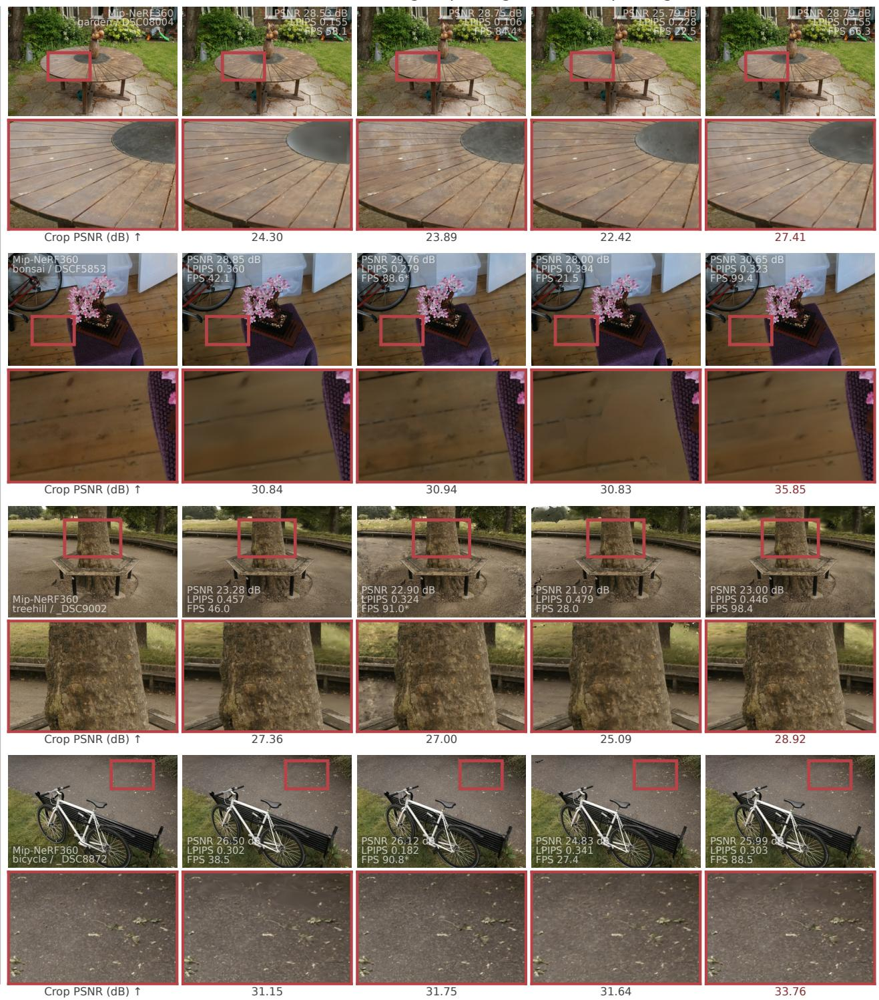  
Figure 14. Additional Mip-NeRF360 comparisons.

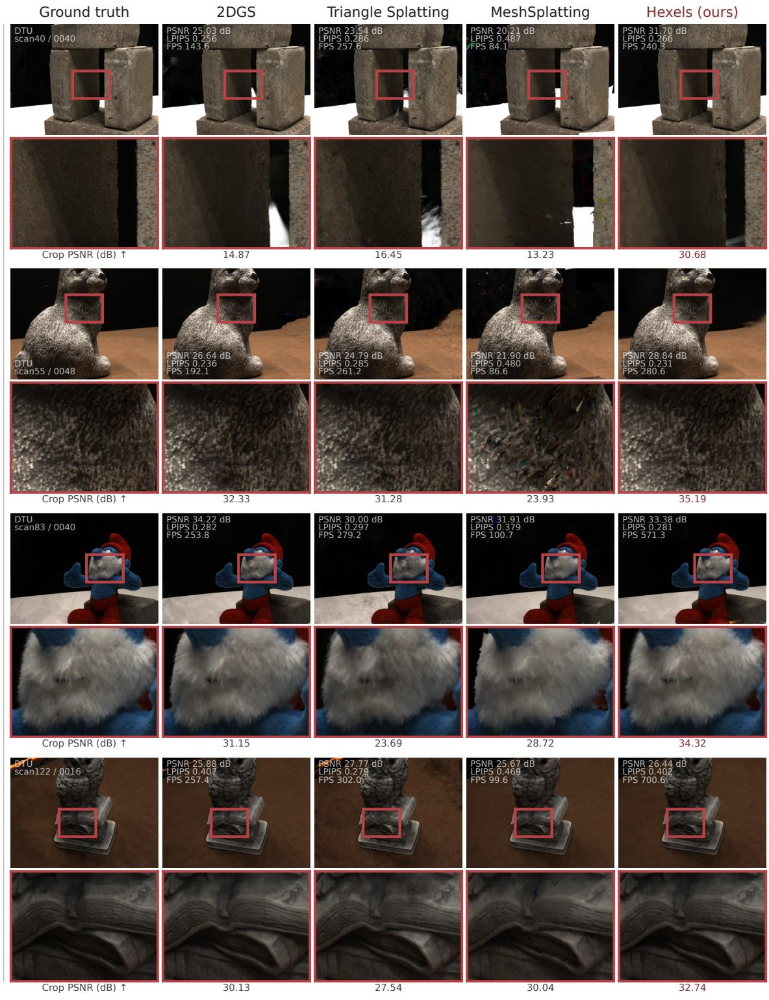  
Figure 15. Additional DTU comparisons.

Ground truth  
2DGS  
Triangle Splatting  
MeshSplatting  
Hexels (ours)  
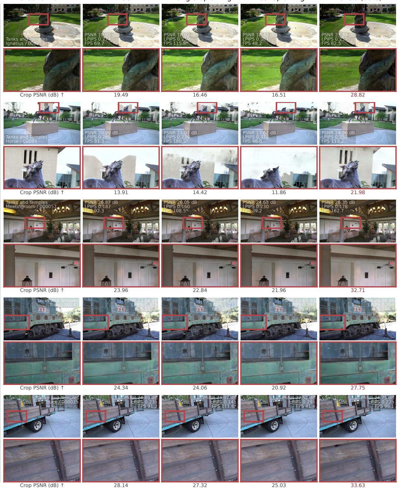  
Figure 16. Additional Tanks and Temples comparisons.