# Hy-Nomas: Towards Free-form Interactive World Generation

Tencent Hy Visual Generation Team

Project Page | Model Weights | Benchmarks | Code

## Abstract

Interactive world generation requires models to follow successive commands while preserving relevant history and action consequences. We present Hy-Nomas, a video world model with an 8B diffusion backbone that supports free-form text instructions and continuous camera control across multiple interaction turns. It generates variable-length segments conditioned on current inputs and cached history. Our central design aligns structured video captions with action-aware causal attention: descriptive context remains accessible across segments, while action instructions are restricted to their intended temporal windows. A visionlanguage Prompt Enhancer (PE) translates user requests and multimodal interaction histories into structured conditions for the next segment. A multi-stage curriculum progressively introduces causal generation, text interaction, camera control, and training on model-generated histories, followed by diffusion distillation. In human evaluation, Hy-Nomas shows superior performance over existing world models. We release model weights, code and benchmarks, together with a lightweight adaptation workflow, to support reproducible research on interactive world generation.

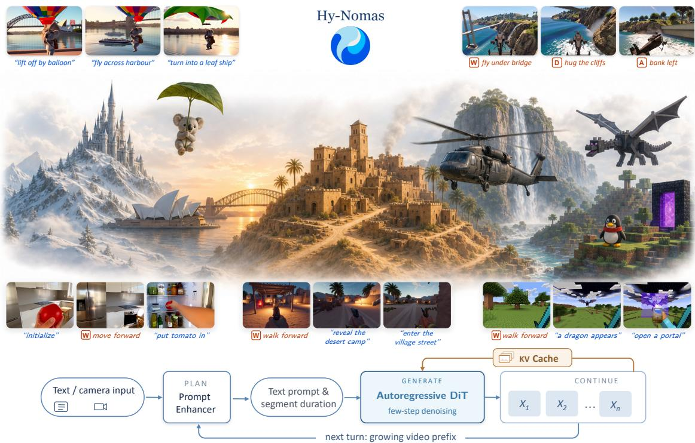  
Figure 1: Interactive world generation with Hy-Nomas. Free-form text instructions and continuous camera control can be interleaved across successive interaction turns. At each turn, a vision-language Prompt Enhancer converts the user request and observed world history into a structured text prompt and a duration for the next video segment. Conditioned on these inputs and cached context, Hy-Nomas autoregressively generates the next segment, allowing the world to unfold through continued interaction.

## Contents

1 Introduction 3   
2 Data   
2.1 Data Filtering .   
2.2 Data Distribution   
2.3 Camera Trajectories   
2.4 Video Captioning   
3 Model Architecture 8   
3.1 Segment-wise Causal Attention . 9   
3.2 Camera-Trajectory Conditioning 10   
4 Training Infrastructure 11   
4.1 Model and Data Parallelism 11   
4.2 GPU Memory Optimization 12   
4.3 Training Throughput Optimization . 12   
5 Model Training 13   
5.1 Training Curriculum 13   
5.2 Continual Pre-Training 14   
5.3 High-Quality Annealing 15   
5.4 Segment Forcing . . 15   
5.5 Diffusion Distillation 16   
5.6 Downstream Adaptation via LoRA 16   
6 Model Inference 17   
6.1 Prompt Enhancer 17   
6.2 Inference Optimization . 19   
7 Evaluation 19   
7.1 Hy-Nomas-Bench and Metrics . . 19   
7.2 Evaluation Protocol . 22   
7.3 Comparison with Other World Models . 22   
7.4 LoRA Adaption Results 25   
7.5 PE Results 26   
8 Related Work 26   
9 Discussion and Future Directions 29   
10 Contributors 30

## 1 Introduction

We define a video world model as an interactive virtual environment that renders visual observations of future states in response to user commands. Users observe the current world, decide how to act, and the model generates new visual observations that reflect both their commands and the preceding interaction history. This closed interaction loop extends the objective of conventional video generation, where a fixed prompt typically specifies a short video clip in advance. An interactive world must accommodate input commands that arrive during generation, model action-dependent dynamics, and preserve the consequences of earlier actions. Recent systems, including Genie 3 (Google DeepMind, 2025), HappyOyster (Alibaba Cloud, 2026) and LingBot-World v2 (Gao et al., 2026b), have made substantial progress in navigation, semantic intervention, and long-horizon generation (Bolton et al., 2025; Bar et al., 2025; Yang et al., 2023). Building on these advances, we introduce Hy-Nomas, an 8B-parameter world model focused on execution of free-form text instructions and their integration with camera navigation across multi-turn interactions. Hy-Nomas enables users to direct both what happens in a world and how they explore it through one generative backbone.

Building such a model requires more than simply replacing full attention with a causal mask. A pretrained bidirectional diffusion transformer (DiT) (Peebles & Xie, 2023) must be adapted to generate successive segments from available history while following the current user command, preventing information leakage that breaks causality, and supporting efficient reuse of cached context (Yin et al., 2025; Zhu et al., 2026; Zhao et al., 2026b). Because each generated segment becomes evidence for the next, small errors can compound into appearance drift, implausible motion, and scene breakdown; training must therefore prepare the model for its own imperfect predictions (Huang et al., 2026; Yang et al., 2025; Decart et al., 2024). Multi-turn interaction adds a second difficulty: persistent scene information must remain accessible, while an action instruction should take effect only during its intended time interval (Chen et al., 2026a; Mao et al., 2025a; Zhang et al., 2026; NVIDIA et al., 2025). The model must also coordinate free-form semantic commands with geometric camera controls, and retain identities, layouts, and state changes when previously observed content returns into view (He et al., 2024; Xiao et al., 2025; Yu et al., 2025a). Finally, temporally causal information flow alone does not establish physical causality. Learning plausible action-to-state transitions requires training data that connects actions with their observable consequences and evaluation that tests these behaviors across successive interactions (Ying et al., 2026; Xu et al., 2026a; Bai et al., 2026).

Hy-Nomas can generate visual worlds with different styles and viewpoints, supporting minutescale rollouts with successive instructions for subject actions, object interactions, scene changes and camera motion, as shown in Figure 1. Free-form text prompts and camera control commands can be interleaved within the same session, with historical visual and semantic context carried forward through the autoregressive key-value (KV) cache. A vision-language model (VLM), the Prompt Enhancer (PE) (Qwen Team, 2026b) converts the user’s request and current observations into a structured prompt with an appropriate duration for the next segment. Our evaluation demonstrates that Hy-Nomas is superior to existing world models across a range of interactive tasks.

We build Hy-Nomas by co-designing our data strategy, video captioning, model architecture, and training strategy towards free-form interactive world generation. Our data pipeline sources videos with physical interaction, human and object motion, camera movement, and long-range dependencies; video captioning records persistent subject identities, scene changes, and timestamped actions, complemented by estimated camera trajectories (Huang et al., 2025a). The model architecture design couples these annotations with action-aware causal attention. Descriptive text remains available across subsequent segments, while action-specific text is restricted to its originating segment and annotated time window. This separation is designed to retain descriptive context and the visual consequences of an action without repeatedly reissuing the action itself. Mixed text-only and camera-conditioned training supports transitions between two interaction modes. Starting from HunyuanVideo 1.5 (Wu et al., 2025), we progressively introduce segment causality, localized action conditioning, and camera control, followed by high-quality annealing and segment forcing into the model training process. To make this training practical, we combine a high-compression video autoencoder (Chen et al., 2025), FLOPs-balanced packing of variablelength videos (Krell et al., 2022), attention kernels that execute heterogeneous masks (Tao & Huang, 2025), distributed sequence and model-state sharding (Jacobs et al., 2023; PyTorch Contributors), and stage-dependent memory management, supporting packed sequences of up to 360K tokens.

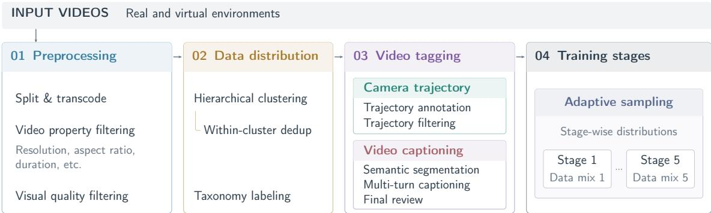  
Figure 2: Data pipeline. Raw videos are split, transcoded, and filtered by basic video properties and visual quality. Hierarchical clustering supports within-cluster deduplication, and a VLM assigns labels to each video from a predefined taxonomy. Video tagging adds captions and, for selected clips, camera-trajectory annotations. Across each training stage, adaptive sampling adjusts the training distribution in response to weaknesses identified from evaluations of earlier stages.

Bounded-cache inference and a LoRA workflow that transfers adapters from the base model to its distilled counterpart further support deployment and customization for downstream applications.

Our main contributions are:

• An interactive 8B world model. We develop Hy-Nomas for multi-turn free-form interaction and continuous camera navigation within one autoregressive DiT.

• Aligned supervision and action conditioning. We combine structured chronological captions, persistent subject descriptions, timestamped actions, and camera trajectories with action-aware causal attention that distinguishes enduring context from temporally localized instructions.

• A scalable training recipe and open-weight model. We integrate a progressive strategy to gradually extend the model’s capability, together with bounded-cache inference and lightweight downstream adaptation. We release model weights and code to support further research.

• Evaluation of world-model capabilities. We assess multi-turn text interaction, camera navigation, interleaved control, and spatial memory, demonstrating the advantages of Hy-Nomas while identifying the remaining challenges in world modeling. We release all the benchmarks to facilitate reproducible research on world-model evaluation.

## 2 Data

We construct a large-scale, heterogeneous video corpus spanning real and virtual environments. Our end-to-end pipeline converts raw videos into training samples through standardized preprocessing, filtering, semantic deduplication, camera-trajectory annotation, and structured captioning. We adjust the sampling distribution across training stages to address weaknesses identified in each stage. Figure 2 summarizes the pipeline.

## 2.1 Data Filtering

The raw videos vary in encoding types, duration, frame rate, resolution, and encoding quality. We standardize preprocessing by first dividing each video into 5-minute segments and then splitting these segments at detected shot boundaries. Our shot boundary detector is based on OmniShotCut (Wang et al., 2026a) and fine-tuned on high-quality annotations to improve accuracy in challenging cases. We transcode the resulting clips into a unified format and filter them by basic video properties (e.g., duration, aspect ratio, and resolution) and visual quality metrics (e.g., motion, clarity, and aesthetic scores). Additional filters screen for derivative content and abrupt transitions.

## 2.2 Data Distribution

Clustering and deduplication We extract a visual embedding for each video using Qwen3-VL-Embedding (Li et al., 2026), group videos by visual similarity through hierarchical clustering, and apply SemDeDup (Abbas et al., 2023) within each cluster to remove semantically redundant clips.

Taxonomy labeling We construct a hierarchical taxonomy covering semantic content and visual attributes. Content categories include different types of interaction, object manipulation, human and object movement, and camera motion; visual attributes describe camera perspective, subject type, subject and camera motion patterns, and recording methods. We fine tune a VLM to label each video according to this taxonomy, enabling targeted data selection and sampling along complementary semantic and visual dimensions.

Adaptive sampling We adapt the sampling distribution across training stages to address weaknesses identified in earlier stages. To select relevant data, we associate each video with two sets of labels: predicted video-level taxonomy labels and labels derived from hierarchical clustering. Since visual clustering is unsupervised, we manually annotate clusters at an intermediate level of the hierarchy to make them usable for data selection.

Depending on the target content category or visual attribute, we select videos using taxonomy labels, cluster-level annotations, or a combination of both. We then adjust the sampling weights of the selected subsets in subsequent training stages to prioritize areas that need further improvement.

## 2.3 Camera Trajectories

Trajectory annotation We use ViPE (Huang et al., 2025a) to estimate camera trajectories. To manage its substantial computational cost, we apply it to a subset of videos suitable for trajectory estimation.

To scale annotation, we upgrade the camera calibration and segmentation modules with more capable pretrained models while retaining the existing depth estimator. We modularize the pipeline and apply adaptive spatiotemporal downsampling to reduce memory usage and improve throughput. We also tune the backend SLAM sliding window and optimization schedules to balance optimization scope against accumulated trajectory drift.

We additionally train a video-based inverse dynamics model (IDM), initialized from a pretrained VPT (Baker et al., 2022) backbone, to predict discrete camera motion (such as WASD keyboard inputs) directly from video. Training combines synthetic camera-motion videos, and ViPE-derived motion labels refined using dense optical flow. Manually annotated shake and zoom data provide additional supervision, and unavailable labels are masked during training. The IDM predictions support camera motion categorization and data filtering, helping identify clips with inconsistent motion labels or unreliable trajectory annotations.

Trajectory filtering We filter in-the-wild videos both before ViPE estimation to reduce computational cost and afterward to exclude clips with static cameras, shot cuts, lens distortion, or local estimation instabilities. This filtering proceeds in four sequential steps, with only clips that pass each step advancing to the next:

1. We restrict the optical-flow motion-score range to reject static scenes and abrupt spikes.

2. For the remaining clips, we run CoTracker3 (Karaev et al., 2025) to track a uniform grid of points and filter out videos in which the inter-frame displacement of visible points exceeds 20% of max(H, W) or the median total displacement of tracked points is below 30% of max(H, W).

3. We then use AnyCalib (Tirado-Garín & Civera, 2025) to jointly estimate per-frame focal length and radial distortion, penalizing clips with excessive focal-length variation, abrupt focal-length changes, overly large focal lengths, or strong distortion.

4. Finally, retained clips undergo ViPE estimation, followed by a trajectory audit to detect optimization failures and degenerate motion scales. We reject trajectories exhibiting repeated large orientation jumps within local windows, excessive inter-frame viewing-angle offsets, translation spikes relative to the local mean inter-frame displacement, or insufficient overall camera displacement.

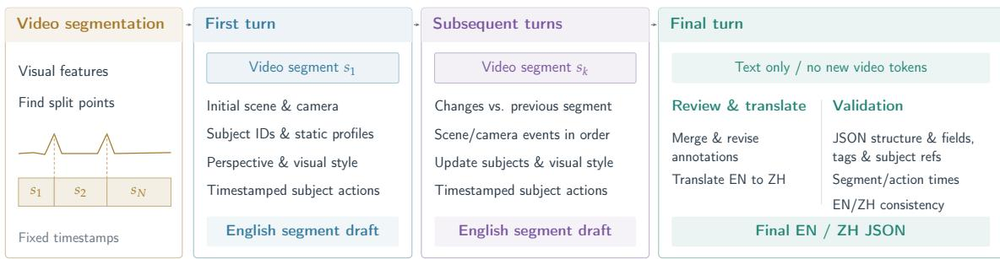  
Context: current + prior segments and annotations  
Figure 3: Structured video captioning. The VLM annotates segments sequentially, maintains subject identities, interleaves scene and camera descriptions chronologically, and records subject actions separately with timestamps. A final text-only turn reviews, translates, and validates the annotations to produce aligned English and Chinese captions. During training, camera-motion sentences and their tags are removed when camera trajectories are available and retained otherwise.

## 2.4 Video Captioning

We design structured video captions to preserve subject identity, scene context, and action chronology, with camera motion explicitly tagged for flexible supervision. Figure 3 and 4 illustrates the caption design and multi-turn annotation procedure.

Structured caption Our captions use structured JSON with video-level and segment-level information. Video-level fields specify visual style, camera perspective, and a shared subject list. Each subject has an explicit identifier and a static profile anchored to its earliest clearly identifiable appearance; subsequent actions and state changes reference this identifier to maintain continuity across segments. Within each segment, scene descriptions and camera-motion sentences are interleaved chronologically in the description field. Subject actions and their visible outcomes are recorded separately, with start and end timestamps for each action.

The first segment establishes the scene; subsequent segments describe changes relative to the preceding segment without repeating unchanged context. Action and camera-motion descriptions are limited to each segment’s temporal boundaries, and action entries form a chronological, nonoverlapping sequence. This representation records scene changes and action timing to support segment-wise autoregressive rollout training.

Camera-motion description We enclose camera-motion sentences in explicit <CameraN> and </CameraN> tags so they can be selected independently of scene and action descriptions. For training segments with ViPE-estimated trajectories, we remove the camera-motion descriptions and their enclosing tags, using the estimated trajectories for explicit camera-motion supervision. For segments without trajectory annotations, we retain the tagged sentences as textual supervision. This complementary strategy supports camera control through either keyboard inputs mapped to trajectories or natural-language motion instructions.

Multi-turn annotation We generate captions in two stages. First, we extract visual features using V-JEPA 2 (Assran et al., 2025) and divide each clip into shorter segments based on temporal changes in these features. In the second stage, a VLM annotates the segments sequentially in a multi-turn conversation.

The first turn establishes the initial scene and subject profiles; subsequent turns describe scene changes and current actions while refining subject identities and video-level labels using accumulated evidence. Previous segments and annotations remain in the conversation context to support temporal and semantic consistency.

For subsequent segments, the VLM uses visual evidence only from the current and preceding segments to ground its descriptions and reduce hallucination. After all segments have been processed, a final text-only turn reviews the accumulated annotations, corrects earlier drafts, and resolves inconsistencies while preserving the supplied segment boundaries. It produces the final English caption and a structurally aligned Chinese translation, both following the format in Figure 4. In this same turn, the VLM checks the JSON structure, required fields, subject references, tags, segment and action timestamps, and consistency between different language versions, then corrects detected inconsistencies before finalizing the output.

```jsonl
{
"perspective_view": "[Video-level perspective]",
"Style": "[Visual style category]",
"subject_list": [
{
"subject_id": "<|Subject1|>",
"display_name": "[Concise subject name]",
"subject_attribute": "[Static profile at the earliest clear appearance]"
}
],
"segments": [
{
"start_time": "[Segment 1 start: MM:SS.mmm]",
"end_time": "[Segment 1 end: MM:SS.mmm]",
"visual_description_long": "A detailed description of the setting, background, and objects visible in the
first segment. <Camera1>A description of the camera's movement and the resulting framing changes</Camera1>.",
"description_change": null,
"contained_actions": [
{
"start_time": "[Action 1 start: MM:SS.mmm]",
"end_time": "[Action 1 end: MM:SS.mmm]",
"action_description": "<Action1><|Subject1|> [first action and visible outcome within the current
segment]</Action1>."
},
{
"start_time": "[Action 2 start: MM:SS.mmm]",
"end_time": "[Action 2 end: MM:SS.mmm]",
"action_description": "<Action2><|Subject1|> [subsequent action and visible outcome]</Action2>."
}
]
},<sub>{</sub>
"start_time": "[Segment 2 start: MM:SS.mmm]",
"end_time": "[Segment 2 end: MM:SS.mmm]",
"visual_description_long": null,
"description_change": "Compared to the previous segment, ... (summarize changes in the setting, background,
and objects). <Camera1>A description of the camera's movement within the current segment</Camera1>.",
"contained_actions": [] // Can be empty if no subject action is visible in this segment.
},
{
"start_time": "[Segment 3 start: MM:SS.mmm]",
"end_time": "[Segment 3 end: MM:SS.mmm]",
"visual_description_long": null,
"description_change": "Compared to the previous segment, ... (summarize changes in the setting, background,
and objects). <Camera1>Camera movement at this moment</Camera1>. The next scene or object change. <Camera2>A
subsequent change in camera movement</Camera2>. Further scene or object change.",
"contained_actions": [
{
"start_time": "[Action 1 start: MM:SS.mmm]",
"end_time": "[Action 1 end: MM:SS.mmm]",
"action_description": "<Action1><|Subject1|> [first action and visible outcome in this segment]</Action1
>."
}
]
]
}
```  
Figure 4: Structured caption format. Video-level fields define perspective, style, and shared subject profiles. Segment descriptions interleave scene information and camera-tagged motion chronologically, excluding main-subject references. The first segment provides a full description; later segments describe changes. Subject actions and their visible outcomes are recorded separately in action-tagged entries using subject tokens. Action intervals are non-overlapping and remain within segment boundaries.

Caption models We use different captioning models across training stages to balance annotation cost and caption quality. For data-intensive stages, we employ Gemma 4 (Gemma Team, 2026) and Qwen3.5-122B-A10B (Qwen Team, 2026a) for efficient large-scale captioning. For the annealing stage, where annotation quality is prioritized over throughput, we use Kimi K3 (Moonshot AI, 2026) to generate detailed segment-wise annotations.

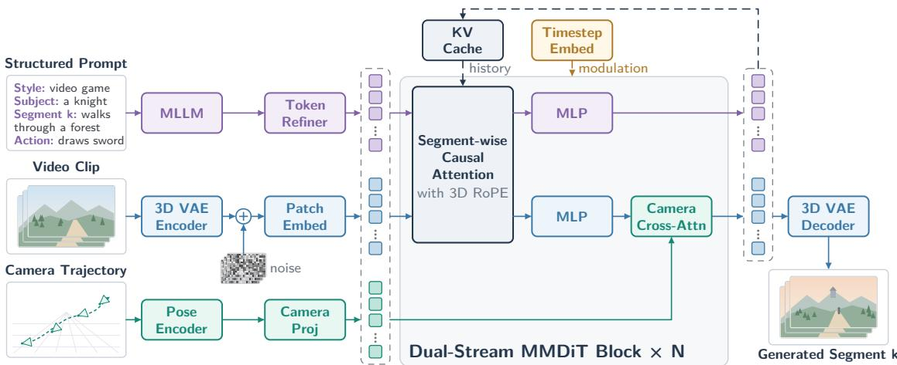

Figure 5: Overview of the model architecture. A structured multi-segment prompt, a video clip, and a camera trajectory are encoded into text, video, and camera tokens, respectively. Text and video tokens are processed by N = 54 dual-stream MMDiT blocks. Within each block, segmentwise causal attention with 3D RoPE allows tokens to attend to the current and preceding segments, while diffusion timestep embeddings modulate both streams. The two streams pass through separate MLPs, and camera cross-attention further conditions the video stream on camera tokens. During autoregressive generation, keys and values associated with both text and video tokens are stored in the KV cache as context for subsequent segments. The 3D VAE decoder maps denoised video latents to RGB frames. Purple, blue, and green denote the text, video, and camera streams, respectively.
<table><tr><td>Component</td><td>Configuration</td></tr><tr><td>Video autoencoder</td><td>DCAE-V, 32× spatial and 4× temporal compression</td></tr><tr><td>Latent representation</td><td>32 channels; patch size 1 × 1 × 1</td></tr><tr><td>Text encoder</td><td>Qwen2.5-VL-7B, width 3,584, maximum length 1,280</td></tr><tr><td>Transformer backbone</td><td>54 dual-stream MMDiT blocks</td></tr><tr><td>Hidden width / MLP width</td><td>2,048 / 8,192</td></tr><tr><td>Self-attention</td><td>16 heads, 128 dimensions per head</td></tr><tr><td>Video RoPE allocation</td><td>(16, 56, 56) for time, height, and width</td></tr><tr><td>Camera representation</td><td>64-D grouped camera extrinsics</td></tr><tr><td>Camera cross-attention</td><td>width 1,024; 16 heads; one module per MMDiT block</td></tr><tr><td>Prediction target</td><td>32-channel latent flow velocity</td></tr></table>

Table 1: Summary of primary architectural settings.

## 3 Model Architecture

Hy-Nomas builds upon HunyuanVideo 1.5 (Wu et al., 2025). We introduce segment-wise causal attention for autoregressive world generation (Section 3.1) and camera cross-attention for explicit camera control (Section 3.2). Hy-Nomas uses a DCAE-V video autoencoder (Chen et al., 2025)<sup>1</sup> and a frozen Qwen2.5-VL-7B text encoder (Bai et al., 2025) inherited from HunyuanVideo 1.5, followed by a timestep-aware token refiner. Starting from Gaussian noise, the model denoises video latents one segment at a time, conditioned on the current text prompt, an optional camera trajectory, and cached keys and values from preceding segments. A dedicated cross-attention module in each MMDiT block (Esser et al., 2024) injects camera conditioning, using video features as queries and frame-aligned camera tokens as keys and values. Figure 5 illustrates the architecture, and Table 1 summarizes its primary configuration.

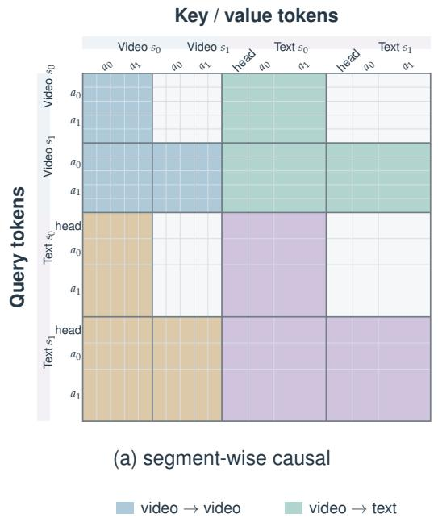

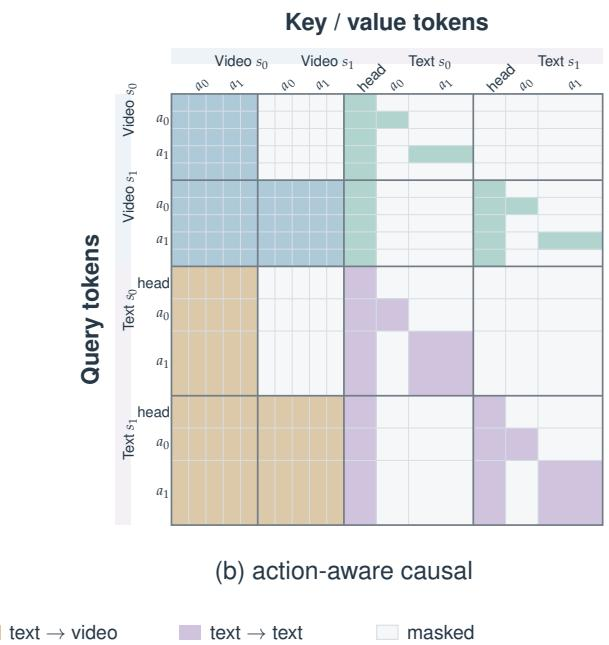  
Figure 6: Comparison of segment-wise and action-aware causal attention. (a) Tokens attend to all video and text tokens in the current and preceding segments. (b) Action-aware masking further restricts access to action-specific text tokens. Colors indicate query-to-key modality pairs; gray cells are masked. head denotes the environment description for the current segment, and $a _ { 0 } , \ldots , a _ { n }$ denote actions within that segment.

Latent video representation We encode an RGB video $X \in \mathbb { R } ^ { B \times 3 \times F \times H \times W }$ into a compact spatiotemporal representation using a causal DCAE-V encoder $\mathcal { E } \mathrm { i }$

$$
Z = { \mathcal { E } } ( X ) \in \mathbb { R } ^ { B \times 3 2 \times F _ { z } \times H _ { z } \times W _ { z } } , \qquad F _ { z } = \left\lfloor { \frac { F - 1 } { 4 } } \right\rfloor + 1 , H _ { z } = \left\lfloor { \frac { H } { 3 2 } } \right\rfloor , W _ { z } = \left\lfloor { \frac { W } { 3 2 } } \right\rfloor\tag{1}
$$

with spatial and temporal compression factors of 32 and 4, respectively. Here, F denotes the number of frames, while H and W denote the height and width of each frame, respectively. Each latent position is treated as an individual token $( 1 \times 1 \times 1$ patch) and linearly projected to the DiT hidden dimension of 2048. The diffusion transformer operates directly in this latent space, with the resulting denoised representation decoded back into RGB video by a decoder D.

Structured text conditioning During preprocessing, each video segment is annotated with a structured JSON caption, as illustrated in Figure 3. A frozen Qwen2.5-VL-7B encoder (Bai et al., 2025) extracts segment-wise text embeddings, which are subsequently processed by a two-layer, timestep-conditioned token refiner. Specifically, the embeddings are projected from 3,584 to the MMDiT hidden dimension of 2,048, followed by adaptive modulation conditioned on the diffusion timestep and pooled text context. The resulting refined embeddings serve as text tokens for attention in the MMDiT backbone.

Flow-matching objective The model is trained with linear flow matching (Lipman et al., 2023). Given a clean video latent Z, Gaussian noise ϵ, and $t \in [ 0 , 1 ]$ , we construct

$$
Z _ { t } = ( 1 - t ) Z + t \epsilon , \ : \ : \ : \ : \ : \ : \ : \ : V _ { t } = \epsilon - Z .\tag{2}
$$

The network predicts the velocity V<sub>t</sub> along this path. At inference time, the reverse ODE is initialized from Gaussian noise at $t \ : = \ : 1$ and integrated toward $t \ : = \ : 0$ using 100 Euler steps. Classifier-free text guidance (Ho & Salimans, 2022) and camera guidance are applied during integration. The resulting clean 32-channel latent is finally decoded by D to obtain the RGB video.

## 3.1 Segment-wise Causal Attention

Unlike conventional video generation, video-based world models simulate evolving world states in temporal order, requiring a causal modeling framework. However, the fully bidirectional attention in our base text-to-video (T2V) model does not enforce this causal structure. We therefore replace it with segment-wise causal attention aligned with the temporal structure of the input captions. Specifically, each caption includes explicit temporal boundaries that partition the video and text tokens into temporally aligned semantic segments. Attention is bidirectional within each segment and causal across segments, allowing tokens to attend only to the current and preceding segments. We illustrate this design in Figure 6(a). Query tokens in segment j can attend to all key and value tokens from the current and preceding segments $0 , \ldots , j ,$ but not to future segments, enforcing causal information flow when modeling evolving world states.

We adapt the bidirectional attention to segment-wise causal attention during the early training stages. However, we observe two limitations of this masking design:

1. Within-segment action misalignment. We observe that actions within a segment can occur in the wrong temporal order. This behavior stems from unrestricted attention to text tokens within each segment: query tokens can attend to the entire segment caption, including actions happening from a different time. This weakens the temporal alignment between video tokens and their corresponding action descriptions in the same segment.

2. Cross-segment action repetition. We also observe that previously generated actions can recur across segments as generation progresses. This behavior is rooted in the continued accessibility of past action descriptions: video tokens in later segments can still attend to action descriptions from earlier segments, prompting the model to replay past actions.

To address these issues, we introduce action-aware causal attention, which extends segment-wise causal attention with a finer-grained masking scheme to distinguish actions within and across segments, as illustrated in Figure 6(b). Each segment’s text tokens are divided into a descriptive head for the segment’s environment and action tails $a _ { 0 } , \ldots , a _ { n } ,$ each specifying an individual action and its corresponding temporal window. This masking scheme addresses the two aforementioned issues as follows:

1. Within-segment action alignment. Query tokens within an action window are restricted to attending only to the associated text tokens and the descriptive head tokens from the same segment. This preserves environmental context while reducing action-order errors and premature action execution.

2. Cross-segment action isolation. Descriptive heads remain accessible to the current and subsequent segments, whereas action tails are restricted to their originating segment. This preserves environmental context across segments while blocking access to past action descriptions, reducing action repetition in later segments.

Applying action-aware causal attention during the later training stages substantially reduces action-order errors and cross-segment action repetition.

## 3.2 Camera-Trajectory Conditioning

Camera trajectory encoding and injection. Hy-Nomas supports continuous camera control during segment-wise autoregressive generation. For each segment, given camera-to-world poses P<sub>t</sub>, we encode frame-to-frame relative motion as $\Delta P _ { t } = P _ { t - 1 } ^ { - 1 } P _ { t }$ , with the first increment set to the identity. Relative transformations are computed independently within each segment, avoiding dependence on the global coordinate frame and camera poses from preceding segments.

Frame-to-frame translations are normalized by a single video-level scale, defined as the 99th percentile of translation magnitudes across all frames. This limits the influence of extreme values on the normalization scale while preserving relative motion speeds. We pad the beginning of the camera sequence by repeating its first transformation until the sequence length is divisible by four. Each group of four consecutive 4 × 4 transformation matrices is then flattened into a 64-dimensional vector and processed by a linear projection followed by a residual MLP, yielding one camera token per VAE latent frame. In each MMDiT block, visual tokens attend to temporally aligned camera tokens within the same segment through cross-attention:

$$
\widetilde { V } = V + \operatorname { C r o s s } { \mathrm { A t t n } } ( V , C ) .\tag{3}
$$

Here V denotes the visual tokens, and C denotes the temporally aligned camera tokens within the same segment. In cross-attention, visual tokens serve as queries, while camera tokens provide keys and values. Recent interactive world models instead rely on coarser action interfaces: some quantize both camera translation and rotation into fixed directional commands (Mao et al., 2025b; Happy Oyster Team, 2026), while others keep rotation continuous but restrict translation to discrete keyboard actions (Yu et al., 2025b; He et al., 2026; Robbyant Team et al., 2026). Our relative-pose trajectory keeps both translation and rotation continuous, enabling finer-grained control over direction, speed, and scale.

Segment-wise mixed-control training. To support interleaved camera and text control during inference, we randomly disable camera conditioning on a per-segment basis during training, exposing the model to alternation between camera- and text-controlled segments. For segments with camera conditioning enabled, we remove camera descriptions from video caption to prevent the model from using them as shortcuts during training. For segments without camera conditioning, we retain these descriptions to enable text-driven camera control.

From keyboard inputs to camera trajectories. At inference, keyboard inputs are converted into camera trajectories. $w / \varsigma$ control forward and backward motion, $\mathsf { A } / \mathsf { D }$ control lateral motion, and mouse or arrow-key inputs control yaw and pitch rotations. These translation and rotation increments are accumulated frame by frame to construct camera-to-world poses. Motion speed, scale and duration can be adjusted without retraining.

## 4 Training Infrastructure

To efficiently process long, variable-length videos when adapting a pretrained video generator into an interactive world model through multi-stage training, we optimize distributed parallelism, data loading, and memory usage. This section describes the detailed infrastructure optimizations.

## 4.1 Model and Data Parallelism

Training long, token-packed video sequences requires distributing both model state and activation computation across multiple GPUs. We combine Ulysses-style sequence parallelism (SP) (Jacobs et al., 2023), data parallelism (DP), and FSDP2 hybrid sharding (PyTorch Contributors). Sequence parallelism partitions a single packed sample across a small group of $\mathrm { G P U s , }$ data parallelism assigns different packed samples to different groups, and FSDP2 shards model parameters, gradients, and optimizer states within each group. This organization enables sequences of up to 360K tokens while keeping parameter-sharding and sequence-parallel communication localized to small groups. On top of this parallel layout, we use a mask-flexible attention kernel for the heterogeneous segmentand action-aware masks, FLOPs-balanced sequence packing, a distributed Muon optimizer, and asynchronous checkpointing, which together determine the end-to-end throughput and robustness of long-running jobs.

Sequence parallelism. We adopt Ulysses sequence parallelism (Jacobs et al., 2023) with $N _ { \mathrm { S P } } = 8$ to reduce activation memory for packed video and text sequences of up to 360K tokens. Both video and text tokens are partitioned along the sequence dimension across eight GPUs, with each rank holding approximately 45K tokens at maximum sequence length. During attention, an all-to-all collective transforms sequence shards into head shards, allowing each rank to compute a subset of attention heads over the full sequence, followed by a reverse all-to-all to restore sequence sharding for local normalization, residual, and MLP operations.

Data parallelism. Each eight-GPU SP group forms one logical data-parallel replica and processes a different packed batch. For $N _ { \mathrm { G P U } }$ total $\mathrm { G P U s }$ and sequence-parallel degree $ { \hat { N } } _ { \mathrm { S P } } ,$ the number of replicas is $\begin{array} { r } { \bar { N } _ { \mathrm { D P } } = \frac { N _ { \mathrm { G P U } } } { N _ { \mathrm { S P } } } } \end{array}$ . The precomputed packing plan assigns a different pack to each replica, while gradients are synchronized across replicas to maintain a consistent global model update. Because the gradient synchronization waits for the slowest replica, the packs are balanced by their estimated FLOPs rather than by sample count or token count (see Section 4.3), reducing workload variation caused by differences in video resolution, duration, and mask density.

FSDP2 hybrid sharding. We employ FSDP2 (PyTorch Contributors) with a logical distributed mesh organized as

$$
[ \mathrm { D P r e p l i c a t i o n } , \mathrm { D P s h a r d i n g } , \mathrm { s e q u e n c e p a r a l l e l i s m } ] .\tag{4}
$$

The explicit DP-shard size is set to one. In our implementation, the DP-shard and SP dimensions are combined when constructing the FSDP shard group. Consequently, parameters, gradients, and optimizer states are effectively sharded across the same eight GPUs that form one SP group, and the resulting model shard is replicated across the data-parallel groups.

This topology avoids performing parameter all-gathers and gradient reduce-scatters over the entire job. These collectives remain within the eight-GPU shard group, while gradient synchronization across replicated groups provides global data-parallel scaling. Parameter all-gathers and gradient reduce-scatters are overlapped with forward and backward computation whenever their dependencies permit. The design therefore trades local communication for substantial reductions in per-GPU model-state memory.

## 4.2 GPU Memory Optimization

Activation checkpointing. All main transformer blocks use activation checkpointing (Chen et al., 2016). Standard checkpointing stores the block input during the forward pass and reconstructs intermediate activations during backpropagation, requiring both the attention and MLP computations to be executed again. Following the principle of selective activation checkpointing (PyTorch Team, 2025), we additionally support selective recomputation through sk $\mathrm { i p \_ a t t r } _ { - }$ recompute. When enabled, the attention output and required softmax statistics are retained from the original forward pass. Backward recomputation reuses these saved attention results and recomputes only the remaining block operations, including the MLP. This option preserves attention gradients while avoiding a second execution of the attention forward kernel, trading additional activation memory for lower recomputation cost.

Stage-dependent memory strategy. The optimal memory policy depends on the training algorithm. During one-shot training, particularly after the introduction of per-layer camera attention, we enable selective attention checkpointing, asynchronous activation offload, and camera-module checkpointing. Saved attention outputs and checkpoint inputs can be transferred to pinned CPU memory, reducing GPU memory pressure while preserving the compute savings from skipping attention recomputation.

During segment forcing, we instead disable attention-output retention and activation offload. Segment-wise streaming backward already bounds peak memory by releasing intermediate activations as the serial rollout progresses. In this regime, retaining attention outputs increased memory by approximately 1.6 GB per rank without providing a meaningful speed improvement. We therefore use ordinary attention recomputation together with streaming backward.

## 4.3 Training Throughput Optimization

FLOPs-based sequence packing. To improve training throughput on long videos with varying spatial resolutions and durations, we employ sequence packing (Krell et al., 2022) to combine 480p and 720p videos spanning 5–75 seconds into token-budgeted batches. Packing preserves each token’s sample identity and original spatial, temporal, and segment metadata, with block-diagonal attention preventing information leaking across videos. Conditioning signals are packed with video tokens to preserve text–segment and camera–frame alignment, while the training loss is computed only over valid video tokens.

Balancing token counts alone does not ensure balanced computation, as segment-wise causal attention incurs substantially different costs depending on the number of unmasked query–key pairs. We therefore estimate the computational cost of each sample directly. Let $n _ { i }$ denote the number of valid video and text tokens of sample $i ,$ and let

$$
A _ { i } = \sum _ { p \in i } \lvert \{ q : M _ { p q } ^ { ( i ) } \neq - \infty \} \rvert\tag{5}
$$

denote the number of unmasked query–key pairs under its segment- and action-aware mask $M ^ { ( i ) }$ For segment lengths $m _ { 1 } , \ldots , m _ { S } , A _ { i }$ is dominated by $\begin{array} { r } { \sum _ { j = 1 } ^ { S } m _ { j } \sum _ { k \le j } m _ { k } . } \end{array}$ , which can be computed from segment metadata without materializing the mask. We model the estimated per-sample training FLOPs as

$$
F _ { i } = \alpha n _ { i } + \beta A _ { i } ,\tag{6}
$$

where α captures the per-token cost of linear operations across the 54 blocks, including camera cross-attention, and $\beta$ captures the per-pair cost of $Q K ^ { \top }$ and $P V$ operations. Both coefficients account for backward propagation and activation recomputation, and are derived analytically from the architecture in Table 1 and calibrated against measured step times.

We construct the packing plan offline in two stages. First, samples are grouped into packs satisfying the token budget $\textstyle \sum _ { i \in { \mathfrak { p a c k } } } n _ { i } \leq N _ { \mathfrak { m a x } }$ , while targeting similar estimated FLOPs per pack. Second, packs are assigned to the $N _ { \mathrm { D P } }$ replicas using a longest-processing-time-first greedy algorithm, sorting packs by estimated $\mathrm { F L O P s }$ in descending order and assigning each to the least-loaded replica. This balances computational workloads across replicas and reduces synchronizationinduced idle time. The resulting plan is stored alongside the data index and loaded by the dataloader without additional runtime scheduling overhead, with consistent packing assignments across ranks within each sequence-parallel group.

Efficient attention with structured masks. Our training combines segment-causal and actionaware attention with block-diagonal boundaries across packed videos, resulting in complex attention masks over sequences of up to 360K tokens. Dense masks are prohibitively expensive at this scale, while standard FlashAttention kernels (Shah et al., 2024) cannot efficiently handle such irregular attention patterns. We therefore adopt the Flex-Flash-Attention (FFA) kernel from MagiAttention (Tao & Huang, 2025), which represents structured masks as compact attention slices and skips masked attention blocks. We construct these slices directly from sample, segment, and action metadata without materializing dense masks. We further integrate FFA with eight-way Ulysses sequence parallelism, where each rank processes two of the 16 attention heads over the packed sequence using the same slice specification. This avoids the repeated key–value communication of context-parallel approaches while retaining only two all-to-all collectives per attention layer.

Distributed Muon optimizer. We train the DiT using Muon (Jordan et al., 2024; Liu et al., 2025b) for the weight matrices in attention and feed-forward layers, and AdamW (Loshchilov & Hutter, 2019) for embeddings, biases, and other remaining parameters. To support Muon’s full-matrix orthogonalization under FSDP2 parameter sharding, we adopt the distributed Muon implementation from Canzona (Wang et al., 2026b).

Asynchronous checkpointing and deterministic resumption. We build upon ByteCheckpoint (Wan et al., 2024) to asynchronously save FSDP2-sharded model and optimizer states, overlapping serialization and storage I/O with training through pinned CPU memory. To ensure deterministic resumption, we additionally checkpoint all dataloader states, including packing-plan positions and sampler states, together with all CPU and GPU RNG states. Restoring these states preserves data ordering and stochastic operations across training interruptions. Furthermore, our global tensor metadata enables checkpoint resharding across different GPU counts and parallel configurations without offline conversion.

## 5 Model Training

We progressively adapt a pretrained bidirectional DiT into an interactive world model through coordinated curricula in causality, interaction, and context length. Section 5.1 explains the design of this progression, and Sections 5.2–5.5 describe its implementation, from continual pre-training to few-step autoregressive generation. Section 5.6 presents a lightweight recipe for downstream adaptation.

## 5.1 Training Curriculum

Our training strategy introduces each capability on top of an already learned foundation. Table 2 summarizes the five stages, with continual pre-training (CPT) divided into three successive regimes. Together, these stages advance three complementary curricula.

Causal curriculum. We progress from segment-wise causal attention to action-aware causal attention, followed by segment forcing and diffusion distillation. Segment-wise masking first establishes the information flow required for autoregressive generation: each segment uses its current instruction and preceding history, while attention remains bidirectional within the segment. Action-aware masking then refines this structure by setting bounded temporal scope for each action instruction, addressing action-order errors and the repetition of earlier actions. Segment forcing subsequently trains the model with cached context from its own predictions, exposing the model to imperfect histories before inference. Finally, causal distillation reduces the sampling steps while further mitigating error accumulation due to training and inference mismatch. This curriculum progressively convert a bidirectional DiT into an efficient autoregressive model.

<table><tr><td>Stage</td><td>Training regime</td><td>Primary data or supervision</td><td>Main objective or capability</td></tr><tr><td>1</td><td>Latent-space adaptation</td><td>HunyuanVideo 1.5 initialization; 20K steps updating input/output layers, then 60K full-model updates</td><td>Transfer HunyuanVideo 1.5 VAE to a more compact DCAE-V latent space.</td></tr><tr><td rowspan="3">2</td><td>Segment-causal CPT</td><td>Broad video corpus with segment-wise captions, followed by higher-quality data</td><td>Establish segment-wise causal generation before introducing finer-grained action control.</td></tr><tr><td>Action-aware CPT</td><td>Curated videos with balanced sampling and temporally localized action captions</td><td>Learn action timing and cross-segment action isolation; expand the context length from 180K to 360K tokens.</td></tr><tr><td>Camera- conditioned CPT</td><td>Videos with and without camera trajectories, mixed at a 1:1 ratio</td><td>Add continuous camera control while retaining text-driven generation.</td></tr><tr><td>3</td><td>High-quality annealing</td><td>High-quality videos from balanced sources; detailed captions with Kimi K3 and camera trajectory annotations</td><td>Refine visual quality, text conditioning, and camera control.</td></tr><tr><td>4</td><td>Segment forcing</td><td>A subset of high-quality annealing data</td><td>Align training with segment-wise autoregressive inference and its evolving KV-cache state.</td></tr><tr><td>5</td><td>Diffusion distillation</td><td>Causal PCM initialization followed by DDMD and adversarial refinement under hybrid forcing</td><td>Enable few-step generation, and further reduce errors due to the training-inference mismatch.</td></tr></table>

Table 2: Multi-stage training of Hy-Nomas. Stage 2 progresses from segment-causal to actionaware and camera-conditioned CPT. Segment-causal CPT includes a continuation on higher-quality data. Downstream LoRA adaptation is performed separately after the listed training stages.

Interaction curriculum. We extend a bidirectional, noninteractive text-to-video DiT into a model supporting multi-turn free-form text interaction, and then free-form text interaction with continuous camera control. Segment-wise captions and causal attention teach the model to respond to successive text instructions while carrying forward relevant visual context. Camera-conditioned CPT adds geometric control capabilities after the foundation for text-prompt interaction has been established. Mixing text-only and camera-conditioned segments, together with segment-wise camera dropout, exposes the model to transitions between different interaction modes within a sequence. The resulting model can continue an evolving world under either semantic instructions or explicit camera motion.

Context curriculum. We combine mixed-resolution and mixed-length training with a progressive increase in the maximum packed sequence length. The context length is set to 180K tokens before action-aware CPT and increases to 360K tokens from action-aware CPT onward. Mixing resolutions and durations balances spatial detail and temporal coverage; expanding the context length helps the model to understand longer histories and generate richer instruction video sequences. Sequence packing and memory optimizations in Section 4 make this progression practical. A context length of 360K tokens is sufficient to generate minute-scale visual worlds at 720p resolution.

## 5.2 Continual Pre-Training

Latent-space adaptation. We initialize Hy-Nomas from HunyuanVideo 1.5 (Wu et al., 2025) and adapt its VAE to DCAE-V (Chen et al., 2025), increasing spatial compression from 16 × 16 to 32 × 32 while keeping temporal compression as a factor of four. This significantly reduces the latent token count at a given video resolution and duration, making training on longer sequences more feasible. We first freeze the intermediate DiT blocks and update only the input projection and output layers for 20K steps, then train the full DiT for another 60K steps.

From segment causality to action alignment. CPT first establishes segment-wise causal attention on diverse, variable-length videos with dense structured captions, then continues with higherquality data under the same attention structure. We subsequently introduce action-aware masking with temporally localized annotations. The key transition is to supervise when an instruction applies: descriptive context remains available across segments, whereas action instructions are restricted to their originating segment and annotated temporal windows. Increasing the context length at this stage allows training to include longer action sequences and histories. The attention design is specified in Section 3.1.

Camera control. At the end of CPT, we introduce the camera-control interaction capability. Normalized camera extrinsics are encoded as one token per latent frame and injected through frame-wise cross-attention after every MMDiT block. Both the base DiT and the camera modules remain trainable, allowing camera control to be learned jointly with visual quality and prompt adherence. During this training stage, both the camera trajectory and camera-related text descriptions are dropped with 50% probability for each segment. This allows camera-control interaction and text-prompt interaction to coexist within the same video while preventing text-based camera descriptions in captions from leaking the camera motion.

## 5.3 High-Quality Annealing

After broad capability acquisition, we anneal on high-quality, predominantly single-subject videos from various targeted sources. Kimi K3 (Moonshot AI, 2026) is used to generate more accurate dense captions, and we increase the maximum text length from 768 to 1,280 tokens to accommodate more detailed segment descriptions and longer action sequences. The model architecture and flow-matching (Lipman et al., 2023) objective remain unchanged.

We use different supervision for annealing data according to its camera trajectory quality. Videos whose ViPE trajectories pass validity and motion-variance filters enter the camera-conditioned path; those with unreliable trajectories remain useful as text-conditioned training samples. Camera trajectories are normalized with a shared video-level scale preserving relative motion magnitudes across segments. This concentrates learning on precise text and camera motion supervision while retaining useful videos that lack reliable camera trajectories.

## 5.4 Segment Forcing

Segment Forcing adapts the model to the evolving history it consumes during autoregressive inference. Inspired by training with model-generated context in Self Forcing (Huang et al., 2026), we combine sequential segment-wise denoising, one-step context estimation, and streaming backward. This exposes later segments to prediction errors while retaining direct flow-matching supervision for each current segment.

Given a video divided into multiple segments, the autoregressive DiT processes the segments sequentially. At segment $s ,$ the model takes the noisy latent $\mathbf { x } _ { s , t }$ as input and predicts its flowmatching velocity $\check { \hat { \mathbf { v } } } _ { s } ,$ conditioned on the KV cache constructed from preceding segments and prompts. We apply the flow-matching MSE objective (Lipman et al., 2023) only to the current segment prediction. The resulting loss is immediately backpropagated, after which the computation graph and intermediate activations of the current segment are released to save GPU memory.

To construct the context for the next segment, we perform one-step denoising from the same noisy latent $\mathbf { x } _ { s , t }$ using the predicted velocity:

$$
\tilde { \mathbf { x } } _ { s , t _ { \mathrm { c t x } } } = \mathbf { x } _ { s , t } + ( t _ { \mathrm { c t x } } - t ) \hat { \mathbf { v } } _ { s } , \qquad t _ { \mathrm { c t x } } \sim \mathcal { U } ( 0 . 1 , 0 . 3 ) .\tag{7}
$$

The sampled range approximates the noise levels of context segments encountered during autoregressive inference. The resulting low-noise latent is appended to the KV cache and used as context for subsequent segments. We omit this cache update for the final segment because no later segment consumes it.

By repeatedly generating and caching its own context, the model is trained under a history distribution that closely matches autoregressive inference. Meanwhile, streaming backward keeps only the latest segment’s computation graph in memory. Gradients are accumulated across segments, followed by a single optimizer step after the full sequence has been processed. The complete pipeline is illustrated in Figure 7.

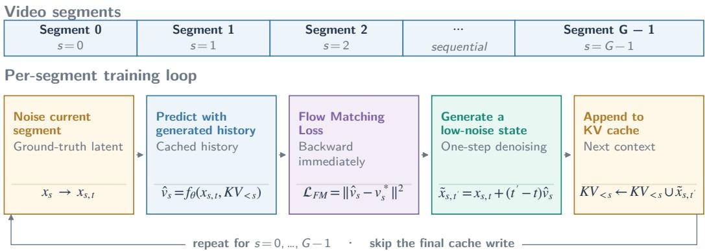  
Figure 7: Segment Forcing with streaming backward. Each current segment receives a flowmatching loss; a one-step low-noise estimation supplies cached context for later segments. Streaming backward retains only one segment’s computation graph at a time, accumulating gradients for a single optimizer step after the full sequence. The cache update of the final segment is skipped.

## 5.5 Diffusion Distillation

Causal distillation. Starting from the AR model trained with segment self-forcing, we use twostage distillation to reduce the sampling budget from 100 to 4 network function evaluations (NFEs) per segment. The two stages establish few-step generation and then refine visual fidelity and motion stability while preserving semantic alignment and camera controllability.

Stage I: Few-Step Initialization. Drawing on consistency-based distillation (Song et al., 2023; Wang et al., 2024), we initialize the student with a causal adaptation of Phased Consistency Models (PCM). The teacher’s denoising trajectory is partitioned into phases, and the student learns to map noisy states within each phase to its lower boundary. Training uses teacher forcing: each segment is conditioned on ground-truth history, text, and camera inputs. The resulting few-step checkpoint initializes Stage II.

Stage II: Quality Refinement. Starting from the PCM checkpoint, we refine the student under hybrid forcing (Hong et al., 2025) to improve visual fidelity and motion stability while preserving semantic alignment. For longer sequences, a noise-perturbed ground-truth prefix initializes the student’s causal KV cache. The student then generates the suffix autoregressively with 4 NFEs per segment, using each generated segment as context for the next. This combines ground-truth context with training on the student’s own generated history. Shorter sequences are generated entirely by the student.

We jointly optimize the student with a causal adaptation of Decoupled Distribution Matching Distillation (DDMD) and an adversarial hinge objective, drawing on distribution-matching distillation (Liu et al., 2025a; Yin et al., 2024b;a) and adversarial distillation (Sauer et al., 2023; Lin et al., 2025a;b; Cheng et al., 2026a;b), respectively. DDMD samples noise levels independently for CFG and DM, restricting CFG to the remaining denoising interval while sampling DM over the full interval (Liu et al., 2025a). DDMD supervision is applied only to the final generated segment, with gradients stopped through earlier segments and their cached representations. The teacher remains frozen, while the fake-score model is trained with flow matching (Lipman et al., 2023) on detached student samples. The adversarial objective complements DDMD with supervision from high-quality real videos to improve visual fidelity and motion stability.

Causal inference. At inference, the distilled student generates segments autoregressively with 4 NFEs per segment, conditioned on text, camera inputs, and previously generated history. After each segment is generated, we perturb it with flow noise at σ = 0.206897 before updating the causal KV cache for subsequent segments.

## 5.6 Downstream Adaptation via LoRA

To help users customize our model for their use cases, we provide a recommended workflow based on Low-Rank Adaptation (LoRA) (Hu et al., 2021). We present this workflow as our best-practice recipe for downstream adaptation and encourage users to follow it when developing their own specialized models.

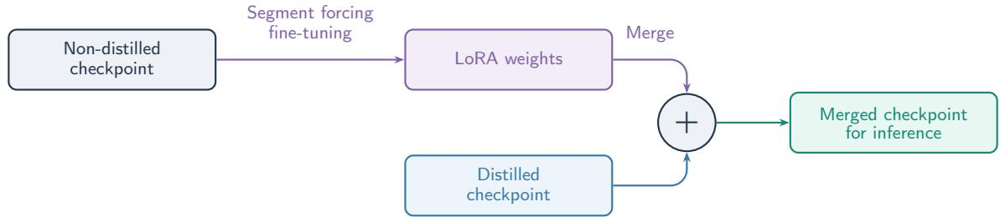  
Figure 8: Downstream LoRA adaptation workflow. Train LoRA adapters on the base autoregressive model (before distillation), then merge the learned weights into the distilled model for efficient deployment, without full-model fine-tuning or repeating distillation.

Best practices for downstream adaptation. We recommend training LoRA adapters on the base autoregressive model before distillation, then merging the learned LoRA adapter weights into the distilled model for deployment. The workflow is illustrated in Figure 8. Users can follow this recipe with on the order of 100 task-specific samples selected to reflect their intended visual style, usage scenario, or application domain. This workflow enables lightweight customization without full-model fine-tuning or repeating the distillation pipeline, while retaining the inference efficiency of the distilled model. The following examples illustrate these best practices and provide practical references for users adapting the model to their own applications.

Cinematic style LoRA. As an example of visual-style adaptation, we train a cinematic-style LoRA adapter on the base autoregressive model using cinematic videos paired with high-quality captions from K3 as our SFT data. We set the LoRA rank to 256 and alpha to 512, and train for 500 iterations with a learning rate of 10<sup>−4</sup>. For effective domain adaptation, we recommend using a slightly higher learning rate than that used for base-model training. Due to the small size of the SFT dataset, we employ sequence packing in the data loader such that each training iteration covers the entire dataset, making 500 iterations equivalent to 500 epochs. We then merge the resulting LoRA adapter weights into the distilled model for inference.

Robotics LoRA. Beyond visual-style adaptation, robotics is another potential application of this recipe. We perform task-specific robotics LoRA fine-tuning on a set of robotics dual-arm egocentric task videos (RealSource, 2025), which is not overlapped with our training set. We conduct the LoRA tuning for approximately 1, 500 epochs on the selected 128-sample tuning set with a LoRA rank of 512.

In Section 7.4, we provide a preliminary evaluation of the LoRA-adapted model against the distilled model before merging the LoRA weights.

## 6 Model Inference

Interactive deployment requires translating user intent into suitable conditioning inputs and generating responses efficiently. To address these complementary requirements, we develop a VLM-based Prompt Enhancer (PE) and optimize the model’s inference pipeline.

The PE translates user intent into structured instructions for the video generator. Given previously generated video segments, the current user instruction, and optional camera-control signals, the PE produces a prompt for the next segment. This design builds on recent approaches to streaming text control and agent-mediated world interaction (Yang et al., 2025; Gao et al., 2026b), while using a structured caption format aligned with our training annotations.

## 6.1 Prompt Enhancer

## 6.1.1 Prompt Enhancer Workflow

Multi-turn interaction. Prompt Enhancer (PE) converts user instructions into structured dense captions for segment-by-segment video generation. At each turn, PE produces one caption for the next segment, which the DiT then uses to generate the corresponding video. The interaction

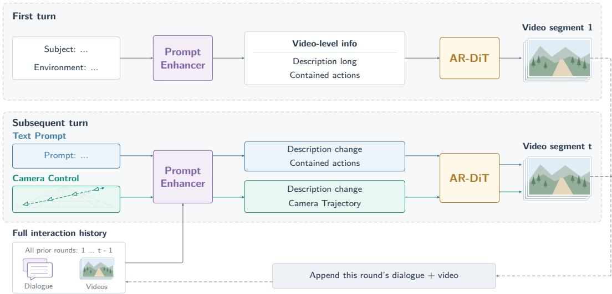  
Figure 9: Prompt Enhancer (PE) workflow. PE generates an initial dense caption in the first turn. In subsequent turns, users can choose text prompts or camera control, and PE combines the selected input with the full interaction history to generate a dense caption that AR-DiT uses to produce the next video segment. Each turn’s dialogue and generated video are appended to the history.

proceeds causally: each new turn conditions on the current user input and the complete history accumulated so far.

Formally, the caption at turn t is generated as

$$
y _ { t } \sim p _ { \theta } ( \cdot \mid S , u _ { t } , H _ { t - 1 } , V _ { < t } , m _ { t } ) ,\tag{8}
$$

where S is the system prompt, $u _ { t }$ is the current user input, and $m _ { t }$ specifies the rewriting mode. The dialogue history $\hat { H } _ { t - 1 }$ contains all preceding user requests and PE responses, while $V _ { < t } =$ $( V _ { 1 } , \ldots , \stackrel { \smile } { V _ { t - 1 } } )$ contains all previously generated video segments. Both histories are empty at the first turn. After each round, the dialogue and generated video are retained as context for subsequent turns.

Initial and incremental captions. The output format depends on the turn and the selected control mode:

• First-turn initialization. The user provides subject and environment descriptions, together with any specified visual style and viewing perspective. PE returns video-level metadata and the first segment caption, including visual\_description\_long to establish the scene and contained\_actions to specify subject actions, according to the caption format defined in Figure 4.

• Subsequent turns in text prompt mode. PE combines the current user description with the full dialogue and video history to produce an incremental dense caption. The output contains description\_change for scene and camera updates relative to the established context, and contained\_actions for the next segment’s subject behavior.

• Subsequent turns in camera control mode. PE outputs only description\_change, leaving contained\_actions empty. The user-defined camera trajectory is supplied separately to DiT alongside this incremental caption.

## 6.1.2 Prompt Enhancer Training

To support local deployment, we train a lightweight PE model using a dataset of multi-turn multimodal conversations. Each turn pairs the current user instruction and previous dialogue and video history with a structured dense caption response. We construct the data in two ways. First, we synthesize user prompts from existing dense captions, checking that the prompts preserve the specified subject attributes, scene content, and action ordering. Second, we collect real user prompts as seed data and augment them into more synthetic user prompts. We then run these user prompts through the complete PE and video generation pipeline, recording the caption response and generated video at each turn. Each PE turn uses the current instruction and the full dialogue and video history from previous turns. The dataset includes scene initialization and follow-up interactions across different subjects, environments, viewpoints, and control modes. We also add examples to expand the coverage of action types, different action combinations, and temporal orderings, and check for inconsistencies between instructions, captions, and successive segments. We use Qwen3.8-27B as our base model and train our PE through supervised fine-tuning.

## 6.2 Inference Optimization

To make our model accessible to users with limited GPU resources, we optimize both autoregressive generation and video decoding for deployment on a single NVIDIA RTX 4090 GPU. We combine INT8 storage, sliding-window attention (SWA), and CPU offloading to reduce GPU memory usage, and use sparse attention to improve generation efficiency. For video decoding, we train a PixelDiT decoder based on PixelUMM (Wei et al., 2026) and optimize it for single-GPU inference.

Efficient single-GPU inference on NVIDIA RTX 4090. We reduce inference memory primarily through INT8 quantization, sliding-window attention (SWA), and CPU offloading. We quantize model weights and cache historical attention keys and values in INT8 with floating-point scales, dequantizing them to BF16 during computation while keeping the current segment’s attention inputs in BF16. SWA maintains a bounded history on the GPU, preventing the KV cache from growing with rollout duration. We further offload inactive model components to CPU memory between pipeline stages, such as offloading the VAE during DiT denoising and loading the text encoder only when needed. This reduces peak memory usage at the cost of CPU–GPU transfer latency. Peak GPU memory also depends on the current segment length and temporary computation buffers. For example, generating a 100-second video across seven segments at 1280×704 resolution and 24 FPS requires 20.53 GiB of peak GPU memory. To further accelerate inference, we use dense attention for the first two denoising steps, followed by sparse attention that retains 25% of candidate video blocks in subsequent steps. These optimizations may introduce subtle differences that become more noticeable over successive segments during autoregressive generation.

PixelUMM decoder adaptation. We replace the DCAE-V decoder with a pixel-space diffusion decoder initialized from the vision part of PixelUMM (Wei et al., 2026). The decoder takes the DCAE-V latents as a condition and recovers the corresponding video from pixel-space Gaussian noise. When reconstructing videos with complex natural textures, the original DCAE-V decoder, which operates on highly compressed latents, tends to output a repetitive grid-like pattern in place of the true texture. In contrast, our decoder uses its pretrained generative prior to restore realistic high-frequency details. The decoder is trained with PixelUMM’s diffusion loss, first on images and 40-frame videos at 256 × 256, and then on images and longer videos at 384p–720p. For long videos, we adopt the temporal tiling strategy of the H3 decoder (MiniMax, 2026) rather than that of the DCAE-V decoder, decoding overlapping chunks of 40 frames with a 20-frame overlap blended by cosine weights. Spatially, instead of overlapping tiling, which incurs substantial redundant computation, we decode each frame in a single pass and use sliding-tile attention (Zhang et al., 2025), in which each patch attends only to the patches in a local spatial neighborhood across all frames in the chunk. Finally, we distill the decoder with DMD2 (Yin et al., 2024a) for one-step inference, and accelerate its inference on a single NVIDIA RTX 4090 GPU with FP8 quantization.

## 7 Evaluation

To systematically evaluate interaction capability and memory consistency of world models, we introduce Hy-Nomas-Bench, comprising 280 test cases across four benchmarks: multi-turn text interaction, camera navigation, interleaved text–camera control, and spatial memory. We compare Hy-Nomas with three representative interactive world models: Genie 3 (Google DeepMind, 2025), LingBot-World v2 (Gao et al., 2026b), and Happy Oyster (Happy Oyster Team, 2026). We generate outputs using each model’s supported interaction interface and conduct pairwise human evaluation on prompt following, physical plausibility, camera control, and memory consistency.

## 7.1 Hy-Nomas-Bench and Metrics

The overview of Hy-Nomas-Bench is shown in Figure 10. We construct four benchmarks totaling 280 test cases that assess model capabilities through free-form text prompts, keyboard-based camera commands, and interleaved text and camera inputs, as well as spatial memory across successive interactions. The benchmarks cover first-person, second-person, third-person following, and third-person observer viewpoints in photorealistic, game-like, and animated environments. We release original user prompts for evaluating other models through their native interfaces, alongside PE-enhanced prompts following our structured caption format to reproduce our results <sup>2</sup>. Camera controls provide frame-aligned keyboard states and reference poses with explicit timing and motion conventions. All four benchmarks cover complex multi-turn interactions with cases that require the model to generate videos longer than 60 seconds.

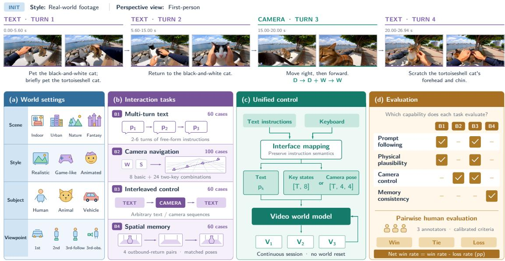  
Figure 10: Overview of Hy-Nomas-Bench. Top: Model outputs for an example case from Bench-3 (interleaved text–camera control). Bottom: (a) World settings span diverse scenes, visual styles, subjects, and viewpoints. (b) 280 cases cover multi-turn text interaction, camera navigation, interleaved control, and spatial memory. (c) Unified control maps instructions to text, binary key states [T, 8] (W/A/S/D and four arrow keys), or per-frame 4 × 4 camera-to-world matrices [T, 4, 4], where T is the frame count. Generation continues across turns without world resets. (d) Three annotators evaluate prompt following, physical plausibility, camera control, and memory consistency through pairwise comparisons. Results are summarized by win/tie/loss rates and net win rate (win minus loss, in percentage points).

We consider four dimensions to evaluate world models. Promptfollowing measures adherence to free-form text instructions; physical plausibility assesses the realism and consistency of generated physical interactions; camera control measures how accurately the model responds to navigation commands; and memory consistency assesses spatial coherence when revisiting previously observed environments. These criteria are designed to cover different capabilities of world models, i.e., instruction execution, plausible dynamics, navigation, and spatial recall. Conventional evaluation metrics used in video generation are not considered in Hy-Nomas-Bench (such as visual fidelity, aesthetics, audio quality, etc.), as we focus on capabilities that are crucial to world models.

A closely related work is WBench (Ying et al., 2026), which evaluates text-prompt and cameracontrol capability separately, since most existing models can only handle one type of interaction. In contrast, we introduce interleaved text and camera control within a single continuous test case. We also assess spatial memory through specially designed camera trajectories that leave and return to an earlier viewpoint, testing whether previously observed anchor objects and environments remain present and consistent. We describe each benchmark below.

Bench-1: Multi-turn free-form text. This benchmark examines whether instruction execution remains consistent with an evolving scene across successive turns. We construct 60 scenarios with 2–6 turns, using prompts curated by human annotators. The sequences include interactions that depend on entities and states established in preceding turns, requiring models to execute new instructions while retaining relevant scene context. This introduces dependencies across turns beyond isolated action completion: previously introduced subjects must remain identifiable, object interactions must remain compatible with the current scene, and action transitions must remain physically plausible. The resulting sequences probe both local instruction adherence and the persistence of scene content throughout the whole video.

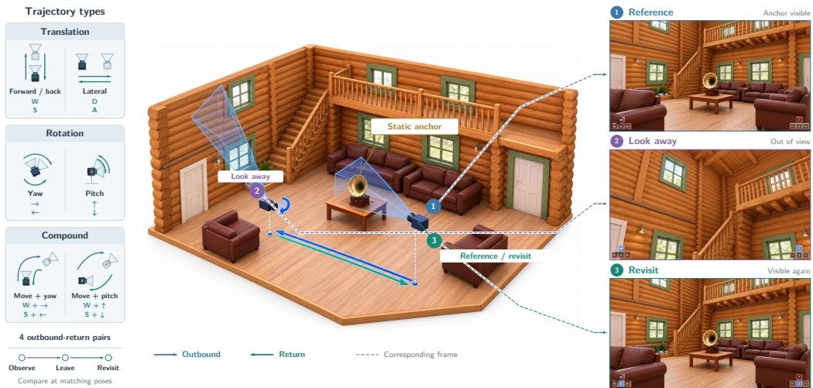  
Figure 11: Illustration of the design of Bench-4: Spatial memory. Each uses a static anchor object and four outbound–return pairs. Bench-4 evaluates object permanence under different camera movements, and appearance/layout consistency. Left: Different trajectory types. Center: Scene, camera frustum, and trajectory. Right: Inference results by Hy-Nomas.

Bench-2: Camera navigation. This benchmark targets the combination of different keyboard actions and reversibility of camera controls. The 100 cases cover all eight basic keyboard actions and all 24 two-key combinations that exclude opposing inputs along the same control axis. These combinations encompass simultaneous translations, simultaneous rotations, and coupled translation–rotation motions, testing whether individually meaningful controls remain correctly composed when applied together. Each segment holds a fixed action for 2–4 seconds and is followed by an equal-duration inverse action. Under the specified motion-integration rules, the reference trajectories return to the same position and orientation at each pair boundary. This construction provides controlled motion intervals and known return poses for examining directional adherence, coupled-motion errors, and drift over successive outbound–return pairs.

Bench-3: Interleaved text and camera control. This benchmark tests whether control responsiveness and scene continuity persist when switching between text prompts and camera control within a rollout. The 60 cases contain 2–7 segments, each specifying either a free-form semantic interaction or an explicit camera-control sequence. Bench-3 covers both text-to-camera and camera-to-text transitions. Text segments introduce actions and scene changes, while camera segments navigate the scene under prescribed camera trajectories. It requires models to preserve the consequences of earlier interactions during navigation and interpret subsequent text instructions correctly to update the scene. World models need to respond correctly when switching between different control signals.

Bench-4: Spatial memory. This benchmark evaluates whether previously observed content remains consistent after leaving the field of view. We construct 60 first-person scenarios, evenly distributed across real-world and game-style indoor and outdoor environments. Each scenario contains a distinctive static anchor object and eight camera-control segments forming four outbound– return pairs, covering translations, rotations, and more complex camera motions. A static anchor object is used as a reference to identify any memory inconsistency. The camera trajectories are designed to take the anchor out of view before returning to a previously observed viewpoint. The task of Bench-4 is to compare initial and revisited frames at matched camera positions and orientations, and assess the differences between the frames. We focus on the anchor’s identity and appearance, as well as the surrounding scene layout when measuring memory consistency. Figure 11 illustrates the anchor-based camera trajectory designs.

<table><tr><td>System</td><td>Multi-turn free-form text</td><td>Camera navigation</td><td>Interleaved text and camera</td><td>Spatial memory</td></tr><tr><td>Hy-Nomas</td><td>√</td><td>√</td><td>√</td><td>√</td></tr><tr><td>Genie 3</td><td></td><td>√</td><td>一</td><td>√</td></tr><tr><td>LingBot-World v2</td><td>√</td><td>√</td><td>√</td><td>√</td></tr><tr><td>Happy Oyster</td><td>√</td><td>√</td><td>一</td><td>√</td></tr></table>

Table 3: Models evaluated on each benchmark. Checkmarks indicate the model is evaluated on the benchmark; dashes indicate that the benchmark settings is not applicable to the model’s provided interaction interface. For LingBot-World v2, we adapt their open-source model for Bench-3.

## 7.2 Evaluation Protocol

Evaluation setup. To evaluate different models with heterogeneous interaction interfaces, we adapt Hy-Nomas-Bench to each model’s native interaction setting while preserving the designed task within each benchmark. Models that require an initial image are initialized with the first frame generated by Hy-Nomas, ensuring a consistent visual starting point. Unless stated otherwise, all models are evaluated at their original resolutions using their default inference settings.

Hy-Nomas supports interleaved text and camera control within one unified model. For LingBot-World v2 (Gao et al., 2026b), we adapt their open-source model for free-form text and interleaved evaluation. Genie 3 (Google DeepMind, 2025) is only evaluated on camera navigation and spatial memory, as the official API does not support text-prompt based interactions. Happy Oyster (Happy Oyster Team, 2026) is evaluated separately in Directing mode for text interaction and Wandering mode for navigation, and it does not support interleaved text and camera control within the same video. Table 3 summarizes the evaluation settings across different models. Due to the interaction limitations of each model, some benchmarks are not applicable to certain models.

Human evaluation. For each metric of Hy-Nomas-Bench, we report pairwise win, tie, and loss percentage from the perspective of Hy-Nomas. The net win rate is the win percentage minus the loss percentage. Evaluations are conducted by groups of trained human annotators. Each group has three annotators, who discuss and calibrate their scoring criteria to improve consistency.

## 7.3 Comparison with Other World Models

Overall, Hy-Nomas demonstrates superior interaction capability and supports different control signals for interaction. Notably, Genie 3 does not provide a free-form text interaction capability in its official API. Happy Oyster adopts separate models for each control signal, thus can not support text and camera interleaved interaction. Although LingBot-World v2 can cover all the settings by adapting its open-source model, it exhibits substantially weaker performance in following free-form text instructions, as its text-based control is implemented by selecting VLM-generated proposals to guide the generation of the subsequent video segment, rather than taking free-form text instructions from the user. From Bench-1 to Bench-3, Hy-Nomas consistently achieves the best performance, highlighting both its versatility and effectiveness in handling heterogeneous control signals. Despite these advantages, spatial memory remains an area for improvement. While Hy-Nomas performs comparably to Happy Oyster, it still trails Genie 3 in maintaining long-term spatial consistency, suggesting research opportunities to further improve Hy-Nomas’s memory capability. We break down the results for each benchmark below.

Bench-1: Multi-turn free-form text interaction. Figure 13 summarizes the results. For prompt following, Hy-Nomas achieves win rates of 65.0% against HappyOyster-Directing and 75.0% against LingBot-World v2. For physical plausibility, Hy-Nomas achieves win rates of 45.0% and 68.3%. These results demonstrate that Hy-Nomas consistently outperforms both models in instruction following and physical plausibility, with stronger advantages over LingBot-World v2. We hypothesize that our structured captions and attention design contribute to these improvements by providing explicit supervision of actions, scene changes and camera movements. Figures 12 provides qualitative examples for multi-turn text interaction.

Bench-2: Camera control. Figure 15 presents the results on camera control across all four models. Hy-Nomas consistently achieves higher win rates than loss rates against the other three models. Compared with the results on Bench-1, the advantage of Hy-Nomas is smaller for camera control,

A robotic arm stands beside a university lab workbench, with an apple and an empty plate on the tabletop.

The robotic arm grips the apple and smoothly lifts it of the workbench.

The robotic arm grips the apple and smoothly lifts it of the workbench.

The robotic arm smoothly moves the apple over the plate, gently places it down, and releases its grip.

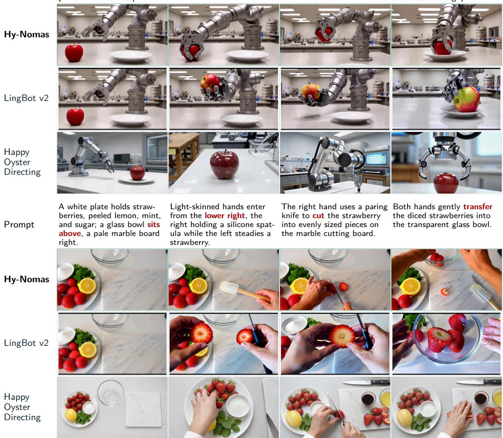  
Figure 12: Qualitative comparison of multi-turn text interaction. In the first example, Hy-Nomas clearly shows the apple being grasped, lifted, and brought to the plate. LingBot-World v2 changes the apple’s color and gripper structure, while HappyOyster-Directing shows discontinuous views without a clear grasp-and-lift progression. In the second example, Hy-Nomas visualizes the requested spatula, cutting on the board, and strawberries in the glass bowl. LingBot-World v2 only shows cutting strawberries and a knife without spatula, while HappyOyster-Directing does not move strawberries into the bowl.

which has been studied more widely for the world model. Figure 14 complements these results with an indoor navigation example.

Bench-3: Interleaved text and camera control. Hy-Nomas natively supports interleaved text and camera control within one unified model, without requiring session resets or switching between specialized models. We compare against LingBot-World v2 using its open-source model, evaluating its performance under free-form text instructions. As shown in Figure 16, Hy-Nomas achieves win rate of 75.0% and 73.3% in prompt following and physical plausibility, respectively. For camera control, the two models exhibit more comparable performance, with Hy-Nomas achieving a win rate of 26.7%. Overall, these results highlight the effectiveness of Hy-Nomas in maintaining instruction-following accuracy and physical plausibility under interleaved text and camera control.

Bench-4: Spatial memory. For spatial memory evaluation, we assess whether models can maintain consistent object and scene appearance when revisiting previously observed locations. Human annotators compare the revisited views with their original appearances, focusing on the preservation of scene layout, object identities (e.g., the anchor object), and spatial relationships. A model is considered more spatially consistent if it accurately reconstructs previously observed regions without introducing inconsistent objects, altering scene geometry, or violating spatial relationships.

Bench-1: Multi-turn text interaction  
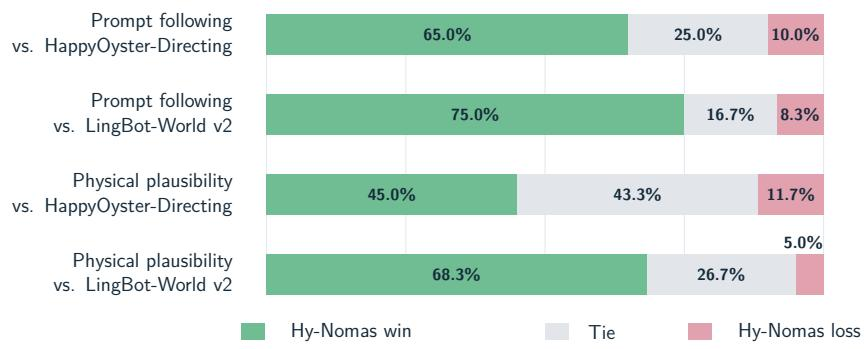  
Figure 13: Pairwise human evaluation of multi-turn text control. We compare Hy-Nomas with HappyOyster-Directing and LingBot-World v2 on prompt following and physical plausibility. Within each evaluation dimension, the two 100% stacked bars show wins (green), ties (gray), and losses (pink) from the perspective of Hy-Nomas.

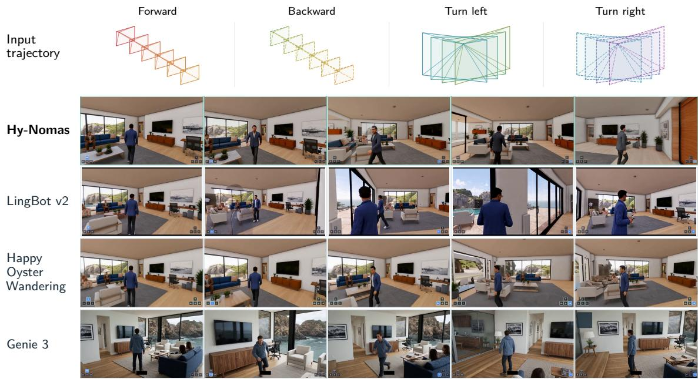  
Figure 14: Qualitative comparison of camera control in an indoor scene. Rows show Hy-Nomas (Ours), LingBot-World v2, HappyOyster-Wandering, and Genie 3. The comparison illustrates how each model responds to navigation commands while maintaining a third-person view of the character and the surrounding room. The middle frame of LingBot-World v2 shows a duplicated character, illustrating a scene-consistency failure during navigation. Visible keyboard indicators denote active controls in the source recordings.

Figure 17 presents the results of the spatial memory evaluation. Compared with Genie 3, Hy-Nomas achieves a win rate of 13.3%, a tie rate of 56.7%, and a loss rate of 30.0%, indicating that Genie 3 maintains stronger spatial consistency. Genie supports grounding in Street View data (Rivas et al., 2026); we hypothesize that may contribute to improved spatial consistency. Against HappyOyster, Hy-Nomas achieves comparable performance, with 30.0% wins, 46.7% ties, and 23.3% losses. In contrast, Hy-Nomas substantially outperforms LingBot-World v2, achieving a win rate of 58.3% and a loss rate of only 1.7%. Overall, these results demonstrate the competitive spatial memory capabilities of Hy-Nomas, while highlighting a remaining gap with Genie 3. We hypothesize that incorporating more data with looped camera trajectories during training could further improve spatial memory consistency. We leave this for future research explorations. Figure 18 illustrates a spatial memory example in a scene with a red toolbox on a wooden workbench. Comparing the initial view of the anchor object and surrounding environment, later views make changes to object appearance and scene structure.

Bench-2: Camera control  
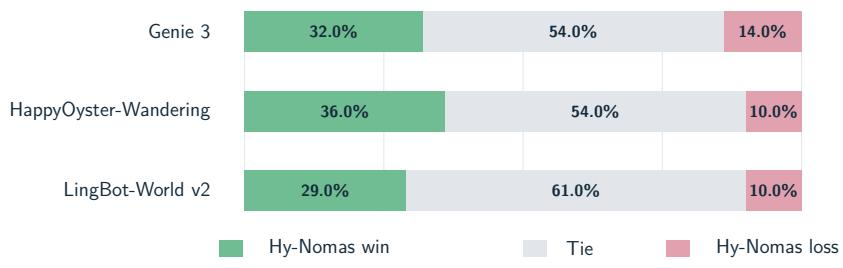  
Figure 15: Pairwise human evaluation of camera control. We compare Hy-Nomas with Genie 3, HappyOyster-Wandering, and LingBot-World v2 on 100 shared trajectories. We measure how accurately the model responds to navigation commands.

Bench-3: Interleaved text and camera control  
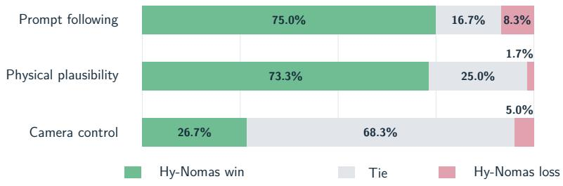  
Figure 16: Pairwise human evaluation of interleaved text and camera control. We compare Hy-Nomas with the adapted LingBot-World v2 baseline on 60 scenarios with alternating text and camera inputs. We consider prompt following, physical plausibility, and camera control during the evaluation.

## 7.4 LoRA Adaption Results

We merge the LoRA weights trained on the base autoregressive model into the distilled model, which we recommend as the best practice for LoRA adaptation. We refer to the resulting model as the LoRA-adapted model.

Cinematic LoRA Results. Compared with the distilled model, the cinematic LoRA-adapted model produces a more visually appealing cinematic style, as illustrated in Figure 19. We further evaluate both models on Bench-1 for multi-turn text interaction, assessing prompt following and physical plausibility, and on Bench-2 for camera control, to examine whether the improvements in cinematic visual quality introduce any regressions in other capabilities.

Quantitative results are reported in Figure 20. Human evaluation demonstrates a strong preference for the adapted model in terms of fewer visual artifacts and improved text-prompt following. On Bench-1, the LoRA-SFT model shows improvements in both prompt following and physical plausibility, achieving win rates of 35% and 46%, compared to loss rates of 24% and 13%, respectively. However, we observe a moderate regression in camera-control performance, with the LoRA-SFT model achieving a 19% win rate versus a 37% loss rate. We hypothesize that this degradation stems from the limited diversity of camera trajectories in the SFT dataset, which may weaken previously learned camera-control capabilities, particularly for underrepresented camera motions. These results highlight the effectiveness of LoRA in adapting visual styles with minimal training data, while underscoring the importance of preserving diverse control signals during fine-tuning.

Robotics LoRA Results. Compared to the distilled model as a baseline, illustrated in Figure 19, the merged robotics-specific distilled checkpoint can perform out-of-distribution dual-arm tasks, while the baseline confuses the generation of dual-arm and human hands due to the heavy training set distribution of human egocentric data.

Bench-4: Spatial memory under viewpoint revisitation  
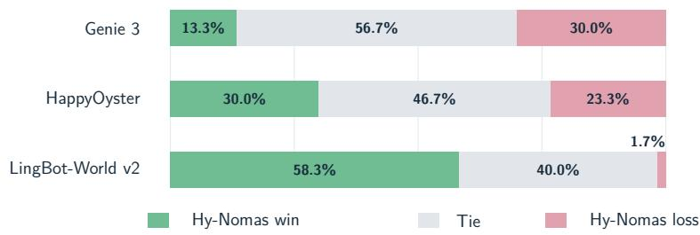  
Figure 17: Pairwise human evaluation of spatial memory. We compare Hy-Nomas with Genie 3, HappyOyster, and LingBot-World v2 on 60 shared scenarios involving reversible or revisiting camera trajectories. We measure how well the model remembers the anchor object and its surrounding environments.

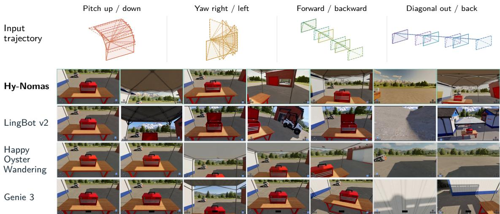  
Figure 18: Qualitative comparison of spatial memory under viewpoint revisitation. Rows show Hy-Nomas (Ours), LingBot-World v2, HappyOyster-Wandering, and Genie 3; columns show successive frames from a camera-only rollout. Hy-Nomas and Genie 3 retain the closed toolbox in revisited views, whereas LingBot-World v2 changes it to an open toolbox. This case illustrates object-state consistency; aggregate results in Figure 17 provide the broader comparison.

## 7.5 PE Results

We also evaluate the performance of our PE model by end-to-end directly comparison. We consider three different models: Hy-Nomas-PE, the original Qwen3.8-27B, and Kimi-K3. Figure 21 presents the evaluation results on Bench-1 and Bench-3. Compared to Qwen3.8-27B, our PE achieves substantial improvements in both prompt following and physical plausibility while maintaining the camera control performance, significantly narrowing the performance gap with Kimi-K3. Besides, our PE achieves a nearly 100% success rate in adhering to the required response format for user inputs, compared to approximately 50% for Qwen3.8-27B and 70% for Kimi-K3.

## 8 Related Work

World models The definition of world model now encompasses a broad range of objectives and approaches. Representation-based approaches, such as V-JEPA (Bardes et al., 2024), learn predictive visual features as a foundation for video understanding. Geometry-based approaches, including systems from World Labs (World Labs, 2025), emphasize persistent 3D representations that support rendering and navigation. Reconstruction models such as VGGT (Wang et al., 2025) provide complementary building blocks for recovering scene geometry from visual observations. Video-based approaches model world evolution through generated observations, drawing on large collections of videos to learn visual dynamics and action-conditioned transitions (Bruce et al., 2024;

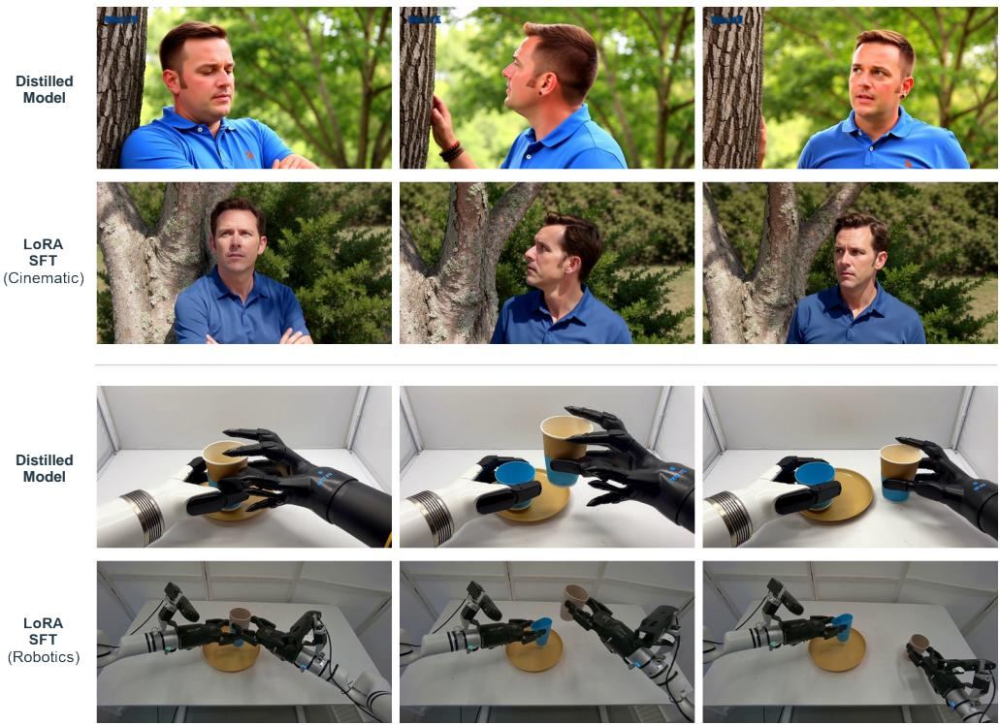  
Figure 19: Qualitative results of LoRA-SFT. We compare the distilled model with domain-specific LoRA-SFT variants. The upper examples show improved cinematic aesthetics after cinematic LoRA-SFT, while the lower examples show more physically plausible robotic manipulation, with cup deformation more faithfully reflecting the gripper’s applied pressure. LoRA-SFT denotes the distilled model with the trained LoRA weights merged into it.

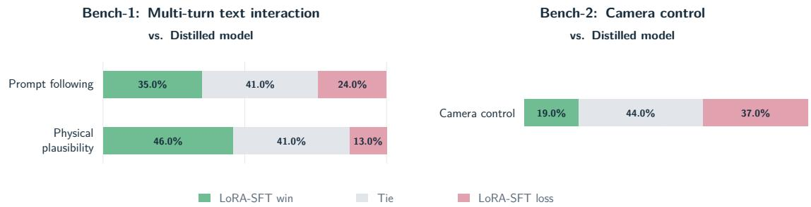  
Figure 20: Pairwise human evaluation of cinematic LoRA-SFT against the distilled model. We evaluate prompt following and physical plausibility on Bench-1, and camera control on Bench-2. The three 100% stacked bars show wins (green), ties (gray), and losses (pink) from the perspective of LoRA-SFT relative to the base model. LoRA-SFT denotes the distilled model with the trained LoRA weights merged into it.

Yang et al., 2023). A central question is whether learning from visual appearances and motion alone is sufficient to capture the underlying physical dynamics, or whether additional structural priors and supervision are required. Controlled studies have revealed limitations in the physical generalization of video generation models, even as model capacity and training data scale (Kang et al., 2025). Meanwhile, recent work has demonstrated that post-training techniques, such as DPO (Wallace et al., 2024; Rafailov et al., 2023), can improve physical consistency (Cai et al., 2026). Nevertheless, whether further scaling of data and model capacity, combined with reinforcement learning (RL), can fundamentally overcome these limitations and enable video-generation-based world models to learn robust physical dynamics remains an open research question.

In this sense, world modeling brings together several long-standing goals of computer vision: 3D reconstruction, video understanding, and visual generation (Ren et al., 2025b;c; Bahmani et al., 2024). It also raises a broader question: can intelligence emerge from perceiving the visual world?

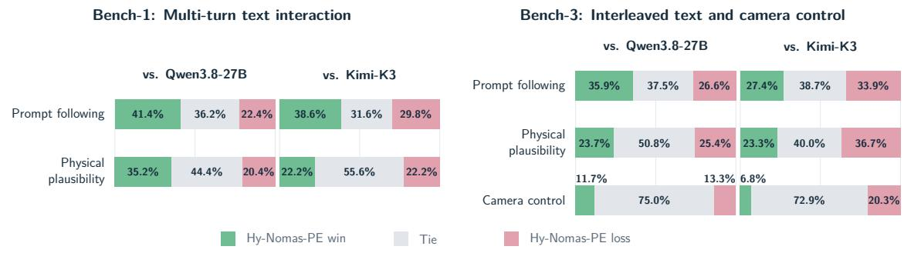  
Figure 21: Rank-gap-weighted human evaluation of Hy-Nomas-PE (ours). Bench-1 and bench-3 are reported separately; each pair compares Hy-Nomas-PE with Qwen3.8-27B and Kimi-K3. Bench-1 evaluates prompt following and physical plausibility; bench-3 also evaluates camera control. Category labels are shared within each benchmark. Each 100% stacked bar shows win (green), tie (gray), and loss (pink) votes from the perspective of Hy-Nomas-PE.

A complementary direction uses a language- or vision-language-model agent to write and refine Blender code for constructing or editing 3D scenes, as explored in BlenderAlchemy (Huang et al., 2024). Such a pipeline could additionally incorporate generative video editing to enhance visual realism. This design places planning and program synthesis in an agent, while delegating scene execution and rendering to graphics tools. It illustrates a possible division of responsibilities, without establishing where intelligence must reside. Whether multimodal learning contributes distinct forms of intelligence beyond providing interfaces for perception and generation remains an open question.

Across these approaches, world models offer promising applications in autonomous driving (Hu et al., 2023; Wang et al., 2023; Ren et al., 2025a; Du et al., 2023; NVIDIA et al., 2025), robotics and action-conditioned simulation (Yang et al., 2023; Zhou et al., 2024; Gao et al., 2026a; NVIDIA et al., 2026; Jang et al., 2025), and controllable game generation (Bruce et al., 2024; Feng et al., 2026; Li et al., 2025; Valevski et al., 2025; Che et al., 2024; Tang et al., 2025). Hy-Nomas pursues the video-based direction, motivated by the scalability and diversity of available video data. Our focus is on turning this visual experience into interactive generation, where user actions shape subsequent observations and the evolving state of the world.

Video diffusion models Diffusion models have become a major approach to video generation (Ho et al., 2022; Blattmann et al., 2023b; Kodaira et al., 2026; HaCohen et al., 2025; Team Wan et al., 2025; Chen et al., 2024b; Blattmann et al., 2023a) that extend image diffusion models (Rombach et al., 2022; Saharia et al., 2022; Ramesh et al., 2022; Dai et al., 2023; Betker et al., 2023; Podell et al., 2023; OpenAI, 2025; Black Forest Labs et al., 2025; Esser et al., 2024; Cao et al., 2025) to temporally coherent video synthesis through spatiotemporal modeling and joint image–video training. Diffusion Transformers (Peebles & Xie, 2023) establish a scalable backbone for latent dif fusion, while Sora (Brooks et al., 2024) and MovieGen (Polyak et al., 2024) illustrate the potential of large-scale video generation using spacetime latent patches. Seedance (Team Seedance et al., 2026) further advances visual quality and the commercial potential of video generation. In comparison, HunyuanVideo 1.5 (Wu et al., 2025), the backbone of our model, provides an efficient 8B-parameter foundation that balances visual quality with computational accessibility. Beyond fixed-length generation, Diffusion Forcing (Chen et al., 2024a) combines causal sequence prediction with independently sampled noise levels, supporting flexible generation horizons. Self Forcing (Huang et al., 2026) addresses the training–inference mismatch in autoregressive video diffusion by training on model-generated histories with KV caching. Building on these directions, Hy-Nomas adapts a pretrained video generator to interactive, segment-wise generation. Its temporally aligned captions, and segment-wise and action-aware attention connect user instructions to specific portions of the rollout, while causal KV caching retains context across successive interactions.

Video-based world models Video-based world models extend video generation toward actionconditioned, interactive environments (Hong et al., 2025; Sun et al., 2025). Research in this area emphasizes several complementary dimensions, including physical plausibility for physical AI, responsive controllability, and persistent world state. Beyond generating visually convincing sequences, an interactive world model must respond to actions introduced during a rollout and preserve their consequences in subsequent observations.

Genie (Bruce et al., 2024) learns controllable environments from videos without ground-truth action annotations through a latent action model and autoregressive dynamics. Genie 2 (Google DeepMind, 2024) and Genie 3 (Google DeepMind, 2025) further develop action-controllable environments, with Genie 3 emphasizing real-time interaction and improved visual consistency. LingBot-World v2 (Gao et al., 2026b) explores long-horizon causal generation, more diverse actioncontrol events, and agentic control through pilot and director components. HappyOyster (Happy Oyster Team, 2026) provides interactive world creation through Directing and Wandering modes, which we evaluate for text interaction and camera navigation, respectively.

These approaches share challenges in responsive control, physical plausibility, spatial memory, and efficient long-horizon generation. Within this direction, Hy-Nomas focuses on native alternation between free-form textual instructions and continuous camera control in one 8B model. It combines temporally structured supervision, persistent causal context, and a VLM-based director that translates user intent into segment-level prompts and generation durations. Our evaluation examines text interaction, camera control, interleaved control, and spatial memory separately to characterize these complementary capabilities.

## 9 Discussion and Future Directions

Gaming and robotics. Gaming and robotics place different demands on world models. For gaming, a practical challenge is how quickly the model responds to a player’s input. Turning the camera or issuing an action should produce a visual response with minimal delay, while repeated interactions should preserve scene consistency. Distillation can reduce the number of denoising steps (Yin et al., 2024a; Zhao et al., 2026a; Liu et al., 2026), and quantization can reduce memory use and computational cost (Chen et al., 2026b; Feng et al., 2025). These gains must be evaluated alongside visual quality and consistency over long rollouts (Xu et al., 2026b;a). For robotics, the challenge extends beyond generating a plausible response: the predicted outcome must match the effect of an executable robot action (Zhu et al., 2024; Wang et al., 2026c). For example, a grasp prediction should reflect whether the gripper makes contact with an object and successfully lifts it. World-action models such as DreamZero (Ye et al., 2026) jointly predict actions and future visual states, providing a potential route toward this capability. Adapting Hy-Nomas to robotic control would require training on videos paired with robot actions and evaluating whether its predictions support successful task execution. Datasets such as Open X-Embodiment (Khazatsky et al., 2024; Open X-Embodiment Collaboration, 2024) provide a starting point, although coverage across tasks, environments, and robot embodiments remains limited. As an initial step in this direction, we demonstrate LoRA-based fine tuning on robotics adaptation.

Agentic world models. Long-horizon world generation requires remembering previously observed scenes to maintain consistency when users revisit them. Retaining the full KV cache on the GPU becomes increasingly costly as rollouts grow. One possible approach is to offload older context to CPU memory or persistent storage and selectively retrieve information relevant to the next segment (Yu et al., 2025a; 2026). When a user returns to a room, for example, the system could retrieve earlier views of that room rather than attend to the entire interaction history. World-Mem (Xiao et al., 2025) demonstrates the value of retrieving historical observations for consistency when revisiting scenes.

Different types of information may benefit from different memory representations: geometry can encode spatial relationships, reference images can preserve visual appearance, and text can summarize events and state changes, such as a door being opened or an object being moved Huang et al. (2025b). In our spatial-memory experiments, explicitly describing the expected scene content when revisiting a location can improve consistency. An agent could use this mechanism to specify which objects should reappear, where they should be, and what has changed since the previous visit, while visual references could help preserve their precise appearance. Cached keys and values offer another form of memory by retaining features that the generator can directly reuse, although managing their GPU memory footprint requires offloading, compression, or eviction. A practical agentic system would coordinate these memory representations, retrieve relevant information, and update stored records as the world evolves, ensuring that outdated observations do not override the current scene state.

Retrieval alone, however, cannot account for changes that occur outside the field of view. Consider a wall clock: after the user leaves a room and returns ten minutes later, the clock should remain in the same place with the same appearance, but display a time ten minutes later. Reusing an earlier image would recover its appearance without updating its time. An agent could instead record the clock’s identity, location, and observed time, compute its updated state from elapsed simulation time, and pass that state together with a reference image to the generator. Inspired by memory management in language-model agents (Packer et al., 2023), this approach would expose memory retrieval, state updates, prompt rewriting, and video generation as tools. LingBot-World v2 (Gao et al., 2026b) provides an encouraging example of agent coordination for interactive world generation. An important next step is to test whether such coordination can maintain explicit world states and render them faithfully over long interactions.

Data and captioning. Despite having only 8B parameters, Hy-Nomas achieves stronger textdriven action control than the larger models evaluated in our benchmark. We hypothesize that accurate, detailed captions contribute to this result by explicitly describing changes over time, which reduces the burden on the diffusion transformer to "imagine" unspecified content and allows it to devote more capacity to just rendering the described scenes and actions correctly. This hypothesis is consistent with findings that improved captions strengthen prompt following in image generation (Betker et al., 2023). These observations suggest a potential direction for future systems: using highly detailed prompts to specify scene content and temporal evolution, with diffusion models serving primarily as renderers of these descriptions. Such an approach places greater demands on the quality and specificity of both training captions and inferencetime prompts, making caption and Prompt Enhancer central challenges. Data curation should therefore consider not only visual quality but also whether the caption accurately describes the video. For example, a clip containing motion blur during a rapid camera turn may still provide useful supervision if the caption describes both the camera motion and the resulting blur. Similarly, explicitly captioning a cut or an editing effect may reduce ambiguity about the observed transition.

Infrastructure and scaling. Higher resolution and longer temporal context increase the number of video tokens, raising training costs, inference latency, and KV-cache memory requirements. Efficient attention, sequence parallelism, and cache management are therefore critical to extending rollouts and enabling interactive generation. These infrastructure advances also make it more practical to explore larger world models. Recent progress in video generation, exemplified by Seedance 2.0 (Team Seedance et al., 2026), motivates further investigation into the relationship between model capacity and generation quality. MAGI-2 Preview (Sand.ai, 2026) explores this direction through a mixture-of-experts architecture (MoE), scaling total capacity while limiting the number of parameters activated per token. A central question is whether such investments translate into better world-model capabilities, including actions following, predicting physically consistent outcomes, and preserving scene details when revisiting locations after long rollouts. These capabilities require direct evaluation and cannot be inferred from improvements in visual quality alone.

## 10 Contributors

All contributors of Hy-Nomas are listed in alphabetical order by their last names.

Core Contributors: Qiaoling Chen, Jiaxiang Cheng, Xueqing Deng, Tiankai Hang, Ji Hou, Jiaqi Li, Yifan Liu, Tao Lu, Junshu Tang, Yu Tang, Yao Teng, Yu Tian, Heng Wang, Weizhi Wang, Xiyao Wang, Xilun Wu, Mingyu Yang, Yangbin Yu, Rui Zhao

Contributors: Longjun Cao, Linghao Chen, Haoyi Duan, Jiaming Han, Mingji Han, Enhua Jiang, Shunkai Li, Yanzhe Liang, Qinwei Ma, Cong Wang, Lei Wang, Bing Wu, Ke Xing, Ray Ying, Zhentao Yu, Key Zhang, Yuan Zhou, Zhengguang Zhou, Kai Zou

Acknowledgments: Xiang Bai, Yuhang Deng, Ying Dong, Qiying Gong, Weiting Guo, Changrong Hu, Yuxin Jiang, Kysunwang, Zhuohao Li, Sen Liang, Chenguo Lin, Juntian Liu, Yezhou Liu, Yuhao Liu, Yuhao Lu, Chunyi Ma, Kai Song, Yonghao Tan, Renjia Wei, Yifan Wu, Yinhe Wu, Yan Zeng, Weiqiao Zheng

Leadership Acknowledgments: Xudong Lin, Yonglong Tian

## References

Amro Abbas, Kushal Tirumala, Dániel Simig, Surya Ganguli, and Ari S. Morcos. SemDeDup: Data-efficient learning at web-scale through semantic deduplication, 2023. URL https://arxiv. org/abs/2303.09540.

Alibaba Cloud. HappyOyster user guide, 2026. URL https://www.alibabacloud.com/help/en/m odel-studio/happyoyster-guide. Updated October 11, 2026.

Mahmoud Assran, Adrien Bardes, David Fan, Quentin Garrido, Russell Howes, Mojtaba Komeili, Matthew Muckley, Ammar Rizvi, Claire Roberts, Koustuv Sinha, et al. V-JEPA 2: Self-supervised video models enable understanding, prediction and planning. arXiv preprint arXiv:2506.09985, 2025.

Sherwin Bahmani, Ivan Skorokhodov, Guocheng Qian, Aliaksandr Siarohin, Willi Menapace, Andrea Tagliasacchi, David B. Lindell, and Sergey Tulyakov. AC3D: Analyzing and Improving 3D Camera Control in Video Diffusion Transformers, 2024. URL https://arxiv.org/abs/2411 .18673.

Shuai Bai, Keqin Chen, Xuejing Liu, et al. Qwen2.5-VL technical report. arXiv preprint arXiv:2502.13923, 2025.

Zhiqi Bai, Junai Cai, Yixin Chen, Jingrun Du, Tao Feng, Wei Gong, Siyuan Huang, Xiao Lin, Jiaheng Liu, Jun Luo, et al. HappyWorld-Bench, 2026. URL https://arxiv.org/abs/2609.24308.

Bowen Baker, Ilge Akkaya, Peter Zhokov, Joost Huizinga, Jie Tang, Adrien Ecoffet, Brandon Houghton, Raul Sampedro, and Jeff Clune. Video pretraining (vpt): Learning to act by watching unlabeled online videos. Advances in Neural Information Processing Systems, 35:24639–24654, 2022.

Amir Bar, Gaoyue Zhou, Danny Tran, Trevor Darrell, and Yann LeCun. Navigation world models. In 2025 IEEE/CVF Conference on Computer Vision and Pattern Recognition (CVPR), pp. 15791–15801. IEEE, 2025.

Adrien Bardes, Quentin Garrido, Jean Ponce, Xinlei Chen, Michael Rabbat, Yann LeCun, Mahmoud Assran, and Nicolas Ballas. Revisiting feature prediction for learning visual representations from video. arXiv preprint arXiv:2404.08471, 2024.

James Betker, Gabriel Goh, Li Jing, Tim Brooks, Jianfeng Wang, Linjie Li, Long Ouyang, Juntang Zhuang, Joyce Lee, Yufei Guo, et al. Improving image generation with better captions. Technical Report, OpenAI, 2023. URL https://cdn.openai.com/papers/dall-e-3.pdf.

Black Forest Labs, Stephen Batifol, Andreas Blattmann, Frederic Boesel, Saksham Consul, Cyril Diagne, Tim Dockhorn, Jack English, et al. FLUX.1 Kontext: Flow matching for in-context image generation and editing in latent space. arXiv preprint arXiv:2506.15742, 2025. URL https://arxiv.org/abs/2506.15742.

Andreas Blattmann, Tim Dockhorn, Sumith Kulal, Daniel Mendelevitch, Maciej Kilian, Dominik Lorenz, Yam Levi, Zion English, Vikram Voleti, Adam Letts, Varun Jampani, and Robin Rombach. Stable video diffusion: Scaling latent video diffusion models to large datasets. arXiv preprint arXiv:2311.15127, 2023a.

Andreas Blattmann, Robin Rombach, Huan Ling, Tim Dockhorn, Seung Wook Kim, Sanja Fidler, and Karsten Kreis. Align your latents: High-resolution video synthesis with latent diffusion models. In 2023 IEEE/CVF Conference on Computer Vision and Pattern Recognition (CVPR), pp. 22563–22575. IEEE, 2023b.

Adrian Bolton, Alexander Lerchner, Alexandra Cordell, Alexandre Moufarek, Andrew Bolt, Andrew Lampinen, Anna Mitenkova, Arne Olav Hallingstad, Bojan Vujatovic, Bonnie Li, et al. Sima 2: A generalist embodied agent for virtual worlds. arXiv preprint arXiv:2512.04797, 2025.

Tim Brooks, Bill Peebles, Connor Holmes, Will DePue, Yufei Guo, Li Jing, David Schnurr, Joe Taylor, Troy Luhman, Eric Luhman, Clarence Ng, Ricky Wang, and Aditya Ramesh. Video generation models as world simulators. 2024. URL https://openai.com/research/video-generation-mod els-as-world-simulators.

Jake Bruce, Michael D Dennis, Ashley Edwards, Jack Parker-Holder, Yuge Shi, Edward Hughes, Matthew Lai, Aditi Mavalankar, Richie Steigerwald, Chris Apps, et al. Genie: Generative interactive environments. In Forty-first international conference on machine learning, 2024.

Yuanhao Cai, Kunpeng Li, Menglin Jia, Jialiang Wang, Junzhe Sun, Feng Liang, Weifeng Chen, Felix Juefei-Xu, Chu Wang, Ali Thabet, et al. Phygdpo: Physics-aware groupwise direct preference optimization for physically consistent text-to-video generation. In European Conference on Computer Vision, pp. 91–109. Springer, 2026.

Siyu Cao, Hangting Chen, Peng Chen, Yiji Cheng, Yutao Cui, Xinchi Deng, Ying Dong, Kipper Gong, Tianpeng Gu, Xiusen Gu, et al. Hunyuanimage 3.0 technical report. arXiv e-prints, pp. arXiv–2509, 2025.

Haoxuan Che, Xuanhua He, Quande Liu, Cheng Jin, and Hao Chen. GameGen-X: Interactive Open-world Game Video Generation, 2024. URL https://arxiv.org/abs/2411.00769.

Boyuan Chen, Diego Marti Monso, Yilun Du, Max Simchowitz, Russ Tedrake, and Vincent Sitzmann. Diffusion forcing: Next-token prediction meets full-sequence diffusion. arXiv preprint arXiv:2407.01392, 2024a. URL https://arxiv.org/abs/2407.01392.

Danze Chen et al. H3-World: Turning language understanding into world control, 2026a. URL https://arxiv.org/abs/2609.01560.

Haoxin Chen, Yong Zhang, Xiaodong Cun, Menghan Xia, Xintao Wang, Chao Weng, and Ying Shan. VideoCrafter2: Overcoming data limitations for high-quality video diffusion models. In Proceedings of the IEEE/CVF Conference on Computer Vision and Pattern Recognition, pp. 7310–7320, 2024b.

Junyu Chen, Wenkun He, Yuchao Gu, Yuyang Zhao, Jincheng Yu, Junsong Chen, Dongyun Zou, Yujun Lin, Zhekai Zhang, Muyang Li, et al. Dc-videogen: Efficient video generation with deep compression video autoencoder. arXiv preprint arXiv:2509.25182, 2025.

Tianqi Chen, Bing Xu, Chiyuan Zhang, and Carlos Guestrin. Training deep nets with sublinear memory cost. arXiv preprint arXiv:1604.06174, 2016.

Yukang Chen, Luozhou Wang, Wei Huang, Shuai Yang, Bohan Zhang, Yicheng Xiao, Ruihang Chu, Weian Mao, Qixin Hu, Shaoteng Liu, et al. LongLive-2.0: An NVFP4 parallel infrastructure for long video generation. arXiv preprint arXiv:2605.18739, 2026b.

Jiaxiang Cheng, Bing Ma, Xuhua Ren, Hongyi Henry Jin, Kai Yu, Peng Zhang, Wenyue Li, Yuan Zhou, Tianxiang Zheng, and Qinglin Lu. Phased one-step adversarial equilibrium for video diffusion models. In Proceedings of the AAAI Conference on Artificial Intelligence (AAAI), 2026a.

Jiaxiang Cheng, Bing Ma, Xuhua Ren, Kai Yu, Peng Zhang, Tianxiang Zheng, and Qinglin Lu. Reward lightning: Fast video generation via homologous preference distillation. In Computer Vision – ECCV 2026, volume 17004 of Lecture Notes in Computer Science. Springer, 2026b.

Xiaoliang Dai, Ji Hou, Chih-Yao Ma, Sam Tsai, Jialiang Wang, Rui Wang, Peizhao Zhang, Simon Vandenhende, Xiaofang Wang, Abhimanyu Dubey, et al. Emu: Enhancing image generation models using photogenic needles in a haystack. arXiv preprint arXiv:2309.15807, 2023.

Decart, Julian Quevedo, Quinn McIntyre, Spruce Campbell, Xinlei Chen, and Robert Wachen. Oasis: A universe in a transformer, 2024. URL https://oasis-model.github.io/.

Yilun Du, Mengjiao Yang, Bo Dai, Hanjun Dai, Ofir Nachum, Joshua B. Tenenbaum, Dale Schuurmans, and Pieter Abbeel. Learning Universal Policies via Text-Guided Video Generation, 2023. URL https://arxiv.org/abs/2302.00111.

Patrick Esser, Sumith Kulal, Andreas Blattmann, et al. Scaling rectified flow transformers for high-resolution image synthesis. In Proceedings of the 41st International Conference on Machine Learning, pp. 12606–12633, 2024.

Ruili Feng, Han Zhang, Zhilei Shu, Zhantao Yang, Longxiang Tang, Zhicai Wang, Andy Zheng, Jie Xiao, Zhiheng Liu, Ruihang Chu, et al. The matrix: Infinite-horizon world generation with real-time moving control. Advances in Neural Information Processing Systems, 38:87318–87344, 2026.

Weilun Feng, Chuanguang Yang, Haotong Qin, Xiangqi Li, Yu Wang, Zhulin An, Libo Huang, Boyu Diao, Zixiang Zhao, Yongjun Xu, and Michele Magno. Q-VDiT: Towards accurate quantization and distillation of video-generation diffusion transformers. In Proceedings of the International Conference on Machine Learning, pp. 16956–16976, 2025. URL https://proceedings.mlr.press/ v267/feng25q.html.

Shenyuan Gao, William Liang, Kaiyuan Zheng, Ayaan Malik, Seonghyeon Ye, Sihyun Yu, Wei-Cheng Tseng, Yuzhu Dong, Kaichun Mo, Chen-Hsuan Lin, et al. DreamDojo: A Generalist Robot World Model from Large-Scale Human Videos, 2026a. URL https://arxiv.org/abs/2602.06949.

Zelin Gao, Qiuyu Wang, Jiapeng Zhu, Jingye Chen, Zichen Liu, Qingyan Bai, Jiahao Wang, Yufeng Yuan, Hanlin Wang, Yichong Lu, et al. Infinite worlds with versatile interactions. arXiv preprint arXiv:2607.07534, 2026b.

Gemma Team. Gemma 4 technical report, 2026. URL https://arxiv.org/abs/2607.02770.

Google DeepMind. Genie 2: A large-scale foundation world model. Research blog, 2024. URL https://deepmind.google/blog/genie-2-a-large-scale-foundation-world-model/.

Google DeepMind. Genie 3: A new frontier for world models. Research blog, 2025. URL https://deepmind.google/blog/genie-3-a-new-frontier-for-world-models/.

Yoav HaCohen, Nisan Chiprut, Benny Brazowski, Daniel Shalem, Dudu Moshe, Eitan Richardson, Eran Levin, Guy Shiran, Nir Zabari, et al. LTX-Video: Realtime video latent diffusion. arXiv preprint arXiv:2501.00103, 2025.

Happy Oyster Team. Happy Oyster: Real-time world model for interactive creation. Project website, 2026. URL https://www.happyoyster.com/. Accessed September 28, 2026.

Hao He, Yinghao Xu, Yuwei Guo, Gordon Wetzstein, Bo Dai, Hongsheng Li, and Ceyuan Yang. CameraCtrl: Enabling camera control for text-to-video generation. arXiv preprint arXiv:2404.02101, 2024.

Xianglong He, Chunli Peng, Zexiang Liu, Boyang Wang, Yifan Zhang, Qi Cui, Fei Kang, Biao Jiang, Mengyin An, Yangyang Ren, Baixin Xu, Hao-Xiang Guo, Kaixiong Gong, Size Wu, Wei Li, Xuchen Song, Yang Liu, Yangguang Li, and Yahui Zhou. Matrix-Game 2.0: An open-source, realtime, and streaming interactive world model, 2026. URL https://arxiv.org/abs/2508.13009.

Jonathan Ho and Tim Salimans. Classifier-free diffusion guidance. arXiv preprint arXiv:2207.12598, 2022.

Jonathan Ho, Tim Salimans, Alexey Gritsenko, William Chan, Mohammad Norouzi, and David J. Fleet. Video diffusion models. arXiv preprint arXiv:2204.03458, 2022. URL https://arxiv.org/ abs/2204.03458.

Yicong Hong, Yiqun Mei, Chongjian Ge, Yiran Xu, Yang Zhou, Sai Bi, Yannick Hold-Geoffroy, Mike Roberts, Matthew Fisher, Eli Shechtman, et al. Relic: Interactive video world model with long-horizon memory. arXiv preprint arXiv:2512.04040, 2025.

Anthony Hu, Lloyd Russell, Hudson Yeo, Zak Murez, George Fedoseev, Alex Kendall, Jamie Shotton, and Gianluca Corrado. GAIA-1: A generative world model for autonomous driving. arXiv preprint arXiv:2309.17080, 2023. URL https://arxiv.org/abs/2309.17080.

Edward J. Hu, Yelong Shen, Phillip Wallis, Zeyuan Allen-Zhu, Yuanzhi Li, Shean Wang, Lu Wang, and Weizhu Chen. LoRA: Low-rank adaptation of large language models. arXiv preprint arXiv:2106.09685, 2021.

Ian Huang, Guandao Yang, and Leonidas Guibas. BlenderAlchemy: Editing 3D graphics with vision-language models. arXiv preprint arXiv:2404.17672, 2024. URL https://arxiv.org/abs/24 04.17672.

Jiahui Huang, Qunjie Zhou, Hesam Rabeti, Aleksandr Korovko, Huan Ling, Xuanchi Ren, Tianchang Shen, Jun Gao, Dmitry Slepichev, Chen-Hsuan Lin, Jiawei Ren, Kevin Xie, Joydeep Biswas, Laura Leal-Taixe, and Sanja Fidler. ViPE: Video pose engine for 3D geometric perception. arXiv preprint arXiv:2508.10934, 2025a.

Junchao Huang, Xinting Hu, Boyao Han, Shaoshuai Shi, Zhuotao Tian, Tianyu He, and Li Jiang. Memory forcing: Spatio-temporal memory for consistent scene generation on minecraft. arXiv preprint arXiv:2510.03198, 2025b.

Xun Huang, Zhengqi Li, Guande He, Mingyuan Zhou, and Eli Shechtman. Self forcing: Bridging the train-test gap in autoregressive video diffusion. Advances in Neural Information Processing Systems, 38:167283–167308, 2026.

Sam Ade Jacobs, Masahiro Tanaka, Chengming Zhang, Minjia Zhang, Shuaiwen Leon Song, Samyam Rajbhandari, and Yuxiong He. DeepSpeed Ulysses: System optimizations for enabling training of extreme long sequence transformer models. arXiv preprint arXiv:2309.14509, 2023.

Joel Jang, Seonghyeon Ye, Zongyu Lin, Jiannan Xiang, Johan Bjorck, Yu Fang, Fengyuan Hu, Spencer Huang, Kaushil Kundalia, Yen-Chen Lin, et al. DreamGen: Unlocking Generalization in Robot Learning through Video World Models, 2025. URL https://arxiv.org/abs/2505.12705.

Keller Jordan, Yuchen Jin, Vlado Boza, Jiacheng You, Franz Cesista, Laker Newhouse, and Jeremy Bernstein. Muon: An optimizer for hidden layers in neural networks, 2024. URL https: //kellerjordan.github.io/posts/muon/.

Bingyi Kang, Yang Yue, Rui Lu, Zhijie Lin, Yang Zhao, Kaixin Wang, Gao Huang, and Jiashi Feng. How far is video generation from world model: A physical law perspective. In Proceedings ofthe International Conference on Machine Learning, 2025. URL https://arxiv.org/abs/2411.02385.

Nikita Karaev, Yuri Makarov, Jianyuan Wang, Natalia Neverova, Andrea Vedaldi, and Christian Rupprecht. CoTracker3: Simpler and better point tracking by pseudo-labelling real videos. In Proceedings of the IEEE/CVF International Conference on Computer Vision (ICCV), pp. 6013–6022, 2025.

Alexander Khazatsky, Karl Pertsch, Suraj Nair, Ashwin Balakrishna, Sudeep Dasari, Siddharth Karamcheti, Soroush Nasiriany, Mohan Kumar Srirama, Lawrence Yunliang Chen, Kirsty Ellis, et al. DROID: A Large-Scale In-The-Wild Robot Manipulation Dataset, 2024. URL https: //arxiv.org/abs/2403.12945.

Akio Kodaira, Tingbo Hou, Ji Hou, Markos Georgopoulos, Felix Juefei-Xu, Masayoshi Tomizuka, and Yue Zhao. StreamDiT: Real-time streaming text-to-video generation. In Proceedings ofthe IEEE/CVF Conference on Computer Vision and Pattern Recognition (CVPR), pp. 29200–29210, 2026.

Mario Michael Krell, Matej Kosec, Sergio P. Perez, and Andrew Fitzgibbon. Efficient sequence packing without cross-contamination: Accelerating large language models without impacting performance, 2022. URL https://arxiv.org/abs/2107.02027v2. Version 2.

Jiaqi Li, Junshu Tang, Zhiyong Xu, Longhuang Wu, Yuan Zhou, Shuai Shao, Tianbao Yu, Zhiguo Cao, and Qinglin Lu. Hunyuan-gamecraft: High-dynamic interactive game video generation with hybrid history condition. arXiv preprint arXiv:2506.17201, 2(3):6, 2025.

Mingxin Li, Yanzhao Zhang, Dingkun Long, Keqin Chen, Sibo Song, Shuai Bai, Zhibo Yang, Pengjun Xie, An Yang, Dayiheng Liu, Jingren Zhou, and Junyang Lin. Qwen3-VL-Embedding and Qwen3-VL-Reranker: A unified framework for state-of-the-art multimodal retrieval and ranking. arXiv, 2026.

Shanchuan Lin, Xin Xia, Yuxi Ren, Ceyuan Yang, Xuefeng Xiao, and Lu Jiang. Diffusion adversarial post-training for one-step video generation. In Proceedings of the 42nd International Conference on Machine Learning (ICML), 2025a.

Shanchuan Lin, Ceyuan Yang, Hao He, Jianwen Jiang, Yuxi Ren, Xin Xia, Yang Zhao, Xuefeng Xiao, and Lu Jiang. Autoregressive adversarial post-training for real-time interactive video generation. In Advances in Neural Information Processing Systems (NeurIPS), 2025b.

Yaron Lipman, Ricky T. Q. Chen, Heli Ben-Hamu, Maximilian Nickel, and Matt Le. Flow matching for generative modeling. In International Conference on Learning Representations, 2023.

Dongyang Liu, Peng Gao, David Liu, Ruoyi Du, Zhen Li, Qilong Wu, Xin Jin, Sihan Cao, Shifeng Zhang, Hongsheng Li, and Steven Hoi. Decoupled DMD: CFG augmentation as the spear, distribution matching as the shield. arXiv preprint arXiv:2511.22677, 2025a.

Jingyuan Liu, Jianlin Su, Xingcheng Yao, Zhejun Jiang, Guokun Lai, Yulun Du, Yidao Qin, Weixin Xu, Enzhe Lu, Junjie Yan, et al. Muon is scalable for LLM training, 2025b.

Kunhao Liu, Wenbo Hu, Jiale Xu, Ying Shan, and Shijian Lu. Rolling forcing: Autoregressive long video diffusion in real time. In International Conference on Learning Representations, volume 2026, pp. 91177–91196, 2026.

Ilya Loshchilov and Frank Hutter. Decoupled Weight Decay Regularization. In International Conference on Learning Representations, 2019. URL https://openreview.net/forum?id=Bkg6RiCq Y7.

Xiaofeng Mao, Zhen Li, Chuanhao Li, Xiaojie Xu, Kaining Ying, Tong He, Jiangmiao Pang, Yu Qiao, and Kaipeng Zhang. Yume-1.5: A Text-Controlled Interactive World Generation Model, 2025a. URL https://arxiv.org/abs/2512.22096.

Xiaofeng Mao, Shaoheng Lin, Zhen Li, Chuanhao Li, Wenshuo Peng, Tong He, Jiangmiao Pang, Mingmin Chi, Yu Qiao, and Kaipeng Zhang. Yume: An interactive world generation model, 2025b. URL https://arxiv.org/abs/2507.17744.

MiniMax. MiniMax-H3. GitHub repository, 2026. URL https://github.com/MiniMax-AI/MiniMa x-H3.

Moonshot AI. Kimi K3: Open frontier intelligence. Technical report, Moonshot AI, 2026. URL https://github.com/MoonshotAI/Kimi-K3/blob/main/k3\_tech\_report.pdf.

NVIDIA, Niket Agarwal, Arslan Ali, Maciej Bala, Yogesh Balaji, Erik Barker, Tiffany Cai, Prithvijit Chattopadhyay, Yongxin Chen, Yin Cui, et al. Cosmos World Foundation Model Platform for Physical AI, 2025. URL https://arxiv.org/abs/2501.03575.

NVIDIA, Aditi, Niket Agarwal, Arslan Ali, Jon Allen, Martin Antolini, Adeline Aubame, Alisson Azzolini, Junjie Bai, Maciej Bala, et al. Cosmos 3: Omnimodal World Models for Physical AI, 2026. URL https://arxiv.org/abs/2606.02800.

Open X-Embodiment Collaboration. Open X-Embodiment: Robotic learning datasets and RT-X models. In Proceedings of the IEEE International Conference on Robotics and Automation, 2024. URL https://arxiv.org/abs/2310.08864.

OpenAI. Addendum to GPT-4o system card: Native image generation. Technical report, OpenAI, March 2025. URL https://openai.com/index/gpt-4o-image-generation-system-card-adden dum/.

Charles Packer, Sarah Wooders, Kevin Lin, Vivian Fang, Shishir G. Patil, Ion Stoica, and Joseph E. Gonzalez. MemGPT: Towards LLMs as operating systems. arXiv preprint arXiv:2310.08560, 2023. URL https://arxiv.org/abs/2310.08560.

William Peebles and Saining Xie. Scalable diffusion models with transformers. In Proceedings ofthe IEEE/CVF International Conference on Computer Vision, pp. 4195–4205, 2023.

Dustin Podell, Zion English, Kyle Lacey, Andreas Blattmann, Tim Dockhorn, Jonas Muller, Joe Penna, and Robin Rombach. SDXL: Improving latent diffusion models for high-resolution image synthesis. arXiv preprint arXiv:2307.01952, 2023. URL https://arxiv.org/abs/2307.01952.

Adam Polyak, Amit Zohar, Andrew Brown, Andros Tjandra, Animesh Sinha, Ann Lee, Apoorv Vyas, Bowen Shi, Chih-Yao Ma, Ching-Yao Chuang, et al. Movie gen: A cast of media foundation models. arXiv preprint arXiv:2410.13720, 2024.

PyTorch Contributors. PyTorch FSDP2: fully\_shard. PyTorch documentation. URL https: //docs.pytorch.org/docs/main/distributed.fsdp.fully\_shard.html. Accessed October 1, 2026.

PyTorch Team. Current and new activation checkpointing techniques in PyTorch. PyTorch Blog, 2025. URL https://pytorch.org/blog/activation-checkpointing-techniques/.

Qwen Team. Qwen3.5: Towards native multimodal agents, February 2026a. URL https://qwen.a i/blog?id=qwen3.5.

Qwen Team. Qwen3.8-Max: A new bar for coding and cowork, August 2026b. URL https: //qwen.ai/blog?id=qwen3.8.

Rafael Rafailov, Archit Sharma, Eric Mitchell, Christopher D Manning, Stefano Ermon, and Chelsea Finn. Direct preference optimization: Your language model is secretly a reward model. Advances in neural information processing systems, 36:53728–53741, 2023.

Aditya Ramesh, Prafulla Dhariwal, Alex Nichol, Casey Chu, and Mark Chen. Hierarchical textconditional image generation with CLIP latents. arXiv preprint arXiv:2204.06125, 2022. URL https://arxiv.org/abs/2204.06125.

RealSource. RealSource World: A large-scale real-world dual-arm manipulation dataset. https: //huggingface.co/datasets/RealSourceData/RealSource-World, 2025.

Xuanchi Ren, Yifan Lu, Tianshi Cao, Ruiyuan Gao, Shengyu Huang, Amirmojtaba Sabour, Tianchang Shen, Tobias Pfaff, Jay Zhangjie Wu, Runjian Chen, Seung Wook Kim, Jun Gao, Laura Leal-Taixe, Mike Chen, Sanja Fidler, and Huan Ling. Cosmos-Drive-Dreams: Scalable Synthetic Driving Data Generation with World Foundation Models, 2025a. URL https: //arxiv.org/abs/2506.09042.

Xuanchi Ren, Tianchang Shen, Jiahui Huang, Huan Ling, Yifan Lu, Merlin Nimier-David, Thomas Müller, Alexander Keller, Sanja Fidler, and Jun Gao. GEN3C: 3D-informed world-consistent video generation with precise camera control. In Proceedings of the IEEE/CVF Conference on Computer Vision and Pattern Recognition, pp. 6121–6132, 2025b. URL https://openaccess.thecv f.com/content/CVPR2025/html/Ren\_GEN3C\_3D-Informed\_World-Consistent\_Video\_Generation \_with\_Precise\_Camera\_Control\_CVPR\_2025\_paper.html.

Zhongwei Ren, Yunchao Wei, Xun Guo, Yao Zhao, Bingyi Kang, Jiashi Feng, and Xiaojie Jin. VideoWorld: Exploring Knowledge Learning from Unlabeled Videos, 2025c. URL https: //arxiv.org/abs/2501.09781.

Diego Rivas, Jonathan Herbert, and Nicole Segaran. Simulate real-world places with Project Genie and Street View, May 2026. URL https://blog.google/innovation-and-ai/models-and-resea rch/google-deepmind/project-genie-expands/. Google Blog, May 19, 2026.

Robbyant Team, Zelin Gao, Qiuyu Wang, Yanhong Zeng, Jiapeng Zhu, Ka Leong Cheng, Yixuan Li, Hanlin Wang, Yinghao Xu, Shuailei Ma, et al. Advancing open-source world models, 2026. URL https://arxiv.org/abs/2601.20540.

Robin Rombach, Andreas Blattmann, Dominik Lorenz, Patrick Esser, and Bjorn Ommer. Highresolution image synthesis with latent diffusion models. In Proceedings ofthe IEEE/CVF Conference on Computer Vision and Pattern Recognition, pp. 10684–10695, 2022. URL https://arxiv.org/abs/ 2112.10752.

Chitwan Saharia, William Chan, Saurabh Saxena, Lala Li, Jay Whang, et al. Photorealistic text-toimage diffusion models with deep language understanding. In Advances in Neural Information Processing Systems, volume 35, 2022. URL https://arxiv.org/abs/2205.11487.

Sand.ai. MAGI-2 Preview: Scaling video generation models efficiently. https://sand.ai/blog/m agi-2-preview, August 2026.

Axel Sauer, Dominik Lorenz, Andreas Blattmann, and Robin Rombach. Adversarial diffusion distillation. arXiv preprint arXiv:2311.17042, 2023.

Jay Shah, Ganesh Bikshandi, Ying Zhang, Vijay Thakkar, Pradeep Ramani, and Tri Dao. FlashAttention-3: Fast and accurate attention with asynchrony and low-precision. In Advances in Neural Information Processing Systems (NeurIPS), 2024.

Yang Song, Prafulla Dhariwal, Mark Chen, and Ilya Sutskever. Consistency models. In Proceedings of the 40th International Conference on Machine Learning (ICML), volume 202 of Proceedings of Machine Learning Research, pp. 32211–32252. PMLR, 2023.

Wenqiang Sun, Haiyu Zhang, Haoyuan Wang, Junta Wu, Zehan Wang, Zhenwei Wang, Yunhong Wang, Jun Zhang, Tengfei Wang, and Chunchao Guo. WorldPlay: Towards Long-Term Geometric Consistency for Real-Time Interactive World Modeling, 2025. URL https://arxiv.org/abs/25 12.14614.

Junshu Tang, Jiacheng Liu, Jiaqi Li, Longhuang Wu, Haoyu Yang, Penghao Zhao, Siruis Gong, Xiang Yuan, Shuai Shao, Linfeng Zhang, and Qinglin Lu. Hunyuan-GameCraft-2: Instructionfollowing Interactive Game World Model, 2025. URL https://arxiv.org/abs/2511.23429.

Zewei Tao and Yunpeng Huang. MagiAttention: A distributed attention towards linear scalability for ultra-long context, heterogeneous mask training. https://github.com/SandAI-org/MagiAtt ention/, 2025.

Team Seedance et al. Seedance 2.0: Advancing video generation for world complexity. arXiv preprint arXiv:2604.14148, 2026. URL https://arxiv.org/abs/2604.14148.

Team Wan, Ang Wang, Baole Ai, Bin Wen, Chaojie Mao, Chen-Wei Xie, Di Chen, et al. Wan: Open and advanced large-scale video generative models. arXiv preprint arXiv:2503.20314, 2025.

Javier Tirado-Garín and Javier Civera. AnyCalib: On-manifold learning for model-agnostic single view camera calibration. In Proceedings of the IEEE/CVF International Conference on Computer Vision (ICCV), pp. 8044–8055, 2025.

Dani Valevski, Yaniv Leviathan, Moab Arar, and Shlomi Fruchter. Diffusion models are real time game engines. In International Conference on Learning Representations, 2025. URL https: //proceedings.iclr.cc/paper\_files/paper/2025/hash/b71ecea210f7159f31e46631fe5c838f -Abstract-Conference.html.

Bram Wallace, Meihua Dang, Rafael Rafailov, Linqi Zhou, Aaron Lou, Senthil Purushwalkam, Stefano Ermon, Caiming Xiong, Shafiq Joty, and Nikhil Naik. Diffusion model alignment using direct preference optimization. In 2024 IEEE/CVF Conference on Computer Vision and Pattern Recognition (CVPR), pp. 8228–8238. IEEE, 2024.

Borui Wan, Mingji Han, Yiyao Sheng, Yanghua Peng, Haibin Lin, Mofan Zhang, Zhichao Lai, Menghan Yu, Junda Zhang, Zuquan Song, Xin Liu, and Chuan Wu. ByteCheckpoint: A unified checkpointing system for large foundation model development, 2024.

Boyang Wang, Guangyi Xu, Jiahui Zhang, Zhipeng Tang, and Zezhou Cheng. OmniShot-Cut: Holistic relational shot boundary detection with shot-query transformer. arXiv preprint arXiv:2604.24762, 2026a.

Fu-Yun Wang, Zhaoyang Huang, Alexander William Bergman, Dazhong Shen, Peng Gao, Michael Lingelbach, Keqiang Sun, Weikang Bian, Guanglu Song, Yu Liu, Xiaogang Wang, and Hongsheng Li. Phased consistency models. In Advances in Neural Information Processing Systems, 2024.

Jianyuan Wang, Minghao Chen, Nikita Karaev, Andrea Vedaldi, Christian Rupprecht, and David Novotny. VGGT: Visual geometry grounded transformer. In Proceedings of the IEEE/CVF Conference on Computer Vision and Pattern Recognition, pp. 5294–5306, 2025. URL https://arxiv. org/abs/2503.11651.

Liangyu Wang, Siqi Zhang, Junjie Wang, Yiming Dong, Bo Zheng, Zihan Qiu, Shengkun Tang, Di Wang, Rui Men, and Dayiheng Liu. Canzona: A unified, asynchronous, and load-balanced framework for distributed matrix-based optimizers, 2026b.

Xiaofeng Wang, Zheng Zhu, Guan Huang, Xinze Chen, Jiagang Zhu, and Jiwen Lu. DriveDreamer: Towards Real-world-driven World Models for Autonomous Driving, 2023. URL https://arxiv. org/abs/2309.09777.

Yixuan Wang, Rhythm Syed, Fangyu Wu, Mengchao Zhang, Aykut Onol, Jose Barreiros, Hooshang Nayyeri, Tony Dear, Huan Zhang, and Yunzhu Li. Interactive world simulator for robot policy training and evaluation. arXiv preprint arXiv:2603.08546, 2026c.

Cong Wei, Xuanchi Ren, Bryan Chu, Weiming Ren, Huan Ling, Jiahui Huang, Laura Leal-Taixé, Sanja Fidler, Wenhu Chen, Zian Wang, et al. PixelUMM: Encoder-free unified image and video understanding and generation. arXiv preprint arXiv:2609.38597, 2026.

World Labs. Generating bigger and better worlds. World Labs Blog, 2025. URL https://www.worl dlabs.ai/blog/bigger-better-worlds.

Bing Wu, Chang Zou, Changlin Li, Duojun Huang, Fang Yang, Hao Tan, Jack Peng, Jianbing Wu, Jiangfeng Xiong, Jie Jiang, et al. Hunyuanvideo 1.5 technical report. arXiv preprint arXiv:2511.18870, 2025.

Zeqi Xiao, Yushi Lan, Yifan Zhou, Wenqi Ouyang, Shuai Yang, Yanhong Zeng, and Xingang Pan. WorldMem: Long-term consistent world simulation with memory. arXiv preprint arXiv:2504.12369, 2025.

Ting-Bing Xu, Jiacheng Sui, Zhe Gao, Kewei Shi, Wenjin Yang, Zhicheng Liu, Zhaoxu Sun, Mingchao Sun, Hongyu Pan, Fan Jiang, Mu Xu, Qi Fan, Yang Gao, Yong Li, and Baoquan Chen. WorldRoamBench: An Open-World Benchmark for Long-Horizon Stability of Interactive World Models, 2026a. URL https://arxiv.org/abs/2606.31672.

Xiaojie Xu, Zhengyuan Lin, Kang He, Yukang Feng, Xiaofeng Mao, Yuanyang Yin, Yongtao Ge, and Kaipeng Zhang. WorldMark: A unified benchmark suite for interactive video world models. arXiv preprint arXiv:2604.21686, 2026b.

Sherry Yang, Yilun Du, Kamyar Ghasemipour, Jonathan Tompson, Leslie Kaelbling, Dale Schuurmans, and Pieter Abbeel. Learning interactive real-world simulators. arXiv preprint arXiv:2310.06114, 2023. URL https://arxiv.org/abs/2310.06114.

Shuai Yang et al. LongLive: Real-time interactive long video generation, 2025. URL https: //arxiv.org/abs/2509.22622.

Seonghyeon Ye, Yunhao Ge, Kaiyuan Zheng, Shenyuan Gao, Sihyun Yu, et al. World action models are zero-shot policies. arXiv preprint arXiv:2602.15922, 2026. URL https://arxiv.org/abs/2602 .15922.

Tianwei Yin, Micha"el Gharbi, Taesung Park, Richard Zhang, Eli Shechtman, Fr’edo Durand, and William T. Freeman. Improved distribution matching distillation for fast image synthesis. In Advances in Neural Information Processing Systems (NeurIPS), volume 37, 2024a.

Tianwei Yin, Micha"el Gharbi, Richard Zhang, Eli Shechtman, Fr’edo Durand, William T. Freeman, and Taesung Park. One-step diffusion with distribution matching distillation. In Proceedings of the IEEE/CVF Conference on Computer Vision and Pattern Recognition (CVPR), pp. 6613–6623, 2024b.

Tianwei Yin et al. From slow bidirectional to fast autoregressive video diffusion models, 2025. URL https://arxiv.org/abs/2412.07772. CVPR 2025.

Kaining Ying, Hengrui Hu, Siyu Ren, Jiamu Li, Fengjiao Chen, Ziwen Wang, Xuezhi Cao, Xunliang Cai, and Henghui Ding. WBench: A comprehensive multi-turn benchmark for interactive video world model evaluation. arXiv preprint arXiv:2605.25874, 2026. URL https://arxiv.org/abs/26 05.25874.

Jiwen Yu, Jianhong Bai, Yiran Qin, Quande Liu, Xintao Wang, Pengfei Wan, Di Zhang, and Xihui Liu. Context as Memory: Scene-Consistent Interactive Long Video Generation with Memory Retrieval, 2025a. URL https://arxiv.org/abs/2506.03141.

Jiwen Yu, Yiran Qin, Xintao Wang, Pengfei Wan, Di Zhang, and Xihui Liu. GameFactory: Creating new games with generative interactive videos. In Proceedings of the IEEE/CVF International Conference on Computer Vision (ICCV), pp. 11590–11599, 2025b.

Jiwen Yu, Jianxiong Gao, Jianhong Bai, Yiran Qin, Kaiyi Huang, Quande Liu, Xintao Wang, Pengfei Wan, Kun Gai, and Xihui Liu. Memlearner: Learning to query context memory for video world models. In European Conference on Computer Vision, pp. 96–114. Springer, 2026.

Haiyu Zhang et al. WorldPlay2: Extending real-time interactive world models in control and horizon, 2026. URL https://arxiv.org/abs/2609.35560.

Peiyuan Zhang, Yongqi Chen, Runlong Su, Hangliang Ding, Ion Stoica, Zhengzhong Liu, and Hao Zhang. Fast video generation with sliding tile attention. arXiv preprint arXiv:2502.04507, 2025.

Min Zhao, Hongzhou Zhu, Kaiwen Zheng, Zihan Zhou, Bokai Yan, Xinyuan Li, Xiao Yang, Chongxuan Li, and Jun Zhu. Causal Forcing++: Scalable Few-Step Autoregressive Diffusion Distillation for Real-Time Interactive Video Generation, 2026a. URL https://arxiv.org/abs/26 05.15141.

Min Zhao et al. minWM: A full-stack open-source framework for real-time interactive video world models, 2026b. URL https://arxiv.org/abs/2605.30263.

Siyuan Zhou, Yilun Du, Jiaben Chen, Yandong Li, Dit-Yan Yeung, and Chuang Gan. RoboDreamer: Learning Compositional World Models for Robot Imagination, 2024. URL https://arxiv.org/ abs/2404.12377.

Fangqi Zhu, Hongtao Wu, Song Guo, Yuxiao Liu, Chilam Cheang, and Tao Kong. IRASim: A Fine-Grained World Model for Robot Manipulation, 2024. URL https://arxiv.org/abs/2406.14540.

Hongzhou Zhu et al. Causal forcing: Autoregressive diffusion distillation done right for highquality real-time interactive video generation, 2026. URL https://arxiv.org/abs/2602.02214. ICML 2026.