# INTR++: INterpretable TRansformer with better Accuracy, Interpretability, and Adaptability

Dipanjyoti Paul1,3,4 Arpita Chowdhury2 Maneet Chatterjee3 Daichi Kitaguchi4

Tanya Berger-Wolf2 Tetsuya Sakurai4 Wei-Lun Chao5

1IIT Kharagpur 2The Ohio State University 3IIEST Shibpur 4University of Tsukuba 5Boston University

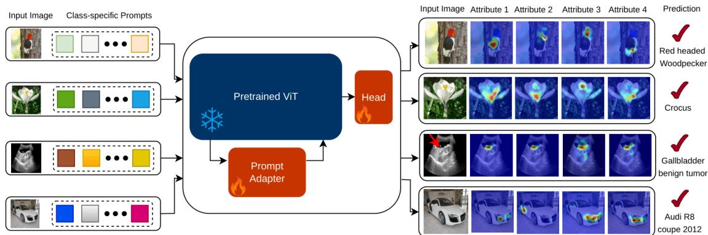  
Figure 1. Illustration of INTR++. It consists of learnable class-specific prompts (one for each class) for identifying discriminative patterns, a frozen backbone (ViT), and a learnable classifier head. In addition, the learnable prompt adapter module (PAM) enriches the prompts with domain-specific knowledge while making only minimal adjustments to the pretrained backbone representations. During training on each target dataset, PAM enables INTR++ to capture discriminative patterns across input categories. This facilitates accurate predictions with supporting evidence across diverse domains, including those with substantial input variation such as medical imaging.

## Abstract

Interpretable Transformers often perform well in domain specific settings but lose effectiveness beyond that. Achieving ViT-like broad applicability requires models with consistent performance across domains. Recent works on Interpretable Transformers, INTR and Prompt-CAM, were developed keeping domain adaptability in mind. Prompt-CAM leverages learnable prompts to promote adaptability. However, these prompts are fixed in nature and therefore struggle to adapt to domains with substantial variation in input image characteristics, resulting in reduced interpretability. To address this limitation, we propose INTR++, which extends Prompt-CAM by incorporating a lightweight Prompt Adapter Module (PAM). PAM enables prompts to be adaptive by enriching them with domain-specific knowledge, thereby ensuring consistent interpretability across diverse domains including those with varying image characteristics such as medical imaging, micro-scopic imaging, and remote sensing imagery. INTR++ retains the standard architecture and end-to-end learning of Interpretable Transformer based models, while adding only a small number ofadditionalparameters compared to Prompt-CAM. We demonstrate that INTR++ delivers consistent improvements in all aspects across domains like animals, plants, medical imaging, microscopic imaging, remote sensing imagery and object-centric data.

## 1. Introduction

Interpretable Transformers [7, 26, 32] have recently gained significant attention due to their standard architectures and end-to-end learning strategies. These methods have demonstrated strong interpretability across diverse domains such as animals, plants, and object-centric datasets. We refer to these as domains with natural image input. However, their adaptability to medical imaging, and microscopic imaging is limited. This limitation arises from the substantial variation in the image characteristics compared to natural images, and we refer to such domains as those with specialized image input. Existing Interpretable Transformer methods exhibit a decline in its adaptability when transitioning from domains with natural image input to those with specialized image input.

Beyond adaptability, another critical limitation lies in their classification performance. Although these methods demonstrate strong interpretability in domains with natural images, they often struggle to deliver high predictive accuracy. This shortcoming is commonly observed in prompt-based Interpretable Transformers [7], where the class-specific prompts lack the capacity to capture finegrained localized information essential for accurate prediction. This is due to the static nature of the prompts. By static, we mean prompts that are learned solely through the attention mechanism of the frozen backbone. In contrast, we refer to prompts as adaptive when they are learned not only through the backbone but also through an adapter module, enriching them with domain-specific knowledge.

This highlights the need for Interpretable Transformers that effectively handle the trade-off between classification performance and interpretability irrespective of the input image type. Limitations in existing models stem from the frozen backbone, which restricts the prompts from becoming truly adaptive. Nevertheless, these backbones still encode useful spatial structures that, if leveraged appropriately, can be beneficial. Therefore, building upon existing prompt-based Interpretable Transformers, we design a new framework that addresses two key concerns: 1) enabling prompting strategies in prompt-based Interpretable Transformers to adapt to both natural and specialized image inputs while keeping the pretrained backbone intact; and 2) providing meaningful interpretations while simultaneously achieving high classification accuracy.

Recent advances in Vision Transformers (ViTs) [10] have significantly improved visual recognition, particularly for fine-grained analysis [14, 38, 42, 46]. Self-supervised models such as DINO [4], DINOv2 [31], and DINOv3 [37], trained on large-scale natural image datasets, exhibit strong object-level localization capabilities. Therefore, these selfsupervised models constitute strong backbone candidates, as they provide semantically meaningful representations that are well suited for interpretable Transformers.

To this end, we propose INTR++, which aims to perform well across domains irrespective of input type while simultaneously improving both accuracy and interpretability. INTR++ builds upon Prompt-CAM by introducing a lightweight adapter module that enhances adaptability and classification performance without compromising interpretability. The introduced Prompt Adapter Module (PAM) is strategically integrated to enrich the prompts with domain-specific knowledge while making only minimal adjustments to the pretrained backbone representations. Other adapter approaches such as LoRA [15] and Adapt-Former [6] introduce adapter components for domain generalization; however, their designs limit the ability to align prompt representations with salient input characteristics in interpretability-driven settings. Pls. refer to Figure 3 for more details.

The Prompt Adapter integrated into INTR++ enriches the prompt representations by incorporating domainspecific knowledge, while introducing only minimal residual adjustments to the backbone patch representations, thereby preserving the pretrained visual representations. The details of the introduced adapter module are illustrated in Figure 2. The module is inserted into each transformer layer and operates on the intermediate token representations. A linear transformation followed by a non-linear activation enables the extraction of domain-specific features. The cross-attention mechanism between prompt tokens and image patches facilitates the integration of salient domainspecific characteristics into the prompts, thereby enabling INTR++ to deliver accurate predictions alongside meaningful interpretability across diverse domains.

INTR++ addresses the challenges in existing promptbased Interpretable Transformers by incorporating a lightweight module that enhances accuracy, interpretability and adaptability while keeping the model computationally efficient. It also addresses the trade-off between accuracy and interpretability. We extensively evaluate INTR++ on ten datasets across a diverse range of domains: Animal: [19, 40]; Plant: [30, 35]; Object-centric: [21, 25]; Medical imaging: [3, 29]; Microscopic imaging: [20, 45]; Remote sensing imagery: [8, 43]. Our contributions are two-fold.

• We introduce a lightweight Prompt Adapter Module (PAM), that enhances accuracy and interpretability while enabling effective domain adaptability across both natural and specialized images.

• We demonstrate the effectiveness of INTR++ through extensive experiments on datasets spanning domains with both natural and specialized image characteristics. INTR++ also effectively handles the trade-off between accuracy and interpretability observed in existing prompt-based approaches. The source code is available at https://github.com/dipanjyoti/INTR-PlusPlus.

## 2. Related Work

Meaningful interpretation is crucial for fine-grained tasks in domains such as biodiversity and healthcare. Early works focused on post-hoc explainability, where predictions are retrospectively analyzed to identify influential regions. Grad-CAM [36], Layer-CAM [17], Eigen-CAM [27], Attention Roll-out [18], GradCAM++ [5], Ablation-CAM [34], and XGradCAM [11] generate saliency maps using gradients. However, these methods often lack trustworthiness as they explain decisions only after the prediction is made.

In contrast, interpretable methods identify key attributes during the prediction process itself. Methods such as ProtoPFormer [44], TesNet [41], ProtoConcepts [24], ProtoViT [23], and PIPNet [28] use prototype-based reasoning to generate interpretations. However, they typically require complex architectures and multi-stage training, which limit their adaptability, applicability, and reproducibility.

To address these challenges, a new line of work, namely Interpretable Transformers, including INTR [32] and PROMPT-CAM [7], has been proposed. The core idea is to provide meaningful interpretation using standard architectures and end-to-end learning objectives. However, these methods are tightly coupled with the backbone and struggle to generalize to specialized image inputs. Moreover, these models suffer from a trade-off between accuracy and interpretability. Additionally, the prompts in Prompt-CAM are static in nature, which limits their adaptability when applied to domains beyond natural images. Therefore, there is a need for adaptive prompts.

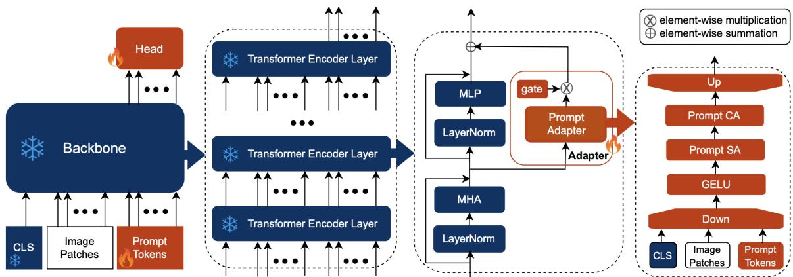  
Figure 2. Architecture of INTR++. INTR++ employs a pretrained frozen backbone, while learning only the prompts and a lightweight prompt adapter module. The module is simple, adding only a small number of additional parameters. It consists of a lower-dimensional linear projection, a non-linear activation, self-attention over prompt tokens, cross-attention with image patches, and a projection back to the original dimension. The adapted prompt tokens at the last layer are finally used for classification. See the Method section for details.

Recent works on domain adaptation, such as Adapt-Former [6], LoRA [15], and DVPT [13], attempt to address cross-domain challenges. However, the designs of Adapt-Former and LoRA are not suitable for refining prompt representations to better capture salient input characteristics. In contrast, DVPT relies on the [CLS] token, which limits its ability to capture class-specific attributes.

## 3. Method

In this paper, we introduce INTR++, an Interpretable Transformer framework inspired by Prompt-CAM [7] and Visual Prompt Tuning (VPT) [16], which incorporates a lightweight Prompt Adapter Module (PAM). The overall architecture remains simple, as the adapter can be easily integrated into transformer layers while fully leveraging the backbone model. The architecture is illustrated in Figure 2. For clarity, we follow the same naming conventions and notation as Prompt-CAM.

## 3.1. Vision Transformer Preliminaries

Vision Transformer (ViT) [39] serves as the backbone of our approach. An input image I is divided into M fixedsize patches, each linearly projected into a D-dimensional embedding. Positional embeddings are added to form the input sequence ${ \pmb { \cal E } } _ { 0 } = [ { \pmb e } _ { 0 } ^ { 1 } , \cdots , { \pmb e } _ { 0 } ^ { M } ] \in \mathbb { R } ^ { D \times M }$ . A learnable [CLS] token $\pmb { x } _ { 0 } \in \mathbb { R } ^ { D }$ is prepended, resulting in $\pmb { { \cal E } } =$ $[ x _ { 0 } , E _ { 0 } ]$ The transformer comprises N layers, each consisting of a Multi-Head Attention (MHA) block, a Multi-Layer Perceptron (MLP), and Layer Normalization (LN). Traditionally, the final [CLS] token, $\mathbf { \mathcal { x } } _ { N }$ , is used for classification. The MHA operation is defined as

$$
\mathrm { M H A } ( q , k , v ) = \mathrm { S o f t m a x } \bigg ( \frac { Q K ^ { \top } } { \sqrt { D } } \bigg ) V ,\tag{1}
$$

where $q , k ,$ and v denote the query, key, and value vectors derived from the input token embeddings $[ x , E ] ,$ and $Q ,$ K, and V represent their linear projections using the corresponding weights $W _ { q } , W _ { k }$ , and $W _ { v } ,$ , respectively:

$$
\begin{array} { r } { \pmb { Q } = W _ { q } q , \quad \pmb { K } = W _ { k } k , \quad \pmb { V } = W _ { v } v . } \end{array}\tag{2}
$$

## 3.2. Overall Workings of INTR++

INTR++ is built on the deep variants of PROMPT-CAM [7]. It leverages pretrained ViT backbones for classification. The PAM is integrated into each layer of the backbone model. While the backbone is kept frozen, PAM remains learnable. Additionally, for a dataset with C classes, INTR++ introduces C learnable class-specific prompt vectors, each of dimension D. The prompts are injected at each layer and learned independently. Prompts from the final layer are used as class-specific tokens for prediction.

Given a labeled training example $( I , y \in \{ 1 , \cdots , C \} )$ unlike traditional ViT classifiers [9, 22], INTR++ relies on class-specific prompts injected at the last layer, denoted as $P _ { N - 1 } = [ { \pmb p } ^ { 1 } , \cdot \cdot \cdot , { \pmb p } ^ { C } ]$ , and produces class-specific outputs $\boldsymbol { Z } _ { N } = [ z _ { N } ^ { 1 } , \cdots , z _ { N } ^ { C } ]$ . The logits are computed as:

$$
\begin{array} { r } { s [ c ] = { \pmb w } ^ { \top } z _ { N } ^ { c } , \quad 1 \leq c \leq C , } \end{array}\tag{3}
$$

where ${ \pmb w } \in \mathbb { R } ^ { D }$ is a shared learnable vector. This formulation makes INTR++ naturally suited for interpretation, as it enables the analysis of attention maps between prompts and image patches. The class-specific prompts $_ { r }$ are trained by minimizing the standard cross-entropy loss. Finally, the predicted label yˆ is obtained as:

$$
\hat { y } = \arg \operatorname* { m a x } _ { c \in \{ 1 , \cdots , C \} } s [ c ] .
$$

## 3.3. Prompt Adapter Module (PAM)

We describe the workings of transformer layers in INTR++, with a focus on the PAM, an important aspect of INTR++. At the i-th layer, the model takes as input the learnable prompt tokens $P _ { i - 1 }$ , patch embeddings $\mathbf { \delta } _ { E _ { i - 1 } }$ , and the [CLS] token ${ \bf { \boldsymbol { x } } } _ { i - 1 }$ These are concatenated and passed through a standard Multi-Head Attention (MHA) block.

$$
\begin{array} { r } { [ Z _ { i } ^ { \prime } , E _ { i } ^ { \prime } , \pmb { x } _ { i } ^ { \prime } ] = \mathrm { M H A } ( \mathrm { L N } ( [ P _ { i - 1 } , E _ { i - 1 } , \pmb { x } _ { i - 1 } ] ) ) \qquad ( \smallskip } \\ { + [ P _ { i - 1 } , E _ { i - 1 } , \pmb { x } _ { i - 1 } ] , \quad i = 1 , \cdots , N . } \end{array}\tag{}
$$

Here, $\boldsymbol { Z } _ { i } ^ { \prime }$ denotes the intermediate prompt output. The Prompt Adapter Module (PAM), operates on the MHA output, taking $[ \boldsymbol { \bar { Z } } _ { i } ^ { \prime } , \boldsymbol { E } _ { i } ^ { \prime } , \boldsymbol { x } _ { i } ^ { \prime } ]$ as input as in Equation 4. The PAM, first projects all input tokens to a lower-dimensional space using a compression layer $f _ { d n }$ as

$$
[ \hat { Z } _ { i } ^ { d } , \hat { E } _ { i } ^ { d } , \hat { x } _ { i } ^ { d } ] = \sigma ( f _ { d n } ( [ Z _ { i } ^ { ' } , E _ { i } ^ { ' } , \boldsymbol { x } _ { i } ^ { ' } ] ) ) , i = 1 , \cdots , N .
$$

Here, $f _ { d n }$ is a learnable linear layer with weights ${ \textbf { \textit { w } } } \in$ $\mathbb { R } ^ { D \times d }$ , where $d \ll D$ and σ is a GELU activation function. We split the tokens into prompt, patch and [CLS] as

$$
\hat { Z } _ { i } ^ { d } , [ \hat { E } _ { i } ^ { d } , \hat { \pmb { x } } _ { i } ^ { d } ] = \mathrm { s p l i t } ( [ \hat { \pmb { Z } } _ { i } ^ { d } , \hat { \pmb { E } } _ { i } ^ { d } , \hat { \pmb { x } } _ { i } ^ { d } ] ) , i = 1 , \cdots , N .
$$

Next, we apply Multi-Head Attention (MHA) referring to Equation 1, within PAM. First, we apply Prompt Self Attention (PSA) to the prompt tokens $\hat { Z } _ { i } ^ { d }$ as

$$
\bar { Z } _ { i } ^ { d } = \mathrm { M H A } ( q = k = v = \hat { Z } _ { i } ^ { d } ) .\tag{5}
$$

PSA allows prompts to share information among themselves, which is useful when classes have overlapping features. To enrich prompts to capture better salient input characteristics, we perform Prompt Cross-Attention (PCA) using patch and [CLS] tokens as keys and values

$$
\tilde { \boldsymbol { Z } } _ { i } ^ { d } = \mathrm { M H A } ( \boldsymbol { q } = \bar { \boldsymbol { Z } } _ { i } ^ { d } , \boldsymbol { k } = \boldsymbol { v } = [ \hat { E } _ { i } ^ { d } , \hat { \pmb { x } } _ { i } ^ { d } ] ) .\tag{6}
$$

The prompts $\tilde { Z } _ { i } ^ { d }$ are now enriched with the domain specific knowledge. We then concatenate the updated prompts and patch tokens as $[ \tilde { Z } _ { i } ^ { d } , \hat { E } _ { i } ^ { d } , \hat { { \pmb x } } _ { i } ^ { d } ]$ and project them back to the original dimension D using a learnable linear layer $f _ { u p }$ with weights $\pmb { w } \in \mathbb { R } ^ { d \times D }$ , modulated by a gating parameter g as

$$
[ { \cal Z } _ { i } ^ { p } , { \cal E } _ { i } ^ { p } , { \pmb x } _ { i } ^ { p } ] = g \cdot f _ { u p } ( [ { \tilde { \cal Z } } _ { i } ^ { d } , \hat { \pmb { E } } _ { i } ^ { d } , \hat { \pmb { x } } _ { i } ^ { d } ] ) , i = 1 , . . . , N ,\tag{7}
$$

here, gate, g is a learnable scalar parameter that controls the flow of information from the adapter, and the superscript $( \cdot ) ^ { p }$ denotes PAM adapter. These are then fused with the transformer’s intermediate features to produce the layer’s output as

$$
\begin{array} { r l } & { [ \boldsymbol { Z } _ { i } , \boldsymbol { E } _ { i } , \boldsymbol { x } _ { i } ] = \mathrm { M L P } ( \mathrm { L N } ( [ \boldsymbol { Z } _ { i } ^ { ' } , \boldsymbol { E } _ { i } ^ { ' } , \boldsymbol { x } _ { i } ^ { ' } ] ) ) } \\ & { ~ + [ \boldsymbol { Z } _ { i } ^ { ' } , \boldsymbol { E } _ { i } ^ { ' } , \boldsymbol { x } _ { i } ^ { ' } ] } \\ & { ~ + [ \boldsymbol { Z } _ { i } ^ { p } , \boldsymbol { E } _ { i } ^ { p } , \boldsymbol { x } _ { i } ^ { p } ] , ~ i = 1 , \cdots , N . } \end{array}\tag{8}
$$

The red & blue highlighted terms in Equation 8 capture the adaptive behavior introduced by PAM. Specifically, $[ E _ { i } ^ { p } , \pmb { x } _ { i } ^ { p } ]$ introduces only minimal residual adjustments to the patch token representations, while $Z _ { i } ^ { p }$ enriches the prompt representations with domain-specific knowledge. Together, these enable INTR++ to generalize effectively across both natural and specialized image domains.

## 3.4. Prompt Adapter vs. Others

We evaluate the proposed adapter technique against several alternative adaptation strategies, including a MLP-based adapter and two widely used adaptation methods, Adapt-Former [6] and LoRA [15]. For a fair comparison, each adaptation module is consistently applied to both the input image tokens and the input prompts. See Suppl. Sec. A.1.

Like PAM, AdaptFormer operates after the MHA block and takes $[ Z _ { i } ^ { \prime } , E _ { i } ^ { \prime } , { \pmb x } _ { i } ^ { \prime } ]$ as input (see Equation 4). However, unlike PAM, AdaptFormer treats all tokens uniformly, without giving prompts any special emphasis. It performs a down-projection, followed by a ReLU activation, and then an up-projection back to the original dimension as

$$
\begin{array} { c } { { { } [ Z _ { i } ^ { a } , E _ { i } ^ { a } , { { \bf x } _ { i } ^ { a } } ] = g \cdot f _ { u p } \Big ( \sigma \Big ( f _ { d n } ( [ Z _ { i } ^ { ' } , E _ { i } ^ { ' } , { \bf x } _ { i } ^ { ' } ] ) \Big ) \Big ) , } } \\ { { { } \ i = 1 , \cdots , N . } } \end{array}\tag{9}
$$

The superscript $( \cdot ) ^ { a }$ denotes AdaptFormer outputs. The resulting $[ Z _ { i } ^ { a } , E _ { i } ^ { a } , { \pmb x } _ { i } ^ { a } ]$ incorporates domain-specific cues, but since AdaptFormer does not explicitly adapt prompts, its effectiveness in prompt-based classification remains limited. It is then passed through the remaining transformer layer, producing the final output as in Equation 8, with $[ Z _ { i } ^ { a } , E _ { i } ^ { a } , { \pmb x } _ { i } ^ { a } ]$ as the adapter contribution.

In LoRA, the adaptation operates differently. It introduces low-rank adapters within the MHA block itself. Thus, we rewrite Equation 4 for LoRA as

$$
\begin{array} { r } { \mathsf { \Pi } [ \pmb { Z } _ { i } ^ { l } , \pmb { E } _ { i } ^ { l } , \pmb { x } _ { i } ^ { l } ] = \mathrm { M H A } ^ { \mathrm { L o R A } } ( \mathrm { L N } ( [ \pmb { P } _ { i - 1 } , \pmb { E } _ { i - 1 } , \pmb { x } _ { i - 1 } ] ) ) ~ ( 1 0 ) } \\ { + [ \pmb { P } _ { i - 1 } , \pmb { E } _ { i - 1 } , \pmb { x } _ { i - 1 } ] , ~ ( i = 1 , \dots , N ) . } \end{array}
$$

Here, the superscript $( \cdot ) ^ { l }$ in $[ Z _ { i } ^ { l } , E _ { i } ^ { l } , \pmb { x } _ { i } ^ { l } ]$ , denotes the LoRA outputs, which encode domain-specific information through LoRA multi-head attention $( \mathrm { M H A } ^ { \mathrm { L o R A } } )$ as

$$
\mathrm { M H A } ^ { \mathrm { L o R A } } ( q , k , v ) = \mathrm { S o f t m a x } \bigg ( \frac { Q ^ { l } ( K ^ { l } ) ^ { \top } } { \sqrt { D } } \bigg ) V ^ { l } ,\tag{11}
$$

with the projections in Equation 2 modified as

$$
\begin{array} { r } { Q ^ { l } = \left( W _ { q } + \Delta W _ { q } \right) q , \quad \Delta W _ { q } = A _ { q } B _ { q } , } \\ { K ^ { l } = \left( W _ { k } + \Delta W _ { k } \right) k , \quad \Delta W _ { k } = A _ { k } B _ { k } , } \\ { V ^ { l } = \left( W _ { v } + \Delta W _ { v } \right) v , \quad \Delta W _ { v } = A _ { v } B _ { v } , } \end{array}\tag{12}
$$

where $A _ { q } \in \mathbb { R } ^ { D \times d }$ and $B _ { q } \in \mathbb { R } ^ { d \times D }$ with $d \ll D ;$ similar definitions hold for $A _ { k } , B _ { k }$ and $A _ { v } , B _ { v }$ . The final output

of the transformer layer is:

$$
\begin{array} { r l } & { [ Z _ { i } , E _ { i } , \pmb { x } _ { i } ] = \mathrm { M L P } ( \mathrm { L N } ( [ \pmb { Z } _ { i } ^ { l } , \pmb { E } _ { i } ^ { l } , \pmb { x } _ { i } ^ { l } ] ) ) } \\ & { \quad \quad \quad \quad + [ \pmb { Z } _ { i } ^ { l } , \pmb { E } _ { i } ^ { l } , \pmb { x } _ { i } ^ { l } ] . } \end{array}\tag{13}
$$

In LoRA, the original weights $W _ { q } , W _ { k } , W _ { v }$ are frozen, and only the low-rank adapters A and $B ~ ( \mathrm { i . e . , } ~ \Delta W )$ are learnable. Thus, LoRA injects domain-specific information.

In summary, the outputs of all adaptive modules $[ Z _ { i } ^ { p } , E _ { i } ^ { p } , { \pmb x } _ { i } ^ { p } ] , \bar { [ } Z _ { i } ^ { a } , E _ { i } ^ { a } , { \pmb x } _ { i } ^ { \bar { a } } ]$ , and $[ Z _ { i } ^ { l } , E _ { i } ^ { l } , \bar { \mathbf { x } } _ { i } ^ { l } ]$ enrich the prompt representations with domain-specific knowledge while introducing only minimal residual adjustments to the backbone representations. This behavior is also observed when using a simple MLP as the adapter. However, PAM differs fundamentally in how this adaptation is structured and utilized. This design of PAM enables prompts to not only absorb domain-specific knowledge implicitly, but also to actively align themselves with salient input characteristics. In contrast, AdaptFormer and LoRA enrich prompts indirectly through shared token adaptation, without explicitly modeling prompt & patch interactions or enforcing prompt-specific enrichment. For all adaptive modules, the intermediate dimensionality is fixed at $d = 6 4$ , which was empirically found to provide a favorable trade-off between capacity and efficiency. More in the Suppl. Sec. D.3.

Figure 3 illustrates the cosine similarity between token representations before and after adapter insertion. $\mathbf { A } \mathbf { s }$ shown, the MLP substantially disrupts the backbone representations, making it unsuitable for prompt adaptation. In contrast, LoRA, PromptAdapter, and INTR++ introduce only minimal adjustments to the backbone image patch representations, thereby preserving the pretrained visual representations. Notably, INTR++ yields significantly richer prompt representations than LoRA and Adapt-Former, suggesting more effective incorporation of domainspecific knowledge. This behavior indicates that the Prompt Adapter Module (PAM) acts as a controlled residual correction mechanism, selectively enriching the prompt representations without substantially perturbing the pretrained backbone representations, making INTR++ well suited for adaptation across both natural and specialized image domains.

## 3.5. Importance of the gate Value

The learnable scaler gate g in the PAM controls the module’s contribution. It is initialized to one to promote rapid prompt adaptation to the target domain during early training. As shown in Figure 4, the model initially relies on stronger adaptive corrections and gradually reduces the adapter’s contribution as the representations become aligned. More in the Suppl. Sec. D.2.

## 3.6. Feature Identification and Interpretation

As shown in Equation $^ { 3 , }$ the model predicts the score for class c using the class-specific prompt output $z _ { N } ^ { c } .$ . Since the projection vector w is shared across all prompts, it does not introduce any class-specific bias. This design encourages each prompt to encode distinctive features relevant to its class, making them inherently discriminative.

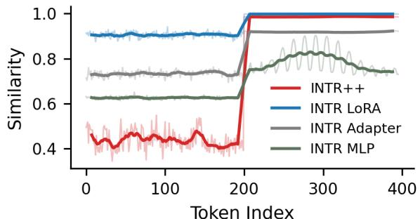

Figure 3. Information induced by different adapters. The first 200 tokens in the plot are learnable prompt tokens for CUB dataset, while the remaining tokens are image patches. The bold curves represent the exponential moving average (EMA) of the raw cosine similarity values computed using a span of fifteen.  
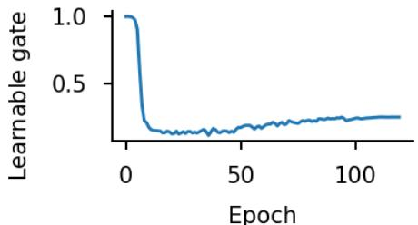  
Figure 4. Learned gate values over training epochs. The plot shows the last layer gate values of INTR++ on CUB dataset.

By analyzing $z _ { N } ^ { c }$ , we can thus identify which features the model relies on for predicting class c. To provide interpretability, we examine the multi-head attention weights in the final transformer layer. Specifically, we extract the attention maps between each class-specific prompt and the image patch tokens. These maps are then superimposed on the input image to highlight the regions most influential to the model’s prediction. This serves as supporting visual evidence for model interpretability. Like PROMPT-CAM, we greedily select top attention heads that are sufficient to distinguish between different categories, and visualize only those in the experiment section.

## 3.7. Additional Parameters Introduced by PAM

Our adaptive module PAM is lightweight, adding only a small number of parameters. The two projection layers contribute $2 ( D \times d ) + D + d$ parameters, where $d \ll D \left( \mathrm { e . g . } \right.$ $d = 6 4$ and $D = 7 6 8$ for ViT-Base). Parameterized multihead attention (MHA) adds $4 d ^ { 2 }$ for self-attention and $4 d ^ { 2 }$ for cross-attention, totaling $8 d ^ { 2 }$ . Thus, the total overhead is $2 ( D \times d ) + D + d + 8 d ^ { 2 }$ . For example, for the CUB [40] dataset with 200 categories, the number of learnable parameters for PROMPT-CAM is ≈ 2% of the total parameters, while INTR++ has only ≈ 3%. More in the Suppl. Sec. E.2.

## 4. Experiments

## 4.1. Experimental Setup

Dataset. We extensively evaluate the performance and adaptability of INTR++ across diverse datasets spanning both natural image domains and specialized image domains. The natural image domains include Animal: CUB-200-2011 (CUB) [40] and Stanford Dogs (Dog) [19]; Plant: Oxford Flowers (Flower) [30] and Medicinal Leaf (MedLeaf) [35]; and Object-centric: Stanford Cars (Car) [21] and FGVC Aircraft (Craft) [25]. The specialized image domains include Medical: MRI Brain Tumors (Brain) [29] and Gallbladder Cancer Ultrasound (GBCU) [3]; Microscopic: Colon Cancer Whole Slide Imaging (Colon) [45]; and Remote Sensing: Aerial Image Dataset (AID) [43]. More in the Suppl. Sec. A.2.

Model. We utilize different backbones for INTR++, including DINO [4], DINOv2 [31], and BioCLIP2 [12]. Unless stated otherwise, all results are based on the ViT-B variant of DINO. The backbone is kept frozen in INTR++, while only the prompts, PAM, and the classification head are learned. More in the Suppl. Sec. A.3.

Baselines. We compare INTR++ with several baseline methods. We show comparison with the interpretable methods like TesNet [41], ProtoConcepts [24], PIPNet [28], ProtoViT [23] and PROMPT-CAM [7]. Additionally, we compare with post-hoc methods such as Grad-CAM [36], Layer-CAM [17], Eigen-CAM [27], and Attention Roll-out [18]. Finally, to evaluate the contribution of the integrated adaptive module, we compare INTR++ with adaptation based approaches like LoRA [15] and AdaptFormer [6].

## 4.2. Overall Performance of INTR++

INTR++ has been extensively evaluated across datasets from diverse domains, demonstrating its effectiveness in three key aspects: improved accuracy, better interpretability and adaptability. As shown in Figure 1, the model consistently provides meaningful interpretations regardless of the domain. For biodiversity tasks, it identifies discriminative traits, while in medical imaging, it highlights relevant regions of interest. Furthermore, the improved classification performance of INTR++ is evidenced by its gains over Prompt-CAM in Table 2, while its superior interpretability is illustrated in Figure 8. More in the Suppl. Sec. C.1.

## 4.3. Performance on Specialized Image Domains

The GBCU dataset is used as the primary reference to demonstrate the effectiveness of our approach, while similar trends hold across the other specialized image datasets.

Expert evaluation. We conducted a human evaluation on the heatmaps generated by INTR++. For the GBCU dataset, we randomly selected 10 images from the malignant and benign categories and collected corresponding heatmaps from INTR++, PROMPT-CAM, Attention Rollout, and LayerCAM. These heatmaps were shared with five medical experts without disclosing the method used. The results show that INTR++ accurately localized the region of interest in 91% of the cases, compared to 73% for PROMPT-CAM, 69% for Attention Rollout, and 47% for LayerCAM. This highlights the effectiveness of INTR++.

<table><tr><td rowspan="2">Method</td><td colspan="2">CUB</td><td colspan="2">GBCU</td></tr><tr><td>Insertion↑</td><td>Deletion↓</td><td>Insertion↑</td><td>Deletion↓</td></tr><tr><td>Grad-CAM</td><td>0.52</td><td>0.17</td><td>0.57</td><td>0.26</td></tr><tr><td>Layer-CAM</td><td>0.54</td><td>0.13</td><td>0.44</td><td>0.37</td></tr><tr><td>Eigen-CAM</td><td>0.56</td><td>0.22</td><td>0.45</td><td>0.39</td></tr><tr><td>Attention Rollout</td><td>0.55</td><td>0.27</td><td>0.51</td><td>0.26</td></tr><tr><td>PROMPT-CAM</td><td>0.61</td><td>0.09</td><td>0.59</td><td>0.21</td></tr><tr><td>INTR++</td><td>0.62</td><td>0.08</td><td>0.65</td><td>0.19</td></tr></table>

Table 1. Quantitative evaluation of interpretation. Lower deletion and higher insertion scores indicate better performance.

Quantitative interpretability evaluation. To quantitatively evaluate the interpretation capability of INTR++, we use standard post-hoc interpretability metrics: insertion and deletion [33]. We compare INTR++ with other interpretable as well as post-hoc methods. The Table 1 reports the scores on the GBCU medical imaging dataset, where INTR++ consistently outperforms others in identifying important regions. This superiority is not limited to medical imaging; results on the CUB dataset further demonstrate its effectiveness on domains with natural input image types.

Qualitative interpretability analysis We qualitatively compare the interpretability of INTR++ with post-hoc methods such as Attention Rollout, Eigen-CAM, Grad-CAM, and Layer-CAM. For INTR++, we use the topranked attention head, which alone is sufficient for correct prediction. Figure 5 illustrates examples from the benign category of the GBCU dataset, highlighting the relevant regions. INTR++ clearly outperforms the other methods. More in the Suppl. Sec. B.1, B.3 and C.2.

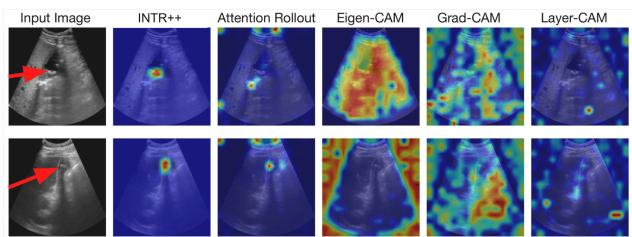  
Figure 5. Qualitative interpretability. Comparison between INTR++ and other post-hoc methods on the GBCU dataset.

## 4.4. Performance on Natural Image Domains

INTR++ for trait manipulation. We validate the importance of the highlighted traits through an attribute manipulation analysis. Specifically, we select an input image of a White-necked Raven from the CUB dataset as in Figure 6.

<table><tr><td>Method</td><td>CUB</td><td>Dog</td><td>MedLeaf</td><td>Flower</td><td>GBCU</td><td>Brain</td><td>Colon</td><td>Car</td><td>Craft</td><td>AID</td></tr><tr><td>Prompt-CAM</td><td>73.2</td><td>81.1</td><td>96.9</td><td>86.8</td><td>63.1</td><td>93.5</td><td>74.2</td><td>83.2</td><td>68.7</td><td>93.5</td></tr><tr><td>INTR++</td><td>79.0</td><td>83.5</td><td>97.1</td><td>87.2</td><td>81.2</td><td>99.2</td><td>84.4</td><td>88.1</td><td>75.4</td><td>97.7</td></tr></table>

Table 2. Accuracy comparison. Results are on the DINO backbone. INTR++ outperforms PROMPT-CAM across domains.

During prediction, the model highlights the white neck as an important trait for this species. Next, we manually edit the image to remove this trait following [1, 2], as shown in the second row. The model then predicts American Crow, which indeed resembles the modified image. This demonstrates that INTR++ actually relies on such traits for species identification. We perform a similar attribute manipulation for medical tasks. More in the Suppl. Sec. B.6.

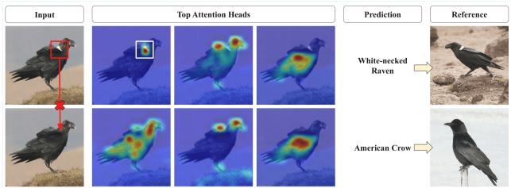  
Figure 6. Trait manipulation. Top row: the white-neck trait highlighted as important for the White-necked Raven. Bottom row: after deleting this trait, the model predicts American Crow and no longer considers the white neck as important.

INTR++ vs. Prompt-CAM. INTR++ builds upon PROMPT-CAM to enhance interpretability and extend applicability across domains, including specialized input domains. Figure 8 illustrates a comparison between INTR++ and PROMPT-CAM. INTR++ demonstrates substantial improvements in the medical imaging, microscopic imaging performing consistently across diverse imaging modalities, MRI, WSI, and ultrasound. For biodiversity and other tasks, both models perform comparably, although INTR++ offers slightly clearer interpretations. Furthermore, INTR++ yields correct predictions and interpretations in cases where PROMPT-CAM fails, underscoring its cross-domain effectiveness. More in the Suppl. Sec. B.2, B.4 and B.5.

Qualitative comparisons of INTR++ and other interpretable methods. We compare INTR++ with various interpretable methods, including ProtoConcepts, PIP-Net TesNet and PROMPT-CAM utilizing a common backbone DINO. For simplicity, we consider a single image from the CUB dataset. Figure 7, illustrates the traits identified by each method. ProtoConcepts, PIPNet and TesNet tend to highlight only a few traits, often focusing on a single part. In contrast, INTR++ produces sharper, more localized interpretations that capture greater number of discriminative traits. While INTR++ and PROMPT-CAM identify a comparable set of traits, INTR++ offers clearer interpretations showing its effectiveness.

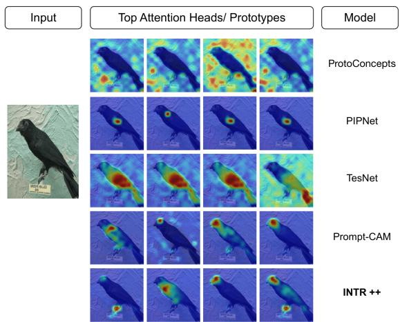  
Figure 7. Comparison of interpretable models. Visual demon stration (heatmaps) of the four strongest responses on a “Groove Billed Ani” example image.

INTR++ on different backbones. We analyze images from the CUB dataset and visualize interpretations across different backbones, including DINO, DINOv2, and Bio-CLIP2. As shown in Figure 9, INTR++ consistently identifies distinct traits for prediction, irrespective of the backbone. Table 3 presents the accuracy comparison on dataset from different domains. More in the Suppl. Sec. C.3.

<table><tr><td></td><td>CUB</td><td>Car</td><td>Flower GBCU</td><td></td><td>Colon AID</td><td></td></tr><tr><td rowspan="3">Ours</td><td>DINO</td><td>79.0 88.1</td><td>87.2</td><td>81.2</td><td>84.4</td><td>97.7</td></tr><tr><td>DINOv2</td><td>79.6 91.3</td><td>87.4</td><td>82.0</td><td>84.7</td><td>96.6</td></tr><tr><td>BioCLIP-2</td><td>91.1 94.2</td><td>96.6</td><td>82.3</td><td>84.9</td><td>97.4</td></tr></table>

Table 3. Accuracy of INTR++ on different backbones. We consider one dataset from each of the animal, object, plant and medical domain to demonstrate its effectiveness across backbones.

Comparison of INTR++ with other adapter modules. We compare INTR++ with two of its variants, INTR-LoRA and INTR-AdaptFormer, which are designed using different adaptive module strategies. INTR-LoRA incorporates a LoRA-inspired adaptation module, while INTR-AdaptFormer builds upon the AdaptFormer approach. We evaluate their performance in terms of both classification accuracy and interpretability. Table 4 presents results on one dataset from each domains. Moreover, we provide interpretability comparisons considering medical imaging GBCU dataset in Figure 10. Clearly, INTR++ dominates in terms of accuracy as well as interpretability. More in the Suppl. Sec. D.4. In addition, we validate the effectiveness of each PAM component in INTR++ through the ablation study in Table 5. More in the Suppl. Sec. D.1. We also provide statistical test in the Suppl. Sec. E.1.

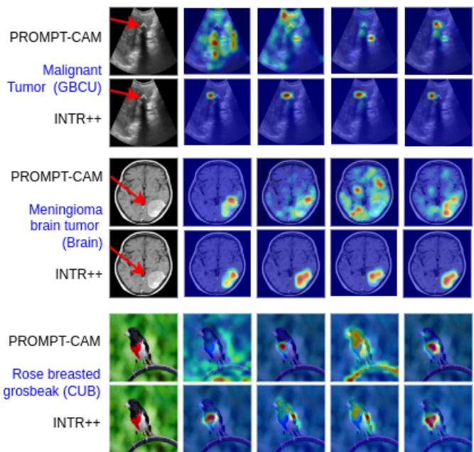

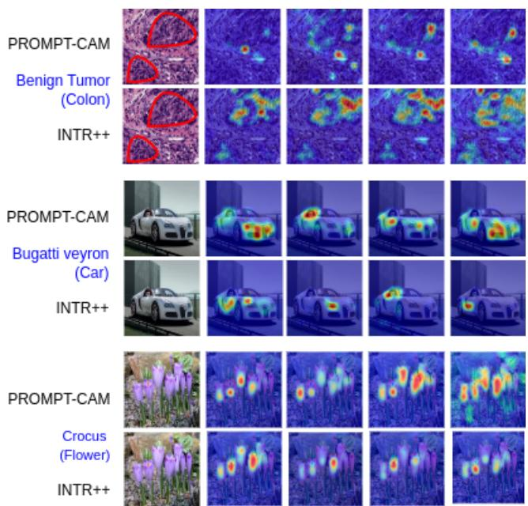  
Figure 8. INTR++ and PROMPT-CAM interpretation comparisons across all domains. Red markings denote regions of interest.

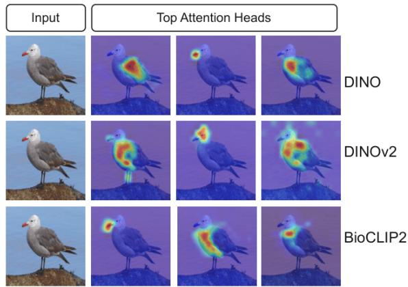  
Figure 9. INTR++ on different backbones. INTR++ can identify important traits for differentiating Heermann Gull species irrespective of the backbone used.

<table><tr><td></td><td>CUB Car</td><td>Flower</td><td>GBCU</td><td></td><td>Colon AID</td></tr><tr><td>INTR-MLP</td><td>74.0 67.2</td><td>62.6</td><td>51.7</td><td>72.4</td><td>89.0</td></tr><tr><td>INTR-AdaptFormer</td><td>72.6</td><td>81.0 76.7</td><td>41.0</td><td>80.9</td><td>96.8</td></tr><tr><td>INTR-LoRA</td><td>75.0 83.0</td><td>85.1</td><td>55.7</td><td>81.2</td><td>97.3</td></tr><tr><td>INTR++</td><td>79.0 88.1</td><td>87.2</td><td>81.2</td><td>84.4</td><td>97.7</td></tr></table>

Table 4. Accuracy comparison. INTR++ with other adapters.

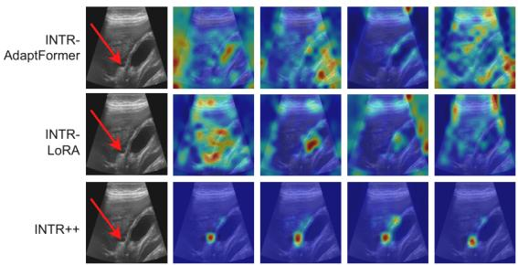  
Figure 10. Comparison with adapters. INTR++ highlights im portant traits, while others produce noisier outputs.

<table><tr><td>Method</td><td>CUB Car Flower GBCU Colon AID</td><td></td><td></td><td></td></tr><tr><td>INTR++\ {PCA}</td><td>77.3 87.1</td><td>85.1</td><td>80.8 82.5</td><td>97.1</td></tr><tr><td>INTR++\{PSA}</td><td>73.3 385.8</td><td>86.7</td><td>79.2 82.1</td><td>96.0</td></tr><tr><td>INTR++ \ {PSA, PCA}</td><td>72.6 82.8 83.4</td><td>41.0</td><td>74.5</td><td>96.9</td></tr><tr><td>INTR++</td><td>79.0 88.1 87.2</td><td>81.2</td><td>84.4</td><td>97.7</td></tr></table>

Table 5. Ablation study of INTR++. The study shows the signif icance of each of the components of the Prompt Adapter.

## 5. Conclusion

In this paper, we proposed an interpretable transformer method, INTR++, which introduces a lightweight adaptive component, Prompt Adapter that enriches the prompts, to jointly improve prediction accuracy, interpretability, and model adaptability. INTR++ effectively resolves the tradeoff between accuracy and interpretability. Moreover, it demonstrates strong adaptability across domains, performing consistently well on both natural and specialized image domains, thereby highlighting its generalizability.

## Acknowledgments

Our research is supported by JST Grant Number JP-MJPF2017 and International Education and Research Laboratory Program of the University of Tsukuba.

## References

[1] Birds of the world: https://birdsoftheworld. org/bow/home. 7

[2] The cornell lab of ornithology: https://www.birds. cornell.edu/. 7

[3] Soumen Basu, Mayank Gupta, Pratyaksha Rana, Pankaj Gupta, and Chetan Arora. Surpassing the human accuracy: Gallbladder cancer detection from usg with curriculum learning. In Proceedings of the IEEE/CVF Conference on Computer Vision and Pattern Recognition (CVPR), pages 20854–20864, 2022. 2, 6, 11

[4] Mathilde Caron, Hugo Touvron, Ishan Misra, Herve J´ egou,´ Julien Mairal, Piotr Bojanowski, and Armand Joulin. Emerging properties in self-supervised vision transformers. In Proceedings of the International Conference on Computer Vision (ICCV), 2021. 2, 6

[5] Aditya Chattopadhay, Anirban Sarkar, Prantik Howlader, and Vineeth N Balasubramanian. Grad-cam++: Generalized gradient-based visual explanations for deep convolutional networks. In 2018 IEEE Winter Conference on Applications ofComputer Vision (WACV). IEEE, 2018. 2

[6] Shoufa Chen, Chongjian Ge, Zhan Tong, Jiangliu Wang, Yibing Song, Jue Wang, and Ping Luo. Adaptformer: Adapting vision transformers for scalable visual recognition. Advances in Neural Information Processing Systems, 35:16664–16678, 2022. 2, 3, 4, 6, 11

[7] Arpita Chowdhury, Dipanjyoti Paul, Zheda Mai, Jianyang Gu, Ziheng Zhang, Kazi Sajeed Mehrab, Elizabeth G Campolongo, Daniel Rubenstein, Charles V Stewart, Anuj Karpatne, et al. Prompt-cam: Making vision transformers interpretable for fine-grained analysis. In Proceedings ofthe Computer Vision and Pattern Recognition Conference, pages 4375–4385, 2025. 1, 2, 3, 6, 11

[8] Yanghua Di, Zhiguo Jiang, and Haopeng Zhang. A public dataset for fine-grained ship classification in optical remote sensing images. Remote Sensing, 13(4):747, 2021. 2

[9] Alexey Dosovitskiy, Lucas Beyer, Alexander Kolesnikov, Dirk Weissenborn, Xiaohua Zhai, Thomas Unterthiner, Mostafa Dehghani, Matthias Minderer, Georg Heigold, Sylvain Gelly, et al. An image is worth 16x16 words: Transformers for image recognition at scale. arXiv preprint arXiv:2010.11929, 2020. 3

[10] Alexey Dosovitskiy, Lucas Beyer, Alexander Kolesnikov, Dirk Weissenborn, Xiaohua Zhai, Thomas Unterthiner, Mostafa Dehghani, Matthias Minderer, Georg Heigold, Sylvain Gelly, Jakob Uszkoreit, and Neil Houlsby. An image is worth 16x16 words: Transformers for image recognition at scale. In International Conference on Learning Representations, 2021. 2

[11] Ruigang Fu, Qingyong Hu, Xiaohu Dong, Yulan Guo, Yinghui Gao, and Biao Li. Axiom-based grad-cam: Towards accurate visualization and explanation of cnns, 2020. 2

[12] Jianyang Gu, Samuel Stevens, Elizabeth G Campolongo, Matthew J Thompson, Net Zhang, Jiaman Wu, Andre Kopanev, Zheda Mai, Alexander E White, James Balhoff, et al. Bioclip 2: Emergent properties from scaling hierarchi cal contrastive learning. arXiv preprint arXiv:2505.23883, 2025. 6, 14

[13] Along He, Yanlin Wu, Zhihong Wang, Tao Li, and Huazhu Fu. Dvpt: Dynamic visual prompt tuning of large pre-trained models for medical image analysis. Neural Networks, 185: 107168, 2025. 3

[14] Ju He, Jie-Neng Chen, Shuai Liu, Adam Kortylewski, Cheng Yang, Yutong Bai, and Changhu Wang. Transfg: A transformer architecture for fine-grained recognition. In Proceed ings of the AAAI conference on artificial intelligence, pages 852–860, 2022. 2

[15] Edward J Hu, Yelong Shen, Phillip Wallis, Zeyuan Allen-Zhu, Yuanzhi Li, Shean Wang, Lu Wang, Weizhu Chen, et al. Lora: Low-rank adaptation of large language models. ICLR, 1(2):3, 2022. 2, 3, 4, 6, 11

[16] Menglin Jia, Luming Tang, Bor-Chun Chen, Claire Cardie, Serge Belongie, Bharath Hariharan, and Ser-Nam Lim. Visual prompt tuning. In European Conference on Computer Vision, pages 709–727. Springer, 2022. 3

[17] Peng-Tao Jiang, Chang-Bin Zhang, Qibin Hou, Ming-Ming Cheng, and Yunchao Wei. Layercam: Exploring hierarchical class activation maps for localization. IEEE Transactions on Image Processing, 30:5875–5888, 2021. 2, 6

[18] Rojina Kashefi, Leili Barekatain, Mohammad Sabokrou, and Fatemeh Aghaeipoor. Explainability of vision transform ers: A comprehensive review and new perspectives. arXiv preprint arXiv:2311.06786, 2023. 2, 6

[19] Aditya Khosla, Nityananda Jayadevaprakash, Bangpeng Yao, and Fei-Fei Li. Novel dataset for fine-grained image categorization: Stanford dogs. In Proceedings CVPR work shop onfine-grained visual categorization (FGVC), 2011. 2, 6, 11

[20] Daisuke Komura and Shumpei Ishikawa. Histology images from uniform tumor regions in tcga whole slide images. (No Title), 2020. 2

[21] Jonathan Krause, Michael Stark, Jia Deng, and Li Fei-Fei. 3d object representations for fine-grained categorization. In Proceedings of the IEEE international conference on computer vision workshops, pages 554–561, 2013. 2, 6, 11

[22] Ze Liu, Yutong Lin, Yue Cao, Han Hu, Yixuan Wei, Zheng Zhang, Stephen Lin, and Baining Guo. Swin transformer: Hierarchical vision transformer using shifted windows. In Proceedings of the IEEE/CVF international conference on computer vision, pages 10012–10022, 2021. 3

[23] Chiyu Ma, Jon Donnelly, Wenjun Liu, Soroush Vosoughi, Cynthia Rudin, and Chaofan Chen. Interpretable image classification with adaptive prototype-based vision transformers. Advances in Neural Information Processing Systems, 37:41447–41493, 2024. 2, 6

[24] Chiyu Ma, Brandon Zhao, Chaofan Chen, and Cynthia Rudin. This looks like those: Illuminating prototypical concepts using multiple visualizations. Advances in Neural Information Processing Systems, 36, 2024. 2, 6

[25] Subhransu Maji, Esa Rahtu, Juho Kannala, Matthew Blaschko, and Andrea Vedaldi. Fine-grained visual classification of aircraft. arXiv preprint arXiv:1306.5151, 2013. 2, 6, 11

[26] Evelyn J Mannix, Liam Hodgkinson, and Howard Bondell. Comfe: An interpretable head for vision transformers. arXiv preprint arXiv:2403.04125, 2024. 1

[27] Mohammed Bany Muhammad and Mohammed Yeasin. Eigen-cam: Class activation map using principal components. In 2020 international joint conference on neural networks (IJCNN), pages 1–7. IEEE, 2020. 2, 6

[28] Meike Nauta, Jorg Schl¨ otterer, Maurice Van Keulen, and¨ Christin Seifert. Pip-net: Patch-based intuitive prototypes for interpretable image classification. In Proceedings of the IEEE/CVF Conference on Computer Vision and Pattern Recognition, pages 2744–2753, 2023. 2, 6

[29] Msoud Nickparvar. Brain tumor mri dataset. https:// doi.org/10.5281/zenodo.12735702, 2024. Originally sourced from Kaggle: masoudnickparvar/brain-tumormri-dataset (Accessed July 2025). 2, 6, 11

[30] Maria-Elena Nilsback and Andrew Zisserman. Automated flower classification over a large number of classes. In 2008 Sixth Indian conference on computer vision, graphics & image processing, pages 722–729. IEEE, 2008. 2, 6, 11

[31] Maxime Oquab, Timothee Darcet, Theo Moutakanni, Huy V.´ Vo, Marc Szafraniec, Vasil Khalidov, Pierre Fernandez, Daniel Haziza, Francisco Massa, Alaaeldin El-Nouby, Russell Howes, Po-Yao Huang, Hu Xu, Vasu Sharma, Shang-Wen Li, Wojciech Galuba, Mike Rabbat, Mido Assran, Nicolas Ballas, Gabriel Synnaeve, Ishan Misra, Herve Jegou, Julien Mairal, Patrick Labatut, Armand Joulin, and Piotr Bojanowski. Dinov2: Learning robust visual features without supervision, 2023. 2, 6, 14

[32] Dipanjyoti Paul, Arpita Chowdhury, Xinqi Xiong, Feng-Ju Chang, David Carlyn, Samuel Stevens, Kaiya Provost, Anuj Karpatne, Bryan Carstens, Daniel Rubenstein, Charles Stewart, Tanya Berger-Wolf, Yu Su, and Wei-Lun Chao. A simple interpretable transformer for fine-grained image classification and analysis. In International Conference on Learning Representations, 2024. 1, 2

[33] V Petsiuk, A Das, and K Saenko. Rise: Randomized input sampling for explanation of black-box models. arxiv 2018. arXiv preprint arXiv:1806.07421, 1806. 6

[34] Harish Guruprasad Ramaswamy et al. Ablation-cam: Visual explanations for deep convolutional network via gradientfree localization. In proceedings of the IEEE/CVF winter conference on applications of computer vision, pages 983– 991, 2020. 2

[35] Roopashree S and Anitha J. Medicinal Leaf Dataset, 2020. Mendeley Data, V1. 2, 6, 11

[36] Ramprasaath R Selvaraju, Michael Cogswell, Abhishek Das, Ramakrishna Vedantam, Devi Parikh, and Dhruv Batra. Grad-cam: Visual explanations from deep networks via

gradient-based localization. In Proceedings of the IEEE in ternational conference on computer vision, pages 618–626, 2017. 2, 6

[37] Oriane Simeoni, Huy V Vo, Maximilian Seitzer, Federico´ Baldassarre, Maxime Oquab, Cijo Jose, Vasil Khalidov, Marc Szafraniec, Seungeun Yi, Michael Ramamonjisoa,¨ et al. Dinov3. arXiv preprint arXiv:2508.10104, 2025. 2

[38] Zhenchao Tang, Hualin Yang, and Calvin Yu-Chian Chen. Weakly supervised posture mining for fine-grained classification. In Proceedings of the IEEE/CVF Conference on Computer Vision and Pattern Recognition, pages 23735– 23744, 2023. 2

[39] Ashish Vaswani, Noam Shazeer, Niki Parmar, Jakob Uszkoreit, Llion Jones, Aidan N. Gomez, Łukasz Kaiser, and Illia Polosukhin. Attention is all you need. In Proceedings of the 31st International Conference on Neural Information Processing Systems, page 6000–6010, 2017. 3

[40] Catherine Wah, Steve Branson, Peter Welinder, Pietro Perona, and Serge Belongie. The caltech-ucsd birds-200-2011 dataset. 2011. 2, 5, 6, 11

[41] Jiaqi Wang, Huafeng Liu, Xinyue Wang, and Liping Jing. Interpretable image recognition by constructing transparent embedding space. In Proceedings ofthe IEEE/CVF international conference on computer vision, pages 895–904, 2021. 2, 6

[42] Shijie Wang, Jianlong Chang, Haojie Li, Zhihui Wang, Wanli Ouyang, and Qi Tian. Open-set fine-grained retrieval via prompting vision-language evaluator. In Proceedings of the IEEE/CVF Conference on Computer Vision and Pattern Recognition, pages 19381–19391, 2023. 2

[43] Gui-Song Xia, Jingwen Hu, Fan Hu, Baoguang Shi, Xiang Bai, Yanfei Zhong, Liangpei Zhang, and Xiaoqiang Lu. Aid: A benchmark data set for performance evaluation of aerial scene classification. IEEE Transactions on Geoscience and Remote Sensing, 55(7):3965–3981, 2017. 2, 6, 11

[44] Mengqi Xue, Qihan Huang, Haofei Zhang, Lechao Cheng, Jie Song, Minghui Wu, and Mingli Song. Protopformer: Concentrating on prototypical parts in vision transform ers for interpretable image recognition. arXiv preprint arXiv:2208.10431, 2022. 2

[45] Chuang Zhu, Wenkai Chen, Ting Peng, Ying Wang, and Mulan Jin. Hard sample aware noise robust learning for histopathology image classification. IEEE transactions on medical imaging. 2, 6, 11

[46] Haowei Zhu, Wenjing Ke, Dong Li, Ji Liu, Lu Tian, and Yi Shan. Dual cross-attention learning for fine-grained visual categorization and object re-identification. In Proceedings ofthe IEEE/CVF conference on computer vision and pattern recognition, pages 4692–4702, 2022. 2

## Supplementary

## A. Additional Details on INTR++

## A.1. Adapter Modules

In this section, we provide the architectural details of the adapter module AdaptFormer [6]. Please see Figure 11. This module operates by considering all input tokens without giving any special treatment to the prompt tokens. It processes image patches and prompt tokens equally. In contrast, INTR++ passes the prompt tokens through attention mechanisms, enabling them to learn domain-specific knowledge via cross-attention with the image patches. We set the projection dimension of the bottleneck layer to 64 for all the approaches, including INTR++, AdaptFormer [6], and LoRA [15], as this setting yields the best performance.

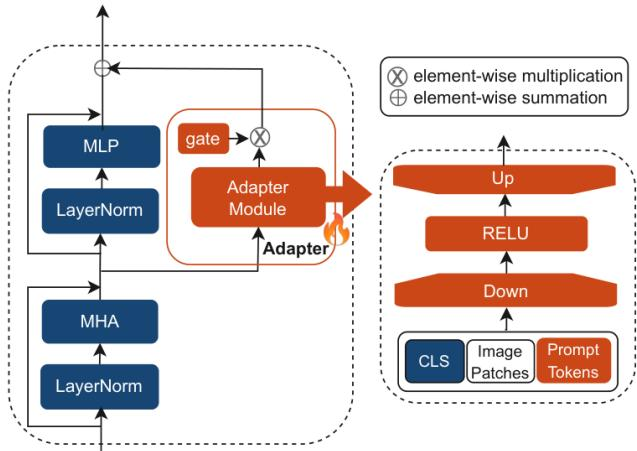  
Figure 11. Design of adapter AdaptFormer. The module applies a lower-dimensional projection, a non-linear activation, and a projection back to the original dimension.

## A.2. Dataset

We comprehensively evaluate the performance on datasets from both natural and specialized image domains. The natural image datasets include the Animal domain: CUB-200- 2011 (CUB) [40] and Stanford Dogs (Dog) [19]; the Plant domain: Oxford Flowers (Flower) [30] and Medicinal Leaf (MedLeaf) [35]; and the Object-centric domain: Stanford Cars (Car) [21] and FGVC Aircraft (Craft) [25]. The specialized image datasets include the Medical imaging domain: MRI Brain Tumors (Brain) [29] and Gallbladder Cancer Ultrasound (GBCU) [3]; the Microscopic imaging domain: Colon Cancer Whole Slide Imaging (Colon) [45]; and the Remote Sensing imagery domain: Aerial Image Dataset (AID) [43]. All datasets used in our experiments are publicly available. We provide the statistics of the natural and specialized image datasets from different domains in Table 6 and Table 7, respectively.

<table><tr><td>Dataset</td><td>CUB</td><td> $\mathrm { D o g }$ </td><td>MedLeaf</td><td>Flower</td><td>Car</td><td>Craft</td></tr><tr><td># Train Images</td><td>5,994</td><td>12,000</td><td>1,455</td><td>2,040</td><td>8144</td><td>3334</td></tr><tr><td># Test Images</td><td>5,795</td><td>8,580</td><td>380</td><td>6,149</td><td>8041</td><td>3333</td></tr><tr><td># Classes</td><td>200</td><td>120</td><td>30</td><td>102</td><td>196</td><td>100</td></tr></table>

Table 6. Characteristics of the natural image datasets for the Animal, Plant, and Object-centric domains.

<table><tr><td>Dataset</td><td>GBCU</td><td>Brain</td><td>Colon</td><td>AID</td></tr><tr><td># Train Images</td><td>1133</td><td>5712</td><td>4928</td><td>8000</td></tr><tr><td># Test Images</td><td>122</td><td>1311</td><td>1232</td><td>2000</td></tr><tr><td># Classes</td><td>3</td><td>4</td><td>8</td><td>30</td></tr></table>

Table 7. Characteristics of the specialized image datasets for the Medical, Microscopic, and Remote-Sensing Imagery domains.

## A.3. Model

We mostly followed the implementation details of PROMPT-CAM [7]. For all medical and microscopic imaging datasets, along with MedLeaf, training was conducted for 50 epochs, whereas the remaining datasets were trained for 120 epochs. We used the Stochastic Gradient Descent (SGD) optimizer with a momentum of 0.9. A weight decay of 0.0 was used for all datasets. For the medical and microscopic imaging datasets, we used a learning rate of 0.03 with a batch size of 128, whereas for the remaining datasets, we used a learning rate of 0.01 with a batch size of 16.

## B. Additional Analysis on Interpretation

## B.1. Post-hoc Visual Comparison of INTR++ with Other Methods

We compare INTR++ with post-hoc methods using images from the CUB dataset to assess visual interpretability as shown in Figure 12. INTR++ effectively identifies the key traits necessary for correct prediction. In contrast, post-hoc methods typically highlight only one or two traits and tend to rely on global features for discrimination.

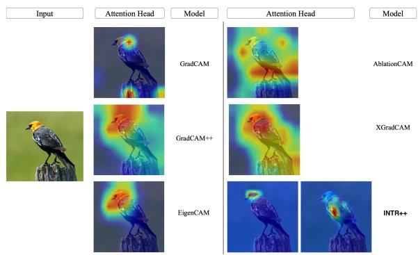  
Figure 12. Comparison of INTR++ with post-hoc methods. INTR++ shows the top two attention maps for correct prediction.

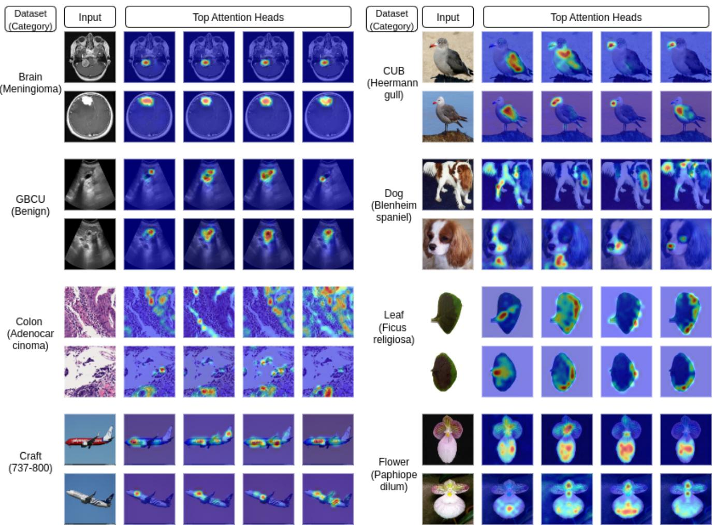  
Figure 13. Interpretation results of INTR++ across different domains. We show the top four attention maps for each input image. It highlights the model’s reliability in focusing on important traits or attributes for prediction across natural and specialized image domains.

## B.2. Performance of INTR++ Across Domains

We provide the interpretation results of INTR++ in Figure 13. We consider the Brain and GBCU datasets from the medical imaging domain; the Colon dataset from the microscopic imaging domain; the CUB and Dog datasets from the animal domain; the MedLeaf and Flower datasets from the plant domain; and the Craft dataset from the objectcentric domain for interpretation visualization and analysis. As highlighted in Figure 13, for the medical and microscopic imaging domains, the model consistently identifies important area of interest. For the animal and plant domains, INTR++ consistently highlights the discriminative traits necessary to distinguish among species. Moreover, for the object-centric domain, the model highlights the important regions for its prediction. These results demonstrate the generalization of INTR++ across both natural and specialized image domains. They further highlight its adaptability and applicability across diverse domains compared to existing interpretable methods.

## B.3. Comparison of INTR++ with Interpretable Methods for Specialized Images

We analyze the interpretability of specialized image inputs using GBCU as a representative dataset. We compare INTR++ with interpretable methods, ProtoConcepts, PIP-Net, TesNet and PROMPT-CAM. Figure 14 demonstrates the superiority of INTR++, for specialized image inputs, as it clearly identifies the relevant regions of interest, whereas the other methods focus on less relevant regions.

## B.4. Comparison of INTR++ and PROMPT-CAM on Natural Image Tasks

On natural image tasks, INTR++ and PROMPT-CAM often achieve comparable levels of interpretability. However, INTR++ consistently exhibits superior predictive performance. As illustrated in Figure 15, INTR++ produces accurate predictions while providing reliable interpretations, even in challenging cases where PROMPT-CAM fails, demonstrating the overall effectiveness of INTR++.

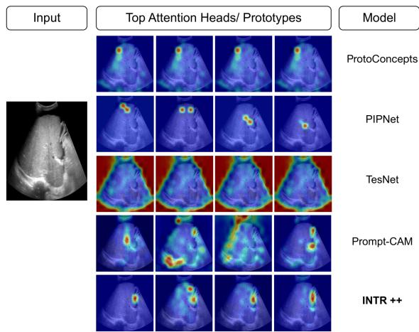  
Figure 14. Interpretation comparisons on specialized images. We compare INTR++ with other interpretable methods on the GBCU dataset for the benign category.

## B.5. Additional Comparison between INTR++ and PROMPT-CAM

We provide additional comparisons between INTR++ and PROMPT-CAM on the MedLeaf, Dog and Craft datasets. Please refer to Figure 16. These datasets belong to the natural image domain. Therefore, the interpretation results of both methods are comparable. However, the overall adaptability and performance of INTR++ make it better suited for interpretable image classification.

## B.6. Attribute Manipulation

We validate the importance of the highlighted regions in medical imaging through attribute manipulation analysis. Specifically, we select a malignant tumor image from the GBCU dataset and identify its critical region using INTR++, as shown in Figure 17. We then manually edit the image to remove the identified cancerous region and reevaluate it using the model. The modified image is subsequently classified as normal, demonstrating the precision and significance of the region identified by INTR++.

Additionally, we quantitatively analyze this study by considering a few species from the CUB dataset. We randomly selected 10 images each from the Red-winged Blackbird, Baltimore Oriole, and White-necked Raven classes and manually manipulated them to resemble American Crow, Orchard Oriole, and American Crow, respectively. The trait manipulation was performed following the guidelines from Cornell Lab1 and Birds of the World2. We passed both the original and manipulated images through INTR++, PROMPT-CAM, and PIP-Net and observed that the models correctly identified the manipulated traits with accuracies of

97.7%, 97.7%, and 90.0%, respectively. We consider a manipulated trait to be correctly detected if the model predicts the target category corresponding to the manipulated image.

## C. Additional Analysis on Performance

## C.1. Performance Comparisons

We compared INTR++ with existing interpretable methods, including ProtoConcepts, PIPNet, and TesNet, based on their predictive performance measured by classification accuracy. Table 8 demonstrates the consistent superiority of INTR++ over existing methods across diverse domains. All the results reported here are obtained using the DINO backbone.

<table><tr><td></td><td>CUB</td><td>Car</td><td>Flower</td><td>GBCU</td><td>Colon</td><td>AID</td></tr><tr><td>ProtoConcepts</td><td>68.3</td><td>78.7</td><td>85.5</td><td>41.8</td><td>78.9</td><td>95.1</td></tr><tr><td>PIPNet</td><td>78.8</td><td>84.4</td><td>88.2</td><td>79.9</td><td>81.8</td><td>95.4</td></tr><tr><td>TesNet</td><td>58.9</td><td>58.5</td><td>50.3</td><td>77.8</td><td>80.2</td><td>94.9</td></tr><tr><td>INTR++</td><td>79.0</td><td>88.1</td><td>87.2</td><td>81.2</td><td>84.4</td><td>97.7</td></tr></table>

Table 8. Accuracy comparisons. INTR++ with other interpretable models. We consider one dataset from each domain.

## C.2. Interpretability Comparisons

We compare INTR++ with existing interpretable methods, including ProtoConcepts, PIPNet, and TesNet, in terms of interpretability using the insertion and deletion metrics. Table 9 and Table 10 show the results for natural and specialized image input datasets, respectively. The results clearly demonstrate the superior interpretability of INTR++ over other interpretable methods.

<table><tr><td rowspan="2">Method</td><td colspan="2">CUB</td><td colspan="2">Flower</td><td colspan="2">Car</td></tr><tr><td>Insert.↑ Delet.↓</td><td></td><td></td><td>Insert.↑ Delet.↓</td><td>Insert.↑ Delet.↓</td><td></td></tr><tr><td>ProtoConcepts</td><td>0.11</td><td>0.76</td><td>0.36</td><td>0.61</td><td>0.48</td><td>0.15</td></tr><tr><td>PIPNet</td><td>0.59</td><td>0.10</td><td>0.76</td><td>0.29</td><td>0.79</td><td>0.12</td></tr><tr><td>TesNet</td><td>0.43</td><td>0.18</td><td>0.24</td><td>0.16</td><td>0.50</td><td>0.09</td></tr><tr><td>INTR++</td><td>0.62</td><td>0.08</td><td>0.66</td><td>0.18</td><td>0.82</td><td>0.04</td></tr></table>

Table 9. Evaluation of interpretation for natural image datasets. Comparisons among interpretable methods

<table><tr><td rowspan="2">Method</td><td colspan="2">GBCU</td><td colspan="2">Colon</td><td colspan="2">AID</td></tr><tr><td>Insert.↑ Delet.↓</td><td></td><td></td><td>Insert.↑ Delet.↓</td><td></td><td>Insert.↑ Delet.↓</td></tr><tr><td>ProtoConcepts</td><td>0.52</td><td>0.45</td><td>0.45</td><td>0.55</td><td>0.50</td><td>0.66</td></tr><tr><td>PIPNet</td><td>0.63</td><td>0.52</td><td>0.75</td><td>0.59</td><td>0.66</td><td>0.64</td></tr><tr><td>TesNet</td><td>0.58</td><td>0.55</td><td>0.75</td><td>0.43</td><td>0.65</td><td>0.66</td></tr><tr><td>INTR++</td><td>0.65</td><td>0.19</td><td>0.77</td><td>0.39</td><td>0.66</td><td>0.50</td></tr></table>

Table 10. Evaluation of interpretation for specialized image datasets. Comparisons among interpretable methods

## C.3. Interpretation of INTR++ Across Backbones

A key strength of INTR++ is its robustness across different backbone models. In this work, we primarily use the

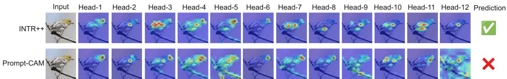  
Figure 15. INTR++ predicts correctly where PROMPT-CAM fails. We visualize all twelve attention heads for both approaches INTR++ effectively captures the key traits and yields accurate predictions, whereas PROMPT-CAM predominantly attends to redundan traits across multiple heads and includes noisy regions, resulting in incorrect predictions.

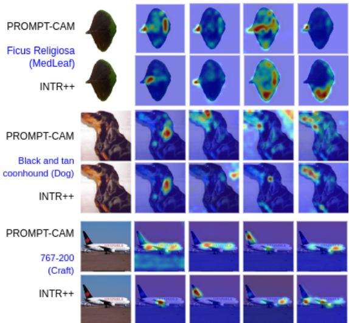  
Figure 16. Interpretation of INTR++ and PROMPT-CAM. We show comparisons on the MedLeaf, Dog and Craft datasets.

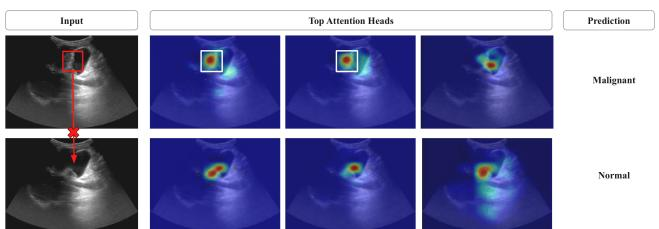  
Figure 17. Attribute manipulation. The top row shows the important cancerous region for a malignant case; deleting it leads to a normal prediction, with attention shifting elsewhere.

DINO backbone for analysis. However, we also evaluate INTR++ with other backbones, including DINOV2 [31] and BioCLIP2 [12]. Table 3 reports the classification accuracy on the CUB, Car, Flower, GBCU, Colon and AID datasets for each backbone. The observed performance improvements are primarily attributed to the backbone models being pre-trained on larger datasets, while the interpretability of INTR++ remains consistent regardless of the backbone. As shown in Figure 9, which presents interpretation results for the Heermann Gull species from the CUB dataset, INTR++ consistently identifies distinct discriminative traits irrespective of the backbone.

## D. Additional Results

## D.1. Ablation Study

We illustrate the interpretation after eliminating one component at a time from the PAM module of INTR++ in Figure 18 and Figure 19. Clearly, the results demonstrate the importance of each component, particularly the role of PCA. Overall, the complete PAM in INTR++ (last row) provides the most appropriate interpretation, as it is able to capture important regions in Figure 18 for the malignant case in the GBCU dataset and different attributes in Figure 19 for the Rose-breasted Grosbeak species in the CUB dataset.

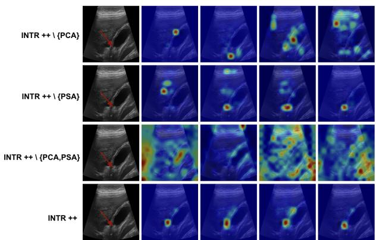  
Figure 18. Ablation study on GBCU dataset. Visual comparison demonstrating the importance of each component in the PAM of INTR++ on the specialized images input.

## D.2. Role of Gate g

Each adapter output is integrated into the backbone through a learnable gating parameter, g, which controls the fraction of the adapter information added to the original transformer output. A gate value of 0 reduces the model to Prompt-CAM, while a gate value of 1 fully incorporates the adapter output. The gate is initialized to g=1, allowing full adapter contribution during the early stages of training to facilitate effective domain alignment. As training progresses, g is learned jointly with the adapter parameters and gradually decreases, converging to a stable value. This behavior indicates that the model initially relies on stronger adaptive corrections and subsequently attenuates the adapter contribution as the representations become aligned, resulting in controlled and stable integration without overwhelming the pretrained backbone. Please refer to Figure 4 for the CUB dataset. Additionally, Figure 20 shows the gate scores over the training epochs for the GBCU dataset.

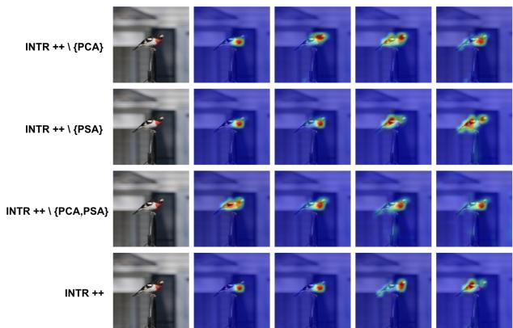  
Figure 19. Ablation study on CUB dataset. Visual comparison demonstrating the importance of each component in the PAM of INTR++ on the natural images input.

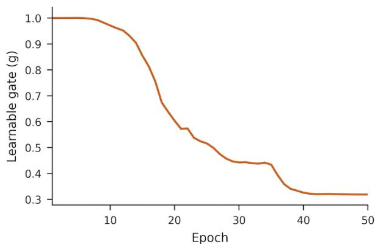  
Figure 20. Learned gate values over training epochs. The plot shows the last layer gate values of INTR++ on GBCU dataset.

## D.3. Projection Dimension of the Adaptive Module

We evaluate different low-dimensional projection sizes for the adaptive modules, as 8, 16, 32, 64, and 128. As shown in Figure 21, all methods achieve their best performance with a projection dimension of 64. Furthermore, INTR++ consistently outperforms the other methods across all projection dimensions.

## D.4. Comparisons among Different Adapters

We analyze the adaptive behavior of different adapter designs, including MLP, LoRA, AdaptFormer, and PAM (INTR++), using the cosine similarity between backboneonly and adapter-augmented representations. Across all methods, image patch tokens exhibit high similarity to the backbone representations, except for MLP, which disrupts the pretrained representations as illustrated in Figure 3. In contrast, prompt-wise analysis reveals that PAM induces larger representational shifts between the backboneonly and adapter-augmented representations. This behavior arises from the design of PAM, which explicitly aligns prompts with salient input characteristics through promptcentric interactions. LoRA and AdaptFormer, on the other hand, produce prompt representations that remain closer to the original backbone representations. As a result, PAM not only adaptively adjusts the pretrained representations but also enables the prompts to better capture input characteristics, leading to improved adaptability across both natura and specialized image domains while enhancing accuracy and interpretability. Figure 22 additionally illustrates the poor interpretability of MLP-based adapters, which capture noise and only a single attribute across different heads.

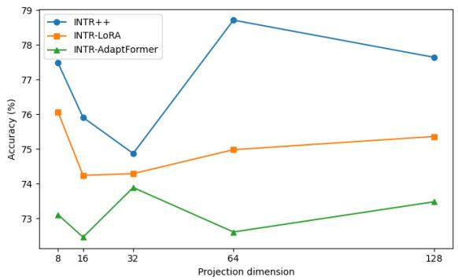  
Figure 21. Projection size comparison. Performance compari son with different projection sizes for INTR++, INTR-LoRA, and INTR-AdaptFormer for the CUB dataset.

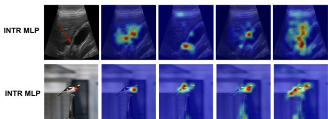  
Figure 22. Interpretation of MLP-based adapters. Top attributes for an image from the CUB and GBCU datasets.

## E. Statistical and Computational Analysis

## E.1. Statistical Analysis

To perform statistical testing, we consider CUB and GBCU datasets and run each method ten times with different random seeds. We consider INTR++ and PROMPT-CAM and

perform the Wilcoxon signed-rank $\mathrm { t e s t } ^ { 3 }$ . The results reported in Table 11 demonstrate the statistical significance of INTR++.
<table><tr><td>Dataset</td><td>INTR++</td><td> $\mathbf { P R O M P T - C A M }$ </td><td>p-value</td></tr><tr><td>CUB</td><td> $7 8 . 2 \pm 1 . 1$ </td><td> $7 4 . 3 \pm 2 . 2 1$ </td><td>0.011</td></tr><tr><td>GBCU</td><td> $8 0 . 4 \pm 1 . 2$ </td><td> $6 2 . 8 \pm 1 . 7 1$ </td><td>0.002</td></tr></table>

Table 11. Statistical analysis. Mean ± standard deviation over ten runs. p-values are from the paired Wilcoxon signed-rank test between INTR++ and Prompt-CAM on CUB and GBCU datasets.

## E.2. Computational Analysis

We compare the computational efficiency of interpretable methods, including INTR++, PROMPT-CAM, ProtoConcepts, PIPNet, and TesNet, in terms of the number of learnable parameters using DINO as the backbone. As shown in Table 12, INTR++ and PROMPT-CAM are highly parameter-efficient. INTR++ requires less than 3% of the learnable parameters of existing methods. PROMPT-CAM requires slightly less learnable parameters than INTR++; however, this marginal parameter overhead is small relative to the performance gains achieved by INTR++ across natural and specialized image domains.

<table><tr><td>ProtoConcepts PIPNet</td><td></td><td>TesNet PROMPT-CAM</td><td>INTR++</td></tr><tr><td>≈ 85-86</td><td>≈ 86-87 ≈ 86-87</td><td></td><td>≈ 0.1-1.0 ≈ 1.2–3.4</td></tr></table>

Table 12. Number of learnable parameters (in millions). Comparison of interpretable methods in terms of parameter efficiency using DINO as the backbone. Values indicate the approximate range across all datasets.