# KNOW, THEN DRAW: A NEW LEARNING PARADIGM FOR VISUAL GENERATION

Yucheng Mao1,2, Chongjian Ge2, Zhuowen Tu1, Hao Tan2, Hanwen Jiang2 1University of California, San Diego 2Adobe Research

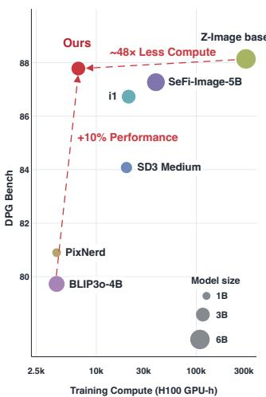

  
Figure 1: Strong visual generation with compute-efficient training. Left: DPG-Bench versus training compute; marker size denotes model size. Our 3B model achieves competitive performance with only 6,600 H100 GPU-hours (48× less than Z-Image-Base). Right: Text-to-Image generated samples.

## ABSTRACT

Visual generation requires both high-level semantic knowledge and fine-grained pixel details. We propose a learning paradigm that assigns these roles to autoregressive pretraining for knowledge acquisition and diffusion post-training for high-fidelity rendering. Within this framework, we study the objective, representation, and scaling of knowledge acquisition and rendering. Controlled comparisons identify autoregression as the stronger pretraining objective for downstream rendering, improving both learning efficiency and final generation quality. We further find that AR-only generation quality does not necessarily correlate with final performance; semantic quality matters more. This motivates a purely semantic tokenizer trained with language supervision alone, without an image decoder or reconstruction loss. We establish compute-optimal scaling laws for knowledge acquisition and rendering, and find that autoregressive pretraining lowers the fitted asymptotic rendering loss compared with pixel diffusion models trained from scratch. Guided by the laws, we train a 3B-parameter text-to-image model with only 6,600 H100 GPU-hours, achieving 86 on GenEval and 87 on DPG-Bench and validating the proposed paradigm at scale.

## 1 INTRODUCTION

Visual generation has advanced primarily through two modeling paradigms: autoregressive models predict discrete visual tokens (Sun et al., 2024; Tian et al., 2024; Pang et al., 2024), while latent diffusion models (LDMs) and pixel diffusion models (PDMs) denoise continuous signals (Ho et al., 2020; Rombach et al., 2022; Peebles & Xie, 2023). They are typically compared as competing paradigms, asking which produces better images. Yet this comparison asks each paradigm to solve two distinct learning problems: acquiring high-level visual knowledge and rendering it into detailed images. We therefore argue that these problems need not favor the same objective, and look beyond their competition to uncover the synergy between autoregression and diffusion.

We find that the two problems indeed favor different objectives: autoregression for visual knowledge acquisition and diffusion for rendering. This specialization gives rise to a natural pretraining–post-training paradigm, where autoregressive pretraining provides the foundation on which diffusion is post-trained for rendering. This mirrors modern language models, where broad knowledge is first acquired and subsequently adapted toward desired behaviors. At inference, the autoregressive rollout provides a structured visual representation that conditions diffusion, connecting the two learning processes. Across the evaluated protocols and compute budgets, this specialization consistently yields stronger generators, revealing the synergy between the two objectives.

Specializing autoregression for knowledge acquisition changes what it should learn. In visual autoregressive models, the tokenizer defines the prediction target and therefore shapes the information the model is incentivized to capture. Conventional tokenizers preserve low-level appearance for image reconstruction. Once rendering is delegated to diffusion, however, the autoregressive representation no longer needs to support reconstruction or standalone image generation. Across different tokenizers, we find a striking dissociation: neither reconstruction quality nor AR-only generation quality determines post-training generation performance; semantic quality does. This motivates Semantic-LM, a semantic tokenizer trained through language supervision alone, without an image decoder or reconstruction loss. Visual tokenization thus shifts from preserving pixels for reconstruction to providing semantic learning targets for autoregressive knowledge acquisition.

Separating knowledge acquisition from rendering introduces a new question for scaling visual generation: how should compute be allocated between the two stages? We establish scaling laws for autoregressive pretraining and diffusion post-training that characterize the effects of model size, data, and compute and guide compute-optimal allocation. These laws also reveal a broader benefit of autoregressive pretraining. At matched model and data scales, diffusion post-training achieves both lower loss and a lower fitted asymptotic rendering loss than PDM trained from scratch. This finding suggests that autoregressive pretraining improves the attainable performance of diffusion rendering beyond accelerating convergence speed.

Given an available training budget of approximately 6,600 H100 GPU-hours, we use our scaling laws to select a roughly 3B-parameter model and allocate compute between pretraining and posttraining. The resulting model achieves strong text-to-image generation (Fig. 1), reaching 0.86 on GenEval (Ghosh et al., 2023) and 87.78 on DPG-Bench (Hu et al., 2024). This performance is achieved with approximately 1/48 of the estimated training compute of Z-Image-Base (Z-Image Team et al., 2025), while attaining comparable DPG-Bench performance.

## 2 METHOD

As shown in Fig. 2, our framework assigns visual knowledge acquisition and rendering to distinct learning objectives. During pretraining, a frozen visual tokenizer converts images into discrete to kens, which a text-conditioned autoregressive (AR) model learns to predict. We then freeze the AR backbone and add trainable pixel-diffusion modules that reuse its attention projections and representations for rendering. During post-training, the renderer conditions on tokens from ground-truth images; at inference, these are replaced by tokens generated autoregressively from the text prompt.

## 2.1 AUTOREGRESSIVE PRETRAINING FOR KNOWLEDGE ACQUISITION

Autoregressive objective. Given an image and its caption, a frozen visual tokenizer maps the image to discrete tokens $\mathbf { v } = ( v _ { 1 } , \dots , v _ { L } )$ , while a frozen text encoder produces conditioning features c. Following RandAR (Pang et al., 2024), we sample a permutation π over spatial positions and use position-instruction tokens o to specify each prediction location. We train the AR model with

$$
\mathcal { L } _ { \mathrm { A R } } ( \theta ) = - \sum _ { i = 1 } ^ { L } \log p _ { \theta } \left( v _ { \pi ( i ) } \mid v _ { \pi ( < i ) } , \mathbf { o } , \mathbf { c } \right) ,\tag{1}
$$

averaged over images and sampled permutations, where $v _ { \pi ( < i ) }$ denotes preceding tokens in the sampled order. Only the AR parameters θ are optimized. By defining the prediction targets, the tokenizer determines what information the model is trained to capture.

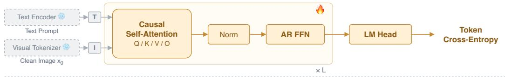  
Diffusion Post-Training

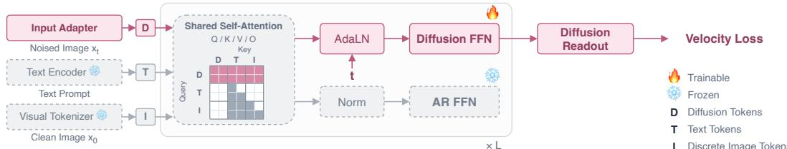  
Figure 2: Overview of our learning paradigm. Autoregressive pretraining acquires visual knowledge through discrete token prediction. The pretrained backbone is then frozen and augmented with diffusion modules that reuse its attention and representations to render high-fidelity images. This division of labor specializes autoregression for knowledge acquisition and diffusion for rendering.

Visual tokenizers. The visual tokenizer defines the prediction targets for AR pretraining and thus shapes the information the model learns. To examine which targets best support visual knowledge acquisition, we compare three tokenizers with different visual representations and training supervision (Fig. 3), including Recon, Semantic-Recon, and Semantic-LM.

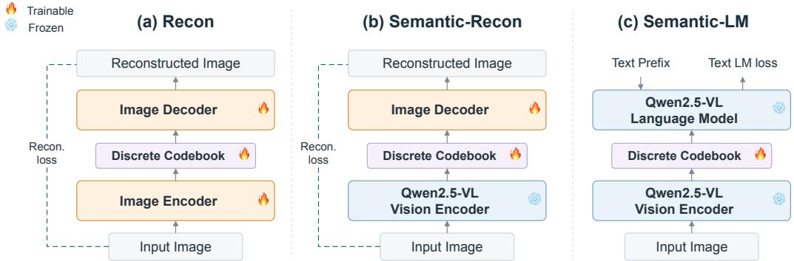  
Figure 3: Training the three visual tokenizers. Recon and Semantic-Recon use image reconstruction super-❄️vision, whereas Semantic-LM learns its codebook through language modeling.

• Recon. We use the pretrained reconstruction-based Emu3.5 tokenizer (Cui et al., 2025), which consists of an image encoder, an IBQ codebook (Shi et al., 2025a), and an image decoder.

• Semantic-Recon. We quantize features of a frozen Qwen2.5-VL vision encoder (Bai et al., 2025) using an IBQ codebook. We train the codebook and a decoder with reconstruction supervision.

• Semantic-LM. We use the same semantic visual representation but train the IBQ codebook through next-token prediction within a frozen Qwen2.5-VL model. This variant requires neither an image decoder nor a reconstruction loss.

These variants let us examine two design choices. Comparing Recon with Semantic-Recon evaluates the benefit of using semantic representations for AR pretraining. Comparing Semantic-Recon with Semantic-LM tests whether reconstruction supervision is necessary for learning effective semantic tokens. All tokenizers remain frozen during generator training and are evaluated using the same protocol. We provide the tokenizer training details in Appendix A.1.

## ️2.2 PIXEL-DIFFUSION POST-TRAINING FOR RENDERING

To render the representations learned during AR pretraining, we freeze the backbone parameters θ and introduce trainable pixel-diffusion modules ϕ. The renderer reuses the backbone’s frozen attention projections. Its trainable modules ϕ comprise an input projection for noisy image patches, timestep embeddings, diffusion-specific feed-forward and adaptive-normalization layers (Peebles & Xie, 2023), and a linear pixel readout. Only ϕ is optimized during post-training.

We train the renderer using pixel-space flow matching. Given a clean image $x _ { 0 }$ and noise ϵ, we construct $x _ { t } = ( 1 - t ) x _ { 0 } + t \epsilon$ . The renderer receives $x _ { t } ,$ , timestep t, text features c, and representations of visual tokens v produced by the frozen AR backbone. The renderer predicts the clean image $\widehat { x } _ { 0 }$ which we convert to a velocity prediction $f _ { \phi }$ using a numerically stabilized transformation. We train the renderer by minimizing the mean squared error between the predicted and target velocities:

$$
\begin{array} { r } { \mathcal { L } _ { \mathrm { D i f f } } ( \phi ) = \mathbb { E } _ { ( x _ { 0 } , \mathbf { v } , \mathbf { c } ) , \epsilon , t } \left[ \left\| f _ { \phi } ( x _ { t } , t , \mathbf { v } , \mathbf { c } ; \theta ) - v _ { \mathrm { t a r g e t } } ( x _ { t } , x _ { 0 } , t ) \right\| _ { 2 } ^ { 2 } \right] . } \end{array}\tag{2}
$$

The loss is computed in velocity space, while the network directly predicts $\widehat { x } _ { 0 }$ . We sample timesteps from a logit-normal distribution with a resolution-dependent shift (Esser et al., 2024). Appendix A.2 details the conversion from image predictions to velocities and the optimization settings.

The source of the conditioning tokens differs between post-training and inference. During posttraining, we extract tokens directly from the ground-truth image $x _ { 0 }$ , so the visual condition corresponds to the image used to construct $x _ { t } .$ At inference, the AR model generates visual tokens from the text prompt, and these tokens condition the renderer.

## 2.3 SCALING METHODOLOGY

Separating knowledge acquisition from rendering introduces a resource allocation problem: given a fixed compute budget, how much should be assigned to each stage, and how should each stage balance model size and training data? We address these questions by fitting scaling laws for autoregressive pretraining and diffusion post-training. We also fit scaling law for a pixel-diffusion baseline trained from scratch to examine the benefits of autoregressive pretraining.

Fitting objective-specific scaling laws. For each objective, we train a family of models across widths and depths and fit

$$
\widehat { \mathcal { L } } ( N , D ) = E + A \left( \frac { N } { N _ { 0 } } \right) ^ { - \alpha } + B \left( \frac { D } { D _ { 0 } } \right) ^ { - \beta } ,\tag{3}
$$

where N is the number of trainable parameters, D is the cumulative training-token count, and E estimates the asymptotic loss under the fitted model. We fit autoregressive cross-entropy and diffusion velocity-MSE separately, using $C = 6 N D$ as a compute proxy. For diffusion post-training, this proxy excludes the frozen AR forward pass (Appendix A.8). We cross-check the parametric fits using training-curve envelopes and IsoFLOP analyses.

To reduce optimization-related confounds, we tune training recipes that transfer across model sizes within each family. We also conduct an independent hyperparameter search for the from-scratch diffusion baseline. Appendices A.3 and A.6 describe hyperparameter transfer. Appendices A.4 and A.5 provide compute accounting and the full scaling protocols.

Optimizing the learning paradigm through compute allocation. Within our two-stage framework, compute allocation determines the relative emphasis on knowledge acquisition and rendering. We parameterize this allocation by $r = C _ { \mathrm { p o s t } } / ( C _ { \mathrm { p r e } } ^ { \bullet } + C _ { \mathrm { p o s t } } )$ , so that different values of r define different learning paradigm. To derive a scaling-guided allocation, we first minimize each stage’s fitted loss under the compute constraint $C = \hat { 6 } \hat { N } D$ . For each paired AR backbone and diffusion renderer, we then determine the data budget required to place each stage at its compute-optimal operating point. The resulting compute costs specify the allocation r, which we examine across total budgets. This procedure translates the stage-specific scaling laws into a concrete training strategy without directly combining autoregressive and diffusion losses. We additionally compare the fitted asymptotic losses of diffusion post-training and pixel diffusion trained from scratch to assess potential benefits beyond faster convergence. Sec. 3.3 presents the results.

## 3 EXPERIMENTS

Our experiments address three questions. First, does autoregressive pretraining lead to better image generation than diffusion-based training under comparable model sizes and image exposure? (Sec. 3.1) Second, should the visual tokens used for pretraining preserve image details or focus on

Tab. 1: Comparison between different learning paradigms under a matched data budget. Final-generator scores as percentages (↑); GenEval Overall is the mean of the six category scores.
<table><tr><td rowspan="2">Method</td><td colspan="7">GenEval ↑</td><td rowspan="2">DPG ↑</td></tr><tr><td>Overall</td><td>Single Obj.</td><td>Two Obj.</td><td>Counting</td><td>Colors</td><td>Position</td><td>Color Attri.</td></tr><tr><td>PDM</td><td>61.16</td><td>97.50</td><td>47.47</td><td>33.75</td><td>87.23</td><td>50.00</td><td>51.00</td><td>62.56</td></tr><tr><td>LDM</td><td>57.34</td><td>97.50</td><td>55.56</td><td>27.50</td><td>74.47</td><td>38.00</td><td>51.00</td><td>64.33</td></tr><tr><td>LDM → PDM</td><td>56.61</td><td>90.00</td><td>60.61</td><td>32.50</td><td>75.53</td><td>39.00</td><td>42.00</td><td>60.01</td></tr><tr><td>AR → PDM (ours)</td><td>65.51</td><td>97.50</td><td>66.67</td><td>40.00</td><td>81.91</td><td>51.00</td><td>56.00</td><td>71.11</td></tr></table>

Tab. 2: Semantic quality, rather than reconstruction or AR-only generation quality, determines final generation performance. Recon performs best in reconstruction and AR-only generation, yet produces the weakest final generator; Sem-LM remains strong downstream despite having no reconstruction supervision or image decoder. ∆ denotes the change after diffusion post-training.
<table><tr><td colspan="3">Tokenizer Properties</td><td colspan="2">AR-only Generation</td><td colspan="4">Post-train Diffusion Generation</td></tr><tr><td>Tokenizer</td><td>Supervision</td><td>rFID↓</td><td>GenEval↑</td><td>DPG↑</td><td>GenEval↑</td><td>∆ GenEval</td><td>DPG↑</td><td>∆ DPG</td></tr><tr><td>Recon</td><td>Recon</td><td>1.04</td><td>57.49</td><td>65.94</td><td>54.67</td><td>-2.82</td><td>62.98</td><td>-3.04</td></tr><tr><td>Sem-Recon</td><td>Recon</td><td>40.5</td><td>50.44</td><td>67.03</td><td>65.51</td><td>+15.07</td><td>71.11</td><td>+4.08</td></tr><tr><td>Sem-LM</td><td>LM</td><td>∞</td><td>0.00</td><td>0.00</td><td>64.84</td><td>+64.84</td><td>67.72</td><td>+67.72</td></tr></table>

semantic information? (Sec. 3.2) Third, how should model size, training data, and compute be allocated between knowledge acquisition and rendering? (Sec. 3.3) We then use these findings to guide the training of a larger text-to-image model and evaluate its generation quality (Sec. 3.4).

## 3.1 AUTOREGRESSION OR DIFFUSION FOR VISUAL KNOWLEDGE ACQUISITION?

We assess visual knowledge acquisition through the quality of image generation after pixel-diffusion post-training. We compare latent diffusion and autoregression as pretraining objectives, followed by the same rendering architecture and post-training protocol. We denote these two-stage routes as LDM−→PDM and AR−→PDM. We also include pixel diffusion and latent diffusion as baselines.

Training and Evaluation Setup. All four routes use approximately 400M parameters in the final generator and the same cumulative number of training image samples. Both two-stage routes combine a 250M-parameter pretrained backbone with 150M trainable rendering parameters. They also use semantic visual representations: AR uses our semantic tokenizer, while LDM pretraining uses SVG Autoencoder-P, a semantic tokenizer built on DINOv3 (Shi et al., 2025b; Simeoni et al., 2025).´ The former produces discrete tokens, whereas the latter produces continuous representations. The direct LDM baseline uses the reconstruction-based FLUX.2 autoencoder (Black Forest Labs, 2025). We evaluate generation quality on GenEval (Ghosh et al., 2023) and DPG-Bench (Hu et al., 2024). Tab. 4 and Appendix A.2 provide the full training and evaluation protocols.

Results. Autoregressive pretraining yields better generation quality after diffusion post-training than the evaluated LDM-pretraining pipeline. AR−→PDM reaches 64.8 on GenEval after 100k posttraining updates, exceeding the score of PDM trained for 400k iterations (61.2). With further posttraining, it reaches 65.5 on GenEval and 71.1 on DPG-Bench (Tab. 1). In contrast, direct LDM reaches 57.3 on GenEval, while LDM−→PDM achieves 56.6. These results indicate that splitting training into two stages alone is insufficient for generation. Under the evaluated settings, autoregression provides a more effective pretraining objective for subsequent pixel-diffusion rendering.

## 3.2 WHAT SHOULD AUTOREGRESSIVE PRETRAINING PREDICT?

The preceding experiments support autoregression as an effective pretraining objective for subsequent diffusion rendering. We next ask what information the AR model should learn. Since the tokenizer defines its prediction targets, we compare three tokenizers: Recon, Semantic-Recon, and Semantic-LM (Sec. 2.1). These variants allow us to examine whether effective targets need to preserve image details for reconstruction or can focus on semantic information. We keep generator training settings fixed and evaluate final image generation quality after the same pixel-diffusion post-training protocol. Appendix A.1 provides the tokenizer training details.

(a) Text Rendering  
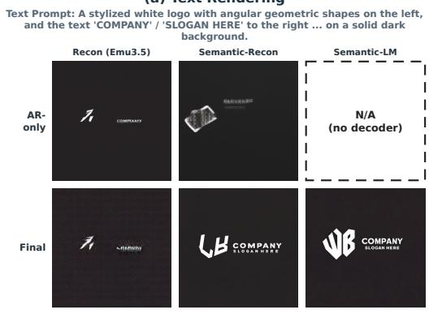

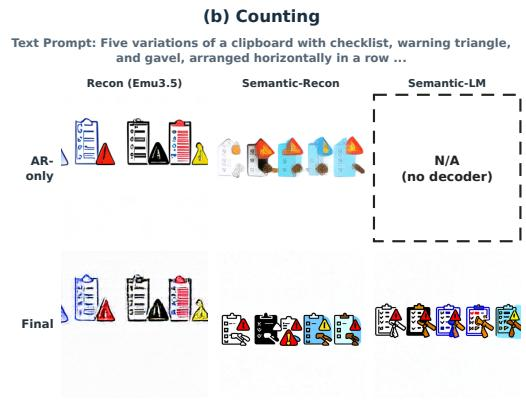

(c) Text Rendering  
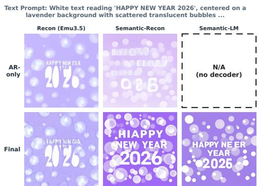

(d) Human Portrait  
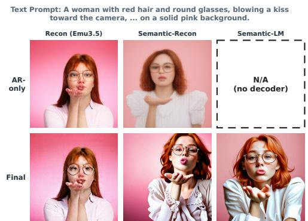  
Figure 4: AR-only generation quality does not predict final generation quality. Top: AR-only decodes; bottom: final images after diffusion post-training. The semantic tokenizers produce stronger final images despite weaker or unavailable AR-only decodes. Semantic-LM has no decoder.

Better reconstruction does not necessarily improve final generation. Recon achieves substantially better reconstruction quality than Semantic-Recon, yet yields lower final generation scores: 54.7 versus 65.5 on GenEval and 63.0 versus 71.1 on DPG-Bench (Tab. 2). Moreover, Semantic-LM requires no reconstruction supervision, yet achieves 64.8 on GenEval and 67.7 on DPG-Bench after post-training. Results indicates effective AR targets need not support reconstruction.

Better AR-only generation does not necessarily improve final generation. A similar pattern appears when comparing AR-only generation quality. Recon achieves a higher AR-only GenEval score than Semantic-Recon (57.49 versus 50.44), but this ranking reverses after diffusion posttraining (54.67 versus 65.51), while DPG-Bench shows the same trend. Fig. 4 illustrates this contrast qualitatively. Although Semantic-LM has no image decoder and cannot generate images on its generated tokens, but still support effective diffusion rendering.

Semantic representations provide effective pretraining targets. Together, these results show that neither reconstruction quality nor AR-only generation quality reliably predicts final generation quality across the evaluated tokenizers. The largest improvement comes from replacing reconstructionoriented tokens with pretrained semantic representations. Removing reconstruction supervision retains much of this benefit. When diffusion handles rendering, AR pretraining can therefore focus on learning semantic information without requiring its prediction targets to support image generation.

## 3.3 SCALING KNOWLEDGE ACQUISITION AND RENDERING

The preceding experiments support autoregressive pretraining for knowledge acquisition and semantic tokens as effective prediction targets. We now ask how pretraining and rendering should scale as more compute becomes available. We fit scaling laws for both stages to study how model size and training data affect performance. We then compare diffusion post-training with training from scratch and use the fitted laws to guide compute allocation between the two stages.

(a) Pretraining scaling law  
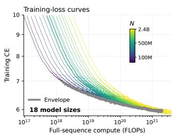

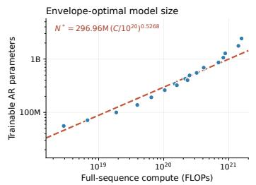  
(b) Post-training scaling law

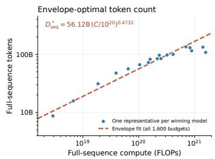

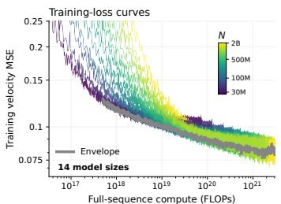

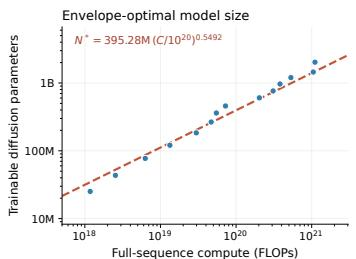

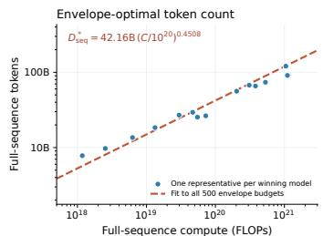  
Figure 5: Scaling laws for Pretraining and Post-training. (a) AR pretraining; (b) pixel-diffusion posttraining. Left: training loss versus full-sequence compute on logarithmic axes, with the lower envelope high lighted in gray; color bars indicate model size. Middle and right: envelope-optimal model and token allocations. Fitting protocols are given in Appendix A.4 and Appendix A.5.

Different Scaling Behavior for Knowledge Acquisition and Rendering. We fit the autoregressive pretraining law using 18 models spanning 55.71M–2.43B trainable parameters (Fig. 5 (a)):

$$
\widehat { \mathcal { L } } _ { \mathrm { p r e } } ( N , D _ { \mathrm { s e q } } ) = 5 . 7 2 + 0 . 3 2 \left( \frac { N } { 1 0 ^ { 8 } } \right) ^ { - 0 . 4 7 } + 1 . 7 3 \left( \frac { D _ { \mathrm { s e q } } } { 1 0 ^ { 9 } } \right) ^ { - 0 . 4 4 } .\tag{4}
$$

The training-curve envelope, IsoFLOP, and parametric estimates yield $N _ { \mathrm { o p t } } ~ \propto ~ C ^ { 0 . 4 7 - 0 . 5 3 }$ and $D _ { \mathrm { o p t } } \propto C ^ { 0 . 4 7 - 0 . 5 3 }$ . These estimates suggest that model size and training data should grow at approximately the same rate as the pretraining budget increases.

We fit the post-training law to 14 models spanning 25.1M–2.03B trainable parameters:

$$
\widehat { \mathcal { L } } _ { \mathrm { p o s t } } ( N , D _ { \mathrm { s e q } } ) = 0 . 0 7 0 + 0 . 0 2 2 \left( \frac { N } { 1 0 ^ { 8 } } \right) ^ { - 0 . 2 5 } + 0 . 0 1 3 \left( \frac { D _ { \mathrm { s e q } } } { 1 0 ^ { 1 0 } } \right) ^ { - 0 . 6 0 } .\tag{5}
$$

The parametric fit favors increasing model size more rapidly than training data. Across the three estimation methods, however, the scaling exponents vary: $N _ { \mathrm { o p t } } ^ { \bullet } \propto C ^ { 0 . 4 5 - 0 . 7 0 }$ and $D _ { \mathrm { o p t } } \propto C ^ { 0 . 3 0 - 0 . 5 5 }$ Each renderer is paired with a correspondingly scaled frozen AR backbone, so this law describes rendering performance within the paired model family, rather than diffusion capacity alone.

These results suggest that pretraining and rendering can benefit from different balances between model size and training data. We therefore optimize the two stages separately before deriving their compute allocation. Appendix A.4 and Appendix A.5 provide the full fitting protocols and results.

Autoregressive Pretraining Lowers the Fitted Rendering Loss Floor. We next examine whether the pretrained rendering pipeline offers benefits beyond faster convergence. We compare the fitted asymptotic losses of diffusion post-training and pixel diffusion trained from scratch under their respective conditioning protocols. Post-training yields $E _ { \mathrm { p o s t } } \approx 0 . 0 7 0$ in velocity-MSE (Eq. 5). For independently tuned pixel diffusion trained from scratch, we obtain

$$
\widehat { \mathcal { L } } _ { \mathrm { s c r a t c h } } ( N , D _ { \mathrm { s e q } } ) = 0 . 0 7 8 8 + 0 . 0 1 3 3 \left( \frac { N } { 1 0 ^ { 8 } } \right) ^ { - 0 . 3 4 5 0 } + 0 . 0 0 7 9 \left( \frac { D _ { \mathrm { s e q } } } { 1 0 ^ { 1 0 } } \right) ^ { - 0 . 8 6 2 7 } ,\tag{6}
$$

with $E _ { \mathrm { s c r a t c h } } \approx 0 . 0 7 8 8$ . This fit uses eight models with 23.83M–1.76B parameters. Appendix A.7 reports the allocation estimates from all three methods.

The lower fitted asymptote suggests that the AR-then-diffusion pipeline’s advantage may extend beyond faster convergence, with a lower estimated loss as model size and training data increase. This comparison evaluates the pipeline as a whole, including both pretrained weights and conditioning tokens extracted from the target image, and does not isolate their individual contributions. The asymptotic term E summarizes this extrapolated trend under the fitted scaling model.

Tab. 3: Text-to-image generation on GenEval and DPG-Bench. Model size is in billions of parameters (B), as reported for each system; component accounting may differ. Dash denotes unavailable results. We use LLM to rewrite prompt in order to match the training distribution.
<table><tr><td></td><td colspan="6">GenEval</td><td colspan="2"></td><td>DPG</td></tr><tr><td>Model</td><td>Size (B)</td><td></td><td>Single Two</td><td>Count</td><td>Colors</td><td>Pos.</td><td>C-attr.</td><td>Overall↑</td><td>Overall1</td></tr><tr><td>PixArt-α (Chen et al., 2023)</td><td>0.6</td><td>0.98</td><td>0.50</td><td>0.44</td><td>0.80</td><td>0.08</td><td>0.07</td><td>0.48</td><td>71.11</td></tr><tr><td>SDXL (Podell et al., 2023)</td><td>2.6</td><td>0.98</td><td>0.74</td><td>0.39</td><td>0.85</td><td>0.15</td><td>0.23</td><td>0.55</td><td>74.65</td></tr><tr><td>DALL-E 3 (Betker et al., 2023)</td><td></td><td>0.96</td><td>0.87</td><td>0.47</td><td>0.83</td><td>0.43</td><td>0.45</td><td>0.67</td><td>83.50</td></tr><tr><td>PixNerd-XXL/16 (Wang et al., 2026)</td><td>1.2</td><td>0.97</td><td>0.86</td><td>0.44</td><td>0.83</td><td>0.71</td><td>0.53</td><td>0.73</td><td>80.90</td></tr><tr><td>SD3-Medium (Esser et al., 2024)</td><td>2.0</td><td>0.99</td><td>0.94</td><td>0.72</td><td>0.89</td><td>0.33</td><td>0.60</td><td>0.74</td><td>84.08</td></tr><tr><td>BLIP3o-4B (Chen et al., 2025c)</td><td>4.0</td><td></td><td></td><td></td><td></td><td></td><td></td><td>0.77</td><td>79.73</td></tr><tr><td>FLUX.1-dev (Black Forest Labs, 2024)</td><td>12</td><td>0.98</td><td>0.93</td><td>0.75</td><td>0.93</td><td>0.68</td><td>0.65</td><td>0.82</td><td>84.00</td></tr><tr><td>HiDream-I1-Full (Cai et al., 2025)</td><td>17</td><td>1.00</td><td>0.98</td><td>0.79</td><td>0.91</td><td>0.60</td><td>0.72</td><td>0.83</td><td>85.89</td></tr><tr><td>Seedream 3.0 (Gao et al., 2025)</td><td></td><td>0.99</td><td>0.96</td><td>0.91</td><td>0.93</td><td>0.47</td><td>0.80</td><td>0.84</td><td>88.27</td></tr><tr><td>i1 (Zeng et al., 2026)</td><td>3.0</td><td>1</td><td></td><td></td><td></td><td></td><td></td><td>0.84</td><td>86.73</td></tr><tr><td>Z-Image-Turbo (Z-Image Team et al., 2025)</td><td>6.0</td><td>1.00 0.99</td><td>0.95</td><td>0.77</td><td>0.89</td><td>0.65</td><td>0.68</td><td>0.82</td><td>84.86</td></tr><tr><td>Qwen-Image (Wu et al., 2025)</td><td>20</td><td></td><td>0.92</td><td>0.89</td><td>0.88</td><td>0.76</td><td>0.77</td><td>0.87</td><td>88.32</td></tr><tr><td>BLIP3o-NEXT SFT (Chen et al., 2025d)</td><td>3.0</td><td>一 1.00</td><td>0.92</td><td></td><td></td><td></td><td></td><td>0.87</td><td>81.98</td></tr><tr><td>SeFi-Image-5B (SeFi Team, 2026)</td><td>5.0</td><td></td><td></td><td>0.87</td><td>0.90</td><td>0.84</td><td>0.76</td><td>0.88</td><td>87.27</td></tr><tr><td>Ours</td><td>~3</td><td>1.00</td><td>0.82</td><td>0.75</td><td>0.99</td><td>0.79</td><td>0.81</td><td>0.86</td><td>87.78</td></tr></table>

Allocating Compute Between Knowledge Acquisition and Rendering. We use the fitted laws to derive a compute allocation for the two-stage framework. For total compute C, let $C = C _ { \mathrm { p r e } } +$ $\begin{array} { r } { C _ { \mathrm { p o s t } } , r = \frac { C _ { \mathrm { p o s t } } } { C } } \end{array}$ . where r is the fraction of total compute assigned to post-training. Different values of r place different emphasis on knowledge acquisition and rendering.

Autoregressive cross-entropy and diffusion velocity-MSE measure different prediction tasks, so we do not combine them into a single loss. Instead, for each paired AR backbone and renderer, we use the fitted laws to determine each stage’s compute-optimal data budget. The corresponding compute costs then specify the allocation $( C _ { \mathrm { p r e } } ^ { - } , C _ { \mathrm { p o s t } } )$

The induced allocation is nearly scale-invariant. Under our primary full-sequence accounting, $C _ { \mathrm { p r e } } : C _ { \mathrm { p o s t } } \approx 3 { : } 2 ( r \approx \bar { 0 . 4 } 0 ;$ Fig. 6). This assigns approximately 60% of the training budget to knowledge acquisition and 40% to rendering. Appendix A.8 provides the accounting details.

Scaling recipe for the final model. We translate this allocation into a training recipe for the final model. Given a total budget C, we assign $C _ { \mathrm { p r e } } = ( 1 - r ) C$ to autoregressive pretraining. The pretraining law then determines the computeoptimal backbone size $N _ { \mathrm { A R } }$ and data budget $D _ { \mathrm { p r e } }$ . Within our paired model family, the backbone size also specifies the ren-

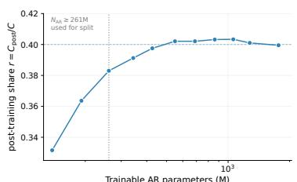  
Figure 6: Compute-optimal posttraining share r against model size.

derer size. We then use the post-training law to determine its compute-optimal data budget $D _ { \mathrm { p o s t } }$ This procedure provides the model configuration and training budgets used for the larger-scale evaluation in the next section.

## 3.4 VALIDATING THE LEARNING PARADIGM AT SCALE

Finally, we evaluate whether the training recipe developed through our controlled experiments and scaling analysis remains effective at larger scale. Guided by the scaling laws in Sec. 3.3, we train a roughly 3B-parameter text-to-image generator using approximately 6,600 H100 GPU-hours. We evaluate compositional accuracy and text–image alignment on GenEval and DPG-Bench, with results reported in Tab. 3. Category-level scores for HiDream-I1-Full, PixNerd, and SeFi-Image-5B are taken from their original reports (Cai et al., 2025; Wang et al., 2026; SeFi Team, 2026). Fo

BLIP3o-4B, BLIP3o-NEXT SFT, and i1, we use the aggregate scores reported by Zeng et al. (2026), as category-level scores are unavailable under that evaluation.

Our model achieves 0.86 on GenEval and 87.78 on DPG-Bench using the evaluation protocol in Appendix A.9, which includes prompt rewriting and selection over fixed evaluation seeds. Among the baselines in Tab. 3, only Qwen-Image and Seedream 3.0 report higher DPG-Bench scores. Our GenEval score is also close to those of Qwen-Image and BLIP3o-NEXT SFT (both 0.87) and SeFi-Image-5B (0.88). These results support the practical effectiveness of our training recipe at larger scale. Comparisons across systems remain approximate because text encoders, training data, and evaluation settings differ. The results demonstrate competitive generation quality within the stated training budget, without establishing that the compute allocation is optimal.

## 4 RELATED WORK

Diffusion-based visual generation. Diffusion models have evolved from pixel-space denoising (Ho et al., 2020) to latent diffusion (Rombach et al., 2022), transformer backbones (Peebles & Xie, 2023), and flow-based objectives (Lipman et al., 2023; Liu et al., 2023; Esser et al., 2024), underpinning modern text-to-image systems (Black Forest Labs, 2024; 2025; Z-Image Team et al., 2025; Cai et al., 2025). Recent work shows that representation quality matters beyond reconstruction fidelity (Skorokhodov et al., 2025; Yao et al., 2025), motivating semantically enriched tokenizers and diffusion representations (Chen et al., 2025b;a; Zheng et al., 2025b; Tong et al., 2026; Yu et al., 2024; Leng et al., 2025; Singh et al., 2025; SeFi Team, 2026). These approaches make diffusion representations more semantic, but semantic learning remains coupled to reconstruction or diffusion itself. We instead separate knowledge acquisition from rendering: autoregressive pretraining learns the semantic representation consumed by the renderer, while diffusion is specialized for rendering it into pixels. This separation further enables Semantic-LM, trained purely through language supervision without an image decoder or reconstruction loss.

Autoregressive visual generation. Autoregressive image models predict learned visual tokens (Van Den Oord et al., 2017; Esser et al., 2021; Yu et al., 2023; Shi et al., 2025a; Zhao et al., 2025; 2026) using raster, next-scale, or randomized prediction (Sun et al., 2024; Tian et al., 2024; Pang et al., 2024). Tokenizer design is central to this paradigm (Yu et al., 2023), with recent work incorporating foundation-model representations or semantic supervision (Zheng et al., 2025a; Ma et al., 2025). In these approaches, autoregression remains part of image generation, so its representation must support visual synthesis. We instead specialize autoregression for knowledge acquisition and delegate rendering to diffusion, freeing its prediction targets from reconstruction or AR-only generation.

Combining autoregression and diffusion. Several works combine autoregressive and diffusion modeling within a single generative framework. MAR (Li et al., 2024) uses diffusion as the conditional distribution within continuous-token autoregression, while Transfusion (Zhou et al., 2024) applies autoregressive and diffusion objectives to different modalities in a shared model. More closely related, concurrent VoT (Sun et al., 2026) predicts semantic visual tokens before diffusion rendering to extend pretrained VLMs toward unified model. Our distinction is not in how the two objectives are combined, but in what they are asked to learn. We assign autoregression to visual knowledge acquisition during pretraining and introduce diffusion only afterward for rendering, enabling the two roles to be optimized and scaled separately.

Scaling laws for generative models. Scaling laws characterize model–data–compute tradeoffs and compute-optimal training (Kaplan et al., 2020; Henighan et al., 2020; Hoffmann et al., 2022), while transferable parameterizations enable consistent optimization across scale (Yang et al., 2022; Dey et al., 2025; Zheng et al., 2025c). Recent work extends scaling analysis to visual diffusion (Ge et al., 2026). Whereas prior studies primarily scale a single learning objective, we study cross-objective allocation between knowledge acquisition and rendering.

## 5 CONCLUSION

We propose a visual generation paradigm that separates knowledge acquisition from rendering: autoregressive pretraining learns visual knowledge, and diffusion renders it into pixels. Through controlled experiments and scaling analysis, we identify three advantages of this approach. First, semantic tokens provide effective pretraining targets without requiring image reconstruction or standalone

AR generation. Second, stage-specific scaling laws guide compute allocation, while the lower fitted asymptotic rendering loss suggests benefits of the pretrained pipeline beyond faster convergence. Third, these findings translate into a compute-efficient text-to-image generator that achieves 0.86 on GenEval and 87.78 on DPG-Bench with approximately 6,600 H100 GPU-hours of training. To gether, our results support a practical approach to visual generation that tailors the learning objective, representation, and compute budget to each stage.

## REFERENCES

Shuai Bai, Keqin Chen, Xuejing Liu, Jialin Wang, Wenbin Ge, Sibo Song, Kai Dang, Peng Wang, Shijie Wang, Jun Tang, Humen Zhong, Yuanzhi Zhu, Mingkun Yang, Zhaohai Li, Jianqiang Wan, Pengfei Wang, Wei Ding, Zheren Fu, Yiheng Xu, Jiabo Ye, Xi Zhang, Tianbao Xie, Zesen Cheng, Hang Zhang, Zhibo Yang, Haiyang Xu, and Junyang Lin. Qwen2.5-vl technical report, 2025. URL https://arxiv.org/abs/2502.13923.

James Betker, Gabriel Goh, Li Jing, Tim Brooks, Jianfeng Wang, Linjie Li, Long Ouyang, Juntang Zhuang, Joyce Lee, Yufei Guo, Wesam Manassra, Prafulla Dhariwal, Casey Chu, Yunxin Jiao, and Aditya Ramesh. Improving image generation with better captions. OpenAI technical report, 2023. URL https://cdn.openai.com/papers/dall-e-3.pdf.

Black Forest Labs. FLUX.1 [dev]. https://huggingface.co/black-forest-labs/ FLUX.1-dev, 2024.

Black Forest Labs. FLUX.2: Official inference repository and autoencoder. https://github. com/black-forest-labs/flux2, 2025.

Qi Cai, Jingwen Chen, Yang Chen, et al. HiDream-I1: A high-efficient image generative foundation model with sparse diffusion transformer. arXiv preprint arXiv:2505.22705, 2025. URL https: //arxiv.org/abs/2505.22705.

Bowei Chen, Sai Bi, Hao Tan, He Zhang, Tianyuan Zhang, Zhengqi Li, Yuanjun Xiong, Jianming Zhang, and Kai Zhang. AlignTok: Aligning Visual Foundation Encoders to Tokenizers for Diffusion Models. arXiv preprint arXiv:2509.25162, 2025a. URL https://arxiv.org/abs/ 2509.25162.

Hao Chen, Yujin Han, Fangyi Chen, Xiang Li, Yidong Wang, Jindong Wang, Ze Wang, Zicheng Liu, Difan Zou, and Bhiksha Raj. Masked Autoencoders Are Effective Tokenizers for Diffusion Models. arXiv preprint arXiv:2502.03444, 2025b. URL https://arxiv.org/abs/2502. 03444.

Jiuhai Chen, Zhiyang Xu, Xichen Pan, Yushi Hu, Can Qin, Tom Goldstein, Lifu Huang, Tianyi Zhou, Saining Xie, Silvio Savarese, Le Xue, Caiming Xiong, and Ran Xu. BLIP3-o: A family of fully open unified multimodal models—architecture, training and dataset. arXiv preprint arXiv:2505.09568, 2025c. URL https://arxiv.org/abs/2505.09568.

Jiuhai Chen, Le Xue, Zhiyang Xu, Xichen Pan, Shusheng Yang, Can Qin, An Yan, Honglu Zhou, Zeyuan Chen, Lifu Huang, Tianyi Zhou, Junnan Li, Silvio Savarese, Caiming Xiong, and Ran Xu. BLIP3o-NEXT: Next frontier of native image generation. arXiv preprint arXiv:2510.15857, 2025d. URL https://arxiv.org/abs/2510.15857.

Junsong Chen, Jincheng Yu, Chongjian Ge, Lewei Yao, Enze Xie, Yue Wu, Zhongdao Wang, James Kwok, Ping Luo, Huchuan Lu, and Zhenguo Li. PixArt-α: Fast training of diffusion transformer for photorealistic text-to-image synthesis. arXiv preprint arXiv:2310.00426, 2023. URL https: //arxiv.org/abs/2310.00426.

Zilong Chen, Chaorui Deng, Kunchang Li, Hongyi Yuan, and Haoqi Fan. Scaling properties of text conditioning in visual generation. arXiv preprint arXiv:2607.29679, 2026. doi: 10.48550/arXiv. 2607.29679. URL https://arxiv.org/abs/2607.29679.

Yufeng Cui, Honghao Chen, Haoge Deng, Xu Huang, Xinghang Li, Jirong Liu, Yang Liu, Zhuoyan Luo, Jinsheng Wang, Wenxuan Wang, et al. Emu3.5: Native multimodal models are world learners. arXiv preprint arXiv:2510.26583, 2025.

Nolan Dey, Bin Claire Zhang, Lorenzo Noci, Mufan Li, Blake Bordelon, Shane Bergsma, Cengiz Pehlevan, Boris Hanin, and Joel Hestness. Don’t be lazy: CompleteP enables compute-efficient deep transformers. In Advances in Neural Information Processing Systems, 2025. URL https: //arxiv.org/abs/2505.01618.

Patrick Esser, Robin Rombach, and Bjorn Ommer. Taming transformers for high-resolution image synthesis. In Proceedings of the IEEE/CVF conference on computer vision and pattern recognition, pp. 12873–12883, 2021.

Patrick Esser, Sumith Kulal, Andreas Blattmann, Rahim Entezari, Jonas Muller, Harry Saini, Yam¨ Levi, Dominik Lorenz, Axel Sauer, Frederic Boesel, Dustin Podell, Tim Dockhorn, Zion English, Kyle Lacey, Alex Goodwin, Yannik Marek, and Robin Rombach. Scaling rectified flow transformers for high-resolution image synthesis. arXiv preprint arXiv:2403.03206, 2024. URL https://arxiv.org/abs/2403.03206.

Matteo Farina, Vishaal Udandarao, Thao Nguyen, Selim Kuzucu, Maximilian Bother, Andreas¨ Hochlehnert, Adhiraj Ghosh, Marianna Nezhurina, Karsten Roth, Joschka Struber, Yuhui Zhang, Sebastian Dziadzio, Elaine Sui, Soumya Jahagirdar, Dhruba Ghosh, Hasan Hammoud, Thomas De Min, Simone Caldarella, Jehanzeb Mirza, Sedrick Keh, Mehdi Cherti, Hilde Kuehne, Bernt Schiele, Serena Yeung-Levy, Muhammad Ferjad Naeem, Federico Tombari, Ana Klimovic, Elisa Ricci, Matthias Bethge, Sewoong Oh, Ameya Prabhu, Alessio Tonioni, Jenia Jitsev, Massimiliano Mancini, Ludwig Schmidt, and Nikhil Parthasarathy. DataComp-VLM: Improved open datasets for vision-language models. arXiv preprint arXiv:2606.28551, 2026. URL https: //arxiv.org/abs/2606.28551.

Yu Gao, Lixue Gong, Qiushan Guo, et al. Seedream 3.0 technical report. arXiv preprint arXiv:2504.11346, 2025. URL https://arxiv.org/abs/2504.11346.

Chongjian Ge, Hanwen Jiang, Tianyu Wang, Jiuxiang Gu, Yiran Xu, Ziwen Chen, Shaoteng Liu, Jing Shi, Yicong Hong, Zefan Cai, Hailin Jin, and Hao Tan. Chimera: Designing and Chinchillascaling hybrid visual diffusion transformers. arXiv preprint arXiv:2607.28611, 2026. URL https://arxiv.org/abs/2607.28611.

Dhruba Ghosh, Hannaneh Hajishirzi, and Ludwig Schmidt. GenEval: An object-focused framework for evaluating text-to-image alignment. In Advances in Neural Information Processing Systems, 2023. URL https://arxiv.org/abs/2310.11513.

Tom Henighan, Jared Kaplan, Mor Katz, Mark Chen, Christopher Hesse, Jacob Jackson, Heewoo Jun, Tom B. Brown, Prafulla Dhariwal, Scott Gray, Chris Hallacy, Benjamin Mann, Alec Radford, Aditya Ramesh, Nick Ryder, Daniel M. Ziegler, John Schulman, Dario Amodei, and Sam McCandlish. Scaling Laws for Autoregressive Generative Modeling. arXiv preprint arXiv:2010.14701, 2020. URL https://arxiv.org/abs/2010.14701.

Jonathan Ho, Ajay Jain, and Pieter Abbeel. Denoising diffusion probabilistic models. arXiv preprint arXiv:2006.11239, 2020. URL https://arxiv.org/abs/2006.11239.

Jordan Hoffmann, Sebastian Borgeaud, Arthur Mensch, Elena Buchatskaya, Trevor Cai, Eliza Rutherford, Diego de Las Casas, Lisa Anne Hendricks, Johannes Welbl, Aidan Clark, Tom Hennigan, Eric Noland, Katie Millican, George van den Driessche, Bogdan Damoc, Aurelia Guy, Simon Osindero, Karen Simonyan, Erich Elsen, Jack W. Rae, Oriol Vinyals, and Laurent Sifre. Training compute-optimal large language models. arXiv preprint arXiv:2203.15556, 2022. URL https://arxiv.org/abs/2203.15556.

Xiwei Hu, Rui Wang, Yixiao Fang, Bin Fu, Pei Cheng, and Gang Yu. ELLA: Equip diffusion models with LLM for enhanced semantic alignment. arXiv preprint arXiv:2403.05135, 2024. URL https://arxiv.org/abs/2403.05135.

Ideogram. Ideogram 4.0. URL https://ideogram.ai/models/4.0/. Accessed September 23, 2026.

Jared Kaplan, Sam McCandlish, Tom Henighan, Tom B. Brown, Benjamin Chess, Rewon Child, Scott Gray, Alec Radford, Jeffrey Wu, and Dario Amodei. Scaling laws for neural language models. arXiv preprint arXiv:2001.08361, 2020. URL https://arxiv.org/abs/2001. 08361.

Xingjian Leng, Jaskirat Singh, Yunzhong Hou, Zhenchang Xing, Saining Xie, and Liang Zheng. REPA-E: Unlocking VAE for End-to-End Tuning with Latent Diffusion Transformers. arXiv preprint arXiv:2504.10483, 2025. URL https://arxiv.org/abs/2504.10483.

Tianhong Li, Yonglong Tian, He Li, Mingyang Deng, and Kaiming He. Autoregressive Image Generation without Vector Quantization. arXiv preprint arXiv:2406.11838, 2024. URL https: //arxiv.org/abs/2406.11838.

Yaron Lipman, Ricky T. Q. Chen, Heli Ben-Hamu, Maximilian Nickel, and Matt Le. Flow matching for generative modeling. In International Conference on Learning Representations, 2023. URL https://arxiv.org/abs/2210.02747.

Xingchao Liu, Chengyue Gong, and Qiang Liu. Flow straight and fast: Learning to generate and transfer data with rectified flow. In International Conference on Learning Representations, 2023. URL https://arxiv.org/abs/2209.03003.

Chuofan Ma, Yi Jiang, Junfeng Wu, Jihan Yang, Xin Yu, Zehuan Yuan, Bingyue Peng, and Xiaojuan Qi. UniTok: A Unified Tokenizer for Visual Generation and Understanding. arXiv preprint arXiv:2502.20321, 2025. URL https://arxiv.org/abs/2502.20321.

OpenAI. GPT Image 2, 2026. URL https://developers.openai.com/api/docs/ models/gpt-image-2.

Ziqi Pang, Tianyuan Zhang, Fujun Luan, Yunze Man, Hao Tan, Kai Zhang, William T. Freeman, and Yu-Xiong Wang. Randar: Decoder-only autoregressive visual generation in random orders. arXiv preprint arXiv:2412.01827, 2024.

William Peebles and Saining Xie. Scalable diffusion models with transformers. In Proceedings of the IEEE/CVF International Conference on Computer Vision, 2023. URL https://arxiv. org/abs/2212.09748.

Dustin Podell, Zion English, Kyle Lacey, Andreas Blattmann, Tim Dockhorn, Jonas Muller, Joe¨ Penna, and Robin Rombach. SDXL: Improving latent diffusion models for high-resolution image synthesis. arXiv preprint arXiv:2307.01952, 2023. URL https://arxiv.org/abs/2307. 01952.

Reve. Reve 2.1, 2026. URL https://www.reve.com/model.

Robin Rombach, Andreas Blattmann, Dominik Lorenz, Patrick Esser, and Bjorn Ommer. Highresolution image synthesis with latent diffusion models. In Proceedings of the IEEE/CVF Conference on Computer Vision and Pattern Recognition, 2022. URL https://arxiv.org/ abs/2112.10752.

SeFi Team. SeFi-Image: A text-to-image foundation model with semantic-first diffusion. arXiv preprint arXiv:2606.22568, 2026. URL https://arxiv.org/abs/2606.22568.

Fengyuan Shi, Zhuoyan Luo, Yixiao Ge, Yujiu Yang, Ying Shan, and Limin Wang. Scalable image tokenization with index backpropagation quantization. In Proceedings of the IEEE/CVF International Conference on Computer Vision, 2025a. URL https://arxiv.org/abs/2412. 02692.

Minglei Shi, Haolin Wang, Borui Zhang, Wenzhao Zheng, Bohan Zeng, Ziyang Yuan, Xiaoshi Wu, Yuanxing Zhang, Huan Yang, Xintao Wang, Pengfei Wan, Kun Gai, Jie Zhou, and Jiwen Lu. SVG-T2I: Scaling up text-to-image latent diffusion model without variational autoencoder. arXiv preprint arXiv:2512.11749, 2025b. URL https://arxiv.org/abs/2512.11749.

Oriane Simeoni, Huy V. Vo, Maximilian Seitzer, Federico Baldassarre, Maxime Oquab, et al. DI-´ NOv3. arXiv preprint arXiv:2508.10104, 2025. URL https://arxiv.org/abs/2508. 10104.

Jaskirat Singh, Xingjian Leng, Zongze Wu, Liang Zheng, Richard Zhang, Eli Shechtman, and Saining Xie. What matters for Representation Alignment: Global Information or Spatial Structure? arXiv preprint arXiv:2512.10794, 2025. URL https://arxiv.org/abs/2512.10794.

Ivan Skorokhodov, Sharath Girish, Benran Hu, Willi Menapace, Yanyu Li, Rameen Abdal, Sergey Tulyakov, and Aliaksandr Siarohin. Improving the Diffusability of Autoencoders. arXiv preprint arXiv:2502.14831, 2025. URL https://arxiv.org/abs/2502.14831.

Jingxiang Sun, Chao Liao, Zhengxiong Luo, Chaorui Deng, Chen-lin Zhang, Junke Wang, Ceyuan Yang, Haoqi Fan, and Weilin Huang. VoT: Vision-of-Thought for Unified Multimodal Representation Alignment. arXiv preprint arXiv:2609.07815, 2026. URL https://arxiv.org/ abs/2609.07815.

Peize Sun, Yi Jiang, Shoufa Chen, Shilong Zhang, Bingyue Peng, Ping Luo, and Zehuan Yuan. Autoregressive model beats diffusion: Llama for scalable image generation. arXiv preprint arXiv:2406.06525, 2024.

Keyu Tian, Yi Jiang, Zehuan Yuan, Bingyue Peng, and Liwei Wang. Visual autoregressive modeling: Scalable image generation via next-scale prediction. arXiv preprint arXiv:2404.02905, 2024. URL https://arxiv.org/abs/2404.02905.

Shengbang Tong, Boyang Zheng, Ziteng Wang, Bingda Tang, Nanye Ma, Ellis Brown, Jihan Yang, Rob Fergus, Yann LeCun, and Saining Xie. Scaling Text-to-Image Diffusion Transformers with Representation Autoencoders. arXiv preprint arXiv:2601.16208, 2026. URL https://arxiv.org/abs/2601.16208.

Aaron Van Den Oord, Oriol Vinyals, et al. Neural discrete representation learning. Advances in neural information processing systems, 30, 2017.

Shuai Wang, Ziteng Gao, Chenhui Zhu, Weilin Huang, and Limin Wang. PixNerd: Pixel neural field diffusion. International Conference on Learning Representations, 2026. URL https: //arxiv.org/abs/2507.23268.

Chenfei Wu, Jiahao Li, Jingren Zhou, et al. Qwen-Image technical report. arXiv preprint arXiv:2508.02324, 2025. URL https://arxiv.org/abs/2508.02324.

Greg Yang, Edward J. Hu, Igor Babuschkin, Szymon Sidor, Xiaodong Liu, David Farhi, Nick Ryder, Jakub Pachocki, Weizhu Chen, and Jianfeng Gao. Tensor programs V: Tuning large neural networks via zero-shot hyperparameter transfer. arXiv preprint arXiv:2203.03466, 2022.

Jingfeng Yao, Bin Yang, and Xinggang Wang. Reconstruction vs. Generation: Taming Optimization Dilemma in Latent Diffusion Models. arXiv preprint arXiv:2501.01423, 2025. URL https: //arxiv.org/abs/2501.01423.

Lijun Yu, Jose Lezama, Nitesh B. Gundavarapu, Luca Versari, Kihyuk Sohn, David Minnen, Yong Cheng, Vighnesh Birodkar, Agrim Gupta, Xiuye Gu, Alexander G. Hauptmann, Boqing Gong, Ming-Hsuan Yang, Irfan Essa, David A. Ross, and Lu Jiang. Language model beats diffusion— tokenizer is key to visual generation. arXiv preprint arXiv:2310.05737, 2023. URL https: //arxiv.org/abs/2310.05737.

Sihyun Yu, Sangkyung Kwak, Huiwon Jang, Jongheon Jeong, Jonathan Huang, Jinwoo Shin, and Saining Xie. Representation Alignment for Generation: Training Diffusion Transformers Is Easier Than You Think. arXiv preprint arXiv:2410.06940, 2024. URL https://arxiv.org/abs/ 2410.06940.

Z-Image Team, Huanqia Cai, Sihan Cao, Ruoyi Du, et al. Z-Image: An efficient image generation foundation model with single-stream diffusion transformer. arXiv preprint arXiv:2511.22699, 2025. URL https://arxiv.org/abs/2511.22699.

Boya Zeng, Tianze Luo, Shu Pu, Jucheng Shen, Taiming Lu, Gabriel Sarch, and Zhuang Liu. i1: A simple and fully open recipe for strong text-to-image models. arXiv preprint arXiv:2606.11289, 2026. URL https://arxiv.org/abs/2606.11289.

Yue Zhao, Yuanjun Xiong, and Philipp Krahenb ¨ uhl. Image and video tokenization with binary¨ spherical quantization. In International Conference on Learning Representations, 2025. URL https://arxiv.org/abs/2406.07548.

Yue Zhao, Hanwen Jiang, Zhenlin Xu, Chutong Yang, Ehsan Adeli, and Philipp Krahenb ¨ uhl. Spher- ¨ ical leech quantization for visual tokenization and generation. In Proceedings of the IEEE/CVF Conference on Computer Vision and Pattern Recognition, pp. 12913–12923, 2026.

Anlin Zheng, Xin Wen, Xuanyang Zhang, Chuofan Ma, Tiancai Wang, Gang Yu, Xiangyu Zhang, and Xiaojuan Qi. Vision Foundation Models as Effective Visual Tokenizers for Autoregressive Image Generation. arXiv preprint arXiv:2507.08441, 2025a. URL https://arxiv.org/ abs/2507.08441.

Boyang Zheng, Nanye Ma, Shengbang Tong, and Saining Xie. Diffusion transformers with representation autoencoders. arXiv preprint arXiv:2510.11690, 2025b. URL https://arxiv. org/abs/2510.11690.

Chenyu Zheng, Xinyu Zhang, Rongzhen Wang, Wei Huang, Zhi Tian, Weilin Huang, Jun Zhu, and Chongxuan Li. Scaling Diffusion Transformers Efficiently via µP. arXiv preprint arXiv:2505.15270, 2025c. URL https://arxiv.org/abs/2505.15270.

Chunting Zhou, Lili Yu, Arun Babu, Kushal Tirumala, Michihiro Yasunaga, Leonid Shamis, Jacob Kahn, Xuezhe Ma, Luke Zettlemoyer, and Omer Levy. Transfusion: Predict the Next Token and Diffuse Images with One Multi-Modal Model. arXiv preprint arXiv:2408.11039, 2024. URL https://arxiv.org/abs/2408.11039.

## A ADDITIONAL EXPERIMENTAL DETAILS

We provide training and evaluation details for the controlled comparisons, hyperparameter studies, and scaling experiments.

## A.1 SEMANTIC TOKENIZER TRAINING

We train two semantic tokenizers to study the role of codebook supervision: Semantic-Recon uses image reconstruction, whereas Semantic-LM uses language modeling. Both quantize post-merger features from the frozen Qwen2.5-VL-32B-Instruct visual encoder using an IBQ codebook (Shi et al., 2025a). Tokenizer training is separate from the AR-pretraining and diffusion-post-training budgets reported in Appendix A.2; the resulting tokenizers remain frozen throughout generator train ing.

Shared configuration. The IBQ codebook contains 131,072 entries with code dimension 256 and quantization temperature 0.25. Both tokenizers use an entropy regularization coefficient of 0.05 and a global batch size of 256. The optimizer uses $\beta _ { 1 } = 0 . 9 , \dot { \beta _ { 2 } } = \mathsf { \bar { 0 } } . 9 5 , \epsilon = 1 0 ^ { - 8 }$ , and weight decay 0.01; gradients are clipped at norm 1. We linearly warm up the learning rate to $2 \times 1 0 ^ { - 4 }$ over 10,000 updates, then apply cosine decay with a minimum learning rate of $2 \times 1 0 ^ { - 5 }$ Training uses three native-resolution tiers with image areas near 2562, 5122, and $1 0 2 4 ^ { 2 }$ pixels and random aspect ratios. We sample these tiers in a 4:2:1 ratio by number of examples. This sample ratio is distinct from the token quotas used for generator training.

Semantic-Recon. An IBQ codebook quantizes the frozen post-merger visual features, and a transformer decoder reconstructs the input image from the quantized representation. The decoder has 12 layers, hidden width 768, and 12 attention heads. We train the codebook and decoder on in-house training data for 80,000 updates. The objective combines image reconstruction, VGG-based LPIPS perceptual supervision, and quantization loss, with respective weights 1, 0.5, and 1, together with the entropy regularizer specified above. The pretrained visual feature extractor remains frozen. We maintain an exponential moving average of the trainable parameters with decay 0.9999 and a 2,000- update warmup.

Semantic-LM. We freeze Qwen2.5-VL-32B-Instruct, including its visual feature extractor and language model, and train only the IBQ codebook. Quantized visual features condition the frozen language model, and next-token cross-entropy on the supervised text targets provides the codebook’s training signal. This language-modeling objective is not restricted to image captions. We train for 40,000 updates on the 200B version of DataComp-VLM (Farina et al., 2026), using the shared optimization and resolution settings above. The objective combines language-modeling cross-entropy with entropy regularization at weight 0.05. No image decoder or image reconstruction loss is used.

## A.2 CONTROLLED GENERATION COMPARISONS

Model capacity. For the direct-pixel and AR controls, we match the total parameter count of the final generators at approximately 400M total parameters. The PDM has width 1408, 16 layers, 11 attention heads with head dimension 128, and feed-forward hidden dimension 3840. The AR backbone uses the same width, attention configuration, and feed-forward dimension, but only eight layers. Diffusion post-training adds randomly initialized rendering modules, including separate diffusion feed-forward layers, while keeping the AR parameters frozen. The AR-pretraining backbone has approximately 250M parameters, and the rendering modules add approximately 150M, giving a final generator of approximately 400M that matches the PDM. This matched size refers to the final generator, not to the number of parameters used during pretraining. Total parameter counts include the frozen AR backbone and trainable rendering modules, count shared weights once, and exclude external frozen text encoders and tokenizers.

Training budget and resolution curriculum. Each generator in the original direct-pixel and AR control receives 400,000 optimizer updates. PDM uses its diffusion objective throughout. The pretraining–post-training models use 150,000 AR-pretraining updates followed by 250,000 diffusion-post-training updates.

Tab. 4: Training recipes for the controlled generation comparisons. All routes match cumulative image exposure and use approximately 400M final parameters. Pretraining–post-training budgets include both stages; all AR tokenizer variants share the AR−→PDM recipe.
<table><tr><td>Setting</td><td>PDM</td><td>LDM</td><td>LDM→PDM</td><td>AR→PDM</td></tr><tr><td colspan="5">Architecture and representation</td></tr><tr><td>Backbone width</td><td>1408</td><td>1280</td><td>1280</td><td>1408</td></tr><tr><td>Layers / heads</td><td>16 / 11</td><td>15 / 10</td><td>8 / 10</td><td>8 / 11</td></tr><tr><td>FFN width</td><td>3840</td><td>3584</td><td>3584</td><td>3840</td></tr><tr><td>Representation</td><td>Pixels</td><td>FLUX.2</td><td>SVG Autoencoder-P</td><td>Three tokenizers</td></tr><tr><td>Latent channels</td><td></td><td>128 (packed)</td><td>384</td><td>Discrete codes</td></tr><tr><td>Parameters (M)</td><td>~400</td><td>~400</td><td> ${ \sim } 2 5 0 + 1 5 0$ </td><td> ${ \sim } 2 5 0 + 1 5 0$ </td></tr><tr><td>Image output</td><td>Pixels</td><td>Frozen decoder</td><td>Pixel renderer</td><td>Pixel renderer</td></tr><tr><td colspan="5">Training budget and curriculum</td></tr><tr><td>Updates</td><td>400k PDM</td><td>400k LDM</td><td> $1 5 0 \mathrm { k } \ L \mathrm { D M } + 2 5 0 \mathrm { k }$  PDM</td><td> $1 5 0 \mathrm { k } ~ \mathrm { A R } + 2 5 0 \mathrm { k }$  PDM</td></tr><tr><td>Resolution tiers Curriculum</td><td colspan="4">Native images with random aspect ratios; areas near  $2 5 6 ^ { 2 }$  and  $5 1 2 ^ { 2 }$  First 50k updates: low resolution only. Remaining 350k: mixed resolution, counting</td></tr><tr><td>Token budget</td><td colspan="4">continuously across stages. 262,400 per update; mixed-phase low:high token quotas of 1:4.</td></tr><tr><td>Optimization</td><td></td><td></td><td></td><td></td></tr><tr><td>Base learning rate</td><td> $1 0 ^ { - 3 }$ </td><td> $1 0 ^ { - 3 }$ </td><td> $\mathrm { S V G \mathrm { - } T 2 I } /$   $6 \times 1 0 ^ { - 4 }$ </td><td> $7 \times 1 0 ^ { - 5 } /$   $6 \times 1 0 ^ { - 4 }$ </td></tr><tr><td>Warmup updates</td><td>2,000</td><td>2,000</td><td> $\mathrm { S V G } \mathrm { - } \mathrm { T } 2 \mathrm { I } / \mathrm { 0 }$ </td><td> $2 { , } 0 0 0 / 0$ </td></tr><tr><td>AdamW Schedule / EMA</td><td colspan="4"> $\beta _ { 1 } = \beta _ { 2 } = 0 . 9 5 , \epsilon = 1 0 ^ { - 8 }$  , weight decay 0.01; gradient clipping at norm 1. Constant learning rate after warmup; EMA disabled. SVG latent pretraining follows</td></tr><tr><td>Diffusion settings</td><td colspan="4">SVG-T2I optimization.</td></tr><tr><td>Gaussian noise std.</td><td>2</td><td>1</td><td>1/2 SVG-T2I</td><td>2 (post-training)</td></tr><tr><td>Latent recipe Objective</td><td colspan="4">SD3</td></tr><tr><td>Pixel rendering</td><td colspan="4">Velocity flow matching for all diffusion stages. 16-pixel patches; logit-normal timesteps  $( \mu = 0 , \sigma = 1 ) ;$  high-resolution shift s =  $\sqrt { L _ { \mathrm { d i f f } } / 2 5 6 }$ </td></tr></table>

Notes. Paired optimization and noise entries denote pretraining / post-training; paired parameter counts denote backbone + renderer. The three AR tokenizers are Recon, Sem-Recon, and Sem-LM.  
Latent generators are trained from scratch with frozen released tokenizers: FLUX.2 (Black Forest Labs, 2025) and DINOv3-based SVG Autoencoder-P (Shi et al., 2025b; Simeoni et al., 2025). Both retain released pre-´ processing and normalization; FLUX.2 uses posterior-mean encoding. Latent recipes follow SD3 (Esser et al., 2024) or SVG-T2I (Shi et al., 2025b), as indicated.

We use two native-resolution tiers with random aspect ratios. The low-resolution tier has image area $H W \approx 2 5 6 ^ { 2 }$ , and the high-resolution tier has image area $H W \approx 5 1 2 ^ { 2 }$ ; these denote approximate areas rather than fixed square image shapes. The curriculum follows the cumulative update count across both stages. The first 50,000 updates use only the low-resolution tier, and the remaining 350,000 mix the two tiers. Thus AR pretraining comprises 50,000 low-resolution and 100,000 mixed-resolution updates; all 250,000 post-training updates use the mixed-resolution phase.

The training token budget is 262,400 per optimizer update throughout. Within the mixed-resolution phase, the low- and high-resolution tiers receive token quotas in a 1:4 ratio, corresponding to 52,480 and 209,920 tokens per update. This ratio specifies token allocation, not image counts or the number of updates assigned to each tier. We align cumulative image presentations across the direct-pixel and three AR generators (Tabs. 1 and 2), including both stages for the AR-pretrained models:

$$
D _ { \mathrm { i m g } } ^ { \mathrm { d i f f u s i o n } } = D _ { \mathrm { i m g } } ^ { \mathrm { A R } } + D _ { \mathrm { i m g } } ^ { \mathrm { p o s t } } .\tag{7}
$$

We use a deterministic dataloader with the same sample order across controlled comparisons. With matched training steps and global batch size, each model sees the same training samples, counting both stages for the pretraining–post-training models. Repeated presentations count separately.

Tokenizer controls. For the comparisons among Recon, Semantic-Recon, and Semantic-LM, the tokenizer is the only experimental variable. All three use the same generator architecture, training images and captions, preprocessing, sample order, resolution curriculum, token budget, and stage durations. We also align code-embedding initialization, optimization, text conditioning, checkpoint selection, and generation evaluation. Each tokenizer remains frozen during generator training. Differences in the tokenizer’s visual representation and codebook supervision are the interventions defined in Sec. 2. Appendix A.1 describes training of the semantic tokenizers, which precedes generator training. We evaluate reconstruction FID (rFID) on the 50,000 ImageNet validation images. Semantic-LM has no image decoder, so reconstruction quality is undefined; Tab. 2 denotes this case by ∞. For AR-only generation, we evaluate the checkpoint after 150,000 pretraining updates using the same GenEval prompts as the final model and AR classifier-free guidance scale 3.

Shared diffusion objective and noise schedule. PDM and diffusion post-training use the same noising, resolution shift, and loss convention. Images are normalized to $[ - 1 , 1 ]$ . Using the implementation’s clean-time coordinate $u ,$ we sample $z \sim \mathcal { N } ( \mu , \sigma ^ { 2 } )$ with $\mu = 0$ and $\sigma = 1$ , and set $u = \mathrm { s i g m o i d } ( z )$ . Gaussian noise has standard deviation 2. For an image with $L _ { \mathrm { d i f f } }$ diffusion patches, the high-resolution schedule uses

$$
s = \sqrt { L _ { \mathrm { d i f f } } / 2 5 6 } , \qquad \widetilde u = \frac { u } { u + s ( 1 - u ) } .\tag{8}
$$

Low-resolution images use $s = 1$ , including throughout the first 50,000 updates; high-resolution images in the mixed phase use Eq. 8. The diffusion patch size is 16 pixels, following the reference diffusion recipe. The patch count in Eq. 8 is distinct from the AR code sequence length and the global training token budget.

The implementation forms $x _ { \widetilde { u } } = \widetilde { u } x _ { 0 } + ( 1 - \widetilde { u } ) \epsilon .$ , where $\epsilon \sim \mathcal { N } ( 0 , 4 I )$ . The image prediction $\widehat { x } _ { 0 }$ is converted to a velocity prediction using the stabilized denominator $d = \operatorname* { m a x } ( 1 - \widetilde { u } , 0 . 0 5 )$

$$
\widehat { v } = \frac { \widehat { x } _ { 0 } - x _ { \widetilde { u } } } { d } , \qquad v _ { \mathrm { t a r g e t } } = \frac { x _ { 0 } - x _ { \widetilde { u } } } { d } .\tag{9}
$$

We minimize squared velocity error, averaging over RGB values within each image and then over images. Unequal per-rank image counts are weighted to recover this global image average. The clean-time coordinate is the reverse of the noise-time coordinate in Sec. $\bar { 2 } \colon t = 1 - \bar { \widetilde { u } } ;$ reversing both velocity signs leaves squared error unchanged.

Optimization. We use stage-specific settings selected through prior hyperparameter searches and share the selected settings across tokenizer variants. The PDM base learning rate is $1 0 ^ { - 3 }$ , with 2,000 linear-warmup updates followed by a constant rate. AR pretraining uses base learning rate $7 \times 1 0 ^ { - 5 }$ and the same warmup duration. Diffusion post-training uses a separately selected base learning rate of $6 \times 1 0 ^ { - 4 }$ , held constant without warmup. All stages use AdamW with $\beta _ { 1 } = \beta _ { 2 } = 0 . 9 5 , \epsilon = \bar { 1 } 0 ^ { - 8 }$ weight decay 0.01, and gradient clipping at norm 1. EMA is disabled.

## A.3 PRETRAINING HYPERPARAMETER TRANSFER

Models and frozen representations. We vary width at 16 layers and depth at width 512, yielding the 11 distinct architectures in Tab. 5. Each model is a causal RandAR transformer with pre-RMSNorm, QK normalization, SwiGLU feed-forward layers, and axial two-dimensional rotary position embeddings. The attention head dimension is fixed at 128. The FFN hidden dimension is $F = 2 5 6 \lceil \lfloor 8 W / \breve { 3 } \rfloor / 2 5 6 \rceil$ , where $W$ is model width. The input and output share a trainable, factorized code table with 131,072 entries of dimension 256.

All sweep arms share frozen FLAN-T5-XL text features (dimension 2048, maximum length 512) and the frozen Semantic-Recon tokenizer described in Appendix A.1. Only the AR generator is optimized.

Tab. 5: Architectures used for AR hyperparameter transfer. Each row is trained at all 12 base learning rates. The reference architecture appears in both panels of Fig. 7. Parameter counts include all trainable AR parameters, count the tied code table once, and exclude the frozen visual tokenizer and text encoder. FFN denotes feed-forward hidden dimension; each attention head has dimension 128. Parameter counts are rounded to one decimal place in millions (M).
<table><tr><td>Sweep</td><td>Width</td><td>Layers</td><td>Heads</td><td>FFN</td><td>Parameters</td></tr><tr><td rowspan="5">Depth</td><td>512</td><td>4</td><td>4</td><td>1536</td><td>48.9M</td></tr><tr><td>512</td><td>8</td><td>4</td><td>1536</td><td>62.5M</td></tr><tr><td>512</td><td>12</td><td>4</td><td>1536</td><td>76.2M</td></tr><tr><td>512</td><td>24</td><td>4</td><td>1536</td><td>117.1M</td></tr><tr><td>512</td><td>32</td><td>4</td><td>1536</td><td>144.4M</td></tr><tr><td>Shared</td><td>512</td><td>16</td><td>4</td><td>1536</td><td>89.8M</td></tr><tr><td rowspan="5">Width</td><td>256</td><td>16</td><td>2</td><td>768</td><td>48.1M</td></tr><tr><td>384</td><td>16</td><td>3</td><td>1024</td><td>63.1M</td></tr><tr><td>640</td><td>16</td><td>5</td><td>1792</td><td>117.0M</td></tr><tr><td>768</td><td>16</td><td>6</td><td>2048</td><td>149.5M</td></tr><tr><td>1024</td><td>16</td><td>8</td><td>2816</td><td>242.9M</td></tr></table>

Initialization and transfer rules. Our reference dimensions are width $W _ { 0 } = 5 1 2$ , depth $L _ { 0 } = 4$ and FFN hidden dimension $F _ { 0 } = 1 5 3 6$ . Define $m _ { W } = W / W _ { 0 }$ and $m _ { L } = L / L _ { 0 }$ . We fix the base initialization scale at $s _ { 0 } = 0 . 0 2$ throughout the sweep. Attention and FFN matrices use zeromean truncated-normal initialization with scale $s _ { 0 } / \sqrt { m _ { W } }$ . The width-to-width text projection uses a normal distribution with the same scale. Input/output code projections, the first text projection, and position-instruction token embeddings use normal initialization with scale $s _ { 0 } ;$ normalization gains start at one and the output bias at zero. The tied code table is initialized from the frozen tokenizer’s codebook values, then trained as part of the AR model.

Following CompleteP-style depth scaling with exponent one, both the attention and FFN residual updates are multiplied by $m _ { L } ^ { - 1 }$ , and the hidden states entering the factorized readout are scaled by $m _ { W } ^ { - 1 }$ . For a hidden matrix, let $m _ { p }$ be its fan-in multiplier: $m _ { p } = m _ { W }$ except for the FFN down projection, where $m _ { p } = F / F _ { 0 }$ . This distinction accounts for rounding the FFN dimension to a multiple of 256. Given base learning rate η, weight decay λ, and AdamW stabilizer ϵ, hidden matrices use

$$
\eta _ { p } = \eta / m _ { p } , \qquad \lambda _ { p } = \lambda m _ { p } , \qquad \epsilon _ { p } = \epsilon / ( m _ { p } m _ { L } ) .\tag{10}
$$

Hidden normalization gains and biases retain base learning rate, receive no weight decay, and use $\epsilon / { \left( m _ { W } m _ { L } \right) }$ . Input/output parameters use base learning rate and $\epsilon / m _ { W }$ , with base weight decay on matrices and no decay on one-dimensional parameters. The second text projection is treated as a hidden matrix. There is no additional depth-dependent learning-rate factor at exponent one. This experiment varies the base learning rate under these fixed rules; it does not search over initialization scales.

Learning-rate grid and training recipe. We test the following 12 base learning rates for every architecture:

$$
\eta \in \{ 1 0 ^ { - 5 } , 2 \times 1 0 ^ { - 5 } , 3 \times 1 0 ^ { - 5 } , 5 \times 1 0 ^ { - 5 } , 7 \times 1 0 ^ { - 5 } , 1 0 ^ { - 4 } , 4 \times 1 0 ^ { - 4 } , 6 \times 1 0 ^ { - 4 } , 8 \times 1 0 ^ { - 4 } , 1 0 ^ { - 3 } , 2 \times 1 0 ^ { - 3 } , 3 \times 1 0 ^ { - 3 } \} .
$$

Each arm runs for 50,000 optimizer updates with global batch size 256 (32 images per rank on eight ranks), using the same in-house image–text data recipe at the native-resolution $2 5 6 ^ { 2 }$ tier. AdamW uses $\beta _ { 1 } = \bar { \beta _ { 2 } } = 0 . 9 5$ , base $\epsilon = 1 0 ^ { - 8 }$ , base weight decay 0.01, and gradient clipping at norm 1. The learning rate increases linearly from $1 0 ^ { - 8 }$ to the arm’s base rate over 2,000 updates, then remains constant, with the parameter-group multipliers applied throughout. We use seed 42, text-condition dropout probability 0.1, BF16 model computation.

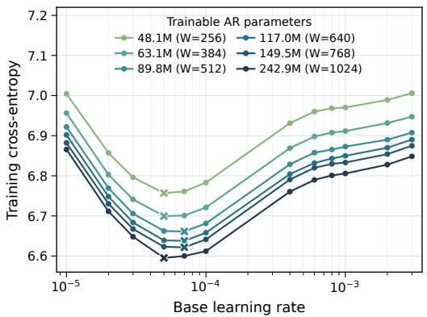  
(a) Width transfer (L = 16)

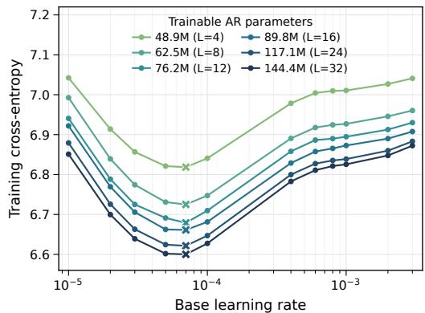  
(b) Depth transfer (W = 512)  
Figure 7: Pretraining learning-rate transfer across width and depth. Each run trains for 50,000 updates. Each point averages 21 raw training cross-entropy measurements; crosses mark the minimum among the 12 tested base learning rates.

Loss aggregation and recipe selection. Each arm trains for 50,000 updates. Each plotted point averages 21 raw training CE measurements. Repeated records at an optimizer step are resolved using the latest timestamp before averaging. The shared reference architecture is plotted in both panels. The statistic is training CE rather than held-out loss or decoded image quality. Selecting $\eta = 7 \times 1 0 ^ { - 5 }$ gives the grid minimum at all six depths and a maximum excess CE of 0.0048 nats per token across all 11 architectures.

## A.4 AR SCALING PROTOCOL AND RESULTS

Training setup. We fit the 18 AR models in Tab. 6 using the initialization and optimizer scaling rules in Appendix A.3. All models use a frozen IBQ tokenizer trained on Qwen2.5-VL-32B postmerger features (131,072 codes, dimension 256, update-80,000 checkpoint), frozen FLAN-T5-XL text features (maximum length 512), and images at the $2 5 6 ^ { 2 }$ area tier. Training uses AdamW with learning rate $7 \times 1 0 ^ { - 5 } , \beta _ { 1 } \stackrel { \bf { = } } { = } \beta _ { 2 } = 0 . 9 5 , \epsilon = \bar { 1 } 0 ^ { - 8 }$ , weight decay 0.01, gradient clipping at norm 1, and batch size 1,024. The learning rate warms up for 2,000 updates and remains constant thereafter.

Loss and compute. Let $D _ { \mathrm { t e x t } }$ count text tokens and $D _ { \mathrm { t g t } }$ count supervised visual targets. We count all processed sequence positions:

$$
D _ { \mathrm { s e q } } = D _ { \mathrm { t e x t } } + 2 D _ { \mathrm { t g t } } , \qquad C = 6 N D _ { \mathrm { s e q } } .\tag{11}
$$

The factor of two accounts for one position-instruction token per visual code.

Training-curve envelope. Following Hoffmann et al. (2022); Ge et al. (2026), we interpolate loss linearly in log C within each model’s observed range and select the minimum at 1,600 log-spaced budgets. The range starts at the first crossing of the two smallest models and ends at the smaller of $2 \times \mathrm { \overline { { 1 0 } } ^ { 2 1 } }$ and the maximum observed compute. Each winner defines $N _ { \mathrm { o p t } }$ and $D _ { \mathrm { o p t } } = C / ( 6 N _ { \mathrm { o p t } } )$ We fit power laws by ordinary least squares in log–log space, retaining boundary winners. Figures display one point per winning model, nearest the geometric mean of its winning budgets.

IsoFLOP profiles. We interpolate loss at each budget and fit a quadratic in log N. A valid minimum requires positive curvature, at least five models, and at least two model sizes on either side. The candidate budgets are

$$
C / 1 0 ^ { 1 9 } \in \{ 0 . 3 , 0 . 5 , 0 . 7 5 , 1 , 1 . 5 , 2 , 3 , 5 , 7 . 5 , 1 0 , 1 5 , 2 0 , 3 0 \} .
$$

We regress $N _ { \mathrm { o p t } }$ and $D _ { \mathrm { o p t } } = C / ( 6 N _ { \mathrm { o p t } } )$ in log–log space over the longest contiguous valid segment.

Tab. 6: AR architectures used for the scaling fits. Models are sorted by trainable parameters $N ;$ W and F denote hidden and FFN dimensions. Shared vocabulary weights are counted once; frozen encoders and tokenizers are excluded.
<table><tr><td>N (M)</td><td>Layers (depth)</td><td>Hidden dim. W</td><td>Heads</td><td>Head dim.</td><td>FFN dim. F</td></tr><tr><td>55.71</td><td>6</td><td>512</td><td>4</td><td>128</td><td>1,536</td></tr><tr><td>71.30</td><td>7</td><td>640</td><td>5</td><td>128</td><td>1,792</td></tr><tr><td>99.96</td><td>9</td><td>768</td><td>6</td><td>128</td><td>2,048</td></tr><tr><td>137.73</td><td>10</td><td>896</td><td>7</td><td>128</td><td>2,560</td></tr><tr><td>191.53</td><td>12</td><td>1,024</td><td>8</td><td>128</td><td>2,816</td></tr><tr><td>260.95</td><td>14</td><td>1,152</td><td>9</td><td>128</td><td>3,072</td></tr><tr><td>323.07</td><td>14</td><td>1,280</td><td>10</td><td>128</td><td>3,328</td></tr><tr><td>343.39</td><td>15</td><td>1,280</td><td>10</td><td>128</td><td>3,584</td></tr><tr><td>401.57</td><td>15</td><td>1,408</td><td>11</td><td>128</td><td>3,840</td></tr><tr><td>425.72</td><td>16</td><td>1,408</td><td>11</td><td>128</td><td>3,840</td></tr><tr><td>493.02</td><td>16</td><td>1,536</td><td>12</td><td>128</td><td>4,096</td></tr><tr><td>549.65</td><td>18</td><td>1,536</td><td>12</td><td>128</td><td>4,096</td></tr><tr><td>688.28</td><td>19</td><td>1,664</td><td>13</td><td>128</td><td>4,608</td></tr><tr><td>860.44</td><td>21</td><td>1,792</td><td>14</td><td>128</td><td>4,864</td></tr><tr><td>1,059.83</td><td>23</td><td>1,920</td><td>15</td><td>128</td><td>5,120</td></tr><tr><td>1,276.36</td><td>24</td><td>2,048</td><td>16</td><td>128</td><td>5,632</td></tr><tr><td>1,764.95</td><td>27</td><td>2,304</td><td>18</td><td>128</td><td>6,144</td></tr><tr><td>2,425.92</td><td>30</td><td>2,560</td><td>20</td><td>128</td><td>6,912</td></tr></table>

Parametric loss. Within the envelope range, we interpolate loss in log D at 24 geometrically spaced token counts per model after update 5,000. For the resulting 432 equally weighted samples, we fit $\widehat { \mathcal { L } } = E + A n ^ { - \alpha } + B d ^ { - \beta }$ , where $n = N / 1 0 ^ { 8 }$ and $d = D / 1 0 ^ { 9 }$ , by minimizing

$$
\frac { 1 } { 4 3 2 } \sum _ { i = 1 } ^ { 4 3 2 } H _ { 1 0 ^ { - 3 } } \big ( \log \widehat { \mathcal { L } } _ { i } - \log \mathcal { L } _ { i } \big ) ,\tag{12}
$$

where $H _ { \delta }$ is the Huber loss. We select the lowest objective among 75 L-BFGS-B initializations with positive coefficients and exponents. The optimal allocation has $a = \beta / ( \alpha + \beta )$ and $b = 1 - a$

Full-sequence results. The envelope covers 1.5535 $\times 1 0 ^ { 1 8 } – 2 \times 1 0 ^ { 2 1 }$ FLOPs; IsoFLOP uses 12 budgets over $5 \times 1 0 ^ { 1 8 } – 3 \times 1 0 ^ { 2 0 }$ FLOPs. The parametric loss coefficients are

$$
\begin{array} { l l l } { { E = 5 . 7 2 3 8 , ~ } } & { { ~ A = 0 . 3 1 9 4 , ~ } } & { { ~ B = 1 . 7 2 8 4 , } } \\ { { \alpha = 0 . 4 7 0 7 , ~ } } & { { ~ \beta = 0 . 4 3 8 6 . } } & { { ~ } } \end{array}
$$

Tab. 7 gives the full-sequence allocation laws.

Tab. 7: Full-sequence AR allocation laws. $N = N _ { 2 0 } ( C / 1 0 ^ { 2 0 } ) ^ { a }$ and $D = D _ { 2 0 } ( C / 1 0 ^ { 2 0 } ) ^ { b }$
<table><tr><td>Method</td><td> $N _ { 2 0 }$  (M)</td><td> $D _ { 2 0 } \left( \mathbf { B } \right)$ </td><td>a</td><td>b</td></tr><tr><td>Envelope</td><td>296.96</td><td>56.12</td><td>0.5268</td><td>0.4732</td></tr><tr><td>IsoFLOP</td><td>270.58</td><td>61.60</td><td>0.4705</td><td>0.5295</td></tr><tr><td>Parametric</td><td>199.05</td><td>83.73</td><td>0.4823</td><td>0.5177</td></tr></table>

## A.5 POST-TRAINING SCALING PROTOCOL AND RESULTS

Training recipe. We initialize each model from its pretrained AR backbone and keep the AR parameters, including attention projections, frozen. Only the diffusion FFNs, AdaLN modules, and input/output adapters are newly initialized and trained; the adapters include patch and timestep embeddings and the pixel readout. We use CompleteP initialization with base scale 0.02.

The scaling family uses native images at the $2 5 6 ^ { 2 }$ area tier, 14-pixel diffusion patches, frozen FLAN-T5-XL text features with maximum length 512, and global batch size 512. We train with AdamW $( \beta _ { 1 } = \beta _ { 2 } = 0 . 9 5 , \epsilon = 1 0 ^ { - 8 }$ , weight decay 0.01), clip gradients at norm 1, and use base learning rate $8 \times 1 0 ^ { - 4 }$ without warmup or learning-rate decay. Parameter-group rates follow CompleteP scaling. Parameter EMA is disabled.

We normalize images to $[ - 1 , 1 ]$ , use Gaussian noise with standard deviation 2, and sample the clean-time coordinate from a logit-normal distribution with location 0 and scale 1. The velocity conversion uses denominator max $\left( 1 - u , 0 . 0 5 \right)$ , as in Appendix A.2. Text conditioning is dropped with probability 0.1; the AR visual conditioning is retained.

Post-training learning-rate search. We search the eight base learning rates $\{ 5 \times 1 0 ^ { - 5 } , 1 0 ^ { - 4 } , 4 \times$ $1 0 ^ { - 4 } , 6 \times 1 \stackrel { \smile } { 0 } ^ { - 4 } , 8 \times \stackrel { \smile } { 1 } 0 ^ { - 4 } , 1 0 ^ { - 3 } , 2 \times 1 0 ^ { - 3 } , 3 \times 1 0 ^ { - 5 } \}$ at width/depth pairs $( 5 1 2 , 6 ) , \ ( 7 6 8 , 9 )$ (1024, 12), and (1280, 15). For each architecture, the pretrained AR checkpoint and diffusion initialization are fixed across learning rates. We compare all eight rates for all four architectures at approximately 20,000 updates, averaging 41 raw loss measurements without smoothing. For the three smaller models, the window spans updates 19,600–20,400. For the largest model, we use the last 41 measurements of each run: updates 18,060–18,860 for the four lower rates and 18,480–19,280 for the four higher rates.

The observed minima occur at $1 0 ^ { - 3 } , 6 \times 1 0 ^ { - 4 } , 6 \times 1 0 ^ { - 4 } .$ , and $8 \times 1 0 ^ { - 4 }$ in order of increasing model size. The shared $8 \times 1 0 ^ { - 4 }$ rate used for scaling is within 0.0003 velocity-MSE of the observed minimum for all four models.

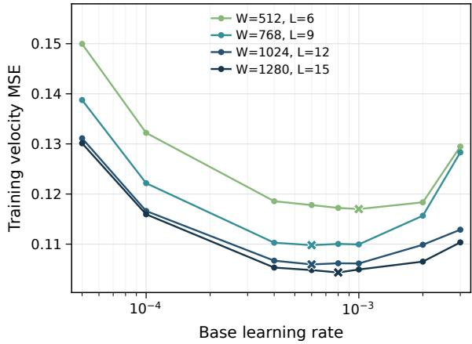  
Figure 8: Post-training learning-rate search. Mean training loss at approximately 20,000 updates for four width/depth pairs. Each point averages 41 measurements; the largest model uses its final available windows. Crosses mark the minimum for each model.

Data and parameter accounting. We fit the 14 architectures in Tab. 8 using raw training velocity-MSE, without smoothing or a loss threshold. The results use the fixed September 20 data snapshot. Each renderer is trained on its corresponding frozen AR backbone. We first fit the AR scaling law and, for each model size, select the AR checkpoint corresponding to its predicted compute-optimal FLOPs budget for diffusion post-training.

N counts trainable diffusion parameters, including embeddings, modulation, feed-forward blocks, and readout, but excludes the frozen AR path and external encoders. Let $D _ { \mathrm { A R } }$ count the AR codes consumed during post-training, $D _ { \mathrm { t g t } }$ the supervised diffusion patches, and $D _ { \mathrm { t e x t } }$ the text positions. Each AR code has one position-instruction token. An AR grid of $g _ { h } \times g _ { w }$ covers an image of $2 8 g _ { h } \times 2 8 g _ { w }$ pixels, whereas the renderer uses 14 × 14 patches. Thus each image contains four diffusion patches per AR code, and the cumulative counts satisfy

$$
D _ { \mathrm { t g t } } = 4 D _ { \mathrm { A R } } , \qquad D _ { \mathrm { s e q } } = D _ { \mathrm { t e x t } } + 2 D _ { \mathrm { A R } } + D _ { \mathrm { t g t } } = D _ { \mathrm { t e x t } } + 1 . 5 D _ { \mathrm { t g t } } .\tag{13}
$$

We use $C = 6 N D _ { \mathrm { s e q } }$ as a normalized compute proxy rather than a physical-operation count: exact FLOPs require separate accounting for the frozen AR forward pass and the trainable renderer’s forward/backward passes. The source AR checkpoint varies across models, so the fitted law i conditional on this checkpoint family.

Tab. 8: Post-training model family, ordered by trainable diffusion parameter count. Attention heads have dimension 128. The AR backbone and external encoders remain frozen and are excluded from the parameter counts.
<table><tr><td>Parameters (M)</td><td>Layers</td><td>Width</td><td>Heads</td><td>FFN width</td></tr><tr><td>25.13</td><td>6</td><td>512</td><td>4</td><td>1536</td></tr><tr><td>43.46</td><td>7</td><td>640</td><td>5</td><td>1792</td></tr><tr><td>77.23</td><td>9</td><td>768</td><td>6</td><td>2048</td></tr><tr><td>120.73</td><td>10</td><td>896</td><td>7</td><td>2560</td></tr><tr><td>184.00</td><td>12</td><td>1024</td><td>8</td><td>2816</td></tr><tr><td>265.85</td><td>14</td><td>1152</td><td>9</td><td>3072</td></tr><tr><td>360.77</td><td>15</td><td>1280</td><td>10</td><td>3584</td></tr><tr><td>457.95</td><td>16</td><td>1408</td><td>11</td><td>3840</td></tr><tr><td>604.00</td><td>18</td><td>1536</td><td>12</td><td>4096</td></tr><tr><td>763.60</td><td>19</td><td>1664</td><td>13</td><td>4608</td></tr><tr><td>966.18</td><td>21</td><td>1792</td><td>14</td><td>4864</td></tr><tr><td>1201.11</td><td>23</td><td>1920</td><td>15</td><td>5120</td></tr><tr><td>1450.28</td><td>24</td><td>2048</td><td>16</td><td>5632</td></tr><tr><td>2026.19</td><td>27</td><td>2304</td><td>18</td><td>6144</td></tr></table>

Parametric loss modelling. The fit covers $5 \times 1 0 ^ { 1 7 } – 3 . 0 4 4 9 \times 1 0 ^ { 2 1 }$ in full-sequence compute, ending at the maximum observed budget. The training-curve envelope uses the same interval. We fit $\widehat { L } = E + A ( N / 1 0 ^ { 8 } ) ^ { - \alpha } + B ( D / 1 0 ^ { 1 0 } ) ^ { - \beta }$ by minimizing squared log-loss residuals, giving each model equal total weight. All eligible observations enter the fit. We select the lowest objective among nine initializations, constraining $E \geq 0$ and the amplitudes and exponents to be positive. The fitted surface is

$$
\widehat { L } _ { \mathrm { s e q } } = 0 . 0 7 0 1 + 0 . 0 2 2 2 ( N / 1 0 ^ { 8 } ) ^ { - 0 . 2 5 3 1 } + 0 . 0 1 2 6 ( D _ { \mathrm { s e q } } / 1 0 ^ { 1 0 } ) ^ { - 0 . 5 9 6 4 } .\tag{14}
$$

The allocation exponents satisfy $a = \beta / ( \alpha + \beta )$ and $b = 1 - a$ under $C = 6 N D$

Training-curve envelope. We interpolate loss linearly in log C within each model’s observed range, select the lowest loss at 500 log-spaced budgets, and regress log $N _ { \mathrm { o p t } }$ and log $D _ { \mathrm { o p t } }$ on log $C .$ Boundary winners are retained. All budgets enter the regression, whereas figures display one representative per winning model, nearest the geometric mean of its winning budgets.

IsoFLOP profiles. We evaluate 15 log-spaced budgets over the same compute interval. At each budget, a quadratic in log $( N / 1 0 ^ { 8 } )$ is fitted to interpolated raw loss. An accepted minimum requires at least three model sizes, positive curvature, and both the observed minimum and fitted vertex strictly inside the available size range. We regress all accepted vertices: eight budgets over $6 . 0 3 \times$ $1 0 ^ { 1 8 } \mathrm { - \dot { 1 } . 6 3 \times 1 0 ^ { 2 1 } }$ . No training curve is extrapolated to construct an envelope or IsoFLOP point.

Tab. 9: Post-training allocation fits. With $x = C / 1 0 ^ { 2 0 } , N _ { \mathrm { o p t } } = N _ { 2 0 } x ^ { a }$ and $D _ { \mathrm { o p t } } = D _ { 2 0 } x ^ { b }$ , using full-sequence token counts.
<table><tr><td>Method</td><td> $N _ { 2 0 } \ ( \mathbf { M } )$ </td><td> $D _ { 2 0 } \left( \mathbf { B } \right)$ </td><td>a</td><td>b</td></tr><tr><td>Parametric</td><td>513.48</td><td>32.46</td><td>0.7021</td><td>0.2979</td></tr><tr><td>Envelope</td><td>395.28</td><td>42.16</td><td>0.5492</td><td>0.4508</td></tr><tr><td>IsoFLOP</td><td>377.99</td><td>44.09</td><td>0.4538</td><td>0.5462</td></tr></table>

## A.6 PIXEL-DIFFUSION HYPERPARAMETER TRANSFER

We independently tune the PDM baseline trained from scratch using CompleteP learning-rate transfer. We vary width over {256, 384, 512, 640, 768, 1024} at 16 layers and depth over

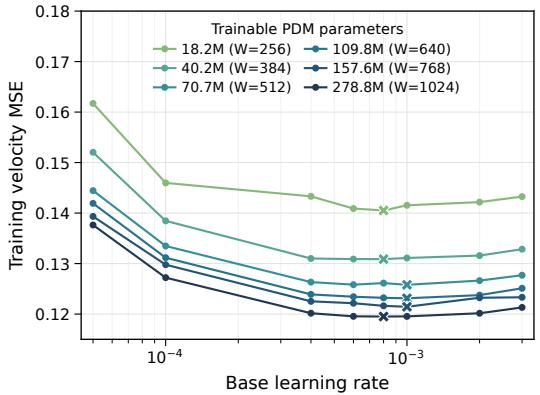  
(a) Width transfer (L = 16)

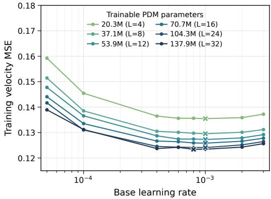  
(b) Depth transfer (W = 512)  
Figure 9: Pixel-diffusion learning-rate transfer. Original width and depth search results after 50,000 training updates. Points average the final 10,000 updates; crosses mark the best tested learning rate.

{4, 8, 12, 16, 24, 32} at width 512. Each configuration is trained for 50,000 updates. The eight base learning rates are

$$
\{ 5 \times 1 0 ^ { - 5 } , 1 0 ^ { - 4 } , 4 \times 1 0 ^ { - 4 } , 6 \times 1 0 ^ { - 4 } , 8 \times 1 0 ^ { - 4 } , 1 0 ^ { - 3 } , 2 \times 1 0 ^ { - 3 } , 3 \times 1 0 ^ { - 3 } \} .
$$

We retain the original search statistic: mean training velocity-MSE over the final 10,000 updates. Each point averages 500 logged measurements, without smoothing. Fig. 9 shows the complete width and depth searches. Every curve reaches its grid minimum at either $\bar { 8 } \times 1 0 ^ { - 4 } \ \mathrm { o r \ 1 0 ^ { - 3 } }$ , supporting learning-rate transfer across model sizes. Tab. 10 lists these minima.

The original search uses 16-pixel patches and FFN width 4W, where W is model width. Additional checks at five anchor architectures use FFN width rounded from $8 W / 3$ and learning rates $\{ 6 \times$ $1 0 ^ { - 4 } , 8 \times 1 0 ^ { - 4 } , 1 0 ^ { - 3 } , 1 . 3 \times 1 0 ^ { - 3 } \}$ . Their minima also lie at $8 \times 1 0 ^ { - 4 } \mathrm { { \dot { o r } { 1 0 ^ { - 3 } } } }$ . The scaling family uses this rounded FFN configuration with 14-pixel patches and base learning rate $8 \times 1 0 ^ { - 4 }$ . Training uses global batch size 512, AdamW with $\beta _ { 1 } \stackrel { - } { = } \beta _ { 2 } \stackrel { - } { = } 0 . 9 5 , \epsilon = 1 0 ^ { - 8 }$ , weight decay 0.01, and 2,000 warmup updates followed by a constant rate. This search concerns PDMs trained from scratch. The independent post-training search is described in Appendix A.5.

Tab. 10: Grid minima in the original PDM hyperparameter search. The shared width-512, depth-16 architecture is evaluated in both sweeps.
<table><tr><td>Sweep</td><td>Width</td><td>Layers</td><td>Best base LR</td><td>Training loss</td></tr><tr><td>Width</td><td>256</td><td>16</td><td> $8 \times 1 0 ^ { - 4 }$ </td><td>0.1405</td></tr><tr><td>Width</td><td>384</td><td>16</td><td> $8 \times 1 0 ^ { - 4 }$ </td><td>0.1309</td></tr><tr><td>Width</td><td>512</td><td>16</td><td> $1 0 ^ { - 3 }$ </td><td>0.1258</td></tr><tr><td>Width</td><td>640</td><td>16</td><td> $1 0 ^ { - 3 }$ </td><td>0.1231</td></tr><tr><td>Width</td><td>768</td><td>16</td><td> $1 0 ^ { - 3 }$ </td><td>0.1214</td></tr><tr><td>Width</td><td>1024</td><td>16</td><td> $8 \times 1 0 ^ { - 4 }$ </td><td>0.1195</td></tr><tr><td>Depth</td><td>512</td><td>4</td><td> $1 0 ^ { - 3 }$ </td><td>0.1355</td></tr><tr><td>Depth</td><td>512</td><td>8</td><td> $1 0 ^ { - 3 }$ </td><td>0.1295</td></tr><tr><td>Depth</td><td>512</td><td>12</td><td> $1 0 ^ { - 3 }$ </td><td>0.1273</td></tr><tr><td>Depth</td><td>512</td><td>16</td><td> $1 0 ^ { - 3 }$ </td><td>0.1258</td></tr><tr><td>Depth</td><td>512</td><td>24</td><td> $1 0 ^ { - 3 }$ </td><td>0.1241</td></tr><tr><td>Depth</td><td>512</td><td>32</td><td> $8 \times 1 0 ^ { - 4 }$ </td><td>0.1234</td></tr></table>

## A.7 PIXEL-DIFFUSION SCALING FROM SCRATCH

Models and compute. We train eight PDMs from scratch using the recipe in Appendix A.6. Noise scale, timestep distribution, text-conditioning dropout, and loss averaging are identical to diffusion post-training (Appendix A.5). Tab. 11 gives their architectures and trainable parameter counts. The models contain no AR backbone. Here N includes the denoiser’s attention, FFN, modulation, text projection, patch embedding, and image readout, excluding the frozen text encoder. $D _ { \mathrm { s e q } }$ counts the actual packed text and diffusion positions, including the effect of text-condition dropout, and $C = 6 N D _ { \mathrm { s e q } }$

Tab. 11: Pure PDM scaling architectures, ordered by trainable parameter count. All attention heads have dimension 128.
<table><tr><td>Parameters (M)</td><td>Layers</td><td>Width</td><td>Heads</td><td>FFN width</td></tr><tr><td>23.83</td><td>6</td><td>512</td><td>4</td><td>1536</td></tr><tr><td>69.97</td><td>9</td><td>768</td><td>6</td><td>2048</td></tr><tr><td>164.08</td><td>12</td><td>1024</td><td>8</td><td>2816</td></tr><tr><td>319.16</td><td>15</td><td>1280</td><td>10</td><td>3584</td></tr><tr><td>529.29</td><td>18</td><td>1536</td><td>12</td><td>4096</td></tr><tr><td>844.62</td><td>21</td><td>1792</td><td>14</td><td>4864</td></tr><tr><td>1265.74</td><td>24</td><td>2048</td><td>16</td><td>5632</td></tr><tr><td>1760.20</td><td>27</td><td>2304</td><td>18</td><td>6144</td></tr></table>

Fitting protocol. We use raw training velocity-MSE without EMA, binning, or a loss threshold. The envelope and parametric fits cover $5 \times 1 \hat { 0 } ^ { 1 7 } \le C \le 2 . 2 1 7 4 \times 1 0 ^ { 2 1 }$ . We interpolate each observed loss curve in log C and select the minimum at 500 log-spaced budgets. All envelope winners, including boundary winners, enter the log–log allocation regression; figures display one representative point per winning model.

For IsoFLOP, we evaluate 15 log-spaced candidate budgets and fit a quadratic in $\log ( N / 1 0 ^ { 8 } )$ at each budget. A valid minimum requires at least three model sizes, positive curvature, and both the observed minimum and fitted vertex inside the available size range. Nine budgets are accepted over $\mathrm { 1 . 6 5 9 4 \times 1 0 ^ { 1 8 } \mathrm { - 6 . 6 8 1 3 \times 1 0 ^ { 2 0 } F L O P s } }$ . No training curve is extrapolated to construct an envelope or IsoFLOP point.

For the parametric estimator, we fit all eligible observations by minimizing squared log-loss residuals, giving each model equal total weight. We retain the best of nine initializations, with $E \geq 0$ and positive amplitudes and exponents. The resulting loss law is

$$
\widehat { \mathcal { L } } _ { \mathrm { s c r a t c h } } = 0 . 0 7 8 8 + 0 . 0 1 3 3 \left( \frac { N } { 1 0 ^ { 8 } } \right) ^ { - 0 . 3 4 5 0 } + 0 . 0 0 7 9 \left( \frac { D _ { \mathrm { s e q } } } { 1 0 ^ { 1 0 } } \right) ^ { - 0 . 8 6 2 7 } .\tag{15}
$$

Its fitted asymptotic loss exceeds the post-training value $E _ { \mathrm { p o s t } } = 0 . 0 7 0 1$ . Tab. 12 gives the three compute-optimal allocation fits, and Fig. 10 shows the envelope and IsoFLOP results.

Tab. 12: Full-sequence PDM allocation laws. For $x = C / 1 0 ^ { 2 0 } , N _ { \mathrm { o p t } } = N _ { 2 0 } x ^ { a }$ and $D _ { \mathrm { o p t } } = D _ { 2 0 } x ^ { b }$
<table><tr><td>Method</td><td> $N _ { 2 0 } \ ( \mathbf { M } )$ </td><td> $D _ { 2 0 } \left( \mathbf { B } \right)$ </td><td>a</td><td>b</td></tr><tr><td>Envelope</td><td>394.37</td><td>42.26</td><td>0.5744</td><td>0.4256</td></tr><tr><td>IsoFLÓP</td><td>409.73</td><td>40.68</td><td>0.5161</td><td>0.4839</td></tr><tr><td>Parametric</td><td>535.04</td><td>31.15</td><td>0.7143</td><td>0.2857</td></tr></table>

## A.8 COMPUTE ACCOUNTING AND STAGE ALLOCATION

We use $C = 6 N D$ throughout, with N counting the trainable parameters of that stage and D counting processed sequence positions. For diffusion post-training, N excludes the frozen AR backbone; for diffusion from scratch, it includes the entire denoising model. Both exclude external frozen encoders. Pure PDM processes text and diffusion patches, whereas post-training also processes AR codes and position-instruction tokens. We therefore use each model’s actual packed-token count rather than assigning the same token count to the two architectures.

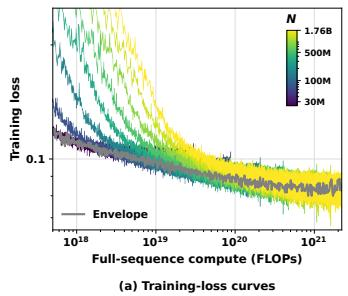

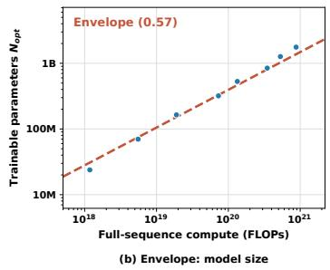

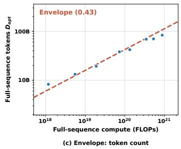

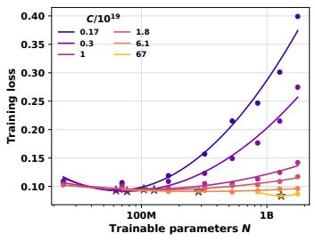

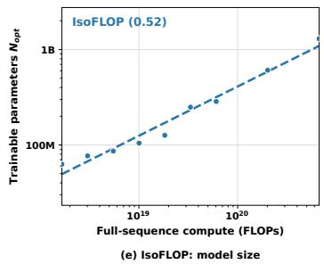

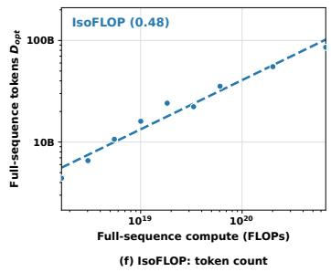  
Figure 10: Pixel-diffusion scaling from scratch. Full-sequence compute accounting for eight model sizes. Top: training losses and envelope allocations. Bottom: six representative IsoFLOP profiles and allocation fits using all nine accepted minima. Stars mark the quadratic minima.

Induced budget allocation. We convert the two envelope laws into a budget split. Inverting $N =$ $N _ { 2 0 } ( C / 1 0 ^ { 2 0 } ) ^ { \stackrel { \smile } { a } }$ gives the compute at which a model of size N is the envelope winner, $C ^ { \star } ( N ) =$ $1 0 ^ { 2 0 } ( N / N _ { 2 0 } ) ^ { 1 / a }$ . For each jointly scaled model we evaluate $C _ { \mathrm { p r e } } ^ { \star } ( N _ { \mathrm { A R } } )$ from Appendix A.4 and $C _ { \mathrm { p o s t } } ^ { \star } ( N _ { \mathrm { d i f f } } )$ from Appendix A.5 using full-sequence counts, then set $r = C _ { \mathrm { p o s t } } ^ { \star } / ( C _ { \mathrm { p r e } } ^ { \star } + C _ { \mathrm { p o s t } } ^ { \star } )$ Tab. 13 lists the nine models with $N _ { \mathrm { A R } } \geq 2 6 1 \mathrm { M } ;$ the smaller models give noisy envelope winners and unstable splits. Summed over these models the split is $C _ { \mathrm { p r e } } : C _ { \mathrm { p o s t } } = 1 . 5 0 \dot { : } 1 ( r = \bar { 0 } . 4 0 )$ . This allocation uses the normalized 6ND proxy, which excludes the frozen-AR forward pass in posttraining, rather than measured hardware FLOPs. AR cross-entropy is never combined numerically with diffusion loss; each stage is optimized under its own metric.

Tab. 13: Induced pretraining–post-training budget allocation at the envelope compute-optimal. For each jointly scaled model, each stage is placed at its own envelope optimum and $r =$ $C _ { \mathrm { p o s t } } / ( C _ { \mathrm { p r e } } ^ { \cdot } + \dot { C } _ { \mathrm { p o s t } } )$ . N excludes frozen modules; C uses the full-sequence 6ND proxy. Models below 261M are omitted as noisy.
<table><tr><td> $N _ { \mathrm { A R } } ( \mathbf { M } )$ </td><td> $N _ { \mathrm { d i f f } } ( \mathbf { M } )$ </td><td> $C _ { \mathrm { p r e } }$ </td><td> $C _ { \mathrm { p o s t } }$ </td><td>r</td></tr><tr><td>260.95</td><td>265.85</td><td> $7 . 8 2 \times 1 0 ^ { 1 9 }$ </td><td> $4 . 8 6 \times 1 0 ^ { 1 9 }$ </td><td>0.383</td></tr><tr><td>343.39</td><td>360.77</td><td> $1 . 3 2 \times 1 0 ^ { 2 0 }$ </td><td> $8 . 4 7 \times 1 0 ^ { 1 9 }$ </td><td>0.391</td></tr><tr><td>425.72</td><td>457.95</td><td> $1 . 9 8 \times 1 0 ^ { 2 0 }$ </td><td> $1 . 3 1 \times 1 0 ^ { 2 0 }$ </td><td>0.398</td></tr><tr><td>549.65</td><td>604.00</td><td> $3 . 2 2 \times 1 0 ^ { 2 0 }$ </td><td> $2 . 1 6 \times 1 0 ^ { 2 0 }$ </td><td>0.402</td></tr><tr><td>688.28</td><td>763.60</td><td> $4 . 9 3 \times 1 0 ^ { 2 0 }$ </td><td> $3 . 3 2 \times 1 0 ^ { 2 0 }$ </td><td>0.402</td></tr><tr><td>860.44</td><td>966.18</td><td> $7 . 5 3 \times 1 0 ^ { 2 0 }$ </td><td> $5 . 0 9 \times 1 0 ^ { 2 0 }$ </td><td>0.403</td></tr><tr><td>1059.83</td><td>1201.11</td><td> $1 . 1 2 \times 1 0 ^ { 2 1 }$ </td><td> $7 . 5 7 \times 1 0 ^ { 2 0 }$ </td><td>0.403</td></tr><tr><td>1276.36</td><td>1450.28</td><td> $1 . 5 9 \times 1 0 ^ { 2 1 }$ </td><td> $1 . 0 7 \times 1 0 ^ { 2 1 }$ </td><td>0.401</td></tr><tr><td>1764.95</td><td>2026.19</td><td> $2 . 9 5 \times 1 0 ^ { 2 1 }$ </td><td> $1 . 9 6 \times 1 0 ^ { 2 1 }$ </td><td>0.400</td></tr><tr><td></td><td>Total</td><td> $7 . 6 3 \times 1 0 ^ { 2 1 }$ </td><td> $5 . 1 1 \times 1 0 ^ { 2 1 }$ </td><td>0.401</td></tr></table>

## A.9 FINAL MODEL RECIPE AND EVALUATION

Final-model training. The large-scale AR backbone has width 2304 and 27 layers. It uses frozen Qwen3-4B text features from layers 9, 18, and 27, concatenated to 7680 dimensions; feature extraction stops at layer 27 and uses BF16. AR pretraining uses a global batch size of 2048 and a caption mixture of 70% flattened long captions and 30% canonical structured captions. The 150k-update AR curriculum uses 50k updates at the 256-resolution tier, ramps toward a 50/25/25 mixture of the 256/512/1024 tiers over the next 50k, and holds that mixture for the last 50k. These proportions count examples within the global batch. This final-model recipe is separate from the controlled comparisons in Tab. 2. We then freeze the AR backbone and train the diffusion modules for 100,000 updates with global batch size 512. Diffusion uses four times as many visual target tokens per image as AR pretraining, so we reduce its image batch size by a factor of four. This balances visual-target throughput per update at a matched resolution. Guided by the prescribed 3:2 stage allocation, we use a matching ratio of pretraining to post-training updates. Post-training follows the diffusion resolution curriculum, preserving its resolution proportions while reducing each resolution-specific batch size proportionally to give global batch size 512. We use AdamW with weight decay 0.01 and base learning rate $8 \times { \dot { 1 } } 0 ^ { - 4 }$ , selected by the post-training learning-rate search in Appendix A.5.

Training cost. The total training budget is approximately 6,600 H100 GPU-hours. Following the prescribed 3:2 allocation, the nominal stage budgets are approximately 3,960 GPU-hours for AR pretraining and 2,640 GPU-hours for diffusion post-training. These are budget allocations rather than separate measurements of stage runtime.

Evaluation sampling. We use an exponential moving average (EMA) of the trainable diffusion parameters, with decay 0.9999 starting at update 20,000; the frozen AR parameters remain unchanged. We set AR classifier-free guidance (CFG) to 3 and use a 50-step Euler sampler for diffusion, with AR-conditioning CFG 3 and text-conditioning CFG 4. GenEval uses 553 prompts with one image per prompt and seed 42; DPG-Bench uses 1,065 prompts with four images per prompt and seeds 42–45. We use LLM-assisted prompt rewriting and select prompt variants using evaluation scores under fixed seeds.

Qualitative examples. Fig. 11 presents 32 generations result from the final text-to-image model.

## A.10 DISCUSSION: SEMANTIC INFERENCE AND RENDERING IN FRONTIER MODELS.

Our results suggest a broader interpretation of the separation between knowledge acquisition and rendering. We suspect that frontier visual generators (OpenAI, 2026; Ideogram; Reve, 2026) increasingly perform substantial semantic inference before committing to pixel generation. An autoregressive process can expand a user request into a richer specification through text or visual tokens, structured representations, retrieved information, or agentic interaction. Prompt rewriting and long textual rollouts are simple instances of this principle (Chen et al., 2026): additional context progressively specifies the desired image and reduces the ambiguity left to the renderer. Under this view, the role of autoregression is not necessarily to produce an image that can already be decoded, but to resolve what should be rendered; diffusion can then focus on realizing this specification in pixels.

Semantic-LM admits a similar interpretation. Its discrete visual tokens are trained through language supervision and need not reconstruct or directly generate an image. They can instead be viewed as a compressed semantic state between inference and rendering. In this sense, a semantic visual rollout and a long textual rollout may serve related purposes: both enrich the renderer’s conditioning context, but visual tokens may encode the relevant information more compactly and in a spatially grounded form. This perspective also raises a question not resolved by our current experiments. Semantic-Recon retains reconstruction-oriented visual information, whereas Semantic-LM more directly aligns its representation with language semantics. Without explicit textual rollouts, our results do not determine which interface is preferable when a generator already has access to rich language or agentic context. We suspect that Semantic-LM may be particularly compatible with such inference, while Semantic-Recon may preserve complementary visual information. Understanding how textual, visual, structured, and agentic representations should interact—and how much uncertainty each should resolve before rendering—is an important direction for future visual generation systems.

  
Figure 11: Selected generation samples from our final text-to-image model.