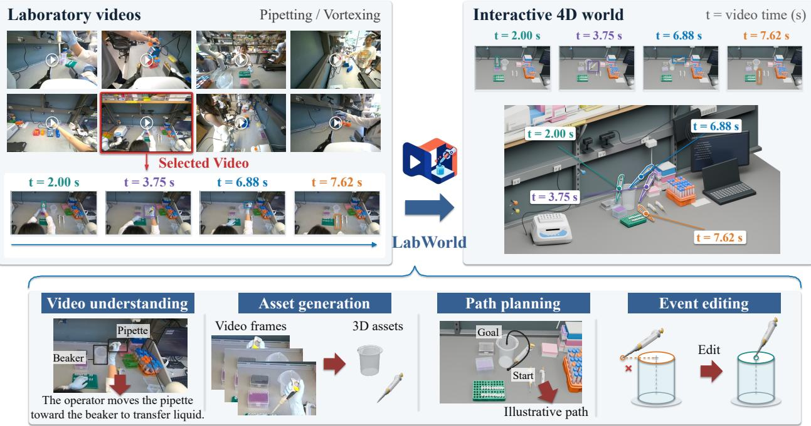
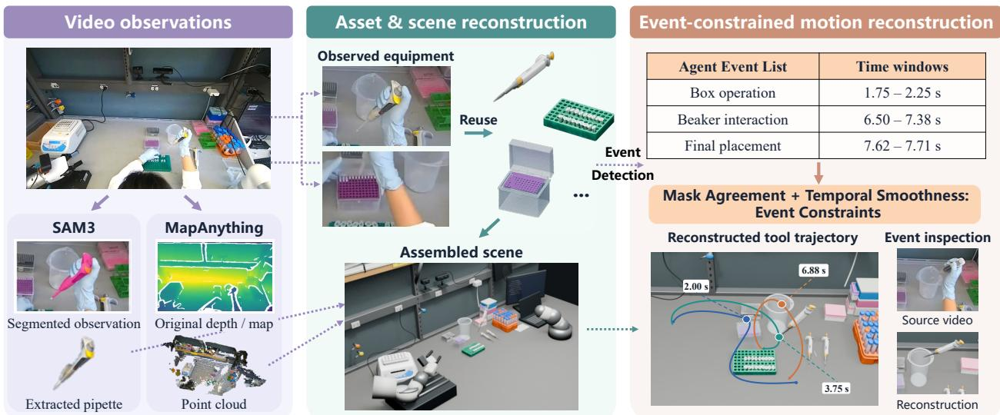
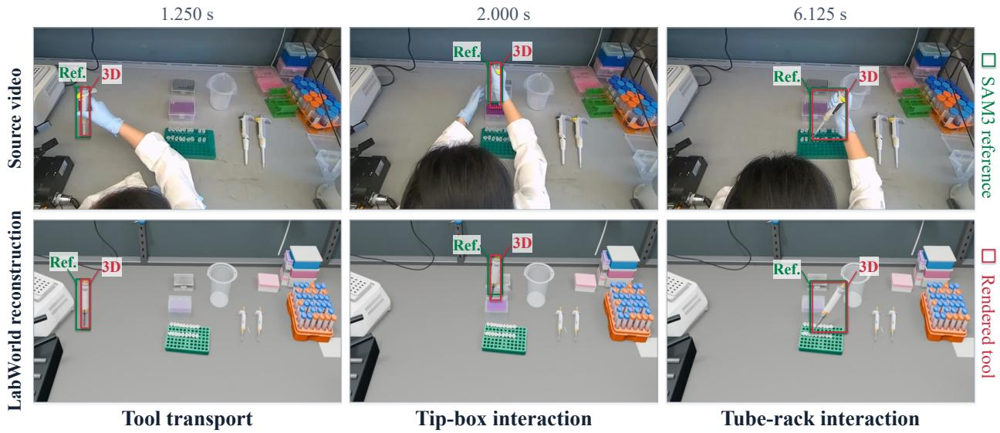
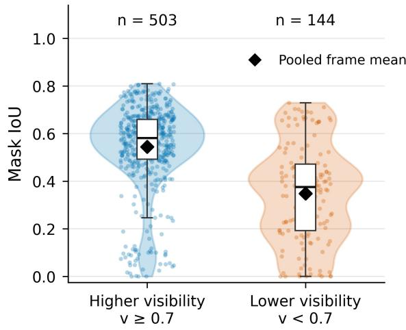
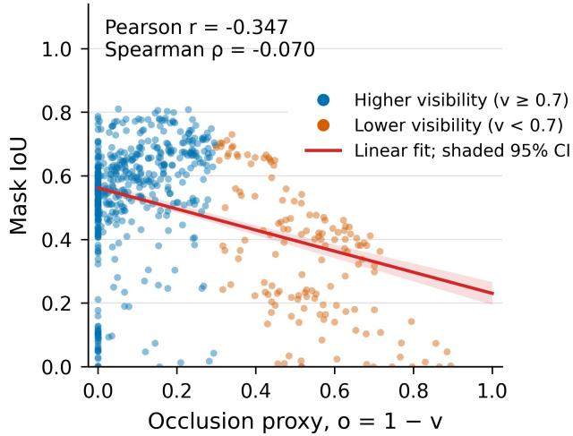

# LABWORLD: Learning Interactive 4D Worlds for Scientific Experimentation

Suozhi Huang1,\*, Kelsey Fu1,\*, Binxu Li1, Luna Lyu2, Kaize Wu3, Wenbo Lu4, David Smerkous5, Jiahan Li4, Siqi Zhu6, Zhizhou Sha7, Jiacheng Guo1, Zhixuan Liang1, Shilong Liu1, Le Cong2, Mengdi Wang1

1Princeton University 2Stanford University 3University of Chicago 4New York University 5Oregon State University 6University of Illinois at Urbana-Champaign 7University of Texas at Austin \*These authors contributed equally to this work.

Autonomous scientific agents must not only reason about experiments but also interact with the physical environments in which they are executed. Existing laboratory simulators typically rely on manually constructed assets and predefined procedures, while laboratory videos capture real equipment, layouts, and interactions but leave this information implicit in pixels. We introduce LABWORLD, an agent-driven Real2Sim framework for reconstructing interactive 4D laboratory worlds from monocular RGB video. LABWORLD recovers reusable 3D assets, a metric scene, timevarying object states, and procedure events. Multi-frame observations provide complementary evidence for asset and scene reconstruction, while motion reconstruction combines visual and geometric observations with event constraints encoding the spatial and temporal requirements of laboratory interactions. We evaluate LABWORLD on real pipetting and vortexing videos collected in our laboratory against general-purpose agentic and dedicated reconstruction baselines. For pipetting, LABWORLD achieves a mean Mask IoU of 0.501, exceeding the strongest baseline by 0.033. For vortexing, it achieves a mean Tube-Length–Normalized PCK-AUC of 0.638, exceeding the strongest baseline by 0.035. On five pipetting videos, event-conditioned reconstruction increases the fraction of modeled physical constraints satisfied from 14.3% (5/35) to 100% (35/35). The resulting worlds expose geometry, motion, articulation, and events as explicit, editable state for replay, inspection, and future embodied scientific systems.

## 1. Introduction

Autonomous scientific discovery requires AI agents to connect experimental reasoning to physical execution (Fu et al., 2026). A written protocol specifies what to do, but leaves implicit the state of a particular laboratory for the robot execution, including where equipment is located, how it is configured, and how objects must move and interact during execution. Therefore, an environment representation is required to make these conditions explicit. An interactive 4D world provides such a representation by combining an editable 3D scene with time-varying object states and interaction events, allowing an observed procedure to be inspected, modified, and replayed.

Constructing such worlds currently requires substantial engineering. Laboratory simulators rely on curated assets and predefined procedures (Lan et al., 2026), while many Real2Sim systems assume existing asset libraries, depth sensing, or active capture (Torne et al., 2024; Pfaff et al., 2025). Human laboratory videos already contain much of the information that this engineering supplies, like the equipment, its layout, and its use throughout a procedure, but only implicitly in image sequences. Recent video-based Real2Sim methods provide an important foundation (Ranawaka et al., 2026; Chen et al., 2026a), but do not jointly target reusable laboratory assets, observed object motion, and procedure-specific interaction constraints from ordinary monocular laboratory video.

We introduce LABWORLD, an agent-driven framework that converts monocular laboratory video into an explicit, editable 4D world (Fig. 1). Laboratory objects are often small, repetitive, and partially occluded, so LABWORLD combines complementary observations across time to construct reusable 3D assets. Metric geometry and camera estimation place these assets in a common scene, while visual tracking and object geometry provide evidence for time-varying rigid and articulated states. Unlike a generated video replay, the resulting world exposes geometry, camera state, object trajectories, articulation, and events as independently inspectable variables.

LabWorld Learning interactive 4D worlds for scientific experimentation  
  
Figure 1. From laboratory video to interactive 4D worlds. Each video is selected from the collection on the left. Source frames are paired with reconstructed views at matching video times t, measured in seconds. The enlarged scene overlays the same pipette, with matching colors linking its reconstructed states to the source frames. The lower panels illustrate video understanding, reusable asset generation, and potential uses in path planning and event editing. Object boxes and interaction arrows in the video-understanding panel are explanatory annotations. The planning and editing panels are conceptual illustrations rather than evaluated downstream results.

However, visual agreement alone does not establish that an experimental interaction has been reconstructed correctly. A trajectory can align well in image space while missing a vessel opening, intersecting surrounding geometry, or violating support under monocular depth ambiguity and hand occlusion. We propose event-conditioned reconstruction to address this gap by constraining object motion with the spatial and temporal requirements of procedure events extracted from the video. For example, a pipette–beaker interaction requires an approach, entry, dwell, and withdrawal through the opening rather than merely placing the pipette near the beaker in projection. This distinction between image agreement and interaction structure is central to our reconstruction objective.

We collect an evaluation dataset of real pipetting and vortexing videos in our laboratory. We evaluate LABWORLD on this dataset against general-purpose agentic and dedicated reconstruction baselines, including GPT-6 Astra, FoundationPose, and Do as I Do. LABWORLD achieves the highest mean Mask IoU for pipetting (0.501) and the highest mean Tube-Length–Normalized PCK-AUC for vortexing (0.638) across all evaluated baselines. More importantly, our ablations expose a limitation of image-space evaluation alone: on a five-video ablation subset, removing event-conditioned reconstruction increases pipette Mask IoU from 0.508 to 0.572 while reducing satisfaction of the modeled physical requirements from 35/35 to 5/35. These diagnostics do not constitute independent verification of hidden source events, but show that better 2D agreement can correspond to a less physically valid reconstruction.

Our main contributions are threefold.

Table 1. Capabilities of related methods and evaluated baselines. Columns denote reusable 3D assets, reconstruction of the observed scene and motion, and explicit procedure-level constraints during motion reconstruction. ✓ indicates a demonstrated capability under these definitions; × indicates that it is not demonstrated. For GPT-6 Astra, the entries describe the video-based reconstruction agent evaluated in this study rather than the underlying model in isolation. Its inputs and reconstruction procedure are described in Appendix G.
<table><tr><td>Method</td><td>Laboratory assets</td><td>Scene</td><td>Motion reconstruction reconstruction</td><td>Event-conditioned reconstruction</td></tr><tr><td>AutoBio (Lan et al., 2026)</td><td>V</td><td>X</td><td>X</td><td>X</td></tr><tr><td>SafeLab (Bai et al., 2026)</td><td>√</td><td>X</td><td>X</td><td>X</td></tr><tr><td>TableVerse (Wang et al., 2026a)</td><td>X</td><td>V</td><td>X</td><td>X</td></tr><tr><td>SimFoundry (Ranawaka et al., 2026)</td><td>X</td><td>√</td><td>X</td><td>X</td></tr><tr><td>Agentic Real2Sim (Chen et al., 2026a)</td><td>X</td><td>V</td><td>V</td><td>X</td></tr><tr><td>GPT-6 Astra</td><td>V</td><td></td><td></td><td>X</td></tr><tr><td>FoundationPose (Wen et al., 2024)</td><td>X</td><td>X</td><td></td><td>X</td></tr><tr><td>Do as I Do (Paliwal et al., 2026)</td><td>√</td><td>X</td><td></td><td>×</td></tr><tr><td>LABWORLD (ours)</td><td>L</td><td>L</td><td></td><td>L</td></tr></table>

• We present LABWORLD, an agent-driven Real2Sim framework that reconstructs an explicit 4D laboratory world from monocular video, comprising reusable assets, a metric scene, time-varying object states, and procedure events.

• We propose event-conditioned reconstruction that combines visual and geometric evidence with the spatial and temporal requirements of laboratory interactions, constraining solutions that are visually plausible but physically inconsistent.

• We collect a real laboratory video dataset covering pipetting and vortexing, and evaluate LAB-WORLD against agentic and dedicated reconstruction baselines. Component ablations examine the roles of visual refinement, geometric initialization, temporal regularization, and event-conditioned reconstruction.

## 2. Related Work

We organize related work around laboratory simulation, Real2Sim reconstruction, and the perception and representation components needed to recover interactive 4D worlds.

## 2.1 Laboratory Simulators and Digital Twins

General manipulation benchmarks provide reusable tasks and physics environments (Yu et al., 2019; Zhu et al., 2020; Gu et al., 2023; Mu et al., 2025), while laboratory benchmarks extend simulation to scientific equipment, precision manipulation, and domain-specific state changes (Li et al., 2025b,a; Lan et al., 2026; Bai et al., 2026; Darvish et al., 2026; Wu et al., 2026; Cao et al., 2026; Liu et al., 2026; Tang et al., 2026). These systems provide increasingly capable scientific environments, but primarily construct them from curated assets, protocols, or engineered workstations rather than recover the time-varying state of an observed human procedure.

A-Lab and Coscientist demonstrate closed-loop scientific reasoning and robotic execution (Szymanski et al., 2023; Boiko et al., 2023), while LabOS connects laboratory perception to human experimenters through XR guidance (Cong et al., 2025). LABWORLD addresses a complementary representation problem: converting recorded experiments into explicit assets, scene state, motion, and interaction structure.

## 2.2 Real2Sim and Motion Reconstruction

Real2Sim systems reconstruct simulation state from real observations. RialTo, Scalable Real2Sim, and Real-is-Sim recover workspaces or dynamic twins for policy learning and evaluation (Torne et al.,

2024; Pfaff et al., 2025; Abou-Chakra et al., 2026), but rely on active capture, RGB-D observations, robot state, or controlled interaction beyond ordinary monocular video. TableVerse, SimuScene, and RoboSnap reduce these requirements for simulation-ready scene reconstruction (Wang et al., 2026a; Lee et al., 2026b; Zhang et al., 2026).

Closer to our setting, SimFoundry converts short videos into physics-ready scenes and Agentic Real2Sim uses vision-language agents to reconstruct simulatable interaction episodes (Ranawaka et al., 2026; Chen et al., 2026a). Human-video methods instead focus on manipulated-object motion: Video2Sim2Real transfers object-centric keyframes to robot skills, and Do as I Do reconstructs object geometry and 6-DoF trajectories from monocular human video (Han et al., 2026; Paliwal et al., 2026). FoundationPose provides general 6D pose estimation and tracking from an object model or reference views (Wen et al., 2024). LABWORLD differs by reconstructing manipulated-object motion within an explicit laboratory world and using procedure events to constrain ambiguous trajectories.

## 2.3 Assets, Geometry, and Constraint Representations

Interactive worlds require persistent objects and interaction structure, not only appearance or correspondence. NeRF and 3D Gaussian Splatting provide view synthesis (Mildenhall et al., 2020; Kerbl et al., 2023); DUSt3R, VGGT, VGGT-Ω, Depth Anything 3, and MapAnything recover camera and scene geometry (Wang et al., 2024, 2025, 2026b; Lin et al., 2026; Keetha et al., 2026); and CoTracker3, SpatialTrackerV2, Track4World, and 4RC provide temporal correspondence (Karaev et al., 2025; Xiao et al., 2025; Lu et al., 2026; Luo et al., 2026). These signals provide geometric evidence but do not alone define reusable objects, articulation, or functional interaction requirements.

SAM2 and SAM3 provide prompted object segmentation (Ravi et al., 2025; Carion et al., 2026); SF3D, TRELLIS, and SAM3D recover textured assets; and Particulate, Articraft, and RORA extend reconstruction to articulated objects (Boss et al., 2025; Xiang et al., 2025; Chen et al., 2026b; Li et al., 2026; Zhou et al., 2026; Lee et al., 2026a). ReKep represents manipulation objectives as relational keypoint constraints (Huang et al., 2024). LABWORLD integrates these capabilities at the world level: reusable laboratory assets and metric geometry provide persistent state, while source-video events constrain rigid and articulated motion.

## 3. Method

Overview. Given a monocular RGB video of a laboratory procedure $\boldsymbol { \mathcal { V } } = \{ I _ { t } \} _ { t = 1 } ^ { T }$ , LABWORLD is designed to recover an explicit laboratory world

$$
\mathcal { W } = \left(  { \boldsymbol { A } } ,  { \boldsymbol { { \mathcal { S } } } } ,  { \boldsymbol { { \mathcal { C } } } } _ { 1 : T } ,  { \boldsymbol { { \mathcal { Q } } } } _ { 1 : T } ,  { \boldsymbol { { \mathcal { E } } } } \right) ,\tag{1}
$$

where A is a reusable asset library, S is the metric static scene, $\mathcal { C } _ { 1 : T }$ contains camera intrinsics and extrinsics, $\mathcal { Q } _ { 1 : T }$ contains time-varying rigid poses and articulated states, and E is a structured event list.

As illustrated in Fig. 2, the pipeline (1) identifies objects and procedure events, (2) constructs reusable assets and a metric scene, and (3) reconstructs motion under visual, geometric, temporal, event, and physical constraints. A vision-language agent prepares task-relevant object and event information from the source video; segmentation, metric geometry, asset generation, and trajectory optimization then recover the corresponding world state. The complete workflow is designed for endto-end automation. Appendix A separately documents the provenance and scope of the cached-input reproduction runs used for reproducibility.

## 3.1 Object Identification and Event List Generation

A vision-language model identifies task-relevant entities and functional parts, while a promptable video segmenter propagates object identity through the sequence to produce visible masks $M _ { t } ^ { i }$ Multi-frame association distinguishes repeated instances such as pipettes, tubes, racks, and tip boxes. The agent additionally infers a structured event list

$$
\mathcal { E } = \{ e _ { k } \} _ { k = 1 } ^ { K } , \qquad e _ { k } = ( \tau _ { k } , \mathcal { P } _ { k } , [ t _ { k } ^ { s } , t _ { k } ^ { e } ] , r _ { k } , c _ { k } ) ,\tag{2}
$$

  
Figure 2. Overview of the LabWorld reconstruction pipeline. SAM3 provides visible object masks, while MapAnything estimates scene geometry from the source video. Observed equipment is represented by generated or reused assets and assembled into a shared 3D scene. An agent-generated event list specifies interaction types and time windows for motion reconstruction, which combines visual and geometric observations with temporal regularization and event constraints. The colored curve shows the reconstructed pipette-tip trajectory, with markers identifying selected times. Source-video and reconstruction crops support visual inspection of a beaker interaction, without independently establishing event completion.

where $\tau _ { k }$ is the event type, $\mathcal { P } _ { k }$ its participating entities, $[ t _ { k } ^ { s } , t _ { k } ^ { e } ]$ its temporal extent, $r _ { k }$ a functional spatial relation, and $c _ { k }$ its confidence. Candidate events are proposed from temporally sampled video and refined using object motion, mask containment, relative distance, velocity changes, and articulation cues. The vocabulary includes grasp, transport, place, insert, dispense, open, close, and release. These events are not merely semantic labels: they instantiate geometric conditions for reconstruction. For example, dispense(pipette, beaker) associates the pipette tip with the beaker opening and defines the interval over which the corresponding interaction constraints apply. Additional event definitions are given in Appendix C.

## 3.2 Laboratory Assets and Scene Reconstruction

For each tracked object, LABWORLD selects complementary observations that favor visibility, sharpness, viewpoint diversity, and consistency with the tracked instance. A generative canonicalizer removes hands and scene clutter, and a multi-view image-to-3D generator reconstructs a textured asset. Each asset is assigned a canonical frame, physical scale, support surface, collision geometry, and functional landmarks such as tips, openings, slots, and hinges. Existing assets are reused when matched to the laboratory library; articulated equipment is represented as links and joints rather than a monolithic mesh.

MapAnything (Keetha et al., 2026) estimates per-frame depth $D _ { t }$ , point maps, and camera intrinsics and extrinsics $( K _ { t } , T _ { C , t } ^ { W } )$ , lifting visual observations into a common world frame. The dominant work surface defines the laboratory vertical and support height, while known equipment dimensions establish metric scale. Static asset poses are estimated jointly from multi-view reprojection, depth, support, collision, and scale evidence, producing a metric scene shared across observations.

## 3.3 Motion Reconstruction with Event Constraints

For each manipulated object, masks, functional landmarks, and metric geometry initialize its time-varying state. Rather than estimating each frame independently, we optimize the complete

trajectory:

$$
\begin{array} { r } { \mathcal { Q } _ { 1 : T } ^ { * } = \arg \underset { \mathcal { Q } _ { 1 : T } } { \mathrm { m i n } } ~ \lambda _ { \mathrm { o b s } } \mathcal { L } _ { \mathrm { o b s } } + \lambda _ { \mathrm { g e o } } \mathcal { L } _ { \mathrm { g e o } } + \lambda _ { \mathrm { s m o o t h } } \mathcal { L } _ { \mathrm { s m o o t h } } } \\ { + \lambda _ { \mathrm { e v e n t } } \mathcal { L } _ { \mathrm { e v e n t } } + \lambda _ { \mathrm { p h y s } } \mathcal { L } _ { \mathrm { p h y s } } . } \end{array}\tag{3}
$$

The observation term compares rendered masks, boxes, axes, and functional landmarks with tracked image evidence. The geometry term anchors visible object regions to metric point maps, while the smoothness term regularizes translational and rotational motion over time. The contributions of visual refinement, depth-derived initialization, and temporal regularization are evaluated separately in Appendix ${ \mathrm { J } } ,$ with trajectory implementation details in Appendix D.

Procedure structure enters through

$$
\mathcal { L } _ { \mathrm { e v e n t } } = \sum _ { e _ { k } \in \mathcal { E } } c _ { k } \mathcal { L } _ { \tau _ { k } } \left( \mathcal { Q } _ { t _ { k } ^ { s } : t _ { k } ^ { e } } ; \mathcal { P } _ { k } , r _ { k } \right) ,\tag{4}
$$

which imposes event-specific spatial and temporal relations over each active interval. A relation may require ordered phases such as approach, entry, dwell, and withdrawal rather than proximity to a target alone. The physical term separately enforces rigid dimensions, articulation limits, support, and non-penetration. Together, these terms constrain trajectories that can agree with image evidence while violating the modeled interaction geometry. Appendix C specifies the event constraints, including single-axis hinged motion; Appendix C.1 gives the pipetting conditions used by the corresponding reconstruction diagnostics.

The recovered assets, metric scene, camera state, object trajectories, joint states, and event list are compiled into an editable 3D representation (Appendix B). The reconstructed procedure can be replayed from new viewpoints and its geometry, motion, articulation, and event timing can be inspected or modified independently, providing structured state for downstream world-model and embodied-agent research.

## 4. Evaluation Protocol

We evaluate reconstruction along two complementary dimensions: image-space agreement with the observed manipulation and, for pipetting, satisfaction of modeled physical interaction requirements. The latter measure whether reconstructed trajectories satisfy explicit geometric constraints, not whether hidden source events are independently verified.

## 4.1 Image-Space Reconstruction Evaluation

Evaluation setup. Camera alignment is estimated from static scene evidence and frozen before evaluating manipulated-object motion. Reference validity is determined independently of reconstruction error: observations are excluded only when the required reference is unavailable or unreliable, never because a prediction performs poorly. Metrics are computed within each video and then averaged equally across videos. Additional validity and camera-error diagnostics are provided in Appendix E.

Pipetting. We evaluate pipette reconstruction using Mask IoU between the visible SAM3 reference mask $M _ { t }$ and rendered pipette silhouette $\widehat { M _ { t } }$ . The pipette has a thin projected silhouette, making IoU sensitive to small localization and orientation errors. The reference mask contains only the visible pipette and may be incomplete under occlusion. Because SAM3 masks also provide observations to LABWORLD, this metric measures reconstruction agreement with the source video rather than generalization to held-out annotations.

Vortexing. Hand occlusion makes silhouette IoU unsuitable for much of the vortexing sequence. We instead use Tube-Length–Normalized PCK-AUC. For predicted full-tube center $p _ { i } ,$ source-assisted reference center $q _ { i } { _ { \cdot } }$ , and projected reference tube length $L _ { i s }$ define

$$
r _ { i } = \frac { \lVert p _ { i } - q _ { i } \rVert _ { 2 } } { L _ { i } } , \qquad \mathrm { P C K - A U C } = \frac { 1 } { N } \sum _ { i = 1 } ^ { N } \operatorname* { m a x } ( 0 , 1 - r _ { i } ) .\tag{5}
$$

The benchmark contains 385 scheduled observations across ten videos, including partially and fully occluded observations. Reference centers estimate the midpoint of the complete tube, including its hidden portion, and projected tube lengths are fixed per video at 30–32 pixels in the 960 × 600 evaluation image. These source-assisted references are provisional rather than independently verified ground truth; the metric therefore evaluates 2D full-tube center localization, not shape, orientation, 3D pose, or physical interaction.

Visibility analysis. For pipetting, we additionally characterize performance as visible evidence decreases. Let

$$
r _ { t } = \frac { A _ { t } ^ { \mathrm { S A M 3 } } } { \operatorname* { m a x } \bigl ( A _ { t } ^ { \mathrm { r e n d e r } } , 1 \bigr ) } , \qquad v _ { t } = \mathrm { c l i p } \left( \frac { r _ { t } } { \operatorname* { m a x } \bigl ( Q _ { 0 , 7 5 } \bigl ( r \bigr ) , 1 0 ^ { - 6 } \bigr ) } , 0 , 1 \right) , \qquad o _ { t } = 1 - v _ { t } ,\tag{6}
$$

where $A _ { t } ^ { \operatorname { S A M 3 } }$ and $A _ { t } ^ { \mathrm { r e n d e r } }$ are the pixel areas of the reference mask $M _ { t }$ and the rendered silhouette $\widehat { M } _ { t } .$ , and $Q _ { 0 . 7 5 } ( r )$ is the within-video 75th percentile of $r _ { t }$ . We use $v _ { t } \geq 0 . 7$ for the higher-visibility group and also analyze the continuous association between $o _ { t }$ and IoU. Because this proxy depends on the predicted silhouette, it is not a calibrated measure of physical occlusion.

## 4.2 Baseline Comparison Protocol

We compare methods through their final projected reconstructions while retaining each method’s native geometry, camera, scale, and trajectory. Reconstructions are frozen before scoring, with no post-hoc spatial or temporal alignment to evaluation references and no score-driven output selection. No baseline receives LABWORLD trajectories, event constraints, or evaluation reference points. Exact baseline inputs and implementations are given in Appendix G.

GPT-6 Astra reconstructs each episode independently from the source RGB video. Do as I Do is evaluated using its monocular object-reconstruction and 6-DoF tracking pipeline, and FoundationPose using an RGB-adapted FoundationPose+SAM3D+MoGe pipeline.

## 4.3 Physical Constraint-Satisfaction Diagnostics

Fig. 3 compares source observations with projected reconstructions at selected interaction times. Such image-space comparisons alone do not establish whether the reconstructed motion satisfies the required 3D interaction constraints.

For the pipetting ablations, we therefore evaluate seven requirements from the saved 3D scene at 24 Hz: valid cup approach, entry, dwell, withdrawal, cup collision avoidance, final table support, and global floor clearance. Event windows, geometry, and tolerances are fixed before the ablation comparisons. Across five videos, this yields 35 checks per condition. Exact definitions and numerical thresholds are given in Appendix H.

These diagnostics deliberately overlap with requirements enforced during event-conditioned reconstruction. Each evaluated video, however, records a correctly executed procedure whose true motion satisfies these requirements, so a reconstruction that violates them contradicts a known property of the source demonstration. The diagnostics therefore measure consistency with the demonstrated interaction, not independent recovery of hidden source events. Passing all checks does not establish liquid transfer, exact hidden contact, or overall task completion.

## 4.4 Ablation Protocol

We ablate event-conditioned reconstruction, temporal regularization, depth-derived initialization, and iterative visual refinement on a prespecified subset comprising the first five pipetting videos (IDs 101–105), selected before any ablation results were generated. Each condition uses the same observations, reference masks, camera, asset geometry, and evaluation procedure, except for the ablated component, with one reconstruction per condition and video.

  
Figure 3. Source-video and reconstruction comparison. Source frames (top) and LabWorld reconstructions (bottom) from pipetting video 108 are shown at matched times using the same tabletop crop. The columns show tool transport, tip-box interaction, and tube-rack interaction. Green boxes (Ref.) enclose SAM3 visible reference masks, while red boxes (3D) enclose rendered tool silhouettes projected through the fixed reconstruction camera. The overlays support comparison of projected position and extent, although occlusion can affect the visible reference masks. These selected frames illustrate reconstruction states rather than verify complete events or liquid transfer.

At a high level, the event ablation removes event-conditioned interaction planning while retaining generic physical constraints; the temporal ablation removes trajectory smoothing and temporal continuity terms; the depth ablation replaces depth-derived heights with a fixed 0.20 m above-table prior; and the visual-refinement ablation retains mask-derived initialization but removes iterative mask-guided trajectory refinement. Exact interventions are specified in Appendix I.

All variants are evaluated with the same Mask IoU and physical constraint-satisfaction protocols. We additionally report trajectory acceleration as a motion-roughness diagnostic for the temporal ablation.

## 5. Results

We evaluate LABWORLD on ten pipetting and ten vortexing videos against general-purpose agentic and dedicated reconstruction baselines. The two procedures probe complementary reconstruction regimes: pipetting evaluates the silhouette of a thin manipulated tool, while vortexing evaluates localization of a small tube frequently occluded by the manipulating hand. Evaluation metrics, baseline inputs, and scoring protocols are defined in Sec. 4.

## 5.1 Reconstruction Accuracy

Pipetting. LABWORLD achieves the highest mean Mask IoU, 0.501, compared with 0.468 for Do as I Do, 0.156 for GPT-6 Astra, and 0.026 for FoundationPose (Table 2). Relative to GPT-6 Astra, LABWORLD improves mean IoU by 0.345 and achieves higher mean IoU on all ten videos. This evaluation is challenging because the pipette has a thin projected silhouette, for which small localization or orientation errors produce substantial changes in mask overlap.

Vortexing. On the ten vortexing videos, LABWORLD achieves the highest Tube-Length–Normalized PCK-AUC of 0.638, compared with 0.603 for Do as I Do, 0.479 for GPT-6 Astra, and 0.232 for FoundationPose. PCK-AUC evaluates projected 2D center localization rather than tube shape, orientation, 3D pose, or interaction geometry and should not be interpreted as a complete measure of 3D reconstruction quality. This distinction is particularly important because the projected full-tube lengths are only approximately 30–32 pixels.

Table 2. Reconstruction accuracy across baselines. Pipetting is evaluated using mean Mask IoU and vortexing using Tube-Length–Normalized PCK-AUC. Higher is better.
<table><tr><td>Method</td><td>Pipetting IoU ↑</td><td>Vortexing PCK-AUC ↑</td></tr><tr><td>GPT-6 Astra</td><td>0.156</td><td>0.479</td></tr><tr><td>FoundationPose</td><td>0.026</td><td>0.232</td></tr><tr><td>Do as I Do</td><td>0.468</td><td>0.603</td></tr><tr><td>LABWORLD</td><td>0.501</td><td>0.638</td></tr></table>

  
(a) Mask IoU by estimated visibility

  
(b) Mask IoU versus estimated occlusion  
Figure 4. Pipette reconstruction agreement under reduced visibility. (a) Mask IoU for higher-visibility $( v \ge 0 . 7 , n = 5 0 3 )$ and lower-visibility $\left( v < 0 . 7 , n = 1 4 4 \right)$ observations across ten LABWORLD reconstructions. Points denote observations, violins show their distributions, boxes indicate medians and interquartile ranges, and black diamonds mark pooled means (0.545 and 0.349). (b) Mask IoU versus the occlusion proxy $o = 1 - v$ across all 647 observations. The red line shows the pooled linear fit with a pointwise 95% confidence interval from whole-video resampling. Pearson $r = - 0 . 3 4 7$ and Spearman $\rho = - 0 . 0 7 0$ show that the group-level difference does not correspond to a consistently monotonic relationship. Visibility is a prediction-dependent proxy, not a calibrated measure of physical occlusion.

Overall, LABWORLD achieves the highest mean reconstruction accuracy on both procedures. The two metrics evaluate different reconstruction properties, and their absolute values are not directly comparable across tasks.

## 5.2 Reconstruction Under Reduced Visibility

We next examine how pipette reconstruction agreement changes as visual evidence becomes less complete. Using the relative visibility proxy defined in Sec. 4.1, higher-visibility observations $( v \geq 0 . 7 )$ achieve a mean Mask IoU of $\mathbf { 0 . 5 4 5 \ ( n = 5 0 3 ) }$ , compared with 0.349 for lower-visibility observations $\left( v < 0 . 7 ; n = 1 4 4 \right)$ ), across 647 observations from ten videos (Fig. 4a).

The continuous relationship is more nuanced. Mask IoU has a negative linear association with the occlusion proxy (Pearson $r = - 0 . 3 4 7 )$ , but only a weak rank association (Spearman $\rho = - 0 . 0 7 0 )$ (Fig. 4b). Reduced estimated visibility therefore coincides with lower reconstruction agreement on average but does not explain reconstruction error by itself. Camera, geometry, and trajectory errors can also reduce IoU, and both the visibility proxy and IoU depend on the predicted silhouette.

Table 3. Ablation of event-conditioned reconstruction. Removing event constraints improves image-space Mask IoU but causes physical constraint satisfaction to collapse, demonstrating that visual agreement alone does not ensure a physically valid reconstruction. The complete component-wise ablation is reported in Appendix J.
<table><tr><td>Method</td><td></td><td>Mask IoU ↑ Physical constraints ↑</td></tr><tr><td>LABWORLD</td><td>0.508</td><td>35/35</td></tr><tr><td>w/o event-conditioned reconstruction</td><td>0.572</td><td>5/35</td></tr></table>

## 5.3 Ablation Study

We isolate event-conditioned reconstruction, the primary component that distinguishes LABWORLD from purely visual trajectory fitting. Table 3 shows that removing event constraints increases Mask IoU from 0.508 to 0.572, but causes physical constraint satisfaction to collapse from 35/35 to 5/35 checks. Thus, higher image-space overlap alone does not imply a more faithful reconstruction: event conditioning is necessary to preserve the approach–entry–dwell–withdrawal interaction structure of the experiment.

A complete component-wise ablation, including temporal regularization, depth-derived initialization, and iterative visual refinement, together with implementation details and analysis of each component, is provided in Appendix J.

Summary. The ablations separate the roles of the reconstruction components: visual refinement and depth initialization improve image agreement, temporal regularization improves motion smoothness, and event conditioning preserves the modeled 3D interaction structure. Together with the baseline comparisons, these results show that laboratory reconstruction requires both accurate image-space alignment and an explicit representation of physically meaningful object interactions.

## 6. Conclusion

With LABWORLD, we demonstrate that videos of humans performing laboratory experiments can serve as a valuable source for constructing interactive 4D worlds. LABWORLD converts recorded laboratory scenes and procedures into an explicit, editable representation, allowing scene geometry, object motion, and procedure events to be inspected and modified. Event-conditioned reconstruction further incorporates the spatial and temporal requirements of experimental interactions into motion reconstruction, accounting for both image agreement and the interaction structure of the procedure. Evaluation on pipetting and vortexing videos, together with component ablations, provides empirical support for the framework and the role of event constraints. By turning human experimental demonstrations into reusable and editable 4D worlds, LABWORLD offers a way to construct environments for physical intelligence research in laboratories and provides a foundation for future robot learning and experimental planning.

Limitation. Severe hand occlusion can increase uncertainty in geometry and motion estimation. The effectiveness of event constraints also depends on the accuracy of event extraction and scene geometry estimation.

## References

Jad Abou-Chakra, Lingfeng Sun, Krishan Rana, Brandon May, Karl Schmeckpeper, Niko Suenderhauf, Maria Vittoria Minniti, and Laura Herlant. Real-is-Sim: Bridging the sim-to-real gap with a dynamic digital twin. In ICRA, 2026.

Fengshuo Bai, Yufeng Li, Ruihai Wu, Peishuo Wang, Yuhan Wang, Bernie Hao Zhu, Yuanfei Wang, Tawei Chou, Jing Gao, Runchuan Zhu, Ying Wen, Yaodong Yang, and Yuanpei Chen. SafeLab: An Interactive High-Fidelity Benchmark for Embodied Safety in Scientific Robotics. In ICML, 2026.

Daniil A Boiko, Robert MacKnight, Ben Kline, and Gabe Gomes. Autonomous chemical research with large language models. Nature, 624(7992):570–578, 2023.

Mark Boss, Zixuan Huang, Aaryaman Vasishta, and Varun Jampani. SF3D: Stable fast 3D mesh reconstruction with UV-unwrapping and illumination disentanglement. In CVPR, 2025.

Jianbao Cao, Zhangrui Zhao, Bohan Feng, Zixuan Hu, Rui Li, Haiyuan Wan, Chenxi Li, Jingyuan Li, Wenzhe Cai, Lei Bai, Wanli Ouyang, Lingyu Duan, Di Huang, Minting Pan, Sha Zhang, Xinzhu Ma, Shixiang Tang, and Dongzhan Zhou. LabBuilder: Protocol-Grounded 3D Layout Generation for Interactable and Safe Laboratory. In ICML, 2026.

Nicolas Carion, Laura Gustafson, Yuan-Ting Hu, Shoubhik Debnath, Ronghang Hu, Didac Suris Coll-Vinent, Chaitanya Ryali, Kalyan Vasudev Alwala, Haitham Khedr, Andrew Huang, et al. SAM 3: Segment anything with concepts. In ICLR, 2026.

Guanxiong Chen, Qianjun Xia, Jiawei Peng, Heng Zhang, Pengyu Jing, Bole Ma, Justin Qian, Yixian Cheng, Ziyi Jiao, Bingyang Zhou, et al. Agentic real2sim: Physics-based world modeling with vision-language agents. arXiv preprint arXiv:2607.19190, 2026a.

Xingyu Chen, Fu-Jen Chu, Pierre Gleize, Kevin J. Liang, Alexander Sax, Hao Tang, Weiyao Wang, Michelle Guo, Thibaut Hardin, et al. SAM 3D: 3dfy anything in images. In CVPR, 2026b.

Le Cong, David Smerkous, Xiaotong Wang, Di Yin, Zaixi Zhang, Ruofan Jin, Yinkai Wang, et al. LabOS: The AI-XR co-scientist that sees and works with humans. arXiv preprint arXiv:2510.14861, 2025.

Kourosh Darvish, Arjun Sohal, Abhijoy Mandal, Hatem Fakhruldeen, Nikola Radulov, Zhengxue Zhou, Satheeshkumar Veeramani, Joshua Choi, Sijie Han, Brayden Zhang, et al. MATTERIX: toward a digital twin for robotics-assisted chemistry laboratory automation. Nature Computational Science, 6(1):67–82, 2026.

Kelsey Fu, Luna Lyu, Shuzhen Li, Suozhi Huang, Suheng Xu, Joy Zheng, Xuefeng Liu, Shilong Liu, Greg Barbone, Ying Liu, et al. Agentic laboratories of the future: Towards world models for scientific discovery. Preprints, 2026.

Jiayuan Gu, Fanbo Xiang, Xuanlin Li, Zhan Ling, Xiqiang Liu, Tongzhou Mu, Yihe Tang, Stone Tao, Xinyue Wei, Yunchao Yao, Xiaodi Yuan, Pengwei Xie, Zhiao Huang, Rui Chen, and Hao Su. ManiSkill2: A unified benchmark for generalizable manipulation skills. In ICLR, 2023.

Yunhai Han, Jianuo Qiu, Linhao Bai, Ziyu Xiao, Zihang Zeng, Yangcen Liu, Zhaodong Yang, Shalin Jain, Wenrui Ma, Jiaqi Fu, et al. Video2sim2real: Full-stack autonomous dexterous skill acquisition from a single human video. arXiv preprint arXiv:2606.08828, 2026.

Wenlong Huang, Chen Wang, Yunzhu Li, Ruohan Zhang, and Li Fei-Fei. ReKep: Spatio-temporal reasoning of relational keypoint constraints for robotic manipulation. In CoRL, 2024.

Nikita Karaev, Yuri Makarov, Jianyuan Wang, Natalia Neverova, Andrea Vedaldi, and Christian Rupprecht. CoTracker3: Simpler and better point tracking by pseudo-labelling real videos. In ICCV, 2025.

Nikhil Keetha, Norman Müller, Johannes Schönberger, Lorenzo Porzi, Yuchen Zhang, Tobias Fischer, Arno Knapitsch, Duncan Zauss, Ethan Weber, Nelson Antunes, Jonathon Luiten, Manuel Lopez-Antequera, Samuel Rota Bulò, Christian Richardt, Deva Ramanan, Sebastian Scherer, and Peter Kontschieder. Mapanything: Universal feed-forward metric 3D reconstruction. In 3DV, 2026.

Bernhard Kerbl, Georgios Kopanas, Thomas Leimkühler, and George Drettakis. 3D gaussian splatting for real-time radiance field rendering. ACM Transactions on Graphics, 42(4), 2023.

Zhiqian Lan, Yuxuan Jiang, Ruiqi Wang, Xuanbing Xie, Rongkui Zhang, Yicheng Zhu, Peihang Li, Tianshuo Yang, Tianxing Chen, Haoyu Gao, Xiaokang Yang, Xuelong Li, Hongyuan Zhang, Yao Mu, and Ping Luo. Autobio: A simulation and benchmark for robotic automation in digital biology laboratory. In ICLR, 2026.

Hyesung Lee, Youngseon Lee, Kyutae Lee, Dongjun Lee, and Yongseok Lee. RORA: Realistic object reconstruction with articulation. arXiv preprint arXiv:2608.04842, 2026a.

Inhee Lee, Sangwon Baik, Sungjoo Kim, Hyeonwoo Kim, Hyunsoo Cha, and Hanbyul Joo. Simuscene: Simulation-ready compositional 3D scene reconstruction from a single image. In NeurIPS, 2026b.

Rui Li, Zixuan Hu, Wenxi Qu, Jinouwen Zhang, Zhenfei Yin, Sha Zhang, Xuantuo Huang, Hanqing Wang, Tai Wang, Jiangmiao Pang, Wanli Ouyang, Lei Bai, Wangmeng Zuo, Ling-Yu Duan, Dongzhan Zhou, and Shixiang Tang. Labutopia: High-fidelity simulation and hierarchical benchmark for scientific embodied agents. In NeurIPS D&B, 2025a.

Ruining Li, Yuxin Yao, Chuanxia Zheng, Christian Rupprecht, Joan Lasenby, Shangzhe Wu, and Andrea Vedaldi. Particulate: Feed-forward 3D object articulation. In CVPR, 2026.

Shoujie Li, Yan Huang, Changqing Guo, Tong Wu, Jiawei Zhang, Linrui Zhang, and Wenbo Ding. Chemistry3d: Robotic interaction toolkit for chemistry experiments. In ICRA, 2025b.

Haotong Lin, Sili Chen, Jun Hao Liew, Donny Y. Chen, Zhenyu Li, Yang Zhao, Sida Peng, Hengkai Guo, Xiaowei Zhou, Guang Shi, Jiashi Feng, and Bingyi Kang. Depth Anything 3: Recovering the Visual Space from Any Views. In ICLR, 2026.

Zhe Liu, Huanbo Jin, Zhaohui Du, Zhe Wang, Dongzhan Zhou, Minting Pan, He Xu, Peijia Li, Jiaming Gu, Quan Lu, Qi Wang, Bin Ji, and Ting Xiao. Pipette: An embodied simulation platform, benchmark, and data-efficient augmentation framework for wet-lab robotics. arXiv preprint arXiv:2606.12936, 2026.

Jiahao Lu, Jiayi Xu, Wenbo Hu, Ruijie Zhu, Chengfeng Zhao, Sai-Kit Yeung, Ying Shan, and Yuan Liu. Track4world: Feedforward world-centric dense 3D tracking of all pixels. In ECCV, 2026.

Yihang Luo, Shangchen Zhou, Yushi Lan, Xingang Pan, and Chen Change Loy. 4RC: 4D reconstruction via conditional querying anytime and anywhere. In ICML, 2026.

Ben Mildenhall, Pratul P. Srinivasan, Matthew Tancik, Jonathan T. Barron, Ravi Ramamoorthi, and Ren Ng. NeRF: Representing scenes as neural radiance fields for view synthesis. In ECCV, 2020.

Yao Mu, Tianxing Chen, Zanxin Chen, Shijia Peng, Zhiqian Lan, Zeyu Gao, Zhixuan Liang, Qiaojun Yu, Yude Zou, Mingkun Xu, Lunkai Lin, Zhiqiang Xie, Mingyu Ding, and Ping Luo. Robotwin: Dual-arm robot benchmark with generative digital twins. In CVPR, 2025.

Bhawna Paliwal, Haritheja Etukuru, William Liang, Pieter Abbeel, Nur Muhammad Mahi Shafiullah, and Jitendra Malik. Do as i do: Dexterous manipulation data from everyday human videos. arXiv preprint arXiv:2606.19333, 2026.

Nicholas Pfaff, Evelyn Fu, Jeremy Binagia, Phillip Isola, and Russ Tedrake. Scalable real2sim: Physics-aware asset generation via robotic pick-and-place setups. In IROS, 2025.

Nadun Ranawaka, Josiah Wong, Wei-Lin Pai, Wei-Teng Chu, Tianyuan Dai, Masoud Moghani, Hang Yin, Yunfan Jiang, Wesley Durbano, Brandon Huynh, Yu Fang, Danfei Xu, Ruohan Zhang, Li Fei-Fei, Linxi Fan, Bowen Wen, Ajay Mandlekar, and Yuke Zhu. Simfoundry: Modular and automated scene generation for policy learning and evaluation. arXiv preprint arXiv:2606.28276, 2026.

Nikhila Ravi, Valentin Gabeur, Yuan-Ting Hu, Ronghang Hu, Chaitanya Ryali, Tengyu Ma, Haitham Khedr, Roman Rädle, Chloe Rolland, Laura Gustafson, et al. SAM 2: Segment anything in images and videos. In ICLR, 2025.

Nathan J. Szymanski, Bernardus Rendy, Yuxing Fei, Rishi E. Kumar, Tanjin He, David Milsted, et al. An autonomous laboratory for the accelerated synthesis of inorganic materials. Nature, 624:86–91, 2023.

Zhipeng Tang, Sihang Chen, Sha Zhang, Peihao Yang, Yan Liu, Wentao Zhao, Xinrui Liu, Rui Huang, Wensheng Du, Yuting Huang, Jiajun Deng, Lidian Wang, Yuan Zhang, and Yanyong Zhang. Labdex: A hierarchical benchmark for dexterous manipulation in laboratories. arXiv preprint arXiv:2608.18618, 2026.

Marcel Torne, Anthony Simeonov, Zechu Li, April Chan, Tao Chen, Abhishek Gupta, and Pulkit Agrawal. Reconciling reality through simulation: A real-to-sim-to-real approach for robust manipulation. In RSS, 2024.

Boyuan Wang, Yue Zhang, Xutao Xue, Xueyu Song, and Yu Sun. Tableverse: A large-scale tabletop dataset with real-world grounded layouts for generalizable manipulation. arXiv preprint arXiv:2607.21017, 2026a.

Jianyuan Wang, Minghao Chen, Nikita Karaev, Andrea Vedaldi, Christian Rupprecht, and David Novotny. VGGT: Visual geometry grounded transformer. In CVPR, 2025.

Jianyuan Wang, Minghao Chen, Shangzhan Zhang, Nikita Karaev, Johannes Schönberger, Patrick Labatut, Piotr Bojanowski, David Novotny, Andrea Vedaldi, and Christian Rupprecht. VGGT-Ω. In CVPR, 2026b.

Shuzhe Wang, Vincent Leroy, Yohann Cabon, Boris Chidlovskii, and Jérôme Revaud. DUSt3R: Geometric 3D vision made easy. In CVPR, 2024.

Bowen Wen, Wei Yang, Jan Kautz, and Stan Birchfield. Foundationpose: Unified 6D pose estimation and tracking of novel objects. In CVPR, 2024.

Yuhan Wu, Zhao Jin, Tao Li, Yuheng Zhang, Zhichao Wang, Shuo Wang, Jun Jiang, Xiaobo Li, Yanyong Zhang, Jian Tang, Zhengping Che, and Yan Xia. Labimus: A simulation and benchmark for humanoid dexterous manipulation in chemical laboratory. arXiv preprint arXiv:2606.31037, 2026.

Jianfeng Xiang, Zelong Lv, Sicheng Xu, Yu Deng, Ruicheng Wang, Bowen Zhang, Dong Chen, Xin Tong, and Jiaolong Yang. Structured 3D latents for scalable and versatile 3D generation. In CVPR, 2025.

Yuxi Xiao, Jianyuan Wang, Nan Xue, Nikita Karaev, Yuri Makarov, Bingyi Kang, Xing Zhu, Hujun Bao, Yujun Shen, and Xiaowei Zhou. SpatialTrackerV2: Advancing 3D point tracking with explicit camera motion. In ICCV, 2025.

Tianhe Yu, Deirdre Quillen, Zhanpeng He, Ryan Julian, Karol Hausman, Chelsea Finn, and Sergey Levine. Meta-world: A benchmark and evaluation for multi-task and meta reinforcement learning. In CoRL, 2019.

Shujie Zhang, Jingkun Yi, Weipeng Zhong, Zirui Zhou, Yangkun Zhu, Hanqing Wang, Xudong Xu, Weinan Zhang, and Chunhua Shen. Robosnap: One-shot real-to-sim scene generation for generalizable robot learning and evaluation. arXiv preprint arXiv:2607.06699, 2026.

Matt Zhou, Ruining Li, Xiaoyang Lyu, Zhaomou Song, Zhening Huang, Chuanxia Zheng, Christian Rupprecht, Andrea Vedaldi, and Shangzhe Wu. Articraft: An agentic system for scalable articulated 3D asset generation. In NeurIPS, 2026.

Yuke Zhu, Josiah Wong, Ajay Mandlekar, Roberto Martín-Martín, Abhishek Joshi, Kevin Lin, Abhiram Maddukuri, Soroush Nasiriany, and Yifeng Zhu. robosuite: A modular simulation framework and benchmark for robot learning. arXiv preprint arXiv:2009.12293, 2020.

## A. Agent Workflow and Reproducibility Scope

The fully automatic workflow includes agent preparation of the reconstruction inputs and event list, followed by asset generation, scene reconstruction, motion reconstruction, and verification. GPT-6 supplies the input configuration and event definitions from video observations. The term refers to automation of this complete workflow rather than execution of a solver from an externally prepared configuration.

The current 105–108 reproduction package starts from cached SAM3 and MapAnything observations, reusable assets, and saved configurations containing camera, layout, scale, articulation, and event information. These runs test reproducibility from the declared inputs. They do not independently establish fully automatic reconstruction from raw video. A reviewed configuration alone does not identify whether its preparation or correction was performed by an agent or a person. End-to-end evaluation must record input provenance, agent actions, and any human intervention separately. Inspection of a completed output must also be distinguished from changes to reconstruction inputs.

## B. Executable World Representation

The reconstructed world is stored as explicit, independently inspectable layers rather than a monolithic rendered video. For an episode with T frames, the exported state contains:

$$
\mathcal { W } = \left( \boldsymbol { A } , \boldsymbol { S } , \{ K _ { t } , T _ { C , t } ^ { W } \} _ { t = 1 } ^ { T } , \{ T _ { i , t } ^ { W } \} _ { i , t } , \{ q _ { j , t } \} _ { j , t } , \boldsymbol { \mathcal { E } } \right) .\tag{7}
$$

Here, A is the reusable asset library, S is the static metric laboratory scene, $K _ { t }$ and $T _ { C , t } ^ { W }$ are camera intrinsics and extrinsics, $T _ { i , t } ^ { W } \in \mathrm { S E } ( 3 )$ is the pose of rigid object $i , q _ { j , t }$ is the state of articulated joint $j ,$ and E is the scientific event list. This representation allows geometry, motion, articulation, and event timing to be audited separately. It also permits a downstream agent to change an initial object state or action while retaining the remainder of the reconstructed laboratory.

## C. Event Vocabulary and Geometric Constraints

Table 4 summarizes how the agent-generated event list supplies geometric conditions for motion reconstruction. The event vocabulary is intentionally defined in terms of functional relations, so the same constraint can be instantiated for previously unseen assets with compatible functional parts.

Table 4. Scientific events and the geometric relations they instantiate.
<table><tr><td>Event</td><td>Functional parts</td><td>Reconstruction constraint</td></tr><tr><td>Grasp</td><td>handle, hand</td><td>Object and hand motion become locally coupled, and the object is released from its previous support.</td></tr><tr><td>Transport</td><td>rigid object</td><td>Preserve object dimensions and orientation continuity while allowing free motion above the table.</td></tr><tr><td>Dispense</td><td>tool tip, opening</td><td>Enforce the required approach, entry, dwell, and withdrawal phases while retaining the observed tool axis.</td></tr><tr><td>Insert</td><td>tube axis, slot</td><td>Align axes, constrain lateral offset, and enforce a valid insertion depth without penetration.</td></tr><tr><td>Open/close</td><td>lid, hinge, base</td><td>Keep the base supported and restrict the lid to a revolute joint with fixed axis and joint limits.</td></tr><tr><td>Place</td><td>object support, surface</td><td>Reach support contact with low terminal velocity and remain non-penetrating after release.</td></tr></table>

Event boundaries need not be treated as hard discontinuities. For an event active over $[ t _ { s } , t _ { e } ]$ , we use a temporally tapered confidence $w _ { t }$ that rises before the stable interaction phase and decays after release. A dispensing proximity term, for example, can be written as

$$
\mathcal { L } _ { \mathrm { d i s p e n s e } } = \sum _ { t = t _ { s } } ^ { t _ { e } } w _ { t } \left\| p _ { \mathrm { t i p } , t } - p _ { \mathrm { o p e n i n g } } \right\| _ { 2 } ^ { 2 } ,\tag{8}
$$

with an additional orientation term when the receptacle defines a preferred approach axis. This proximity term is not a complete event constraint or a completion test. It must be combined with the phase-specific depth, timing, and non-penetration conditions below. Tapering reduces abrupt changes at an event boundary but does not by itself guarantee trajectory continuity.

For an open or close event on an articulated container, the base remains supported while the lid follows a single-axis revolute joint

$$
T _ { \mathrm { l i d } , t } ^ { W } = T _ { \mathrm { b a s e } } ^ { W } T _ { \mathrm { h i n g e } } ( q _ { t } ) , \qquad q _ { \mathrm { m i n } } \leq q _ { t } \leq q _ { \mathrm { m a x } } .\tag{9}
$$

## C.1 Pipetting Event Definitions

For the evaluation protocol, each video has at most ten task events. A complete interaction is counted once even when it contains several phases. For example, beaker entry, dwell, and withdrawal form one event rather than three independent successes. Sequence-wide collision checks and visual diagnostics remain separate from the task event count. Existing engineering checklists must be regrouped under these rules before reporting benchmark event completion. Each entry records source timestamps, frame indices, participants, required phases, and the tolerances used for evaluation.

Beaker interaction. The pipette tip must enter through the opening, remain inside for the required dwell interval, and withdraw through the opening before moving away. Entry requires crossing the opening plane within its interior and reaching below the rim without intersecting the vessel wall. The evaluator checks phase order and timing as well as geometry. The current pipetting planner uses a 24 fps trajectory and a configured shallow insertion depth of 8 mm. This depth is an explicit reconstruction constraint, not a measurement of the hidden tip in the source video. Dwell duration and timing tolerances must be recorded for each event. The event evaluates pipette motion, not liquid transfer.

Rack and tip-box interactions. The green target in the pilot videos is a rack with raised white tube openings, not a solid plate. Reaching the rack region does not establish contact with a particular opening. Likewise, entering an open tip-box region does not establish insertion into a specific slot. The checklist distinguishes visible approach from exact contact or insertion. An occluded contact remains unknown when the reference evidence cannot establish the required relation.

Final placement and collision checks. Final placement requires the complete tool mesh to reach table support and remain stable through the final rendered frame. The reference checklist must not require visible hand release when the source video does not show it. The saved Blender scene is reopened to inspect the applied trajectory rather than only the planned positions. Tool–beaker intersection and table penetration are checked separately over the rendered sequence. These checks do not certify continuous collision freedom for all objects in the scene.

## D. Trajectory Reconstruction Details

For a rigid, elongated laboratory tool, a visible-mask centroid is not a stable pose observation because hand occlusion changes which portion of the object is visible. We instead maintain semantic endpoints or functional landmarks when available. Given two image rays ${ \boldsymbol { r } } _ { 1 , t }$ and ${ \boldsymbol { r } } _ { 2 , t }$ and a canonical object length ℓ, the lifted endpoints are constrained by

$$
p _ { 1 , t } = o _ { t } + d _ { 1 , t } r _ { 1 , t } , \qquad p _ { 2 , t } = o _ { t } + d _ { 2 , t } r _ { 2 , t } , \qquad \| p _ { 2 , t } - p _ { 1 , t } \| _ { 2 } = \ell .\tag{10}
$$

MapAnything point maps initialize the depths $d _ { 1 , t }$ and $d _ { 2 , t } ,$ , and the fixed length rejects depth combinations that would deform the tool. A third non-collinear landmark, an asymmetric hook, or a canonical mesh frame is required to determine roll around the long axis. When this evidence is occluded, roll is propagated temporally rather than re-estimated from an unstable silhouette.

The final sequence optimizer operates on correction variables relative to the geometric initialization. Translation and rotation corrections are coupled across time using first- and second-order penalties. Event and physical terms are then applied after image-space alignment, so increasing silhouette overlap cannot move a tool away from a high-confidence receptacle contact or through a support surface.

## E. Evaluation and Validity Masks

The reference moving-object mask is obtained independently from the rendered object-ID mask. Evaluation uses a single camera alignment estimated from static scene evidence and frozen for the complete sequence.

A per-frame validity flag records whether the manipulated object is observable and whether reference annotation is trustworthy. It is determined without access to the reconstruction error. Frames are not removed because IoU is zero or because a predicted trajectory is visually poor. We report both the metric over valid frames and the validity coverage

$$
\mathrm { C o v e r a g e } = \frac { | \mathcal { T } _ { \mathrm { v a l i d } } | } { T } .\tag{11}
$$

The oracle global translation is defined as

$$
\Delta ^ { * } = \arg \operatorname* { m a x } _ { \Delta } \frac { 1 } { | \mathcal { T } _ { \mathrm { v a l i d } } | } \sum _ { t \in \mathcal { T } _ { \mathrm { v a l i d } } } \mathrm { I o U } \left( M _ { t } , \mathrm { T r a n s l a t e } ( \widehat { M } _ { t } , \Delta ) \right) .\tag{12}
$$

The same diagnostic translation is used for mask and box metrics. It is retained only as a diagnostic upper bound for camera error and is never used to modify the reconstructed trajectory.

## F. Current Limitations

The current system has several important limitations. Generated assets can miss fine functional geometry, transparency, material properties, or exact physical dimensions. Monocular metric reconstruction remains uncertain for thin and reflective tools, particularly during severe hand occlusion. Event detection reduces ambiguity but an incorrect event can impose an incorrect geometric relation. Contact and non-penetration constraints do not yet replace full system identification of mass, friction, compliance, and fluid dynamics. Finally, the present benchmark focuses on laboratory tabletop procedures. The extent to which its object and event vocabulary transfers to substantially different scientific domains remains an open question.

## G. Baseline Evaluation Details

All baselines produce one frozen reconstruction per episode rather than selecting the best output according to evaluation score. Comparisons use matched source timestamps under the corresponding task protocol. Metrics are computed within each video and then averaged equally across videos; missing or incompatible outputs are not silently removed or replaced.

Agentic reconstruction. GPT-6 Astra reconstructs each episode independently from its full source RGB video without access to LABWORLD outputs, SAM3 evaluation masks, MapAnything geometry, or scoring reference points.

Do as I Do. For pipetting, Do as I Do receives the complete source RGB video, one midpoint reference frame with two positive pipette prompts, and the text prompt “right hand.” Its reconstruction pipeline recovers an object mesh, camera, scale, and per-frame 6-DoF poses. The recovered mesh is rendered using the method’s own camera and poses, without access to a LABWORLD asset, camera, MapAnything depth, or evaluation SAM3 mask. The same frozen-reconstruction principle is used for vortexing.

FoundationPose. We evaluate an RGB-adapted FoundationPose+SAM3D+MoGe pipeline. Source video is sampled at 8 Hz using nearest native frames and resized to $9 6 0 \times 6 0 0$ . FoundationPose receives independently predicted MoGe depth and camera intrinsics, a fresh SAM3D mesh with its inferred scale, and a SAM2 mask for initial registration. SAM3D is initialized from a selected visible source frame and its SAM2 segmentation, so offline initialization may use a later visible frame. It receives no LABWORLD asset, camera, trajectory, event constraints, MapAnything depth, or evaluation SAM3 mask.

We use the official FoundationPose registration and tracking procedure with five registration iterations and two tracking iterations. The resulting object-to-camera transforms and recovered SAM3D mesh are rendered using the predicted poses and MoGe intrinsics. One frozen trajectory is reported per video. Source-based initialization corrections were permitted before scoring, but no score-driven pose corrections were made. Pipetting and vortexing outputs are scored under the corresponding shared protocols.

## H. Physical Constraint-Satisfaction Definitions

For the pipetting ablations, seven physical requirements are recomputed directly from the final saved 3D scene at 24 Hz rather than taken from internal planner success flags:

1. Cup approach: the final approach sample places the tip at least 3 mm above the rim and within the cup radius minus 6 mm.

2. Entry: the tip crosses the rim plane downward through the inset opening during the prescribed entry window.

3. Dwell: the tip remains within the inset opening, more than 2 mm below the rim and more than 4 mm above the configured cup base, for at least two consecutive samples spanning 1/24 s.

4. Withdrawal: the tip crosses upward through the inset opening without subsequent re-entry and finishes at least 3 mm above the rim or 20 mm radially beyond the cup radius.

5. Cup collision avoidance: no pipette–cup triangle intersection occurs at any output frame and no consecutive tip segment intersects the cup surface.

6. Final table support: the lowest pipette vertex remains within 1 mm of the configured 0.5 mm table clearance throughout the terminal-support window.

7. Global floor clearance: all pipette vertices remain above the table plane up to a 10−6 m numerical tolerance.

Event windows, scene geometry, and numerical tolerances are fixed before the ablation comparisons and remain identical across conditions. Seven requirements over five videos yield 35 checks per condition.

These diagnostics overlap with contact, support, and collision requirements enforced during eventconditioned reconstruction. The evaluation videos, however, are collected in our laboratory and record correctly executed procedures. In every evaluated demonstration the operator’s actual motion enters the vessel through its opening, dwells, withdraws, avoids collision with the vessel, and returns the tool to stable table support, so the seven requirements are known to hold in the true motion of each video. A reconstruction that violates them therefore contradicts a known property of the demonstrated procedure, while satisfying them indicates consistency with the demonstration rather than exact metric recovery of it. The diagnostics thus quantify agreement with known properties of the source motion rather than independently verified source-event correctness.

## I. Ablation Implementation Details

The ablation study uses the first five pipetting videos (IDs 101–105), a prespecified subset selected before any ablation results were generated. All ten videos had completed full-pipeline evaluations before the subset was specified. Unless stated otherwise, each condition preserves the source observations, reference masks, camera calibration, asset geometry, source-frame alignment, and evaluation procedure, and removes only the specified component. All conditions use identical optimization weights, constraint tolerances, and event windows across videos, with no per-video tuning.

Event-conditioned reconstruction. The event ablation bypasses event-conditioned contactregion and orientation projections, prescribed terminal rest, and dense cup-interaction planning, including cup-avoidance corrections. Generic floor nonpenetration and the reviewed lid animation remain active. This constitutes a functional removal of event-conditioned reconstruction rather than simply setting an event-loss weight to zero.

Temporal regularization. The temporal ablation removes seed-trajectory smoothing, the temporal optimization penalty, neighboring-pose motion repairs, and continuity restrictions during candidate selection. Prepared observations, per-frame initialization priors, interpolation, and event planning remain unchanged.

Depth-derived initialization. The depth ablation replaces MapAnything-derived per-frame heights and their downstream use in motion limits with a fixed 0.20 m above-table height for every observation and video. This fallback prior is fixed before execution and is not selected through evaluation-score tuning.

Iterative visual refinement. The visual-refinement ablation retains SAM masks and mask-derived initialization, including anchors, axes, extents, depth-derived heights, initialization smoothing, and event constraints, but bypasses iterative mask/anchor optimization, endpoint refinement, and maskguided candidate selection. It therefore removes iterative visual refinement rather than all visual information.

Motion-roughness diagnostic. For the temporal ablation, motion smoothness is characterized by the mean norm of the second finite difference of saved-scene pipette-center positions, scaled by the squared 24 Hz sampling rate and averaged equally across videos. This acceleration measure is a trajectory-roughness diagnostic rather than independent source-motion ground truth.

## J. Extended Ablation Study

We report the complete component-wise ablation of LABWORLD on the five pipetting episodes described in Appendix I. Event-conditioned reconstruction is the primary ablation discussed in the main text; here, we additionally evaluate temporal regularization, depth-derived initialization, and iterative visual refinement. Full implementation details for each ablation are provided in Appendix I.

Table 5. Complete component-wise ablation of LABWORLD. Mask IoU measures image-space agreement, while physical constraints measure satisfaction of the modeled experimental interaction geometry. Event conditioning is required for physical validity despite higher IoU without it, while the remaining ablations characterize complementary contributions to visual accuracy and trajectory coherence.
<table><tr><td>Method</td><td>Mask IoU ↑</td><td>Physical constraints ↑</td></tr><tr><td>LABWORLD</td><td>0.508</td><td>35/35</td></tr><tr><td>w/o event-conditioned reconstruction</td><td>0.572</td><td>5/35</td></tr><tr><td>w/o temporal regularization</td><td>0.514</td><td>35/35</td></tr><tr><td>w/o depth-derived initialization</td><td>0.487</td><td>35/35</td></tr><tr><td>w/o iterative visual refinement</td><td>0.223</td><td>35/35</td></tr></table>

Event-conditioned reconstruction. Removing event conditioning increases Mask IoU from 0.508 to 0.572, but physical constraint satisfaction collapses from 35/35 to 5/35. The higher imagespace agreement therefore does not correspond to a more faithful reconstruction: without event conditioning, the trajectory fails to preserve the experimental interaction structure. In contrast, the full LABWORLD pipeline preserves the approach–entry–dwell–withdrawal structure while maintaining strong visual agreement. This demonstrates that image-space fitting alone is insufficient to recover physically meaningful experimental trajectories.

Temporal regularization. Removing temporal regularization slightly increases Mask IoU from 0.508 to 0.514 and preserves all 35/35 physical constraints, but increases mean trajectory acceleration from 5.410 to 6.070 m/s2 (+12.2%). The small improvement in frame-wise alignment, therefore, comes with rougher motion. Temporal regularization favors a coherent reconstruction of the procedure over independently maximizing agreement at individual observations.

Depth-derived initialization. Without depth-derived initialization, Mask IoU decreases from 0.508 to 0.487 while physical constraint satisfaction remains 35/35. Depth therefore provides a useful spatial initialization that improves subsequent image-space alignment, while event constraints preserve the required interaction geometry.

Iterative visual refinement. Removing iterative visual refinement produces the largest decrease in Mask IoU, from 0.508 to 0.223, while preserving all 35/35 physical constraints. Thus, geometric and event constraints can maintain the required interaction structure, but do not by themselves provide precise image-space localization. Visual refinement complements these constraints by aligning the physically valid trajectory with the observed object appearance.