# LEARNING TO CODE THE WORLD: HARNESS EVOLU-TION FOR COMPOSITIONAL 3D RECONSTRUCTION

Haoyu Yao1 Chenguo Lin1,† Ruize Du1 Yadong Mu1,‡

1Peking University

†Project lead; ‡Corresponding author

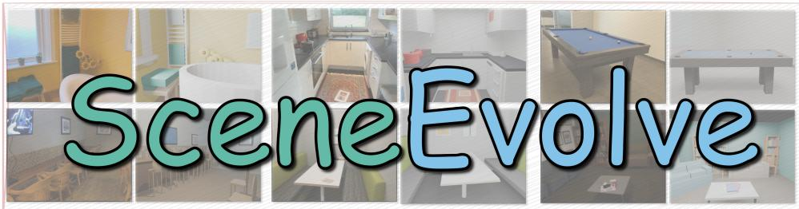

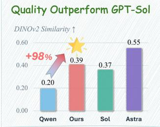

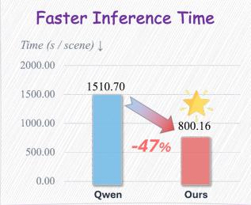

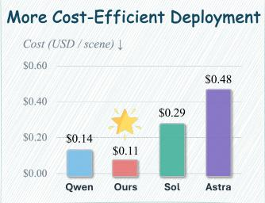  
Figure 1: Our proposed SceneEvolve framework evolves the harness of a compact open-source code agent, enabling it to translate a single image into executable code that constructs an editable, compositional 3D scene. It improves reconstruction quality and reduces inference time compared with the base agent, while achieving higher reconstruction quality at lower cost than GPT-5.6-Sol.

## ABSTRACT

Reconstructing editable and compositional 3D scenes from a real image requires jointly reasoning about geometry, object structure, and spatial relationships. We introduce SCENEEVOLVE, a framework that represents 3D scenes as executable code and improves reconstruction by evolving the harness around a small opensource agent. SCENEEVOLVE combines SCENEACT, a compositional semantic action interface built on parameterized primitives, hierarchical composition, and semantic spatial relations, with SCENEHARNESS-RSI, which leverages a stronger teacher agent to iteratively evolve the harness using feedback from developmentset reconstructions. Throughout harness evolution, the model parameters, action semantics, and execution backend remain fixed. The resulting harness provides a reusable reconstruction procedure that enables the small open-source model to reconstruct unseen scenes without parameter updates or teacher assistance. Across two in-domain datasets and one out-of-domain dataset, SCENEEVOLVE with the comparatively compact Qwen3.8-27B model improves all four evaluated reconstruction metrics while reducing mean inference time by 47.0% relative to the base model. More notably, despite relying on a substantially smaller model, SCE-NEEVOLVE achieves 32.3% higher reconstruction quality than the large proprietary GPT-5.6-Sol model, while reducing mean equivalent deployment cost by 59.8%. Furthermore, the harness evolved using Qwen3.8-27B also generalizes to Kimi-K3, achieving comparable reconstruction performance to GPT-6-Astra. The project page is https://haoyu-agent.github.io/SceneEvolve.

## 1 INTRODUCTION

Compositional 3D scene reconstruction enables interactive and editable representations of realworld environments, with applications in robotics, embodied AI, AR/VR, and digital content creation (Ma et al., 2026; Wang et al., 2026; Yeh et al., 2022). Given a single image of an indoor environment, the goal is to reconstruct an editable, compositional 3D scene that captures its geometry, constituent objects, spatial layout, and lighting (Ma et al., 2026; Yeh et al., 2022).

Existing approaches address this problem through several strategies. Procedural and generative methods synthesize diverse 3D environments (Raistrick et al., 2024; Yang et al., 2024), while multistage reconstruction pipelines divide the task into scene understanding, asset generation, and object placement (Ma et al., 2026). More recently, code-based agents have represented scenes as executable programs, enabling explicit manipulation of objects and spatial relations (Yin et al., 2026; Wang et al., 2026). Despite these advances, reconstructing a specific real-world scene with high fidelity often requires carefully engineered intermediate stages (Ma et al., 2026; Yeh et al., 2022) or repeated render-and-refine iterations (Yin et al., 2026; Huang et al., 2024).

Frontier models such as GPT-6-Astra (OpenAI, 2026b) suggest a more direct approach: generating editable 3D scene programs from a single image with limited iterative refinement. However, their deployment costs motivate us to investigate whether a substantially smaller open-source model can achieve comparable image-to-3D programming capabilities through harness design rather than parameter updates (Khattab et al., 2024; Agrawal et al., 2026a). Our goal is to enable direct scene-code generation while reducing reliance on costly render-and-refine loops.

Achieving this goal presents two main challenges. First, compact models have limited visual and spatial reasoning capabilities, making it difficult to infer coherent 3D structures and translate visual observations into executable scene representations. Second, effective reconstruction also depends on the external harness: the instructions, tools, and control logic that govern how the model observes, plans, constructs, and executes a scene program (Yin et al., 2026; Khattab et al., 2024). Addressing these challenges requires both an interface that reduces the demands on geometric reasoning and a reusable procedure that guides reconstruction.

To address these challenges, we introduce SCENEEVOLVE, as shown in Figure 1, a framework that combines a compositional scene interface, SCENEACT, with a teacher-guided harness evolution framework, SCENEHARNESS-RSI. SCENEACT translates high-level scene intent into executable operations through parameterized geometric primitives, hierarchical object composition, and semantic spatial relations. These abstractions reduce the need for low-level geometric programming while preserving explicit scene structure. Building on this interface, SCENEHARNESS-RSI uses a stronger teacher model to analyze the frozen student’s development-set reconstructions, execution traces, and evaluation feedback, then propose revisions to the shared reconstruction harness. Candidate harnesses are evaluated under a common execution budget, and revisions are retained when they improve the development score. Throughout this process, the student parameters, action semantics, and execution backend remain fixed. The optimization target is the reusable reconstruction procedure, which is subsequently frozen and deployed on unseen scenes without teacher assistance.

Our contributions are summarized as follows:

• We formulate compositional 3D scene reconstruction as an executable harness-optimization problem, targeting direct code generation without parameter updates or repeated iterations.

• We introduce SCENEACT, a compositional interface that maps scene intent to executable 3D scene code using parameterized primitives, hierarchical composition, and semantic spatial relations, providing explicit control over object geometry and scene structure.

• We propose SCENEHARNESS-RSI, a teacher-guided recursive evolution method for optimizing reusable reconstruction harnesses. Teacher guidance is used only during evolution, allowing the resulting harnesses to generalize to unseen scenes without teacher assistance.

• Across in-domain and out-of-domain datasets, SCENEEVOLVE with Qwen3.8-27B outperforms GPT-5.6-Sol, reducing cost by 59.8% and inference time by 47.0% relative to the baseline. The evolved harness also transfers to Kimi-K3, achieving results competitive with GPT-6-Astra and demonstrating its transferability across different backbone models.

## 2 RELATED WORK

3D Generation for Compositional 3D Scene Reconstruction. Single-image reconstruction and generative models recover object geometry and appearance (Hong et al., 2024; Xu et al., 2024; Xiang et al., 2025), while scene-level methods model object layouts and relations using semantic priors (Lin & Mu, 2024; Lin et al., 2025) or jointly predict multiple objects and their spatial configurations (Huang et al., 2025; Meng et al., 2026). SCENEACT unifies object construction and scene composition in an executable program with primitives and spatial operators.

Multi-stage Pipelines for Compositional 3D Scene Reconstruction. Compositional reconstruction represents object geometry and scene layout as separately editable components. Prior work aligns CAD models or jointly estimates layout, poses, and geometry (Izadinia et al., 2017; Nie et al., 2020), with inverse rendering further recovering materials and lighting (Yeh et al., 2022). Recent methods combine single-image scene analysis, object generation, and spatial refinement (Ardelean et al., 2025; Ma et al., 2026; Zhang et al., 2026b), leverage multi-view evidence for assembly (Xia et al., 2026; Qin et al., 2026), or jointly generate object geometry and spatial configurations (Huang et al., 2025; Meng et al., 2026). SCENEEVOLVE instead realizes object-centric reconstruction as an executable scene program built from parameterized primitives, part hierarchies, and spatial relations, enabling a frozen agent to construct and edit the scene.

Programmatic Coding Agents for Compositional 3D Scene Reconstruction. Procedural and language-guided generators use reusable assets and spatial constraints for controllable scene synthesis (Deitke et al., 2022; Raistrick et al., 2024; Yang et al., 2024). Related representations encode hierarchical assemblies as executable programs (Jones et al., 2020) or predict structured scene de scriptions from visual or point-cloud observations (Avetisyan et al., 2024; Mao et al., 2025). Visual coding agents further generate and refine graphics programs through rendered feedback, reusable libraries, and execution-guided iteration (Hu et al., 2024; Huang et al., 2024; Yin et al., 2026; Yang et al., 2026; Wang et al., 2026). SCENEACT exposes a fixed set of semantic construction operators, while SCENEHARNESS-RSI optimizes the reusable procedure.

## 3 METHODS

## 3.1 OVERVIEW

We propose SCENEEVOLVE, a framework for compositional image-to-3D reconstruction of indoor scenes, as illustrated in Figure 2. The framework comprises two components: SCENE-ACT, a compact semantic interface that maps high-level scene intent to executable actions, and SCENEHARNESS-RSI, a teacher-guided procedure that ens the reconstruction harness using endto-end reconstruction feedback. SCENEACT defines the executable interface through which the frozen student agent reconstructs 3D scenes. SCENEHARNESS-RSI iteratively refines the harness through a propose–execute–evaluate–retain cycle to improve how the student uses SCENEACT while keeping the student parameters fixed.

## 3.2 SCENEACT: A COMPACT SEMANTIC INTERFACE FROM INTENT TO ACTIONS

SCENEACT provides a compact semantic interface between high-level scene reasoning and lowlevel Blender execution. It enables the student agent to use semantically meaningful actions that are deterministically translated into executable Blender operations, reducing the need to directly specify low-level geometric operations and numerical parameters. The action space comprises three complementary abstractions: composable parameterized primitives, hierarchical composition, and semantic spatial relations. Together, these abstractions support progressive scene construction from local geometry to object structure and scene-level layout.

Composable Parameterized Primitives. SCENEACT exposes a compact set of parameterized geometric primitives as the basic units of scene construction. A SCENEACT program can instantiate multiple primitives, with each primitive $\rho _ { i }$ represented as

$$
\begin{array} { r } { \rho _ { i } = \big ( \kappa _ { i } , \mathbf { g } _ { i } , \mathbf { a } _ { i } \big ) , \qquad \kappa _ { i } \in \mathcal { G } , } \end{array}\tag{1}
$$

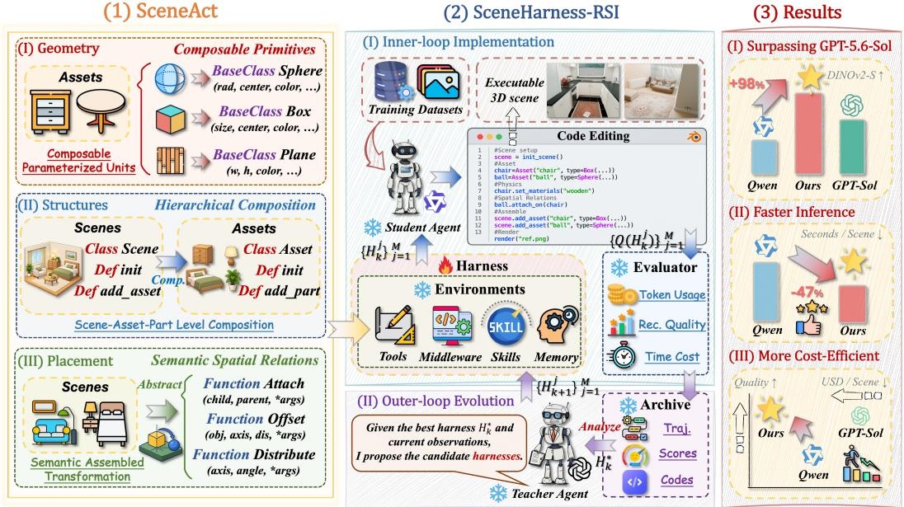  
Figure 2: Illustration of SCENEEVOLVE for compositional image-to-3D reconstruction. The framework combines two components: (1) SCENEACT translates scene intent into executable Blender operations through parameterized primitives, hierarchical composition, and semantic spatial relations. (2) SCENEHARNESS-RSI couples an outer loop for teacher-guided harness evolution with an inner loop for candidate evaluation by a frozen student, retaining revisions that improve performance. The optimized harness is deployed on unseen scenes without parameter updates.

where κi identifies a primitive class in the predefined library G, and gi and ai denote its geometric and appearance parameters, respectively. This representation allows the student agent to construct geometry by instantiating and configuring primitive classes without directly manipulating mesh vertices, faces, or other low-level Blender representations.

The primitive classes share a common interface for translation, rotation, and scaling, allowing their instances to be composed into higher-level scene structures. For example, a tabletop can be represented by a thin Box, its supporting legs by Box or Cylinder instances, and a curved lamp arm by a Curve. These primitives can then be transformed and assembled into semantic parts and assets. This design expresses reconstruction as a sequence of compact, executable decisions and shifts the student’s reasoning from low-level mesh programming to structured geometric construction. In this way, the student’s geometric reasoning is reduced to two interpretable decisions: which primitive best explains each visible part, and what geometric and appearance parameters characterize it?

Hierarchical Composition. We organize the reconstructed scene using an explicit semantic hier archy implemented in the scene program. The Scene class manages a collection of assets through interfaces such as scene.add\_asset(...). The reusable Asset base class encapsulates object-level structure and provides asset.add\_part(...) for composing semantic parts. Each Part is constructed from one or more parameterized geometric primitives. This hierarchy separates scene-level composition, object-level structure, and part-level geometry: the Scene supports adding, removing, transforming, and duplicating complete assets, while each Asset controls the construction and refinement of its internal parts. For example, a table asset may contain a tabletop and several legs, each constructed independently from geometric primitives. This program structure supports modular construction and localized editing while preserving a direct correspondence between visually identifiable entities in the input image and their executable representations.

Semantic Spatial Relations. SCENEACT specifies spatial structure through semantic relations, reducing the need to predict explicit coordinates. This design is motivated by the observation that VLMs are more reliable at inferring relations such as under, attached to, and facing than at predicting the precise 3D translations and rotations needed to realize them. Accordingly, each scene element exposes geometric features with semantic meaning, including center, extent, support, anchor, and boundary, together with relational operators such as $a l i g n ( . . . )$ and distribute(...).

These operators encode spatial constraints relative to scene geometry. For example, four table legs can be positioned below a tabletop and aligned with its corners without predicting their coordinates independently. The SCENEACT interpreter resolves such relations into deterministic transformations based on current geometry, reference frames, extents, and anchors. Since the constraints are defined structurally rather than in fixed world coordinates, they can be re-evaluated after edits, allowing dependent elements to update automatically. This separates relational reasoning from numerical transformation computation, reducing direct coordinate prediction while preserving precision.

## 3.3 SCENEHARNESS-RSI: A TEACHER-GUIDED RECURSIVE HARNESS EVOLUTION

SCENEHARNESS-RSI improves the execution harness of a frozen student through teacher-guided revisions. Starting from an initial harness $H _ { 0 }$ , the student reconstructs development-set scenes through SCENEACT, producing Blender programs, rendered outputs, and execution traces. A teacher uses this evidence to identify limitations of the current harness and propose targeted revisions. The same frozen student then evaluates the revised harnesses under a fixed protocol, and only revisions that improve the recorded development-set reconstruction score are retained. Repeating this propose–execute–evaluate–retain cycle defines an outer-loop search over executable harnesses.

Harness Search Space and Evaluation. The harness defines the execution environment of the frozen student, including callable tool interfaces, middleware, reusable skills, and memory. SCENEHARNESS-RSI searches over revisions to these components while keeping the SCENEACT semantics, student parameters, and Blender execution backend fixed.

Let $\mathcal { D } _ { \mathrm { d e v } } = \{ I _ { i } \} _ { i = 1 } ^ { N }$ denote a development set of N images. For each image $I _ { i } ,$ , the student executes under harness H to produce a reconstructed scene and its rendered image $\hat { I } _ { i } ( H )$ . We define the development-set quality score $Q ( H )$ as the average of three measures across development images:

$$
Q ( H ) = \frac { 1 } { 3 N } \sum _ { i = 1 } ^ { N } \left[ S \left( I _ { i } , \hat { I } _ { i } ( H ) \right) + \left( 1 - \mathcal { L } \left( I _ { i } , \hat { I } _ { i } ( H ) \right) \right) + \frac { 1 + \mathcal { D } \left( I _ { i } , \hat { I } _ { i } ( H ) \right) } { 2 } \right] ,\tag{2}
$$

where $s , \mathcal { L } ,$ and D denote SSIM (Wang et al., 2004), LPIPS (Zhang et al., 2018), and DINOv2 cosine similarity (Oquab et al., 2024), respectively. Before aggregation, we clip S and $\mathcal { L } \mathrm { ~ t o ~ } [ 0 , 1 ]$ and $\mathcal { D } \tan \left[ - 1 , 1 \right]$ . The resulting transformations place all three terms on a common [0, 1] scale. Thus, a higher score $\dot { Q } ( H ) \in [ 0 , 1 ]$ indicates better reconstruction quality. We use this score to compare and select harness candidates.

Outer-Loop Teacher-Guided Harness Evolution. We search the discrete space of executable harnesses using teacher-guided proposals. At round k, the search maintains the retained harness $H _ { k }$ and an archive $\mathcal { A } _ { k }$ containing all previously evaluated harnesses, their recorded development scores, and their execution traces. The teacher examines this history to identify recurring reconstruction and execution failures and proposes M candidate revisions:

$$
H _ { k + 1 } ^ { j } \sim P _ { \phi } ( \cdot \mid H _ { k } , \mathcal { A } _ { k } ) , \qquad j = 1 , \ldots , M .\tag{3}
$$

Here, $P _ { \phi }$ denotes the proposal distribution induced by the teacher model with parameters ϕ. Revisions may include improved diagnostics, changes to tool handling, and reusable routines that apply SCENEACT operators. These revisions change how the student performs reconstruction while preserving the operator semantics and student parameters.

Inner-Loop Student Evaluation and Harness Retention. The same frozen student evaluates each candidate harness on $\mathcal { D } _ { \mathrm { d e v } }$ under identical decoding configurations, rollout budgets, rendering settings, and scoring protocols. Let $H _ { k + 1 } ^ { * }$ denote a highest-scoring candidate in the current round. We replace the retained harness only when this candidate achieves a score strictly higher than the retained harness’s recorded development score:

$$
H _ { k + 1 } = { \left\{ \begin{array} { l l } { H _ { k + 1 } ^ { * } , } & { Q { \big ( } H _ { k + 1 } ^ { * } { \big ) } > Q ( H _ { k } ) , } \\ { H _ { k } , } & { { \mathrm { o t h e r w i s e } } . } \end{array} \right. }\tag{4}
$$

Table 1: Performance comparison across different models on ScanNet and CA-1M (in-domain) and ARKitScenes (out-of-domain). We report PSNR, SSIM, LPIPS, and DINOv2 similarity. GPT-6- Astra serves as the reference. The best and second results are highlighted in bold and underlined.
<table><tr><td rowspan="2">Model</td><td rowspan="2">Inference effort</td><td colspan="8">In-domain</td><td colspan="4">Out-of-domain</td></tr><tr><td colspan="4">ScanNet</td><td colspan="4">CA-1M</td><td colspan="4">ARKitScenes</td></tr><tr><td></td><td></td><td>PSNR↑</td><td></td><td></td><td>SSIM↑ LPIPS↓ DINOv2-S↑ PSNR↑</td><td></td><td>SSIM↑</td><td>LPIPS↓ DINOv2-S↑</td><td></td><td>PSNR↑</td><td>SSIM↑</td><td></td><td>LPIPS↓ DINOv2-S↑</td></tr><tr><td>S GPT-6-Astra</td><td>High</td><td>10.063</td><td>0.386</td><td>0.684</td><td>0.590</td><td>10.309</td><td>0.382</td><td>0.705</td><td>0.556</td><td>9.561</td><td>0.407</td><td>0.748</td><td>0.519</td></tr><tr><td>S GPT-6-Astra</td><td>Medium</td><td>10.143</td><td>0.383</td><td>0.684</td><td>0.579</td><td>10.433</td><td>0.378</td><td>0.711</td><td>0.557</td><td>10.177</td><td>0.423</td><td>0.732</td><td>0.528</td></tr><tr><td>S GPT-6-Astra</td><td>Low</td><td>9.888</td><td>0.385</td><td>0.701</td><td>0.596</td><td>10.108</td><td>0.372</td><td>0.691</td><td>0.552</td><td>10.245</td><td>0.403</td><td>0.712</td><td>0.475</td></tr><tr><td>米 Claude-Opus-5</td><td>High</td><td>9.174</td><td>0.352</td><td>0.735</td><td>0.438</td><td>8.781</td><td>0.368</td><td>0.749</td><td>0.441</td><td>8.551</td><td>0.389</td><td>0.751</td><td>0.417</td></tr><tr><td>米 Claude-Opus-5</td><td>Medium</td><td>9.021</td><td>0.348</td><td>0.741</td><td>0.444</td><td>8.705</td><td>0.361</td><td>0.756</td><td>0.432</td><td>8.498</td><td>0.392</td><td>0.754</td><td>0.409</td></tr><tr><td>米 Claude-Opus-5</td><td>Low</td><td>8.742</td><td>0.337</td><td>0.747</td><td>0.416</td><td>8.566</td><td>0.355</td><td>0.753</td><td>0.419</td><td>8.287</td><td>0.374</td><td>0.764</td><td>0.391</td></tr><tr><td>米 Claude-Opus-5</td><td>None</td><td>8.463</td><td>0.329</td><td>0.759</td><td>0.398</td><td>8.318</td><td>0.346</td><td>0.769</td><td>0.423</td><td>8.146</td><td>0.358</td><td>0.771</td><td>0.356</td></tr><tr><td>S GPT-5.6-Sol</td><td>High</td><td>9.042</td><td>0.337</td><td>0.742</td><td>0.417</td><td>8.562</td><td>0.353</td><td>0.748</td><td>0.428</td><td>8.312</td><td>0.371</td><td>0.755</td><td>0.401</td></tr><tr><td>S GPT-5.6-Sol S GPT-5.6-Sol</td><td>Medium</td><td>8.731</td><td>0.319 0.307</td><td>0.754 0.756</td><td>0.375 0.382</td><td>7.821 8.294</td><td>0.347 0.338</td><td>0.765</td><td>0.411</td><td>8.027</td><td>0.340</td><td>0.752</td><td>0.408</td></tr><tr><td>S GPT-5.6-Sol</td><td>Low</td><td>7.945 7.755</td><td>0.284</td><td>0.752</td><td>0.389</td><td>8.212</td><td>0.321</td><td>0.757 0.770</td><td>0.416</td><td>7.942</td><td>0.314</td><td>0.776</td><td>0.349</td></tr><tr><td></td><td>None</td><td></td><td></td><td></td><td></td><td></td><td></td><td></td><td>0.361</td><td>8.067</td><td>0.356</td><td>0.773</td><td>0.357</td></tr><tr><td>Gemini-Flash-3.8</td><td>High</td><td>8.126</td><td>0.318</td><td>0.774</td><td>0.358</td><td>8.113</td><td>0.324</td><td>0.781</td><td>0.365</td><td>7.984</td><td>0.337</td><td>0.785</td><td>0.341</td></tr><tr><td>Gemini-Flash-3.8</td><td>Medium</td><td>8.004 7.813</td><td>0.311 0.298</td><td>0.782 0.789</td><td>0.361 0.337</td><td>8.154 7.874</td><td>0.319 0.306</td><td>0.779 0.795</td><td>0.358 0.341</td><td>7.846 7.731</td><td>0.330 0.332</td><td>0.792</td><td>0.334</td></tr><tr><td>Gemini-Flash-3.8</td><td>Low</td><td></td><td></td><td></td><td></td><td></td><td></td><td></td><td></td><td></td><td></td><td>0.799</td><td>0.336</td></tr><tr><td>女 Qwen3.8-27B</td><td>xHigh</td><td>9.061</td><td>0.376</td><td>0.772</td><td>0.240</td><td>8.381</td><td>0.367</td><td>0.806</td><td>0.134</td><td>9.704</td><td>0.448</td><td>0.785</td><td>0.219</td></tr><tr><td>交 Qwen3.8-27B w/ Ours</td><td>xHigh</td><td>9.124</td><td>0.378</td><td>0.755 +0.70% +0.53% -2.20%</td><td>0.391 +62.92%</td><td>8.513</td><td>0.440 +1.57% +19.89%</td><td>0.742 -7.94%</td><td>0.418 +211.94%</td><td>9.862</td><td>0.453 +1.12%</td><td>0.721</td><td>0.368</td></tr><tr><td>Improvement</td><td></td><td></td><td></td><td></td><td></td><td></td><td></td><td></td><td></td><td>+1.63%</td><td></td><td>-8.15%</td><td>+68.04%</td></tr><tr><td>K Kimi-K3</td><td>High</td><td>9.181 9.547</td><td>0.350 0.381</td><td>0.734 0.712</td><td>0.437 0.513</td><td>8.847 9.718</td><td>0.365 0.454</td><td>0.756 0.722</td><td>0.458 0.534</td><td>8.603 10.029</td><td>0.384 0.469</td><td>0.758</td><td>0.392</td></tr><tr><td>Kimi-K3 w/ Ours</td><td>High</td><td></td><td></td><td></td><td>+17.39%</td><td></td><td>+9.85% +24.38% -4.50%</td><td></td><td>+16.59%</td><td>+16.58% +22.14% -5.54%</td><td></td><td>0.716</td><td>0.504</td></tr><tr><td>Improvement</td><td></td><td></td><td>+3.99% +8.86% -3.00%</td><td></td><td></td><td></td><td></td><td></td><td></td><td></td><td></td><td></td><td>+28.57%</td></tr></table>

All evaluated candidates, their scores, and their execution traces are added to the archive, allowing subsequent proposals to draw on both successful and unsuccessful revisions. This retention rule ensures that the recorded development scores of the retained harnesses form a non-decreasing sequence. It does not guarantee monotonic improvement in expected performance or performance on unseen scenes. Student reconstruction forms the inner execution loop, while teacher-guided harness revision forms the outer search loop. After K rounds, the method returns the retained harness H .

## 4 EXPERIMENTS

## 4.1 EXPERIMENTAL SETTINGS

Datasets. We use three indoor scene datasets comprising 160 scenes in total: ScanNet (Dai et al., 2017) and CA-1M (Lazarow et al., 2025) for in-domain development and evaluation, and ARKitScenes (Baruch et al., 2021) for out-of-domain evaluation. The resulting split consists of 100 development scenes, 40 in-domain test scenes, and 20 out-of-domain test scenes.

In-domain Datasets. ScanNet (Dai et al., 2017) provides RGB-D sequences with camera poses, reconstructed indoor geometry, and semantic annotations, while CA-1M (Lazarow et al., 2025) contains handheld egocentric captures registered to high-quality laser scans with dense 3D object annotations. From each dataset, we randomly sample 70 scenes and partition them at the scene level into disjoint development and test sets of 50 and 20 scenes, respectively. All views and repeated captures of the same physical scene are confined to a single split. The development sets are used for recursive harness search, while the test sets are reserved exclusively for in-domain evaluation.

Out-of-domain Dataset. ARKitScenes (Baruch et al., 2021) contains mobile RGB-D indoor captures with laser-scanned geometry and 3D object annotations. We randomly sample 20 scenes for out-of-domain evaluation. The harness developed on ScanNet (Dai et al., 2017) and CA-1M (Lazarow et al., 2025) is transferred directly to these scenes with the student weights, harness code, and inference configuration fixed. No ARKitScenes (Baruch et al., 2021) data or feedback are used during harness development, enabling a clean evaluation of cross-dataset generalization.

Evaluation Metrics. We evaluate all methods along three dimensions: reconstruction quality, inference efficiency, and equivalent cost. Reconstruction quality is measured by PSNR (Wang & Bovik, 2009), SSIM (Wang et al., 2004), LPIPS (Zhang et al., 2018), and DINOv2 similarity (Oquab

(a) Reconstruction Quality Consistently Outperform GPT-Sol

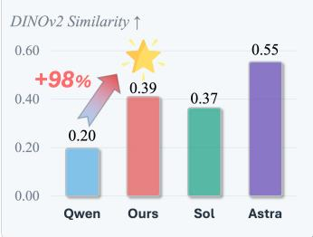  
(b) Inference Time Substantially Faster Inference

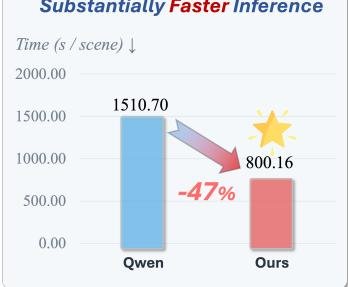  
(c) Equivalent Cost More Cost-Efficient Deployment

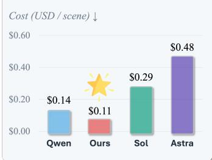

Figure 3: Comparison of SCENEEVOLVE with Qwen3.8-27B at xhigh, GPT-5.6-Sol at none, and GPT-6-Astra at none. The average DINOv2-S ↑, inference time ↓, and equivalent cost ↓ are reported.  
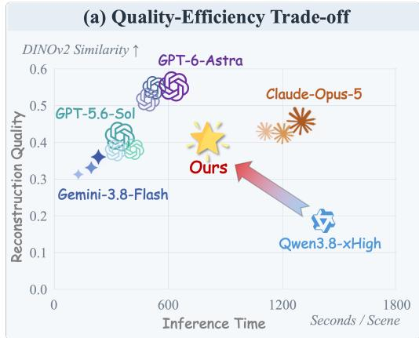  
(b) Quality-Cost Trade-off

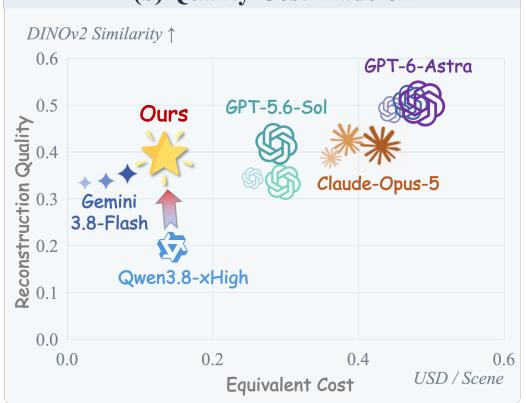  
Figure 4: Comparison of reconstruction quality against inference time and equivalent deployment cost across model configurations. The high, medium and low settings denote reasoning modes from deeper to shallower inference. DINOv2-S ↑, inference time ↓, and equivalent deployment cost ↓ are reported averaged over three datasets.

et al., 2024), capturing pixel, structural, perceptual, and semantic fidelity, respectively. Inference efficiency is measured by the average per-scene inference time under a unified protocol. We further report the average equivalent cost per scene under a consistent cost definition, enabling direct comparison of the trade-offs among quality, efficiency, and cost across model configurations.

Baselines. We benchmark proprietary multimodal models as zero-shot agents for compositional image-to-3D scene reconstruction, without task-specific fine-tuning. Our baseline suite includes GPT-5.6-Sol (OpenAI, 2026a) and GPT-6-Astra (OpenAI, 2026b), Claude-Opus-5 (Anthropic, 2026), and Gemini-Flash-3.8 (Google DeepMind, 2026). For models with configurable reasoning effort, we evaluate all supported settings among none, low, medium, and high, treating each model– effort pair as a distinct baseline configuration. We also evaluate Qwen3.8-27B (Qwen Team, 2026) at xhigh, using the same model and reasoning configuration as the frozen student in our method. We additionally use Kimi-K3 (Kimi Team, 2026) at high as a cross-model validation harness.

Implementation details. We use Qwen3.8-27B (Qwen Team, 2026) at xhigh as the frozen student and GPT-6-Astra (OpenAI, 2026b) at medium as the harness proposer, running K = 30 rounds with M = 2 proposals each. Candidates are conditioned on archived development evidence and evaluated on equally weighted ScanNet (Dai et al., 2017) and CA-1M (Lazarow et al., 2025) scenes, with input frames selected by a space-aware frame sampling strategy following Spatial-MLLM (Wu et al., 2025). The selected harness and inference configuration are frozen at test. All models are accessed exclusively via API calls, without using additional third-party harnesses such as Codex, Claude Code, or pi. To evaluate the cross-model transferability of the self-evolved harness, we apply the harness evolved with Qwen3.8-27B directly to Kimi-K3 (Kimi Team, 2026) at high.

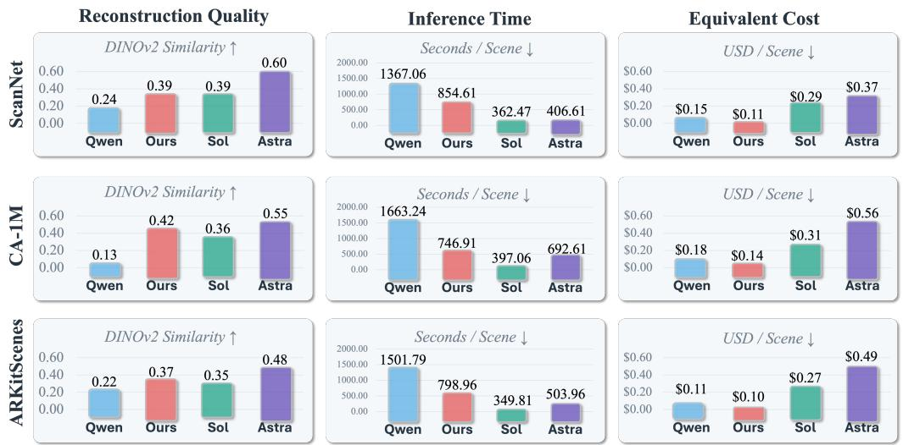  
Figure 5: Comparison of SCENEEVOLVE with Qwen3.8-27B at xhigh, GPT-5.6-Sol at none, and GPT-6-Astra at none on two in-domain datasets ScanNet and CA-1M and the out-of-domain dataset ARKitScenes. The DINOv2 similarity, inference time, and deployment cost are reported for each.

## 4.2 QUANTITATIVE RESULTS

## 4.2.1 COMPARISON WITH THE BASE MODEL

Reconstruction Quality. As shown in Table 1, SCENEEVOLVE consistently outperforms Qwen3.8-27B across all four reconstruction metrics and three datasets under fixed student weights and reasoning effort. Averaged across datasets, DINOv2-S increases from 0.198 to 0.392, while SSIM improves by 6.7%, LPIPS decreases by 6.1%, and PSNR increases by 0.118 dB; these gains also transfer to the unseen ARKitScenes dataset without target-specific adaptation.

Inference Time. As Figure 4 and Figure 5 illustrate, SCENEEVOLVE reduces mean per-scene inference time by 37.5% on ScanNet, 55.1% on CA-1M, and 46.8% on ARKitScenes relative to the base Qwen3.8-27B xhigh. Across the three datasets, mean inference time decreases from 1,510.7 to 800.2 seconds, a reduction of 47.0%, alongside improvements in all four reconstruction metrics.

Deployment cost. As shown in Figure 4 and Figure 5, SCENEEVOLVE achieves lower deployment costs across datasets, reducing the mean equivalent deployment cost by 20.5% relative to the Qwen3.8-27B xHigh baseline and by 22.7% on both ScanNet and CA-1M. Overall, SCENEEVOLVE provides a more favorable trade-off between reconstruction quality, inference time, and cost.

Cross-Model Harness Transfer. To evaluate the cross-model generalizability of harness evolution, we directly transfer the harness evolved using Qwen3.8-27B to Kimi-K3 under the high reasoning-effort setting, without any target-specific search, fine-tuning, or manual adaptation. As shown in Table 1, the transferred harness consistently improves all four reconstruction metrics across all three datasets compared with the Kimi-K3 baseline without the transferred harness. These result demonstrate that harness evolution can discover reconstruction strategies that generalize beyond the model used during the search, rather than merely exploiting model-specific behaviors.

## 4.2.2 COMPARISON WITH FRONTIER MODELS

Reconstruction Quality. Qwen3.8-27B with SCENEEVOLVE outperforms GPT-5.6-Sol with none reasoning effort in eleven of twelve dataset–metric comparisons, improving mean SSIM by 32.3%, reducing LPIPS by 3.4%, increasing PSNR by 1.155 dB and increasing its DINOv2-S by 6.3%. All four metrics improve on CA-1M and ARKitScenes. Mean SSIM also exceeds Sol-low, Sol-medium, and Sol-high by 32.5%, 26.3%, and 20.0%, respectively. Against Astra-low and Astra-medium, mean SSIM improves by 9.6% and 7.3%, respectively.

Table 2: Component-ablation on Qwen3.8-27B, averaged across the three datasets. PSNR, SSIM, LPIPS, DINOv2 similarity, inference time, and equivalent cost are averaged across the three datasets.
<table><tr><td>Configuration</td><td>PSNR↑</td><td>SSIM↑</td><td>LPIPS↓</td><td>DINOv2-S↑</td><td>Time↓</td><td>Cost↓</td></tr><tr><td>Base Qwen3.8-27B</td><td>9.049</td><td>0.397</td><td>0.788</td><td>0.198</td><td>1510.7</td><td>0.147</td></tr><tr><td>w/o SCENEACT</td><td>9.102</td><td>0.405</td><td>0.771</td><td>0.305</td><td>1035.0</td><td>0.152</td></tr><tr><td>w/o SCENEHARNESS-RSI</td><td>9.119</td><td>0.411</td><td>0.762</td><td>0.285</td><td>1424.0</td><td>0.155</td></tr><tr><td>SCENEEVOLVE</td><td>9.166</td><td>0.424</td><td>0.739</td><td>0.392</td><td>800.2</td><td>0.117</td></tr></table>

Inference Time. As shown in Figure 4 and Figure 5, Qwen3.8-27B with SCENEEVOLVE averages 800.2 seconds, compared with 369.8 for Sol-none, 502.3 for Astra-low, and 526.8 for Astra-medium. It therefore requires 116.4%, 59.3%, and 51.9% more time, respectively.

Deployment Cost. As Figure 4 and Figure 5 illustrate, for Qwen3.8-27B with SCENEEVOLVE, the mean equivalent deployment cost decreases by 59.8% relative to Sol-none, from approximately \$0.290 to \$0.117 per scene. Costs are also 46.2%, 52.9%, 69.0%, and 70.5% lower than Sol-low, Sol-medium, Astra-low, and Astra-medium, respectively.

Cross-model Harness Transfer. To assess the transferability of the evolved harness across model backbones, we directly apply the harness optimized with Qwen3.8-27B to Kimi-K3 under the high reasoning-effort setting, without target-specific search, fine-tuning, or manual adaptation. Its reconstruction performance is competitive with GPT-6-Astra. Meanwhile, the transferred harness consistently outperforms Claude-Opus-5 across almost all metrics on all three datasets, even across the different reasoning effort settings evaluated. These results demonstrate that harness evolution can discover reusable reconstruction strategies that transfer across models, enabling a different model to achieve frontier-competitive reconstruction quality without model-specific optimization.

## 4.3 QUALITATIVE RESULTS

Comparison with the Base Model. As shown in Figure 6, it compares reconstructions of five indoor scenes in terms of viewpoint alignment, object geometry, and spatial organization. Compared with the base, Qwen3.8-27B with SCENEEVOLVE improves scene coherence, particularly in the bar and lounge, correcting severe viewpoint distortions and better recovering furniture arrangements. In the kitchen, it produces more continuous cabinetry and countertops, avoiding the fragmented cabinet fronts and bright green window region in the baseline. Despite these improvements, discrepancies remain, including an overly bright lounge and simplified seating with inaccurate colors in the booth.

Comparison with Frontier Models. Figure 6 also compares both harness-equipped backbones with GPT-6-Astra and GPT-5.6-Sol. For Qwen3.8-27B with SCENEEVOLVE, the bar example shows competitive layout recovery: our reconstruction places a long counter and a repeated row of stools along the wall, whereas GPT-5.6-Sol distributes multiple rows of tables and chairs across the room. In the lounge example, Qwen3.8-27B with SCENEEVOLVE recovers the principal furniture categories and broad arrangement, but renders the sofas and walls in lighter colors than the reference.

Comparison of Cross-Model Harness Transfer. The last two columns of Figure 6 compare Kimi-K3 with and without SCENEEVOLVE, using a harness evolved on Qwen3.8-27B. The Kimi-K3 alone exhibits overexposure, bright yellow seating, and a high-contrast floor, whereas the transferred harness better reproduces the reference’s colors, furniture, and spatial layout. It also aligns wooden seats with the bar counter and preserves the lounge’s dark green accent wall and furniture arrangement. Compared with frontier models, it matches GPT-6-Astra’s counter-side seating and booth composition while avoiding the extra furniture rows in GPT-5.6-Sol and better preserving tabletop proportions. Notably, its lounge reconstruction retains the dark green wall more distinctly than either frontier model. These results demonstrate that cross-model harness transfer improves visual fidelity and enables competitive scene-layout and object-detail reconstruction.

Qwen3.8-27B Qwen3.8-27B w/ Ours  
Reference  
GPT-6-Astra  
GPT-5.6-Sol  
Kimi-K3 w/ Ours  
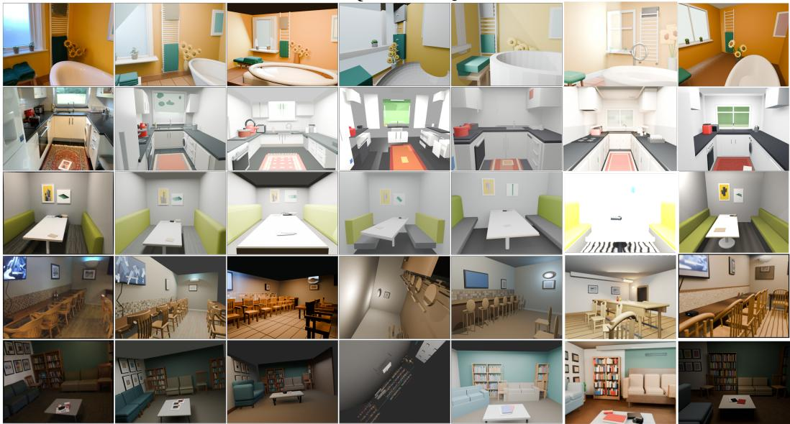  
Figure 6: Qualitative comparisons of indoor scene reconstruction with GPT-6-Astra, GPT-5.6-Sol, Qwen3.8-27B and Kimi-K3 on Scannet, CA-1M and ARKitScenes datasets. SCENEEVOLVE reconstructs editable 3D scenes that capture object geometry, relative proportions, and spatial relationships in the reference images, demonstrating improved structural fidelity.

## 4.4 ABLATION STUDY

We ablate SCENEACT and SCENEHARNESS-RSI with Qwen3.8-27B at xhigh. w/o SCENEACT replaces SCENEACT with direct Blender operations under the same optimization budget, while w/o SCENEHARNESS-RSI keeps SCENEACT but uses the initial, unevolved harness. The full method combines both.

Effect of SCENEACT. As shown in Table 2, incorporating SCENEACT increases DINOv2-S from 0.305 to 0.392 and reduces mean inference time by 22.7% compared with the w/o SCENEACT variant. These results suggest that the structured interface, which supports hierarchical construction and semantic placement, improves both reconstruction quality and inference efficiency.

Effect of SCENEHARNESS-RSI. As shown in Table 2, with SCENEACT fixed, harness evolution increases DINOv2-S from 0.285 to 0.392, reduces mean inference time by 43.8%, and lowers the mean equivalent cost per scene from \$0.155 to \$0.117. These results support the value of optimizing a reusable reconstruction procedure alongside the structured action interface.

## 5 CONCLUSION

We introduced SCENEEVOLVE, a framework for editable, compositional 3D scene reconstruction in code-generated scene settings that combines a structured scene action interface SCENEACT with teacher-guided evolution of a reusable reconstruction harness SCENEHARNESS-RSI. Extensive experiments demonstrate that SCENEEVOLVE improves over its base configuration and outperforms GPT-5.6-Sol with none reasoning effort, while reducing mean inference time by 47.0% and equivalent deployment cost per scene by 59.8%. Furthermore, a reconstruction harness evolved using Qwen3.8-27B can also generalize to different models like Kimi-K3, achieving reconstruction results competitive with those of GPT-6-Astra.

## REFERENCES

Lakshya A. Agrawal, Shangyin Tan, Dilara Soylu, Noah Ziems, Rishi Khare, Krista Opsahl-Ong, Arnav Singhvi, Herumb Shandilya, Michael J. Ryan, Meng Jiang, Christopher Potts, Koushik Sen, Alexandros G. Dimakis, Ion Stoica, Dan Klein, Matei Zaharia, and Omar Khattab. GEPA: Reflective prompt evolution can outperform reinforcement learning. In International Conference on Learning Representations (ICLR), 2026a.

Lakshya A. Agrawal, Shangyin Tan, Dilara Soylu, Noah Ziems, Rishi Khare, Krista Opsahl-Ong, Arnav Singhvi, Herumb Shandilya, Michael J. Ryan, Meng Jiang, Christopher Potts, Koushik Sen, Alexandros G. Dimakis, Ion Stoica, Dan Klein, Matei Zaharia, and Omar Khattab. GEPA: Reflective prompt evolution can outperform reinforcement learning. In International Conference on Learning Representations (ICLR), 2026b.

Anthropic. Introducing Claude Opus 5. Official announcement, July 2026. URL https://www. anthropic.com/news/claude-opus-5. Published: 2026-07-24. Accessed: 2026-09-26.

Andreea Ardelean, Mert Özer, and Bernhard Egger. Gen3DSR: Generalizable 3D scene reconstruction via divide and conquer from a single view. In International Conference on 3D Vision (3DV), pp. 616–626, 2025.

Armen Avetisyan, Christopher Xie, Henry Howard-Jenkins, Tsun-Yi Yang, Samir Aroudj, Suvam Patra, Fuyang Zhang, Duncan Frost, Luke Holland, Campbell Orme, Jakob Engel, Edward Miller, Richard Newcombe, and Vasileios Balntas. SceneScript: Reconstructing scenes with an autoregressive structured language model. In European Conference on Computer Vision (ECCV), pp. 247–263, 2024.

Gilad Baruch, Zhuoyuan Chen, Afshin Dehghan, Tal Dimry, Yuri Feigin, Peter Fu, Thomas Gebauer, Brandon Joffe, Daniel Kurz, Arik Schwartz, and Elad Shulman. ARKitScenes: A diverse realworld dataset for 3D indoor scene understanding using mobile RGB-D data. In Thirty-fifth Conference on Neural Information Processing Systems Datasets and Benchmarks Track (Round 1), 2021.

Angela Dai, Angel X. Chang, Manolis Savva, Maciej Halber, Thomas Funkhouser, and Matthias Nießner. ScanNet: Richly-annotated 3D reconstructions of indoor scenes. In Proceedings of the IEEE Conference on Computer Vision and Pattern Recognition (CVPR), pp. 5828–5839, 2017.

Matt Deitke, Eli VanderBilt, Alvaro Herrasti, Luca Weihs, Kiana Ehsani, Jordi Salvador, Winson Han, Eric Kolve, Aniruddha Kembhavi, and Roozbeh Mottaghi. ProcTHOR: Large-scale embodied AI using procedural generation. In Advances in Neural Information Processing Systems (NeurIPS), volume 35, pp. 5982–5994, 2022.

Google DeepMind. Gemini 3.8 Flash. Model card, September 2026. URL https://deepmind. google/models/model-cards/gemini-3-8-flash/. Published: 2026-09-02. Accessed: 2026-09-26.

Yicong Hong, Kai Zhang, Jiuxiang Gu, Sai Bi, Yang Zhou, Difan Liu, Feng Liu, Kalyan Sunkavalli, Trung Bui, and Hao Tan. LRM: Large reconstruction model for single image to 3D. In International Conference on Learning Representations (ICLR), 2024.

Ziniu Hu, Ahmet Iscen, Aashi Jain, Thomas Kipf, Yisong Yue, David A. Ross, Cordelia Schmid, and Alireza Fathi. SceneCraft: An LLM agent for synthesizing 3D scenes as Blender code. In Proceedings ofthe 41st International Conference on Machine Learning, volume 235 of Proceedings of Machine Learning Research, pp. 19252–19282, 2024.

Ian Huang, Guandao Yang, and Leonidas Guibas. BlenderAlchemy: Editing 3D graphics with vision-language models. In European Conference on Computer Vision (ECCV), pp. 297–314, 2024.

Zehuan Huang, Yuan-Chen Guo, Xingqiao An, Yunhan Yang, Yangguang Li, Zi-Xin Zou, Ding Liang, Xihui Liu, Yan-Pei Cao, and Lu Sheng. MIDI: Multi-instance diffusion for single image to 3D scene generation. In Proceedings of the IEEE/CVF Conference on Computer Vision and Pattern Recognition (CVPR), pp. 23646–23657, 2025.

Hamid Izadinia, Qi Shan, and Steven M. Seitz. IM2CAD. In Proceedings of the IEEE Conference on Computer Vision and Pattern Recognition (CVPR), pp. 5134–5143, 2017.

R. Kenny Jones, Theresa Barton, Xianghao Xu, Kai Wang, Ellen Jiang, Paul Guerrero, Niloy J. Mitra, and Daniel Ritchie. ShapeAssembly: Learning to generate programs for 3D shape structure synthesis. ACM Transactions on Graphics, 39(6):1–20, 2020.

Omar Khattab, Arnav Singhvi, Paridhi Maheshwari, Zhiyuan Zhang, Keshav Santhanam, Sri Vardhamanan A, Saiful Haq, Ashutosh Sharma, Thomas Joshi, Hanna Moazam, Heather Miller, Matei Zaharia, and Christopher Potts. DSPy: Compiling declarative language model calls into state-ofthe-art pipelines. In International Conference on Learning Representations (ICLR), 2024.

Kimi Team. Kimi K3: Open Frontier Intelligence, 2026.

Justin Lazarow, David Griffiths, Gefen Kohavi, Francisco Crespo, and Afshin Dehghan. Cubify Anything: Scaling indoor 3D object detection. In Proceedings of the IEEE/CVF Conference on Computer Vision and Pattern Recognition (CVPR), pp. 22225–22233, 2025.

Yoonho Lee, Joseph Boen, and Chelsea Finn. Feedback descent: Open-ended text optimization via pairwise comparison. arXiv preprint arXiv:2511.07919, 2025.

Yoonho Lee, Roshen Nair, Qizheng Zhang, Kangwook Lee, Omar Khattab, and Chelsea Finn. Metaharness: End-to-end optimization of model harnesses. arXiv preprint arXiv:2603.28052, 2026.

Chenguo Lin and Yadong Mu. InstructScene: Instruction-driven 3D indoor scene synthesis with semantic graph prior. In International Conference on Learning Representations (ICLR), 2024.

Chenguo Lin, Yuchen Lin, Panwang Pan, Xuanyang Zhang, and Yadong Mu. InstructLayout: Instruction-driven 2D and 3D layout synthesis with semantic graph prior. IEEE Transactions on Pattern Analysis and Machine Intelligence, 47(12):11040–11050, 2025.

Xiaoxuan Ma, Jiashun Wang, Nicolás Ugrinovic, Yehonathan Litman, and Kris Kitani. REST3D: Reconstructing physically stable 3D scenes from a single image. arXiv preprint arXiv:2605.30338, 2026.

Yongsen Mao, Junhao Zhong, Chuan Fang, Jia Zheng, Rui Tang, Hao Zhu, Ping Tan, and Zihan Zhou. SpatialLM: Training large language models for structured indoor modeling. arXiv preprint arXiv:2506.07491, 2025.

Yanxu Meng, Haoning Wu, Ya Zhang, and Weidi Xie. SceneGen: Single-image 3D scene generation in one feedforward pass. In International Conference on 3D Vision (3DV), pp. 543–553, 2026.

Yinyu Nie, Xiaoguang Han, Shihui Guo, Yujian Zheng, Jian Chang, and Jian Jun Zhang. Total3DUnderstanding: Joint layout, object pose and mesh reconstruction for indoor scenes from a single image. In Proceedings of the IEEE/CVF Conference on Computer Vision and Pattern Recognition (CVPR), pp. 55–64, 2020.

OpenAI. GPT-5.6 Sol. OpenAI API documentation, 2026a. URL https://developers. openai.com/api/docs/models/gpt-5.6-sol. Accessed: 2026-09-26.

OpenAI. GPT-6 Astra. OpenAI API documentation, 2026b. URL https://developers. openai.com/api/docs/models/gpt-6-astra. Accessed: 2026-09-26.

Maxime Oquab, Timothée Darcet, Théo Moutakanni, Huy V. Vo, Marc Szafraniec, Vasil Khalidov, Pierre Fernandez, Daniel Haziza, Francisco Massa, Alaaeldin El-Nouby, Mido Assran, Nicolas Ballas, Wojciech Galuba, Russell Howes, Po-Yao Huang, Shang-Wen Li, Ishan Misra, Michael Rabbat, Vasu Sharma, Gabriel Synnaeve, Hu Xu, Hervé Jégou, Julien Mairal, Patrick Labatut, Armand Joulin, and Piotr Bojanowski. DINOv2: Learning robust visual features without super vision. Transactions on Machine Learning Research, 2024.

Reid Pryzant, Dan Iter, Jerry Li, Yin Lee, Chenguang Zhu, and Michael Zeng. Automatic prompt optimization with “gradient descent” and beam search. In Proceedings of the Conference on Empirical Methods in Natural Language Processing (EMNLP), pp. 7957–7968, 2023.

Minghan Qin, Yuang Wang, Xiuyu Yang, Yushi Long, Yujian Zhang, Ruihuan Wang, Kai Ye, Yangang Zhang, and Hang Li. Lucida: Parse, generate, and place for composable real-to-sim scene modeling. arXiv preprint arXiv:2608.30821, 2026.

Qwen Team. Qwen3.8-27B. Hugging Face model card, 2026. URL https://huggingface. co/Qwen/Qwen3.8-27B. Accessed: 2026-09-26.

Alexander Raistrick, Lingjie Mei, Karhan Kayan, David Yan, Yiming Zuo, Beining Han, Hongyu Wen, Meenal Parakh, Stamatis Alexandropoulos, Lahav Lipson, Zeyu Ma, and Jia Deng. Infinigen Indoors: Photorealistic indoor scenes using procedural generation. In Proceedings of the IEEE/CVF Conference on Computer Vision and Pattern Recognition (CVPR), pp. 21783–21794, 2024.

Noah Shinn, Federico Cassano, Ashwin Gopinath, Karthik Narasimhan, and Shunyu Yao. Reflexion: Language agents with verbal reinforcement learning. In Advances in Neural Information Processing Systems (NeurIPS), volume 36, pp. 8634–8652, 2023.

Puyi Wang, Yuhao Wang, Linjie Li, Zhengyuan Yang, Kevin Qinghong Lin, Yangguang Li, and Yu Cheng. SceneCode: Executable world programs for editable indoor scenes with articulated objects. arXiv preprint arXiv:2605.19587, 2026.

Zhou Wang and Alan C. Bovik. Mean squared error: Love it or leave it? a new look at signal fidelity measures. IEEE Signal Processing Magazine, 26(1):98–117, 2009.

Zhou Wang, Alan C. Bovik, Hamid R. Sheikh, and Eero P. Simoncelli. Image quality assessment: From error visibility to structural similarity. IEEE Transactions on Image Processing, 13(4): 600–612, 2004.

Diankun Wu, Fangfu Liu, Yi-Hsin Hung, and Yueqi Duan. Spatial-MLLM: Boosting MLLM capabilities in visual-based spatial intelligence. In Advances in Neural Information Processing Systems (NeurIPS), volume 38, 2025.

Chong Xia, Kai Zhu, Zizhuo Wang, Fangfu Liu, Zhizheng Zhang, and Yueqi Duan. SimRecon: SimReady compositional scene reconstruction from real videos. In Proceedings ofthe IEEE/CVF Conference on Computer Vision and Pattern Recognition (CVPR), pp. 42452–42463, 2026.

Jianfeng Xiang, Zelong Lv, Sicheng Xu, Yu Deng, Ruicheng Wang, Bowen Zhang, Dong Chen, Xin Tong, and Jiaolong Yang. Structured 3D latents for scalable and versatile 3D generation. In Proceedings ofthe IEEE/CVF Conference on Computer Vision and Pattern Recognition (CVPR), pp. 21469–21480, 2025.

Jiale Xu, Weihao Cheng, Yiming Gao, Xintao Wang, Shenghua Gao, and Ying Shan. InstantMesh: Efficient 3D mesh generation from a single image with sparse-view large reconstruction models. arXiv preprint arXiv:2404.07191, 2024.

Yixuan Yang, Zhen Luo, Wanshui Gan, Jinkun Hao, Junru Lu, Jinghao Yan, Zhaoyang Lyu, and Xudong Xu. Code-as-Room: Generating 3D rooms from top-down view images via agentic code synthesis. arXiv preprint arXiv:2605.18451, 2026.

Yue Yang, Fan-Yun Sun, Luca Weihs, Eli VanderBilt, Alvaro Herrasti, Winson Han, Jiajun Wu, Nick Haber, Ranjay Krishna, Lingjie Liu, Chris Callison-Burch, Mark Yatskar, Aniruddha Kembhavi, and Christopher Clark. Holodeck: Language guided generation of 3D embodied AI environments. In Proceedings ofthe IEEE/CVF Conference on Computer Vision and Pattern Recognition (CVPR), pp. 16227–16237, 2024.

Yu-Ying Yeh, Zhengqin Li, Yannick Hold-Geoffroy, Rui Zhu, Zexiang Xu, Miloš Hašan, Kalyan Sunkavalli, and Manmohan Chandraker. PhotoScene: Photorealistic material and lighting transfer for indoor scenes. In Proceedings ofthe IEEE/CVF Conference on Computer Vision and Pattern Recognition (CVPR), pp. 18562–18571, 2022.

Shaofeng Yin, Jiaxin Ge, Zora Zhiruo Wang, Chenyang Wang, Xiuyu Li, Michael J. Black, Trevor Darrell, Angjoo Kanazawa, and Haiwen Feng. Vision-as-inverse-graphics agent via interleaved multimodal reasoning. In European Conference on Computer Vision (ECCV), volume 17035 of Lecture Notes in Computer Science, pp. 557–575. Springer, 2026.

Mert Yuksekgonul, Federico Bianchi, Joseph Boen, Sheng Liu, Pan Lu, Zhi Huang, Carlos Guestrin, and James Zou. Optimizing generative AI by backpropagating language model feedback. Nature, 639(8055):609–616, 2025.

Eric Zelikman, Eliana Lorch, Lester Mackey, and Adam Tauman Kalai. Self-taught optimizer (STOP): Recursively self-improving code generation. arXiv preprint arXiv:2310.02304, 2024.

Hangfan Zhang, Shao Zhang, Kangcong Li, Chen Zhang, Yang Chen, Yiqun Zhang, Lei Bai, and Shuyue Hu. Self-harness: Harnesses that improve themselves. arXiv preprint arXiv:2606.09498, 2026a.

Richard Zhang, Phillip Isola, Alexei A. Efros, Eli Shechtman, and Oliver Wang. The unreasonable effectiveness of deep features as a perceptual metric. In Proceedings of the IEEE Conference on Computer Vision and Pattern Recognition (CVPR), pp. 586–595, 2018.

Shujie Zhang, Jingkun Yi, Weipeng Zhong, Zirui Zhou, Yangkun Zhu, Hanqing Wang, Xudong Xu, Weinan Zhang, and Chunhua Shen. RoboSnap: One-shot real-to-sim scene generation for generalizable robot learning and evaluation. arXiv preprint arXiv:2607.06699, 2026b.

## A EXPERIMENT DETAILS

## A.1 DATASET DETAILS

To evaluate the effectiveness of SCENEEVOLVE, we conduct experiments on three representative indoor-scene datasets covering different capture settings: ScanNet (Dai et al., 2017), CA-1M (Lazarow et al., 2025), and ARKitScenes (Baruch et al., 2021). ScanNet and CA-1M serve as in-domain datasets for harness development and evaluation, while ARKitScenes is reserved for out-of-domain evaluation. We use 160 scenes in total, comprising 100 development scenes, 40 in-domain test scenes, and 20 out-of-domain test scenes. All methods are evaluated on the same held-out scenes under a consistent single-image reconstruction protocol. Input views are selected using a space-aware frame sampling strategy following Spatial-MLLM (Wu et al., 2025). For each in-domain dataset, all views and repeated captures of the same physical scene are kept within a single split to prevent development–test overlap. Detailed descriptions are provided below.

• ScanNet. ScanNet (Dai et al., 2017) provides RGB-D sequences of indoor environments with camera poses, reconstructed 3D geometry, and semantic annotations. We randomly sample 70 scenes and divide them into 50 development scenes and 20 held-out in-domain test scenes. Its indoor layouts and object arrangements make it suitable for assessing whether a reconstruction agent can recover coherent scene geometry, constituent objects, and spatial relationships from a single image. The development split supplies reconstruction feedback for harness evolution, whereas the test split is used exclusively for evaluation.

• CA-1M. CA-1M (Lazarow et al., 2025) contains handheld egocentric indoor captures registered to high-quality laser scans, together with dense 3D object annotations. We randomly sample 70 scenes, assigning 50 to harness development and 20 to held-out in-domain evaluation. Compared with ScanNet, its capture and annotation setting provides a complementary test of object-level geometry, relative proportions, and spatial composition. As with ScanNet, only the development scenes are used to evaluate candidate harness revisions; the held-out test scenes are not used during harness search.

• ARKitScenes. ARKitScenes (Baruch et al., 2021) consists of mobile RGB-D captures of indoor environments with laser-scanned geometry and 3D object annotations. We randomly sample 20 scenes and use them exclusively for out-of-domain evaluation. Unlike the two in-domain datasets, ARKitScenes contributes no images or reconstruction feedback to harness development. The student parameters, selected harness, and inference configuration are transferred without modification, making this benchmark a test of whether the reconstruction procedure generalizes to previously unseen data.

## A.2 COUNTERPART DETAILS

This section provides a detailed overview of the counterpart models employed in our experiments. We compare SCENEEVOLVE with the unmodified student backbone and representative proprietary multimodal models, including GPT-5.6-Sol, GPT-6-Astra, Claude-Opus-5, and Gemini-Flash-3.8. The proprietary models are evaluated as zero-shot agents for compositional image-to-3D scene reconstruction without task-specific fine-tuning. For models supporting configurable reasoning effort, each model–effort combination is treated as a separate counterpart. All counterparts are evaluated on the same held-out scenes using consistent reconstruction metrics. Details are provided below.

• Qwen3.8-27B. Qwen3.8-27B (Qwen Team, 2026) serves as the open-source backbone and the primary base-model counterpart. We evaluate it at xhigh reasoning effort, matching the model and inference effort used by the frozen student in SCENEEVOLVE. This comparison isolates the improvements obtained from the proposed reconstruction framework without changing the underlying student model parameters.

• Kimi-K3. Kimi-K3 (Kimi Team, 2026) is an open-weight multimodal model evaluated at high reasoning effort to investigate the cross-model generalization of the evolved harness. Specifically, we directly transfer the harness evolved with Qwen3.8-27B to Kimi-K3 without additional harness evolution, model fine-tuning, or target-model-specific optimization. We compare Kimi-K3 equipped with the transferred harness against its unevolved counterpart under the same reasoning effort, reconstruction protocol, and execution budget. The

SCENEACT interface and execution backend remain unchanged throughout the evaluation. This setting isolates the transferability of the learned reconstruction procedure across different model backbones, examining whether harness improvements obtained from one student model can generalize to another without model-specific adaptation.

• GPT-5.6-Sol. GPT-5.6-Sol (OpenAI, 2026a) is a proprietary multimodal model used as a frontier-model counterpart for evaluating reconstruction quality, inference efficiency, and deployment cost. We consider four reasoning-effort configurations: none, low, medium, and high. The none configuration serves as the primary proprietary reference in our main comparison, while the remaining configurations characterize the effect of increased inference effort on reconstruction performance and resource consumption.

• GPT-6-Astra. GPT-6-Astra (OpenAI, 2026b) provides an additional frontier-model reference for compositional scene reconstruction. We evaluate its low, medium, and high reasoning-effort configurations. Separately, GPT-6-Astra at medium serves as the teacher model during SCENEHARNESS-RSI development, proposing harness revisions from development-set feedback. The teacher does not participate in reconstruction at test time.

• Claude-Opus-5. Claude-Opus-5 (Anthropic, 2026) is a proprietary multimodal counterpart evaluated under four reasoning-effort settings: none, low, medium, and high. It provides an additional comparison of image-conditioned scene-code generation across model families. These configurations are evaluated without task-specific fine-tuning, enabling an assessment of reconstruction fidelity and inference resource requirements.

• Gemini-Flash-3.8. Gemini-Flash-3.8 (Google DeepMind, 2026) is another proprietary multimodal counterpart for single-image scene reconstruction. We evaluate its low, medium, and high reasoning-effort configurations. Together with the other proprietary models, it broadens the comparison across model families and inference configurations, allowing us to examine the trade-offs among quality, inference time, and cost.

## B ADDITIONAL RELATED WORK

## B.1 SELF-IMPROVING AGENTS AND HARNESS OPTIMIZATION

Self-improving agent systems leverage feedback from prior executions to iteratively refine the mechanisms that govern subsequent behavior. Existing approaches differ primarily in the components they optimize and the forms of feedback they exploit. Reflexion (Shinn et al., 2023) records natural-language reflections in episodic memory to inform future decisions, whereas STOP (Zelikman et al., 2024) recursively improves an executable scaffold. A complementary line of work, including TextGrad (Yuksekgonul et al., 2025), ProTeGi (Pryzant et al., 2023), GEPA (Agrawal et al., 2026b), and Feedback Descent (Lee et al., 2025), optimizes textual components using naturallanguage feedback. More recently, Meta-Harness (Lee et al., 2026) and Self-Harness (Zhang et al., 2026a) extend the optimization target to agent source code, using execution outcomes to guide iterative code revisions. Their evaluations span diverse tasks: Meta-Harness considers classification, mathematical reasoning, and terminal-based coding, while Self-Harness evaluates performance on Terminal-Bench, SWE-bench, and AppWorld. Although these methods differ in their optimization targets and feedback mechanisms, they share a common objective: improving agent performance through iterative system-level refinement rather than relying exclusively on conventional mode training. SCENEEVOLVEextends this line of research to code-based 3D scene reconstruction, where agent performance depends not only on the underlying model but also on the execution logic that translates reconstruction objectives into executable code and rendered scenes.

## C IMPLEMENTATION DETAILS

All experiments were conducted on a computing server equipped with four NVIDIA L40S GPUs (48 GB each), an AMD EPYC 9654 CPU (112 cores and 224 threads), and 755 GiB of RAM. The software environment consisted of Ubuntu 24.04.3 LTS, Python 3.10.12, PyTorch 2.5.1+cu124.

## D HARNESS DESIGN AND EVOLUTION

## D.1 INITIAL HARNESS

We use a minimal initial harness as the shared baseline for all models in our benchmark. For baseline evaluation, every model is assessed under the same harness and prompt protocol to ensure comparability. Each example is processed through a direct model call only; we do not use external coding-agent harnesses or frameworks such as Codex, Claude Code, or Pi. The harness consists exclusively of the system prompt and the user prompt shown below. It does not include MCP tools, skills, an agent-loop architecture, memory, or other external tool-use or orchestration components. For each example, the model receives a single textual prompt together with the reference image and is expected to return a complete, executable Blender Python program. As specified in the system prompt, file saving and rendering are handled by a separate local evaluation script rather than by an agent framework. The exact prompts used in this baseline are provided below.

## System Prompt

You are an expert in reconstructing indoor scenes from reference images using Blender Python. Return only complete, executable Python code, with no explanations or Markdown. Accurately recreate the scene using actual 3D geometry, materials, lighting, and a camera. Do not use the input image as a background or substitute for 3D modeling. Explicitly set the active scene camera. Handle scene modeling and configuration only. Do not save files or render the scene, as these operations will be handled by a separate local script.

## User Prompt

Reconstruct the indoor scene from the input image using Blender 3D modeling. Preserve the original spatial layout, architectural structures, furniture, objects, proportions, positions, orientations, and occlusion relationships. Strictly match the original camera viewpoint, perspective, composition, and framing. Retain the original materials, colors, and textures. Do not redesign the scene or invent off-frame content. The input image is <image>.

## D.2 THE EVOLVED FINAL HARNESS

Planning Stage. Given the reference image and reconstruction instruction, the harness first analyzes the scene to identify visible architectural structures, furniture, and object instances, estimating their geometry, proportions, appearance, camera viewpoint, and key spatial relationships, including relative positioning and occlusion. Based on this analysis, it constructs a hierarchical scene plan that organizes the scene into individual assets and their constituent parts, while specifying relevant object attributes, spatial configurations, and inter-object relationships. The resulting plan is then serialized into a structured JSON document that serves as a machine-readable intermediate representation for downstream code generation. By explicitly encoding the scene hierarchy, object properties, and spatial constraints, this document provides a clear and consistent specification for the subsequent code generation stage. Throughout the planning process, the harness grounds its decisions in visible evidence, treating uncertain or occluded regions conservatively and avoiding unsupported assumptions.

Code Executing Stage. The coding agent translates the scene plan into executable Blender Python through SCENEACT interface. Parameterized primitives represent local geometry, the asset–part hierarchy captures object structure, and semantic spatial operators express relations such as alignment, distribution, support, and attachment. The harness encourages the agent to construct objects compositionally, reuse consistent reference frames, and specify the camera, materials, colors, and lighting explicitly. This organization reduces reliance on independently guessed low-level coordinates and makes it possible to localize later edits to particular objects or parts.

Inspect and Render Feedback. The harness evaluates the generated scene through iterative execution, rendering, and inspection. After executing the Blender script, the harness first checks for syntax errors, runtime failures, and other execution issues. If the script runs successfully, the resulting scene is rendered from the target camera viewpoint and inspected against the reference image and the structured scene plan. The inspection combines visual assessment with spatial validation: a vision-language model evaluates global composition, camera framing, object appearance, materials, colors, lighting, and occlusion patterns, while spatial checks examine object dimensions, relative po sitions, alignment, support, attachment, and unintended intersections where applicable. Based on the identified issues, the harness generates targeted repair instructions associated with specific objects, parts, or scene attributes, allowing the coding agent to modify the relevant portions of the Blender code rather than regenerate the entire scene. The updated code is then executed and rendered again, forming an iterative feedback loop in which each revision is evaluated against the reference and the original scene plan. By grounding code revisions in both rendered evidence and explicit spatial constraints, this stage improves visual fidelity and structural consistency while reducing unnecessary modifications to components that already satisfy the reconstruction requirements.

## E LIMITATION

SCENEEVOLVEprovides an effective approach to harness optimization, while leaving room for further improvement. First, harness evolution incurs substantial computational costs due to repeated teacher-guided analysis, candidate generation, scene reconstruction, rendering, and evaluation, high lighting a trade-off between harness quality and search efficiency. Second, harness optimization improves task execution but does not directly enhance the underlying model’s capabilities, and the evolved system does not consistently outperform strong models such as GPT-6-Astra. Future work could jointly evolve RSI harnesses and adapt RSI models to improve reconstruction quality.