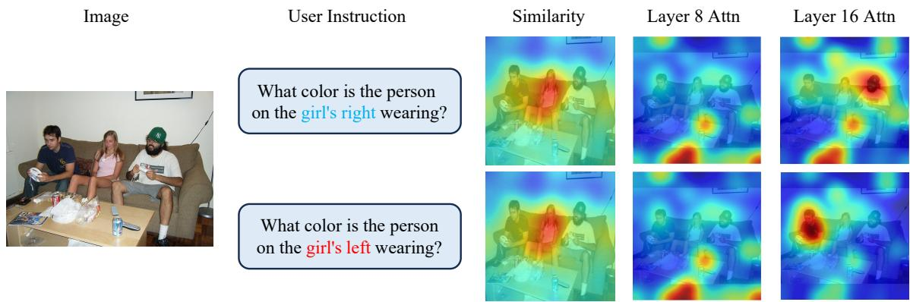
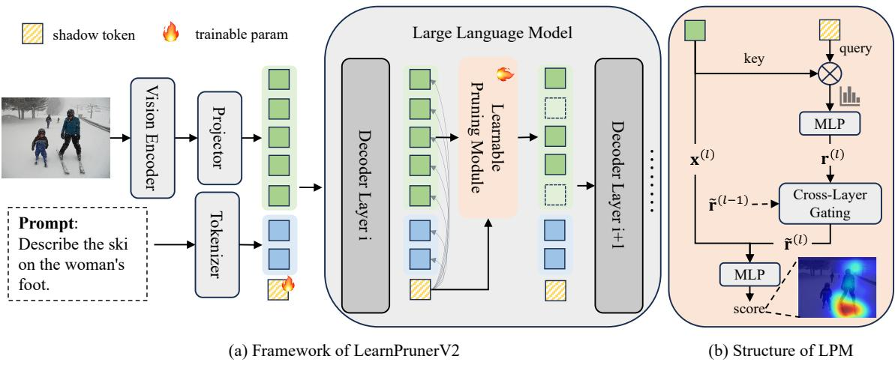
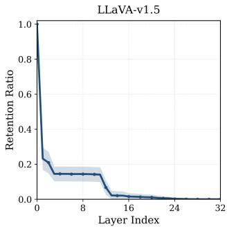
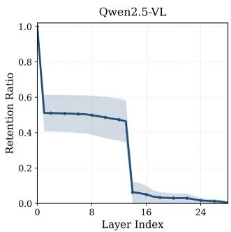
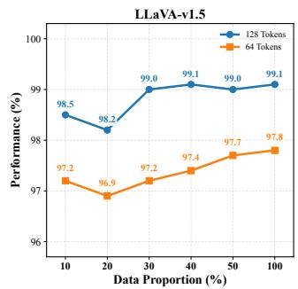
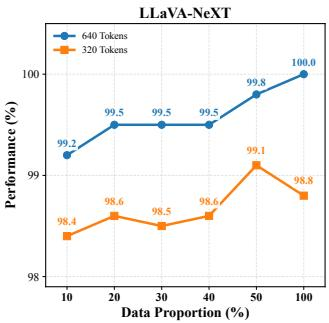
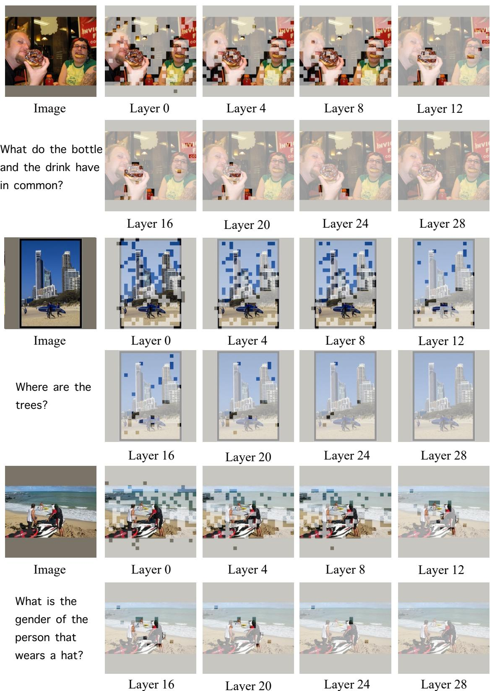
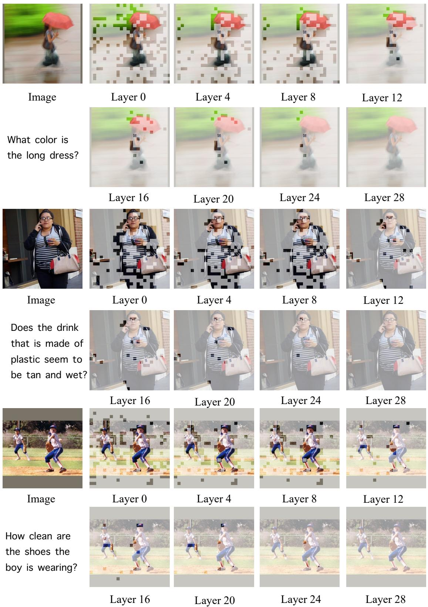
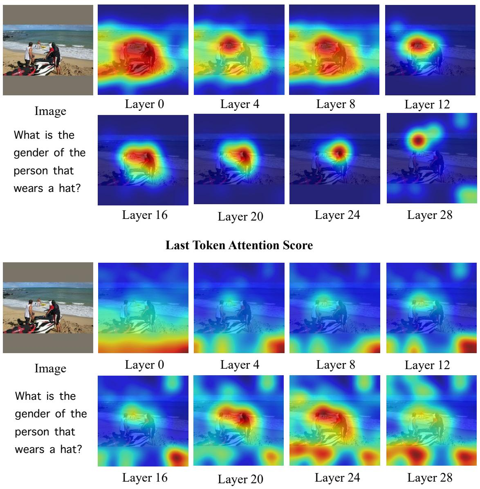
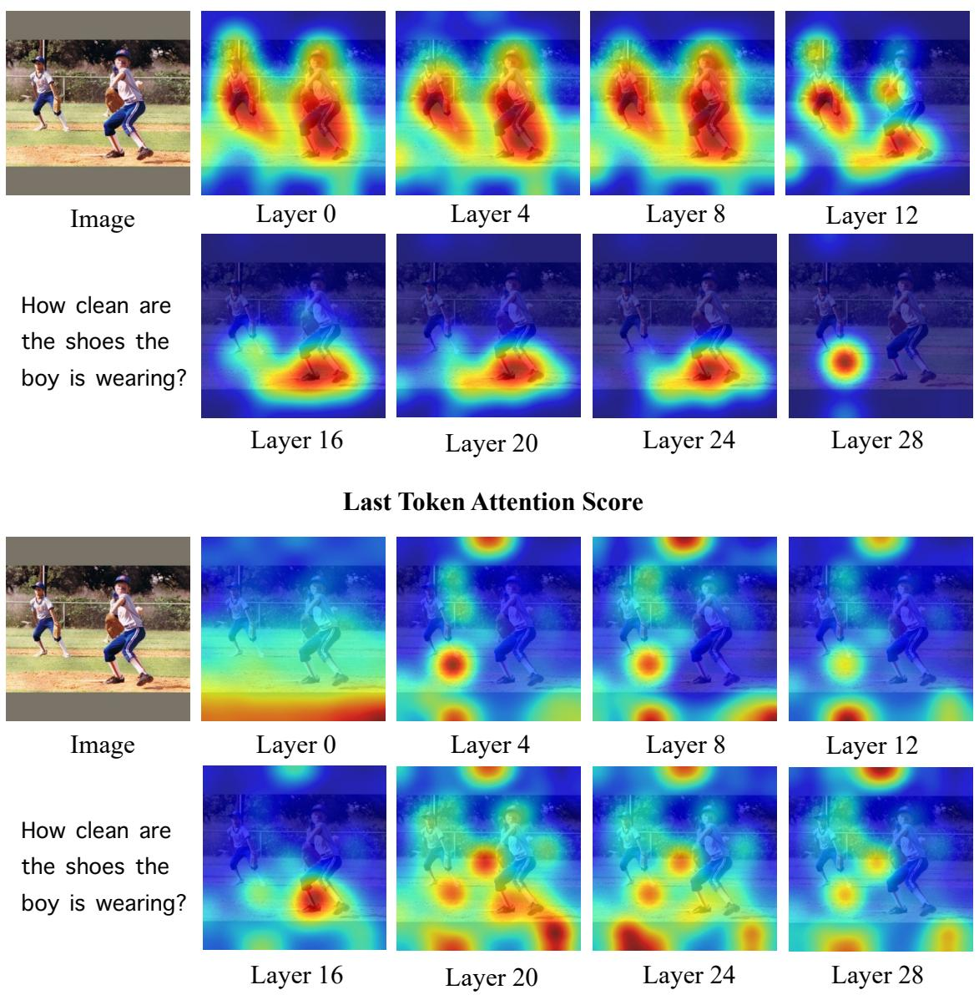

# LearnPrunerV2: Learnable Progressive Token Pruning for Vision-Language Models

Rinyoichi Takezoe takezoerinyoichi@lixiang.com Li Auto Inc. Beijing, China

Zihao Bo   
bozihao1@lixiang.com   
Li Auto Inc.   
Beijing, China   
Mo Guang   
guangmo@lixiang.com   
Li Auto Inc.   
Hangzhou, China   
Yaqian Li✉   
liyaqian@lixiang.com   
Li Auto Inc.   
Shanghai, China   
Huihong Shi   
shihuihong@lixiang.com   
Li Auto Inc.   
Shanghai, China   
Jiale Yan   
yanjiale@lixiang.com   
Li Auto Inc.   
Shanghai, China   
Weiren Wang   
wangweiren@lixiang.com   
Li Auto Inc.   
Beijing, China   
Anzhou Hou   
houanzhou@lixiang.com   
Li Auto Inc.   
Shanghai, China   
Kaiwen Long   
longkaiwen@lixiang.com   
Li Auto Inc.   
Shanghai, China

## Abstract

Vision-Language Models (VLMs) have demonstrated remarkable multimodal capabilities but sufer from prohibitive computational overhead due to the massive number of visual tokens. While token pruning is a promising solution, existing methods still sufer from two major drawbacks: 1) unreliable pruning criteria that fail to accurately localize task-specific regions due to inherent attention biases or query-agnostic designs, and 2) suboptimal pruning strategies that employ rigid, non-adaptive schedules, overlooking the dynamic evolution of token redundancy across diferent model depths. To address these challenges, we propose LearnPrunerV2, which extends the previous two-stage heuristic framework (LearnPruner) into a fully learnable architecture. Specifically, we integrate lightweight learnable modules into every layer of the VLM backbone, which estimate token importance by fusing intrinsic visual saliency with extrinsic query relevance captured via a shadow token. By uncovering a consistent staircase redundancy pattern across VLM layers, we further introduce Budget-Deterministic Pruning (BDP) to establish a hardware-friendly schedule with fixed per-layer budgets. Extensive experimental results across various benchmarks and VLMs demonstrate that LearnPrunerV2 consistently outperform previous state-of-the-art methods. Notably, LearnPrunerV2 preserves 99.8% of the original performance when pruning 77.8% of visual tokens on LLaVA-v1.5, achieving a superior accuracy-eficiency trade-of.

## CCS Concepts

• Computing methodologies → Artificial intelligence.

## Keywords

Eficient Inference, Vision-Language Models

This work is licensed under a Creative Commons Attribution 4.0 International License. MM ’26, Rio de Janeiro, Brazil   
© 2026 Copyright held by the owner/author(s).   
ACM ISBN 979-8-4007-2213-4/2026/11   
https://doi.org/10.1145/3767308.3836571 ACM Reference Format:   
Rinyoichi Takezoe, Yaqian Li, Weiren Wang, Zihao Bo, Huihong Shi, Anzhou Hou, Mo Guang, Jiale Yan, and Kaiwen Long. 2026. LearnPrunerV2: Learnable Progressive Token Pruning for Vision-Language Models. In Proceedings of the 34th ACM International Conference on Multimedia (MM ’26), November 10–14, 2026, Rio de Janeiro, Brazil. ACM, New York, NY, USA, 15 pages. https://doi.org/10.1145/3767308.3836571

## 1 Introduction

Following the rapid evolution of Large Language Models (LLMs) [1, 24, 42], Vision-Language Models (VLMs) have extended these sophisticated reasoning capabilities to the multimodal domain, leading to significant advancements in visual understanding and grounding. Generally, VLMs employ a pretrained visual encoder to transform visual inputs into a sequence of tokens, which are subsequently concatenated with textual instruction tokens as input for the LLM. Visual tokens often dominate the input sequence, typically numbering in the hundreds and potentially expanding to thousands for high-resolution images or long videos. Since the computational complexity of self-attention scales quadratically with sequence length, such a massive influx of visual tokens drastically inflates inference latency, rendering VLMs impractical for real-time or resource-constrained deployment.

To alleviate these computational bottleneck, numerous studies have explored token pruning as a viable strategy for reducing the visual sequence length. Given the inherent redundancy in visual modality, prior research has demonstrated that a substantial proportion of visual tokens can be discarded with minimal impact on model performance. Fundamentally, the efectiveness of token pruning hinges on two core dimensions: how to prune (the selection criterion) and where to prune (the pruning schedule). In this paper, we argue that existing approaches remain suboptimal in both aspects.

Unreliability of Pruning Criteria. Existing pruning criteria primarily fall into two categories: importance-based and diversitybased. The former utilizes attention scores from either the visual encoder or the LLM to identify significant tokens. However, as noted in LearnPruner [33], visual encoders often sufer from attention sink that fail to localize foreground objects, while LLM attention exhibits a strong positional bias, with reliable query-aware signals only beginning to emerge from the intermediate layers onward. This creates a dilemma: early pruning is computationally eficient but "blind", while late-stage pruning is semantically guided but yields marginal speedup. The latter category utilizes token-wise feature similarity to select the maximum coverage subset, aiming to preserve global visual diversity. These methods are inherently query-agnostic, making it challenging to adapt pruning results to diferent user instructions. While recent eforts [5, 48] attempt to incorporate auxiliary text encoders to facilitate cross-modal guidance, as shown in Figure 1, these encoders are limited to wordlevel granularity, failing to resolve the global semantic context of the image. This suggests that the internal attention ofLLMs remains essential for capturing task-specific visual information.

  
Figure 1: Visualization of cross-modal relevance scores in LLaVA-v1.5. ’Similarity’ denotes the similarity scores between CLIP multimodal features, while ’Layer 8/16 Attn’ represents the attention distribution of the last token within the LLM. Notably, CLIP features primarily capture isolated word-level semantics (e.g., the ’girl’); in contrast, intermediate LLM layers resolve global contextual semantics to accurately localize the intended target based on spatial relations.

Suboptimality of Pruning Strategies. Beyond selection criteria, existing methods typically employ static, one-pass pruning schedules or layer specific heuristics, overlooking the intrinsic coupling between token redundancy and VLM layer depth. Indeed, recent studies have revealed the layer-wise dynamics: AutoPrune [36] demonstrates that VLM attention exhibits significant fluctuations across layers, particularly in reasoning-intensive scenarios. Furthermore, TwigVLM [31] reveals that in the deep layers of VLMs, even the complete removal of visual tokens does not necessarily degrade performance. Collectively, these findings suggest that as visual information is incrementally integrated into linguistic representations, the significance of visual tokens is not uniform across layers but evolves throughout the hierarchy, motivating a progressive, layer-adaptive pruning strategy.

To address these limitations, LearnPruner [33] takes an initial step by adopting a two-stage token pruning framework that first removes redundant vision tokens via a learnable pruning module after the vision encoder, then retains only query-relevant tokens in the LLM’s middle layers based on text-to-vision attention scores. While efective, its singular input signals and hand-crafted schedule cannot fully capture the continuous evolution of token redundancy.

Building upon this, we propose LearnPrunerV2, a purely learnable pruning framework for VLMs. Unlike the hybrid design of its predecessor, our framework adopts a unified architecture by integrating a lightweight pruning module into every layer of the VLM backbone. Moreover, a learnable "shadow token" is appended to the input sequence during the prefill stage to aggregate the preceding context and capture cross-modal correlations. Each pruning module subsequently combines intrinsic visual saliency from local features with extrinsic query relevance derived from the shadow token to predict importance scores for individual visual token. Through endto-end joint optimization, LearnPrunerV2 aligns pruning decisions with the layer-specific evolution of visual significance, which in turn allows pruning modules to determine the optimal exit depth for each token. This dynamic mechanism enables the model to flexibly adjust its pruning trajectory based on the complexity of both images and queries. Furthermore, to address practical budgetconstrained scenarios, we introduce Budget-Deterministic-Pruning (BDP) strategy. BDP utilizes ofline-calibrated statistics to maintain a strictly fixed token count across every layer and adopts diversityaware selection to mitigate the impact of a non-adaptive schedule. This ensures deterministic inference latency and maximized batching throughput, providing a robust solution for high-concurrency real-world deployment.

Benefiting from its model-agnostic design, LearnPrunerV2 can be seamlessly integrated into diverse VLM architectures, such as LLaVA [23, 25, 26] and Qwen-VL [3, 37]. Extensive experiments on multiple VQA benchmarks shows that our method outperforms prior state-of-the-art methods under diferent retention ratios. For example, when pruning 94.4% visual tokens in LLaVA-NeXT-7B, LearnPrunerV2 preserve 96.2% of the original model performance, while achieving a 9.7× reduction in TFLOPs. In summary, the contributions of our work are threefold:

• We present LearnPrunerV2, a purely learnable token pruning framework that adopts a progressive pruning strategy. Compared to LearnPruner, it ofers a more unified and flexible solution.

• We introduce the Budget-Deterministic-Pruning schedule to assign fixed per-layer token budgets, enabling hardwarefriendly inference.

• We conduct extensive experiments on various VLMs and vision-language benchmarks, demonstrating that LearnPrunerV2 consistently achieves state-of-the-art performance across different retention ratios.

## 2 Related Work

## 2.1 Vision Language Models

Building upon the foundational reasoning power of Large Language Models (LLMs) [1, 6, 18, 24, 34, 42], Vision-Language Models (VLMs) [3, 20, 26, 50] demonstrate remarkable capabilities showing strong performance on diverse multimodal tasks such as image captioning, visual question answering, and visual grounding. A standard VLM typically comprises three components: a visual encoder to transform visual inputs into tokens, a vision-language connector to align the modality, and a LLM to serve as the cognitive engine for multimodal integration and complex reasoning. However, this paradigm incurs significant computational costs as the massive number of visual tokens. For instance, LLaVA-v1.5 [26] converts a 336x336 image into 576 tokens, advanced VLMs like LLaVA-NeXT [25] (tiling-based) and Qwen2.5-VL [3] (native dynamic resolution) support high-resolution inputs that further expand visual token sequences. Furthermore, in video understanding scenarios, the visual token count scales linearly with the number of sampled frames [9, 23]. Such extensive sequences pose a severe bottleneck for real-time applications, driving the urgent need for eficient inference of VLMs.

## 2.2 Vision Token Reduction for VLMs

Given the inherent redundancy in visual signals, token reduction has emerged as a promising direction to enhance VLM eficiency. Various works [7, 10, 14, 21, 39] attempt to compress vision token into more compact representations. While efective in reducing computation, these methods typically change the model architecture and require retraining from scratch, resulting in high training costs and potential degradation of the performance upper bound. In this work, we mainly focus on token pruning techniques that can be directly applied to existing VLMs.

From the perspective ofpruning criteria, existing methods can be broadly categorized into two types: importance-based and diversity based. Importance-based methods [8, 31, 43, 46, 47, 49] utilize attention scores to select top-k important tokens and discard the rest. To remove query-irrelevant visual tokens, FastV [8] leverages the attention of the last text token at the second LLM layer as the principled signal, while SparseVLM [49] first identifies text tokens strongly correlated with visual input, and then employs their attention scores to achieve more precise guidance for pruning. Alternatively, to eliminate inherent visual redundancy, VisionZip [43] and VisPruner [47] leverage [CLS] attention from the visual encoder to identify key salient tokens and perform pruning before the LLM. One limitation of importance-based methods is their reliance on attention maps, which makes them incompatible with Flash Attention [11]. Diversity-based methods aims to select a diverse set based on similarity between tokens [2, 17, 38, 48]. DivPrune [2] formulates token pruning as a Max-Min Diversity Problem, whereas DART [38] explicitly minimizes duplication by comparing candidate tokens against a set of pivots. Furthermore, CDPruner [48] calculates inter-token similarity conditioned on their relevance to the current instruction and use the determinantal point process to maximize the conditional diversity.

From the perspective of pruning schedules, most studies conduct static pruning at a specific layer, overlooking the layer-wise evolution of token redundancy. Alternatively, some works adopt multi-stage pruning schedules [19, 33, 36, 40, 44]. For instance, PDrop [40] applies progressive pruning with uniform ratios and intervals; AutoPrune [36] derives sample-specific policies by quantifying cross-modal mutual information; LearnPruner [33] employs a two-stage scheme, applying stage-specific pruning criteria to different phases. Despite these advancements, such heuristic designs remain misaligned with the dynamic nature of visual information processing, leading to suboptimal pruning schedules.

## 3 LearnPrunerV2

## 3.1 Preliminaries

Existing VLMs generally consist of three primary components: a vision encoder, projector and LLM. Since our methods operate within the LLM, we first provide a formal definition of its architecture. The LLM is composed of a stack of Transformer-based [35] decoder layers, each containing a causal self-attention to capture contextual dependencies and a feed-forward network for feature refinement.

Given image and user instruction, inputs are discretized via vision encoder and tokenizer into $X _ { v i s }$ and $X _ { t e x t }$ respectively. These are then concatenated with system prompts to form the LLM input sequence $X = [ X _ { s y s } , X _ { v i s } , X _ { t e x t } ] \in \bar { \mathbb { R } } ^ { N \times d }$ , where � is the sequence length and � is the hidden dimension. In each decoder layer, the input � is first projected into query $Q ,$ key $K ,$ and value � :

$$
Q = X W _ { Q } , \quad K = X W _ { K } , \quad V = X W _ { V }\tag{1}
$$

where $W _ { Q } , W _ { K } , W _ { V } \ \in \ \mathbb { R } ^ { d \times d }$ are projection matrices. The causal self-attention is then computed as:

$$
A = \mathrm { s o f t m a x } \left( { \frac { Q K ^ { T } + M } { \sqrt d } } \right) , \quad O = A V\tag{2}
$$

where $M \in \mathbb { R } ^ { N \times N }$ is an upper triangular matrix to ensure each token can only attend to itself and previous tokens. Subsequently, the attention output is fed into the feed-forward network for nonlinear transformation. Residual connections are applied to both the attention and fn blocks to produce the output of current layer. After passing through all decoder layers, the final hidden states are utilized for next-token prediction.

## 3.2 Learnable Pruning Criterion

Unlike prior works that rely on pre-defined heuristic rules, our approach employs learnable modules to evaluate token importance in a data-driven manner. The core challenge lies in constructing efective inputs for the module. A straightforward baseline is to use raw token features, similar to the Mixture-of-Depth (MoD) approach [30]. However, while these features contain rich semantic information, they are inherently query-agnostic, capturing only intrinsic visual saliency rather than task-specific importance. Although text-to-vision attention provides such relevance, it faces two critical limitations. First, the requirement for explicit attention scores is incompatible with eficient attention implementations such as FlashAttention. Second, as observed in FastV [8], attention scores in VLMs are heavily dominated by the textual modality, visual tokens often receive scores orders of magnitude lower (e.g., around $1 0 ^ { - 4 }$ in LLaVA-1.5). Such faint signals lack suficient numerical contrast, making it dificult for learnable modules to capture fine-grained importance diferences.

  
Figure 2: Overview of LearnPrunerV2. (a) Framework illustration, a learnable pruning module (LPM) is inserted into each decoder layer to evaluate token importance, and a learnable shadow token is appended after the user input to aggregate semantic context and capture cross-modal relevance. (b) Internal structure of the LPM. The visual hidden state is concatenated with the query-aware feature derived from the shadow token to predict the final importance score.

To address these issues, we introduce a learnable shadow token, appended after the user instruction to aggregate semantic context and locate query-relevant visual regions. Specifically, the shadow token is initialized with the newline character, exploiting its natural capacity for summarizing preceding information in LLMs. During training, the input sequence is expanded to $[ X _ { s y s } , X _ { v i s } , X _ { i n s } ,$ $X _ { s h d } , X _ { a n s } ]$ . Crucially, the shadow token can attend to all preceding tokens, but remains invisible to all other tokens via a customized causal mask, avoiding any perturbation to the model’s original predictions. Within the decoder layer, we construct a relevance vector $\mathbf { a } _ { i } \in \mathbb { R } ^ { H }$ for �-th visual token by computing the multi-head interaction between the shadow query � ℎ� and corresponding visual keys $k _ { i } \in K _ { v i s } \mathrm { : }$

$$
{ \bf a } _ { i } = \left[ \frac { q _ { s h d } ^ { h } ( k _ { i } ^ { h } ) ^ { T } } { \sqrt { d } } \right] _ { h = 1 } ^ { H } ,\tag{3}
$$

where � is the number of attention heads. Notably, this standalone query-key interaction avoids extracting from the internal attention matrix, ensuring compatibility with FlashAttention, and the use of pre-softmax logits preserves suficient numerical contrast for optimization. The vector ${ \bf a } _ { i }$ is then mapped through a layer-specific MLP, denoted as ML $\mathrm { { \cal P } } _ { \phi } { } _ { : }$ , to yield an enriched query-relevant feature $\mathbf { r } _ { i } = \mathrm { M L P } _ { \phi } ( \mathbf { a } _ { i } ) \in \mathbb { R } ^ { d _ { r } }$

While this feature captures the cross-modal correlation at a single layer, prior work [36] has shown that text-to-vision attention often exhibits pronounced inter-layer saliency fluctuations, particularly in complex scenarios. Directly relying on such unstable signals risks producing inconsistent pruning decisions. To stabilize importance estimation, we introduce a gating mechanism that incorporates historical information from the preceding layer. Concretely, given the current relevance feature $\mathbf { \hat { r } } _ { i } ^ { ( l ) }$ and its smoothed counterpart from the preceding layer $\tilde { \mathbf { r } } _ { i } ^ { ( l - 1 ) }$ , the gating weight is computed as:

$$
w _ { i } ^ { ( l ) } = \sigma \left( \mathrm { L i n e a r } ( [ \mathbf { r } _ { i } ^ { ( l ) } , \tilde { \mathbf { r } } _ { i } ^ { ( l - 1 ) } ] ) \right) ,\tag{4}
$$

where $\sigma$ is the sigmoid function and [·, ·] denotes concatenation. The smoothed relevance feature is then updated via:

$$
\tilde { \mathbf { r } } _ { i } ^ { ( l ) } = w _ { i } ^ { ( l ) } \cdot \mathbf { r } _ { i } ^ { ( l ) } + \big ( 1 - w _ { i } ^ { ( l ) } \big ) \cdot \tilde { \mathbf { r } } _ { i } ^ { ( l - 1 ) } ,\tag{5}
$$

with $\tilde { \mathbf { r } } _ { i } ^ { ( 0 ) } = \mathbf { 0 }$ . Intuitively, the gate learns to suppress transient attention noise while emphasizing persistent, instruction-aligned visual regions.

Finally, to combine extrinsic query relevance with intrinsic visual saliency, $\tilde { \mathbf { r } } _ { i } ^ { ( l ) }$ is concatenated with the token’s hidden state $X _ { i } ^ { ( l ) }$ and then fed into a shared scoring network ML $\mathrm { P } _ { \psi }$ to predict the importance score:

$$
s _ { i } ^ { ( l ) } = \sigma \left( \mathrm { M L P } _ { \psi } \left( \left[ X _ { i } ^ { ( l ) } , \tilde { \mathbf { r } } _ { i } ^ { ( l ) } \right] \right) \right) ,\tag{6}
$$

where $s _ { i } ^ { ( l ) }$ denotes the importance score of the �-th visual token at the�-th layer. By keeping ML $\mathrm { { \mathbf { P } } } _ { \phi }$ layer-specific while sharing M ${ \mathrm { . P } } _ { \psi }$ across all layers, we accommodate hierarchical semantic shifts while stabilizing the optimization process.

Since pruning requires discrete keep-or-drop decisions that are inherently non-diferentiable, we employ the Straight-Through Estimator (STE) [4] to bridge this gap. A binary mask is obtained by thresholding:

$$
\mathbf { M } _ { i } ^ { ( l ) } = \mathrm { S T E } \left( \mathbb { I } ( s _ { i } ^ { ( l ) } > \tau ) \right) ,\tag{7}
$$

  
(a)

  
(b)  
Figure 3: Statistics of learned pruning trajectories. We visualize the per-layer token retention ratio obtained via thresholdbased pruning on LLaVA-v1.5 and Qwen2.5-VL. The solid lines denote the mean values, while the shaded regions represent the variance across 500 randomly sampled image-text pairs from LLaVA-mix665k.

where I(·) is the indicator function and � is set to 0.5. During the forward pass, $\mathbf { M } _ { i } ^ { ( l ) } \ \in \ \{ 0 , 1 \}$ determines whether the token is kept or pruned; during the backward pass, the gradient bypasses the hard threshold and is approximated by that of the continuous score $s _ { i } ^ { ( l ) }$ , enabling end-to-end optimization. To ensure hierarchical consistency, we maintain a cumulative mask $\hat { \mathbf { M } } ^ { ( l ) }$ via a recursive Hadamard product:

$$
\begin{array} { r } { \hat { \mathbf { M } } ^ { ( l ) } = \hat { \mathbf { M } } ^ { ( l - 1 ) } \odot \mathbf { M } ^ { ( l ) } , } \end{array}\tag{8}
$$

where $\hat { \mathbf { M } } ^ { ( 0 ) } = 1$ , so that once a token is pruned, it is permanently excluded from all subsequent layers. Following [29], we apply this mask during training to cut of interactions between pruned and retained tokens, simulating the actual pruning behavior at inference time.

Our primary goal is to encourage the model to use the minimum number of vision tokens required to produce the correct answer. To achieve this, we introduce a pruning loss $\mathcal { L } _ { p r u n e }$ to constrain the number of preserved tokens, which is defined as:

$$
\mathcal { L } _ { p r u n e } = \left( \frac { 1 } { L \cdot N _ { v i s } } \sum _ { l = 1 } ^ { L } \sum _ { i = 1 } ^ { N _ { v i s } } \hat { \mathbf { M } } _ { i } ^ { ( l ) } - \boldsymbol { \rho } \right) ^ { 2 } ,\tag{9}
$$

where � is the number of pruning layers, $N _ { v i s }$ is the total number of visual tokens and we set $\rho = 0$ to enforce maximal sparsity. With this regularization term, the final training objective is formulated as:

$$
\begin{array} { r } { \mathcal { L } = \mathcal { L } _ { n t p } + \lambda \mathcal { L } _ { p r u n e } , } \end{array}\tag{10}
$$

where $\mathcal { L } _ { n t p }$ is the standard next-token prediction loss and we set $\lambda = 1$ in all our experiments. Notably, the shadow token is excluded from the prediction loss, allowing it to focus entirely on capturing cross-modal relevance without being distracted by the language modeling objective.

## 3.3 Budget-Deterministic Pruning

Once the pruning modules are trained, one can directly apply threshold-based pruning at each layer during inference, yielding sample-adaptive pruning schedules. However, practical deployment typically requires a fixed compute budget, which prior methods approximate by reporting the average number of retained tokens per layer. Furthermore, even with a fixed global budget, diferent inputs may produce distinct per-layer pruning trajectories, resulting in inconsistent memory access patterns and computation graphs, which is inherently hardware-unfriendly for optimized deployment.

To address these issues, we seek a deterministic per-layer schedule that fixes the token count at every layer. A natural question arises: how should such a schedule be determined? To this end, we investigate the underlying pruning characteristics learned by our modules. We randomly sample 500 image-text pairs from the LLaVA-mix665k dataset [26] and execute threshold-based pruning with $\tau = 0 . 5$ (identical to training). Figure 3 visualizes the mean and variance of the per-layer token retention ratio across all samples on LLaVA-v1.5 and Qwen2.5-VL. Surprisingly, the learned pruning trajectories exhibit high consistency across diverse inputs, with low inter-sample variance, and display a pronounced staircase pattern. This phenomenon suggests that through the joint optimization of all pruning modules, the model has autonomously identified a robust structural redundancy pattern in its architecture, reflecting the intrinsic stages of information flow and assimilation.

Taking LLaVA-v1.5 (Figure 3(a)) as an example, the trajectory begins with a sharp drop at the first layer, immediately discarding uninformative visual content such as background regions. In the subsequent early layers, the retention ratio enters a stable plateau, where virtually no further pruning occurs, suggesting that the incremental information gained across these shallow layers provides little discriminative signal. As the model progresses into the middle layers, a second significant decline emerges. This aligns with prior findings [33, 39] where the middle layers serve as the primary stage for intensive cross-modal interaction. At this stage, visual features are progressively aligned with linguistic queries, causing a substantial portion of visual tokens to become redundant. Moving into the deep layers, the retention ratio gradually approaches zero, confirming that essential visual information has been integrated into the hidden states of the text tokens, rendering the original visual modality entirely redundant for final response generation.

Motivated by the stability of the learned pruning trajectories, we propose Budget-Deterministic Pruning strategy, which repurposes the ofline-calibrated average retention ratios $\pmb { \eta } = \left[ \eta _ { 1 } , \eta _ { 2 } , \dots , \eta _ { L } \right]$ as a structural prior, constructing a deterministic per-layer budget that preserves the learned layer-wise pruning distribution. Specifically, given a user-specified budget �¯, defined as the average number of retained visual tokens per layer, the total token budget across all layers is $\bar { n } \cdot L$ . Since the calibrated trajectory would naturally consume $\begin{array} { r } { N _ { v i s } \cdot \sum _ { l = 1 } ^ { L } \eta _ { l } } \end{array}$ tokens in total, we compute a global scaling factor to reconcile the two:

$$
\alpha = \frac { \bar { n } \cdot L } { N _ { v i s } \cdot \sum _ { l = 1 } ^ { L } \eta _ { l } } .\tag{11}
$$

The per-layer token budget is then determined as:

$$
n _ { l } = \lfloor \eta _ { l } \cdot N _ { v i s } \cdot \alpha \rceil , \quad l = 1 , 2 , \ldots , L ,\tag{12}
$$

where ⌊·⌉ denotes rounding to the nearest integer. This formulation applies a uniform scaling to the calibrated pruning profile, ensuring that the relative layer-wise distribution is preserved under any target budget.

Table 1: Performance comparisons of diferent pruning methods on LLaVA-v1.5-7B. Avg. denotes the performance relative to the vanilla model, averaged across all benchmarks. Bold and underlined values denote the best and second-best results.
<table><tr><td>Method</td></tr><tr><td></td><td>GQA</td><td>SQA</td><td> $\mathbf { V Q A } ^ { \mathbf { T } }$ </td><td>POPE Upper Bound, 576 Tokens (100%)</td><td>MME  $\mathbf { V Q A } ^ { \mathbf { v } 2 }$ </td><td>MMB</td><td> $\mathbf { M M B } ^ { \mathbf { C N } }$ </td><td>MMVet</td><td> $\mathbf { A v g . }$ </td></tr><tr><td>Vanilla</td><td></td><td>61.9 69.5</td><td>58.2</td><td>85.9</td><td>1862</td><td>78.5</td><td>64.7</td><td>58.3</td><td>31.1</td><td>100.0%</td></tr><tr><td></td><td colspan="10">Retain Averaged 128 Tokens (↓ 77.8%)</td></tr><tr><td>FastV</td><td>49.6</td><td>60.2</td><td>50.6</td><td>59.6</td><td>1490</td><td>61.8</td><td>56.1</td><td>51.4</td><td>28.1</td><td>83.0%</td></tr><tr><td>SparseVLM</td><td>56.0</td><td>67.1</td><td>54.9</td><td>80.5</td><td>1696</td><td>73.8</td><td>60.0</td><td>51.1</td><td>29.7</td><td>92.9%</td></tr><tr><td>VisPruner</td><td>58.2</td><td>69.1</td><td>57.0</td><td>84.6</td><td>1794</td><td>75.8</td><td>62.7</td><td>57.3</td><td>33.7</td><td>98.5%</td></tr><tr><td>DART</td><td>57.9</td><td>69.1</td><td>56.3</td><td>80.4</td><td>1721</td><td>74.7</td><td>60.7</td><td>57.3</td><td>30.9</td><td>95.8%</td></tr><tr><td>CDPruner</td><td>59.9</td><td>69.0</td><td>56.2</td><td>87.7</td><td>1769.6</td><td>76.6</td><td>63.1</td><td>55.0</td><td>32.8</td><td>98.3%</td></tr><tr><td>LearnPruner</td><td>60.3</td><td>68.5</td><td>57.3</td><td>86.7</td><td>1820</td><td>77.3</td><td>63.8</td><td>56.8</td><td>30.8</td><td>98.5%</td></tr><tr><td>LearnPrunerV2</td><td>61.0</td><td>68.4</td><td>57.7</td><td>86.2</td><td>1843</td><td>77.7</td><td>64.4</td><td>58.5</td><td>32.4</td><td>99.8%</td></tr><tr><td colspan="11">Retain Averaged 64 Tokens (↓ 88.9%)</td></tr><tr><td>FastV</td><td>46.1</td><td>51.1</td><td>47.8</td><td>48.0</td><td>1256</td><td>55.0</td><td>48.0</td><td>42.7</td><td>25.8</td><td>72.7%</td></tr><tr><td>SparseVLM</td><td>52.7</td><td>62.2</td><td>51.8</td><td>75.1</td><td>1505</td><td>68.2</td><td>56.2</td><td>46.1</td><td>23.3</td><td>84.4%</td></tr><tr><td>VisPruner</td><td>55.4</td><td>69.1</td><td>55.8</td><td>80.4</td><td>1689</td><td>72.7</td><td>61.3</td><td>55.1</td><td>32.3</td><td>95.0%</td></tr><tr><td>DART</td><td>54.7</td><td>69.3</td><td>54.7</td><td>73.9</td><td>1705</td><td>71.3</td><td>59.5</td><td>54.0</td><td>26.5</td><td>91.1%</td></tr><tr><td>CDPruner</td><td>58.6</td><td>68.1</td><td>55.3</td><td>87.5</td><td>1721.5</td><td>75.4</td><td>61.1</td><td>53.2</td><td>30.5</td><td>95.8%</td></tr><tr><td>LearnPruner</td><td>58.9</td><td>68.3</td><td>56.6</td><td>86.8</td><td>1750</td><td>76.0</td><td>62.6</td><td>55.7</td><td>29.6</td><td>96.7%</td></tr><tr><td>LearnPrunerV2</td><td>58.9</td><td>68.3</td><td>56.6</td><td>86.1</td><td>1830</td><td>76.3</td><td>63.3</td><td>55.6</td><td>32.5</td><td>98.2%</td></tr><tr><td colspan="11">Retain Averaged 32 Tokens (↓ 94.4%)</td></tr><tr><td>FastV</td><td>41.5</td><td>42.6</td><td>42.5</td><td>32.5</td><td>1090</td><td>43.4</td><td>37.8</td><td>33.2</td><td>=</td><td>52.0%</td></tr><tr><td>SparseVLM</td><td>48.3</td><td>57.3</td><td>46.1</td><td>67.9</td><td>1290</td><td>58.6</td><td>51.4</td><td>40.6</td><td></td><td>68.0%</td></tr><tr><td>VisPruner</td><td>52.2</td><td>69.2</td><td>53.9</td><td>72.7</td><td>1567</td><td>67.7</td><td>58.4</td><td>52.7</td><td>28.8</td><td>89.4%</td></tr><tr><td>DART</td><td>52.9</td><td>69.3</td><td>52.2</td><td>69.1</td><td>1615</td><td>67.1</td><td>58.5</td><td>50.0</td><td>25.0</td><td>87.1%</td></tr><tr><td>CDPruner</td><td>57.0</td><td>69.5</td><td>53.2</td><td>87.9</td><td>1670</td><td>73.6</td><td>59.6</td><td>49.6</td><td>27.8</td><td>92.9%</td></tr><tr><td>LearnPruner</td><td>57.2</td><td>68.2</td><td>56.1</td><td>84.5</td><td>1672</td><td>74.0</td><td>60.8</td><td>55.5</td><td>26.1</td><td>93.6%</td></tr><tr><td>LearnPrunerV2</td><td>57.6</td><td>68.6</td><td>55.7</td><td>85.8</td><td>1747</td><td>74.6</td><td>61.9</td><td>54.4</td><td>29.9</td><td>95.7%</td></tr></table>

While deterministic budgets ensure computational predictability, they inevitably sacrifice instance-level adaptivity—a key advantage of threshold-based pruning. To mitigate this, we introduce a diversity-aware selection mechanism that dynamically optimizes the token composition within each layer’s fixed capacity. At each layer �, we first identify a candidate set of informative tokens whose importance scores exceed the threshold �, with the candidate count denoted as $\begin{array} { r } { n _ { l } ^ { \prime } = \sum _ { i = 1 } ^ { N _ { v i s } } \mathbb { I } ( s _ { i } ^ { ( l ) } > \tau ) . \mathrm { I f } n _ { l } ^ { \prime } \le n _ { l } . } \end{array}$ the budget is suficient to accommodate the entire candidate set, and we simply retain the top- $- n _ { l }$ tokens by importance score. Conversely, when $n _ { I } ^ { \prime } > n _ { l }$ , the model considers more tokens important than the allocated budget permits. In this case, naively selecting the top-�� tokens by scores may lead to the loss of critical visual information. Instead, we ensure more comprehensive visual representations by adapting the principle of diversity-aware selection from DART [38]. Under this approach, the $\mathrm { t o p } \mathfrak { - } n _ { p }$ tokens ranked by importance score are first selected as pivot tokens. For each remaining candidate, we compute its cosine similarity to all pivots and identify its maximum similarity value. The remaining $n _ { l } - n _ { p }$ slots are filled by candidates with the lowest maximum similarity. Ultimately, this mechanism strikes a balance between importance and diversity, which is particularly efective in low-budget scenarios.

## 4 Experiments

## 4.1 Experimental Settings

Datasets and Benchmarks. We conduct comprehensive evaluations on 9 widely-used image-based multimodal benchmarks, including GQA [15], ScienceQA-IMG [28], TextVQA [32], POPE [22], MME [12], VQAv2 [13], MMBench [27], MMBench-CN [27] and MMVet [45]. Moreover, we experiment with 3 video understanding benchmarks, including TGIF-QA [16], MSVD-QA [41], and MSRVTT-QA [41]. All experiments on these benchmarks follow the default settings and evaluation metrics.

Implementation Details. In the experiments, we keep the base VLM weights frozen and use the LLaVA-mix665k dataset [26] to train our pruning modules. We apply our LearnPrunerV2 to various VLM architectures, including LLaVA-v1.5 [26] for image understanding, LLaVA-NeXT [25] for high-resolution inputs, Video-LLaVA [23] for video scenarios (see Appendix for results) and Qwen2.5-VL [3] for broader generalization. For comprehensive comparison, we select several recent token pruning methods as baselines, including importance-based methods (e.g., FastV [8], SparseVLM [49] and VisPruner [47]), diversity-based approaches (e.g., DART [38] and CDPruner [48]), and LearnPruner [33] which introduces learnable parameters for pruning and employs a heuristic pruning schedule.

Table 2: Performance comparisons of diferent pruning methods on LLaVA-NeXT-7B.
<table><tr><td>Method</td><td>GQA</td><td>SQA</td><td> $\mathbf { V Q A } ^ { \mathrm { T } }$ </td><td>POPE</td><td>MME</td><td> $\mathbf { V Q A } ^ { \mathbf { v } 2 }$ </td><td>MMB</td><td> $\mathbf { M M B } ^ { \mathbf { C N } }$ </td><td>MMVet</td><td>Avg.</td></tr><tr><td colspan="9">Upper Bound, 2,880 Tokens (100%)</td><td colspan="3"></td></tr><tr><td>Vanilla</td><td>64.2</td><td>70.2</td><td>61.3</td><td>86.3</td><td>1842</td><td>81.2</td><td>67.9</td><td>60.5</td><td>40.0</td><td>100.0%</td></tr><tr><td colspan="11">Retain Averaged 640 Tokens (↓ 77.8%)</td></tr><tr><td>FastV</td><td>62.0</td><td>69.1</td><td>60.0</td><td>79.5</td><td>1807</td><td>79.5</td><td>65.8</td><td>53.5</td><td>33.3</td><td>94.4%</td></tr><tr><td>SparseVLM</td><td>60.3</td><td>67.7</td><td>57.8</td><td>85.3</td><td>1772</td><td>77.1</td><td>65.7</td><td>58.6</td><td>36.1</td><td>95.4%</td></tr><tr><td>DART</td><td>61.3</td><td>68.2</td><td>59.5</td><td>85.0</td><td>1741</td><td>78.3</td><td>64.9</td><td>57.1</td><td>36.9</td><td>95.7%</td></tr><tr><td>CDPruner</td><td>62.6</td><td>67.9</td><td>58.4</td><td>87.3</td><td>1808</td><td>79.9</td><td>66.3</td><td>57.5</td><td>38.8</td><td>97.4%</td></tr><tr><td>LearnPruner</td><td>63.8</td><td>70.0</td><td>60.5</td><td>85.1</td><td>1837</td><td>80.5</td><td>67.5</td><td>59.5</td><td>36.1</td><td>98.1%</td></tr><tr><td>LearnPrunerV2</td><td>64.2</td><td>70.1</td><td>60.6</td><td>86.9</td><td>1856</td><td>81.2</td><td>68.0</td><td>60.7</td><td>38.7</td><td>99.7%</td></tr><tr><td colspan="11">Retain Averaged 320 Tokens (↓ 88.9%)</td></tr><tr><td>FastV</td><td></td><td>54.9 68.2</td><td>54.8</td><td>49.5</td><td>1539</td><td>69.6</td><td>60.0</td><td>42.5</td><td>20.0</td><td>78.6%</td></tr><tr><td>SparseVLM</td><td>57.7</td><td>67.3</td><td>55.9</td><td>76.9</td><td>1694</td><td>73.4</td><td>64.3</td><td>56.7</td><td>32.8</td><td>91.0%</td></tr><tr><td>DART</td><td>61.7</td><td>67.5</td><td>57.6</td><td>81.0</td><td>1720</td><td>75.7</td><td>64.2</td><td>58.2</td><td>35.7</td><td>94.1%</td></tr><tr><td>CDPruner</td><td>61.6</td><td>67.8</td><td>57.4</td><td>87.2</td><td>1758</td><td>78.4</td><td>65.5</td><td>55.7</td><td>35.6</td><td>95.2%</td></tr><tr><td>LearnPruner</td><td>62.2</td><td>68.6</td><td>58.4</td><td>84.8</td><td>1845</td><td>78.3</td><td>66.8</td><td>58.3</td><td>35.0</td><td>96.3%</td></tr><tr><td>LearnPrunerV2</td><td>63.5</td><td>68.5</td><td>59.3</td><td>87.0</td><td>1844</td><td>80.0</td><td>67.8</td><td>60.2</td><td>36.6</td><td>98.2%</td></tr><tr><td colspan="11">Retain Averaged 160 Tokens (↓ 94.4%)</td></tr><tr><td>DART</td><td>56.8</td><td>67.8</td><td>54.9</td><td>75.3</td><td>1626</td><td>72.5</td><td>62.0</td><td>53.6</td><td>32.2</td><td>88.9%</td></tr><tr><td>CDPruner</td><td>60.8</td><td>67.5</td><td>55.4</td><td>86.8</td><td>1738</td><td>76.7</td><td>64.2</td><td>53.8</td><td>34.1</td><td>93.3%</td></tr><tr><td>LearnPruner</td><td>58.7</td><td>67.6</td><td>55.0</td><td>83.1</td><td>1784</td><td>76.2</td><td>65.3</td><td>55.8</td><td>32.8</td><td>92.8%</td></tr><tr><td>LearnPrunerV2</td><td>61.6</td><td>67.8</td><td>58.0</td><td>85.6</td><td>1781</td><td>77.9</td><td>65.5</td><td>59.2</td><td>37.1</td><td>96.2%</td></tr></table>

Table 3: Performance comparisons of diferent pruning methods on Qwen2.5-VL-7B.
<table><tr><td rowspan=1 colspan=1>Method</td><td rowspan=1 colspan=1>GQA SQA $\mathbf { V Q A } ^ { \mathbf { T } }$  MME MMB</td><td rowspan=1 colspan=1>Avg.</td></tr><tr><td rowspan=1 colspan=1>Up</td><td rowspan=1 colspan=1>per Bound, 1280 Tokens (100%)</td><td rowspan=1 colspan=1></td></tr><tr><td rowspan=1 colspan=1>Vanilla</td><td rowspan=1 colspan=1>60.9 75.9  83.3  2314  83.8</td><td rowspan=1 colspan=1>100.0%</td></tr><tr><td rowspan=1 colspan=1>Reta</td><td rowspan=1 colspan=1>in Averaged 426 Tokens (↓ 66.7%)</td><td rowspan=1 colspan=1></td></tr><tr><td rowspan=1 colspan=1>FastV</td><td rowspan=1 colspan=1>58.4 79.1 81.5  2330  81.4</td><td rowspan=1 colspan=1>99.2%</td></tr><tr><td rowspan=1 colspan=1>LearnPruner</td><td rowspan=2 colspan=1>59.3 77.4 81.1  2339  83.260.0 81.4 80.7  2355 83.4</td><td rowspan=2 colspan=1>99.4%100.8%</td></tr><tr><td rowspan=1 colspan=1>LearnPrunerV2</td></tr><tr><td rowspan=1 colspan=2>Retain Averaged 284 Tokens (↓ 77.8%)</td><td rowspan=1 colspan=1></td></tr><tr><td rowspan=1 colspan=1>FastV</td><td rowspan=3 colspan=1>53.6 77.8 79.2  2228  79.159.0 77.0 79.6  2358  82.259.1 82.2 79.6  2362 82.2</td><td rowspan=1 colspan=1>95.3%</td></tr><tr><td rowspan=1 colspan=1>LearnPruner</td><td rowspan=2 colspan=1>98.8%100.2%</td></tr><tr><td rowspan=1 colspan=1>LearnPrunerV2</td></tr><tr><td rowspan=1 colspan=2>Retain Averaged 142 Tokens (↓ 88.9%)</td><td rowspan=1 colspan=1></td></tr><tr><td rowspan=1 colspan=1>FastV</td><td rowspan=1 colspan=1>42.8 70.5  62.9  1565  56.2</td><td rowspan=3 colspan=1>74.7%94.7%97.6%</td></tr><tr><td rowspan=1 colspan=1>LearnPruner</td><td rowspan=2 colspan=1>51.9 76.1 76.1  2292 81.856.6 82.2 74.9  2320 81.0</td></tr><tr><td rowspan=1 colspan=1>LearnPrunerV2</td></tr></table>

## 4.2 Main Results

Results on LLaVA-v1.5. As shown in Table 1, we first evaluate our method on LLaVA-v1.5-7B, where images are represented by a fixed sequence of 576 tokens. The results demonstrate that our method consistently outperforms all previous methods across all three retention ratios. Notably, when retaining 128 tokens, our method maintains a remarkable 99.8% of the vanilla model’s performance, surpassing the previous state-of-the-art method by 1.3%, and this performance gap further widens to 2.1% when the budget is restricted to only 32 tokens. Since both our model and LearnPruner employ learnable modules, this significant lead directly validates the superiority of our proposed pruning criterion and pruning schedule.

Results on LLaVA-NeXT. To verify its scalability for high-resolution scenarios, we evaluate our method on LLaVA-NeXT-7B. LLaVA-NeXT handles high-resolution inputs by partitioning the image into multiple sub-grids and encoding them independently, yielding a massive baseline of 2,880 visual tokens. As shown in Table 2, LearnPrunerV2 retains 99.7% of the original performance while utilizing only 22.2% of the visual tokens. Furthermore, on several benchmarks such as POPE, MME, and MMBench, our pruned model achieves performance that is either comparable to or even superior to its vanilla counterpart. These results indicate that high-resolution inputs inherently contain substantial visual redundancy, where many tokens may contribute marginal or even distracting signals. By removing uninformative visual context, the model can more accurately focus on the most salient features, thereby leading to more precise predictions.

Results on Qwen2.5-VL. To further assess the broad applicability of LearnPrunerV2, we extend our evaluation to Qwen2.5-VL-7B, a leading open-source VLM with an architecture distinct from the LLaVA family. Since the original SFT data for Qwen2.5-VL is not publicly accessible, we leverage the LLaVA-mix665k dataset to generate model responses, which serve as pseudo-labels for training our pruning modules. Furthermore, although Qwen2.5-VL natu rally supports native dynamic resolution, we fix the input size to a standardized budget of 1,280 tokens to ensure a fair and consistent comparison across all pruning methods. As shown in Table 3, Learn-PrunerV2 still maintain its dominant performance, even exceeding 100% average relative accuracy at 66.7% and 77.8% pruning rates, showing the robust generalizability of our approach.

Table 4: Ablation study on diferent configurations of the learnable pruning module (LPM).  
(a) Ablation study on input components of the learnable pruning module.
<table><tr><td>Input Components</td><td> $\mathbf { A v g . }$ </td></tr><tr><td>hidden states</td><td>96.6</td></tr><tr><td>+ relevance feature</td><td>97.2</td></tr><tr><td>+ gating mechanism (ours)</td><td>97.8</td></tr></table>

(b) Ablation study on source of relevance feature.
<table><tr><td>Relevance Source</td><td> $\mathbf { A v g . }$ </td></tr><tr><td>last token attention</td><td>96.5</td></tr><tr><td>last token logit</td><td>97.4</td></tr><tr><td>shadow token (ours)</td><td>97.8</td></tr></table>

(c) Ablation study on parameter sharing scheme of the learnable pruning module.
<table><tr><td>Parameter Sharing</td><td>Avg.</td></tr><tr><td>fully independent</td><td>97.3</td></tr><tr><td>fully shared</td><td>96.9</td></tr><tr><td>hybrid (ours)</td><td>97.8</td></tr></table>

Table 5: Ablation study on token selection strategy under Budget-Deterministic Pruning (BDP).
<table><tr><td>strategy</td><td>GQA SQA</td><td></td><td> $\mathbf { V Q A } ^ { \mathbf { T } }$ </td><td>POPE</td><td>MME</td><td> $\mathbf { A v g . }$ </td></tr><tr><td colspan="7">Retain Averaged 64 Tokens</td></tr><tr><td>top-k</td><td>58.9</td><td>68.7</td><td>56.6</td><td>85.9</td><td>1805</td><td>97.7%</td></tr><tr><td>ours</td><td>58.9</td><td>68.3</td><td>56.6</td><td>86.1</td><td>1830</td><td>97.8%</td></tr><tr><td colspan="7">Retain Averaged 32 Tokens</td></tr><tr><td>top-k</td><td>56.7</td><td>68.7</td><td>55.2</td><td>85.1</td><td>1716</td><td>95.3%</td></tr><tr><td>ours</td><td>57.6</td><td>68.6</td><td>55.7</td><td>85.8</td><td>1747</td><td>96.2%</td></tr></table>

## 4.3 Ablation Study

We evaluate the learnable pruning criterion and budget-deterministic pruning strategy on LLaVA-v1.5-7B. Unless otherwise specified, all experiments use a fixed budget of 64 tokens, and we report average relative performance over GQA, SQA, VQAT, POPE, and MME.

Input components. As shown in Table 4(a), we compare three configurations for the pruning module’s input. When relying solely on the hidden states, the module determines token importance based only on intrinsic visual redundancy, which results in a performance of 96.6%. By concatenating the relevance feature, the model can further incorporate cross-modal correlations with the textual query, boosting the average performance to 97.2%. However, inter-layer attention fluctuations often introduce distracting noise. The gating mechanism mitigates this by filtering transient signals, stabilizing importance estimation and yielding a performance of 97.8%.

Relevance source. Table 4(b) investigates the influence of diferent cross-modal relevance sources. While the last instruction token is a conventional choice for sequence aggregation, utilizing its attention scores results in poor performance (96.5%) because the attention scores are numerically overwhelmed by the hidden states. Although last token logits (97.4%) alleviate the scaling bottleneck, they still underperform the shadow token (97.8%), which we attribute to the inherent multi-task interference between next-token prediction and pruning guidance. In contrast, the shadow token serves as a dedicated aggregator that focuses exclusively on capturing instruction-relevant token importance.

Parameter sharing scheme. The learnable pruning module mainly consists of a relevance projector $( \mathrm { M L P } _ { \phi } )$ and a scoring network $( \mathrm { M L P } _ { \psi } )$ . Table 4(c) evaluates diferent parameter sharing schemes for these components. Our hybrid strategy achieves the best performance (97.8%), outperforming both fully independent (97.3%) and fully shared (96.9%) counterparts. This is because attention logits exhibit significant inter-layer variance, necessitating a layerspecific ${ \mathrm { M L P } } _ { \phi }$ for adaptive mapping. Conversely, a shared $\boldsymbol { \mathrm { M L P } _ { \psi } }$ receives more gradients from diferent layers, facilitating robust convergence and stabilizing the optimization to learn a generalized pruning criterion.

Table 6: Eficiency analysis on the POPE benchmark. All experiments are conducted on a single A100 GPU.
<table><tr><td>Method</td><td>Token</td><td>TFLOPs</td><td>Prefill (s)</td><td>Total (s)</td><td>KV Cache (MB)</td></tr><tr><td>LLaVA-NeXT</td><td>2880</td><td>33.8 (1.0×)</td><td>3197.1 (1.0×)</td><td>3569.8 (1.0×)</td><td>1166.6 (1.0×)</td></tr><tr><td rowspan="2">+ ours</td><td>640</td><td>10.2 (3.3×)</td><td>1231.7 (2.6×)</td><td>1783.3 (2.0×)</td><td> $3 7 0 . 9 \ ( 3 . 1 \times )$ </td></tr><tr><td>160</td><td>3.5 (9.7×)</td><td> $5 1 4 . 3 \ ( 6 . 2 \times )$ </td><td>967.5 (3.7×)</td><td> $1 3 3 . 4 ( 8 . 7 \times )$ </td></tr></table>

Visual token selection. Table 5 evaluates the impact ofour diversityaware selection against the standard Top-K strategy under a fixed layer-wise budget. While both approaches perform similarly at a higher budget of 64 tokens (97.8% vs. 97.7%), our strategy demonstrates a clear advantage when the budget is restricted to 32 tokens, outperforming Top-K by 0.9%. This gap suggests that simple Top-K selection is prone to information redundancy, as tokens with the highest scores are often spatially clustered or semantically similar. In contrast, our approach encourages the selection of more diverse visual cues, thereby broadening the overall information coverage within the restricted budget.

## 4.4 Eficiency Analysis

To demonstrate the eficiency of LearnPrunerV2, we measure the FLOPs, prefill time, total inference time and KV cache size of the pruned model compared to the vanilla LLaVA-NeXT-7B. All experiments are conducted on the POPE benchmark. As shown in Table 6, when the number of visual tokens is reduced from 2,880 to 160, we achieve a 9.7× reduction in TFLOPs and a 6.2× speedup in prefill time. Furthermore, the KV cache size is slashed by 8.7×, while the total inference time improves by 3.7×. These results highlight the efectiveness of our framework in reducing the computational overhead of VLMs

## 5 Conclusion

We introduce LearnPrunerV2, a learnable progressive token pruning framework for accelerating VLMs. It estimates token importance from intrinsic visual saliency and query relevance, and employs a Budget-Deterministic Pruning (BDP) schedule that assigns fixed per-layer budgets by exploiting the inherent architectural redundancy of VLMs. Extensive experiments on multiple VLM architectures and benchmarks demonstrate strong accuracy-eficiency trade-ofs and clear gains over prior methods.

## References

[1] Josh Achiam, Steven Adler, Sandhini Agarwal, Lama Ahmad, Ilge Akkaya, Florencia Leoni Aleman, Diogo Almeida, Janko Altenschmidt, Sam Altman, Shyamal Anadkat, et al. 2023. Gpt-4 technical report. arXiv preprint arXiv:2303.08774 (2023).

[2] Saeed Ranjbar Alvar, Gursimran Singh, Mohammad Akbari, and Yong Zhang. 2025. Divprune: Diversity-based visual token pruning for large multimoda models. In Proceedings of the Computer Vision and Pattern Recognition Conference. 9392–9401.

[3] Shuai Bai, Keqin Chen, Xuejing Liu, Jialin Wang, Wenbin Ge, Sibo Song, Kai Dang, Peng Wang, Shijie Wang, Jun Tang, Humen Zhong, Yuanzhi Zhu, Mingkun Yang, Zhaohai Li, Jianqiang Wan, Pengfei Wang, Wei Ding, Zheren Fu, Yiheng Xu, Jiabo Ye, Xi Zhang, Tianbao Xie, Zesen Cheng, Hang Zhang, Zhibo Yang, Haiyang Xu, and Junyang Lin. 2025. Qwen2.5-VL Technical Report. arXiv preprint arXiv:2502.13923 (2025).

[4] Yoshua Bengio, Nicholas Léonard, and Aaron Courville. 2013. Estimating or propagating gradients through stochastic neurons for conditional computation. arXiv preprint arXiv:1308.3432 (2013).

[5] Kaitong Cai, Jusheng Zhang, Jing Yang, Yijia Fan, Pengtao Xie, Jian Wang, and Keze Wang. 2025. Flashvlm: Text-guided visual token selection for large multi modal models. arXiv preprint arXiv:2512.20561 (2025)

[6] Zheng Cai, Maosong Cao, Haojiong Chen, Kai Chen, Keyu Chen, Xin Chen, Xun Chen, Zehui Chen, Zhi Chen, Pei Chu, et al. 2024. Internlm2 technical report. arXiv preprint arXiv:2403.17297 (2024).

[7] Junbum Cha, Wooyoung Kang, Jonghwan Mun, and Byungseok Roh. 2024. Honeybee: Locality-enhanced projector for multimodal llm. In Proceedings ofthe IEEE/CVF Conference on Computer Vision and Pattern Recognition. 13817–13827.

[8] Liang Chen, Haozhe Zhao, Tianyu Liu, Shuai Bai, Junyang Lin, Chang Zhou, and Baobao Chang. 2024. An image is worth 1/2 tokens after layer 2: Plug-and-play inference acceleration for large vision-language models. In European Conference on Computer Vision. Springer, 19–35.

[9] Yukang Chen, Fuzhao Xue, Dacheng Li, Qinghao Hu, Ligeng Zhu, Xiuyu Li, Yunhao Fang, Haotian Tang, Shang Yang, Zhijian Liu, Yihui He, Hongxu Yin, Pavlo Molchanov, Jan Kautz, Linxi Fan, Yuke Zhu, Yao Lu, and Song Han. 2024. LongVILA: Scaling Long-Context Visual Language Models for Long Videos. (2024). arXiv:2408.10188 [cs.CV]

[10] Xiangxiang Chu, Limeng Qiao, Xinyu Zhang, Shuang Xu, Fei Wei, Yang Yang, Xiaofei Sun, Yiming Hu, Xinyang Lin, Bo Zhang, et al. 2024. Mobilevlm v2: Faster and stronger baseline for vision language model. arXiv preprint arXiv:2402.03766 (2024).

[11] Tri Dao, Dan Fu, Stefano Ermon, Atri Rudra, and Christopher Ré. 2022. Flashat tention: Fast and memory-eficient exact attention with io-awareness. Advances in neural information processing systems 35 (2022), 16344–16359.

[12] Chaoyou Fu, Peixian Chen, Yunhang Shen, Yulei Qin, Mengdan Zhang, Xu Lin, Jinrui Yang, Xiawu Zheng, Ke Li, Xing Sun, et al. 2023. MME: A Comprehensive Evaluation Benchmark for Multimodal Large Language Models. arXiv preprint arXiv:2306.13394 (2023).

[13] Yash Goyal, Tejas Khot, Douglas Summers-Stay, Dhruv Batra, and Devi Parikh. 2017. Making the v in vqa matter: Elevating the role of image understanding in visual question answering. In Proceedings of the IEEE/CVF Conference on Computer Vision and Pattern Recognition. 6904–6913.

[14] Wenxuan Huang, Zijie Zhai, Yunhang Shen, Shaosheng Cao, Fei Zhao, Xiangfeng Xu, Zheyu Ye, Yao Hu, and Shaohui Lin. 2024. Dynamic-llava: Eficient multimodal large language models via dynamic vision-language context sparsification. arXiv preprint arXiv:2412.00876 (2024).

[15] Drew A Hudson and Christopher D Manning. 2019. Gqa: A new dataset for real world visual reasoning and compositional question answering. In Proceedings of the IEEE/CVF Conference on Computer Vision and Pattern Recognition. 6700–6709.

[16] Yunseok Jang, Yale Song, Youngjae Yu, Youngjin Kim, and Gunhee Kim. 2017. Tgif-qa: Toward spatio-temporal reasoning in visual question answering. In Proceedings of the IEEE/CVF Conference on Computer Vision and Pattern Recognition. 2758–2766.

[17] Ahmadreza Jeddi, Negin Baghbanzadeh, Elham Dolatabadi, and Babak Taati. 2025. Similarity-Aware Token Pruning: Your VLM but Faster. arXiv:2503.11549 [cs.CV] https://arxiv.org/abs/2503.11549

[18] Albert Q. Jiang, Alexandre Sablayrolles, Arthur Mensch, Chris Bamford, Devendra Singh Chaplot, Diego de las Casas, Florian Bressand, Gianna Lengyel, Guillaume Lample, Lucile Saulnier, Lélio Renard Lavaud, Marie-Anne Lachaux, Pierre Stock, Teven Le Scao, Thibaut Lavril, Thomas Wang, Timothée Lacroix, and William El Sayed. 2023. Mistral 7B. arXiv:2310.06825 [cs.CL] https: //arxiv.org/abs/2310.06825

[19] Pengfei Jiang, Hanjun Li, Linglan Zhao, Fei Chao, Ke Yan, Shouhong Ding, and Rongrong Ji. 2025. VISA: Group-wise Visual Token Selection and Aggregation via Graph Summarization for Eficient MLLMs Inference. In Proceedings of the 33rd ACM International Conference on Multimedia. 11130–11139.

[20] Bo Li, Yuanhan Zhang, Dong Guo, Renrui Zhang, Feng Li, Hao Zhang, Kaichen Zhang, Peiyuan Zhang, Yanwei Li, Ziwei Liu, and Chunyuan Li. 2024. LLaVA OneVision: Easy Visual Task Transfer. arXiv:2408.03326 [cs.CV] https://arxiv. org/abs/2408.03326

[21] Wentong Li, Yuqian Yuan, Jian Liu, Dongqi Tang, Song Wang, Jie Qin, Jianke Zhu, and Lei Zhang. 2025. Tokenpacker: Eficient visual projector for multimodal llm. International Journal ofComputer Vision 133, 10 (2025), 6794–6812.

[22] Yifan Li, Yifan Du, Kun Zhou, Jinpeng Wang, Wayne Xin Zhao, and Ji-Rong Wen. 2023. Evaluating object hallucination in large vision-language models. arXiv preprint arXiv:2305.10355 (2023).

[23] Bin Lin, Yang Ye, Bin Zhu, Jiaxi Cui, Munan Ning, Peng Jin, and Li Yuan. 2023. Video-llava: Learning united visual representation by alignment before projection. arXiv preprint arXiv:2311.10122 (2023).

[24] Aixin Liu, Bei Feng, Bing Xue, Bingxuan Wang, Bochao Wu, Chengda Lu, Chenggang Zhao, Chengqi Deng, Chenyu Zhang, Chong Ruan, et al. 2024. Deepseek-v3 technical report. arXiv preprint arXiv:2412.19437 (2024).

[25] Haotian Liu, Chunyuan Li, Yuheng Li, Bo Li, Yuanhan Zhang, Sheng Shen, and Yong Jae Lee. 2024. LLaVA-NeXT: Improved reasoning, OCR, and world knowl edge. https://llava-vl.github.io/blog/2024-01-30-llava-next/

[26] Haotian Liu, Chunyuan Li, Qingyang Wu, and Yong Jae Lee. 2023. Visual instruction tuning. Advances in neural information processing systems 36 (2023), 34892–34916.

[27] Yuan Liu, Haodong Duan, Yuanhan Zhang, Bo Li, Songyang Zhang, Wangbo Zhao, Yike Yuan, Jiaqi Wang, Conghui He, Ziwei Liu, et al. 2024. Mmbench: Is your multi-modal model an all-around player?. In European Conference on Computer Vision. Springer, 216–233.

[28] Pan Lu, Swaroop Mishra, Tanglin Xia, Liang Qiu, Kai-Wei Chang, Song-Chun Zhu, Oyvind Tafjord, Peter Clark, and Ashwin Kalyan. 2022. Learn to explain: Multimodal reasoning via thought chains for science question answering. Advances in Neural Information Processing Systems 35 (2022), 2507–2521.

[29] Yongming Rao, Wenliang Zhao, Benlin Liu, Jiwen Lu, Jie Zhou, and Cho-Jui Hsieh. 2021. Dynamicvit: Eficient vision transformers with dynamic token sparsification. Advances in Neural Information Processing Systems 34 (2021), 13937–13949.

[30] David Raposo, Sam Ritter, Blake Richards, Timothy Lillicrap, Peter Conway Humphreys, and Adam Santoro. 2024. Mixture-of-depths: Dynamically allocating compute in transformer-based language models. arXiv preprint arXiv:2404.02258 (2024).

[31] Zhenwei Shao, Mingyang Wang, Zhou Yu, Wenwen Pan, Yan Yang, Tao Wei, Hongyuan Zhang, Ning Mao, Wei Chen, and Jun Yu. 2025. Growing a twig to accelerate large vision-language models. Proceedings of the IEEE International Conference on Computer Vision.

[32] Amanpreet Singh, Vivek Natarajan, Meet Shah, Yu Jiang, Xinlei Chen, Dhruv Batra, Devi Parikh, and Marcus Rohrbach. 2019. Towards vqa models that can read. In Proceedings of the IEEE/CVF Conference on Computer Vision and Pattern Recognition. 8317–8326.

[33] Rinyoichi Takezoe, Yaqian Li, Zi-Hao Bo, Anzhou Hou, Mo Guang, and Kaiwen Long. [n. d.]. LearnPruner: Rethinking Attention-based Token Pruning in Vision Language Models. In The Fourteenth International Conference on Learning Representations.

[34] Hugo Touvron, Thibaut Lavril, Gautier Izacard, Xavier Martinet, Marie-Anne Lachaux, Timothée Lacroix, Baptiste Rozière, Naman Goyal, Eric Hambro, Faisal Azhar, Aurelien Rodriguez, Armand Joulin, Edouard Grave, and Guil laume Lample. 2023. LLaMA: Open and Eficient Foundation Language Models. arXiv:2302.13971 [cs.CL] https://arxiv.org/abs/2302.13971

[35] Ashish Vaswani, Noam Shazeer, Niki Parmar, Jakob Uszkoreit, Llion Jones, Aidan N Gomez, Łukasz Kaiser, and Illia Polosukhin. 2017. Attention is all you need. Advances in neural information processing systems 30 (2017).

[36] Hanshi Wang, Zekun Xu, Jin Gao, Yufan Liu, Weiming Hu, Ke Wang, Zhipeng Zhang, et al. [n. d.]. Each Complexity Deserves a Pruning Policy. In The Thirtyninth Annual Conference on Neural Information Processing Systems.

[37] Peng Wang, Shuai Bai, Sinan Tan, Shijie Wang, Zhihao Fan, Jinze Bai, Keqin Chen, Xuejing Liu, Jialin Wang, Wenbin Ge, et al. 2024. Qwen2-vl: Enhancing vision-language model’s perception of the world at any resolution. arXiv preprint arXiv:2409.12191 (2024).

[38] Zichen Wen, Yifeng Gao, Shaobo Wang, Junyuan Zhang, Qintong Zhang, Weijia Li, Conghui He, and Linfeng Zhang. 2025. Stop looking for important tokens in multimodal language models: Duplication matters more. arXiv preprint arXiv:2502.11494 (2025).

[39] Hao Wu, Yingqi Fan, Jinyang Dai, Junlong Tong, Yunpu Ma, and Xiaoyu Shen. 2026. HiDrop: Hierarchical Vision Token Reduction in MLLMs via Late Injection, Concave Pyramid Pruning, and Early Exit. (2026).

[40] Long Xing, Qidong Huang, Xiaoyi Dong, Jiajie Lu, Pan Zhang, Yuhang Zang, Yuhang Cao, Conghui He, Jiaqi Wang, Feng Wu, et al. 2024. Pyramiddrop: Accelerating your large vision-language models via pyramid visual redundancy reduction. arXiv preprint arXiv:2410.17247 (2024).

[41] Dejing Xu, Zhou Zhao, Jun Xiao, Fei Wu, Hanwang Zhang, Xiangnan He, and Yueting Zhuang. 2017. Video question answering via gradually refined attention over appearance and motion. In Proceedings of the 25th ACM International Conference on Multimedia. 1645–1653.

[42] An Yang, Anfeng Li, Baosong Yang, Beichen Zhang, Binyuan Hui, Bo Zheng, Bowen Yu, Chang Gao, Chengen Huang, Chenxu Lv, et al. 2025. Qwen3 technical report. arXiv preprint arXiv:2505.09388 (2025).

[43] Senqiao Yang, Yukang Chen, Zhuotao Tian, Chengyao Wang, Jingyao Li, Bei Yu, and Jiaya Jia. 2025. Visionzip: Longer is better but not necessary in vision language models. In Proceedings of the IEEE/CVF Conference on Computer Vision and Pattern Recognition. 19792–19802.

[44] Xubing Ye, Yukang Gan, Yixiao Ge, Xiao-Ping Zhang, and Yansong Tang. 2025. Atp-llava: Adaptive token pruning for large vision language models. In Proceedings of the IEEE/CVF Conference on Computer Vision and Pattern Recognition. 24972–24982.

[45] Weihao Yu, Zhengyuan Yang, Linjie Li, Jianfeng Wang, Kevin Lin, Zicheng Liu, Xinchao Wang, and Lijuan Wang. 2023. Mm-vet: Evaluating large multimodal models for integrated capabilities. arXiv preprint arXiv:2308.02490 (2023).

[46] Evelyn Zhang, Fufu Yu, Aoqi Wu, Zichen Wen, Ke Yan, Shouhong Ding, Biqing Qi, and Linfeng Zhang. 2026. D2Pruner: Debiased Importance and Structural Diversity for MLLM Token Pruning. In Proceedings of the AAAI Conference on Artificial Intelligence, Vol. 40. 12412–12420.

[47] Qizhe Zhang, Aosong Cheng, Ming Lu, Renrui Zhang, Zhiyong Zhuo, Jiajun Cao, Shaobo Guo, Qi She, and Shanghang Zhang. 2025. Beyond Text-Visual Attention: Exploiting Visual Cues for Efective Token Pruning in VLMs. Proceedings ofthe IEEE International Conference on Computer Vision (2025).

[48] Qizhe Zhang, Mengzhen Liu, Lichen Li, Ming Lu, Yuan Zhang, Junwen Pan, Qi She, and Shanghang Zhang. 2025. Beyond Attention or Similarity: Maximizing Conditional Diversity for Token Pruning in MLLMs. arXiv preprint arXiv:2506.10967 (2025).

[49] Yuan Zhang, Chun-Kai Fan, Junpeng Ma, Wenzhao Zheng, Tao Huang, Kuan Cheng, Denis Gudovskiy, Tomoyuki Okuno, Yohei Nakata, Kurt Keutzer, et al. 2025. SparseVLM: Visual Token Sparsification for Eficient Vision-Language Model Inference. In International Conference on Machine Learning.

[50] Jinguo Zhu, Weiyun Wang, Zhe Chen, Zhaoyang Liu, Shenglong Ye, Lixin Gu, Hao Tian, Yuchen Duan, Weijie Su, Jie Shao, Zhangwei Gao, Erfei Cui, Xuehui Wang, Yue Cao, Yangzhou Liu, Xingguang Wei, Hongjie Zhang, Haomin Wang, Weiye Xu, Hao Li, Jiahao Wang, Nianchen Deng, Songze Li, Yinan He, Tan Jiang, Jiapeng Luo, Yi Wang, Conghui He, Botian Shi, Xingcheng Zhang, Wenqi Shao, Junjun He, Yingtong Xiong, Wenwen Qu, Peng Sun, Penglong Jiao, Han Lv, Lijun Wu, Kaipeng Zhang, Huipeng Deng, Jiaye Ge, Kai Chen, Limin Wang, Min Dou, Lewei Lu, Xizhou Zhu, Tong Lu, Dahua Lin, Yu Qiao, Jifeng Dai, and Wenhai Wang. 2025. InternVL3: Exploring Advanced Training and Test-Time Recipes for Open-Source Multimodal Models. arXiv:2504.10479 [cs.CV] https://arxiv.org/abs/2504.10479

## A Appendix

## A.1 Results on Video-LLaVA

To further assess the broad applicability of LearnPrunerV2, we extend our evaluation from the image domain to video understanding. Video-LLaVA [23] processes each video by uniformly sampling 8 frames and encoding them independently, producing a total of 2,048 visual tokens. We evaluate on three established video quesion answering benchmarks: TGIF-QA [16], MSVD-QA [41] and MSRVTT-QA [41]. Following [47], we use the first 1,000 samples from each benchmark for evaluation, and employ GPT-4.1 to assist in scoring open-ended responses. As shown in Table 7, LearnPrunerV2 consistently outperforms FastV across all three benchmarks, especially under lower retention ratios. These results demonstrate the strong generalizability of LearnPrunerV2 from image-based to video-based VLMs.

## A.2 Data Eficiency

To investigate the data eficiency of LearnPrunerV2, we train the model with varying proportions of the LLaVA-mix665k [26] training dataset (from 10% to 100%) and evaluate the resulting performance on both LLaVA-v1.5-7B and LLaVA-NeXT-7B under two retention budgets, respectively. As shown in Figure 4, LearnPrunerV2 exhibits remarkable data eficiency across both models. On LLaVA-v1.5, using only 10% of the training data already achieves 98.5% relative performance under the 128-token budget. As the training data scales to 50%, performance largely converges, achieving results on par with full-dataset training. Moreover, we observe that lower token budgets generally require more training data to reach convergence. This can be attributed to the fact that more aggressive pruning demands a more precise pruning criterion, which in turn requires suficient training signal to learn.

## A.3 Visualization

To better illustrate the pruning behavior learned by LearnPrunerV2, we visualize the token pruning results across diferent layers on LLaVA-v1.5-7B. As shown in Figure 5 and Figure 6, LearnPrunerV2 first removes a large number of uninformative tokens at shallow layers, such as those corresponding to padding regions or background areas. Moving to the middle layers, the retained tokens progressively converge toward query-relevant visual regions. By the deeper layers, nearly all visual tokens have been pruned. This progressive pruning pattern reveals the inherent characteristics of visual information flow within VLMs, which is consistent with findings in prior works [39].

Additionally, we compare the importance score heatmaps predicted by LearnPrunerV2 with the last-token attention scores adopted by previous methods. As shown in Figure 7 and Figure 8, last-token attention sufers from notable positional bias and exhibits substantial fluctuations across layers, and typically requires deeper layers (e.g., layer 16) to localize query-relevant regions. In contrast, benefiting from our learnable shadow token and gating mechanism, LearnPrunerV2 is able to identify query-relevant regions at much earlier layers (e.g., layer 12), while also exhibiting stronger crosslayer consistency.

<table><tr><td>Method</td><td>TGIF-QA Acc.</td><td>Score</td><td>MSVD-QA Acc.</td><td>Score</td><td>MSRVTT-QA Acc.</td><td>Score</td></tr><tr><td colspan="7">Upper Bound, 2,048 Tokens (100%)</td></tr><tr><td>Vanilla</td><td>18.1</td><td>1.27</td><td>64.1</td><td>3.41</td><td>56.1</td><td>2.97</td></tr><tr><td colspan="7">Retain Averaged 456 Tokens (↓ 77.8%)</td></tr><tr><td>FastV LearnPrunerV2</td><td>16.4 17.8</td><td>1.17 1.21</td><td>60.3 64.9</td><td>3.24 3.39</td><td>53.0 55.0</td><td>2.84 2.89</td></tr><tr><td colspan="7">Retain Averaged 228 Tokens (↓ 88.9%)</td></tr><tr><td>FastV LearnPrunerV2</td><td>12.4 16.4</td><td>1.00 1.19</td><td>55.1 62.1</td><td>2.93 3.30</td><td>50.4 53.8</td><td>2.70 2.84</td></tr></table>

Table 7: Video understanding performance comparisons of diferent pruning methods on Video-LLaVA-7B. Performance is evaluated on the first 1,000 samples of each benchmark. We employ GPT-4.1 to assist in scoring open-ended responses.

  
Figure 4: Performance comparisons of LearnPrunerV2 models trained with diferent proportion of the training dataset.

  
Figure 5: Visualization of the pruning results.

  
Figure 6: Visualization of the pruning results.

Predicted Importance Score  
  
Figure 7: Visualization of the score heatmap.

Predicted Importance Score  
  
Figure 8: Visualization of the score heatmap.