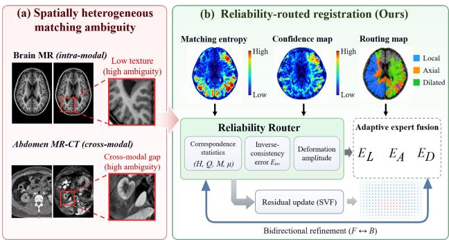
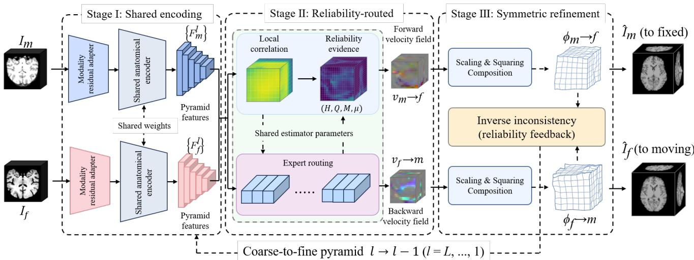
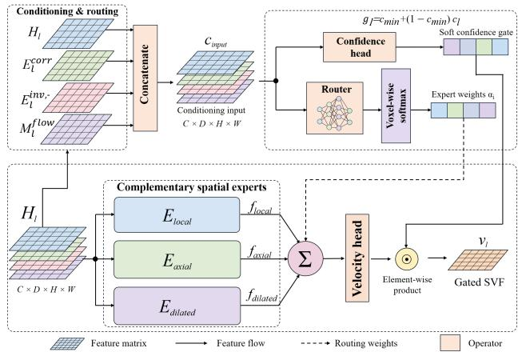
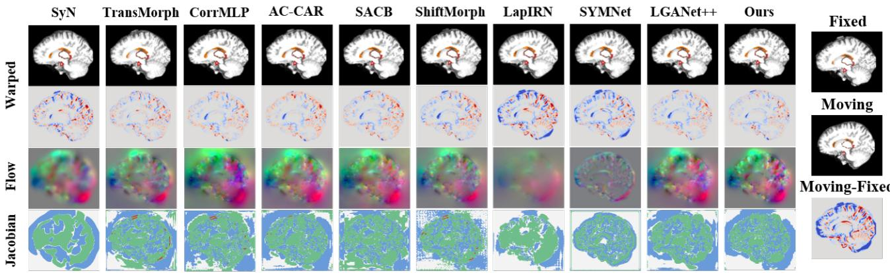
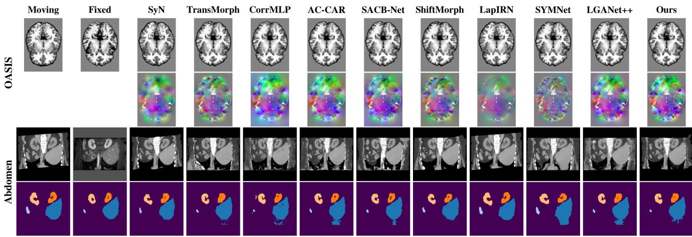
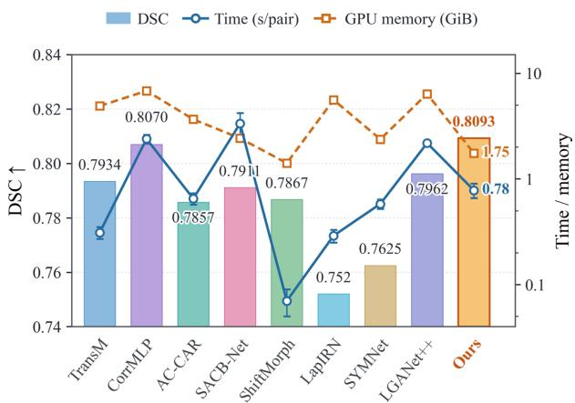
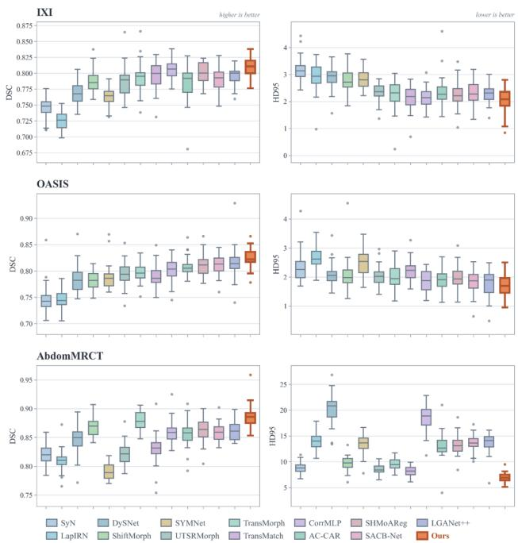
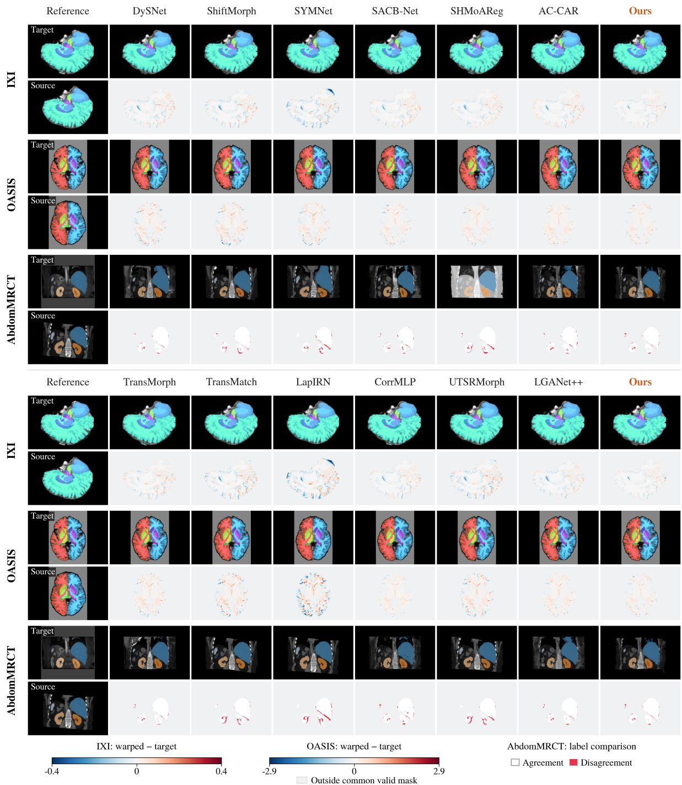
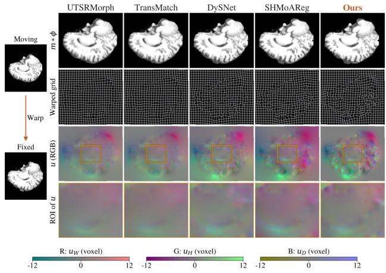

# Learning Where to Trust: Reliability-Guided Expert Routing and Velocity Gating for 3D Deformable Registration

Chenyu Guo1,2, Wenjie Dai1, Yiqian Chang1,2 Zhiyuan Zhang1, Yunfan Wei1, Shuhan Qi1† 1 Harbin Institute of Technology, Shenzhen, Guangdong, China 2 Peng Cheng Laboratory, Shenzhen, Guangdong, China

## Abstract

Deformable image registration relies on accurate anatomical correspondences. However, explicitly coupling local matching reliability with spatial context selection and deformation update strength remains insufficiently explored in learning-based registration. This challenge is particularly pronounced in homogeneous, weakly textured, and severely deformed regions, where ambiguous matches may induce erroneous deformation updates. We propose ReliMorph, a reliability-routed symmetric framework for 3D deformable registration that couples correspondence assessment with spatial context selection and update strength.Local correlation distributions characterize correspondence ambiguity using shared anatomical features with modality-specific adaptation. These reliability cues guide spatial expert fusion and gate residual velocities during coarse-to-fine refinement. Updated inverse-inconsistency feedback guides routing and gating at finer pyramid levels. To our knowledge, ReliMorph is the first 3D deformable registration framework to jointly condition spatial expert routing and residual velocity gating on correspondence reliability. Extensive experiments demonstrate that ReliMorph consistently outperforms competing methods in anatomical overlap, highlighting its effectiveness across unimodal and multimodal registration tasks.

## 1. Introduction

Deformable image registration (DIR) establishes dense spatial correspondences between medical images and is a fundamental component of longitudinal analysis, atlas construction, image-guided intervention, and multi-modal image fusion[6, 8, 24, 28]. These applications require precise anatomical correspondences and anatomically plausible transformations under complex local deformations[35].

  
Figure 1. Motivation and validation of reliability-routed registration. (a) Conventional uniform processing applies identical context modeling and deformation updates despite spatially varying matching ambiguity. (b) In contrast, ReliMorph leverages correspondence statistics and inverse-consistency cues to adaptively route complementary experts and regulate residual updates according to matching reliability.

Classical methods address this task through iterative optimization[2, 4], while learning-based approaches directly predict deformation fields to accelerate inference[3, 10, 27].

Despite recent advances, learning-based DIR still faces two closely related challenges. (1) Assessing local correspondence reliability. Matching becomes ambiguous in homogeneous, low-contrast, and cross-modal regions, where competing displacement hypotheses can receive similar responses [16, 22, 26]. A single deformation estimate does not explicitly characterize the reliability of these competing matches [10, 13, 32]. Ignoring this variation can lead to unreliable deformation updates, whereas excessive suppression may discard difficult but valid correspondences. The challenge is therefore to characterize spatially varying matching ambiguity while retaining informative motion cues. (2) Coupling spatial adaptation with correspondence reliability. Modality-dependent appearance further complicates anatomical matching [20, 29]. Meanwhile, spatially varying deformations require complementary local and broader contexts [7, 12, 26]. Selecting a suitable context alone does not determine how strongly its matching evidence should influence a deformation update. Expert routing supports adaptive context aggregation [23], but jointly conditioning context selection and update strength on correspondence reliability remains an open challenge.

To address these challenges, we propose ReliMorph, a reliability-routed symmetric framework for 3D deformable registration, as shown in Fig. 1(b). Rather than applying uniform spatial aggregation and unmodulated updates across all voxels, ReliMorph explicitly extracts local matching reliability and bidirectional consistency cues to guide how spatial context is selected and how strongly residual updates are applied. To our knowledge, ReliMorph is the first 3D deformable registration framework to jointly condition spatial expert routing and residual velocity gating on correspondence reliability.

Specifically, ReliMorph operates in three coupled stages across a coarse-to-fine pyramid. First, shared anatomical encoding with lightweight modality-specific adaptation extracts multiscale features across imaging modalities. Second, we summarize local correlation distributions using ambiguity statistics and expected offsets to capture both matching reliability and candidate motion. Combined with the current displacement magnitude and coarser-level inverse-inconsistency feedback, these descriptors guide voxel-wise routing across local-detail, axialcontext, and dilated-context experts, while a parallel confidence gate modulates the decoded residual stationary velocities. Finally, we integrate the gated velocities and compose transformations symmetrically in both directions, propagating updated inverse-inconsistency maps to the next finer level to link subsequent refinement to the evolving registration state.

Our contributions are summarized as follows:

• Reliability-aware correspondence modeling. We summarize local correlation distributions using complementary ambiguity statistics and expected offsets, providing explicit correspondence cues beyond a single matching response.

• Reliability-routed deformation estimation. To our knowledge, ReliMorph is the first 3D deformable registration framework to jointly condition voxel-wise spatialexpert routing and residual velocity gating on shared correspondence and registration-state reliability, with a positive gate floor limiting velocity attenuation.

• Consistency-feedback symmetric refinement. We propagate updated forward–backward disagreement across pyramid levels to condition subsequent routing and velocity modulation, linking the outcomes of bidirectional deformation updates to finer-level estimation.

## 2. Related Work

## 2.1. Cross-Modal Representations for Deformable Registration

Cross-modal deformable registration requires anatomical correspondence estimation despite modality-dependent differences in image appearance. Learning-based approaches address this challenge through three complementary strategies: 1) Image translation converts cross-modal alignment into within-modality matching by translating images between modalities[1, 15]. 2) Appearance randomization uses synthetic training images or contrast augmentation to reduce dependence on the imaging contrasts encountered during training[19, 39]. 3) Representation learning constructs feature spaces that emphasize shared structure through contrastive learning, anatomical self-similarity, or knowledge transfer from pretrained visual encoders[11, 29, 31, 34].

However, robustness to appearance variation does not guarantee unambiguous anatomical correspondence. Homogeneous tissues, repeated structures, and modalitydependent boundary visibility can still produce competing matches, particularly when structural overlap is incomplete. A key challenge is therefore to preserve fine anatomical distinctions while assessing whether local matching evidence reliably supports deformation updates.

## 2.2. Coarse-to-Fine and Diffeomorphic Registration

Coarse-to-fine estimation and geometric regularization address complementary aspects of deformable registration. Pyramid and cascaded approaches progressively refine alignment to accommodate large deformations[26, 28, 43]. Velocity-based models construct transformations by integrating smooth velocity fields[6, 27], while inverseconsistency regularization encourages agreement between forward and backward mappings[14, 36]. These mechanisms can be combined to support progressive alignment and transformation regularity.

Geometric regularity and inverse consistency do not by themselves establish anatomical correctness. In progressive registration, errors in earlier updates can alter the correspondence evidence available to later stages. A remaining challenge is to use local matching reliability and bidirectiona consistency feedback to guide deformation updates across scales.

## 2.3. Reliability-Aware Matching and Adaptive Routing

Reliability assessment in matching and registration draws on probabilistic correspondence models[37], spatially varying variance estimates[39, 42], and bidirectional transformation agreement[38]. These signals characterize different aspects of uncertainty or consistency, and uncertainty estimates have been used to guide regional loss weighting[42]. Spatially adaptive methods address how image information is processed by adjusting convolution kernels, receptive fields, or feature aggregation according to image content [5, 9]. Within this broader family, expert routing combines heterogeneous processing branches through inputdependent selection or weighting[23, 44].

  
Figure 2. Overview of ReliMorph. Stage I (shared encoding) extracts multiscale anatomical features using a shared encoder with modality-specific adaptation. Stage II (reliability-routed estimation) uses correspondence and registration-state cues to guide expert fu sion and residual-velocity gating at each pyramid level. Stage III (symmetric refinement) integrates gated velocities via scaling and squaring, then composes the resulting residual transformations with the accumulated transformations in both directions. Updated inverseinconsistency maps feed back to Stage II at the next finer level.

However, using uncertainty to weight a training objective does not directly specify which spatial context should support an ambiguous match or how strongly a deformation update should be applied. Likewise, content-dependent kernels or expert weights do not by themselves establish the reliability of the underlying correspondence evidence. A remaining challenge is therefore to explicitly connect reliability assessment with the selection of spatial context and the modulation of deformation updates in cross-modal threedimensional registration.

## 3. Methodology

## 3.1. Overview of ReliMorph

Given a moving image $I _ { m }$ and a fixed image $I _ { f } ,$ , ReliMorph estimates dense displacement fields for registration in both directions. The forward field $\mathbf { u } _ { m  f }$ specifies sampling offsets for resampling the moving image onto the fixed-image grid. The backward field $\mathbf { u } _ { f  m }$ is defined analogously on the moving-image grid. We denote differentiable spatial warping by W[3], implemented using trilinear interpolation with border padding.

As shown in Fig. 2, ReliMorph combines shared encoding with modality-specific adaptation, reliabilityconditioned deformation estimation, and bidirectional coarse-to-fine refinement.

## 3.2. Shared-Anatomy Modality-Residual Encoding

In Stage I (Fig. 2), the encoder uses a shared backbone to process both images while retaining lightweight adaptation to modality-dependent appearance. For each image, we construct a local intensity residual by subtracting its local mean, computed with a $5 \times 5 \times 5$ average-pooling kernel. Concatenating this residual with the original image supplies local intensity variations alongside the original appearance information.

Let $\mathbf { A } _ { q }$ denote the concatenated input for modality q, and let $B _ { 0 }$ denote the shared shallow stem. The shallow features are computed as:

$$
{ \bf F } _ { q } ^ { 0 } = { \ B } _ { 0 } ( { \bf A } _ { q } ) + \mathcal { A } _ { q } ( \mathcal { B } _ { 0 } ( { \bf A } _ { q } ) ) ,\tag{1}
$$

where $A _ { q }$ is a modality-specific residual adapter. Each adapter applies depthwise spatial filtering, group normalization, a LeakyReLU activation, and a pointwise projection. The final pointwise projection is zero-initialized.

The adapted features pass through a pyramid of shared strided convolutional stages with residual blocks. Each stage is followed by modality-conditioned channel-wise affine modulation, following the feature-wise linear modulation principle [30, 39]. Learned modality embeddings provide a residual scale and a shift, both initialized to zero. This initialization preserves the unmodulated shared computation while allowing modality-dependent adjustments to develop during training. The resulting features retain shared spatial processing throughout the hierarchy without requiring independent modality-specific encoders.

  
Figure 3. Reliability-conditioned expert routing and velocity modulation. Correspondence and registration-state cues guide voxel-wise fusion of local, axial, and dilated convolutional experts. A confidence-based gate with a positive lower bound scales the residual stationary velocity field decoded from the fused features.

## 3.3. Reliability-Routed Symmetric Correspondence Modeling

In Stage II (Fig. 2), at each pyramid level, correspondence evidence guides both spatial context aggregation and the strength of the deformation update. Figure 3 details this module, which shares estimator parameters between the forward and backward directions.

Distributional local correspondence. We index pyramid levels from the finest level 1 to the coarsest level L. At level l, the incoming forward displacement warps the moving features into the fixed-feature grid, yielding $\widetilde { \mathbf { F } } _ { m } ^ { l }$ . Both feature tensors are then normalized along the channel dimension. For each voxel p, their dot products over integer offsets in $\Omega _ { l } = [ - r _ { l } , { \bar { r } } _ { l } ] ^ { 3 } \cap \mathbb { Z } ^ { 3 }$ form a local correlation volume $\mathbf { C } _ { l } [ 2 6 , 3 7 ]$ . Specifically, $C _ { l } ( \mathbf { p } , \delta )$ compares the fixed feature at p with the warped moving feature at $\mathbf { p } + \delta$ . Shifted features outside the grid are zero-padded during correlation construction.

We convert these responses into a distribution over candidate offsets:

$$
P _ { l } ( \mathbf { p } , \delta ) = \frac { \exp ( C _ { l } ( \mathbf { p } , \delta ) / \tau _ { l } ) } { \displaystyle \sum _ { \delta ^ { \prime } \in \Omega _ { l } } \exp \bigl ( C _ { l } ( \mathbf { p } , \delta ^ { \prime } ) / \tau _ { l } \bigr ) } .\tag{2}
$$

The level-specific temperature $\tau _ { l }$ is learned jointly with the registration network and controls the concentration of the distribution over candidate offsets. The resulting statistics are used as level-specific conditioning cues for deformation estimation.

Correspondence reliability evidence. We summarize matching ambiguity using normalized entropy, peak probability, and the margin between the two largest probabilities. The normalized entropy is:

$$
H _ { l } ( \mathbf { p } ) = - \frac { 1 } { \log \left| \Omega _ { l } \right| } \sum _ { \delta \in \Omega _ { l } } P _ { l } ( \mathbf { p } , \pmb { \delta } ) \log P _ { l } ( \mathbf { p } , \pmb { \delta } ) ,\tag{3}
$$

The peak probability $Q _ { l }$ measures the mass assigned to the strongest candidate, while the top-response margin Ml measures its separation from the second strongest candidate. Together with $H ^ { l }$ , these statistics characterize ambiguity within the local candidate set and serve as reliability cues.

We also retain the directional tendency of the distribution through its normalized expected offset:

$$
\mu _ { l } ( \mathbf { p } ) = \frac { 1 } { r _ { l } } \sum _ { \delta \in \Omega _ { l } } P _ { l } ( \mathbf { p } , \delta ) \delta .\tag{4}
$$

Concatenating $H _ { l } , Q _ { l } , M _ { l } ,$ , and the three components of $\pmb { \mu } _ { l }$ gives the six-channel correspondence descriptor $\mathbf { E } _ { l } ^ { \mathrm { c o r r } }$

Registration-state reliability. The matcher also receives the current displacement magnitude and consistency feedback from the preceding coarser level. The magnitude map $M _ { l } ^ { \mathrm { f i o w } }$ is the voxel-wise Euclidean norm of the incoming displacement, divided by the largest spatial dimension sl.

To define the consistency feedback, let superscripts − and + denote states before and after the update at a given level. After updating both directions, we compute the forward inverse-inconsistency map following inverseconsistent formulations[14] as:

$$
E _ { l } ^ { \mathrm { i n v } , + } = \mathrm { c l i p } _ { [ 0 , 1 ] } ( \frac { \| \mathbf { u } _ { m  f } ^ { l , + } + \mathcal { W } \Big ( \mathbf { u } _ { f  m } ^ { l , + } , \mathbf { u } _ { m  f } ^ { l , + } \Big ) \| _ { 2 } } { s _ { l } } )\tag{5}
$$

The reverse map exchanges the two displacement fields in this expression. At the coarsest level, the incoming feedback $E _ { L } ^ { \mathrm { i n } \mathrm { \bar { v } } , - }$ is initialized to zero. At finer levels, $E _ { l } ^ { \mathrm { i n v , - } }$ is obtained by trilinearly interpolating the updated map from the preceding coarser level. This scalar feedback retains its existing normalization during interpolation.

We concatenate the fixed features, warped moving features, their absolute difference, the correlation volume, and the correspondence and registration-state descriptors. A convolutional projection followed by a residual block produces the matching representation $\mathbf { H } _ { l }$

Reliability-conditioned expert routing. Unlike purely content-driven expert routing[23, 44] or adaptive spatial convolutions[9], our router receives $\mathbf { H } _ { l }$ together with the explicit correspondence and registration-state descriptors:

$$
\pmb { \alpha } _ { l } = \mathrm { S o f t m a x } _ { k } \left( \mathcal { R } _ { l } \left( \mathrm { C a t } [ \mathbf { H } _ { l } , \mathbf { E } _ { l } ^ { \mathrm { c o r r } } , E _ { l } ^ { \mathrm { i n v , - } } , M _ { l } ^ { \mathrm { f o w } } ] \right) \right)\tag{6}
$$

Here, $\mathcal { R } _ { l }$ comprises pointwise convolutions, and the softmax produces three non-negative expert weights that sum to one at each voxel. The local-detail expert uses depthwise $3 \times 3 \times 3$ filtering followed by pointwise projection. The axial-context expert sums depthwise convolutions along the three axes, each with an extent of seven voxels, before pointwise fusion. The dilated-context expert uses depthwise $3 \times 3 \times 3$ filtering with dilation two to access a wider neighborhood.

Their outputs are combined using the voxel-wise routing weights:

$$
\widetilde { \mathbf H } _ { l } = \sum _ { k \in \{ \mathrm { l o c } , \mathrm { c t x } , \mathrm { d i l } \} } \alpha _ { l } ^ { k } \odot { \mathcal E } _ { l , k } ( \mathbf H _ { l } ) ,\tag{7}
$$

where $\odot$ denotes element-wise multiplication with broadcasting over feature channels.

Reliability-conditioned velocity modulation. A velocity head $\mathcal { V } _ { l }$ decodes the routed features into a three-channel residual stationary velocity field. In parallel, a sigmoid confidence head predicts a modulation score $c _ { l } \in [ 0 , 1 ]$ from the same concatenated input used by the router. The effective gate $g _ { l } = c _ { \operatorname* { m i n } } + ( 1 - c _ { \operatorname* { m i n } } ) c _ { l }$ gives

$$
\mathbf { v } _ { l } = g _ { l } \odot \mathcal { V } _ { l } ( \widetilde { \mathbf { H } } _ { l } ) .\tag{8}
$$

With $c _ { \operatorname* { m i n } } = 0 . 2 5$ , gating alone retains at least one quarter of the raw velocity magnitude without enforcing nonzero motion.

## 3.4. Symmetric Coarse-to-Fine Diffeomorphic Refinement

Residual velocity integration and composition. In Stage III (Fig. 2), we construct each residual transformation by integrating its stationary velocity field. Following the scaling-and-squaring formulation used in diffeomorphic registration [10], the residual displacement is

$$
\begin{array} { r } { \Delta \mathbf { u } _ { m  f } ^ { l } = \exp ( \mathbf { v } _ { m  f } ^ { l } ) - \mathrm { I d } , } \end{array}\tag{9}
$$

where exp denotes the unit-time flow of the stationary velocity and Id is the identity transformation. Numerically, we divide the velocity by $2 ^ { T }$ and perform $T$ self-compositions using differentiable spatial warping, with $T = 7$ by default. The same procedure integrates the backward velocity into its residual displacement.

We then compose the residual with the accumulated displacement:

$$
\begin{array} { r } { \mathbf { u } _ { m  f } ^ { l , + } = \Delta \mathbf { u } _ { m  f } ^ { l } + \mathcal { W } ( \mathbf { u } _ { m  f } ^ { l , - } , \Delta \mathbf { u } _ { m  f } ^ { l } ) . } \end{array}\tag{10}
$$

This ordering evaluates the accumulated transformation after the residual transformation, accounting for the coordinates changed by the current update. The backward displacement is updated through the same composition rule.

Coarse-to-fine propagation and consistency feedback. Both displacement fields start from zero at the coarsest pyramid level. After each update, trilinear interpolation transfers the fields to the next finer grid. Each displacement component is also rescaled by the ratio of the new to old grid interval counts along its corresponding axis. The resized fields warp the next pair of features before the matcher predicts further residual velocities.

After both directions are updated, the inverseinconsistency maps in Eq. (5) are interpolated to the next finer level to condition its router and confidence head.

After the finest-level update, both displacement fields are resized to the original image resolution using the same component-wise rescaling rule. The moving and fixed images are then warped with their corresponding displacement fields to produce the registered outputs. The model also returns a consistency-adjusted confidence map $\widehat { c } _ { d }$ for each direction d. It is obtained by multiplying the finest-level score by one minus the updated inverse-inconsistency map and then interpolating the result to full resolution. These final confidence maps receive auxiliary supervision.

Here, symmetry refers to shared estimation parameters and bidirectional feedback. Exact inverse consistency and fold-free discrete transformations are not guaranteed.

## 3.5. Training Objective

ReliMorph is trained without segmentation supervision using image alignment, geometric regularization, and confidence self-supervision:

$$
\begin{array} { r l } & { \mathcal { L } = \mathcal { L } _ { \mathrm { s i m } } + \lambda _ { \mathrm { m s } } \mathcal { L } _ { \mathrm { m s } } + \lambda _ { \mathrm { s t r } } \mathcal { L } _ { \mathrm { s t r } } } \\ & { \qquad + \lambda _ { \mathrm { v e l } } \mathcal { L } _ { \mathrm { v e l } } + \lambda _ { \mathrm { i n v } } \mathcal { L } _ { \mathrm { i n v } } + \lambda _ { \mathrm { j a c } } \mathcal { L } _ { \mathrm { j a c } } + \lambda _ { \mathrm { c o n f } } \mathcal { L } _ { \mathrm { c o n f } } . } \end{array}\tag{11}
$$

The alignment terms supervise full-resolution and multiscale registration while encouraging structural agreement. Geometric regularization promotes smooth residual velocities, inverse consistency, and positive Jacobian determinants. The confidence term supervises the final consistencyadjusted confidence maps using targets $\exp [ - \mathrm { s g } ( e _ { d } ) / t _ { c } ]$ derived from local registration dissimilarity $e _ { d } .$ . Here, sg stops gradients through the targets, and $t _ { c }$ controls their decay.

## 4. Experiment

## 4.1. Experimental Setup

Datasets. We evaluate ReliMorph on three public datasets covering inter-subject brain MR and abdominal CT-MR registration. For each brain dataset, training randomly samples 200 inter-subject pairs per epoch. All evaluations use fixed image pairs.

Table 1. Registration performance on IXI, OASIS, and AbdomMRCT. HD95 is measured in millimeters. Fold denotes the percentage of voxels with det $( \nabla \phi ) \le 0 . 0 \mathrm { A S I S }$ results are reported on the labeled validation pairs.
<table><tr><td></td><td colspan="3">IXI</td><td colspan="3">OASIS</td><td colspan="4">AbdomMRCT</td></tr><tr><td>Method</td><td>DSC↑</td><td>HD95↓</td><td>Fold↓</td><td>DSC↑</td><td>HD95↓</td><td>Fold↓</td><td>DSC ↑</td><td>HD95↓</td><td>Fold↓</td><td>LMIND-SSC ↓</td></tr><tr><td>SyN</td><td>0.7460</td><td>3.157</td><td>0</td><td>0.7454</td><td>2.350</td><td>0</td><td>0.8212</td><td>8.746</td><td>0</td><td>0.0894</td></tr><tr><td>TransMorph</td><td>0.7934</td><td>2.257</td><td>0.2879</td><td>0.7965</td><td>2.009</td><td>0.7456</td><td>0.8798</td><td>9.542</td><td>20.73</td><td>0.0315</td></tr><tr><td>CorrMLP</td><td>0.8070</td><td>2.136</td><td>0.4508</td><td>0.8017</td><td>1.855</td><td>0.0115</td><td>0.8591</td><td>18.517</td><td>17.74</td><td>0.0412</td></tr><tr><td>AC-CAR</td><td>0.7857</td><td>2.363</td><td>0.1860</td><td>0.8080</td><td>1.895</td><td>0.1819</td><td>0.8557</td><td>13.124</td><td>18.02</td><td>0.0445</td></tr><tr><td>SACB-Net</td><td>0.7911</td><td>2.327</td><td>0.0189</td><td>0.8132</td><td>1.824</td><td>0.6495</td><td>0.8588</td><td>13.553</td><td>4.740</td><td>0.0426</td></tr><tr><td>ShiftMorph</td><td>0.7867</td><td>2.763</td><td>0.2967</td><td>0.7823</td><td>2.064</td><td>0.4163</td><td>0.8675</td><td>9.732</td><td>0.259</td><td>0.1270</td></tr><tr><td>LapIRN (SVF)</td><td>0.7522</td><td>2.930</td><td>0</td><td>0.7472</td><td>2.649</td><td>0</td><td>0.8098</td><td>13.88</td><td>0</td><td>0.1270</td></tr><tr><td>SYMNet</td><td>0.7625</td><td>2.815</td><td>0.0003</td><td>0.7882</td><td>2.503</td><td>0.0003</td><td>0.7907</td><td>13.42</td><td>1.5997</td><td>0.1384</td></tr><tr><td>LGANet++</td><td>0.7962</td><td>2.262</td><td>0.0001</td><td>0.8164</td><td>1.808</td><td>0.0013</td><td>0.8611</td><td>13.69</td><td>0.7292</td><td>0.0348</td></tr><tr><td>Ours</td><td>0.8093</td><td>2.040</td><td>0.0032</td><td>0.8258</td><td>1.709</td><td>0.0423</td><td>0.8868</td><td>6.970</td><td>0.029</td><td>0.0284</td></tr></table>

  
Figure 4. Qualitative comparison of inter-subject brain MRI registration on IXI. For each method, rows show the warped moving image with selected anatomical contours, the signed intensity residual $I _ { \mathrm { w a r p } } - I _ { \mathrm { f i x e d } } .$ , the displacement field (RGB encodes $d _ { x } , d _ { y } , d _ { z } ) .$ , and the Jacobian determinant J. The panels on the right show the fixed and moving images and their intensity difference before registration. Residual maps share the color scale shown below. In the Jacobian maps, red indicates folding $( J \leq 0 )$ , gray indicates near-unit volume change $( | J - 1 | \leq 0 . 0 2 )$ , green indicates compression, and blue indicates expansion.

1. IXI [33] For T1-weighted brain MR registration, we use subject-disjoint training, validation, and test sets of 403, 58, and 115 subjects, respectively. Validation and testing use 58 and 115 circular pairs. Evaluation covers 28 structures with input volumes of $1 6 0 \times 1 9 2 \times 2 2 4$

2. OASIS [25] We use the Learn2Reg OASIS release for inter-subject T1-weighted brain MR registration. Training and validation are subject-disjoint, with all subjects appearing in the validation pairs excluded from training. Evaluation covers 35 anatomical structures using input volumes of $1 9 2 \times 2 2 4 \times 1 6 0$

3. AbdomMRCT from Learn2Reg [18] We perform intrapatient registration from moving CT to fixed T1- weighted MR using the official pairing manifests. Evaluation covers the liver, spleen, and both kidneys on $1 9 2 \times 1 6 0 \times 1 9 2$ volumes resampled to 2 mm isotropic spacing.

Comparisons. We select baselines covering four complementary aspects: correspondence and context modeling (TransMorph [6], CorrMLP [26], and LGANet++ [21]); adaptive feature processing (AC-CAR [39] and SACB-Net [9]); diffeomorphic modeling (SyN [2], LapIRN’s SVF variant [28], and SYMNet [27]); and efficient convolutional registration (ShiftMorph [40]).

Supplementary comparisons with UTSRMorph[41] and TransMatch[8] extend coverage of feature representation and explicit matching, while DySNet[5] and SHMoAReg[44] provide additional references for dynamic spatial processing and expert routing. All methods share the data and evaluation protocols, with method-specific training settings, geometric regularizers, and cross-modal adaptations detailed in the supplementary material.

Implementation and evaluation metrics. Our method is implemented in PyTorch and trained for 100 epochs on an NVIDIA A6000 GPU (48 GB), with a batch size of 1. We use AdamW with an initial learning rate and weight decay of $1 0 ^ { - 4 }$ , together with cosine learning-rate annealing. Segmentation labels are excluded from the training loss, and checkpoints are selected by mean validation DSC. Baselines use either the same hyperparameters or the configurations reported in their original papers.

We evaluate anatomical overlap using DSC and boundary discrepancy using HD95 (mm). Deformation regularity is assessed using Fold, the percentage of voxels with det $( \nabla \phi ) ~ \le ~ 0$ Anatomical metrics exclude the background and are averaged over the evaluated structures and image pairs. For AbdomMRCT, we additionally report $\mathcal { L } _ { \mathrm { M I N D - S S C } }$ , the mean squared MIND-SSC descriptor difference between the fixed and registered images, to assess modality-independent structural agreement. Lower values indicate better agreement.

Training loss configuration. Full-resolution and multiscale alignment use one minus squared LNCC for brain MR and mean-squared MIND-SSC descriptor differences for abdominal CT–MR. Multiscale weights are normalized and double from coarser to finer levels. Structural alignment applies Smooth- $. L _ { 1 }$ loss to spatially mean-normalized gradient magnitudes, computed after $5 \times 5 \times 5$ local-mean subtraction.

Velocity regularization averages squared spatial differences across levels and directions. Inverse-consistency regularization uses mean-squared bidirectional composition residuals in voxel coordinates, without the normalization or clipping used for routing feedback.

The Jacobian penalty averages squared negative Jacobian determinants. Confidence supervision uses bidirectionally averaged Smooth- $. L _ { 1 }$ loss. Loss weights are reported in Tab. S1, with $\lambda _ { \mathrm { s t r } } = 0$ for AbdomMRCT.

## 4.2. Performance Comparison

Quantitative comparison. Tab. 1 shows that ReliMorph achieves the highest DSC and lowest HD95 across all three benchmarks. On IXI, coupling reliability-routed context aggregation with velocity gating suppresses ambiguous updates in homogeneous regions, improving alignment over CorrMLP with lower folding. On the OASIS validation set, ReliMorph surpasses LGANet++ in both DSC and HD95, though with a slightly higher folding rate that reflects an accuracy–regularity trade-off under large intersubject variations. On cross-modal AbdomMRCT, where large organ deformations coincide with severe CT–MR contrast gaps, combining modality-residual encoding with reliability-guided routing substantially improves DSC and HD95 over TransMorph while reducing both folding and MIND-SSC dissimilarity.

Qualitative comparison. As shown in Fig. 4 and Fig. 5, we further provide qualitative comparisons on IXI, OA-SIS, and AbdomMRCT. In the displayed IXI case, ReliMorph shows weaker intensity residuals around cortical boundaries than several baselines while maintaining smooth Jacobian maps. The OASIS result closely follows the fixed-image anatomical layout, while the abdominal propagated labels show accurate organ-level alignment with less pronounced elongation and fragmentation than competing methods, benefiting from routing ambiguous boundaries toward broader spatial contexts.

Computational efficiency. Finally, Fig. 6 compares registration accuracy, inference time, and peak GPU memory on IXI. By using compact reliability descriptors and lightweight depthwise-separable experts, ReliMorph achieves a DSC of 0.8093 with inference taking $0 . 7 8 \pm$ 0.12 s per image pair and requiring only 1.75 GiB of peak allocated GPU memory.

## 4.3. Ablation study

Tab. 2 validates the key components of ReliMorph on IXI. First, removing explicit correspondence descriptors or retaining only the expected offset $\pmb { \mu } _ { l }$ without ambiguity statistics noticeably degrades alignment, as mean motion alone cannot distinguish sharp unimodal matches from flat, multi-modal ambiguity. Second, replacing adaptive routing with uniform fusion or disabling velocity gating both weaken performance, confirming that selecting complementary spatial contexts and attenuating unreliable updates are jointly necessary. Third, omitting cross-scale inverseinconsistency feedback hurts refinement because finer-level local correlation cannot detect bidirectional errors accumulated from coarser scales. Finally, removing the positive gate floor $c _ { \mathrm { m i n } }$ causes the largest accuracy drop (0.7745 DSC with 0% folding), showing that unconstrained gating over-suppresses velocities in high-ambiguity regions and leads to conservative under-registration.

Expert specialization. Tab. 3 examines expert specialization across matching-ambiguity regions on IXI. As ambiguity increases, routing shifts from the local expert toward the dilated expert. Suppressing the local expert increases anatomical label disagreement most in low-ambiguity regions (+1.42 pp), whereas suppressing the dilated expert has the largest effect in high-ambiguity regions (+1.56 pp).

  
Figure 5. Qualitative comparison of deformable registration on OASIS and abdominal images. The first two columns show the moving and fixed images; the remaining columns show results from the compared methods. For OASIS, the top two rows show the warped images and color-coded deformation fields. For the abdominal case, the bottom two rows show the warped images and corresponding propagated segmentation masks.

  
Figure 6. Comparison of registration accuracy (DSC), inference time, and peak GPU memory usage across methods on the IXI dataset.

Table 2. Ablation experiments on the IXI dataset for ReliMorph.
<table><tr><td>Variant</td><td>DSC ↑ HD95↓</td><td>(mm)</td><td>Fold ↓ (%)</td></tr><tr><td>Full model</td><td>0.8093</td><td>2.040</td><td>0.0032</td></tr><tr><td>w/o ambiguity statistics</td><td>0.7911</td><td>2.317</td><td>0.0001</td></tr><tr><td>w/o correlation descriptors</td><td>0.7875</td><td>2.356</td><td>0.0001</td></tr><tr><td>Uniform expert fusion</td><td>0.7907</td><td>2.312</td><td>0.0001</td></tr><tr><td>w/o velocity gating</td><td>0.7919</td><td>2.314</td><td>0.0001</td></tr><tr><td>w/o consistency feedback</td><td>0.7874</td><td>2.340</td><td>0.0001</td></tr><tr><td>w/o positive gate floor</td><td>0.7745</td><td>2.460</td><td>0</td></tr></table>

Fold denotes the percentage of voxels with de $( \nabla \phi ) \leq 0 .$

These results support region-dependent use of complementary spatial contexts.

Table 3. Expert specialization on IXI. ∆e denotes the increase in regional anatomical label disagreement (pp) after suppressing each expert at the finest matching level of the frozen model.
<table><tr><td></td><td colspan="2">Mean routing weight</td><td colspan="2">∆e (pp)</td></tr><tr><td>Ambiguity</td><td>Local Axial</td><td>Dilated</td><td>Local Axial</td><td>Dilated</td></tr><tr><td>Low</td><td>0.468 0.314</td><td>0.218</td><td>+1.42</td><td>+0.76 +0.38</td></tr><tr><td>Medium</td><td>0.338 0.369</td><td>0.293</td><td>+0.85</td><td>+1.09 +0.74</td></tr><tr><td>High</td><td>0.219 0.353</td><td>0.428</td><td>+0.41</td><td>+1.14 +1.56</td></tr></table>

## 5. Conclusion

We presented ReliMorph, a symmetric 3D registration framework that couples correspondence reliability with spatial context selection and deformation updates. Shared anatomical encoding with modality-specific adaptation supports local correspondence modeling through correlation distributions. Their statistics, together with deformationstate cues and inverse-inconsistency feedback, guide voxelwise fusion of local, axial, and dilated experts, while soft confidence gating modulates residual velocities. Stationaryvelocity integration and transformation composition refine both directions from coarse to fine, with updated consistency feedback guiding subsequent routing and modulation. Experiments on IXI, OASIS, and AbdomMRCT demonstrate improved anatomical overlap across unimodal brain and multimodal abdominal registration.

## References

[1] Moab Arar, Yiftach Ginger, Dov Danon, Amit H. Bermano, and Daniel Cohen-Or. Unsupervised multi-modal image registration via geometry preserving image-to-image translation. In 2020 IEEE/CVF Conference on Computer Vision and Pattern Recognition (CVPR), pages 13407–13416, 2020. 2

[2] B.B. Avants, C.L. Epstein, M. Grossman, and J.C. Gee. Symmetric diffeomorphic image registration with crosscorrelation: Evaluating automated labeling of elderly and neurodegenerative brain. Medical Image Analysis, 12(1):26– 41, 2008. Special Issue on The Third International Workshop on Biomedical Image Registration – WBIR 2006. 1, 6

[3] Guha Balakrishnan, Amy Zhao, Mert R. Sabuncu, John Guttag, and Adrian V. Dalca. Voxelmorph: A learning framework for deformable medical image registration. IEEE Transactions on Medical Imaging, 38(8):1788–1800, 2019. 1, 3

[4] M. F. Beg, M. I. Miller, A. Trouve, and L. Younes. Comput-´ ing large deformation metric mappings via geodesic flows of diffeomorphisms. International Journal of Computer Vision, 61:139–157, 2005. 1

[5] Shao-Chen Bi, Yuting He, Wei Wang, and Hao Chen. Dynamic stream network for combinatorial explosion problem in deformable medical image registration. In Proceedings of the IEEE/CVF Conference on Computer Vision and Pattern Recognition (CVPR), 2026. 3, 7

[6] Junyu Chen, Eric C. Frey, Yufan He, William P. Segars, Ye Li, and Yong Du. Transmorph: Transformer for unsupervised medical image registration. Medical Image Analysis, page 102615, 2022. 1, 2, 6

[7] Jiashun Chen, Donghuan Lu, Yu Zhang, Dong Wei, Munan Ning, Xinyu Shi, Zhe Xu, and Yefeng Zheng. Deformer: Towards displacement field learning for unsupervised medical image registration. In International conference on medical image computing and computer-assisted intervention, pages 141–151. Springer, 2022. 2

[8] Zeyuan Chen, Yuanjie Zheng, and James C Gee. Transmatch: A transformer-based multilevel dual-stream feature matching network for unsupervised deformable image registration. IEEE transactions on medical imaging, 43(1):15–27, 2023. 1, 7

[9] Xinxing Cheng, Tianyang Zhang, Wenqi Lu, Qingjie Meng, Alejandro F. Frangi, and Jinming Duan. Sacb-net: Spatialawareness convolutions for medical image registration. In 2025 IEEE/CVF Conference on Computer Vision and Pattern Recognition (CVPR), pages 5227–5237, 2025. 3, 4, 6

[10] Adrian V. Dalca, Guha Balakrishnan, John Guttag, and Mert R. Sabuncu. Unsupervised learning of probabilistic diffeomorphic registration for images and surfaces. Medical Image Analysis, 57:226–236, 2019. 1, 5

[11] Neel Dey, Jo Schlemper, Seyed Sadegh Mohseni Salehi, Bo Zhou, Guido Gerig, and Michal Sofka. ContraReg: Contrastive learning of multi-modality unsupervised deformable image registration. In Medical Image Computing and Computer Assisted Intervention – MICCAI 2022, pages 66–77. Springer, 2022. 2

[12] Morteza Ghahremani, Mohammad Khateri, Bailiang Jian, Benedikt Wiestler, Ehsan Adeli, and Christian Wachinger. H-vit: A hierarchical vision transformer for deformable image registration. In 2024 IEEE/CVF Conference on Computer Vision and Pattern Recognition (CVPR), pages 11513– 11523. IEEE, 2024. 2

[13] Xuan Gong, Luckyson Khaidem, Wentao Zhu, Baochang Zhang, and David Doermann. Uncertainty learning towards unsupervised deformable medical image registration. In 2022 IEEE/CVF Winter Conference on Applications of Computer Vision (WACV), pages 1555–1564, 2022. 1

[14] Hastings Greer, Roland Kwitt, Franc¸ois-Xavier Vialard, and Marc Niethammer. ICON: Learning regular maps through inverse consistency. In Proceedings of the IEEE/CVF International Conference on Computer Vision (ICCV), pages 3396–3405, 2021. 2, 4

[15] R. Han, C. K. Jones, J. Lee, P. Wu, P. Vagdargi, A. Uneri, P. A. Helm, M. Luciano, W. S. Anderson, and J. H. Siewerdsen. Deformable MR-CT image registration using an unsupervised, dual-channel network for neurosurgical guidance. Medical Image Analysis, 75:102292, 2022. 2

[16] Mattias P Heinrich. Closing the gap between deep and con ventional image registration using probabilistic dense displacement networks. In International Conference on Medical Image Computing and Computer-Assisted Intervention, pages 50–58. Springer, 2019. 1

[17] Mattias P. Heinrich, Mark Jenkinson, Bartlomiej W. Papiez, Sir Michael Brady, and Julia A. Schnabel. Towards˙ realtime multimodal fusion for image-guided interventions using self-similarities. In Medical Image Computing and Computer-Assisted Intervention–MICCAI 2013, pages 187– 194. Springer, 2013. 2

[18] Alessa Hering, Lasse Hansen, Tony CW Mok, Albert CS Chung, Hanna Siebert, Stephanie Hager, Annkristin Lange,¨ Sven Kuckertz, Stefan Heldmann, Wei Shao, et al. Learn2reg: comprehensive multi-task medical image registration challenge, dataset and evaluation in the era of deep learning. IEEE Transactions on Medical Imaging, 42(3): 697–712, 2022. 6, 1

[19] M. Hoffmann, B. Billot, D. N. Greve, J. E. Iglesias, B. Fischl, and A. V. Dalca. Synthmorph: Learning contrast-invariant registration without acquired images. IEEE Transactions on Medical Imaging, 41(3):543–558, 2022. 2

[20] Yibo Hu, Lisa X Xu, and Jianqi Sun. A dual-stream mamba with contrastive representation for multimodal deformable registration. In 2025 47th Annual International Conference of the IEEE Engineering in Medicine and Biology Society (EMBC), pages 1–6. IEEE, 2025. 1

[21] Zhengyong Huang, Xingwen Sun, Xuting Chang, Ning Jiang, Yao Wang, Jianfei Sun, Hongbin Han, and Yao Sui. Unsupervised deformable image registration with localglobal attention and image decomposition. Expert Systems with Applications, 317:131820, 2026. 6

[22] Tianran Li, Marius Staring, and Yuchuan Qiao. Efficient large-deformation medical image registration via recurrent dynamic correlation. IEEE Transactions on Medical Imag ing, 2025. 1

[23] Hao Lin, Yonghong Song, You Su, and Yunfei Ma. Moemorph: Lightweight pyramid model with heterogeneous mixture of experts for deformable medical image registration. IEEE Transactions on Medical Imaging, 2025. 2, 3, 4

[24] T. Ma, X. Dai, S. Zhang, and Y. Wen. Pivit: Large deformation image registration with pyramid-iterative vision transformer. In Medical Image Computing and ComputerAssisted Intervention – MICCAI 2023, Cham, 2023. Springer. 1

[25] Daniel S. Marcus, Tracy H. Wang, Jamie Parker, John G. Csernansky, John C. Morris, and Randy L. Buckner. Open access series of imaging studies (oasis): cross-sectional mri data in young, middle aged, nondemented, and demented older adults. Journal of Cognitive Neuroscience, 19:1498– 1507, 2007. 6

[26] Mingyuan Meng, Dagan Feng, Lei Bi, and Jinman Kim. Correlation-aware coarse-to-fine mlps for deformable medical image registration. In 2024 IEEE/CVF Conference on Computer Vision and Pattern Recognition (CVPR), pages 9645–9654, 2024. 1, 2, 4, 6

[27] Tony C.W. Mok and Albert C.S. Chung. Fast symmetric diffeomorphic image registration with convolutional neural networks. In 2020 IEEE/CVF Conference on Computer Vision and Pattern Recognition (CVPR), pages 4643–4652, 2020. 1, 2, 6

[28] Tony C. W. Mok and Albert C. S. Chung. Large deformation diffeomorphic image registration with laplacian pyramid networks. In Medical Image Computing and Computer Assisted Intervention – MICCAI 2020, pages 211–221. Springer, 2020. 1, 2, 6

[29] Tony C. W. Mok, Zi Li, Yunhao Bai, Jianpeng Zhang, Wei Liu, Yan-Jie Zhou, Ke Yan, Dakai Jin, Yu Shi, Xiaoli Yin, Le Lu, and Ling Zhang. Modality-agnostic structural image representation learning for deformable multi-modality medical image registration. In 2024 IEEE/CVF Conference on Computer Vision and Pattern Recognition (CVPR), pages 11215– 11225, 2024. 1, 2

[30] Ethan Perez, Florian Strub, Harm De Vries, Vincent Dumoulin, and Aaron Courville. Film: Visual reasoning with a general conditioning layer. In Proceedings of the AAAI conference on artificial intelligence, 2018. 3

[31] Nicolas Pielawski, Elisabeth Wetzer, Johan Ofverstedt, Ji-¨ ahao Lu, Carolina Wahlby, Joakim Lindblad, and Natasa¨ Sladoje. CoMIR: Contrastive multimodal image representation for registration. In Advances in Neural Information Processing Systems, 2020. 2

[32] Luciano Rivetti, Andrej Studen, Manju Sharma, Jason Chan, and Robert Jeraj. Uncertainty estimation and evaluation of deformation image registration based convolutional neural networks. Physics in Medicine & Biology, 69(11):115045, 2024. 1

[33] Daniel Rueckert and et al. Ixi dataset: Information extraction from images, 2008. Accessed: 2026-09-15. Contains nearly 600 brain MRI scans (T1, T2, PD, MRA, DWI) from healthy subjects for medical image registration. EPSRC Grant GR/S21533/02. 6

[34] X. Song, X. Xu, J. Zhang, D. Machado Reyes, and P. Yan. Dino-reg: Efficient multimodal image registration with dis-

tilled features. IEEE Transactions on Medical Imaging, 44 (9):3809–3819, 2025. 2

[35] Aristeidis Sotiras, Christos Davatzikos, and Nikos Paragios. Deformable medical image registration: A survey. IEEE Transactions on Medical Imaging, 32(7):1153–1190, 2013. 1

[36] Lin Tian, Hastings Greer, Franc¸ois-Xavier Vialard, Roland Kwitt, Raul San Jos´ e Est´ epar, Richard Jarrett Rushmore,´ Nikolaos Makris, Sylvain Bouix, and Marc Niethammer. Gradicon: Approximate diffeomorphisms via gradient inverse consistency. In 2023 IEEE/CVF Conference on Computer Vision and Pattern Recognition (CVPR), pages 18084– 18094, 2023. 2

[37] P. Truong, M. Danelljan, R. Timofte, and L. Van Gool. Pdcnet+: Enhanced probabilistic dense correspondence network. IEEE Transactions on Pattern Analysis and Machine Intelli gence, 45(8):10247–10266, 2023. 2, 4

[38] L. D. van Harten, J. Stoker, and I. Isgum. Robust deformable image registration using cycle-consistent implicit representations. IEEE Transactions on Medical Imaging, 43(2):784– 793, 2024. 2

[39] Y. Wang, X. Luo, S. Du, and C. Qin. Adaptive conditional contrast-agnostic deformable image registration with uncer tainty estimation. IEEE Transactions on Medical Imaging, 45(5):2269–2282, 2026. 2, 3, 6

[40] Lijian Yang, Weisheng Li, Yucheng Shu, Jianxun Mi, Yuping Huang, and Bin Xiao. Shiftmorph: A fast and robust convolutional neural network for 3d deformable medical image registration. In Proceedings of the 32nd ACM International Conference on Multimedia, page 2814–2823, New York, NY, USA, 2024. Association for Computing Machinery. 7

[41] Runshi Zhang, Hao Mo, Junchen Wang, Bimeng Jie, Yang He, Nenghao Jin, and Liang Zhu. Utsrmorph: A unified transformer and superresolution network for unsupervised medical image registration. IEEE Transactions on Medical Imaging, 44(2):891–902, 2025. 7

[42] Xiaoran Zhang, Daniel H. Pak, Shawn S. Ahn, Xiaoxiao Li, Chenyu You, Lawrence H. Staib, Albert J. Sinusas, Alex Wong, and James S. Duncan. Heteroscedastic uncertainty estimation framework for unsupervised registration. In Medical Image Computing and Computer Assisted Intervention – MICCAI 2024, pages 651–661. Springer Nature Switzerland, 2024. 2, 3

[43] Shengyu Zhao, Yue Dong, Eric I-Chao Chang, and Yan Xu. Recursive cascaded networks for unsupervised medical image registration. In Proceedings of the IEEE/CVF International Conference on Computer Vision (ICCV), pages 10600–10610, 2019. 2

[44] Yuxi Zheng, Jianhui Feng, Tianran Li, Marius Staring, and Yuchuan Qiao. Shmoareg: Spark deformable image registration via spatial heterogeneous mixture of experts and attention heads. In 2025 IEEE International Conference on Bioinformatics and Biomedicine (BIBM), pages 4517–4520, 2025. 3, 4, 7

# Learning Where to Trust: Reliability-Guided Expert Routing and Velocity Gating for 3D Deformable Registration

Supplementary Material

Table S1. Default hyperparameters. Merged entries apply to all datasets. Per-level vectors are ordered from coarse to fine.
<table><tr><td>Parameter</td><td>IXI/OASIS</td><td>AbdomMRCT</td></tr><tr><td> $\left( r _ { L } , \dots , r _ { 1 } \right)$ </td><td rowspan="8">(3, 2, 1)</td><td></td></tr><tr><td> $( \tau _ { L } ^ { ( 0 ) } , \dots , \tau _ { 1 } ^ { ( 0 ) } )$ </td><td>(0.07, 0.07, 0.07)</td></tr><tr><td> $\lambda _ { \mathrm { m s } }$ </td><td>0.25</td></tr><tr><td> $\lambda _ { \mathrm { s t r } }$ </td><td></td></tr><tr><td> $\lambda _ { \mathrm { v e l } }$ </td><td>0.02</td></tr><tr><td> $\lambda _ { \mathrm { i n v } }$ </td><td>0.05</td></tr><tr><td> $\lambda _ { \mathrm { j a c } }$ </td><td>0.01</td></tr><tr><td> $\lambda _ { \mathrm { c o n f } }$ </td><td>0.05</td></tr><tr><td> $t _ { c }$ </td><td>0.15</td></tr></table>

## A1. Reproducibility Details

For IXI and OASIS, pre-alignment and intensity normalization follow the TransMorph FreeSurfer pipeline[6] (skullstripping, affine alignment, with intensities scaled to [0, 1]) and the Learn2Reg/HyperMorph[18] OASIS preprocessing pipeline with foreground percentile clipping at 0.5–99.5% followed by z-score normalization, respectively. For AbdomMRCT, affine initialization is obtained from a 12-DoF affine transformation optimized by coarse-to-fine Adam, where the loss consists of MIND-SSC distance within overlapping body masks plus a soft body-mask Dice term. CT intensities are processed by clipping to [−200, 400] HU and min–max scaling to [0, 1], and MR intensities use the same 0.5–99.5% percentile clipping and z-score normalization.

Table S1 lists the remaining hyperparameters. Search radii are measured in feature-grid voxels. The learnable temperature is initialized as $\tau ^ { ( 0 ) } = 0 . 0 7$ and parameterized in the log domain as $\tau = \exp ( \log \tau )$ , with values clamped to [0.02, 0.50]. Hyperparameters are fixed a priori to the values in Table S1; model selection uses the validation Dice score.

## A1.1. Effect of Correlation Temperature

We compare learnable per-level temperatures with fixed temperatures $\boldsymbol { \tau _ { l } } ~ = ~ s \tau _ { l } ^ { ( 0 ) }$ , where $s \in \{ 0 . 5 , 1 , 2 \}$ and $\tau _ { l } ^ { ( 0 ) }$ denotes the default initialization reported in Sec. A1. Each configuration is trained independently on IXI using the default search radii and the same training protocol. Fixed temperatures remain unchanged during training and inference.

Table S2 reports registration performance and the mean normalized entropy at the finest level, $\bar { H } _ { 1 }$ , evaluated over the same image pairs, directions, and spatial regions. Perlevel entropy statistics are additionally recorded to examine how temperature learning changes the correspondence distributions across scales.

Table S2. Temperature ablation on IXI. $\bar { H } _ { 1 }$ summarizes distribution concentration and has no preferred direction.
<table><tr><td>Temperature</td><td>DSC↑</td><td>HD95↓ (mm)</td><td>Fold↓ (%)</td><td> $\bar { H } _ { 1 }$ </td></tr><tr><td>Fixed  $0 . 5 \tau _ { l } ^ { ( 0 ) }$ </td><td>0.7958</td><td>2.241</td><td>0.0046</td><td>0.412</td></tr><tr><td>Fixed  $\tau _ { l } ^ { ( 0 ) }$ </td><td>0.8026</td><td>2.134</td><td>0.0029</td><td>0.684</td></tr><tr><td>Fixed  $2 \hat { \tau _ { l } } ^ { ( 0 ) }$ </td><td>0.7931</td><td>2.285</td><td>0.0014</td><td>0.876</td></tr><tr><td>Learned (default)</td><td>0.8093</td><td>2.040</td><td>0.0032</td><td>0.618</td></tr></table>

## A2. Extended Comparisons

## A2.1. Additional Baseline Comparisons

Table S3 reports the quantitative results for the additional baselines, including Jaccard scores alongside DSC, HD95, and deformation folding rates, while Figure S1 illustrates the corresponding DSC and HD95 distributions across all compared methods. Furthermore, Figure S2 provides extended qualitative comparisons across IXI, OASIS, and AbdomMRCT, and Figure S3 visualizes the warped grids and displacement fields for the additional baselines on IXI.

Comparison protocol. All methods use the same dataset splits, evaluation pairs, preprocessing, input resolutions, and affine initialization. The learning-based methods use the designated training data for each dataset, with segmentation labels excluded from their training losses.

We retain each baseline’s architecture, transformation parameterization, and method-specific geometric regularization terms.

For abdominal CT–MR registration, we replace modality-dependent intensity similarity losses with MIND-SSC descriptor dissimilarity where cross-modal adaptation is required. Methods with native modality-independent matching objectives retain those objectives.

Metrics and aggregation. We follow the evaluation and aggregation protocol used in the main paper and additionally report Jaccard scores. Moving segmentation labels are warped to the fixed-image grid using nearest-neighbor interpolation. Jacobian determinants are computed using the same evaluation domain, finite-difference scheme, and boundary handling across methods.

  
Figure S1. Comparison of DSC and HD95 distributions across registration methods.

## A2.2. Modality-Independent Structural Evaluation

To assess cross-modal structural agreement beyond the four annotated organs on AbdomMRCT, we report $\mathcal { L } _ { \mathrm { M I N D - S S C } }$ in Table 1 of the main paper using the same checkpoints and trilinearly warped CT images $\widetilde { I } _ { m , a } = \mathcal { W } ( I _ { m } , u _ { a } )$ from the registration comparisons. Specifically, we extract $K = 1 2$ channel MIND-SSC descriptors[17] $D ( \cdot , x ) \in \mathbb { R } ^ { K }$ with a patch radius of two voxels and a dilation of two voxels under identical preprocessing and normalization across methods, and compute

$$
\mathcal { L } _ { \mathrm { M I N D - S S C } } = \frac { 1 } { K | \Omega _ { \mathrm { e v a l } } | } \sum _ { x \in \Omega _ { \mathrm { e v a l } } } \Vert D ( I _ { f } , x ) - D ( \widetilde { I } _ { m , a } , x ) \Vert _ { 2 } ^ { 2 } .\tag{S1}
$$

Here, the common evaluation region $\Omega _ { \mathrm { e v a l } }$ is formed by intersecting the fixed-MR body foreground mask (obtained via Otsu thresholding before intensity normalization, largest-connected-component selection, and hole filling) with the valid in-bounds descriptor neighborhoods across all evaluated methods.

## A3. Gate and Geometric Regularity

Experimental protocol. Using the velocity gate defined in Eq. (8) of the main paper, we evaluate $c _ { \operatorname* { m i n } } \ \in$ {0, 0.1, 0.25, 0.5, 1} on IXI and OASIS. The settings $c _ { \operatorname* { m i n } } ~ = ~ 0$ and $c _ { \operatorname* { m i n } } ~ = ~ 1$ remove the positive floor and yield an identity gate, respectively. Each configuration is trained independently using the same data splits, training budget, remaining hyperparameters, and validation-based checkpoint selection criterion. The confidence head and its auxiliary supervision are retained in all configurations, including $c _ { \operatorname* { m i n } } = 1$ , and the integration depth is fixed at $T = 7 .$

Evaluation. Table S4 summarizes gate-floor sensitivity on IXI and OASIS using DSC, HD95, Fold, and bidirectional inverse-consistency error (ICE). ICE is the mean Euclidean distance, in millimeters, between a point and its round-trip mapping, averaged over both directions at valid in-bounds sampling locations.

Results. Among the tested settings, $c _ { \operatorname* { m i n } } = 0 . 2 5$ achieves the highest DSC and lowest HD95 and ICE on both datasets, but also the highest measured folding rate. This indicates a trade-off between anatomical alignment and folding. Because each configuration is retrained, the results reflect jointly learned velocity and confidence predictions.

## A4. Expert and Routing Analysis

We examine how expert composition and routing policies affect registration performance, and whether the learned experts exhibit region-dependent specialization.

## A4.1. Effect of Expert Composition

Experimental design. We investigate whether registration benefits from the individual expert branches and their heterogeneous spatial sampling patterns. The default configuration contains a local expert $( E _ { \mathrm { l o c } } )$ , an axial expert $( E _ { \mathrm { a x i a l } } )$ and a dilated expert $\mathrm { ( } E _ { \mathrm { d i l } } )$ . The expert architectures are fixed, and their parameters are learned jointly with the registration network.

We remove each expert in turn and renormalize the routing weights over the remaining branches. In addition, we evaluate two alternative sets of experts. The homogeneous configuration uses three independently parameterized local experts with identical architectures. The dilation-only configuration uses three experts with $3 \times 3 \times 3$ depthwise convolutions and dilation rates of 1, 2, and 3, respectively, followed by the same pointwise projection. These alternatives examine whether multiple branches alone are sufficient and whether the default combination offers benefits over another set of spatial contexts.

Controlled settings. All configurations use soft routing and the same expert output dimensionality. The encoder, matching representation, velocity decoder, confidence gating, and training objective remain unchanged. Each variant is trained independently on IXI using the same training budget and validation-based checkpoint selection criterion. The gate floor and integration depth are fixed at $c _ { \operatorname* { m i n } } = 0 . 2 5$ and $T = 7$ , respectively.

  
Figure S2. Qualitative registration comparison on IXI, OASIS, and AbdomMRCT. For each dataset, method columns show warped images with segmentation overlays (top) and signed intensity residuals for IXI/OASIS or label disagreement maps for AbdomMRCT (bottom).

Table S5 compares registration performance, parameter counts, and FLOPs across expert configurations. The former assess branch contributions, whereas the latter probe the role of heterogeneous receptive-field patterns.

## A4.2. Comparison of Routing Policies

Routing alternatives. We compare uniform fusion, soft routing, top-1 routing, and top-2 routing using the default three-expert configuration. Uniform fusion assigns a weight of $1 / 3$ to each expert. Soft routing uses the complete softmax distribution, allowing all three experts to contribute at each voxel. Top-k routing retains only the k largest routing weights and renormalizes them over the selected experts.

Table S3. Complete registration comparisons on IXI, OASIS, and AbdomMRCT. DSC and Jaccard are reported on a 0–1 scale, HD95 in millimeters, and Fold as a percentage. Values are averaged over the evaluated image pairs. OASIS results are obtained on the labeled validation pairs.
<table><tr><td></td><td colspan="4">IXI</td><td colspan="4">OASIS</td><td colspan="4">AbdomMRCT</td></tr><tr><td>Method</td><td>DSC↑</td><td>Jaccard ↑</td><td>HD95↓</td><td>Fold ↓</td><td>DSC ↑</td><td>Jaccard ↑</td><td>HD95↓</td><td>Fold↓</td><td>DSC ↑</td><td>Jaccard ↑</td><td>HD95↓</td><td>Fold↓</td></tr><tr><td>UTSRMorph</td><td>0.7867</td><td>0.6552</td><td>2.346</td><td>0.0320</td><td>0.7943</td><td>0.6822</td><td>2.012</td><td>0.0709</td><td>0.8215</td><td>0.7038</td><td>8.528</td><td>0</td></tr><tr><td>TransMatch</td><td>0.7966</td><td>0.6673</td><td>2.155</td><td>0.0136</td><td>0.7886</td><td>0.6756</td><td>2.203</td><td>0.0527</td><td>0.8303</td><td>0.7162</td><td>8.136</td><td>0</td></tr><tr><td>DySNet</td><td>0.7683</td><td>0.6308</td><td>2.889</td><td>0.0582</td><td>0.7845</td><td>0.6654</td><td>2.084</td><td>0.0739</td><td>0.8476</td><td>0.7404</td><td>20.402</td><td>8.2127</td></tr><tr><td>SHMoAReg</td><td>0.8005</td><td>0.6729</td><td>2.230</td><td>0.5839</td><td>0.8113</td><td>07017</td><td>1.950</td><td>0.7721</td><td>0.8631</td><td>0.7614</td><td>13.33</td><td>7.7402</td></tr><tr><td>ReliMorph (ours)</td><td>0.8093</td><td>0.6845</td><td>2.040</td><td>0.0032</td><td>0.8258</td><td>0.7222</td><td>1.709</td><td>0.0423</td><td>0.8868</td><td>0.7894</td><td>6.970</td><td>0.0298</td></tr></table>

  
Figure S3. Qualitative comparison of IXI registration.

Table S4. Gate-floor sensitivity on IXI and OASIS. Fold denotes the percentage of voxels with det $\left( J _ { \phi } \right) \ \leq \ 0 ;$ ICE denotes bidirectional inverse-consistency error. The default gate floor is highlighted in bold.
<table><tr><td> $c _ { \mathrm { m i n } }$ </td><td>DSC↑</td><td>HD95↓ (mm)</td><td>Fold↓ (%)</td><td>ICE↓ (mm)</td></tr><tr><td colspan="5">IXI</td></tr><tr><td>0</td><td>0.7745</td><td>2.460</td><td>0</td><td>0.6387</td></tr><tr><td>0.1</td><td>0.7732</td><td>2.497</td><td>0</td><td>0.4745</td></tr><tr><td>0.25</td><td>0.8093</td><td>2.040</td><td>0.0032</td><td>0.4412</td></tr><tr><td>0.5</td><td>0.7875</td><td>2.456</td><td>0</td><td>0.5126</td></tr><tr><td>1</td><td>0.7919</td><td>2.314</td><td>0.0001</td><td>0.4748</td></tr><tr><td colspan="5">OASIS</td></tr><tr><td>0</td><td>0.7649</td><td>2.220</td><td>0.0001</td><td>0.5993</td></tr><tr><td>0.1</td><td>0.7941</td><td>1.965</td><td>0.0007</td><td>0.5260</td></tr><tr><td>0.25</td><td>0.8258</td><td>1.709</td><td>0.0423</td><td>0.4618</td></tr><tr><td>0.5</td><td>0.8084</td><td>1.852</td><td>0.0186</td><td>0.5042</td></tr><tr><td>1</td><td>0.8115</td><td>1.829</td><td>0.0245</td><td>0.4895</td></tr></table>

Let $\alpha _ { l , e } ( p )$ denote the soft routing weight of expert e at location p and pyramid level l. For $k \in \{ 1 , 2 \}$ , let $\kappa _ { l , k } ( p )$ be the set of indices corresponding to the k largest weights. The selected weights are

$$
\widetilde { \alpha } _ { l , e } ^ { ( k ) } ( p ) = \frac { \alpha _ { l , e } ( p ) \mathbf { 1 } [ e \in \mathcal { K } _ { l , k } ( p ) ] } { \sum _ { j } \alpha _ { l , j } ( p ) \mathbf { 1 } [ j \in \mathcal { K } _ { l , k } ( p ) ] } ,\tag{S2}
$$

where $\mathbf { 1 } [ \cdot ]$ is the indicator function.

Training and inference. Each routing policy is trained independently. For top-1 and top-2 routing, we use a straightthrough estimator:

$$
\alpha _ { l } ^ { \mathrm { S T } , ( k ) } = \alpha _ { l } + \mathrm { s g } \left( \widetilde { \alpha } _ { l } ^ { ( k ) } - \alpha _ { l } \right) ,\tag{S3}
$$

where sg stops gradients. The forward pass uses the selected weights, while gradients with respect to the routing logits are propagated through the soft weights. At inference, we directly use the selected and renormalized weights defined in Eq. (S2).

Each routing policy is trained independently using the same expert architectures, confidence-gate design, training objective, training budget, and checkpoint-selection criterion. We introduce no additional routing-specific auxiliary losses during model training.

Accuracy and computational cost. Table S6 reports registration accuracy, folding, inference time, and peak allocated GPU memory. Timing and memory measurements follow the protocol in Sec. A6. All expert feature maps are computed before routing weights are applied, so top-k selection changes feature fusion without skipping expert convolutions.

## A5. Reliability Evaluation

We evaluate how confidence supervision and velocity modulation affect registration, how confidence scores relate to anatomical label disagreement, and whether they identify low-quality registration pairs.

Table S5. Effect of expert composition on IXI. All configurations use soft routing and are trained independently. $L ,$ A, and D denote the local, axial, and dilated experts, respectively. $L _ { 1 } , L _ { 2 } ,$ and $L _ { 3 }$ have identical architectures but independent parameters. D denotes a dilated expert with dilation rate r.
<table><tr><td>Configuration</td><td>Expert set</td><td>DSC ↑</td><td>HD95↓ (mm)</td><td>Fold↓ (%)</td><td>Params (M)</td><td>FLOPs (G)</td></tr><tr><td>Full model</td><td> $\{ L , A , D \}$ </td><td>0.8093</td><td>2.040</td><td>0.0032</td><td>0.431</td><td>123.61</td></tr><tr><td>w/o local expert</td><td> $\{ A , D \}$ </td><td>0.7890</td><td>2.343</td><td>0</td><td>0.427</td><td>123.612</td></tr><tr><td>w/o axial expert</td><td> $\{ L , D \}$ </td><td>0.7878</td><td>2.341</td><td>0</td><td>0.428</td><td>123.713</td></tr><tr><td>w/o dilated expert</td><td> $\{ L , A \}$ </td><td>0.7891</td><td>2.330</td><td>0.0007</td><td>0.422</td><td>123.612</td></tr><tr><td>Homogeneous experts</td><td> $\{ L _ { 1 } , L _ { 2 } , L _ { 3 } \}$ </td><td>0.7873</td><td>2.361</td><td>0.0001</td><td>0.431</td><td>124.335</td></tr><tr><td>Dilation-only experts</td><td> $\{ D _ { 1 } , D _ { 2 } , D _ { 3 } \}$ </td><td>0.7809</td><td>2.413</td><td>0</td><td>0.431</td><td>124.335</td></tr></table>

Table S6. Comparison of routing policies on IXI using the same local, axial, and dilated experts. Inference time and peak GPU memory are measured for full bidirectional inference at batch size one.
<table><tr><td>Policy</td><td>DSC↑</td><td>HD95↓ (mm)</td><td>Fold ↓ (%)</td><td>Time ↓ (s/pair)</td><td>Mem. ↓ (GB)</td></tr><tr><td>Uniform</td><td>0.7907</td><td>2.312</td><td>0.0001</td><td> $0 . 7 7 \pm 0 . 1 2$ </td><td>1.73</td></tr><tr><td>Soft</td><td>0.8093</td><td>2.040</td><td>0.0032</td><td> $0 . 7 8 \pm 0 . 1 2$ </td><td>1.75</td></tr><tr><td>Top-1</td><td>0.7942</td><td>2.264</td><td>0.0048</td><td> $0 . 7 9 \pm 0 . 1 2$ </td><td>1.76</td></tr><tr><td>Top-2</td><td>0.8018</td><td>2.151</td><td>0.0039</td><td> $0 . 7 9 \pm 0 . 1 2$ </td><td>1.76</td></tr></table>

All experiments use the same IXI data splits and evaluation pairs as the main paper. We evaluate confidence scores consistently in the moving-to-fixed registration direction. For pair-level quality assessment, thresholds are determined on validation data and applied unchanged to the held-out test set.

## A5.1. Confidence Supervision and Velocity Modulation

Controlled training comparisons. We first compare the full model with a variant trained without confidence supervision by setting $\lambda _ { \mathrm { c o n f } } = 0$ . The confidence head and velocity gate are retained, so the modulation scores can still receive gradients through the registration objective. This comparison isolates the contribution of the auxiliary confidence target from the existence of the gating mechanism.

We additionally evaluate a variant with identity velocity gates, $g _ { l } ( p ) \equiv 1$ , at every pyramid level. Its confidence head and auxiliary supervision are retained, allowing the effect of velocity modulation to be examined separately. All training variants use the same data splits, optimization budget, remaining loss weights, and validation-based checkpoint selection criterion.

Mean-matched constant-gate intervention. To distinguish spatially adaptive modulation from uniform attenuation, we perform an additional intervention on the trained full model. For each image pair, pyramid level, and direction, we first record the mean gate value from an unmodified inference pass:

Table S7. Confidence supervision and velocity modulation on IXI. The first three variants are trained independently; † denotes a frozen full-model intervention with mean-matched constant gates. Fold: voxels with det $\left( J _ { \phi } \right) \leq 0 .$ . AURC evaluates final confidence against foreground anatomical label disagreement.
<table><tr><td>Variant</td><td>DSC↑</td><td>HD95↓</td><td>Fold ↓ (mm)</td><td>AURC↓ (%)</td></tr><tr><td>Full model</td><td>0.8093</td><td>2.040</td><td>0.0032</td><td>0.0642</td></tr><tr><td>w/o conf. supervision</td><td>0.7984</td><td>2.208</td><td>0.0024</td><td>0.1185</td></tr><tr><td>Identity gates</td><td>0.7919</td><td>2.314</td><td>0.0001</td><td>0.0718</td></tr><tr><td>Constant gates†</td><td>0.7956</td><td>2.254</td><td>0.0019</td><td>0.0689</td></tr></table>

$$
\overline { { g } } _ { l , d } = \frac { 1 } { | \Omega _ { l } | } \sum _ { p \in \Omega _ { l } } g _ { l , d } ( p ) ,\tag{S4}
$$

where $\Omega _ { l }$ is the spatial grid at level l and d denotes the registration direction. We then repeat inference with all parameters frozen and replace each spatial gate by the corresponding recorded constant $\overline { { g } } _ { l , d }$

This intervention removes spatial variation in the gates while matching their reference mean at each level and direction. Mean velocity magnitudes are not constrained to match between the two inference passes.

Evaluation. Table S7 reports anatomical accuracy, folding, and the area under the risk–coverage curve (AURC) of the final confidence map. The definition of AURC is provided in Sec. A5.2. Registration metrics and score quality are assessed jointly, because an auxiliary objective may affect confidence quality and deformation accuracy differently.

## A5.2. Confidence and Registration Error

Independent anatomical error. We evaluate confidence within the fixed-image anatomical foreground as the primary region, and additionally analyze anatomical boundary voxels separately. Here, a boundary voxel is defined as a foreground voxel with at least one six-connected neighbor carrying a different anatomical label. Let $z ( p ) ~ \in ~ \{ 0 , 1 \}$ denote the binary indicator of anatomical label disagreement at voxel $p ,$ computed from the unmodified full-model transformation. This anatomical evaluation signal is distinct from the local image-dissimilarity target used for confidence supervision.

Compared reliability scores. We compare the raw finestlevel confidence score with the final consistency-adjusted score and three directly available registration cues. Writing U for resampling to the fixed-image grid, the evaluated scores are

$$
\begin{array} { r } { s _ { \mathrm { r a w } } = \mathcal { U } ( c _ { 1 , d } ) , } \end{array}\tag{S5}
$$

$$
s _ { \mathrm { a d j } } = \mathcal { U } \left[ c _ { 1 , d } \left( 1 - E _ { \mathrm { i n v } , d } ^ { 1 , + } \right) \right] ,\tag{S6}
$$

$$
s _ { \mathrm { i n v } } = \mathcal { U } \left[ 1 - E _ { \mathrm { i n v } , d } ^ { 1 , + } \right] ,\tag{S7}
$$

$$
s _ { \mathrm { e n t } } = 1 - \mathcal { U } ( H _ { 1 , d } ) ,\tag{S8}
$$

$$
s _ { \mathrm { r e s } } = \exp \left( - e _ { d } / t _ { c } \right) .\tag{S9}
$$

Here, $H _ { 1 , d }$ is the normalized matching entropy at the finest matching level before its residual update, $E _ { \mathrm { i n v } , d } ^ { 1 , + }$ is the normalized and clipped inverse-inconsistency map after that update, and $e _ { d }$ is the local dissimilarity computed from the final registered images. The value of $t _ { c }$ is identical to that used during training.

Error detection. For each reliability score s, we use $1 - s$ as the error-detection score and treat $z = 1$ as the positive class. We report the area under the receiver operating characteristic curve (AUROC) and average precision (AP). Metrics are computed separately for each image pair and then averaged across the evaluation set. AP is reported together with the error prevalence because its interpretation depends on the proportion of erroneous voxels.

Risk–coverage analysis. We additionally assess whether higher-confidence regions contain fewer anatomical errors. For pair i, let $\pi _ { i }$ order its $N _ { i }$ evaluation voxels by decreasing confidence. The risk at coverage $k / N _ { i }$ is

$$
R _ { i } \left( \frac { k } { N _ { i } } \right) = \frac { 1 } { k } \sum _ { j = 1 } ^ { k } z _ { i } \left( \pi _ { i } ( j ) \right) .\tag{S10}
$$

The discrete area under this curve is

$$
\mathrm { A U R C } _ { i } = \frac { 1 } { N _ { i } } \sum _ { k = 1 } ^ { N _ { i } } { R _ { i } \left( \frac { k } { N _ { i } } \right) } .\tag{S11}
$$

Lower AURC indicates that the score places fewer erroneous voxels among its high-confidence predictions. Tied scores are resolved using a fixed random ordering sharedacross the compared score definitions. Table S8 reports error-detection and risk–coverage metrics for the foreground and boundary regions.

## A5.3. Inference-Time Quality Assessment

Pair-level reliability. We investigate whether the confidence output can identify registration pairs that require further inspection. The detection score must be computable without anatomical labels at inference. We aggregate voxelwise reliability scores within a foreground mask derived from the fixed MRI.

For this experiment, the mask is obtained from the fixed MR image before intensity normalization using Otsu thresholding, followed by largest-connected-component selection and binary hole filling. The same mask is used for all compared reliability scores. For image pair i and score definition s, the pair-level reliability is

$$
q _ { i , s } = Q _ { 0 . 1 0 } \left( \left\{ s _ { i } ( p ) : p \in \Omega _ { i } ^ { \mathrm { i m g } } \right\} \right) ,\tag{S12}
$$

where $Q _ { 0 . 1 0 }$ denotes the tenth percentile and $\Omega _ { i } ^ { \mathrm { i m g } }$ is the image-derived foreground. This lower-tail statistic summarizes regions receiving relatively low reliability scores. The aggregation rule is fixed before evaluation.

Definition of low-quality registration. For evaluation purposes, a pair is designated low quality when its mean anatomical DSC falls below a threshold $\delta _ { \mathrm { D S C } } \mathrm { : }$

$$
y _ { i } = \mathbf { 1 } \left[ \mathrm { D S C } _ { i } < \delta _ { \mathrm { D S C } } \right] .\tag{S13}
$$

We set $\delta _ { \mathrm { D S C } }$ to the lower quartile of the full model’s validation DSC distribution and then freeze it for evaluation. This defines low quality relative to the validation cohort. The same low-quality labels are used when comparing all score definitions.

Anatomical labels define the reference low-quality registration pairs used to evaluate detection performance.

Validation-based flagging. For each score definition, we determine a flagging threshold from its validation pair-level scores:

$$
\theta _ { s } = Q _ { \eta } \left( \left\{ q _ { i , s } ^ { \mathrm { v a l } } \right\} \right) , \qquad \eta = 0 . 1 0 .\tag{S14}
$$

An evaluation pair is flagged when $q _ { i , s } < \theta _ { s }$ . The threshold targets approximately ten percent of validation pairs and is applied unchanged to the evaluation set.

Evaluation metrics. We report pair-level AUROC and AP using $- q _ { i , s }$ as the low-quality detection score. At the validation-selected operating point, we additionally report the flag rate, low-quality recall, and flag precision.

Table S9 compares the final confidence map with the raw confidence and directly available reliability cues. Any accuracy statistics on retained pairs should be accompanied by their coverage, so that quality-based selection is distinguished from improvements to the registration model itself.

Table S8. Voxel-level error detection and risk–coverage evaluation of reliability scores on IXI using the same full-model transformations. Voxels with anatomical label disagreement form the positive class for AUROC and AP.
<table><tr><td></td><td colspan="3">Foreground</td><td colspan="3">Anatomical boundary</td></tr><tr><td>Reliability score</td><td>AUROC ↑</td><td> $\mathsf { A P \uparrow }$ </td><td>AURC↓</td><td>AUROC↑</td><td>AP↑</td><td>AURC↓</td></tr><tr><td>Raw confidence  $s _ { \mathrm { r a w } }$ </td><td>0.796</td><td>0.384</td><td>0.0695</td><td>0.742</td><td>0.578</td><td>0.2184</td></tr><tr><td>Adjusted confidence  $s _ { \mathrm { a d j } }$ </td><td>0.824</td><td>0.432</td><td>0.0642</td><td>0.768</td><td>0.619</td><td>0.2065</td></tr><tr><td>Inverse consistency  $s _ { \mathrm { i n v } }$ </td><td>0.718</td><td>0.289</td><td>0.0894</td><td>0.605</td><td>0.492</td><td>0.2562</td></tr><tr><td>Matching entropy  $s _ { \mathrm { e n t } }$ </td><td>0.684</td><td>0.246</td><td>0.0982</td><td>0.691</td><td>0.518</td><td>0.2448</td></tr><tr><td>Local dissimilarity  $s _ { \mathrm { r e s } }$ </td><td>0.765</td><td>0.341</td><td>0.0768</td><td>0.719</td><td>0.546</td><td>0.2310</td></tr></table>

Table S9. Inference-time detection of low-quality pairs on IXI. The DSC cutoff is determined on validation data and fixed during evaluation. Score thresholds target a 10% validation flag rate; evaluation flag rates are reported. Recall and precision refer to the low-quality class.
<table><tr><td>Score</td><td>AUROC↑</td><td> $\mathsf { A P \uparrow }$ </td><td>Flag (%)</td><td>Rec. ↑ (%)</td><td>Prec. ↑ (%)</td></tr><tr><td>Raw conf.  $s _ { \mathrm { r a w } }$ </td><td>0.858</td><td>0.672</td><td>10.4</td><td>35.7</td><td>83.3</td></tr><tr><td>Adj. conf.  $s _ { \mathrm { a d j } }$ </td><td>0.894</td><td>0.746</td><td>10.4</td><td>39.3</td><td>91.7</td></tr><tr><td>Inv. cons.  $s _ { \mathrm { i n v } }$ </td><td>0.762</td><td>0.528</td><td>9.6</td><td>25.0</td><td>53.8</td></tr><tr><td>Entropy  $s _ { \mathrm { e n t } }$ </td><td>0.715</td><td>0.464</td><td>11.3</td><td>25.0</td><td>53.8</td></tr><tr><td>Local dissim.  $s _ { \mathrm { r e s } }$ </td><td>0.819</td><td>0.605</td><td>10.4</td><td>32.4</td><td>75.0</td></tr></table>

Table S9 shows that consistency-adjusted confidence achieves the highest AUROC and AP among the evaluated scores. The improvement over raw confidence supports incorporating inverse-consistency information into pair-level quality assessment.

## A6. Inference Efficiency and Memory Analysis

Benchmarking protocol and results. Table S10 compares the end-to-end inference latency and peak GPU memory across all baseline methods on IXI $( 1 6 0 \times 1 9 2 \times 2 2 4 )$ . All neural models are benchmarked individually in evaluation mode (batch size 1, FP32 without automatic mixed precision) on a single NVIDIA A6000 GPU (48 GB), while SyN is evaluated on the same workstation using a fixed CPU thread count. Latency covers the complete pipeline from a preprocessed image pair to the final full-resolution transformation and warped moving image; for ReliMorph, this includes feature extraction, correlation volumes, reliability statistics, expert routing, confidence gating, and full bidirectional refinement without dividing by the number of directions. After 20 warm-up passes, each test pair is timed over five passes with CUDA synchronization before and after each run, and we report the mean and standard deviation across pairs. Peak GPU memory is recorded as the maximum allocation from the PyTorch CUDA allocator after resetting memory statistics before each pass.

Table S10. Inference efficiency on IXI with an input size of 160 × $1 9 2 \times 2 2 4$ and batch size one. Time is reported as mean ± standard deviation across image pairs. GPU memory is the largest observed peak allocated memory.
<table><tr><td></td><td>Device</td><td>Time ↓ (s/pair)</td><td>GPU memory ↓ (GiB)</td></tr><tr><td>Method SyN</td><td>CPU</td><td> $1 5 1 . 6 \pm 1 2 . 3$ </td><td>N/A</td></tr><tr><td></td><td>GPU</td><td> $0 . 3 1 \pm 0 . 0 4$ </td><td>4.89</td></tr><tr><td>TransMorph CorrMLP</td><td>GPU</td><td> $2 . 3 9 \pm 0 . 2 2$ </td><td>6.80</td></tr><tr><td>AC-CAR</td><td>GPU</td><td> $0 . 6 5 \pm 0 . 0 8$ </td><td>3.66</td></tr><tr><td>SACB-Net</td><td>GPU</td><td> $3 . 3 4 \pm 0 . 8 7$ </td><td>2.42</td></tr><tr><td>ShiftMorph</td><td>GPU</td><td> ${ \bf 0 . 0 7 \pm 0 . 0 2 }$ </td><td>1.41</td></tr><tr><td>LapIRN (SVF)</td><td>GPU</td><td> $\underline { { 0 . 2 9 \pm 0 . 0 4 } }$ </td><td>5.59</td></tr><tr><td>SYMNet</td><td>GPU</td><td> $0 . 5 8 \pm 0 . 0 6$ </td><td>2.37</td></tr><tr><td>LGANet++</td><td>GPU</td><td> $2 . 1 8 \pm 0 . 1 1$ </td><td>6.37</td></tr><tr><td></td><td></td><td></td><td></td></tr><tr><td>UTSRMorph</td><td>GPU</td><td> $0 . 4 1 \pm 0 . 0 6$ </td><td>5.74</td></tr><tr><td>TransMatch</td><td>GPU</td><td> $0 . 4 9 \pm 0 . 0 6$ </td><td>4.02</td></tr><tr><td>DySNet</td><td>GPU</td><td> $0 . 8 8 \pm 0 . 1 0$ </td><td>3.27</td></tr><tr><td>SHMoAReg</td><td>GPU</td><td> $0 . 2 6 9 \pm 0 . 0 1$ </td><td>7.29</td></tr><tr><td>ReliMorph (ours)</td><td>GPU</td><td> $0 . 7 8 \pm 0 . 1 2$ </td><td>1.75</td></tr></table>