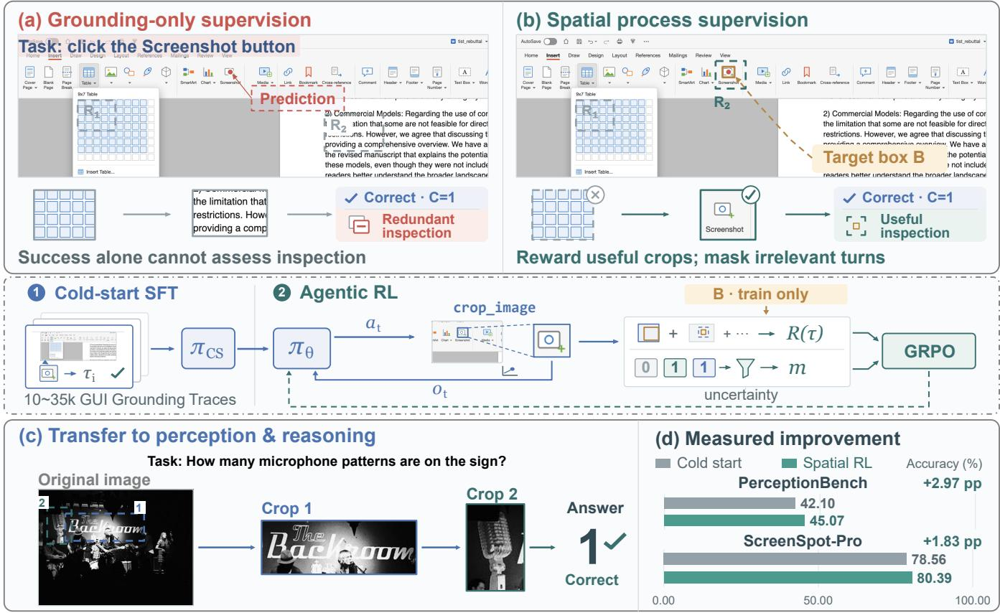
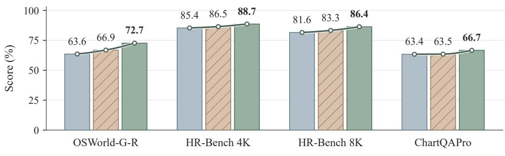
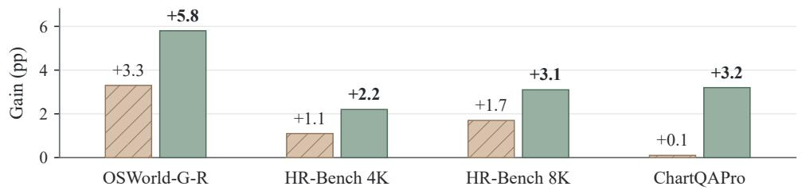
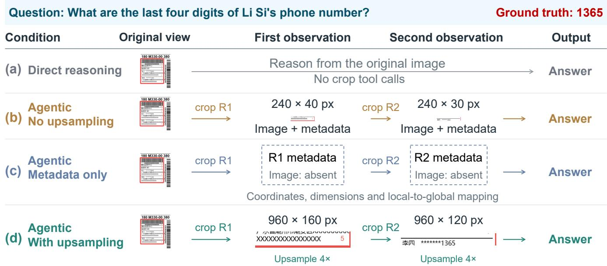
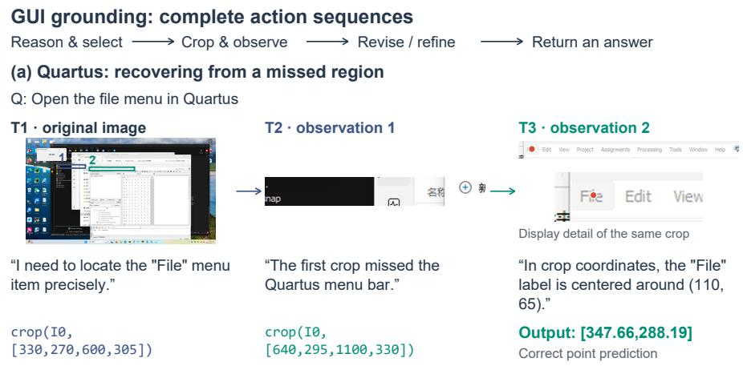
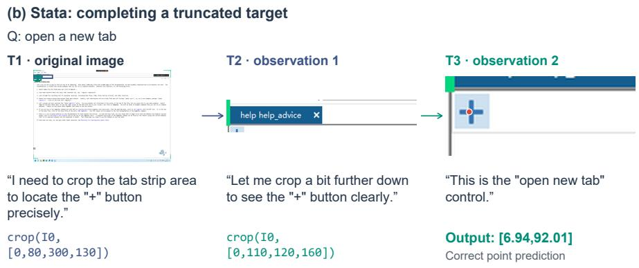
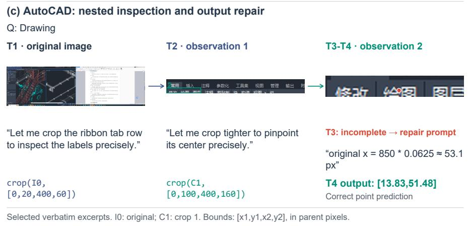
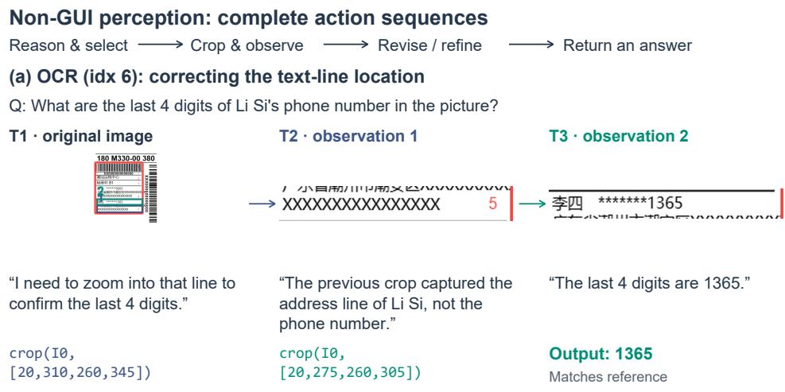
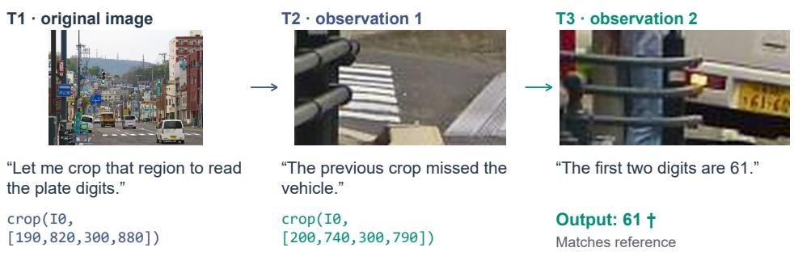
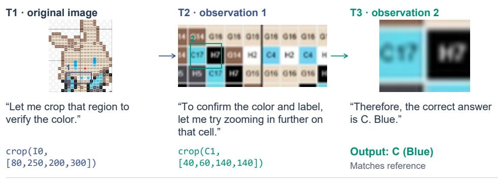

# Learning to Look Beyond Screens: Transferable Visual Observation from GUI Grounding

Ruilin Yao1,2,\*, Xinyu Qiu3,\*, Tianyu Zou1, Yi Rong1, Shengwu Xiong1,

Shuheng Shen4,†, Changhua Meng4

1Wuhan University of Technology, 2Institute of Automation, Chinese Academy of Sciences (CAS) 3Zhejiang University 4Ant Group

With the rise of agentic reasoning, visual perception is evolving from passive recognition toward active, taskoriented observation. Active visual perception requires an agent to decide not only what to recognize, but also where to look, how much context to inspect, and when further observation is worthwhile. We explore GUI grounding as a scalable source of spatially grounded supervision for learning such observation behaviors, with the goal of transferring them beyond interface-centric tasks. To this end, we introduce LBS (Look Beyond Screens), a vision-language model for transferable active visual perception. Our framework first bootstraps observation capabilities from teacher-synthesized agentic GUI grounding trajectories and then optimizes multi-turn crop-and-inspect decisions with reinforcement learning. Spatial target annotations are transformed into outcome-gated rewards with selective credit assignment, allowing the model to learn not only how to inspect, but also which inspections are useful for task completion. Under fixed inference settings, models based on Qwen3.5-35B-A3B and Qwen3.8-27B obtain consistent improvements over their corresponding baselines. Crucially, after agentic reinforcement learning, these gains transfer to out-of-domain non-GUI benchmarks such as PerceptionBench, HR-Bench and ChartQAPro, exceeding those obtained from cold-start supervised fine-tuning alone. This result suggests that the learned capability is not merely GUI-specific imitation, but a more general observation strategy. Further analysis reveals a complementary role of the two training stages: SFT acquires the primitives of visual inspection, whereas RL learns to allocate observation efort according to downstream utility. We therefore establish GUI grounding as a scalable supervision paradigm for active visual perception and provide evidence that interface-centric interaction data can induce transferable observation behaviors for broader multimodal reasoning. Our code and model are publicly available at https://github.com/inclusionAI/UI-Venus/tree/LBS and https://huggingface. co/inclusionAI/LBS-27B, respectively.

## 1. Introduction

Code: https://github.com/inclusionAI/UI-Venus/tree/LBS

Model: https://huggingface.co/inclusionAI/LBS-27B

Active visual perception requires a vision-language model (VLM) to acquire evidence as well as interpret it. On a high-resolution image, the model must locate relevant regions, select an appropriate view, and relate local detail to the original scene (Khayatkhoei et al., 2025, Bai et al., 2025). Crop-and-inspect and thinkwith-image methods demonstrate the value of additional visual observations (Qi et al., 2025, Zheng et al., 2026, Wu and Xie, 2024, Wang et al., 2026a). A central training challenge is to connect these intermediate observation decisions to task success, particularly when a correct final answer can follow either informative or redundant inspection.

GUI grounding provides a concrete setting for learning this connection. Each example pairs an instruction with a spatial target, making both the final localization and intermediate crop geometry measurable (Cheng et al., 2024, Xu et al., 2025, Li et al., 2025). These annotations can therefore supervise intermediate observation decisions without specifying an ideal crop sequence for reinforcement learning. We hypothesize that such supervision can help elicit latent visual knowledge in pretrained VLMs by training them to put this knowledge into practice through sequential observation: deciding where to inspect, how much context to retain, and when further evidence is useful. Although the source images are interfaces, these decisions are also relevant to natural images and charts. This motivates our central question: can spatial supervision from GUI grounding elicit observation behavior that transfers to non-GUI perception? Such transfer would suggest a practical way to make pretrained visual knowledge more accessible through interaction, potentially reducing the need to construct specialized observation trajectories for each downstream domain.

We address this question with a two-stage framework. Supervised fine-tuning (SFT) on teacher-generated grounding trajectories initializes the crop-and-inspect protocol. Multi-turn reinforcement learning (RL) then refines the policy using grounding correctness and training-only target annotations (Guo et al., 2025). Outcome-gated spatial rewards connect intermediate inspections to task success, a small-target bonus encourages target coverage, and selective response masking controls which intermediate responses receive policy updates. In this way, spatial annotations provide supervision for the process of acquiring visual evidence as well as for the final grounding result. The same crop interface is used at inference across domains, with task-specific final answers. This design allows us to examine whether observation behavior learned under GUI supervision benefits tasks with diferent visual content and objectives.

Our results support transfer beyond supervised initialization. RL improves ScreenSpot-Pro (Li et al., 2025) accuracy over SFT by 1.83 and 6.13 percentage points for Qwen3.5-35B-A3B and Qwen3.8-27B, and improves PerceptionBench (Lin et al., 2026) by approximately 3.0 and 7.10 points. The Qwen3.5-based policy also improves on HR-Bench 4K/8K (Wang et al., 2025) and ChartQAPro (Masry et al., 2025). The reward comparison reveals a useful distinction: outcome-only RL improves source-domain grounding but lowers PerceptionBench accuracy, whereas the spatially supervised configuration improves both. These comparisons show that higher GUI grounding accuracy does not necessarily imply stronger non-GUI transfer; the results highlight the value of supervising intermediate observation decisions. Comparisons of reconstructed interaction histories further examine how crop images and their presentation scale afect answer generation. Together, these findings support GUI grounding as a practical source of supervision for visual observation whose benefits extend beyond the source domain, consistent with the hypothesis that spatially grounded interaction training can help elicit and apply pretrained visual knowledge across tasks.

Our contributions are threefold:

• We establish empirical evidence that GUI grounding can supervise visual observation policies that transfer beyond interfaces, with gains over SFT across two backbones on PerceptionBench and across additional high-resolution and chart benchmarks for Qwen3.5-35B-A3B.

• We develop a two-stage framework that converts target annotations into outcome-gated spatial rewards and selective response updates for multi-turn crop-and-inspect training.

• We show that improved grounding under outcome-only RL need not translate into improved non-GUI perception, and complement the training comparison with controlled edits to historical crop observations.

## 2. Related Work

Agentic visual reasoning. Agentic visual reasoning treats observation as sequential evidence acquisition. ReAct interleaves reasoning with environment interaction (Yao et al., 2022), and Toolformer learns API use from self-supervised data (Schick et al., 2023). Visual agents similarly use image manipulation and code-based tools during reasoning (Team et al., 2026a, Anthropic, 2026, Google, 2026). CogCoM integrates image manipulations into reasoning (Qi et al., 2025); V∗ uses guided visual search to select informative regions at inference time (Wu and Xie, 2024). DeepEyes and DeepEyesV2 study reinforcement learning for visual and multimodal tool use (Zheng et al., 2026, Hong et al., 2026). These methods establish the utility of additional observations and tool interaction. Our focus is the supervision that teaches inspection behavior and whether it transfers from GUI grounding to non-GUI perception.

Visually grounded reasoning. Visually grounded reasoning connects linguistic predictions to image regions (Kazemzadeh et al., 2014, Plummer et al., 2015, Zhu et al., 2016). Recent methods can be organized along two axes: by paradigm, into training-based approaches (Sarch et al., 2026, Zheng et al., 2026, Wang et al., 2026b) and test-time approaches (Khayatkhoei et al., 2025, Shen et al., 2025, Zhang et al., 2026b); and by motivation, into suppressing irrelevant background (Wei et al., 2026, Liu et al., 2025) and enhancing task-relevant foreground through zoom-in operations (Fan et al., 2026, Luo et al., 2025, Yuan et al., 2026, Zhang et al., 2026a, Zheng et al., 2026). ViGoRL anchors reasoning to visual coordinates, while TreeVGR jointly supervises localization and reasoning (Sarch et al., 2026, Wang et al., 2026a). GUI grounding methods instead emphasize instruction-conditioned target localization and downstream action execution (Cheng et al., 2024, Xu et al., 2025, Team et al., 2026b). Our study connects these directions by using GUI target annotations to supervise intermediate observation actions and evaluating the resulting policy on non-GUI perception. The central distinction is the source of supervision and its transfer: one spatially annotated interaction domain supplies feedback for observation policies evaluated across diferent visual content and answer formats.

## 3. Method

Our framework turns GUI target annotations into supervision for sequential visual observation (Figure 1). SFT first teaches the interaction protocol; RL then scores crop geometry and filters intermediate response updates using grounding outcomes. The policy receives images and instructions, while target annotations remain training-only information. At inference, the crop interface is shared across domains and the final answer format is adapted to each task.

## 3.1. Grounding Supervision and Policy Initialization

Synthetic grounding tasks. We construct interfaces through code-guided generation, following prior work on synthetic multimodal and GUI data (Yang et al., 2025, Team et al., 2026b). An LLM produces executable HTML/CSS/JavaScript from a scenario, optionally conditioned on a persona or reference screenshot. Rendering associates each screenshot with DOM structure, element states, and geometry. Candidate targets are extracted from element semantics and accessibility attributes, filtered for visibility, clipping, occlusion, and correspondence to rendered content, and refined using text-node geometry where appropriate. Accepted targets are paired with natural-language interaction instructions; infeasible instructions provide negative examples. Both SFT and RL use only GUI grounding instructions, with no general-domain VQA training tasks. Reference screenshots used for synthetic image generation exclude images from the evaluation benchmarks.

  
Figure 1: Learning transferable observation from GUI grounding. (a) Grounding success alone cannot distinguish target-relevant from redundant inspection. (b) Following SFT, spatially supervised RL uses training-only target annotations to score crops and mask irrelevant intermediate responses. (c) The observation policy applies the same crop-and-inspect protocol to non-GUI images. (d) The Qwen3.5-based model improves over SFT by 2.97 and 1.83 percentage points on PerceptionBench and ScreenSpot-Pro, respectively.

A grounding task is $\boldsymbol { d } = \left( \boldsymbol { I } , \boldsymbol { q } , \boldsymbol { B } \right)$ , where I is the screenshot, $q$ is the instruction, and $B = \left( b _ { x } ^ { - } , b _ { y } ^ { - } , b _ { x } ^ { + } , b _ { y } ^ { + } \right)$ is the target box in the original image’s $[ 0 , 1 0 0 0 ] ^ { 2 }$ coordinate system. Infeasible tasks use $B = \left( - 1 , - 1 , - 1 , - 1 \right)$ The policy observes only $\left( I , q \right)$ ; B is reserved for trajectory filtering and training feedback.

Teacher trajectories. We use Qwen3.8-Max (Qwen Team, 2026) to generate multi-turn trajectories at temperature 1.0, with a maximum generation length of 32,768 tokens. Each trajectory $\tau = \left( a _ { 1 } , o _ { 1 } , \ldots , a _ { T - 1 } , o _ { T - 1 } , a _ { T } \right)$ contains assistant responses $a _ { t }$ and tool observations $o _ { t }$ . The grounding response predicts a point $\hat { p } = \left( \hat { x } , \hat { y } \right)$ For a parseable finite prediction, correctness is

$$
C ( d , \tau ) = \mathbf { 1 } \{ b _ { x } ^ { - } \leq \hat { x } \leq b _ { x } ^ { + } , \ b _ { y } ^ { - } \leq \hat { y } \leq b _ { y } ^ { + } \} .\tag{1}
$$

Invalid predictions receive zero. The same rule accepts only $( - 1 , - 1 )$ for an infeasible task. Although the prompt requests an element center, acceptance requires point-in-box agreement, including the boundary. Rejection sampling retains successful trajectories:

$$
{ \mathcal { D } } _ { \mathrm { C S } } = \{ ( d , \tau ) : \tau \sim \pi _ { \mathrm { t e a c h } } ( \cdot \mid I , q ) , C ( d , \tau ) = 1 \} .\tag{2}
$$

Rejection sampling ensures grounding correctness but leaves intermediate inspection quality unconstrained, motivating the spatial feedback used during RL.

Supervised initialization. We train the student with Swift (Zhao et al., 2025), supervising assistant outputs while conditioning on preceding images, responses, and tool feedback. With $y ( \tau )$ denoting assistant-token positions, the objective is

$$
\mathcal { L } _ { \mathrm { C S } } ( \theta ) \propto - \sum _ { ( d , \tau ) \in \mathcal { D } _ { \mathrm { C S } } } \sum _ { k \in \mathcal { V } ( \tau ) } \log \pi _ { \theta } ( y _ { k } \mid I , q , \tau _ { < k } ) .\tag{3}
$$

The resulting checkpoint initializes RL and provides an inspection-capable baseline, allowing us to evaluate improvement beyond imitation of the tool-use protocol.

## 3.2. Multi-Turn Visual Observation

At turn t, the policy samples $a _ { t } \sim \pi _ { \theta } ( \cdot \mid h _ { t } )$ , where $h _ { t }$ contains the task, original image, and interaction history. Each response contains reasoning followed by either a final answer or one or two textual crop\_image actions. A crop action specifies an available image and a rectangle in its local pixel coordinates; previously returned crops may be inspected recursively. Final grounding predictions always use original-image normalized coordinates.

The tool returns the crop image, its dimensions, and a coordinate mapping to the original image. Results from the same turn are added to the history in action order; failed executions return textual feedback. Earlier images and messages remain available, so each crop adds a local view while preserving access to the original context. Interaction ends with a final answer or a configured stopping limit. Every admitted crop attempt consumes a tool-call slot, including failed executions. Appendix B details crop construction and coordinate tracking.

## 3.3. Outcome-Gated Spatial Rewards

Grounding correctness assigns the same outcome to successful trajectories with diferent inspection quality. We use target annotations in two complementary ways: a spatial reward evaluates the crop sequence, and the response mask in Section 3.4 controls which intermediate outputs receive direct updates. Let $R _ { 1 } , \ldots , R _ { K }$ be the successful crop regions in execution order, mapped to original-image coordinates, and let $u _ { j } = \mathrm { I o U } ( R _ { j } , B )$

Spatial process reward. We reward the best target overlap and penalize repeated crops, declining overlap, and tool use:

$$
P _ { \mathrm { r e p } } = \operatorname* { m i n } \left( 0 . 4 , 0 . 2 \sum _ { j = 2 } ^ { K } { \bf 1 } \{ \mathrm { I o U } ( R _ { j - 1 } , R _ { j } ) > 0 . 9 \} \right) ,\tag{4}
$$

$$
P _ { \mathrm { r e g } } = 0 . 2 { \bf 1 } \{ K \ge 2 \mathrm { a n d } u _ { K } < u _ { 1 } \} ,\tag{5}
$$

$$
R _ { \mathrm { p r o c } } = C ( d , \tau ) \mathrm { c l i p } _ { [ 0 , 1 ] } \left( \operatorname* { m a x } _ { j } u _ { j } - P _ { \mathrm { r e p } } - P _ { \mathrm { r e g } } - 0 . 0 5 K \right) .\tag{6}
$$

The reward is zero for infeasible tasks or trajectories without successful crops. Repetition compares consecutive crops, whereas regression compares the final and initial target overlaps. The outcome gate restricts spatial rewards to successful trajectories, and clipping bounds this component between zero and one. Crop overlap supplies a proxy for spatial relevance; it does not directly evaluate interpretation of the returned image.

Small-target inspection bonus. IoU can be low when a useful contextual crop contains a small target. We therefore define a turn-level relevance score that combines overlap and target-center containment:

$$
Q _ { t } = \operatorname* { m a x } _ { j : R _ { j } \mathrm { p r o d u c e d a t } } \left[ 0 . 6 \mathrm { I o U } ( R _ { j } , B ) + 0 . 4 \mathbf { 1 } \{ c _ { B } \in R _ { j } \} \right] ,\tag{7}
$$

where $c _ { B }$ is the target center. A crop containing this center receives at least 0.4, even when its overlap is small. For targets occupying less than 5% of the image, we add

$$
\begin{array} { r } { R _ { \mathrm { z o o m } } = 0 . 2 C ( d , \tau ) \mathbf { 1 } \{ | B | / 1 0 ^ { 6 } < 0 . 0 5 \} \mathbf { 1 } \{ \operatorname* { m a x } Q _ { t } \geq 0 . 2 \} . } \end{array}\tag{8}
$$

This bonus is zero for infeasible tasks and trajectories without successful crops. It is a target-coverage incentive: a broad crop containing the target center can qualify, while crop selectivity is encouraged separately by the overlap-based process reward. The bonus depends on geometry rather than the image-resizing factor.

Format and textual rewards. The format reward $R _ { \mathrm { { f m t } } }$ scores the final response: canonical parsing receives 1, compatibility parsing receives 0.5, and parsing failure receives 0. We additionally examine a text-based critic that evaluates task focus, feedback use, reasoning–action consistency, incremental progress, and conciseness. Given the task and a textual trajectory, the critic returns $s _ { \mathrm { c o t } } \in [ 0 , 1 ]$ , yielding

$$
R _ { \mathrm { c o t } } = C ( d , \tau ) s _ { \mathrm { c o t } } .\tag{9}
$$

Trajectories without visible reasoning receive zero. The non-oracle critic receives neither images nor target annotations, so its score measures textual consistency rather than visual correctness. The general reward is

$$
R ( d , \tau ) = C ( d , \tau ) + 0 . 3 R _ { \mathrm { p r o c } } + 0 . 1 R _ { \mathrm { f m t } } + R _ { \mathrm { z o o m } } + 0 . 3 R _ { \mathrm { c o t } } .\tag{10}
$$

All components contribute to one trajectory-level return.

## 3.4. Selective Response Updates and Optimization

Filtering intermediate responses. A shared trajectory reward can reinforce irrelevant actions in an otherwise successful rollout. We use the turn-level relevance score to construct a response mask:

$$
m _ { t } = \left\{ \begin{array} { l l } { 0 , } & { t < T , C ( d , \tau ) = 1 , Q _ { t } \mathrm { e x i s t s , } Q _ { t } < 0 . 0 5 , } \\ { 1 , } & { \mathrm { o t h e r w i s e . } } \end{array} \right.\tag{11}
$$

Equation (11) defines the spatial mask. A second filter removes spatially eligible intermediate responses whose mean generated-token surprisal is below the median over eligible turns, using scaling factor $\eta = 1$ Let $e _ { t } \in \{ 0 , 1 \}$ denote this second filter and $\widetilde { m } _ { t } = m _ { t } e _ { t }$ the resulting response mask, with $\widetilde { m } _ { T } = 1$ . Both filters act on direct response loss; all previous responses and observations remain in the conditioning history. Filtering is independent of the advantage sign; it selects direct response updates without assigning a separate causal value to each crop. Appendix B specifies the filtering procedure.

Group-relative optimization. We adapt GRPO (Shao et al., 2024) to multi-turn trajectories. For each task, $G = 8$ rollouts receive the reward in Equation (10). Each advantage subtracts the group mean without variance normalization and is shared across retained assistant tokens. Training uses a PPO-style clipped surrogate (Schulman et al., 2017) with a fixed-reference KL penalty, averaging first over retained tokens and then over trajectories.

## 4. Experiments

## 4.1. Experimental Setup

Training configuration. We study Qwen3.5-35B-A3B (Team, 2026) and Qwen3.8-27B (Qwen Team, 2026). For both models, we freeze the vision encoder and vision–language projector throughout SFT and RL, updating only the language-model parameters. Qwen3.5-35B-A3B initially exhibits limited adherence to our prompting format and agentic observation protocol. To establish reliable protocol following, we use approximately 35,000 SFT trajectories for Qwen3.5-35B-A3B, and 10,000 for Qwen3.8-27B. Each SFT checkpoint then initializes the corresponding RL policy. The main configuration combines grounding correctness, gated spatial feedback, format compliance, small-target inspection bonus and the auxiliary critic. Optimization settings and prompts appear in Appendices B and F. We also keep the training recipe simple and do not extensively tune the remaining optimization hyperparameters, focusing our study on the proposed supervision design.

Interaction protocol. The crop tool uses a scale factor of α = 4.0 and a pixel cap of $P _ { \mathrm { m a x } } = 4 \times 1 0 ^ { 6 }$ (Equation (18)). Original images are preprocessed with a pixel count between 65,536 and 16,777,216. We generate rollouts using vLLM (Kwon et al., 2023). Training allows up to three crop calls per example. Qwen3.8-27B evaluation also uses at most three crop calls, with reasoning\_effort=xhigh and thinking\_budget=4096 (4,096 reasoning tokens per assistant turn), passed through chat\_template\_kwargs. Within each bench mark, SFT and RL models use identical prompts, decoding settings, and inference limits.

Benchmarks and metrics. ScreenSpot-Pro (Li et al., 2025) evaluates instruction-conditioned GUI localiza tion using point-in-box accuracy. PerceptionBench (Lin et al., 2026) evaluates non-GUI perception across ten capabilities using reference-based answer judgment, with a locally deployed DeepSeek-V4-Flash (Xu et al., 2026) serving as the judge model. The Qwen3.8-27B evaluation uses Deepseekv4-flash-0731, with no failed or skipped judgments across all 3,000 records. We interpret stage-wise gains within each backbone rather than treating cross-backbone scores as a controlled ranking. We report overall accuracy and category-level scores. Additional evaluations cover OSWorld-G-R (Refine) (Xie et al., 2026), HR-Bench (Wang et al., 2025) at 4K and 8K resolutions, and ChartQAPro (Masry et al., 2025). Further details on selected additional benchmarks are provided in Appendix A.

## 4.2. GUI Grounding Across Backbones

We compared our method with several mainstream GUI grounding methods (Company, 2025, Zhang et al., 2026c, Kim and Chelikavada, 2026, Pei et al., 2026, Zhou et al., 2025), and the results are presented in Table 1. Table 1 shows that RL improves ScreenSpot-Pro accuracy over SFT for both backbones. Qwen3.5- 35B-A3B increases from 78.56% to 80.39%, and Qwen3.8-27B increases from 75.02% to 81.15%. Since both SFT baselines already follow the crop-and-inspect protocol, these gains support the value of optimizing observation trajectories beyond teacher imitation. Qwen3.8-27B gains 11.89 points over base and improves all six application groups over SFT, led by CAD and engineering (+7.28), creative applications (+6.45), and scientific applications (+6.30). Qwen3.5-35B-A3B improves in five groups, led by development (+6.35), but declines in ofice applications (90.00% to 87.83%). These results are consistent with the utility of zoom-in inspection for high-resolution GUI grounding, where enlarged local views can make small interface elements and fine-grained visual details easier to distinguish and localize.

Table 1: ScreenSpot-Pro accuracy (%) by application group.
<table><tr><td></td><td colspan="6">Application group</td><td></td><td></td></tr><tr><td>Model</td><td>Zoom</td><td>Dev.</td><td>Creat.</td><td>CAD</td><td>Sci.</td><td>Office</td><td>OS</td><td>Overall</td></tr><tr><td>Holo2-235B-A22B (Agentic)</td><td>x</td><td>74.6</td><td>72.1</td><td>80.5</td><td>79.9</td><td>85.2</td><td>83.2</td><td>78.5</td></tr><tr><td>MAI-UI-32B (MVP)</td><td>√</td><td>79.3</td><td>69.5</td><td>76.6</td><td>76.0</td><td>91.3</td><td>75.5</td><td>77.5</td></tr><tr><td>AdaZoom (Qwen3.5-397B refine)</td><td>√</td><td>75.3</td><td>72.4</td><td>72.4</td><td>74.0</td><td>93.5</td><td>76.5</td><td>76.8</td></tr><tr><td>KV-Ground-GuiOwl-1.5 (Zoom In)</td><td>√</td><td>73.6</td><td>72.4</td><td>74.7</td><td>77.2</td><td>90.0</td><td>73.0</td><td>76.4</td></tr><tr><td>MAI-UI-32B (Zoom In)</td><td>√</td><td>71.6</td><td>70.4</td><td>72.8</td><td>75.6</td><td>86.1</td><td>65.3</td><td>73.5</td></tr><tr><td>Base (Qwen3.5-35B-A3B)</td><td>√</td><td></td><td></td><td></td><td></td><td></td><td></td><td>1.27*</td></tr><tr><td>Ours (+SFT, 35k trajectories)</td><td>√</td><td>77.26</td><td>70.67</td><td>78.93</td><td>81.10</td><td>90.00</td><td>77.04</td><td>78.56</td></tr><tr><td>Ours (+Agentic RL)</td><td>√</td><td>83.61</td><td>71.55</td><td>80.08</td><td>83.07</td><td>87.83</td><td>79.08</td><td>80.39</td></tr><tr><td>Base (Qwen3.8-27B)</td><td>√</td><td>69.23</td><td>61.88</td><td>67.05</td><td>67.32</td><td>83.48</td><td>70.92</td><td>69.26</td></tr><tr><td>Ours (+SFT, 10k trajectories)</td><td>√</td><td>76.92</td><td>68.33</td><td>70.11</td><td>74.41</td><td>86.96</td><td>77.04</td><td>75.02</td></tr><tr><td>Ours (+Agentic RL)</td><td>√</td><td>82.61</td><td>74.78</td><td>77.39</td><td>80.71</td><td>93.04</td><td>81.63</td><td>81.15</td></tr></table>

Zoom indicates zoom-in use. Bold denotes the highest reported accuracy within each backbone and column; dashes indicate unreported scores. ∗ The base Qwen3.5-35B-A3B model does not reliably follow our prompting format and interaction protocol.

## 4.3. Transfer to General Visual Perception

Table 2: PerceptionBench accuracy (%) across training stages for two backbones.
<table><tr><td></td><td colspan="4">Qwen3.5-35B-A3B</td><td colspan="4">Qwen3.8-27B</td></tr><tr><td>Capability</td><td>Base</td><td>+SFT</td><td>+RL</td><td>Gain</td><td>Base</td><td>+SFT</td><td>+RL</td><td>Gain</td></tr><tr><td>Visual relation</td><td>40.0</td><td>39.7</td><td>45.2</td><td>+5.5</td><td>53.9</td><td>59.70</td><td>68.48</td><td>+8.78</td></tr><tr><td>Counting</td><td>41.3</td><td>42.5</td><td>48.8</td><td>+6.3</td><td>48.5</td><td>53.94</td><td>61.82</td><td>+7.88</td></tr><tr><td>Attribute</td><td>40.3</td><td>47.3</td><td>48.5</td><td>+1.2</td><td>50.6</td><td>55.45</td><td>65.76</td><td>+10.31</td></tr><tr><td>Depth / 3D perception</td><td>33.1</td><td>37.6</td><td>37.6</td><td>0.0</td><td>39.7</td><td>50.91</td><td>50.30</td><td>-0.61</td></tr><tr><td>Localization</td><td>37.0</td><td>51.3</td><td>50.0</td><td>-1.3</td><td>48.5</td><td>65.45</td><td>67.58</td><td>+2.13</td></tr><tr><td>Comparison</td><td>39.8</td><td>35.5</td><td>43.1</td><td>+7.6</td><td>49.5</td><td>51.61</td><td>63.44</td><td>+11.83</td></tr><tr><td>Fine-grained recognition</td><td>41.4</td><td>41.8</td><td>47.0</td><td>+5.2</td><td>43.4</td><td>52.07</td><td>57.59</td><td>+5.52</td></tr><tr><td>Contextual integration</td><td>34.2</td><td>38.5</td><td>38.1</td><td>-0.4</td><td>38.8</td><td>44.31</td><td>52.55</td><td>+8.24</td></tr><tr><td>OCR</td><td>53.0</td><td>58.5</td><td>60.4</td><td>+1.9</td><td>50.6</td><td>53.73</td><td>61.57</td><td>+7.84</td></tr><tr><td>Hallucination</td><td>26.2</td><td>28.1</td><td>31.8</td><td>+3.7</td><td>41.0</td><td>33.21</td><td>43.91</td><td>+10.70</td></tr><tr><td>Overall</td><td>38.6</td><td>42.1</td><td>45.1</td><td>+3.0</td><td>46.6</td><td>52.57</td><td>59.67</td><td>+7.10</td></tr></table>

Gain is the accuracy diference between +RL and +SFT in percentage points.

Table 2 shows improvements beyond SFT for both backbones on PerceptionBench. Qwen3.5-35B-A3B increases from 38.6% at base to 42.1% after SFT and 45.1% after RL; Qwen3.8-27B follows the same progression, from 46.6% to 52.57% and 59.67%. The RL gains of approximately 3.0 and 7.10 points show that non-GUI improvement is not confined to one backbone. Both final policies exceed their respective base models across all ten capabilities.

The capability profiles reveal shared benefits and model-dependent tradeofs. Relative to SFT, both policies improve counting, comparison, fine-grained recognition, OCR, and hallucination assessment. For Qwen3.5- 35B-A3B, the largest gains are in comparison (+7.6), counting (+6.3), and visual relation (+5.5); RL also reverses the SFT declines in comparison and visual relation. Qwen3.8-27B gains most in comparison (+11.83), hallucination assessment (+10.70), and attribute recognition (+10.31). Qwen3.5-35B-A3B improves seven of ten capabilities, while Qwen3.8-27B improves nine, with a slight decline in depth/3D perception (50.91% to 50.30%, −0.61 points). The shared gains extend beyond grounding to tasks requiring discrimination and comparison of visual evidence. These results support transfer of the trained observation policy while showing that its benefits depend on the perceptual capability. Appendix D provides external reference scores.

(a) Stage-wise benchmark scores  
(b) Incremental gains  

  
Figure 2: Stage-wise results for Qwen3.5-35B-A3B.

## 4.4. Transfer Across Visual Domains

Figure 2(a) extends the stage-wise evaluation of Qwen3.5-35B-A3B to another GUI setting, high-resolution perception, and chart understanding. Scores increase from Base to SFT to RL on all four benchmarks. On OSWorld-G-R, SFT raises accuracy from 63.6% to 66.9%, and RL further improves it to 72.7%, yielding a 5.8-point gain over SFT. Figure 2(b) compares the incremental gains from the two training stages. RL yields larger gains than SFT on every benchmark. On the non-GUI tasks, RL improves over SFT by 2.2, 3.1, and 3.2 percentage points on HR-Bench 4K, HR-Bench 8K, and ChartQAPro, respectively, exceeding the corresponding SFT gains over Base of 1.1, 1.7, and 0.1 points. ChartQAPro illustrates this diference: SFT changes the score only from 63.4% to 63.5%, whereas RL raises it to 66.7%. Together with PerceptionBench, these results show that improvements beyond supervised initialization extend across general perception, high-resolution imagery, and charts under the reported evaluation settings.

## 4.5. Reward Design Ablation

Outcome-only RL reveals a distinction between source-domain improvement and cross-domain transfer. It reaches 79.19% on ScreenSpot-Pro and 40.87% on PerceptionBench, compared with 78.56% and 42.10% for SFT. Thus, a 0.63-point grounding gain accompanies a 1.23-point transfer decline. Our full configuration, combining the gated spatial process reward, small-target inspection bonus, and text-based critic, improves both benchmarks over SFT and exceeds outcome-only RL by 1.20 and 4.20 points, respectively. The configu ration with the highest ScreenSpot-Pro accuracy is not the one with the strongest transfer. These results indicate that better source-task performance need not translate into better non-GUI perception, motivating supervision of intermediate observation behavior beyond grounding correctness.

Table 3: Source-domain and transfer accuracy (%) for Qwen3.5-35B-A3B reward configurations.
<table><tr><td rowspan="2">Configuration</td><td colspan="3">Reward components</td><td colspan="2">Accuracy (%)</td></tr><tr><td>Process</td><td>Bonus</td><td>Critic</td><td>SSPro</td><td>PB</td></tr><tr><td>Outcome-only RL</td><td>X</td><td>X</td><td>x</td><td>79.19</td><td>40.87</td></tr><tr><td>Ungated process + critic</td><td>Ungated</td><td>x</td><td>√</td><td>81.09</td><td>42.83</td></tr><tr><td>Ungated process + bonus</td><td>Ungated</td><td>√</td><td>x</td><td>79.57</td><td>42.10</td></tr><tr><td>Gated process</td><td>Gated</td><td>X</td><td>x</td><td>79.25</td><td>41.63</td></tr><tr><td>Gated process + bonus</td><td>Gated</td><td>√</td><td>x</td><td>79.70</td><td>43.26</td></tr><tr><td>Gated process + critic</td><td>Gated</td><td>x</td><td>√</td><td>79.82</td><td>42.57</td></tr><tr><td>Gated process + bonus + critic (ours)</td><td>Gated</td><td>√</td><td>√</td><td>80.39</td><td>45.07</td></tr></table>

Outcome-only RL uses only correctness and format rewards. Process: spatial process reward; Bonus: small-target inspection bonus; Critic: text-based CoT critic.

The component comparisons highlight the role of the combined reward design (Table 3). Our full configuration achieves the highest PerceptionBench accuracy (45.07%), whereas ungated process reward with the critic achieves the highest ScreenSpot-Pro accuracy (81.09%). Removing the critic from the full configuration lowers ScreenSpot-Pro/PerceptionBench accuracy by 0.69/1.81 points; removing the bonus lowers accuracy by 0.57/2.50 points. These comparisons support retaining both components, with larger observed gains on the transfer benchmark. The efect of outcome gating depends on the accompanying components: gating improves both benchmark scores when paired with the bonus, but lowers both when paired with the critic alone. Taken together, the results favor the full configuration for cross-domain transfer, while showing that gating alone does not consistently improve performance across the evaluated configurations.

## 4.6. Efects of Visual Context on Grounding and Reasoning

We examine how visual context afects Qwen3.8-27B answer generation (Table 4). From a reference interaction, we reconstruct histories containing upsampled crops, crops without tool-side upsampling, or crop metadata only, while retaining the original image. These interventions modify supplied observations without rerunning crop selection (Appendix C); direct reasoning provides a separate baseline.

Table 4: Qwen3.8-27B answer accuracy (%) under direct reasoning and reconstructed observation histories.
<table><tr><td>Condition</td><td>ScreenSpot- Perception- Pro</td><td>Bench</td></tr><tr><td>Direct reasoning (base)</td><td>63.4</td><td>46.6</td></tr><tr><td>Crop images without upsampling</td><td>68.8</td><td>52.2</td></tr><tr><td>Crop metadata only</td><td>70.6</td><td>49.9</td></tr><tr><td>Crop images with upsampling</td><td>81.15</td><td>59.67</td></tr></table>

The relative value of spatial metadata and

crop content difers across tasks. Metadata-only contexts outperform unupsampled crops on ScreenSpot Pro (70.6% vs. 68.8%), whereas crops perform better on PerceptionBench (52.2% vs. 49.9%). This pattern suggests that coordinate-level visual primitives support spatial prediction in grounding, while localized crop views may better support visual reasoning by reducing irrelevant background. Upsampled crops achieve the highest accuracy on both benchmarks (81.15%/59.67%), highlighting the importance of visual detail and presentation scale. These results characterize the use of supplied context, rather than isolating observation behavior acquired during RL.

  
Figure 3: Observation-feedback conditions on a text-recognition example: original image only, nativeresolution crops, crop metadata only, and crops with 4× upsampling. All agentic contexts retain the original image and interaction history.

## 5. Conclusion

GUI grounding provides a practical source of transferable supervision for active visual perception. Building on recent, strong open-weight VLMs and newly established baselines, we demonstrate improvements in both GUI grounding and non-GUI perception. Our results suggest that supervising intermediate observation decisions helps models inspect question-relevant regions, while crop upsampling makes fine-grained details more accessible for visual understanding. We hope this approach can be a step toward models that actively seek relevant evidence and develop a deeper understanding of the visual world.

## 6. Discussion

Our results suggest that agentic visual perception is becoming increasingly accessible to modern VLMs. With suitable supervision and a simple crop-and-inspect interface, these models can improve image-level perception without lots of additional general-domain VQA training. This progress motivates extending observation policies from individual images to video. Recent work such as Video-Index (Song et al., 2026) highlights both the potential of agent tools and the remaining challenges in video understanding, while emphasizing evaluation that genuinely requires temporal evidence. A promising near-term direction is therefore to learn when and where to inspect across both space and time, including selecting informative frames and maintaining useful visual memory. Extending these capabilities to long videos and streaming inputs will further require balancing evidence acquisition with context, latency, and computation budgets.

## References

Anthropic. Claude opus 4.8 system card. Technical report, Anthropic, May 2026. URL https://www-cdn. anthropic.com/0b4915911bb0d19eca5b5ee635c80fef830a37ea.pdf.

Shuai Bai, Yuxuan Cai, Ruizhe Chen, Keqin Chen, Xionghui Chen, Zesen Cheng, Lianghao Deng, Wei Ding, Chang Gao, Chunjiang Ge, et al. Qwen3-vl technical report. arXiv preprint arXiv:2511.21631, 2025.

Kanzhi Cheng, Qiushi Sun, Yougang Chu, Fangzhi Xu, Li YanTao, Jianbing Zhang, and Zhiyong Wu. Seeclick: Harnessing gui grounding for advanced visual gui agents. In Proceedings of the 62nd Annual Meeting of the Association for Computational Linguistics (Volume 1: Long Papers), pages 9313–9332, 2024.

H Company. Holo2 - open foundation models for navigation and computer use agents, 2025. URL https: //huggingface.co/collections/Hcompany/holo2.

Yue Fan, Xuehai He, Diji Yang, Kaizhi Zheng, Ching-Chen Kuo, Yuting Zheng, Xinze Guan, and Xin Wang. Grit: Teaching mllms to think with images. Advances in Neural Information Processing Systems, 38: 116522–116543, 2026.

Google. Introducing agentic vision in gemini 3 flash. Google Developers Blog, 2026. URL https://blog.google/innovation-and-ai/technology/developers-tools/ agentic-vision-gemini-3-flash/. Accessed: 2026-09-20.

Daya Guo, Dejian Yang, Haowei Zhang, Junxiao Song, Peiyi Wang, Qihao Zhu, Runxin Xu, Ruoyu Zhang, Shirong Ma, Xiao Bi, et al. Deepseek-r1: Incentivizing reasoning capability in llms via reinforcement learning. arXiv preprint arXiv:2501.12948, 2025.

Jack Hong, Chenxiao Zhao, ChengLin Zhu, Weiheng Lu, and Guohai Xu. Deepeyesv2: Toward agentic multimodal model. In International Conference on Learning Representations, volume 2026, pages 114851– 114872, 2026.

Sahar Kazemzadeh, Vicente Ordonez, Mark Matten, and Tamara Berg. Referitgame: Referring to objects in photographs of natural scenes. In Proceedings of the 2014 conference on empirical methods in natural language processing (EMNLP), pages 787–798, 2014.

Mahyar Khayatkhoei, Prateek Chhikara, Filip Ilievski, et al. Mllms know where to look: Training-free perception of small visual details with multimodal llms. In International Conference on Learning Representations, volume 2025, pages 68194–68213, 2025.

Keon Kim and Krish Chelikavada. Zoom consistency: A free confidence signal in multi-step visual grounding pipelines. arXiv preprint arXiv:2604.15376, 2026.

Woosuk Kwon, Zhuohan Li, Siyuan Zhuang, Ying Sheng, Lianmin Zheng, Cody Hao Yu, Joseph Gonzalez, Hao Zhang, and Ion Stoica. Eficient memory management for large language model serving with pagedattention. In Proceedings of the 29th symposium on operating systems principles, pages 611–626, 2023.

Kaixin Li, Ziyang Meng, Hongzhan Lin, Ziyang Luo, Yuchen Tian, Jing Ma, Zhiyong Huang, and Tat-Seng Chua. Screenspot-pro: Gui grounding for professional high-resolution computer use. In Proceedings of the 33rd ACM International Conference on Multimedia, pages 8778–8786, 2025.

Zichao Lin, Yifeng Xie, Bowen Qu, Haiming Wang, Jia Li, Haoning Wu, Yuhao Dong, Zuhao Yang, Jinguo Zhu, Haoyu Lu, et al. Perceptionbench: Evaluating atomic visual perception in multimodal large language models. arXiv preprint arXiv:2607.24957, 2026.

Xianjie Liu, Yiman Hu, Yixiong Zou, Liang Wu, Jian Xu, and Bo Zheng. Hide: Rethinking the zoom-in method in high resolution mllms via hierarchical decoupling. arXiv preprint arXiv:2510.00054, 2025.

Ilya Loshchilov and Frank Hutter. Decoupled weight decay regularization. arXiv preprint arXiv:1711.05101, 2017.

Tiange Luo, Lajanugen Logeswaran, Justin Johnson, and Honglak Lee. Visual test-time scaling for gui agent grounding. In 2025 IEEE/CVF International Conference on Computer Vision (ICCV), pages 19989–19998. IEEE, 2025.

Ahmed Masry, Mohammed Saidul Islam, Mahir Ahmed, Aayush Bajaj, Firoz Kabir, Aaryaman Kartha, Md Tahmid Rahman Laskar, Mizanur Rahman, Shadikur Rahman, Mehrad Shahmohammadi, et al. Chartqapro: A more diverse and challenging benchmark for chart question answering. In Findings of the Association for Computational Linguistics: ACL 2025, pages 19123–19151, 2025.

Siqi Pei, Liang Tang, Tiaonan Duan, Long Chen, Shuxian Li, Kaer Huang, Yanzhe Jing, Yiqiang Yan, Bo Zhang, Chenghao Jiang, et al. Adazoom-gui: Adaptive zoom-based gui grounding with instruction refinement. arXiv preprint arXiv:2603.17441, 2026.

Bryan A Plummer, Liwei Wang, Chris M Cervantes, Juan C Caicedo, Julia Hockenmaier, and Svetlana Lazebnik. Flickr30k entities: Collecting region-to-phrase correspondences for richer image-to-sentence models. In Proceedings of the IEEE international conference on computer vision, pages 2641–2649, 2015.

Ji Qi, Ming Ding, Weihan Wang, Yushi Bai, Qingsong Lv, Wenyi Hong, Xu Bin, Lei Hou, Juanzi Li, Yuxiao Dong, et al. Cogcom: A visual language model with chain-of-manipulations reasoning. In International Conference on Learning Representations, volume 2025, pages 11090–11110, 2025.

Qwen Team. Qwen3.8-max: A new bar for coding and cowork, August 2026. URL https://qwen.ai/ blog?id=qwen3.8.

Gabriel Sarch, Snigdha Saha, Naitik Khandelwal, Ayush Jain, Michael Tarr, Aviral Kumar, and Katerina Fragkiadaki. Grounded reinforcement learning for visual reasoning. Advances in Neural Information Processing Systems, 38:150977–151013, 2026.

Timo Schick, Jane Dwivedi-Yu, Roberto Dessì, Roberta Raileanu, Maria Lomeli, Eric Hambro, Luke Zettlemoyer, Nicola Cancedda, and Thomas Scialom. Toolformer: Language models can teach themselves to use tools. Advances in neural information processing systems, 36:68539–68551, 2023.

John Schulman, Filip Wolski, Prafulla Dhariwal, Alec Radford, and Oleg Klimov. Proximal policy optimization algorithms. arXiv preprint arXiv:1707.06347, 2017.

Zhihong Shao, Peiyi Wang, Qihao Zhu, Runxin Xu, Junxiao Song, Xiao Bi, Haowei Zhang, Mingchuan Zhang, YK Li, Yang Wu, et al. Deepseekmath: Pushing the limits of mathematical reasoning in open language models. arXiv preprint arXiv:2402.03300, 2024.

Haozhan Shen, Kangjia Zhao, Tiancheng Zhao, Ruochen Xu, Zilun Zhang, Mingwei Zhu, and Jianwei Yin. Zoomeye: Enhancing multimodal llms with human-like zooming capabilities through tree-based image exploration. In Proceedings of the 2025 Conference on Empirical Methods in Natural Language Processing, pages 6613–6629, 2025.

Enxin Song, Yinuo Xu, Shusheng Yang, Wenhao Chai, and Jiatao Gu. Video-index: A curated meta-benchmark for video understanding. arXiv preprint arXiv:2610.00960, 2026.

Kimi Team, Tongtong Bai, Yifan Bai, Yiping Bao, SH Cai, Yuan Cao, Ziwei Chai, Y Charles, HS Che, Cheng Chen, et al. Kimi k2.5: Visual agentic intelligence. arXiv preprint arXiv:2602.02276, 2026a.

Qwen Team. Qwen3.5: Towards native multimodal agents, February 2026. URL https://qwen.ai/blog? id=qwen3.5.

Venus Team, Zhuohan Cai, Haoxing Chen, Jiaxuan Chen, Weizhi Chen, Changlong Gao, Zhangxuan Gu, Yuan Guo, Yusong Hu, Jianrong Jiang, et al. Ui-venus-2 technical report. arXiv preprint arXiv:2609.00028, 2026b.

Haochen Wang, Xiangtai Li, Zilong Huang, Anran Wang, Jiacong Wang, Tao Zhang, Sule Bai, Zijian Kang, Jiashi Feng, Zhuochen Wang, et al. Traceable evidence enhanced visual grounded reasoning: Evaluation and method. In International Conference on Learning Representations, volume 2026, pages 148769–148794, 2026a.

Jiacong Wang, Zijian Kang, Haochen Wang, Xiao Liang, Ya Wang, Jiawen Li, Bohong Wu, Jiao Ran, Haiyong Jiang, Chao Feng, et al. Vgr: Visual grounded reasoning. In International Conference on Learning Representations, volume 2026, pages 89506–89528, 2026b.

Wenbin Wang, Liang Ding, Minyan Zeng, Xiabin Zhou, Li Shen, Yong Luo, Wei Yu, and Dacheng Tao. Divide, conquer and combine: A training-free framework for high-resolution image perception in multimodal large language models. In Proceedings of the AAAI Conference on Artificial Intelligence, volume 39, pages 7907–7915, 2025.

Lai Wei, Liangbo He, Jun Lan, Lingzhong Dong, Yutong Cai, Siyuan Li, Huijia Zhu, Weiqiang Wang, Linghe Kong, Yue Wang, et al. Zooming without zooming: Region-to-image distillation for fine-grained multimodal perception. arXiv preprint arXiv:2602.11858, 2026.

Penghao Wu and Saining Xie. V\*: Guided visual search as a core mechanism in multimodal llms. In 2024 IEEE/CVF Conference on Computer Vision and Pattern Recognition (CVPR), pages 13084–13094. IEEE, 2024.

Tianbao Xie, Jiaqi Deng, Xiaochuan Li, Junlin Yang, Haoyuan Wu, Jixuan Chen, Wenjing Hu, Xinyuan Wang, Yuhui Xu, Zekun Wang, et al. Scaling computer-use grounding via user interface decomposition and synthesis. Advances in Neural Information Processing Systems, 38, 2026.

Anyi Xu, Bangcai Lin, Bing Xue, Bingxuan Wang, Bingzheng Xu, Bochao Wu, Bowei Zhang, Chaofan Lin, Chen Dong, Chenchen Ling, et al. Deepseek-v4: Towards highly eficient million-token context intelligence. arXiv preprint arXiv:2606.19348, 2026.

Yiheng Xu, Zekun Wang, Junli Wang, Dunjie Lu, Tianbao Xie, Amrita Saha, Doyen Sahoo, Tao Yu, and Caiming Xiong. Aguvis: Unified pure vision agents for autonomous GUI interaction. In Proceedings of the 42nd International Conference on Machine Learning, volume 267 of Proceedings of Machine Learning Research, pages 69772–69805. PMLR, 2025.

Yue Yang, Ajay Patel, Matt Deitke, Tanmay Gupta, Luca Weihs, Andrew Head, Mark Yatskar, Chris Callison-Burch, Ranjay Krishna, Aniruddha Kembhavi, et al. Scaling text-rich image understanding via code-guided synthetic multimodal data generation. In Proceedings of the 63rd Annual Meeting of the Association for Computational Linguistics (Volume 1: Long Papers), pages 17486–17505, 2025.

Shunyu Yao, Jefrey Zhao, Dian Yu, Nan Du, Izhak Shafran, Karthik Narasimhan, and Yuan Cao. React: Synergizing reasoning and acting in language models. arXiv preprint arXiv:2210.03629, 2022.

Qianhao Yuan, Jie Lou, Xing Yu, Hongyu Lin, Le Sun, Xianpei Han, and Yaojie Lu. Vision-opd: Learning to see fine details for multimodal llms via on-policy self-distillation. arXiv preprint arXiv:2605.18740, 2026.

Lu Zhang, Jiazuo Yu, Haomiao Xiong, Ping Hu, Yunzhi Zhuge, Huchuan Lu, and You He. Finers: Fine-grained reasoning and segmentation of small objects with reinforcement learning. Advances in Neural Information Processing Systems, 38:67403–67426, 2026a.

Xinyu Zhang, Yuxuan Dong, Lingling Zhang, Chengyou Jia, Zhuohang Dang, Basura Fernando, Jun Liu, and Mike Zheng Shou. Coft: Chain of foresight-focus thought for visual language models. Advances in Neural Information Processing Systems, 38:106182–106201, 2026b.

Yunzhu Zhang, Zeyu Pan, Zhengwen Zeng, Shuheng Shen, Changhua Meng, and Linchao Zhu. Mvp: Multiple view prediction improves gui grounding. In Proceedings of the IEEE/CVF Conference on Computer Vision and Pattern Recognition, pages 27482–27492, 2026c.

Yuze Zhao, Jintao Huang, Jinghan Hu, Xingjun Wang, Yunlin Mao, Daoze Zhang, Zeyinzi Jiang, Zhikai Wu, Baole Ai, Ang Wang, et al. Swift: a scalable lightweight infrastructure for fine-tuning. In Proceedings of the AAAI Conference on Artificial Intelligence, volume 39, pages 29733–29735, 2025.

Ziwei Zheng, Minghao Yang, Jack Hong, Chenxiao Zhao, Guohai Xu, Le Yang, and Chao Shen. Deepeyes: Incentivizing "thinking with images" via reinforcement learning. In International Conference on Learning Representations, volume 2026, pages 126775–126798, 2026.

Hanzhang Zhou, Xu Zhang, Panrong Tong, Jianan Zhang, Liangyu Chen, Quyu Kong, Chenglin Cai, Chen Liu, Yue Wang, Jingren Zhou, et al. Mai-ui technical report: Real-world centric foundation gui agents. arXiv preprint arXiv:2512.22047, 2025.

Yuke Zhu, Oliver Groth, Michael Bernstein, and Li Fei-Fei. Visual7w: Grounded question answering in images. In Proceedings of the IEEE conference on computer vision and pattern recognition, pages 4995–5004, 2016.

## A. Additional Benchmark Protocols

OSWorld-G (Xie et al., 2026) contains 564 finely annotated GUI grounding samples drawn from OSWorld rollouts, covering text matching (268), element recognition (337), layout understanding (252), fine-grained manipulation (154), and refusal of infeasible instructions (54). Unlike ScreenSpot-Pro, which uses extreme resolutions, OSWorld-G uses standard 720p/1080p screenshots and emphasizes software commonsense and layout reasoning.

HR-Bench (Wang et al., 2025) evaluates perception on high-resolution images at 4K and 8K resolutions, with 100 fine-grained single-instance perception (FSP) and 100 fine-grained cross-instance perception (FCP) questions per resolution. The benchmark uses a cyclic-permutation protocol that averages accuracy over cyclic rotations of the answer choices.

ChartQAPro (Masry et al., 2025) extends ChartQA with 1,341 charts from 157 diverse sources and 1,948 questions spanning factoid, multiple-choice, conversational, fact-checking, and hypothetical questions, including unanswerable cases. The benchmark uses an answer-type-specific score: numeric answers allow a 5% relative error, years and categorical answers require exact matching, and textual answers use average normalized Levenshtein similarity (ANLS), following Section 4.3 and Appendix A.5 of the benchmark paper.

## B. Implementation and Evaluation Details

## B.1. Training Configuration

Both Qwen3.5-35B-A3B and Qwen3.8-27B use the same RL optimization and rollout configuration. GRPO samples $G = 8$ trajectories with temperature 0.8 and top-p 0.95. We use AdamW (Loshchilov and Hutter, 2017) with learning rate $1 0 ^ { - 6 }$ , a cosine schedule without warmup, weight decay 0.1, $( \beta _ { 1 } , \beta _ { 2 } ) = ( 0 . 9 , 0 . 9 5 )$ and gradient clipping at norm 1.0. The global batch contains 512 trajectories (64 tasks with 8 rollouts each) across 64 NPUs, with a per-device micro-batch size of 1 and 8 gradient-accumulation steps. Training uses bfloat16 precision and DeepSpeed ZeRO-3 with CPU optimizer ofloading, as in the released training launcher. Token-level importance ratios use asymmetric clipping bounds $\epsilon _ { - } = 0 . 2 $ and $\epsilon _ { + } = 0 . 2 8$ . The training launcher configures one epoch, with maximum sequence length 32,768, up to 12,288 completion tokens per trajectory, and 2,560 per assistant turn.

## B.2. Selective Masking Details

After spatial filtering, a second filter masks intermediate turns with low mean generated-token surprisal. For each intermediate turn, this proxy is the negative mean log-probability of its generated tokens, $n _ { t } =$ $\begin{array} { r } { - \frac { 1 } { | \mathcal { N } _ { t } | } \sum _ { k \in \mathcal { V } _ { t } } \log \pi _ { \mathrm { o l d } } ( y _ { i k } \mid h _ { i k } ) } \end{array}$ , where $\mathcal { V } _ { t }$ indexes the tokens of turn t. Among the turns that survive the spatial filter, we mask those whose uncertainty falls below the median uncertainty across filter-eligible turns (equivalently, $n _ { t } < \mathrm { m e d i a n } _ { s } n _ { s }$ with an optional scaling factor $\eta ;$ the main configuration uses $\eta = 1 )$ . This retains higher-uncertainty decisions under the token-probability proxy; uncertainty does not itself establish that a decision is useful or incorrect. The two filters are applied sequentially over intermediate turns only; the final assistant turn is always retained. Each intermediate mask applies to the entire response, including reasoning and action tokens. The spatial-masking criterion depends on terminal correctness and spatia relevance, and the uncertainty filter depends on turn-level uncertainty; neither depends on the sign of the group-relative advantage, so a successful trajectory can still have a negative advantage relative to its peers. Masked responses remain in the conditioning history but contribute no direct response loss. User messages and tool observations likewise provide context without response loss. Because $Q _ { t }$ takes a maximum, a turn containing two crops is retained if either satisfies the relevance threshold. Turns with only failed crops have no $Q _ { t }$ and are not removed by the spatial filter (the uncertainty filter still applies). Rollout log-probabilities are aligned with the retained tokens when constructing the training payload.

## B.3. Group-Relative Optimization

We adapt group relative policy optimization (GRPO) (Shao et al., 2024) to multi-turn inspection, with the reward, token masks, and normalization specified below. For each task, we sample $G = 8$ trajectories from the rollout policy and evaluate their rewards $R _ { i } = R ( d , \tau _ { i } )$ . Define

$$
\bar { R } _ { d } = \frac { 1 } { G } \sum _ { i = 1 } ^ { G } { R _ { i } } , \qquad \widehat { A } _ { i } = R _ { i } - \bar { R } _ { d } .\tag{12}
$$

The advantage subtracts the group-mean reward without variance normalization. We disable reward scaling in Swift by setting scale\_rewards=none. The aggregate trajectory reward is formed by combining the enabled components of Equation (10) before the group mean is subtracted. This trajectory advantage is shared across the retained assistant tokens. In critic-enabled configurations, the critic enters through $R _ { i } ,$ , providing an additional within-group ranking signal rather than a separate supervised reasoning loss. Critic-enabled runs use the default settings of the critic integration in our Swift-based training pipeline, except for the activation and reward weights specified in Table 3 and Equation (10). Appendix F describes the critic prompts and scoring procedure. Groups with identical aggregate rewards have zero policy advantages.

Let k index assistant tokens across turns, $h _ { i k }$ denote the conditioning history for token $y _ { i k } .$ , and $M _ { i k } = \widetilde { m } _ { t ( k ) }$ be the combined mask of its assistant turn t(k). The current-to-old policy ratio is

$$
r _ { i k } ( \theta ) = \frac { \pi _ { \theta } ( y _ { i k } \mid h _ { i k } ) } { \pi _ { \mathrm { o l d } } ( y _ { i k } \mid h _ { i k } ) } .\tag{13}
$$

The policy term follows the clipped surrogate of PPO (Schulman et al., 2017), with separately configured lower and upper bounds:

$$
\ell _ { i k } ^ { \mathrm { P G } } = - \operatorname* { m i n } \left( r _ { i k } \widehat { A } _ { i } , \mathrm { c l i p } ( r _ { i k } , 1 - \epsilon _ { - } , 1 + \epsilon _ { + } ) \widehat { A } _ { i } \right) ,\tag{14}
$$

where $\epsilon _ { - }$ and $\epsilon _ { + }$ control the lower and upper clipping bounds. Let $\pi _ { \mathrm { r e f } }$ be the fixed reference policy. The reference-policy KL estimator is

$$
\Delta _ { i k } = \log \pi _ { \mathrm { r e f } } ( y _ { i k } \mid h _ { i k } ) - \log \pi _ { \theta } ( y _ { i k } \mid h _ { i k } ) , \qquad \widehat { K } _ { i k } = \exp ( \Delta _ { i k } ) - \Delta _ { i k } - 1 ,\tag{15}
$$

with the numerical safeguards of the selected trainer version. Writing $\begin{array} { r } { L _ { i } = \sum _ { k } M _ { i k } } \end{array}$ , the sample-normalized objective is

$$
\mathcal { L } _ { \mathrm { R L } } = \mathbb { E } _ { d } \left[ \frac { 1 } { G } \sum _ { i = 1 } ^ { G } \frac { \sum _ { k } M _ { i k } \left( \ell _ { i k } ^ { \mathrm { P G } } + \beta \widehat { K } _ { i k } \right) } { \operatorname* { m a x } ( 1 , L _ { i } ) } \right] .\tag{16}
$$

We use Swift’s grpo loss, which first averages over retained tokens within each trajectory and then over trajectories. We use the default KL coeficient $\beta$ of the Swift version used for training. KL regularization enters the loss rather than the reward (kl\_in\_reward=false); hence it does not change the rewards used in Equation (12). The token-level ratio $r _ { i k }$ provides importance weighting between the current and old policies. Under the default rollout-correction configuration, no additional importance weight is applied to correct rollout-engine versus trainer probability diferences. Appendix B.1 gives the clipping parameters and reported training settings.

## B.4. Crop Construction

A requested rectangle is rounded outward to pixel boundaries and clamped to its source image. The executor rejects degenerate crops and excessive aspect ratios. For a crop of size $\left( w _ { c } , h _ { c } \right)$ , the returned size is

$$
s = \mathrm { m i n } \left( \alpha , \sqrt { \frac { P _ { \mathrm { m a x } } } { w _ { c } h _ { c } } } \right) ,\tag{17}
$$

$$
w ^ { \prime } = \mathrm { m a x } ( 1 , \lfloor s w _ { c } \rfloor ) , \qquad h ^ { \prime } = \mathrm { m a x } ( 1 , \lfloor s h _ { c } \rfloor ) ,\tag{18}
$$

where α is the requested scale factor and $P _ { \mathrm { m a x } }$ is the pixel cap. Resizing uses Lanczos interpolation. A request on the original image reads its source pixels; a nested request reads the previously returned, resized crop. The executor maintains the mapping to the original image but does not re-extract nested crops from the original source.

## B.5. Benchmark Evaluation Protocol

Stage-wise comparisons cover ScreenSpot-Pro and PerceptionBench for both backbones, and OSWorld-G-R, HR-Bench 4K/8K, and ChartQAPro for Qwen3.5-35B-A3B. Additional benchmark descriptions appear in Appendix A. We use benchmark-specific task definitions, reference answers, and scoring to assess transfer from point localization to question answering. For grounding, each example supplies a screenshot and an instruction, and the prediction is a point in the original-image coordinate system. Correctness is determined by inclusive point-in-box matching as in Equation (1), rather than crop IoU or exact center matching. Invalid coordinate predictions are incorrect. The sample-level accuracy is $N ^ { - 1 } \bar { \sum } _ { i = 1 } ^ { N } C ( d _ { i } , \tau _ { i } )$ , with category reporting following the benchmark protocol. PerceptionBench (Lin et al., 2026) uses open-ended perception questions with short reference answers and reference-based judgment. We report each benchmark separately rather than combining heterogeneous scores.

Across tasks, inspection consists of alternating policy responses and crop observations. Benchmark adapters specify the task prompt and final answer interface: GUI tasks terminate with coordinates, whereas non-GUI tasks terminate with the required choice or textual answer. Ground-truth regions and training-time spatial rewards are not supplied during evaluation. Comparisons between cold-start and RL checkpoints use the same task interface and inference configuration within each benchmark. Qwen3.8-27B evaluation uses reasoning efort xhigh, a thinking budget of 4,096 tokens per assistant turn, and at most three crop calls.

## C. Observation Feedback Protocols

We compare direct reasoning with three observation conditions constructed from an initial interaction history. All conditions receive the same question and original input image. Direct reasoning uses the base Qwen3.8-27B model to answer the question without crop-tool interaction. For the other three conditions, we first perform an initial inference run to obtain a reference interaction history. We then manually reconstruct the historical context to create condition-specific question–answer inputs and evaluate the model’s answers under these inputs.

The three reconstructed conditions provide crop images without tool-side upsampling, crop metadata without image delivery, or crop images with target scale $\alpha = 4$ . The original image remains available in all conditions; the metadata-only condition removes historical crop images without removing the original visual input.

History reconstruction. Let H denote the reference interaction history obtained from the initial inference run. We construct three context variants:

$$
H ^ { ( c ) } = \mathcal T _ { c } ( H ) , \qquad c \in \{ \mathrm { n o - u p } , \mathrm { m e t a } , \mathrm { u p } \} ,\tag{19}
$$

where $\mathcal { T } _ { c }$ modifies the historical crop observations according to condition c. These variants share the initial history as their source. The comparison manipulates recorded observation content rather than evaluating three independently generated online trajectories. Direct reasoning is evaluated separately and is not constructed by editing H.

Crop images and spatial metadata. For a successful crop observation at historical turn t, let $v _ { t } ^ { ( \alpha ) }$ denote the crop image constructed with scale parameter $\alpha ,$ and let $\mu _ { t } ^ { ( \alpha ) }$ denote its associated non-image metadata. The observation entries in the three reconstructed contexts are

$$
\begin{array} { r l } & { \boldsymbol { o } _ { t } ^ { \mathrm { n o - u p } } = \bigl ( \boldsymbol { v } _ { t } ^ { ( 1 ) } , \boldsymbol { \mu } _ { t } ^ { ( 1 ) } \bigr ) , } \\ & { \boldsymbol { o } _ { t } ^ { \mathrm { m e t a } } = \bigl ( \mathcal { D } , \boldsymbol { \mu } _ { t } ^ { ( 4 ) } \bigr ) , } \\ & { \quad \boldsymbol { o } _ { t } ^ { \mathrm { u p } } = \bigl ( \boldsymbol { v } _ { t } ^ { ( 4 ) } , \boldsymbol { \mu } _ { t } ^ { ( 4 ) } \bigr ) . } \end{array}\tag{20}
$$

Here, $\emptyset$ denotes the absence of a crop-image payload. Metadata include image identifiers, dimensions, original-image regions, resize information, and local-to-global coordinate mappings.

The metadata-only context retains the metadata associated with the upsampled crop observations while omitting their image payloads. This editing rule applies to historical observations from both original-image and nested crop requests; failure feedback is retained. The resulting comparison examines the value of additional crop images conditional on the original image, spatial metadata, and the supplied interaction history.

Crop presentation scale. Following Equation (18), a source crop of width $w _ { c }$ and height $h _ { c }$ is constructed at scale

$$
s _ { \alpha } = \operatorname* { m i n } \left( \alpha , \sqrt { \frac { P _ { \operatorname* { m a x } } } { w _ { c } h _ { c } } } \right) , \qquad \alpha \in \{ 1 , 4 \} ,\tag{21}
$$

where $P _ { \mathrm { m a x } }$ is the shared output-pixel cap. For the no-upsampling condition,

$$
s _ { \mathrm { n o - u p } } = \operatorname* { m i n } \left( 1 , \sqrt { \frac { P _ { \mathrm { m a x } } } { w _ { c } h _ { c } } } \right) .\tag{22}
$$

Crops within the pixel cap therefore retain their source dimensions, whereas larger crops may still be downsampled. The upsampling condition uses $\alpha = 4$ , enlarging each spatial dimension by up to four times when permitted by the cap.

Both image conditions retain the model’s usual image preprocessing. Metadata describe the actual constructed views, so image dimensions, scale factors, and coordinate mappings can difer between the two scale settings. Interpolation changes presentation scale without introducing new scene information.

Evaluation protocol. We evaluate the direct-reasoning baseline and the three reconstructed-context conditions on the same evaluation items, using the same decoding settings and applicable generation limits. All three observation-history conditions use the same post-RL Qwen3.8-27B checkpoint and identical decoding settings and generation limits. The upsampling condition reuses the final answers and scores from the original online evaluation of the RL model reported in the main results, whereas answers for the no-upsampling and metadata-only conditions are regenerated from their modified histories. Their scores consequently characterize answer generation under diferent historical observations, rather than the outcome of independently executed crop-selection policies.

The four evaluated conditions and their scores are reported in Table 4 in the main text.

Results and interpretation. For benchmark $b ,$ let $A _ { b } ^ { ( c ) }$ denote accuracy under condition c. We summarize the diferences as

$$
\begin{array} { r l r } & { } & { \Delta _ { b } ^ { \mathrm { o v e r a l l } } = A _ { b } ^ { ( \mathrm { u p } ) } - A _ { b } ^ { ( \mathrm { d i r e c t } ) } , } \\ & { } & { \Delta _ { b } ^ { \mathrm { i m a g e } } = A _ { b } ^ { ( \mathrm { u p } ) } - A _ { b } ^ { ( \mathrm { m e t a } ) } , } \\ & { } & { \Delta _ { b } ^ { \mathrm { s c a l e } } = A _ { b } ^ { ( \mathrm { u p } ) } - A _ { b } ^ { ( \mathrm { n o - u p } ) } . } \end{array}\tag{23}
$$

The overall contrast compares the evaluated configurations, including diferences in model checkpoint and supplied context; it does not isolate crop-feedback efects. The image and scale contrasts compare context variants reconstructed from the same reference history.

Upsampled crops achieve the highest accuracy on both benchmarks, exceeding metadata-only contexts by approximately 10.55/9.77 percentage points on SSPro/PerceptionBench and unupsampled crops by 12.35/7.47 points. These results highlight the importance of both crop-image availability and presentation scale.

The comparison between metadata-only and unupsampled-crop contexts reveals a task-dependent pattern. Metadata-only contexts perform better on SSPro (70.6% versus 68.8%), whereas unupsampled crops perform better on PerceptionBench (52.2% versus 49.9%). This pattern suggests that coordinate-level visual primitives can support spatial prediction in grounding, while localized image content may aid non-GUI reasoning by reducing irrelevant background. The strongest results with upsampled crops suggest that both tasks benefit from suitably presented local visual evidence.

## D. Extended PerceptionBench Reference Results

Table 5 reports external reference results on PerceptionBench.

Table 5: PerceptionBench accuracy (%) across ten perceptual capabilities. Panels (a,b) provide results for 16 external reference models.  
(a) External reference models (1–8)
<table><tr><td>Capability</td><td>GPT- 5.6- Sol</td><td>Kimi K3</td><td></td><td>Claude- Gemini- Fable-5 3.1-Pro</td><td>GPT- 5.5</td><td>Seed- 2.1-Pro</td><td>Gemini- Qwen 3.5- Flash</td><td>3.7- Plus</td></tr><tr><td>VRel</td><td>69.7</td><td>68.2</td><td>58.5</td><td>58.8</td><td>61.9</td><td>57.6</td><td>53.6</td><td>59.1</td></tr><tr><td>Count</td><td>62.4</td><td>59.7</td><td>52.9</td><td>56.9</td><td>55.8</td><td>51.2</td><td>43.6</td><td>53.3</td></tr><tr><td>Attr</td><td>62.1</td><td>59.4</td><td>60.9</td><td>61.8</td><td>60.9</td><td>58.2</td><td>54.5</td><td>55.8</td></tr><tr><td>Depth</td><td>55.5</td><td>52.4</td><td>51.5</td><td>50.0</td><td>48.8</td><td>43.6</td><td>49.7</td><td>48.5</td></tr><tr><td>Loc</td><td>76.7</td><td>70.3</td><td>70.4</td><td>52.7</td><td>65.8</td><td>50.0</td><td>50.6</td><td>52.7</td></tr><tr><td>Comp</td><td>67.0</td><td>59.1</td><td>56.1</td><td>61.7</td><td>65.6</td><td>59.5</td><td>54.8</td><td>55.9</td></tr><tr><td>FGR</td><td>55.9</td><td>55.9</td><td>51.6</td><td>54.8</td><td>47.2</td><td>56.6</td><td>51.7</td><td>46.8</td></tr><tr><td>Ctx</td><td>60.0</td><td>53.3</td><td>59.8</td><td>61.2</td><td>58.0</td><td>60.4</td><td>53.3</td><td>52.2</td></tr><tr><td>OCR</td><td>54.9</td><td>61.2</td><td>64.3</td><td>64.3</td><td>56.5</td><td>66.7</td><td>59.6</td><td>54.5</td></tr><tr><td>Hallu</td><td>26.9</td><td>41.7</td><td>45.0</td><td>40.6</td><td>34.7</td><td>49.8</td><td>50.6</td><td>29.5</td></tr><tr><td>Overall</td><td>59.7</td><td>58.5</td><td>57.2</td><td>56.2</td><td>55.8</td><td>55.0</td><td>52.0</td><td>51.1</td></tr></table>

<table><tr><td colspan="8">(b) External reference models (9–16)</td></tr><tr><td rowspan="3">Capability</td><td rowspan="3">Qwen 3.5- 397B- A17B</td><td rowspan="3">Claude- Opus- 4.8</td><td rowspan="3">Kimi K2.6</td><td rowspan="3">Grok- Gemma- 4.5</td><td rowspan="3"></td><td colspan="2">GLM-</td><td rowspan="2">Minimax GLM- 4.6V</td></tr><tr><td>5V -Turbo</td></tr><tr><td></td><td>4-31B</td><td>-M3</td></tr><tr><td>VRel</td><td>55.2</td><td>51.4</td><td>50.9</td><td>47.0</td><td>42.7</td><td>41.2</td><td>40.0</td><td>35.2</td></tr><tr><td>Count</td><td>49.1</td><td>44.2</td><td>45.2</td><td>35.2</td><td>33.9</td><td>40.0</td><td>30.3</td><td>31.8</td></tr><tr><td>Attr</td><td>53.0</td><td>49.4</td><td>43.6</td><td>39.4</td><td>40.3</td><td>41.2</td><td>34.6</td><td>35.2</td></tr><tr><td>Depth</td><td>44.6</td><td>40.6</td><td>42.4</td><td>41.2</td><td>39.1</td><td>41.2</td><td>36.7</td><td>29.1</td></tr><tr><td>Loc</td><td>46.7</td><td>58.8</td><td>45.2</td><td>39.7</td><td>44.9</td><td>43.9</td><td>33.3</td><td>30.6</td></tr><tr><td>Comp</td><td>49.8</td><td>48.4</td><td>39.1</td><td>43.7</td><td>43.7</td><td>45.2</td><td>31.2</td><td>34.8</td></tr><tr><td>FGR</td><td>44.8</td><td>40.7</td><td>34.5</td><td>36.2</td><td>39.0</td><td>36.6</td><td>26.6</td><td>29.3</td></tr><tr><td>Ctx</td><td>50.2</td><td>44.7</td><td>40.4</td><td>39.6</td><td>45.9</td><td>32.9</td><td>31.0</td><td>33.7</td></tr><tr><td>OCR</td><td>52.9</td><td>54.1</td><td>40.8</td><td>43.9</td><td>46.7</td><td>43.5</td><td>35.7</td><td>39.2</td></tr><tr><td>Hallu</td><td>26.9</td><td>38.7</td><td>41.0</td><td>44.7</td><td>32.1</td><td>28.0</td><td>29.9</td><td>26.9</td></tr><tr><td>Overall</td><td>47.5</td><td>47.2</td><td>42.6</td><td>41.0</td><td>40.7</td><td>39.6</td><td>33.1</td><td>32.5</td></tr></table>

External scores: PerceptionBench (Lin et al., 2026), oficial leaderboard (accessed September 21, 2026). Evaluation and inference settings may difer. Bold in (a,b) marks the highest external score per capability across all 16 models. Our checkpoint results appear in Table 2.

VRel: visual relation; Count: counting; Attr: attribute; Depth: depth/3D perception; Loc: localization; Comp: comparison; FGR: fine-grained recognition; Ctx: contextual integration; OCR: optical character recognition; Hallu: perception-related hallucination.

GUI crop images are reconstructions from logged actions; colored overlays are editorial.

## E. Example of a complete agentic grounding/reasoning trace

  
Figure 4: Recorded GUI observation trajectories with verbatim reasoning excerpts and all crop actions. Quartus relocates a missed region, Stata refines a truncated target, and AutoCAD recursively crops a returned view and repairs an incomplete response. I0 denotes the original image and C1 the first crop. GUI observations are reconstructed from logged actions; colored annotations are editorial.

Selected verbatim excerpts. I0: original; C1: crop 1. Bounds: [x1,y1,x2,y2], in parent pixels.

(c) C17 (idx 259): recursively inspecting an attribute  
  
Q: Observe the vehicle in the image that is reversing, and provide the first two digits of the car's license plate.

  
Q: Observe the image. In what color region is the small square labeled "C17" located? A. Black B. Gray C. Blue D. Brown

  
† The correct final answer coexists with an inconsistent digit description in the rationale.

Figure 5: Complete PerceptionBench action sequences with verbatim reasoning excerpts. OCR and vehicle recognition revise misplaced crops; C17 recursively inspects a returned observation. Bounds use parent-image pixels. All final answers match their references.

## F. Training and Critic Prompts

## F.1. System Prompt for Agentic RL

We train with ms-swift GRPO and a custom multi-turn scheduler. At rollout initialization, the scheduler constructs the system message below from the protocol template, expanding the crop description. Braced fields are filled with the task, image metadata, and tool budget; line wrapping is for presentation only. The original screenshot is supplied in the initial user message.

The {max\_tool\_calls} field is set to the configured tool-call budget, capped at 3 (default: 3). The scheduler executes textual crop actions and returns images and metadata in a user message, without a native function-calling schema. GRPO rewards and loss masks are computed by the framework and plugin, not specified through an additional training prompt.

Agentic RL system prompt p   
You are an agentic GUI grounding model.   
Task instruction:   
{instruction}   
Original image metadata:   
- image\_path: {image\_path}   
- resolution: {width}x{height} pixels (width x height)   
- origin: [0,0] at the top-left   
Goal:   
Output the center point of the position corresponding to the task   
instruction. The final coordinate MUST be relative to the ORIGINAL   
image and normalized to [0.00,1000.00], where [0.00,0.00] is the   
original image's top-left and [1000.00,1000.00] is its bottom-right.   
Never output absolute pixels or coordinates local to a crop.   
Preserve sub-unit precision:   
the two final coordinate values MUST each have exactly two digits   
after the decimal point (for example, [512.34,76.50]). If the task   
is infeasible (for example, the requested UI element or action is   
absent from the image), use [-1.00,-1.00].   
Available local action:   
- crop\_image: Crop an image that has already been supplied in this   
conversation. image\_path must be the exact original path or a path   
returned by an earlier crop\_image call. x1, y1, x2, y2 are   
absolute pixel coordinates in that referenced image's LOCAL   
coordinate system, with (x1,y1) at the top-left and (x2,y2) at the   
bottom-right. The result provides a new image path, dimensions,   
and the crop region mapped into the ORIGINAL image. Returned crops   
are resized for inspection, so nested crops must use the returned   
width and height. Crops may be nested. The final answer must   
always use relative coordinates of the ORIGINAL image normalized   
to the [0,1000] range, never crop-local coordinates. When writing   
a crop\_image action, format each of x1, y1, x2, and y2 with   
exactly two digits after the decimal point.

Agentic RL system prompt pRL (continued)   
Text-action protocol:   
Every turn must first emit visible reasoning inside   
<think>...</think>, then end with   
exactly one of these choices:   
- To inspect one region:   
<think>brief reasoning for the crop</think>   
<action>crop\_image(image\_path="exact path", x1=100.00, y1=200.00, x2=500.00,   
y2=600.00)</action>   
To inspect two independent regions in the same turn:   
<think>brief reasoning for both crops</think>   
<action>crop\_image(image\_path="exact path", x1=100.00, y1=200.00, x2=500.00,   
y2=600.00)</action>   
<action>crop\_image(image\_path="exact path", x1=600.00, y1=200.00, x2=900.00,   
y2=600.00)</action>   
To return the final point:   
<think>brief reasoning for the final point</think>   
[x.xx,y.yy]   
crop\_image is a textual action interpreted locally after your   
answer. It is NOT an API function call. Do not emit JSON,   
<tool\_call> XML, or native tool\_calls. Keep x1, y1, x2, and y2 as   
four separately named numeric arguments.   
Tool rules:   
1. Before returning the final coordinate, you SHOULD make at least   
one successful crop\_image call to inspect the target more   
precisely. A direct first-turn coordinate is discouraged. Skip   
cropping only when the task is clearly infeasible or cropping   
cannot reasonably improve localization.   
2. You may make at most {max\_tool\_calls} crop\_image calls in total.   
Never exceed this budget; use each crop purposefully and return   
the final coordinate as soon as the target is localized. A single   
assistant turn may contain one or two crop\_image actions, and   
every action counts separately toward the total budget. Never   
emit more than two actions in one turn or mix crop actions with a   
final coordinate.   
3. Tool arguments are local absolute pixels in the image\_path passed   
to that call. Write x1, y1, x2, and y2 with exactly two digits   
after the decimal point, including trailing zeros (for example,   
x1=100.00). Two actions emitted in the same turn must refer only   
to image paths already available before that turn; the second   
action cannot depend on the result of the first action from the   
same turn.   
4. Each result states the crop's region both in original-image   
pixels and original-image normalized [0,1000] coordinates. Use   
that mapping to convert any point found in a crop back to the   
ORIGINAL image's normalized [0,1000] coordinate system.   
5. After crop\_image actions, the following single user message   
contains all result metadata and all successful crop images in   
action order.

Agentic RL system prompt p (continued)   
Final-answer rule:   
When ready, output exactly <think>...</think> followed by a newline   
and [x.xx,y.yy], with no prose, Markdown, or action wrapper after   
the coordinate. Both values must contain exactly two digits after   
the decimal point, including trailing zeros. The point must be in   
the ORIGINAL image's normalized [0,1000] coordinate system. If the   
task is infeasible, use [-1.00,-1.00].

Initial image message and protocol correction. The initial user message uses ms-swift’s <image> marker, with the screenshot supplied through the request’s image field. Unparseable responses trigger the correction below as a user turn, with a default allowance of 2 corrections. Crop observations follow the system protocol.

Initial user message p   
image\_path: {image\_path}<image>   
Invalid-action correction p   
Your previous answer was not valid. Reply with <think>...</think>   
followed by either one or two independent crop actions, each in its   
own <action>crop\_image(...)</action> block, or one final [x.xx,y.yy]   
coordinate. Do not emit more than two actions or mix actions with a   
final coordinate. Every coordinate value must have exactly two   
digits after the decimal point.

Prompting and learned behavior. The system prompt explicitly encourages at least one successful crop and requests a final answer once the target is localized. These instructions are part of the interaction protocol; adherence alone is not evidence that RL learned when inspection is useful or when to stop.

## F.2. Prompts for CoT Scoring

The critic receives a separate text-only request. In blind mode, it sees the task and transcript, with the five criteria below substituted for {criteria}, but no images or target annotations. It scores textual reasoning–action consistency and cannot verify visual claims. The boxes use the supplied English rendering; the Chinese implementation requests an 80-character comment, whereas this rendering specifies 80 words.

DeepSeek critic system prompt psyscot (blind mode)   
You are a quality reviewer of the reasoning process of a GUI   
grounding agent. The agent's task is to locate the center point of   
the target described by a task instruction within a UI screenshot;   
it may first crop and zoom into the image multiple times to inspect   
it, and must finally output coordinates normalized to [0, 1000], or   
[-1.00, -1.00] when the task is infeasible.

DeepSeek critic system prompt (continued)   
You can only see text: the task instruction, the agent's per-turn   
thinking (think), action decisions (action), and the execution   
results of crop actions (feedback). You cannot see the images, and   
you do not need to solve the task yourself -- only evaluate the   
quality of the reasoning process.   
Evaluation criteria:   
1. Goal orientation: whether each turn's thinking revolves around   
"how to locate the target of the task instruction";   
2. Feedback utilization: whether subsequent thinking leverages the   
results of previous crop executions (successful region ranges /   
failure reasons);   
3. Thought-action consistency: whether the regions and directions   
described in the thinking match the coordinate parameters in the   
actions;   
4. Incremental progress: whether each turn brings new information or   
new decisions, without repeating the same crop or reasoning;   
5. Conciseness: no meaningless filler or parroting.   
Scoring anchors:   
- 0.9\~1.0: The thinking stays focused on locating the target   
throughout, fully leverages the crop feedback from each turn, is   
consistent with the action parameters, converges step by step, and   
is concise without redundancy;   
- 0.6\~0.8: The thinking is generally reasonable, with only minor   
flaws that do not affect the main line (e.g., slightly imprecise   
coordinate descriptions);   
0.3\~0.5: There are obvious problems -- at least one of: ignoring   
tool feedback, inconsistency between thinking and actions,   
repeating the same ineffective operation, or reasoning detached   
from the task goal;   
- 0.0\~0.2: Almost no effective reasoning, heavy verbatim repetition,   
or content completely irrelevant to the task.   
First give a brief comment of no more than 80 words, then output the   
score alone on a new   
line, in exactly this format:   
Score: 0.xx   
(a float in 0.0\~1.0, rounded to two decimal places)

Critic user prompt puser cot   
Task instruction: {task}   
The agent's full trajectory (think = reasoning, action = action   
decision, feedback = crop   
execution result):   
{transcript}

Oracle addition to the critic system prompt   
6. Annotation alignment: against the reference annotation (GT bbox   
or infeasibility flag), whether the cropped regions and   
coordinate directions are progressively approaching the correct   
location; for refusal samples, evaluate whether the justification   
for judging the task as infeasible is sufficient.

Transcript construction and reward use. Each serialized assistant turn contains [Turn N], think:, action:, and available feedback: fields. Feedback records crop geometry and dimensions or execution failures; images are excluded. Default character limits are 1,500 per reasoning segment, 600 per action summary, and 6,000 per transcript, so “full trajectory” is subject to truncation. The default reward multiplies the parsed score by terminal correctness (Equation (9)), without exposing that label to the blind critic. Trajectories without visible reasoning receive zero.

Optional oracle variant. When oracle mode is enabled, the sixth criterion and reference annotation below are appended to the system and user prompts, respectively. Other instructions are unchanged. The annotation is exposed to the critic, not the policy; the critic still receives no images.

## Oracle addition to the critic user prompt

Reference annotation (GT bbox in [0, 1000] normalized coordinates;   
[-1, -1, -1, -1] means the task is infeasible): {ground\_truth}