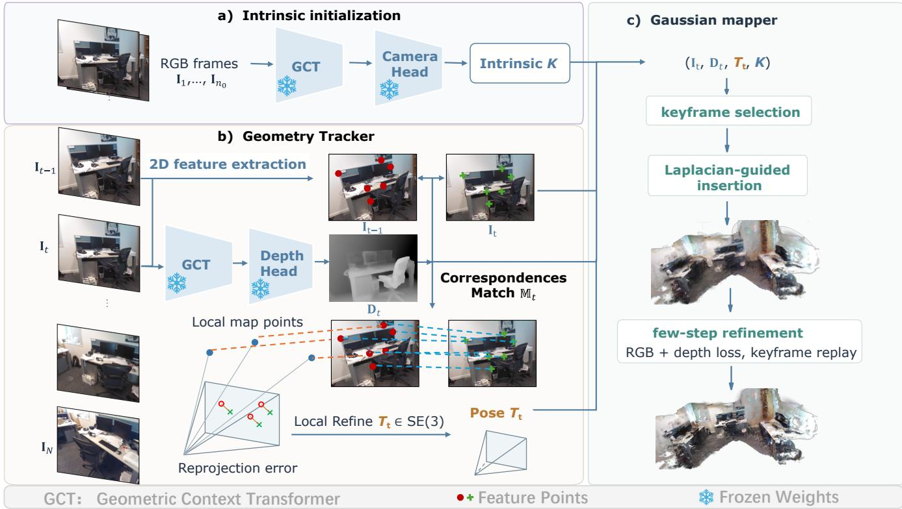
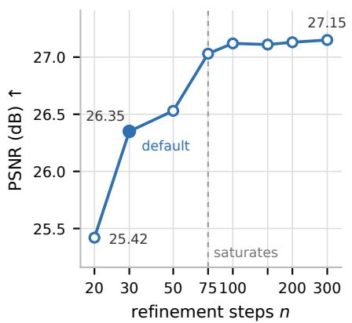
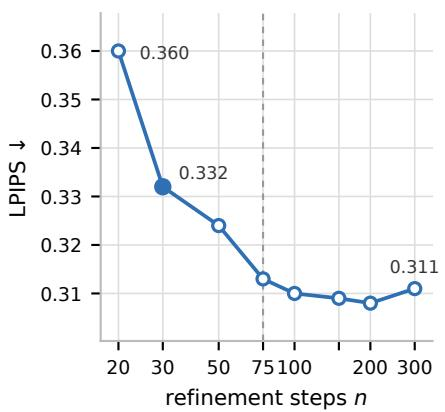
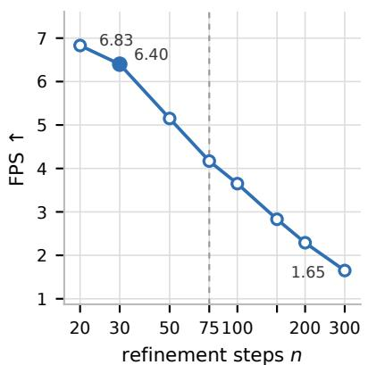
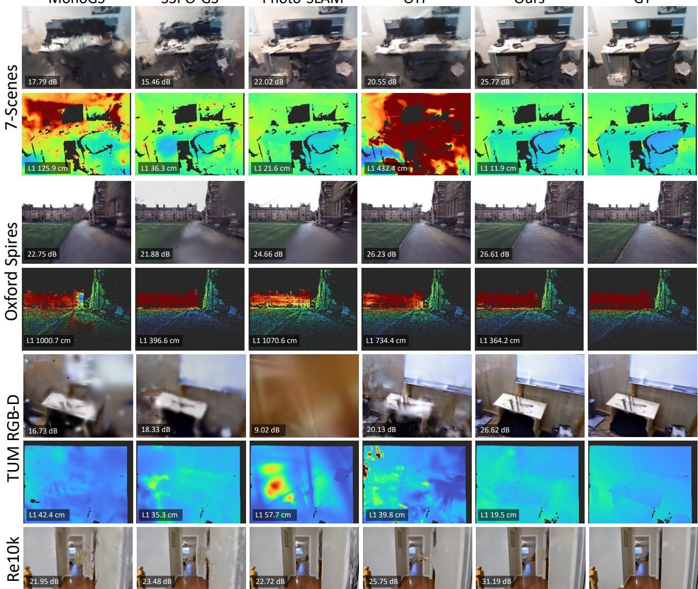
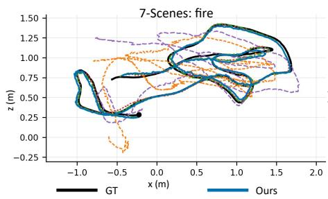
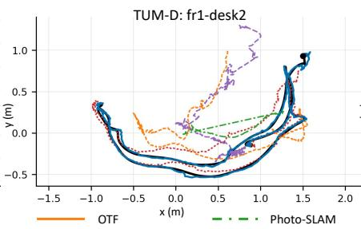
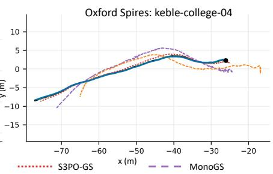

# LingGS: Decoupling Feed-Forward Geometry Prediction from Camera Tracking for High-Fidelity Gaussian SLAM

Da Li1, Yihan Zang1, Ivan Viola1, Zeyu Wang2 and Dominik Engel1

1 King Abdullah University of Science and Technology

2 The Hong Kong University of Science and Technology (Guangzhou)

1{da.li, yihan.zang, ivan.viola, dominik.engel}@kaust.edu.sa 2zeyuwang@ust.hk

## Abstract

Achieving high-quality reconstruction and responsive camera tracking remains challenging for monocular RGB Gaussian splatting SLAM under a limited optimization budget. We present an online system that addresses this challenge by combining learned geometric priors with explicit geometric camera tracking, which can substantially outperform learned camera prediction in terms of tracking accuracy. A frozen streaming 3D foundation model serves as a virtual RGB-D sensor, providing depth estimation from monocular video. An explicit geometric solver then estimates camera motion through feature reprojection, and a streaming Gaussian mapper integrates the resulting observations into a dense scene representation. We further show that geometric tracking improves camera pose accuracy across representative streaming geometry backbones, demonstrating the broader applicability of our approach. Extensive experiments on indoor and outdoor datasets show that our method significantly improves reconstruction quality over existing approaches, achieving ∼7 FPS on a single RTX 4090 and delivering 2–3× the throughput of the evaluated prior SLAM systems. Keywords: 3D reconstruction, Gaussian Splatting, SLAM, Feed-forward Model.

## 1 Introduction

Monocular Gaussian SLAM aims to estimate the camera pose and build a renderable scene map online using only an RGB image stream. This capability supports immersive interaction, live scene capture, and remote interaction in AR/VR and robotics. 3D Gaussian splatting (GS) (Kerbl et al., 2023) provides an explicit scene representation with eficient rendering and diferentiable mapping, making it a useful representation for dense SLAM. However, unlike RGB-D Gaussian SLAM methods (Keetha et al., 2024; Yan et al., 2024; Yugay et al., 2023; Peng et al., 2024; Ha et al., 2024; L. Zhu et al., 2025), without measured depth, the monocular GS SLAM system must jointly recover camera pose, scene geometry, and the appearance, within a limited computational budget.

Methods that rely on sparse feature points or incremental map optimization struggle to achieve high-fidelity mapping Matsuki et al., 2024; Huang et al., 2024. Learned dense priors help fill this gap, but integrating them into a consistent map introduces further challenges. Dense depth prediction and camera joint optimization add online computational cost (Homeyer et al., 2025; Cheng et al., 2025), while per-frame depth predictions do not ensure crossframe scale consistency and require additional scale recovery and geometric alignment (Deng et al., 2025; Yu et al., 2026). Consistent depth and camera poses are both essential to this task. Depth determines where Gaussians are initialized, while camera poses determine whether observations from diferent frames align. Poor initialization requires additional map refinement, and inaccurate poses introduce conflicting observations that can blur the reconstructed scene. The challenge is therefore to obtain consistent dense depth and camera poses together within a limited online computational budget.

Streaming 3D foundation models ofer a promising starting point. By maintaining temporal context, they predict consistent dense depth and camera poses as images arrive (Su et al., 2026; Zhuo et al., 2026; X. Chen et al., 2026; L.-Z. Chen et al., 2026). Their depth predictions provide dense surface estimates for the Gaussian initialization, reducing the need to recover the scene structure from sparse feature points. Yet this advantage depends on the quality of the accompanying poses. We observe that directly using the models’ predicted poses can lead to cross-frame misalignment, limiting reconstruction quality even when useful depth estimates are available. To this end, we introduce an explicit geometry pose solver that combines 2D feature points with predicted depth and utilizes them to jointly constrain camera pose estimation.

Our system requires no additional training and runs at ∼7 FPS on a single RTX 4090 GPU. It achieves higher rendering quality than the previous baselines across indoor and outdoor datasets, with the lowest depth error and competitive tracking error. Overall, our main contributions are:

• Depth-assisted geometric tracking for streaming 3D models. We introduce an explicit geometry solver for camera tracking that combines 2D feature points with predicted depth. Intensive experiments show that our geometry solver can provide better tracking than the learned streaming camera head.

• An eficient monocular Gaussian SLAM system. We build a faster high-fidelity monocular GS SLAM system combining the geometric solver, a frozen streaming model, and a Gaussian mapper, leading to higher appearance quality. Across evaluated datasets, our system can improve rendering PSNR by up to 3.1 dB.

• Generalization of geometry solver across streaming models. We apply our geometry solver to multiple representative streaming models. We show that the geometry solver reduces trajectory error by up to ∼97% relative to the models native camera head, demonstrating its efectiveness across diferent backbones and providing insight for future streaming model design.

## 2 Related Work

Visual tracking without depth prior. These methods recover scene geometry from RGB observations through visual tracking and map optimization. MonoGS (Matsuki et al., 2024) estimates poses by photometric alignment with the Gaussian map, making tracking dependent on the quality of the evolving reconstruction. Photo-SLAM (Huang et al., 2024) combines ORB-SLAM3 (Campos et al., 2021) with Gaussian mapping. CaRtGS (Feng et al., 2025), RP-SLAM (Bai et al., 2026), and SEGS-SLAM (Wen et al., 2025) further develop this architecture through improvements to computation allocation, map updates, and scene modeling. MGSO (Y. S. Hu et al., 2025) instead initializes Gaussians from geometry recovered by direct photometric odometry. Without learned dense geometric priors, surface recovery relies on multi-view image observations and parallax. Regions with weak visual constraints may remain insuficiently reconstructed at initialization, requiring interpolation or further geometric refinement during mapping.

Learned geometry for tracking and mapping. Learned depth and pointmap predictions provide richer surface information for tracking and mapping. Splat-SLAM (Sandström et al., 2024), DROID-Splat (Homeyer et al., 2025), and HI-SLAM2 (W. Zhang et al., 2025) integrate learned dense depth and trajectory refinement. MGS-SLAM (P. Zhu et al., 2024) uses multi-view depth supervision, while SplatMAP (Y. Hu et al., 2025) updates Gaussian positions using refined poses and depths from dense SLAM, and uses reliability masks to prune or add Gaussians. Some methods strengthen geometric consistency through map-to-tracker feedback or optical flow constraints (F. Zhu et al., 2026; Seo et al., 2026), and suppress unreliable observations in dynamic scenes (Zheng et al., 2025; M. Li et al., 2025). These designs improve geometric estimation, but dense tracking and iterative refinement add computation to the online pipeline, limiting their application.

Feed-forward prediction ofers a way to reduce this burden. StreamGS (Y. Li et al., 2025) and Flash-Mono (Z. Zhang et al., 2026) predict poses and Gaussian attributes before limited map refinement, but require intensive model retraining. Pointmap and multi-view foundation models also support tracking and mapping in OpenGS-SLAM (Yu et al., 2025), ARTDECO (G. Li et al., 2026) and S3PO-GS (Cheng et al., 2025), but with a high tracking cost. GeoGS-SLAM (Gao et al., 2026), VGGT-GS SLAM (Han et al., 2026), and $M ^ { 3 }$ (Ren et al., 2026) combine learned predictions with geometric or photometric optimization to refine poses and scene estimates by processing frames in batches. OTF (Meuleman et al., 2025) explores eficient incremental Gaussian construction, but loses the consistent geometry reconstruction.

Combining predicted geometry with explicit pose estimation is particularly relevant to our work. GigaSLAM (Deng et al., 2025) and KiloGS-SLAM (Yu et al., 2026) use predicted depth with geometric solvers, while KiloGS-SLAM additionally activates learned pixel matching when needed, but they sufer from the scale drift. MonoEM-GS (Kruzhkov et al., 2026) uses the iterative closest point (ICP) to align predicted pointmap with the Gaussian representation. These approaches demonstrate the value of learned geometry for explicit camera estimation. Our work focuses on using streaming consistent depth predictions for camera tracking and Gaussian mapping.

## 3 Method

As illustrated in Figure 1, given a monocular RGB sequence $\{ \boldsymbol { \mathbf { l } } _ { t } \} _ { t = 1 } ^ { N }$ , our system combines learned geometric priors with explicit geometric camera tracking to incrementally estimate camera poses and build a Gaussian scene representation. The LingBot-Map (L.-Z. Chen et al., 2026) first establishes a fixed camera calibration � from the initial frames and subsequently provides depth $\mathbf { D } _ { t }$ as a virtual depth sensor. The geometric solver (Sec. 3.1) combines these geometric measurements with image features to estimate camera poses �� by minimizing reprojection error. The Gaussian mapper (Sec. 3.2) integrates $( \mathsf { I } _ { t } , \mathsf { D } _ { t } , T _ { t } , K )$ through keyframe selection, Laplacian-guided Gaussian insertion, and 30 refinement steps using RGB and depth losses with keyframe replay.

## 3.1 Geometry Solver

Online Gaussian mapping requires a camera pose for each incoming frame to integrate its observations into a common reconstruction. We build our geometry solver on ORB-SLAM3 (Campos et al., 2021; Huang et al., 2024), using the depth predicted by the LingBot-Map as a virtual RGB-D measurement. At frame $t ,$ the solver receives the current RGB image $\mathbf { l } _ { t } ,$ the predicted depth map D�. Together with the sparse map established from previous observations, these inputs are used to estimate the world-tocamera pose �� ∈ ��(3), which transforms a world point $\boldsymbol { x } ^ { \mathrm { w } } =$ $[ x ^ { \mathrm { w } } , y ^ { \mathrm { w } } , z ^ { \mathrm { w } } , 1 ] ^ { \top }$ into the current camera frame as $\boldsymbol { x } _ { t } ^ { \mathrm { c } } = T _ { t } \boldsymbol { x } ^ { \mathrm { w } }$ , where $\boldsymbol { x } _ { t } ^ { \mathrm { c } } = [ \boldsymbol { x } _ { t } ^ { \mathrm { c } } , \boldsymbol { y } _ { t } ^ { \mathrm { c } } , \boldsymbol { z } _ { t } ^ { \mathrm { c } } , 1 ] ^ { \intercal }$ . At initialization, the first camera defines the reconstruction frame, with $T _ { 1 } = \mathrm { { I } } _ { 4 }$ . Feature locations with valid predicted depth are back-projected to initialize the sparse map. We retain ORB-SLAM3’s feature extraction, matching, and local bundle adjustment, while specifying how predicted depth contributes to pose estimation. In particular, depth enters the tracking objective as a direct observation with a constant relative-error noise model.

Camera pose estimation with a direct depth observation. Each frame extracts � =1200 oriented FAST and rotated BRIEF (ORB) image features on an 8-level pyramid. Following ORB-SALM3, we obtain a set of 2D–3D correspondences $\mathbb { M } _ { t }$ between image features and local map points using projectionguided matching. Keeping the map points fixed, we refine the current pose by minimizing a robust combination of image reprojection and depth residuals:

$$
T _ { t } = \arg \operatorname* { m i n } _ { T \in S E ( 3 ) } \sum _ { j \in \mathbb { M } _ { t } } \rho \Bigl ( r _ { j } ( T ) ^ { \top } \Sigma _ { j } ^ { - 1 } r _ { j } ( T ) \Bigr ) , \qquad r _ { j } ( T ) = \left[ \begin{array} { l } { \displaystyle u _ { j } - \pi _ { u } ( T x _ { j } ^ { \mathbf { w } } ) } \\ { \displaystyle v _ { j } - \pi _ { v } ( T x _ { j } ^ { \mathbf { w } } ) } \\ { \displaystyle z _ { j } - [ T x _ { j } ^ { \mathbf { w } } ] _ { z } } \end{array} \right] .\tag{1}
$$

where $\pi$ is the pinhole projection with the frozen $K , [ \cdot ] _ { z }$ extracts the third coordinate, $z _ { j } = \mathbf { D } _ { t } ( u _ { j } , v _ { j } )$ is the model’s depth at the keypoint, $\rho$ is the Huber kernel, and

$$
\Sigma _ { j } = \mathrm { d i a g } \bigl ( \sigma _ { j } ^ { 2 } , \sigma _ { j } ^ { 2 } , ( \varepsilon z _ { j } ) ^ { 2 } \bigr ) , \qquad \varepsilon = 0 . 0 5 ,\tag{2}
$$

with $\sigma _ { j }$ the pyramid-level pixel standard deviation. Pose estimation alternates between optimization and outlier re-classification. In each of four outer rounds, the solver refines the current pose using the active feature correspondences, recomputes their residuals and updates their inlier status according to the weighted squared errors. This procedure reduces the influence of incorrect matches on subsequent optimization rounds. We retain the image-plane reprojection residuals and their analytical pose Jacobians from ORB-SLAM3. ORB-SLAM3 represents RGB-D measurements as virtual stereo observations, allowing it to reuse the stereo observation model and optimization framework, but this modeling choice becomes less natural when depth is supplied directly by a feedforward geometry model rather than inferred from stereo disparity; more details are in Appendix A.1. For the predicted depth, we instead adopt a constant-relative-uncertainty model and use a direct depth residual with the corresponding uncertainty weight. Our modification replaces the third, virtual-stereo residual with a direct depth residual and updates its Jacobian and information weight accordingly. We therefore describe only the modified depth component below.

  
Figure 1. Overview of our online Gaussian splatting SLAM system. (a) A frozen streaming foundation model estimates camera intrinsics from the initial RGB frames. (b) Predicted depth and image features support geometric camera tracking through correspondence matching and reprojection error minimization. (c) The Gaussian mapper integrates RGB frames, predicted depth, and estimated poses through keyframe selection, Laplacian-guided Gaussian insertion, and 30-step refinement using RGB and depth losses with keyframe replay.

For a matched map point $\boldsymbol { x } _ { j } ^ { \mathrm { w } }$ , let $z _ { j } = \mathbf { D } _ { t } \big ( u _ { j } , v _ { j } \big )$ denote the observed valid depth at its matched 2D image correspondence. Given a camera pose �, the reprojected camera-space depth is $[ T x _ { j } ^ { \mathrm { w } } ]$ �. The direct depth residual is

$$
r _ { z , j } ( T ) = z _ { j } - [ T x _ { j } ^ { \mathrm { w } } ] _ { z } .\tag{3}
$$

To linearize this residual around the current pose, we introduce a local pose increment $\delta \xi \in \mathbb { R } ^ { 6 }$ and apply a left perturbation $T ( \delta \xi ) = \exp ( ( \delta \xi ) ^ { \wedge } ) T ,$ where

$$
\delta \xi = \left[ \begin{array} { c c } { \delta \omega } \\ { \delta v } \end{array} \right] , \qquad ( \delta \xi ) ^ { \wedge } = \left[ \begin{array} { c c } { [ \delta \omega ] \times } & { \delta v } \\ { \mathbf { 0 } ^ { \top } } & { 0 } \end{array} \right] \in \mathfrak { s e } ( 3 ) .\tag{4}
$$

Here, �� and �v respectively denote the rotational and translational increments, following (Solà et al., 2018; Campos et al.,

2021) . The operator $( \cdot ) ^ { \wedge }$ maps a six-dimensional increment to its matrix representation in ��(3), and $[ \cdot ] _ { \times }$ denotes the skewsymmetric cross-product matrix. The observed depth and map point remain fixed during pose-only optimization, so only the reprojected camera-space depth depends on the increment. The corresponding Jacobian is therefore

$$
J _ { z , j } = \left. \frac { \partial r _ { z , j } \big ( T ( \delta \xi ) \big ) } { \partial \delta \xi } \right| _ { \delta \xi = 0 } = - \left. \begin{array} { l } { \partial [ T ( \delta \xi ) x _ { j } ^ { \mathrm { w } } ] _ { z } } \\ { \partial \delta \xi } \end{array} \right| _ { \delta \xi = 0 } .\tag{5}
$$

This Jacobian describes how a small correction to the current pose changes the depth residual. The depth Jacobian is combined with the image-plane reprojection Jacobians to form the full residual Jacobian. Together with the information matrix $\Sigma _ { j } ^ { - 1 }$ and the Huber robust weights, these Jacobians define the linearized pose optimization problem. After solving for the increment $\delta \xi ,$ we update the pose as $\boldsymbol { T } \gets \exp ( ( \delta \boldsymbol { \xi } ) ^ { \wedge } ) \boldsymbol { T }$ . This update is repeated within the optimization rounds described above, while keeping the map points and depth observations fixed like ORB-SLAM3.

## 3.2 Gaussian Mapper

The mapper incrementally reconstructs the scene as a set of 3D Gaussians,

$$
\mathbb { G } = \left\{ \left( \mu _ { i } , \pmb { q } _ { i } , s _ { i } , o _ { i } , \pmb { c } _ { i } \right) \right\} _ { i = 1 } ^ { N _ { \mathrm { G } } } ,\tag{6}
$$

where $\pmb { \mu } _ { i } \in \mathbb { R } ^ { 3 }$ is the center, $\pmb q _ { i } \in \mathbb { R } ^ { 4 }$ is a unit quaternion, $\pmb { s } _ { i } \in \mathbb { R } ^ { 3 }$ contains the principal-axis scales, $o _ { i } ~ \in ~ ( 0 , 1 )$ is the opacity, and $\pmb { c } _ { i } ~ \in ~ ( 0 , 1 ) ^ { 3 }$ is the RGB color. The map is updated at selected keyframes through render-aware Gaussian insertion followed by joint refinement with keyframe replay following OTF (Meuleman et al., 2025). All updates use only the current observation and previously stored keyframes.

Laplacian-guided Gaussian insertion. New Gaussians are allocated preferentially to image structure that is insuficiently represented by the current map. Let ˆI� denote the rendered RGB image at pose $T _ { t : }$ , and $\pmb { p } = ( u , v ) ^ { \top }$ denote the pixel. We use ℓ(ˆI�) to denote the absolute discrete Laplacian ofthe grayscale image, normalized by its maximum, with a zero output for a zero Laplacian. The insertion weights are

$$
w _ { t } ( \pmb { p } ) = \left[ \ell ( \mathbf { I } _ { t } ) ( \pmb { p } ) - \ell ( \hat { \mathbf { I } } _ { t } ) ( \pmb { p } ) \right] ^ { + } ,\tag{7}
$$

where $[ x ] ^ { + } = \operatorname* { m a x } ( 0 , x )$ . This score favors valid pixels whose observed high-frequency response exceeds that of the rendering. It therefore provides a heuristic for identifying missing or underresolved detail, rather than a complete measure of photometric disagreement. For an empty map, $\hat { \mathbf { l } } _ { t }$ is zero, and the weights reduce to the observed image Laplacian restricted to valid depth.

Geometric initialization. Each sampled pixel � with depth $z = \mathbf { D } _ { t } ( \pmb { p } )$ initializes a Gaussian. Let $\bar { \pmb { p } } = ( u , v , 1 ) ^ { \top }$ denote its homogeneous image coordinate. The Gaussian center is obtained by back-projecting the depth and transforming the resulting point into the reconstruction frame. The remaining attributes are initialized as

$$
\pmb { q } = ( 1 , 0 , 0 , 0 ) ^ { \top } , \qquad \pmb { s } = \frac { \kappa z } { f _ { x } } \pmb { 1 } _ { 3 } , \qquad \kappa = 2 , \qquad o = 0 . 0 7 ,\tag{� = I� (�,}
$$

(8)

The scale follows the pixel-footprint initialization of OTF, with a nominal image-space scale of two pixels. Although initialized isotropically, the three scale components are optimized independently. The low initial opacity permits newly inserted primitives to make a limited contribution before refinement.

Refinement with keyframe replay. After inserting new Gaussians, the mapper refines the Gaussian map for � = 30 optimization steps. At each step, the newest keyframe is selected with probability $ { p _ { \mathrm { l a s t } } } = 0 . 2$ through a dedicated sampling branch; otherwise, a keyframe is sampled uniformly from all stored keyframes, including the newest.

For the sampled keyframe $j ,$ the diferentiable gsplat rasterizer (Ye et al., 2025) produces a color image ˆI� and a rendered depth map $\hat { \mathbf { D } } _ { j }$ . We minimize

$$
\mathcal { L } _ { j } = 0 . 8 \mathcal { L } _ { \mathrm { r g b } , j } + 0 . 2 \left( 1 - \mathrm { S S I M } ( \hat { \mathbf { l } } _ { j } , \mathbf { l } _ { j } ) \right) + \lambda _ { d } \mathcal { L } _ { \mathrm { d e p t h } , j } , \qquad \lambda _ { d } = 0 . 0 1 .\tag{9}
$$

where $\mathcal { L } _ { \mathrm { r g b } , j }$ is the mean absolute RGB reconstruction error. The depth loss compares the rendered depth with the stored modelpredicted depth prior $\mathbf { D } _ { j }$ in inverse-depth space:

$$
\mathcal { L } _ { \mathrm { d e p t h } , j } = \frac { 1 } { | \mathbb { V } _ { j } | } \sum _ { \pmb { p } \in \mathbb { V } _ { j } } \left| \frac { 1 } { \hat { \mathbf { D } } _ { j } ( \pmb { p } ) } - \frac { 1 } { \mathbf { D } _ { j } ( \pmb { p } ) } \right| ,\tag{10}
$$

where $\mathbb { V } _ { j }$ denotes the set of valid depth-supervision pixels for keyframe $j .$ For small depth errors, the inverse-depth discrepancy is approximately the absolute depth error divided by the squared reference depth. This emphasizes nearby geometry relative to equally sized absolute depth errors at greater distances. Together with the photometric terms, the depth loss encourages appearance refinement to remain consistent with the predicted scene geometry.

## 4 Experiment

## 4.1 Setup and Evaluation

Datasets. We evaluate on four datasets, including indoor and outdoor datasets. 7-Scenes (Shotton et al., 2013) has seven indoor RGB sequences with ground truth Kinect depth. Oxford Spires (Tao et al., 2026) consists of six outdoor clips of 1000–2001 frames selected from outdoor sites: Keble College-(02,03,04), Observatory Quarter-01, Christ Church-02, and Bodleian Library-02, with poses and depth reprojected from the point cloud of a terrestrial laser scan. From RE10K (Zhou et al., 2018) we select 60 short indoor and outdoor real-estate clips with 71–279 frames. Eleven handheld sequences (fr1, fr2, fr3) are selected from the TUM-D (Sturm et al., 2012) dataset. All frames are processed at 518x392 resolution across all datasets. We evaluate all methods using a single NVIDIA RTX4090 GPU with an AMD Ryzen Threadripper PRO 3995WX 64-Cores CPU.

Evaluation metrics. We evaluate novel-view synthesis (NVS) quality on held-out views using PSNR, SSIM, and LPIPS. We measure global trajectory accuracy using the root-mean-square Absolute Trajectory Error (ATE) after aligning the estimated trajectory to the reference trajectory with a Sim(3) Umeyama align-� :).ment (Umeyama, 1991). We also report the Relative Pose Error (RPE) between consecutive frames, including translational error $( \mathrm { R P E } _ { t } )$ and rotational error (RPE�). To evaluate reconstruction geometry, we compute the mean L1 error between the rendered and ground-truth depth on held-out views. Finally, we report end-toend throughput in frames per second (FPS), calculated by dividing the number of frames in each sequence by its total reconstruction time.

Baselines. We compare against MonoGS (Matsuki et al., 2024), S3PO-GS (Cheng et al., 2025), Photo-SLAM (Huang et al., 2024), and OTF (Meuleman et al., 2025). MonoGS uses 3D Gaussians for monocular tracking and mapping, while S3PO-GS targets monocular SLAM with globally scale-consistent Gaussian point maps. Photo-SLAM combines feature-based tracking with Gaussian splatting for photorealistic mapping, whereas OTF incrementally reconstructs large-scale scenes from unposed image sequences with large parallax. All baselines are evaluated using their publicly available implementations on identical input frames. To compare with Photo-SLAM fairly, we increase its mapping iterations from 8 to a maximum of 200 while retaining concurrent tracking and mapping, maintaining a processing rate of ∼6 FPS.

## 4.2 Novel View Synthesis and Tracking

Table 1 shows that our method consistently achieves the best rendering quality on all datasets in terms of NVS metrics. It also maintains competitive trajectory accuracy, obtaining the best ATE on Oxford Spires and TUM-D, and the second-best ATE on 7- Scenes and RE10K. The few cases in which Photo-SLAM or S3PO-GS achieves slightly lower tracking error are consistent with their larger computational budgets for pose estimation: Photo-SLAM performs extensive local-map maintenance when they have larger mapping iterations, whereas S3PO-GS employs a computationally intensive tracking procedure that aligns each frame with its Gaussian point map. The qualitative comparisons in Figure 3 further show that our reconstructions preserve finer structures and sharper appearance, while several baselines exhibit noticeable blurring, artifacts, or geometric inconsistency. For 7-Scenes, Oxford Spires and TUM-D, we additionally visualize rendered depth. The 7-Scenes and TUM-D references provide dense depth, whereas the Oxford Spires reference is obtained by projecting the scanned point cloud and is therefore sparse. For a fair comparison, the same valid-depth mask is applied to all methods. The trajectory examples in Figure 4 confirm that our estimates remain among the most accurate across three datasets, omitting RE10K because it is too short, with particularly clear improvements on the Oxford Spires and TUM-D sequences.

  
Figure 2. Ablation on refinement steps per keyframe. Means over the six Oxford Spires sequences. Rendering quality saturates at �≈75–100 (dashed line). The filled marker is the default �=30 used in all main tables.

Depth reconstruction accuracy. Table 2 complements the RGB evaluation by measuring the rendered depth. Our method achieves the lowest mean L1 error on all three datasets, demonstrating consistent geometric improvements across both indoor and outdoor environments.

Compared with S3PO-GS, the strongest baseline across all three datasets, our method reduces the depth error by 11.8% on 7- Scenes, 42.1% on TUM-D, and 28.9% on Oxford Spires, based on the rounded values reported in the table. Compared with Photo-SLAM, the error decreases from 0.36 to 0.15 m on 7-Scenes, from 1.66 to 0.33 m on TUM-D, and from 8.54 to 3.18 m on Oxford Spires. Notably, OTF achieves competitive novel-view rendering quality, but exhibits the highest depth error on all three datasets. This discrepancy highlights a limitation of assessing 3D Gaussian maps through RGB rendering alone: visually plausible novel views do not necessarily imply geometrically accurate reconstruction, since the observed appearance can still be explained by Gaussians that are incorrectly distributed in 3D space.

## 4.3 Ablation study

Ablation on camera tracking. Table 3 isolates the efect of the pose on the reconstruction. Four alternatives are compared with our solver: (A) Virtual stereo, the RGB-D front-end in ORB-SLAM3, which turns the predicted depth into a virtual right-image coordinate and optimizes the stereo residual shown in Eq. 13; (B) 2D reprojection, the same front-end with depth used only to back-project the new map points, so that tracking sees the 2D reprojection residual only, like the monocular RGB ORB-SLAM3; (C) a purely geometric point-to-plane ICP ofthe predicted depth against a local model and (D) the backbone’s own regressed camera head. Compared with virtual stereo (A), our direct-depth residual produces more accurate camera poses while preserving the same PSNR: ATE decreases from 79.5 to 73.8 cm, while translational RPE decreases from 1.123 to 0.943 cm. This result indicates that directly modeling the uncertainty of predicted depth provides a more efective geometric constraint than encoding it through a virtual-stereo observation. The comparison with 2D reprojection (B) further demonstrates the importance of explicitly including depth in pose optimization. Removing the depth residual reduces PSNR by 3.45 dB, increases ATE from 73.8 to 162.1 cm, and increases translational RPE from 0.943 to 4.723 cm. Predicted depth is therefore useful not only for initializing map points, but also for constraining the camera pose at every frame. The purely unoptimized CPU ICP variant (C) is also substantially less accurate than our solver, increasing ATE from 73.8 to 307.2 cm, translational RPE from 0.943 to 15.14 cm, and rotational RPE from 0.095◦ to 0.482◦. This result suggests that point-to-plane alignment alone is less robust to predicted-depth noise and weak geometric constraints. Finally, the backbone camera head (D) is fast but produces substantially less accurate trajectories, with 5.98 m ATE and 15.39 cm translational RPE. This suggests that its regressed poses are not as tightly coupled to the predicted scene geometry as those obtained through explicit geometric optimization. Our solver adds only 6.6 ms of tracking time relative to the camera head, while reducing ATE by 87.6% and translational RPE by 93.9%. The endto-end throughput remains comparable, decreasing only from 7.04 to 6.40 FPS.

Ablation on backbones. Table 4 shows that replacing the regressed camera head with the geometry solver consistently improves all trajectory metrics across the four streaming backbones on Keble College-02. The solver reduces ATE by 31.0–96.7%, translational RPE by 64.3–97.1%, and rotational RPE by 55.9–78.8%. These gains require only 16.1 ms of tracking per frame, corresponding to an additional 5.5–11.9 ms over the camera heads. The results demonstrate that our solver transfers across diferent backbone architectures and produces camera motion that is more consistent with their predicted scene geometry at modest computa-

Rendering quality, trajectory accuracy, and eficiency among all datasets. The best results are in bold, and the second-best results are underlined. ATE and RPE are reported in centimeters, and $\mathrm { R P E } _ { R }$ is reported in degrees. For Photo-SLAM, it fails on the Pumpkin sequence of 7-Scenes and we only use 6 scenes for its average.
<table><tr><td rowspan="2">Method</td><td colspan="7">(a) 7-Scenes</td><td colspan="7">(b) Oxford Spires</td></tr><tr><td>PSNR↑</td><td>SSIM↑</td><td>LPIPS↓</td><td>ATE↓</td><td> $\mathrm { R P E } _ { t } \downarrow$ </td><td> $\mathrm { R P E } _ { R } \downarrow$ </td><td>FPS↑</td><td>PSNR↑</td><td>SSIM↑</td><td>LPIPS↓</td><td>ATE↓</td><td>RPEt ↓</td><td> $\mathrm { R P E } _ { R } \downarrow$ </td><td>FPS↑</td></tr><tr><td>MonoGS</td><td>18.94</td><td>0.681</td><td>0.501</td><td>29.90</td><td>0.776</td><td>0.290</td><td>3.28</td><td>20.40</td><td>0.635</td><td>0.571</td><td>595.47</td><td>10.58</td><td>0.321</td><td>3.21</td></tr><tr><td>S3PO-GS</td><td>19.76</td><td>0.713</td><td>0.470</td><td>7.30</td><td>0.480</td><td>0.213</td><td>1.74</td><td>21.63</td><td>0.699</td><td>0.506</td><td>287.81</td><td>2.802</td><td>0.134</td><td>1.31</td></tr><tr><td>Photo-SLAM</td><td>21.91</td><td>0.741</td><td>0.400</td><td>19.78</td><td>0.566</td><td>0.205</td><td>5.99</td><td>22.05</td><td>0.717</td><td>0.465</td><td>567.71</td><td>2.308</td><td>0.074</td><td>5.99</td></tr><tr><td>OTF</td><td>20.50</td><td>0.744</td><td>0.443</td><td>39.34</td><td>0.801</td><td>0.269</td><td>7.57</td><td>23.19</td><td>0.713</td><td>0.466</td><td>624.06</td><td>8.592</td><td>0.231</td><td>8.24</td></tr><tr><td>Ours</td><td>24.48</td><td>0.839</td><td>0.293</td><td>8.58</td><td>0.524</td><td>0.189</td><td>6.99</td><td>26.35</td><td>0.817</td><td>0.332</td><td>73.81</td><td>0.943</td><td>0.095</td><td>6.40</td></tr></table>

<table><tr><td rowspan="2">Method</td><td colspan="7">(c) RE10K</td><td colspan="7">(d) TUM-D</td></tr><tr><td>PSNR↑</td><td>SSIM↑</td><td>LPIPS↓</td><td>ATE↓</td><td>RPEt ↓</td><td> $\mathrm { R P E } _ { R } \downarrow$ </td><td>FPS↑</td><td>PSNR↑</td><td>SSIM↑</td><td>LPIPS↓</td><td>ATE↓</td><td>RPEt ↓</td><td> $\mathrm { R P E } _ { R }$ </td><td>↓ FPS↑</td></tr><tr><td>MonoGS</td><td>22.97</td><td>0.793</td><td>0.309</td><td>10.56</td><td>0.726</td><td>0.113</td><td>1.21</td><td>14.31</td><td>0.481</td><td>0.601</td><td>92.17</td><td>0.94</td><td>0.571</td><td>3.33</td></tr><tr><td>S3PO-GS</td><td>23.12</td><td>0.797</td><td>0.298</td><td>3.47</td><td>0.553</td><td>0.130</td><td>1.29</td><td>17.00</td><td>0.621</td><td>0.557</td><td>56.57</td><td>0.74</td><td>0.387</td><td>1.30</td></tr><tr><td>Photo-SLAM</td><td>23.86</td><td>0.802</td><td>0.287</td><td>1.90</td><td>0.647</td><td>0.085</td><td>5.94</td><td>13.68</td><td>0.496</td><td>0.601</td><td>59.96</td><td>0.89</td><td>0.330</td><td>5.99</td></tr><tr><td>OTF</td><td>25.20</td><td>0.859</td><td>0.245</td><td>8.79</td><td>1.064</td><td>0.150</td><td>6.35</td><td>19.58</td><td>0.708</td><td>0.462</td><td>88.55</td><td>0.94</td><td>0.323</td><td>6.54</td></tr><tr><td>Ours</td><td>25.73</td><td>0.873</td><td>0.210</td><td>2.84</td><td>0.645</td><td>0.088</td><td>7.94</td><td>20.89</td><td>0.758</td><td>0.387</td><td>41.33</td><td>0.66</td><td>0.288</td><td>5.01</td></tr></table>

Scale-aligned rendered-depth accuracy. Mean depth L1 error on $7 \mathrm { - }$ Scenes, TUM-D, and Oxford Spires. All values are reported in meters; lower is better.
<table><tr><td>Method</td><td>7-Scenes↓</td><td>TUM-D↓</td><td>Oxford Spires↓</td></tr><tr><td>MonoGS</td><td>0.52</td><td>1.29</td><td>9.12</td></tr><tr><td>S3PO-GS</td><td>0.17</td><td>0.57</td><td>4.47</td></tr><tr><td>Photo-SLAM</td><td>0.36</td><td>1.66</td><td>8.54</td></tr><tr><td>OTF</td><td>1.00</td><td>2.35</td><td>14.12</td></tr><tr><td>Ours</td><td>0.15</td><td>0.33</td><td>3.18</td></tr></table>

tional cost.

Ablation on mapping iterations. The number of synchronous refinement steps per keyframe is the one mapper parameter that trades quality against speed. We show the ablation in Figure 2. Quality improves quickly and then saturates: 20→30 steps gain 0.93 dB, 30→75 a further ∼0.88 dB, and everything beyond 100 steps changes only marginally (27.11–27.15 dB). We report �=30 throughout as the speed-oriented operating point.

## 5 Conclusion

We present LingGS, an online monocular Gaussian SLAM system that decouples feed-forward geometry prediction from camera tracking. A frozen streaming 3D foundation model serves as a virtual RGB-D sensor, while an explicit geometric solver estimates camera poses by jointly minimizing image reprojection and direct depth residuals. Combined with incremental Gaussian mapping, this design enables high-fidelity reconstruction. Experiments across indoor and outdoor datasets demonstrate improved rendering quality and geometric accuracy while maintaining eficient processing and competitive tracking accuracy. Further experiments across multiple streaming backbones support the broader applicability of our geometric solver.

Our current system does not address loop closure or dynamic scenes. Its reliance on ORB feature extraction and matching can also compromise tracking in repetitive or weakly textured environments, where correspondences may be ambiguous or reliable features scarce. Addressing these limitations with learned prior is an important direction for improving long-term consistency and robustness. More broadly, our findings motivate future streaming 3D models that integrate learned geometric priors with explicit geometric optimization to improve pose accuracy and geometric consistency in online reconstruction.

## A Appendix

## A.1 Relation to ORB-SLAM3’s Virtual-Stereo Model

ORB-SLAM3 handles RGB-D observations by converting depth measurements into virtual right-image coordinates and reusing its stereo reprojection model. Although the information matrix is defined in pixel coordinates and does not explicitly depend on depth, the projection model introduces a depth-dependent sensitivity to depth errors. We first elucidate the visual-stereo mechanism in ORB-SLAM3 and compare it with our direct depth residual.

Calibrated stereo geometry and observations. Consider a calibrated pinhole stereo pair with shared calibrated intrinsics $( f _ { x } , f _ { y } , c _ { x } , c _ { y } )$ and baseline � > 0. The right camera center lies at (�, 0, 0) in the left camera frame, and the two camera frames have aligned axes.

Let $\boldsymbol { x } _ { j } ^ { \mathrm { w } }$ denote a map point in homogeneous world coordinates. Under a world-to-left-camera pose $T \in S E { ( 3 ) }$ , the point in left camera space is defined as:

$$
\begin{array} { r } { \pmb { x } _ { j } ^ { \mathrm { c } } = \pmb { T } \pmb { x } _ { j } ^ { \mathrm { w } } = [ x _ { c } , y _ { c } , z _ { c } , 1 ] ^ { \top } , \qquad z _ { c } > 0 . } \end{array}\tag{11}
$$

Ablation on camera pose estimation over Oxford Spires. For variant C, we use Open3D’s CPU point-to-plane ICP as an unoptimized reference implementation; its runtime does not represent the computational limit of ICP.
<table><tr><td>Pose source</td><td>PSNR↑</td><td>SSIM↑</td><td>LPIPS↓ ATE (cm)↓</td><td></td><td> $\mathrm { R P E } _ { t } \left( \mathrm { c m } \right) \downarrow$ </td><td> $\mathrm { R P E } _ { R } \left( ^ { \circ } \right) \downarrow$ </td><td>Track (ms)↓ FPS↑</td><td></td></tr><tr><td>A: Virtual stereo</td><td>26.35</td><td>0.815</td><td>0.334</td><td>79.5</td><td>1.123</td><td>0.104</td><td>16.2</td><td>6.20</td></tr><tr><td>B: 2D reprojection</td><td>22.90</td><td>0.709</td><td>0.446</td><td>162.1</td><td>4.723</td><td>0.140</td><td>13.9</td><td>6.51</td></tr><tr><td>C: ICP</td><td>21.37</td><td>0.648</td><td>0.482</td><td>307.2</td><td>15.14</td><td>0.482</td><td>138.6</td><td>5.47</td></tr><tr><td>D: Camera head</td><td>20.23</td><td>0.629</td><td>0.510</td><td>598.5</td><td>15.39</td><td>0.259</td><td>9.5</td><td>7.04</td></tr><tr><td>Ours</td><td>26.35</td><td>0.817</td><td>0.332</td><td>73.8</td><td>0.943</td><td>0.095</td><td>16.1</td><td>6.40</td></tr></table>

Geometry-based pose estimation across streaming backbones on Keble College-02.
<table><tr><td>Backbone</td><td>Pose source</td><td>ATE (m)↓</td><td>RPEt (cm)↓</td><td> $\mathrm { R P E } _ { R } \left( ^ { \circ } \right) \downarrow$ </td><td>Track (ms)↓</td></tr><tr><td rowspan="2">XStreamVGGT (Su et al., 2026)</td><td>Camera head</td><td>23.277</td><td>48.95</td><td>0.4</td><td>9.6</td></tr><tr><td>Geometry solver</td><td>0.773</td><td>1.44</td><td>0.085</td><td>16.1</td></tr><tr><td rowspan="2">STream3R (Lan et al., 2026)</td><td>Camera head</td><td>25.560</td><td>17.67</td><td>0.319</td><td>10.6</td></tr><tr><td>Geometry solver</td><td>2.332</td><td>1.74</td><td>0.098</td><td>16.1</td></tr><tr><td rowspan="2">TTT3R (X. Chen et al., 2026)</td><td>Camera head</td><td>10.57</td><td>6.52</td><td>0.204</td><td>4.2</td></tr><tr><td>Geometry solver</td><td>7.29</td><td>2.33</td><td>0.09</td><td>16.1</td></tr><tr><td rowspan="2">Lingbot-map (L.-Z. Chen et al., 2026)</td><td>Camera head</td><td>8.224</td><td>13.74</td><td>0.202</td><td>9.5</td></tr><tr><td>Geometry solver</td><td>1.224</td><td>0.758</td><td>0.059</td><td>16.1</td></tr></table>

The same point has coordinates $[ x _ { c } - b , y _ { c } , z _ { c } , 1 ] ^ { \top }$ in the right camera frame. Here, � and $\left( x _ { c } , y _ { c } , z _ { c } \right)$ are expressed in the same length unit.

The predicted image coordinates are

$$
\begin{array} { l } { \displaystyle \hat { u } _ { L , j } = f _ { x } \frac { x _ { c } } { z _ { c } } + c _ { x } , } \\ { \displaystyle \hat { v } _ { L , j } = f _ { y } \frac { y _ { c } } { z _ { c } } + c _ { y } , } \\ { \displaystyle \hat { u } _ { R , j } = f _ { x } \frac { x _ { c } - b } { z _ { c } } + c _ { x } = \hat { u } _ { L , j } - \frac { f _ { x } b } { z _ { c } } . } \end{array}\tag{12}
$$

For a matched stereo feature, let $( u _ { L , j } , v _ { L , j } )$ denote its observed coordinates in the left image and $u _ { R , j }$ its observed horizontal coordinate in the right image. Rectification makes corresponding points share the same vertical coordinate in the ideal model. ORB-SLAM3, therefore, uses the three-component observation $( u _ { L , j } , v _ { L , j } , u _ { R , j } )$ and the residual

$$
\begin{array} { r } { r _ { j } ^ { \mathrm { s t } } ( T ) = [ { \boldsymbol { \imath } } _ { L , j } - { \hat { \boldsymbol { u } } } _ { L , j } ] . } \\ { { \boldsymbol { r } } _ { j } ^ { \mathrm { s t } } ( T ) = [ { \boldsymbol { \imath } } _ { L , j } - { \hat { \boldsymbol { v } } } _ { L , j } ] . } \\ { { \boldsymbol { u } } _ { R , j } - { \hat { \boldsymbol { u } } } _ { R , j } ] } \end{array}\tag{13}
$$

Explicit weighting in pixel coordinates. ORB-SLAM3 assigns the stereo observation a diagonal covariance model,

$$
\begin{array} { r } { \Sigma _ { j } ^ { \mathrm { s t } } = \sigma _ { j } ^ { 2 } I _ { 3 } , \qquad E _ { j } ^ { \mathrm { s t } } = \left( \boldsymbol { r } _ { j } ^ { \mathrm { s t } } \right) ^ { \top } \left( \Sigma _ { j } ^ { \mathrm { s t } } \right) ^ { - 1 } \boldsymbol { r } _ { j } ^ { \mathrm { s t } } . } \end{array}\tag{14}
$$

Here, $\sigma _ { j }$ is an assumed pixel localization standard deviation in base-level image coordinates. For a feature detected at pyramid level $\ell _ { j } .$

$$
\sigma _ { j } ^ { 2 } = \sigma _ { 0 } ^ { 2 } s ^ { 2 \ell _ { j } } , ~ \sigma _ { 0 } = 1 \mathrm { p i x e l } ,\tag{15}
$$

where $s > 1$ is the pyramid scale factor and $\ell _ { j }$ is zero-based. We use $s = 1 . 2$

This covariance is assigned from the feature scale, rather than estimated from its current reprojection residual. It contains no explicit depth-dependent term. The weighted error $E _ { j } ^ { \mathrm { s t } }$ is used within the robust optimization and outlier-classification procedure. In particular, ORB-SLAM3 does not compute a separate depth variance and insert it into $\boldsymbol { \Sigma } _ { j } ^ { s \mathrm { t } }$

RGB-D observations and the virtual right coordinate. For RGB-D inputs, the RGB image takes the role of the left image. Given a valid observed depth $z _ { j } ~ > ~ 0 ;$ , ORB-SLAM3 constructs a virtual right-image coordinate:

$$
u _ { R , j } = u _ { L , j } - \frac { f _ { x } b } { z _ { j } } .\tag{16}
$$

The depth $z _ { j }$ denotes the coordinate along the camera’s optical axis and uses the same length unit as the baseline. No physical right image is required.

Define the left-image reprojection residuals and the direct depth residual as

$$
\begin{array} { r l } & { r _ { u , j } = u _ { L , j } - \hat { u } _ { L , j } , } \\ & { r _ { v , j } = v _ { L , j } - \hat { v } _ { L , j } , } \\ & { r _ { z , j } = z _ { j } - z _ { c } . } \end{array}\tag{17}
$$

The observed quantities are fixed, whereas the predicted coordinates and $z _ { c }$ depend on �. For readability, this dependence is omitted from the scalar residual notation.

Substituting Eq. 16 into the right-image reprojection residual gives

$$
\begin{array} { l } { r _ { R , j } = \displaystyle \left( u _ { L , j } - \frac { f _ { x } b } { z _ { j } } \right) - \left( \hat { u } _ { L , j } - \frac { f _ { x } b } { z _ { c } } \right) } \\ { = r _ { u , j } + f _ { x } b \left( \frac { 1 } { z _ { c } } - \frac { 1 } { z _ { j } } \right) } \\ { = r _ { u , j } + \displaystyle \frac { f _ { x } b } { z _ { j } z _ { c } } r _ { z , j } . } \end{array}\tag{18}
$$

Writing

$$
a _ { j } ( T ) = \frac { f _ { x } b } { z _ { j } z _ { c } } ,\tag{19}
$$

the virtual-stereo residual becomes

$$
r _ { j } ^ { \mathrm { V S } } ( T ) = \left[ \begin{array} { c } { r _ { u , j } } \\ { r _ { v , j } } \\ { r _ { u , j } + a _ { j } r _ { z , j } } \end{array} \right] .\tag{20}
$$

Its third component combines horizontal reprojection error with an inverse-depth discrepancy. It is not a depth or disparity residual alone.

Depth sensitivity induced by the residual. Substituting Eq. 20 into the pixel-weighted cost yields the exact expression

$$
E _ { j } ^ { \mathrm { V S } } = \frac { 1 } { \sigma _ { j } ^ { 2 } } \left[ r _ { u , j } ^ { 2 } + r _ { v , j } ^ { 2 } + ( r _ { u , j } + a _ { j } r _ { z , j } ) ^ { 2 } \right] .\tag{21}
$$

Expanding the square gives

$$
E _ { j } ^ { \mathrm { V S } } = \frac { 2 r _ { u , j } ^ { 2 } + r _ { v , j } ^ { 2 } + 2 a _ { j } r _ { u , j } r _ { z , j } + a _ { j } ^ { 2 } r _ { z , j } ^ { 2 } } { \sigma _ { j } ^ { 2 } } .\tag{22}
$$

This expression explains how depth afects the cost despite the depth-independent pixel information matrix. The depth residual is multiplied by $a _ { j }$ before the residual is squared. Near a consistent estimate, $z _ { c } \approx z _ { j } \approx z ,$ so that

$$
a _ { j } \approx \frac { f _ { x } b } { z ^ { 2 } } , \qquad \frac { a _ { j } ^ { 2 } } { \sigma _ { j } ^ { 2 } } \approx \frac { ( f _ { x } b ) ^ { 2 } } { \sigma _ { j } ^ { 2 } z ^ { 4 } } .\tag{23}
$$

Thus, at fixed calibration and feature pyramid level, the coeficient of the squared depth residual scales locally $\mathtt { a s } z ^ { - 4 }$

This is a property induced by the residual parameterization, not an additional information weight explicitly assigned by ORB-SLAM3. Furthermore, Eq. 22 contains a horizontal–depth cross term. The full virtual-stereo cost therefore cannot be identified with an independent scalar depth penalty.

Comparison with direct-depth weighting. Our perframe pose-only formulation uses the direct depth residual as the third component:

$$
\begin{array} { r } { r _ { j } ^ { \mathrm { D } } ( T ) = \left[ \begin{array} { l } { r _ { u , j } } \\ { r _ { v , j } } \\ { r _ { z , j } } \end{array} \right] , \qquad \Sigma _ { j } ^ { \mathrm { D } } = \mathrm { d i a g } \left( \sigma _ { j } ^ { 2 } , \sigma _ { j } ^ { 2 } , ( \varepsilon z _ { j } ) ^ { 2 } \right) , } \end{array}\tag{24}
$$

as defined in Eqs. 1 and 2. Its nominal weighted cost is

$$
E _ { j } ^ { \mathrm { D } } = \frac { r _ { u , j } ^ { 2 } + r _ { v , j } ^ { 2 } } { \sigma _ { j } ^ { 2 } } + \frac { r _ { z , j } ^ { 2 } } { \varepsilon ^ { 2 } z _ { j } ^ { 2 } } .\tag{25}
$$

Unlike the virtual-stereo formulation, the third residual does not contain the horizontal reprojection residual.

Here, the depth-dependent information weight is explicitly specified:

$$
w _ { z , j } ^ { \mathrm { D } } = \frac { 1 } { \varepsilon ^ { 2 } z _ { j } ^ { 2 } } \propto z _ { j } ^ { - 2 } .\tag{26}
$$

It corresponds to an assumed constant relative depth uncertainty, $\sigma _ { z , j } ^ { \mathrm { D } } / z _ { j } = \varepsilon .$ . We use $\varepsilon = 0 . 0 5$ . The observed depth $z _ { j }$ remains fixed during pose-only optimization, so this weight is also fixed within each optimization problem.

Thus, the two formulations introduce depth dependence in different ways. Virtual stereo uses a pixel-domain weight together with a projection sensitivity that induces a local $z ^ { - 4 }$ scaling. Our formulation directly penalizes depth error with an explicitly chosen $z ^ { - 2 }$ weight. We evaluate direct-depth, virtual-stereo, and reprojection-only tracking in Sec. 4.3.

## AI use statement

In this work, we used generative AI tools to provide feedback on research methodology and experiments and to assist with the implementation of methods. Additionally, we used generative AI tools for brainstorming, code editing, literature search, and improving the readability of the manuscript. All AI-assisted methodological suggestions, code, experimental results, and manuscript content were independently reviewed and verified by the authors. We take responsibility for the final content of this work.

## Ethics statement

This work focuses on visual SLAM and 3D scene reconstruction using publicly available research datasets. It does not involve human-subject studies or the collection of personally identifiable information. We are not aware of any specific ethical concerns beyond the general considerations associated with computer vision and 3D reconstruction technologies.

## Reproducibility statement

Our source code and configuration files will be publicly released upon acceptance ofthe paper. To facilitate reproducibility, we provide detailed descriptions of the proposed tracking and mapping pipelines, implementation details, experimental settings, and evaluation protocols in the main paper and appendix. Additional ablations and qualitative results are also provided to support the reported findings.

## Acknowledgements

This work was supported by the Guangdong Basic and Applied Basic Research Foundation (No. 2026A1515011138) and the King Abdullah University of Science and Technology (KAUST) research fund under grant BAS/1/1680-01-01.

## References

Bai, Lizhi et al. (2026). “RP-SLAM: Real-time Photorealistic SLAM with Eficient 3D Gaussian Splatting”. In: IEEE Transactions on Visualization and Computer Graphics 32.2, pp. 1452–1466.

Campos, Carlos et al. (2021). “ORB-SLAM3: An Accurate Open-Source Library for Visual, Visual-Inertial, and Multimap SLAM”. In: IEEE Transactions on Robotics 37.6, pp. 1874–1890.

Chen, Lin-Zhuo et al. (2026). “LingBot-Map: Geometric Context Transformer for Streaming 3D Reconstruction”. In: arXiv preprint arXiv:2604.14141.

Chen, Xingyu et al. (2026). “TTT3R: 3D Reconstruction as Test-Time Training”. In: ICLR.

Cheng, Chong et al. (2025). “Outdoor Monocular SLAM with Global Scale-Consistent 3D Gaussian Pointmaps”. In: ICCV, pp. 26035–26044.

Deng, Kai et al. (2025). “GigaSLAM: Large-Scale Monocular SLAM with Hierarchical Gaussian Splats”. In: SIGGRAPH Asia Conference Papers, pp. 1–10.

Feng, Dapeng et al. (2025). “CaRtGS: Computational Alignment for Real-Time Gaussian Splatting SLAM”. In: IEEE Robotics and Automation Letters 10.5, pp. 4340–4347.

Gao, Ruilan, Letian Jin, and Yu Zhang (2026). “GeoGS-SLAM: Online Monocular Reconstruction Using Gaussian Splatting with Geometric Priors”. In: arXiv preprint arXiv:2607.11184.

Ha, Seongbo, Jiung Yeon, and Hyeonwoo Yu (2024). “RGBD GS-ICP SLAM”. In: ECCV, pp. 180–197.

Han, Yuhang et al. (2026). “VGGT-GS SLAM: Uncalibrated Monocular Gaussian Splatting SLAM with Feed-Forward Priors”. In: arXiv preprint arXiv:2609.19628.

Homeyer, Christian, Leon Begiristain, and Christoph Schnörr (2025). “DROID-Splat Combining end-to-end SLAM with 3D Gaussian Splatting”. In: Proceedings of the IEEE/CVF International Conference on Computer Vision (ICCV) Workshops.

Hu, Yan Song et al. (2025). “MGSO: Monocular Real-time Photometric SLAM with Eficient 3D Gaussian Splatting”. In: ICRA, pp. 11061–11067.

Hu, Yue et al. (2025). “SplatMAP: Online Dense Monocular SLAM with 3D Gaussian Splatting”. In: Proceedings of the ACM on Computer Graphics and Interactive Techniques 8.1, pp. 1–18.

Huang, Huajian et al. (2024). “Photo-SLAM: Real-time Simultaneous Localization and Photorealistic Mapping for Monocular, Stereo, and RGB-D Cameras”. In: CVPR.

Keetha, Nikhil et al. (2024). “SplaTAM: Splat, Track & Map 3D Gaussians for Dense RGB-D SLAM”. In: CVPR

Kerbl, Bernhard et al. (2023). “3D Gaussian Splatting for Real-Time Radiance Field Rendering”. In: ACM Trans. Graph. (SIGGRAPH) 42.4.

Kruzhkov, Evgenii and Sven Behnke (2026). “MonoEM-GS: Monocular Expectation-Maximization Gaussian Splatting SLAM”. In: arXiv preprint arXiv:2604.10593.

Lan, Yushi et al. (2026). “STream3R: Scalable Sequential 3D Reconstruction with Causal Transformer”. In: ICLR, pp. 42746–42768.

Li, Guanghao et al. (2026). “ARTDECO: Toward High-Fidelity On-the-Fly Reconstruction with Hierarchical Gaussian Structure and Feed-Forward Guidance”. In: ICLR, pp. 102997–103029.

Li, Mingrui et al. (2025). “Dy3DGS-SLAM: Monocular 3D Gaussian Splatting SLAM for Dynamic Environments”. In: ICRA, pp. 14572–14578.

Li, Yang et al. (2025). “StreamGS: Online Generalizable Gaussian Splatting Reconstruction for Unposed Image Streams”. In: ICCV, pp. 25841–25850.

Matsuki, Hidenobu et al. (2024). “Gaussian Splatting SLAM”. In: CVPR.

Meuleman, Andreas et al. (2025). “On-the-fly Reconstruction for Large-Scale Novel View Synthesis from Unposed Images”. In: ACM Trans. Graph. (SIGGRAPH) 44.4.

Peng, Zhexi et al. (2024). “RTG-SLAM: Real-time 3D Reconstruction at Scale using Gaussian Splatting”. In: ACM SIGGRAPH Conference Papers.

Ren, Kerui et al. (2026). “M3: Dense Matching Meets Multi-View Foundation Models for Monocular Gaussian Splatting SLAM”. In: arXiv preprint arXiv:2603.16844.

Sandström, Erik et al. (2024). “Splat-SLAM: Globally Optimized RGB-only SLAM with 3D Gaussians”. In: arXiv preprint arXiv:2405.16544.

Seo, Dong-Uk et al. (2026). “GaussianFlow SLAM: Monocular Gaussian Splatting SLAM Guided by GaussianFlow”. In: IEEE Robotics and Automation Letters 11.6, pp. 7644–7651.

Shotton, Jamie et al. (2013). “Scene Coordinate Regression Forests for Camera Relocalization in RGB-D Images”. In: CVPR, pp. 2930–2937.

Solà, Joan, Jeremie Deray, and Dinesh Atchuthan (2018). “A Micro Lie Theory for State Estimation in Robotics”. In: arXiv preprint arXiv:1812.01537.

Sturm, Jürgen et al. (2012). “A Benchmark for the Evaluation of RGB-D SLAM Systems”. In: IROS, pp. 573–580.

Su, Zunhai et al. (2026). “XStreamVGGT: Extremely Memory-Eficient Streaming Vision Geometry Grounded Transformer with KV Cache Compression”. In: Journal of the Society for Information Display 34.5, pp. 535–545.

Tao, Yifu et al. (2026). “The Oxford Spires Dataset: Benchmarking Large-Scale LiDAR-Visual Localisation, Reconstruction and Radiance Field Methods”. In: International Journal of Robotics Research 45.6, pp. 839–857.

Umeyama, Shinji (1991). “Least-Squares Estimation of Transformation Parameters Between Two Point Patterns”. In: IEEE Transactions on Pattern Analysis and Machine Intelligence 13.4, pp. 376–380.

Wen, Tianci, Zhiang Liu, and Yongchun Fang (2025). “SEGS-SLAM: Structureenhanced 3D Gaussian Splatting SLAM with Appearance Embedding”. In: ICCV, pp. 28103–28113.

Yan, Chi et al. (2024). “GS-SLAM: Dense Visual SLAM with 3D Gaussian Splatting”. In: CVPR.

Ye, Vickie et al. (2025). “gsplat: An Open-Source Library for Gaussian Splatting”. In: Journal of Machine Learning Research 26.34, pp. 1–17.

Yu, Sicheng et al. (2025). “RGB-Only Gaussian Splatting SLAM for Unbounded Out door Scenes”. In: ICRA, pp. 11068–11074.

Yu, Sicheng et al. (2026). “Robust and Eficient Monocular 3D Gaussian SLAM for Kilometer-Scale Outdoor Scenes”. In: arXiv preprint arXiv:2606.30436.

Yugay, Vladimir et al. (2023). “Gaussian-SLAM: Photo-realistic Dense SLAM with Gaussian Splatting”. In: arXiv preprint arXiv:2312.10070.

Zhang, Wei et al. (2025). “HI-SLAM2: Geometry-Aware Gaussian SLAM for Fast Monocular Scene Reconstruction”. In: IEEE Transactions on Robotics 41, pp. 6478– 6493.

Zhang, Zicheng et al. (2026). “Flash-Mono: Feed-Forward Accelerated Gaussian Splatting Monocular SLAM”. In: ICLR.

Zheng, Jianhao et al. (2025). “WildGS-SLAM: Monocular Gaussian Splatting SLAM in Dynamic Environments”. In: CVPR.

Zhou, Tinghui et al. (2018). “Stereo Magnification: Learning View Synthesis using Multiplane Images”. In: ACM Trans. Graph. (SIGGRAPH) 37.4.

Zhu, Fan et al. (2026). “MyGO-Splat: Multi-Objective Closed-Loop Geometric Feed back for RGB-Only Gaussian SLAM”. In: arXiv preprint arXiv:2606.29738.

Zhu, Liyuan et al. (2025). “LoopSplat: Loop Closure by Registering 3D Gaussian Splats”. In: 3DV.

Zhu, Pengcheng et al. (2024). “MGS-SLAM: Monocular Sparse Tracking and Gaussian Mapping with Depth Smooth Regularization”. In: IEEE Robotics and Automation Letters 9.11, pp. 9486–9493.

Zhuo, Dong et al. (2026). “Streaming Visual Geometry Transformer”. In: ICLR, pp. 88055–88072.

MonoGS  
S3PO-GS  
Photo-SLAM  
OTF  
Ours  
GT  
  
Figure 3. Qualitative rendering and depth comparison. One representative sequence is selected from each dataset. For 7-Scenes, TUM-D and Oxford Spires, we show both novel-view RGB rendering and rendered depth; RE10K is shown only in RGB because reference depth is unavailable. The 7-Scenes and TUM-D datasets provide dense reference depth, whereas the Oxford Spires reference depth is sparsely projected from the scanned point cloud. All methods are compared using the same valid-depth mask.

  
Figure 4. Qualitative trajectory comparison. We visualize one representative sequence from three datasets after trajectory alignment. Our estimated trajectories closely follow the ground truth. Because OTF is designed primarily for novel-view synthesis and estimates poses only for keyframes and held-out views, its trajectory error is computed only over this available pose subset rather than over all input frames.