# MOI-BENCH: A BENCHMARK FOR IMAGE GENERA-TION AND EDITING ON MOBILE DEVICES

Kailai Feng1,\*, Haoxiang Rao2,\*, Yuxiang Wei3,†, Bo Chen Junsong Li4, Yang Pan, Chengkun Cai1, Jagmohan Chauhan1,†

1University College London 2Nanjing University

3The Hong Kong Polytechnic University 4East China Normal University

\*Equal contribution. †Co-corresponding authors.

Project Page: https://carlofkl.github.io/MoI-Bench-project/

## ABSTRACT

Developing on-device image models requires considering practical user needs, task types and device resource constraints. However, existing benchmarks provide limited guidance on identifying capability gaps between on-device models and server-side models. We therefore introduce MoI-Bench, a benchmark grounded in mobile user needs, comprising 64 subtasks and 1150 samples. It defines 16 operations, such as removal and replacement, and eight visual target categories covering content such as portraits and text. These form two orthogonal axes whose applicable combinations define specific tasks, such as removing facial makeup. To better guide model improvement, we further propose MoI-Eval, which introduces task-specific criteria covering instruction following, visual quality and detail preservation. Based on these criteria, we construct sample-level evaluation questions and aggregate their scores into overall quality and capability profiles along the operation, target and criteria axes. We evaluate representative on-device and server-side models and measure mobile deployment costs. The results show that this decoupled Operation × Target design provides finer-grained guidance for improving compact models. For example, it highlights the need to prioritize specific capability gaps (e.g., text-replacement) over broad application-level goals (e.g., improving text editing). Unlike conventional benchmarks that rank models using a single score, we introduce a two-dimensional Quality-Deployability capability map to assess models for practical mobile use. The map shows that current on-device models can achieve efficient generation or editing but expanding their task coverage deserves greater attention than further improving deployment efficiency. Further progress requires improving editing quality, particularly identity preservation and text rendering, while broadening task coverage. When resource constraints limit the capabilities achievable on-device, task-aware ondevice–cloud routing provides a complementary direction for future research. Our benchmark data and inference and evaluation toolkits are available here.

## 1 INTRODUCTION

Advances in large diffusion models have improved image generation and editing capabilities Cai et al. (2025); Feng et al. (2026b); Liu et al. (2026), with increasing use in mobile photo-editing applications. Cloud-based services such as GPT Image 2.5 OpenAI (2026) and Seedream 5.0 ByteDance Seed (2026) bring substantial inference costs and raise privacy concerns over personal image uploads. These concerns have motivated the development of compact on-device models, such as Snap-Gen, Mobile-O, DreamLite and so on Shaker et al. (2026); Duan et al. (2026); Deng et al. (2026); Chen et al. (2025a). Evaluating these models requires determining which mobile tasks they support, how well their outputs satisfy user requirements, and whether inference fits device resource budgets. However, existing benchmarks such as GenEval Ghosh et al. (2023) and ImgEdit-Bench Ye et al. (2026) primarily assess general generation and editing capabilities. They provide limited guidance on connecting mobile application needs, task performance and on-device deployment costs. This makes it difficult for developers to select models for specific requests and for researchers to identify capability gaps relative to larger models.

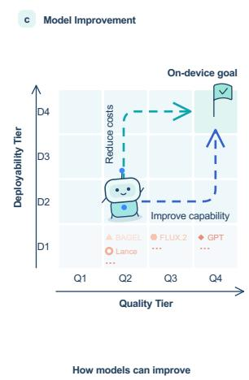

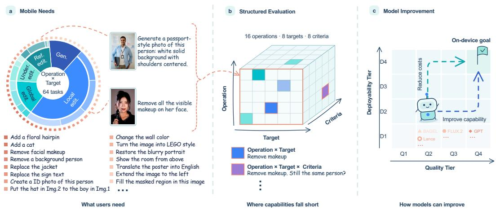  
Figure 1: Overview of our benchmark and evaluation framework: (a) tasks grounded in mobile user needs; (b) structured capability evaluation along operation, target and criteria axes; and (c) model improvement guided by the Quality-Deployability map.

A request such as removing text from a picture specifies both an action and the visual content it concerns. We define the requested action, such as removal or replacement, as the operation, and the type of visual content to generate or modify as the target. Integrating more general application categories such as Text Editing can extend coverage of mobile scenarios but does not always make the task coverage explicit. For example, Text Editing can include both text removal and text replacement, so a high category score of Text Editing does not establish proficiency in both operations. Conversely, removing text and removing a person share the same operation applied to different targets. Grouping scores only by application category makes it difficult to compare removal capability across targets and between on-device and server-side models. We therefore in troduce MoI-Bench, a Mobile Image generation and editing Benchmark grounded in a user survey of mobile application needs. Fig. 1 illustrates how we connect these needs to structured capability evaluation and model improvement. We define most operations following prior works Jiang et al. (2026); Jia et al. (2026), then use a user survey to identify priority target categories for mobile applications. It defines 16 operations and eight target categories as two orthogonal axes of an Operation × Target Task Matrix. Applicable combinations are manually reviewed, yielding 64 subtask comprising 1150 samples. This organization supports comparisons between operations for the same target and between targets for the same operation, helping developers assess the requests relevant to their applications.

Task performance alone does not explain which output requirements a model fails to satisfy. When asked to remove a specified person from a group portrait, a model may remove the wrong person, alter the remaining people’s identities or leave visible artifacts. Then we propose MoI-Eval, which associates each subtask with applicable criteria (i.e., instruction following, visual quality and detail preservation) in a sparse Operation × Target × Criteria Rubric Cube. Based on these criteria, we develop detailed questions for each sample to evaluate models’ outputs and aggregate their scores into overall quality Q and capability profiles along operation, target and criteria. Joint Operation × Target profiles show performance on specific requests, while criterion profiles help researchers identify whether improvements are needed in instruction following, visual quality or preservation of existing details.

For mobile applications, output quality must also be considered alongside deployment costs. Even high-quality models are unsuitable for on-device use if their memory requirements exceed device capacity. We therefore retain quality Q and deployability D as separate dimensions in a Quality-Deployability capability map. The quality dimension considers the overall score Q, task coverage and criterion-group scores, while the deployability dimension considers end-to-end latency, peak memory and deployed model size. Based on these measurements, we define quality tiers and deployability tiers and use them to construct a Quality-Deployability capability map. The map positions models by capability and resource requirements, helping developers select suitable models and researchers identify priorities for broader task coverage, higher output quality or lower deployment costs.

We evaluate 19 generative models and measure text-to-image deployment costs on iOS and Android devices. Our results first show that MoI-Bench provides finer-grained and clearer guidance for model improvement. For example, Ovis-U1 Wang et al. (2025a) achieves comparable performance with FLUX.2 [klein] Black Forest Labs (2026) on text removal but falls far behind on text replacement. This challenges the assumption that compact models perform poorly across all text-related tasks and suggests that improving specific tasks (e.g., text replacement) should take priority over text editing in general. This distinction also helps users select models for their intended purposes. Criterion profiles further distinguish on-device models’ development priorities: DreamLite Feng et al. (2026a) shows weaknesses in visual integrity and coherence, whereas Ovis-U1 has a lower identity-preservation score. Additionally, our findings suggest that broadening task coverage deserves greater attention than further optimizing mobile deployment efficiency. Models such as BlazeEdit Deng et al. (2026) and Moebius Duan et al. (2026) support only a single editing task, while even more general editing models such as DreamLite Feng et al. (2026a) lack support for multiple input images. Mobile-O and DreamLite both reach D3 on the iPhone 17 Pro, but their reference quality tiers are Q1 and Q2, respectively. Further progress therefore requires improving editing quality and expanding task coverage while preserving resource efficiency. The task-dependent capability gaps also motivate exploring on-device–cloud routing, with requests assigned according to model capability and deployment constraints.

In summary, our contributions are:

• We introduce MoI-Bench, a benchmark for on-device image models, built on an Operation × Target Task Matrix. Its 1,150 samples span 64 subtasks designed around mobile application needs, covering image generation and four types of editing operations.

• We propose MoI-Eval, which derives overall quality Q and capability profiles along the operation, target, and criteria axes from a sparse Operation × Target × Criteria Rubric Cube. It further introduces, to the best of our knowledge, the first unified Quality-Deployability capability map for benchmarking models instead of a single score.

• We benchmark representative generative models and further examine Quality-Deployability trade-offs for on-device models through measurements on iOS and Android devices. We release the license-audited benchmark annotations, inference code and evaluation toolkit.

## 2 RELATED WORK

On-device Diffusion Models. Mobile diffusion models face constraints in storage, memory, computation and operator support. Existing work addresses these constraints through graph optimization and compression Chen et al. (2023); Choi et al. (2023), pruning and distillation Li et al. (2023); Zhao et al. (2024b); Castells et al. (2024); Chen et al. (2025a); Chavhan et al. (2026); Hu et al. (2026); Du et al. (2026); Feng et al. (2024), and low-bit quantization Zhao et al. (2024a); Li et al. (2024b). Recent systems improve generation efficiency and extend capabilities to understanding and editing Shaker et al. (2026); Feng et al. (2026a); Deng et al. (2026); Kodavanti et al. (2026); Duan et al. (2026). These advances motivate a unified evaluation of model quality and mobile deployability.

Benchmarks for image generation and editing. Generation benchmarks assess prompt alignment, compositional reasoning and visual correctness Saharia et al. (2022); Hu et al. (2023); Huang et al. (2025); Ghosh et al. (2023); Bakr et al. (2023); Lee et al. (2023); Li et al. (2024a); Wu et al. (2024); Wang et al. (2025b). Editing benchmarks evaluate instruction following and content preservation across increasingly diverse tasks Zhang et al. (2023); Ju et al. (2023); Ma et al. (2024); Qian et al. (2025); Liu et al. (2025); Jia et al. (2026); Wu et al. (2026c); Ye et al. (2026); Yi et al. (2026); Jiang et al. (2026). Unified suites cover generation, editing and reference-conditioned tasks Ku et al. (2024b); Pan et al. (2025); Hua et al. (2025); Sani et al. (2026). MoI-Bench organizes tasks by operation and target for task-specific analysis and, to our knowledge, is the first benchmark to jointly evaluate the quality and deployability of on-device image diffusion models.

Table 1: The Operation × Target Task Matrix of MoI-Bench. Each cell describes the corresponding task. Merged cells indicate tasks shared across target categories; N/A marks combinations excluded from the benchmark.
<table><tr><td rowspan=2 colspan=2>TargetOperation</td><td rowspan=1 colspan=1>General</td><td rowspan=1 colspan=1>Objects</td><td rowspan=2 colspan=1>Animals</td><td rowspan=1 colspan=1></td><td rowspan=1 colspan=2>Portr</td><td rowspan=1 colspan=2>aits</td><td rowspan=1 colspan=2></td><td rowspan=2 colspan=1>Text &amp; Docs.</td></tr><tr><td rowspan=1 colspan=1>Concrete Obj.</td><td rowspan=1 colspan=1>Abstract Obj.</td><td rowspan=1 colspan=1>Body &amp; limbs</td><td rowspan=1 colspan=2>Face &amp; hair</td><td rowspan=1 colspan=2>Clothing &amp; Accs.</td><td rowspan=1 colspan=2>Multi-subjects</td></tr><tr><td rowspan=1 colspan=1>Geen,</td><td rowspan=1 colspan=1>T2I</td><td rowspan=1 colspan=1>Object generation</td><td rowspan=1 colspan=1>Abstract visuals /wallpaper</td><td rowspan=1 colspan=1>Animal / petgeneration</td><td rowspan=1 colspan=1>Full-body portraits</td><td rowspan=1 colspan=2>Portrait close-ups</td><td rowspan=1 colspan=2>Outfit and accessory /fashion generation</td><td rowspan=1 colspan=2>Group portraits</td><td rowspan=1 colspan=1>Posters, memes,images with text</td></tr><tr><td rowspan=4 colspan=1>Locl eedi.</td><td rowspan=1 colspan=1>Add</td><td rowspan=1 colspan=1>Add an object</td><td rowspan=1 colspan=1>Add lighting, effects,shadows, etc.</td><td rowspan=1 colspan=1>Add an animal / pet</td><td rowspan=1 colspan=1>N/A</td><td rowspan=1 colspan=2>Add makeup, hairstyle,etc.</td><td rowspan=1 colspan=2>Add clothing, glasses,masks, earrings, etc.</td><td rowspan=1 colspan=2>Position-aware additionwithin a group</td><td rowspan=1 colspan=1>Add text</td></tr><tr><td rowspan=1 colspan=1>Remove</td><td rowspan=1 colspan=1>Remove anobject</td><td rowspan=1 colspan=1>Remove highlights,reflection, shadows</td><td rowspan=1 colspan=1>Remove an animal</td><td rowspan=1 colspan=1>N/A</td><td rowspan=1 colspan=2>Remove makeup, acne,wrinkle, etc.</td><td rowspan=1 colspan=2>Remove clothingor accessories</td><td rowspan=1 colspan=2>Position-aware removalwithin a group</td><td rowspan=1 colspan=1>Remove text</td></tr><tr><td rowspan=1 colspan=1>Replace</td><td rowspan=1 colspan=1>Replace an object</td><td rowspan=1 colspan=1>N/A</td><td rowspan=1 colspan=1>Replace an animal</td><td rowspan=1 colspan=1>N/A</td><td rowspan=1 colspan=2>Replace hairstyle,makeup, facial identity</td><td rowspan=1 colspan=2>Replace clothing oraccessories</td><td rowspan=1 colspan=2>Replace within a group</td><td rowspan=1 colspan=1>Replace text</td></tr><tr><td rowspan=1 colspan=1>Adjust</td><td rowspan=1 colspan=1>Adjust objectattributes</td><td rowspan=1 colspan=1>Adjust position,lighting, etc.</td><td rowspan=1 colspan=1>Adjust fur, pose,etc.</td><td rowspan=1 colspan=1>Adjust body shape,pose, etc.</td><td rowspan=1 colspan=2>Adjust facial attributes,expression, retouching</td><td rowspan=1 colspan=2>Adjust clothing oraccessories</td><td rowspan=1 colspan=2>Adjust within a group</td><td rowspan=1 colspan=1>Adjust font, size,layout, etc.</td></tr><tr><td rowspan=4 colspan=1>Glol bdit.</td><td rowspan=1 colspan=1>Style</td><td rowspan=1 colspan=1>Apply a visual style</td><td rowspan=1 colspan=2>across the image</td><td rowspan=1 colspan=8></td></tr><tr><td rowspan=1 colspan=1>BG edit</td><td rowspan=1 colspan=11>Modify the background while retaining the foreground</td></tr><tr><td rowspan=1 colspan=1>Restore</td><td rowspan=1 colspan=3>Restore image clarity and detail (denoise, deblur, removemoiré or watermarks, colorize or upscale)</td><td rowspan=1 colspan=6>Restore portrait quality (remove shadows, blur, overexposure or other degradation)</td><td rowspan=1 colspan=2>Restore document clarity</td></tr><tr><td rowspan=1 colspan=1>View</td><td rowspan=1 colspan=9>Change the camera angle or viewpoint</td><td rowspan=1 colspan=2>Correct doc perspective /extract page for PDF</td></tr><tr><td rowspan=3 colspan=1>Uunder</td><td rowspan=1 colspan=1>Semantic</td><td rowspan=1 colspan=3>Edit from commonsense or causal context</td><td rowspan=1 colspan=6>Expression or age editing that requires semantic understanding</td><td rowspan=1 colspan=2>Translate text or documents</td></tr><tr><td rowspan=1 colspan=1>Outpaint</td><td rowspan=1 colspan=3>Extend the image beyond its original boundaries</td><td rowspan=1 colspan=8></td></tr><tr><td rowspan=1 colspan=1>Inpaint</td><td rowspan=1 colspan=3>Reconstruct an image partially obscured by one or more masks</td><td rowspan=1 colspan=8></td></tr><tr><td rowspan=4 colspan=1>Re Ed,.</td><td rowspan=1 colspan=1>R1</td><td rowspan=1 colspan=1>Recreate areference object</td><td rowspan=1 colspan=1>N/A</td><td rowspan=1 colspan=1>Recreate areference animal</td><td rowspan=1 colspan=1>N/A</td><td rowspan=1 colspan=1>Identity-basedportraíts</td><td rowspan=1 colspan=2>Extract clothing oraccessories</td><td rowspan=1 colspan=2>Recreate areference group</td><td rowspan=1 colspan=2>Reference-based document/poster design</td></tr><tr><td rowspan=1 colspan=1>B1+R1</td><td rowspan=1 colspan=1>Transfer anobject</td><td rowspan=1 colspan=1>Transfer visual style</td><td rowspan=1 colspan=1>Transfer an animal</td><td rowspan=1 colspan=1>Transfer a pose</td><td rowspan=1 colspan=1>Transfer identity,hair or makeup</td><td rowspan=1 colspan=2>Transfer clothing oraccessories</td><td rowspan=1 colspan=2>Insert a referenceperson</td><td rowspan=1 colspan=2>Transfer typography or layout</td></tr><tr><td rowspan=1 colspan=1>B1+R2</td><td rowspan=1 colspan=11>Combine two role-specific references in one base image</td></tr><tr><td rowspan=1 colspan=1>B1+R3</td><td rowspan=1 colspan=11>Combine three role-specific references in one base image</td></tr></table>

## 3 MOI-BENCH

MoI-Bench organizes tasks through an Operation × Target Task Matrix. Operations specify what the model should do, and targets identify the visual content to generate or modify. Applicable combinations define subtasks of the form “Operation on Target”.

To better align the benchmark with real-world mobile user needs, we survey 1,000 participants to guide task scope and target coverage. As shown in Fig. 2(a), portrait retouching, object removal, photo restoration and text editing are the most common desired uses. These preferences motivate an emphasis on image editing, while text-to-image generation is retained to assess models’ basic image-generation capabilities. The reported use cases guide our selection of targets and operations, whose applicable combinations define subtasks such as blemish adjustment and photobomb removal. User priorities motivate criteria for instruction following, identity preservation and visual quality. We refine these requirements into task-specific criteria and sample-level evaluation questions. Preferences for quick results, low storage use and avoiding device slowdown further motivate our deployment measurements of latency, model size and peak memory. Survey details are provided in the Appendix A.1.

## 3.1 OPERATION × TARGET TASK MATRIX

Operation taxonomy. Following prior taxonomies Yu et al. (2025); Ye et al. (2026), we organize 16 operation units into five groups (Tab. 1):

• Generation. Creating an image from a prompt without an input image. Tasks specify the desired subjects, attributes, composition and style. Generation conditioned on a reference image is assigned to Reference Editing.

• Local Editing. Adding, removing, replacing or adjusting specified content while preserving unrelated regions. Addition introduces new content, while removal deletes selected content and reconstructs the exposed region. Replacement substitutes content, such as replacing a hairstyle or a word. Adjustment changes attributes of existing content, such as color, size, position or pose.

• Global Editing. Changing overall appearance or scene context through stylization, background modification, restoration or camera-view changes. Stylization applies a visual style across the image, while background modification changes the surroundings and preserves the foreground subject. Restoration addresses degradation such as blur, noise or overexposure, including localized defects. Camera-view changes alter the viewing perspective rather than individual object positions.

• Understanding Editing. Inferring the required change or completing content from semantic and visual context. Semantic editing requires interpreting an intended outcome rather than an explicitly prescribed visual change, such as showing what happens to ice cream left in the sun. Inpainting reconstructs missing content within a supplied mask using the surrounding image. Outpainting extends content beyond the original image boundaries while maintaining scene consistency.

• Reference Editing. Using reference images to specify desired content or attributes, such as identity, pose, clothing or style. Following prior work Oshima et al. (2026), we organize these tasks by input configuration. A single reference without a base image guides the generation of a new image. A base image with one reference supports transferring specified content or attributes into the base image. Configurations with two or three references combine information from multiple sources, with each reference assigned a role in the instruction.

Target taxonomy. To reflect mobile application needs, we include Animals, Portraits, and Text & Documents alongside General Objects. Targets are categorized by the primary visual content to generate or modify, rather than every entity present in the image. These four groups contain eight target categories.

• General Objects. This group contains Concrete Objects and Abstract Objects. Concrete Objects include vehicles, furniture and everyday items. Abstract Objects cover visual effects and relations, such as lighting, shadows and reflections.

• Animals. This category covers animals, including pets, their appearance and their accessories. Tasks include generating animals, modifying their pose or fur, and adding or removing accessories such as collars.

• Portraits. This group contains four categories: Body & Limbs, Face & Hair, Clothing & Accessories, and Multi-Subjects. Body & Limbs covers body shape, limb configuration and pose. Face & Hair covers facial features, expressions, makeup, hairstyles and identity. Clothing & Accessories covers garments and worn items, such as coats, glasses and jewelry. Multi-Subjects covers groups of people, including group-level changes and edits to selected individuals within a group. Examples include adding or removing a person and changing the pose of a specified individual while preserving the others.

• Text & Documents. This category covers text content and its visual presentation in documents, posters, signs and other text-bearing images. Tasks include adding, removing, replacing or translating text, as well as modifying typography and layout. It also includes restoring document clarity and correcting page perspective.

Task coverage. We construct subtasks by pairing operations with target categories. For example, Replacement × Text & Documents replaces specified text while retaining the surrounding content and layout. We also manually review the applicability of each operation × target combination. For example, Addition × Body & Limbs is marked N/A because adding anatomical parts falls outside our portrait-editing scope. Operations are adapted to practical target-specific needs (e.g., camera-view editing becomes perspective rectification for documents rather than viewpoint changes in general scenes). We also group target categories under a shared subtask when they follow the same task definition (e.g., stylization of the whole image). Reference editing with two or three reference images also uses shared subtasks to combine information from multiple sources. Each merged cell counts as one subtask, yielding 64 subtasks in total (Tab. 1). Detailed task descrip tions and examples are provided in the Appendix A.2.

## 3.2 DATASET CONSTRUCTION AND QUALITY CONTROL

Sample construction. Following ImgEdit-Bench Ye et al. (2026), we construct samples through subtask-level allocation, image selection and instruction refinement. Within each subtask, we first identify the specific transformations and target variations to cover and assign an initial sample quota.

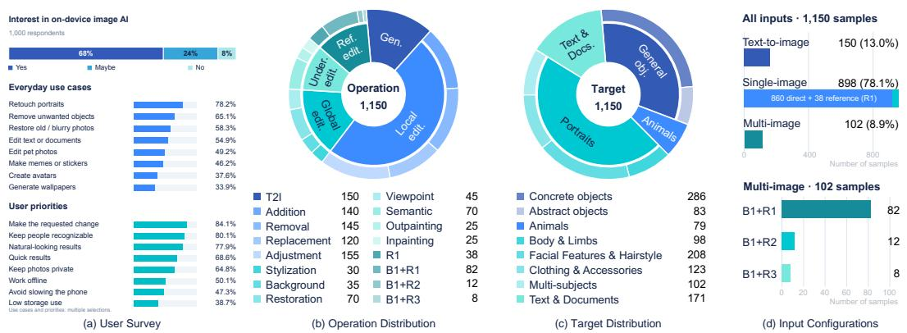  
Figure 2: (a) Survey responses on interest in on-device image AI, everyday use cases and user priorities. (b–d) Sample distributions by operation, target and input configuration. Each sample is assigned to one target category according to the primary visual content to generate or modify.

For example, (B1 + R1)× Face&Hair includes hairstyle, makeup and facial identity transfer. We allocate approximately five samples to each transformation, giving 15 samples for this subtask. These quotas guide image collection and are adjusted after reviewing image and instruction diversity

Subsequently, we retrieve input and reference images from Pexels and Wikimedia Commons. Images are selected to provide the visual information needed for the requested task, such as visible facial features for makeup editing or readable text for text replacement. For reference editing, we review the base and reference images together to ensure that the specified transfer is feasible and that each image has a clear role. For inpainting and restoration, we apply predefined masks or degradations to the source images. All evaluated models receive the same processed inputs.

Given the subtask and selected images, Gemini 3.1 Pro Google (2026) proposes instruction templates. We manually select and adapt these templates to each sample, specifying the requested change, its target and any content that should remain unchanged. For tasks with multiple input images, instructions also identify the role of each reference. Text-to-image samples contain only prompts describing the desired image, without input images. Two annotators cross-review each sample for instruction clarity, task feasibility and consistency with the input images. They also check for duplicates and review visual and instruction diversity within each subtask. The final subtask sample counts are provided in Tab. 14 in the Appendix A.2.

Quality control. Following prior work Ye et al. (2026); Jiang et al. (2026); Zhang et al. (2023), two annotators cross-review each sample for instruction clarity, task feasibility and image–instruction consistency. They check whether the instruction clearly identifies the requested change and its target, and whether the input images provide the information needed to perform the task. For reference editing, they inspect all inputs together and check that the role of each reference is clearly specified. For text-to-image generation, they review the prompt for clarity and consistency with the assigned subtask. We also check for duplicate samples and review visual and instruction diversity within each subtask. This review informs instruction refinement and adjustments to sample allocation.

## 3.3 BENCHMARK STATISTICS AND COMPARISON

Task Distribution MoI-Bench contains 1150 samples across 64 subtasks defined by the Operation × Target Task Matrix (Tab. 1). Fig. 2(b–c) summarizes the sample distribution along the operation and target axes. Local editing forms the largest operation group, with 560 samples covering addition, removal, replacement and adjustment.

Some subtasks span multiple target categories. For target statistics, we assign each sample to a single category according to the primary visual content to generate or modify. Portraits form the largest target group, consistent with the emphasis on portrait-related needs identified in our user survey.

Input Configurations As shown in Fig. 2(d), MoI-Bench includes 150 text-to-image samples, 898 single-image samples and 102 multi-image samples. Single-image samples comprise 860 directediting cases and 38 reference-only cases. Multi-image samples use one base image with one, two or three reference images, comprising 82, 12 and 8 cases, respectively. We limit reference inputs to three images to keep the benchmark focused on mobile use under resource constraints.

Table 2: Task coverage across generation and editing benchmarks. Except for T2I, task columns describe editing tasks and may overlap. ✓: documented coverage; ×: outside the stated scope. Act., Pos., Impl. denote action, object-position or spatial-relation changes, implicit editing respectively; Max. Refs counts reference images excluding the base image and MT denotes multi-turn editing. aImgEdit-Bench includes training and evaluation prompts.
<table><tr><td rowspan="2">Benchmark</td><td rowspan="2">Size</td><td rowspan="2"></td><td colspan="6">Task coverage</td><td rowspan="2" colspan="2"></td><td rowspan="2">Max. Refs MT</td></tr><tr><td>T2I Loc. Glob. Act. Pos. View Impl. Multi-obj.</td><td></td><td></td><td></td><td></td><td></td></tr><tr><td colspan="10"></td></tr><tr><td>Text-to-image benchmarks GenEval Ghosh et al. (2023)</td><td>553√</td><td></td><td></td><td>X</td><td>× X</td><td>X</td><td>×</td><td>X</td><td>0</td><td>×</td></tr><tr><td>GenAI-Bench Li et al. (2024a)</td><td>1,600</td><td>√</td><td>× X</td><td>X</td><td>X</td><td>X X</td><td>X</td><td>X</td><td></td><td>X</td></tr><tr><td>Qwen-Image-Bench Li et al. (2026)</td><td>1,000</td><td>√</td><td>×</td><td>X</td><td>X X</td><td>X</td><td>X</td><td>X</td><td>0 0</td><td>×</td></tr><tr><td></td><td></td><td></td><td></td><td></td><td></td><td></td><td></td><td></td><td></td><td></td></tr><tr><td colspan="10">General image-editing benchmarks</td></tr><tr><td>AnyEdit-Test Yu et al. (2025)</td><td>1,250 ×</td><td>L</td><td></td><td>√</td><td>√ L</td><td>√</td><td>√</td><td>X</td><td>0</td><td>X</td></tr><tr><td>ImgEdit-Bench Ye et al. (2026)</td><td>811</td><td>×</td><td>√</td><td>√</td><td>L</td><td>X X</td><td>V</td><td>√</td><td>0</td><td>√</td></tr><tr><td>GEdit-Bench Liu et al. (2025)</td><td>606</td><td>×</td><td>√</td><td>√</td><td>√</td><td>X ×</td><td>X</td><td>X</td><td>0</td><td>X</td></tr><tr><td>KontextBench Labs et al. (2025)</td><td>1,026</td><td>×</td><td>√</td><td>√</td><td>√ √</td><td>√</td><td>√</td><td>√</td><td>1</td><td>X</td></tr><tr><td>GEditBench v2 Jiang et al. (2026)</td><td>1,200</td><td>×</td><td>√</td><td>√</td><td>√ √</td><td>√</td><td>√</td><td>√</td><td>1</td><td>X</td></tr><tr><td>CompBench Jia et al. (2026)</td><td>&gt;3,000</td><td>×</td><td>√</td><td>」</td><td>√ 5</td><td>√</td><td>√</td><td>√</td><td>0</td><td>√</td></tr><tr><td>Edit-Compass Bai et al. (2026)</td><td>2,388</td><td>×</td><td>√</td><td>√</td><td>√ √</td><td>√</td><td>√</td><td>√</td><td>2</td><td>X</td></tr><tr><td colspan="10">Reference-conditioned benchmarks</td></tr><tr><td>OmniContext Wu et al. (2026a)</td><td>400</td><td>× √</td><td></td><td>√</td><td>√ √</td><td>X</td><td>X</td><td>√</td><td>2</td><td>X</td></tr><tr><td>MultiBanana Oshima et al. (2026)</td><td>3,769</td><td>X</td><td>√</td><td>V</td><td>√ V</td><td>√</td><td>√</td><td>√</td><td>8</td><td>X</td></tr><tr><td>MICON-Bench Wu et al. (2026b)</td><td>1,043</td><td>X</td><td>√</td><td>√</td><td>√ √</td><td>X</td><td>√</td><td>√</td><td>2</td><td>X</td></tr><tr><td colspan="10">Specialized editing benchmarks</td></tr><tr><td>RefEdit-Bench Pathiraja et al. (2025)</td><td>200 ×</td><td>√</td><td>√</td><td>1</td><td>L</td><td>X</td><td>X</td><td>√</td><td>0</td><td>×</td></tr><tr><td>TextEditBench Gui et al. (2025)</td><td>1,196</td><td>× √</td><td></td><td>X</td><td>X 」</td><td></td><td>√</td><td></td><td>0</td><td>×</td></tr><tr><td colspan="10">Generation and editing benchmarks</td></tr><tr><td>ICE-Bench Pan et al. (2025)</td><td>6,538√</td><td>L</td><td></td><td>√</td><td>√ X</td><td>×</td><td>X</td><td>√</td><td></td><td></td></tr><tr><td>MoI-Bench</td><td>1,150√</td><td>L</td><td></td><td>√</td><td>√ 了</td><td>√</td><td>√</td><td>√</td><td>1 3</td><td>X X</td></tr></table>

Comparison with existing benchmarks. We summarize task categories used in prior benchmarks to define the comparison dimensions in Tab. 2. These dimensions cover text-to-image generation, local and global editing, pose and spatial changes, viewpoint changes, implicit editing and multiobject editing. We also compare input configurations, including the maximum number of reference images and support for multi-turn editing. MoI-Bench covers text-to-image generation and editing tasks ranging from local modifications to implicit and multi-object edits, with up to three reference images. Its distinguishing features are the Operation × Target organization, task-specific quality criteria, and joint assessment of quality and mobile deployability. We exclude multi-turn editing because our user survey indicates lower demand for this interaction pattern in mobile applications.

## 4 MOI-EVAL

## 4.1 QUALITY RUBRIC CUBE

We extend the Operation × Target Task Matrix with a criteria axis to form a Quality Rubric Cube. Each applicable cell specifies the evaluation requirements for an operation × target combination under one criterion.

Evaluation criteria. Following ImgEdit-Bench Ye et al. (2026), we organize evaluation into three criterion groups: instruction following, visual quality and detail preservation. These groups contain eight criteria that form the third axis of the rubric cube:

• Instruction Following $( I F ) { : }$ It assesses whether the output satisfies the requested operation and its constraints. Fidelity checks whether the intended outcome is achieved, including specified attributes, relations and reference conditions. Selection checks whether the operation targets the correct region or instance, such as the leftmost person in a group rather than another person.

• Visual Quality $( V Q ) { \mathrm { : } }$ It assesses the visual quality of the generated or edited image. Integrity checks whether generated or modified content has complete shapes and is free from distortions, malformed parts and artifacts. Coherence checks consistency within the output and between edited regions and their surroundings, including boundaries, textures and lighting. Presentation assesses whole-image quality, including readability, composition and physical plausibility.

• Detail Preservation (DP): It assesses whether content and attributes outside the requested change remain preserved. Context checks non-target objects, animals and background details. Structure checks framing and spatial relations, including poses and positions that should remain unchanged. Given the demand for identity preservation in our user survey, Identity explicitly checks human identity and appearance features not targeted by the instruction. Preservation requirements exclude changes requested by the user; for example, hairstyle replacement should preserve facial identity but not the original hairstyle.

Task-specific rubrics. For each subtask, we define task-specific requirements and scoring rules for the applicable criteria. Each rubric entry $( o , t , c )$ corresponds to operation $^ { O , }$ target t and criterion c. For example, Removal × Multi-Subjects × Identity checks whether the remaining people’s identities are preserved after removing the specified person.

We then manually mark each entry as always applicable, sample-dependent, or not applicable. For text-to-image generation, all three DP criteria are inapplicable because no source image is provided. For object editing, Identity is sample-dependent and applies only when the input contains people whose identities should be preserved. These applicability labels define the sparse rubric cube. For each sample, we include always-applicable entries and resolve sample-dependent entries using its instruction and input images. Non-applicable entries are excluded from evaluation.

Sample-grounded questions. Following question-based evaluation methods $( e . g .$ , TIFA Hu et al. (2023)), we specify evaluation requirements as questions about whether the output satisfies them. For sample $s ,$ we construct a question set $\mathcal { Q } _ { s , c }$ for each applicable criterion:

$$
\mathcal { Q } _ { s , c } = G ( R _ { o _ { s } , t _ { s } , c } , p _ { s } , \mathcal { T } _ { s } ) , \qquad c \in \mathcal { C } _ { s } ,\tag{1}
$$

where $o _ { s }$ and $t _ { s }$ denote the operation and target category of sample $s , R _ { o _ { s } , t _ { s } , c }$ is the rubric for criterion $c , p _ { s }$ is the instruction, and $\mathcal { T } _ { s }$ contains the input images. $\mathcal { T } _ { s }$ is empty for text-to-image generation. $\mathcal { C } _ { s }$ contains the criteria applicable to sample s. G denotes question construction using a VLM $( i . e .$ , Gemini-3.1-pro Google (2026)), followed by manual review. For example, removing the leftmost person from a group portrait yields an Identity question: “Do the remaining people retain their original identities $\gamma ^ { \ast }$ Two annotators cross-review each sample to confirm rubric applicability and ensure that its questions match the instruction and input images without duplicating requirements. Each question includes task-specific conditions for full, partial and failed outcomes, constructed without access to model outputs. The finalized questions and scoring conditions are shared across all evaluated models and judges.

## 4.2 QUALITY SCORING AND CAPABILITY PROFILES

We aggregate question-level judgments into overall quality Q and capability profiles by operation, target and evaluation criterion.

Scoring and aggregation. We use GPT-4o Hurst et al. (2024) as the primary VLM judge to evaluate each question against the model output, using the instruction and input images as needed. We additionally evaluate with Gemini-3.1-pro Google (2026) under the same protocol. We adopt the three-level score mapping of Qwen-Image-Bench Li et al. (2026), normalized to {0, 0.6, 1}. For binary requirements, only scores of 0 and 1 apply. Under our rubrics, these scores indicate unmet, partially met and fully met requirements, respectively. For sample s, let $z _ { s , c }$ denote the score for criterion c and $v _ { s , k }$ the score for criterion group $k \in \{ \mathrm { I F } , \mathrm { V Q } , \mathrm { D \bar { P } } \}$

Table 3: Quality and deployability tiers. All listed requirements must be satisfied, with higher tiers taking precedence. $C _ { 0 . 6 }$ denotes the proportion of subtasks with mean quality scores of at least 0.6. The group requirement applies to each of IF, VQ and DP. Q4 and D4 are the highest tiers. D2– D4 require successful generation of valid outputs on the target device. — indicates no additional constraint.
<table><tr><td colspan="2">Quality</td><td colspan="2">Deployability</td></tr><tr><td>Tier Overall Q Coverage</td><td> $C _ { 0 . 6 }$  Each group</td><td></td><td>Tier Size (MiB) E2E (s) Memory (MiB)</td></tr><tr><td>Q4  $\geq 0 . 9 0$ </td><td> $\geq 9 0 \%$ </td><td> $\geq 0 . 9 0$  D4</td><td> $\leq 1 , 0 2 4$   $\leq 2$   $\leq 2 { , } 0 4 8$ </td></tr><tr><td>Q3</td><td> $\geq 0 . 7 0$   $\geq 6 0 \%$ </td><td> $\geq 0 . 6 0$  D3</td><td> $\leq 2 { , } 0 4 8$   $\leq 3 0$   $\leq 4 { , } 0 9 6$ </td></tr><tr><td>Q2</td><td> $\geq 0 . 3 0$ </td><td>D2</td><td></td></tr><tr><td>Q1  $< 0 . 3 0$ </td><td></td><td>D1</td><td>Unavailable Deployment</td></tr></table>

$$
z _ { s , c } = \frac { 1 } { | \mathcal { Q } _ { s , c } | } \sum _ { q \in \mathcal { Q } _ { s , c } } r _ { s , q } , \qquad v _ { s , k } = \frac { 1 } { | \mathcal { C } _ { s , k } | } \sum _ { c \in \mathcal { C } _ { s , k } } z _ { s , c } ,\tag{2}
$$

where $\boldsymbol { r } _ { s , q }$ is the question-level score and $\mathcal { C } _ { s , k }$ contains the applicable criteria in group k for sample s. Non-applicable criteria are excluded, and applicable criteria receive equal weight within each group regardless of question counts. Following prior uses of geometric aggregation Ku et al. (2024a); Kamath et al. (2025), we compute the sample quality score $u _ { s }$ as a weighted geometric mean of its criterion-group scores.

$$
u _ { s } = \prod _ { k \in \mathcal { K } _ { s } } v _ { s , k } ^ { \widetilde { w } _ { s , k } } , \qquad \widetilde { w } _ { s , k } = \frac { w _ { s , k } } { \sum _ { \ell \in \mathcal { K } _ { s } } w _ { s , \ell } } ,\tag{3}
$$

where $\kappa _ { s }$ contains the applicable criterion groups and $w _ { s , k }$ is a predefined weight for criterion group k, set by task operation and fixed across models. Geometric aggregation limits compensation for poor performance in one criterion group by high scores in others. Only IF and VQ contribute to text-to-image generation. Weight settings are provided in Appendix B.2, and sensitivity abalysis are reported in Appendix D.3.

Overall quality is the mean score over the retained sample set $S _ { m }$ for model m:

$$
Q _ { m } = { \frac { 1 } { | S _ { m } | } } \sum _ { s \in S _ { m } } u _ { s } .\tag{4}
$$

Starting from all 1150 samples, we exclude confirmed generation or judge execution errors. Unsupported tasks receive $u _ { s } = 0$ and remain in $S _ { m }$ . Successfully generated and evaluated outputs retain their scores regardless of quality. Each retained sample contributes equally to $Q _ { m } ,$ , while subtasks contribute in proportion to their retained sample counts.

Capability profiles and Quality tiers. We aggregate the underlying evaluation scores along the operation, target and criteria axes to characterize model capabilities beyond overall quality Q. Operation and target profiles average sample quality scores $u _ { s }$ within each category, using the target assignments defined in Sec. 3. Joint Operation × Target profiles further reveal performance on specific tasks and connect model capabilities to concrete mobile application needs. For example, a user who wants to remove text from a photograph can consult the Removal × Text & Documents score, while replacing the text requires examining the corresponding Replacement score. This distinction supports model selection for individual requests rather than relying on a broad text-editing score.

We also average $v _ { s , k }$ and $z _ { s , c }$ over their applicable samples to obtain profiles for the three criterion groups and eight individual criteria. These profiles help researchers identify the capabilities each model needs to improve within instruction following, visual quality and detail preservation. For example, successful person removal may still involve unintended changes to the remaining people’s identities. Examining Fidelity and Identity separately reveals this difference between completing the requested change and preserving existing details. All profiles follow the same sample inclusion rules as overall quality.

To guide model development towards real mobile user needs, we further define quality tiers that jointly consider output quality, task coverage and performance across criterion groups. A model in the highest tier should produce high-quality outputs across a broad range of tasks and meet minimum requirements in each criterion group. Overall quality alone does not establish this breadth, especially when subtasks contain different numbers of samples. We therefore complement Q with task coverage, defined as the proportion of subtasks whose mean quality reaches a specified thresh old:

$$
C _ { \tau } = \frac { 1 } { | \mathcal T | } \sum _ { j \in \mathcal T } \mathbf { 1 } [ \bar { u } _ { j } \geq \tau ] ,\tag{5}
$$

where $\bar { u } _ { j }$ is the mean quality of subtask $j , \tau$ contains the 64 subtasks, and $\tau = 0 . 6$ . Unlike the sample-averaged score $Q ,$ coverage weights all subtasks equally. It measures how broadly a model meets the quality threshold, rather than simply counting the tasks it supports.

We assign each model the highest qualifying tier from Q1 to Q4 using the joint requirements for $Q ,$ $C _ { 0 . 6 }$ and benchmark-level IF, VQ and DP scores in Tab. 3. Q4 is the highest tier. These requirements distinguish high average quality from broad task coverage and consistent performance across criterion groups, helping identify whether model development should prioritize output quality, task coverage or specific quality requirements.

## 4.3 QUALITY-DEPLOYABILITY MAP

The quality score Q measures output quality but does not account for the time and resources required for mobile inference. We assess deployability using end-to-end latency, peak memory and deployed model size. These metrics capture waiting time, runtime memory usage and storage requirements in mobile use. We therefore present quality and deployability on separate axes in the Quality-Deployability Map.

Deployability measurement. Mobile deployment involves model-specific quantization, operator adaptation and runtime optimization. Differences in model architecture and device support make it difficult to apply an identical optimization procedure across different models. We therefore evaluate the resource costs of deployed configurations from a mobile user’s perspective: storage requirements, waiting time and runtime memory usage. Our protocol accommodates model-specific deployment optimizations and measures the resulting deployment costs using consistent metrics.

A deployment configuration specifies model weights, component precisions, inference settings and runtime. We report three metrics:

• Model Size. Total storage required for standalone inference, including the backbone, image decoder, required encoders and supporting inference files. Shared files are counted once; duplicate artifacts and development files are excluded.

• Inference Latency. End-to-end time covering prompt processing, text encoding, generation, image decoding and post-processing. Initial model loading, warm-up and result-file writing are excluded. Loading and offloading performed during generation remain part of the measured latency.

• Peak Memory. Maximum sampled application memory within each inference run, averaged across runs. We use application physical footprint on iOS and process proportional set size (PSS) on Android, reporting the two platform-specific measurements separately.

Storage and memory are reported in MiB. Failed and unmeasured configurations are distinguished. Devices, workloads, precision settings and measurement procedures are detailed in the experimental setup.

Deployability tiers. Alongside quality tiers, we define deployability tiers D1–D4 using the joint requirements in Tab. 3. D1 denotes unavailable local deployment under the tested conditions, including deployment failure, invalid output, cloud- or API-only access, or a model that is too large for the target device. D2 requires successful execution, while D3 and D4 impose progressively tighter latency, storage and memory limits. D4 is the highest tier, designed to represent responsive mobile inference with modest resource requirements. These tiers assess the deployment outcome achieved by a model and its implementation on a specified device, allowing improvements from hardware and runtime optimization to be reflected in its rating. Thresholds are shared across devices, models and precision settings.

For the baseline comparison, we do not introduce bespoke operator adaptations or additional modelspecific performance optimizations beyond those required to execute the models. Among the evaluated models, DreamLite is the only model for which we successfully deployed editing on-device. We therefore use text-to-image generation as the common deployment task supported by all evaluated on-device models.

Tier threshold calibration. We first manually define initial thresholds for quality and deployability tiers. For quality tiers, we compare assignments obtained from GPT-4o and Gemini 3.1 Pro, identify disagreements, and iteratively adjust the shared thresholds to improve agreement while preserving meaningful distinctions between capability levels. For deployability tiers, we compare assignments for matched deployment configurations on two devices with comparable hardware capabilities and calibrate the shared thresholds to reduce cross-device discrepancies. The resulting thresholds are fixed for all reported comparisons and listed in Tab. 3. Sensitivity analyses are provided in the supplementary material.

Q-D Map construction. Evaluating an on-device model requires considering both quality and deployability. High quality cannot compensate for unsuccessful deployment, while low latency cannot compensate for insufficient task capability. We therefore retain these dimensions as separate axes rather than combining them into a single score. The Quality-Deployability capability map places reference quality tiers from Sec. 4.2 on the horizontal axis and device-specific deployability tiers on the vertical axis. The upper-right region represents the goal of an on-device flagship model, combining high quality, broad task coverage and efficient mobile execution. The lower-right region represents high-quality models with limited mobile deployability, including server-side models accessed through cloud APIs. The map thus indicates whether model development should prioritize quality and task coverage, deployment efficiency, or both.

A complementary scatter plot presents continuous quality scores against end-to-end mobile latency. Color indicates task coverage, and bubble area represents total parameter count. Models without successful mobile inference are displayed separately without latency coordinates. Together, these views show each model’s position and the measured differences behind its tier assignment.

## 5 EXPERIMENTS

## 5.1 EXPERIMENTAL SETUP

Evaluation Models. We evaluate 19 representative models, including 16 open-weight models and three closed-source models. Given the limited availability of lightweight models, we include widely used and recently released larger models as quality references. The evaluated models are listed in Tab. 4. We access GPT Image 2, Nano Banana 2 and Seedream 5.0 Pro through their APIs.

Quality Evaluation. We run open-weight models on NVIDIA A100 GPUs using reference implementations and released checkpoints. Inference follows the default hyperparameters unless otherwise specified. We generate one output per sample and use seed 0 where the implementation supports seed control. We use GPT-4o Hurst et al. (2024) as the primary judge and independently evaluate the same outputs with Gemini 3.1 Pro Google (2026). Both judges use identical samplespecific questions and scoring conditions under the protocol in Sec. 4. Overall results from both judges are presented in Tab. 4. Complete prompts are provided in the Appendix B.2

Deployment Configurations. We evaluate models with fewer than 4B total parameters on an iPhone 17 Pro and a Xiaomi 15 Pro. To simplify and standardize deployment, we use 4-bit quantization for external text encoders and retain the original checkpoint precision for the remaining components. For a subset of models, a comparison with the original configurations shows only minor quality differences and unchanged quality tiers after text-encoder quantization (Appendix B.4). The iOS implementation uses Core ML for image-generation components and MLX for external text encoders. The Android implementation uses ONNX Runtime with the Qualcomm QNN HTP backend for image-generation components and CPU execution for text encoders. DreamLite is the only evaluated model for which we successfully deployed editing on-device, so we use text-to-image generation as the common deployment task. Beyond changes required for execution, we introduce no additional model-specific operator or runtime optimizations. Each successful configuration receives one warm-up run followed by three measured runs. We report mean end-to-end latency and mean per-run peak memory, sampled every 25 ms. Models that cannot be deployed on the target device serve as quality references and receive D1. Results for these configurations are presented in the Tab. 8.

Table 4: Overall quality and task coverage evaluated by GPT-4o and Gemini 3.1 Pro. Tasks indicates support for generation (Gen.), editing (Edit), or both (Both); Both does not imply support for all subtasks. Type denotes the image generation mechanism: diffusion-based (Diff., including flow matching), autoregressive (AR). $\bar { C } _ { 0 . 6 }$ denotes the proportion of subtasks with mean quality scores of at least 0.6. Criterion-group scores are reported as (IF, VQ, DP). Both judges yield the same quality tiers under the thresholds in Tab. 3; Q4 is the highest tier. Within each model group, models are ordered by ascending quality tier and then GPT-4o overall quality.
<table><tr><td rowspan="2">Model</td><td rowspan="2">Tasks Type</td><td rowspan="2"></td><td colspan="3">GPT-40</td><td colspan="3">Gemini 3.1 Pro</td><td rowspan="2">Q-tier</td></tr><tr><td>Q</td><td>C0.6</td><td>(IF, VQ, DP)</td><td>Q</td><td>C0.6</td><td>(IF, VQ, DP)</td></tr><tr><td>Closed-source Models</td><td></td><td></td><td></td><td></td><td></td><td></td><td></td><td></td><td></td></tr><tr><td>Nano Banana 2 Google DeepMind (2026)</td><td>Both</td><td></td><td>0.95</td><td>1.00</td><td>(0.95, 0.97, 0.97)</td><td>0.93</td><td>1.00</td><td>(0.94, 0.96, 0.96)</td><td>Q4</td></tr><tr><td>Seedream 5.0 Pro ByteDance Seed (2026)</td><td>Both</td><td></td><td>0.95</td><td>1.00</td><td>(0.95, 0.97, 0.98)</td><td>0.93</td><td>1.00</td><td>(0.93, 0.97, 0.96)</td><td>Q4</td></tr><tr><td>GPT Image 2 OpenAI (2026)</td><td>Both</td><td></td><td>0.97</td><td>1.00</td><td>(0.97, 0.98, 0.98)</td><td>0.96</td><td>1.00</td><td>(0.96, 0.98, 0.96)</td><td>Q4</td></tr><tr><td>Open-weight Reference Models</td><td></td><td></td><td></td><td></td><td></td><td></td><td></td><td></td><td></td></tr><tr><td>LongCat-Image Team et al. (2025)</td><td>Gen.</td><td>Diff.</td><td>0.12</td><td>0.13</td><td>(0.12, 0.12, 0.00)</td><td>0.12</td><td>0.13</td><td>(0.12, 0.12, 0.00)</td><td>Q1</td></tr><tr><td>Lumina-DiMOO-8B Xin et al. (2025)</td><td>Both</td><td>Diff.</td><td>0.43</td><td>0.23</td><td>(0.48, 0.47, 0.62)</td><td>0.31</td><td>0.14</td><td>(0.42, 0.36, 0.45)</td><td>Q2</td></tr><tr><td>InternVL-U-4B Tian et al. (2026)</td><td>Both</td><td>Diff.</td><td>0.51</td><td>0.36</td><td>(0.61, 0.55, 0.48)</td><td>0.39</td><td>0.22</td><td>(0.57, 0.48, 0.33)</td><td>Q2</td></tr><tr><td>VIBE-Image-Edit Alekseenko et al. (2026)</td><td>Edit</td><td>Diff.</td><td>0.59</td><td>0.56</td><td>(0.64, 0.60, 0.78)</td><td>0.53</td><td>0.47</td><td>(0.58, 0.55, 0.73)</td><td>Q2</td></tr><tr><td>OmniGen2 Wu et al. (2026a)</td><td>Both</td><td>Diff.</td><td>0.62</td><td>0.55</td><td>(0.66, 0.70, 0.73)</td><td>0.54</td><td>0.36</td><td>(0.62, 0.66, 0.65)</td><td>Q2</td></tr><tr><td>BAGEL-7B-MoT Deng et al. (2025)</td><td>Both</td><td>Diff.</td><td>0.64</td><td>0.58</td><td>(0.69, 0.68, 0.77)</td><td>0.60</td><td>0.47</td><td>(0.67, 0.64, 0.77)</td><td>Q2</td></tr><tr><td>LongCat-Image-Edit</td><td>Edit</td><td>Diff.</td><td>0.67</td><td>0.67</td><td>(0.66, 0.70, 0.86)</td><td>0.63</td><td>0.61</td><td>(0.64, 0.70, 0.83)</td><td>Q2</td></tr><tr><td>Lance-3B Fu et al. (2026)</td><td>Both</td><td>Diff.</td><td>0.67</td><td>0.67</td><td>(0.69, 0.74, 0.76)</td><td>0.60</td><td>0.52</td><td>(0.64, 0.69, 0.65)</td><td>Q2</td></tr><tr><td>DeepGen 1.0 Wang et al. (2026)</td><td>Both</td><td>Diff.</td><td>0.69</td><td>0.70</td><td>(0.74, 0.74, 0.70)</td><td>0.57</td><td>0.44</td><td>(0.69, 0.66, 0.52)</td><td>Q2</td></tr><tr><td>FLUX.2 [klein] 4B Black Forest Labs (2026)</td><td>Both</td><td>Diff.</td><td>0.83</td><td>0.91</td><td>(0.82, 0.88, 0.95)</td><td>0.79</td><td>0.78</td><td>(0.79, 0.85, 0.93)</td><td>Q3</td></tr><tr><td>On-device Models (Total Params. &lt; 4B)</td><td></td><td></td><td></td><td></td><td></td><td></td><td></td><td></td><td></td></tr><tr><td>Janus-Pro-1B Chen et al. (2025c)</td><td>Gen.</td><td>AR</td><td>0.08</td><td>0.08</td><td>(0.09, 0.08, 0.00)</td><td>0.08</td><td>0.08</td><td>(0.09, 0.08, 0.00)</td><td>Q1</td></tr><tr><td>Mobile-O-0.5B Shaker et al. (2026)</td><td>Gen.</td><td>Diff.</td><td>0.10</td><td>0.11</td><td>(0.10, 0.10, 0.00)</td><td>0.09</td><td>0.09</td><td>(0.10, 0.10, 0.00)</td><td>Q1</td></tr><tr><td>SANA-Sprint-0.6B Chen et al. (2025b)</td><td>Gen.</td><td>Diff.</td><td>0.10</td><td>0.11</td><td>(0.10, 0.10, 0.00)</td><td>0.10</td><td>0.11</td><td>(0.10, 0.10, 0.00)</td><td>Q1</td></tr><tr><td>SANA-600M Xie et al. (2024)</td><td>Gen.</td><td>Diff.</td><td>0.10</td><td>0.11</td><td>(0.11, 0.11, 0.00)</td><td>0.10</td><td>0.11</td><td>(0.11, 0.10, 0.00)</td><td>Q1</td></tr><tr><td>DreamLite Feng et al. (2026a)</td><td>Both</td><td>Diff.</td><td>0.62</td><td>0.64</td><td>(0.65, 0.64, 0.76)</td><td>0.52</td><td>0.42</td><td>(0.62, 0.52, 0.62)</td><td>Q2</td></tr><tr><td>Ovis-U1-3B Wang et al. (2025a)</td><td>Both</td><td>Diff.</td><td>0.66</td><td>0.59</td><td>(0.68, 0.70, 0.72)</td><td>0.54</td><td>0.38</td><td>(0.62, 0.64, 0.51)</td><td>Q2</td></tr></table>

## 5.2 OVERALL QUALITY ANALYSIS

Quantitative Evaluation Tab. 4 reports overall quality and task coverage under both judges. The three closed-source models reach Q4 and meet the task-quality threshold on all 64 subtasks, while FLUX.2 [klein] leads the open-weight models at Q3. Among models below 4B total parameters, DreamLite and Ovis-U1 reach Q2. Ovis-U1 achieves higher overall quality, but DreamLite has higher task coverage under both judges: 0.64 versus 0.59 with GPT-4o, and 0.42 versus 0.38 with Gemini. Generation-only models (i.e., LongCat-Image, SANA, etc.) remain at Q1 because unsupported editing tasks contribute zero; their overall scores therefore reflect limited coverage of this editing-focused benchmark, not generation quality alone.

Higher average quality does not necessarily mean that a model meets the quality threshold on more tasks, making task coverage a complementary considerationfor model selection.

Qualitative Evaluation Fig. 3 compares representative outputs across the five operation groups. DreamLite and Ovis-U1 produce plausible group portraits and visible Lego-style transformations, but neither fully translates the Chinese book title into English, whereas GPT Image 2 produce a readable English title. In reference editing, DreamLite retains a full-body composition despite the headshot instruction, while Ovis-U1 produces the requested framing but changes the person’s appearance. Additional qualitative results are provided in the Appendix C.3.

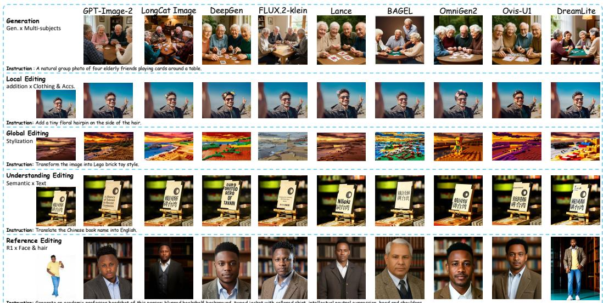  
Instruction: Generate an academic professor headshot of this person: blurred bookshelf background, tweed jacket with col ared shirt, intel ectual neutral expression, head and shoulders.

Figure 3: Qualitative comparison of representative image generation and editing models on MoI-Bench across the five operation groups. Zoom in for better quality.  
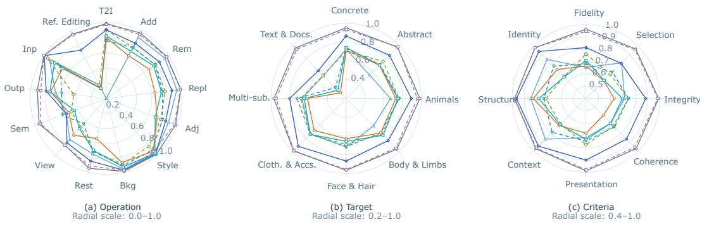  
Figure 4: Capability profiles of representative models across (a) operations, (b) targets and (c) evaluation criteria, scored by GPT-4o. Higher scores indicate better performance. Radial scales differ across subplots.

These examples suggest that compact models need more precise instruction following and better preservation ofreference details alongside their generation and stylization capabilities.

## 5.3 CAPABILITY ANALYSIS

Fig. 4 summarizes the operation, target and criterion profiles of representative models. The profiles show that model strengths vary across these dimensions. We examine these differences below through detailed breakdowns and joint Operation × Target analysis.

Operation-level performance. Tab. 5 shows that compact models are competitive on some operations but remain limited on others. DreamLite and Ovis-U1 achieve stylization scores of 0.93 and 0.97, respectively, close to FLUX.2 [klein]’s 0.97, while larger gaps remain in replacement and restoration. Their relative strengths also vary: Ovis-U1 performs better on removal and inpainting, whereas DreamLite scores higher on adjustment and viewpoint changes. Both models support single-reference tasks but lack support for the evaluated base-plus-reference configurations, indicating a coverage limitation beyond output quality.

Current compact models still lack support for many functions. Broader task support can be an important directionforfuture development.

Table 5: Operation-level quality evaluated by GPT-4o. Scores average sample quality over the retained samples for each operation. Unsupported tasks contribute zero. Add., Rem., Repl. and Adj. denote addition, removal, replacement and adjustment. Style, Bkg., Rest. and View denote stylization, background modification, restoration and viewpoint changes. Sem., Outp. and Inp. denote semantic editing, outpainting and inpainting. R1 uses one reference image and B1+R1– B1+R3 use one base image and one to three references.
<table><tr><td rowspan="2">Model</td><td>Generation</td><td colspan="3">Local Editing</td><td colspan="3">Global Editing</td><td colspan="3">Understand. Editing</td><td colspan="3">Ref. Editing</td></tr><tr><td>T2I</td><td></td><td></td><td>Add. Rem. Repl. Adj. Style Bkg.</td><td></td><td></td><td>. Rest. View</td><td>Sem. Outp.</td><td>Inp.</td><td>R1</td><td>B1+R11</td><td>B1+R2 B1+R3</td><td></td></tr><tr><td colspan="10">Closed-source Models</td><td colspan="3"></td></tr><tr><td>Nano Banana 2</td><td>0.99</td><td>0.94</td><td>0.95</td><td>0.98 0.96</td><td>0.99 0.97</td><td>0.92</td><td>0.80</td><td>0.95 0.95</td><td></td><td>0.99 0.96</td><td>0.93</td><td>0.88</td><td>0.80</td></tr><tr><td>Seedream 5.0 Pro</td><td>0.98</td><td>0.95</td><td>0.96</td><td>0.98 0.96</td><td>0.94 0.97</td><td>0.92</td><td>0.83</td><td>0.93 0.87</td><td>1.00</td><td>0.97</td><td>0.94</td><td>0.90</td><td>0.99</td></tr><tr><td>GPT Image 2</td><td>0.99</td><td>0.97</td><td>0.97</td><td>0.99 0.98</td><td>0.99 0.99</td><td>0.95</td><td>0.82</td><td>0.95 0.92</td><td>1.00</td><td>0.97</td><td>0.96</td><td>0.87</td><td>0.99</td></tr><tr><td colspan="10">Open-weight Reference Models</td><td colspan="3"></td></tr><tr><td>Lumina-DiMOO-8B</td><td>0.86</td><td>0.53</td><td>0.45</td><td>0.450.41</td><td>0.74 0.38</td><td>0.26</td><td>0.23</td><td>0.30</td><td>0.35</td><td>0.38</td><td>0.18</td><td>0.04</td><td>0.00 0.00</td></tr><tr><td>InternVL-U-4B</td><td>0.87</td><td>0.56</td><td>0.39</td><td>0.53 0.54</td><td>0.87 0.75</td><td>0.44</td><td>0.20</td><td>0.45 0.69</td><td>0.57</td><td>0.60</td><td>0.00</td><td>0.00</td><td>0.00</td></tr><tr><td>VIBE-Image-Edit</td><td>0.00</td><td>0.79</td><td>0.87</td><td>0.82 0.79</td><td>0.96 0.90</td><td>0.75</td><td>0.33</td><td>0.58 0.57</td><td>0.87</td><td>0.55</td><td>0.00</td><td>0.00</td><td>0.00</td></tr><tr><td>OmniGen2</td><td>0.83</td><td>0.64</td><td>0.64</td><td>0.67 0.66</td><td>0.88 0.90</td><td>0.41</td><td>0.30</td><td>0.40 0.42</td><td>0.67</td><td>0.54</td><td>0.46</td><td>0.44</td><td>0.24</td></tr><tr><td>LongCat-Image-Edit</td><td>0.00</td><td>0.91</td><td>0.94</td><td>0.94 0.88</td><td>0.97 0.96</td><td>0.75</td><td>0.72</td><td>0.56 0.67</td><td></td><td>0.91</td><td>0.74 0.00</td><td>0.00</td><td>0.00</td></tr><tr><td>Lance-3B</td><td>0.76</td><td>0.76</td><td>0.78</td><td>0.75 0.79</td><td>0.91 0.91</td><td>0.72</td><td>0.45</td><td>0.62 0.59</td><td></td><td>0.74</td><td>0.58 0.00</td><td>0.00</td><td>0.00</td></tr><tr><td>DeepGen 1.0</td><td>0.91</td><td>0.76</td><td>0.79</td><td>0.78 0.77</td><td>0.84 0.89</td><td>0.72</td><td>0.51</td><td>0.49 0.43</td><td>0.94</td><td>0.74</td><td>0.00</td><td>0.00</td><td>0.00</td></tr><tr><td>FLUX.2 [klein] 4B</td><td>0.90</td><td>0.82</td><td>0.85</td><td>0.87 0.84</td><td>0.97 0.97</td><td>0.85</td><td>0.78</td><td>0.57 0.80</td><td>0.99</td><td>0.78</td><td>0.71</td><td>0.61</td><td>0.70</td></tr><tr><td colspan="10">On-device Models</td><td colspan="3"></td></tr><tr><td>Mobile-O-0.5B</td><td>0.74</td><td>0.00</td><td>0.00</td><td>0.00 0.00 0.00</td><td>0.00</td><td>0.00</td><td>0.00</td><td>0.00 0.00</td><td>0.00</td><td>0.00</td><td>0.00</td><td>0.00</td><td>0.00</td></tr><tr><td>SANA-600M</td><td>0.80</td><td>0.00</td><td>0.00</td><td>0.00 0.00</td><td>0.00 0.00</td><td>0.00</td><td>0.00 0.00</td><td>0.00</td><td>0.00</td><td>0.00</td><td>0.00</td><td>0.00</td><td>0.00</td></tr><tr><td>DreamLite</td><td>0.80</td><td>0.64</td><td>0.68</td><td>0.65 0.72</td><td>0.93 0.87</td><td>0.54</td><td>0.65</td><td>0.53 0.74</td><td>0.70</td><td>0.54</td><td>0.00</td><td>0.00</td><td>0.00</td></tr><tr><td>Ovis-U1-3B</td><td>0.82</td><td>0.70</td><td>0.76</td><td>0.73 0.69</td><td>0.97 0.93</td><td>0.70</td><td>0.53</td><td>0.45 0.75</td><td>0.83</td><td>0.56</td><td>0.00</td><td>0.00</td><td>0.00</td></tr></table>

Table 6: Target-level quality evaluated by GPT-4o across the eight target categories. Scores average sample quality using the sample-level target assignments. Unsupported tasks contribute zero, and confirmed execution errors are excluded. Scores are rounded to two decimal places.
<table><tr><td rowspan="2">Model</td><td colspan="2">General Objects</td><td rowspan="2">Animals</td><td colspan="4">Portraits</td><td rowspan="2">Text&amp;Docs.</td></tr><tr><td>Concrete Abstract</td><td></td><td>Body&amp;Limbs Face&amp;Hair Cloth.&amp;Accs. Multi-subjects</td><td></td><td></td><td></td></tr><tr><td>Closed-source Models</td><td></td><td></td><td></td><td></td><td></td><td></td><td></td><td></td></tr><tr><td>Nano Banana 2</td><td>0.95</td><td>0.95</td><td>0.99</td><td>0.94</td><td>0.95</td><td>0.97</td><td>0.94</td><td>0.93</td></tr><tr><td>Seedream 5.0 Pro</td><td>0.93</td><td>0.98</td><td>0.96</td><td>0.95</td><td>0.96</td><td>0.99</td><td>0.95</td><td>0.94</td></tr><tr><td>GPT Image 2</td><td>0.95</td><td>0.97</td><td>0.98</td><td>0.96</td><td>0.96</td><td>0.99</td><td>0.97</td><td>0.96</td></tr><tr><td colspan="2">Open-weight Reference Models</td><td></td><td></td><td></td><td></td><td></td><td></td><td></td></tr><tr><td>Lumina-DiMOO-8B</td><td>0.46</td><td>0.67</td><td>0.53</td><td>0.37</td><td>0.41</td><td>0.48</td><td>0.42</td><td>0.27</td></tr><tr><td>InternVL-U-4B</td><td>0.52</td><td>0.55</td><td>0.56</td><td>0.62</td><td>0.55</td><td>0.67</td><td>0.29</td><td>0.38</td></tr><tr><td>VIBE-Image-Edit</td><td>0.67</td><td>0.51</td><td>0.61</td><td>0.56</td><td>0.67</td><td>0.68</td><td>0.63</td><td>0.34</td></tr><tr><td>OmniGen2</td><td>0.64</td><td>0.68</td><td>0.76</td><td>0.68</td><td>0.60</td><td>0.73</td><td>0.69</td><td>0.34</td></tr><tr><td>LongCat-Image-Edit</td><td>0.73</td><td>0.55</td><td>0.67</td><td>0.61</td><td>0.72</td><td>0.73</td><td>0.67</td><td>0.54</td></tr><tr><td>Lance-3B</td><td>0.73</td><td>0.71</td><td>0.76</td><td>0.72</td><td>0.71</td><td>0.74</td><td>0.72</td><td>0.36</td></tr><tr><td>DeepGen 1.0</td><td>0.71</td><td>0.76</td><td>0.76</td><td>0.74</td><td>0.69</td><td>0.74</td><td>0.68</td><td>0.55</td></tr><tr><td>FLUX.2 [klein] 4B</td><td>0.87</td><td>0.85</td><td>0.89</td><td>0.83</td><td>0.87</td><td>0.92</td><td>0.80</td><td>0.62</td></tr><tr><td>On-device Models</td><td></td><td></td><td></td><td></td><td></td><td></td><td></td><td></td></tr><tr><td>Mobile-O-0.5B</td><td>0.07</td><td>0.21</td><td>0.15</td><td>0.16</td><td>0.09</td><td>0.07</td><td>0.12</td><td>0.05</td></tr><tr><td>SANA-600M</td><td>0.06</td><td>0.24</td><td>0.18</td><td>0.15</td><td>0.09</td><td>0.08</td><td>0.11</td><td>0.07</td></tr><tr><td>DreamLite</td><td>0.71</td><td>0.70</td><td>0.73</td><td>0.72</td><td>0.63</td><td>0.68</td><td>0.61</td><td>0.29</td></tr><tr><td>Ovis-U1-3B</td><td>0.74</td><td>0.70</td><td>0.75</td><td>0.76</td><td>0.66</td><td>0.74</td><td>0.65</td><td>0.33</td></tr></table>

Target-level performance. Tab. 6 shows that text and documents remain challenging for both compact and larger open-weight models. DreamLite and Ovis-U1 score 0.29 and 0.33 in this category, compared with 0.61–0.76 across portrait categories. The gap also exists among stronger reference models. For example, FLUX.2 [klein] scores 0.62 on text and documents, compared with 0.94 for Seedream 5.0 Pro and 0.96 for GPT Image 2.

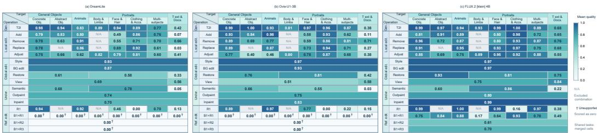  
Figure 5: Operation × Target quality profiles evaluated by GPT-4o. Cells report mean sample quality for each task. N/A denotes excluded combinations, and † marks unsupported tasks scored as zero. Merged cells indicate shared tasks.

Current on-device models underperform on text handling,facial tasks, and multi-person tasks.

Operation × Target analysis. Fig. 5 reveals task-specific differences that operation-level and target-level averages obscure. Although text and documents receive low aggregate scores, Dream-Lite and Ovis-U1 achieve 0.66 and 0.71 on text removal, close to FLUX.2 [klein]’s 0.76. Their scores fall to 0.03 and 0.27 on text replacement, and 0.07 and 0.11 on text addition.

These results suggest that limited text-generation capability is the main weakness. And improving replacement therefore requires identifying which content types remain difficult, rather than treating the operation as uniformly weak.

In reference editing, model performance also varies across targets. For R1 tasks involving facial features and hairstyles, Ovis-U1 outperforms DreamLite (0.77 versus 0.46), but the ordering reverses for multiple subjects (0.22 versus 0.70). A single reference-editing or portrait score would conceal this distinction. Moreover, both models perform well on R1 tasks involving concrete objects and animals, yet neither supports the evaluated base-plus-reference configurations. Their referenceediting limitations thus involve both quality on particular targets and missing input configurations.

The joint analysis helps developers distinguish task-specific quality gaps from missing functionality and supports model selection according to both the requested operation and its target.

Criterion-level analysis. Tab. 7 shows that the gap between on-device and larger models varies across quality requirements. Ovis-U1 approaches LongCat-Image-Edit in Integrity and Coherence but trails in Selection and Identity, while DreamLite approaches it in Structure but trails in Integrity and Coherence. These comparisons suggest that preserving image structure or producing visually coherent edits does not ensure accurate target selection or identity preservation. Identity preservation is also a weakness of some larger models: DeepGen scores 0.65, below DreamLite’s 0.73, despite its higher Fidelity and visual-quality scores.

On-device model development should go beyond visual quality to improve where edits are applied and whose identity is preserved, while addressing the visual defects that remain in models such as DreamLite.

## 5.4 MOBILE DEPLOYMENT

Baseline deployment. Tab. 8 compares mobile deployment costs across the two devices. Mobile-O and DreamLite reach D3, while no evaluated configuration reaches D4. DreamLite generates at 10242 resolution in 3.22 s on iOS and 18.19 s on Android, whereas Mobile-O achieves lower latency at 5122. SANA-Sprint completes inference in under 30 s on both devices but remains D2 because its storage exceeds the 2 GiB limit for D3. Device-dependent latency differences are substantial: SANA-600M takes 15.33 s on iOS and 139.68 s on Android.

Even setting output quality aside, current mobile deployment still falls short of user expectations, highlighting the need to reduce memory usage while maintaining low latency.

Table 7: Capability profiles for the eight evaluation criteria, evaluated by GPT-4o. IF, VQ and DP denote instruction following, visual quality and detail preservation. Scores follow the existing criterion-profile aggregation and include zeros for unsupported tasks. Scores are rounded to two decimal places.
<table><tr><td rowspan="2">Model</td><td colspan="2">IF</td><td colspan="3">VQ</td><td colspan="3">DP</td></tr><tr><td></td><td></td><td>Fidelity Selection Integrity Coherence Presentation Context Structure Identity</td><td></td><td></td><td></td><td></td><td></td></tr><tr><td colspan="9">Closed-source Models</td></tr><tr><td>Nano Banana 2</td><td>0.94</td><td>0.95</td><td>0.98</td><td>0.96</td><td>0.98</td><td>0.98</td><td>0.96</td><td>0.99</td></tr><tr><td>Seedream 5.0 Pro</td><td>0.94</td><td>0.96</td><td>0.98</td><td>0.96</td><td>0.98</td><td>0.97</td><td>0.98</td><td>0.98</td></tr><tr><td>GPT Image 2</td><td>0.96</td><td>0.97</td><td>0.99</td><td>0.97</td><td>0.99</td><td>0.98</td><td>0.98</td><td>0.98</td></tr><tr><td colspan="9">Open-weight Reference Models</td></tr><tr><td>Lumina-DiMOO-8B</td><td>0.48</td><td>0.42</td><td>0.46</td><td>0.43</td><td>0.53</td><td>0.62</td><td>0.65</td><td>0.53</td></tr><tr><td>InternVL-U-4B</td><td>0.67</td><td>0.46</td><td>0.55</td><td>0.53</td><td>0.57</td><td>0.42</td><td>0.52</td><td>0.54</td></tr><tr><td>VIBE-Image-Edit</td><td>0.60</td><td>0.72</td><td>0.64</td><td>0.61</td><td>0.66</td><td>0.82</td><td>0.82</td><td>0.79</td></tr><tr><td>OmniGen2</td><td>0.68</td><td>0.58</td><td>0.72</td><td>0.64</td><td>0.73</td><td>0.71</td><td>0.75</td><td>0.74</td></tr><tr><td>LongCat-Image-Edit</td><td>0.65</td><td>0.81</td><td>0.71</td><td>0.68</td><td>0.72</td><td>0.87</td><td>0.85</td><td>0.85</td></tr><tr><td>Lance-3B</td><td>0.68</td><td>0.70</td><td>0.74</td><td>0.73</td><td>0.75</td><td>0.79</td><td>0.74</td><td>0.77</td></tr><tr><td>DeepGen 1.0</td><td>0.76</td><td>0.68</td><td>0.74</td><td>0.71</td><td>0.77</td><td>0.69</td><td>0.72</td><td>0.65</td></tr><tr><td>FLUX.2 [klein] 4B</td><td>0.81</td><td>0.80</td><td>0.88</td><td>0.87</td><td>0.90</td><td>0.95</td><td>0.96</td><td>0.94</td></tr><tr><td colspan="9">On-device Models</td></tr><tr><td>Mobile-O-0.5B</td><td>0.10</td><td>0.00</td><td>0.10</td><td>0.11</td><td>0.10</td><td>0.00</td><td>0.00</td><td>0.00</td></tr><tr><td>SANA-600M</td><td>0.11</td><td>0.00</td><td>0.10</td><td>0.11</td><td>0.10</td><td>0.00</td><td>0.00</td><td>0.00</td></tr><tr><td>DreamLite</td><td>0.66</td><td>0.60</td><td>0.63</td><td>0.60</td><td>0.68</td><td>0.71</td><td>0.83</td><td>0.73</td></tr><tr><td>Ovis-U1-3B</td><td>0.71</td><td>0.61</td><td>0.70</td><td>0.68</td><td>0.73</td><td>0.70</td><td>0.78</td><td>0.65</td></tr></table>

Table 8: Mobile deployment results on the iPhone 17 Pro and Xiaomi 15 Pro. Params. includes all parameterized components required for inference, including encoders and image codecs. Res. and Steps denote output resolution and denoising steps. Size, E2E and Mem. denote model storage, end-to-end inference latency and peak application memory. Memory is measured using physical footprint on iOS and process PSS on Android. †The Android Janus-Pro deployment uses precomputed prompt embeddings; its reported latency excludes prompt preparation.
<table><tr><td rowspan="2">Model</td><td rowspan="2">Params.</td><td rowspan="2">Res.</td><td rowspan="2">Steps</td><td colspan="3">iPhone 17 Pro</td><td colspan="3">Xiaomi 15 Pro</td><td rowspan="2">D-tier</td></tr><tr><td>Size (MiB)</td><td></td><td>E2E (s) Mem. (MiB)</td><td>Size (MiB)</td><td>E2E (s)</td><td>Mem. (MiB)</td></tr><tr><td>Janus-Pro-1B †</td><td>2.1B</td><td>3842</td><td></td><td>2975.4</td><td>58.26</td><td>1505.4</td><td>2974.1</td><td>76.01</td><td>3253.8</td><td>D2</td></tr><tr><td>Mobile-O-0.5B</td><td>1.7B</td><td>5122</td><td>20</td><td>1718.3</td><td>2.81</td><td>426.8</td><td>1770.2</td><td>13.30</td><td>1757.1</td><td>D3</td></tr><tr><td>SANA-Sprint-0.6B</td><td>3.5B</td><td>1024²</td><td>2</td><td>2860.9</td><td>4.49</td><td>1727.2</td><td>3069.1</td><td>25.24</td><td>3896.7</td><td>D2</td></tr><tr><td>SANA-600M</td><td>3.5B</td><td>10242</td><td>18</td><td>2857.2</td><td>15.33</td><td>1775.2</td><td>3065.4</td><td>139.68</td><td>3897.6</td><td>D2</td></tr><tr><td>DreamLite</td><td>2.5B</td><td>10242</td><td>4</td><td>1684.6</td><td>3.22</td><td>1305.7</td><td>1804.5</td><td>18.19</td><td>2390.5</td><td>D3</td></tr><tr><td>Ovis-U1-3B</td><td>3.6B</td><td>10242</td><td>50</td><td>4544.8</td><td>106.12</td><td>6106.9</td><td></td><td>3499.4 2526.25</td><td>2716.6</td><td>D2 †</td></tr></table>

† indicates visible artifacts in the output images.

Precision configurations. We vary backbone and decoder precision across FP16, W8A16 and W8A8. W8A16 and W8A8 use 8-bit weights with 16-bit and 8-bit activations respectively. We focus on FP16 and W8A16 combinations in Tab. 9, as W8A8 configurations frequently encounter execution failures or severe visual degradation. Weight quantization generally reduces model storage, but its latency and memory benefits are less consistent. For example, Mobile-O runs faster with a W8A16 backbone on Android, while its peak memory increases substantially. Several configurations that produce recognizable outputs on iOS also fail execution or output-quality checks on Android, indicating that precision choices must be validated for each model and platform.

Latency breakdown. Tab. 10 shows that fewer generation steps do not necessarily lead to lower total latency. Mobile-O completes 20 steps faster than DreamLite completes four, owing to its lower per-step cost and lower output resolutions. Janus-Pro has a low per-token cost, but generating 576 image tokens accounts for approximately 96% of its total latency. For SANA-Sprint, two-step generation takes only 0.78 s, while decoding takes 3.15 s and accounts for 70% of total latency.

Table 9: Deployment results under different backbone and decoder precisions on the iPhone 17 Pro and Xiaomi 15 Pro. Size and Mem. are measured in MiB, and E2E latency is measured in seconds. Blank cells indicate results pending verification or measurement; – denotes confirmed execution failure. Status describes the inspected outputs: C denotes recognizable outputs and F denotes severe quality degradation or failed execution.
<table><tr><td rowspan="2">Model</td><td colspan="2">Precision</td><td colspan="4">iPhone 17 Pro</td><td colspan="4">Xiaomi 15 Pro</td></tr><tr><td>Backbone</td><td>Decoder</td><td>Size</td><td>E2E</td><td>Mem.</td><td>Status</td><td>Size</td><td>E2E</td><td>Mem.</td><td>Status</td></tr><tr><td rowspan="3">Janus-Pro-1B</td><td>FP16</td><td>W8A16</td><td>2935.0</td><td>58.96</td><td>1502.2</td><td>C</td><td>2934.0</td><td>77.59</td><td>3253.8</td><td>C</td></tr><tr><td>W8A16</td><td>FP16</td><td>1764.4</td><td>54.54</td><td>1500.8</td><td>C</td><td>一</td><td></td><td>一</td><td>F</td></tr><tr><td>W8A16</td><td>W8A16</td><td>1724.0</td><td>54.28</td><td>1503.6</td><td>C</td><td>一</td><td>一</td><td>一</td><td>F</td></tr><tr><td rowspan="3">Mobile-O-0.5B</td><td>FP16</td><td>W8A16</td><td>1580.1</td><td>2.84</td><td>449.2</td><td>C</td><td>1619.8</td><td>12.49</td><td>1767.0</td><td>C</td></tr><tr><td>W8A16</td><td>FP16</td><td>1155.7</td><td>2.68</td><td>423.5</td><td>C</td><td>1209.3</td><td>8.21</td><td>3149.2</td><td>C</td></tr><tr><td>W8A16</td><td>W8A16</td><td>1017.5</td><td>2.65</td><td>424.2</td><td>C</td><td>1059.5</td><td>7.11</td><td>3127.6</td><td>C</td></tr><tr><td rowspan="3">SANA-Sprint-0.6B</td><td>FP16</td><td>W8A16</td><td>2722.6</td><td>3.84</td><td>1851.1</td><td>C</td><td>2919.5</td><td>23.36</td><td>3893.1</td><td>C†</td></tr><tr><td>W8A16</td><td>FP16</td><td>2296.7</td><td>3.23</td><td>1744.3</td><td>C</td><td>一</td><td>一</td><td>一</td><td>F</td></tr><tr><td>W8A16</td><td>W8A16</td><td>2158.5</td><td>3.62</td><td>1862.5</td><td>C</td><td>一</td><td>一</td><td>一</td><td>F</td></tr><tr><td rowspan="3">SANA-600M</td><td>FP16</td><td>W8A16</td><td>2706.1</td><td>11.33</td><td>4289.3</td><td>C</td><td>2915.8</td><td>142.11</td><td>3901.7</td><td>Ct‡</td></tr><tr><td>W8A16</td><td>FP16</td><td>2294.6</td><td>11.93</td><td>3760.8</td><td>C</td><td>2504.1</td><td>44.55</td><td>4255.4</td><td>C†</td></tr><tr><td>W8A16</td><td>W8A16</td><td>2143.5</td><td>11.83</td><td>4130.6</td><td>C</td><td>2353.8</td><td>41.50</td><td>4307.6</td><td>C†</td></tr><tr><td rowspan="3">DreamLite</td><td>FP16</td><td>W8A16</td><td>1683.4</td><td>3.62</td><td>1306.5</td><td>C</td><td>1803.3</td><td>18.14</td><td>2392.5</td><td>C</td></tr><tr><td>W8A16</td><td>FP16</td><td>1314.2</td><td>3.44</td><td>1297.9</td><td>C</td><td>1439.6</td><td>17.16</td><td>2406.2</td><td>C</td></tr><tr><td>W8A16</td><td>W8A16</td><td>1313.1</td><td>3.42</td><td>1298.3</td><td>C</td><td>1438.5</td><td>16.98</td><td>2390.3</td><td>C</td></tr><tr><td rowspan="3">Ovis-U1-3B</td><td>FP16</td><td>W8A16</td><td>4497.68</td><td>120.52</td><td>6116.51</td><td>C</td><td>3452.5</td><td>3099.0</td><td>6413.0</td><td>F</td></tr><tr><td>W8A16</td><td>FP16</td><td></td><td></td><td></td><td>F</td><td>一</td><td></td><td></td><td>F</td></tr><tr><td>W8A16</td><td>W8A16</td><td>1</td><td>一</td><td>1</td><td>F</td><td>1</td><td>一</td><td>一</td><td>F</td></tr></table>

† Execution sequentially unloads the text encoder and backbone, and uses tiled decoding in an isolated process. ‡ The FP16 backbone uses 29 sessions; W8A16 backbones use a single session.

Table 10: Latency breakdown on the iPhone 17 Pro with FP16 backbones and decoders. Times are in seconds; – denotes unavailable results.
<table><tr><td rowspan="2">Model</td><td rowspan="2">Cond.</td><td colspan="3">Generation</td><td rowspan="2">Decode</td><td rowspan="2">Other</td><td rowspan="2">Total</td></tr><tr><td>Steps</td><td>Branches</td><td>Time/step</td></tr><tr><td>Janus-Pro-1B</td><td>2.214</td><td>576</td><td>2</td><td>0.0971</td><td>0.083</td><td>0.042</td><td>58.256</td></tr><tr><td>Mobile-O-0.5B</td><td>0.095</td><td>20</td><td>2</td><td>0.1134</td><td>0.230</td><td>0.216</td><td>2.809</td></tr><tr><td>SANA-Sprint-0.6B</td><td>0.281</td><td>2</td><td>1</td><td>0.3920</td><td>3.154</td><td>0.270</td><td>4.488</td></tr><tr><td>SANA-600M</td><td>0.298</td><td>18</td><td>2</td><td>0.6378</td><td>3.035</td><td>0.515</td><td>15.328</td></tr><tr><td>DreamLite</td><td>0.065</td><td>4</td><td>1</td><td>0.7645</td><td>0.036</td><td>0.065</td><td>3.224</td></tr><tr><td>Ovis-U1-3B</td><td>0.818</td><td>50</td><td>1</td><td>2.008</td><td>4.347</td><td>0.536</td><td>106.121</td></tr></table>

Step distillation and CFG distillation should be prioritized to improve inference efficiency, alongside further optimization of the decoder.

## 5.5 Q-D ANALYSIS.

Fig. 6 shows that fast mobile inference does not necessarily provide broad task capability. Mobile-O and DreamLite have similar iOS latency (2.81 and 3.22 s), yet their task coverage differs substantially (0.11 and 0.64), placing them in Q1–D3 and Q2–D3, respectively. Mobile-O’s low benchmarkwide quality primarily reflects its generation-only scope, highlighting the distinction between efficiently executing a supported task and meeting diverse mobile editing needs. Ovis-U1 achieves a slightly higher overall quality score than DreamLite (0.66 versus 0.62), but lower task coverage (0.59 versus 0.64), alongside substantially higher latency and peak memory. Thus, a higher average quality score alone does not establish a more useful mobile model.

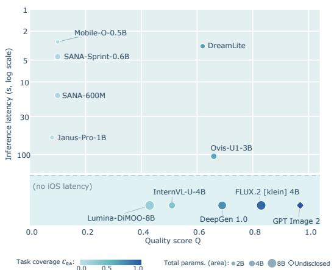

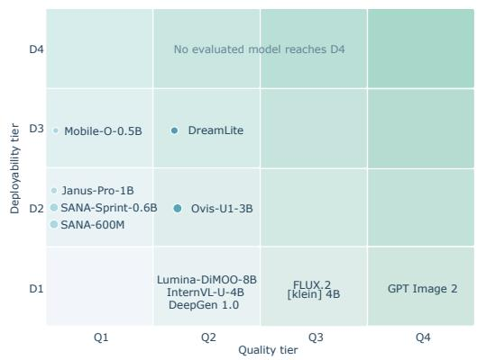  
Figure 6: Quality and deployability of representative models. Left: GPT-4o quality versus iOS inference latency, with color indicating task coverage and bubble area indicating total parameters; diamonds denote undisclosed parameter counts. Models without iOS latency measurements are shown separately. Right: quality and deployability tiers.

These results suggest different development priorities for different starting points. For efficient generation-only models, a key next step is to support editing while retaining their deployment efficiency. For models such as DreamLite, priorities include broader input support, particularly multiple reference images, and better editing quality in the weak operation–target combinations identified by our capability analysis. For Ovis-U1, reducing inference latency and memory demand is necessary to make its existing capabilities more accessible on-device. Step and CFG distillation, decoder optimization and memory-efficient execution are candidate approaches, whose benefits should be evaluated alongside any changes in output quality. Moving toward the upper-right region of the map therefore requires both broader, more reliable capabilities and lower deployment costs; the evaluated on-device models currently reach neither Q3 nor D4.

When model-size constraints limit the capabilities achievable locally, an on-device agent could use the capability profiles to route requests between local models and cloud services. Routing should depend on the requested operation and target rather than broad application labels. For example, Ovis-U1 performs comparably to FLUX.2 [klein] on text removal but falls far behind on text replacement, suggesting that these requests may warrant different execution choices. A router could retain locally supported requests that meet the required quality and latency budgets, while sending tasks such as difficult text replacement or unsupported multi-image editing to a more capable cloud model. Evaluating this task-aware routing strategy is a direction for future work.

## 6 CONCLUSION

We introduce MoI-Bench and MoI-Eval to connect users’ needs for image generation and editing on mobile devices with model evaluation and development. MoI-Bench organizes 64 subtasks along operation and target axes, while MoI-Eval uses task-specific criteria to assess output quality and construct capability profiles. For users, these profiles help select on-device or cloud models for specific requests, such as makeup removal or text replacement. For researchers, they identify unsupported tasks or unmet quality requirements, providing directions for expanding model capabilities and improving quality. The Quality × Deployability map complements this analysis with mobile latency, storage and memory costs, helping developers assess which capabilities are practical to offer locally. Together, this framework supports evaluating image models by how well they meet users needs and guides the development of more capable and accessible image AI across mobile and cloud platforms.

## REFERENCES

Grigorii Alekseenko, Aleksandr Gordeev, Irina Tolstykh, Bulat Suleimanov, Vladimir Dokholyan, Georgii Fedorov, Sergey Yakubson, Aleksandra Tsybina, Mikhail Chernyshov, and Maksim Kuprashevich. Vibe: Visual instruction based editor. arXiv preprint arXiv:2601.02242, 2026.

Xuehai Bai, Yang Shi, Yi-Fan Zhang, Xuanyu Zhu, Yuran Wang, Yifan Dai, Xinyu Liu, Yiyan Ji, Xiaoling Gu, and Yuanxing Zhang. Edit-compass & editreward-compass: A unified benchmark for image editing and reward modeling. arXiv preprint arXiv:2605.13062, 2026.

Eslam Mohamed Bakr, Pengzhan Sun, Xiaoqian Shen, Faizan Farooq Khan, Li Erran Li, and Mohamed Elhoseiny. Hrs-bench: Holistic, reliable and scalable benchmark for text-to-image models. In 2023 ieee/cvf international conference on computer vision (iccv), pp. 19984–19996. IEEE, 2023.

Black Forest Labs. FLUX.2 [klein] 4B. https://huggingface.co/ black-forest-labs/FLUX.2-klein-4B, 2026. Hugging Face model card.

ByteDance Seed. Seedream 5.0 Pro. https://seed.bytedance.com/en/seedream5\_ 0\_pro, 2026. Official model page. Accessed: 2026-09-26.

Chengkun Cai, Haoliang Liu, Xu Zhao, Zhongyu Jiang, Tianfang Zhang, Zongkai Wu, John Lee, Jenq-Neng Hwang, and Lei Li. Bayesian optimization for controlled image editing via LLMs. In Wanxiang Che, Joyce Nabende, Ekaterina Shutova, and Mohammad Taher Pilehvar (eds.), Findings of the Association for Computational Linguistics: ACL 2025, pp. 10045–10056, Vienna, Austria, July 2025. Association for Computational Linguistics. ISBN 979-8-89176-256- 5. doi: 10.18653/v1/2025.findings-acl.523. URL https://aclanthology.org/2025. findings-acl.523/.

Thibault Castells, Hyoung-Kyu Song, Tairen Piao, Shinkook Choi, Bo-Kyeong Kim, Hanyoung Yim, Changgwun Lee, Jae Gon Kim, and Tae-Ho Kim. Edgefusion: On-device text-to-image generation. arXiv preprint arXiv:2404.11925, 2024.

Ruchika Chavhan, Malcolm Chadwick, Alberto Gil Couto Pimentel Ramos, Luca Morreale, Mehdi Noroozi, and Abhinav Mehrotra. Nanoflux: Distillation-driven compression of large text-toimage generation models for mobile devices. In Forty-third International Conference on Machine Learning, 2026.

Jierun Chen, Dongting Hu, Xijie Huang, Huseyin Coskun, Arpit Sahni, Aarush Gupta, Anujraaj Goyal, Dishani Lahiri, Rajesh Singh, Yerlan Idelbayev, et al. Snapgen: Taming high-resolution text-to-image models for mobile devices with efficient architectures and training. In 2025 IEEE/CVF Conference on Computer Vision and Pattern Recognition (CVPR), pp. 7997–8008. IEEE, 2025a.

Junsong Chen, Shuchen Xue, Yuyang Zhao, Jincheng Yu, Sayak Paul, Junyu Chen, Han Cai, Song Han, and Enze Xie. Sana-sprint: One-step diffusion with continuous-time consistency distillation. In 2025 IEEE/CVF International Conference on Computer Vision (ICCV), pp. 16185–16195. IEEE, 2025b.

Xiaokang Chen, Zhiyu Wu, Xingchao Liu, Zizheng Pan, Wen Liu, Zhenda Xie, Xingkai Yu, and Chong Ruan. Janus-pro: Unified multimodal understanding and generation with data and model scaling. arXiv preprint arXiv:2501.17811, 2025c.

Yu-Hui Chen, Raman Sarokin, Juhyun Lee, Jiuqiang Tang, Chuo-Ling Chang, Andrei Kulik, and Matthias Grundmann. Speed is all you need: On-device acceleration of large diffusion models via gpu-aware optimizations. In 2023 IEEE/CVF Conference on Computer Vision and Pattern Recognition Workshops (CVPRW), pp. 4651–4655. IEEE, 2023.

Jiwoong Choi, Minkyu Kim, Daehyun Ahn, Taesu Kim, Yulhwa Kim, Dongwon Jo, Hyesung Jeon, Jae-Joon Kim, and Hyungjun Kim. Squeezing large-scale diffusion models for mobile. arXiv preprint arXiv:2307.01193, 2023.

Chaorui Deng, Deyao Zhu, Kunchang Li, Chenhui Gou, Feng Li, Zeyu Wang, Shu Zhong, Weihao Yu, Xiaonan Nie, Ziang Song, Guang Shi, and Haoqi Fan. Emerging properties in unified multimodal pretraining. arXiv preprint arXiv:2505.14683, 2025.

Fei Deng, Yanwu Xu, Zhipeng Bao, Zhixing Zhang, Haolin Jia, Karthik Raveendran, and Jianing Wei. Blazeedit: Generalist image editing on mobile devices with image-to-image diffusion models. arXiv preprint arXiv:2605.28067, 2026.

Kunpeng Du, Haizhen Xie, Sen Lu, Lei Yu, Binglei Bao, Huaao Tang, Chuntao Liu, Hao Wu, Yang Zhao, Zhicai Huang, et al. Elasticdit: Efficient diffusion transformers via elastic architecture and sparse attention for high-resolution image generation on mobile devices. arXiv preprint arXiv:2605.15684, 2026.

Kangsheng Duan, Ziyang Xu, Wenyu Liu, Xiaohu Ruan, Xiaoxin Chen, and Xinggang Wang. Moebius: 0.2 b lightweight image inpainting framework with 10b-level performance. arXiv preprint arXiv:2606.19195, 2026.

Kailai Feng, Minheng Ni, Jiaxiu Jiang, Zhilu Zhang, and Wangmeng Zuo. Multi-attentional distance for zero-shot classification with text-to-image diffusion model. In 2024 IEEE International Conference on Multimedia and Expo (ICME), pp. 1–6. IEEE, 2024.

Kailai Feng, Yuxiang Wei, Bo Chen, Yang Pan, Hu Ye, Songwei Liu, Chenqian Yan, and Yuan Gao. Dreamlite: A lightweight on-device unified model for image generation and editing. arXiv preprint arXiv:2603.28713, 2026a.

Kailai Feng, Yabo Zhang, Haodong Yu, Zhilong Ji, Jinfeng Bai, Hongzhi Zhang, and Wangmeng Zuo. Vitaglyph: Vitalizing artistic typography with flexible dual-branch diffusion models. In 2026 IEEE/CVF Winter Conference on Applications of Computer Vision (WACV), pp. 8220–8230. IEEE, 2026b.

Fengyi Fu, Mengqi Huang, Shaojin Wu, Yunsheng Jiang, Yufei Huo, Hao Li, Yinghang Song, Fei Ding, Jianzhu Guo, Qian He, et al. Lance: Unified multimodal modeling by multi-task synergy. arXiv preprint arXiv:2605.18678, 2026.

Dhruba Ghosh, Hannaneh Hajishirzi, and Ludwig Schmidt. Geneval: An object-focused framework for evaluating text-to-image alignment. Advances in Neural Information Processing Systems, 36: 52132–52152, 2023.

Google. Gemini 3.1 pro. Google AI Blog, 2026. URL https://blog. google/innovation-and-ai/models-and-research/gemini-models/ gemini-3-1-pro/. Version: gemini-3.1-pro-preview.

Google DeepMind. Nano banana 2 (gemini 3.1 flash image). https://deepmind.google/ models/gemini-image/, 2026. Accessed: 2026-10-06.

Rui Gui, Yang Wan, Haochen Han, Dongxing Mao, Fangming Liu, Min Li, and Alex Jinpeng Wang. Texteditbench: Evaluating reasoning-aware text editing beyond rendering. arXiv preprint arXiv:2512.16270, 2025.

Dongting Hu, Aarush Gupta, Magzhan Gabidolla, Arpit Sahni, Huseyin Coskun, Yanyu Li, Yerlan Idelbayev, Ahsan Mahmood, Aleksei Lebedev, Dishani Lahiri, et al. Snapgen++: Unleashing diffusion transformers for efficient high-fidelity image generation on edge devices. arXiv preprint arXiv:2601.08303, 2026.

Yushi Hu, Benlin Liu, Jungo Kasai, Yizhong Wang, Mari Ostendorf, Ranjay Krishna, and Noah A Smith. Tifa: Accurate and interpretable text-to-image faithfulness evaluation with question answering. In 2023 ieee/cvf international conference on computer vision (iccv), pp. 20349–20360. IEEE, 2023.

Hang Hua, Ziyun Zeng, Yizhi Song, Yunlong Tang, Liu He, Daniel Aliaga, Wei Xiong, and Jiebo Luo. Mmigbench: Towards comprehensive and explainable evaluation of multi-modal image generation models. arXiv preprint arXiv:2505.19415, 3:3, 2025.

Kaiyi Huang, Chengqi Duan, Kaiyue Sun, Enze Xie, Zhenguo Li, and Xihui Liu. T2i-compbench++: An enhanced and comprehensive benchmark for compositional text-to-image generation. IEEE Transactions on Pattern Analysis and Machine Intelligence, 47(5):3563–3579, 2025.

Aaron Hurst, Adam Lerer, Adam P Goucher, Adam Perelman, Aditya Ramesh, Aidan Clark, AJ Ostrow, Akila Welihinda, Alan Hayes, Alec Radford, et al. Gpt-4o system card. arXiv preprint arXiv:2410.21276, 2024.

Bohan Jia, Wenxuan Huang, Yuntian Tang, Junbo Qiao, Jincheng Liao, Shaosheng Cao, Fei Zhao, Zhaopeng Feng, Zhouhong Gu, Zhenfei Yin, et al. Compbench: Benchmarking complex instruction-guided image editing. In Proceedings ofthe IEEE/CVF Conference on Computer Vision and Pattern Recognition, pp. 1112–1122, 2026.

Zhangqi Jiang, Zheng Sun, Xianfang Zeng, Yufeng Yang, Xuanyang Zhang, Yongliang Wu, Wei Cheng, Gang Yu, Xu Yang, and Bihan Wen. Geditbench v2: A human-aligned benchmark for general image editing. arXiv preprint arXiv:2603.28547, 2026.

Xuan Ju, Ailing Zeng, Yuxuan Bian, Shaoteng Liu, and Qiang Xu. Direct inversion: Boosting diffusion-based editing with 3 lines of code. arXiv preprint arXiv:2310.01506, 2023.

Amita Kamath, Kai-Wei Chang, Ranjay Krishna, Luke Zettlemoyer, Yushi Hu, and Marjan Ghazvininejad. Geneval 2: Addressing benchmark drift in text-to-image evaluation. arXiv preprint arXiv:2512.16853, 2025.

Sravanth Kodavanti, Manjunath Arveti, Sowmya Vajrala, Srinivas Miriyala, et al. Edgedit: Hardware-aware diffusion transformers for efficient on-device image generation. arXiv preprint arXiv:2603.28405, 2026.

Max Ku, Dongfu Jiang, Cong Wei, Xiang Yue, and Wenhu Chen. Viescore: Towards explainable metrics for conditional image synthesis evaluation. In Proceedings of the 62nd Annual Meeting of the Association for Computational Linguistics (Volume 1: Long Papers), pp. 12268–12290, 2024a.

Max Ku, Tianle Li, Kai Zhang, Yujie Lu, Xingyu Fu, Wenwen Zhuang, and Wenhu Chen. Imagenhub: Standardizing the evaluation of conditional image generation models. In International Conference on Learning Representations, volume 2024, pp. 46689–46722, 2024b.

Black Forest Labs, Stephen Batifol, Andreas Blattmann, Frederic Boesel, Saksham Consul, Cyril Diagne, Tim Dockhorn, Jack English, Zion English, Patrick Esser, et al. Flux. 1 kontext: Flow matching for in-context image generation and editing in latent space. arXiv preprint arXiv:2506.15742, 2025.

Tony Lee, Michihiro Yasunaga, Chenlin Meng, Yifan Mai, Joon Sung Park, Agrim Gupta, Yunzhi Zhang, Deepak Narayanan, Hannah Teufel, Marco Bellagente, et al. Holistic evaluation of textto-image models. Advances in Neural Information Processing Systems, 36:69981–70011, 2023.

Baiqi Li, Zhiqiu Lin, Deepak Pathak, Jiayao Li, Yixin Fei, Kewen Wu, Tiffany Ling, Xide Xia, Pengchuan Zhang, Graham Neubig, et al. Genai-bench: Evaluating and improving compositional text-to-visual generation. arXiv preprint arXiv:2406.13743, 2024a.

Muyang Li, Yujun Lin, Zhekai Zhang, Tianle Cai, Xiuyu Li, Junxian Guo, Enze Xie, Chenlin Meng, Jun-Yan Zhu, and Song Han. Svdquant: Absorbing outliers by low-rank components for 4-bit diffusion models. arXiv preprint arXiv:2411.05007, 2024b.

Niantong Li, Guangzheng Hu, Weixu Qiao, Ying Ba, Qichen Hong, Shijun Shen, Jinlin Wang, Fan Zhou, Jianye Kang, Xin Shang, et al. Qwen-image-bench: From generation to creation in text-toimage evaluation. arXiv preprint arXiv:2605.28091, 2026.

Yanyu Li, Huan Wang, Qing Jin, Ju Hu, Pavlo Chemerys, Yun Fu, Yanzhi Wang, Sergey Tulyakov, and Jian Ren. Snapfusion: Text-to-image diffusion model on mobile devices within two seconds. Advances in Neural Information Processing Systems, 36:20662–20678, 2023.

Shiyu Liu, Yucheng Han, Peng Xing, Fukun Yin, Rui Wang, Wei Cheng, Jiaqi Liao, Yingming Wang, Honghao Fu, Chunrui Han, et al. Step1x-edit: A practical framework for general image editing. arXiv preprint arXiv:2504.17761, 2025.

Xiaoyu Liu, Huan Wang, Fan Li, Zhixin Wang, Jiaqi Xu, Ming Liu, and Wangmeng Zuo. Instancecontrol: Controllable complex image generation without instance labeling. In European Conference on Computer Vision, pp. 146–164. Springer, 2026.

Yiwei Ma, Jiayi Ji, Ke Ye, Weihuang Lin, Zhibin Wang, Yonghan Zheng, Qiang Zhou, Xiaoshuai Sun, and Rongrong Ji. I2ebench: A comprehensive benchmark for instruction-based image editing. Advances in Neural Information Processing Systems, 37:41494–41516, 2024.

OpenAI. Introducing ChatGPT Images 2.5. https://openai.com/index/ introducing-chatgpt-images-2-5/, 2026. Accessed: 2026-09-26.

Yuta Oshima, Daiki Miyake, Kohsei Matsutani, Yusuke Iwasawa, Masahiro Suzuki, Yutaka Matsuo, and Hiroki Furuta. Multibanana: A challenging benchmark for multi-reference text-to-image generation. In Proceedings of the IEEE/CVF Conference on Computer Vision and Pattern Recognition, pp. 448–460, 2026.

Yulin Pan, Xiangteng He, Chaojie Mao, Zhen Han, Zeyinzi Jiang, Jingfeng Zhang, and Yu Liu. Ice-bench: A unified and comprehensive benchmark for image creating and editing. In 2025 IEEE/CVF International Conference on Computer Vision (ICCV), pp. 16586–16596. IEEE, 2025.

Bimsara Pathiraja, Maitreya Patel, Shivam Singh, Yezhou Yang, and Chitta Baral. Refedit: A benchmark and method for improving instruction-based image editing model on referring expressions. In 2025 IEEE/CVF International Conference on Computer Vision (ICCV), pp. 15646–15656. IEEE, 2025.

Yusu Qian, Jiasen Lu, Tsu-Jui Fu, Xinze Wang, Chen Chen, Yinfei Yang, Wenze Hu, and Zhe Gan. Gie-bench: Towards grounded evaluation for text-guided image editing. arXiv preprint arXiv:2505.11493, 2025.

Chitwan Saharia, William Chan, Saurabh Saxena, Lala Li, Jay Whang, Emily L Denton, Kamyar Ghasemipour, Raphael Gontijo Lopes, Burcu Karagol Ayan, Tim Salimans, et al. Photorealistic text-to-image diffusion models with deep language understanding. Advances in neural information processing systems, 35:36479–36494, 2022.

Samin Mahdizadeh Sani, Max Ku, Nima Jamali, Matina Mahdizadeh Sani, Paria Khoshtab, Wei-Chieh Sun, Parnian Fazel, Zhi Rui Tam, Thomas Chong, Edisy Kin Wai Chan, et al. Imagenworld: Stress-testing image generation models with explainable human evaluation on open-ended realworld tasks. arXiv preprint arXiv:2603.27862, 2026.

Abdelrahman Shaker, Ahmed Heakl, Jaseel Muhammad, Ritesh Thawkar, Omkar Thawakar, Senmao Li, Hisham Cholakkal, Ian Reid, Eric P Xing, Salman Khan, et al. Mobile-o: Unified multimodal understanding and generation on mobile device. arXiv preprint arXiv:2602.20161, 2026.

Meituan LongCat Team, Hanghang Ma, Haoxian Tan, Jiale Huang, Junqiang Wu, Jun-Yan He, Lishuai Gao, Songlin Xiao, Xiaoming Wei, Xiaoqi Ma, et al. Longcat-image technical report. arXiv preprint arXiv:2512.07584, 2025.

Changyao Tian, Danni Yang, Guanzhou Chen, Erfei Cui, Zhaokai Wang, Yuchen Duan, Penghao Yin, Sitao Chen, Ganlin Yang, Mingxin Liu, et al. Internvl-u: Democratizing unified multimodal models for understanding, reasoning, generation and editing. arXiv preprint arXiv:2603.09877, 2026.

Dianyi Wang, Ruihang Li, Feng Han, Chaofan Ma, Wei Song, Siyuan Wang, Yibin Wang, Yi Xin, Hongjian Liu, Zhixiong Zhang, et al. Deepgen 1.0: A lightweight unified multimodal model for advancing image generation and editing. arXiv preprint arXiv:2602.12205, 2026.

Guo-Hua Wang, Shanshan Zhao, Xinjie Zhang, Liangfu Cao, Pengxin Zhan, Lunhao Duan, Shiyin Lu, Minghao Fu, Xiaohao Chen, Jianshan Zhao, et al. Ovis-u1 technical report. arXiv preprint arXiv:2506.23044, 2025a.

Yibin Wang, Zhimin Li, Yuhang Zang, Jiazi Bu, Yujie Zhou, Yi Xin, Junjun He, Chunyu Wang, Qinglin Lu, Cheng Jin, et al. Unigenbench++: A unified semantic evaluation benchmark for text-to-image generation. arXiv preprint arXiv:2510.18701, 2025b.

Chenyuan Wu, Jiahao Wang, Pengfei Zheng, Ruiran Yan, Shitao Xiao, Xin Luo, Yueze Wang, Wanli Li, Xiyan Jiang, Yexin Liu, et al. Omnigen2: Towards instruction-aligned multimodal generation. In Proceedings of the IEEE/CVF Conference on Computer Vision and Pattern Recognition, pp. 21964–21975, 2026a.

Mingrui Wu, Hang Liu, Jiayi Ji, Xiaoshuai Sun, and Rongrong Ji. Micon-bench: Benchmarking and enhancing multi-image context image generation in unified multimodal models. arXiv preprint arXiv:2602.19497, 2026b.

Xindi Wu, Dingli Yu, Yangsibo Huang, Olga Russakovsky, and Sanjeev Arora. Conceptmix: A compositional image generation benchmark with controllable difficulty. Advances in Neural Information Processing Systems, 37:86004–86047, 2024.

Yongliang Wu, Zonghui Li, Xinting Hu, Xinyu Ye, Xianfang Zeng, Gang Yu, Wenbo Zhu, Bernt Schiele, Ming-Hsuan Yang, and Xu Yang. Kris-bench: Benchmarking next-level intelligent image editing models. Advances in Neural Information Processing Systems, 38, 2026c.

Enze Xie, Junsong Chen, Junyu Chen, Han Cai, Haotian Tang, Yujun Lin, Zhekai Zhang, Muyang Li, Ligeng Zhu, Yao Lu, et al. Sana: Efficient high-resolution image synthesis with linear diffusion transformers. arXiv preprint arXiv:2410.10629, 2024.

Yi Xin, Qi Qin, Siqi Luo, Kaiwen Zhu, Juncheng Yan, Yan Tai, Jiayi Lei, Yuewen Cao, Keqi Wang, Yibin Wang, et al. Lumina-dimoo: An omni diffusion large language model for multi-modal generation and understanding. arXiv preprint arXiv:2510.06308, 2025.

Yang Ye, Xianyi He, Zongjian Li, Shenghai Yuan, Zhiyuan Yan, Bohan Hou, Li Yuan, et al. Imgedit: A unified image editing dataset and benchmark. Advances in Neural Information Processing Systems, 38, 2026.

Hongzhu Yi, Yujia Yang, Yuanxiang Wang, Tong Li, Zhenyu Guan, Tianyu Zong, Jiahuan Chen, Chenxi Bao, Tiankun Yang, Haopeng Jin, et al. Vde bench: Evaluating the capability of image editing models to modify visual documents. arXiv preprint arXiv:2602.00122, 2026.

Qifan Yu, Wei Chow, Zhongqi Yue, Kaihang Pan, Yang Wu, Xiaoyang Wan, Juncheng Li, Siliang Tang, Hanwang Zhang, and Yueting Zhuang. Anyedit: Mastering unified high-quality image editing for any idea. In 2025 IEEE/CVF Conference on Computer Vision and Pattern Recognition (CVPR), pp. 26125–26135. IEEE, 2025.

Kai Zhang, Lingbo Mo, Wenhu Chen, Huan Sun, and Yu Su. Magicbrush: A manually annotated dataset for instruction-guided image editing. Advances in neural information processing systems, 36:31428–31449, 2023.

Tianchen Zhao, Xuefei Ning, Tongcheng Fang, Enshu Liu, Guyue Huang, Zinan Lin, Shengen Yan, Guohao Dai, and Yu Wang. Mixdq: Memory-efficient few-step text-to-image diffusion models with metric-decoupled mixed precision quantization. In European Conference on Computer Vision, pp. 285–302. Springer, 2024a.

Yang Zhao, Yanwu Xu, Zhisheng Xiao, Haolin Jia, and Tingbo Hou. Mobilediffusion: Instant text-to-image generation on mobile devices. In European Conference on Computer Vision, pp. 225–242. Springer, 2024b.

## A USER SURVEY AND BENCHMARK CONSTRUCTION

## A.1 USER SURVEY

Survey overview. We collected 1,000 anonymous responses on mobile image AI. Fig. 2(a) reports interest, use cases and priorities. Interest in on-device image AI is 68% Yes, 24% Maybe and 8% No. Tab. 11 presents the questionnaire structure and one example scenario. Q1 asks about current usage and interest, and Q2 asks about desired use cases. Q3 contains 25 image-generation and editing scenarios. Each scenario presents 10–15 requirements, including shared usability needs and taskspecific requirements. All respondents answer all 25 scenarios and select up to eight requirements per scenario. Selection rates use all 1,000 respondents as the denominator. For shared requirements, a respondent is counted once if they select the requirement in any scenario. Selection rates describe the respondents rather than the wider population.

## A.2 TASK DEFINITIONS AND COVERAGE

An operation specifies the requested change, and a target identifies the content involved. Tables 12 and 13 define both axes.

Operations. The operation axis contains 16 units organized into five groups. Reference-editing units specify the available base and reference images. Replacement substitutes content; adjustment changes its attributes. Outpainting extends image boundaries; inpainting fills masked regions within them. For reference editing, B1 denotes one base image and Rk denotes k reference images.

Table 12: Definitions of the 16 operation units.
<table><tr><td>Group</td><td>Operation</td><td>Definition</td></tr><tr><td>Generation</td><td>T2I</td><td>Generate an image from text without an input image.</td></tr><tr><td rowspan="4">Local editing</td><td>Addition</td><td>Add specified content while retaining existing, unrelated content.</td></tr><tr><td>Removal</td><td>Delete specified content and complete the exposed region.</td></tr><tr><td>Replacement</td><td>Replace selected content with a specified alternative.</td></tr><tr><td>Adjustment</td><td>Change attributes of existing content, such as color, size or pose.</td></tr><tr><td rowspan="4">Global editing</td><td>Stylization</td><td>Apply a visual style across the image.</td></tr><tr><td>Background</td><td>Change the background while retaining the foreground subject</td></tr><tr><td>Restoration</td><td>Recover image clarity or appearance from degradation.</td></tr><tr><td>Viewpoint</td><td>Change the camera view, or rectify document perspective.</td></tr><tr><td rowspan="3">Understanding editing</td><td>Semantic</td><td>Infer the required edit from meaning, context or an intended outcome.</td></tr><tr><td>Outpainting</td><td>Extend content beyond the original image boundaries.</td></tr><tr><td>Inpainting</td><td>Reconstruct missing content within supplied masks.</td></tr><tr><td rowspan="4">Reference editing R1</td><td></td><td>Generate an image from one reference, without a base image.</td></tr><tr><td>B1+R1</td><td>Edit a base image using content or attributes from one reference.</td></tr><tr><td>B1+R2</td><td>Edit a base image by combining two role-specific references.</td></tr><tr><td>B1+R3</td><td>Edit a base image by combining three role-specific references.</td></tr></table>

Targets. The eight categories identify the primary content to generate or modify, not every visible entity. For example, changing a jacket targets Clothing & Accessories; removing one person from a group targets Multi-Subjects.

Table 13: Definitions of the eight target categories.
<table><tr><td>Group</td><td>Target</td><td>Definition</td></tr><tr><td></td><td>General Objects Concrete Objects</td><td>Discrete entities such as vehicles, furniture and everyday objects.</td></tr><tr><td></td><td>Abstract Objects</td><td>Visual effects and relations, such as lighting, shadows and reflections.</td></tr><tr><td>Animals</td><td>Animals</td><td>Animals, including pets, their appearance and their accessories.</td></tr><tr><td rowspan="4">Portraits</td><td>Body &amp; Limbs Face &amp; Hair</td><td>Human body shape, limb configuration and pose.</td></tr><tr><td>Clothing &amp; Accessories</td><td>Facial features, expressions, makeup, hairstyles and identity. Human garments and accessories, such as coats, glasses and</td></tr><tr><td></td><td>jewelry.</td></tr><tr><td>Multi-Subjects</td><td>Groups of people and edits to selected individuals within a group.</td></tr><tr><td>Text &amp; Doc.</td><td>Text &amp; Documents</td><td>Text content, typography, layout and document appearance.</td></tr></table>

Task coverage and examples. Table 14 provides task definitions and illustrative instructions, not verbatim benchmark annotations. N/A marks combinations excluded from the benchmark scope, such as adding or removing anatomical parts; it does not imply that such requests are impossible. Included tasks unsupported by a model instead receive zero scores. Each merged cell counts as one shared subtask. The benchmark contains 8 generation, 28 local-editing, 7 global-editing, 5 understanding-editing and 16 reference-editing subtasks, totaling 64.

Table 11: Questionnaire structure and one of the 25 Q3 scenarios. Q1 contains three single-choice questions. Q2 allows up to eight selections. Each Q3 scenario presents 10–15 requirements and allows up to eight selections.
<table><tr><td>Topic</td><td>Question and response options</td></tr><tr><td>Q1a. Current usage</td><td>How often do you use AI tools on your phone, such as chat assistants, image generators or photo editors? Options: Daily; Several times a week; About once a week; Less than once a week; Never.</td></tr><tr><td>Q1b. Image tools</td><td>Would you like to generate or edit images using AI tools on your phone? Options: Yes; Maybe; No.</td></tr><tr><td>Q1c. On-device interest</td><td>Would you be interested in image AI that runs directly on your phone without uploading your photos to a server? Options: Yes; Maybe; No.</td></tr><tr><td>Q2. Desired use cases</td><td>Which of the following would you most like to use AI image tools for on your phone? Select up to eight options. Options: (1) Retouch portraits, such as removing blemishes or wrinkles. (2) Re- move unwanted people or objects from photos. (3) Restore old, blurry or damaged photos. (4) Edit or translate text in images and documents. (5) Improve or cre- atively edit pet photos. (6) Make memes or stickers. (7) Create personal avatars or profile pictures. (8) Generate wallpapers. (9) Try different hairstyles, makeup or accessories. (10) Change clothing or preview outfit combinations. (11) Re- place backgrounds in personal or product photos. (12) Turn photos into cartoons, paintings or other styles. (13) Create posters, invitations or greeting cards. (14) Improve product photos for online listings. (15) Preview furniture or decorations in a room. (16) Combine people or objects from several photos.</td></tr><tr><td>Q3. ments</td><td>Usability require- Suppose you ask an AI tool to remove a small blemish from your cheek in a por- trait and leave the rest of the photo unchanged. What would matter to you when judging the result? Select up to eight options. Options: (1) Results are returned quickly. (2) The requested blemish is removed. (3) Photos remain private. (4) Clothing, background and other people remain un- changed. (5) The skin retains natural texture without visible artifacts. (6) The tool requires little storage. (7) The person remains recognisable, with facial features preserved. (8) The tool works offline. (9) Only the intended area is retouched. (10) The overall photo remains clear and visually balanced. (11) The tool does not slow down the phone. (12) The original pose, framing and positions remain unchanged. (13) The retouched area matches the surrounding skin tone and lighting.</td></tr></table>

Table 1 4 : Operation × Target task definitions and illustrative instructions ( 1 /2) . Each ordinary or merged cell is one subtask; N/A cells are excluded. n gives the subtask sample count (64 subtasks ; 1 1 50 samples) B 1 denotes one base image and Rk denotes k reference images
<table><tr><td rowspan=2 colspan=1>Operation</td><td rowspan=1 colspan=1>General</td><td rowspan=1 colspan=1>Objects</td><td rowspan=1 colspan=1>Animals</td><td rowspan=1 colspan=4>Portraits</td><td rowspan=2 colspan=1>Text &amp; Docs.Text &amp; Docs.</td></tr><tr><td rowspan=1 colspan=1>Concrete Objects</td><td rowspan=1 colspan=1>Abstract Objects</td><td rowspan=1 colspan=1>Animals</td><td rowspan=1 colspan=1>Body &amp; Limbs</td><td rowspan=1 colspan=1>Face &amp; Hair</td><td rowspan=1 colspan=1>Clothing &amp; Accs.</td><td rowspan=1 colspan=1>Multi-Subjects</td></tr><tr><td rowspan=1 colspan=1>Generation</td><td rowspan=1 colspan=1></td><td rowspan=1 colspan=1></td><td rowspan=1 colspan=1></td><td rowspan=1 colspan=1></td><td rowspan=1 colspan=1></td><td rowspan=1 colspan=1></td><td rowspan=1 colspan=1></td><td rowspan=1 colspan=1></td></tr><tr><td rowspan=1 colspan=1>T2I</td><td rowspan=1 colspan=1>Objectgeneration&quot;A bicycle besidea fence.&quot;n = 20</td><td rowspan=1 colspan=1>Abstract visuals&quot;A blue abstractwallpaper.&quot; n = 20</td><td rowspan=1 colspan=1>Animalgeneration“A dog resting ongrass.&quot;   n = 15</td><td rowspan=1 colspan=1>Full-bodyportrait&quot;A full-bodyportrait of arunner.&quot;  n = 20</td><td rowspan=1 colspan=1>Portrait close-up&quot;A close-up of acurly-hairedwoman.&quot; n = 20</td><td rowspan=1 colspan=1>Outfit generation&quot;A personwearing a bluecoat.&quot;    n = 10</td><td rowspan=1 colspan=1>Group portrait&quot;Four friendsplayingcards.&quot;   n = 15</td><td rowspan=1 colspan=1>Text-bearingimage&quot;A poster titledSummerFair.&quot;    n = 30</td></tr><tr><td rowspan=1 colspan=1>Local Editing</td><td rowspan=1 colspan=1></td><td rowspan=1 colspan=1></td><td rowspan=1 colspan=1></td><td rowspan=1 colspan=1></td><td rowspan=1 colspan=1></td><td rowspan=1 colspan=1></td><td rowspan=1 colspan=1></td><td rowspan=1 colspan=1></td></tr><tr><td rowspan=1 colspan=1>Addition</td><td rowspan=1 colspan=1>Add an object&quot;Add a vase to thetable.&quot;   n = 20w</td><td rowspan=1 colspan=1>Add an effect&quot;Add a sunbeamthrough theindow.&quot; n = 15</td><td rowspan=1 colspan=1>Add an animal&quot;Add a parrot tothe chair.&quot; n = 15</td><td rowspan=1 colspan=1>N/A</td><td rowspan=1 colspan=1>Add a facialfeature&quot;Add a greybeard.&quot;   n = 30</td><td rowspan=1 colspan=1>Add an accessory&quot;Add a floralhairpin.&quot; n = 25</td><td rowspan=1 colspan=1>Add a groupmember&quot;Add a person onthe left.&quot; n = 15</td><td rowspan=1 colspan=1>Add text&quot;Add OPEN tothe sign.&quot;n = 20</td></tr><tr><td rowspan=2 colspan=1>Removalc</td><td rowspan=2 colspan=1>Remove anobject&quot;Remove theup.&quot;    n = 25</td><td rowspan=2 colspan=1>Remove an effect&quot;Remove thewindowglare.&quot;   n = 15</td><td rowspan=2 colspan=1>Remove ananimal&quot;Remove thedog.&quot;     n = 10</td><td rowspan=2 colspan=1>N/A</td><td rowspan=2 colspan=1>Remove a facialdetail&quot;Remove thecheekblemish.&quot;n = 30</td><td rowspan=1 colspan=1>Remove anaccessory&quot;Remove the sun-</td><td rowspan=2 colspan=1>Remove a groupmember“Remove theleftmost          terson.&quot; n = 25</td><td rowspan=2 colspan=1>Remove text&quot;Remove theposteritle.&quot;    n = 20</td></tr><tr><td rowspan=1 colspan=1>glasses.&quot; n = 20p</td></tr><tr><td rowspan=1 colspan=1>Replacement</td><td rowspan=1 colspan=1>Replace anobject&quot;Replace thechair with astool.&quot;   n = 20</td><td rowspan=1 colspan=1>N/A</td><td rowspan=1 colspan=1>Replace ananimal&quot;Replace the dogwith a cat.&quot; n = 10</td><td rowspan=1 colspan=1>N/A</td><td rowspan=1 colspan=1>Replace ahairstyle&quot;Replace longhair with abob.&quot;     n = 30</td><td rowspan=1 colspan=1>Replace clothing&quot;Replace the coatwith ajacket.&quot;   n = 25</td><td rowspan=1 colspan=1>Replace a groupmember&quot;Replace themiddle personwith awoman.&quot; n = 15</td><td rowspan=1 colspan=1>Replace text&quot;Replace SALEwithOPEN.&quot;  n = 20</td></tr><tr><td rowspan=1 colspan=1>Adjustment</td><td rowspan=1 colspan=1>Adjust anattribute&quot;Make the carblue.&quot;    n = 20</td><td rowspan=1 colspan=1>Adjustillumination&quot;Make thelightingwarmer.&quot; n = 15</td><td rowspan=1 colspan=1>Adjust animalappearance&quot;Make the furorange.&quot;  n = 10</td><td rowspan=1 colspan=1>Adjust body pose&quot;Raise the leftarm.&quot;    n = 30</td><td rowspan=1 colspan=1>Adjust facialappearance&quot;Widen the smileslightly.&quot;n = 30</td><td rowspan=1 colspan=1>Adjust an outfit&quot;Make the jacketgreen.&quot;   n = 20</td><td rowspan=1 colspan=1>Adjust within agroup&quot;Raise therightmost person&#x27;sthand.&quot;   n = 15</td><td rowspan=1 colspan=1>Adjusttypography&quot;Enlarge theitle.&quot;    n = 15</td></tr><tr><td rowspan=1 colspan=1>Global Editing</td><td rowspan=3 colspan=8>Apply an image-wide style&quot;Render the image in Lego style.&quot;                                                                                                               n = 30Change scene background&quot;Use a beach background; keep the person unchanged.&quot;                                                                                          n = 35</td></tr><tr><td rowspan=1 colspan=1>Stylization</td></tr><tr><td rowspan=1 colspan=1>Background</td></tr></table>

Table 1 4 : Operation × Target task definitions and illustrative instructions (2/2, continued) . n denotes the number of benchmark samples in each ordinary or merged task cell .
<table><tr><td rowspan=2 colspan=1>Operation</td><td rowspan=1 colspan=2>General Objects</td><td rowspan=2 colspan=1>AnimalsAnimals</td><td rowspan=1 colspan=4>Portraits</td><td rowspan=2 colspan=1>Text &amp; Docs.Text &amp; Docs.</td></tr><tr><td rowspan=1 colspan=2>Concrete Objects Abstract Objects</td><td rowspan=1 colspan=4>Body &amp; Limbs   Face &amp; Hair      Clothing &amp; Accs.  Multi-Subjects</td></tr><tr><td rowspan=1 colspan=1>Global Editing (</td><td rowspan=1 colspan=3>continued)</td><td rowspan=1 colspan=4></td><td rowspan=1 colspan=1></td></tr><tr><td rowspan=1 colspan=1>Restoration</td><td rowspan=1 colspan=3>Restore scene clarity&quot;Denoise and sharpen this photo.&quot;               n = 30</td><td rowspan=1 colspan=4>Restore portrait quality&quot;Correct facial overexposure.&quot;                                    n = 25</td><td rowspan=1 colspan=1>Restoredocument clarity&quot;Deblur thispage.&quot;    n = 15</td></tr><tr><td rowspan=1 colspan=1>Viewpoint</td><td rowspan=1 colspan=7>Change camera view&quot;Show the scene from above.&quot;                                                                                           n = 30p</td><td rowspan=1 colspan=1>Rectify adocument&quot;Straighten thisage.&quot;    n = 15</td></tr><tr><td rowspan=1 colspan=1>Understanding</td><td rowspan=1 colspan=7>Editing</td><td rowspan=1 colspan=1></td></tr><tr><td rowspan=1 colspan=1>Semantic</td><td rowspan=1 colspan=3>Infer a contextual change&quot;Show the ice cream after sun exposure.&quot;         n = 30</td><td rowspan=1 colspan=4>Infer portrait appearance&quot;Show the person reacting to an unexpected gift.&quot;                    n = 20</td><td rowspan=1 colspan=1>Translate text&quot;Translate thistitle intoEnglish.&quot; n = 20</td></tr><tr><td rowspan=1 colspan=1>Outpainting</td><td rowspan=1 colspan=8>Extend image boundaries&quot;Extend the scene on both sides.&quot;                                                                                                         n = 25</td></tr><tr><td rowspan=1 colspan=1>Inpainting</td><td rowspan=1 colspan=8>Complete masked regions&quot;Reconstruct the masked regions.&quot;                                                                                                         n = 25</td></tr><tr><td rowspan=1 colspan=1>Reference</td><td rowspan=1 colspan=3>Editing</td><td rowspan=1 colspan=4></td><td rowspan=1 colspan=1></td></tr><tr><td rowspan=1 colspan=1>R1d</td><td rowspan=1 colspan=1>Recreate anobject&quot;Show thisbackpack on aesk.&quot;     n = 8</td><td rowspan=1 colspan=1>N/A</td><td rowspan=1 colspan=1>Recreate ananimal&quot;Show this catbeside awindow.&quot;  n = 5</td><td rowspan=1 colspan=1>N/A</td><td rowspan=1 colspan=1>Generate anidentity-basedportrait&quot;Create thisperson&#x27;sheadshot.&quot; n = 10</td><td rowspan=1 colspan=1>Recreate an item&quot;Create a productphoto of thisjacket.&quot;   n = 5</td><td rowspan=1 colspan=1>Recreate a group&quot;Show this groupin a park.&quot;n = 4</td><td rowspan=1 colspan=1>Use a designreference&quot;Create a posterin this style.&quot;n = 6</td></tr><tr><td rowspan=1 colspan=1>B1+R1o</td><td rowspan=1 colspan=1>Transfer anobject&quot;Replace thechair with thisne.&quot;    n = 14</td><td rowspan=1 colspan=1>Transfer a style&quot;Apply thereferencestyle.&quot;     n = 8</td><td rowspan=1 colspan=1>Transfer ananimal&quot;Add this dog tothe garden.&quot; n = 7</td><td rowspan=1 colspan=1>Transfer a pose&quot;Copy thereferencepose.&quot;    n = 8</td><td rowspan=1 colspan=1>Transfer ahairstyle&quot;Copy thereferencehairstyle.&quot;n = 14o</td><td rowspan=1 colspan=1>Transfer anoutfit&quot;Use thereferenceutfit.&quot;    n = 15g</td><td rowspan=1 colspan=1>Insert areference person&quot;Add this personto theroup.&quot;    n = 8</td><td rowspan=1 colspan=1>Transfer a layout&quot;Copy thereferencelayout.&quot;   n = 8</td></tr><tr><td rowspan=1 colspan=1>B1+R2</td><td rowspan=1 colspan=8>Combine two references&quot;Use the hairstyle from reference 1 and coat from reference 2.&quot;                                                                                n = 12</td></tr><tr><td rowspan=1 colspan=1>B1+R3</td><td rowspan=1 colspan=8>Combine three references&quot;Use the hairstyle from reference 1, coat from reference 2 and background from reference 3.&quot;                                                      n = 8</td></tr></table>

## B EVALUATION PROTOCOL AND EXPERIMENTAL SETTINGS

## B.1 TASK-SPECIFIC RUBRICS AND CRITERION APPLICABILITY

A criterion specifies a quality requirement for an output. MoI-Eval defines eight criteria under instruction following (IF), visual quality (VQ) and detail preservation (DP) (Tab. 15). Preservation applies only to content or attributes not targeted by the instruction.

Table 15: Definitions of the eight evaluation criteria.
<table><tr><td>Group</td><td>Criterion</td><td>Definition</td></tr><tr><td>IF</td><td>Fidelity</td><td>Satisfying the requested outcome and explicit constraints.</td></tr><tr><td>VQ</td><td>Selection Integrity</td><td>Applying the change to the correct region or instance. Well-formed generated or edited content without defects or artifacts.</td></tr><tr><td></td><td>Coherence</td><td>Consistent boundaries, lighting and appearance within the output and around</td></tr><tr><td></td><td>Presentation</td><td>edited regions. Overall readability, composition and physical plausibility.</td></tr><tr><td></td><td></td><td></td></tr><tr><td>DP</td><td>Context</td><td>Preserving non-target objects and background details.</td></tr><tr><td></td><td>Structure</td><td>Preserving framing, positions and spatial relations not targeted by the edit.</td></tr><tr><td></td><td>Identity</td><td>Preserving human identity and appearance features not targeted by the edit.</td></tr></table>

Task-specific rubrics. Each entry $( o , t , c )$ defines criterion c for operation o and target t. For example, Fidelity checks text removal or correct replacement text, depending on the operation. For person removal, Identity checks the remaining people. These requirements guide sample-grounded questions.

Criterion applicability. We manually label each rubric entry as:

• Always applicable. Required for every sample in the subtask, such as Fidelity in text replacement.

• Sample-dependent. Determined by the instruction and input images. For example, Identity applies to object editing when people must remain unchanged.

• Not applicable. Excluded from the subtask. For example, text-to-image generation has no source content to preserve, so DP is excluded.

We include always-applicable criteria and resolve sample-dependent criteria for each sample. The selected criteria determine its questions and criterion groups.

Non-applicable criteria are excluded, not scored as zero.

## B.2 SAMPLE-GROUNDED EVALUATION AND SCORING

Complete sample example. We use sample local remove portrait multi 010. The task is Removal × Multi-Subjects. Its instruction is: “Remove the leftmost person from the group photo and reconstruct the occluded background.” The input shows a group of people on a street. All eight criteria apply: the edit must remove the specified person, repair the exposed region and preserve the remaining scene and people. Tab. 16 lists all 14 questions and their GPT-4o scores for the Ovis-U1-3B output. Rubric summaries use the paper’s criterion names. Some question wording is edited for clarity; scores are reproduced from the original evaluation record.

Table 16: A complete sample-grounded question set. Scores refer to one Ovis-U1-3B output evaluated by GPT-4o.
<table><tr><td>Criterion</td><td>Rubric focus and questions</td><td>Scores</td></tr><tr><td>Fidelity</td><td>Remove the requested person. (1) Is the leftmost person completely removed from the image without leaving visible remnants?</td><td>0.6</td></tr><tr><td>Selection</td><td>Edit the correct person only (1) Did the removal target only the leftmost person (man in dark t-shirt), leaving the adjacent man in the white t-shirt untouched?</td><td>1</td></tr><tr><td>Integrity</td><td>Reconstruct complete shapes and clean textures. (1) Is the reconstructed background on the far left structurally complete without holes, repeated parts, or malformed shapes? (2) Are the textures in the repaired region on the left free of smearing, ringing, or synthetic artifacts?</td><td>1,0.6</td></tr><tr><td>Coherence</td><td>Match the surrounding geometry, colour and lighting. (1) Does the reconstructed region on the left continue the surrounding street and background geometry without a visible seam? (2) Do the color and lighting in the filled area on the left match the neighboring image area?</td><td>1,0.6</td></tr><tr><td>Presentation</td><td>Maintain overall clarity and plausible composition. (1) Is the final image clear and usable without awkward crop or weak focus? (2) Is the overall scene physically plausible and balanced in scale and composition?</td><td>1,1</td></tr><tr><td>Context</td><td>Preserve the unedited background. (1) Are the buildings in the background unchanged in appearance? (2) Is the street surface outside the removed region preserved in color, texture, and lighting?</td><td>1,1</td></tr><tr><td>Structure</td><td>Preserve framing and spatial relations. (1) Are the original framing, composition, and camera view of the street scene preserved? (2) Are the positions and spatial relationships of the remaining people in the group preserved?</td><td>1,1</td></tr><tr><td>Identity</td><td>Preserve the remaining people. (1) Does each remaining person retain the same identity as in the input image? (2) Are the remaining people&#x27;s clothing, poses, and accessories preserved?</td><td>1,1</td></tr></table>

The criterion means are 0.6 for Fidelity, 1 for Selection, 0.8 for Integrity and Coherence, and 1 for the other criteria. The group scores are IF = 0.8, VQ = 0.867 and DP = 1. Using weights (0.45, 0.25, 0.30) gives a sample quality score of 0.873.

Aggregation weights. Table 17 lists operation-specific weights, fixed across models. We exclude inapplicable groups and normalize the remaining weights for the sample-level geometric mean. Within each group, applicable criteria receive equal weight regardless of question counts.

Judge inputs and responses. Each judge call evaluates one question and returns a JSON score. Editing inputs appear in their stored order, followed by the model output. Text-to-image calls contain only the generated image. The accompanying text provides the instruction, question and score conditions. The following examples show judge prompts for base-image editing and text-to-image generation. Braces mark sample-specific fields. These examples do not enumerate all input configurations.

Table 17: Criterion-group weights by operation. A dash denotes an inapplicable group.
<table><tr><td>Operation</td><td>IF</td><td>VQ</td><td>DP</td></tr><tr><td>Text-to-image</td><td>0.60</td><td>0.40</td><td></td></tr><tr><td>Addition, removal, replacement</td><td>0.45</td><td>0.25</td><td>0.30</td></tr><tr><td>Adjustment</td><td>0.40</td><td>0.25</td><td>0.35</td></tr><tr><td>Stylization, background editing</td><td>0.45</td><td>0.35</td><td>0.20</td></tr><tr><td>Restoration</td><td>0.40</td><td>0.45</td><td>0.15</td></tr><tr><td>Viewpoint editing</td><td>0.45</td><td>0.30</td><td>0.25</td></tr><tr><td>Semantic editing</td><td>0.55</td><td>0.25</td><td>0.20</td></tr><tr><td>Outpainting, inpainting</td><td>0.40</td><td>0.40</td><td>0.20</td></tr><tr><td>Reference editing</td><td>0.50</td><td>0.25</td><td>0.25</td></tr></table>

## Editing system prompt example

You are a strict visual judge for an image-editing benchmark. Compare the ordered input image or images with the edited result and score only the stated atomic question. Use the supplied score anchors exactly. If the partial condition is N/A, return only 0 or 1. Do not reward unrelated visual quality and do not speculate beyond visible evidence. Output only one JSON object: {"score": 0}, {"score": 0.6}, or {"score": 1}.

Base-image editing prompt example. For a base-image edit, image description states: “Image 1 is the base input image; Image 2 is the edited result.” For multiple inputs, it identifies the ordered reference images and final output.

Editing user prompt   
{image description}   
Editing instruction:   
" n "   
{instruction}   
" " "   
Question to answer:   
" " n   
{question}   
" ù n   
Score 1 condition:   
{success condition}   
Score 0.6 condition:   
{partial condition}   
Score 0 condition:   
{failure condition}   
Return only {"score": 0}, {"score": 0.6}, or {"score": 1}.

## Text-to-image system prompt

You are a strict visual judge for a text-to-image benchmark. Inspect the generated image against the prompt and score only the stated atomic question. Use the supplied score anchors exactly. If the partial condition is N/A, return only 0 or 1. Do not speculate beyond visible evidence. Output only one JSON object: {"score": 0}, {"score": 0.6}, or {"score": 1}.

## Text-to-image user prompt.

Text-to-image user prompt   
The attached image is the GENERATED image.   
Generation prompt:   
I " I   
{prompt}   
I " "   
Question to answer:   
I " "   
{question}   
n n n   
Score 1 condition:   
{success condition}   
Score 0.6 condition:   
{partial condition}   
Score 0 condition:   
{failure condition}   
Return only {"score": 0}, {"score": 0.6}, or {"score": 1}.

## B.3 ADDITIONAL EXPERIMENTAL SETTINGS

Output resolution. Text-to-image generation uses each model’s default resolution; wallpaper prompts use a 9:16 aspect ratio. Non-outpainting editing requests use the base-image dimensions unless another canvas size is specified. Outpainting requests use a 1:1 canvas by default unless the instruction specifies another size or aspect ratio. Each pipeline retains its native preprocessing and resolution constraints. Editing outputs are not resized after generation, except for judge preprocessing.

Judge image preprocessing. Both judges use identical preprocessing. We resize input and output images to a maximum side length of 1,024 pixels with bicubic interpolation, preserving aspect ratios without upscaling. Images are converted to RGB and encoded as JPEG at quality 88. This affects only judge inputs, not saved model outputs.

Deployment settings. Deployment tests use the prompt: “A cinematic portrait of a young woman surrounded by flowers, soft natural light.” Within each model, the prompt, seed, resolution and sampling settings remain fixed across precision configurations. The Android Janus-Pro deployment uses precomputed prompt embeddings, and its reported latency excludes prompt preparation. Loading or offloading performed during generation remains part of measured end-to-end latency. Failed configurations are excluded from successful-run averages. Some precision configurations also change session partitioning or resource management, as noted in Tab. 9; their timing differences cannot be attributed to precision alone. The backbone and decoder precision experiments in Tab. 9 do not repeat the full benchmark quality evaluation, and recognizable outputs do not establish quality retention.

## B.4 TEXT-ENCODER QUANTIZATION

We assess the effect of 4-bit NF4 text-encoder quantization on Ovis-U1-3B, DreamLite and SANA-600M. For each model, we compare the original configuration with a configuration that quantizes only the text encoder, keeping the remaining inference settings unchanged. Both configurations are evaluated using Gemini 3.1 Pro under the same MoI-Eval protocol.

Tab. 18 shows small decreases in overall quality, with absolute changes below 0.0035 and relative decreases below 1% for all three models. The number of subtasks meeting the 0.6 quality threshold changes by at most two, and all quality tiers remain unchanged. These results suggest that textencoder quantization has a limited effect on benchmark-level quality for the tested models.

Table 18: Effect of 4-bit NF4 text-encoder quantization on quality. ∆Q is the quantized score minus the original score. Coverage and tier transitions are shown from the original to the quantized configuration.
<table><tr><td rowspan="2">Model</td><td colspan="2">Overall quality Q</td><td rowspan="2"></td><td rowspan="2">∆Q Relative change</td><td rowspan="2">Subtasks with  $\mathrm { q u a l i t y } \ge 0 . 6$ </td><td rowspan="2">Q-tier</td></tr><tr><td>Original</td><td>Text-NF4</td></tr><tr><td>Ovis-U1-3B</td><td>0.541734</td><td>0.538307</td><td>-0.003427</td><td>-0.63%</td><td> $2 4 / 6 4  2 6 / 6 4$ </td><td> $Q 2  \mathrm { Q } 2$ </td></tr><tr><td>DreamLite</td><td>0.523777</td><td>0.520798</td><td>-0.002979</td><td>-0.57%</td><td> $2 7 / 6 4 \to 2 5 / 6 4$ </td><td> $Q 2  \mathrm { Q } 2$ </td></tr><tr><td>SANA-600M</td><td>0.102904</td><td>0.101979</td><td>-0.000925</td><td>-0.90%</td><td> $7 / 6 4  7 / 6 4$ </td><td> $\mathrm { Q 1 }  \mathrm { Q 1 }$ </td></tr></table>

Table 19: Capability profiles evaluated by Gemini 3.1 Pro (gemini-3.1-p-priority). General and Text. denote general objects and text and documents. IF, VQ and DP denote instruction following, visual quality and detail preservation. Target scores use the same sample categories as the GPT-4o results. Scores range from 0 to 1, with higher values indicating better performance.
<table><tr><td rowspan="2">Model</td><td colspan="4">Operation</td><td colspan="5">Target</td><td colspan="3">Criteria</td></tr><tr><td>Gen. Local Global Underst.</td><td></td><td></td><td></td><td>Ref. General Animals Portraits</td><td></td><td></td><td></td><td>Text.</td><td>IF</td><td>VQ</td><td>DP</td></tr><tr><td>Closed-source Models</td><td></td><td></td><td></td><td></td><td></td><td></td><td></td><td></td><td></td><td></td><td></td><td></td></tr><tr><td>Nano Banana 2</td><td>0.9690.943</td><td>0.889</td><td></td><td>0.885 0.938</td><td></td><td>0.925</td><td>0.971</td><td></td><td>0.941 0.897 0.939 0.957 0.962</td><td></td><td></td><td></td></tr><tr><td>GPT Image 2</td><td>0.981 0.968</td><td>0.927</td><td></td><td>0.935 0.967</td><td></td><td>0.954</td><td>0.988</td><td></td><td>0.967 0.934 0.962 0.981 0.964</td><td></td><td></td><td></td></tr><tr><td>Seedream 5.0 Pro</td><td>0.966 0.948</td><td>0.864</td><td></td><td>0.907 0.952</td><td></td><td>0.919</td><td>0.954</td><td></td><td></td><td></td><td>0.951 0.903 0.934 0.969 0.959</td><td></td></tr><tr><td colspan="2">Open-weight Reference Models</td><td></td><td></td><td></td><td></td><td></td><td></td><td></td><td></td><td></td><td></td><td></td></tr><tr><td>Lumina-DiMOO-8B0.874 0.288</td><td></td><td></td><td>0.232</td><td>0.163 0.052</td><td></td><td>0.332</td><td>0.462</td><td></td><td></td><td>0.3010.2460.4230.3580.447</td><td></td><td></td></tr><tr><td>BAGEL-7B-MoT</td><td>0.8380.696</td><td></td><td>0.533</td><td>0.467 0.137</td><td></td><td>0.578</td><td>0.725</td><td></td><td></td><td></td><td>0.6410.444 0.671 0.642 0.772</td><td></td></tr><tr><td>LongCat-Image</td><td>0.911 0.000</td><td></td><td>0.000</td><td>0.000 0.000</td><td></td><td>0.106</td><td>0.182</td><td></td><td></td><td></td><td>0.109 0.147 0.121 0.118 0.000</td><td></td></tr><tr><td>LongCat-Image-Edit 0.000 0.879</td><td></td><td></td><td>0.721</td><td>0.654 0.191</td><td></td><td>0.646</td><td>0.638</td><td></td><td></td><td></td><td>0.6700.484 0.640 0.6950.832</td><td></td></tr><tr><td>DeepGen 1.0</td><td>0.888 0.605</td><td></td><td>0.570</td><td>0.453 0.176</td><td></td><td>0.580</td><td>0.700</td><td></td><td></td><td></td><td>0.583 0.435 0.685 0.661 0.517</td><td></td></tr><tr><td>InternVL-U-4B</td><td>0.869 0.333</td><td></td><td>0.396</td><td>0.377 0.123</td><td></td><td>0.388</td><td>0.427</td><td></td><td></td><td></td><td>0.4130.3180.5680.4780.326</td><td></td></tr><tr><td>VIBE-Image-Edit</td><td>0.0000.741</td><td></td><td>0.588</td><td>0.5580.123</td><td></td><td>0.562</td><td>0.563</td><td></td><td></td><td></td><td>0.569 0.300 0.579 0.5480.729</td><td></td></tr><tr><td>OmniGen2</td><td>0.859 0.569</td><td></td><td>0.475</td><td>0.337 0.352</td><td></td><td>0.538</td><td>0.738</td><td></td><td></td><td>0.586 0.321 0.615 0.6580.652</td><td></td><td></td></tr><tr><td>FLUX.2 [klein] 4B</td><td>0.9000.795</td><td></td><td>0.805</td><td>0.669 0.700</td><td></td><td>0.812</td><td>0.902</td><td></td><td>0.811 0.598 0.791 0.847 0.931</td><td></td><td></td><td></td></tr><tr><td>Lance-3B</td><td>0.792 0.678</td><td></td><td>0.593</td><td>0.4890.147</td><td></td><td>0.614</td><td>0.741</td><td></td><td>0.6430.3380.6400.6930.651</td><td></td><td></td><td></td></tr><tr><td colspan="2">On-device Models</td><td></td><td></td><td></td><td></td><td></td><td></td><td></td><td></td><td></td><td></td><td></td></tr><tr><td>Ovis-U1-3B</td><td></td><td>0.821 0.562</td><td>0.657</td><td>0.415 0.123</td><td></td><td>0.589</td><td>0.644</td><td></td><td>0.5580.3400.619 0.637 0.513</td><td></td><td></td><td></td></tr><tr><td>Janus-Pro-1B</td><td>0.610 0.000</td><td></td><td>0.000</td><td>0.000 0.000</td><td></td><td>0.088</td><td>0.149</td><td></td><td>0.078 0.036 0.089 0.076 0.000</td><td></td><td></td><td></td></tr><tr><td>SANA-600M</td><td>0.789 0.000</td><td></td><td>0.000</td><td>0.000 0.000</td><td></td><td>0.100</td><td>0.176</td><td></td><td>0.101 0.082 0.108 0.101 0.000</td><td></td><td></td><td></td></tr><tr><td>SANA-Sprint-0.6B</td><td>0.7480.000</td><td></td><td>0.000</td><td>0.000 0.000</td><td></td><td>0.099</td><td>0.167</td><td></td><td>0.095 0.070 0.103 0.097 0.000</td><td></td><td></td><td></td></tr><tr><td>DreamLite</td><td>0.771 0.561</td><td></td><td>0.528</td><td>0.4780.145</td><td></td><td>0.593</td><td>0.685</td><td></td><td>0.538 0.255 0.621 0.522 0.617</td><td></td><td></td><td></td></tr><tr><td>Mobile-O-0.5B</td><td>0.713 0.000</td><td></td><td>0.000</td><td>0.000 0.000</td><td></td><td>0.097</td><td>0.160</td><td></td><td></td><td>0.092 0.059 0.097 0.098 0.000</td><td></td><td></td></tr></table>

## C ADDITIONAL QUALITY RESULTS

## C.1 RESULTS EVALUATED BY GEMINI

Gemini 3.1 Pro (gemini-3.1-p-priority) evaluates the same outputs with identical questions and scoring rules. Table 19 provides Gemini capability profiles beyond the overall results in Tab. 4.

## C.2 DETAILED CAPABILITY PROFILES

Table 20 reports all 19 models at three decimal places, complementing the selected models in the main text.

Table 20: Scores for the eight evaluation criteria, evaluated by GPT-4o (gpt-4o-2024-11-20). IF, VQ and DP denote instruction following, visual quality and detail preservation. Scores range from 0 to 1, with higher values indicating better performance.
<table><tr><td rowspan="2">Model</td><td colspan="2">IF</td><td colspan="3">VQ</td><td colspan="3">DP</td></tr><tr><td>Fidelity</td><td>Selection</td><td>Integrity</td><td>Coherence</td><td>Presentation</td><td>Context</td><td>Structure</td><td>Identity</td></tr><tr><td colspan="8">Closed-source Models</td></tr><tr><td>Nano Banana 2</td><td>0.941</td><td>0.952</td><td>0.980</td><td>0.956</td><td>0.978</td><td>0.976</td><td>0.964</td><td>0.986</td></tr><tr><td>GPT Image 2</td><td>0.963</td><td>0.969</td><td>0.989</td><td>0.975</td><td>0.987</td><td>0.976</td><td>0.979</td><td>0.984</td></tr><tr><td>Seedream 5.0 Pro</td><td>0.945</td><td>0.961</td><td>0.983</td><td>0.959</td><td>0.978</td><td>0.970</td><td>0.979</td><td>0.984</td></tr><tr><td colspan="8">Open-weight Reference Models</td></tr><tr><td>Lumina-DiMOO-8B Xin et al. (2025)</td><td>0.479</td><td>0.419</td><td>0.460</td><td>0.431</td><td>0.525</td><td>0.622</td><td>0.645</td><td>0.528</td></tr><tr><td>BAGEL-7B-MoT Deng et al. (2025)</td><td>0.688</td><td>0.670</td><td>0.683</td><td>0.635</td><td>0.729</td><td>0.789</td><td>0.782</td><td>0.774</td></tr><tr><td>LongCat-Image Team et al. (2025)</td><td>0.120</td><td>0.000</td><td>0.121</td><td>0.123</td><td>0.117</td><td>0.000</td><td>0.000</td><td>0.000</td></tr><tr><td>LongCat-Image-Edit Team et al. (2025)</td><td>0.653</td><td>0.809</td><td>0.712</td><td>0.683</td><td>0.718</td><td>0.867</td><td>0.848</td><td>0.848</td></tr><tr><td>DeepGen 1.0 Wang et al. (2026)</td><td>0.761</td><td>0.678</td><td>0.743</td><td>0.715</td><td>0.774</td><td>0.694</td><td>0.725</td><td>0.652</td></tr><tr><td>InternVL-U-4B Tian et al. (2026)</td><td>0.667</td><td>0.457</td><td>0.552</td><td>0.528</td><td>0.571</td><td>0.415</td><td>0.515</td><td>0.538</td></tr><tr><td>VIBE-Image-Edit Alekseenko et al. (2026)</td><td>0.597</td><td>0.725</td><td>0.637</td><td>0.607</td><td>0.658</td><td>0.820</td><td>0.822</td><td>0.790</td></tr><tr><td>OmniGen2 Wu et al. (2026a)</td><td>0.684</td><td>0.580</td><td>0.722</td><td>0.645</td><td>0.726</td><td>0.711</td><td>0.748</td><td>0.743</td></tr><tr><td>FLUX.2 [klein] 4B Black Forest Labs (2026)</td><td>0.813</td><td>0.803</td><td>0.884</td><td>0.865</td><td>0.900</td><td>0.946</td><td>0.964</td><td>0.940</td></tr><tr><td>Lance-3B Fu et al. (2026)</td><td>0.681</td><td>0.703</td><td>0.744</td><td>0.726</td><td>0.745</td><td>0.788</td><td>0.742</td><td>0.772</td></tr><tr><td colspan="9">On-device Models</td></tr><tr><td>Ovis-U1-3B Wang et al. (2025a)</td><td>0.708</td><td>0.609</td><td>0.695</td><td>0.684</td><td>0.733</td><td>0.698</td><td>0.783</td><td>0.649</td></tr><tr><td>Janus-Pro-1B Chen et al. (2025c)</td><td>0.088</td><td>0.000</td><td>0.072</td><td>0.082</td><td>0.082</td><td>0.000</td><td>0.000</td><td>0.000</td></tr><tr><td>SANA-600M Xie et al. (2024)</td><td>0.106</td><td>0.000</td><td>0.103</td><td>0.112</td><td>0.102</td><td>0.000</td><td>0.000</td><td>0.000</td></tr><tr><td>SANA-Sprint-0.6B Chen et al. (2025b)</td><td>0.104</td><td>0.000</td><td>0.098</td><td>0.108</td><td>0.098</td><td>0.000</td><td>0.000</td><td>0.000</td></tr><tr><td>DreamLite Feng et al. (2026a)</td><td>0.664</td><td>0.604</td><td>0.629</td><td>0.596</td><td>0.682</td><td>0.709</td><td>0.828</td><td>0.732</td></tr><tr><td>Mobile-O-0.5B Shaker et al. (2026)</td><td>0.097</td><td>0.000</td><td>0.104</td><td>0.108</td><td>0.098</td><td>0.000</td><td>0.000</td><td>0.000</td></tr></table>

## C.3 ADDITIONAL QUALITATIVE RESULTS

Figs. 7, 8, 9, 10, 11, 12 compare GPT Image 2, FLUX.2, OmniGen2, Lance and DreamLite across generation and editing tasks. DreamLite captures the main content in several generation examples, including the animal and two-person scenes. Precise editing remains less consistent.

## D EVALUATION RELIABILITY AND SENSITIVITY

## D.1 CROSS-JUDGE CONSISTENCY

Paired results. We compare 19 models with valid results from both judges, using the same outputs, questions and score anchors. Sample-level comparisons retain outputs scored successfully by both judges, including valid zero scores. Excluding preset zeros for unsupported tasks leaves 15,716 paired scores.

Ranking and score agreement. Overall quality rankings have a Spearman correlation of $\rho =$ 0.968, including unsupported-task zeros in Q. Paired sample scores have $\rho = 0 . 7 9 0$ and a mean absolute difference of 0.139. Gemini scores are lower by 0.051 on average across the 19 models.

Quality-tier agreement. Both judges yield the same tiers under the final thresholds in Tab. 3. Because cross-judge agreement informed threshold calibration, this tier agreement is not an independent validation of judge reliability.

## D.2 AGREEMENT WITH HUMAN JUDGMENTS

Human evaluation. We sample 500 outputs per editing-capable model across its supported generation and editing tasks, and use all 150 generation outputs for each generation-only model. Unsupported tasks and execution failures are excluded. Two annotators independently evaluate the selected outputs. Neither participated in benchmark construction or evaluation-question review.

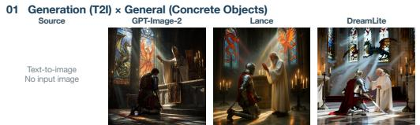  
Prompt: A medieval knight kneeling in front of a stone altar inside a cathedral with tall stained-glass windows depicting a dragon and a phoenix, colored light beams falling onto the marble floor, the knight wearing polished silver armor with a red cloth tunic and a sheathed sword at his side, an old bishop in white robes blessing him wit hand raised, candles flickering on iron candelabras, dust motes in the air, dramatic chiaroscuro lighting, cinematic.

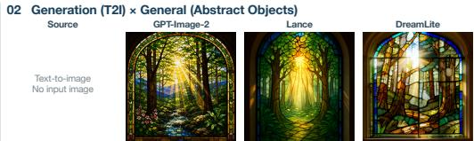  
Prompt: A stained glass window of a forest scene with sunlight shining through

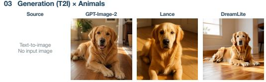  
Prompt: A golden retriever lying on a wooden floor and looking at the camera in soft afternoon light.

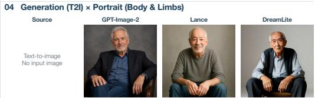  
Prompt: A studio photo of an older man seated casually with both hands visible

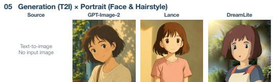  
Prompt: A Studio Ghibli style avatar of a teenage girl with short brown hair, soft sunlight.

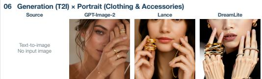

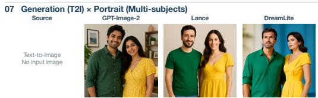  
Prompt: A close-up jewelry campaign portrait showing stacked gold rings and a delicate bracelet with both hands posed near the face.  
Prompt: A man wearing a green shirt and a woman wearing a yellow dress.

  
Prompt: A chalkboard with 'WELCOME' written in white chalk

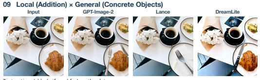  
Instruction: Add a knife and fork on the plate.

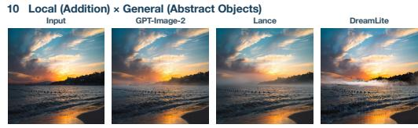  
Instruction: Add a thin layer of morning mist in the distance.

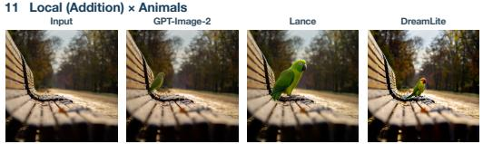  
Instruction: Add a small green parrot perched on the empty chair back with natural foot contact.

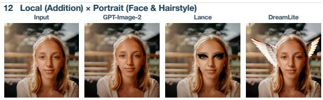  
Instruction: Add winged eyeliner extending outward

A = not available in the supplied results.Figure 7: Additional qualitative comparisons for generation and local addition (examples 1–12).

Model names and VLM judge scores are hidden from both annotators. They inspect the instructions, input images and model outputs, and answer the same questions as the VLM judges using the same 0, 0.6 and 1 anchors. Sample scores follow the same aggregation procedure as the automated evaluation.

Agreement. The annotators’ sample scores have a Spearman correlation of $\rho = 0 . 9 0 4$ . We average their sample scores to form a human reference.

GPT-4o and Gemini 3.1 Pro achieve correlations of $\rho = 0 . 7 7 9$ and $\rho = 0 . 8 5 2$ with this reference on the same outputs. This comparison concerns rubric-based scores rather than user preference.

## D.3 SENSITIVITY TO CRITERION-GROUP WEIGHTS

We reaggregate the existing GPT-4o judgments using equal criterion-group weights and by increasing or decreasing each default group weight by 25%, one group at a time. Weights are renormalized over applicable groups, while question scores, criterion applicability and sample inclusion remain fixed. We recompute Q and $C _ { 0 . 6 }$ and assign tiers using the final thresholds in Tab. 3. Criterion-group scores remain unchanged because the perturbations affect only their aggregation into sample quality.

14 Local (Addition) × Portrait (Multi-subjects) Input GPT-Image-2 Lance

DreamLite

17 Local (Remove) × General (Abstract Objects) Input GPT-Image-2 Lanc  

  
Instruction: Add a leather choker around the neck

  
Instruction: Add a red scarf to the leftmost woman without affecting adjacent people

  
16 Local (Remove) × General (Concrete Objects) Input GPT-Image-2 Lance

  
Instruction: Add the English words 'SCHOOL ZONE' to the blank road sign in bold uppercase letters.

  
Instruction: Remove the sun in the sky.

  
Instruction: Remove the colored lens flare without changing the image white balance

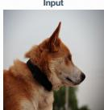

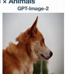  
Instruction: Remove the black col ar from the dog

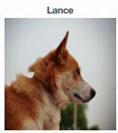

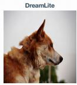

19 Local (Remove) × Portrait (Face & Hairstyle)  
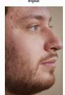

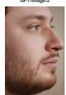  
Instruction: Remove the forehead acne while preserving fine hairs and natural skin texture.

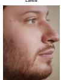

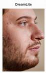

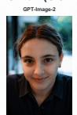  
Instruction: Remove the scarf around the person's neck and restore the shirt col ar beneath it.

  
Instruction: Remove the middle woman's glasse

  
Instruction: Remove the handwritten meno from the blackboard .

  
Instruction: replace the right vase with a bee

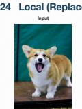

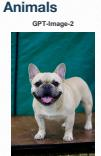  
Instruction: Replace the corgi with a French bul dog while preserving the pose and scale

  
Figure 8: Additional qualitative comparisons for local edit (examples 13–24).

Table 21: Sensitivity to criterion-group weights under GPT-4o. Changes are relative to the default weights across 19 models. Same tier counts unchanged assignments under the final quality thresh olds.
<table><tr><td>Setting</td><td>Mean |∆Q|</td><td>Max. |∆Q|</td><td>Spearman ρ</td><td>Same tier</td></tr><tr><td>Default</td><td>0.0000</td><td>0.0000</td><td>1.000</td><td>19/19</td></tr><tr><td>Equal weights</td><td>0.0016</td><td>0.0052</td><td>1.000</td><td>19/19</td></tr><tr><td>IF +25%</td><td>0.0009</td><td>0.0038</td><td>1.000</td><td>19/19</td></tr><tr><td>IF -25%</td><td>0.0011</td><td>0.0045</td><td>1.000</td><td>19/19</td></tr><tr><td>VQ +25%</td><td>0.0007</td><td>0.0029</td><td>1.000</td><td>19/19</td></tr><tr><td>VQ-25%</td><td>0.0009</td><td>0.0035</td><td>1.000</td><td>19/19</td></tr><tr><td>DP +25%</td><td>0.0008</td><td>0.0023</td><td>1.000</td><td>19/19</td></tr><tr><td>DP -25%</td><td>0.0009</td><td>0.0030</td><td>1.000</td><td>19/19</td></tr></table>

All tested settings preserve both the overall quality ranking and the quality tiers of all 19 models (Tab. 21). The largest absolute change in Q is 0.0052. These results indicate stability under the tested weight perturbations.

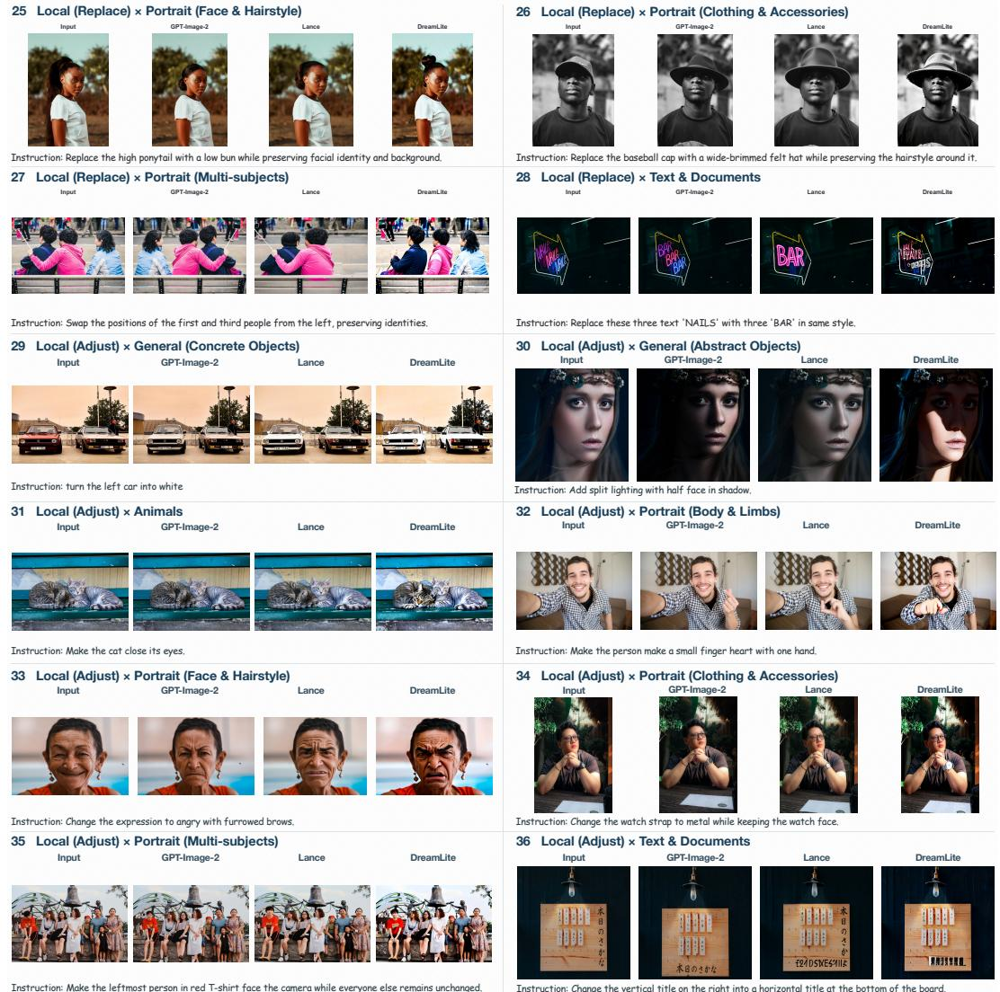  
Instruction: Make the leftmost person in red T-shirt face the camera while everyone else remains unchanged.

Figure 9: Additional qualitative comparisons for local edit (examples 25–36).

## D.4 SENSITIVITY TO TIER THRESHOLDS

Quality thresholds. Starting from Tab. 3, we shift all minimum requirements for Q, $C _ { 0 . 6 }$ and criterion-group scores by $\delta \in \{ - 0 . 0 5 , - 0 . 0 2 , 0 . 0 2 , 0 . 0 5 \}$ . The subtask quality cutoff used to compute $C _ { 0 . 6 }$ remains fixed at 0.6, and all scores remain unchanged. Tier assignments use the stored scores before rounding to the precision displayed in the paper. Between 15 and 19 models retain their default tiers (Tab. 22). Lowering thresholds by 0.05 moves LongCat-Image-Edit, DeepGen, Lance and Ovis-U1 from Q2 to Q3; a reduction of 0.02 moves only DeepGen. Increasing thresholds by 0.05 moves Nano Banana 2 and Seedream from Q4 to Q3 because their IF scores fall below the resulting 0.95 group requirement. All changes are limited to one tier.

Deployment thresholds. We multiply all D3 and D4 limits for size, latency and peak memory by α ∈ {0.8, 0.9, 1.1, 1.2}, keeping execution status fixed. The analysis uses the six iPhone 17 Pro baseline configurations in Tab. 8. All six models retain their tiers under a 10% budget reduction or a 10–20% increase. A 20% reduction moves Mobile-O and DreamLite from D3 to D2 because their model sizes exceed the reduced D3 storage limit of 1638.4 MiB. No evaluated configuration reaches D4 under any tested setting. These results distinguish stability to aggregation weights from sensitivity to the resource and quality requirements used to define tiers.

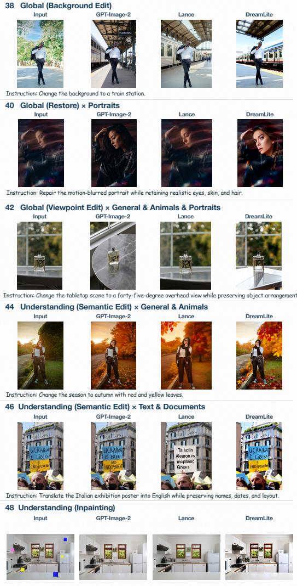

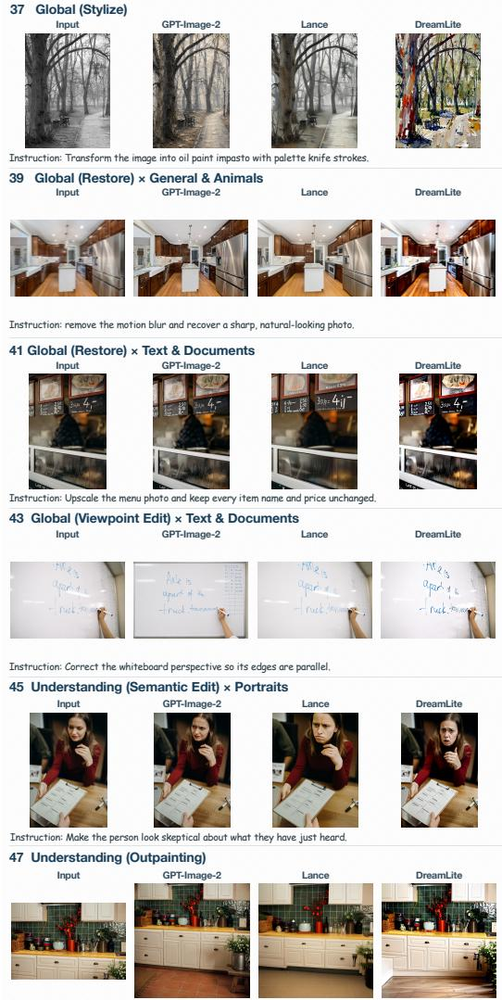  
Instruction: Outpaint vertically: extend the image downward to reveal more ground/floor.  
Instruction: Restore the image: remove the small colored rectangular occlusions and fill them in naturally.

Figure 10: Additional qualitative comparisons for global edit and understanding edit (examples 37– 48).

Table 22: Sensitivity to tier thresholds relative to Tab. 3. Quality requirements are shifted by δ and deployment limits are scaled by α. Unchanged counts are relative to the default tiers.
<table><tr><td>Setting</td><td></td><td>Unchanged Tier changes</td></tr><tr><td colspan="3">Q-tier: 19 models, GPT-4o</td></tr><tr><td>δ = −0.05</td><td>15/19</td><td>LongCat-Image-Edit, DeepGen 1.0, Lance-3B and Ovis-U1-3B: Q2 → Q3</td></tr><tr><td>δ = −0.02</td><td>18/19</td><td>DeepGen 1.0: Q2 → Q3</td></tr><tr><td>δ = +0.02</td><td>19/19</td><td>None</td></tr><tr><td>δ = +0.05</td><td>17/19</td><td>Nano Banana 2 and Seedream 5.0 Pro: Q4 → Q3</td></tr><tr><td colspan="3">D-tier: six on-device models, iPhone 17 Pro</td></tr><tr><td>α = 0.80</td><td>4/6</td><td>Mobile-O-0.5B and DreamLite: D3 → D2</td></tr><tr><td>α = 0.90</td><td>6/6</td><td>None</td></tr><tr><td>α = 1.10</td><td>6/6</td><td>None</td></tr><tr><td>α = 1.20</td><td>6/6</td><td>None</td></tr></table>

  
Instruction: Using the chair in this reference image, generate a new scene with it in a quiet modern reading room

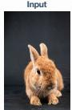  
Instruction: Using the referenced rabbit, generate a new garden scene while preserving its fur pattern and face.

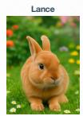

  
Instruction: Generate an academic professor headshot of this person: blurred bookshelf background, tweed jacket with collared shirt, intellectual neutral expression, head and shoulders.

  
52 Reference Edit (R1) × Portraits (Clothing & Accessories) Input GPT-Image-2 Lance  
53 Reference Edit (R1) × Portraits (Multi-subjects) Input GPT-Image-2 Lance DreamLite

  
Instruction: Extract the jacket worn by the person and generate a complete flat-lay product image with al sleeves visible.  
54 Reference Edit (R1) × Text & Documents Input GPT-Image-2 Lance DreamLite

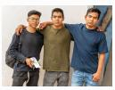

  
Instruction: Create a new graduation group portrait with all referenced people faithfully preserved.

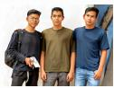

  
Instruction: Using the referenced hand-lettering style, generate an English community-market flyer.  
55 Reference Edit (B1+R1) × General (Concrete Objects) Input GPT-Image-2 FLUX.2 [klein]

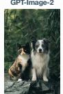  
Instruction: Use the referenced dog in image 2 to replace the right cat in image 1

  
56 Reference Edit (B1+R1) × General (Abstract Objects) Input GPT-Image-2 FLUX.2 [klein] OmniGen2

  
57 Reference Edit (B1+R1) × Animals Input GPT-Image-2

  
Instruction: Apply the reference image's lighting mood and color language in image 2 to restyle the image 1.

  
Instruction: Use the referenced two dogs in image 2 to replace the two dogs in image 1 while keeping the background unchanged.

  
Instruction: Swap the face identity from image 2 onto the seated person in image 1 while preserving the seated pose, glasses, clothes, and room.

  
Instruction: Make the person in image 1 wear the wedding dress shown in the image 2, keeping facial features unchanged.

  
Figure 11: Additional qualitative comparisons for reference edit (examples 49–60).

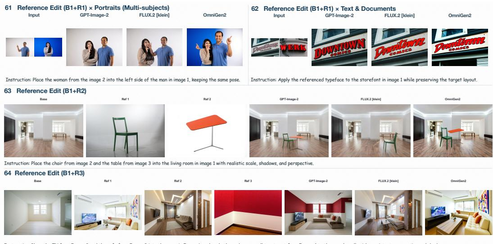  
Figure 12: Additional qualitative comparisons for reference edit (examples 61–64).