# Nemotron-Labs-Difusion-Uni: Elastic Self-Refining Unified Difusion LLM with Cross-Paradigm On-Policy Distillation

Shufan Li\*, Hanrong Ye\*, Greg Heinrich\*, Yonggan Fu, Haotian Zhang, Sifei Liu, Aditya Grover, Pavlo Molchanov

\*Core Contribution

We propose Nemotron-Labs-Difusion-Uni (NLD-Uni), a unified discrete difusion large language model (DLLM) for visual understanding and generation tasks. Compared with prior unified difusion models, NLD-Uni introduces two major innovations. First, we propose a unified cross-paradigm on-policy distillation (OPD) framework that successfully transfers the visual understanding ability of autoregressive VLMs and visual generation ability of continuous flow models, to a unified DLLM. Second, NLD-Uni incorporates a novel progressive self-refining difusion process that gradually corrupts each token across multiple steps during training, as opposed to adopting the conventional masked difusion formulation that directly corrupts a clean image token to an uninformative mask token. At inference, this design allows NLD-Uni to make intermediate commit to a token, enabling progressive self-refinement for better visual quality. Through extensive experiments, we show that NLD-Uni achieves state-of-the-art performance among unified DLLMs on diverse tasks including visual question-answering, multi-modal reasoning, object grounding, text-to-image generation, and image editing. Model and Code are publicly available.

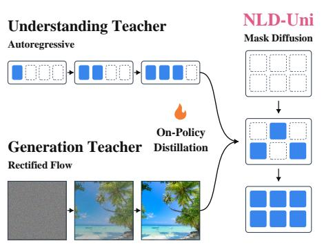

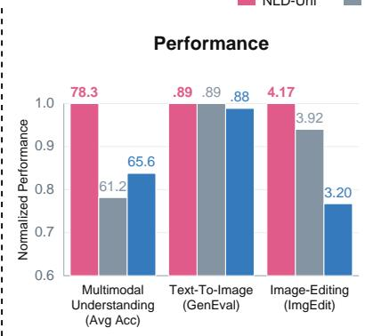

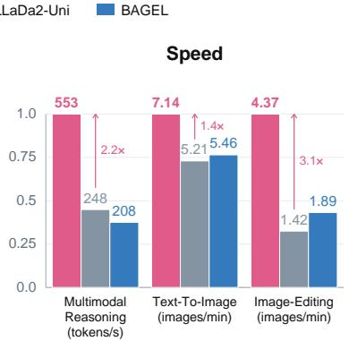  
Figure 1 | (Left) NLD-Uni introduces a new paradigm for building unified Difusion LLMs through on-policy distillation from cross-paradigm teachers: VLMs for visual understanding and continuous difusion models for visual generation. (Right) NLD-Uni achieves highly competitive visual understanding and generation performance. Visual understanding performance is averaged across tasks in Table 1. Text-to-image and image editing reports GenEval and ImgEdit Score. Multimodal reasoning is measured on MathVista. Axes are normalized by the best model’s performance on each task.

## 1. Introduction

Unified Multimodal Large Language Models (MLLMs) [1, 2, 3, 4] have achieved strong performance on diverse multimodal understanding and generation tasks. Compared with specialist models, they learn to perform diverse tasks via a unified sequence modeling interface, allowing synergetic learning that benefits each individual tasks [5]. They generally fall into two categories. The first design represents text and image as discrete tokens and employs a unified autoregressive (AR) modeling paradigm [6, 4, 7]. The second design combines autoregressive modeling for text generation and continuous difusion for image generation (AR+Dif) [5, 8, 9, 10]. Several recent works such as LaViDa-O [11] and MMaDA [12] explored a third alternative that builds a unified discrete difusion language model (unified DLLM) with masked difusion paradigm (MDM). Unlike AR models or continuous flow models, MDMs randomly mask discrete tokens in a sequence and learn to predict the masked tokens during training. At inference, MDMs initialize a fully masked sequence and gradually unmask tokens across multiple difusion steps. Compared with AR models, MDMs ofer faster inference speed because they can generate multiple tokens in parallel [13, 14]. Compared with AR+Dif setup, which needs to carefully balance conflicting AR and Difusion objectives [5], unified DLLMs ofer a single objective for both text and image, resulting in simplicity and, more importantly, scalability.

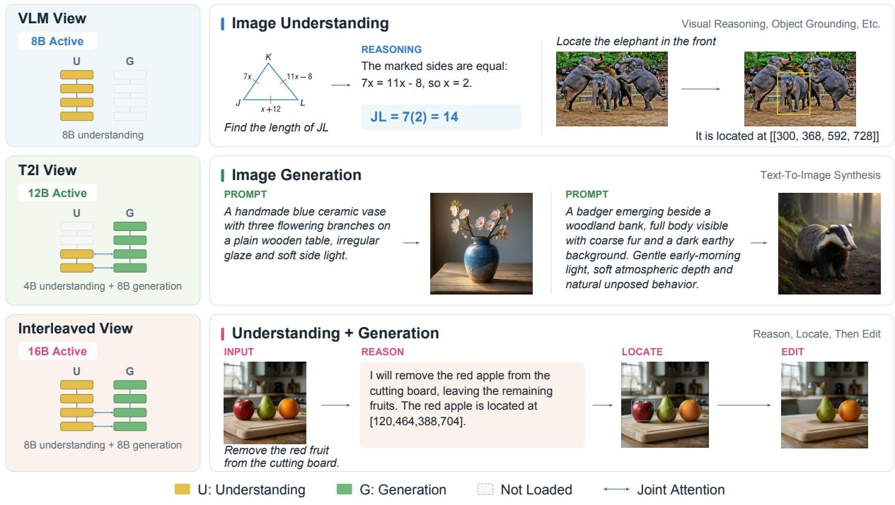  
Figure 2 | NLD-Uni supports diverse multimodal tasks by adopting an Elastic-MoT architecture with three elastic views of a single model. The VLM view uses the 8B understanding branch; the T2I view combines 4B understanding parameters with the 8B generation branch; and the interleaved view uses both full branches (16B). Each view loads only the parameters needed for its task. Yellow and green blocks denote understanding and generation layers, gray blocks indicate omitted layers, and blue arrows denote joint attention. Representative examples demonstrate visual reasoning, object grounding, text-to-image synthesis, and image editing guided by reasoning and localization.

Despite these advantages, a substantial performance gap remains between existing unified DLLMs and domain-specialized VLMs and continuous flow models [12, 11]. In this work, we seek to narrow these gaps by introducing NLD-Uni, a unified DLLM featuring a new training paradigm and new architecture.

First, although on-policy distillation (OPD) has proven highly efective in improving the visual understanding capabilities of VLMs [15] and the visual generation capabilities of continuous flow models [16], adapting it to unified MDMs is challenging because of a lack of strong-performing MDM teachers. Distilling from strong AR VLMs and continuous flow models is not feasible because they follow fundamentally diferent paradigms. To overcome this challenge, we propose cross-paradigm on-policy distillation (OPD), which enables NLD-Uni to learn from teachers with diferent generation paradigms, including an AR VLM teacher for visual understanding and a continuous flow teacher for visual generation.

Second, for visual generation tasks specifically, MDMs lack the self-refinement capabilities of continuous flow models. At inference, each token jumps directly from a masked state to a clean state and stays unchanged afterwards. Since MDMs sample tokens independently from per-token logit prediction, all tokens sampled at the same difusion step are assumed to be conditionally independent. This assumption rarely holds in practice since tokens from the same image are highly correlated. To address this limitation and enable iterative refinement, we introduce a self-refining masked difusion process that incorporates new intermediate states between the clean state and mask state. By breaking down the one-step jump to a multi-step transition, NLD-Uni enables fine-grained inter-token interaction and progressive self-correction, resulting in better visual quality.

To evaluate the efectiveness of NLD-Uni, we conduct extensive evaluations on a diverse range of multimodal understanding and generation tasks, including visual question answering, object grounding, multimodal reasoning, text-to-image generation, and image editing. Experiments show that NLD-Uni achieves state-of-theart performance among unified DLLMs and greatly reduces the gap to specialized AR VLMs and continuous flow models.

The main contributions of this work are summarized as follows: 1) We develop a cross-paradigm OPD framework that improves both visual understanding and generation by distilling knowledge from non-DLLM teachers. 2) We introduce a self-refining masked difusion process that improves visual generation quality over the canonical masked difusion process. 3) We present NLD-Uni, a state-of-the-art unified DLLM capable of both understanding and generating visual content. We acknowledge that while extensive experiments show the efectiveness of our proposed methods, the model can be further improved via better data mixture and architecture optimization.

## 2. Preliminaries and Related Works

## 2.1. Difusion Language Models

Discrete difusion language models [17, 13, 18] generate multiple text tokens in parallel, making them more eficient than AR models. However, its bidirectional attention introduces overhead compared to causal attention in AR models, particular for long sequences. Several works [19, 20] address this limitation through block-wise semi-auto-regressive generation. Notably, SBD [21, 22] incorporates variable-sized blocks during training, enabling flexible inference.

Formally, given a block of clean text tokens $B ^ { 0 }$ , the forward difusion process gradually mask it over the continuous time interva $t \sim [ 0 , 1 ]$ until it reaches a fully masked block $B ^ { 1 }$ containing only the mask token [m]. Given a multi-block token sequence $X = [ B _ { 1 } ^ { 0 } , B _ { 2 } ^ { 0 } , . . . B _ { N } ^ { 0 } ]$ , SBD models learn to predict the clean block $B _ { i } ^ { 0 }$ from its partially masked version $B _ { i } ^ { t }$ conditioned on all previous clean block. The optimization objective is defined as follows:

$$
{ \mathcal { L } } _ { \mathrm { S B D } } = \mathbb { E } _ { i \sim \{ 1 , 2 , . . N \} , t \sim [ 0 , 1 ] , X \sim \mathcal { D } } [ - \frac { 1 } { t } \log p ( B _ { i } ^ { 0 } | B _ { j < i } ^ { 0 } , B _ { i } ^ { t } ) ] ,\tag{1}
$$

where $\mathcal { D }$ is the data distribution. At inference, the blocks are sampled sequentially, but tokens in the same block are sampled in parallel across multiple difusion steps. NLD-Uni applies the SBD paradigm to unified multimodal modeling and treats each image as an integral block, whose size is resolution-dependent. Note that when block size reduces to 1, SBD models reduce to an AR model.

## 2.2. Masked Discrete Image Models

Masked image models generate images by initializing a fully-masked image and gradually unmasking image patches. Each patch is encoded to a discrete code through vector quantization (VQ) [23]. MaskGiT [24] pioneered this paradigm. Messonic [25] scaled it to large-scale T2I. Recent works such as LaViDa-O and MMaDa [11, 12] explored integrating masked image modeling to unified MLLMs. As discussed in Sec. 1, these models lack the self-refinement capabilities of continuous flow models. Some work mitigate this problem using a specialized unmasking schedule that prioritizes unmasking less-correlated tokens [26, 11]. Others explored revising already unmasked [27, 28]. However, these works are sensitive to heuristic-based confidence thresholds and still present a mismatch between training and inference setup.

## 2.3. On-Policy Distillation (OPD)

OPD [29, 30] enables capability transfers from a teacher model to a student model by providing teacher supervision signals on student-generated sequences. M-OPD [31] extends OPD to a multi-teacher setting to consolidate the capabilities of domain-specific experts. Several works [32, 33] explored OPD for multimodal understanding tasks. Difusion-OPD [16] further applies it to continuous flow models for visual generation tasks. However, OPD for DLLMs is currently underexplored. OPDLM [34] is the most relevant work, but its scope is limited to same-model distillation that converts a pure AR model to a DLLM with weaker performance but faster inference. Unlike prior work, we propose cross-paradigm OPD to jointly distill knowledge from a strong AR VLM teacher and an image difusion generation teacher into a unified DLLM.

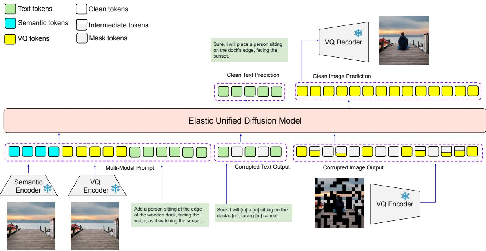  
Figure 3 | Overall Framework of NLD-Uni. NLD-Uni is a unified difusion model whose input and output are both multimodal. Images in the input stream are represented by both continuous embeddings of a semantic encoder and discrete tokens of a VQ encoder. Images in the output stream are represented solely using VQ codes. NLD-Uni is trained to predict the clean token distribution given partially masked inputs. For image generation, we incorporate an intermediate masking state.

Beyond the three areas above, NLD-Uni is closely related to broader literature on unified MLLMs, and we provide more discussion in Appendix D.1.

## 3. Method

## 3.1. Model Architecture

NLD-Uni adopts a two-tower Elastic Mixture-of-Transformer (Elastic MoT) design following Lavida-O [11], which consists of an understanding expert tower and generation expert tower. They interact with each other through a joint attention mechanism. The understanding tower is initialized with a difusion language model NLD [35], which uses the block-causal SBD formulation described in Section 2.1. The generation tower is initialized from an identical copy. Following the common design of unified MLLMs [5, 11], we encode images with both a semantic encoder and VQ encoder. Once images and texts are tokenized, the canonical SBD formulation can be directly applied. Elastic-MoT architecture is illustrated in Figure 2. Figure 3 illustrates the overall framework.

## 3.2. Discrete Difusion with Progressive Self-Refinement

The canonical mask discrete difusion uses binary mask states, where a token directly jumps between the mask and clean states. Diferently, our NLD-Uni incorporates intermediate states using the concept of token age $a \in \mathcal { A } = \{ 0 , 1 , 2 . . . K \}$ . In particular, � = 0 implies a token is in the clean state, � = � implies a token is in the fully-masked state. Crucially, � is a token-local discrete index and is diferent from the global continuous timestep $t \in [ 0 , 1 ]$

Formally, given a vocabulary �, we adopt the state space $S = \mathcal { V } \times \mathcal { A }$ as opposed to $S = \mathcal { V } \cup \{ [ m ] \}$ of standard MDMs. This is shown in Figure 4 (Left). We define the self-refining difusion process as the interaction of a discrete time per-token corruption process and a continuous time per-token jump schedule. Specifically, each token in $( c , a ) \in S$ can only transition to $( c ^ { \prime } , a + 1 )$ in the forward process, with $( * , 0 )$ being the initial states and $( * , K )$ being the terminal states. The transition probability is defined as $U _ { k | k - 1 } ( u | c )$ , which defines the probability of a token $( c , k - 1 )$ transits to $( c , k )$ . This generates a discrete time per-token corruption process where each token undergoes � jumps from initial clean state and terminal mask state. Given a token $X _ { i } ^ { 0 } = ( C _ { i } ^ { 0 } , A _ { i } ^ { 0 } )$ , the continuous time per-token jump schedule $b _ { i } ^ { t } ( a ) = \mathbb { P } ( A _ { i } ^ { t } = a )$ determines when the jumps occur for each token in the interval [0, 1]. It satisfies $b _ { i } ^ { 0 } ( 0 ) = 1$ and $b _ { i } ^ { 1 } ( K )$ = 1 at the initial and terminal states.

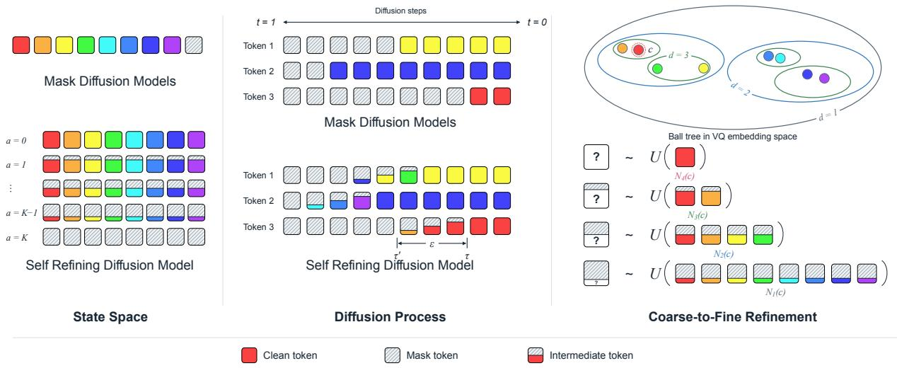  
Figure 4 | Design of Self-Refinement Process. (Left) We extend the state space of mask difusion with token age � with $a = 0$ being the clean state and $a = K$ being the masked state. (Middle) Instead of one-step jump, each token is progressively masked through the interval $( \tau , \tau ^ { \prime } )$ with length �. Colors encode diferent tokens. (Right) We implement the progression from age $a = 0$ to $a = K$ through random jumps based on a ball-tree in the embedding space. Token distributions are difused from a one-hot vector to balls with growing sizes. This example has tree depth $D = 4$

Per token Corruption Process. The per-step transition rate defined above generates the marginal $U _ { j \vert k } ( u \vert c )$ with $0 \leq k \leq j \leq K$ . It must satisfy $U _ { K | k } ( u | c ) = Q ( u )$ , where $Q ( u )$ is a stationary distribution over $\nu ,$ for all $k < K$ because the terminal state is semantically fully masked and cannot correlate to the initial states. We implement this by randomly replacing a token c with a sampled token u in the VQ embedding space, where the jump distance depends on the token age. Concretely, we construct a balanced binary ball tree [36] which is commonly used in eficient nearest neighbor search. Each node in the ball tree represents a high-dimensional ball. in the embedding space, with parent nodes having a larger radius than child nodes. Let $N _ { d } ( c )$ be the set of all tokens that share a common ancestor to � at depth $d ,$ and � be the tree depth, it satisfies $N _ { 1 } ( c ) = \nu$ for the root node and $N _ { D } ( c ) = \{ c \}$ for the leaf node. An example of this structure is shown in Figure 4 (top-right), where we visualize a 4-depth tree.

We define $U _ { k | k - 1 } ( u | c )$ as the uniform distribution over $N _ { D - k } ( c )$ , which gives the following forward and reverse marginal:

$$
U _ { j | k } ( u | c ) = \mathbf { 1 } \{ u \in N _ { D - j } ( c ) \} \frac { 1 } { | N _ { D - j } ( c ) | } ; \quad U _ { k | j } ( c | u , \hat { c } ) = U _ { k | 0 } ( c | \hat { c } ) , \forall u \in N _ { D - j } ( \hat { c } )\tag{2}
$$

where �^ is the initial token state at $a = 0$ , and $0 \leq k < j \leq K$ . LHS satisfies that the initial distribution is a one-hot distribution of the clean token and the terminal distribution is the uniform distribution over all masked states $( * , K )$ . RHS can be used at inference by substituting the clean token �^ with a model prediction. We defer full derivation to Appendix A.2.1. Figure 4 (bottom-right), illustrates the progression of marginal $U _ { j | 0 } ( \boldsymbol { \hat { c } } )$ . It corrupts the token �^ to progressively random tokens in progressively larger balls in the embedding space, until it reaches the terminal state. We adopt the ball-tree mainly for eficiency. The full pairwise distance matrix would require 32GB VRAM since NLD-Uni has 131k distinct VQ codes. By contrast, the corresponding 18-depth binary tree can be represented via a single 1D array taking only 524 KB VRAM.

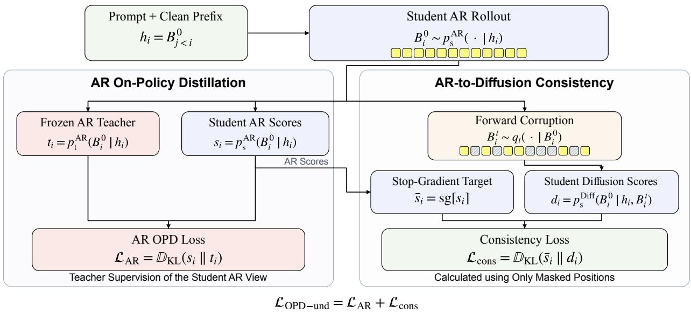  
Figure 5 | On-Policy Distilling from Autoregressive VLMs. Top: Given a prompt and clean prefix blocks, we generate the current block with the student’s AR view by temporarily adopting a block size of 1. Left: AR on-policy distillation loss aligns the student’s AR distribution with a frozen AR teacher. Right: Consistency loss aligns the student’s difusion view to its own AR view. The difusion prediction is obtained by evaluating the student on randomly masked AR rollouts. We apply stop-grad to the AR target.

Per-Token Jump Schedule embeds the discrete jumps in the continuous interval [0, 1]. We adopted DNDM [37]’s setup which generates the same forward marginal as vanilla MDM by first sampling a per-token jump time $\tau _ { i } \sim U ( [ 0 , 1 ] )$ for each token �. The forward token-age transition then becomes deterministic with each token jumps from the clean state to the mask state exactly at $t = \tau _ { i }$ . We extend this to support multiple intermediate states by sampling the interval $\left( \tau _ { i } , \tau _ { i } ^ { \prime } \right) \subset \left[ 0 , 1 \right]$ via $\tau _ { i } \sim U ( [ 0 , 1 - \epsilon ] )$ and set $\tau _ { i } ^ { \prime } = \tau _ { i } + \epsilon ,$ where � is a hyperparameter controlling the duration of intermediate states. When $\epsilon  0$ , the process reduces to DNDM. When $\epsilon = 1$ , all tokens are progressively corrupted at the same rate. To minimize the complexity, we let all intermediate token ages $1 , 2 , . . K - 1$ to progress uniformly in $( \tau , \tau ^ { \prime } )$ , taking $\frac { \epsilon } { K }$ time each. Given fixed $\epsilon \in ( 0 , 1 )$ , this establishes a bijection between every instance of per-token jump schedule to a one-step jump schedule in DNDM. This process becomes non-Markov as we cannot marginalize $\tau _ { i }$ . At training and inference, we presample $( \tau _ { i } , \tau _ { i } ^ { \prime } )$ for each token, then the changes in token age become deterministic. The forward and reverse marginal can be obtained by directly applying Equation 2 with change-of-variable. Particularly, at inference, token � stays masked in $[ \tau _ { i } ^ { \prime } , 1 ]$ , is progressively refined in $[ \tau _ { i } , \tau _ { i } ^ { \prime } ]$ and stays fixed in $[ 0 , \tau _ { i } ]$ . We defer additional details and derivations to Appendix A.2.2.

The most relevant work to NLD-Uni in this aspect is MDM-prime [38], which breaks tokens into subtokens to enable partial masking. However, its image experiments are limited to 32x32 low-res images. We find that it does not scale to our setting. By contrast, NLD-Uni makes use of codebook geometry to enable partial masking and unmasking in a coarse-to-fine manner, without the need to learn explicit sub-token representations. We provide more discussion in Appendix C.1.1.

## 3.3. Distillation of Visual Understanding Ability

To distill knowledge from AR teachers, we exploit SBD’s ability to operate with varying block sizes. As described in Section 2.1, SBD models the conditional distribution $p ( \bar { B } _ { i } ^ { 0 } \mid B _ { 1 } ^ { 0 } , \ldots , B _ { i - 1 } ^ { 0 } , \bar { B _ { i } ^ { t } } )$ for a sequence of blocks $X = [ B _ { 1 } ^ { 0 } , \dots , B _ { N } ^ { 0 } ]$ , predicting each clean block from its corrupted version and the preceding clean blocks. When block size is one, SBD reduces to a standard AR model (AR-view). Hence, we can directly supervise the student’s AR view with an AR teacher on student’s AR rollouts. However, using AR OPD loss alone would lose the capability of generating multiple tokens without any supervision on the difusion view.

A naive design is to directly copy the teacher score to the difusion following OPD-LM [34], however it creates ill-formed supervison signals due to context mismatch. As a concrete example, consider the student answer "Jason visited San Francisco" for a QA task. A teacher may want to respond "Jason visited New York" conditioned on the first two words and assigns high confidence to the token "New". This supervision target is reasonable in AR setting. However, if we employ a block size of 2 and consider the partial state "[m] Francisco", directly copying scores of AR teacher would guide the student generation towards generating "New Francisco", which is ill-formed.

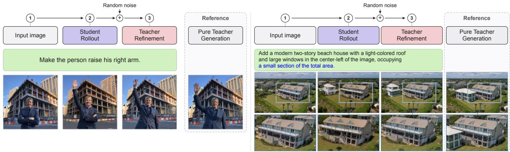  
Figure 6 | On-Policy Distilling from Continuous Flow Models. Given a student output, we generate a teacher-refined output by adding noise to the student sample and re-denoise it with the teacher model. For reference, we also show an independent teacher generation. We observe that the teacher’s refinements are closely aligned to the student’s output while having better visual fidelity and source image preservation.

To address this challenge, we propose a transitive distillation objective that supervises the student’s AR view with teacher scores and supervises the student’s difusion view with its own AR view. Specifically, we first generate a clean block $B _ { i } ^ { 0 }$ and supervise it with AR OPD loss. To supervise the difusion view, we apply the forward process and corrupt $B _ { i } ^ { 0 }$ to a partially masked version $B _ { i } ^ { t }$ and minimize the KL divergence between the student’s AR prediction and difusion prediction. The final understanding loss can be defined as follows:

$$
\mathit { \mathcal { L } } _ { \mathrm { O P D - u n d } } = \underbrace { \mathbb { D } _ { \mathrm { K L } } ( p _ { \mathrm { s } } ^ { \mathrm { A R } } ( B _ { i } ^ { 0 } | B _ { j < i } ^ { 0 } ) \parallel p _ { \mathrm { t } } ^ { \mathrm { A R } } ( B _ { i } ^ { 0 } | B _ { j < i } ^ { 0 } ) ) } _ { \mathrm { A R ~ O P D ~ L o s s } } + \underbrace { \mathbb { D } _ { \mathrm { K L } } ( p _ { \mathrm { s } } ^ { \mathrm { A R } } ( B _ { i } ^ { 0 } | B _ { j < i } ^ { 0 } ) \parallel p _ { \mathrm { s } } ^ { \mathrm { D i f f } } ( B _ { i } ^ { 0 } | B _ { j < i } ^ { 0 } , B _ { i } ^ { t } ) ) } _ { \mathrm { C o n s i s t e n c y ~ L o s s } }\tag{3}
$$

where $p _ { s } , p _ { t }$ denote student and teacher distributions. The first term is the standard AR OPD loss, the second term is a self-consistency loss. We apply stop-grad for $p _ { s } ^ { A R }$ in consistency loss and only evaluate masked positions. Crucially, while the context is still diferent, the AR scores have good alignment because tokens in $B _ { i } ^ { 0 }$ are sampled from $p _ { s } ^ { A R }$ with a low temperature.1 We note that OPD-LM [34] is applied to AR2Dif conversion where the student is initialized with the teacher weights. The teacher’s gap to the student’s AR-view is initially 0. Our setup distills an AR teacher that is larger and stronger to an already trained student difusion model, which is more general but has a considerable teacher-student distribution gap at initialization, creating ill-formed signals when applying OPD naively.2 The overall pipeline is illustrated in Figure 5. We defer additional details to Appendix C.3.

## 3.4. Distillation of Visual Generation Ability

Distilling continuous flow models to DLLM is more challenging as flow models operate in continuous latent spaces, making exact KL-style distribution matching infeasible. However, the general notion of using teacher supervision on student-generated sequences is still feasible. In this work, we explore cross-paradigm OPD for image editing tasks with Qwen-Image [39] teacher. Given a student output, we first re-encode it with the teacher’s continuous VAE. We then create a teacher supervision target by first adding noise to the student generation in teacher’s latent space and re-denoise it with the teacher model, conditioned on the input image and instruction. We call this target teacher-refined student output. This pipeline is shown in Figure 6 (right). We observe that teacher-refined images are semantically and spatially aligned to student generation, but with reduced artifacts, higher fidelity, and better source-image preservation. By contrast, independent teacher generations exhibit a larger gap to student generation. This distinction makes the refined samples ideal candidates for training targets. We also found that teacher-refined outputs can be better than independent teacher generations where the teacher model makes mistakes while the student model does not. We defer more discussion and examples to Appendix A.4.

Table 1 | Quantitative results on image-level understanding tasks. NLD-Uni is evaluated using a confidence-based difusion sampler following [51].
<table><tr><td>Model Split</td><td>MMMU val</td><td>RealWorldQA test</td><td>ChartQA test</td><td>DocVQA val</td><td>InfoVQA val</td><td>TextVQA val</td><td>AI2D test</td><td>RefCOCO val</td><td>Sci.QA test (img)</td><td>ScreenSpot-Pro test</td><td>OCRBenchV2 test (EN)</td></tr><tr><td colspan="10"></td></tr><tr><td>LLaVA-1.6-7B [52]</td><td>35.1</td><td></td><td>64.9</td><td>74.4</td><td>Autoregressive Models</td><td></td><td></td><td></td><td></td><td></td><td></td></tr><tr><td>Qwen2.5-VL-7B [53]</td><td>58.6</td><td></td><td>84.9</td><td>82.6</td><td>37.1</td><td></td><td></td><td>73.2</td><td></td><td></td><td></td></tr><tr><td>Qwen3-VL-8B [54]</td><td></td><td></td><td>89.6</td><td>95.6</td><td>83.4</td><td>82.9</td><td></td><td>75.2</td><td></td><td></td><td>78.1</td></tr><tr><td>Cosmos3-Nano [10]</td><td>69.6 60.9</td><td>71.5 72.2</td><td>85.5</td><td>94.5</td><td>81.5</td><td>83.4</td><td>84.8</td><td>93.0</td><td>54.6</td><td>64.1 65.9</td><td>77.9</td></tr><tr><td>BAGEL [5]</td><td>55.3</td><td>73.9</td><td>74.3</td><td>94.3</td><td>60.7</td><td>86.0</td><td>85.0 88.9</td><td>97.3</td><td>56.1 3.4</td><td>53.9</td><td>65.6</td></tr><tr><td colspan="10"></td></tr><tr><td>Dimple [55]</td><td>45.2</td><td></td><td>63.4</td><td></td><td>Discrete Diffusion Models</td><td></td><td>74.4</td><td></td><td></td><td></td><td></td></tr><tr><td>43.6</td><td></td><td></td><td></td><td></td><td></td><td></td><td></td><td>77.1 80.2</td><td></td><td></td><td></td></tr><tr><td>LaViDa [56]</td><td></td><td>54.5</td><td>64.6</td><td>59.0 88.3</td><td>34.2 57.8</td><td>71.8</td><td>70.0 74.7</td><td></td><td></td><td></td><td></td></tr><tr><td>NLD-VLM [35]</td><td>50.4 44.6</td><td>60.3 65.1</td><td>76.6 82.8</td><td>92.1</td><td>75.6</td><td>76.1</td><td>79.7</td><td>72.0 77.0</td><td>0.1 0.0</td><td>37.5 38.9</td><td>58.3 60.7</td></tr><tr><td>Fast-DVLM [57]</td><td>48.6</td><td>63.2</td><td>78.3</td><td>83.9</td><td>66.3</td><td></td><td></td><td>0.0</td><td></td><td></td><td></td></tr><tr><td>LLaDa-V [41]</td><td>30.2</td><td></td><td>9.8</td><td>10.9</td><td>14.9</td><td></td><td>77.8 66.6</td><td>55.8</td><td></td><td></td><td></td></tr><tr><td>MMaDa [12] LaViDa-O [11]</td><td>45.1</td><td></td><td>80.0</td><td>73.7</td><td>44.6</td><td></td><td>76.7</td><td>84.6</td><td></td><td></td><td></td></tr><tr><td>LLaDA2-Uni [58]</td><td>50.1</td><td>66.7</td><td>80.1</td><td>89.5</td><td>70.1</td><td>70.0</td><td>82.0</td><td>88.2</td><td>0.0 0.4</td><td>36.0</td><td>61.2</td></tr><tr><td>NLD-Uni</td><td>60.7</td><td>70.5</td><td>89.9</td><td>94.2</td><td>84.0</td><td>76.2</td><td>85.0</td><td></td><td>49.2</td><td>62.1</td><td>78.3</td></tr><tr><td>∆ vs. Diff. SOTA</td><td>+10.3</td><td>+3.8</td><td>+7.1</td><td>+2.1</td><td>+8.4</td><td>+0.1</td><td>+3.0</td><td></td><td>+48.8</td><td>+23.2</td><td>+17.1</td></tr></table>

We adopt the canonical SFT loss on the teacher-refined samples. While this is not “on-policy” in the conventional sense, it constructs teacher-refined targets from the current student’s own rollouts, adapting supervision to its evolving generation distribution. It closely connects to several concurrent OPD studies in AR language modeling [40], which also explored using teacher models to correct student rollouts.

## 4. Experiment results

## 4.1. Main Results

Setup. We train NLD-Uni in a three-stage manner. The first stage primarily includes text-image pairs for basic visual alignment and image generation capabilities. The second stage introduces additional data for instruction following, image editing, object grounding, and interleaved generation. The final stage is the unified OPD training stage, with Nemotron-3 Nano Omni as the teacher for multimodal reasoning tasks and Qwen-Image for image editing tasks. We also mix T2I SFT batches to preserve the text-to-image generation performance. Notably, we do not include an OPD teacher for T2I tasks because the base model’s performance on GenEval and HPSv3 is stronger than teacher candidates like Qwen-Image and Flux. The training is conducted on 64 H100 GPUs over 26 days. In particular, the final OPD stage takes 5 days. We defer additional details to Appendix B.

Generic Understanding Tasks. We report the performance of image understanding tasks in Table 1. NLD-Uni outperforms the previous state-of-the-art unified difusion model and difusion VLMs like LLaDa-V [41], NLD-VLM [35] and LaViDa-O [11] by considerable margin on a wide range of benchmarks such as MMMU [42], ChartQA [43], InfoVQA [44] and AI2D[45]. On object grounding benchmark RefCOCO [46] and GUI grounding benchmark ScreenSpot-Pro [47], NLD-Uni also demonstrates strong performance while most unified models are not equipped with this ability, unlocking new potential applications for difusion language models. These gains are mostly attributed to scaling training data. Overall, NLD-Uni reduces the gap between unified difusion models and state-to-the-art AR models on visual understanding.

Multimodal Reasoning Tasks. We report the performance of multimodal reasoning tasks in Table 2 and compare NLD-Uni with pre-OPD checkpoint (NLD-Uni-Base). Our proposed cross-paradigm OPD framework improves performance on a wide range of tasks, with most notable improvements in We-Math [48], Geometry3k [49], and MathVerse [50]. It also achieves state-of-the-art performance among difusion language models. We additionally include a naive OPD baseline using OPD-LM [34] style loss which directly copies teacher scores as the supervision target for difusion generation, this worsens the performance of NLD-Uni-Base because of the mismatch we identified in Section 3.3. These results highlight the efectiveness and necessity of the proposed cross-paradigm OPD framework.

Text-to-Image. We report results on GenEval [59], DPG [60], and HPS v3 [61] for a comprehensive evaluation. NLD-Uni achieves strong results on these benchmarks and outperforms existing unified difusion

Table 2 | Quantitative results on multi-modal reasoning benchmarks. \*Denotes naively applying teacher score to student’s difusion view using OPD-LM’s loss.
<table><tr><td>Model</td><td>MathVista</td><td>DynaMath</td><td>MathVision</td><td>MathVerse</td><td>Geometry3k</td><td>LogicVista</td><td>We-Math</td></tr><tr><td colspan="8">Autoregressive Models</td></tr><tr><td>Qwen2.5-VL-7B [53]</td><td>68.2</td><td>55.7</td><td>22.4</td><td>39.0</td><td>37.1</td><td>42.4</td><td>33.3</td></tr><tr><td>Qwen3-VL-8B [54]</td><td>77.2</td><td>62.2</td><td>37.9</td><td>67.7</td><td>57.5</td><td>50.1</td><td>69.0</td></tr><tr><td>BAGEL [5]</td><td>73.1</td><td></td><td>24.1</td><td></td><td></td><td></td><td>45.8</td></tr><tr><td colspan="8">Discrete Diffusion Models</td></tr><tr><td>Fast-dVLM [57]</td><td>57.3</td><td>51.3</td><td>20.2</td><td>33.7</td><td>27.0</td><td>37.1</td><td>41.0</td></tr><tr><td>NLD-VLM [35]</td><td>56.0</td><td>48.2</td><td>21.5</td><td>28.5</td><td>29.3</td><td>38.3</td><td>50.1</td></tr><tr><td>LLaDA2-Uni [58]</td><td>67.2</td><td>52.7</td><td>19.3</td><td>32.8</td><td>35.1</td><td>31.5</td><td>48.0</td></tr><tr><td>LaViDa-O [11]</td><td>54.0</td><td>36.1</td><td>13.8</td><td>27.0</td><td>23.5</td><td>34.2</td><td>34.5</td></tr><tr><td>NLD-Uni-Base</td><td>71.5</td><td>68.3</td><td>35.8</td><td>35.5</td><td>54.4</td><td>52.4</td><td>59.8</td></tr><tr><td>+ Naive OPD*</td><td>47.7</td><td>46.7</td><td>17.9</td><td>33.4</td><td>23.0</td><td>38.7</td><td>42.0</td></tr><tr><td>+ Cross-Paradigm OPD (NLD-Uni)</td><td>77.0</td><td>74.7</td><td>45.4</td><td>45.3</td><td>67.9</td><td>55.9</td><td>74.9</td></tr><tr><td>∆ vs. Base</td><td>+5.5</td><td>+6.4</td><td>+9.6</td><td>+9.8</td><td>+13.5</td><td>+3.5</td><td>+15.1</td></tr></table>

Table 3 | Text-to-Image Generation Performance on GenEval, DPG, and HPSv3. † LLaDa-2-Uni incorporates a pretrained 6B continuous difusion decoder. \*Half of the understanding layers are not loaded in T2I tasks due to the Elastic-MoT design.
<table><tr><td rowspan="2">Model</td><td rowspan="2">Family</td><td rowspan="2">Params</td><td colspan="7">GenEval</td><td>DPG</td><td>HPSv3</td></tr><tr><td></td><td>Single Obj.↑ Two Obj.↑</td><td>Counting↑</td><td>Colors↑</td><td>Position↑</td><td>Color Attri.↑</td><td>Overall↑</td><td>Overall↑</td><td>Score↑</td></tr><tr><td colspan="10">Gen. Only</td><td></td></tr><tr><td>SD3-Medium [63]</td><td>Cont.</td><td>2B</td><td>0.99</td><td>0.94</td><td>0.72</td><td>0.89</td><td>0.33</td><td>0.60</td><td>0.74</td><td>84.1</td><td></td></tr><tr><td>FLUX.1-dev [62]</td><td>Cont.</td><td>12B</td><td>0.98</td><td>0.81</td><td>0.74</td><td>0.79</td><td>0.22</td><td>0.45</td><td>0.66</td><td>83.8</td><td>10.88</td></tr><tr><td>Qwen-Image[39]</td><td>Cont.</td><td>20B</td><td>0.99</td><td>0.92</td><td>0.89</td><td>0.88</td><td>0.76</td><td>0.77</td><td>0.87</td><td>88.3</td><td>10.91</td></tr><tr><td>Meissonic [25]</td><td>Disc.</td><td>1B</td><td>0.99</td><td>0.66</td><td>0.42</td><td>0.86</td><td>0.10</td><td>0.22</td><td>0.54</td><td></td><td></td></tr><tr><td>NLD-Image[28]</td><td>Disc.</td><td>8B</td><td>0.98</td><td>0.93</td><td>0.83</td><td>0.94</td><td>0.88</td><td>0.82</td><td>0.90</td><td>85.2</td><td>9.61</td></tr><tr><td colspan="10">Unified MLLM</td></tr><tr><td>LLaDa-2-Uni [58]</td><td>Hybrid</td><td>16B+6B ↑</td><td>1.00</td><td>0.98</td><td>0.73</td><td>0.92</td><td>0.90</td><td>0.84</td><td>0.89</td><td>87.8</td><td>9.47</td></tr><tr><td>BAGEL [5]</td><td>Čont.</td><td>14B</td><td>0.98</td><td>0.95</td><td>0.84</td><td>0.95</td><td>0.78</td><td>0.77</td><td>0.88</td><td></td><td></td></tr><tr><td>Emu3 [7]</td><td>Disc.</td><td>8B</td><td></td><td></td><td></td><td></td><td></td><td></td><td>0.66</td><td>80.6</td><td></td></tr><tr><td>Janus-Pro [4]</td><td>Disc.</td><td>7B</td><td>0.99</td><td>0.89</td><td>0.59</td><td>0.90</td><td>0.79</td><td>0.66</td><td>0.80</td><td>84.1</td><td>8.81</td></tr><tr><td>MMaDA [12]</td><td>Disc.</td><td>8B</td><td>0.99</td><td>0.76</td><td>0.61</td><td>0.84</td><td>0.20</td><td>0.37</td><td>0.63</td><td>53.4</td><td>5.43</td></tr><tr><td>Show-o [64]</td><td>Disc.</td><td>1.3B</td><td>0.98</td><td>0.80</td><td>0.66</td><td>0.84</td><td>0.31</td><td>0.50</td><td>0.68</td><td></td><td>7.20</td></tr><tr><td>LaViDa-O [11]</td><td>Disc.</td><td>10B</td><td>0.99</td><td>0.85</td><td>0.71</td><td>0.86</td><td>0.65</td><td>0.58</td><td>0.77</td><td>81.8</td><td>8.81</td></tr><tr><td>NLD-Uni</td><td>Discrete.</td><td>12B*</td><td>0.99</td><td>0.96</td><td>0.79</td><td>0.87</td><td>0.90</td><td>0.82</td><td>0.89</td><td>86.6</td><td>11.12</td></tr></table>

MLLMs such as MMaDA [12] and LaViDa-O[11]. Most notably, on HPSv3 which measures visual quality, NLD-Uni closes the gap between discrete difusion models and continuous difusion models and even surpasses strong baselines like Flux.1-dev [62] and Qwen-Image [39], highlighting the efectiveness of the self-refining process.

Image-Editing. We report ImgEdit benchmark [65] in Table 4. NLD-Uni outperforms discrete difusion models like LaViDa-O [11] and RL-post-trained LaViDa-R1[66]. Compared with a boarder range of model families, NLD-Uni only underperforms GPT-4o and the Qwen-Image teacher, greatly reducing the gap between discrete difusion models and the state-of-the-art works. Compared with pre-OPD checkpoint NLD-Uni-Base, our cross-paradigm OPD leads to substantial improvements (+0.36). We also evaluate an of-policy KD baseline which supervises the student with independent teacher-generated samples. Our OPD framework, which uses teacher-refined student samples, outperforms the ofline setup by a considerable margin (+0.27). We provide more discussion in the appendix.

## 4.2. Ablation Studies

Self-Refining Difusion Process. We compare with the uniform difusion, masked difusion, and masked difusion with token editing [28] on GenEval, DPG, and HPSv3 in Figure 7. We use 64 difusion steps for all evaluations. We show the performance of models are trained with each method throughout a 20k-step run. On average, the proposed self-refining difusion process performs the best. NLD-Uni outperforms masked difusion overall. Compared with uniform difusion,NLD-Uni is comparable on GenEval, which checks high-level semantics using an object detector. On more fine-grained benchmarks like DPG and human-preference-aligned benchmarks like HPSv3, NLD-Uni consistently outperforms the uniform baseline. Among all benchmarks, the improvements on HPSv3 is the most significant, suggesting that the improvements of self-refinement is best for improving visual fidelity.

Cross-Paradigm On-policy Distillation. In Table 2 and 4, we compare our proposed OPD framework with a naive OPD baseline on multimodal reasoning and an of-policy KD baseline on image editing tasks. We provide more experiment studies, such as the design of each loss term, the relation between AR performance and difusion performance, and the efect of noise ratio in teacher refinement step to Appendix C.

Table 4 | Per-Category and overall scores on ImgEdit benchmark. \*Of-policy indicates we use an independent teacher output as the target, as opposed to teacher-refined student output.
<table><tr><td>Model</td><td>Add</td><td>Adjust</td><td>Extract Replace</td><td></td><td>Remove</td><td>Action</td><td>Background</td><td>Style</td><td>Hybrid</td><td>Overall</td></tr><tr><td colspan="13">Other Methods</td></tr><tr><td>Qwen-Image [39]</td><td>4.38</td><td>4.16</td><td>3.43</td><td>4.66</td><td>4.14</td><td>4.69</td><td>4.38</td><td>4.81</td><td>3.82</td><td></td><td>4.27</td></tr><tr><td>GPT-40 [1]</td><td>4.61</td><td>4.33</td><td>2.90</td><td>4.35</td><td>3.66</td><td>4.89</td><td>4.57</td><td></td><td>4.93</td><td>3.96</td><td>4.20</td></tr><tr><td>LLaDa2-Uni [58]</td><td>3.76</td><td>4.16</td><td>2.40</td><td>4.04</td><td>3.82</td><td>4.42</td><td></td><td>4.07</td><td>4.60</td><td>3.97</td><td>3.92</td></tr><tr><td>Qwen2.5VL+Flux [67]</td><td>4.07</td><td>3.79</td><td>2.04</td><td>4.13</td><td>3.89</td><td>4.52</td><td></td><td>3.90</td><td>4.84</td><td>3.04</td><td>3.80</td></tr><tr><td>FluxKontext dev [68]</td><td>3.76</td><td>3.45</td><td>2.15</td><td>3.98</td><td>2.94</td><td>4.26</td><td></td><td>3.78</td><td>4.38</td><td>2.96</td><td>3.52</td></tr><tr><td>OmniGen2 [69]</td><td>3.57</td><td>3.06</td><td>1.77</td><td>3.74</td><td>3.20</td><td>4.68</td><td></td><td>3.57</td><td>4.81</td><td>2.52</td><td>3.44</td></tr><tr><td>BAGEL [5]</td><td>3.56</td><td>3.31</td><td>1.70</td><td>3.30</td><td>2.62</td><td>4.17</td><td></td><td>3.24</td><td>4.49</td><td>2.38</td><td>3.20</td></tr><tr><td>Step1X-Edit [70]</td><td>3.88</td><td>3.14</td><td>1.76</td><td>3.40</td><td>2.41</td><td>2.52</td><td></td><td>3.16</td><td>4.63</td><td>2.64</td><td>3.06</td></tr><tr><td>InstructAny2Pix[71]</td><td>2.55</td><td>1.83</td><td>2.10</td><td>2.54</td><td>1.17</td><td>1.98</td><td></td><td>2.01</td><td>3.51</td><td>1.42</td><td>2.12</td></tr><tr><td>Instruct-Pix2Pix[72]</td><td>2.45</td><td>1.83</td><td>1.44</td><td>2.01</td><td>1.50</td><td>1.46</td><td></td><td>1.44</td><td>3.55</td><td>1.20</td><td>1.88</td></tr><tr><td colspan="12">Discrete Diffusion Models</td></tr><tr><td>LaViDa-O [11] LaViDa-R1[66]</td><td>4.04 4.25</td><td>3.62 3.90</td><td>2.01 2.32</td><td>4.39 4.52</td><td>3.98 4.06</td><td></td><td>3.54</td><td>4.06 3.86</td><td>4.82 4.87</td><td>2.94 3.10</td><td>3.71</td></tr><tr><td>NLD-Uni-Base</td><td></td><td>4.02</td><td>2.26</td><td>4.13</td><td>3.83</td><td>4.18 4.19</td><td></td><td></td><td>4.49</td><td></td><td>3.90</td></tr><tr><td>+ Off-Policy KD*</td><td>4.11</td><td>4.15</td><td>2.45</td><td>4.51</td><td>3.97</td><td>4.21</td><td></td><td>4.06 4.21</td><td>4.53</td><td>3.23 2.97</td><td>3.81</td></tr><tr><td>+ Cross-Paradigm OPD (NLD-Uni)</td><td>4.13 4.26</td><td>4.33</td><td>3.59</td><td>4.63</td><td>4.20</td><td>4.06</td><td></td><td>4.31</td><td>4.64</td><td>3.48</td><td>3.90 4.17</td></tr><tr><td></td><td></td><td></td><td></td><td></td><td></td><td></td><td></td><td></td><td></td><td></td><td></td></tr></table>

Self-Refining Diffusion (Ours) Uniform Diffusion Mask Diffusion Mask Diffusion + Token Edit  
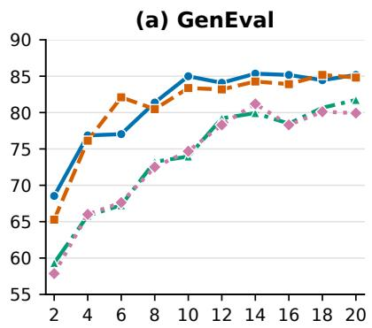

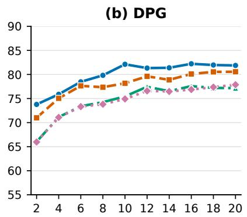  
Checkpoint $( \times 1 0 ^ { 3 }$ steps)

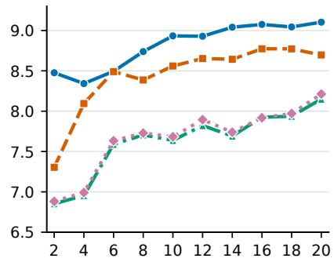  
Figure 7 | Ablation Studies on the Self-Refining Difusion Process. We report performance on GenEval (a) DPG (b) and HPSv3 (c) benchmarks at diferent training steps using diferent paradigm.

## 4.3. Qualitative Results

We present additional qualitative results of text-to-image generation in Figure 8 and image editing in Figure 9. These results highlight the strong generation capability of NLD-Uni.

## 5. Conclusion

Difusion language models have attracted considerable attention in recent years for their greater eficiency compared with autoregressive models and their unified interface for multimodal data. However, their performance in practice still lags behind that of state-of-the-art models, limiting their adoption. In this paper, we propose two methods for developing more capable DLLMs: cross-paradigm on-policy distillation, which transfers knowledge from diverse teacher models, and a self-refining difusion process, which improves visual generation quality. Extensive experiments demonstrate the efectiveness of both approaches. We hope NLD-Uni will ofer valuable insights for future research on DLLMs and unified multimodal systems.

  
A vintage film camera with a black leather strap on a wooden desk, realistic worn meta and textured leather, subtle window light. Photorealistic photograph, natural color and exposure, authentic material texture.  
A kingfisher perched on a mossy branch above a calm stream, blue and orange plumage, soft diffused daylight. Photorealistic photograph, natural color and exposure, authentic material texture  
A desert landscape of low sandstone formations and sparse shrubs, early morning side light, believable sand and rock textures. Photorealistic photograph, natural color and exposure, authentic material texture.  
A young adult man with round glasses leaning against an old brick wall, an olive jacket and an unposed expression, overcast daylight. Photorealistic photograph, natural color and exposure, authentic material texture.  
A small seashell on damp sand, delicate ridges and scattered mineral grains, soft morning coastal light. Photorealistic photograph, natural color and exposure, authentic material texture.

  
A calm bedroom with rumpled white linen bedding, a walnut bedside table, and a single book, soft overcast window light. Photorealistic photograph, natural color and exposure, authentic material texture.

A meadow of pale wildflowers beneath distant alpine peaks, an uneven footpath, late-spring daylight and natural depth. Photorealistic photograph, natural color and exposure, authentic material texture.

a woman dressed in a black outfit and a hat, dark fantasy female magician, female rouge assassin, dark witch character, female vampire warrior, olchas logan cure liang xing 2. 5 d

  
A small snail moving across a wet green leaf, fine shell texture and tiny water droplets, shallow natural depth of field. Photorealistic photograph, natural color and exposure, authentic material texture.

A modest living room with a cream linen sofa, oak side table, paperback, and leafy plant, garden-facing window, straight architectural lines. Photorealistic photograph, natural color and exposure, authentic material texture.

Animal, Weasel with orange fur wearing a wizard hat facing the camera, natural, sitting up, unreal engine, smooth, sharp features, sharp focus, heavenly dramatic lighting, volumetr

A still mountain lake surrounded by spruce trees, a slightly rippled reflection and a pale dawn sky, realistic subdued colors. Photorealistic photograph, natural color and exposure, authentic material texture.

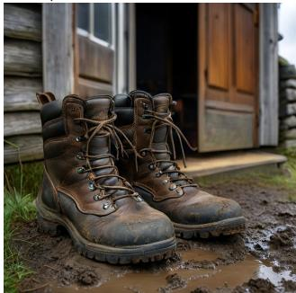  
A pair of worn leather hiking boots beside an open cottage door, real creases and a little dried mud, overcast daylight. Photorealistic photograph, natural color and exposure, authentic material texture.

  
An elderly fisherman in a weathered navy sweater on a quiet harbor, salt-and-pepper beard and fine wrinkles, soft morning light, candid waist-up portrait. Photorealistic photograph, natural color and exposure, authentic material texture.  
An artist's studio with paint-stained floorboards, an empty wooden easel, and stacked canvases, diffuse skylight. Photorealistic photograph, natural color and exposure, authentic material texture.

  
An empty black-sand beach with small white waves and distant sea cliffs, cool cloudy daylight, natural coastal atmosphere. Photorealistic photograph, natural color and exposure, authentic material texture.

Figure 8 | Qualitative Results on Text-to-Image Tasks. Results are sampled at 1024 × 1024 resolution.

Input  

Output  
  
Replace the bus with a truck.

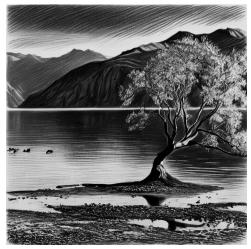

  
Output

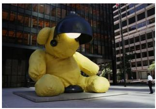  
Edit the background to be Shanghai's Bund.

Input  
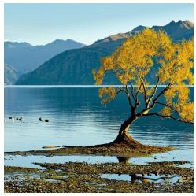

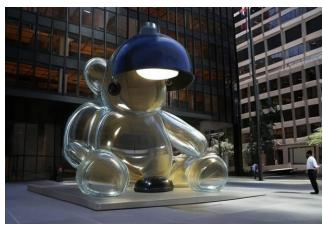  
Change the bear’s material to glass.

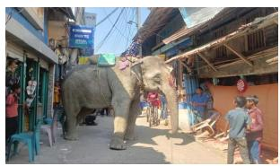

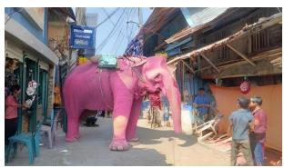  
Transfer the image into a dramatic charcoal-drawing style.

add a tennis ball next to the dog  
change the color of elephant to pink  
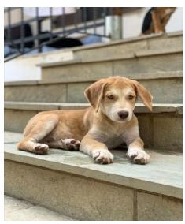

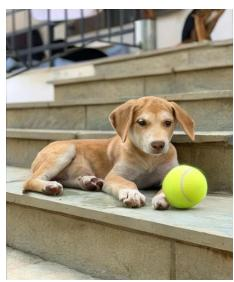

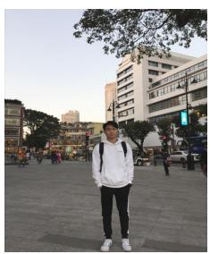

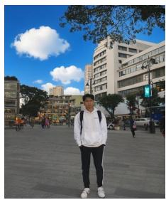  
Replace the sky in this image with blue skies and white clouds.

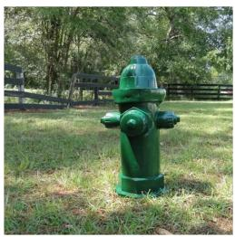  
change the weather to heavy rain

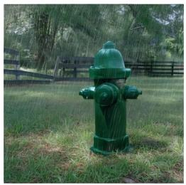

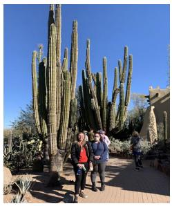

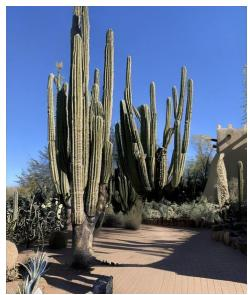  
Remove the bystanders

Figure 9 | Qualitative Results on Image Editing Tasks. For each input-output pair, we present the input image on the left and the output image on the right.

## References

[1] OpenAI. GPT-4o System Card. arXiv preprint arXiv:2410.21276, 2024.

[2] Gemini Team, Petko Georgiev, Ving Ian Lei, Ryan Burnell, Libin Bai, Anmol Gulati, Garrett Tanzer, Damien Vincent, Zhufeng Pan, Shibo Wang, et al. Gemini 1.5: Unlocking multimodal understanding across millions of tokens of context. arXiv preprint arXiv:2403.05530, 2024.

[3] Jiuhai Chen, Zhiyang Xu, Xichen Pan, Yushi Hu, Can Qin, Tom Goldstein, Lifu Huang, Tianyi Zhou, Saining Xie, Silvio Savarese, et al. Blip3-o: A family of fully open unified multimodal models-architecture, training and dataset. arXiv preprint arXiv:2505.09568, 2025.

[4] Xiaokang Chen, Zhiyu Wu, Xingchao Liu, Zizheng Pan, Wen Liu, Zhenda Xie, Xingkai Yu, and Chong Ruan. Janus-pro: Unified multimodal understanding and generation with data and model scaling. arXiv preprint arXiv:2501.17811, 2025.

[5] Chaorui Deng, Deyao Zhu, Kunchang Li, Chenhui Gou, Feng Li, Zeyu Wang, Shu Zhong, Weihao Yu, Xiaonan Nie, Ziang Song, et al. Emerging properties in unified multimodal pretraining. arXiv preprint arXiv:2505.14683, 2025.

[6] Jiasen Lu, Christopher Clark, Rowan Zellers, Roozbeh Mottaghi, and Aniruddha Kembhavi. Unified-io: A unified model for vision, language, and multi-modal tasks. arXiv preprint arXiv:2206.08916, 2022.

[7] Xinlong Wang, Xiaosong Zhang, Zhengxiong Luo, Quan Sun, Yufeng Cui, Jinsheng Wang, Fan Zhang, Yueze Wang, Zhen Li, Qiying Yu, et al. Emu3: Next-token prediction is all you need. arXiv preprint arXiv:2409.18869, 2024.

[8] Xichen Pan, Satya Narayan Shukla, Aashu Singh, Zhuokai Zhao, Shlok Kumar Mishra, Jialiang Wang, Zhiyang Xu, Jiuhai Chen, Kunpeng Li, Felix Juefei-Xu, et al. Transfer between modalities with metaqueries. arXiv preprint arXiv:2504.06256, 2025.

[9] Sicheng Mo, Thao Nguyen, Xun Huang, Siddharth Srinivasan Iyer, Yijun Li, Yuchen Liu, Abhishek Tandon, Eli Shechtman, Krishna Kumar Singh, Yong Jae Lee, et al. X-fusion: Introducing new modality to frozen large language models. arXiv preprint arXiv:2504.20996, 2025.

[10] NVIDIA. Cosmos 3: Omnimodal world models for physical ai. arXiv preprint arXiv:2606.02800, 2026.

[11] Shufan Li, Jiuxiang Gu, Kangning Liu, Zhe Lin, Zijun Wei, Aditya Grover, and Jason Kuen. Lavida-O: Elastic Masked Difusion Models for Unified Multimodal Understanding and Generation. arXiv preprint arXiv:2509.19244v1, 2025. Version 1.

[12] Ling Yang, Ye Tian, Bowen Li, Xinchen Zhang, Ke Shen, Yunhai Tong, and Mengdi Wang. MMaDA: Multimodal Large Difusion Language Models. arXiv preprint arXiv:2505.15809, 2025.

[13] Subham Sahoo, Marianne Arriola, Yair Schif, Aaron Gokaslan, Edgar Marroquin, Justin Chiu, Alexander Rush, and Volodymyr Kuleshov. Simple and efective masked difusion language models. Advances in Neural Information Processing Systems, 37:130136–130184, 2024.

[14] Jiaxin Shi, Kehang Han, Zhe Wang, Arnaud Doucet, and Michalis K. Titsias. Simplified and Generalized Masked Difusion for Discrete Data. In Advances in Neural Information Processing Systems, 2024.

[15] Ruiqi Liu, Xiaolei Lv, Gengsheng Li, Ximo Zhu, Zhiheng Wang, Zhengbo Zhang, Junkai Chen, Zhiheng Li, Bo Li, Jun Gao, et al. Visual-advantage on-policy distillation for vision-language models. arXiv preprint arXiv:2605.21924, 2026.

[16] Quanhao Li, Junqiu Yu, Kaixun Jiang, Yujie Wei, Zhen Xing, Pandeng Li, Ruihang Chu, Shiwei Zhang, Yu Liu, and Zuxuan Wu. DifusionOPD: A Unified Perspective of On-Policy Distillation in Difusion Models, 2026.

[17] Aaron Lou, Chenlin Meng, and Stefano Ermon. Discrete difusion modeling by estimating the ratios of the data distribution. arXiv preprint arXiv:2310.16834, 2023.

[18] Shen Nie, Fengqi Zhu, Zebin You, Xiaolu Zhang, Jingyang Ou, Jun Hu, Jun Zhou, Yankai Lin, Ji-Rong Wen, and Chongxuan Li. Large language difusion models. arXiv preprint arXiv:2502.09992, 2025.

[19] Marianne Arriola, Aaron Gokaslan, Justin T Chiu, Zhihan Yang, Zhixuan Qi, Jiaqi Han, Subham Sekhar Sahoo, and Volodymyr Kuleshov. Block difusion: Interpolating between autoregressive and difusion language models. arXiv preprint arXiv:2503.09573, 2025.

[20] Shuang Cheng, Yihan Bian, Dawei Liu, Yuhua Jiang, Yihao Liu, Linfeng Zhang, Qian Yao, Zhongbo Tian, Wenhai Wang, Qipeng Guo, et al. Sdar: A synergistic difusion-autoregression paradigm for scalable sequence generation. In Findings of the Association for Computational Linguistics: ACL 2026, pages 22058–22075, 2026.

[21] Itai Gat, Heli Ben-Hamu, Marton Havasi, Daniel Haziza, Jeremy Reizenstein, Gabriel Synnaeve, David Lopez-Paz, Brian Karrer, and Yaron Lipman. Set block decoding is a language model inference accelerator. arXiv preprint arXiv:2509.04185, 2025.

[22] Yuchen Zhu, Jing Shi, Chongjian Ge, Hao Tan, Yiran Xu, Wanrong Zhu, Jason Kuen, Koustava Goswami, Rajiv Jain, Yongxin Chen, et al. FLARE: Difusion for Hybrid Language Model. arXiv preprint arXiv:2606.01774, 2026.

[23] Patrick Esser, Robin Rombach, and Bjorn Ommer. Taming transformers for high-resolution image synthesis. In Proceedings of the IEEE/CVF conference on computer vision and pattern recognition, pages 12873–12883, 2021.

[24] Huiwen Chang, Han Zhang, Lu Jiang, Ce Liu, and William T Freeman. Maskgit: Masked generative image transformer. In Proceedings of the IEEE/CVF conference on computer vision and pattern recognition, pages 11315–11325, 2022.

[25] Jinbin Bai, Tian Ye, Wei Chow, Enxin Song, Xiangtai Li, Zhen Dong, Lei Zhu, and Shuicheng Yan. Meissonic: Revitalizing masked generative transformers for eficient high-resolution text-to-image synthesis. arXiv preprint arXiv:2410.08261, 2024.

[26] Victor Besnier, Mickael Chen, David Hurych, Eduardo Valle, and Matthieu Cord. Halton scheduler for masked generative image transformer. arXiv preprint arXiv:2503.17076, 2025.

[27] Guanghan Wang, Yair Schif, Subham Sahoo, and Volodymyr Kuleshov. Remasking discrete difusion models with inference-time scaling. Advances in Neural Information Processing Systems, 38:147282–147339, 2025.

[28] Shufan Li, Greg Heinrich, Hanrong Ye, Yonggan Fu, Aditya Grover, Jan Kautz, and Pavlo Molchanov. Nemotron-Labs-Difusion-Image: Advancing Masked Discrete Difusion for High-Resolution Image Synthesis. arXiv preprint arXiv:2606.29814, 2026.

[29] Rishabh Agarwal, Nino Vieillard, Yongchao Zhou, Piotr Stanczyk, Sabela Ramos, Matthieu Geist, and Olivier Bachem. On-Policy Distillation of Language Models: Learning from Self-Generated Mistakes. In International Conference on Learning Representations, 2024.

[30] Yuxian Gu, Li Dong, Furu Wei, and Minlie Huang. MiniLLM: Knowledge Distillation of Large Language Models. In International Conference on Learning Representations, 2024.

[31] Wenhan Ma, Jianyu Wei, Liang Zhao, Hailin Zhang, Bangjun Xiao, Lei Li, Qibin Yang, Bofei Gao, Yudong Wang, Rang Li, Jinhao Dong, Zhifang Sui, and Fuli Luo. MOPD: Multi-Teacher On-Policy Distillation for Capability Integration in LLM Post-Training, 2026.

[32] Qianhao Yuan, Jie Lou, Xing Yu, Hongyu Lin, Le Sun, Xianpei Han, and Yaojie Lu. Vision-opd: Learning to see fine details for multimodal llms via on-policy self-distillation. arXiv preprint arXiv:2605.18740, 2026.

[33] Dongze Hao, Zhiwei Jin, Chen Chen, and Haonan Lu. Stabilizing On-Policy Distillation for MLLM Reasoning with Global Normalization. arXiv preprint arXiv:2606.09091, 2026.

[34] Xingyu Su, Jacob Helwig, Shubham Parashar, Atharv Chagi, Lakshmi Jotsna, Degui Zhi, James Caverlee, Dileep Kalathil, and Shuiwang Ji. Data-Eficient Autoregressive-to-Difusion Language Models via On-Policy Distillation, 2026.

[35] Yonggan Fu, Lexington Whalen, Abhinav Garg, Chengyue Wu, Maksim Khadkevich, Nicolai Oswald, Enze Xie, Daniel Egert, Sharath Turuvekere Sreenivas, Shizhe Diao, et al. Nemotron-Labs-Difusion: A Tri-Mode Language Model Unifying Autoregressive, Difusion, and Self-Speculation Decoding. arXiv preprint arXiv:2607.05722, 2026.

[36] Qiang Huang and Anthony KH Tung. Lightweight-yet-eficient: Revitalizing ball-tree for point-to-hyperplane nearest neighbor search. In 2023 IEEE 39th International Conference on Data Engineering (ICDE), pages 436–449. IEEE, 2023.

[37] Zixiang Chen, Huizhuo Yuan, Yongqian Li, Yiwen Kou, Junkai Zhang, and Quanquan Gu. Fast sampling via discrete non-markov difusion models with predetermined transition time. Advances in Neural Information Processing Systems, 37:106870–106905, 2024.

[38] Chen-Hao Lance Chao, Wei-Fang Sun, Hanwen Liang, Chun-Yi Lee, and Rahul Krishnan. Beyond masked and unmasked: Discrete difusion models via partial masking. Advances in Neural Information Processing Systems, 38:97458–97500, 2025.

[39] Chenfei Wu, Jiahao Li, Jingren Zhou, Junyang Lin, Kaiyuan Gao, Kun Yan, Sheng-ming Yin, Shuai Bai, Xiao Xu, Yilei Chen, et al. Qwen-image technical report. arXiv preprint arXiv:2508.02324, 2025.

[40] Li Jiang, Haoran Xu, Yichuan Ding, and Amy Zhang. Trajectory-refined distillation. arXiv preprint arXiv:2606.08432, 2026.

[41] Zebin You, Shen Nie, Xiaolu Zhang, Jun Hu, Jun Zhou, Zhiwu Lu, Ji-Rong Wen, and Chongxuan Li. Llada-v: Large language difusion models with visual instruction tuning. arXiv preprint arXiv:2505.16933, 2025.

[42] Xiang Yue, Yuansheng Ni, Kai Zhang, Tianyu Zheng, Ruoqi Liu, Ge Zhang, Samuel Stevens, Dongfu Jiang, Weiming Ren, Yuxuan Sun, Cong Wei, Botao Yu, Ruibin Yuan, Renliang Sun, Ming Yin, Boyuan Zheng, Zhenzhu Yang, Yibo Liu, Wenhao Huang, Huan Sun, Yu Su, and Wenhu Chen. MMMU: A Massive Multi-discipline Multimodal Understanding and Reasoning Benchmark for Expert AGI. In Proceedings of CVPR, 2024.

[43] Ahmed Masry, Do Xuan Long, Jia Qing Tan, Shafiq Joty, and Enamul Hoque. ChartQA: A Benchmark for Question Answering about Charts with Visual and Logical Reasoning. In Findings of the Association for Computational Linguistics: ACL 2022, pages 2263–2279, Dublin, Ireland, May 2022. Association for Computational Linguistics.

[44] Minesh Mathew, Viraj Bagal, Rubèn Tito, Dimosthenis Karatzas, Ernest Valveny, and CV Jawahar. Infographicvqa. In Proceedings of the IEEE/CVF Winter Conference on Applications of Computer Vision, pages 1697–1706, 2022.

[45] Aniruddha Kembhavi, Mike Salvato, Eric Kolve, Minjoon Seo, Hannaneh Hajishirzi, and Ali Farhadi. A diagram is worth a dozen images. In Computer Vision–ECCV 2016: 14th European Conference, Amsterdam, The Netherlands, October 11–14, 2016, Proceedings, Part IV 14, pages 235–251. Springer, 2016.

[46] Sahar Kazemzadeh, Vicente Ordonez, Mark Matten, and Tamara Berg. Referitgame: Referring to objects in photographs of natural scenes. In Proceedings of the 2014 conference on empirical methods in natural language processing (EMNLP), pages 787–798, 2014.

[47] Kaixin Li, Ziyang Meng, Hongzhan Lin, Ziyang Luo, Yuchen Tian, Jing Ma, Zhiyong Huang, and Tat-Seng Chua. Screenspot-pro: Gui grounding for professional high-resolution computer use. In Proceedings of the 33rd ACM International Conference on Multimedia, pages 8778–8786, 2025.

[48] Runqi Qiao, Qiuna Tan, Guanting Dong, Minhui Wu, Chong Sun, Xiaoshuai Song, Jiapeng Wang, Zhuoma Gongque, Shanglin Lei, Yifan Zhang, et al. We-math: Does your large multimodal model achieve human-like mathematical reasoning? In Proceedings of the 63rd Annual Meeting of the Association for Computational Linguistics (Volume 1: Long Papers), pages 20023–20070, 2025.

[49] Pan Lu, Ran Gong, Shibiao Jiang, Liang Qiu, Siyuan Huang, Xiaodan Liang, and Song-Chun Zhu. Inter-gps: Interpretable geometry problem solving with formal language and symbolic reasoning. In Proceedings of the 59th Annual Meeting of the Association for Computational Linguistics and the 11th International Joint Conference on Natural Language Processing (Volume 1: Long Papers), pages 6774–6786, 2021.

[50] Renrui Zhang, Dongzhi Jiang, Yichi Zhang, Haokun Lin, Ziyu Guo, Pengshuo Qiu, Aojun Zhou, Pan Lu, Kai-Wei Chang, Peng Gao, et al. MathVerse: Does Your Multi-modal LLM Truly See the Diagrams in Visual Math Problems? arXiv preprint arXiv:2403.14624, 2024.

[51] Chengyue Wu, Hao Zhang, Shuchen Xue, Zhijian Liu, Shizhe Diao, Ligeng Zhu, Ping Luo, Song Han, and Enze Xie. Fast-dllm: Training-free acceleration of difusion llm by enabling kv cache and parallel decoding. arXiv preprint arXiv:2505.22618, 2025.

[52] Haotian Liu, Chunyuan Li, Yuheng Li, Bo Li, Yuanhan Zhang, Sheng Shen, and Yong Jae Lee. LLaVA-NeXT: Improved reasoning, OCR, and world knowledge, January 2024.

[53] Shuai Bai, Keqin Chen, Xuejing Liu, Jialin Wang, Wenbin Ge, Sibo Song, Kai Dang, Peng Wang, Shijie Wang, Jun Tang, et al. Qwen2.5-VL Technical Report. arXiv preprint arXiv:2502.13923, 2025.

[54] Shuai Bai, Yuxuan Cai, Ruizhe Chen, Keqin Chen, Xionghui Chen, Zesen Cheng, Lianghao Deng, Wei Ding, Chang Gao, Chunjiang Ge, et al. Qwen3-vl technical report. arXiv preprint arXiv:2511.21631, 2025.

[55] Runpeng Yu, Xinyin Ma, and Xinchao Wang. Dimple: Discrete difusion multimodal large language model with parallel decoding. arXiv preprint arXiv:2505.16990, 2025.

[56] Shufan Li, Konstantinos Kallidromitis, Hritik Bansal, Akash Gokul, Yusuke Kato, Kazuki Kozuka, Jason Kuen, Zhe Lin, Kai-Wei Chang, and Aditya Grover. Lavida: A large difusion language model for multimodal understanding. arXiv preprint arXiv:2505.16839, 2025.

[57] Chengyue Wu, Shiyi Lan, Yonggan Fu, Sensen Gao, Jin Wang, Jincheng Yu, Jose M Alvarez, Pavlo Molchanov, Ping Luo, Song Han, et al. Fast-dvlm: Eficient block-difusion vlm via direct conversion from autoregressive vlm. arXiv preprint arXiv:2604.06832, 2026

[58] Inclusion AI, Tiwei Bie, Haoxing Chen, Tieyuan Chen, Zhenglin Cheng, Long Cui, Kai Gan, Zhicheng Huang, Zhenzhong Lan, Haoquan Li, et al. Llada2. 0-uni: Unifying multimodal understanding and generation with difusion large language model. arXiv preprint arXiv:2604.20796, 2026.

[59] Dhruba Ghosh, Hannaneh Hajishirzi, and Ludwig Schmidt. Geneval: An object-focused framework for evaluating text-to-image alignment. Advances in Neural Information Processing Systems, 36:52132–52152, 2023.

[60] Xiwei Hu, Rui Wang, Yixiao Fang, Bin Fu, Pei Cheng, and Gang Yu. ELLA: Equip Difusion Models with LLM for Enhanced Semantic Alignment. arXiv preprint arXiv:2403.05135, 2024.

[61] Yuhang Ma, Xiaoshi Wu, Keqiang Sun, and Hongsheng Li. Hpsv3: Towards wide-spectrum human preference score. In 2025 IEEE/CVF International Conference on Computer Vision (ICCV), pages 15086–15095. IEEE, 2025.

[62] Black Forest Labs. FLUX, 2024.

[63] Patrick Esser, Sumith Kulal, Andreas Blattmann, Rahim Entezari, Jonas Müller, Harry Saini, Yam Levi, Dominik Lorenz, Axel Sauer, Frederic Boesel, et al. Scaling rectified flow transformers for high-resolution image synthesis. In Forty-first international conference on machine learning, 2024.

[64] Jinheng Xie, Weijia Mao, Zechen Bai, David Junhao Zhang, Weihao Wang, Kevin Qinghong Lin, Yuchao Gu, Zhijie Chen, Zhenheng Yang, and Mike Zheng Shou. Show-o: One single transformer to unify multimodal understanding and generation. arXiv preprint arXiv:2408.12528, 2024.

[65] Yang Ye, Xianyi He, Zongjian Li, Bin Lin, Shenghai Yuan, Zhiyuan Yan, Bohan Hou, and Li Yuan. Imgedit: A unified image editing dataset and benchmark. arXiv preprint arXiv:2505.20275, 2025.

[66] Shufan Li, Yuchen Zhu, Jiuxiang Gu, Kangning Liu, Zhe Lin, Yongxin Chen, Molei Tao, Aditya Grover, and Jason Kuen. LaViDa-R1: Advancing reasoning for unified multimodal difusion language models. arXiv preprint arXiv:2602.14147, 2026.

[67] Yuhan Wang, Siwei Yang, Bingchen Zhao, Letian Zhang, Qing Liu, Yuyin Zhou, and Cihang Xie. GPT-IMAGE EDIT-1.5M: A Million-Scale, GPT-Generated Image Dataset. arXiv preprint arXiv:2507.21033, 2025.

[68] Black Forest Labs, Stephen Batifol, Andreas Blattmann, Frederic Boesel, Saksham Consul, Cyril Diagne, Tim Dockhorn, Jack English, Zion English, Patrick Esser, Sumith Kulal, Kyle Lacey, Yam Levi, Cheng Li, Dominik Lorenz, Jonas Müller, Dustin Podell, Robin Rombach, Harry Saini, Axel Sauer, and Luke Smith. FLUX.1 Kontext: Flow Matching for In-Context Image Generation and Editing in Latent Space, 2025.

[69] Chenyuan Wu, Pengfei Zheng, Ruiran Yan, Shitao Xiao, Xin Luo, Yueze Wang, Wanli Li, Xiyan Jiang, Yexin Liu, Junjie Zhou, et al. OmniGen2: Exploration to Advanced Multimodal Generation. arXiv preprint arXiv:2506.18871v1, 2025. Version 1.

[70] Shiyu Liu, Yucheng Han, Peng Xing, Fukun Yin, Rui Wang, Wei Cheng, Jiaqi Liao, Yingming Wang, Honghao Fu, Chunrui Han, et al. Step1x-edit: A practical framework for general image editing. arXiv preprint arXiv:2504.17761, 2025.

[71] Shufan Li, Harkanwar Singh, and Aditya Grover. Instructany2pix: Flexible visual editing via multimodal instruction following. arXiv preprint arXiv:2312.06738, 2023.

[72] Tim Brooks, Aleksander Holynski, and Alexei A Efros. Instructpix2pix: Learning to follow image editing instructions. In Proceedings of the IEEE/CVF conference on computer vision and pattern recognition, pages 18392–18402, 2023.

[73] Christoph Schuhmann, Romain Beaumont, Richard Vencu, Cade Gordon, Ross Wightman, Mehdi Cherti, Theo Coombes, Aarush Katta, Clayton Mullis, Mitchell Wortsman, et al. Laion-5b: An open large-scale dataset for training next generation image-text models. Advances in neural information processing systems, 35:25278–25294, 2022.

[74] Minwoo Byeon, Beomhee Park, Haecheon Kim, Sungjun Lee, Woonhyuk Baek, and Saehoon Kim. COYO-700M: Image-Text Pair Dataset, 2022.

[75] Alexander Kirillov, Eric Mintun, Nikhila Ravi, Hanzi Mao, Chloe Rolland, Laura Gustafson, Tete Xiao, Spencer Whitehead, Alexander C Berg, Wan-Yen Lo, et al. Segment anything. In Proceedings of the IEEE/CVF international conference on computer vision, pages 4015–4026, 2023.

[76] Keqiang Sun, Junting Pan, Yuying Ge, Hao Li, Haodong Duan, Xiaoshi Wu, Renrui Zhang, Aojun Zhou, Zipeng Qin, Yi Wang, et al. Journeydb: A benchmark for generative image understanding. Advances in neural information processing systems, 36:49659–49678, 2023.

[77] Junying Chen, Zhenyang Cai, Pengcheng Chen, Shunian Chen, Ke Ji, Xidong Wang, Yunjin Yang, and Benyou Wang. ShareGPT-4o-Image: Aligning Multimodal Models with GPT-4o-Level Image Generation. arXiv preprint arXiv:2506.18095, 2025.

[78] Alec Radford, Jong Wook Kim, Chris Hallacy, Aditya Ramesh, Gabriel Goh, Sandhini Agarwal, Girish Sastry, Amanda Askell, Pamela Mishkin, Jack Clark, et al. Learning transferable visual models from natural language supervision. In International conference on machine learning, pages 8748–8763. PMLR, 2021.

[79] Christoph Schuhmann. LAION-AESTHETICS, 2022. Accessed: 2024 - 03 - 06.

[80] Bo Li, Yuanhan Zhang, Dong Guo, Renrui Zhang, Feng Li, Hao Zhang, Kaichen Zhang, Peiyuan Zhang, Yanwei Li, Ziwei Liu, and Chunyuan Li. Llava-onevision: Easy visual task transfer. arXiv preprint arXiv:2408.03326, 2024.

[81] Lin Chen and Long Xing. Open-LLaVA-NeXT: An open-source implementation of LLaVA-NeXT series for facilitating the large multi-modal model community., 2024.

[82] Jarvis Guo, Tuney Zheng, Yuelin Bai, Bo Li, Yubo Wang, King Zhu, Yizhi Li, Graham Neubig, Wenhu Chen, and Xiang Yue. Mammoth-vl: Eliciting multimodal reasoning with instruction tuning at scale. arXiv preprint arXiv:2412.05237, 2024.

[83] Yiming Jia, Jiachen Li, Xiang Yue, Bo Li, Ping Nie, Kai Zou, and Wenhu Chen. VisualWebInstruct: Scaling up Multimodal Instruction Data through Web Search. arXiv preprint arXiv:2503.10582, 2025.

[84] Hanoona Rasheed, Muhammad Maaz, Sahal Shaji, Abdelrahman Shaker, Salman Khan, Hisham Cholakkal, Rao M. Anwer, Eric Xing, Ming-Hsuan Yang, and Fahad S. Khan. GLaMM: Pixel Grounding Large Multimoda Model. In Proceedings of the IEEE/CVF Conference on Computer Vision and Pattern Recognition, pages 13009–13018, 2024.

[85] NVIDIA, Amala Sanjay Deshmukh, Kateryna Chumachenko, Tuomas Rintamaki, Matthieu Le, Tyler Poon, Danial Mohseni Taheri, Ilia Karmanov, Guilin Liu, Jarno Seppanen, Arushi Goel, et al. Nemotron 3 nano omni: eficient and open multimodal intelligence. arXiv preprint arXiv:2604.24954, 2026.

[86] Bin Lin, Zongjian Li, Xinhua Cheng, Yuwei Niu, Yang Ye, Xianyi He, Shenghai Yuan, Wangbo Yu, Shaodong Wang, Yunyang Ge, et al. UniWorld: High-Resolution Semantic Encoders for Unified Visual Understanding and Generation. arXiv preprint arXiv:2506.03147v1, 2025. Version 1.

[87] Guanzhou Chen, Erfei Cui, Changyao Tian, Danni Yang, Ganlin Yang, Yu Qiao, Hongsheng Li, Gen Luo, and Hongjie Zhang. Scaleedit-12m: Scaling open-source image editing data generation via multi-agent framework. arXiv preprint arXiv:2603.20644, 2026.

[88] Yufeng Cui, Honghao Chen, Haoge Deng, Xu Huang, Xinghang Li, Jirong Liu, Yang Liu, Zhuoyan Luo, Jinsheng Wang, Wenxuan Wang, et al. Emu3. 5: Native multimodal models are world learners. arXiv preprint arXiv:2510.26583, 2025.

[89] Greg Heinrich, Mike Ranzinger, Hongxu Yin, Yao Lu, Jan Kautz, Andrew Tao, Bryan Catanzaro, and Pavlo Molchanov. RADIOv2.5: Improved Baselines for Agglomerative Vision Foundation Models. In Proceedings of the IEEE/CVF Conference on Computer Vision and Pattern Recognition, pages 22487–22497, 2025.

[90] Alex Krizhevsky. Learning multiple layers of features from tiny images. Technical report, University of Toronto, Toronto, Ontario, Canada, 2009.

[91] Jia Deng, Wei Dong, Richard Socher, Li-Jia Li, Kai Li, and Li Fei-Fei. Imagenet: A large-scale hierarchical image database. In 2009 IEEE conference on computer vision and pattern recognition, pages 248–255. Ieee, 2009.

[92] Moonshot AI. Kimi k2.6. https://huggingface.co/moonshotai/Kimi-K2.6, 2026.

[93] Weixin Liang, Lili Yu, Liang Luo, Srinivasan Iyer, Ning Dong, Chunting Zhou, Gargi Ghosh, Mike Lewis, Wen-tau Yih, Luke Zettlemoyer, et al. Mixture-of-transformers: A sparse and scalable architecture for multi-modal foundation models. arXiv preprint arXiv:2411.04996, 2024.

[94] Weijia Shi, Xiaochuang Han, Chunting Zhou, Weixin Liang, Xi Victoria Lin, Luke Zettlemoyer, and Lili Yu. LMFusion: Adapting Pretrained Language Models for Multimodal Generation. arXiv preprint arXiv:2412.15188, 2024.

[95] xAI. RealWorldQA Dataset, 2024.

[96] Minesh Mathew, Dimosthenis Karatzas, and CV Jawahar. Docvqa: A dataset for vqa on document images. In Proceedings of the IEEE/CVF winter conference on applications of computer vision, pages 2200–2209, 2021.

[97] Amanpreet Singh, Vivek Natarajan, Meet Shah, Yu Jiang, Xinlei Chen, Dhruv Batra, Devi Parikh, and Marcus Rohrbach. Towards VQA Models That Can Read. In Proceedings of the IEEE Conference on Computer Vision and Pattern Recognition, pages 8317–8326, 2019.

[98] Pan Lu, Swaroop Mishra, Tony Xia, Liang Qiu, Kai-Wei Chang, Song-Chun Zhu, Oyvind Tafjord, Peter Clark, and Ashwin Kalyan. Learn to Explain: Multimodal Reasoning via Thought Chains for Science Question Answering. In The 36th Conference on Neural Information Processing Systems (NeurIPS), 2022.

[99] Ling Fu, Zhebin Kuang, Jiajun Song, Mingxin Huang, Biao Yang, Yuzhe Li, Linghao Zhu, Qidi Luo, Xinyu Wang, Hao Lu, et al. Ocrbench v2: An improved benchmark for evaluating large multimodal models on visual text localization and reasoning. Advances in Neural Information Processing Systems, 38, 2026.

[100] Pan Lu, Hritik Bansal, Tony Xia, Jiacheng Liu, Chunyuan Li, Hannaneh Hajishirzi, Hao Cheng, Kai-Wei Chang, Michel Galley, and Jianfeng Gao. Mathvista: Evaluating mathematical reasoning of foundation models in visual contexts. arXiv preprint arXiv:2310.02255, 2023.

[101] Ke Wang, Junting Pan, Weikang Shi, Zimu Lu, Houxing Ren, Aojun Zhou, Mingjie Zhan, and Hongsheng Li. Measuring Multimodal Mathematical Reasoning with MATH-Vision Dataset. In The Thirty-eighth Conference on Neural Information Processing Systems Datasets and Benchmarks Track, 2024.

[102] Chengke Zou, Xingang Guo, Rui Yang, Junyu Zhang, Bin Hu, and Huan Zhang. Dynamath: A dynamic visual benchmark for evaluating mathematical reasoning robustness of vision language models. In International Conference on Learning Representations, volume 2025, pages 48337–48383, 2025.

[103] Yijia Xiao, Edward Sun, Tianyu Liu, and Wei Wang. Logicvista: Multimodal llm logical reasoning benchmark in visual contexts. arXiv preprint arXiv:2407.04973, 2024.

[104] Alexander H Liu, Kartik Khandelwal, Sandeep Subramanian, Victor Jouault, Abhinav Rastogi, Adrien Sadé, Alan Jefares, Albert Jiang, Alexandre Cahill, Alexandre Gavaudan, et al. Ministral 3. arXiv preprint arXiv:2601.08584, 2026.

[105] Yifan Niu, Han Xiao, Dongyi Liu, Zelong Wang, Dihong Gong, Yasheng Wang, and Jia Li. Breaking the Tokenizer Barrier: On-Policy Distillation across Model Families, 2026.

## A. Additional Technical Details

## A.1. Formulations of SBD Models

This section briefly describes the formulation of SBD models. NLD-Uni largely adopts its canonical form.

Given a sequence of discrete tokens $X ^ { 0 } = [ X _ { 1 } ^ { 0 } , X _ { 2 } ^ { 0 } , . . X _ { L } ^ { 0 } ]$ , AR models generate tokens by repetitively sampling from the next-token prediction $p ( X _ { i } ^ { 0 } | X _ { j < i } ^ { 0 } )$ . By contrast, masked discrete difusion models (MDMs) initialize a fully masked sequence $X ^ { 1 } = [ [ m ] , [ m ] , \ldots ]$ and gradually unmask tokens during the continuous interval [0, 1] through the reverse process $p ( X ^ { s } | X ^ { t } )$ , where $0 \leq s \leq t \leq 1$ , until the sequence reaches a clean state $X ^ { 0 ^ { \circ } }$ that consists of only non-mask tokens. At each step, tokens are sampled independently by assuming the factorization $\begin{array} { r } { p ( X ^ { s } | X ^ { t } ) = \prod _ { i } p ( X _ { i } ^ { s } | X ^ { t } ) } \end{array}$ . Since $p ( X _ { i } ^ { s } | X ^ { t } )$ depends on the entire sequence $X ^ { t }$ for every token position �, MDMs employ bidirectional attention over the full sequence as opposed to causal attention in AR models. Consequently, MDMs sufer from eficiency bottlenecks despite being capable of generating multiple tokens in parallel.

To address this limitation, models like Block Difusion [19], SDAR [20] and SBD [21] adopt a semiautoregressive generation paradigm.

Specifically, the full sequence $X ^ { 0 } = [ X _ { 1 } ^ { 0 } , X _ { 2 } ^ { 0 } , . . X _ { L } ^ { 0 } ]$ is broken down into multiple consecutive multi-token blocks $X ^ { 0 } = [ B _ { 1 } ^ { 0 } , . . . B _ { K } ^ { 0 } ]$ . The tokens within each block are generated with the standard MDM sampling process, but the blocks are sampled sequentially from left to right. This design only requires within-block bidirectional attention, greatly reducing the compute cost of fully bidirectional MDMs.

Formally, let $X _ { b , i } ^ { t }$ denote the �-th token in the �-th block. The forward difusion process is defined as

$$
q ( X _ { b , i } ^ { t } | X _ { b , i } ^ { s } ) = \left\{ \begin{array} { l l } { \mathbf { M } , } & { \mathrm { i f ~ } X _ { b , i } ^ { s } = [ M ] } \\ { \frac { 1 - t } { 1 - s } \mathbf { X _ { b , i } ^ { s } } + \frac { t - s } { 1 - s } \mathbf { M } , } & { \mathrm { i f ~ } X _ { b , i } ^ { s } \neq [ M ] , } \end{array} \right.\tag{4}
$$

where $0 \leq s \leq t \leq 1$ , and M, $\mathbf { X _ { b , i } ^ { s } }$ are one-hot probability vectors corresponding to the mask token [m] and the clean token $X _ { b , i } ^ { s }$

When $s = 0$ , we obtain the following marginal:

$$
q ( X _ { b , i } ^ { t } | X _ { b , i } ^ { 0 } ) = ( 1 - t ) \mathbf { X _ { b , i } ^ { 0 } } + t \mathbf { M } .\tag{5}
$$

The posterior of the reverse process $p ( X ^ { s } | X ^ { t } , X ^ { 0 } )$ has the following form [13]:

$$
p ( \boldsymbol { X } _ { b , i } ^ { s } | \boldsymbol { X } _ { b , i } ^ { 0 } , \boldsymbol { X } _ { b , i } ^ { t } ) = \left\{ \mathbf { X _ { b , i } ^ { t } } \qquad \mathrm { i f ~ } \boldsymbol { X } _ { b , i } ^ { t } \neq [ M ] \right.\tag{6}
$$

Practically, a neural network � is used to model the clean token prediction $p _ { \theta } ( X _ { b , i } ^ { 0 } | B _ { j < b } ^ { 0 } , B _ { b } ^ { t } )$ conditioned on the partially masked current block $B _ { b } ^ { t }$ and all previous clean blocks $B _ { j < b } ^ { 0 }$ , which gives the following transition:

$$
p _ { \theta } ( X _ { b , i } ^ { s } | B _ { j < b } ^ { 0 } , B _ { b } ^ { t } ) = \left\{ \begin{array} { l l } { \mathbf { X _ { b , i } ^ { t } } } & { \mathrm { i f ~ } X _ { b , i } ^ { t } \neq [ M ] } \\ { \frac { t - s } { t } p _ { \theta } ( X _ { b , i } ^ { 0 } | B _ { j < b } ^ { 0 } , B _ { b } ^ { t } ) + \frac { s } { t } \mathbf { M } , } & { \mathrm { i f ~ } X _ { b , i } ^ { t } = [ M ] . } \end{array} \right.\tag{7}
$$

Training Process. SBD employs a specialized attention mask to allow parallel training over multiple blocks. Given a sequence $X ^ { 0 } = [ \bar { X _ { 1 } ^ { 0 } } , \bar { X _ { 2 } ^ { 0 } } , . . \bar { X _ { N } ^ { 0 } } ]$ sampled from some data distribution � and a randomly sampled timestep $t \sim U ( [ 0 , 1 ] )$ , we first divide $X ^ { 0 }$ into consecutive blocks $B _ { 1 } ^ { 0 } , . . . B _ { K } ^ { 0 }$ and construct corresponding partially masked blocks $B _ { 1 } ^ { t } , . . . B _ { K } ^ { t }$ using the forward marginal in Equation 5. The input to the model is constructed by concatenating the clean sequence and partially masked sequence, obtaining $[ { \cal B } _ { 1 } ^ { 0 } , . . . { \cal B } _ { K } ^ { 0 } , { \cal B } _ { 1 } ^ { t } , . . . { \cal B } _ { K } ^ { t } ]$ . A specialized attention mask is used to ensure the correct semantics and allow for parallel multi-block training. In particular, tokens in the clean block $B _ { i } ^ { 0 }$ can attend to preceding clean tokens in $B _ { i } ^ { 0 }$ and all tokens in preceding clean blocks $B _ { j < i } ^ { 0 }$ . Tokens in the partially masked block $B _ { i } ^ { t }$ can attend to all tokens in the same partially masked block $B _ { i } ^ { t }$ and all tokens in preceding clean blocks $B _ { j < i } ^ { 0 }$ . The loss target is simply the concatenated clean sequence $Y = X ^ { 0 } | X ^ { 0 }$ shifted by 1 position to the left. This design is illustrated in Figure 10.

At each training step, the block size is randomized. The loss is also applied on the causal clean token portion of the input, which corresponds to a block size of one and is efectively an AR view. We note that NLD-Uni adopts a position-shifted variant of SBD [22] to better align the AR-view and difusion view with a block size larger than 1, as opposed to the vanilla version [21] which does not shift tokens on the partially masked portion of the input and has a mismatch between the AR view and the block-size-one difusion view.

In pure language modeling, a sequence is divided into equally sized blocks. NLD-Uni further allows varying-sized blocks in the same sequence because it ensures tokens from the same image belong to the same block and can attend to each other.

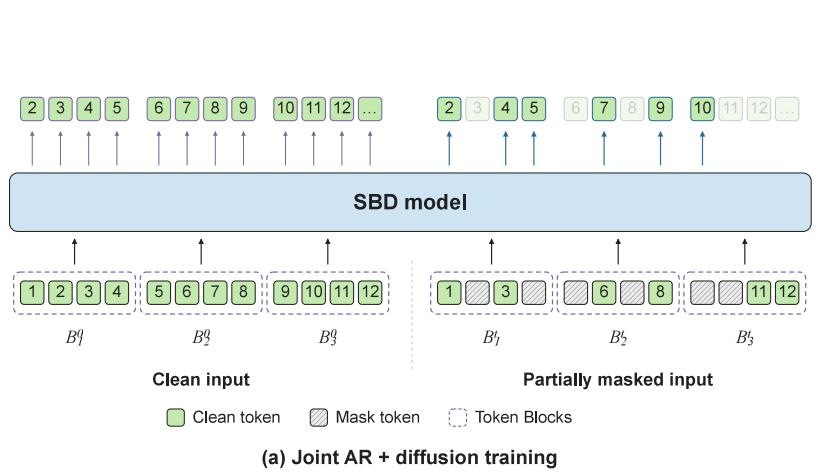

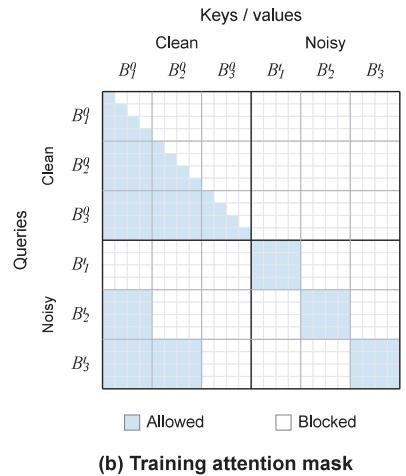  
Figure 10 | The design of SBD formulation. (Left) SBD adopts a two-stream training process that concatenates clean blocks and noisy blocks in the sequence dimension. It applies AR CE loss on the clean blocks, and difusion CE loss on the noisy blocks. (Right) SBD models use a specialized attention mask with a causal mask in the clean blocks and block-bidirectional mask in the noisy blocks. Each noisy block can attend to all other tokens in itself and all tokens in preceding clean blocks.

Sampling Process. At inference, we sample blocks $B _ { 1 } , B _ { 2 } .$ .. sequentially until some block contains a termination token. Each block is initialized with a fully masked block $B _ { i } ^ { 1 }$ and progressively unmasked via the parameterized reverse process in Equation 7. In particular, we discretize the time interval [0,1] into discrete steps $0 = t _ { 0 } < t _ { 1 } < t _ { 2 } . . t _ { T } = 1$ , and recursively query Equation 7 starting from $B _ { i } ^ { 1 }$ until we reach the clean state $B _ { i } ^ { 0 }$

## A.2. Formulations of Self-Refining Difusion Process

For text blocks, we employ the standard MDM formulation described in Section A.1 to minimize the gap with the base LLM NLD used to build NLD-Uni. For image blocks, we employ our proposed self-refining difusion process with intermediate mask states. For reduced complexity and sampling eficiency, we adopt the non-Markov formulation $\left( \mathrm { D N D M } \right) \left[ 3 7 \right]$ . For simplicity of notation, this discussion focuses on the setup with a single image sequence $X ^ { 0 } = [ X _ { 1 } ^ { 0 ^ { - } } , . . . \bar { X } _ { L } ^ { 0 } ]$ whose tokens belong to one block. However, it can be easily extended to multi-block settings with interleaved multi-modal sequences.

## A.2.1. Ball-Tree-Based Per-Token Corruption Process

Recall from Section 3.2 that we adopt the state space $\nu \times \mathcal { A }$ where � is the vocabulary of a tokenizer and $\mathcal { A } = \{ 0 , 1 , . . . K \}$ represents the set of corruption levels that connect the fully masked state and the clean state. Each token $X _ { i } ^ { t }$ in this state space is denoted as $X _ { i } ^ { t } = ( C _ { i } ^ { t } , A _ { i } ^ { t } )$ where $C _ { i } ^ { t } \in \mathcal { V } , A _ { i } ^ { t } \in \mathcal { A }$ . In particular, $A _ { i } = 0$ represents a clean state and $A _ { i } = K$ represents a mask state. We define the age-dependent corruption process such that $A _ { i }$ monotonically increases at state transitions in the forward process.

Concretely, each token that starts at state $( c , a )$ for some $c \in \mathcal { V } , a \in \mathcal { A }$ can only transition to $( c ^ { \prime } , a + 1 )$ with $( * , 0 )$ being the set of initial states and $( * , K )$ being the set of absorbing mask states. The corruption process can be expressed by the transition probability $U _ { j \vert k } ( u \vert c )$ for $0 \leq k < j \leq K$ . It must satisfy the constraint:

$$
U _ { K | k } ( u | c ) = Q ( u ) ,\tag{8}
$$

which implies that the absorbing state $Q$ is an uninformative stationary distribution over possible mask states that is not dependent on the initial clean token �. Ideally we want the transition to be progressive so that the state becomes gradually less informative about the clean token � when we progress from $a = 0$ to $a = K$

We implement this as a ball tree-based corruption process. A ball tree is a binary tree structure commonly used for fast nearest-neighbor search. The leaf nodes represent individual $\mathrm { V Q }$ codes in the continuous

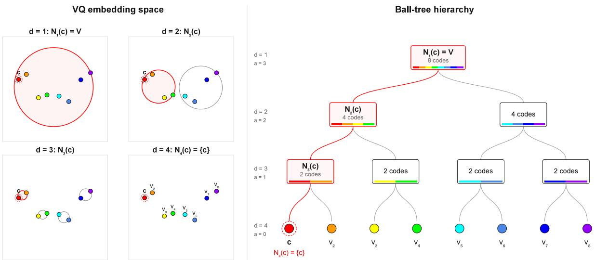  
Figure 11 | Visualization of Ball-Tree-Based Corruption Process. (Right) Ball-Tree is a balanced binary tree whose leaf nodes correspond to unique tokens in the vocabulary. The forward corruption process $U _ { k | k - 1 }$ increases the token age � and decreases the node depth �. (Left) Each node has a geometric representation which is a high-dimensional ball in the $\mathrm { V Q }$ embedding space. Decreasing depth � corresponds to increasing ball radius. In this visualization, the depth $D = 4$ and maximum token age $K = 3$

embedding space of the tokenizer; each non-leaf node represents a high-dimensional ball. The root node represents a ball enclosing all VQ codes. Child nodes represent a smaller ball than the parent node.

Concretely, given a �-depth ball tree with $2 ^ { D - 1 }$ leaf nodes corresponding to tokens in $\nu ,$ let $N _ { d } ( c )$ be the set of all tokens that share a common ancestor with � at depth � where $1 \leq d \leq D$ . Notably, $N _ { 1 } ( c ) = \nu$ is the whole vocabulary and $N _ { D } ( c ) = \{ c \}$ contains exactly one code.

We set $K = D - 1$ as the total per-token corruption steps and associate them with $d = D - a ,$ with $a = 0$ corresponding to $d = D$ and $a = K$ corresponding to $d = 1$ . Concretely, we generate $U _ { j \vert k }$ with:

$$
U _ { k | k - 1 } ( u | c ) = \mathbf { 1 } \{ u \in N _ { D - k } ( c ) \} \frac { 1 } { | N _ { D - k } ( c ) | } ,\tag{9}
$$

which is a uniform probability vector over the set $N _ { D - k } ( c )$ , i.e., we jump from code � to a random neighboring token in the embedding space indicated by the ball tree, with the jump range dependent on the target token age. This process has the following marginal:

$$
U _ { j | k } ( u | c ) = \mathbf { 1 } \{ u \in N _ { D - j } ( c ) \} \frac { 1 } { | N _ { D - j } ( c ) | } ,\tag{10}
$$

for $j > k$ because the intermediate states are always leaf nodes of $N _ { D - j } ( c )$ by tree construction. An important observation is that for a fixed $u , U _ { j \vert k } ( u \vert c )$ is either 0 or $\frac { 1 } { 2 ^ { j } }$ for all possible $c \in \mathcal V$

Let �^ be the initial token state at $a = 0$ . The conditional reverse process has the following form according to Bayes’ rule:

$$
U _ { k | j } ( c | u , \hat { c } ) = \frac { U _ { k | 0 } ( c | \hat { c } ) U _ { j | k } ( u | c ) } { U _ { j | 0 } ( u | \hat { c } ) } .\tag{11}
$$

Note that for this value to be properly defined, we must have $U _ { j | 0 } ( u | \hat { c } ) \neq 0 .$ , implying $u \in N _ { D - j } ( \hat { c } )$ . When $U _ { j | k } ( u | c ) \neq 0$ , by the previously discussed observation the two terms cancel and the expression simplifies to $U _ { k | 0 } ( c | \hat { c } )$ . When $U _ { j | k } ( u | c ) = 0$ , it can be implied that � $\notin N _ { D - j } ( c )$ . Hence $N _ { D - j } ( c ) \neq N _ { D - j } ( \hat { c } )$ , and consequently $N _ { D - k } ( c ) \dot { } \neq N _ { D - k } ( \hat { c } )$ because �, which satisfies $k < j$ , corresponds to more refined tree nodes

Ball-tree-based discrete corruption process  
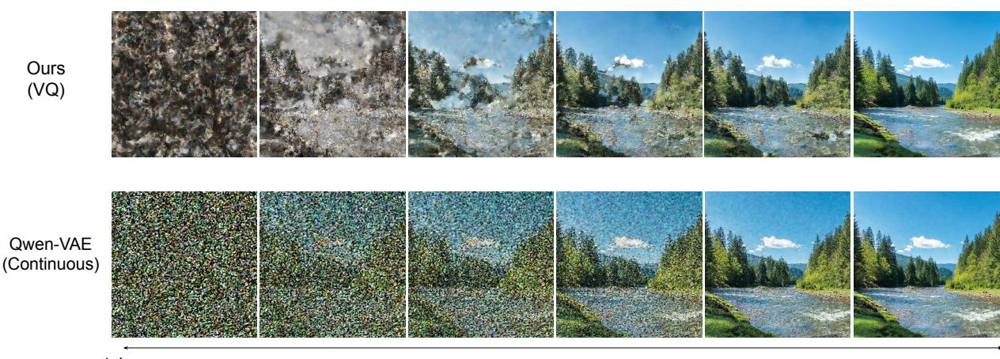  
Rectified flow between continuous latents and i.i.d. Gaussian noise

Figure 12 | Visual Reconstruction Across Diferent Token Ages. To investigate whether the proposed age-based corruption process is semantically meaningful for visual generation tasks, we show reconstructed images at diferent token ages and compare them with the rectified flow process in the continuous latent space of Qwen-VAE. Results indicate that changes in the token age represent a smooth corruption process in the pixel space. In this visualization, all tokens are corrupted at the same rate, which corresponds to $\epsilon = 1$

with greater depth. This implies that $U _ { k | 0 } ( c | \hat { c } ) = 0$ , so everywhere we have the reverse process satisfying:

$$
U _ { k | j } ( c | u , \hat { c } ) = U _ { k | 0 } ( c | \hat { c } ) = \mathbf { 1 } \{ c \in N _ { D - k } ( \hat { c } ) \} \frac { 1 } { | N _ { D - k } ( \hat { c } ) | } .\tag{12}
$$

An implementation detail worth mentioning is that a model $p _ { \theta }$ may still predict �^ such that � $\notin N _ { D - j } ( \hat { c } )$ as its output space is the entire vocabulary �. In those cases, we still apply the RHS by allowing the model to correct its previous predictions. In practice, we find that NLD-Uni rarely predicts a token that violates this setting, and the constrained setup shows no meaningful diference from the unconstrained setup.

Figure 11 illustrates an example of this process with � = 4. On the left side, we visualize the set of leaf nodes $N _ { d } ( c )$ for $d = 1 , 2 , 3 ,$ , 4 corresponding to the token � (encircled with a dashed line) in the embedding space, which are neighboring tokens to � at diferent radii. On the right side, we show a binary tree representation of the same structure. The forward process starts with token age $a = 0$ and ends with age $a = K$ , which corresponds to traversing to parent nodes in the binary tree from the leaf node at $d = 4$ to the root node at $d = 1$ . In the embedding space, it interpolates the one-hot distribution of a single embedding � to progressively larger high-dimensional balls, until it reaches the full space.

Empirical Implementation. The tokenizer of NLD-Uni contains 131k discrete codes, which corresponds to a ball tree with $D = 1 8$ . Hence, the vanilla setup is $K = 1 7$ . To enable flexible inference, we in practice randomize � for each training step among the candidates {1, 2, ..17}, where for $K < 1 7$ , we skip intermediate ages uniformly. For example, � = 4 corresponds to age progression 0, 4, 8, 12, 17 in the original $K = 1 7$ notation.

To verify that the ball-tree-based corruption process is semantically meaningful, we visualize the progression of corrupt tokens in Figure 12 and compare it with the continuous rectified-flow setup. Specifically, we encode the images with NLD-Uni’s tokenizer and visualize the codes sampled from the defined corruption process $U _ { k | k - 1 } ( u | c )$ . We also encode the images with the continuous VAE of Qwen-Image [39] and interpolate their latents with i.i.d. Gaussian noise following the rectified flow formulation. Visual results show that both processes gradually corrupt the semantics of the original image in a smooth manner.

We further confirm this observation quantitatively by measuring the PSNR against the ground truth image. The results are shown in Figure 13. The plot demonstrates that both processes ofer a smooth transition from a clean image to random noise measured by PSNR. We observe that rectified flow has higher PSNR at

## Image PSNR Progression of Different Processes

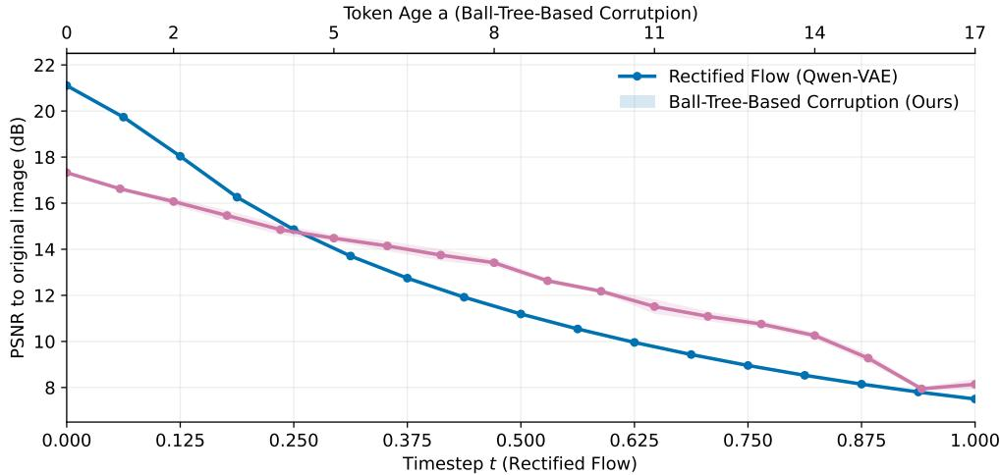  
Figure 13 | Image PSNR Across Diferent Token Ages. To investigate whether the proposed age-based corruption process is semantically meaningful for visual generation tasks, we plot the PSNR of reconstructed images at diferent token ages and compare them with the rectified flow process in the continuous latent space of Qwen-VAE. Results indicate that changes in the token age represent a smooth corruption process in the pixel space measured by PSNR. In the clean state, Qwen-VAE has better PSNR than NLD-Uni, suggesting its continuous VAE has better reconstruction capability.

zero corruption; this is attributed to the better reconstruction capability of Qwen-VAE as opposed to the corruption process.

As a final remark, we clarify that $U _ { j \vert k }$ is a discrete-time per-token corruption process defined over discrete token ages 0, 1...�, it should not be confused with the continuous-time difusion process $q ( X ^ { t } | X ^ { s } )$ with continuous timesteps $t , s \in [ 0 , 1 ]$ . The two processes are bridged by the token age field, which determines when discrete jumps $U _ { k - 1 | k }$ occur over the continuous time interval [0, 1] for each token.

## A.2.2. Non-Markov Per-Token Jump Schedule

An important observation in the formulation described in Section A.1 is that during training, only the marginal:

$$
q ( X _ { i } ^ { t } | X _ { i } ^ { 0 } ) = ( 1 - t ) \mathbf { X _ { i } ^ { 0 } } + t \mathbf { M } ,\tag{13}
$$

is used to construct the partially masked sequence $X ^ { t }$ and we never explicitly invoke $q ( X _ { i } ^ { t } | X _ { i } ^ { s } )$ from Equation 4 for $s \neq 0$ . Discrete non-Markov difusion models (DNMD) [37] constructs a process that gives the same forward marginal with deterministic token transition time. Specifically, the forward process can be defined as:

$$
q \big ( X _ { i } ^ { t } | X _ { i } ^ { s } , \tau _ { i } \big ) = \mathbf { 1 } \big \{ t \leq \tau _ { i } \big \} \mathbf { X _ { i } ^ { s } } + \mathbf { 1 } \big \{ t > \tau _ { i } \big \} \ \mathbf { M } ,\tag{14}
$$

where $\tau _ { i } \sim U ( [ 0 , 1 ] )$ is the clean-to-mask transition time that is pre-sampled once for each token and maintained throughout the trajectory. This design relaxes the Markov constraint of the process.3 However, it is compatible with standard MDM training because it does not change the forward marginal or the clean token target distribution $p ( X _ { i } ^ { 0 } | X ^ { t } )$ .

We make an additional remark that DNDM’s setup in fact better aligns with the empirical sampling algorithms [24, 26, 11] which often predefine an unmasking schedule, whereas the exact Markov reverse process would unmask a stochastic number of tokens, or even zero tokens, at each step. Most recent samplers for masked image models like the Halton sampler [26], and the stratified sampler [11] actually pre-compute the exact timestep to unmask each token, making DNDM a more accurate formulation in the image generation domain.

To extend this setup to allow intermediate transition states between the clean state and the mask state, we augment the generating process by first sampling a predefined transition period $[ \tau _ { i } , \tau _ { i } ^ { \prime } ]$ as opposed to a fixed jump time $\tau _ { i }$ . In particular, we sample

$$
\tau _ { i } \sim U ( [ 0 , 1 - \epsilon ] ) , \tau _ { i } ^ { \prime } = \tau _ { i } + \epsilon ,\tag{15}
$$

where $\epsilon \in ( 0 , 1 ]$ is the hyper-parameter controlling the length of the transition process from clean state with $a = 0$ to the mask state with $a = K$ . In particular, when $\epsilon  0$ , all jumps happen in an infinitesimal time interval and the overall process reduces to the canonical DNDM.

With a pre-sampled interval, the token age $A _ { i }$ can be expressed as a deterministic step function

$$
a _ { i } ( t , \tau _ { i } , \epsilon ) = \left\{ \begin{array} { l l l } { 0 } & { \mathrm { i f } } & { 0 \leq t \leq \tau _ { i } } \\ { \mathrm { F l o o r } ( K \frac { t - \tau _ { i } } { \epsilon } ) } & { \mathrm { i f } } & { \tau _ { i } < t < \tau _ { i } ^ { \prime } \ . } \\ { K } & { \mathrm { i f } } & { \tau _ { i } ^ { \prime } \leq t \leq 1 } \end{array} \right.\tag{16}
$$

This induces a one-hot categorical distribution over the token age $A _ { i } ^ { t . }$

$$
\begin{array} { r } { b _ { i } ^ { t } ( a ) = \mathbb { P } ( A _ { i } ^ { t } = a | \tau _ { i } , \epsilon ) = \mathbf { 1 } \{ a = a _ { i } ( t , \tau _ { i } , \epsilon ) \} . } \end{array}\tag{17}
$$

Hence, the forward process conditioned on a pre-sampled interval is:

$$
\begin{array} { r } { q \big ( X _ { i } ^ { t } = ( u , a ) \mid { X _ { i } ^ { s } } = ( c , a ^ { \prime } ) , \tau _ { i } \big ) = b _ { i } ^ { t } ( a ) \left\{ \begin{array} { l l } { U _ { a | a ^ { \prime } } ( u \mid c ) , } & { a > a ^ { \prime } , } \\ { \mathbf { 1 } \{ u = c \} , } & { a = a ^ { \prime } , \mathbf { . } } \\ { 0 , } & { a < a ^ { \prime } . } \end{array} \right. } \end{array}\tag{18}
$$

The posterior reverse process is simply

$$
\begin{array} { r } { p \big ( X _ { i } ^ { s } = ( c , a ^ { \prime } ) \mid X _ { i } ^ { t } = ( u , a ) , X _ { i } ^ { 0 } = ( \hat { c } , 0 ) , \tau _ { i } \big ) = b _ { i } ^ { s } ( a ^ { \prime } ) \left\{ \begin{array} { l l } { U _ { a ^ { \prime } | a } ( c \mid u , \hat { c } ) , } & { a ^ { \prime } < a , } \\ { \mathbf { 1 } \{ c = u \} , } & { a ^ { \prime } = a , } \\ { 0 , } & { a ^ { \prime } > a . } \end{array} \right. , } \end{array}\tag{19}
$$

where $U _ { a | a ^ { \prime } } ( u | c )$ and $U _ { a ^ { \prime } | a } ( c | u , \hat { c } )$ are the forward and reverse marginals of the discrete-time per-token corruption process. At inference, $X _ { i } ^ { 0 }$ is sampled from the model’s clean token prediction.

## A.3. On-policy Distillation from AR VLMs

The standard OPD framework is defined over AR language models sharing the same vocabulary. Specifically, given a teacher model and student model, the OPD loss [30] is defined as:

$$
\mathcal { L } _ { \mathrm { A R - O P D } } = \mathbb { E } _ { X ^ { 0 } \sim p _ { \mathrm { s t u d e n t } } } \big [ \frac { 1 } { L } \sum _ { i = 1 } ^ { L } \mathbb { D } _ { \mathrm { K L } } \big ( p _ { \mathrm { s t u d e n t } } ( X _ { i } ^ { 0 } | X _ { j < i } ^ { 0 } ) | | p _ { \mathrm { t e a c h e r } } ( X _ { i } ^ { 0 } | X _ { j < i } ^ { 0 } ) \big ) \big ] ,\tag{20}
$$

where $X ^ { 0 } = [ X _ { 1 } ^ { 0 } . . . X _ { L } ^ { 0 } ]$ is a sequence sampled from the student model. Recall from Section A.1 that the SBD model divides $X ^ { 0 }$ into consecutive blocks $X ^ { 0 } = [ B _ { 1 } ^ { 0 } , . . B _ { K } ^ { 0 } ]$ and implements

$$
p _ { \theta } ( B _ { b , i } ^ { 0 } | B _ { j < b } ^ { 0 } , B _ { b } ^ { t } )\tag{21}
$$

where $B _ { b } ^ { t }$ is a partially masked version of the clean block $B _ { b } ^ { 0 }$ and $B _ { b , i } ^ { 0 }$ is the �-th token in the �-th block.

When the block size is 1, each block only has two states: a clean token and a mask token, so it is generated in one step by evaluating

$$
p _ { \theta } ( B _ { b , 1 } ^ { 0 } | B _ { j < b } ^ { 0 } , B _ { b } ^ { 1 } ) = p _ { \theta } ( B _ { b , 1 } ^ { 0 } | B _ { j < b } ^ { 0 } ) = p _ { \theta } ( X _ { b } ^ { 0 } | X _ { j < b } ^ { 0 } )\tag{22}
$$

where ${ B } _ { b } ^ { 1 }$ can be marginalized since there is only one possible state with a probability of 1. The final expression exactly implements an AR model, and we refer to this setup as the AR view of the SBD model. Practically, this distribution can be evaluated for all tokens in a sampled sequence in a single pass because of the shift-by-one logit implementation illustrated in Figure 10. Given this AR generation mode and AR view, we can directly apply the OPD loss used in AR models from Equation 20 to the SBD model with no change.

However, if we only sample from and supervise the model in its AR view, the SBD model would lose its support for parallel generation with block sizes larger than 1. To provide generic supervision for Equation 21 with a block size larger than 1, we define the AR-Difusion Consistency loss as:

$$
\mathcal { L } _ { \mathrm { C o n s } } = \mathbb { E } _ { X ^ { 0 } \sim p _ { \mathrm { g u t a d e n t } } , t \sim U ( [ 0 , 1 ] ) } [ \frac { 1 } { K N t } \sum _ { b = 1 } ^ { K } \sum _ { i = 1 } ^ { N } \mathbb { D } _ { \mathsf { K L } } ( p _ { \mathrm { s t u d e n t } } ( B _ { b , i } ^ { 0 } | B _ { j < b } ^ { 0 } , B _ { b , r < i } ^ { 0 } ) | | p _ { \mathrm { s t u d e n t } } ( B _ { b , i } ^ { 0 } | B _ { j < b } ^ { 0 } , B _ { b } ^ { t } ) ) ] ,\tag{23}
$$

where $N > 1$ is the block size and $B _ { b } ^ { t }$ is a partially masked block sampled from the forward marginal $q ( B _ { b } ^ { t } | B _ { b } ^ { 0 } )$ $X ^ { 0 }$ is sampled with AR mode with block size 1. The final loss for visual understanding and reasoning tasks is:

$$
{ \mathcal { L } } _ { \mathrm { O P D - U N D } } = { \mathcal { L } } _ { \mathrm { A R - O P D } } + { \mathcal { L } } _ { \mathrm { C o n s } } .\tag{24}
$$

## A.3.1. Connection with OPD-LM

In our notation convention, OPD-LM [34]’s objective can be represented as a single term:

$$
\mathcal { L } _ { \mathrm { O P D - L M } } = \mathbb { E } _ { X ^ { 0 } , X ^ { t } \sim p _ { \mathrm { a t u d e n t } } } [ \frac { 1 } { K N } \sum _ { b = 1 } ^ { K } \sum _ { i = 1 } ^ { N } \mathbb { D } _ { \mathrm { K L } } ( p _ { \mathrm { t e a c h e r } } ( B _ { b , i } ^ { 0 } | B _ { j < b } ^ { 0 } , B _ { b , r < i } ^ { 0 } ) | | p _ { \mathrm { s t u d e n t } } ( B _ { b , i } ^ { 0 } | B _ { j < b } ^ { 0 } , B _ { b } ^ { t } ) ) ] .\tag{25}
$$

Compared with our consistency loss, the main diferences are

• OPD-LM samples rollouts from the difusion view while NLD-Uni samples from the AR view

• OPD-LM directly uses teacher scores to supervise the student’s difusion view, while NLD-Uni uses the student’s own AR score to supervise the difusion view

• OPD-LM initializes the student with the teacher’s weights, as an untrained difusion model. In crossparadigm OPD of NLD-Uni, the teacher and the student are two distinct models with diferent sizes and architectures. The student model already has strong difusion generation capabilities before OPD.

At the system level, the broader diference is that NLD-Uni uses OPD as a component in a multi-objective unified training run combining visual understanding, text-to-image, and image editing objectives, while OPD-LM focuses solely on single-objective AR2Dif post-training in the language domain.

One of the problems with OPD-LM’s setup is that it creates efectively ill-formed supervision signals due to potentially conflicting contexts. Specifically, high-probability tokens in $p _ { \mathrm { t e a c h e r } } ( B _ { b , i } ^ { 0 } | B _ { j < b } ^ { 0 } , B _ { b , r < i } ^ { 0 } )$ may not be good candidates semantically for $p _ { \mathrm { s t u d e n t } } ( B _ { b , i } ^ { 0 } | B _ { j < b } ^ { 0 } , B _ { b } ^ { t } )$ with a diferent context.

As a concrete example, consider the following student generation "The number � is called the multiplicative identity.". Given the prefix "The number � is called the", the teacher may want to generate the term for "imaginary unit", and assign high scores to the token "imaginary", but it would not be a good candidate if the masked context is "The number � is called the [m] identity" because the term "imaginary identity" is ill-formed.

The consistency loss of NLD-Uni mitigates this issue by using the student’s own AR predictions as supervision targets, avoiding the additional teacher–student distribution discrepancy while retaining the diference between AR and difusion contexts. At zero sampling temperature, each token in a greedy rollout is an argmax of the student’s AR conditional distribution, although this does not guarantee compatibility of the full supervision distribution with the observed future context. Empirically, we find that sampling

AR rollouts at a small nonzero temperature yields better difusion performance, suggesting that increased trajectory diversity can be beneficial despite relaxing the argmax property.

In Table 2 of the main paper, we show that directly applying OPD-LM’s loss with heterogeneous teacher and student models performs poorly because of the mismatch identified above. We provide more analysis of each individual component in Section C.3.

## A.4. On-policy Distillation from continuous flow models

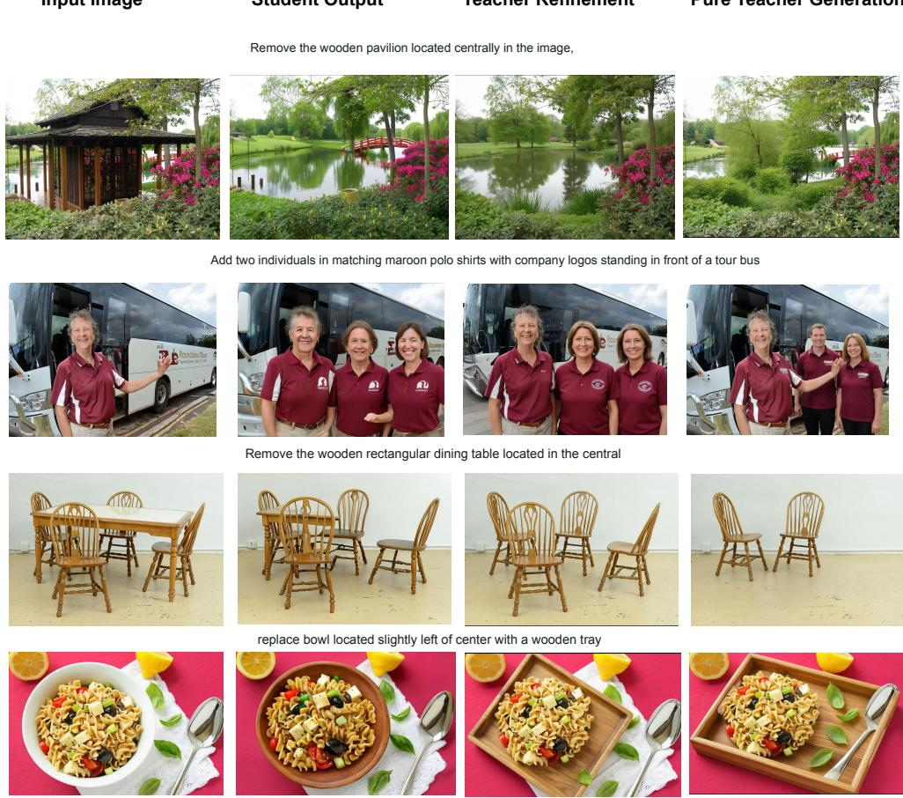  
Figure 14 | Additional Qualitative Illustrations of the Teacher Refinement Process. We show additional qualitative samples of teacher-refined student outputs. They generally align with the student roll-outs but have better visual fidelity and source image preservation. In some examples where the teacher over-edits, the refined student outputs are preferable to pure teacher generation.

In distilling from Qwen-Image on image editing tasks, we start with an input image $V _ { \mathrm { i n } }$ and text instructions $p .$ We then generate discrete codes $X _ { o u t } ^ { 0 }$ by sampling from the self-refining difusion process $p _ { \theta } ( X _ { \mathrm { o u t } } ^ { 0 } | V _ { \mathrm { i n } } , p )$ . We decode them with NLD-Uni’s VQ decoder to obtain the image in pixel space $V _ { o u t } = \operatorname { D e c o d e } _ { \mathrm { V Q } } ( X _ { \mathrm { o u t } } )$ . We then re-encode $V _ { o u t }$ with the teacher’s continuous VAE $x ^ { 0 } =$ EncodeVAE(�out), and then create a partially noised version of the latent $x ^ { r } = ( 1 - r ) x ^ { 0 } + r \delta$ where $\delta \sim N ( 0 , I )$ is i.i.d. Gaussian noise and � is a hyperparameter controlling refinement strength. The teacher model $p _ { \mathrm { t e a c h e r } } ( { \hat { x } } ^ { 0 } | x ^ { r } , p , V _ { \mathrm { i n } } )$ is employed to sample the clean prediction ${ \hat { x } } ^ { 0 }$ . Crucially, this refinement process involves multiple ODE steps as opposed to a single-step teacher forward pass.

The predicted latent $\hat { x } ^ { 0 }$ is decoded into pixel space and re-encoded into discrete $\mathrm { V Q }$ codes to obtain $\hat { X } ^ { 0 } = \mathrm { E n c o d e } _ { \mathrm { V Q } } ( \mathrm { D e c o d e } _ { \mathrm { V A E } } ( \hat { x } ^ { 0 } ) )$ . We then sample the partially corrupted sequence ${ \hat { X } } ^ { t }$ using Equation 18.

The final OPD objective is defined by:

$$
\mathcal { L } _ { \mathrm { O P D - G e n } } ( \hat { X } ^ { 0 } , \hat { X } ^ { t } , V _ { \mathrm { i n } } , p , t ) = - \frac { 1 } { t } \log p _ { \theta } ( \hat { X } ^ { 0 } | \hat { X } ^ { t } , V _ { \mathrm { i n } } , p ) ,\tag{26}
$$

which is efectively the SFT loss on the refined target. The full process is described in Algorithm 1.

Algorithm 1 Teacher-Refined Distillation from On-Policy Student Rollouts   
Require: Student $p _ { \theta } ;$ frozen teacher $T ;$ training data $\mathcal { D } ;$ refinement strength $r \in ( 0 , 1 )$ ; ODE steps $M > 1$   
corruption-time distribution $\rho$ on (0, 1]   
1: while not converged do   
2: Sample a minibatch ℬ from $\mathcal { D }$   
3: $\mathcal { L }  0$   
4: for $( V _ { \mathrm { i n } } , p ) \in B$ do   
5: $X _ { \mathrm { o u t } } ^ { 0 } \sim p _ { \theta } ( \cdot \mid V _ { \mathrm { i n } } , p )$ ◁ Current student rollout   
6: $V _ { \mathrm { o u t } } ^ { }  \mathrm { D e c o d e v Q } ( X _ { \mathrm { o u t } } ^ { 0 } )$   
7: $x ^ { 0 }  \mathrm { E n c o d e } _ { \mathrm { V A E } } ( V _ { \mathrm { o u t } } )$   
8: $\delta \sim \mathcal { N } ( 0 , I )$   
9: $x ^ { r }  ( 1 - r ) x ^ { 0 } + r \delta$   
10: $\hat { x } ^ { 0 } \gets \mathrm { O D E S o l v e } _ { T } ( x ^ { r } ; r \to 0 , M , V _ { \mathrm { i n } } , p )$ ◁ Multi-step teacher refinement   
11: $\hat { X } ^ { 0 } \gets$ stopgrad(︀EncodeVQ(︀DecodeVAE $\left( \hat { x } ^ { 0 } \right) )$   
12: Sample $t \sim \rho$   
13: Sample ${ \hat { X } } ^ { t }$ by corrupting ${ \hat { X } } ^ { 0 }$ using Eq. 18   
14: $\mathcal { L }  \mathcal { L } - \frac { 1 } { t } \log p _ { \theta } ( \hat { X } ^ { 0 } \mid \hat { X } ^ { t } , V _ { \mathrm { i n } } , p )$   
15: end for   
16: Update $\theta$   
17: end while

Connection to Trajectory-refined Distillation in Language Modeling. We note that while our objective is an SFT-style loss, the learning process is on-policy because the supervision target is derived from the student output. This paradigm closely connects with several concurrent works in the OPD literature in the language domain that explored student-teacher interleaved generation. Notably, Trajectory-refined Distillation [40] proposes to use a teacher model to correct student trajectories in language tasks. NLD-Uni expands this concept across model families and to the visual generation domain to address a lack of strong MDM teachers in visual generation tasks.

Qualitative Assessment. In addition to Figure 6, we provide additional samples in Figure 14 to illustrate the efectiveness of our proposed approach. We make two observations. First, compared with pure teacher generation, the teacher-refined student outputs are visually aligned to the student output but with more refined details and better source-image preservation, making them a more ideal training target. Second, we find that the teacher-refined student output can actually be better than the student model’s outputs when the pure teacher generation makes a mistake. In the example "Remove the wooden rectangular dining table", teacher-refined student generation achieves the best results and outperforms both student and teacher generation. This occurs because when the teacher makes a mistake, the pure teacher generation tends to drift from the student example considerably (in this case, over-editing and removing two extra chairs in addition to the table). The refinement process, which constrains the teacher output to a neighborhood of the student roll-out, serves as useful regularization in these cases.

## B. Additional Details of the Main Training Run

## B.1. Data Mixture

Our training data consists of the following components:

• A: Text-to-Image Pairs. Image sources include LAION-2B [73], COYO-700M [74], SA-1B [75], JourneyDB [76], BLIP3o-60k [3], ShareGPT4o-Image [77]. The images are filtered to remove NSFW prompts, watermarks, low CLIP scores [78], low aesthetic scores [79], and low-resolution samples. This results in 127M images in the final mix. Images are recaptioned with Qwen3-VL [54] when only alt-text is available.

Table 5 | Training configurations across three stages. We use letters A-C to represent diferent dataset.
<table><tr><td></td><td>Stage 1</td><td>Stage 2</td><td>Stage 3</td></tr><tr><td>Learning Rate</td><td> $1 \times 1 0 ^ { - 5 }$ </td><td> $1 \times 1 0 ^ { - 5 }$ </td><td> $2 \times 1 0 ^ { - 6 }$ </td></tr><tr><td>Steps</td><td>400k</td><td> $1 0 0 \mathrm { k } \times 2$ </td><td>10k</td></tr><tr><td> $\beta _ { 1 }$ </td><td>0.99</td><td>0.99</td><td>0.99</td></tr><tr><td> $\beta _ { 2 }$ </td><td>0.999</td><td>0.999</td><td>0.999</td></tr><tr><td>optimizer</td><td>AdamW</td><td>AdamW</td><td>AdamW</td></tr><tr><td>Dataset Used</td><td>A</td><td>A,B,C</td><td>B and subset of A, C</td></tr><tr><td>Objective</td><td>SFT</td><td>SFT</td><td>SFT+OPD</td></tr></table>

• B: Visual Instruction Tuning Data. We include LLaVA-OneVision [80], Open-LLaVA-Next [81], MAmmoth-VL [82], and VisualWebInstruct [83]. We additionally include grounding-specific data including GranD [84] and RefCOCO [46]. We additionally include the entire training set of Nemotron-3- Nano-Omni [85].

• C: Image Editing Data. We include ShareGPT4o-Image [77], GPT-Edit-1.5M [67], the image editing subset of UniWorld-V1 [86], and ScaleEdit-12M [87].

The OPD dataset is sampled from the prompts of the full dataset with labels discarded. Specifically, for visual reasoning OPD, we select 76.8k samples from the datasets in part (B) prioritizing visual reasoning tasks. For image editing tasks, we randomly select 100k samples from datasets in part (C).

## B.2. Optimization Setup

We use NLD [35] to initialize the understanding branch and semantic encoder. For the VQ encoder, we adopt a pretrained IBQ [88]. For the semantic encoder, we adopt RADIO-H [89]. The image generation branch is initialized from the copied weights of the understanding branch. The overall two-tower structure follows Elastic-MoT design proposed by LaViDa-O [11].

Training consists of three stages. In the first stage, we fine-tune the language model on image-text pairs from dataset (A). In the second stage, we add instruction data and image editing data from (B) and (C). In the final stage, we use the OPD dataset described above. Since we do not perform OPD on T2I tasks, we mix image-text pairs from (A) to preserve text-to-image ability.

In the main paper, the checkpoint after stage two is referred to as NLD-Uni-Base. The final checkpoint is referred to as NLD-Uni. The full details of the optimization are listed in Table 5.

## B.3. Infrastructure

The training is conducted on 64 H100 GPUs across 8 nodes over 26 days. In particular, the final OPD stage takes 5 days.

## C. Additional Experiment Results

## C.1. Studies on the self-refining difusion process

## C.1.1. Comparison with MDM-Prime

We additionally tried to compare against a related method, MDM-Prime [38] which also uses partial masking, but it shows no sign of convergence with a score of 0 on GenEval even after 20k steps of training. The progression of generated images throughout training is shown in Figure 15.

Step 10k  
Step 0  
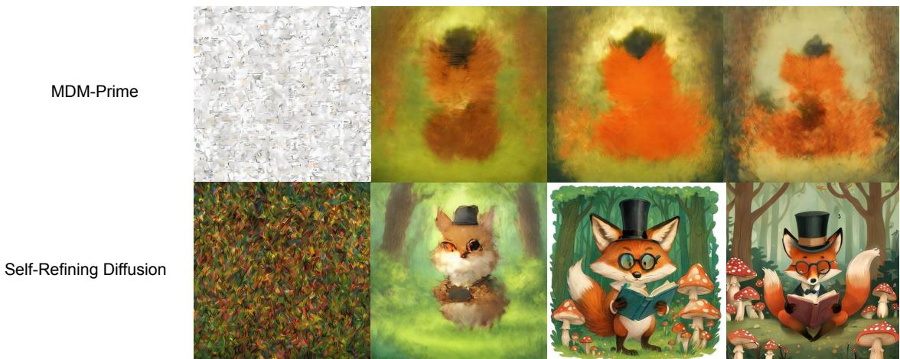  
Figure 15 | Comparison with MDM-Prime. Progression of Generated Images at Diferent Training Steps. The prompt is "Highly stylized, whimsical illustration of a fox wearing a tiny monocle and top hat, reading a miniature book in a cozy, mushroom-filled forest glade. Children’s book $a r t ,$ gentle colors, charming, adorable."

Unlike our self-refining process which is shown to correspond to a smooth corruption in pixel space in Figure 12 and Figure 13, MDM-Prime’s setup simply factorizes a token index $v \in \mathcal V$ into sub-tokens $( v _ { 1 } , v _ { 2 } , . . v _ { l } ) \in \mathcal { V } _ { 1 } \times \mathcal { V } _ { 2 } . . . \mathcal { V } _ { l }$ , with $| \mathcal { V } _ { i } | = | \surd | \mathcal { V } | |$

For example, with a vocabulary of 16 tokens and � = 4, token 3 is represented as 0011. The intermediate mask states simply mask the bits, giving states like 0[m][m]1 or 001[m]. To represent such states, it learns a per-sub-token embedding and concatenates them to form the token embedding. This design materially reduces the total parameters of the embedding table and reduces its expressive power. In MDM-Prime’s visual generation setup, it sets $| \nu _ { \rangle } | = 1 6$ which means some dimensions of the token embeddings corresponding to codes 1, 17, 33, ... are exactly identical, which can be limiting in large-scale T2I settings because these tokens are not guaranteed to have any similarity at all. We note that MDM-Prime’s visual generation experiments are conducted on tiny $3 2 \times 3 2$ images in CIFAR-10 [90] and ImageNet-32 [91].

We additionally note that while the training failed to converge at 1024 × 1024 resolution, MDM-Prime’s generated images still show some high-level object-like structure, as shown in Figure 15, which could explain why it can succeed on $3 2 \times 3 2$ low-resolution images.

## C.2. Efect of refinement steps

While in the formulation we use $\epsilon \in [ 0 , 1 ]$ to define the progression speed of intermediate states in self-refining difusion, what matters in practical inference settings is the total number of inference steps NFE and the number of refinements each sampled token goes through, denoted by �. For example, $N = 1$ corresponds to vanilla mask difusion with $\epsilon  0 .$ , while $N = \mathrm { N F E }$ means all tokens follow the same refinement schedule across the entire sampling process, or � = 1. � > NFE is not possible by definition.

We show the interaction efect of NFE and � in Table 6 at inference time. We note that at any total NFE, setting $\epsilon = 1$ works poorly. At small NFE, $N = 1$ which corresponds to a single state jump works best. By contrast, at larger ${ \mathrm { N F E } } ,$ a higher number of refinement steps starts to show benefits, with $N = 8$ working best in our default inference setup with 64 steps. Increasing N from 8 to 16 provides no further improvement in the tested settings and can substantially degrade performance at low NFE, where it implies an � value closer to one. This suggests 8 refinement steps are suficient. The failure patterns at low NFE and around $\mathrm { N F E } = N$ suggest we should enforce some form of sequential order between the unmasking/refining processes of diferent tokens, as opposed to unmasking/refining a large number of tokens simultaneously, which can be challenging.

Table 6 | Efect of Refinement Steps Per Token. We report HPSv3 scores across actual NFE and number of refinement stages �.
<table><tr><td>Actual NFE</td><td> $N = 1$ </td><td> $N = 4$ </td><td> $N = 8$ </td><td> $N = 1 6$ </td></tr><tr><td>4</td><td>7.3700</td><td>-2.4895</td><td></td><td></td></tr><tr><td>8</td><td>9.6214</td><td>9.0038</td><td>0.0834</td><td></td></tr><tr><td>16</td><td>10.5449</td><td>10.8205</td><td>10.3044</td><td>3.0348</td></tr><tr><td>32</td><td>10.8921</td><td>11.0137</td><td>10.9894</td><td>10.7620</td></tr><tr><td>48</td><td>10.9378</td><td>11.0369</td><td>11.1167</td><td>11.0861</td></tr><tr><td>64</td><td>11.0051</td><td>11.0287</td><td>11.1050</td><td>11.1010</td></tr></table>

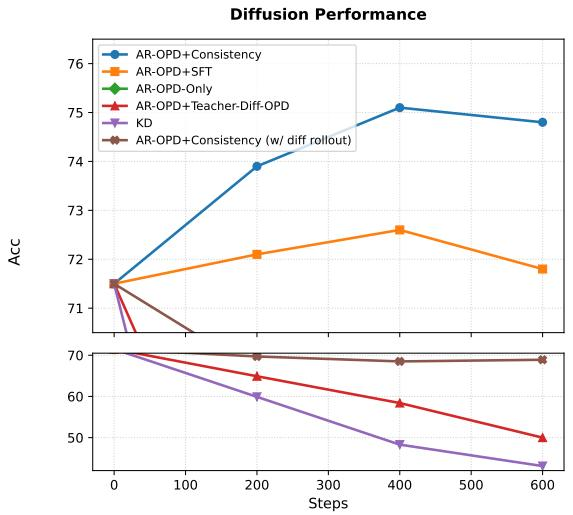

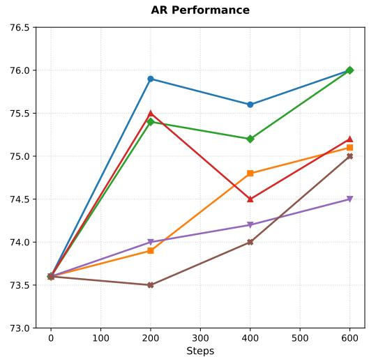  
Figure 16 | Ablation Studies on distilling from AR VLMs. We report MathVista Acc throughout training steps.

## C.3. Studies on distilling from AR VLMs

We conducted additional ablations on the proposed OPD framework. These results are initialized with NLD-Uni-Base model and post-trained only on multi-modal reasoning tasks. The results are not directly comparable to the main result which reports unified multi-task joint training.

## C.3.1. Training Objectives

We conducted detailed ablations on each component of the proposed OPD framework. Specifically, we compare the following variants of the method:

• (1) AR-OPD+Consistency: The final chosen setup with AR OPD loss and consistency loss.

• (2) AR-OPD+SFT: replace consistency loss with a one-hot SFT objective on the difusion view, using AR-generated rollouts as targets.

• (3) AR-OPD only: which treats the SBD model as a pure AR model.

• (4) AR-OPD+Teacher-Dif-OPD: directly copy the teacher score as the supervision signal for the difusion view.

• (5) KD: Replace student’s AR rollout with pre-generated teacher difusion rollout.

• (6) AR-OPD+Consistency (w/ dif rollout): Replace student’s AR rollout in (1) with student’s difusion rollout.

We evaluate these settings in both AR generation mode and difusion generation mode. The results are reported in Figure 16. We draw the following two conclusions:

Table 7 | Ablation study of teacher choices. Results are sampled in AR view with a block size of one.
<table><tr><td></td><td>AI2D Test</td><td>Test</td><td>Val</td><td>Val</td><td>ChartQA DocVQA TextVQA OCRBench MMMU MathVista</td><td>Dev/Val</td><td>Mini</td></tr><tr><td>Teacher Performance</td><td></td><td></td><td></td><td></td><td></td><td></td><td></td></tr><tr><td>Nemotron Teacher</td><td>88.44</td><td>89.80</td><td>95.73</td><td>85.06</td><td>88.20</td><td>70.67</td><td>82.70</td></tr><tr><td>Kimi Teacher</td><td>85.14</td><td>94.72</td><td>97.46</td><td>83.93</td><td>92.70</td><td>77.44</td><td>88.90</td></tr><tr><td>NLD-Uni w/ OPD</td><td></td><td></td><td></td><td></td><td></td><td></td><td></td></tr><tr><td>OPD w/ Nemotron</td><td>85.98</td><td>90.28</td><td>95.01</td><td>77.82</td><td>85.30</td><td>61.11</td><td>78.10</td></tr><tr><td>OPD w/ Kimi</td><td>83.91</td><td>78.00</td><td>92.49</td><td>76.76</td><td>80.80</td><td>52.33</td><td>71.60</td></tr></table>

AR rollouts support efective difusion supervision. In difusion generation mode, only (1) and (2) improve upon the baseline because all other setups create mismatched supervision signals caused by mismatched context. In particular, even the student’s own difusion generation fails because the consistency loss uses the student’s AR score as the target, which may predict high-probability tokens that are inconsistent given future context generated from the student;s difusion distribution. This issue is mitigated when the sampled sequences and the supervision target both come from the student’s AR distribution.

Consistency Loss does not hurt AR generation. While AR generation is not the focus of this work, we find that the AR performance with AR-OPD+difusion loss is comparable to AR-OPD-Only, suggesting adding supervision to difusion view does not negatively afect AR view’s performance.

Beyond the above experiments, we also explored a run with consistency loss only. This run quickly collapses to an accuracy of 24.1 at 400 steps, which is outside the plotted range. For presentation clarity, it is not shown in the figure. However, this behavior is not surprising since it ties the outputs of the student’s own generation modes without external supervision, which quickly leads to degenerate sequences.

## C.3.2. Sampling Temperature

We vary the temperature used to generate student AR rollouts during OPD and evaluate the resulting models in both difusion and AR decoding modes. As shown in Table 8, greedy rollouts achieve the highest AR accuracy (76.9%), whereas a temperature of 0.4 achieves the highest difusion accuracy (74.8%). Thus, requiring each rollout token to be an argmax of the student’s AR conditional distribution is not necessary for efective transfer to the difusion view. The improvement at moderate temperatures suggests that greater rollout diversity can benefit difusion training. Across all tested temperatures, AR-OPD+Consistency achieves higher difusion accuracy than the alternative designs evaluated in our ablations, such as AR-OPD+SFT. Together, these results support using the student’s own AR predictions to supervise its difusion view, while indicating that strict per-token argmax alignment is unnecessary.

We clarify that all evaluations are performed with a temperature of 0 for consistency and reproducibility. Empirically, even for models with non-zero rollout temperature, using a zero temperature still gives better accuracy.

## C.3.3. Choice of Teachers

In this section, we explore using an alternative teacher model Kimi K-2.6 [92] and compare with using Nemotron3-Nano-Omni [85] teacher. Experiment results are shown in Table 7. Overall, Nemotron Teacher outperforms Kimi Teacher in our OPD setting, despite Kimi Teacher being the stronger model. This can be attributed to a larger teacher-student gap. In particular, unlike Nemotron teacher, Kimi teacher uses a diferent tokenizer and a diferent format of thinking traces. We note that these experiments are part of our early exploration and are based on an earlier checkpoint than NLD-Uni-Base. Hence results in Table 7 are not directly comparable to other ablation studies (E.g. Figure 16 ).

## C.4. Studies on distilling from continuous flow models

We study the efect of noise strength � in the teacher refinement process of image editing OPD with the Qwen-Image teacher. We report benchmark performance in Table 9. Among all tested values, � = 0.9 works

Table 8 | Efect of OPD rollout temperature. We vary the sampling temperature of student AR rollouts during OPD and report MathVista accuracy.
<table><tr><td>Temperature</td><td>Diffusion Performance</td><td>AR Performance</td></tr><tr><td>0.0</td><td>73.9</td><td>76.9</td></tr><tr><td>0.4</td><td>74.8</td><td>76.0</td></tr><tr><td>0.6</td><td>74.6</td><td>75.4</td></tr><tr><td>1.0</td><td>73.8</td><td>75.1</td></tr></table>

best. We note that the added Gaussian noise has a highly non-linear efect on the final output. Even with a high noise rate at $r = 0 . 9$ , the generated images are still aligned to the student roll-out and can be very diferent from a purely teacher-generated sample, as is shown in Figure 14.

Table 9 | Ablation on Noise Ratio. Image Editing Results across � values
<table><tr><td>Method</td><td> $\mathbf { r } = \mathbf { 0 . 5 }$ </td><td> $\mathbf { r } = \mathbf { 0 . 8 }$ </td><td> $\mathbf { r } = \mathbf { 0 . 9 }$ </td><td> ${ \bf r } = { \bf 1 . 0 }$ </td></tr><tr><td>ImgEdit</td><td>4.06</td><td>4.09</td><td>4.17</td><td>3.90</td></tr></table>

## C.5. Speed-Quality Tradeof

We examine the speed-quality tradeof of NLD-Uni by measuring the tokens per forward pass, throughput (tokens per second), and answer accuracy on the MathVista benchmark. Speed-quality trade-of is achieved by tuning the confidence threshold used in the unmasking sampler. Since our model also has an AR view, we report AR’s performance. Results are reported in Table 10. In particular, the vanilla setup ofers 552.58 tokens/s compared to an AR baseline of 202.74 tokens/s. If we relax the threshold, NLD-Uni can achieve up to 997.95 tokens/s with minor performance degradation.

Table 10 | Speed-Quality Tradeof on MathVista Benchmark. Results are measured on H100 GPUs.
<table><tr><td>Mode / Threshold</td><td>Tokens/Forward</td><td>Tokens/s/GPU</td><td>MathVista (%)</td></tr><tr><td>AR</td><td>1.00</td><td>202.74</td><td>76.1</td></tr><tr><td>Diffusion 0.95</td><td>3.94</td><td>463.84</td><td>75.2</td></tr><tr><td>Diffusion 0.90</td><td>4.64</td><td>552.58</td><td>75.0</td></tr><tr><td>Diffusion 0.60</td><td>8.31</td><td>997.95</td><td>73.4</td></tr><tr><td>Diffusion 0.50</td><td>7.23</td><td>734.03</td><td>70.8</td></tr></table>

## D. Additional Related Works

## D.1. Unified Architecture.

Unified MLLMs are capable of both understanding and generation tasks. Integrating diferent capabilities into a single model presents unique architectural challenges. Generally, unified MLLMs have two common architecture choices. The first type, such as Janus [4], MMaDa [12], Show-O[64], uses a single dense transformer to output both image and text tokens. The second type, such as BAGEL [5], MetaQueries [8] and LaViDa-O [11] employs separate parameter sets for handling image and text modalities. In particular, mixture-of-transformers (MoT) architecture [93] incorporates two separate sets of attention and FFN parameters to process diferent modalities, while still allowing cross-modal interaction via a joint attention mechanism. Under this paradigm, several works such as X-Fusion and LM-Fusion [9, 94] further investigated architecture designs and training recipes of MoT. In particular, LaViDa-O [11] proposes Elastic-MoT design, which decouples the attention layer in the final half of the model and only enables joint attention in early layers. Given an 8B base model, Elastic-MoT extends it to a 16B MoT. However, when performing understanding tasks, only 8B parameters are loaded. When performing generation tasks, only 8B generation parameters + 4B understanding parameters are loaded. When performing interleaved tasks, all 16B parameters are loaded. This elasticity makes the model particularly eficient and introduces no overhead compared to an 8B VLM when performing understanding tasks.

## E. List of Benchmarks

In this section, we provide a full list of benchmark used in this work and their source references.

• Generic Multi-modal Understanding: MMMU [42],RealWorldQA [95], ChartQA [43], DocVQA [96], InfoVQA [44], TextVQA [97], AI2D [45], RefCOCO [46], ScienceQA [98], ScreenSpot-Pro [47], OCRBench-V2 [99].

• Multi-modal Reasoning: [100], [50], [101], DynaMath [102], Geometry3k [49], LogicVista [103], We-Math [48].

• Multi-modal Generation: GenEval [59], DPG [60], HPSv3 [61], ImgEdit [65].

## F. Limitations and Future Work

In this work, we propose NLD-Uni, introducing a self-refining difusion process and cross-paradigm on-policy distillation. Despite considerable success, some limitations remain. First, while the cross-paradigm OPD framework allows us to distill an AR teacher to a difusion student, it still requires the vocabulary spaces of the two models to match. In our setup, both models use the Ministral 3 [104] tokenizer. Many existing works have explored cross-tokenizer distillation between AR models [105]. We leave extending these methods to support cross-paradigm distillation to future work. Second, while NLD-Uni achieves state-of-the-art performance among unified difusion MLLMs, there may be considerable room for further optimization on the model architecture side. We leave that for future work as well since it is not the focus of this work. Third, we define the self-refining difusion process with the non-Markov formulation with predefined per-token corruption intervals and uniform progression of intermediate states. This design is mostly motivated by minimizing complexity. Future work may explore defining a Markov process with a stochastic transition rate that allows tokens to stay at diferent intermediate states for varying lengths of time. Finally, from a system perspective, NLD-Uni lacks fine-grained text rendering capabilities because such data is not widely present in the training mix. We will address this issue in future by curating additional text-rendering-focused data.