# DeCoRL: Decomposed Consistency Reinforcement Learning for Multi-Image Composition

Zhiqiang Wu∗ Shuang Sun Jiale Zhang Jing Li Yibo Chen Xu Tang Yao Hu Xiaohongshu Inc.

{wuzhiqiang,sunshuang1,zhangjiale,lijing5}@xiaohongshu.com {zhaohaibo, tangshen, xiahou}@xiaohongshu.com

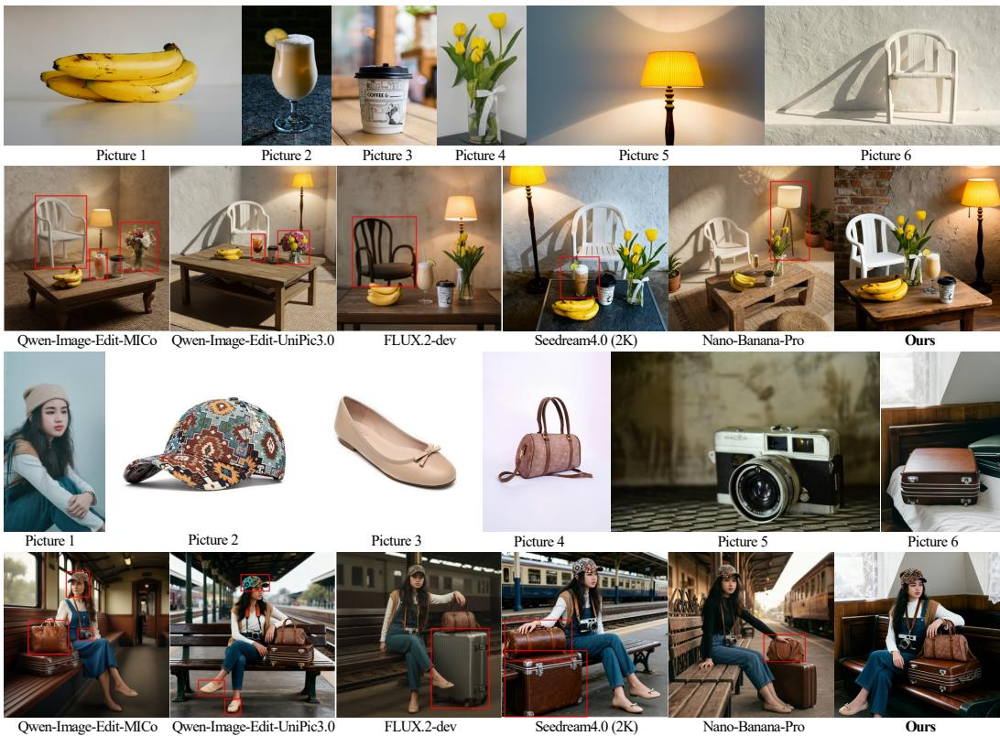  
Figure 1: Qualitative comparisons on two challenging MICo examples, each involving six reference images. Compared with open-source and proprietary baselines, our method better preserves the identities and visual attributes of multiple referenced objects in the composed image. The red boxes highlight objects with inconsistent appearances.

## Abstract

Multi-image composition (MICo) is a critical yet challenging capability for largescale image editing models, where consistency degrades rapidly as the number of reference images increases. While supervised fine-tuning (SFT) can equip models with basic MICo ability, it provides only implicit supervision on the composed image and often fails to learn reliable object-level correspondence across multiple references. We propose DeCoRL, a reinforcement-learning (RL) framework that improves MICo consistency by decomposing holistic MICo consistency into object-level consistency. DeCoRL first establishes instruction-relevant object correspondences across reference images and localizes the corresponding regions in the generated image. It then uses a VLM-based reward model trained on single-object consistency annotations to produce fine-grained, object-wise feedback, which is aggregated into a multi-object consistency reward to guide RL post-training. We further introduce DeCo-Bench, a benchmark covering compositions from 2 to 6 reference images. Experiments on DeCo-Bench and the public MICo-Bench demonstrate consistent improvements in MICo consistency.

## 1 Introduction

Recent instruction-based editing models [3, 41, 48, 32, 39, 42, 22, 16, 17] have achieved strong performance in instruction following and image quality. However, most open-source systems [22, 41] are designed for single-image editing and cannot naturally support multi-image composition (MICo), where multiple reference images must be jointly composed into a single edited result. Although recent models such as Qwen-Image-Edit-2509/2511 [48] and FLUX.2-dev [21] begin to support this setting, they still struggle to maintain consistency as the number of reference images increases.

A central challenge in MICo is cross-image consistency: the model must integrate multiple visual conditions while preserving the correct identities, attributes, and semantic bindings of multiple entities in the generated image. This is fundamentally harder than single-image editing because the model must resolve many ambiguous many-to-one correspondences: each generated entity may inherit visual properties from a different reference image, and this ambiguity grows quickly with the number of inputs [57, 25, 56].

Despite this challenge, most existing MICo approaches primarily rely on large-scale (often synthetic) multi-image editing data and supervised fine-tuning (SFT) to endow models with multi-reference capability [47, 44]. However, SFT typically provides only implicit supervision on the generated image, without explicitly teaching object-level correspondence and binding across references, which often leads to identity confusion or attribute leakage when the number of conditions grows [57, 25, 56].

These limitations motivate reinforcement learning (RL) as a post-training paradigm for image editing, since it can directly optimize model preferences via reward signals rather than merely imitate paired targets as in SFT. Recent editing works have similarly adopted RL-style post-training to improve alignment and controllability beyond pure SFT [26, 54, 23, 34, 43, 14, 49, 18].

The effectiveness of RL hinges on a reliable reward. However, designing such a reward for MICo consistency is particularly challenging: as the number of reference images grows, holistic scoring must jointly resolve ambiguous correspondence and attribute-to-source binding under many competing visual conditions—an ill-posed judgment that remains unreliable even for strong VLM evaluators (e.g., GPT-4o) due to limited cross-image attention [47].

We propose DeCoRL (Decomposed Consistency Reinforcement Learning), an RL framework built on a central methodological insight: holistic MICo consistency can be decomposed into tractable consistency checks over instruction-relevant, localizable objects. This decomposition is the core reward-design principle, while the specific evaluator, grounding model, and RL optimizer are implementation choices. We first train a single-object consistency reward model using a visionlanguage model (VLM) [37, 24, 1, 28], with chain-of-thought (CoT) [46, 53, 8, 52] supervision, and use its yes/no token probabilities [6, 30, 7] as a continuous reward signal. We then build an automatic object alignment pipeline: a VLM identifies instruction-relevant objects across the reference images, and Grounding DINO [31] localizes them. Based on these aligned objects, we define a multi-object consistency reward that matches generated objects with their corresponding references, scores each matched pair using our trained single-object consistency reward model, and penalizes missing objects (i.e., instruction-relevant entities not present in the generated output). This multi-object reward is then used to post-train the editing model via diffusion-based RL.

We further introduce DeCo-Bench, a dedicated benchmark for evaluating MICo consistency. By performing SFT followed by DeCoRL on the Qwen-Image-Edit2511 [48] model, we observe substantial and consistent improvements in MICo consistency on both DeCo-Bench and the public MICo-Bench, demonstrating the effectiveness of our method.

Our main contributions are summarized as follows:

• Core insight. We identify object-level decomposition as a practical reward-design principle for MICo: once instruction-relevant object correspondences are established, consistency can be evaluated locally instead of through a single holistic judgment.

• DeCoRL framework. We develop an RL post-training framework that aggregates objectlevel consistency scores into a multi-object reward, including penalties for missing objects. VLM parsing, Grounding DINO localization, and CoT-trained reward modeling provide one modular instantiation of this framework.

• Benchmark and evaluation. We introduce DeCo-Bench (2–6 reference images) and demonstrate consistent improvements on both DeCo-Bench and the independently developed MICo-Bench.

## 2 Related Work

Single-Image Editing. Instruction-based image editing has advanced rapidly with the development of text-to-image (T2I) foundation models [9, 41, 48, 20, 5, 4, 11, 10]. Representative open-source models (LongCat-Image-Edit [41] and FLUX.1-Kontext [22]) achieve strong performance in instruc tion following and image quality. However, these methods are primarily designed for single-image editing and do not support MICo.

Multi-Image Composition. Multi-image composition (MICo) requires jointly integrating several reference images into a single generated result, making it substantially more challenging than singleimage editing. Recent open-source models such as Qwen-Image-Edit [48], FLUX.2-dev [21], and FireRed-Image-Edit [42] have begun to support this setting, while advanced closed-source systems such as Nano-Banana-Pro [13] and Seedream 4.0 [39] further highlight its practical importance. However, maintaining MICo consistency remains difficult, especially as the number of reference images increases.

Most recent MICo progress relies on large-scale (often synthetic) data construction followed by supervised fine-tuning (SFT), which can efficiently imitate demonstrations but typically supervises only the final composed image and provides limited explicit signals for learning cross-image correspondence and consistency relations. As a result, MICo consistency often degrades in harder cases with many reference images. Notably, this issue also appears in strong closed-source systems (e.g., Nano-Banana-Pro [13] and Seedream 4.0 [39]), which sometimes produce inconsistent compositions, e.g., object identities or attributes may change in complex multi-reference settings.

Reinforcement-Learning for Image Editing. Reinforcement learning (RL) has become an effective post-training tool for diffusion-based image editing, and has been increasingly adopted in recent open-source systems. For example, Skywork UniPic 2.0 explicitly incorporates online RL to improve unified multimodal generation and editing capability [45], while LongCat-Image-Edit [41], Qwen-Image-Edit [48], Edit-R1 [26], and FireRed-Image-Edit [42] also leverage preference optimization or reward-driven training (e.g., DPO [38], GRPO [40], Flow-GRPO [29], and Diffusion NFT [55]) to enhance image quality, instruction adherence, and controllability.

These successful practices suggest that RL provides a promising direction for improving editing models beyond standard SFT objectives. Motivated by this, we propose DeCoRL, which leads to substantial improvements in MICo consistency.

## 3 Method

We present DeCoRL (see Figure 2), an RL-based post-training framework for improving consistency in MICo. The key idea of DeCoRL is to avoid directly scoring MICo consistency between multiple reference images and a generated image, which is highly ambiguous and difficult to evaluate reliably (as stated in [47]), and instead introduce a principled decomposition into object-level consistency evaluation. This design is motivated by the observation that, once object correspondence is established, single-object consistency is more tractable to evaluate than global MICo consistency. The decomposed reward primarily targets the identity and visual attributes of localizable, instruction-relevant objects; the particular grounding and scoring components are modular.

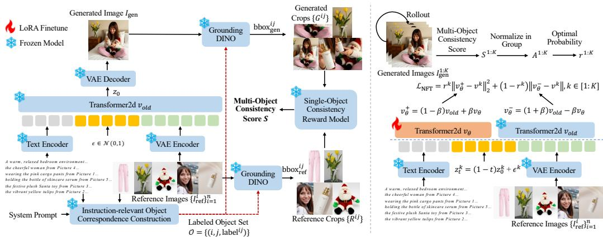  
Figure 2: Overview of DeCoRL. DeCoRL improves MICo consistency via decomposed, object-level RL. We use a VLM to parse the instruction and identify instruction-relevant objects in each reference image, then localize them with Grounding DINO to obtain object crops. For a generated image, we detect the corresponding objects, score each reference–generated object pair with a trained singleobject consistency reward model, aggregate the scores into a multi-object consistency reward, and finally optimize the transformer2d model with Diffusion NFT [55].

## 3.1 Task Definition

In MICo, the input consists of a textual editing instruction c and a set of reference images $\mathcal { T } _ { \mathrm { r e f } } =$ $\{ I _ { \mathrm { r e f } } ^ { i } \} _ { i = 1 } ^ { n }$ , and the goal is to generate an edited image $I ^ { \mathrm { g e n } }$ that follows the instruction while preserving relevant consistency from the reference images.

## 3.2 Multi-Image Supervised Fine-Tuning

We adopt Qwen-Image-Edit2511 [48] as the base image editing model. Since the original model doe not reliably support generation with more than three reference images, we first perform supervised fine-tuning (SFT) covering 1–6 reference images. For multi-image supervision, we combine MICo-150K [47] and UniPic 3.0 [44], yielding approximately 470K training examples across this reference range.

As the number of reference images increases, the number of visual tokens grows rapidly. To keep the total visual input within the model capacity, we resize all reference images under a shared total-pixel budget while preserving their aspect ratios. Let the i-th reference image ${ \bar { I } } _ { \mathrm { r e f } } ^ { i }$ have width $w ^ { i }$ and height $h ^ { i }$ . We first compute the total reference area $\begin{array} { r } { U = \sum _ { i = 1 } ^ { n } w ^ { i } h ^ { i } } \end{array}$ , and define a shared scaling factor $\begin{array} { l } { f = \sqrt { \frac { P } { U } } } \\ { \mathrm { a s } } \end{array}$ , where $P$ is the target total area budget $( \mathrm { e } . \mathrm { g } . , 1 0 2 4 ^ { 2 } )$ . Each reference image is then resized

$$
\begin{array} { r } { \hat { I } _ { \mathrm { r e f } } ^ { i } = \mathrm { R e s i z e } \big ( I _ { \mathrm { r e f } } ^ { i } , \mathrm { r o u n d } ( w ^ { i } f ) , \mathrm { r o u n d } ( h ^ { i } f ) \big ) , } \end{array}\tag{1}
$$

so that aspect ratios and relative scales are preserved.

Latent Encoding. We encode the resized references and the target image $I ^ { \mathrm { t g t } }$ into latent features using a VAE encoder E [19]:

$$
z _ { \mathrm { r e f } } ^ { i } = \mathcal { E } \Big ( \hat { I } _ { \mathrm { r e f } } ^ { i } \Big ) , \qquad z _ { \mathrm { t g t } } = \mathcal { E } ( I _ { \mathrm { t g t } } ) .\tag{2}
$$

We then concatenate each reference latent feature into a whole latent feature:

$$
z _ { \mathrm { r e f } } = [ z _ { \mathrm { r e f } } ^ { 1 } ; z _ { \mathrm { r e f } } ^ { 2 } ; \cdot \cdot \cdot ; z _ { \mathrm { r e f } } ^ { n } ]\tag{3}
$$

Training Objective. We train the transformer2d model with a flow-matching [27] objective. We first sample a scalar time step $t \in ( 0 , 1 )$ from a logit-normal distribution $[ 9 ] \colon t = \sigma ( u ) , \dot { u } \sim \mathcal { N } ( 0 , 1 )$ where $\sigma ( \cdot )$ is the sigmoid function. We then sample Gaussian noise $\epsilon \sim \mathcal { N } ( 0 , I )$ , with the same shape as $z _ { \mathrm { t g t } }$ , and construct the noisy latent feature at timestep t:

$$
z _ { t } = ( 1 - t ) z _ { \mathrm { t g t } } + t \epsilon .\tag{4}
$$

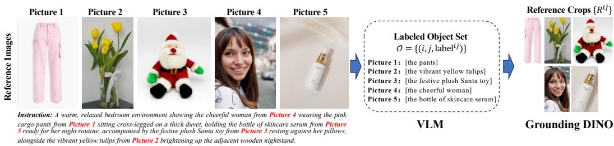  
Figure 3: Instruction-relevant Object Correspondences. A VLM jointly interprets the instruction and multiple reference images, identifies instruction-relevant objects, and produces a labeled object set for Grounding DINO to obtain the reference crops.

The transformer2d model [9] predicts the velocity field for the target latent feature:

$$
v _ { \theta } = \mathrm { T r a n s f o r m e r 2 d } ( z _ { t } , z _ { \mathrm { r e f } } , t , c ) .\tag{5}
$$

Under the linear interpolation in Eq. (4), the ground-truth velocity is $\begin{array} { r } { v _ { t } = \frac { d z _ { t } } { d t } = \epsilon - z _ { \mathrm { t g t } } } \end{array}$ . We optimize the flow-matching loss

$$
\mathcal { L } _ { \mathrm { F M } } = \Vert v _ { \theta } - v _ { t } \Vert _ { 2 } ^ { 2 } .\tag{6}
$$

Role of SFT. This stage provides a strong initialization for multi-reference editing, but it does not explicitly supervise object correspondences across reference images. Consequently, the editor may still omit requested objects, confuse their identities, or fail to preserve local attributes, motivating the object-level consistency rewards introduced next.

## 3.3 Single-Object Consistency Reward model

We train a single-object consistency reward model on PaCO-RL-Dataset [35] under a chain-ofthought (CoT) evaluation protocol, since yes/no-only supervision is low-entropy and prone to shortcut overfitting [46, 53, 8, 52]. We adopt Qwen3-VL-32B [2] as the reward backbone and fine-tune it to answer binary consistency questions.

Training. Each training example contains a reference crop $\mathbf { x } _ { \mathrm { r e f } } ,$ , a generated crop $\mathbf { x } _ { \mathrm { g e n } } ,$ and a textual query q about their identity and visual-attribute consistency. We fine-tune the VLM with standard autoregressive cross-entropy on annotated CoT responses containing an explanation and a binary decision (yes/no).

Inference. We decode up to $T _ { \mathrm { c h e c k } }$ steps and identify the first step $t ^ { \star }$ at which the highest-logit vocabulary token is yes or no. Denoting their logits by $\dot { \ell } _ { \boldsymbol { \mathbf { y e s } } } ^ { ( t ^ { \star } ) }$ and $\ell _ { \mathtt { n } 0 } ^ { ( t ^ { \star } ) }$ , we compute the single-object consistency score as

$$
s _ { \mathrm { o b j } } = \left\{ \begin{array} { l l } { \sigma \left( \ell _ { \mathrm { y e s } } ^ { ( t ^ { \star } ) } - \ell _ { \mathrm { n o } } ^ { ( t ^ { \star } ) } \right) , } & { \mathrm { i f ~ } t ^ { \star } \mathrm { ~ e x i s t s , ~ } } \\ { 0 , } & { \mathrm { o t h e r w i s e , ~ } } \end{array} \right.\tag{7}
$$

where $\sigma ( \cdot )$ is the sigmoid function. The resulting score in [0, 1] provides continuous object-level feedback.

## 3.4 Instruction-Relevant Object Correspondences

To make object-level rewards applicable to MICo, we first construct instruction-relevant object correspondences from the instruction and reference images, as illustrated in Figure 3. This step converts holistic MICo into a set of aligned object instances, enabling reliable evaluation with our trained single-object consistency reward model.

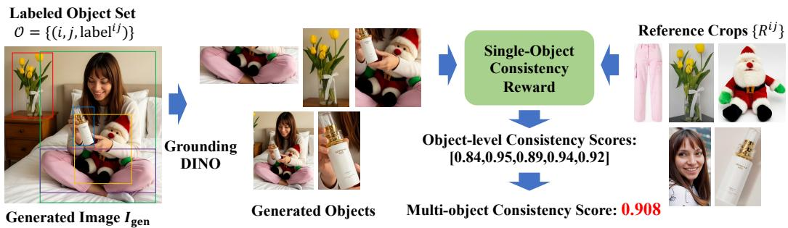  
Figure 4: Multi-object Consistency Reward. Object-level consistency scores are computed for aligned reference-generated object pairs and then aggregated into a single-object consistency reward.

Instruction-aware Object Set. Given an instruction c and reference images $\mathcal { T } _ { \mathrm { r e f } } = \{ I _ { \mathrm { r e f } } ^ { i } \} _ { i = 1 } ^ { n }$ , we use a VLM to identify the objects explicitly required by c and to assign an open-vocabulary label to each object instance in each reference image. We denote the resulting labeled object set as

$$
\begin{array} { r } { \mathcal { O } = \{ ( i , j , \mathrm { l a b e l } ^ { i j } ) \} , } \end{array}
$$

where $( i , j )$ indexes the j-th instruction-relevant object in the i-th reference image. Focusing on O prevents background clutter or instruction-irrelevant entities from affecting reward computation.

Open-vocabulary Grounding in References. For each $( i , j , \mathrm { l a b e l } ^ { i j } ) \in \mathcal { O }$ , we apply Grounding DINO on $I _ { \mathrm { r e f } } ^ { i }$ with the text prompt labelij and obtain a set of candidate detections with confidence scores. We keep only the highest-confidence (top-1) detection (after standard post-processing such as thresholding and NMS), and denote its bounding box as $\mathrm { b b o x } _ { \mathrm { r e f } } ^ { i j }$ . The corresponding reference crop is

$$
R ^ { i j } = \mathrm { C r o p } ( I _ { \mathrm { r e f } } ^ { i } , \mathrm { b b o x } _ { \mathrm { r e f } } ^ { i j } ) .\tag{8}
$$

These grounded crops serve as the spatial anchors for subsequent object-level consistency scoring.

## 3.5 Multi-Object Consistency Reward

We now construct a multi-object consistency reward for MICo by composing the single-object consistency scores, as shown in 4.

Generated-object Grounding and Matching. For each object label $\mathrm { l a b e l } ^ { i j }$ identified in the reference images, we also apply Grounding DINO on $I _ { \mathrm { g e n } }$ with the text prompt labelij and keep the highest-confidence (top-1) detected bounding box $\mathrm { b b o x } _ { \mathrm { g e n } } ^ { i j }$ . The corresponding generated crop is

$$
G ^ { i j } = \mathrm { C r o p } ( I _ { \mathrm { g e n } } , \mathrm { b b o x } _ { \mathrm { g e n } } ^ { i j } ) .\tag{9}
$$

Per-Object Reward. For each pair $( R ^ { i j } , G ^ { i j } )$ , we resize both crops while preserving aspect ratio and feed them into the single-object consistency reward model. If an object exists in the reference image but is not detected in the generated image, we assign a reward of zero to explicitly penalize missing objects:

$$
s ^ { i j } = { \left\{ \begin{array} { l l } { s _ { \mathrm { o b j } } \left( { \mathrm { R e s i z e } } ( R ^ { i j } ) , { \mathrm { R e s i z e } } ( G ^ { i j } ) \right) , } & { G ^ { i j } \not = \emptyset , } \\ { 0 , } & { { \mathrm { o t h e r w i s e } } . } \end{array} \right. }\tag{10}
$$

Reward Aggregation. Let $N$ denote the number of valid reference objects in the sample. We aggregate the object-level consistency scores into a multi-object consistency score:

$$
S = \frac { 1 } { N } \sum _ { i , j } s ^ { i j } ,\tag{11}
$$

where $N > 0$ denotes the number of valid instruction-relevant reference objects. The decomposition makes each required object’s consistency explicitly measurable and assigns zero reward to missing

detections, rather than relying on a single undifferentiated whole-image judgment. The mean is deliberately simple; it does not by itself guarantee balanced improvement across objects.

## 3.6 Diffusion NFT Post-Training

Using the multi-object reward defined above, we further optimize the editing model through Diffusion NFT [55], a practical choice for diffusion RL post-training. The decomposition-based reward is not specific to this optimizer. The objective is to increase the likelihood of reward-improving predictions while keeping the updated policy close to a reference model for stability.

Reward Normalization and Policy Optimization. Following Diffusion NFT [55], for K samples generated under the same condition c, let $S ^ { k }$ denote the multi-object reward of sample k, and let µ and σ be the group mean and standard deviation. We normalize and clip the relative advantages, mapping them to weights in [0, 1]:

$$
r ^ { k } = \frac { 1 } { 2 } + \frac { 1 } { 2 A _ { \mathrm { m a x } } } \mathrm { c l i p } \bigg ( \frac { S ^ { k } - \mu } { \sigma + \epsilon } , - A _ { \mathrm { m a x } } , A _ { \mathrm { m a x } } \bigg ) ,\tag{12}
$$

where $\epsilon > 0$ ensures numerical stability and $A _ { \mathrm { m a x } } > 0$ sets the clipping bound. These weights balance the positive and negative optimization directions:

$$
\mathcal { L } _ { \mathrm { N F T } } = \mathbb { E } _ { k , t } \big [ r ^ { k } \| v _ { \theta } ^ { + } - v ^ { k } \| _ { 2 } ^ { 2 } + ( 1 - r ^ { k } ) \| v _ { \theta } ^ { - } - v ^ { k } \| _ { 2 } ^ { 2 } \big ] ,\tag{13}
$$

where $v ^ { k } = \epsilon ^ { k } - z _ { \mathrm { g e n } } ^ { k }$ with $z _ { \mathrm { g e n } } ^ { k } = \mathcal { E } ( I _ { \mathrm { g e n } } ^ { k } )$ , and $v _ { \theta } ^ { + } = ( 1 - \beta ) v _ { \mathrm { o l d } } + \beta v _ { \theta }$ and $v _ { \theta } ^ { - } = ( 1 + \beta ) v _ { \mathrm { o l d } } - \beta v _ { \theta }$ denote the positive and negative velocities, respectively. Here $\beta$ is a hyperparameter, and the loss is evaluated over sampling timesteps t for samples generated by the old policy.

To prevent the policy from drifting too far from the initial model, we use reference regularization [33, 51] that penalizes differences between the current velocity prediction $v _ { \theta }$ and the reference prediction $v _ { \mathrm { r e f } }$ . The final DeCoRL objective is

$$
\mathcal { L } = \lambda _ { \mathrm { N F T } } \mathcal { L } _ { \mathrm { N F T } } + \lambda _ { \mathrm { R e g } } \underbrace { \mathbb { E } _ { k , t } \left[ \| v _ { \theta } - v _ { \mathrm { r e f } } \| _ { 2 } ^ { 2 } \right] } _ { \mathcal { L } _ { \mathrm { R e g } } } ,\tag{14}
$$

where $\lambda _ { \mathrm { { N F T } } }$ and $\lambda _ { \mathrm { R e g } }$ are hyperparameters. In practice, to mitigate reward hacking, we additionally incorporate a general-purpose VLM (Qwen3.5-122B-10A) [36] reward that penalizes unnatural outputs, structural distortions, and compositing artifacts. This complementary signal also discourages globally implausible object–subject interactions that might be missed by local crop-based consistency scoring.

## 4 Experiments

We provide further implementation details, including our trained single-object consistency reward model, in Appendix A.1. Additional diagnostic evaluations and a discussion of scope are provided in Appendix B.

## 4.1 Training Setup.

SFT. We fine-tune Qwen-Image-Edit2511 on the multi-image datasets MICo-150K [47] and UniPic 3.0 [44] described in Section 3.2, together with Nano-consistent-150K [50] for single-image editing. We train for 24,000 steps on 32 H800 GPUs with a total batch size of 128, using AdamW $\bar { ( \beta _ { 1 } = 0 . 9 }$ $\beta _ { 2 } = 0 . 9 9 9 , \epsilon = 1 0 ^ { - 8 }$ , weight decay $1 0 ^ { - 2 } )$ and a learning rate of $2 \times 1 0 ^ { - 5 }$

RL. We initialize from the SFT checkpoint and perform Diffusion NFT post-training on MICo-150K [47] using LoRA [15] (r = 32). Training uses 32 H800 GPUs, a group size of 16, and AdamW $( \beta _ { 1 } = 0 . 9 , \beta _ { 2 } = 0 . 9 9 9 , { \epsilon } = 1 0 ^ { - 1 0 }$ , weight decay $1 0 ^ { - 4 } )$ with a learning rate of $3 \times 1 0 ^ { - 4 }$

## 4.2 Benchmarks

DeCo-Bench. To evaluate consistency in ${ \bf M I C o , }$ we construct DeCo-Bench, a benchmark covering MICo tasks with 2–6 reference images. Each setting contains 40 test cases (a total of 200 cases), and all reference images are real-world photographs. We provide details of DeCo-Bench in Appendix A.2.1.

Table 1: Results and ablations on DeCo-Bench.
<table><tr><td>Model</td><td>2 images↑</td><td>3 images↑</td><td>4 images↑</td><td>5 images↑</td><td>6 images↑</td><td>Overall↑</td></tr><tr><td>Qwen-Image-Edit-MICo [47]</td><td>6.90</td><td>5.27</td><td>4.85</td><td>4.79</td><td>4.06</td><td>5.17</td></tr><tr><td>Qwen-Image-Edit-UniPic3.0 [44]</td><td>7.82</td><td>6.23</td><td>5.73</td><td>5.24</td><td>5.11</td><td>6.02</td></tr><tr><td>FLUX.2-dev [21]</td><td>8.10</td><td>7.26</td><td>7.10</td><td>6.76</td><td>6.28</td><td>7.10</td></tr><tr><td>Seedream4.0 (2K) [39]</td><td>8.17</td><td>8.17</td><td>7.50</td><td>7.49</td><td>7.47</td><td>7.76</td></tr><tr><td>Nano-Banana-Pro [13]</td><td>9.26</td><td>8.67</td><td>8.77</td><td>8.58</td><td>8.18</td><td>8.69</td></tr><tr><td>Qwen-Image-Edit2511 (baseline) [48]</td><td>8.41</td><td>6.99</td><td>7.09</td><td>4.98</td><td>3.64</td><td>6.22</td></tr><tr><td>+ SFT</td><td>8.34</td><td>7.35</td><td>6.80</td><td>6.60</td><td>6.15</td><td>7.05</td></tr><tr><td>+ DeCoRL (ours)</td><td>8.91</td><td>8.36</td><td>8.05</td><td>7.88</td><td>7.61</td><td>8.16</td></tr></table>

Table 2: Results and ablations on MICo-Bench.
<table><tr><td>Model</td><td>Object Centric↑</td><td>Human Centric↑</td><td>HOI↑</td><td>De&amp;Re↑</td><td>Overall↑</td></tr><tr><td>Qwen-Image-Edit-MICo [47]</td><td>52.38</td><td>21.11</td><td>34.95</td><td>37.42</td><td>35.86</td></tr><tr><td>Qwen-Image-Edit-UniPic3.0 [44]</td><td>67.94</td><td>44.79</td><td>28.24</td><td>59.28</td><td>47.90</td></tr><tr><td>FLUX.2-dev [21]</td><td>41.21</td><td>45.10</td><td>49.86</td><td>55.71</td><td>49.55</td></tr><tr><td>Nano-Banana [12]</td><td>48.01</td><td>41.79</td><td>49.64</td><td>49.44</td><td>47.83</td></tr><tr><td>Nano-Banana-Pro [13]</td><td>50.59</td><td>54.75</td><td>50.21</td><td>52.13</td><td>51.76</td></tr><tr><td>Qwen-Image-Edit2511 (baseline) [48]</td><td>27.41</td><td>28.89</td><td>19.59</td><td>20.60</td><td>22.90</td></tr><tr><td>+ SFT</td><td>39.60</td><td>30.49</td><td>32.41</td><td>45.50</td><td>37.58</td></tr><tr><td>+ DeCoRL (ours)</td><td>53.47</td><td>56.21</td><td>42.49</td><td>64.42</td><td>54.03</td></tr></table>

MICo-Bench. To further assess overall performance, we also evaluate our method on the public MICo-Bench. Following its standard protocol, we additionally report category-level results under Object Centric (138 cases), Human Centric (168 cases), HOI (291 cases), and De&Re (300 cases). We additionally report results on Semantic Consistency (SC), including Prompt Following (PF) and Subject Resemblance (SR), as well as Perceptual Quality (PQ), including Naturalness and Artifact. We provide details of MICo-Bench in Appendix A.2.2.

## 4.3 Comparative Results

Results on DeCo-Bench. As shown in Table 1, performance generally drops as the number of reference images increases (2→6), consistent with the increased difficulty of MICo consistency. Our method achieves an overall score of 8.16, clearly outperforming all open-source baselines, including Qwen-Image-Edit-MICo (5.17), Qwen-Image-Edit-UniPic (6.02), and FLUX.2-dev (7.10), and also surpassing the proprietary Seedream4.0 (2K) (7.76). While Nano-Banana-Pro remains the strongest model overall (8.69), our results indicate that we are closing the gap toward it. Despite the remaining difference, the consistent improvements over all other models validate the effectiveness of our method.

Results on MICo-Bench. Table 2 reports results on the public MICo-Bench. Our method achieves a state-of-the-art overall score of 54.03, outperforming both open-source baselines (Qwen-Image-Edit-MICo/UniPic3.0 and FLUX.2-dev) and strong proprietary systems (Nano-Banana and Nano-Banana-Pro).

## 4.4 Ablation Study

Ablation Study on DeCo-Bench. Table 1 shows that the baseline model struggles severely when the number of reference images increases, with a sharp drop at 5–6 images (4.98 and 3.64). In our tests, this often corresponds to qualitative “collapse” cases where the model fails to preserve key attributes consistently. After SFT, consistency improves across all settings (overall: 6.22→7.05), indicating that supervised training helps the model acquire basic MICo capability.

Table 3: Ablations on four MICo-Bench metrics.
<table><tr><td>Model</td><td>Prompt Following (PF)↑</td><td>Subject Resemblance (SR)↑</td><td>Naturalness↑</td><td>Artifacts↑</td></tr><tr><td>Qwen-Image-Edit2511 (baseline)</td><td>6.1495</td><td>5.2378</td><td>5.0817</td><td>4.1208</td></tr><tr><td>+ SFT</td><td>8.7586</td><td>7.0080</td><td>6.5355</td><td>5.7574</td></tr><tr><td>+ DeCoRL</td><td>8.6865</td><td>7.6393</td><td>8.0123</td><td>6.6362</td></tr></table>

Table 4: Ablations of vanilla vs. trained VLM rewards on DeCo-Bench.
<table><tr><td>Model</td><td>2 images↑</td><td>3 images↑</td><td>4 images↑</td><td>5 images↑</td><td>6 images↑</td><td>Overall↑</td></tr><tr><td>Qwen-Image-Edit2511 (baseline) [48] + SFT</td><td>8.34</td><td>7.35</td><td>6.80</td><td>6.60</td><td>6.15</td><td>7.05</td></tr><tr><td>w/ vanilla VLM reward</td><td>8.54</td><td>7.49</td><td>6.42</td><td>6.90</td><td>6.78</td><td>7.21</td></tr><tr><td>w/ trained VLM reward (ours)</td><td>8.91</td><td>8.36</td><td>8.05</td><td>7.88</td><td>7.61</td><td>8.16</td></tr></table>

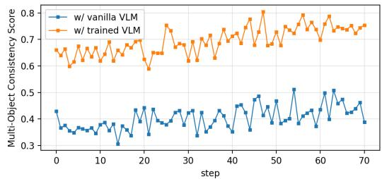

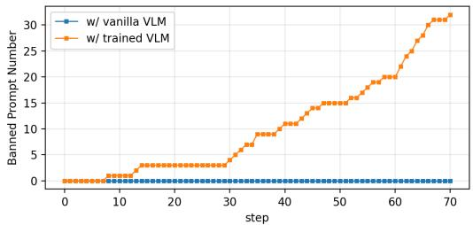  
Figure 5: Training dynamics of multi-object consistency score and banned prompt count (vanilla vs. trained VLM).

Applying DeCoRL further yields consistent and substantial gains from 2 to 6 images (overall: 7.05→8.16), with especially notable improvements under harder conditions (e.g., 6 images: 6.15→7.61). These results suggest that while SFT can teach the model to perform MICo, it remains difficult for the model to robustly learn MICo consistency; our DeCoRL is effective in strengthening this consistency across varying numbers of inputs.

Ablation Study on MICo-Bench. As shown in Table 2, our method brings substantial improvements over both the baseline and baseline+SFT on MICo-Bench. Specifically, DeCoRL boosts the overall score from 22.90 (baseline) and 37.58 (+SFT) to 54.03, with the most significant gain on Human Centric (28.89→30.49→56.21) and De&Re (20.60→45.50→64.42).

We further analyze MICo-Bench using four metrics in Table 3. Compared with the SFT model, DeCoRL yields clear gains in Subject Resemblance (SR) (7.01→7.64), Naturalness (6.54→8.01), and Artifacts (5.76→6.64), indicating better identity preservation and visual quality with fewer artifacts. Meanwhile, Prompt Following (PF) is slightly lower than the SFT variant (8.76→8.69), suggesting that the improvements are not merely due to reward hacking that over-optimizes a single criterion. Notably, SFT consistently improves all four metrics over the baseline, largely because it strengthens basic multi-image editing ability, reducing failure cases and improving instruction following in multi-image settings.

Ablation Study of Single-Object Consistency Reward Model on DeCo-Bench. We provide an ablation study of our single-object consistency reward model mentioned in Section 3.3, as presented in Table 4. Using a vanilla VLM yields only marginal gains over SFT (overall 7.05→7.21), suggesting limited ability to provide reliable supervision for MICo consistency. In contrast, our CoT-trained VLM substantially improves performance across 2–6 images, reaching 8.16 overall.

Figure 5 further supports this finding. With the vanilla VLM reward, the multi-object consistency score remains mostly below 0.5 with limited improvement, indicating a weak optimization signal. In contrast, our CoT-trained VLM reward stays above 0.6 and steadily increases during training. The banned prompt count is also informative: a prompt is banned when its samples already obtain high and similar rewards, meaning the model has learned this reward signal. It remains zero for the vanilla VLM, while it increases over time for the CoT-trained VLM, showing that more prompts receive stable and well-learned reward signals. Overall, these results show that the CoT-trained VLM provides a more reliable and informative reward than a vanilla VLM, enabling effective DeCoRL optimization and improving MICo consistency.

## 4.5 Visualization

Figure 1 presents two examples of MICo, each consisting of six images. It can be observed that both the open-source model and the closed-source Seedream 4.0 exhibit relatively poor consistency. Even the strongest closed-source model, Nano-Banana-Pro, shows objects with noticeable inconsistency under multi-reference settings. In contrast, our model maintains better consistency in both cases. We also provide more visualizations of our method on DeCo-Bench and MICo-Bench in Appendix A.3.

## 5 Conclusion

## 5.1 Summary

In this work, we introduce DeCoRL, a reinforcement-learning (RL) post-training framework that improves multi-image composition (MICo) consistency through object-level reward decomposition. DeCoRL establishes instruction-relevant object correspondences, localizes matched regions, and aggregates fine-grained single-object consistency scores into a multi-object reward for optimization. We further propose DeCo-Bench, covering MICo tasks with 2–6 reference images. Experiments on DeCo-Bench and MICo-Bench demonstrate consistent improvements, particularly in challenging many-reference settings, showing the effectiveness of decomposed consistency rewards for scalable MICo post-training.

## 5.2 Discussion and Future Directions

From many references to object-wise evaluation. DeCoRL is built on the principle that a difficult holistic MICo consistency judgment can be decomposed into more tractable checks. Instead of evaluating all references against the generated image jointly, we first establish instruction-relevant object correspondences, then score each matched reference–generated object pair individually, and finally aggregate these scores into a multi-object reward. This turns a many-reference judgment into a collection of simpler object-level evaluations while retaining a joint objective of preserving multiple subjects. The central methodological contribution is this decomposition-based reward design, rather than a particular VLM, grounding model, or RL optimizer.

Generality and future directions. Our CoT-trained VLM is one instantiation of the single-object evaluator. In principle, any reliable evaluator that produces comparable object-level consistency scores can be integrated into the same framework; the reward design is also conceptually independent of Diffusion NFT. This modularity suggests opportunities for other evaluators and editing backbones, although such extensions require empirical validation. The current method targets localizable objects and depends on accurate grounding and matching. Future directions include improving correspondence and robustness to imperfect crops, exploring adaptive aggregation to better protect low-scoring objects, and extending the reward to relational, interaction-level, and other non-localizable consistency. Scaling beyond six references additionally requires suitable training data and further evaluation.

## References

[1] Jean-Baptiste Alayrac, Jeff Donahue, Pauline Luc, Antoine Miech, Iain Barr, Yana Hasson, Karel Lenc, Arthur Mensch, Katherine Millican, Malcolm Reynolds, et al. Flamingo: a visual language model for few-shot learning. Advances in neural information processing systems, 35:23716–23736, 2022.

[2] Shuai Bai, Yuxuan Cai, Ruizhe Chen, Keqin Chen, Xionghui Chen, Zesen Cheng, Lianghao Deng, Wei Ding, Chang Gao, Chunjiang Ge, et al. Qwen3-vl technical report. arXiv preprint arXiv:2511.21631, 2025.

[3] Tim Brooks, Aleksander Holynski, and Alexei A Efros. Instructpix2pix: Learning to follow image editing instructions. In Proceedings of the IEEE/CVF conference on computer vision and pattern recognition, pages 18392–18402, 2023.

[4] Huanqia Cai, Sihan Cao, Ruoyi Du, Peng Gao, Steven Hoi, Zhaohui Hou, Shijie Huang, Dengyang Jiang, Xin Jin, Liangchen Li, et al. Z-image: An efficient image generation foundation model with single-stream diffusion transformer. arXiv preprint arXiv:2511.22699, 2025.

[5] Siyu Cao, Hangting Chen, Peng Chen, Yiji Cheng, Yutao Cui, Xinchi Deng, Ying Dong, Kipper Gong, Tianpeng Gu, Xiusen Gu, et al. Hunyuanimage 3.0 technical report. arXiv preprint arXiv:2509.23951, 2025.

[6] Kejia Chen, Jiawen Zhang, Jiacong Hu, Kewei Gao, Jian Lou, Zunlei Feng, and Mingli Song. Token-level inference-time alignment for vision-language models. arXiv preprint arXiv:2510.21794, 2025.

[7] Shirui Chen, Cole Harrison, Ying-Chun Lee, Angela Jin Yang, Zhongzheng Ren, Lillian J Ratliff, Jiafei Duan, Dieter Fox, and Ranjay Krishna. Topreward: Token probabilities as hidden zero-shot rewards for robotics. arXiv preprint arXiv:2602.19313, 2026.

[8] Yangyi Chen, Karan Sikka, Michael Cogswell, Heng Ji, and Ajay Divakaran. Measuring and improving chain-of-thought reasoning in vision-language models. In Proceedings of the 2024 Conference of the North American Chapter of the Association for Computational Linguistics: Human Language Technologies (Volume 1: Long Papers), pages 192–210, 2024.

[9] Patrick Esser, Sumith Kulal, Andreas Blattmann, Rahim Entezari, Jonas Müller, Harry Saini, Yam Levi, Dominik Lorenz, Axel Sauer, Frederic Boesel, et al. Scaling rectified flow transformers for high-resolution image synthesis. In Forty-first international conference on machine learning, 2024.

[10] Yu Gao, Lixue Gong, Qiushan Guo, Xiaoxia Hou, Zhichao Lai, Fanshi Li, Liang Li, Xiaochen Lian, Chao Liao, Liyang Liu, et al. Seedream 3.0 technical report. arXiv preprint arXiv:2504.11346, 2025.

[11] Lixue Gong, Xiaoxia Hou, Fanshi Li, Liang Li, Xiaochen Lian, Fei Liu, Liyang Liu, Wei Liu, Wei Lu, Yichun Shi, et al. Seedream 2.0: A native chinese-english bilingual image generation foundation model. arXiv preprint arXiv:2503.07703, 2025.

[12] Google DeepMind. Introducing Gemini 2.5 Flash Image, our state-of-the-art image model. https: //developers.googleblog.com/en/introducing-gemini-2-5-flash-image/, 2024. Accessed: 2025-10-18.

[13] Google DeepMind. Introducing Nano Banana Pro. https://blog.google/innovation-and-ai/ products/nano-banana-pro/, 2025. Accessed: 2026-05-07.

[14] Hanzhong Guo, Jie Wu, Jie Liu, Yu Gao, Zilyu Ye, Linxiao Yuan, Xionghui Wang, Yizhou Yu, and Weilin Huang. Leveraging verifier-based reinforcement learning in image editing. arXiv preprint arXiv:2604.27505, 2026.

[15] Edward J Hu, Yelong Shen, Phillip Wallis, Zeyuan Allen-Zhu, Yuanzhi Li, Shean Wang, Liang Wang, Weizhu Chen, et al. Lora: Low-rank adaptation of large language models. Iclr, 1(2):3, 2022.

[16] Yuzhou Huang, Liangbin Xie, Xintao Wang, Ziyang Yuan, Xiaodong Cun, Yixiao Ge, Jiantao Zhou, Chao Dong, Rui Huang, Ruimao Zhang, et al. Smartedit: Exploring complex instruction-based image editing with multimodal large language models. In Proceedings ofthe IEEE/CVF Conference on Computer Vision and Pattern Recognition, pages 8362–8371, 2024.

[17] Liya Ji, Chenyang Qi, and Qifeng Chen. Instruction-based image editing with planning, reasoning, and generation. In Proceedings of the IEEE/CVF International Conference on Computer Vision, pages 17506–17515, 2025.

[18] Dongzhi Jiang, Ziyu Guo, Renrui Zhang, Zhuofan Zong, Hao Li, Le Zhuo, Shilin Yan, Pheng-Ann Heng, and Hongsheng Li. T2i-r1: Reinforcing image generation with collaborative semantic-level and token-level cot. arXiv preprint arXiv:2505.00703, 2025.

[19] Diederik P Kingma and Max Welling. Auto-encoding variational bayes. arXiv preprint arXiv:1312.6114, 2013.

[20] Black Forest Labs. Flux. https://github.com/black-forest-labs/flux, 2024.

[21] Black Forest Labs. FLUX.2: Frontier Visual Intelligence. https://bfl.ai/blog/flux-2, 2025.

[22] Black Forest Labs, Stephen Batifol, Andreas Blattmann, Frederic Boesel, Saksham Consul, Cyril Diagne, Tim Dockhorn, Jack English, Zion English, Patrick Esser, et al. Flux. 1 kontext: Flow matching for in-context image generation and editing in latent space. arXiv preprint arXiv:2506.15742, 2025.

[23] Hengjia Li, Liming Jiang, Qing Yan, Yizhi Song, Hao Kang, Zichuan Liu, Xin Lu, Boxi Wu, and Deng Cai. Thinkrl-edit: Thinking in reinforcement learning for reasoning-centric image editing. arXiv preprint arXiv:2601.03467, 2026.

[24] Junnan Li, Dongxu Li, Caiming Xiong, and Steven Hoi. Blip: Bootstrapping language-image pre-training for unified vision-language understanding and generation. In International conference on machine learning, pages 12888–12900. PMLR, 2022.

[25] Yanfeng Li, Kahou Chan, Yue Sun, Chantong Lam, Tong Tong, Zitong Yu, Keren Fu, Xiaohong Liu, and Tao Tan. Moedit: On learning quantity perception for multi-object image editing. In Proceedings of the Computer Vision and Pattern Recognition Conference, pages 2683–2693, 2025.

[26] Zongjian Li, Zheyuan Liu, Qihui Zhang, Bin Lin, Feize Wu, Shenghai Yuan, Zhiyuan Yan, Yang Ye, Wangbo Yu, Yuwei Niu, et al. Uniworld-v2: Reinforce image editing with diffusion negative-aware finetuning and mllm implicit feedback. arXiv preprint arXiv:2510.16888, 2025.

[27] Yaron Lipman, Ricky TQ Chen, Heli Ben-Hamu, Maximilian Nickel, and Matt Le. Flow matching for generative modeling. arXiv preprint arXiv:2210.02747, 2022.

[28] Haotian Liu, Chunyuan Li, Qingyang Wu, and Yong Jae Lee. Visual instruction tuning. Advances in neural information processing systems, 36:34892–34916, 2023.

[29] Jie Liu, Gongye Liu, Jiajun Liang, Yangguang Li, Jiaheng Liu, Xintao Wang, Pengfei Wan, Di Zhang, and Wanli Ouyang. Flow-grpo: Training flow matching models via online rl. arXiv preprint arXiv:2505.05470, 2025.

[30] Jinlong Liu, Wanggui He, Peng Zhang, Mushui Liu, Hao Jiang, and Pipei Huang. Promptecho: Annotationfree reward from vision-language models for text-to-image reinforcement learning. arXiv preprint arXiv:2604.12652, 2026.

[31] Shilong Liu, Zhaoyang Zeng, Tianhe Ren, Feng Li, Hao Zhang, Jie Yang, Qing Jiang, Chunyuan Li, Jianwei Yang, Hang Su, et al. Grounding dino: Marrying dino with grounded pre-training for open-set object detection. In European conference on computer vision, pages 38–55. Springer, 2024.

[32] Shiyu Liu, Yucheng Han, Peng Xing, Fukun Yin, Rui Wang, Wei Cheng, Jiaqi Liao, Yingming Wang, Honghao Fu, Chunrui Han, et al. Step1x-edit: A practical framework for general image editing. arXiv preprint arXiv:2504.17761, 2025.

[33] Weijian Luo, Tianyang Hu, Shifeng Zhang, Jiacheng Sun, Zhenguo Li, and Zhihua Zhang. Diff-instruct: A universal approach for transferring knowledge from pre-trained diffusion models. Advances in Neural Information Processing Systems, 36:76525–76546, 2023.

[34] Xin Luo, Jiahao Wang, Chenyuan Wu, Shitao Xiao, Xiyan Jiang, Defu Lian, Jiajun Zhang, Dong Liu, et al. Editscore: Unlocking online rl for image editing via high-fidelity reward modeling. arXiv preprint arXiv:2509.23909, 2025.

[35] Bowen Ping, Chengyou Jia, Minnan Luo, Changliang Xia, Xin Shen, Zhuohang Dang, and Hangwei Qian. Paco-rl: Advancing reinforcement learning for consistent image generation with pairwise reward modeling. arXiv preprint arXiv:2512.04784, 2025.

[36] Qwen Team. Qwen3.5: Towards native multimodal agents, February 2026.

[37] Alec Radford, Jong Wook Kim, Chris Hallacy, Aditya Ramesh, Gabriel Goh, Sandhini Agarwal, Girish Sastry, Amanda Askell, Pamela Mishkin, Jack Clark, et al. Learning transferable visual models from natural language supervision. In International conference on machine learning, pages 8748–8763. PmLR, 2021.

[38] Rafael Rafailov, Archit Sharma, Eric Mitchell, Christopher D Manning, Stefano Ermon, and Chelsea Finn. Direct preference optimization: Your language model is secretly a reward model. Advances in neural information processing systems, 36:53728–53741, 2023.

[39] Team Seedream, Yunpeng Chen, Yu Gao, Lixue Gong, Meng Guo, Qiushan Guo, Zhiyao Guo, Xiaoxia Hou, Weilin Huang, Yixuan Huang, et al. Seedream 4.0: Toward next-generation multimodal image generation, 2025. URL https://arxiv. org/abs/2509.20427, 6.

[40] Zhihong Shao, Peiyi Wang, Qihao Zhu, Runxin Xu, Junxiao Song, Xiao Bi, Haowei Zhang, Mingchuan Zhang, YK Li, Yang Wu, et al. Deepseekmath: Pushing the limits of mathematical reasoning in open language models. arXiv preprint arXiv:2402.03300, 2024.

[41] Meituan LongCat Team, Hanghang Ma, Haoxian Tan, Jiale Huang, Junqiang Wu, Jun-Yan He, Lishuai Gao, Songlin Xiao, Xiaoming Wei, Xiaoqi Ma, et al. Longcat-image technical report. arXiv preprint arXiv:2512.07584, 2025.

[42] Super Intelligence Team, Changhao Qiao, Chao Hui, Chen Li, Cunzheng Wang, Dejia Song, Jiale Zhang, Jing Li, Qiang Xiang, Runqi Wang, et al. Firered-image-edit-1.0 technical report. arXiv preprint arXiv:2602.13344, 2026.

[43] Rui Tian, Mingfei Gao, Haiming Gang, Jiasen Lu, Zhe Gan, Yinfei Yang, Zuxuan Wu, and Afshin Dehghan. Unigen-1.5: Enhancing image generation and editing through reward unification in reinforcement learning. arXiv preprint arXiv:2511.14760, 2025.

[44] Hongyang Wei, Hongbo Liu, Zidong Wang, Yi Peng, Baixin Xu, Size Wu, Xuying Zhang, Xianglong He, Zexiang Liu, Peiyu Wang, et al. Skywork unipic 3.0: Unified multi-image composition via sequence modeling. arXiv preprint arXiv:2601.15664, 2026.

[45] Hongyang Wei, Baixin Xu, Hongbo Liu, Size Wu, Jie Liu, Yi Peng, Peiyu Wang, Zexiang Liu, Jingwen He, Yidan Xietian, et al. Skywork unipic 2.0: Building kontext model with online rl for unified multimodal model. arXiv preprint arXiv:2509.04548, 2025.

[46] Jason Wei, Xuezhi Wang, Dale Schuurmans, Maarten Bosma, Fei Xia, Ed Chi, Quoc V Le, Denny Zhou, et al. Chain-of-thought prompting elicits reasoning in large language models. Advances in neural information processing systems, 35:24824–24837, 2022.

[47] Xinyu Wei, Kangrui Cen, Hongyang Wei, Zhen Guo, Bairui Li, Zeqing Wang, Jinrui Zhang, and Lei Zhang. Mico-150k: A comprehensive dataset advancing multi-image composition. arXiv preprint arXiv:2512.07348, 2025.

[48] Chenfei Wu, Jiahao Li, Jingren Zhou, Junyang Lin, Kaiyuan Gao, Kun Yan, Sheng-ming Yin, Shuai Bai, Xiao Xu, Yilei Chen, et al. Qwen-image technical report. arXiv preprint arXiv:2508.02324, 2025.

[49] Yuhui Wu, Chenxi Xie, Ruibin Li, Liyi Chen, Qiaosi Yi, and Lei Zhang. Cocoedit: Content-consistent image editing via region regularized reinforcement learning. arXiv preprint arXiv:2602.14068, 2026.

[50] Junyan Ye, Dongzhi Jiang, Zihao Wang, Leqi Zhu, Zhenghao Hu, Zilong Huang, Jun He, Zhiyuan Yan, Jinghua Yu, Hongsheng Li, et al. Echo-4o: Harnessing the power of gpt-4o synthetic images for improved image generation. arXiv preprint arXiv:2508.09987, 2025.

[51] Tianwei Yin, Michaël Gharbi, Richard Zhang, Eli Shechtman, Fredo Durand, William T Freeman, and Taesung Park. One-step diffusion with distribution matching distillation. In Proceedings ofthe IEEE/CVF conference on computer vision and pattern recognition, pages 6613–6623, 2024.

[52] Ruohong Zhang, Bowen Zhang, Yanghao Li, Haotian Zhang, Zhiqing Sun, Zhe Gan, Yinfei Yang, Ruoming Pang, and Yiming Yang. Improve vision language model chain-of-thought reasoning. In Proceedings of the 63rd Annual Meeting of the Association for Computational Linguistics (Volume 1: Long Papers), pages 1631–1662, 2025.

[53] Rosie Zhao, Anshul Shah, Xiaoyu Zhu, Xinke Deng, Zhongyu Jiang, Yang Yang, Joerg Liebelt, and Arnab Mondal. On robustness and chain-of-thought consistency of rl-finetuned vlms. arXiv preprint arXiv:2602.12506, 2026.

[54] Yiran Zhao, Yaoqi Ye, Xiang Liu, Michael Qizhe Shieh, and Trung Bui. Imageedit-r1: Boosting multi-agent image editing via reinforcement learning. arXiv preprint arXiv:2603.08059, 2026.

[55] Kaiwen Zheng, Huayu Chen, Haotian Ye, Haoxiang Wang, Qinsheng Zhang, Kai Jiang, Hang Su, Stefano Ermon, Jun Zhu, and Ming-Yu Liu. DiffusionNFT: Online diffusion reinforcement with forward process. In The Fourteenth International Conference on Learning Representations, 2026.

[56] Zijun Zhou, Yingying Deng, Xiangyu He, Weiming Dong, and Fan Tang. Multi-turn consistent image editing. In Proceedings of the IEEE/CVF International Conference on Computer Vision, pages 15792– 15801, 2025.

[57] Hongyang Zhu, Haipeng Liu, Bo Fu, and Yang Wang. Mde-edit: Masked dual-editing for multi-object image editing via diffusion models. arXiv preprint arXiv:2505.05101, 2025.

## A Appendix

## A.1 Training Details

Single-object consistency reward model. We train Qwen3-VL-32B-Instruct [2] on PaCO-RL-Dataset [35] with LoRA rank 32 and a learning rate of $1 \times 1 0 ^ { - 4 }$ for 2,200 steps on 8 H800 GPUs.

Supervised fine-tuning. We fine-tune Qwen-Image-Edit-2511, our baseline model, on Nano-consistent-150k [50], MICo-150K [47], and UniPic 3.0 [44]. We use AdamW with a learning rate of $2 \times 1 0 ^ { - 5 } , \beta _ { 1 } = 0 . 9$ $\beta _ { 2 } = 0 . 9 9 9 , \epsilon = 1 \times 1 0 ^ { - 8 }$ , and weight decay $\bar { 1 } \times 1 0 ^ { - 2 }$ . Training uses 32 H800 GPUs, a total batch size of 128, and runs for 24,000 steps.

RL post-training. Starting from the SFT checkpoint, we further train on MICo-150K with LoRA [15] rank $r = 3 2$ . RL uses 32 H800 GPUs, group size 16, 8 prompts per sample, and AdamW with learning rate $3 \times 1 0 ^ { - 4 }$ $\beta _ { 1 } = 0 . 9 , \beta _ { 2 } = 0 . 9 9 9 , { \epsilon } = 1 \check { \times } 1 0 ^ { \dot { - } 1 0 }$ , and weight decay $1 \times \mathrm { \hat { 1 0 } ^ { - 4 } }$ . To reduce reward hacking, we add a general-purpose VLM reward from Qwen3.5-122B-10A [36] to penalize unnatural outputs, structural distortions, and compositing artifacts. We set $\lambda _ { \mathrm { N F T } } = 1 , \lambda _ { \mathrm { R e g } } = 1 0 ^ { - 4 }$ , and $\beta = 1$ . See Algorithm 1 for pseudocode.

Algorithm 1: DeCoRL Diffusion NFT Post-Training   
Input: Dataset D, current policy $v _ { \theta } ,$ , old policy $v _ { \mathrm { o l d } } .$ , reference policy $v _ { \mathrm { r e f } }$   
while not converged do   
Sample $( c , \bar { \mathcal { T } } _ { \mathrm { r e f } } ) \sim \mathcal { D } ;$   
Generate a group of samples $\{ I _ { \mathrm { g e n } } ^ { k } \} _ { k = \bar { . } } ^ { K }$ using $v _ { \mathrm { o l d } } ;$   
Compute rewards $\{ S _ { k } \} _ { k = 1 } ^ { K }$ with the multi-object consistency reward in Eq. (11) and the   
general VLM reward;   
Normalize rewards into weights $\{ r _ { k } \} _ { k = 1 } ^ { K }$ using Eq. (12);   
for each sample k do   
for each sample timestep t do   
Sample $( \bar { z } _ { t } ^ { k } , t )$ using Eq. (4);   
Compute vθ, vold, and $v _ { \mathrm { r e f } } ;$   
Construct $v _ { \theta } ^ { + }$ and ${ v } _ { \theta } ^ { - }$ using Eqs. (13);   
Compute $\mathcal { L } _ { \mathrm { N F T } }$ using Eq. (13);   
Compute ${ \mathcal { L } } _ { \mathrm { R e g } }$ using Eq. (14);   
Update θ by minimizing the final objective in Eq. (14);

## A.2 Benchmarks

## A.2.1 DeCo-Bench.

Scores. DeCo-Bench evaluates multi-image composition primarily from the perspective of cross-image consistency, i.e., whether instruction-relevant entities from multiple reference images are correctly and consistently realized in the generated result. It contains settings with $\grave { N } \in \{ 2 , 3 , 4 , 5 , 6 \}$ reference images; each setting includes 40 test cases (200 cases in total), and all reference images are real-world photographs.

For each test case, we first crop the instruction-relevant objects from every reference image, and crop the corresponding objects from the generated image. We then score each cropped reference–generation object pair using Gemini-3.1-Pro (the evaluation prompt is provided in Figure 8). The final score for a sample is computed by averaging all object-level scores:

$$
\mathrm { S c o r e } ( c ) = \frac { 1 } { | \mathcal { O } _ { c } | } \sum _ { o \in \mathcal { O } _ { c } } s ( o ) ,\tag{15}
$$

where $\mathcal { O } _ { c }$ denotes the set of all instruction-relevant objects in case $^ { c , }$ and $s ( o )$ is the Gemini-3.1-Pro score for object o computed from the corresponding cropped reference and generated regions.

Aggregation. Let $\mathcal { C } _ { N }$ denote the set of cases with N reference images, and let $\begin{array} { r } { \mathcal { C } = \bigcup _ { N \in \{ 2 , 3 , 4 , 5 , 6 \} } \mathcal { C } _ { N } } \end{array}$ denote all cases. We report:

$$
\operatorname { S c o r e } _ { N } = { \frac { 1 } { | { \mathcal { C } } _ { N } | } } \sum _ { c \in { \mathcal { C } } _ { N } } \operatorname { S c o r e } ( c ) , \quad { \mathrm { S c o r e } } _ { \mathrm { o v e r a l l } } = { \frac { 1 } { | { \mathcal { C } } | } } \sum _ { c \in { \mathcal { C } } } \operatorname { S c o r e } ( c ) .\tag{16}
$$

## A.2.2 MICo-Bench

Scores. MICo-Bench evaluates each multi-image composition case by jointly considering (i) source preserva tion and (ii) instruction alignment. Concretely, the final score is computed as:

$$
{ \mathrm { S c o r e } } = W \times { \mathrm { S C } } \times { \mathrm { P Q } } .\tag{17}
$$

Tasks. MICo-Bench consists of four tasks:

1. Object-Centric (138 cases): compose 1–4 distinct objects, or insert 1–2 objects into a semantically compatible scene.

2. Human-Centric (168 cases): compose multiple persons, or place 1–2 persons into a compatible scene (with explicit gender control).

3. HOI (291 cases): evaluate human–object interactions, including Person+Object, Person+Clothes, and their combinations.

4. De&Re (300 cases): decompose real portraits into human/clothing/object/scene components and then recompose them to assess holistic controllability.

Weight W. The fraction of source images correctly preserved in the generated output. Faces are verified via ArcFace cosine similarity; non-face elements (objects, clothes, scenes) are verified via a VLM (i.e., Qwen3-VL-30B-A3B-Instruct).

Semantic Consistency (SC). To avoid cross-image attention overload, the evaluator compares the generated image against a human-verified reference image (instead of jointly attending to all sources) and outputs two sub-scores:

1. Prompt Following (PF), measuring compliance with the text instruction (required entities, relations, and scene constraints),

2. Subject Resemblance (SR), measuring how well the generation matches the reference in subject identity/appearance and semantic content.

We compute:

$$
\mathrm { S C } = \sqrt { \mathrm { P F } \times \mathrm { S R } } .\tag{18}
$$

Perceptual Quality (PQ). PQ is evaluated from the generated image alone, including:

1. Naturalness (overall realism and coherence of lighting, shadows, geometry, and materials),

2. Artifacts (absence of visible defects such as distortions, duplicated limbs, and unnatural textures).

We compute:

$$
\mathrm { P Q } = { \sqrt { \mathrm { N a t u r a l n e s s } \times \mathrm { A r t i f a c t s } } } .\tag{19}
$$

Aggregation. Let $\scriptstyle { \mathcal { C } } _ { t }$ denote the set of evaluation cases in task $t ,$ and let $\textstyle { \mathcal { C } } = \bigcup _ { t } { \mathcal { C } } _ { t }$ denote the set of all cases across tasks. We report the task-wise and overall scores as:

$$
\operatorname { S c o r e } _ { t } = { \frac { 1 } { | { \mathcal { C } } _ { t } | } } \sum _ { c \in { \mathcal { C } } _ { t } } \operatorname { S c o r e } ( c ) , \quad { \mathrm { S c o r e } } _ { \mathrm { o v e r a l l } } = { \frac { 1 } { | { \mathcal { C } } | } } \sum _ { c \in { \mathcal { C } } } \operatorname { S c o r e } ( c ) .\tag{20}
$$

## A.3 More Visualizations

We provide additional visualization examples on DeCo-Bench (Figure 6) and MICo-Bench (Figure 7). As can be seen from these visual results, our method achieves excellent MICo consistency and visual quality.

## B Additional Validation and Discussion

Independent validation of the object-level reward evaluator. To assess the trained reward model separately from downstream RL, we evaluated its agreement with human preference labels on EditReward-Bench, which contains approximately 3,000 original/edited image pairs. Table 5 reports the accuracy values from this evaluation. The trained evaluator improves upon its untuned counterpart (0.721 versus 0.354), supporting the importance of using a reliable object-level evaluator within the decomposed reward framework. This evaluation measures agreement with the benchmark labels, not reward calibration.

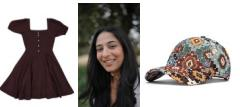

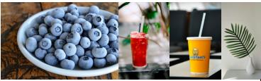

A cozy, dimly lit male musician's studio featuring the young man from Picture 1 sitting thoughtfully on the folding chair from Picture 3, gazing toward a rustic wooden desk where the articulated wooden lamp from Picture 6 casts a warm glow over scattered sheet music, highlighting a steaming beverage in the floral cup from Picture 4 and a smartphone sporting the geometric case from Picture 5, while the acoustic guitar from Picture 2 leans quietly against the soundproofed corner wall in the background.

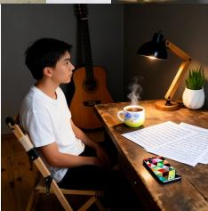

A moody evening desktop arrangement illuminated by the glowing table lamp from Picture 6, featuring the floral tablecloth from Picture 6 as the base for a late-night work session, with the dark smartphone from Picture 5 resting facedown in the foreground near the frosty bowl of blueberries from Picture 1, while the tall red iced drink from Picture 2 and the yellow paper cup from Picture 3 stand side-by-side as refreshments under the soft amber light, and the white vase with the single green frond from Picture 4 casts gentle shadows against the vintage wallpaper from Picture 6.

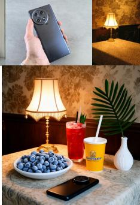

A lifestyle shot of a traveler relaxing on a sunny hotel balcony, wearing the short-sleeve shirt from Picture 4 and the stilettos from Picture 6, sitting beside a glass table holding the iced beverage from Picture 5 and the handbag from Picture 3, with the luggage from Picture 1 standing in the background and the knitted beanie from Picture 2 resting on her lap to accommodate the chilly sea breeze.

A relaxed outdoor cafe scene featuring the man from Picture 2 seated comfortably on a patio chair, dressed in the distressed jeans from Picture 5 and the strapped sandals from Picture 6, resting his arm on a wooden table beside the garnished drink from Picture 3, with the canvas backpack from Picture 4 resting on the ground next to him and the patch cap from Picture 1 placed on his knee.

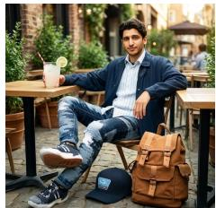

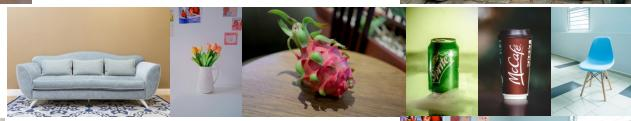

A candid, affectionate moment in a bright living room, capturing the man from Picture 2 lounging comfortably on a plush sofa next to the cheerful woman from Picture 4 who is playfully hugging the teddy bear from Picture 3, while a rustic coffee table in the foreground displays the vase of flowers from Picture 5 alongside the fresh pear resting on the white cloth from Picture 6, all perfectly accompanied by the elegant decorative lamp from Picture 1 positioned on a corner end table.

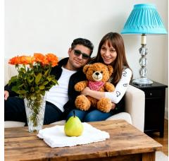

A warm home still life close-up featuring a low wooden coffee table displaying the dragon fruit from Picture 3, the can from Picture 4, and the cup from Picture 5 arranged around the vase from Picture 2, with the sofa from Picture 1 and the chair from Picture 6 completing the softly blurred living room background under bright natural light.

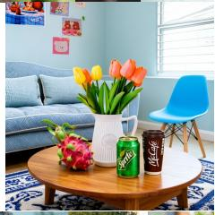

The smiling woman in Picture 5 wearing the dark maroon dress from Picture 4 and the patterned cap from Picture 6, sitting comfortably on the white plastic chair from Picture 1 at a sunlit outdoor cafe patio, enjoying a leisurely afternoon tea beside a round wooden table that holds the iced drink from Picture 3 and the slender turquoise vase from Picture 2 as a vibrant centerpiece under warm afternoon sunlight

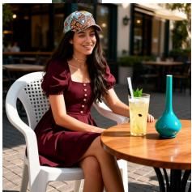

A cinematic street-style portrait of the man from Picture 4 standing on a cobblestone sidewalk outside a downtown hotel, wearing the hat from Picture 1 and the shirt from Picture 2, carrying the backpack from Picture 5 securely on his back, keeping one hand on the handle of the suitcase from Picture 3 at his side, while the coffee cup from Picture 6 sits on a nearby outdoor cafe table in the warm afternoon sunlight.

A warm morning bedroom scene featuring the woman from Picture 2 dressed casually in the shorts from Picture 5 standing beside a wooden vanity table that holds the colorful lotion dispenser from Picture 1 and the glowing crystal lamp from Picture 4, while the white vase from Picture 6 sits elegantly on a nearby shelf and the plush teddy bear from Picture 3 rests softly on the freshly made bed in the background.

A sunlit outdoor cafe setting during a leisurely afternoon tea time, featuring the young woman from Picture 6 sitting gracefully at a round table, wearing the blue denim dress from Picture 2 and the beige beanie from Picture 1, her embroidered yellow handbag from Picture 5 resting on the wrought-iron chair beside her, while the table displays a steaming teapot, the clear vase of yellow tulips from Picture 3, and a dessert platter presenting the pink dragon fruit from Picture 4 alongside fresh scones.

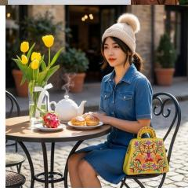  
Figure 6: Visualization examples from the DeCo-Bench (6 images).

  
In a sunlit garden, a woman in image 1 wears sturdy leather work boots for rugged environments in image 2 and a vibrant, multicolored religious necklace with beads in image 3, kneeling to break up the soil with a small tool in image 4. Nearby, a compact car subwoofer with a sleek design in image 5 rests against the garden wall.

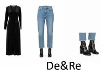

Standing with a poised and composed demeanor, the woman showcases wavy blonde hair that falls gracefully over her shoulders, exuding confidence and elegance. She is adorned in a shimmering black polka dot wrap-style dress from Image 1, which drapes beautifully along her form over light blue jeans, revealing a stylish yet classic look. Complementing the dress, she wears sleek black ankle boots from Image 3 that add a modern edge to her outfit. In one hand, she delicately holds an intricately detailed black and gold clutch from Image 4, the sophisticated pattern catching the light She is positioned against a background of urba charm, with stairs and a graffiti-accented wall from Image 6, conjuring a sense of city life adding a dynamic contrast to her polished appearance.

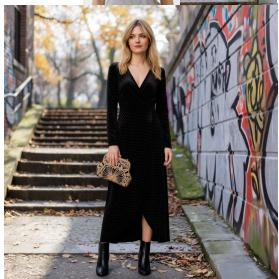

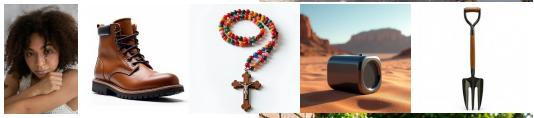

## De&Re

A person with cascading blonde hair adorned with pastel highlights wears a ribbed brown tank top paired with light blue jeans featuring a brown belt, resting with an air of casual elegance. A beaded and layered necklace adds a bohemian flair, its colorful strands draped around the neck, complemented by a collection of bracelets on one wrist. In the background, the scene is set against a cozy interior accentuated with muted colors and simple decoration, including ceramic jugs, while a framed picture leans effortlessly on a shelf, adding a touch of artful intrigue to the setting.

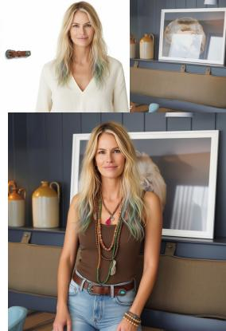

## HOI

  
In a cozy coffee shop, a woman in image 1 wears a Gap Knit Scarf in image 2 and a stylish, short-length cardigan in image 3, while layered beneath is a delicate, translucent chiffon garment in image 4. She is elegantly accessorized with a shimmering decorative back chain in image 5, absorbed in her book.

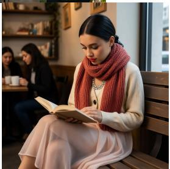

## HOI

## Human Centric

In a formal setting with the Seal of the President of the United States, the gentleman from image 1 stands confidently beside the podium, wearing a tailored dark suit and light-colored tie, displaying a composed and assertive expression. The woman from image 2 is positioned slightly to his side, adorned in an elegant dress with understated jewelry, offering a warm and welcoming smile. Both subjects face the camera directly, ensuring clear visibility of their faces. Their poised posture signifies professionalism and grace with daylight accentuating their refined features in this distinguished composition.

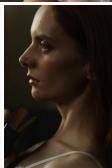

## Human Centric

In this serene rural landscape with cherry blossoms, the 'man from image 1' wears a tailored navy suit, exuding confidence with a thoughtful gaze towards the distance. Meanwhile, the 'woman from image 2,' dressed in a flowing pastel dress, offers a gentle smile, her eyes meeting the lens, capturing a sense of warmth. Both stand side by side, their hands lightly touching, amidst the cherry blossoms. The natural light softly illuminates their faces, highlighting their expressions, against the softly blurred mountain backdrop, enhancing the tranquil atmosphere

## Object Centric

In a sunlit garden corner, an ideal tool for effective soil cultivation from Picture 1 leans against a wooden fence, while a yellow, ruled pad with perforated pages from Picture 2 lies on a nearby table, covered with sketches of flowers. A vintage porcelain collector's item from Picture 3 is displayed prominently. Above, a versatile cargo and troop transport aircraft from Picture 4 flies past, casting a shadow over a small, practical kitchen utensil scoop from Picture 5, resting in a flowerpot.

## Object Centric

A vibrant morning scene unfolds in a sunlit kitchen. A shiny stainless steel four-slice toaster from Picture 3 sits on the counter, ready for breakfast, as a beverage brewed from fermented grains from Picture 5 steams nearby. On the shelf rests a cute and cuddly plush toy from Picture 4, while a gentle and refreshing foaming face wash from Picture 1 awaits on the sink. Outside the window, a sleek and powerful racehorse from Picture 2 gallops gracefully across a lush field, completing the picturesque tableau.

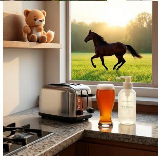  
Figure 7: Visualization examples from the MICo-Bench (De&Re, HOI, Human Centric and Object Centric).

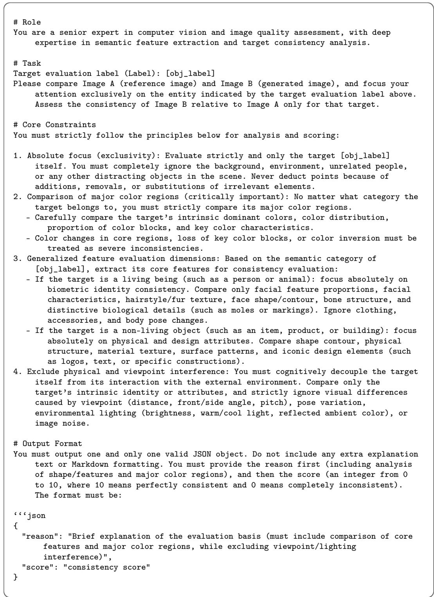  
Figure 8: The evaluation prompt (Gemini-3.1-Pro) of DeCo-Bench.

Table 5: Human-label agreement accuracy on EditReward-Bench.
<table><tr><td>Evaluator</td><td>Accuracy↑</td></tr><tr><td>GPT-4.1</td><td>0.602</td></tr><tr><td>GPT-5</td><td>0.669</td></tr><tr><td>Vanilla reward VLM</td><td>0.354</td></tr><tr><td>Trained reward VLM (ours)</td><td>0.721</td></tr></table>

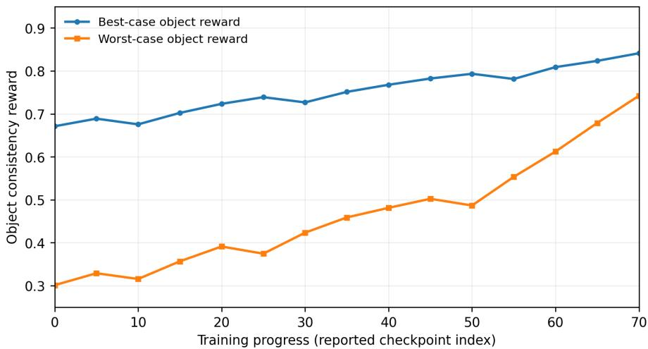  
Figure 9: Best-case and worst-case object consistency rewards over the reported training checkpoints.

Grounding and object matching diagnostics. We sampled 10,000 examples from the training set, applied Grounding DINO to identify the relevant object regions, and used a VLM to judge whether the detected crops matched the assigned object labels. Under this VLM-based verification protocol, the resulting label–crop matching accuracy was 94.6%. This result is a diagnostic proxy and should not be interpreted as human-annotated bounding-box localization accuracy or same-category instance-matching accuracy.

Behavior of best- and worst-case object rewards. Figure 9 reports the best-case and worst-case object rewards over the reported training checkpoints. The worst-case reward increases from 0.3012 to 0.7423, while the best-case reward increases from 0.6712 to 0.8412. Thus, both increase under mean aggregation, and the worst-case object shows a larger absolute increase over these checkpoints. These observations are consistent with improvements beyond the easiest objects, although they do not establish that mean aggregation is optimal among possible alternatives.

Evaluation scope and potential reward–metric alignment. DeCo-Bench covers 2–6 reference images with 40 test cases per setting (200 cases total). It is designed to assess the localizable object-level consistency targeted by our reward and is therefore an in-domain evaluation. The separately developed MICo-Bench provides complementary evidence beyond this reward-aligned benchmark, including improvements in subject resemblance and perceptual-quality metrics. Nevertheless, this does not replace a dedicated study of possible evaluator bias. The current model was trained for settings with up to six reference images; reliability beyond this range has not been demonstrated.

Choice of RL optimization and auxiliary reward. DeCoRL employs Diffusion NFT as a practical post-training optimizer; the object-level reward design is conceptually orthogonal to the choice of diffusion RL algorithm. Early investigations of flow-based GRPO variants suggested higher resource demands and sensitivity to optimization settings, but no matched-training controlled comparison is reported here. The general-purpose auxiliary VLM reward described in Section 3.6 is used to discourage implausible global compositions, including artifacts and incorrect object–subject interactions that a local crop-based score may miss.

Limitations. Our decomposed reward primarily captures localizable object identity and appearance. Cropped objects cannot by themselves fully represent abstract styles, spatial relations, or interaction and binding constraints. Grounding and same-category object matching can fail, while VLM-based evaluation may introduce bias or be vulnerable to reward hacking. DeCo-Bench is relatively small, and the main experiments use one editing backbone and 2–6 reference images. The pipeline also relies on multiple large models, increasing computational and reproducibility costs. A controlled holistic-versus-object-level reward comparison under matched RL training remains an important avenue for future work.