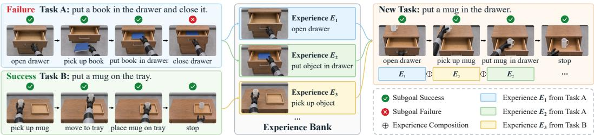
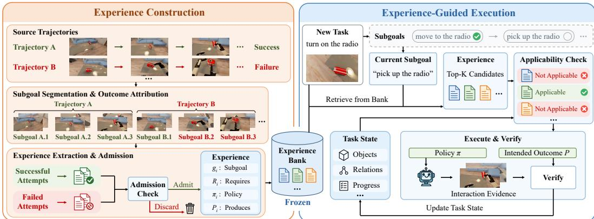
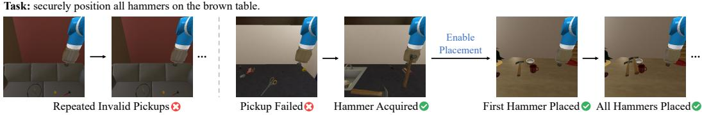
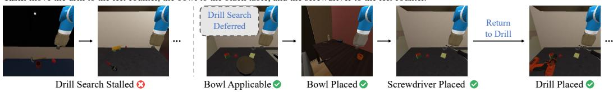
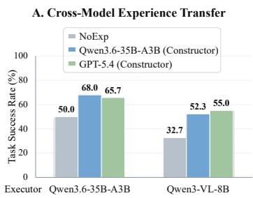
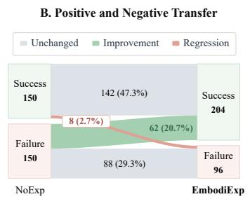
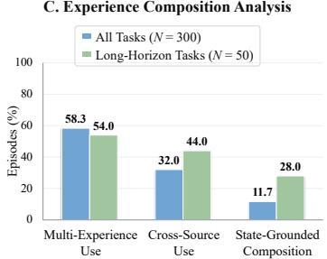
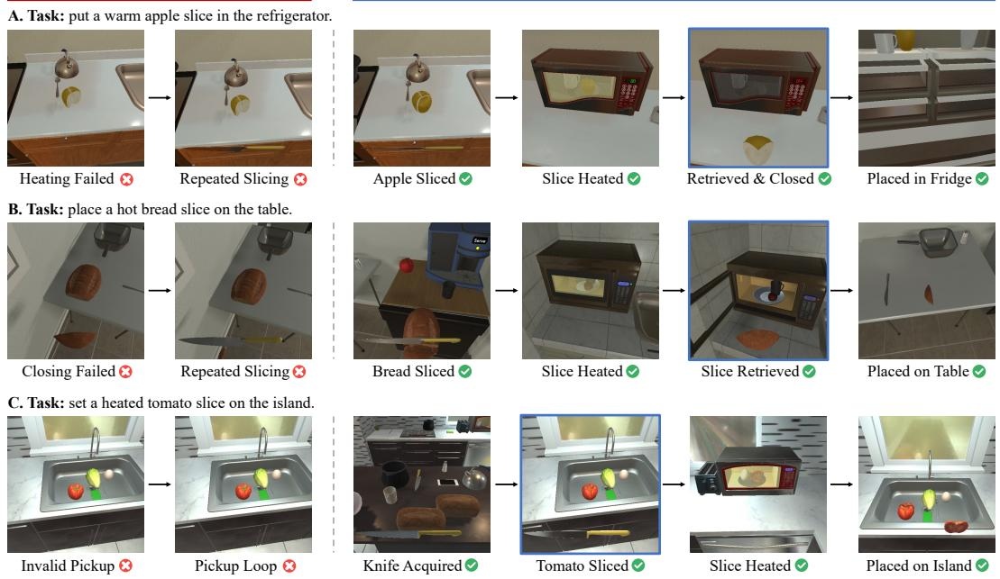
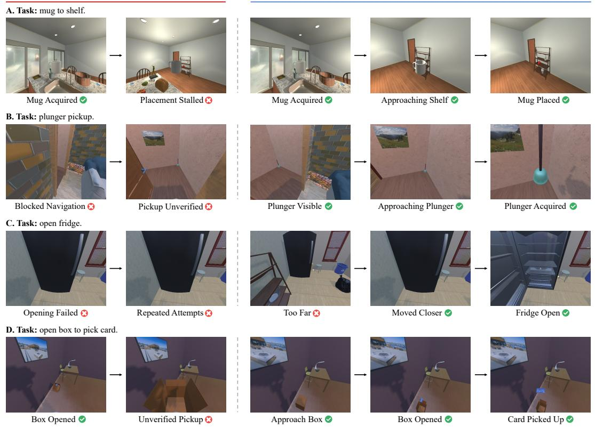
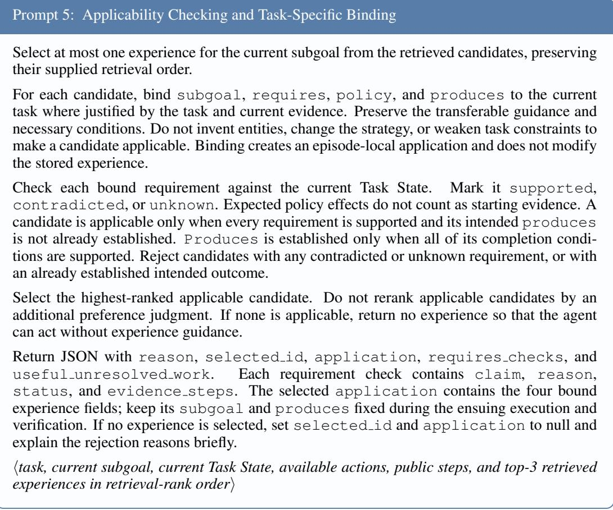

# EMBODIEXP: COMPOSITIONAL EXPERIENCE TRANS-FER FOR EMBODIED AGENTS

Zhifeng Gu 1,2 Ying Chen 2 Rui Jiang 2 Lei Yi 2 Bing Wang 1∗

1 Spatial Intelligence Group, The Hong Kong Polytechnic University

2 XPENG Robotics

zhifeng.gu@connect.polyu.hk bingwang@polyu.edu.hk

## ABSTRACT

Experience can help embodied agents turn high-level plans into grounded actions, but transferring it across tasks remains challenging: previously effective strategies may be inapplicable to the current state or fail to produce their intended outcomes. We present EmbodiExp, a framework for constructing transferable experiences and composing them online during embodied task execution. Our key observation is that tasks often share subgoals whose completion can be assessed independently of overall task success. We therefore introduce an outcome-grounded subgoal experience that specifies a subgoal, applicability conditions, an adaptable policy, and a verifiable outcome. During execution, applicable experiences guide action generation, while verified outcomes can establish the conditions required by subsequent experiences, enabling online composition. Subgoal-level outcome attribution further enables failure utilization: failed trajectories can still contribute verified local successes and condition-specific guidance on actions to avoid. Experiments on multiple embodied benchmarks under a fold-based protocol with frozen experience banks demonstrate the effectiveness of EmbodiExp.

## 1 INTRODUCTION

Recent foundation models (Qwen Team, 2026b; OpenAI, 2026) have endowed embodied agents with strong reasoning and high-level planning capabilities (Team et al., 2025; Yang et al., 2025a). However, knowing what to do does not imply knowing how to realize it under the current environmental conditions (Ahn et al., 2022; Agarwal et al., 2025). To bridge this gap, embodied agents can leverage experience accumulated through past interactions as empirical action-outcome knowledge (Wang et al., 2023a; Shinn et al., 2023; Park et al., 2023). At the core of experience is its transferability: whether it can effectively inform grounded execution in new tasks.

To support such transferability, recent work has explored different perspectives, including retrieving task-relevant trajectories (Wang et al., 2026d; Yue et al., 2025), abstracting past executions into compact experiences (Ren et al., 2026; Wang et al., 2026b), and extracting reusable skills (Jiang et al., 2026; Ju et al., 2026). Despite these advances, transferability remains a central challenge: experience must retain knowledge that extends beyond its source interaction, while its application must remain grounded in the conditions and outcomes of the new task. This raises a fundamental question: what should be retained as experience, and how should it be applied?

Experience can transfer across tasks through shared local goals, even when their overall goals and execution sequences differ (Konidaris & Barto, 2007; James et al., 2020). However, sharing a local goal alone is insufficient for reliable transfer: a strategy effective in one interaction may not apply under different conditions, and even an applicable strategy may fail to produce the intended outcome (Ahn et al., 2022; Huang et al., 2022). Transferable experience should thus specify not only how to pursue a goal, but also when the strategy applies and what outcome establishes goal completion (Konidaris et al., 2018). These requirements make the subgoal level a natural granularity for experience, as each subgoal specifies a coherent intermediate goal whose completion can be assessed from local interaction evidence, independently of the source task’s overall success or failure (Li et al., 2024; Hu et al., 2025a). We therefore represent experience at the subgoal level, grounding its application and completion in explicit conditions and outcomes.

  
Figure 1: Motivating Example: Compositional Experience Transfer across Tasks. Different tasks can share subgoals even when their overall goals and execution sequences differ. The new task is successfully completed by composing experiences from different previous tasks.

In this paper, we propose EmbodiExp, a framework for constructing transferable experiences and composing them online during embodied task execution. At its core is outcome-grounded subgoal experience, which represents each experience through a subgoal, applicability conditions, an adaptable policy, and an intended local outcome. EmbodiExp constructs such experiences from local action-outcome evidence and retrieves them according to the current subgoal during execution. An experience is applied only when its conditions are satisfied, and subgoal completion is established only when newly acquired interaction evidence supports the intended outcome. This design enables two key mechanisms: experience composition across trajectories and failure utilization through se lective retention of useful knowledge from failed trajectories.

For experience composition, a new task may involve subgoals whose relevant experiences originate from different source trajectories (Figure 1). Retrieving relevant experience is insufficient, because retrieval alone does not determine when each experience becomes applicable as execution unfolds. EmbodiExp therefore composes experience online through verified outcomes: the outcome realized by one experience may satisfy the applicability conditions of another, making the latter applicable as execution progresses. This connects experiences across trajectories through grounded state transitions rather than through static combinations based on semantic similarity alone.

For failure utilization, task-level failure provides only a coarse outcome signal, since a failed trajectory may contain both completed subgoals and failed local attempts. Discarding the entire trajectory would lose useful local knowledge, whereas indiscriminate transfer could propagate behavior that did not achieve its intended outcome. EmbodiExp therefore performs subgoal-level outcome attribution on both successful and failed trajectories, admitting experience according to local actionoutcome evidence rather than overall task outcomes. Within a shared experience representation, verified local successes provide guidance on how to achieve a subgoal, while explicit failure evidence provides condition-specific guidance on operations to avoid during future execution.

Overall, our contributions are summarized as follows:

• We propose outcome-grounded subgoal experience, which couples a subgoal and an adaptable policy with explicit applicability conditions and an intended local outcome.

• We present EmbodiExp, a framework for constructing and applying such experience. It enables online experience composition by using verified outcomes from one experience to establish the applicability conditions of another, grounding composition in realized execution states.

• We propose subgoal-level outcome attribution for failure utilization, retaining locally successful behavior and deriving condition-specific avoidance guidance from explicit failure evidence.

• Extensive experimental evaluations on multiple benchmarks demonstrate the effectiveness of EmbodiExp under afold-based experience evaluation protocol with frozen experience banks.

## 2 RELATED WORK

Multimodal Embodied Agents. Foundation models enable embodied agents to perform task planning and affordance-grounded decision making (Ahn et al., 2022; Song et al., 2023), generate executable programs (Liang et al., 2023; Singh et al., 2023), and adapt execution using environment feedback (Huang et al., 2022; Wang et al., 2023b). Vision-language models enable embodied reasoning (Driess et al., 2023; Chen et al., 2026b), while generalist robot policies connect multimodal inputs to control (Brohan et al., 2023; Open X-Embodiment Collaboration, 2023; Kim et al., 2024; Octo Model Team et al., 2024), and unified frameworks coordinate skill selection, execution, and verification (Wang et al., 2026c). Benchmarks assess household interaction, navigation, task completion, self-termination, and active spatial reasoning (Shridhar et al., 2020; 2021; Yang et al., 2025a; Chen et al., 2026a; Hong et al., 2026). Our work complements these systems through the construction and cross-task application of transferable experience from grounded interactions.

Agent Memory. Agent memory retains past interactions as episodic records, summaries, and structured knowledge (Park et al., 2023; Packer et al., 2023; Zhong et al., 2024; Chhikara et al., 2025; Xu et al., 2025; Zhang et al., 2025), with extensions for multimodal consolidation (Liu et al., 2025) and learnable memory operations (Zhang et al., 2026b). In embodied environments, memory provides spatiotemporal context (Yang et al., 2025b; Hu et al., 2025b; Wang et al., 2026a; 2024a), interaction histories (Torne et al., 2026), hierarchical experience abstraction (Ma et al., 2026), and interactionderived object knowledge (Banwasi et al., 2026). Within this broader literature, we focus on extracting outcome-grounded subgoal experiences from past interactions and composing them according to the current task state to guide execution across tasks.

Experience and Skill Learning. Experience-driven agents distill past interactions into reflections and procedural guidance (Shinn et al., 2023; Zhao et al., 2024; Tang et al., 2025; Ouyang et al., 2025; Cao et al., 2025; Cai et al., 2025; Zhang et al., 2026c) or build workflows and skills (Wang et al., 2024b; Fang et al., 2026; Wang et al., 2023a; Ni et al., 2026). Further work explores feedback-driven skill refinement (Xia et al., 2026; Zhang et al., 2026a; Yang et al., 2026; Shi et al., 2026), evidencebacked skills with applicability and verification rules (Tang et al., 2026), hierarchical skills (Sun et al., 2026), and how skill granularity and representation affect transfer (Feng et al., 2026). MuSE-Agent (Wang et al., 2026b) retrieves state-conditioned experiences, while XSkill (Jiang et al., 2026) combines action-level experiences with task-level skills. In embodied settings, WorldMind (Ren et al., 2026) distills process and goal experience, ELITE (Wei et al., 2026) retrieves intent-aligned strategies, MineEvolve (Xie et al., 2026) builds skills and remedies from subgoal feedback, and EmbodiSkill (Ju et al., 2026) revises skills through targeted error attribution. EmbodiExp constructs outcome-grounded subgoal experience through local outcome attribution and composes it acros tasks using applicability checks and outcome verification.

## 3 METHOD

## 3.1 PROBLEM FORMULATION

Consider an embodied agent A that receives a task instruction I and can generate high-level plans while interacting with an environment. Such plans specify what to achieve, but grounded execution additionally requires selecting actions suited to the current environmental conditions and verifying that they produce the intended outcomes. We refer to this gap between semantic task planning and grounded execution as the grounded-execution gap. Our objective is to bridge this gap by extracting transferable experience from prior interactions and applying it to new tasks.

Interaction Trajectory. Let $o _ { t }$ denote the agent’s observation, including any available environment feedback, and $a _ { t }$ its native action at interaction step t. We represent an interaction trajectory as

$$
\tau = \left( \mathcal { T } , o _ { 0 } , a _ { 0 } , o _ { 1 } , \ldots , a _ { T - 1 } , o _ { T } , y _ { \tau } \right) ,\tag{1}
$$

where T is the episode length and $y _ { \tau } \in \{ 0 , 1 \}$ indicates task-level success. This terminal label does not specify the outcomes of individual subgoal attempts.

Embodied Experience. A trajectory records a particular execution. We define embodied experience as empirical action-outcome knowledge accumulated from prior interactions to inform future grounded execution. To support transfer across tasks, we seek a representation that connects execution guidance to its applicability conditions and a verifiable completion outcome.

Outcome-Grounded Subgoal Experience. A subgoal is an intermediate goal in a task plan, characterized by an intended local outcome and pursued through one or more native actions. A subgoal attempt is a contiguous interaction span directed toward a single subgoal. We instantiate embodied experience at the subgoal level and represent each experience as

  
Figure 2: Overview of EmbodiExp. The experience construction stage constructs a bank for outcome-grounded subgoal experience from both successful and failed trajectories, while the experience-guided execution stage retrieves and composes relevant experience to inform execution.

$$
e _ { i } = ( g _ { i } , R _ { i } , \pi _ { i } , P _ { i } ) ,\tag{2}
$$

corresponding to SUBGOAL, REQUIRES, POLICY, and PRODUCES, respectively. Here, $g _ { i }$ specifies the subgoal; ${ \bar { R } } _ { i }$ describes the conditions for applying the experience; π provides execution guidance on effective behavior or condition-specific operations to avoid; and $P _ { i }$ specifies the local outcome that must be verified for completion. Together, these fields characterize what to achieve, when the experience applies, how to pursue the subgoal, and what outcome establishes its completion.

For an execution span directed toward $g _ { i }$ from step t to $t ^ { \prime } ,$ , let $\Omega _ { t : t ^ { \prime } } ^ { \mathrm { p u b } }$ denote the agent-accessible interaction evidence collected during this span. We define the outcome-verification indicator as

$$
c _ { i } ^ { t : t ^ { \prime } } = W _ { \mathrm { p u b } } \left( P _ { i } , \Omega _ { t : t ^ { \prime } } ^ { \mathrm { p u b } } \right) \in \{ 0 , 1 \} ,\tag{3}
$$

where $W _ { \mathrm { p u b } }$ checks whether the evidence supports $P _ { i }$ . A value of 1 indicates verified completion, whereas 0 indicates that completion remains unverified, not necessarily that the attempt has failed.

An experience is outcome-grounded when its execution guidance is supported by local actionoutcome evidence, irrespective of the trajectory-level outcome $y _ { \tau } .$ . Such evidence may support either effective behavior or condition-specific avoidance guidance. When transferred to a new task, $R _ { i }$ must hold under the current conditions, and $P _ { i }$ must be verified from new execution evidence.

## 3.2 EMBODIEXP

Our framework, EmbodiExp, consists of two stages: experience construction and experienceguided execution (Figure 2). During experience construction, an experience constructor C processes source trajectories $\mathcal { D } _ { \mathrm { s r c } }$ . It segments each trajectory into subgoal attempts and attributes outcomes using local action-outcome evidence. Verified subgoal completions support guidance on effective behavior, while explicit evidence of failed operations supports condition-specific avoidance guidance. Both are represented through the shared interface in Equation 2, forming an experience bank

$$
\boldsymbol { B } = \{ e _ { i } \} _ { i = 1 } ^ { N } ,\tag{4}
$$

where N is the number of admitted experience entries. Admission is determined by whether the extracted guidance is supported by local evidence, rather than by trajectory-level success.

During experience-guided execution, B remains frozen, while the executor A maintains an evolving Task State $S _ { k }$ that summarizes task-relevant facts currently supported by interaction evidence. At each planning step k, A identifies the current subgoal and retrieves the top-K relevant experiences from B. An experience is used only if its REQUIRES are satisfied in $S _ { k }$ and its PRODUCES is not already established. The POLICY of a selected experience informs grounded action generation. After execution, newly acquired interaction evidence is used to verify the intended outcome, and update the Task State with newly supported facts before the next planning step.

Algorithm 1 Online Experience Composition   
Require: Task instruction I, frozen experience bank B, executor A, environment E   
1: o ← RESET(E)   
2: S0 ← INITIALIZESTATE(I, o)   
3: $k  0$   
4: while episode is active and budget remains do   
5: $\hat { g } _ { k } \gets \mathrm { I D E N T I F Y S U B G O A L } ( \mathcal { T } , S _ { k } , o )$   
6: $\kappa _ { k } \gets$ RETRIEVETOPK $( B , \mathcal { T } , \hat { g } _ { k } )$   
7: $\mathcal { U } _ { k }  \{ e \in \mathcal { K } _ { k } \mid S _ { k } \mid = \dot { R } ( e ) \land S _ { k } \mid \neq P ( e ) \}$   
8: if $\mathcal { U } _ { k } \ne$ ∅ then   
9: $e _ { k } \gets \mathrm { S E L E C T T O P } ( \mathcal { U } _ { k } )$   
10: aˆk ← GENERATEACTIONS(A, I, gˆk, Sk, o, π(ek))   
11: else   
12: $e _ { k } \gets \emptyset$   
13: aˆ ← GENERATEACTIONS(A, I, gˆ , S , o)   
14: end if   
15: $( o , \Omega _ { k } ^ { \mathrm { p u b } } )$ ← EXECUTE(E, aˆk)   
16: if $e _ { k } \neq \emptyset$ and $W _ { \mathrm { p u b } } ( P ( e _ { k } ) , \Omega _ { k } ^ { \mathrm { p u b } } ) = 1$ then   
17: $S _ { k + 1 } \gets \mathrm { U P D A T E S T A T E } \big ( S _ { k } , \Omega _ { k } ^ { \mathrm { p u b } } , P ( e _ { k } ) \big )$   
18: else   
19: $S _ { k + 1 } \gets \mathrm { U P D A T E S T A T E } ( S _ { k } , \Omega _ { k } ^ { \mathrm { p u b } } )$   
20: end if   
21: $k \gets k + 1$   
22: end while

This design enables two key mechanisms. Experience Composition supports online composition by allowing the verified outcome of one experience to satisfy the conditions required by subsequent experiences (Section 3.2.1). Failure Utilization applies the same local outcome attribution to failed trajectories, retaining verified local successes and localized avoidance guidance (Section 3.2.2).

## 3.2.1 EXPERIENCE COMPOSITION

Many embodied tasks involve multiple subgoals, whose relevant experience may originate from different source trajectories. Rather than retrieving a fixed sequence of experiences in advance, EmbodiExp composes them online through the evolving Task State. Verified outcomes update thi shared state and may establish the conditions for subsequent experience.

Formally, let $e _ { i } = ( g _ { i } , R _ { i } , \pi _ { i } , P _ { i } )$ be a retrieved candidate experience for the current subgoal $\hat { g } _ { k }$ at planning step k. We write $S _ { k } \models q$ to denote that a condition q is supported by the current Task State. The candidate can be used only if

$$
S _ { k } \Vdash R _ { i } \qquad \mathrm { a n d } \qquad S _ { k } \not \in P _ { i } ,\tag{5}
$$

$i . e .$ , its required conditions are supported, while its intended outcome is not established by the current evidence. The executor selects the highest-ranked applicable candidate, denoted $e _ { k }$ , and uses its policy to guide action generation. If no candidate is applicable, $e _ { k } = \emptyset$ and the executor generates actions without experience guidance.

Each planning step may execute one or more native actions. Let $\Omega _ { k } ^ { \mathrm { p u b } }$ denote the interaction evi dence obtained over this execution span. When an experience is selected, the executor verifies its intended outcome using Equation 3 with this evidence. It then revises the Task State by incorporating newly supported facts and updating or removing facts invalidated by the new evidence, yielding

$$
S _ { k } \stackrel { e _ { k } } { \longrightarrow } S _ { k + 1 } , \qquad e _ { k } \in { \mathcal { B } } \cup \{ \emptyset \} .\tag{6}
$$

The intended outcome is credited only when verified. Other supported changes may still update the state when completion remains unverified. At the next planning step, the executor identifies the current subgoal and retrieves candidates again, checking their applicability against $S _ { k + 1 }$ using Equation 5. Repeated application of this process yields the state-grounded composition

$$
S _ { 0 } \xrightarrow { e _ { 0 } } S _ { 1 } \xrightarrow { e _ { 1 } } \cdots \xrightarrow { e _ { m - 1 } } S _ { m } .\tag{7}
$$

Importantly, composition does not require a direct pairwise match between PRODUCES and RE-QUIRES. The Task State integrates verified outcomes with other supported facts, allowing the conditions for a subsequent experience to be established jointly. Thus, experience guides action generation, while verified execution outcomes support progression across subgoals (Algorithm 1).

## 3.2.2 FAILURE UTILIZATION

Task-level failure does not imply failure of every subgoal attempt, just as task-level success does not imply that every operation succeeded. We therefore apply the same local outcome attribution to all source trajectories, retaining effective behavior and condition-specific avoidance guidance.

For a source trajectory $\tau \in \mathcal { D } _ { \mathrm { s r c } } .$ , let $\{ \sigma _ { i } \} _ { i = 1 } ^ { M _ { \tau } }$ denote its subgoal attempts. Each $\sigma _ { i }$ pursues subgoal $g _ { i }$ with intended outcome $P _ { i }$ and provides interaction evidence $\Omega _ { i } ^ { \mathrm { p u b } }$ . When $W _ { \mathrm { p u b } } ( P _ { i } , \Omega _ { i } ^ { \mathrm { p u b } } ) = 1$ , the constructor $\mathcal { C }$ abstracts successful local behavior into π and its supported applicability conditions into R. Explicit local failure evidence supports condition-specific guidance in π on operations to avoid, with R specifying the observed conditions under which those operations failed.

Both forms of guidance use the shared interface $e = ( g _ { i } , R , \pi , P _ { i } )$ in Equation 2. In both cases, R specifies when the guidance applies, π guides the pursuit of $g _ { i }$ , and $P _ { i }$ denotes the intended completion condition rather than the observed source outcome. The constructor C performs both extraction and evidence-based admission, returning the locally supported entries from each attempt:

$$
\begin{array} { r } { B _ { i } = \mathcal { C } \Big ( \boldsymbol { \sigma } _ { i } , \boldsymbol { \Omega } _ { i } ^ { \mathrm { p u b } } \Big ) . } \end{array}\tag{8}
$$

A completed attempt may contribute both forms of guidance, since it may contain failed operations alongside successful behavior. Each entry must therefore be grounded in the evidence for the relevant operations, rather than inferred from the attempt’s final outcome alone. Unverified completion alone is not evidence of failure. If neither form of guidance is supported, $\boldsymbol { B } _ { i } = \boldsymbol { \mathcal { O } }$

The experiences are aggregated across attempts and source trajectories:

$$
\boldsymbol { B } ( \tau ) = \bigcup _ { i = 1 } ^ { M _ { \tau } } \boldsymbol { B } _ { i } , \qquad \boldsymbol { B } = \bigcup _ { \tau \in \mathcal { D } _ { \mathrm { s r c } } } \boldsymbol { B } ( \tau ) .\tag{9}
$$

This aggregation allows failed trajectories to contribute both effective local behavior and conditionspecific avoidance guidance to the experience bank. Applicable entries guide execution, while verified outcomes update the Task State to support subsequent composition (Section 3.2.1).

Together, these mechanisms support experience transfer across tasks: failure utilization retains effective behavior and condition-specific avoidance guidance, while composition selects and applies experience across subgoals according to the evolving Task State and verified execution outcomes.

## 4 EXPERIMENTS

In our experiments, we seek to answer the following questions: Q1: How does EmbodiExp compare with general-purpose LLM memory systems and embodied experience-learning methods? Q2: Does subgoal-level experience transfer more effectively than trajectory-level and action-level experience? Q3: How do experience composition and failure utilization contribute to experience transfer?

Benchmarks and Metrics. We evaluate on EmbodiedBench (Yang et al., 2025a) and VIGIL (Chen et al., 2026a). For EmbodiedBench, we use its two environments with high-level skill interfaces: EB-Habitat for language-conditioned navigation and rearrangement in Habitat 2.0 (Szot et al., 2021), and EB-ALFRED for household manipulation in AI2-THOR (Kolve et al., 2017). Each environment contains 300 episodes across six capability categories, with 50 episodes per category. VIGIL complements EmbodiedBench by evaluating experience transfer over more atomic native actions. We use its Search and Interact (SI) and Sequential Manipulation (SM) subsets, which evaluate searchconditioned interaction and ordered multi-step manipulation, respectively, with 125 episodes each. We report task success rates, using world-state completion W as the success criterion for VIGIL.

Evaluation Protocol. To retain full evaluation coverage while separating experience construction from evaluation, we adopt a three-fold experience evaluation protocol for all benchmarks. In each rotation, one fold is strictly held out from experience construction, and a separate experience bank is constructed solely from trajectories in the other two folds. The bank remains frozen throughout evaluation on the held-out fold. Each episode is evaluated once, and results are aggregated over all held-out episodes across the three rotations. All baselines follow the same fold-based protocol, with persistent memory constructed only from the construction folds and frozen during evaluation.

Table 1: Task Success Rates (%) on EmbodiedBench using Qwen3.6-35B-A3B (Qwen Team, 2026b). Avg. denotes overall success rate across all 300 held-out episodes in each environment.
<table><tr><td rowspan="2">Method</td><td rowspan="2">Avg.</td><td colspan="6">EB-Habitat</td><td rowspan="2">Avg.</td><td rowspan="2"></td><td colspan="6">EB-ALFRED</td></tr><tr><td>Base</td><td>Com.</td><td>Comp.</td><td>Vis.</td><td></td><td>Spa. Long</td><td>Base</td><td>Com.</td><td>Comp.</td><td></td><td>Vis. Spa. Long</td><td></td></tr><tr><td>NoExp</td><td>50.0</td><td>90</td><td>36</td><td>48</td><td>52</td><td>34</td><td>40</td><td>54.7</td><td>60</td><td>58</td><td></td><td>58</td><td>42</td><td>48</td><td>62</td></tr><tr><td>A-Mem (Xu et al., 2025)</td><td>55.0</td><td>94</td><td>48</td><td>54</td><td>56</td><td>36</td><td>42</td><td></td><td>59.3</td><td>74</td><td>56</td><td>64</td><td>44</td><td>50</td><td>68</td></tr><tr><td>Mem0 (Chhikara et al., 2025)</td><td>54.7</td><td>90</td><td>52</td><td>56</td><td>56</td><td>32</td><td>42</td><td>58.7</td><td></td><td>68</td><td>56</td><td>66</td><td>52</td><td>48</td><td>62</td></tr><tr><td>LangMem (LangChain Team, 2025)</td><td>58.0</td><td>92</td><td>50</td><td>60</td><td>56</td><td>32</td><td>58</td><td></td><td>55.0</td><td>58</td><td>52</td><td>66</td><td>46</td><td>38</td><td>70</td></tr><tr><td>ReMe (Cao et al., 2025)</td><td>53.7</td><td>88</td><td>52</td><td>50</td><td>48</td><td>34</td><td>50</td><td></td><td>57.3</td><td>64</td><td>54</td><td>66</td><td>46</td><td>44</td><td>70</td></tr><tr><td>WorldMind (Ren et al., 2026)</td><td>51.7</td><td>88</td><td>46</td><td>64</td><td>44</td><td>32</td><td>36</td><td></td><td>55.7</td><td>66</td><td>52</td><td>54</td><td>44</td><td>52</td><td>66</td></tr><tr><td>EmbodiSkill (Ju et al., 2026)</td><td>52.3</td><td>90</td><td>36</td><td>64</td><td>44</td><td>36</td><td>44</td><td></td><td>51.0</td><td>60</td><td>44</td><td>56</td><td>38</td><td>44</td><td>64</td></tr><tr><td>EmbodiExp (Ours)</td><td>68.0</td><td>94</td><td>66</td><td>68</td><td>72</td><td>38</td><td>70</td><td></td><td>68.3</td><td>76</td><td>68</td><td>74</td><td>56</td><td>60</td><td>76</td></tr></table>

Table 2: World-State Completion Rates (%) on VIGIL using Qwen3.6-27B (Qwen Team, 2026a). Avg. denotes the overall completion rate across all 250 held-out episodes from SI and SM.
<table><tr><td>Task</td><td>NoExp</td><td>A-Mem</td><td>Mem0</td><td>LangMem</td><td>ReMe</td><td>WorldMind</td><td>EmbodiSkill</td><td>EmbodiExp (Ours)</td></tr><tr><td>SI</td><td>25.6</td><td>32.0</td><td>34.4</td><td>32.8</td><td>30.4</td><td>28.8</td><td>33.6</td><td>36.8</td></tr><tr><td>SM</td><td>37.6</td><td>38.4</td><td>30.4</td><td>36.0</td><td>42.4</td><td>40.0</td><td>33.6</td><td>44.8</td></tr><tr><td>Avg.</td><td>31.6</td><td>35.2</td><td>32.4</td><td>34.4</td><td>36.4</td><td>34.4</td><td>33.6</td><td>40.8</td></tr></table>

Baselines. We compare against a no-experience baseline, general-purpose memory systems, and embodied experience-learning methods: 1) NoExp: The same embodied agent without persistent cross-episode experience. 2) A-Mem (Xu et al., 2025): Organizes past interactions into structured, dynamically linked memory notes. 3) Mem0 (Chhikara et al., 2025): Extracts, retrieves, and incrementally updates salient information from past interactions for long-term use. 4) Lang-Mem (LangChain Team, 2025): Supports the extraction, consolidation, and retrieval of episodic and procedural memories. 5) ReMe (Cao et al., 2025): Abstracts procedural experience from historical trajectories to guide execution on new tasks. 6) WorldMind (Ren et al., 2026): Extracts process and goal experience into a structured world-knowledge repository. 7) EmbodiSkill (Ju et al., 2026): Maintains and revises persistent procedural skills using feedback from previous trajectories.

## 4.1 MAIN RESULTS

Evaluation on EmbodiedBench. As shown in Table 1, EmbodiExp achieves overall success rates of 68.0% on EB-Habitat and 68.3% on EB-ALFRED, exceeding the strongest baselines by 10.0 and 9.0 percentage points, respectively. LangMem and A-Mem provide useful execution guidance through procedural memories and linked interaction notes, achieving strongest baseline results. However, their uneven gains across task categories and environments suggest that useful historical guidance may not remain applicable under new task conditions. WorldMind and EmbodiSkill improve Complex tasks on EB-Habitat without comparable Long-Horizon gains, pointing to the additional difficulty of connecting useful strategies across successive subgoals. EmbodiExp addresses both challenges by pairing each local policy with applicability conditions and verifiable outcomes: applicability checks ground experience selection in the current state, while outcome verification grounds subsequent experience application in confirmed progress rather than assumed action success.

In Figure 3.A, EmbodiExp recovers from invalid pickup attempts, with verified hammer acquisition establishing the conditions for subsequent placement experience, whereas NoExp repeats invalid pickups. In Figure 3.B, EmbodiExp defers the unresolved drill search and applies experience for other subgoals before returning to complete the task. Together, these cases illustrate experience transfer through state-grounded composition: verified outcomes connect dependent subgoal experi ences, while applicability allows independent ones to be reordered to suit the new task.

Evaluation on VIGIL. As shown in Table 2, EmbodiExp achieves an overall world-state completion rate of 40.8%, exceeding NoExp and the strongest baseline, ReMe, by 9.2 and 4.4 percentage

EmbodiExp (Ours)

No Experience

A. Outcome-Grounded Composition: verified outcomes enable subsequent experience.   
Task: securely position all hammers on the brown table.

B. Applicability-Guided Composition: independent subgoals proceed without a fixed order. Task: move the drill to the left counter, the bowl to the black table, and the screwdriver to the left counter.  
  
Figure 3: Qualitative Comparison with NoExp on EmbodiedBench. A. Verified hammer acquisition enables subsequent placement, while NoExp repeats invalid pickups. B. EmbodiExp completes applicable subgoals before returning to place the drill, while NoExp remains stalled.

Table 3: Ablation Study on EB-Habitat using Qwen3.6-35B-A3B. Results are reported as task success rate (%), with Avg. computed over all 300 held-out episodes.
<table><tr><td rowspan="2">Ablation</td><td rowspan="2">Avg.</td><td colspan="6">EB-Habitat</td></tr><tr><td>Base</td><td>Com.</td><td>Comp.</td><td>Vis.</td><td>Spa.</td><td>Long</td></tr><tr><td>NoExp</td><td>50.0</td><td>90</td><td>36</td><td>48</td><td>52</td><td>34</td><td>40</td></tr><tr><td>Experience Granularity</td><td></td><td></td><td></td><td></td><td></td><td></td><td></td></tr><tr><td>Trajectory-Level Experience</td><td>54.0</td><td>88</td><td>58</td><td>46</td><td>58</td><td>38</td><td>36</td></tr><tr><td>Action-Level Experience</td><td>54.7</td><td>92</td><td>48</td><td>54</td><td>58</td><td>36</td><td>40</td></tr><tr><td>Subgoal-Level Experience</td><td>58.3</td><td>90</td><td>60</td><td>56</td><td>60</td><td>38</td><td>46</td></tr><tr><td>Full EmbodiExp (Ours)</td><td>68.0</td><td>94</td><td>66</td><td>68</td><td>72</td><td>38</td><td>70</td></tr><tr><td>Experience Composition</td><td></td><td></td><td></td><td></td><td></td><td></td><td></td></tr><tr><td>Similarity-Based Composition</td><td>58.3</td><td>90</td><td>60</td><td>56</td><td>60</td><td>38</td><td>46</td></tr><tr><td>Applicability Checks Only</td><td>64.3</td><td>92</td><td>66</td><td>64</td><td>68</td><td>38</td><td>58</td></tr><tr><td>Outcome Verification Only</td><td>56.7</td><td>88</td><td>60</td><td>56</td><td>60</td><td>36</td><td>40</td></tr><tr><td>State-Grounded Composition (Ours)</td><td>68.0</td><td>94</td><td>66</td><td>68</td><td>72</td><td>38</td><td>70</td></tr><tr><td>Failure Utilization</td><td></td><td></td><td></td><td></td><td></td><td></td><td></td></tr><tr><td>Successful Trajectories Only</td><td>62.7</td><td>92</td><td>66</td><td>62</td><td>64</td><td>38</td><td>54</td></tr><tr><td>Successful + Failed Trajectories (Ours)</td><td>68.0</td><td>94</td><td>66</td><td>68</td><td>72</td><td>38</td><td>70</td></tr></table>

points, respectively. Mem0 improves SI but regresses on SM, suggesting that memory useful for shorter interactions may not sustain longer sequences of dependent actions. ReMe improves both subsets, suggesting that procedural experience helps multi-step execution, but guidance on how to proceed does not establish whether intermediate outcomes have actually been achieved. EmbodiExp instead checks applicability and connects subgoal experiences through verified outcomes, grounding progression in achieved rather than assumed effects. These gains under VIGIL’s more atomic action interface support outcome-grounded subgoals as transferable experience beyond high-level skills.

## 4.2 ABLATION STUDY

Experience Granularity. We compare trajectory-, action-, and subgoal-level experience under the same similarity-based top-1 retrieval protocol, without applicability checks or outcome verification (Table 3). Subgoal-level experience achieves 58.3% success, outperforming trajectory-level (54.0%) and action-level (54.7%) alternatives. The difference is more pronounced on Long-Horizon tasks, where trajectory- and action-level experience provide no gain over NoExp, while subgoal-level ex perience improves success from 40% to 46%. This suggests that subgoal-level experience strikes a better balance for cross-task transfer by preserving the action context needed for a local outcome while avoiding source-task-specific dependencies carried by full trajectories.

Experience Composition. Similarity-Based Composition uses semantic top-1 retrieval without applicability checks or outcome verification, achieving 58.3% success (Table 3). Applicability Only improves success to 64.3%, whereas Outcome Verification Only reaches 56.7%. Combining both components raises success to 68.0%, with the largest gain on Long-Horizon tasks. This contrast in dicates that outcome verification is most effective when coupled with applicability-aware selection: applicability identifies experience suited to the current state, while verification determines whether its execution actually establishes the conditions needed for subsequent experience. Together, they ground successive subgoal transitions in achieved outcomes rather than assumed progress.

  
Figure 4: Additional Analysis on EB-Habitat. A. Task success rates with different experience constructors and executors. B. Paired outcome transitions from NoExp to EmbodiExp, with counts and percentages over all 300 episodes. C. Three nested experience-use criteria for all tasks (N = 300) and Long-Horizon subset (N = 50), with percentages computed over all episodes in each set.

Failure Utilization. Including failed source trajectories raises success from 62.7% to 68.0% (Table 3). This shows that failed trajectories can still contain valuable local experience: verified local successes can provide transferable policies, while localized failures identify context-specific actions that should be avoided. Through subgoal-level outcome attribution, EmbodiExp retains both forms of evidence instead of discarding them based on the final task outcome. The largest gain on Long-Horizon tasks (54% to 70%) suggests that such localized evidence is especially useful in extended tasks, both to avoid unsuccessful actions and to compose successful subgoal transitions.

## 4.3 ADDITIONAL ANALYSIS

Cross-Model Experience Transfer. Both banks improve both executors, enabling the 8B (Bai et al., 2025) executor reaching 52.3-55.0% success, above the 35B NoExp baseline (Figure 4.A). These gains suggest that transferred experience can partially compensate for limited executor capability without increasing executors’ model size. The constructor ranking nevertheless reverses across executors: the Qwen bank performs better with 35B, whereas the GPT (OpenAI, 2026) bank performs better with 8B. Together, these results support separating offline experience construction from online execution, while indicating that the utility of a bank depends on the constructor-executor pairing.

Positive and Negative Transfer. Across 300 paired episodes (Figure 4.B), EmbodiExp converts 62 NoExp failures into successes (20.7%), while 8 successes regress (2.7%), yielding a net gain of 18.0 percentage points. This corresponds to recovering 41.3% of baseline failures while preserving 94.7% of baseline successes. The gains therefore come mainly from solving tasks that NoExp fails, while preserving most baseline successes. However, the remaining regressions show that experience transfer can still reduce performance on individual tasks despite improving overall success.

Experience Composition Analysis. Figure 4.C reports three nested criteria: multiple experience applications, use across disjoint source-trajectory sets, and state-grounded cross-source composition. The last criterion requires verified local facts from earlier applications to remain valid in the Task State and support later prerequisites. Long-Horizon tasks show slightly less multi-experience use than overall, but more cross-source use and state-grounded composition, with the latter occurring in 28.0% of Long-Horizon episodes versus 11.7% overall. These traces provide execution-level evidence of compositional experience transfer: verified outcomes from experience drawn from one source establish prerequisites for applying experience drawn from another.

## 5 CONCLUSION

In this paper, we present EmbodiExp, a framework for constructing transferable experiences and composing them in embodied tasks. At its core is outcome-grounded subgoal experience, which specifies a subgoal, applicability conditions, an adaptable policy, and an intended local outcome.

EmbodiExp composes experiences across trajectories through verified outcomes that make subsequent experiences applicable, while subgoal-level outcome attribution derives execution and avoidance guidance from local successes and failures. Fold-based experiments on multiple embodied benchmarks with frozen experience banks demonstrate its effectiveness. These findings underscore the importance of applicability checks and outcome verification for compositional transfer.

## ACKNOWLEDGMENTS

This work is supported in part by the Natural Science Foundation of China (42671592, 42301520), the Research Grants Council of Hong Kong (25206524, 15212925).

## REFERENCES

Krish Agarwal, Yuqian Jiang, Jiaheng Hu, Bo Liu, and Peter Stone. L3M+P: Lifelong Planning with Large Language Models. In IROS, 2025.

Michael Ahn, Anthony Brohan, Noah Brown, Yevgen Chebotar, Omar Cortes, Byron David, Chelsea Finn, Chuyuan Fu, Keerthana Gopalakrishnan, Karol Hausman, et al. Do As I Can, Not As I Say: Grounding Language in Robotic Affordances. arXiv preprint arXiv:2204.01691, 2022.

Shuai Bai, Yuxuan Cai, Ruizhe Chen, et al. Qwen3-VL Technical Report. arXiv preprint arXiv:2511.21631, 2025.

Anuva Banwasi, William Muckelroy, III, Priya Sundaresan, Linfeng Zhao, Jeannette Bohg, and Cherie Ho. MessyMem: Learning-from-Doing Memory for Mobile Manipulation. arXiv preprint arXiv:2609.15976, 2026.

Anthony Brohan, Noah Brown, Justice Carbajal, Yevgen Chebotar, Xi Chen, Krzysztof Choromanski, Tianli Ding, Danny Driess, Avinava Dubey, Chelsea Finn, et al. RT-2: Vision-Language-Action Models Transfer Web Knowledge to Robotic Control. arXiv preprint arXiv:2307.15818, 2023.

Zhicheng Cai, Xinyuan Guo, Yu Pei, Jiangtao Feng, Jinsong Su, Jiangjie Chen, Ya-Qin Zhang, Wei-Ying Ma, Mingxuan Wang, and Hao Zhou. FLEX: Continuous Agent Evolution via Forward Learning from Experience. arXiv preprint arXiv:2511.06449, 2025.

Zouying Cao, Jiaji Deng, Li Yu, Weikang Zhou, Zhaoyang Liu, Bolin Ding, and Hai Zhao. Remember Me, Refine Me: A Dynamic Procedural Memory Framework for Experience-Driven Agent Evolution. arXiv preprint arXiv:2512.10696, 2025.

Ying Chen, Lihuang Fang, Rui Jiang, Mingxu Wang, Zhifeng Gu, Lei Yi, and Jie Chen. Done, But Not Sure: Disentangling World Completion from Self-Termination in Embodied Agents. In NeurIPS, 2026a.

Ying Chen, Weizhen Li, Zhe Hu, Zhenjiang Li, Rui Jiang, Zhifeng Gu, Lihuang Fang, Jiangping Liu, Lei Yi, and Jie Chen. Capek 0.5: An Execution-Centric Vision-Language Model for Embodied Intelligence. arXiv preprint arXiv:2608.06756, 2026b.

Prateek Chhikara, Dev Khant, Saket Aryan, Taranjeet Singh, and Deshraj Yadav. Mem0: Building Production-Ready AI Agents with Scalable Long-Term Memory. arXiv preprint arXiv:2504.19413, 2025.

Danny Driess, Fei Xia, Mehdi S. M. Sajjadi, Corey Lynch, Aakanksha Chowdhery, Brian Ichter, Ayzaan Wahid, Jonathan Tompson, Quan Vuong, Tianhe Yu, et al. PaLM-E: An Embodied Multimodal Language Model. arXiv preprint arXiv:2303.03378, 2023.

Runnan Fang, Yuan Liang, Xiaobin Wang, Jialong Wu, Shuofei Qiao, Pengjun Xie, Fei Huang, Huajun Chen, and Ningyu Zhang. Memp: Exploring Agent Procedural Memory. In ACL Findings, 2026.

Yiyang Feng, Biddut Sarker Bijoy, Niranjan Balasubramanian, and Jiawei Zhou. Break It Down, Pass It On: Cross-Task Skill Transfer in LLM Agents. arXiv preprint arXiv:2608.20274, 2026.

Yining Hong, Jiageng Liu, Han Yin, Manling Li, Leonidas Guibas, Li Fei-Fei, Jiajun Wu, and Yejin Choi. ESI-Bench: Towards Embodied Spatial Intelligence that Closes the Perception-Action Loop. arXiv preprint arXiv:2605.18746, 2026.

Mengkang Hu, Tianxing Chen, Qiguang Chen, Yao Mu, Wenqi Shao, and Ping Luo. HiAgent: Hierarchical Working Memory Management for Solving Long-Horizon Agent Tasks with Large Language Model. In ACL, 2025a.

Wenbo Hu, Yining Hong, Yanjun Wang, Leison Gao, Zibu Wei, Xingcheng Yao, Nanyun Peng, Yonatan Bitton, Idan Szpektor, and Kai-Wei Chang. 3DLLM-Mem: Long-Term Spatial-Temporal Memory for Embodied 3D Large Language Model. arXiv preprint arXiv:2505.22657, 2025b.

Wenlong Huang, Fei Xia, Ted Xiao, Harris Chan, Jacky Liang, Pete Florence, Andy Zeng, Jonathan Tompson, Igor Mordatch, Yevgen Chebotar, et al. Inner Monologue: Embodied Reasoning through Planning with Language Models. In CoRL, 2022.

Steven James, Benjamin Rosman, and George Konidaris. Learning Portable Representations for High-Level Planning. In ICML, 2020.

Guanyu Jiang, Zhaochen Su, Xiaoye Qu, and Yi R. Fung. XSkill: Continual Learning from Experience and Skills in Multimodal Agents. In ICML, 2026.

Ruofei Ju, Xinrui Wang, Xin Ding, Yifan Yang, Hao Wu, Shiqi Jiang, Qianxi Zhang, Hao Wen, Xiangyu Li, Weijun Wang, et al. EmbodiSkill: Skill-Aware Reflection for Self-Evolving Embodied Agents. arXiv preprint arXiv:2605.10332, 2026.

Moo Jin Kim, Karl Pertsch, Siddharth Karamcheti, Ted Xiao, Ashwin Balakrishna, Suraj Nair, Rafael Rafailov, Ethan P. Foster, Pannag R. Sanketi, Quan Vuong, et al. OpenVLA: An Open-Source Vision-Language-Action Model. In CoRL, 2024.

Eric Kolve, Roozbeh Mottaghi, Winson Han, Eli VanderBilt, Luca Weihs, Alvaro Herrasti, Matt Deitke, Kiana Ehsani, Daniel Gordon, Yuke Zhu, et al. AI2-THOR: An Interactive 3D Environment for Visual AI. arXiv preprint arXiv:1712.05474, 2017.

George Konidaris, Leslie Pack Kaelbling, and Tomas Lozano-Perez. From skills to symbols: Learning symbolic representations for abstract high-level planning. Journal of Artificial Intelligence Research, 61:215–289, 2018.

George Dimitri Konidaris and Andrew G Barto. Building Portable Options: Skill Transfer in Reinforcement Learning. In IJCAI, 2007.

LangChain Team. LangMem SDK for Agent Long-Term Memory. https://www.langchain. com/blog/langmem-sdk-launch, February 2025.

Manling Li, Shiyu Zhao, Qineng Wang, Kangrui Wang, Yu Zhou, Sanjana Srivastava, Cem Gokmen, Tony Lee, Li E Li, Ruohan Zhang, et al. Embodied Agent Interface: Benchmarking LLMs for Embodied Decision Making. In NeurIPS, 2024.

Jacky Liang, Wenlong Huang, Fei Xia, Peng Xu, Karol Hausman, Brian Ichter, Pete Florence, and Andy Zeng. Code as Policies: Language Model Programs for Embodied Control. In ICRA, 2023.

Junming Liu, Yifei Sun, Weihua Cheng, Haodong Lei, Yirong Chen, Licheng Wen, Xuemeng Yang, Daocheng Fu, Pinlong Cai, Nianchen Deng, et al. MemVerse: Multimodal Memory for Lifelong Learning Agents. arXiv preprint arXiv:2512.03627, 2025.

Xiaoyu Ma, Lianyu Hu, Wenbing Tang, Zixuan Hu, Zeqin Liao, Zhizhen Wu, and Yang Liu. Brain-Mem: Brain-Inspired Evolving Memory for Embodied Agent Task Planning. arXiv preprint arXiv:2604.16331, 2026.

Jingwei Ni, Yihao Liu, Xinpeng Liu, Yutao Sun, Mengyu Zhou, Pengyu Cheng, Dexin Wang, Erchao Zhao, Xiaoxi Jiang, and Guanjun Jiang. Trace2Skill: Distill Trajectory-Local Lessons into Transferable Agent Skills. arXiv preprint arXiv:2603.25158, 2026.

Octo Model Team, Dibya Ghosh, Homer Walke, Karl Pertsch, Kevin Black, Oier Mees, Sudeep Dasari, Joey Hejna, Tobias Kreiman, Charles Xu, et al. Octo: An Open-Source Generalist Robot Policy. In Robotics: Science and Systems, 2024.

Open X-Embodiment Collaboration. Open X-Embodiment: Robotic Learning Datasets and RT-X Models. arXiv preprint arXiv:2310.08864, 2023.

OpenAI. GPT-5.4 Thinking System Card. OpenAI, 2026. Published March 5, 2026.

Siru Ouyang, Jun Yan, I-Hung Hsu, Yanfei Chen, Ke Jiang, Zifeng Wang, Rujun Han, Long T. Le, Samira Daruki, Xiangru Tang, et al. ReasoningBank: Scaling Agent Self-Evolving with Reasoning Memory. arXiv preprint arXiv:2509.25140, 2025.

Charles Packer, Sarah Wooders, Kevin Lin, Vivian Fang, Shishir G. Patil, Ion Stoica, and Joseph E. Gonzalez. MemGPT: Towards LLMs as Operating Systems. arXiv preprint arXiv:2310.08560, 2023.

Joon Sung Park, Joseph C. O’Brien, Carrie J. Cai, Meredith Ringel Morris, Percy Liang, and Michael S. Bernstein. Generative Agents: Interactive Simulacra of Human Behavior. arXiv preprint arXiv:2304.03442, 2023.

Qwen Team. Qwen3.6-27B: Flagship-Level Coding in a 27B Dense Model, 2026a. URL https: //qwen.ai/blog?id=qwen3.6-27b.

Qwen Team. Qwen3.6-35B-A3B: Agentic Coding Power, Now Open to All, 2026b. URL https: //qwen.ai/blog?id=qwen3.6-35b-a3b.

Nils Reimers and Iryna Gurevych. Sentence-BERT: Sentence Embeddings using Siamese BERT Networks. In EMNLP, 2019.

Baochang Ren, Yunzhi Yao, Rui Sun, Shuofei Qiao, Ningyu Zhang, and Huajun Chen. Aligning Agentic World Models via Knowledgeable Experience Learning. In EMNLP, 2026.

Yaorui Shi, Yuxin Chen, Zhengxi Lu, Yuchun Miao, Shugui Liu, Qi Gu, Xunliang Cai, Xiang Wang, and An Zhang. Skill1: Unified Evolution of Skill-Augmented Agents via Reinforcement Learning. arXiv preprint arXiv:2605.06130, 2026.

Noah Shinn, Federico Cassano, Ashwin Gopinath, Karthik R. Narasimhan, and Shunyu Yao. Reflexion: Language Agents with Verbal Reinforcement Learning. In NeurIPS, 2023.

Mohit Shridhar, Jesse Thomason, Daniel Gordon, Yonatan Bisk, Winson Han, Roozbeh Mottaghi, Luke Zettlemoyer, and Dieter Fox. ALFRED: A Benchmark for Interpreting Grounded Instructions for Everyday Tasks. In CVPR, 2020.

Mohit Shridhar, Xingdi Yuan, Marc-Alexandre Cote, Yonatan Bisk, Adam Trischler, and Matthew Hausknecht. ALFWorld: Aligning Text and Embodied Environments for Interactive Learning. In ICLR, 2021.

Ishika Singh, Valts Blukis, Arsalan Mousavian, Ankit Goyal, Danfei Xu, Jonathan Tremblay, Dieter Fox, Jesse Thomason, and Animesh Garg. ProgPrompt: Generating Situated Robot Task Plans using Large Language Models. In ICRA, 2023.

Chan Hee Song, Jiaman Wu, Clayton Washington, Brian M. Sadler, Wei-Lun Chao, and Yu Su. LLM-Planner: Few-Shot Grounded Planning for Embodied Agents with Large Language Models. In ICCV, 2023.

Jiazheng Sun, Boyu Yang, Binhao Yuan, Mingxuan Li, and Xin Peng. Trace2Tower: Transition-Aware EigenTrace Induction of Multi-Level Skills for LLM Agents. arXiv preprint arXiv:2609.05261, 2026.

Andrew Szot, Alexander Clegg, Eric Undersander, Erik Wijmans, Yili Zhao, John Turner, Noah Maestre, Mustafa Mukadam, Devendra Singh Chaplot, Oleksandr Maksymets, et al. Habitat 2.0: Training Home Assistants to Rearrange Their Habitat. In NeurIPS, 2021.

Bo Tang, Yang Zhang, Guomian Zhuang, Wenqiang Wei, Gaoyang Zheng, Lindong Xie, Yanchao Tan, Feiyu Xiong, Qingyu Yang, Edward Chung, and Zhiyu Li. From Memory to Skills: Evidence-Grounded Co-Evolution Governance for Long-Horizon LLM Agents. arXiv preprint arXiv:2607.16621, 2026.

Xiangru Tang, Tianrui Qin, Tianhao Peng, Ziyang Zhou, Daniel Shao, Tingting Du, Xinming Wei, Peng Xia, Fang Wu, He Zhu, et al. Agent KB: Leveraging Cross-Domain Experience for Agentic Problem Solving. arXiv preprint arXiv:2507.06229, 2025.

Gemini Robotics Team, Saminda Abeyruwan, Joshua Ainslie, Jean-Baptiste Alayrac, Montserrat Gonzalez Arenas, Travis Armstrong, Ashwin Balakrishna, Robert Baruch, Maria Bauza, Michiel Blokzijl, et al. Gemini Robotics: Bringing AI into the Physical World. arXiv preprint arXiv:2503.20020, 2025.

Marcel Torne, Karl Pertsch, Homer Walke, Kyle Vedder, Suraj Nair, Brian Ichter, Allen Z. Ren, Haohuan Wang, Jiaming Tang, Kyle Stachowicz, et al. MEM: Multi-Scale Embodied Memory for Vision Language Action Models. arXiv preprint arXiv:2603.03596, 2026.

Guanzhi Wang, Yuqi Xie, Yunfan Jiang, Ajay Mandlekar, Chaowei Xiao, Yuke Zhu, Linxi Fan, and Anima Anandkumar. Voyager: An Open-Ended Embodied Agent with Large Language Models. arXiv preprint arXiv:2305.16291, 2023a.

Sen Wang, Bangwei Liu, Zhenkun Gao, Lizhuang Ma, Xuhong Wang, Yuan Xie, and Xin Tan. Explore with Long-term Memory: A Benchmark and Multimodal LLM-based Reinforcement Learning Framework for Embodied Exploration. arXiv preprint arXiv:2601.10744, 2026a.

Shijian Wang, Jiarui Jin, Runhao Fu, Zexuan Yan, Xingjian Wang, Mengkang Hu, Eric Wang, Xiaoxi Li, Kangning Zhang, Li Yao, et al. MuSEAgent: A Multimodal Reasoning Agent with Stateful Experiences. arXiv preprint arXiv:2603.27813, 2026b.

Wei Wang, Wenqiao Zhang, Yutong Lin, Yuqian Yuan, Tianwei Lin, Jinhao Mao, Zhenxuan Fan, Mingjian Gao, Yang Dai, Wentong Li, Zheqi Lv, Zheng Dong, Yingjie Niu, Jiaqi Zhu, Jun Xiao, Chao Li, and Yueting Zhuang. EmbodiedSkills: A Unified Framework for Orchestrating, Training, and Deploying VLA Agents. arXiv preprint arXiv:2609.01281, 2026c.

Wenhui Wang, Furu Wei, Li Dong, Hangbo Bao, Nan Yang, and Ming Zhou. MiniLM: Deep Self-Attention Distillation for Task-Agnostic Compression of Pre-Trained Transformers. In NeurIPS, 2020.

Yiyao Wang, Sixian Zhang, Keming Zhang, Xinhang Song, Songjie Du, and Shuqiang Jiang. TrajRAG: Retrieving Geometric-Semantic Experience for Zero-Shot Object Navigation. In CVPR, 2026d.

Zihao Wang, Shaofei Cai, Guanzhou Chen, Anji Liu, Xiaojian Ma, and Yitao Liang. Describe, Explain, Plan and Select: Interactive Planning with Large Language Models Enables Open-World Multi-Task Agents. In NeurIPS, 2023b.

Zixuan Wang, Bo Yu, Junzhe Zhao, Wenhao Sun, Sai Hou, Shuai Liang, Xing Hu, Yinhe Han, and Yiming Gan. KARMA: Augmenting Embodied AI Agents with Long-and-Short Term Memory Systems. arXiv preprint arXiv:2409.14908, 2024a.

Zora Zhiruo Wang, Jiayuan Mao, Daniel Fried, and Graham Neubig. Agent Workflow Memory. arXiv preprint arXiv:2409.07429, 2024b.

Bingqing Wei, Zhongyu Xia, Dingai Liu, Xiaoyu Zhou, Zhiwei Lin, and Yongtao Wang. ELITE: Experiential Learning and Intent-Aware Transfer for Self-improving Embodied Agents. arXiv preprint arXiv:2603.24018, 2026.

Peng Xia, Jianwen Chen, Hanyang Wang, Jiaqi Liu, Kaide Zeng, Yu Wang, Siwei Han, Yiyang Zhou, Xujiang Zhao, Haifeng Chen, et al. SkillRL: Evolving Agents via Recursive Skill-Augmented Reinforcement Learning. arXiv preprint arXiv:2602.08234, 2026.

Zhengwei Xie, Zhisheng Chen, Ziyan Weng, Jinhan Li, Chenglong Li, Zikai Xiao, Jingwei Song, Jinhao Jing, Vireo Zhang, and Kun Wang. MineEvolve: Self-Evolution with Accumulated Knowledge for Long-Horizon Embodied Minecraft Agents. arXiv preprint arXiv:2603.13131, 2026.

Wujiang Xu, Zujie Liang, Kai Mei, Hang Gao, Juntao Tan, and Yongfeng Zhang. A-MEM: Agentic Memory for LLM Agents. arXiv preprint arXiv:2502.12110, 2025.

Rui Yang, Hanyang Chen, Junyu Zhang, Mark Zhao, Cheng Qian, Kangrui Wang, Qineng Wang, Teja Venkat Koripella, Marziyeh Movahedi, Manling Li, et al. EmbodiedBench: Comprehensive Benchmarking Multi-modal Large Language Models for Vision-Driven Embodied Agents. In ICML, 2025a.

Yuncong Yang, Han Yang, Jiachen Zhou, Peihao Chen, Hongxin Zhang, Yilun Du, and Chuang Gan. 3D-Mem: 3D Scene Memory for Embodied Exploration and Reasoning. In CVPR, 2025b.

Yutao Yang, Junsong Li, Qianjun Pan, Bihao Zhan, Yuxuan Cai, Lin Du, Jie Zhou, Kai Chen, Qin Chen, Xin Li, et al. AutoSkill: Experience-Driven Lifelong Learning via Skill Self-Evolution. arXiv preprint arXiv:2603.01145, 2026.

Junpeng Yue, Xinrun Xu, Borje F Karlsson, and Zongqing Lu. MLLM as Retriever: Interactively¨ Learning Multimodal Retrieval for Embodied Agents. In ICLR, 2025.

Guibin Zhang, Muxin Fu, Guancheng Wan, Miao Yu, Kun Wang, and Shuicheng Yan. G-Memory: Tracing Hierarchical Memory for Multi-Agent Systems. arXiv preprint arXiv:2506.07398, 2025.

Hanrong Zhang, Shicheng Fan, Henry Peng Zou, Yankai Chen, Zhenting Wang, Jiayu Zhou, Chengze Li, Wei-Chieh Huang, Yifei Yao, Kening Zheng, et al. CoEvoSkills: Self-Evolving Agent Skills via Co-Evolutionary Verification. arXiv preprint arXiv:2604.01687, 2026a.

Haozhen Zhang, Quanyu Long, Jianzhu Bao, Tao Feng, Weizhi Zhang, Haodong Yue, and Wenya Wang. MemSkill: Learning and Evolving Memory Skills for Self-Evolving Agents. arXiv preprint arXiv:2602.02474, 2026b.

Yaolun Zhang, Yiran Wu, Yijiong Yu, Qingyun Wu, and Huazheng Wang. Live-Evo: Online Evolution of Agentic Memory from Continuous Feedback. arXiv preprint arXiv:2602.02369, 2026c.

Andrew Zhao, Daniel Huang, Quentin Xu, Matthieu Lin, Yong-Jin Liu, and Gao Huang. ExpeL: LLM Agents Are Experiential Learners. arXiv preprint arXiv:2308.10144, 2024.

Wanjun Zhong, Lianghong Guo, Qiqi Gao, He Ye, and Yanlin Wang. MemoryBank: Enhancing Large Language Models with Long-Term Memory. In AAAI, 2024.

## Appendix

## A EVALUATION DETAILS

## A.1 BENCHMARKS AND TASK CATEGORIES

We evaluate on EB-Habitat and EB-ALFRED from EmbodiedBench (Yang et al., 2025a), and the Search and Interact (SI) and Sequential Manipulation (SM) task families from VIGIL (Chen et al., 2026a). These settings cover experience transfer under both high-level skill interfaces and more atomic native actions. Table 4 summarizes the evaluation scope.

EmbodiedBench. EB-Habitat evaluates language-conditioned navigation and object rearrangement in Habitat 2.0 (Szot et al., 2021), while EB-ALFRED evaluates household tasks in AI2- THOR (Kolve et al., 2017). Each environment contains 300 episodes, with 50 episodes in each of six capability categories. Base evaluates basic task execution; Common Sense requires interpreting indirect object references through commonsense knowledge; Complex Instruction, corresponding to the benchmark’s Complex Instruction subset, tests instruction understanding with additional context or conditional language; Spatial Awareness requires resolving spatial references; Visual Appearance identifies targets through appearance attributes; and Long Horizon requires longer action sequences. We retain these category assignments throughout evaluation.

VIGIL. We use 250 episodes, comprising 125 SI and 125 SM episodes. SI requires finding an initially unseen target, approaching it, and performing the requested interaction. SM requires an ordered manipulation sequence, such as opening a container, picking an object, and placing it at a destination. These tasks complement EmbodiedBench by evaluating execution through more atomic native actions.

## A.2 OBSERVATION AND ACTION INTERFACES

EmbodiedBench. The agent receives the task instruction, egocentric visual observations, the available high-level action set, and textual execution feedback exposed by the benchmark. Targets are specified through the object or receptacle identifiers supported by the action interface. The agent se lects high-level skills rather than directly controlling low-level motion. Execution feedback indicates action validity or failure reasons and can inform subsequent decisions.

VIGIL. Following its default interface, the agent receives egocentric RGB observations without action-success feedback. It acts through task-specific native controls, including movement and pixelgrounded interaction, with a semantic report for agent-initiated termination.

Information Access. Experience application does not introduce additional access to simulator information beyond the corresponding benchmark interface. In particular, the evolving Task State $S _ { t }$ is an agent-maintained representation derived from accessible interaction evidence, rather than a copy of the evaluator’s world state. Applicability checks and outcome verification operate on this evidence. Evaluator-side goal predicates and success labels are used for scoring and are not supplied as online completion signals.

## A.3 FOLD-BASED EVALUATION PROTOCOL

Construction and Evaluation Splits. To separate the interactions used to construct experience from those used to assess transfer, we adopt a three-fold evaluation protocol. For each environment, the episode pool is partitioned into three disjoint folds, $\mathcal { F } _ { 1 } , \mathcal { F } _ { 2 }$ , and $\mathcal { F } _ { 3 }$ . In run $k , \mathcal { F } _ { k }$ is held out for evaluation, while the remaining two folds provide episodes for source-trajectory collection and experience construction. Rotating the evaluation fold ensures that each episode is evaluated once.

We construct the folds using outcome-blind grouped partitioning: predefined episode groups are kept intact, and neither episode outcomes nor method-specific performance scores are used to determine fold assignments. For EB-Habitat and EB-ALFRED, each run uses 200 episodes for construction and 100 for evaluation. For VIGIL, the three evaluation folds contain 84, 83, and 83 episodes, with corresponding construction pools of 166, 167, and 167 episodes, respectively. Table 5 summarizes these split sizes.

Table 4: Overview of the Evaluated Environments. Episode counts refer to the complete pools partitioned into construction and held-out evaluation folds.
<table><tr><td>Environment</td><td>Episodes</td><td>Category Distribution</td><td>Action Interface</td></tr><tr><td>EB-Habitat</td><td>300</td><td> $6 \times 5 0$ </td><td>High-level skills</td></tr><tr><td>EB-ALFRED</td><td>300</td><td> $6 \times 5 0$ </td><td>High-level skills</td></tr><tr><td>VIGIL</td><td>250</td><td> $2 \times 1 2 5$ </td><td>Native actions</td></tr></table>

Table 5: Episode Counts under the Three-Fold Evaluation Protocol. Construction and evaluation counts are listed in run order.
<table><tr><td>Environment</td><td>Total</td><td>Construction Episodes</td><td>Evaluation Episodes</td></tr><tr><td>EB-Habitat</td><td>300</td><td>200 / 200 / 200</td><td>100 / 100 / 100</td></tr><tr><td>EB-ALFRED</td><td>300</td><td>200 / 200 / 200</td><td>100 / 100 / 100</td></tr><tr><td>VIGIL</td><td>250</td><td>166 / 167 / 167</td><td>84 / 83 / 83</td></tr></table>

For EB-Habitat, episodes sharing an identical normalized instruction or the same (scene ID, raw episode ID) pair are grouped together, yielding 267 groups. Mixed-integer optimization assigns these groups to the three folds, with 16–17 episodes from each of the six benchmark subsets per fold. For EB-ALFRED, episodes sharing an identical ALFRED task path or an identical normalized instruction are grouped together, yielding 130 groups. Mixed-integer optimization assigns these groups to the three folds while balancing the distributions of the six benchmark subsets and seven ALFRED task families, as well as the number of groups across folds.

For VIGIL, all episodes sharing the same scene are assigned to the same fold. Subject to this scene-level grouping constraint, the partition balances the SI and SM task families while minimizing imbalance in platform, difficulty, functional template, and target group. VIGIL therefore uses scenedisjoint folds. For EB-Habitat and EB-ALFRED, the held-out unit remains the episode under the grouping constraints above; their evaluation is not fully scene-disjoint or task-template-disjoint.

Held-Out Isolation. Each run constructs its experience bank exclusively from source trajectories associated with its construction folds. The held-out fold’s trajectories and outcomes are excluded from that run’s experience construction. An episode may serve as a construction episode in other runs, but never in the run in which it is evaluated. The held-out unit is the episode; this protocol does not imply scene-disjoint or task-template-disjoint evaluation.

Frozen-Bank Evaluation. Once construction is complete, the experience bank is frozen for the entire evaluation run. Evaluation interactions are not used to add, revise, or remove experience entries. Within an episode, the agent may update $S _ { t } ,$ , retrieve different experiences, and revise its plan as new evidence becomes available. These episode-local updates are reset between evaluation episodes and do not produce cross-episode experience accumulation. Thus, the protocol evaluates transfer from a fixed source experience bank rather than continual experience acquisition during evaluation.

Consistency across Methods. All compared methods use the same fold assignments and are evalu ated on the same held-out episodes.

## A.4 EVALUATION METRICS

EmbodiedBench. We report task success rate according to the environment’s task-completion evaluator. An episode is successful only when the complete task condition is satisfied; completing individual subgoals alone does not count as task success. Results are reported separately for the six capability categories and for each environment overall.

VIGIL. We report world-state completion $W$ rather than benchmark success B. For a trajectory τ with terminal world state $s _ { T }$ and semantic task-goal predicate $\mathcal { G } _ { \mathrm { s e m } }$ ,

$$
W ( \tau ) = \mathbb { I } [ s _ { T } \vert = \mathcal { G } _ { \mathrm { s e m } } ] .\tag{10}
$$

Unlike $B ,$ this metric does not additionally require a correct terminal report. It measures goal satisfaction at episode closure, not whether the goal was reached at any earlier step.

Aggregation. All results are reported as percentages. We aggregate results by pooling held-out episode outcomes across the three folds, with each episode contributing exactly once. For the pooled episode set E corresponding to an environment or a task category, the success rate is

$$
\mathrm { S R } ( \mathcal { E } ) = \frac { 1 0 0 } { \vert \mathcal { E } \vert } \sum _ { \tau \in \mathcal { E } } y _ { \tau } ,\tag{11}
$$

where $y _ { \tau }$ is the benchmark-defined task-success indicator for EmbodiedBench and $W ( \tau )$ for VIGIL. This aggregation is equivalent to averaging fold-level success rates weighted by the corresponding episode counts. In the result tables, Avg. denotes the arithmetic mean of the six category scores for each EmbodiedBench environment and of the SI and SM scores for VIGIL. Since the categories within each environment have equal total episode counts, these averages coincide with the corre sponding overall episode-level success rates.

Throughout evaluation, benchmark success is determined by the environment evaluator, independently of the agent’s internal outcome-verification decisions.

## B IMPLEMENTATION DETAILS

## B.1 SOURCE TRAJECTORY COLLECTION

For each evaluation run, source trajectories are collected from the corresponding construction folds before experience construction. We use the same backbone model as in the corresponding benchmark evaluation and collect source trajectories under the NoExp setting, without access to any experience or memory. Each source episode is executed once, producing a trajectory that records the task instruction, observations, actions, available execution feedback, and the final episode outcome.

Both successful and unsuccessful trajectories are used for experience construction. Since trajectorylevel success does not determine the outcomes of individual subgoal attempts, we attribute outcomes based on the local interaction evidence associated with each subgoal. This allows verified local successes to be retained even from globally unsuccessful trajectories.

## B.2 EXPERIENCE CONSTRUCTION

Subgoal Segmentation. The constructor C identifies subgoal attempts within each source trajectory and associates them with the relevant action-observation spans. A subgoal specifies a locally assessable intermediate objective and may require one or more native actions. Segmentation is therefore based on the attempted subgoal and its interaction evidence rather than a fixed number of actions. Each span includes the context in which the attempt begins, the actions taken, and the resulting observations needed to assess its outcome.

Local Outcome Attribution. For each attempt, the constructor determines whether the associated evidence supports the intended local outcome. Issuing an action or following a plausible action sequence is not, by itself, sufficient evidence of completion. Likewise, the episode-level success label cannot establish which intermediate attempts succeeded. An attempt with insufficient evidence is not treated as a verified local success. Conversely, a verified local success remains a valid source of action–outcome knowledge even when a later part of the source task fails.

Experience Abstraction. The constructor abstracts supported subgoal attempts into experiences ${ e _ { i } } = ( g _ { i } , R _ { i } , \pi _ { i } , P _ { i } )$ . The abstraction separates the subgoal being pursued, the conditions under which the policy applies, the execution strategy, and the outcome that establishes local completion. Task-specific details are retained when they constrain applicability or execution, while incidental details of the source episode are excluded from the transferable content. The resulting experience describes a strategy to be interpreted in a new task, rather than an instruction to replay the complete source trajectory.

Failure Utilization. Failure utilization operates at the subgoal level. Verified local successes are retained independently of whether their source trajectories succeed overall. Localized failure evidence is also preserved to inform subsequent execution, but an unsuccessful attempt is not presented as evidence that its policy achieves the intended outcome. Similarly, a corrective strategy is supported as a successful recovery only when the source interaction contains evidence that the correction establishes the relevant local outcome. Failure evidence alone does not establish an effective recovery policy or a definitive causal explanation of the failure.

Table 6: Fields of an Outcome-Grounded Subgoal Experience.
<table><tr><td>Field</td><td>Content</td></tr><tr><td>SUBGOAL  $( g _ { i } )$ </td><td>The task-relevant intermediate objective addressed by the experience.</td></tr><tr><td>REQUIRES  $( R _ { i } )$ </td><td>Evidence-supported conditions under which the policy guidance is applicable</td></tr><tr><td>POLICY (πi)</td><td>Adaptable execution guidance for pursuing the subgoal, including effective behavior or condition-specific operations to avoid.</td></tr><tr><td>PRODUCES  $( P _ { i } )$ </td><td>The intended local outcome that, when verified, establishes subgoal completion.</td></tr></table>

## B.3 EXPERIENCE REPRESENTATION

Table 6 summarizes the four experience fields. The distinction between REQUIRES and PRODUCES is important: the former describes conditions that support applying the policy, whereas the latter specifies the local outcome to be assessed after execution.

## B.4 RETRIEVAL AND EXPERIENCE SELECTION

At each subgoal-level decision point, the executor identifies the current subgoal $\hat { g } _ { t }$ and retrieves the top-K relevant experiences from the frozen bank. We use $\mathtt { a l 1 - M i n i L M - L 6 - v 2 }$ (Reimers & Gurevych, 2019; Wang et al., 2020) to encode retrieval keys and queries, and rank experiences by cosine similarity in the embedding space. For each experience, the retrieval key is its SUBGOAL field $g _ { i }$ , while the query is formed by concatenating the current task instruction I with the identified subgoal $\hat { g } _ { t }$ . Unless otherwise specified, we set $K = 3$ . Retrieval ranks semantic relevance only; applicability is assessed separately using each candidate’s REQUIRES field.

The retrieved top-K experiences are checked in retrieval-rank order against the current Task State $S _ { k }$ . A candidate is applicable only when its REQUIRES are supported and its PRODUCES is not already established. The executor selects the highest-ranked applicable candidate; if none is applicable, it proceeds without experience guidance. These checks use agent-accessible evidence rather than the evaluator’s hidden world state.

Retrieval and selection are repeated as execution progresses. Thus, a candidate that is not applicable at one step may become selectable later as new interaction evidence updates the Task State.

## B.5 STATE MAINTENANCE, VERIFICATION, AND FALLBACK

Task State. The evolving Task State $S _ { k }$ summarizes task-relevant facts supported by the interaction history. It is initialized from the current instruction and available initial observations and updated as further evidence becomes available. Relevant facts may include object locations, possession, receptacle states, and established subgoal outcomes, subject to the information exposed by the environment. The representation is episode-local and is reset when a new episode begins.

State maintenance distinguishes observed progress from intended effects. Selecting an experience or issuing its actions does not automatically add $P _ { i }$ to $S _ { k }$ . Updates instead reflect what the resulting evidence supports, including partial progress or an unsuccessful attempt. As execution changes the environment, previously established facts may also require revision; the current Task State is not simply the union of all outcomes observed earlier in the episode.

Policy Application and Outcome Verification. The selected policy informs the executor’s action choices while allowing adaptation to the current observations and available action arguments. After execution, newly acquired interaction evidence is assessed against $P _ { i }$ . Completion is established only when that evidence supports the intended outcome. When the evidence is insufficient, the outcome remains unverified rather than being inferred from the fact that the policy was attempted.

The resulting state update informs subsequent planning and experience selection. This is the basis of online composition: an established outcome may satisfy the requirements of a later experience, in cluding one constructed from a different source trajectory. The transition to that experience depends on the current evidence-supported state, not on a precomputed concatenation of source policies.

Table 7: Fold-Wise Results under the Grouped Three-Fold Evaluation Protocol. We report the number of successful episodes on EB-Habitat and EB-ALFRED, and the number of episodes achieving world-state completion (W) on VIGIL. Overall denotes the total count across the three held-out evaluation folds.
<table><tr><td></td><td colspan="4">EB-Habitat</td><td colspan="4">EB-ALFRED</td><td colspan="4">VIGIL</td></tr><tr><td>Method</td><td>Fold 1</td><td>Fold 2</td><td>Fold 3</td><td>Overall</td><td>Fold 1</td><td>Fold 2</td><td>Fold 3</td><td>Overall</td><td>Fold 1</td><td>Fold 2</td><td>Fold 3</td><td>Overall</td></tr><tr><td>Eval. episodes</td><td>100</td><td>100</td><td>100</td><td>300</td><td>100</td><td>100</td><td>100</td><td>300</td><td>84</td><td>83</td><td>83</td><td>250</td></tr><tr><td>NoExp</td><td>44</td><td>55</td><td>51</td><td>150</td><td>54</td><td>60</td><td>50</td><td>164</td><td>23</td><td>30</td><td>26</td><td>79</td></tr><tr><td>A-Mem</td><td>52</td><td>61</td><td>52</td><td>165</td><td>58</td><td>62</td><td>58</td><td>178</td><td>24</td><td>30</td><td>34</td><td>88</td></tr><tr><td>Mem0</td><td>49</td><td>62</td><td>53</td><td>164</td><td>58</td><td>64</td><td>54</td><td>176</td><td>26</td><td>27</td><td>28</td><td>81</td></tr><tr><td>LangMem</td><td>54</td><td>62</td><td>58</td><td>174</td><td>58</td><td>52</td><td>55</td><td>165</td><td>27</td><td>29</td><td>30</td><td>86</td></tr><tr><td>ReMe</td><td>48</td><td>57</td><td>56</td><td>161</td><td>55</td><td>62</td><td>55</td><td>172</td><td>24</td><td>34</td><td>33</td><td>91</td></tr><tr><td>WorldMind</td><td>44</td><td>56</td><td>55</td><td>155</td><td>55</td><td>57</td><td>55</td><td>167</td><td>25</td><td>30</td><td>31</td><td>86</td></tr><tr><td>EmbodiSkill</td><td>44</td><td>59</td><td>54</td><td>157</td><td>52</td><td>46</td><td>55</td><td>153</td><td>28</td><td>25</td><td>31</td><td>84</td></tr><tr><td>EmbodiExp (Ours)</td><td>65</td><td>71</td><td>68</td><td>204</td><td>63</td><td>69</td><td>73</td><td>205</td><td>29</td><td>36</td><td>37</td><td>102</td></tr></table>

Table 8: Online Efficiency on EB-Habitat with Qwen3.6-35B-A3B. Except for SR, all metrics are per-episode averages over 300 held-out episodes, including failures. Model calls include all online logical invocations, retries, and cache hits. Tokens sum the corresponding server-reported input and output usage, using saved usage for cached responses. Offline experience construction is excluded.
<table><tr><td>Method</td><td>SR (%) ↑</td><td>Env. steps</td><td>Model calls</td><td>Tokens (k)</td></tr><tr><td>NoExp</td><td>50.0</td><td>15.96</td><td>7.34</td><td>37.84</td></tr><tr><td>EmbodiExp (Ours)</td><td>68.0</td><td>13.67</td><td>17.44</td><td>77.22</td></tr></table>

Fallback and Replanning. When no retrieved experience is usable, the agent continues with its native planning and execution policy without conditioning on an experience. Experience availability is therefore not a prerequisite for taking an action. Similarly, an unsuccessful or unverified attempt does not force the agent to continue a previously selected experience sequence. The agent updates its state from the available evidence and can replan or select a different experience as execution proceeds.

## C ADDITIONAL EXPERIMENTAL RESULTS

## C.1 DETAILED QUANTITATIVE RESULTS

Table 7 provides fold-wise results for all methods using the same configurations as the main experiments. Each episode is evaluated exactly once, with experience banks constructed from the other two folds and frozen during evaluation. Performance remains broadly comparable across folds, with EmbodiExp outperforming all baselines in every fold on all three benchmarks. This consistency suggests that the overall gains are not driven by a particularly favorable split, supporting the stability of the comparisons under the grouped three-fold evaluation protocol.

## C.2 EFFICIENCY ANALYSIS

Table 8 examines the balance between online model usage and environment interaction. Compared with NoExp, EmbodiExp improves task success from 50.0% to 68.0% while reducing average environment steps from 15.96 to 13.67. These improvements are accompanied by approximately 2.38× as many logical model calls and 2.04× as many reported tokens, including the additional calls for experience selection and local outcome verification. Overall, EmbodiExp balances increased model usage with substantially higher task completion and fewer environment interactions, highlighting the trade-off between model-side reasoning and environment-side execution.

EmbodiExp (Ours)

  
Figure 5: Qualitative Results on EB-ALFRED. In A and B, NoExp returns to repeated slicing after microwave-operation failures, whereas EmbodiExp retrieves the heated food and completes placement. In C, NoExp repeats invalid pickups, whereas EmbodiExp proceeds through slicing, heating, and placement. Blue outlines mark verified local outcomes during experience application.

## C.3 ADDITIONAL QUALITATIVE RESULTS

Figure 5 presents three paired long-horizon manipulation examples on EB-ALFRED. In 5.A and 5.B, NoExp returns to repeated slicing after microwave-operation failures, whereas EmbodiExp retrieves the heated food with verified local outcomes and completes placement. In 5.C, NoExp repeats invalid pickups, while EmbodiExp acquires the knife, completes slicing with a verified outcome, and proceeds to heating and placement. These examples illustrate how local experience supports intermediate state transitions, with verified outcomes providing a basis for continued progress across subgoals.

Figure 6 presents four paired examples on VIGIL. In 6.A and 6.B, EmbodiExp connects verified object possession and target visibility to subsequent placement and pickup, respectively, whereas NoExp stalls during navigation or interaction. In 6.C, it moves within reach before retrying the failed opening action, rather than repeating ineffective attempts. In 6.D, it verifies the open-container prerequisite and completes the card pickup, while NoExp reports completion after an unverified pickup. These selected cases illustrate how local experience supports subgoal transitions and interaction recovery, with achieved intermediate states providing a concrete basis for subsequent actions.

## D LIMITATIONS AND FUTURE WORK

Frozen-Bank Evaluation. We intentionally freeze the experience bank during evaluation to focus on what experience to retain and how to apply it across tasks, separating these questions from continual experience acquisition. While experience selection and composition remain online, the source bank is fixed, and the current evaluation does not examine its evolution through subsequent interactions. We leave extending EmbodiExp to online self-evolving embodied agents that continually acquire, refine, and apply experience as they encounter new tasks for future work.

Simulation and Task-Level Execution. Our experiments focus on task-level embodied execution in simulated environments. Although the evaluation covers both high-level skills and more atomic native actions, it does not yet examine experience transfer within vision-language-action (VLA) policies for low-level robot control. Future work includes extending the evaluation to VLA benchmarks with finer-grained control interfaces, with real-world robotic interaction as a further direction beyond the current simulation-based setting.

  
Figure 6: Qualitative Results on VIGIL. In A and B, EmbodiExp progresses from pickup to placement and from search to pickup, respectively, while NoExp stalls during navigation or interaction. In C, NoExp repeats unsuccessful opening attempts, whereas EmbodiExp recovers by moving closer before opening the fridge. In D, both agents open the box, but only EmbodiExp completes the subsequent card pickup.

Scale and Diversity of Source Experience. Our experience banks are constructed from benchmarkspecific source trajectory pools under a controlled collection protocol. This setting supports heldout evaluation with a consistent source pool, but does not characterize experience transfer from substantially larger and more heterogeneous collections of interactions. Future work could expand the scale and diversity of source trajectories, including interactions collected by different agents and policies, and investigate how these factors affect experience construction and transfer to new tasks.

## E PROMPT EXAMPLES

We provide prompt examples for experience construction and experience-guided execution below.   
Angle brackets denote dynamic inputs adapted to each benchmark and environment.

## E.1 OFFLINE EXPERIENCE CONSTRUCTION

The experience constructor segments source trajectories into local attempts, extracts candidate experiences, and reviews them for evidence-based admission. Each attempt may contribute zero or more entries under the shared four-field representation.

⟨task, available actions, and public steps

Experience extraction is applied to each segmented attempt. Demonstrations are drawn only from the construction folds, excluding the held-out fold and current source trajectory.

Extract transferable experience entries from the proposed local attempt. Use the task, actions,   
feedback, and observations as evidence; treat the proposed goal and boundaries as candidates   
to verify. Apply the same local evidence rules regardless of trajectory-level success or failure.   
1. Grounding: identify the intended local objective and distinguish it from attempted actions   
and observed outcomes. Verified local completion supports guidance on effective behavior.   
Explicit evidence of failed operations supports condition-specific guidance on operations to   
avoid. Unverified completion alone does not establish failure. A completed attempt may sup  
port both forms of guidance; assess each retained claim against the relevant operations rather   
than the attempt’s final outcome alone.   
2. Coherence: represent each entry with subgoal, requires, policy, and produces.   
Requires specifies the supported conditions under which the guidance applies. Policy   
describes effective behavior or condition-specific operations to avoid. Produces specifies   
the intended local completion condition, not necessarily an outcome achieved in the source   
attempt. Do not replace the intended outcome with an observed failure or a weaker objective.   
For effective behavior, ground requires in conditions preceding the retained behavior;   
do not include conditions that the policy itself establishes. For avoidance guidance, ground   
requires in the observed conditions under which the operation failed, including relevant   
in-span context. Do not infer a successful alternative or an unsupported cause of failure.   
3. Transferability: retain useful decisions and guidance while removing incidental source  
specific details. Preserve conditions and task constraints needed for the guidance to remain   
valid.   
Return only JSON with an experiences list. Each entry contains exactly subgoal,   
requires, policy, and produces. Write subgoal as a concise, self-contained ob  
jective, requires and produces as lists of conditions, and policy as 1–3 concise pieces   
of guidance. An attempt may yield multiple entries with different applicability conditions. Re  
turn {"experiences": []} when neither effective behavior nor avoidance guidance is   
supported.   
⟨fold-filtered demonstrations   
Extract the experiences for the input below.   
{   
“task”: ⟨task⟩,   
“proposed attempt”: ⟨segmented attempt⟩,   
“public span”: ⟨actions, observations, andfeedback within START..END⟩,   
“preceding context”: ⟨public interaction evidence before START⟩,   
“available actions”: ⟨native action names⟩,   
“entry public facts”: ⟨facts supported before START⟩,   
“end public facts”: ⟨facts supported at END⟩,   
“START”: ⟨start step⟩,   
“END”: ⟨end step⟩   
}  
Each extracted candidate is reviewed separately. Only admitted four-field entries are added to the experience bank.

## Prompt 3: Evidence-Based Admission Review

Review one candidate experience against the supplied public evidence. Do not rewrite the candidate or infer unsupported claims from trajectory-level success or failure.

Assess whether the proposed local objective is relevant to the task (task relation) and whether the evidence verifies its completion within START..END (local outcome). Use segmentation issue when the proposed goal and span are incoherent. An unverified local outcome does not by itself imply a failed operation or require rejection of avoidance guidance.

Copy the candidate into checked claims and evaluate all four fields regardless of local outcome:

subgoal: whether it faithfully represents the task-relevant local objective, without replacing it with a weaker achieved objective.

requires: whether the conditions are supported and appropriate for applying the guidance. For effective behavior, use evidence preceding the retained behavior and exclude conditions established by the policy itself. For avoidance guidance, verify the observed conditions preceding the failed operation; relevant evidence may occur within the attempt. Report necessary missing conditions.

policy: whether each piece of guidance is grounded in the relevant local operations. Effective behavior requires evidence that the retained behavior established produces, with necessary operations preserved; report any missing operations. Avoidance guidance requires explicit evidence of the operation’s failure under requires, but does not require a demonstrated successful alternative. A completed attempt does not validate every operation within it. Reject unsupported success claims, alternatives, or causal explanations.

produces: whether it specifies the intended, locally verifiable completion condition for subgoal. Do not require it to have been achieved in the source attempt when the entry provides only evidence-supported avoidance guidance.

Return JSON with task relation, local outcome, segmentation issue, checked claims, experience checks, and a Boolean admit. For each evidence assessment, report a status (supported, contradicted, or unknown), a reason, and evidence steps. Evaluate experience checks even when completion is unverified. Admit only when the objective, applicability conditions, guidance, and intended completion condition pass their respective checks; reject entries with unsupported guidance or unresolved critical checks. Assess factual and operational correctness rather than stylistic quality. Review metadata is not part of the stored four-field experience.

⟨task, proposed attempt, public evidence, and candidate experience⟩

## E.2 ONLINE EXPERIENCE-GUIDED EXECUTION

At each planning step, the agent maintains the Task State, identifies the current subgoal, and selects the highest-ranked applicable experience. Its policy guides native action generation. After the resulting execution span, local outcome verification and newly acquired evidence inform the next Task State update.

## Prompt 4: Task State and Current-Subgoal Identification

Update the public Task State from the available interaction evidence and identify one useful next local subgoal toward completing the human task. At episode start, initialize the state from the instruction and initial observation. Express the subgoal as a meaningful local outcome, leaving native navigation and interaction commands to the actor.

Distinguish desired task conditions from observed facts. Ground facts in observations and available executed-action feedback while preserving task constraints and object/destination distinctions. Carry previous facts forward only while they remain supported; revise or remove facts invalidated by newer evidence.

Credit an experience’s intended outcome only when verification supports it. When completion remains unverified, still incorporate other supported changes, including partial progress. Selecting an experience or issuing an action does not establish its intended outcome. Keep uncertainty explicit, do not equate unverified completion with failure, and do not infer whole-task completion from local progress.

Use the supplied robot appearance information to distinguish robot hardware from manipulated objects. Visible arm or gripper components do not imply that an object is held. Determine holding status from visual evidence and available pickup or release feedback; report uncertainty when ambiguous.

Return JSON with reason, facts, current subgoal, and uncertainties. Include at most eight concise facts, each with claim and evidence steps. Use public step indices for prior evidence and -1 for the current RGB observation. Keep the state episode-local; do not update the frozen experience bank.

⟨task, current RGB observation, available actions, public steps, explicit feedback facts, previous facts, local verification results when available, verified local events, and robot appearance information

  
The native actor uses its system prompt with either the initial-planning or replanning suffix. The current Task State and subgoal are supplied for planning; the experience-guidance suffix is appended only when an experience is selected. When no candidate is applicable, the actor proceeds without experience guidance. Native action definitions and task-execution examples are supplied through the corresponding inputs.

## Prompt 6: Native Actor: System Prompt

You are a robot operating in an environment. Complete the given task using only the defined actions.

## Action Descriptions and Validity Rules

⟨native action descriptions and validity rules

Available Actions

⟨available actions⟩

⟨in-context task-execution examples⟩

## Guidelines

Produce a nonempty plan of at most 20 valid actions. Match each action name with its corresponding action ID and respect all action validity rules.

Use navigation or search actions when required objects or receptacles are not visible. When multiple instances of an object exist, explore alternatives as needed.

Use the interaction history and environment feedback to adapt the plan. If an action fails or is invalid, revise the strategy rather than repeating the same unsuccessful action sequence.

## Prompt 7: Native Actor: Initial Planning Suffix

## The human instruction is: ⟨task instruction⟩.

Return JSON describing the current visual state, reasoning and reflection, a language-level plan, and the executable action sequence.

Use the fields visual state description, reasoning and reflection, language plan, and executable plan. Each executable action contains its action id and exact action name.

## Prompt 8: Native Actor: Replanning Suffix

The human instruction is: ⟨task instruction⟩.

The action history is: ⟨step-indexed action IDs, action names, and environmentfeedback

Based on the interaction history, current Task State, environment feedback, and current visual state, revise the plan from the current state. Continue from supported progress and address unresolved objectives. When evidence shows that an operation failed or was invalid, revise the relevant behavior rather than repeating it unchanged. Do not assume failure merely because completion remains unverified, and do not invent a cause unsupported by the evidence.

Return JSON with visual state description, reasoning and reflection, language plan, and executable plan. Each executable action contains its action id and exact action name.

## Prompt 9: Native Actor: Appended Experience Guidance

The selected experience provides the following policy for the current local objective:

## ⟨task-bound experience policy⟩

Use this policy as supplementary guidance when generating the next actions. It may describe effective behavior or condition-specific operations to avoid. Apply avoidance guidance only under its stated conditions; it does not establish that an untested alternative will succeed.

Adapt action choices and arguments to the current observations, available actions, and environment feedback. Preserve all constraints of the human task, and do not follow guidance that conflicts with current evidence or action validity rules. Following a policy does not establish completion; the intended outcome must be verified from the resulting interaction evidence.

The following prompt verifies the selected experience after the execution span at a planning step, before the subsequent Task State update. Verification credits the intended outcome only when supported; other supported facts may update the state regardless of the verification result, while invalidated facts are revised or removed.

## Prompt 10: Local Outcome Verification

Verify the frozen local experience application after the current execution span, which may contain one or more native actions. Use only agent-accessible observations and actual environment feedback collected over the span; do not use hidden evaluator state or task-success labels.

Check the local subgoal and each produces claim in the supplied order. Mark each claim supported, contradicted, or unknown, accounting for later evidence that invalidates earlier observations. An attempted action, a plausible plan, or an expected effect is not evidence of completion. Missing support alone is not a contradiction.

Preserve the original identities, destinations, and task constraints. Do not reinterpret or weaken the frozen application to declare success. Assess local completion independently of whole-task success. The intended outcome is verified only when the evidence supports produces in full; otherwise completion remains unverified, which does not by itself establish failure.

Return JSON with an ordered checks list. Each check contains the unchanged claim, reason, status, and evidence steps. Use public step indices for recorded evidence and -1 for the current RGB observation. Report support for individual claims even when the complete intended outcome remains unverified.

⟨task, frozen application, ordered subgoal-and-produces claims, application start step, public evidence from the execution span, current RGB observation, and explicit feedback facts⟩