# EditAgent: Rethinking Agentic Image Editing

Haiyang Xu<sup>1∗</sup> Tianyu Wang<sup>2</sup> Jialu Li<sup>2</sup> Jiteng Mu<sup>2</sup> Yuanjun Xiong<sup>2</sup> Jianming Zhang<sup>2</sup> Zhuowen Tu<sup>1</sup> Mingze Xu<sup>2</sup> <sup>1</sup>UC San Diego <sup>2</sup>Adobe Research hax038@ucsd.edu; mingzex@adobe.com

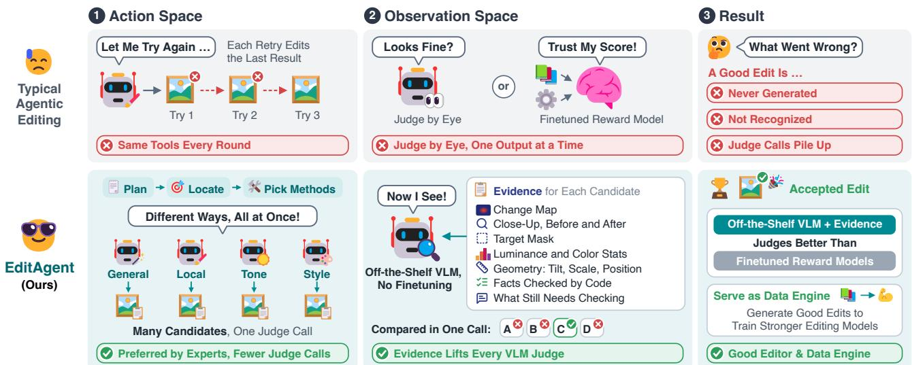  
Figure 1. EditAgent expands both the action space of the agent and the observation space of its judge. Instead of trying again with the same editor, EditAgent generates candidates with different editing methods in parallel, and a judge (off-the-shelf VLM) compares them in one call with a verification record (evidence) for each candidate, without judge finetuning.

## Abstract

Agentic image editors decompose complex requests into steps, but when a stepfails, they mostly retry with the same narrow set oftools and a judge that scores each output by eye directly. We argue that such agents are bounded by two spaces: the action space ofwhat the agent can do, and the observation space ofwhat its judge can see. On our expertannotated benchmark, a general-purpose editor yields no usable result in over 40% of the cases, and no judge is reliable across edit types. We present EditAgent, which expands both spaces. It routes each step to general editors and specialized methods, and attaches to each candidate a verification record. With these records, off-the-shelf VLM judges outperformfinetuned reward models. Candidates are generated in parallel andjudged in one listwise call: experts prefer this to sequential refinement in 78.5% of decided comparisons, at no more than half the judge calls. EditAgent improves two open-weight editors on three benchmarks and serves as a data enginefor training stronger editors.

## 1. Introduction

Instruction-based image editing models can now perform a wide range of edits from a single text instruction [4, 25, 63]. Real requests, however, rarely ask for a single edit. Given “move me to the left of the frame, widen the shot to show more of the beach, remove the people walking behind me, and make it look like sunset,” today’s editors tend to complete some parts and silently drop others [57, 67]. Agentic editing systems [15, 30, 49, 75] address this by decomposing the request into steps and running a plan-edit-judge loop on each. Yet when a step fails, they mostly try again. The step is refined, retried, or rolled back with the same tools and judge. Here we ask the question: when an editing agent fails, is another attempt really what it needs? If not, what does the agent really needs?

Consider how a professional retoucher would handle the same request: pick a different tool for each part, and check each result by zooming in and comparing before and after. A retoucher does not simply try again but acts differently and looks more closely. We argue that an editing agent is likewise bounded by two spaces: its action space, what it can do, and its judge’s observation space, what it can see. Existing agents [15, 30, 49] keep both small. Each attempt runs one tool, often a general editor [14, 25, 27, 43, 63], and the judge scores that single output by eye, given only the source image, the edited image and the instruction. To explore how each space should be designed, we introduce a diagnostic benchmark of 600 candidate sets over 30 edit types, labeled blindly by professional Photoshop editors (Fig. 2). We find that the general editor yields no usable result in 42.7% of the sets, mostly in geometry, tone and enhancement edits, and a specialized method recovers 175 of these 256 failures. Meanwhile, no judge we test, including finetuned reward models [35, 65], is the most accurate across edit groups.

We therefore rethink agentic editing by expanding both spaces. Our system, EditAgent, shown in Fig. 1, expands the action space by routing each step to general-purpose editors and specialized methods, including masked local editing, object removal and movement, photometric and geometric operators, and so on. It expands the observation space by attaching to each candidate a verification record (evidence), such as a change map, close-ups of the edited region, and measured color and geometry, together with the outcomes of programmatic checks, so that the judge knows what code has verified and what remains for visual judgment. Instead of refining one result round after round, EditAgent thus generates candidates from all selected methods in parallel from the same source image, and the judge compares them with their records in a single listwise call. Unlike in text-to-image generation [17], professional editors prefer this parallel search over sequential refinement in 78.5% of non-tied comparisons, with at most half the judge calls (Sec. 3.3). With verification records, off-the-shelf VLM judges outperform finetuned reward models without finetuning.

Instantiated with Qwen-Image-Edit-2511 [63] and FLUX.2-klein-9B [26], EditAgent improves both backbones on EdiVal [6], Complex-Edit [67], and ComplexBench-Edit [57]. Because it accepts only verified edits, EditAgent also serves as a data engine. Editors finetuned on its 25.7K accepted sessions outperform those trained on data generated directly by the base editor FLUX.2-klein-9B.

Our contributions are threefold.

• We identify the agent’s action space and its judge’s observation space as two bottlenecks of agentic image editing, and analyze both with an expert-annotated diagnostic benchmark spanning 30 edit types.

• We propose EditAgent, which expands the action space with specialized editing methods and the observation space with verification records, and couples them through parallel candidate generation and listwise judging. With these records, off-the-shelf VLM judges outperform finetuned editing reward models.

• EditAgent consistently improves strong open-weight editors on three multi-turn and complex-instruction benchmarks, and the sessions it accepts yield training data that further improves standalone editors.

## 2. Related Work

Single-turn Image Editing. Following pioneering diffusionbased methods [16, 19, 37, 39], InstructPix2Pix [4] and Emu Edit [50] established general instruction-based editing. Recent proprietary [14, 43, 48, 60] and open-weight [11, 26, 27, 33, 63, 64] models now provide strong general-purpose editing. Other methods offer more explicit control through masked editing [2, 54], localized text-driven editing [9, 29], or point-based manipulation [51]. EditAgent builds on some of these editors and coordinates them together.

Multi-turn Editing and Agentic Editing. MagicBrush [76] provides single- and multi-turn editing trajectories, making the preservation of earlier edits an explicit target. Agentic systems further incorporate planning and feedback, for example by scheduling restoration tools [81], searching and revising cost-aware tool paths [15], and guiding iterative edits with instruction decomposition, visual feedback, or dialogue history [7, 28, 30, 36, 49, 62, 68, 75]. Others integrate reflection into the editing model [73], maintain a structured history for long-horizon editing [71], or explore editing trajectories with Monte Carlo tree search [70]. These agents retry within a fixed tool set and judge one output at a time by eye, whereas EditAgent expands the action space with specialized editing methods and the observation space of its judge with evidence and side-by-side comparison.

Evaluation and Benchmarking. Traditional protocols measure edit alignment with CLIP-based text-image or directional similarity [12, 44] and preservation with CLIP or DINO image similarity [5]. Benchmarks further compare outputs with ground-truth target images [76] or assess unedited regions [18] with PSNR, SSIM [61], and LPIPS [77]. More recent protocols prompt VLMs such as GPT-4o [40] and Qwen2.5-VL [3] to rate instruction following, preservation, and perceptual quality [20, 33, 67, 72]. Others augment VLM judgments with visual tools [6, 58] or aggregate automatic scores into a human-aligned evaluation [47]. Rather than training dedicated editing reward models [35, 65, 78], we adapt off-the-shelf VLMs with taskspecific verification records.

## 3. Rethinking Agentic Editing

We evaluate both action and observation spaces on the diagnostic benchmark (Sec. 3.1, Fig. 2). Specifically, we address three core questions: (1) Does a general editor need a larger action space or only more samples (Sec. 3.2)? (2) Under a fixed budget, should candidates be refined sequentially or generated in parallel (Sec. 3.3)? (3) Can a judge that scores one output at a time select a satisfactory edit (Sec. 3.4)?

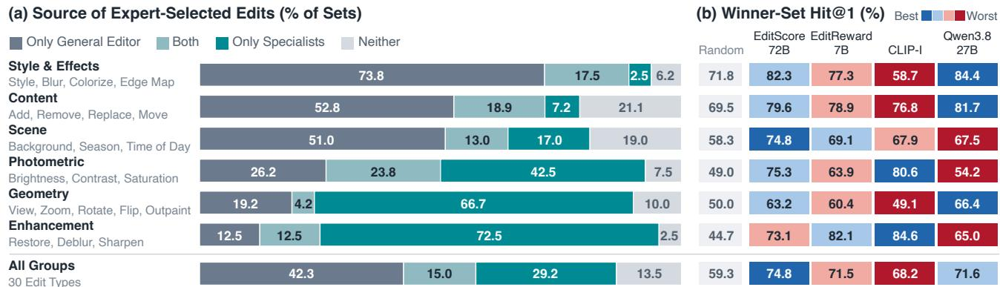  
Figure 2. Where the action space and the observation space fall short, by edit group. (a) Action space: share of the expert-labeled sets in which only general-editor candidates, only specialized candidates, both kinds, or no candidate are usable. (b) Observation space: Winner-Set Hit@1 on the expert-labeled sets with at least one usable candidate. Random is the expected Hit@1 of a uniform random pick

## 3.1. Diagnostic Benchmark

We construct a benchmark of 600 editing sets covering 30 fine-grained edit types, with 20 sets per type. The types span six groups: Content, Style & Effects, Scene, Photometric, Geometry, and Enhancement. Each set contains a source image, an instruction, and 2-4 candidate edits from two sources: samples of a general-purpose editor (FLUX.2-klein-9B) and specialized methods such as masked local editing, object removal, and photometric operators. Five professional Photoshop retouchers sit together and select every usable candidate, i.e., every candidate that completes the instruction acceptably. We call the selected candidates the winner set.

## 3.2. Is One Editor Enough?

We categorize the 600 sets by their winner sets (Fig. 2a). The winner set contains only general-editor candidates in 254 sets (42.3%), only specialized candidates in 175 (29.2%), and both kinds in 90 (15.0%). In the remaining 81 sets (13.5%), no candidate is usable. Since every set includes a general-editor candidate, the general editor fails in 256 sets (42.7%), and a specialized method recovers 175 of them. The outcomes also vary strongly across edit groups. The winner set contains only general-editor candidates in 73.8% of Style & Effects sets, but only specialized candidates in 72.5% of Enhancement and 66.7% of Geometry sets.

More samples from the general editor do not recover these failures. For every request, the general editor produces several samples and one of them is delivered, i.e., parallel sampling with a verifier [17]. A second pool also includes the specialized methods, and the same VLM judge selects the delivered edit in both pools. Both delivered edits are among the labeled candidates of the set. Although the general-editor pool contains more samples, its delivered edit is usable in only 45.2% of the sets, compared with 68.2% for the pool with specialized methods. In the 296 sets where exactly one delivered edit is usable, it comes from the pool with specialized methods in 217. These results show that one editor is not enough, even when sampled more often.

## 3.3. Refine Sequentially or Search in Parallel?

While sequential refinement has been shown to improve textimage alignment in image generation [17], we observe that it can suffer from error accumulation in image editing, as errors introduced in earlier iterations may propagate to later edits. To investigate this, we compare two strategies using the same editor (FLUX.2-klein-9B) and judge (Qwen3.8-27B), each with a budget of 4 image generations. Sequential refinement iteratively edits the previous result using prompts revised based on VLM feedback, requiring 3 feedback calls and 1 final selection call. Parallel search, in contrast, generates two candidates independently from the original image. If neither is accepted by the judge, it revises the prompt and generates two more candidates from the original image before selecting the best result. This requires at most 2 VLM calls.

In a blind comparison on 144 Complex-Edit samples [67] at complexity levels 1, 4, and 8, five professional Photoshop editors preferred parallel search in 102 cases and sequentia refinement in 28, with 14 ties. Parallel search thus wins 78.5% of the non-tied comparisons with at most half the VLM calls. Unlike generation, editing must stay faithful to the source image. Sequential refinement keeps editing its own output, so small errors can accumulate, whereas parallel search edits every candidate directly from the source. Thus, for editing, parallel search uses the budget better than sequential refinement. With several candidates available, the delivered edit then depends on what the judge can see.

## 3.4. Is Judging One Output at a Time Enough?

We therefore test four judges, each scores one output at a time from the source image, the edited image and, except for CLIP-I, the instruction. They are the editing reward models EditScore-72B [35] and EditReward-7B [65], the CLIP-I metric [44] (CLIP similarity to the source image), and Qwen3.8-27B [56] with a pass/fail prompt. Winner-Set Hit@1 is the fraction of sets whose top-scoring candidate is in the winner set, i.e., is usable, with ties sharing credit. We report it on the 515 sets with at least one usable candidate.

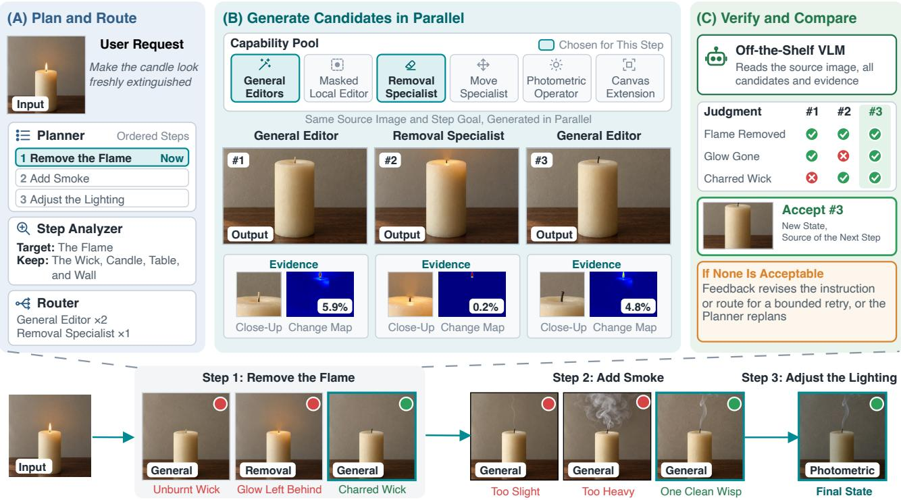  
Figure 3. Overview of EditAgent. Bottom: a request runs as dependent steps, and each accepted result becomes the source of the next step. Top: step 1, enlarged. (A) The planner orders the steps; the analyzer and router select the applicable methods for the current step. (B) The selected methods generate candidates in parallel from the same source image, each with a verification record (evidence). (C) An off-the-shelf VLM compares the candidates with their records and accepts one, or returns feedback for another attempt.

Table 1. Comparative judging is better. Overall accuracy (%) on EditReward-Bench [35]. Pointwise scores each candidate alone; listwise (ours) compares them together in one call.
<table><tr><td>Judge</td><td>Pointwise</td><td>Listwise (Ours)</td><td>Δ</td></tr><tr><td>EditScore-7B</td><td>65.9</td><td>一</td><td></td></tr><tr><td>EditScore-32B</td><td>68.0</td><td></td><td></td></tr><tr><td>EditScore-72B</td><td>70.3</td><td></td><td></td></tr><tr><td>EditScore-7B, Ensemble@4</td><td>72.7</td><td></td><td></td></tr><tr><td>EditScore-32B, Ensemble@4</td><td>73.3</td><td>一</td><td></td></tr><tr><td>EditScore-72B, Ensemble@4</td><td>76.3</td><td></td><td></td></tr><tr><td>Qwen3.5-27B</td><td>71.7</td><td>85.2</td><td>+13.5</td></tr><tr><td>Qwen3.8-27B</td><td>72.1</td><td>85.9</td><td>+13.8</td></tr><tr><td>Gemma-4-31B</td><td>73.8</td><td>86.1</td><td>+12.3</td></tr></table>

No judge is the most accurate on every group (Fig. 2b). EditScore-72B has the best overall Winner-set Hit@1 but is the best only on Scene, and Qwen3.8-27B, the most accurate on three groups, is only 5.2 points above random on Photometric. CLIP-I, which prefers the candidate closest to the source, shows why. It is the most accurate judge on Photometric and Enhancement, where the correct result changes little, but it is at or below random on Style & Effects and Geometry, where the request requires a visible change. What a judge must observe therefore depends on the edit.

Is preference finetuning the remedy? The EditScore [35] models are trained on large sets of detailed human preference annotations. However, off-the-shelf VLMs can surpass

EditScore on its own EditReward-Bench [35] (Tab. 1). EditScore models reach 65.9-70.3%, and with four-pass ensembling [35], EditScore-72B reaches 76.3%. Even judging each candidate alone (pointwise), off-the-shelf VLMs can reach 71.7-73.8%. Furthermore, if we expand the observation space, present candidates side by side in a single judge call (listwise), the accuracy can be boosted to 85.2-86.1%. Such comparative judging is not supported by EditScore models, which are finetuned with specific input and output templates. Thus, what a judge sees can matter more than how it is trained. Here, comparative judging enables expanded observation space, leading to better judgments.

## 4. EditAgent

Given a user request, a planner decomposes it into ordered editing steps (Fig. 3). For each step, an analyzer specifies the editing operation and its target, a grounder localizes the target with a VLM and SAM 2.1 [46] when a method needs a mask, and a router selects the applicable editing methods, each of which generates at least one candidate in parallel (Sec. 4.1). An off-the-shelf VLM judge evaluates the candidates together with their verification records (Sec. 4.2), either accepting one candidate or returning feedback for a retry. Each accepted image becomes the source of the next step, and the requirements it satisfies are carried forward so that subsequent turns can verify that they still hold (Sec. 4.3).

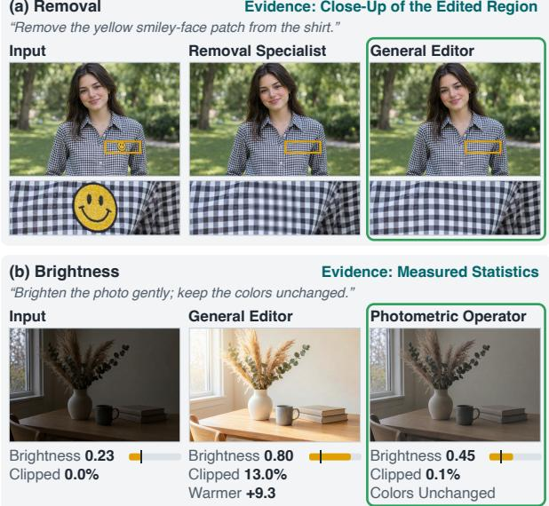  
Figure 4. Examples of the verification record (evidence). (a) A close-up of the edited region reveals the blurred checks left by the removal specialist. (b) Measured brightness, clipping and color shift accurately reveal the performance of the photometric operator.

## 4.1. Expanding the Action Space

Candidate Construction. Given an executable instruction and its source image, the analyzer specifies the editing operation and recommends candidate methods, and the router turns the recommendation into a set of methods that each contribute at least one candidate. Different methods explore different realizations of the request, while repeated sampling explores variation within a method.

Action Space. Besides the general editor, the capability pool contains: 1) masked local editing and recoloring, which run the general editor inside a SAM 2.1 mask, 2) object removal with OSOR [80], 3) object movement with a dedicated model, 4) subject scaling by segmentation and compositing, 5) global and local photometric operators, 6) style filters and neural style transfer, 7) flips, rotations, and rotation to level, and 8) zoom-in by cropping with super-resolution and zoom-out by outpainting. Details can be found in Tab. S5.

## 4.2. Expanding the Observation Space

Comparative Judging. Inspired by Sec. 3.4, we provide the judge with all candidates in one call. It only needs one VLM call per step, whose comparison yields feedback for the next attempt if a retry is needed.

Verification Records. Just as a professional retoucher uses different tools to judge an editing operation, we argue that different edits require checks of different properties (Fig. 4). For example, a localized edit requires checking both the target change and the preservation of unrelated content, whereas a geometric transformation requires assessing its direction and extent. Some of these properties can be checked by code during execution, some require visual judgment. For each candidate, we collect these checks into a verification record, together with what remains for visual judgment. EditAgent collects the verification record and gives to the judge, so the judge no longer judges by eye alone. Therefore, after all, the judge will receive the edit instruction, the source image, all candidates and their records in one call.

Table 2. Per-edit-group Winner-Set Hit@1 (%) of Qwen3.8-27B on our diagnostic benchmark.
<table><tr><td>Listwise</td><td>Evidence</td><td>Style</td><td>Content</td><td>Scene</td><td>Photo.</td><td>Geom.</td><td>Enh.</td><td>All</td></tr><tr><td></td><td></td><td>84.4</td><td>81.7</td><td>67.5</td><td>54.2</td><td>66.4</td><td>65.0</td><td>71.6</td></tr><tr><td>√</td><td></td><td>87.1</td><td>87.1</td><td>72.0</td><td>47.2</td><td>78.6</td><td>36.8</td><td>73.6</td></tr><tr><td>√</td><td>√</td><td>87.6</td><td>86.4</td><td>81.9</td><td>64.4</td><td>81.4</td><td>80.3</td><td>81.3</td></tr></table>

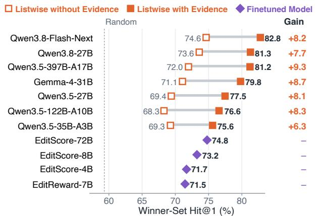  
Figure 5. Verification record (evidence) further lifts off-the-shelf VLM judge. Winner-Set Hit@1 on our diagnostic benchmark.

Performance on the Diagnostic Benchmark. To evaluate the effectiveness of the enriched observation space, we report Winner-Set Hit@1 on the 515 candidate sets with at least one usable edit from our diagnostic benchmark (Sec. 3.1), averaged over three runs. Tab. 2 expands the observation space of the Qwen3.8-27B judge in Fig. 2b one step at a time. Listwise comparison raises its accuracy from 71.6% to 73.6% and helps on four of the six groups. Comparison alone, however, lowers accuracy on Photometric (from 54.2% to 47.2%) and Enhancement (from 65.0% to 36.8%), the two groups where the correct result changes little from the source (Sec. 3.4). Adding verification records recovers both groups to 64.4% and 80.3%, above the pointwise judge, and raises the overall accuracy to 81.3%, 6.5 points above EditScore-72B, the strongest judge in Fig. 2b. Both expansions of the observation space improve the judge, and evidence helps compensate where comparison fails.

This gain is not specific to Qwen3.8-27B. As shown in Fig. 5, seven off-the-shelf VLM judges are improved, by 6.3 to 9.3 points. Without records, none of them reaches the finetuned EditScore-72B (74.8%). With records, every one of them exceeds all four finetuned reward models, and Qwen3.8-Flash-Next reaches 82.8%, 8.0 points above EditScore-72B, the strongest judge in Fig. 2b.

Table 3. Comparison of different editing models on EdiVal. Closed-source model numbers from EdiVal. Each cell reports turn 1 / turn 2 / turn 3 scores (0-100). <sup>†</sup>Generates at 1024 px, while all outputs are downsampled to 512×512 for evaluation.
<table><tr><td>Model</td><td>EdiVal-IF ↑</td><td>EdiVal-CC ↑</td><td>EdiVal-O ↑</td></tr><tr><td>Closed-source</td><td></td><td></td><td></td></tr><tr><td>FLUX.1-Kontext-max† [27]</td><td>69.49 / 46.89 / 31.83</td><td>93.93 / 90.90 / 88.40</td><td>80.79 / 65.29 / 53.04</td></tr><tr><td>GPT-Image-1† [41]</td><td>73.12 / 54.89 / 38.35</td><td>81.00 / 77.78 / 75.50</td><td>76.96 / 65.34 / 53.81</td></tr><tr><td>Nano Banana† [14]</td><td>70.70 / 50.66 / 35.35</td><td>93.91 / 90.48 / 89.48</td><td>81.48 / 67.70 / 56.24</td></tr><tr><td>FLUX.2-max [24]</td><td>75.55 / 55.27 / 39.36</td><td>92.91 / 88.30 / 85.78</td><td>83.78 / 69.86 / 58.10</td></tr><tr><td>Nano Banana 2† [10]</td><td>73.89 / 54.17 / 38.61</td><td>93.54 / 90.52 / 88.61</td><td>83.14 / 70.02 / 58.49</td></tr><tr><td>GPT-Image-1.5† [42]</td><td>75.19 / 55.92 / 40.08</td><td>94.49 / 91.20 / 88.49</td><td>84.29 / 71.41 / 59.55</td></tr><tr><td>Seedream 4.0† [48]</td><td>75.93 / 55.58 / 41.59</td><td>92.51 / 88.03 / 85.86</td><td>83.81 / 69.95 / 59.76</td></tr><tr><td>Open-source</td><td></td><td></td><td></td></tr><tr><td>AnyEdit [74] UltraEdit [79]</td><td>41.07 / 16.32 / 7.22</td><td>86.42 / 78.91 / 70.10</td><td>59.58 / 35.89 / 22.50</td></tr><tr><td></td><td>51.37 / 17.70 / 6.36</td><td>86.80 / 84.50 / 82.40</td><td>66.78 / 38.67 / 22.89</td></tr><tr><td>OmniGen [66] FLUX.1-Kontext-dev† [27]</td><td>54.72 / 24.48 / 10.66</td><td>93.00 / 88.42 / 83.92</td><td>71.34 / 46.52 / 29.91</td></tr><tr><td>Step1X-Edit [33]</td><td>59.97 / 32.69 / 16.61</td><td>95.32 / 92.24 / 90.22</td><td>75.61 / 54.91 / 38.71</td></tr><tr><td>Qwen-Image-Edit† [63]</td><td>61.89 / 34.97 / 17.83</td><td>92.76 / 88.52 / 85.21</td><td>75.77 / 55.64 / 38.98</td></tr><tr><td></td><td>72.90 / 44.06 / 22.55</td><td>84.22 / 80.52 / 77.98</td><td>78.36 / 59.56 / 41.93</td></tr><tr><td>Qwen-Image-Edit-2511 [63]</td><td>75.35 / 52.97 / 39.16</td><td>76.59 / 64.79 / 57.95</td><td>75.97 / 58.58 / 47.64</td></tr><tr><td>+ EditAgent</td><td>75.35 / 57.69 / 41.61</td><td>86.29 / 77.87 / 73.92</td><td>80.64 / 67.02 / 55.46</td></tr><tr><td>FLUX.2-klein-9B [26]</td><td>69.76 / 48.08 / 31.82</td><td>94.91 / 91.42 / 88.94</td><td>81.37 / 66.30 / 53.20</td></tr><tr><td>+ EditAgent</td><td>75.35 / 55.77 / 40.21</td><td>94.67 / 90.65 / 87.90</td><td>84.46 / 71.10 / 59.45</td></tr><tr><td>Qwen-Image-Edit-2511† [63]</td><td>76.22 / 57.34 / 41.08</td><td>93.95 / 89.55 / 87.05</td><td>84.62 / 71.66 / 59.80</td></tr><tr><td>+ EditAgent†</td><td>76.05 / 57.87 / 44.93</td><td>93.80 / 89.77 / 87.15</td><td>84.46 / 72.08 / 62.58</td></tr></table>

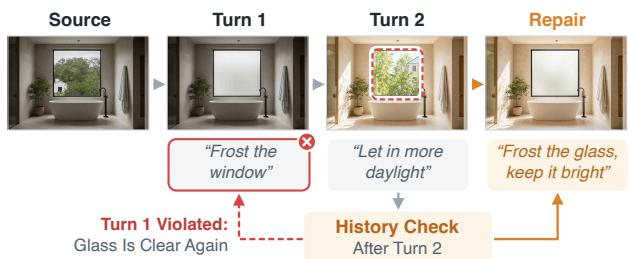  
Figure 6. The history check extends what the judge observes to earlier turns. Letting in more daylight in turn 2 clears the frosted glass from turn 1. The history check detects this and repairs.

## 4.3. Planning and Preserving Edits across Turns

The planner splits a request into dependent steps when its parts need separate execution, and each accepted step becomes the source of the next. Because the step judge sees one step at a time, a later edit can undo an earlier one unnoticed. After every turn, a history check therefore shows the VLM the original image, the results of earlier turns and the current image, and asks whether each earlier request still holds. On a confident violation, EditAgent runs one repair turn and adopts it only if its step judge accepts it (Fig. 6).

## 5. Experiments

## 5.1. Experimental Setup

Benchmarks. We evaluate EditAgent on three benchmarks covering multi-turn and complex-instruction editing. EdiVal [6] comprises 572 three-turn sessions and assesses editing quality as successive requests accumulate. Complex-Edit [67] comprises 8,496 real and synthetic examples spanning different levels of instruction complexity. ComplexBench-Edit [57] comprises 763 examples with compositional instructions, including parallel constraints and multi-step chains. Together, they assess performance across editing turns, complexity, and compositional structure.

Backbones and Baselines. We instantiate EditAgent with two general-purpose editors, Qwen-Image-Edit-2511 [63] and FLUX.2-klein-9B [26]. For each backbone, we compare standalone editing with its integration into EditAgent. We also compare it with seven agentic editors (Tab. 5). On EdiVal, both backbones edit at the 512 px input resolution. Because most closed-source editors generate at 1024 px or more, we also run Qwen-Image-Edit-2511 at 1024 px and resize back to 512 px for fair comparison. The comparison with agentic editors and all ablations use the 512 px setting. Evaluation. We follow the evaluation rubrics of each benchmark. EdiVal uses its released judges, and Qwen3.8- 27B [56] replaces GPT-4o and Gemini 2.0 Flash Thinking on Complex-Edit and ComplexBench-Edit. As it is also our internal judge, to avoid potential bias, we additionally evaluate EditAgent using Gemma-4-31B [55] (Tab. S8).

Implementation Details. Qwen3.8-27B serves as the planner, analyzer, grounder and judge, and SAM 2.1 [46] turns predicted boxes into masks. Each attempt generates up to three candidates, at least one per applicable method, shown to the judge in random order. Each step allows two retries and each turn two plan revisions.

Table 4. Editing performance on ComplexBench-Edit (scores 0-100) and Complex-Edit (scores 0-10).
<table><tr><td rowspan="2">Model</td><td colspan="6">ComplexBench-Edit</td><td colspan="4">Complex-Edit</td></tr><tr><td>Obj. ↑</td><td>Obj.-At. ↑</td><td>Obj.-At.-G. ↑</td><td>Two-chain ↑</td><td>Three-chain ↑</td><td>Avg. ↑</td><td>F↑</td><td>P↑</td><td>PQ↑</td><td>0↑</td></tr><tr><td>Qwen-Image-Edit-2511</td><td>56.98</td><td>60.81</td><td>67.97</td><td>57.59</td><td>28.67</td><td>54.40</td><td>8.721</td><td>6.259</td><td>7.132</td><td>7.371</td></tr><tr><td>+ EditAgent</td><td>68.92</td><td>70.74</td><td>73.17</td><td>60.21</td><td>31.11</td><td>60.83</td><td>8.736</td><td>6.391</td><td>7.209</td><td>7.445</td></tr><tr><td>FLUX.2-klein-9B</td><td>67.52</td><td>70.56</td><td>73.87</td><td>61.67</td><td>33.61</td><td>61.45</td><td>8.763</td><td>7.304</td><td>6.964</td><td>7.677</td></tr><tr><td>+ EditAgent</td><td>70.05</td><td>74.69</td><td>76.80</td><td>64.48</td><td>36.53</td><td>64.51</td><td>8.783</td><td>7.131</td><td>7.224</td><td>7.713</td></tr></table>

Table 5. Comparison with agentic editors on EdiVal. We report EdiVal-O at turns 1/2/3 and inference cost (H100 GPU hour). All agents use the same base editors and Qwen3.8-27B [56] as the VLM. Best bold, second underlined. <sup>†</sup>Re-implemented from the paper.
<table><tr><td rowspan="2">Model</td><td colspan="4">Qwen-Image-Edit-2511 [63]</td><td colspan="4">FLUX.2-klein-9B [26]</td></tr><tr><td>Turn 1 ↑</td><td>Turn 2↑</td><td>Turn 3 ↑</td><td>Inference Cost ↓</td><td>Turn 1 ↑</td><td>Turn 2↑</td><td>Turn 3 ↑</td><td>Inference Cost ↓</td></tr><tr><td>Standalone Editor</td><td>75.97</td><td>58.58</td><td>47.64</td><td>1.1</td><td>81.37</td><td>66.30</td><td>53.20</td><td>0.5</td></tr><tr><td>MIRA† [75]</td><td>75.79</td><td>57.59</td><td>45.59</td><td>11.3</td><td>82.57</td><td>67.08</td><td>53.76</td><td>5.6</td></tr><tr><td>IMAGAgent [49]</td><td>76.83</td><td>60.15</td><td>49.78</td><td>10.9</td><td>82.63</td><td>68.00</td><td>55.21</td><td>4.6</td></tr><tr><td>EditThinker [28]</td><td>76.58</td><td>60.47</td><td>49.23</td><td>9.4</td><td>82.62</td><td>67.20</td><td>55.97</td><td>4.6</td></tr><tr><td>GenArtist† [62]</td><td>79.51</td><td>62.94</td><td>50.54</td><td>9.5</td><td>82.94</td><td>67.48</td><td>54.74</td><td>5.2</td></tr><tr><td>VisionDirector-TF† [7]</td><td>76.68</td><td>59.58</td><td>48.68</td><td>9.9</td><td>82.19</td><td>68.77</td><td>56.96</td><td>4.8</td></tr><tr><td>RISE-Agent [68]</td><td>78.86</td><td>63.66</td><td>52.10</td><td>14.7</td><td>83.95</td><td>70.30</td><td>58.42</td><td>7.2</td></tr><tr><td>EditAgent</td><td>80.64</td><td>67.02</td><td>55.46</td><td>12.9</td><td>84.46</td><td>71.10</td><td>59.45</td><td>6.3</td></tr></table>

## 5.2. EditAgent as a General Editing Framework

Multi-turn Editing. Without finetuning, EditAgent improves EdiVal-O (Tab. 3) across both baselines. Specifically, Qwen-Image-Edit-2511 at the 1024 px achieves the best performance, increasing from 59.80 to 62.58 at Turn 3.

Complex-instruction Editing. On ComplexBench-Edit (Tab. 4), the average rises by 6.43 and 3.06 points for Qwen-Image-Edit-2511 and FLUX.2-klein-9B, respectively, improving all five groups. The Complex-Edit overall score rises by 0.074 and 0.036. Across benchmarks, specialized methods deliver 19% to 31% of the accepted steps.

Comparison with Agentic Editors. In Tab. 5, with the same backbones and VLM, EditAgent achieves the best turn 3 score (59.45, against 58.42 for the strongest agent, RISE-Agent) and the best score in all the 3 turns.

## 5.3. EditAgent as a Data Engine

Because EditAgent flags every edit that its judge did not accept, its fully accepted sessions can serve as training data. Using FLUX.2-klein-9B as the general editor, EditAgent produces about 25.7K sessions, averaging four turns each. Each session yields one training sample consisting of the source image, a session-level instruction, and the final edited image. For comparison, we use FLUX.2-klein-9B to directly edit the same sessions, keeping the training inputs identical and varying only the final images. We fully finetune Qwen-Image-Edit-2511 and FLUX.2-klein-base-9B on each dataset for one epoch and evaluate them as standalone editors.

As shown in Tab. 6, training on EditAgent data improves both editors across all three benchmarks. On EdiVal-O at turn 3, Qwen-Image-Edit-2511 and FLUX.2-klein-base-9B gain 1.95 and 2.00 points, respectively, while their ComplexBench-Edit averages increase by 3.17 and 2.14 points. More importantly, EditAgent data consistently outperforms directly generated FLUX.2-klein-9B data under the same training recipe. Notably, direct FLUX.2-klein-9B data degrades FLUX.2-klein-base-9B on all three benchmarks, whereas EditAgent data improves it. These results suggest that EditAgent provides higher-quality training supervision rather than merely additional training examples.

## 5.4. Ablation Study

Tab. 7 evaluates each component of EditAgent. The vanilla agent, equipped with planning, analysis, history checking, and repair/retry, improves EdiVal-O at turn 3 from 47.64 to 49.43. Expanding the action space yields a 2.94-point gain. Sampling the general editor more often does not reproduce this gain. If we replace the action space with K copies of the general editor and keep parallel comparison, EdiVal-O reaches 47.53, 48.90, and 49.01 for K = 2, 4, and 8. This agrees with the diagnostic study in Sec. 3.2, where restricting EditAgent to the general editor lowers the share of usable delivered edits. Expanding the observation space further improves performance by 3.09 points.

## 5.5. Qualitative Results

Figure 7 compares standalone FLUX.2-klein-9B with EditAgent. For multi-turn editing, each turn edits the previous output, so an error carries into every later turn. Standalone editing drops the dog of turn 1 when it adds the old man in turn 2. When turn 2 asks for two baguettes, it adds three,

Input  


## Turn 1


  
“Paint the bicycle frame red”


  
“Replace all the raspberries with fresh blueberries”

  
“Seat an old man reading a newspaper on the bench”


  
“Attach a wicker basket with two baguettes to the front of the bicycle”

## Turn 2


  
“Scatter a few fresh mint leaves around the plate”


  
“Make it autumn, with golden leaves on the trees and the grass”

## Turn 3

  
“Cast the shadow of a leafy branch onto the white wall behind the bicycle”


  
“Add a small orange pumpkin on the step next to the cat”

  
“Put a small navy bow tie on the cat”  
“Dust the blueberries in the strainer with a little powdered sugar”


  
“Make it a cozy autumn evening, with warm string lights glowing in the background”


Figure 7. Multi-turn editing comparison between FLUX.2-klein-9B and EditAgent.  
Table 6. Training data from EditAgent versus data generated directly by FLUX.2-klein-9B. Each baseline model is fully finetuned for one epoch; “—” denotes no finetuning. To bridge the train-eval gap of prompting, we rewrite the input prompts for EdiVal.
<table><tr><td>Baseline</td><td>Training Data Source</td><td>EdiVal-O Turn 3 ↑</td><td>Complex-Edit O ↑</td><td>ComplexBench-Edit Avg ↑</td></tr><tr><td rowspan="3">Qwen-Image-Edit-2511</td><td></td><td>49.66</td><td>7.371</td><td>54.40</td></tr><tr><td>FLUX.2-klein-9B</td><td>48.51</td><td>7.334</td><td>55.84</td></tr><tr><td>EditAgent</td><td>51.61</td><td>7.435</td><td>57.57</td></tr><tr><td rowspan="3">FLUX.2-klein-base-9B</td><td></td><td>54.53</td><td>7.517</td><td>57.84</td></tr><tr><td>FLUX.2-klein-9B</td><td>52.83</td><td>7.351</td><td>57.47</td></tr><tr><td>EditAgent</td><td>56.53</td><td>7.615</td><td>59.98</td></tr></table>

Table 7. Component ablation on EdiVal with Qwen-Image-Edit-2511. Rows with K=n replace the action space with n identical copies of the general editor. The last row shows the full EditAgent.
<table><tr><td rowspan="2">Vanilla &amp; Agent</td><td rowspan="2">Action Space</td><td colspan="2">Observation Space</td><td rowspan="2">EdiVal-O (T3)</td></tr><tr><td>Parallel Comparison</td><td>Verification Record</td></tr><tr><td>X</td><td>X</td><td>X</td><td>X</td><td>47.64</td></tr><tr><td>√</td><td>X</td><td>X</td><td>X</td><td>49.43</td></tr><tr><td>√</td><td>√</td><td>×</td><td>X</td><td>52.37</td></tr><tr><td>√</td><td>√</td><td>√</td><td>X</td><td>53.18</td></tr><tr><td>√</td><td>K=2</td><td>√</td><td>X</td><td>47.53</td></tr><tr><td>√</td><td>K=4</td><td>√</td><td>×</td><td>48.90</td></tr><tr><td>√</td><td> $K { = } 8$ </td><td>√</td><td>X</td><td>49.01</td></tr><tr><td>√</td><td>√</td><td>√</td><td>V</td><td>55.46</td></tr></table>

overall advantages of our method, even over GPT-Image-2.

which remains in turn 3. Instead, EditAgent judges each step against its source image, which already contains the earlier edits, and checks that they remain. More qualitative comparisons is provided in Sec. I, further demonstrating the

## 6. Conclusion

We presented EditAgent, which rethinks agentic image editing as expanding two spaces: the action space of the agent and the observation space of its judge. It routes each step to general-purpose and specialized editing methods, generates their candidates in parallel, and lets the off-the-shelf VLM judge compare them with verification records. EditAgent improves two editing backbones across three benchmarks, and functions as a robust data engine, leveraging its accepted sessions to improve standalone editors through fine-tuning. Limitations. EditAgent incurs roughly 10× the inference time of standalone editing models, and its performance is inherently bounded by the capabilities of its underlying editing methods. Nevertheless, EditAgent can serve as a data engine for finetuning stronger and more efficient standalone editors, potentially amortizing its computational cost.

## References

[1] Inco AI. Dflash 2: Keep drafting parallel, 2026. 9

[2] Omri Avrahami, Dani Lischinski, and Ohad Fried. Blended diffusion for text-driven editing of natural images. In CVPR, 2022. 2

[3] Shuai Bai, Keqin Chen, Xuejing Liu, Jialin Wang, Wenbin Ge, Sibo Song, et al. Qwen2.5-vl technical report. arXiv preprint arXiv:2502.13923, 2025. 2

[4] Tim Brooks, Aleksander Holynski, and Alexei A Efros. Instructpix2pix: Learning to follow image editing instructions. In CVPR, 2023. 1, 2

[5] Mathilde Caron, Hugo Touvron, Ishan Misra, Hervé Jégou, Julien Mairal, Piotr Bojanowski, and Armand Joulin. Emerging properties in self-supervised vision transformers. In ICCV, 2021. 2

[6] Tianyu Chen, Yasi Zhang, Zhi Zhang, Peiyu Yu, Shu Wang, Zhendong Wang, Kevin Lin, Xiaofei Wang, Zhengyuan Yang, Linjie Li, et al. Edival-agent: An object-centric framework for automated, fine-grained evaluation of multi-turn editing. arXiv preprint arXiv:2509.13399, 2025. 2, 6

[7] Meng Chu, Senqiao Yang, Haoxuan Che, Suiyun Zhang, Xichen Zhang, Shaozuo Yu, Haokun Gui, Zhefan Rao, Dandan Tu, Rui Liu, et al. Visiondirector: Vision-language guided closed-loop refinement for generative image synthesis. In CVPR, 2026. 2, 7

[8] Marcos V Conde, Ui-Jin Choi, Maxime Burchi, and Radu Timofte. Swin2sr: Swinv2 transformer for compressed image super-resolution and restoration. In ECCV, 2022. 6

[9] Guillaume Couairon, Jakob Verbeek, Holger Schwenk, and Matthieu Cord. Diffedit: Diffusion-based semantic image editing with mask guidance. arXiv preprint arXiv:2210.11427, 2022. 2

[10] Google DeepMind. Nano banana 2: Combining pro capabilities with lightning-fast speed, 2026. 6

[11] Chaorui Deng, Deyao Zhu, Kunchang Li, Chenhui Gou, Feng Li, Zeyu Wang, Shu Zhong, Weihao Yu, Xiaonan Nie, Ziang Song, et al. Emerging properties in unified multimodal pretraining. arXiv preprint arXiv:2505.14683, 2025. 2

[12] Rinon Gal, Or Patashnik, Haggai Maron, Amit H Bermano, Gal Chechik, and Daniel Cohen-Or. Stylegan-nada: Clipguided domain adaptation of image generators. ACM ToG, 2022. 2

[13] Leon A Gatys, Alexander S Ecker, and Matthias Bethge. Image style transfer using convolutional neural networks. In CVPR, 2016. 6

[14] Google. Introducing gemini 2.5 flash image, our state-of-theart image model, 2025. 2, 6

[15] Advait Gupta, NandaKiran Velaga, Dang Nguyen, and Tianyi Zhou. Costa\*: Cost-sensitive toolpath agent for multi-turn image editing. In EMNLP, 2026. 1, 2

[16] Amir Hertz, Ron Mokady, Jay Tenenbaum, Kfir Aberman, Yael Pritch, and Daniel Cohen-Or. Prompt-to-prompt image editing with cross attention control. arXiv preprint arXiv:2208.01626, 2022. 2

[17] Shantanu Jaiswal, Mihir Prabhudesai, Nikash Bhardwaj, Zheyang Qin, Amir Zadeh, Chuan Li, Katerina Fragkiadaki,

and Deepak Pathak. Iterative refinement improves compositional image generation. arXiv preprint arXiv:2601.15286, 2026. 2, 3

[18] Xuan Ju, Ailing Zeng, Yuxuan Bian, Shaoteng Liu, and Qiang Xu. Pnp inversion: Boosting diffusion-based editing with 3 lines of code. In ICLR, 2024. 2

[19] Bahjat Kawar, Shiran Zada, Oran Lang, Omer Tov, Huiwen Chang, Tali Dekel, Inbar Mosseri, and Michal Irani. Imagic: Text-based real image editing with diffusion models. In CVPR, 2023. 2

[20] Max Ku, Dongfu Jiang, Cong Wei, Xiang Yue, and Wenhu Chen. Viescore: Towards explainable metrics for conditional image synthesis evaluation. In ACL, 2024. 2

[21] Alina Kuznetsova, Hassan Rom, Neil Alldrin, Jasper Uijlings, Ivan Krasin, Jordi Pont-Tuset, Shahab Kamali, Stefan Popov, Matteo Malloci, Alexander Kolesnikov, Tom Duerig, and Vittorio Ferrari. The open images dataset V4: Unified image classification, object detection, and visual relationship detection at scale. IJCV, 2020. 8

[22] Woosuk Kwon, Zhuohan Li, Siyuan Zhuang, Ying Sheng, Lianmin Zheng, Cody Hao Yu, Joseph Gonzalez, Hao Zhang, and Ion Stoica. Efficient memory management for large language model serving with pagedattention. In Proceedings of the 29th symposium on operating systems principles, 2023. 3

[23] Black Forest Labs. Flux.1 fill [dev]. https : / / huggingface.co/black-forest-labs/FLUX.1- Fill-dev, 2024. 6

[24] Black Forest Labs. Flux.2 [max]: Top-tier quality image generation, 2025. 6

[25] Black Forest Labs. Flux.2: Frontier visual intelligence. https://bfl.ai/blog/flux-2, 2025. 1, 2

[26] Black Forest Labs. Flux.2 [klein]: Towards interactive visual intelligence, 2026. 2, 6, 7

[27] Black Forest Labs, Stephen Batifol, Andreas Blattmann, Frederic Boesel, Saksham Consul, Cyril Diagne, Tim Dockhorn, Jack English, Zion English, Patrick Esser, et al. Flux. 1 kontext: Flow matching for in-context image generation and editing in latent space. arXiv preprint arXiv:2506.15742, 2025. 2, 6

[28] Hongyu Li, Manyuan Zhang, Dian Zheng, Ziyu Guo, Yimeng Jia, Kaituo Feng, Hao Yu, Yexin Liu, Yan Feng, Peng Pei, et al. Editthinker: Unlocking iterative reasoning for any image editor. arXiv preprint arXiv:2512.05965, 2025. 2, 7

[29] Shanglin Li, Bohan Zeng, Yutang Feng, Sicheng Gao, Xiuhui Liu, Jiaming Liu, Lin Li, Xu Tang, Yao Hu, Jianzhuang Liu, et al. Zone: Zero-shot instruction-guided local editing. In CVPR, 2024. 2

[30] Zihan Liang, Jiahao Sun, and Haoran Ma. An llm-lvlm driven agent for iterative and fine-grained image editing. arXiv preprint arXiv:2508.17435, 2025. 1, 2

[31] Tsung-Yi Lin, Michael Maire, Serge Belongie, James Hays, Pietro Perona, Deva Ramanan, Piotr Dollár, and C Lawrence Zitnick. Microsoft coco: Common objects in context. In ECCV, 2014. 2

[32] Shilong Liu, Zhaoyang Zeng, Tianhe Ren, Feng Li, Hao Zhang, Jie Yang, Qing Jiang, Chunyuan Li, Jianwei Yang,

Hang Su, et al. Grounding dino: Marrying dino with grounded pre-training for open-set object detection. In ECCV, 2024. 7

[33] Shiyu Liu, Yucheng Han, Peng Xing, Fukun Yin, Rui Wang, Wei Cheng, Jiaqi Liao, Yingming Wang, Honghao Fu, Chunrui Han, et al. Step1x-edit: A practical framework for general image editing. arXiv preprint arXiv:2504.17761, 2025. 2, 6

[34] Ilya Loshchilov and Frank Hutter. Decoupled weight decay regularization. arXiv preprint arXiv:1711.05101, 2017. 9

[35] Xin Luo, Jiahao Wang, Chenyuan Wu, Shitao Xiao, Xiyan Jiang, Defu Lian, Jiajun Zhang, Dong Liu, and Zheng Liu. Editscore: Unlocking online rl for image editing via highfidelity reward modeling. In ICLR, 2026. 2, 3, 4

[36] Shichao Ma, Yunhe Guo, Jiahao Su, Qihe Huang, Zhengyang Zhou, and Yang Wang. Talk2image: A multi-agent system for multi-turn image generation and editing. In AAAI, 2026. 2

[37] Chenlin Meng, Yutong He, Yang Song, Jiaming Song, Jiajun Wu, Jun-Yan Zhu, and Stefano Ermon. Sdedit: Guided image synthesis and editing with stochastic differential equations. arXiv preprint arXiv:2108.01073, 2021. 2

[38] ModelScope. Diffsynth-studio. https://github.com/ modelscope/DiffSynth-Studio, 2025. 9

[39] Ron Mokady, Amir Hertz, Kfir Aberman, Yael Pritch, and Daniel Cohen-Or. Null-text inversion for editing real images using guided diffusion models. In CVPR, 2023. 2

[40] OpenAI. Gpt-4o system card, 2024. 2

[41] OpenAI. Introducing our latest image generation model in the api, 2025. 6

[42] OpenAI. The new chatgpt images is here, 2025. 6

[43] OpenAI. Chatgpt images 2.5 system card, 2026. 2

[44] Alec Radford, Jong Wook Kim, Chris Hallacy, Aditya Ramesh, Gabriel Goh, Sandhini Agarwal, Girish Sastry, Amanda Askell, Pamela Mishkin, Jack Clark, et al. Learning transferable visual models from natural language supervision. In ICML, 2021. 2, 3

[45] Samyam Rajbhandari, Jeff Rasley, Olatunji Ruwase, and Yuxiong He. Zero: Memory optimizations toward training trillion parameter models. In SC20: international conference for high performance computing, networking, storage and analysis, 2020. 9

[46] Nikhila Ravi, Valentin Gabeur, Yuan-Ting Hu, Ronghang Hu, Chaitanya Ryali, Tengyu Ma, Haitham Khedr, Roman Rädle, Chloe Rolland, Laura Gustafson, et al. Sam 2: Segment anything in images and videos. In ICLR, 2025. 4, 6

[47] Suho Ryu, Kihyun Kim, Eugene Baek, Dongsoo Shin, and Joonseok Lee. Towards scalable human-aligned benchmark for text-guided image editing. In CVPR, 2025. 2

[48] Team Seedream, Yunpeng Chen, Yu Gao, Lixue Gong, Meng Guo, Qiushan Guo, Zhiyao Guo, Xiaoxia Hou, Weilin Huang, Yixuan Huang, et al. Seedream 4.0: Toward nextgeneration multimodal image generation. arXiv preprint arXiv:2509.20427, 2025. 2, 6

[49] Fei Shen, Chengyu Xie, Lihong Wang, Zhanyi Zhang, Xin Jiang, Xiaoyu Du, and Jinhui Tang. Imagagent: Orchestrating multi-turn image editing via constraint-aware planning and reflection. arXiv preprint arXiv:2603.29602, 2026. 1, 2, 7

[50] Shelly Sheynin, Adam Polyak, Uriel Singer, Yuval Kirstain, Amit Zohar, Oron Ashual, Devi Parikh, and Yaniv Taigman. Emu edit: Precise image editing via recognition and generation tasks. In CVPR, 2024. 2

[51] Yujun Shi, Chuhui Xue, Jun Hao Liew, Jiachun Pan, Hanshu Yan, Wenqing Zhang, Vincent YF Tan, and Song Bai. Dragdiffusion: Harnessing diffusion models for interactive point-based image editing. In CVPR, 2024. 2

[52] Oriane Siméoni, Huy V Vo, Maximilian Seitzer, Federico Baldassarre, Maxime Oquab, Cijo Jose, Vasil Khalidov, Marc Szafraniec, Seungeun Yi, Michaël Ramamonjisoa, et al. Dinov3. arXiv preprint arXiv:2508.10104, 2025. 7

[53] Karen Simonyan and Andrew Zisserman. Very deep convolutional networks for large-scale image recognition. arXiv preprint arXiv:1409.1556, 2014. 6

[54] Roman Suvorov, Elizaveta Logacheva, Anton Mashikhin, Anastasia Remizova, Arsenii Ashukha, Aleksei Silvestrov, Naejin Kong, Harshith Goka, Kiwoong Park, and Victor Lempitsky. Resolution-robust large mask inpainting with fourier convolutions. In WACV, 2022. 2

[55] Gemma Team, Sherif El Abd, Vaibhav Aggarwal, Robin Algayres, Alek Andreev, Olivier Bachem, Ian Ballantyne, Cormac Brick, Victor Carbune, Michelle Casbon, et al. Gemma˘ 4 technical report. arXiv preprint arXiv:2607.02770, 2026. 6

[56] Qwen Team. Qwen3.8-max: A new bar for coding and cowork, 2026. 3, 6, 7

[57] Chenglin Wang, Yucheng Zhou, Qianning Wang, Zhe Wang, and Kai Zhang. Complexbench-edit: Benchmarking complex instruction-driven image editing via compositional dependencies. In ACM MM, 2025. 1, 2, 6, 7

[58] Juntong Wang, Jiarui Wang, Huiyu Duan, Jiaxiang Kang, Guangtao Zhai, and Xiongkuo Min. I2i-bench: A comprehensive benchmark suite for image-to-image editing models. In CVPR, 2026. 2

[59] Peng Wang, Shuai Bai, Sinan Tan, Shijie Wang, Zhihao Fan, Jinze Bai, Keqin Chen, Xuejing Liu, Jialin Wang, Wenbin Ge, et al. Qwen2-vl: Enhancing vision-language model’s perception of the world at any resolution. arXiv preprint arXiv:2409.12191, 2024. 7

[60] Peng Wang, Yichun Shi, Xiaochen Lian, Zhonghua Zhai, Xin Xia, Xuefeng Xiao, Weilin Huang, and Jianchao Yang. Seededit 3.0: Fast and high-quality generative image editing. arXiv preprint arXiv:2506.05083, 2025. 2

[61] Zhou Wang, Alan C Bovik, Hamid R Sheikh, and Eero P Simoncelli. Image quality assessment: From error visibility to structural similarity. IEEE TIP, 2004. 2

[62] Zhenyu Wang, Aoxue Li, Zhenguo Li, and Xihui Liu. Genartist: Multimodal llm as an agent for unified image generation and editing. In NeurIPS, 2024. 2, 7

[63] Chenfei Wu, Jiahao Li, Jingren Zhou, Junyang Lin, Kaiyuan Gao, Kun Yan, Sheng-ming Yin, Shuai Bai, Xiao Xu, Yilei Chen, et al. Qwen-image technical report. arXiv preprint arXiv:2508.02324, 2025. 1, 2, 6, 7

[64] Chenyuan Wu, Jiahao Wang, Pengfei Zheng, Ruiran Yan, Shitao Xiao, Xin Luo, Yueze Wang, Wanli Li, Xiyan Jiang, Yexin Liu, et al. Omnigen2: Towards instruction-aligned multimodal generation. CVPR, 2025. 2

[65] Keming Wu, Sicong Jiang, Max Ku, Ping Nie, Minghao Liu, and Wenhu Chen. Editreward: A human-aligned reward model for instruction-guided image editing. arXiv preprint arXiv:2509.26346, 2025. 2, 3, 4

[66] Shitao Xiao, Yueze Wang, Junjie Zhou, Huaying Yuan, Xingrun Xing, Ruiran Yan, Chaofan Li, Shuting Wang, Tiejun Huang, and Zheng Liu. Omnigen: Unified image generation. In CVPR, 2025. 6

[67] Siwei Yang, Mude Hui, Bingchen Zhao, Yuyin Zhou, Nataniel Ruiz, and Cihang Xie. Complex-edit: Cot-like instruction generation for complexity-controllable image editing benchmark. arXiv preprint arXiv:2504.13143, 2025. 1, 2, 3, 6, 7

[68] Xue Yang, Peiyuan Zhang, Yilun Zhu, Qihao Yang, Mingxin Liu, Xiangyu Zhao, Ziqian Fan, Zhaokai Wang, Yan Li, Yifan Yang, et al. Reasoning-informed visual editing. arXiv preprint arXiv:2610.12343, 2026. 2, 7

[69] Jingfeng Yao, Xinggang Wang, Shusheng Yang, and Baoyuan Wang. Vitmatte: Boosting image matting with pre-trained plain vision transformers. Information Fusion, 2024. 6

[70] Mingde Yao, Zhiyuan You, King-Man Tam, Menglu Wang, and Tianfan Xue. Photoagent: Exploratory visual aesthetic planning with large vision models. arXiv preprint arXiv:2602.22809, 2026. 2

[71] Ruijie Ye, Jiayi Zhang, Zhuoxin Liu, Zihao Zhu, Siyuan Yang, Li Li, Tianfu Fu, Franck Dernoncourt, Yue Zhao, Jiacheng Zhu, et al. Agent banana: High-fidelity image editing with agentic thinking and tooling. arXiv preprint arXiv:2602.09084, 2026. 2

[72] Yang Ye, Xianyi He, Zongjian Li, Shenghai Yuan, Zhiyuan Yan, Bohan Hou, Li Yuan, et al. Imgedit: A unified image editing dataset and benchmark. NeurIPS, 2026. 2

[73] Fukun Yin, Shiyu Liu, Yucheng Han, Zhibo Wang, Peng Xing, Rui Wang, Wei Cheng, Yingming Wang, Aojie Li, Zixin Yin, et al. Reasonedit: Towards reasoning-enhanced image editing models. In CVPR, 2026. 2

[74] Qifan Yu, Wei Chow, Zhongqi Yue, Kaihang Pan, Yang Wu, Xiaoyang Wan, Juncheng Li, Siliang Tang, Hanwang Zhang, and Yueting Zhuang. Anyedit: Mastering unified high-quality image editing for any idea. In CVPR, 2025. 6

[75] Ziyun Zeng, Hang Hua, and Jiebo Luo. Mira: Multimodal iterative reasoning agent for image editing. In CVPR, 2026. 1, 2, 7

[76] Kai Zhang, Lingbo Mo, Wenhu Chen, Huan Sun, and Yu Su. Magicbrush: A manually annotated dataset for instructionguided image editing. NeurIPS, 2023. 2

[77] Richard Zhang, Phillip Isola, Alexei A. Efros, Eli Shechtman, and Oliver Wang. The unreasonable effectiveness of deep features as a perceptual metric. In CVPR, 2018. 2

[78] Shu Zhang, Xinyi Yang, Yihao Feng, Can Qin, Chia-Chih Chen, Ning Yu, Zeyuan Chen, Huan Wang, Silvio Savarese, Stefano Ermon, et al. Hive: Harnessing human feedback for instructional visual editing. In CVPR, 2024. 2

[79] Haozhe Zhao, Xiaojian Ma, Liang Chen, Shuzheng Si, Rujie Wu, Kaikai An, Peiyu Yu, Minjia Zhang, Qing Li, and Baobao Chang. Ultraedit: Instruction-based fine-grained image editing at scale. In NeurIPS, 2024. 6

[80] Qinming Zhou, Chenxi Sun, Deyang Kong, Junhao He, Xiangheng Tang, Peike Yu, Haotian Wu, Leilei Cao, and Linfeng Zhang. Osor: One-step diffusion inpainting for effect-aware object removal. In ECCV, 2026. 5, 6

[81] Kaiwen Zhu, Jinjin Gu, Zhiyuan You, Yu Qiao, and Chao Dong. An intelligent agentic system for complex image restoration problems. In ICLR, 2025. 2

# EditAgent: Rethinking Agentic Image Editing Supplementary Material

## Contents

<table><tr><td colspan="2"></td><td>Main Paper</td><td>Page</td></tr><tr><td colspan="4">Diagnostic Studies</td></tr><tr><td>A</td><td>Diagnostic Benchmark</td><td>Secs. 3.1 and 3.2</td><td>2</td></tr><tr><td></td><td>Request design, candidate generation, annotation by professional editors, the Winner-Set Hit@1 metric and the 30 edit types (Tab. S1).</td><td></td><td></td></tr><tr><td>B</td><td>Parallel Search versus Sequential Refinement</td><td>Sec. 3.3</td><td>2</td></tr><tr><td>C</td><td>Requests, the two search policies, the human study and the cost of each policy. Judge Studies</td><td>Secs. 3.4 and 4.2</td><td>3</td></tr><tr><td></td><td>Protocol, records, models, metrics, what records contribute and EditReward-Bench.</td><td></td><td></td></tr><tr><td colspan="4">Method Details</td></tr><tr><td>D</td><td>Workflow Details</td><td>Secs. 4 and 4.3</td><td>4</td></tr><tr><td></td><td>Roles of the modules (Tab. S2), the turn and step algorithms (Algorithms 1 and 2), acceptance,</td><td></td><td></td></tr><tr><td>E</td><td>robustness and the default settings (Tab. S3). Routing and Capability Pool</td><td>Sec. 4.1</td><td>5</td></tr><tr><td>F</td><td>Routing rules (Tab. S4) and the editing methods of the capability pool (Tab. S5). Verification Records</td><td>Sec. 4.2</td><td>5</td></tr><tr><td></td><td>Close-ups, measurements and code checks (Tab. S6).</td><td></td><td></td></tr><tr><td colspan="2">Experiments</td><td></td><td></td></tr><tr><td>G</td><td>Benchmark Experiments</td><td>Secs. 5.1 and 5.2</td><td>7</td></tr><tr><td></td><td>Backbones, inputs, scoring, agentic baselines (Tab. S7), an alternative internal judge (Tab. S8), and route usage (Tab. S9).</td><td></td><td></td></tr><tr><td>H</td><td>Data Engine</td><td>Sec. 5.3</td><td>8</td></tr><tr><td></td><td>Sources and requests, generation and filtering with pass rates (Tab. S10), compute, training pairs, baseline data and finetuning.</td><td></td><td></td></tr><tr><td>I</td><td>Additional Qualitative Results</td><td>Sec.5.5</td><td>10</td></tr><tr><td></td><td>More multi-turn and single-turn comparisons (Figs. S2 to S7).</td><td></td><td></td></tr><tr><td colspan="2">Prompts</td><td></td><td></td></tr><tr><td>J</td><td>Prompts</td><td>Sec.4</td><td>15</td></tr><tr><td></td><td>Prompts of the planner, analyzer, grounding, judge, re-planner and history check of EditAgent (Listings 1 to 8), with the names they use for terms of the paper (Tab. S11).</td><td></td><td></td></tr></table>

Lettered sections, S-numbered figures and tables, algorithms and listings belong to this supplement. Numbered sections, figures and tables refer to the main paper. The sections follow the order of the main paper.

## A. Diagnostic Benchmark

Requests. The benchmark covers 30 edit types in six groups, with 20 requests per type (Tab. S1). Source images are drawn from COCO val2017 [31], and each image is used in one set only. A VLM (Qwen3.8-27B) screens each photograph so that every edit type is assigned only to photographs that support it, and then writes one natural instruction of the assigned type, following the type’s definition in Tab. S1. Requests are written before any candidate exists.

Candidates. Candidates come from two runs of EditAgent on each request, one with the full capability pool and one restricted to the general editor. Both runs use FLUX.2-klein-9B as the general editor and Qwen3.8-27B in all VLM roles. All distinct images generated in these runs form the pool of a set, from which we keep up to four, giving priority to the delivered results and to methods not yet represented. This yields 2 to 4 candidates per set and 1,995 candidates in total. Annotation. Five professional Photoshop editors label each set together in a shared interface and agree on one label, so each set has one consensus label. The interface shows the source image, the instruction and the candidates under neutral keys (C1 to C4), in an order fixed by a hash and without any indication of their method. For each set, the editors select every usable candidate, i.e., every candidate that completes the instruction acceptably. A usable candidate is selected even when another candidate is better, so an unselected candidate is unusable, not merely second best. The editors can also mark the set as all usable or all unusable. Of the 600 sets, 248 have one selected candidate, 155 have several, 116 are marked as all usable and 81 as all unusable. Winner-Set Hit@1. The winner set of a set contains its selected candidates, or all candidates when the set is marked all usable. It is thus the set of usable candidates, and Winner-Set Hit@1 measures how often a judge’s top choice is usable We exclude the 81 sets without a usable candidate. Of the remaining 519, we also exclude 4 in which one candidate has no verification record, so that every judge is compared on the same 515 sets. A judge that scores candidates separately selects its top-scoring candidate. When several candidates share the top score, the tie is broken uniformly at random, and we count the expected outcome, i.e., the fraction of the tied candidates that are in the winner set. An invalid output, or a missing score for any candidate of the set, counts as 0. Accuracy is computed per run over the fixed set of sets and averaged over three runs. The random baseline is the mean over sets of the winner-set size divided by the number of candidates. It is 59.32% on the 515 sets and 47.10% on the 396 sets with at least one unusable candidate.

Specialized Winners. Figure S1 shows sets in which only the specialized candidate is usable.

Move Object: “Move the bear to the right side of the image”  
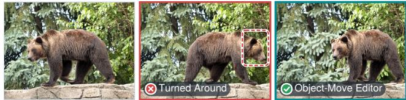  
Change Season: “Change the scene to look like it’s set in winter with snow visible outside the window”

  
Deblur and Sharpen: “Sharpen the image to make the bears and the grassy field look crisper and less blurry”

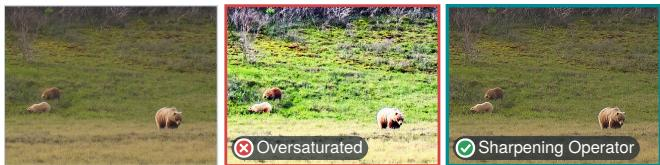  
Figure S1. Diagnostic sets in which only the specialized candidate is usable (✓). The general editor turns the bear around, puts the snow on the TV screen, and changes the saturation.

## B. Refine Sequentially or Search in Parallel

Requests. We sample 48 requests at each of the complexity levels 1, 4 and 8 from the real-image split of Complex-Edit [67], each with its own source image. A request at level k chains k atomic instructions, so the three levels range from a single edit to a long compound request.

Policies. Both policies use FLUX.2-klein-9B, Qwen3.8-27B as the VLM, and at most four images per request. Sequential refinement generates the first image from the source with the original instruction. After each of the first three images, it asks the VLM for a corrective request for the latest image and applies it to that image, and a final selection call picks among the four images (3 feedback calls and 1 selection call). Parallel search generates two images from the source with the original instruction. If the VLM accepts neither, it revises the instruction and generates two more images from the source before a final selection, using at most two VLM calls. The VLM sees the source, the candidate images and their difference maps, in a shared random order. Sequential refinement re-edits the latest image, as iterative editing agents commonly do, whereas the retries of EditAgent re-edit the source of the step with a revised instruction (Sec. D).

Human Study. Five professional Photoshop editors view the final images of the policies blindly, next to the source and the request, in random positions and without labels, and assess instruction following, preservation of unrelated content, and artifacts. For each comparison of parallel search with sequential refinement, the editors either choose the better policy or mark the two as equal. Parallel search is preferred in 102 comparisons and sequential refinement in 28, with 14 ties, so parallel search wins 78.5% of the 130 comparisons in which the editors prefer one policy. Cost. With at most four images per request for both policies, parallel search needs at most two VLM calls per request, and sequential refinement always needs four.

Table S1. The 30 edit types of the diagnostic benchmark and the definitions given to the instruction writer. Each type has 20 sets. Genera counts the sets with at least one usable general-editor candidate from either run, and Hit@1 counts the sets used for Winner-Set Hit@1.
<table><tr><td>Group</td><td>Edit Type</td><td>Definition</td><td>General Hit@1</td><td></td></tr><tr><td rowspan="10">Content</td><td>Add Text</td><td>add readable text/writing/signage somewhere it fits naturally</td><td>19</td><td>19</td></tr><tr><td>Remove Text</td><td>remove existing text/logo/signage (only if some is visible)</td><td>15</td><td>15</td></tr><tr><td>Replace Text</td><td>replace visible text with different text (only if text is visible)</td><td>14</td><td>15</td></tr><tr><td>Change Text Style</td><td>change color/font/size/style of visible text</td><td>9</td><td>12</td></tr><tr><td>Add Object</td><td>add a new object/animal/person that fits the scene</td><td>18</td><td>18</td></tr><tr><td>Remove Object</td><td>remove an existing object/person/animal</td><td>15</td><td>17</td></tr><tr><td>Replace Object</td><td>swap one object for a different one</td><td>16</td><td>16</td></tr><tr><td>Move Object</td><td>move an existing object/subject to a different position in the same scene</td><td>6</td><td>11</td></tr><tr><td>Change Object Appearance</td><td>change an object&#x27;s color/material/texture/state (not swap it)</td><td>17</td><td>19</td></tr><tr><td>Create Line Art</td><td>turn the photo into a clean line/edge drawing or pencil sketch of itself</td><td>20</td><td>20</td></tr><tr><td rowspan="3">Style &amp; Effects</td><td>Apply Style</td><td>apply a named artistic style or photographic look to the whole image</td><td>20</td><td>20</td></tr><tr><td>Apply Blur</td><td>blur the background or the whole image (e.g. bokeh, motion blur)</td><td>17</td><td>17</td></tr><tr><td>Convert Color Mode</td><td>colorize (if grayscale) or convert to black &amp; white / grayscale</td><td>16</td><td>18</td></tr><tr><td rowspan="5">Scene</td><td>Replace Background</td><td>replace the background/scene behind the subject</td><td>18</td><td>18</td></tr><tr><td>Change Time of Day</td><td>change the time of day (e.g. day to night, sunset)</td><td>16</td><td>16</td></tr><tr><td></td><td>Change Background Appearance change an attribute of the background only</td><td>15</td><td>15</td></tr><tr><td>Change Season</td><td>change the season (e.g. summer to winter)</td><td>13</td><td>14</td></tr><tr><td>Change Color Tone</td><td>shift the overall color tone (warmer/cooler/teal-orange/color grade)</td><td>2</td><td>18</td></tr><tr><td rowspan="4">Photometric</td><td>Change Lighting</td><td>change the lighting (e.g. golden hour glow, harsh noon, soft studio)</td><td>13</td><td>17</td></tr><tr><td>Adjust Saturation</td><td>increase or decrease color saturation</td><td>11</td><td>20</td></tr><tr><td>Adjust Brightness</td><td>brighten or darken the whole image noticeably</td><td>9</td><td>16</td></tr><tr><td>Adjust Contrast</td><td>increase or decrease global contrast</td><td>7</td><td>19</td></tr><tr><td rowspan="6">Geometry</td><td>Change Viewpoint</td><td>change the camera viewpoint/angle (e.g. eye-level to low angle)</td><td>11</td><td>14</td></tr><tr><td>Zoom In</td><td>zoom in / crop closer onto a named target</td><td>11</td><td>18</td></tr><tr><td>Zoom Out</td><td>zoom out / widen the view, generating new surroundings (outpaint)</td><td>5</td><td>16</td></tr><tr><td>Flip Horizontally</td><td>mirror/flip the image horizontally</td><td>1</td><td>20</td></tr><tr><td>Extend Canvas</td><td>extend the canvas beyond the current frame on one or more sides</td><td>0</td><td>18</td></tr><tr><td>Rotate Image</td><td>rotate the image (e.g. 90 degrees or a slight straighten)</td><td>0</td><td>20</td></tr><tr><td rowspan="2">Enhancement</td><td>Denoise and Restore</td><td>restore/clean the photo (denoise, remove scratches, fix exposure)</td><td>8</td><td>19</td></tr><tr><td>Deblur and Sharpen</td><td>sharpen / deblur the image</td><td>2</td><td>20</td></tr><tr><td>Total</td><td></td><td></td><td>344</td><td>515</td></tr></table>

## C. Observation Space

Protocol. The judges of Sec. 3.4 are the reward models with their released inference and Qwen3.8-27B with the pointwise judge, ranked by the probability of its pass verdict. They score each candidate separately, and tied top-scoring candidates share the credit. The listwise judge uses the instructions of Listing 6 and receives the request, the source image and all candidates of a set in one call. The pointwise judge uses the same instructions for a single candidate. The candidate order of each set is fixed across conditions and models and shifts cyclically by one position per run.

Records in These Studies. The studies use the verification records of Sec. F (Tab. S6), computed for the labeled candidates of each set. For a localized request, the region that the request names is localized once in the source image, and every candidate gets a close-up of this region.

Models and Inference. Figure 5 lists the VLMs and reward models. Each VLM is served with vLLM [22] from its released checkpoint and judges every set three times, with thinking enabled and the sampling settings of its generation configuration. A call without a valid answer counts as a miss. EditScore uses its released inference over three runs. EditReward-7B uses its released deterministic scorer in one run. In the benchmark experiments, every VLM role uses the settings of Tab. S3.

Metrics. CLIP-I [44], used in Sec. 3.4 of the main paper, is the cosine similarity between the CLIP ViT-L/14 image embeddings of the source and the candidate.

What Records Contribute. Records improve each of the seven VLMs of Fig. 5, by 6.3 to 9.3 points, and raise their mean Winner-Set Hit@1 from 71.17% to 79.25%. On the 396 sets with at least one unusable candidate, the mean rises from 62.60% to 73.06%, against 47.10% for a random choice. The gain is largest on Enhancement, Photometric and Scene edits (40.7, 20.5 and 9.5 points on average).

Table S2. Roles in EditAgent. In the benchmark experiments and in the runs that produced the diagnostic candidates, every VLM role uses Qwen3.8-27B with the settings of Tab. S3. The data engine uses Qwen3.8-27B as the judge (Sec. H).
<table><tr><td>Role</td><td>Model</td><td>Input</td><td>Output</td><td>Prompt</td></tr><tr><td>Planner</td><td>VLM</td><td>Request of the turn, the version graph and the carried requirements</td><td>Goal and ordered steps, each with its operation, target, regions to keep, parameters and new requirements</td><td>Listing 1</td></tr><tr><td>Analyzer</td><td>VLM</td><td>One step, source image of the step, carried requirements, feedback on earlier attempts, reports of earlier steps, parameter documentation of</td><td>Explicit instruction stating what changes and what stays, operation, target, regions to keep, parameters, acceptance criteria, candidate count</td><td>Listing 3</td></tr><tr><td>Router</td><td>Code</td><td>the applicable methods Analyzed step</td><td>Methods, each contributing at least one candidate (Tab. S4)</td><td>None</td></tr><tr><td>Grounder</td><td>VLM and SAM 2.1</td><td>Image and a referring expression</td><td>One box per referred object in coordinates normalized to [0, 1000], refined into a mask by SAM 2.1 and</td><td>Listings 4 and 5</td></tr><tr><td>Editing Methods</td><td>Tab. S5</td><td>Source image of the step, instruction, target, parameters</td><td>reviewed by the VLM Candidate image and its execution artifacts, such as a mask</td><td>None</td></tr><tr><td>Judge</td><td>VLM</td><td>Request of the step with its scope, acceptance criteria and regions to keep, source image, and all candidates with their verification</td><td>A note, a pass/fail verdict and a score from 1 to 10 for every candidate, then the best candidate and a ranking</td><td>Listing 6</td></tr><tr><td>Re-Planner</td><td>VLM</td><td>Request, finished steps with reports, failed step with the feedback on all</td><td>New remaining steps, or none to keep the best attempt</td><td>Listing 7</td></tr><tr><td>History Check</td><td>VLM</td><td>its attempts, pending steps Original image, results of earlier turns, current image, then-and-now close-ups, requirements established</td><td>For each earlier turn a verdict (still holds or superseded), score, confidence and evidence, and a repair instruction when needed</td><td>Listing 8</td></tr></table>

EditReward-Bench. We use the EditReward-Bench of EditScore [35], which is distinct from the EditReward model [65]. It has 3,072 human-labeled candidate pairs over 13 task types, with preferences for prompt following, consistency and overall quality, of which Tab. 1 reports overall quality. A pair counts as correct when the human-preferred candidate ranks higher, and a tie counts as wrong. The pointwise column of Tab. 1 uses the official prompt of the benchmark, which gives each candidate an integer score. The listwise judge shows both candidates in one call and uses the rubric and output format of Listing 6, without records. Every VLM runs three times.

## D. Agentic Workflow Details

This section details the control flow of EditAgent summarized in Secs. 4 and 4.3 of the main paper. It gives the roles and what each receives (Tab. S2), the turn and step loops (Algorithms 1 and 2) and the default settings (Tab. S3).

State. EditAgent stores each session as a version graph. Every node holds one image state together with its parent, the step that produced it, its candidates, the judge’s report, and whether it needs review. Accepted states are never modified.

A later step adds a child node, and a user correction branches from the parent, so every accepted state remains available. The requirements that an accepted state satisfies, such as the requested change and the regions that had to stay, are carried into the prompts of the planner, the analyzer and the history check in later steps and turns.

Turn. Algorithm 1 runs one user turn. The planner decides the number and order of the steps (Listing 1), and each step starts from the state accepted by the previous step. When a step uses up its attempts, the re-planner either replaces the failed and pending steps or keeps the best attempt, which is then marked as needing review. After the turn, the history check verifies every earlier turn against the current image. On a confident violation, EditAgent runs one repair turn and keeps its result only if the judge accepts it.

Step. Algorithm 2 runs one step. The analyzer rewrites the step into an explicit instruction for a mask-free editor, stating both the requested change and what must remain, sets the parameters of the applicable methods, and suggests how many candidates the step needs. The router selects the methods (Tab. S4), each of which contributes at least one candidate. Every candidate receives a verification record, candidates that fail a code check are removed, and the judge compares the remaining candidates in a single call, in a shuffled order. An accepted candidate becomes the new state. Otherwise, the judge’s feedback is passed back to the analyzer, which revises the step for the next attempt.

Table S3. Default settings of EditAgent, used in all benchmark experiments and in the data engine (EdiVal images at 512<sup>2</sup> px).
<table><tr><td>Setting</td><td>Value</td></tr><tr><td>Candidates per Attempt</td><td>at most 3</td></tr><tr><td>Attempts per Step</td><td>3</td></tr><tr><td>Re-Plans per Turn</td><td>2</td></tr><tr><td>Repairs per Turn</td><td>1</td></tr><tr><td>Repair Confidence</td><td>at least 0.4</td></tr><tr><td>Seed of Candidate j in Attempt a</td><td> $3 2 + 7 a + j$ </td></tr><tr><td>Working Size, Multiple of 32 px</td><td>at most 10242 px</td></tr><tr><td>Earlier Results Shown to History Check</td><td>at most 5</td></tr><tr><td>Close-Ups for History Check</td><td>at most 4</td></tr><tr><td>Mask Dilation for Masked Edit</td><td>24px</td></tr><tr><td>Feather for Masked Edit</td><td>6px</td></tr><tr><td>Mask Dilation for Masked Recolor</td><td>8px</td></tr><tr><td>Feather for Masked Recolor</td><td>4px</td></tr><tr><td>VLM Temperature</td><td>0.2</td></tr><tr><td>VLM Output Tokens</td><td>at most 4,096</td></tr><tr><td>VLM Context Length</td><td></td></tr><tr><td>Images per VLM Request</td><td>16,384 tokens</td></tr><tr><td>Thinking</td><td>at most 20</td></tr><tr><td></td><td>disabled</td></tr><tr><td>Output Format</td><td>JSON</td></tr><tr><td>Grounding Coordinates</td><td>[0, 1000]</td></tr><tr><td>Segmentation</td><td>SAM 2.1</td></tr><tr><td>Mask Reviews per Target</td><td>at most 2</td></tr></table>

Acceptance. The judge returns one JSON object (Listing 6) with a short note, a pass/fail verdict and a score from 1 to 10 for every candidate, followed by the best candidate and a complete ranking. Only the judge can accept a candidate. The step accepts the best candidate when the judge passes it, and otherwise passes the notes back to the analyzer as feedback for the next attempt.

Robustness. A method that fails, for example because grounding finds no target, loses only its own candidate, and a step that never produced a candidate leaves the state unchanged. EditAgent keeps the best candidate across the attempts of a step.

## E. Routing

Routing Rules. The router is deterministic code (Sec. 4.1 of the main paper). It turns the recommendation of the planner and analyzer, that is, the operation, target, executor and parameters of a step, into the methods of Tab. S4, which Tab. S5 describes. Every masked method is raced against the general editor, so the judge can fall back to the general editor when a mask is imperfect.

Table S4. Methods raced for each kind of step, with the operation that the planner and analyzer assign to it.
<table><tr><td>Step</td><td>Operation</td><td>Methods</td></tr><tr><td>Remove a target</td><td>remove</td><td>General Editor Removal Specialist</td></tr><tr><td>Recolor a target</td><td>recolor</td><td>General Editor Masked Recolor</td></tr><tr><td>Restyle a target</td><td>restyle</td><td>General Editor Masked Local Editor</td></tr><tr><td>Replace or add an object</td><td>replace, add</td><td>General Editor</td></tr><tr><td>Move a target</td><td>move</td><td>General Editor</td></tr><tr><td>Resize a subject</td><td>scale_subject</td><td>Move Specialist General Editor Subject Scaling</td></tr><tr><td>Whole-frame tone, color or sharpness</td><td>relight, generic</td><td>General Editor Photometric Operator</td></tr><tr><td>The same, in a target</td><td>relight, generic</td><td>General Editor Local Photometric</td></tr><tr><td>Other relighting or harmonization</td><td>relight, harmonize</td><td>Operator General Editor</td></tr><tr><td>Named filter look</td><td>filter</td><td>General Editor Style Filter</td></tr><tr><td>Named tone grade</td><td>filter</td><td>Style Filter</td></tr><tr><td>Named artist (reference painting)</td><td>filter</td><td>General Editor</td></tr><tr><td>Sketch, line art,</td><td></td><td>Neural Style Transfer Multi-Reference Editor</td></tr><tr><td>edge map</td><td>filter</td><td>General Editor Neural Style Transfer</td></tr><tr><td>Flip, or rotation by a stated amount</td><td>flip, rotate</td><td>Flip and Exact Rotation</td></tr><tr><td>Rotation toward a level or plumb goal</td><td>rotate</td><td>General Editor</td></tr><tr><td>Zoom in</td><td>zoom_in</td><td>Rotation Tool Zoom-In Crop</td></tr><tr><td>Zoom out or</td><td>zoom_out</td><td>General Editor</td></tr><tr><td>outpaint</td><td></td><td>Canvas Extension</td></tr><tr><td>Camera viewpoint</td><td>camera_view</td><td>General Editor</td></tr><tr><td></td><td></td><td></td></tr><tr><td>change Any other request</td><td>generic</td><td>General Editor</td></tr></table>

## F. Verification Records

Definition. A verification record holds, for one candidate, the checks that code runs on its pixels (Sec. 4.2 of the main paper). These are the share of visibly changed pixels, a change map, a close-up of the region that the request names, the measurements that the step calls for (Tab. S6), and the outcomes of code checks, which state what code has verified and what remains for visual judgment. Every record is computed in the same way from the source image and the candidate, and it names no method. What code cannot decide, such as whether an edit looks real, the judge assesses from the photographs (Listing 6).

Close-Up. For a localized step, the grounder names the region of the source image that the request refers to, such as “the man’s shirt” or “the sky behind the house”, and localizes it once, with a VLM box refined by SAM 2.1 and reviewed. Every candidate then gets a BEFORE | AFTER close-up of this same region, both halves at a height of 448 px, so that all candidates are inspected at the same place and scale, whichever method produced them.

Table S5. Methods of the capability pool, each with its backend, the claims established by code or by construction, and what is left to the judge. A candidate that breaks its guarantee is removed before judging, and the record of each remaining one carries both columns (Sec. F).
<table><tr><td>Method</td><td>Backend</td><td>Established by Code or Construction</td><td>Left to the Judge</td></tr><tr><td>General Editor</td><td>The backbone (FLUX.2-klein-9B or Qwen-Image-Edit-2511) edits the whole frame.</td><td>None</td><td>Requested change, preservation, realism.</td></tr><tr><td>Masked Local Editor</td><td>Target mask from grounding, SAM 2.1 [46] and VLM review. The general editor edits the frame, and only its pixels inside the dilated and</td><td>Unchanged outside the feathered mask (code).</td><td>Requested look in the mask, seam realism.</td></tr><tr><td>Masked Recolor Removal Specialist</td><td>feathered mask are kept. As above, with a tighter mask OSOR [80] with the reviewed target mask,</td><td>Unchanged outside the feathered mask (code). Canvas size unchanged (code).</td><td>Requested color, coverage, seam. Target and attached parts removed, background</td></tr><tr><td>Move Specialist</td><td>whose output is used directly. A diffusion transformer trained for object movement, conditioned on the source mask and</td><td>None</td><td>reconstructed, neighbors and supports kept. Object gone from its origin, same object at the destination, size consistent with depth, blending.</td></tr><tr><td></td><td>a destination box designed by the VLM. Pixels outside the source and destination regions are restored from the source. Reviewed mask, ViTMatte [69] alpha matte, uniform rescaling anchored at the feet,</td><td>Every pixel outside the old and new subject and Size change in the requested direction, its shadow equals the source (code). No</td><td></td></tr><tr><td>Photometric Operator</td><td>refines the composite with the general editor. Closed-form brightness, contrast, saturation and color-temperature adjustments in CIELAB, and</td><td>Canvas size unchanged, and every requested statistic moves in its direction (code).</td><td>Amount fits the wording, no other change.</td></tr><tr><td>Local Photometric Operator</td><td>an unsharp mask for sharpening. The same, inside the feathered mask</td><td>Unchanged outside the feathered mask (code).</td><td>As above, and the scope matches the wording.</td></tr><tr><td>Style Filter</td><td>25 deterministic color grades, photographic filters and drawing styles.</td><td>Canvas size unchanged (code).</td><td>The requested look.</td></tr><tr><td>Neural Style Transfer</td><td>Style transfer [13] with VGG-19 [53] features from a public-domain reference painting.</td><td>None</td><td>Style visible, content recognizable.</td></tr><tr><td>Multi-Reference Editor</td><td>The general editor with the reference painting as a second input image.</td><td>None</td><td>Style visible, content recognizable.</td></tr><tr><td>Flip and Exact Rotation</td><td>Index reversal for flips and index permutation for rotations by multiples of 90°. Other stated</td><td>For flips and multiples of 90°, the output is the exact pixel permutation of the source (code).</td><td>Direction, and the amount for other angles.</td></tr><tr><td>Rotation Tool</td><td>angles are resampled and cropped to the largest rectangle without empty corners. For a level or plumb goal, the angle comes from the dominant long lines (length-weighted median of Hough segments within 25° of level</td><td>Interior resampled from the source, generation confined to the border ring (construction).</td><td>Tilt direction and amount, corners.</td></tr><tr><td></td><td>FLUX.1-Fill [23] generates a border ring, the extended frame is rotated at native scale, and the original window is cropped back. A crop centered on the grounded target,</td><td>The zoom factor exceeds 1 and the crop is</td><td></td></tr><tr><td>Canvas Extension</td><td>upsampled with Swin2SR [8] and resized back. The source is placed on a larger canvas whose</td><td>smaller than the source (code). No editing model runs (construction). The reported window places the source inside</td><td></td></tr></table>

Change Map. The change map shows where and how strongly each candidate differs from the source, on one fixed scale for all candidates, so that the judge can compare the extent of the changes across candidates. It is not a photograph, and the judge does not assess color or realism from it.

Measurements. The visible change counts the pixels whose CIELAB color differs from the source visibly (∆E > 8), after a light blur that suppresses compression noise. For sharpening, deblurring, denoising and blur requests, no blur is applied, since these edits change exactly the fine detail that a blur would hide. The other measurements depend on the operation of the step (Tab. S6), such as the brightness, clipping and color shift in Fig. 4(b) of the main paper.

Code Checks. Each method also declares what it guarantees by construction or verifies by code, such as unchanged pixels outside its mask or an exact pixel permutation for a flip (Tab. S5). A candidate that fails such a check is removed before judging. The record of every remaining candidate lists the checks it passed under VERIFIED and what code cannot decide under TO JUDGE.

Presentation. The judge receives one message with the instructions of Listing 6, the request of the step with its acceptance criteria and regions to keep, whether the step is localized or global, the images and the text of the records. The images are BEFORE and then each candidate TRIAL n with its change map and, for a localized step, its close-up. The text gives, for each candidate, the visible change, the measurements and the VERIFIED and TO JUDGE lines. For photometric steps, the line of the source comes first, and

Table S6. Measurements of the verification record, chosen by the operation of the step. Code computes them from the pixels in the same way for the source and every candidate. The change map and the close-up are images, and every other measurement is one line of text per image.
<table><tr><td>Measurement</td><td>Used For</td><td>Definition</td><td>Shown to the Judge</td></tr><tr><td>Visible Change</td><td>Every step</td><td>Share of pixels whose CIE76 color difference ∆E to the source exceeds 8, after a Gaussian blur with of the frame&quot; for a small local edit. σ = 1 px of both images (no blur for detail edits).</td><td>One value per candidate, e.g. “visible change 4.2%</td></tr><tr><td>Change Map</td><td>Every step</td><td>Per-pixel ∆E to the source, shown as brightness on one scale shared by all candidates.</td><td>An image per candidate, black where a pixel is unchanged and brighter where it differs more. The region that the request names, localized once in A BEFORE I AFTER image per candidate, at the</td></tr><tr><td>Close-Up</td><td>Localized steps</td><td>the source. The crop pads its box by 30% of its size same place and scale for all. and covers at least 30% of the frame on each axis. Brightness is the mean CIELAB L* /100 and contrast the standard deviation of L*/100.</td><td>One line for the source and one per candidate, e.g.</td></tr><tr><td></td><td></td><td>Saturation is the mean chroma  ${ \sqrt { a ^ { * 2 } + b ^ { * 2 } } } .$  Clipped highlights and crushed shadows are the shares of pixels whose brightest channel is at least 250 or at most 5, and color shift is the change of mean a* and b*.</td><td>“brightness 0.62, contrast 0.24, saturation 18.3, clipped 2.1%, color shift  $a ^ { * } + 0 . 3 b ^ { * } + 6 . 8 ^ { \prime \prime }$ </td></tr><tr><td></td><td>Sharpness and Noise Sharpening, denoising, blur</td><td>luminance, with both images downsampled to a common size, and for a localized step also the sharpness inside the target relative to the source.</td><td>Variance of the Laplacian and the noise level of the Ratios to the source, e.g. “sharpness × 1.84, noise ×0.71&quot;for a sharpened candidate.</td></tr><tr><td>Structure Kept</td><td>Global edits that keep the layout</td><td>candidate over the frame. Correlation of the candidate with the unchanged</td><td>Mean luminance SSIM between the source and the One value per candidate, where 1 means identical structure and lower values mean more change. The correlations per candidate, from —1 to 1.</td></tr><tr><td>Orientation Match</td><td>Flips and rotations</td><td>source and with the source mirrored left-right or top-bottom or rotated by 90°, 180° or 270°.</td><td></td></tr><tr><td>Framing</td><td>Zooming, canvas extension</td><td>Multi-scale template matching locates the candidate&#x27;s view in the source (zoom in) or the source in the candidate (zoom out and extension).</td><td>Magnification and match score per candidate.</td></tr></table>

a short definition of each number follows.

## G. Benchmark Experiments

Backbones. Each backbone uses the same checkpoint and sampler with and without EditAgent. Qwen-Image-Edit-2511 runs 40 steps with CFG 4 in BF16, and FLUX.2-klein-9B uses its distilled 4-step sampler. Within EditAgent, the backbone is the general editor. It therefore also runs inside the masked methods, the refinement and harmonization of Subject Scaling, the Multi-Reference Editor and the fill of Canvas Extension, which all call the general editor. OSOR, FLUX.1-Fill for the rotation ring and the outpainting fallback, Swin2SR, neural style transfer and the closed-form operators are the same for all backbones. The prompts are used unchanged with every backbone.

Inputs. EditAgent and the standalone backbones receive the same original benchmark instructions, EditAgent plans internally, and all scoring uses the original benchmark annotations. Standalone backbones use seed 42, and seeds 42, 43 and 44 for the three EdiVal turns.

Scoring. EdiVal is scored with its released code and its released evaluators GroundingDINO [32], Qwen2-VL-7B [59] and DINOv3 [52], all unchanged. Its instruction following is cumulative, so a session passes turn t only if the instruction of every turn up to t is fulfilled by the output of that turn. EdiVal-O is the geometric mean of instruction following and content consistency. On Complex-Edit [67], Qwen3.8-27B replaces GPT-4o in the official prompts. Instruction following and identity preservation are rated from the source and the output with the official rubric, and perceptual quality from the output alone, each averaged over five samples on a scale from 0 to 10. The overall score is the mean of the three dimensions. The 8,496 requests comprise 531 instruction chains in each of the real and synthetic splits, at eight complexity levels. On ComplexBench-Edit [57], Qwen3.8-27B replaces Gemini 2.0 Flash Thinking and rates each atomic instruction from the source and the output with the official rubric of its edit type. With atomic scores a, b and c in [0, 1], parallel requests score $( a + b + c ) / 3$ , two-step chains $( a b + c ) / 2$ and three-step chains abc, reported ×100. The reported average is the mean over its five groups of requests in Tab. 4, from single-object edits to three-step chains.

Agentic Baselines. Table S7 lists how each agent of Tab. 5 is run. All agents edit through one service that runs the standalone backbone with its recipe, so they differ only in their policy. A masked or inpainting tool becomes a backbone edit composited inside a SAM 2.1 mask. Each agent receives the original EdiVal instruction of the current turn and edits its own previous output. Attempt a of turn t uses seed $4 2 + 1 0 0 a + t - 1$ , so a first attempt uses the seed of the standalone backbone. The standalone rows of Tabs. 3 and 5 come from the same service, so all agents are compared against one standalone result of each backbone.

Algorithm 1 One turn of EditAgent. G is the version graph,   
$x _ { 0 }$ the original image, $x _ { 1 : t - 1 }$ the results of the earlier turns   
and $r _ { 1 : t }$ the requests of turns 1 to t.   
Require: head state x, requests $r _ { 1 : t } ,$ carried requirements C   
1: $P \gets \mathrm { P L A N } ( r _ { t } , \mathcal { G } , C )$ ▷ ordered steps   
$\because i  1 ; m  0$ ▷ m counts the re-plans   
3: while $i \le | P |$ do   
4: $( o , y , \dot { F } ) \gets \mathrm { S T E P } ( P _ { i } , x , C , l a s t = [ m = 2 ] )$   
5: if o = exhausted then ▷ only when $m < 2$   
6: $m \gets m + 1 ; P ^ { \prime } \gets \mathrm { R E P L A N } ( r _ { t } , P _ { < i } , P _ { i } , F , P _ { > i } , C )$   
7: if $P ^ { \prime } = \varnothing$ then ▷ keep the best attempt   
8: $x \gets y ,$ marked needs review   
9: $C \gets \mathbf { C A R R I E D } ( x ) ; i \gets i + 1$   
10: else   
11: $P  P _ { < i } \oplus P ^ { \prime }$ ▷ $P _ { 1 } ^ { \prime }$ inherits F   
12: end if   
13: else if $o = \mathtt { r o l }$ lback then   
14: $i \gets i + 1$   
15: else ▷ o is accepted or advanced   
16: $x  y ; C  \mathrm { C A R R I E D } ( x ) ; i  i + 1$   
17: end if   
18: end while   
19: if t > 1 then   
20: h ← HISTORY $( x _ { 0 } , x _ { 1 : t - 1 } , x , r _ { 1 : t } , C )$   
21: if h has a violation with confidence $\geq 0 . 4$ 4 and a repair then   
22: $x \gets \mathrm { R E P A I R } ( h . r e p a i r , x )$ ▷ at most once   
23: $h \gets \mathrm { H I S T O R Y } ( x _ { 0 } , x _ { 1 : t - 1 } , x , r _ { 1 : t } , C )$ ▷ recorded   
24: end if   
25: end if   
26: return x

Table S7. How each agentic baseline of Tab. 5 of the main paper is run. Every agent edits with the same backbone and uses Qwen3.8- 27B wherever it calls a multimodal LLM. <sup>†</sup>Re-implemented.
<table><tr><td>Agent</td><td>How It Is Run</td></tr><tr><td>GenArtist†</td><td>Official prompts. The unreleased editing loop is re-implemented, and its tools become</td></tr><tr><td>MIRA†</td><td>backbone edits, masked for local tools. Trained policy model not released. The planning loop of the paper runs zero-shot, with Qwen3.8-27B serving as its policy</td></tr><tr><td>IMAGAgent</td><td>model. Released code and prompts, with closed models replaced by Qwen3.8-27B and the backbone, and inpainting by masked edits.</td></tr><tr><td>EditThinker-8B VisionDirector-TF†</td><td>Released code and 8B thinker. Trained planner not released. A training-free</td></tr><tr><td>RISE-Agent</td><td>loop uses the released verifier prompt and runs local goals as masked edits. Released code, with Qwen3.8-27B as</td></tr><tr><td>EditThinker (Qwen3.8-27B)</td><td>planner and verifier and without web search. Released code in its training-free mode, with</td></tr></table>

Algorithm 2 One step of EditAgent. π is a shuffled presen  
tation order and $y _ { \mathrm { b e s t } }$ the best candidate over all attempts.   
Require: step s, source state $x ,$ carried requirements C, flag last   
1: F ← feedback inherited from a replaced step, if any   
2: for attempt $a = 0 , 1 , 2$ do   
3: q ← ANALYZE $( s , C , F )$ ▷ instruction and parameters   
4: $R \gets \mathrm { R o u T E } ( q )$ ▷ Tab. S4   
5: generate up to 3 new candidates, ≥ 1 per method in R   
6: Y ← candidates that pass every code check, with records   
7: i $\ i Y = \emptyset$ then   
8: $F  F \cup$ {no candidate}; continue   
9: end if   
10: $J \gets \mathrm { J U D G E } ( q , x , \pi ( Y ) )$ ▷ one VLM call   
11: if J passes its best candidate $y ^ { * }$ then   
12: return (accepted, $y ^ { * } , F )$   
13: end if   
14: $F \gets F \cup \{ J . n o t e s \}$ ▷ feedback for the next attempt   
15: end for   
16: if no attempt produced a candidate then   
17: return $( \mathtt { r o l 1 b a c k } , x , F )$   
18: else if last then   
19: return (advanced, $y _ { \mathrm { b e s t } } , F )$ ▷ needs review   
20: end if   
21: return (exhausted, $y _ { \mathrm { b e s t } } , F )$

Table S8. EditAgent with Qwen3.8-27B or Gemma-4-31B as its internal judge, under unchanged external scoring. The columns are EdiVal-O at turns $1 / 2 / 3 ,$ the ComplexBench-Edit average (CBE) and the Complex-Edit overall score (CE-O).
<table><tr><td>Model</td><td>EdiVal-O</td><td>CBE</td><td>CE-O</td></tr><tr><td>Qwen-Image-Edit-2511</td><td>75.97 / 58.58 / 47.64</td><td>54.40</td><td>7.371</td></tr><tr><td>+ EditAgent (Qwen3.8-27B)</td><td>80.64 / 67.02 / 55.46</td><td>60.83</td><td>7.445</td></tr><tr><td>+ EditAgent (Gemma-4-31B)</td><td>80.34 / 66.28 / 54.17</td><td>60.53</td><td>7.457</td></tr><tr><td>FLUX.2-klein-9B</td><td>81.37 / 66.30 / 53.20</td><td>61.45</td><td>7.677</td></tr><tr><td>+ EditAgent (Qwen3.8-27B)</td><td>84.46 / 71.10 / 59.45</td><td>64.51</td><td>7.713</td></tr><tr><td>+ EditAgent (Gemma-4-31B)</td><td>85.17 / 71.64 / 60.25</td><td>63.44</td><td>7.715</td></tr></table>

Alternative Internal Judge. With Gemma-4-31B as the internal judge, EditAgent improves every backbone on all three benchmarks (Tab. S8).

Route Usage. Specialized methods deliver 19% to 31% of the accepted steps, depending on the backbone and the benchmark (Tab. S9). Masked edits and object removals are the most frequent specialist wins.

## H. Data Engine

Sources and Requests. Source images are real photographs from the training split of Open Images [21]. Qwen3.8-27B writes the multi-turn requests. It screens each photograph for readable text, separable objects, grayscale content and people, assigns it a session of 3 to 5 distinct edit types from the 30 types of Tab. S1 that the photograph supports, writes one instruction per type, turn by turn, each referring to the result of the previous turn, and checks each session against

Table S9. Accepted steps by method for each backbone and benchmark (% of the accepted steps on the final edit chain of each request). Masked Local Editor and Masked Recolor run the backbone inside a mask. Removal Specialist, Photometric Operators (whole-frame and local) and Style Filter do not use the backbone. Zoom and Other covers Zoom-In Crop, Canvas Extension, Flip and Exact Rotation, Rotation Tool and the two style-transfer methods.
<table><tr><td>Benchmark</td><td>Backbone</td><td>Masked Local Editor</td><td>Masked Recolor</td><td>Removal Specialist</td><td>Photometric Operators</td><td>Style Filter</td><td>Zoom and Other</td><td>General Editor</td><td>Accepted Steps</td></tr><tr><td rowspan="2">EdiVal</td><td>Qwen-Image-Edit-2511</td><td>9.2</td><td>6.7</td><td>8.1</td><td>0.0</td><td>0.0</td><td>0.6</td><td>75.4</td><td>1,253</td></tr><tr><td>FLUX.2-klein-9B</td><td>7.8</td><td>7.7</td><td>3.3</td><td>0.0</td><td>0.0</td><td>0.0</td><td>81.2</td><td>1,628</td></tr><tr><td rowspan="2">ComplexBench-Edit</td><td>Qwen-Image-Edit-2511</td><td>10.1</td><td>5.2</td><td>16.0</td><td>0.0</td><td>0.1</td><td>0.0</td><td>68.6</td><td>1,891</td></tr><tr><td>FLUX.2-klein-9B</td><td>8.3</td><td>5.3</td><td>7.2</td><td>0.0</td><td>0.0</td><td>0.0</td><td>79.2</td><td>2,246</td></tr><tr><td rowspan="2">Complex-Edit</td><td>Qwen-Image-Edit-2511</td><td>6.0</td><td>4.6</td><td>3.7</td><td>5.4</td><td>4.4</td><td>1.2</td><td>74.8</td><td>28,712</td></tr><tr><td>FLUX.2-klein-9B</td><td>4.8</td><td>4.7</td><td>1.8</td><td>4.5</td><td>3.6</td><td>1.1</td><td>79.5</td><td>33,224</td></tr></table>

Table S10. Data engine statistics by edit group over all 163,806 executed turns. Accepted is the share of turns accepted by the judge, and First the share whose steps are all accepted at the first attempt, without re-planning. Groups follow Tab. S1. Attempts and candidates are means per turn.
<table><tr><td colspan="2"></td><td rowspan="2">Accepted First (%)</td><td rowspan="2">(%)</td><td rowspan="2">Attempts</td><td rowspan="2">Candi- dates</td></tr><tr><td>Group</td><td>Turns</td></tr><tr><td>Content</td><td>46,675</td><td>94.1</td><td>79.6</td><td>1.58</td><td>4.06</td></tr><tr><td>Style &amp; Effects</td><td>22,864</td><td>94.6</td><td>82.0</td><td>1.58</td><td>4.03</td></tr><tr><td>Scene</td><td>28,595</td><td>92.2</td><td>70.4</td><td>2.23</td><td>5.15</td></tr><tr><td>Photometric</td><td>22,841</td><td>93.8</td><td>65.5</td><td>2.13</td><td>3.35</td></tr><tr><td>Geometry</td><td>31,390</td><td>83.3</td><td>69.6</td><td>2.56</td><td>5.29</td></tr><tr><td>Enhancement</td><td>11,441</td><td>89.9</td><td>63.8</td><td>2.59</td><td>4.63</td></tr><tr><td>All</td><td>163,806</td><td>91.4</td><td>73.3</td><td>2.03</td><td>4.42</td></tr></table>

its photograph.

Generation and Filtering. EditAgent executes each session turn by turn with the settings of Tab. S3 and FLUX.2-klein-9B as the general editor. Qwen3.8-27B serves as planner, analyzer, grounder and judge. Of the 40,726 executed sessions (163,806 turns), the judge accepts 91.4% of the turns (Tab. S10). Because a session is kept only if the judge accepts every one of its turns, 28,673 sessions (70.4%) pass this filter, and no kept session contains a result marked as needing review. After we also remove the 591 sessions that are both in the lowest 15% of quality and average more than two attempts per turn, the remaining 28,082 sessions, 69.0% of those executed, contain 111,755 turns.

Compute. Generation runs on nodes of 8 H200 GPUs. With speculative decoding (DFlash2 [1]), the 40,726 sessions take about 400 GPU-hours. Every 10,000 sessions take about 100 GPU-hours, and about 70% of them are kept as high quality. Training Pairs. Each kept session gives one training pair, made of the source image, one instruction for the whole session and the final image. A pair ends before the first turn that changes the image size and needs at least two applied edits. This gives 26,251 pairs with 3.9 edits per pair on average. Qwen3.8-27B composes the instruction from those of the delivered steps, resolving the final intent by dropping overridden or cancelled edits. The pairs are split by source image into 25,753 training and 498 validation pairs. The same pairs train the students for all three benchmarks.

Baseline Data. For the matched baseline, FLUX.2-klein-9B edits every turn of the same sessions directly with the original per-turn instructions, each turn on its own previous output, without planning or judging. Its pairs use the same kept sessions, split and instructions as the EditAgent pairs, with the final image taken from the FLUX.2-klein-9B chain, so the two datasets differ only in their images.

Finetuning. We finetune all transformer weights of FLUX.2- klein-base-9B (9.1B parameters) and Qwen-Image-Edit-2511 (20.4B), with the text encoder and VAE frozen, using DiffSynth-Studio [38] with DeepSpeed ZeRO-3 [45] in BF16 on 8 H200 GPUs. Training uses a global batch of 8 (one per GPU), AdamW [34] with a learning rate of $1 0 ^ { - 5 }$ for FLUX.2-klein-base-9B and $2 \times 1 0 ^ { - 6 }$ for Qwen-Image-Edit-2511 (after a five-update warm-up at one third of the rate), weight decay of 0.01 and 0.05, respectively, gradient clipping at 1.0, gradient checkpointing, images of up to $1 0 2 4 ^ { 2 }$ px at their native aspect ratio, and a fixed data order. Each model is trained for one epoch (3,220 steps). For evaluation, FLUX.2-klein-base-9B is sampled with 50 steps and CFG 4, and Qwen-Image-Edit-2511 with 40 steps and CFG 4. On EdiVal, the students and their untuned baselines receive rewritten instructions (Tab. 6).

## I. Additional Qualitative Results

Figures S2 to S7 compare more multi-turn and single-turn edits of EditAgent with the backbone alone. For every turn, each row shows the instruction, the output of the backbone and the output of EditAgent with the same backbone (teal frame). Red labels name the failure of the backbone output.

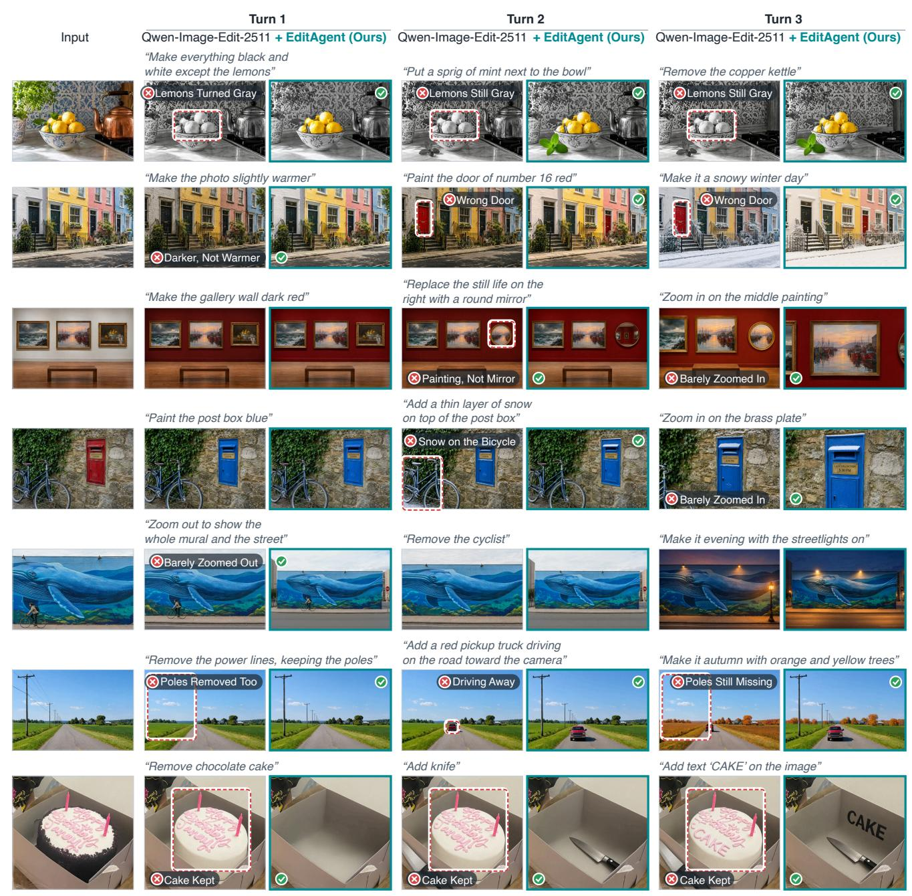  
Figure S2. Multi-turn editing comparison with Qwen-Image-Edit-2511.

Turn 1  
Turn 2  
Turn 3  
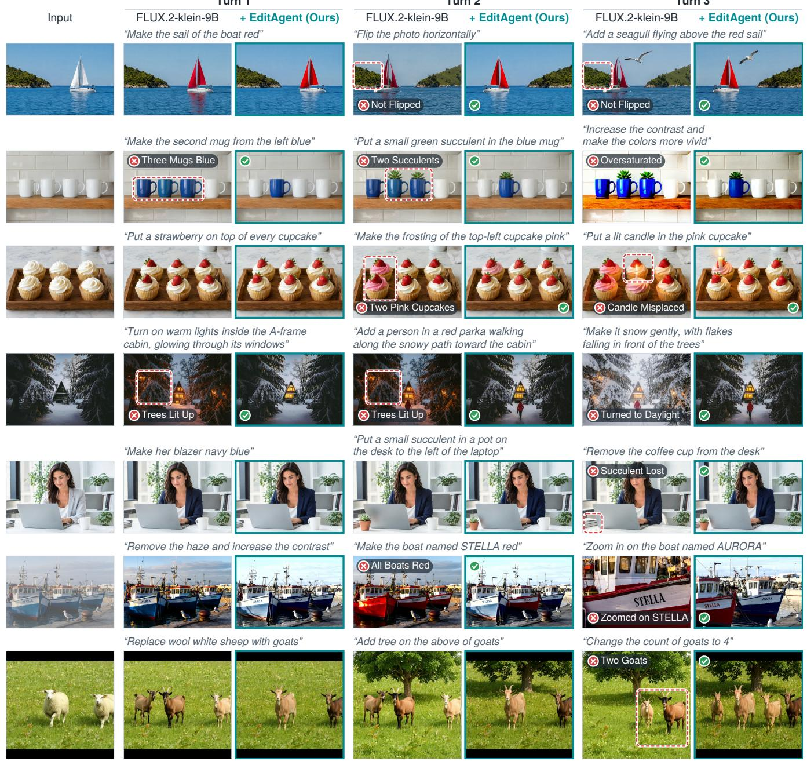  
Figure S3. Multi-turn editing comparison with FLUX.2-klein-9B.

\+ EditAgent (Ours)

Input

## Turn 1

## GPT-Image-2

  
“This photo is upside down. Rotate it 180 degrees”


  
“Zoom out to show the whole hotel facade”


  
“Zoom out to show the whole tower and the square”

  
GPT-Image-2

  
Turn 2  
“Make the train red”


  
“Remove the car parked in front”


  
“Let the cat have blue eyes”


  
“Add a red hot-air balloon in the sky”


  
“Let it be angry and hiss”


  
Figure S4. Multi-turn editing comparison with GPT-Image-2.


  
“Zoom in on the clock”

GPT-Image-2

“Make the marble bust look like weathered bronze with a green patina”


\+ EditAgent (Ours)


  
Stone, Not Bronze  
Bronze with Green Patina

  
“Make it night with the neon sign glowing”

  
“Zoom in on the station clock”  
GPT-Image-2  
“Put a pair of red sneakers on the floor in front of the mirror”


## Turn 3

## GPT-Image-2


  
No Reflection  
Reflection in the Mirror

  
Original Camel Changed  
“Move the lamp to the other side of the mug”


  
+ EditAgent (Ours)  
Figure S5. Single-turn editing comparison with GPT-Image-2.  
Shadow Still Falls Right  
+ EditAgent (Ours)

  
Original Camel Kept

  
Shadow Now Falls Left

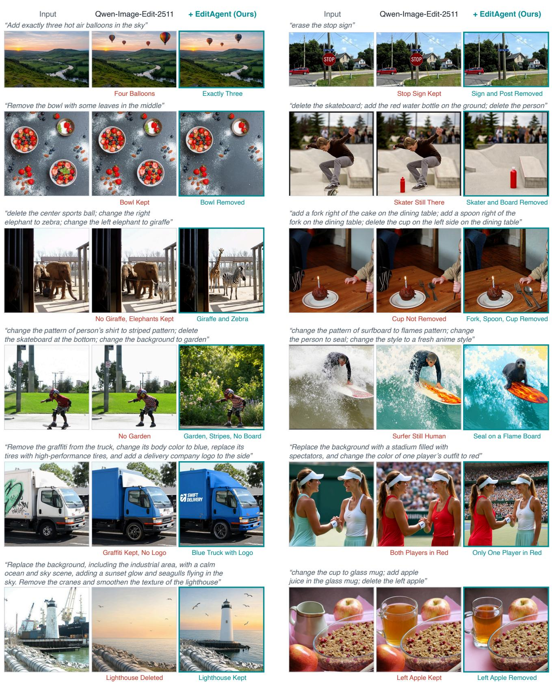  
Figure S6. Single-turn editing comparison with Qwen-Image-Edit-2511.

Input

“The photo is too dark. Lift the exposure so the faces are clearly visible”

  
FLUX.2-klein-9B

  
Darker, Not Brighter  
+ EditAgent (Ours)

  
Faces Clearly Visible  
“Mirror the image left to right”


  
Not Mirrored

  
Exact Mirror  
“Change the cat in mirror to a tiger”

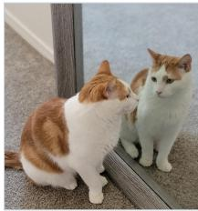

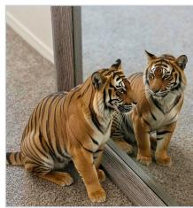  
Real Cat Also a Tiger

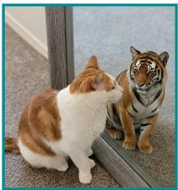  
Only the Reflection  
“Replace the squirrel with a hedgehog”


  
Tail Becomes a Hedgehog

  
One Hedgehog  
“Change the neon text to read ‘KEEP SWIMMING’”


  
Reads ‘KEREP NO SWIMMING  
“Move the biggest orange butterfly to the center of the image and change the time to evening”  
Reads ‘KEEP SWIMMING


  
Butterfly Duplicated

  
“Straighten the tilted horizon”  
Moved to the Center


  
FLUX.2-klein-9B

  
Still Tilted, Sun Erased  
+ EditAgent (Ours)

  
“Could you add a hat to the plushy, and change the color of rabbit to blue, and apply oil painting to image?”  
“Turn only the rightmost tulip purple”  
Level Horizon


  
All Five Turn Purple  
“delete the cat; delete the bench; change the background to lush garden”

  
Only the Rightmost Tulip  
Whole Photo Replaced


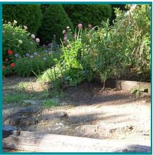


  
“Remove two of the ducks so that only three remain”  
Cat and Bench Removed


  
“Exclude the individual on the left side from the image”

  
Only One Duck Left  
Seated Person Loses Head  
Plush Toy Painted Blue  
Three Ducks Left

  
“Replace the bananas with a bunch of grapes and change the marble counter to a wooden table surface”  
Only the Left Person Removed

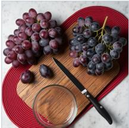

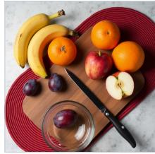  
All Fruit Turned to Grapes

  
Bananas to Grapes, Wooden Table  
Hat, Blue Rabbit, Oil Painting

  
“Paint only the third door from the left bright yellow”

  
Second Door Painted


  
Third Door Only

Figure S7. Single-turn editing comparison with FLUX.2-klein-9B.

## J. Prompts

This section gives the instructions (system prompts) of EditAgent. In the listings, text in angle brackets, ⟨·⟩, is filled in at run time. This includes the shared rules of Listing 2, which the planner, analyzer and re-planner all receive and which are printed once. In the JSON schemas, < ... > describes a value that the model writes. Table S11 gives the names that the prompts use for terms of the paper.

## Planner.

Listing 1. Planner instructions (system), one call per turn.   
You are the planner of a photo−editing agent. You receive   
the user's new instruction, the edit history and   
carried\_constraints, the requirements of earlier accepted   
edits that must still hold. Turn the instruction into an   
ordered list of editing steps.   
⟨shared rules of Listing 2⟩   
Steps. Give an edit its own step when it needs a   
different operation or method from the other edits, or   
when it could disturb another edit. Otherwise use the   
fewest steps, each summarized as one concrete action.   
Order. Keep the written order unless another order is   
clearly more robust. As a rule, edits of the scene's   
structure (composition, objects, geometry) precede edits   
of its appearance (lighting, color, material), and an   
edit of the whole frame follows the local edits, so that   
no edit is overwritten by a later one. Never reorder past   
a dependency: an edit that acts on, refers to, or applies   
on top of the result of another edit comes after it.   
State in notes whether and why you reordered.   
Output only a JSON object with this schema:   
{   
"goal": "<at most 12 words>",   
"steps": [   
{   
"id": "s1",   
"op": "<operation>",   
"summary": "<one action, at most 10 words>",   
"target\_desc": "<referring expression or ''>",   
"protect\_desc": ["<what must stay unchanged>"],   
"executor": "masked\_composite|edit\_model",   
"derived\_constraints": ["<new requirement>"],   
"params": {}   
}   
],   
"notes": "<optional>"   
}   
op is one of recolor, restyle, remove, replace, add,   
move, scale\_subject, relight, harmonize, filter, zoom\_in,   
zoom\_out, camera\_view, flip, rotate and generic.   
target\_desc names the target with the words of the   
instruction, including the attributes or relations that   
single out one instance, and is '' for a global edit. The   
analyzer, which sees the image, refines it.   
derived\_constraints lists the requirements that the   
accepted edit establishes and that later turns must keep.

Table S11. Terms of the paper and their names in the prompts.  
Term in the Paper Name in the Prompts   
Candidate TRIAL n   
Source Image of a Step BEFORE   
Change Map CHANGE-MAP   
Close-Up CLOSE-UP, THEN | NOW close-up   
General Editor edit\_model   
Masked Methods masked\_composite   
Target target\_desc   
Regions to Keep protect\_desc   
Carried Requirements carried\_constraints,   
derived\_constraints

Listing 2. Rules shared by the planner, analyzer and re-planner, covering the executor, the operations and their parameters, the editing methods of the capability pool and preservation.

Executor. Recommend one executor per step:   
− "masked\_composite": for an edit confined to a nameable   
region or subject, namely recolor, a localized restyle   
and scale\_subject. The target is segmented, the general   
editor edits it, and every pixel outside the target is   
restored from the source image. Set target\_desc to a   
concise referring expression for the target.   
− "edit\_model": the mask−free general editor, for edits   
without a localizable target and for remove, replace and   
add, which need freedom beyond the target's mask.   
Whichever executor you recommend, the router adds the   
specialized methods that serve the operation (Table S4),   
and every masked method competes with the general editor,   
so the judge can fall back on it when a mask is imperfect.   
Operations and parameters.   
− recolor, restyle: change the color, or the material and   
appearance, of a target.   
− remove: delete an object with what belongs to it,   
including its shadow and reflection, and fill in what   
lies behind it.   
− replace, add: swap an object for another, or insert one.   
− move: relocate an object by the signed fractions of the   
frame in params.dx\_frac and params.dy\_frac.   
− scale\_subject: resize a person or object by   
params.scale\_factor (above 1 enlarges).   
− relight: a change of tone or lighting. When a global   
adjustment can express it, quantify brightness, contrast,   
saturation and color temperature in params. A change of   
the light itself, such as its source, direction or time   
of day, is a semantic edit for the general editor.   
− harmonize: match an inserted or edited element to the   
lighting and color of the scene.   
− filter: a global photographic look, tone grade, drawing   
style or artistic style, with params.filter\_name or   
params.artist\_style when the look is in the catalog.   
− zoom\_in, zoom\_out: move the camera closer or widen the   
view by params.zoom\_factor (above 1), centered on   
target\_desc or extended toward the side in params.extend.   
− camera\_view: show the scene from another viewpoint.   
− flip, rotate: mirror the image (params.direction), or   
rotate it by params.degrees (positive is clockwise) or   
toward a stated orientation, with   
params.rotate\_mode=align and params.align\_target.   
generic: any other edit.   
Methods. The operation, executor, target\_desc and params   
of a step are your recommendation of editing methods. The   
router turns them into the applicable methods of the   
capability pool, each contributing at least one candidate.   
⟨one line per method of Table S5: its name, the   
operations it serves, what it does and its parameters⟩

Listing 3. Analyzer instructions (system). The analyzer turns a   
planned step into an executable instruction with acceptance criteria   
and recommends the methods for its candidates.   
You are the analyzer of a photo−editing agent. You   
receive one planned step, the source image of the step,   
carried\_constraints, the reports of the steps already   
done in this turn and, on a retry, the judge's notes on   
the earlier attempts. Turn the step into an executable   
package for the editing methods and the judge.   
⟨shared rules of Listing 2⟩   
Instruction. The general editor is mask−free and reads   
only the instruction and the image. State precisely what   
to change and what to keep, with one edit per   
instruction, and ground it in what you see, such as the   
target's location, the scene's lighting and its scale, so   
that the result fits the scene. The instruction asks for   
exactly the user's edit, with the same scope and no added   
requirement, and an unchanged image cannot satisfy it.   
Acceptance criteria. Write at most 4 conditions that a   
correct result meets. Each follows from the user's   
instruction, carried\_constraints or the preservation   
rule, and each can be checked from the images or the   
verification record. The judge applies them as written.   
Target. Leave target\_desc empty when the step adjusts the   
whole frame. Otherwise refine the planner's target\_desc   
until it singles out the intended instance in the image.   
Candidates. Set candidate\_count from 1 to 3 according to   
how uncertain the outcome is, with one for a   
deterministic operation and more for a semantic edit.   
Retries. When the judge's notes on earlier attempts are   
given, revise the wording, the operation or the   
parameters to address what the notes report, keep the   
requested scope, and never repeat a failed attempt.   
Output only a JSON object:   
{   
"semantic\_intent": "<short>",   
"instruction": "<what changes and what stays>",   
"executor": "masked\_composite|edit\_model",   
"op": "<operation>",   
"target\_desc": "<referring expression or ''>",   
"protect\_desc": ["<what must stay unchanged>"],   
"acceptance\_criteria": ["<checkable condition>"],   
"params": {},   
"candidate\_count": 2   
}

You are an exacting judge of image edits. You receive the   
BEFORE image, the requested edit with its acceptance   
criteria and the regions to keep. and several candidate   
edited images, TRIAL 1, TRIAL 2 and so on, each with its   
verification record. Compare all trials in one decision.   
Judge each trial against BEFORE as a whole, and use the   
differences between trials to see what each one changed.   
Consider all of the following together:   
− Instruction following: the requested change visibly   
happened, is correct and complete, and meets the   
acceptance criteria. A clean image without the edit is a   
failure, and a change that you cannot see earns no credit.   
− Preservation: everything outside the requested scope   
stays intact, in particular the regions to keep.   
− Visual quality: the result is one coherent photograph,   
without seams, halos, distortion or other artifacts.   
Verification records. Code computes each record from the

Preservation. Everything outside the scope of a step must   
stay unchanged, including every requirement in   
carried\_constraints. List in protect\_desc what the step   
could plausibly disturb, such as identity, pose, nearby   
objects, the background or text. When the scope is the   
whole frame, protect\_desc names the content that must   
remain recognizable in the result.

## Analyzer.

## Grounding.

```jsonl
Listing 4. Grounding prompt. Code converts the boxes to pixels,
and SAM 2.1 refines them into a mask.
Locate the object or region described below in the image.
Description: ⟨referring expression⟩
Find what best matches the description from its visual
attributes, spatial relations and context. Give one box
[x1, y1, x2, y2] per matching object in coordinates
normalized to [0, 1000], tightly enclosing that object or
region and excluding unrelated objects where possible.
Output only this JSON, with no other words:
{"boxes": [[x1, y1, x2, y2]]}
```

Listing 5. Mask review, with the original image, the image with a cyan outline of the mask and the binary mask. A rejected mask is extended with the named missing parts or replaced by the corrected boxes, then reviewed again.

You verify a segmentation mask before an image edit. You   
receive the original image, a copy with a thin cyan   
outline of the mask, and the binary mask (white =   
selected, black = preserved).

Output only JSON:   
{"ok": true|false, "reason": "<short>",   
"corrected\_boxes": [[x1, y1, x2, y2]] or null,   
"missing\_parts": ["<short visual phrase>"]}   
If the mask is wrong, corrected\_boxes enclose the   
intended visible target in coordinates normalized to [0,   
1000], and missing\_parts names its clearly visible   
missing parts as phrases that can each be grounded alone.

## Judge.

Listing 6. Judge instructions (system) for one step. The candidates follow in a shuffled order, each with its verification record.

− evidence: one short sentence on what you see. evidence: one short sentence on what vou see

pixels of BEFORE and the trial, in the same way for every   
trial, and the record names no method. It contains:   
− The share of pixels that differ visibly from BEFORE.   
− A CHANGE−MAP, where brighter means a larger change on a   
scale shared by all trials. It locates change but is not   
a photograph, so never judge color or realism from it.   
− For a localized request, a CLOSE−UP, BEFORE | AFTER of   
the region that the request names, at the same place and   
scale for every trial.   
− Measurements chosen for the request, with definitions.   
- VERIFIED: properties that code has checked for this   
trial. Treat each as established within its stated scope.   
− TO JUDGE: properties that code cannot decide. Judge   
them from the photographs.   
The request, not the amount of change, decides what is   
right, so favor neither more nor less change. Preserved   
surroundings do not make up for an incomplete or   
implausible edit, and changes that the request implies   
for the scene to stay consistent are not defects.   
Give every trial:   
- note: one or two sentences citing the visible evidence.   
For a trial that does not pass, the note says what is   
wrong, so that the next attempt can fix it.   
− pass: "yes" when the edit can be delivered as it is,   
with the requested change done, the regions to keep   
preserved and no material artifact, and "no" otherwise.   
− score: one integer for the overall quality of the edit,   
using the whole range from 1 (the edit is absent or the   
image is ruined) to 10 (complete, faithful and clean).   
Return exactly one JSON object with 1−based trial   
numbers. ranking lists every trial from best to worst and   
starts with best\_trial, and every passing trial ranks   
above every failing one. If no trial passes, best\_trial   
is the least bad one.   
{   
"trials": [   
{"trial": 1, "note": "<visible evidence>",   
"pass": "yes|no", "score": 1}   
],   
"best\_trial": 1,   
"ranking": [<trial numbers, best first>]   
}

## Re-Planner.

Listing 7. Re-planner instructions (system), used when every attempt of a step has failed, to plan the rest of the turn.

You are the planner of a photo−editing agent, called   
again in the middle of a turn because the judge passed no   
candidate of one step within its attempts. You receive   
the user's instruction for the turn, the steps already   
done with their reports, the failed step with the judge's   
notes and scores on all its attempts, the pending steps   
and carried\_constraints. Plan the rest of the turn.

way. Its best attempt is kept and marked as needing   
review, and the remaining steps continue.   
The new steps follow the planner's schema with the ids   
r1, r2 and so on, and replace the failed step and all   
pending steps. Steps already done are not run again.   
Output only a JSON object:   
{   
"decision": "replace\_remaining|give\_up",   
"goal": "<at most 12 words>",   
"steps": [<steps in the planner's schema>],   
"notes": "<why the new plan should succeed>"   
}

## History Check.

Listing 8. History-check instructions (system), run after every turn from turn 2 on to verify all earlier turns.

You check the earlier turns of a multi−turn photo−editing   
agent. The step judge accepted each step by comparing it   
only with its source image, so a later edit can undo an   
earlier one unnoticed, as when "let in more daylight" in   
turn 2 clears the glass that turn 1 frosted. Verify that   
every earlier request and the requirements it established   
still hold in the CURRENT image.

You see the ORIGINAL image, the accepted results of up to   
five earlier turns (AFTER TURN 1, AFTER TURN 2, ...), the   
CURRENT image, carried\_constraints and, for localized   
earlier edits, THEN | NOW close−ups of the edited region   
from that turn's result and from CURRENT, which are the   
primary evidence that a small edit survived.

For each earlier turn i, judge the CURRENT image:   
− instruction\_ok: whether the change made by turn i, seen   
by comparing its result with the state before it, still   
shows in CURRENT together with its requirements.   
− superseded: true when a later request deliberately   
changed the same property, in which case the earlier   
request counts as satisfied (instruction\_ok=true). A   
change that no later request asked for is a violation,   
with superseded=false and instruction\_ok=false.   
− score in [0, 1]: how fully the request still holds.   
− confidence in [0, 1]: how sure you are, low when the   
evidence is weak.

consistent is true when every earlier turn is ok, and   
violations lists the turns that are not. For violations,   
write repair\_instruction, one editing instruction that   
restores the lost effect in the CURRENT image without   
undoing any later edit, such as "Frost the window glass   
again and keep the room bright". Set hard\_to\_judge=true   
when you cannot tell, and say why in notes.

```json
Output only a JSON object with 1−based turn numbers:
{
"turns": [{"turn": 1, "instruction_ok": true,
"superseded": false, "score": 0.0,
"confidence": 0.0, "evidence": "<short>"}],
"consistent": true,
"violations": [<turn numbers>],
"repair_instruction": "<'' when consistent>",
"hard_to_judge": false,
"notes": ""
}
```