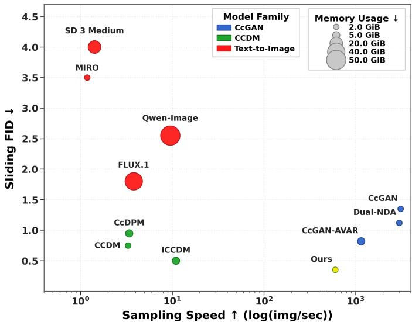
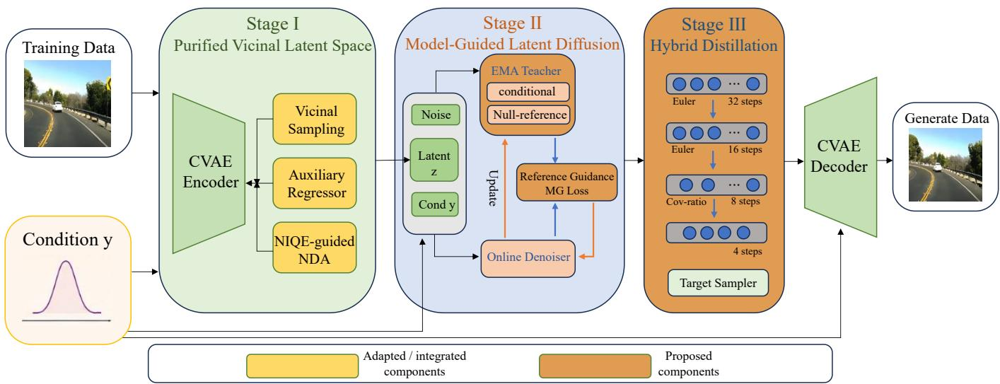
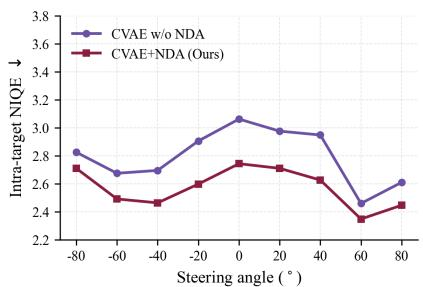
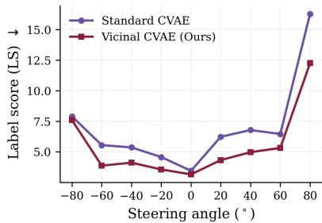

# Efficient Covariance-Aware Vicinal Latent Diffusion for Continuous Conditional Image Generation

Xin Ding, Shuo Huang, Zhenglong Ding, Sen Zhang, Nenglun Chen, Peibei Cao, Yongwei Wang, and Fei Wu

Abstract—Continuous Conditional Generative Modeling (CCGM) aims to synthesize high-dimensional data conditioned on continuously valued scalar labels. However, existing continuous diffusion models face severe data sparsity under imbalanced and long-tailed label distributions, which can lead to visual artifacts and condition inconsistency. Moreover, inference-time classifier-free guidance and dense pixel-space integration introduce substantial sampling overhead, limiting practical deployment. To address these challenges, we propose CAViLD, an efficient latent diffusion framework for continuous conditional generation. CAViLD first constructs a purified condition-aware latent space through density-adaptive vicinal learning, auxiliary semantic regularization, and NIQE-guided negative data augmentation. It then internalizes the conditional guidance direction through an EMA teacher, enabling single-branch conditional inference, and introduces covariance-aware progressive distillation for labeldependent probability-flow ODEs, supporting sampling down to four NFEs. Experiments on RC-49, UTKFace, and Steering Angle demonstrate a favorable trade-off among generation fidelity, continuous condition consistency, and sampling efficiency.

Index Terms—Continuous Conditional Generation, Latent Diffusion Models, Negative Data Augmentation, Model-Guidance, Progressive Distillation

## I. INTRODUCTION

Continuous conditional generative modeling (CCGM) aims to learn high-dimensional distributions conditioned on continu ous scalar labels, such as viewpoints, ages, steering angles, and physical parameters [1]–[3]. It supports engineering inverse design [4]–[6], remote-sensing and hyperspectral generation [7]–[9], and point-cloud or continuously controllable image synthesis [10], [11]. More broadly, recent studies have emphasized the importance of information representation, transformation, and organization in the design of intelligent systems [12]–[14]. Unlike discrete class conditioning, exact continuous labels are sparsely observed in finite datasets, making local conditional distributions difficult to estimate, particularly in long-tailed regions [1], [3], [15].

  
Fig. 1: Quality–efficiency comparison on Steering Angle at 64 × 64. The axes denote sampling throughput and SFID, while marker size indicates aggregate peak GPU memory. CAViLD achieves a favorable trade-off among the evaluated diffusion-based CCGM methods.

Recent methods, including CCDM [3] and its matrixform extension iCCDM [16], improve continuous conditional generation through label-dependent diffusion processes and covariance schedules. Although iCCDM reformulates DDPMstyle diffusion [17], [18] within the EDM paradigm [19], both methods perform iterative reverse diffusion in pixel space, resulting in higher computational cost than latent diffusion models [5], [20]. This limitation grows at higher resolutions and restricts deployment.

Moving continuous conditional diffusion into latent space raises three challenges. First, standard conditional autoencoders do not explicitly address sparse-label neighborhoods and may learn unreliable latent representations [15], [21]. Second, Classifier-Free Guidance (CFG) requires conditional and unconditional denoiser evaluations at each solver step, while large guidance scales may introduce artifacts or reduce diversity [22]– [24]. Third, few-step distillation methods are mainly developed for isotropic diffusion [25], [26] and do not explicitly account for the label-dependent anisotropic covariance of matrix-form continuous diffusion [16]. Efficient latent CCGM therefore requires jointly addressing representation quality, conditional guidance, and trajectory compression.

To this end, we propose CAViLD, a Covariance-Aware Vicinal Latent Diffusion framework with internalized guidance for continuous conditional generation, building upon the matrix-form formulation of iCCDM [16]. First, we learn a compact conditional latent space using a Conditional Variational Autoencoder (CVAE) [21]. Density-aware vicinal learning [15] improves sample coverage in sparse label regions, while NIQE guided Negative Data Augmentation (NDA) [11] provides explicit supervision against low-quality reconstruction modes.

Second, we incorporate Model-Guidance (MG) [27] into matrix-form latent diffusion. During training, an exponential moving average teacher transfers the conditional–unconditional guidance direction into the denoising target. The trained model requires one conditional denoiser evaluation per solver step, eliminating the additional unconditional forward pass used by inference-time CFG.

Third, we introduce covariance-aware progressive distillation for the probability-flow ODE [28], [29]. A condition-dependent precision-weighted objective accounts for the anisotropic covariance, and step-halving [25] compresses the trajectory to four NFEs. Experiments on RC-49, UTKFace, and Steering Angle show a favorable trade-off among generation quality, label consistency, and sampling efficiency. Compared with prior CcGAN-, CCDM-, and iCCDM-based approaches [1]–[3], [11], [15], [16], the framework jointly studies continuous conditional latent representation, CFG-free single-branch inference, and covariance-aware few-step sampling.

Our main contributions are summarized as follows:

• Continuous conditional latent diffusion. We formulate matrix-form continuous conditional diffusion in a compact CVAE latent space and adapt density-aware vicinal learning and NIQE-guided NDA to improve representation quality under imbalanced labels.

• Model-guided denoising. We transfer the conditional guidance direction into the training target, eliminating the additional unconditional denoiser evaluation required by inference-time CFG.

• Covariance-aware few-step distillation. We derive a precision-weighted progressive distillation objective for label-dependent probability-flow ODEs, supporting sam pling down to four NFEs.

## II. RELATED WORK

## A. Continuous Conditional Image Generation

Conditional image synthesis is well established for discrete categories [30], [31] or text prompts [20], [32], whereas extending it to Continuous Conditional Generative Modeling (CCGM) with continuously valued scalar attributes $y \in \mathbb R$ , such as design parameters and aspect angles [4], [7], introduces a fundamental data-sparsity problem. In a finite regression dataset, few or no observations may share an exact target label, making direct estimation of the local conditional distribution unreliable, especially in long-tailed regions [2], [3], [15].

CcGANs address this issue through vicinal empirical losses that borrow information from neighboring labels [1], [2]; Dual NDA [11] and CcGAN-AVAR [15] further improve negative supervision and density-adaptive neighborhood construction. Diffusion alternatives, including CcDPM [5], CCDM [3], and iCCDM [16], replace adversarial optimization with iterative denoising. In particular, CCDM introduces label-dependent perturbation, while iCCDM reformulates it using a matrixform covariance $\Sigma ( t , y )$ and anisotropic diffusion dynamics. Nevertheless, long-tailed labels can still cause condition misalignment, and pixel-space simulation remains computationally expensive. Latent modeling reduces the per-step computational cost by performing diffusion in a compact representation space [20]. However, in continuous conditional generation, latent compression must preserve both reconstruction fidelity and finegrained condition semantics, particularly in sparsely sampled or imbalanced label regions where the learned representation may otherwise become unreliable [15], [21].

## B. Classifier-Free Guidance and Distillation

Conditional diffusion commonly employs classifier guidance [33] or Classifier-Free Guidance (CFG) [22], with CFG extrapolating conditional predictions away from an unconditional baseline. Evaluating both the conditional denoiser $\mathcal { D } _ { \boldsymbol { \theta } } ( z _ { t } , t , y )$ and its unconditional counterpart $\mathcal { D } _ { \boldsymbol { \theta } } ( z _ { t } , t , \boldsymbol { \theta } )$ at each integration point approximately doubles the network evaluations. Moreover, large CFG scales may move sampling trajectories away from the learned manifold, producing mode collapse, oversaturation, artifacts, or diversity loss [23], [24].

Model-Guidance (MG) [27] avoids the inference-time unconditional branch by internalizing the conditional–unconditional direction into the training objective. Sampling acceleration has also been studied through implicit sampling [34], high-order guided solvers [35], consistency modeling [36], and progressive distillation [25]. The latter trains a student to reproduce two consecutive teacher transitions with one step. However, these methods are generally developed for scalar or isotropic noise schedules and do not account for the continuous, conditiondependent anisotropic geometry $\Sigma ( t , y )$ . This motivates a covariance-aware model-guided distillation formulation.

## III. METHOD

To improve the generation quality and sampling efficiency of iCCDM [16], we extend its matrix-form continuous conditional diffusion framework from pixel space to a compact latent space. We retain the label-dependent covariance formulation, matrix-form probability-flow dynamics, covariance embedding, and denoiser preconditioning of iCCDM, while adapting its density-aware hard-vicinity principle to latent-space construction. Relative to this backbone, CAViLD introduces three extensions: a purified condition-aware CVAE latent space, internalized model guidance for single-branch conditional inference, and covariance-aware progressive distillation for few-step sampling. Specifically, the CVAE is first trained and frozen; an EMA teacher then transfers the conditional–null guidance direction into the latent denoiser; finally, the resulting single-branch model is progressively distilled using covarianceaware endpoint matching. Figure 2 summarizes the framework, with detailed derivations provided in Appendices A–E.

## A. A Purified Continuous Conditional Latent Space

Let $\mathcal { S } = \{ ( x _ { i } , y _ { i } ) \} _ { i = 1 } ^ { N _ { \mathrm { d a t a } } }$ , where $x _ { i } \in \mathbb { R } ^ { C \times H \times W }$ and $y _ { i } \in \mathbb { R }$ A conditional encoder $q _ { \phi } ( z \mid x , y )$ and decoder $G _ { \psi } ( z , y )$ are trained first and then frozen. We use the reparameterization $z = \mu _ { \phi } ( x , y ) + s _ { \phi } ( x , y ) \odot \xi , \xi \sim \mathcal { N } ( 0 , I )$ , where $s _ { \phi } ( x , y ) =$ exp 12 log $v _ { \phi } ( x , y ) )$ is the posterior standard deviation. The decoder $G _ { \psi }$ parameterizes the conditional likelihood $p _ { \psi } ( x \mid z , y )$ The base CVAE objective follows the standard conditional ELBO [21] formulation. However, conventional minibatch training under an imbalanced continuous label distribution undersamples sparse regions. We therefore use density-adaptive vicinal resampling to modify the empirical frequency with which observed training pairs are presented, without changing the per-sample ELBO form.

  
Fig. 2: Overview of CAViLD. Yellow blocks denote adapted or integrated components, while orange blocks denote the proposed components. Unhighlighted blocks represent standard pipeline elements.

Condition modulation. The scalar label is embedded as $e _ { y } = \mathrm { M L P } ( y )$ . After normalization in each residual block, Zero-Initialized Decoupled Feature Modulation is applied as

$$
\widehat { h } _ { \ell } = h _ { \ell } \odot ( 1 + \gamma _ { \ell } ) + \beta _ { \ell } , \qquad \left[ \begin{array} { l } { \gamma _ { \ell } } \\ { \beta _ { \ell } } \end{array} \right] = W _ { \ell } ^ { m } e _ { y } + b _ { \ell } ^ { m } .
$$

We initialize $W _ { \ell } ^ { m } = 0$ and $b _ { \ell } ^ { m } = 0 ,$ , such that $\gamma _ { \ell } = \beta _ { \ell } = 0$ at initialization and the modulation reduces to an identity mapping. The label-dependent scale and shift are learned during training, improving optimization stability in sparse label regions.

Adaptive vicinal resampling. Exact-label observations are rare for continuous conditions. We therefore sample a base label uniformly from the set of distinct observed labels, denoted by $\scriptstyle \mathcal { D } _ { \mathrm { t r a i n } } .$ , and perturb it with Gaussian noise:

$$
\begin{array} { r l } & { y _ { 0 } \sim \mathrm { U n i f } ( \mathcal { V } _ { \mathrm { t r a i n } } ) , } \\ & { \eta _ { \mathrm { K D E } } \sim \mathcal { N } ( 0 , \sigma _ { \mathrm { K D E } } ^ { 2 } ) , \qquad y ^ { \star } = y _ { 0 } + \eta _ { \mathrm { K D E } } . } \end{array}
$$

σ is determined adaptively following CcGAN-AVAR [15]. Following the adaptive hard-support vicinity strategy, we construct a symmetric neighborhood around each query label $y ^ { \star }$ . For a candidate radius $r \geq 0$ , define

$$
\begin{array} { r } { \mathcal { N } _ { r } ( y ^ { \star } ) = \left\{ i \in \left\{ 1 , \dots , N _ { \mathrm { d a t a } } \right\} : | y _ { i } - y ^ { \star } | \leq r \right\} , } \end{array}
$$

which contains the source examples whose observed labels lie within distance r of $y ^ { \star }$ . Given a prescribed minimum

neighborhood size $N _ { \mathrm { A V } }$ , we choose the smallest radius that contains at least $N _ { \mathrm { A V } }$ source examples:

$$
\kappa ( y ^ { \star } ) = \mathrm { m i n } \left\{ r \geq 0 : |  { \mathcal { N } _ { r } } ( y ^ { \star } ) | \geq N _ { \mathrm { A V } } \right\} .\tag{1}
$$

The resulting adaptive neighborhood is then defined as

$$
\mathcal { N } ( y ^ { \star } ) = \mathcal { N } _ { \kappa ( y ^ { \star } ) } ( y ^ { \star } ) .
$$

Thus, the neighborhood contracts in densely sampled label regions and expands in sparse regions so as to maintain a sufficient local source population. The corresponding hard vicinal indicator is

$$
W _ { i , y ^ { \star } } = \mathbb { 1 } _ { \{ | y _ { i } - y ^ { \star } | \leq \kappa ( y ^ { \star } ) \} } .\tag{2}
$$

Since $W _ { i , y ^ { \star } }$ is binary, we define $\bar { W } _ { i , y ^ { \star } } = W _ { i , y ^ { \star } } / | \mathcal { N } ( y ^ { \star } ) |$ as the uniform sampling probability over the adaptive neighborhood. Thus, source examples inside the neighborhood receive equal sampling probability, whereas examples outside the neighborhood receive zero probability.

The query label $y ^ { \star }$ is used only for neighborhood construction and source resampling. The source pair retains its observed label $y _ { i }$ , which is used as the condition for the CVAE:

$$
\boldsymbol { z } ^ { ( i ) } \sim q _ { \phi } ( \boldsymbol { z } \mid \boldsymbol { x } _ { i } , y _ { i } ) , \qquad \widehat { \boldsymbol { x } } _ { i } = G _ { \psi } ( \boldsymbol { z } ^ { ( i ) } , y _ { i } ) .
$$

We use $\mathbb { E } _ { y ^ { \star } }$ to denote expectation over the query-label sampling procedure defined above. The reconstruction and KL objectives are

$$
\begin{array} { r l } & { \mathcal { L } _ { \mathrm { r e c } } ^ { v } = \mathbb { E } _ { y ^ { \star } } \displaystyle \sum _ { i = 1 } ^ { N _ { \mathrm { d a t a } } } \bar { W } _ { i , y ^ { \star } } \mathbb { E } _ { q _ { \phi } ( z | x _ { i } , y _ { i } ) } \Big [ \mathcal { L } _ { \mathrm { M S E } } \big ( x _ { i } , G _ { \psi } ( z , y _ { i } ) \big ) } \\ & { \qquad + \lambda _ { \mathrm { p e r c } } \mathcal { L } _ { \mathrm { p e r c } } \big ( x _ { i } , G _ { \psi } ( z , y _ { i } ) \big ) \Big ] , } \\ & { \mathcal { L } _ { \mathrm { K L } } ^ { v } = \mathbb { E } _ { y ^ { \star } } \displaystyle \sum _ { i = 1 } ^ { N _ { \mathrm { d a t a } } } \bar { W } _ { i , y ^ { \star } } \mathrm { K L } ( q _ { \phi } ( z \mid x _ { i } , y _ { i } ) \| \mathcal { N } ( 0 , I ) ) . } \end{array}
$$

Theorem 1 (Bias–variance trade-off). Under the assumptions detailed in Appendix A, the mean-squared error of the vicinal estimator is bounded by the sum of a neighborhood-induced bias term and an inverse-effective-sample-size variance term.

The bound favors local neighborhoods in dense regions and wider label neighborhoods in sparse regions; detailed assumptions and proof are given in Appendix A.

Semantic anchoring and negative purification. For each source pair selected by adaptive vicinal resampling, a frozen regressor $R _ { \omega _ { R } }$ penalizes semantic deviation between the reconstruction and its observed label:

$$
\mathcal { L } _ { \mathrm { a u x } } = \mathbb { E } _ { y ^ { \star } , i \sim \mathrm { U n i f } ( N ( y ^ { \star } ) ) } \left[ \left| R _ { \omega _ { R } } ( \widehat { x } _ { i } ) - y _ { i } \right| - \epsilon _ { \mathrm { a u x } } \right] _ { + } ,
$$

where $[ u ] _ { + } = \operatorname* { m a x } ( u , 0 ) , \epsilon _ { \mathrm { a u x } }$ is a tolerance margin and $R _ { \omega _ { R } }$ remains frozen throughout CVAE training.

The negative replay buffer is constructed and periodically refreshed during CVAE training using NIQE-based quality filtering. Specifically, low-quality reconstructions identified by NIQE ranking are used to update the negative buffer

$$
Q _ { \mathrm { b a d } } = \{ ( \tilde { x } _ { j } , \tilde { y } _ { j } ) \} _ { j = 1 } ^ { N _ { \mathrm { b a d } } } .
$$

During each discriminator update, a minibatch is uniformly sampled from $Q _ { \mathrm { b a d } }$ and treated as additional negative examples.

To distinguish adversarial reweighting from the indicator $W _ { i , y ^ { \star } }$ , we define the distance-aware confidence weight

$$
\alpha _ { i , y ^ { \star } } = \exp \left[ - \frac { ( y _ { i } - y ^ { \star } ) ^ { 2 } } { \kappa ( y ^ { \star } ) ^ { 2 } } \right] .
$$

With the logistic losses $\ell _ { 1 } ( s ) ~ = ~ - \log \rho ( s ) , \qquad \ell _ { 0 } ( s ) ~ =$ $- \log [ 1 - \rho ( s ) ]$ , where $\rho ( s ) = 1 / ( 1 + \exp ( - s ) )$ denotes the sigmoid function. Hereafter, $\mathbb { E } _ { y ^ { \star } , i }$ denotes expectation over the query-label sampling procedure and $i \sim \operatorname { U n i f } ( \mathcal { N } ( y ^ { \star } ) )$ . The discriminator objectives are

$$
\mathcal { L } _ { D } ^ { v } = \mathbb { E } _ { y ^ { \star } , i } \left[ \alpha _ { i , y ^ { \star } } \left\{ \ell _ { 1 } \big ( D _ { \omega } ( x _ { i } , y _ { i } ) \big ) + \ell _ { 0 } \big ( D _ { \omega } ( \mathrm { s g } [ \widehat { x } _ { i } ] , y _ { i } ) \big ) \right\} \right] ,
$$

$$
\mathcal { L } _ { D } = \mathcal { L } _ { D } ^ { v } + \lambda _ { \mathrm { n d a } } \mathbb { E } _ { ( \widetilde { x } , \widetilde { y } ) \sim Q _ { \mathrm { b a d } } } \left[ \ell _ { 0 } \big ( D _ { \omega } ( \widetilde { x } , \widetilde { y } ) \big ) \right] .\tag{3}
$$

The CVAE objective is

$$
\begin{array} { r l } & { \mathcal { L } _ { \mathrm { C V A E } } = \mathcal { L } _ { \mathrm { r e c } } ^ { v } + \lambda _ { \mathrm { K L } } \mathcal { L } _ { \mathrm { K L } } ^ { v } + \lambda _ { \mathrm { a u x } } \mathcal { L } _ { \mathrm { a u x } } } \\ & { \qquad + \lambda _ { \mathrm { a d v } } \mathbb { E } _ { y ^ { \star } , i } \left[ \alpha _ { i , y ^ { \star } } \ell _ { 1 } ( D _ { \omega } ( \widehat { x } _ { i } , y _ { i } ) ) \right] . } \end{array}\tag{4}
$$

During alternating optimization, $D _ { \omega }$ is updated using Eq. (3), whereas $( \phi , \psi )$ are updated using Eq. (4) with $D _ { \omega }$ fixed. The auxiliary regressor $R _ { \omega _ { R } }$ remains frozen. Since no generatorside NDA repulsion is used, $Q _ { \mathrm { b a d } }$ affects the CVAE only indirectly through the adversarial objective.

## B. Matrix-Form Model-Guided Latent Diffusion

Condition-dependent corruption. Following iCCDM [16], we adopt its condition-dependent covariance embedding in the latent space. The embedding network $h _ { \nu }$ is trained using the procedure of iCCDM, with output dimension adjusted to the latent dimension $d _ { z } = C _ { z } H _ { z } W _ { z }$ , and is frozen during diffusion training. We define the positive covariance embedding as

$$
a _ { \nu } ( y ) = \exp [ - h _ { \nu } ( y ) ] \in \mathbb { R } _ { > 0 } ^ { d _ { z } } ,
$$

and use the diagonal covariance

$$
K _ { \sigma } ( y ) = \sigma ^ { 2 } I + \lambda _ { \mathrm { c o v } } \sigma \operatorname { D i a g } ( a _ { \nu } ( y ) ) .\tag{5}
$$

The Stage-II training pairs follow the adaptive vicinal resampling defined in Section III-A. Specifically, a query label $y ^ { \star }$ is generated as described previously, and a source index is sampled uniformly from its adaptive neighborhood:

$$
i \sim \mathrm { U n i f } ( \mathcal { N } ( y ^ { \star } ) ) .
$$

The selected source image $x _ { i }$ is encoded by the frozen CVAE using its observed label $y _ { i }$ . For diffusion modeling, we rescale the sampled CVAE latent by a scalar $c > 0$ to approximately normalize its empirical scale, define the scaled clean latent as

$$
z _ { 0 } = c \left[ \mu _ { \phi } ( x _ { i } , y _ { i } ) + s _ { \phi } ( x _ { i } , y _ { i } ) \odot \xi \right] , \qquad \xi \sim \mathcal { N } ( 0 , I ) .\tag{6}
$$

Here, the observed label $y _ { i }$ is used for source encoding, whereas the query label $y ^ { \star }$ determines the diffusion condition and the label-dependent corruption covariance. Hereafter, y denotes the Stage-II query label $y ^ { \star }$ , while $y _ { i }$ denotes the observed label of the sampled source.

The above sampling procedure induces the vicinal cleanlatent distribution

$$
p _ { 0 } ^ { v } ( z _ { 0 } \mid y ) = \sum _ { i = 1 } ^ { N _ { \mathrm { d a t a } } } \bar { W } _ { i , y } q _ { \phi , c } ( z _ { 0 } \mid x _ { i } , y _ { i } ) ,
$$

where $q _ { \phi , c }$ denotes the distribution of the scaled latent $z _ { \mathrm { 0 } } = c z$ induced by $q _ { \phi } ( z \mid x _ { i } , y _ { i } )$

The forward perturbation is

$$
z _ { \sigma } = z _ { 0 } + K _ { \sigma } ( y ) ^ { 1 / 2 } \epsilon , \qquad \epsilon \sim { \mathcal { N } } ( 0 , I ) .\tag{7}
$$

Matrix preconditioning. We further adopt the matrix preconditioning of iCCDM [16], replacing the image-space covariance with the latent covariance in Eq. (5). For matrix preconditioning, we adopt $S _ { z } = s _ { z } ^ { 2 } I$ with $s _ { z } = 0 . 5$ for the scaled latent representation. The denoiser is parameterized as

$$
\begin{array} { r } { D _ { \theta } ( z _ { \sigma } , \sigma , y ) = C _ { \mathrm { s k i p } } z _ { \sigma } + C _ { \mathrm { o u t } } F _ { \theta } \left( C _ { \mathrm { i n } } z _ { \sigma } , \frac { 1 } { 4 } \log \sigma , e _ { y } \right) , } \end{array}
$$

where

$$
\begin{array} { r } { C _ { \mathrm { i n } } = \big ( s _ { z } ^ { 2 } I + K _ { \sigma } ( y ) \big ) ^ { - 1 / 2 } , \phantom { s p a c e } } \\ { C _ { \mathrm { s k i p } } = s _ { z } ^ { 2 } \big ( s _ { z } ^ { 2 } I + K _ { \sigma } ( y ) \big ) ^ { - 1 } , \phantom { s p a c e } } \\ { C _ { \mathrm { o u t } } = s _ { z } K _ { \sigma } ( y ) ^ { 1 / 2 } \big ( s _ { z } ^ { 2 } I + K _ { \sigma } ( y ) \big ) ^ { - 1 / 2 } . } \end{array}\tag{8}
$$

For $\sigma > 0$ , the preconditioning precision is

$$
W _ { \sigma , y } = C _ { \mathrm { o u t } } ^ { - 2 } = s _ { z } ^ { - 2 } I + K _ { \sigma } ( y ) ^ { - 1 } .\tag{9}
$$

Matrix operations are element-wise because $K _ { \sigma } ( y )$ is diagonal. For the null prediction, $F _ { \theta }$ receives the normalized noisy latent, noise level, and null embedding $e _ { \emptyset }$ . The requested geometry is retained through external preconditioning; neither y nor $K _ { \sigma } ( y )$ is a separate input to $F _ { \theta }$

Internalizing model guidance. Condition dropout with probability $p _ { \mathrm { d r o p } }$ is used to jointly train conditional and null conditioned predictions. To construct the model-guidance target, the EMA teacher is evaluated twice on the same preconstructed noisy latent $z _ { \sigma }$ , at the same noise level σ and requested label y: once through the conditional branch and once through the null-conditioning mechanism. We denote the latter prediction by $D _ { \bar { \theta } } ^ { ( y ) } ( z _ { \sigma } , \sigma , \bar { \varnothing } )$ . Here ∅ indicates that the explicit condition is suppressed, whereas the superscript (y) indicates that the reference prediction is associated with the same requested label and noisy state as the conditional prediction. For a fixed requested label $y ,$ define

$$
\begin{array} { c } { { D _ { c } = D _ { \bar { \theta } } ( z _ { \sigma } , \sigma , y ) , } } \\ { { D _ { \varnothing } ^ { ( y ) } = D _ { \bar { \theta } } ^ { ( y ) } ( z _ { \sigma } , \sigma , \varnothing ) , } } \\ { { \Delta _ { \bar { \theta } } ^ { \mathrm { r e f } } = D _ { c } - D _ { \varnothing } ^ { ( y ) } . } } \end{array}
$$

Following the operational two-branch guidance rule used by matrix-form continuous conditional diffusion, we define

$$
D ^ { \mathrm { g u i d e } } = D _ { c } + w _ { \mathrm { M G } } \Delta _ { \bar { \theta } } ^ { \mathrm { r e f } } = ( 1 + w _ { \mathrm { M G } } ) D _ { c } - w _ { \mathrm { M G } } D _ { \emptyset } ^ { ( y ) } .\tag{10}
$$

Under the CFG parameterization $D _ { \mathrm { C F G } } = D _ { \emptyset } + \gamma ( D _ { c } - D _ { \emptyset } )$ $\gamma = 1 + w _ { \mathrm { M G } }$ matches the reference two-branch coefficients, without implying exact CFG equivalence of the trained single branch. For label-independent corruption and a globally labelmarginal null denoiser, Eq. (10) recovers the standard CFG clean-prediction identity. Under label-dependent corruption, $D _ { \varnothing } ^ { ( y ) }$ instead serves as a null-conditioned reference under the fixed geometry $K _ { \sigma } ( y )$ , rather than the exact global-marginal denoiser. We train the conditional branch to absorb this reference guidance direction. Let $\bar { \theta }$ be an exponential moving average (EMA) of θ. With this evolving teacher, $w _ { \mathrm { M G } }$ is an empirical training coefficient. After warm-up, we construct the target

$$
z _ { 0 } ^ { \mathrm { M G } } = z _ { 0 } + w _ { \mathrm { M G } } \ : \mathrm { s g } \Bigl [ D _ { \bar { \theta } } ( z _ { \sigma } , \sigma , y ) - D _ { \bar { \theta } } ^ { ( y ) } ( z _ { \sigma } , \sigma , \emptyset ) \Bigr ] ,\tag{11}
$$

and set $z _ { 0 } ^ { \mathrm { M G } } = z _ { 0 }$ during warm-up. The clean sample anchors the target, the EMA difference supplies a reference-guidance direction, and stop-gradient blocks gradient flow through the EMA teacher for every online-model update.

For a positive-definite matrix W, we use the weighted norm $\| u \| _ { W } ^ { 2 } = \overline { { u ^ { \mathsf { T } } W u } }$ . Let $\mathbb { E } _ { c }$ and $\mathbb { E } _ { \varnothing }$ denote expectations under the corruption in Eq. (7) and $z _ { \sigma } = z _ { 0 } + \sigma \epsilon$ , respectively, including the remaining Stage-II sampling. Both branches retain the requested preconditioning. The training objective is

$$
\begin{array} { r l } & { \mathcal { L } _ { \mathrm { d i f f } } = ( 1 - p _ { \mathrm { d r o p } } ) \mathbb { E } _ { c } \Big [ \big \| D _ { \theta } ( z _ { \sigma } , \sigma , y ) - z _ { 0 } ^ { \mathrm { M G } } \big \| _ { W _ { \sigma , y } ^ { 1 / 2 } } ^ { 2 } \Big ] } \\ & { \quad \quad \quad \quad \quad \quad \quad \quad \quad \quad + p _ { \mathrm { d r o p } } \mathbb { E } _ { \theta } \Big [ ( s _ { z } ^ { - 2 } + \sigma ^ { - 2 } ) ^ { 1 / 2 } } \\ & { \quad \quad \quad \quad \quad \quad \quad \cdot \big \| D _ { \theta } ^ { ( y ) } ( z _ { \sigma } , \sigma , \emptyset ) - z _ { 0 } ^ { \mathrm { M G } } \big \| _ { 2 } ^ { 2 } \Big ] . } \end{array}\tag{12}
$$

The model-guidance coefficient is activated after warm-up according to

$$
w _ { \mathrm { M G } } ( s ) = \left\{ \begin{array} { l l } { 0 , } & { s \leq s _ { \mathrm { w a r m } } , } \\ { w _ { \mathrm { M G } } , } & { s > s _ { \mathrm { w a r m } } , } \end{array} \right.
$$

where s denotes the optimization step. Before $s _ { \mathrm { w a r m } } ,$ , the model is trained with the clean target z ; afterwards, the EMA prediction difference is incorporated into $z _ { 0 } ^ { \mathrm { M G } }$ . Warm-up delays reference guidance until after initial clean-target training.

Eq. (12) trains both online branches toward the same modelguided target using their respective inputs. At inference, only the conditional prediction is retained.

Single-branch model-guided sampling. For the corruption process in Eq. (7), define the clean-latent posterior mean as

$$
D ^ { * } ( z _ { \sigma } , \sigma , y ) = \mathbb { E } [ z _ { 0 } \mid z _ { \sigma } , \sigma , y ] .
$$

The corresponding conditional PF-ODE [28], [29] is

$$
\frac { d z _ { \sigma } } { d \sigma } = B _ { \sigma , y } \big [ z _ { \sigma } - D ^ { * } ( z _ { \sigma } , \sigma , y ) \big ] , \quad B _ { \sigma , y } = \textstyle { \frac { 1 } { 2 } } K _ { \sigma } ^ { \prime } ( y ) K _ { \sigma } ( y ) ^ { - 1 } .\tag{13}
$$

After training, let $D _ { \bar { \theta } } ^ { \mathrm { M G } }$ denote the conditional prediction of the EMA denoiser obtained after model-guided training. Replacing $D ^ { * }$ by this prediction yields the guided sampling ODE

$$
\frac { d z _ { \sigma } } { d \sigma } = B _ { \sigma , y } \left[ z _ { \sigma } - D _ { \bar { \theta } } ^ { \mathrm { M G } } ( z _ { \sigma } , \sigma , y ) \right] .\tag{14}
$$

Equation (14) does not claim exact preservation of the original conditional marginals after guidance. For $K _ { \sigma } = \sigma ^ { 2 } I , B _ { \sigma , y } =$ $I / \sigma ,$ recovering the standard EDM ODE. At a sufficiently large $\sigma _ { \mathrm { m a x } } .$ , the corruption covariance dominates the cleanlatent covariance, motivating the boundary approximation

$$
p _ { \sigma _ { \mathrm { m a x } } } ( z \mid y ) \approx \mathcal { N } ( 0 , K _ { \sigma _ { \mathrm { m a x } } } ( y ) ) .
$$

We therefore initialize $z _ { \sigma _ { \mathrm { m a x } } } \sim \mathcal { N } ( 0 , K _ { \sigma _ { \mathrm { m a x } } } ( y ) )$ and integrate Eq. (14) backward toward the clean boundary $\sigma = 0 ,$ , without evaluating the vector field at the singular endpoint. The resulting latent is decoded as $\widehat { x } = G _ { \psi } ( z _ { 0 } / c , y )$

Each vector-field evaluation uses exactly one conditional denoiser call. For an M-evaluation solver, standard two-branch CFG requires approximately 2M denoiser evaluations, whereas the model-guided field requires M. This saving is orthogonal to latent-space compression: the CVAE reduces the cost of each evaluation, while model guidance removes the additional null-conditioned forward pass at each integration point.

## C. Hybrid Step-Halving Distillation

Model guidance removes the unconditional inference pass, but a conventional ODE solver still evaluates the conditional denoiser many times. We therefore distill the already modelguided, single-branch teacher; no unconditional prediction is reintroduced during distillation.

a) Euler-based distillation from 32 to 8 steps: Let

$$
\sigma _ { 0 } = \sigma _ { \mathrm { m a x } } > \sigma _ { 1 } > \cdot \cdot \cdot > \sigma _ { N } = 0
$$

be the N-step teacher schedule, where $N \in \{ 3 2 , 1 6 \}$ for the two distillation stages. We sample an index $k \in \{ 0 , 2 , \ldots , N -$ 2} and distill the two teacher transitions from $\sigma _ { k } ~ { \bf { t o } } ~ \sigma _ { k + 2 }$ into one student transition.

We train on forward-corrupted states $z _ { \sigma _ { k } }$ constructed by Eq. (7) at $\sigma = \sigma _ { k }$ , where $z _ { \mathrm { 0 } }$ is obtained from the sampled source pair. At each optimization step, an EMA N-step teacher, evaluated under stop-gradient, applies two fine solver transitions to produce

$$
z _ { \sigma _ { k + 2 } } ^ { T } = \Phi _ { \bar { \theta } _ { N } } ( z _ { \sigma _ { k } } ; \sigma _ { k }  \sigma _ { k + 1 }  \sigma _ { k + 2 } , y ) .\tag{15}
$$

Let

$$
\Delta _ { k } = \sigma _ { k + 2 } - \sigma _ { k } < 0 , \qquad B _ { k } = B _ { \sigma _ { k } , y } .
$$

We invert one coarse Euler transition of Eq. (14) and obtain the endpoint-matching denoised-prediction target

$$
\begin{array} { r l } & { D _ { k } ^ { \dagger } = z _ { \sigma _ { k } } - B _ { k } ^ { - 1 } \frac { z _ { { \sigma } _ { k + 2 } } ^ { T } - z _ { { \sigma } _ { k } } } { \Delta _ { k } } } \\ & { \quad = z _ { \sigma _ { k } } - 2 K _ { { \sigma } _ { k } } ( y ) \big ( K _ { { \sigma } _ { k } } ^ { \prime } ( y ) \big ) ^ { - 1 } \frac { z _ { { \sigma } _ { k + 2 } } ^ { T } - z _ { { \sigma } _ { k } } } { \Delta _ { k } } . } \end{array}\tag{16}
$$

Theorem 2 (Euler endpoint consistency). For $\sigma _ { k } > 0 ,$ , the target $D _ { k } ^ { \dagger }$ in $E q .$ . (16) is the unique prediction whose one-step Euler transition reaches the two-step teacher endpoint $z _ { \sigma _ { k + 2 } } ^ { T } .$

The proof is provided in Appendix E.

The $N / 2$ -step student is initialized from the preceding-stage checkpoint and minimizes

$$
\begin{array} { r l } & { \mathcal { L } _ { \mathrm { d i s t i l l } } } \\ & { \quad = \mathbb { E } _ { k , ( z _ { 0 } , y ) , \epsilon } \Big \| W _ { \sigma _ { k } , y } ^ { 1 / 2 } \left( D _ { \theta _ { N / 2 } } ( z _ { \sigma _ { k } } , \sigma _ { k } , y ) - \mathrm { s g } [ D _ { k } ^ { \dag } ] \right) \Big \| _ { 2 } ^ { 2 } . } \end{array}\tag{17}
$$

The precision $W _ { \sigma _ { k } , y }$ rescales prediction residuals, while endpoint consistency follows from $D _ { k } ^ { \dagger }$ . We apply this Eulerbased endpoint distillation successively as $3 2  1 6  8$

b) Final covariance-ratio distillation from 8 to 4 steps: For the $8  4$ stage, we use a covariance-ratio transition on the four-step schedule. For two noise levels $\sigma _ { a } > \sigma _ { b } ,$ define

$$
R _ { a  b } ( y ) = ( K _ { \sigma _ { b } } ( y ) K _ { \sigma _ { a } } ( y ) ^ { - 1 } ) ^ { 1 / 2 } ,
$$

where the inverse and square root are evaluated elementwise because $K _ { \sigma } ( y )$ is diagonal. The corresponding deterministic transition is

$$
\begin{array} { l } { { \Psi _ { \vartheta } ( z _ { \sigma _ { a } } ; \sigma _ { a }  \sigma _ { b } , y ) } } \\ { { \ = D _ { \vartheta } ( z _ { \sigma _ { a } } , \sigma _ { a } , y ) + R _ { a  b } ( y ) [ z _ { \sigma _ { a } } - D _ { \vartheta } ( z _ { \sigma _ { a } } , \sigma _ { a } , y ) ] . } } \end{array}\tag{18}
$$

For final stage, we retain the trained 8-step denoiser but switch its teacher rollout from Euler to the covariance-ratio rule:

$$
z _ { \sigma _ { k + 2 } } ^ { T } = \Psi _ { \bar { \theta } _ { 8 } } ( \Psi _ { \bar { \theta } _ { 8 } } ( z _ { \sigma _ { k } } ; \sigma _ { k }  \sigma _ { k + 1 } , y ) ; \sigma _ { k + 1 }  \sigma _ { k + 2 } , y ) .\tag{19}
$$

Let

$$
R _ { k } = R _ { k \to k + 2 } ( y ) = \left( K _ { \sigma _ { k + 2 } } ( y ) K _ { \sigma _ { k } } ( y ) ^ { - 1 } \right) ^ { 1 / 2 } .
$$

Equating one coarse student transition with the two-step teacher endpoint and solving for the denoised prediction gives

$$
D _ { k , \mathrm { r a t i o } } ^ { \dagger } = \left( I - R _ { k } \right) ^ { - 1 } \left( z _ { \sigma _ { k + 2 } } ^ { T } - R _ { k } z _ { \sigma _ { k } } \right) .\tag{20}
$$

Theorem 3 (Covariance-ratio endpoint consistency). Under the monotone diagonal covariance schedule in Eq. $( 5 ) , I - R _ { k }$ is nonsingular, and $D _ { k , \mathrm { r a t i o } } ^ { \dagger }$ uniquely matches the two-step covariance-ratio teacher endpoint in Eq. (19).

The 4-step student is trained with Eq. (17) after replacing $D _ { k } ^ { \dagger }$ by $D _ { k , \mathrm { r a t i o } } ^ { \dagger } .$

The covariance-ratio transition is first-order consistent with the guided latent ODE because

$$
R _ { \sigma  \sigma + \Delta \sigma } ( y ) = I + \Delta \sigma B _ { \sigma , y } + \mathcal { O } ( \Delta \sigma ^ { 2 } ) .
$$

It analytically accounts for the covariance scaling while holding the denoised prediction fixed over each transition. At inference, the 4-step student uses the same coarse covariance-ratio update in Eq. (18). Each transition evaluates the single conditional denoiser exactly once; hence the final sampler requires four conditional NFEs, followed by one CVAE decode.

The complete hybrid distillation schedule is therefore

$$
3 2 ~ { \xrightarrow { \operatorname { E u l e r } } } ~ 1 6 ~ { \xrightarrow { \operatorname { E u l e r } } } ~ 8 ~ { \xrightarrow { \operatorname { c o v a r i a n c e ~ r a t i o } } } ~ 4 .
$$

Appendix E provides the endpoint-consistency and localconsistency derivations. The overall training procedure is summarized in Algorithms 1–3, with the four-step sampling procedure described in Appendix F.

## IV. EXPERIMENTS

To comprehensively evaluate the effectiveness and efficiency of our proposed CAViLD framework, we conduct extensive experiments on standard continuous conditional generative modeling benchmarks. We investigate three aspects: generation fidelity and continuous label consistency, sampling efficiency, and the quality of the learned latent representation under imbalanced continuous conditions.

## A. Experimental Setup

Datasets. We evaluate our proposed CAViLD on three widely used continuous conditional generative modeling benchmarks following previous CCGM protocols [2], [16]. These datasets cover diverse continuous control scenarios, including object pose manipulation, age-conditioned face synthesis, and autonomous driving, with image resolutions ranging from 64×64 to $2 5 6 \times 2 5 6$

  
Fig. 3: Effect of NDA on CVAE reconstruction quality. CVAE+NDA achieves lower NIQE across most steering-angle conditions.

RC-49 [2] is a pose-controlled image generation benchmark containing chair images conditioned on continuous azimuth angles. It is widely adopted for evaluating continuous viewpointconditioned generation.

UTKFace [40] consists of RGB face images with continuous age labels ranging from 1 to 60 years. The naturally imbalanced age distribution makes it a challenging benchmark for evaluating continuous label consistency and robustness.

The Steering Angle dataset [41], [42], preprocessed following Ding et al. [2], contains real-world driving images conditioned on continuous steering angles. It provides a practical physical control scenario with complex visual variations and nonuniform continuous label distributions.

TABLE IV: MG vs. CFG under 32-step sampling.
<table><tr><td>Dataset</td><td>Guidance</td><td>NFEs↓</td><td>img/s↑</td><td>SFID↓</td><td>Div.↑</td><td>LS↓</td></tr><tr><td>Steering</td><td>CFG</td><td>64</td><td>23.46</td><td>0.257</td><td>1.072</td><td>5.504</td></tr><tr><td></td><td>MG (Ours)</td><td>32</td><td>44.62</td><td>0.272</td><td>1.053</td><td>3.950</td></tr><tr><td>RC-49</td><td>CFG</td><td>64</td><td>38.66</td><td>0.045</td><td>3.708</td><td>1.040</td></tr><tr><td></td><td>MG (Ours)</td><td>32</td><td>59.34</td><td>1 0.049</td><td>3.697</td><td>0.944</td></tr><tr><td>UTKFace</td><td>CFG</td><td>64</td><td>36.60</td><td>0.360</td><td>1.154</td><td>5.219</td></tr><tr><td></td><td>MG (Ours)</td><td>32</td><td>54.13</td><td>0.350</td><td>1.217</td><td>5.195</td></tr></table>

TABLE I: Quantitative comparison of image generation performance under low-to-medium resolutions $( \leq 1 2 8 \times 1 2 8 )$ . Arrows $( \uparrow / \downarrow )$ present the preferred optimization directions. For the primary quality metric (SFID), the best results are highlighted in bold and the second-best in underlined. Evaluation profiles corrupted by severe training pathologies (e.g., severe label inconsistency or mode collapse) are denoted in red.
<table><tr><td>Dataset</td><td>Condition</td><td> Framework</td><td>Method</td><td>SFID</td><td>NIQE↓</td><td>Diversity</td><td>LS↓</td><td>img/sec</td><td>Mem(GiB)</td></tr><tr><td rowspan="5">RC-49 (64×64)</td><td>Text</td><td>Diffusion</td><td>SD 3 Medium (ICML&#x27;24) [32] FLUX.1 (arXiv&#x27;25) [37] Qwen-Image (arXiv&#x27;25) [38]</td><td>1.215 0.515</td><td>1.996 2.330</td><td>2.272 2.512</td><td>28.726 12.751</td><td>1.90 3.87</td><td>19.74 42.08</td></tr><tr><td></td><td></td><td>MIRO (ICML’26) [39]</td><td>1.132 2.956</td><td>2.436 3.146</td><td>2.470 0.791</td><td>27.757 10.66</td><td>9.58 1.19</td><td>56.91 6.53</td></tr><tr><td></td><td>GAN</td><td>CcGAN (T-PAMI&#x27;23) [2] Dual-NDA (AAAI&#x27;24) [11] CcGAN-AVAR (arXiv&#x27;25) [15]</td><td>0.126 0.148</td><td>1.809 1.808</td><td>3.451 3.344</td><td>2.655 2.211</td><td>6243.06 6243.06</td><td>2.62 2.62</td></tr><tr><td>Continuous</td><td>Diffusion</td><td>ČcDPM (AAAI&#x27;24) [5] CCDM (TMM’26) [3]</td><td>0.042 0.970 0.049</td><td>1.734 2.153 2.086</td><td>3.723 3.581 3.698</td><td>1.270 24.174</td><td>4162.04 2.92</td><td>3.71 5.07 5.53</td></tr><tr><td>Text</td><td></td><td>iCCDM (arXiv’26) [16] CAViLD (Ours) SD 3 Medium (ICML&#x27;24) [32]</td><td>0.049 0.048 2.012</td><td>1.718 2.078 2.068</td><td>3.696 3.706 0.426</td><td>1.074 0.813 1.068 5.452</td><td>2.92 12.67 370.72 1.50</td><td>3.69 2.46 19.74</td></tr><tr><td rowspan="8">(64×64)</td><td></td><td>Diffusion</td><td>FLUX.1 (arXiv&#x27;25) [37] Qwen-Image (arXiv&#x27;25) [38]</td><td>0.816 1.973</td><td>1.915 2.135</td><td>0.713 1.051</td><td>9.174 10.770</td><td>3.80 9.37</td><td>42.08 56.90</td></tr><tr><td></td><td>GAN</td><td>MIRO (ICML&#x27;26) [39] CcGAN (T-PAMI&#x27;23) [2]</td><td>4.763 0.413</td><td>2.193 1.733</td><td>1.108 1.329</td><td>10.888 8.240</td><td>1.19 5555.56</td><td>6.28 2.44</td></tr><tr><td>Continuous</td><td></td><td>Dual-NDA (AAAI&#x27;24) [11] CcGAN-AVAR (arXiv&#x27;25) [15] ČcDPM (AAAI&#x27;24) [5]</td><td>0.396 0.356</td><td>1.678 1.691</td><td>1.298 1.278</td><td>6.765 6.696</td><td>5555.56 4166.67</td><td>2.44 3.71</td></tr><tr><td></td><td>Diffusion</td><td></td><td>1 0.466</td><td>1.560</td><td>1.211</td><td>6.868</td><td>2.10</td><td>5.70</td></tr><tr><td></td><td></td><td>CCDM (TMM’26) [3] iCCDM (arXiv’26) [16]</td><td>0.363</td><td>1.542</td><td>1.184</td><td>6.164 5.788</td><td>2.10 11.13</td><td>6.14 4.94</td></tr><tr><td></td><td></td><td>CAViLD (Ours)</td><td>0.353</td><td>1.561</td><td>1.146</td><td>5.608</td><td></td><td>2.53</td></tr><tr><td></td><td></td><td></td><td>0.344</td><td>1.611</td><td>1.206</td><td></td><td>355.48</td><td>19.74</td></tr><tr><td>Text</td><td>Diffusion</td><td>SD 3 Medium (ICML&#x27;24) [32] FLUX.1 (arXiv&#x27;25) [37]</td><td>1.582 0.643</td><td>1.901 1.748</td><td>0.396 0.661</td><td>5.019 9.281</td><td>1.43</td><td></td></tr><tr><td rowspan="7">UTKFace (128×128)</td><td></td><td></td><td></td><td></td><td></td><td></td><td></td><td>3.95</td><td>42.08</td></tr><tr><td>+</td><td></td><td>Qwen-Image (arXiv&#x27;25) [38] MIRO (ICML’26) [39]</td><td>1.517 3.590</td><td>1.653</td><td>0.971 0.691</td><td>9.731 12.001</td><td>9.73 1.20</td><td>59.33 6.28</td></tr><tr><td></td><td></td><td>CcGAN (T-PAMI&#x27;23) [2]</td><td>0.367</td><td>2.069 1.113</td><td>1.199</td><td>7.747</td><td>1282.05</td><td>7.58</td></tr><tr><td>Continuous</td><td>GAN</td><td>Dual-NDA (AAAI&#x27;24) [11]</td><td>0.361</td><td>1.081</td><td>1.257</td><td>6.310</td><td>1282.05</td><td>7.58</td></tr><tr><td></td><td></td><td>CcGAN-AVAR (arXiv&#x27;25) [15]</td><td>0.297</td><td>1.173</td><td>1.251</td><td>6.586</td><td>1190.48</td><td>11.57</td></tr><tr><td></td><td></td><td>CcDPM (AAAI&#x27;24) [5]</td><td>0.529</td><td>1.114</td><td>1.195</td><td>7.933</td><td>1.12</td><td>17.91</td></tr><tr><td></td><td>Diffusion</td><td></td><td></td><td>1.077</td><td>1.178</td><td>6.359</td><td></td><td></td></tr><tr><td rowspan="7">Steering Angle (64×64)</td><td></td><td></td><td>CCDM (TMM’26) [3] iCCDM (arXiv’26) [16]</td><td>0.319</td><td></td><td></td><td></td><td>1.12</td><td>19.52</td></tr><tr><td></td><td></td><td>CAViLD (Ours)</td><td>0.294 0.284</td><td>1.048</td><td>1.225 1.131</td><td>5.823 5.869</td><td>2.85 25.72</td><td>5.04 5.10</td></tr><tr><td></td><td></td><td>SD 3 Medium (ICML&#x27;24) [32]</td><td></td><td>1.088 1.685</td><td>0.833</td><td>19.885</td><td>1.42</td><td>19.74</td></tr><tr><td>Text</td><td>Diffusion</td><td>FLUX.1 (arXiv&#x27;25) [37]</td><td>4.007 1.795</td><td>1.766</td><td>1.416</td><td>19.911</td><td>3.83</td><td>42.08</td></tr><tr><td></td><td></td><td>Qwen-Image (arXiv&#x27;25) [38]</td><td>2.557</td><td>2.259</td><td>1.357</td><td>20.734</td><td>9.56</td><td>56.9</td></tr><tr><td></td><td></td><td>MIRO (ICML’26) [39]</td><td>3.497</td><td>2.689</td><td>0.962</td><td>32.621</td><td></td><td></td></tr><tr><td></td><td></td><td>Dual-NDA (AAAI&#x27;24) [11]</td><td></td><td></td><td></td><td></td><td></td><td></td></tr><tr><td rowspan="7"></td><td></td><td></td><td>CcGAN (T-PAMI&#x27;23) [2]</td><td>1.334</td><td>1.784</td><td>1.234</td><td>14.807</td><td>1.18</td><td>6.53</td></tr><tr><td></td><td>GAN</td><td></td><td></td><td></td><td>1.251</td><td>11.809</td><td>3086.42 3086.42</td><td>2.50 2.50</td></tr><tr><td>Continuous</td><td></td><td>CcGAN-AVAR (arXiv&#x27;25) [15]</td><td>1.114 0.809</td><td>1.738 1.800</td><td>1.204</td><td>6.963</td><td>1157.41</td><td>3.86</td></tr><tr><td></td><td></td><td>CcDPM (AAAI&#x27;24) [5]</td><td>0.939</td><td>1.761</td><td>1.150</td><td>10.999</td><td>3.33</td><td>2.28</td></tr><tr><td></td><td>Diffusion</td><td>CCDM (TMM&#x27;26) [3]</td><td>0.742</td><td>1.778</td><td>1.088</td><td>5.823</td><td>3.33</td><td>2.74</td></tr><tr><td></td><td></td><td>iCCDM (arXiv&#x27;26) [16] CAViLD (Ours)</td><td>0.501</td><td>1.700</td><td>1.093</td><td>4.891 5.596</td><td>12.82</td><td>4.94</td></tr><tr><td>Text</td><td></td><td></td><td></td><td></td><td></td><td></td><td></td><td></td></tr><tr><td rowspan="9">Steering Angle (128×128)</td><td></td><td></td><td></td><td>0.358</td><td>1.724</td><td>1.048</td><td></td><td>609.76</td><td>1.46</td></tr><tr><td></td><td></td><td>SD 3 Medium (ICML&#x27;24) [32]</td><td>4.191</td><td>4.071</td><td>0.512</td><td>20.072</td><td>1.48</td><td>19.74</td></tr><tr><td></td><td>Diffusion</td><td>FLUX.1 (arXiv’25) [37]</td><td>1.676</td><td>3.090</td><td>1.072</td><td>20.526</td><td>3.86</td><td>42.08</td></tr><tr><td></td><td></td><td>Qwen-Image (arXiv&#x27;25) [38]</td><td>2.910</td><td>3.749</td><td>1.062 0.977</td><td>18.455 29.707</td><td>9.68</td><td>59.34</td></tr><tr><td></td><td></td><td>MIRO (ICML’26) [39]</td><td>3.869</td><td>4.784</td><td></td><td>18.438</td><td>1.14</td><td>6.53</td></tr><tr><td></td><td></td><td>CcGAN (T-PAMI&#x27;23) [2]</td><td>1.689</td><td>2.411</td><td>1.088</td><td></td><td>1543.21</td><td>7.58</td></tr><tr><td></td><td>GAN</td><td>Dual-NDA (AAAI&#x27;24) [11]</td><td>1.390</td><td>2.135</td><td>1.133</td><td>14.099</td><td>1543.21</td><td>7.58</td></tr><tr><td></td><td></td><td>CcGAN-AVAR (arXiv&#x27;25) [15] CcDPM (AAAI24) [5]</td><td>0.888 1.285</td><td>2.288</td><td>1.123 1.203</td><td>7.507 18.325</td><td>1207.73 1.23</td><td>11.57 5.27</td></tr><tr><td>Continuous</td><td></td></table>

Evaluation Metrics. Following CCGM protocols [2], [16], we evaluate performance using SFID, NIQE, Diversity, and Label Score (LS), which measure conditional fidelity, perceptual quality, intra-condition variation, and label consistency, respectively. We report inference throughput in images per second (img/sec) and aggregate peak GPU memory in GiB, measured on a workstation equipped with NVIDIA RTX 4090 GPUs. Models exceeding single-GPU memory capacity are distributed across multiple GPUs, with memory usage summed over all participating devices.

TABLE II: Average quality and efficiency of high-resolution generated images $( \geq 1 9 2 \times 1 9 2 )$ . Arrows $( \uparrow / \downarrow )$ indicate the preferred optimization directions. For the primary quality metric (SFID), the best results are highlighted in bold and the second-best in underlined. Evaluation profiles corrupted by severe training pathologies (e.g., severe label inconsistency or mode collapse) are denoted in red.
<table><tr><td>Dataset</td><td></td><td>Condition</td><td> Framework</td><td>Method</td><td>SFID</td><td>NIQE↓</td><td>Diversity 7</td><td>LS↓</td><td>img/sec</td><td>Mem(GiB)</td></tr><tr><td rowspan="11">UTKFace (192×192)</td><td></td><td></td><td></td><td>SD 3 Medium (ICML&#x27;24) [32]</td><td>1.682</td><td>2.436</td><td>0.383</td><td>5.188</td><td>1.48</td><td>20.98</td></tr><tr><td>Text</td><td></td><td>Diffusion</td><td>FLUX.1 (arXiv&#x27;25) [37]</td><td>0.771</td><td>2.499</td><td>0.602</td><td>9.191</td><td>3.96</td><td>42.08</td></tr><tr><td></td><td></td><td rowspan="2"></td><td>Qwen-Image (arXiv&#x27;25) [38]</td><td>1.617</td><td>1.909</td><td>0.943</td><td>9.868</td><td>9.64</td><td>62.43</td></tr><tr><td></td><td></td><td>MIRO (ICML&#x27;26) [39]</td><td>3.774</td><td>2.197</td><td>1.036</td><td>11.026</td><td>1.19</td><td>6.28</td></tr><tr><td></td><td></td><td>CcGAN (T-PAMI&#x27;23) [2]</td><td>0.499</td><td>1.661</td><td>1.207</td><td>7.885</td><td>617.28</td><td></td><td>18.18</td></tr><tr><td></td><td>GAN</td><td>Dual-NDA (AAAI&#x27;24) [11]</td><td></td><td>0.487 1.483</td><td></td><td>1.201</td><td>6.730</td><td>617.28</td><td>18.18</td></tr><tr><td></td><td></td><td></td><td>CcGAN-AVAR (arXiv&#x27;25) [15]</td><td>0.435</td><td>1.588</td><td>1.187</td><td>6.377</td><td>1111.11</td><td>13.18</td></tr><tr><td>Continuous</td><td></td><td></td><td>CcDPM (AAAI&#x27;24) [5]</td><td>0.970</td><td>1.522</td><td>1.187</td><td>1ī.224</td><td>0.80</td><td>19.93</td></tr><tr><td></td><td></td><td>Diffusion</td><td>CCDM (TMM&#x27;26) [3]</td><td>0.467</td><td>1.242</td><td>1.148</td><td>7.336</td><td>0.80</td><td>22.99</td></tr><tr><td></td><td></td><td></td><td>iCCDM (arXiv&#x27;26) [16]</td><td>0.433</td><td>1.850</td><td>1.210</td><td>6.323</td><td>1.25</td><td>10.87</td></tr><tr><td rowspan="11">UTKFace (256×256)</td><td></td><td></td><td></td><td>CAViLD (Ours)</td><td>0.424</td><td>1.892</td><td>1.193</td><td>5.664</td><td>26.57</td><td>10.63</td></tr><tr><td></td><td></td><td></td><td>SD 3 Medium (ICML&#x27;24) [32]</td><td>0.906</td><td>1.524</td><td>0.454</td><td>5.850</td><td>1.45</td><td>24.23</td></tr><tr><td>Text</td><td></td><td>Diffusion</td><td>FLUX.1 (arXiv&#x27;25) [37]</td><td>0.369</td><td>1.576</td><td>0.614</td><td>9.010</td><td>3.93</td><td>42.08</td></tr><tr><td></td><td></td><td>Qwen-Image (arXiv&#x27;25) [38]</td><td>0.953</td><td>1.362</td><td>0.980</td><td></td><td>10.941</td><td>9.82</td><td>65.8</td></tr><tr><td></td><td></td><td>MIRO (ICML’26) [39]</td><td>1.848</td><td>2.467</td><td>1.066</td><td></td><td>9.249</td><td>1.15</td><td>6.53</td></tr><tr><td></td><td></td><td>CcGAN (T-PAMI&#x27;23) [2]</td><td>0.347</td><td>1.308</td><td>1.053</td><td>6.010</td><td></td><td></td><td>22.29</td></tr><tr><td></td><td></td><td>GAN</td><td>Dual-NDA (AAAI&#x27;24) [11]</td><td>0.319</td><td>1.381</td><td>1.216</td><td>5.712</td><td>580.62</td><td></td></tr><tr><td></td><td></td><td></td><td></td><td></td><td></td><td></td><td></td><td>580.62</td><td>22.29</td></tr><tr><td></td><td></td><td></td><td>CcGAN-AVAR (arXiv&#x27;25) [15]</td><td>0.196</td><td>1.347</td><td>1.219</td><td>5.798</td><td>609.43</td><td>17.32</td></tr><tr><td>Continuous</td><td></td><td></td><td>CcDPM (AAAI&#x27;24) [5]</td><td>0.559</td><td>1.552</td><td>0.854</td><td>12.121</td><td>0.30</td><td>15.67</td></tr><tr><td></td><td></td><td>Diffusion</td><td>CCDM (TMM’26) [3]</td><td>0.268</td><td>1.364</td><td>1.121</td><td>7.555</td><td>0.30</td><td>21.75</td></tr><tr><td></td><td></td><td></td><td>iCCDM (arXiv’26) [16]</td><td>0.218</td><td>1.207</td><td>1.142</td><td>6.199</td><td>0.69</td><td>18.35</td></tr><tr><td rowspan="11">Steering Angle (256×256)</td><td></td><td></td><td></td><td>CAViLD (Ours)</td><td>0.196</td><td>1.289</td><td>1.105</td><td>5.778</td><td>23.57</td><td>16.22</td></tr><tr><td></td><td></td><td></td><td>SD 3 Medium (ICML&#x27;24) [32]</td><td>1.859</td><td>1.595</td><td>0.907</td><td>19.806</td><td>1.51</td><td>24.23</td></tr><tr><td></td><td></td><td>Diffusion</td><td>FLUX.1 (arXiv&#x27;25) [37]</td><td>0.945</td><td>2.353</td><td>1.078</td><td>17.228</td><td>3.93</td><td></td></tr><tr><td>Text</td><td></td><td>Qwen-Image (arXiv&#x27;25) [38]</td><td></td><td></td><td></td><td>1.001</td><td>16.034</td><td>9.82</td><td>42.08</td></tr><tr><td></td><td></td><td>MIRO (ICML’26) [39]</td><td>1.383</td><td>2.525 1.804</td><td>0.802</td><td></td><td></td><td></td><td>65.82</td></tr><tr><td></td><td></td><td>CcGAN (T-PAMI&#x27;23) [2]</td><td>1.965</td><td></td><td></td><td></td><td>27.598</td><td>1.15</td><td>6.53</td></tr><tr><td></td><td></td><td>GAN</td><td></td><td>0.984</td><td>1.999</td><td>1.054</td><td>8.399</td><td>539.16</td><td>13.63</td></tr><tr><td></td><td></td><td></td><td>Dual-NDA (AAAI&#x27;24) [11]</td><td>0.967</td><td>1.834</td><td>0.951</td><td>8.338</td><td>539.16</td><td>13.63</td></tr><tr><td></td><td></td><td></td><td>CcGAN-AVAR (arXiv&#x27;25) [15]</td><td>0.683</td><td>1.966</td><td>1.113</td><td>4.958</td><td>620.54</td><td>17.32</td></tr><tr><td> Continuous</td><td></td><td></td><td>CcDPM (AAAI&#x27;24) [5]</td><td>1.217</td><td>1.748</td><td>1.330</td><td>29.239</td><td>0.30</td><td>16.30</td></tr><tr><td></td><td></td><td>Diffusion</td><td>CCDM (TMM&#x27;26) [3]</td><td>0.902</td><td>1.616</td><td>1.151</td><td>23.057</td><td>0.30</td><td>21.75</td></tr><tr><td></td><td></td><td></td><td>iCCDM (arXiv’26) [16]</td><td>0.582</td><td>1.390</td><td>0.981</td><td>4.743</td><td>0.69</td><td></td></tr><tr><td></td><td></td><td></td><td>CAViLD (Ours)</td><td></td><td>0.371 1.519</td><td></td><td>0.978</td><td>3.450</td><td>23.79</td><td>18.35 16.22</td></tr></table>

TABLE III: Ablation of core components and acceleration strategies on the Steering Angle (64 × 64) dataset. ‘NFEs’ denotes the number of function evaluations, and ‘img/sec’ denotes sampling throughput.
<table><tr><td>Configurations</td><td>NFEs</td><td></td><td>img/sec ↑</td><td>SFID ↓</td><td>LS↓</td></tr><tr><td>Baseline (iCCDM) [16]</td><td>I</td><td>64</td><td>12.82</td><td>0.501</td><td>4.891</td></tr><tr><td>+ CVAE (no  ${ \mathcal { L } } _ { a u x } )$ </td><td>一</td><td>64</td><td>26.83</td><td>0.270</td><td>5.805</td></tr><tr><td>+ Aux. Regularization</td><td>一</td><td>64</td><td>23.46</td><td>0.257</td><td>5.504</td></tr><tr><td>+ Model-Guidance (MG)</td><td></td><td>32</td><td>44.62</td><td>0.272</td><td>3.950</td></tr><tr><td>+ Distillation (16)</td><td>I I</td><td>16</td><td>81.84</td><td>0.412</td><td>5.246</td></tr><tr><td>+ Distillation (8)</td><td>一</td><td>8</td><td>139.66</td><td>0.369</td><td>4.038</td></tr><tr><td>+ Distillation (4)</td><td>I</td><td>4</td><td>609.76</td><td>0.358</td><td>5.596</td></tr><tr><td>+ Distillation (2)</td><td>I</td><td>2</td><td>840.36</td><td>0.576</td><td>12.039</td></tr></table>

TABLE V: NDA ablation for 128 × 128 latent diffusion.
<table><tr><td>Dataset</td><td>Configuration</td><td>1 1</td><td>SFID↓</td><td>NIQE↓</td></tr><tr><td rowspan="2">UTKFace</td><td>Baseline (w/o NDA)</td><td>1</td><td>0.286</td><td>1.422</td></tr><tr><td>NDA</td><td></td><td>0.275</td><td>1.180</td></tr><tr><td rowspan="2">Steering Angle</td><td></td><td>—1 Baseline (w/o NDA)</td><td>0.371</td><td>2.817</td></tr><tr><td>NDA</td><td>I</td><td>0.316</td><td>2.584</td></tr></table>

Compared Methods. We include text-to-image diffusion models as baselines: SD 3 Medium [32], FLUX.1 [37], [43],

Qwen-Image [38], and MIRO [39], fine-tuned on benchmarks, comparing with GAN-based CCGM methods: CcGAN (SVDL+ILI) [2], Dual-NDA [11], and CcGAN-AVAR [15], and diffusion-based CCGM methods: CcDPM [5], CCDM [3] and iCCDM [16]. We extend diffusion-based CCGM with latent manifold purification, Model-Guidance, and progressive distillation for efficient sampling.

TABLE VI: Cross-dataset comparison on 64 × 64 benchmarks. NFEs indicate the number of function evaluations.
<table><tr><td>Dataset</td><td>Method</td><td>NFEs↓</td><td>img/s↑</td><td>SFID↓</td><td>Div.↑</td><td>LS↓</td></tr><tr><td rowspan="4">Steering Angle</td><td>LCM</td><td>4 一</td><td></td><td>472.64 0.886</td><td>0.923</td><td>8.257</td></tr><tr><td>PCM</td><td>4</td><td>368.61</td><td>0.695</td><td>0.909</td><td>4.343</td></tr><tr><td>Ours-2</td><td></td><td>2</td><td>840.36 0.576</td><td>1.133</td><td>12.039</td></tr><tr><td>Ours-4</td><td>I 4</td><td>609.76</td><td>0.358</td><td>1.048</td><td>5.596</td></tr><tr><td rowspan="4">RC-49</td><td>ILČM</td><td></td><td>4</td><td>766.35</td><td>0.151 3.498</td><td>2.074</td></tr><tr><td>PCM</td><td>4</td><td>1107.22</td><td>0.469</td><td>2.714</td><td>1.626</td></tr><tr><td>Ours-4</td><td></td><td>4</td><td>1577.19</td><td>0.114 3.565</td><td>1.848</td></tr><tr><td> Ours-8</td><td>I</td><td>8</td><td>1119.83 0.056</td><td>3.685</td><td>1.518</td></tr><tr><td></td><td>Ours-16</td><td>I</td><td>16</td><td>370.72</td><td>0.048</td><td>3.706</td><td>1.068</td></tr><tr><td rowspan="4">UTKFace</td><td>LCM</td><td>I-</td><td>4</td><td>671.89</td><td>1.478</td><td>0.602</td><td>3.482</td></tr><tr><td>PCM</td><td>I</td><td>4</td><td>5172.40</td><td>0.952</td><td>0.873</td><td>4.473</td></tr><tr><td> Ours-4</td><td>I 1</td><td>4</td><td>1472.390.770</td><td></td><td>0.787</td><td>4.046</td></tr><tr><td> Ours-16</td><td>1</td><td>16</td><td>355.48</td><td>0.344</td><td>1.206</td><td>5.608</td></tr></table>

## Implementation Setup.

The CVAE-based latent manifold is first trained with the proposed purification strategy and then frozen for diffusion training. The latent spatial compression factor is selected according to the image resolution, using either 4× or 8× compression. Unless otherwise specified, the shared diffusion and optimization settings follow iCCDM [16].

For auxiliary semantic regularization, continuous labels are min–max normalized to [0, 1]. We use dataset-independent settings across all experiments, with $\lambda _ { \mathrm { a u x } } = 1 . 0$ and $\epsilon _ { \mathrm { a u x } } =$ 0.05, where $\epsilon _ { \mathrm { a u x } }$ corresponds to a tolerance of 5% of the normalized label range.

For adaptive vicinal modeling, $N _ { \mathrm { A V } }$ is selected per dataset according to its continuous label distribution, following CcGAN-AVAR [15]. NDA uses the worst 20% of NIQEranked reconstructions as negatives and follows the Dual-NDA penalty configuration [11]. During diffusion training, an EMA teacher with decay 0.9999 provides Model-Guidance targets. The coefficient wMG is an empirical training parameter, distinct from the inference-time CFG scale. The algebraic correspondence in Eq. (10) does not imply matched guidance strength for the reported MG and CFG configurations.

For efficient sampling, the 32-step teacher is progressively distilled down to a 4-step student [25]. For the text-to-image baselines, we fine-tune checkpoints of SD 3 Medium, FLUX.1, Qwen-Image, and MIRO using LoRA [44] on the corresponding RGB datasets under the same evaluation protocol.

## B. Experimental Results

We evaluate CAViLD on eight experimental settings covering three continuous conditional generation benchmarks with resolutions ranging from 64 × 64 to $2 5 6 \times 2 5 6$ . Quantitative comparisons are summarized in Tables I and II.

Overall Performance. CAViLD achieves competitive or superior performance across most experimental settings, demonstrating the effectiveness of latent-space modeling, Model-Guidance, and progressive distillation for continuous conditional generation.

Compared with pixel-space diffusion baselines, CAViLD substantially improves sampling efficiency while preserving generation fidelity. For example, on Steering Angle $6 4 \times 6 4$ our method achieves an SFID of 0.358 with 609.76 img/sec, providing a significant acceleration over iCCDM. On UTKFace 64 × 64, CAViLD further improves SFID from 0.353 (iCCDM) to 0.344 while achieving much higher throughput.

The framework also scales well to higher resolutions. On UTKFace 256 × 256, CAViLD achieves an SFID of 0.196, matching the strongest competitors while retaining diffusionbased controllability. On Steering Angle 256×256, it obtains an SFID of 0.371 and the best Label Score among diffusion-based methods, indicating strong continuous condition adherence. Compared with GAN- and diffusion-based CCGM baselines, CAViLD offers a favorable quality–efficiency balance while substantially reducing iterative sampling cost. Overall, these results demonstrate an effective trade-off among generation fidelity, continuous condition controllability, and practical sampling efficiency.

## C. Ablation Study

In addition to the main comparisons, we conduct ablation studies on Steering Angle and UTKFace to evaluate latentspace modeling, vicinal learning, auxiliary regularization, Model-Guidance (MG), progressive distillation, and Negative Data Augmentation (NDA). Table III shows that introducing the CVAE latent representation substantially improves both generation quality and sampling efficiency over pixel-space iCCDM, while auxiliary regularization further improves label consistency. Additional CVAE-level results in Appendix B further directly isolate the effect of vicinal learning on representation quality and label consistency. MG reduces the required NFEs by internalizing the guidance direction during training, and progressive distillation compresses the sampler from 32 to 4 steps while maintaining overall competitive quality. Further reducing the sampler to 2 steps causes clear degradation in SFID and Label Score, indicating the limit of trajectory compression. Table IV confirms that MG achieves comparable or better conditional generation with fewer NFEs than Classifier-Free Guidance, while Table VI shows a favorable quality–efficiency trade-off over LCM [45] and PCM [46]. Finally, Table V shows that NDA improves generation quality at 128×128. These combined results support the joint use of the proposed components in CAViLD, with the final configurations selected primarily according to SFID and sampling efficiency.

## V. CONCLUSION

In this paper, we propose CAViLD, a latent diffusion framework for efficient continuous conditional image generation. By transferring the generation process from pixel space to a purified CVAE latent space, CAViLD improves the quality and condition awareness of the learned latent representation under sparse and imbalanced conditions. Furthermore, Model-Guidance is incorporated into the training process to eliminate the additional unconditional inference required by conventional classifier-free guidance, while progressive distillation further accelerates sampling.

Extensive experiments on RC-49, UTKFace, and Steering Angle datasets with resolutions up to 256 × 256 demonstrate that CAViLD achieves a favorable balance between generation fidelity, continuous condition consistency, and sampling efficiency. These results validate the effectiveness of latent-space modeling, guidance-aware training, and trajectory distillation for scalable continuous conditional image generation.

## REFERENCES

[1] X. Ding, Y. Wang, Z. Xu, W. J. Welch, and Z. J. Wang, “CcGAN: Continuous conditional generative adversarial networks for image generation,” in International Conference on Learning Representations, 2021.

[2] ——, “Continuous conditional generative adversarial networks: Novel empirical losses and label input mechanisms,” IEEE Transactions on Pattern Analysis and Machine Intelligence, vol. 45, no. 7, pp. 8143–8158, 2023.

[3] X. Ding, Y. Wang, K. Zhang, and Z. J. Wang, “CCDM: Continuous conditional diffusion models for image generation,” IEEE Transactions on Multimedia, 2026.

[4] A. Heyrani Nobari, W. Chen, and F. Ahmed, “PcDGAN: A continuous conditional diverse generative adversarial network for inverse design,” in Proceedings of the 27th ACM SIGKDD Conference on Knowledge Discovery & Data Mining, 2021, pp. 606–616.

[5] Y. Zhao, P. Zhang, G. Sun, Z. Yang, J. Chen, and Y. Wang, “CcDPM: A continuous conditional diffusion probabilistic model for inverse design,” in Proceedings of the AAAI Conference on Artificial Intelligence, vol. 38, no. 15, 2024, pp. 17 033–17 041.

[6] X. Fang, H.-S. Shen, and H. Wang, “Diverse 3D auxetic unit cell inverse design with deep learning,” Applied Physics Reviews, vol. 10, no. 3, 2023.

[7] Y. Giry-Fouquet, A. Baussard, C. Enderli, and T. Porges, “SAR image synthesis with GAN and continuous aspect angle and class constraints,” in European Conference on Synthetic Aperture Radar, 2022, pp. 1–6.

[8] Z. Shi, X. Ding, P. Ding, C. Yang, R. Huang, and X. Song, “Regressionoriented knowledge distillation for lightweight ship orientation angle prediction with optical remote sensing images,” Signal, Image and Video Processing, vol. 19, no. 14, p. 1247, 2025.

[9] Y. Zhu, H. Su, P. Xu, Y. Xu, Y. Wang, C.-H. Dong, J. Lu, Z. Le, X. Yang, Q. Xuan et al., “Data augmentation using continuous conditional generative adversarial networks for regression and its application to improved spectral sensing,” Optics Express, vol. 31, no. 23, pp. 37 722– 37 739, 2023.

[10] L. T. Triess, A. Buhler, D. Peter, F. B. Flohr, and M. Z¨ ollner, “Point cloud¨ generation with continuous conditioning,” in International Conference on Artificial Intelligence and Statistics, 2022, pp. 4462–4481.

[11] X. Ding, Y. Wang, and Z. Xu, “Turning waste into wealth: Leveraging low-quality samples for enhancing continuous conditional generative adversarial networks,” in Proceedings of the AAAI Conference on Artificial Intelligence, vol. 38, no. 10, 2024, pp. 11 802–11 810.

[12] J. Xu, Z. Liu, S. Wang, T. Zheng, Y. Wang, Y. Wang, and Y. Dang, “Foundations and applications of information systems dynamics,” Engineering, vol. 27, pp. 254–265, 2023.

[13] B. He, Y. Guo, Y. Zhu, L. Tong, B. Kong, K. Wang, C. Sun, H. Li, F. Huang, L. Wu et al., “From signal to knowledge: The diagnostic value of raw data in the artificial intelligence prediction of human data for the first time,” Engineering, vol. 34, pp. 60–69, 2024.

[14] Q. Zheng, H. Liu, X. Zhang, C. Yan, X. Cao, T. Gong, Y.-J. Liu, B. Shi, Z. Peng, X. Fan et al., “Machine memory intelligence: Inspired by human memory mechanisms,” Engineering, 2025.

[15] X. Ding, Y. Chen, Y. Wang, K. Zhang, S. Zhang, P. Cao, and X. Wang, “Imbalance-robust and sampling-efficient continuous conditional GANs via adaptive vicinity and auxiliary regularization,” arXiv preprint arXiv:2508.01725, 2026.

[16] X. Ding, Y. Chen, S. Zhang, K. Zhang, N. Chen, P. Cao, Y. Wang, and F. Wu, “Enhancing diffusion-based quantitatively controllable image generation via matrix-form edm and adaptive vicinal training,” arXiv preprint arXiv:2602.02114, 2026.

[17] J. Ho, A. Jain, and P. Abbeel, “Denoising diffusion probabilistic models,” Advances in Neural Information Processing Systems, vol. 33, pp. 6840– 6851, 2020.

[18] A. Q. Nichol and P. Dhariwal, “Improved denoising diffusion probabilistic models,” in Proceedings of the 38th International Conference on Machine Learning, 2021, pp. 8162–8171.

[19] T. Karras, M. Aittala, T. Aila, and S. Laine, “Elucidating the design space of diffusion-based generative models,” Advances in neural information processing systems, vol. 35, pp. 26 565–26 577, 2022.

[20] R. Rombach, A. Blattmann, D. Lorenz, P. Esser, and B. Ommer, “High-resolution image synthesis with latent diffusion models,” in Proceedings of the IEEE/CVF Conference on Computer Vision and Pattern Recognition, 2022, pp. 10 684–10 695.

[21] K. Sohn, H. Lee, and X. Yan, “Learning structured output representation using deep conditional generative models,” Advances in neural information processing systems, vol. 28, 2015.

[22] J. Ho and T. Salimans, “Classifier-free diffusion guidance,” in NeurIPS 2021 Workshop on Deep Generative Models and Downstream Applica tions, 2021.

[23] H. Chung, J. Kim, G. Y. Park, H. Nam, and J. C. Ye, “Cfg++: Manifoldconstrained classifier free guidance for diffusion models,” in International Conference on Learning Representations, vol. 2025, 2025, pp. 30 824– 30 850.

[24] S. Sadat, O. Hilliges, and R. M. Weber, “Eliminating oversaturation and artifacts of high guidance scales in diffusion models,” in The Thirteenth International Conference on Learning Representations, 2024.

[25] T. Salimans and J. Ho, “Progressive distillation for fast sampling of diffusion models,” arXiv preprint arXiv:2202.00512, 2022.

[26] T. Yin, M. Gharbi, T. Park, R. Zhang, E. Shechtman, F. Durand, and W. T. Freeman, “Improved distribution matching distillation for fast image synthesis,” in The Thirty-eighth Annual Conference on Neural Information Processing Systems, 2024.

[27] Z. Tang, J. Bao, D. Chen, and B. Guo, “Diffusion models without classifier-free guidance,” arXiv preprint arXiv:2502.12154, 2025.

[28] Y. Song, J. Sohl-Dickstein, D. P. Kingma, A. Kumar, S. Ermon, and B. Poole, “Score-based generative modeling through stochastic differential equations,” in International Conference on Learning Representations, 2021.

[29] S. Chen, S. Chewi, H. Lee, Y. Li, J. Lu, and A. Salim, “The probability flow ode is provably fast,” Advances in Neural Information Processing Systems, vol. 36, pp. 68 552–68 575, 2023.

[30] M. Mirza and S. Osindero, “Conditional generative adversarial nets,” arXiv preprint arXiv:1411.1784, 2014.

[31] A. Odena, C. Olah, and J. Shlens, “Conditional image synthesis with auxiliary classifier gans,” in International conference on machine learning. PMLR, 2017, pp. 2642–2651.

[32] P. Esser, S. Kulal, A. Blattmann, R. Entezari, J. Muller, H. Saini,¨ Y. Levi, D. Lorenz, A. Sauer, F. Boesel et al., “Scaling rectified flow transformers for high-resolution image synthesis,” in Forty-first international conference on machine learning, 2024.

[33] P. Dhariwal and A. Nichol, “Diffusion models beat GANs on image synthesis,” Advances in Neural Information Processing Systems, vol. 34, pp. 8780–8794, 2021.

[34] J. Song, C. Meng, and S. Ermon, “Denoising diffusion implicit models,” in International Conference on Learning Representations, 2021.

[35] C. Lu, Y. Zhou, F. Bao, J. Chen, C. Li, and J. Zhu, “DPM-solver++: Fast solver for guided sampling of diffusion probabilistic models,” arXiv preprint arXiv:2211.01095, 2022.

[36] Y. Song and P. Dhariwal, “Improved techniques for training consistency models,” in International Conference on Learning Representations, vol. 2024, 2024, pp. 15 078–15 097.

[37] B. F. Labs, S. Batifol, A. Blattmann, F. Boesel, S. Consul, C. Diagne, T. Dockhorn, J. English, Z. English, P. Esser, S. Kulal, K. Lacey, Y. Levi, C. Li, D. Lorenz, J. Muller, D. Podell, R. Rombach, H. Saini,¨ A. Sauer, and L. Smith, “Flux.1 kontext: Flow matching for in-context image generation and editing in latent space,” 2025. [Online]. Available: https://arxiv.org/abs/2506.15742

[38] C. Wu, J. Li, J. Zhou, J. Lin, K. Gao, K. Yan, S.-m. Yin, S. Bai, X. Xu, Y. Chen et al., “Qwen-image technical report,” arXiv preprint arXiv:2508.02324, 2025.

[39] N. Dufour, L. Degeorge, A. Ghosh, V. Kalogeiton, and D. Picard, “Miro: Multi-reward conditioned pretraining improves t2i quality and efficiency,” arXiv preprint arXiv:2510.25897, 2025.

[40] Z. Zhang, Y. Song, and H. Qi, “Age progression/regression by conditional adversarial autoencoder,” in Proceedings of the IEEE Conference on Computer Vision and Pattern Recognition, 2017, pp. 5810–5818.

[41] S. Chen, “The Steering Angle dataset @ONLINE,” https://github.com/ SullyChen/driving-datasets, 2018.

[42] ——, “How a high school junior made a selfdriving car? @ONLINE,” https://towardsdatascience.com/ how-a-high-school-junior-made-a-self-driving-car-705fa9b6e860, 2018.

[43] B. F. Labs, “Flux,” https://github.com/black-forest-labs/flux, 2024.

[44] E. J. Hu, yelong shen, P. Wallis, Z. Allen-Zhu, Y. Li, S. Wang, L. Wang, and W. Chen, “LoRA: Low-Rank adaptation of large language models,” in International Conference on Learning Representations, 2022.

[45] S. Luo, Y. Tan, L. Huang, J. Li, and H. Zhao, “Latent consistency models: Synthesizing high-resolution images with few-step inference,” arXiv preprint arXiv:2310.04378, 2023.

[46] F.-Y. Wang, Z. Huang, A. W. Bergman, D. Shen, P. Gao, M. Lingelbach, K. Sun, W. Bian, G. Song, Y. Liu et al., “Phased consistency models,” Advances in neural information processing systems, vol. 37, pp. 83 951– 84 009, 2024.

## APPENDIX A VICINAL RISK BOUND

This appendix supplies the statistical argument for Section III-A. All expectations are conditioned on the observed labels $\{ y _ { i } \} _ { i = 1 } ^ { N _ { \mathrm { d a t a } } }$ and parameters Θ independent of the evaluated samples. To include the CVAE reparameterization noise, define

$$
\ell _ { \Theta } ( x , y ) = \mathbb { E } _ { \xi } \left[ \ell _ { \Theta } ( x , y ; \xi ) \right] .
$$

Let $P _ { y }$ be the conditional image distribution. Define the conditional risk

$$
\mathcal { R } ( y ) = \mathbb { E } _ { X \sim P _ { y } } \left[ \ell _ { \Theta } ( X , y ) \right] .
$$

For a query label $y ^ { \star } ,$ , define its vicinal approximation and empirical estimator as

$$
\begin{array} { r l } & { \mathcal { R } ^ { v } ( y ^ { \star } ) = \displaystyle \sum _ { i } \bar { W } _ { i , y ^ { \star } } \mathcal { R } ( y _ { i } ) , } \\ & { \widehat { \mathcal { R } } ^ { v } ( y ^ { \star } ) = \displaystyle \sum _ { i } \bar { W } _ { i , y ^ { \star } } \ell _ { \Theta } ( X _ { i } , y _ { i } ) , \qquad X _ { i } \sim P _ { y _ { i } } . } \end{array}
$$

The effective sample size associated with the normalized vicinal weights is

$$
N _ { \mathrm { e f f } } ( y ^ { \star } ) = \left( \sum _ { i } \bar { W } _ { i , y ^ { \star } } ^ { 2 } \right) ^ { - 1 } .
$$

Detailed assumptions and bound. Assume that the conditional risk is label-Lipschitz:

$$
| \mathcal { R } ( y ^ { \prime } ) - \mathcal { R } ( y ) | \leq L | y ^ { \prime } - y | .
$$

If the $X _ { i }$ are conditionally independent and

$$
\begin{array} { r } { \operatorname { V a r } _ { P _ { y _ { i } } } \left[ \ell _ { \Theta } ( X _ { i } , y _ { i } ) \right] \le \sigma _ { \ell } ^ { 2 } , } \end{array}
$$

then

$$
\begin{array} { r l } & { \mathbb { E } \Big [ \big ( \widehat { \mathcal { R } } ^ { v } ( y ^ { \star } ) - \mathcal { R } ( y ^ { \star } ) \big ) ^ { 2 } \Big ] } \\ & { \leq L ^ { 2 } \Bigg ( \displaystyle \sum _ { i } \bar { W } _ { i , y ^ { \star } } \big | y _ { i } - y ^ { \star } \big | \Bigg ) ^ { 2 } + \frac { \sigma _ { \ell } ^ { 2 } } { N _ { \mathrm { e f f } } \big ( y ^ { \star } \big ) } } \\ & { \leq L ^ { 2 } \kappa ( y ^ { \star } ) ^ { 2 } + \frac { \sigma _ { \ell } ^ { 2 } } { \vert \mathcal { N } ( y ^ { \star } ) \vert } \leq L ^ { 2 } \kappa ( y ^ { \star } ) ^ { 2 } + \frac { \sigma _ { \ell } ^ { 2 } } { N _ { \mathrm { A V } } } . } \end{array}\tag{21}
$$

Proof of Theorem 1. Because $\begin{array} { r l r } { \sum _ { i } \bar { W } _ { i , y ^ { \star } } } & { { } = } & { 1 } \end{array}$ , the label-Lipschitz assumption gives

$$
\begin{array} { l } { \displaystyle | \mathcal { R } ^ { v } ( y ^ { \star } ) - \mathcal { R } ( y ^ { \star } ) | \leq \sum _ { i } \bar { W } _ { i , y ^ { \star } } \big | \mathcal { R } ( y _ { i } ) - \mathcal { R } ( y ^ { \star } ) \big | } \\ { \leq { L } \sum _ { i } \bar { W } _ { i , y ^ { \star } } \big | y _ { i } - y ^ { \star } \big | . } \end{array}\tag{22}
$$

Moreover, conditional independence implies

$$
\begin{array} { r l r } & { } & { \mathrm { V a r } \big ( \widehat { \mathcal { R } } ^ { v } ( y ^ { \star } ) \big ) = \displaystyle \sum _ { i } \bar { W } _ { i , y ^ { \star } } ^ { 2 } \mathrm { V a r } _ { P _ { y _ { i } } } \big [ \ell _ { \Theta } ( X _ { i } , y _ { i } ) \big ] } \\ & { } & { \leq \sigma _ { \ell } ^ { 2 } \displaystyle \sum _ { i } \bar { W } _ { i , y ^ { \star } } ^ { 2 } = \frac { \sigma _ { \ell } ^ { 2 } } { N _ { \mathrm { e f f } } ( y ^ { \star } ) } . } \end{array}\tag{23}
$$

Finally, $\mathbb { E } [ \widehat { \mathcal { R } } ^ { v } ( y ^ { \star } ) - \mathcal { R } ^ { v } ( y ^ { \star } ) ] ~ = ~ 0 ;$ hence the cross term vanishes in the bias–variance decomposition. Substitution of Eqs. (22) and (23) proves Eq. (21). □

The first term increases with neighborhood width, whereas the second decreases as the weights spread over more examples. The bound therefore provides a bias–variance motivation for the adaptive neighborhood in Eq. (1): dense regions favor locality, while sparse regions generally require wider label neighborhoods for fixed $N _ { \mathrm { A V } }$

In implementation, drawing $I \sim \mathrm { C a t } ( \{ \bar { W } _ { i , y ^ { \star } } \} )$ gives

$$
\mathbb { E } _ { I } \big [ \ell _ { \Theta } ( X _ { I } , y _ { I } ) \big ] = \sum _ { i } \bar { W } _ { i , y ^ { \star } } \ell _ { \Theta } ( X _ { i } , y _ { i } ) .
$$

Thus categorical neighbor sampling is an unbiased Monte Carlo estimator of the fully weighted vicinal objective characterized above, while introducing the ordinary stochastic variance associated with minibatch optimization.

## APPENDIX B ABLATION STUDY ON PURIFIED CVAE LATENT-SPACE LEARNING

We compare latent diffusion pipelines using CVAEs trained under different vicinal-sampling and auxiliary-regularization settings on Steering Angle. The reported metrics evaluate the quality and label consistency of the final generated images.

  
Fig. 4: Label consistency comparison between the standard CVAE and the proposed Vicinal CVAE on Steering Angle. Vicinal sampling achieves lower Label Scores across most conditions, particularly in sparse extreme-angle regions.

TABLE VII: Ablation of vicinal learning and auxiliary regularization in the 64 × 64 CVAE on Steering Angle.
<table><tr><td>Dataset</td><td>Configuration</td><td>SFID↓</td><td>LS↓</td><td>Diversity↑</td></tr><tr><td rowspan="3"></td><td>CVAE w/o vicinal</td><td>0.260</td><td>6.890</td><td>1.065</td></tr><tr><td>Steering Angle  CVAE w/ vicinal</td><td>0.255</td><td>5.749</td><td>1.023</td></tr><tr><td>CVAE w/ vicinal &amp;  $\mathcal { L } _ { \mathrm { a u x } }$ </td><td>0.257</td><td>5.504</td><td>1.072</td></tr></table>

## APPENDIX C

MATRIX SCORE, PROBABILITY-FLOW ODE, AND MODEL GUIDANCE

Following the notation in the main text, we omit the superscript v from the vicinal latent distributions and posterior means. Hence, all conditional densities and posterior means in this appendix are understood with respect to the vicinal latent distribution induced by the Stage-II sampling procedure.

For compactness, write

$$
K = K _ { \sigma } ( y ) , \qquad z = z _ { \sigma } .
$$

For every fixed requested condition $y ,$ we assume that $K _ { \sigma } ( y )$ is continuously differentiable in σ and satisfies

$$
K _ { \sigma } ( y ) \succ 0 , \qquad K _ { \sigma } ^ { \prime } ( y ) \succeq 0 , \qquad K _ { 0 } ( y ) = 0 , \qquad \sigma > 0 .
$$

All matrix square roots below denote principal symmetric square roots. For the diagonal covariance schedule used in the main text,

$$
K _ { \sigma } ( y ) = \sigma ^ { 2 } I + \lambda _ { \mathrm { c o v } } \sigma \mathrm { D i a g } \big ( a _ { \nu } ( y ) \big ) ,
$$

these conditions hold for $\lambda _ { \mathrm { c o v } } \geq 0$ and $a _ { \nu } ( y ) > 0$ . Because $K _ { \sigma } ( y )$ is diagonal, all matrix functions reduce to coordinatewise operations.

## A. Matrix score and probability-flow ODE

The corrupted density is the Gaussian convolution

$$
p _ { \sigma } ( z \mid y ) = \int p _ { 0 } ( z _ { 0 } \mid y ) { \mathcal N } ( z ; z _ { 0 } , K ) d z _ { 0 } .
$$

Define the exact clean-latent posterior mean associated with this vicinal conditional distribution as

$$
D ^ { \ast } ( z , \sigma , y ) = \mathbb { E } \left[ z _ { 0 } \mid z , \sigma , y \right] .
$$

Since K is independent of $z ,$ differentiation under the integral gives

$$
\begin{array} { l } { { \nabla _ { z } p _ { \sigma } ( z \mid y ) = \displaystyle \int p _ { 0 } ( z _ { 0 } \mid y ) { \cal N } ( z ; z _ { 0 } , K ) K ^ { - 1 } ( z _ { 0 } - z ) d z _ { 0 } } } \\ { { { } } } \\ { { { } = p _ { \sigma } ( z \mid y ) K ^ { - 1 } \left( D ^ { * } ( z , \sigma , y ) - z \right) . } } \end{array}
$$

Dividing by $p _ { \sigma } ( z \mid y )$ yields the matrix-form Tweedie identity

$$
\nabla _ { z } \log p _ { \sigma } ( z \mid y ) = K _ { \sigma } ( y ) ^ { - 1 } \left( D ^ { * } ( z , \sigma , y ) - z \right) ,\tag{24}
$$

This matrix-form Tweedie identity will be used below to derive Eq. (13).

An additive Gaussian path with covariance $K _ { \sigma } ( y )$ is generated by the forward SDE

$$
d z _ { \sigma } = \left( K _ { \sigma } ^ { \prime } ( y ) \right) ^ { 1 / 2 } d W _ { \sigma } .
$$

Indeed, integrating the instantaneous covariance from 0 to $\sigma$ gives

$$
\int _ { 0 } ^ { \sigma } K _ { u } ^ { \prime } ( y ) d u = K _ { \sigma } ( y ) - K _ { 0 } ( y ) = K _ { \sigma } ( y ) .
$$

Because $K _ { \sigma } ^ { \prime } ( y )$ is independent of $z ,$ the corresponding Fokker–Planck equation is

$$
\begin{array} { r } { \partial _ { \sigma } p _ { \sigma } = \frac { 1 } { 2 } \nabla _ { z } \cdot ( K _ { \sigma } ^ { \prime } ( y ) \nabla _ { z } p _ { \sigma } ) . } \end{array}\tag{25}
$$

Consider the deterministic velocity field

$$
\begin{array} { r } { v _ { \sigma } ( z , y ) = - \frac { 1 } { 2 } K _ { \sigma } ^ { \prime } ( y ) \nabla _ { z } \log p _ { \sigma } ( z \mid y ) . } \end{array}\tag{26}
$$

It satisfies

$$
\begin{array} { r l } & { - \nabla _ { z } \cdot \left( p _ { \sigma } v _ { \sigma } \right) = \frac { 1 } { 2 } \nabla _ { z } \cdot \left( p _ { \sigma } K _ { \sigma } ^ { \prime } ( y ) \nabla _ { z } \log p _ { \sigma } \right) } \\ & { \qquad = \frac { 1 } { 2 } \nabla _ { z } \cdot \left( K _ { \sigma } ^ { \prime } ( y ) \nabla _ { z } p _ { \sigma } \right) , } \end{array}
$$

which agrees with Eq. (25).

Substituting Eq. (24) into Eq. (26) gives

$$
\begin{array} { r } { v _ { \sigma } ( z , y ) = \frac { 1 } { 2 } K _ { \sigma } ^ { \prime } ( y ) K _ { \sigma } ( y ) ^ { - 1 } \left( z - D ^ { * } ( z , \sigma , y ) \right) . } \end{array}
$$

Therefore, the exact probability-flow ODE associated with the vicinal conditional latent distribution is

$$
\frac { d z _ { \sigma } } { d \sigma } = B _ { \sigma , y } \left( z _ { \sigma } - D ^ { * } ( z _ { \sigma } , \sigma , y ) \right) , \quad B _ { \sigma , y } = \textstyle { \frac { 1 } { 2 } } K _ { \sigma } ^ { \prime } ( y ) K _ { \sigma } ( y ) ^ { - 1 } .
$$

This establishes Eq. (13) in the main text.

Replacing $D ^ { * }$ by the learned model-guided denoiser yields the operational guided sampling field in Eq. (14). This replacement does not, in general, preserve the unguided vicinal conditional marginals exactly.

To clarify the large-noise boundary approximation, define

$$
m _ { 0 } ( y ) = \mathbb { E } [ z _ { 0 } \mid y ] , \qquad S _ { 0 } ( y ) = \operatorname { C o v } ( z _ { 0 } \mid y ) .
$$

The corrupted latent has mean $m _ { 0 } ( y )$ and covariance $S _ { 0 } ( y ) +$ $K _ { \sigma } ( y )$ . Consequently, if the scaled clean latents are approximately centered and

$$
\left\| K _ { \sigma _ { \operatorname* { m a x } } } ( y ) ^ { - 1 / 2 } S _ { 0 } ( y ) K _ { \sigma _ { \operatorname* { m a x } } } ( y ) ^ { - 1 / 2 } \right\| _ { 2 } \ll 1 ,
$$

then the additive Gaussian component dominates the cleanlatent variability, motivating

$$
p _ { \sigma _ { \mathrm { m a x } } } ( z \mid y ) \approx \mathcal { N } \left( 0 , K _ { \sigma _ { \mathrm { m a x } } } ( y ) \right) .
$$

B. Model-guidance target and normalized branchwise regression

For model guidance, the conditional and null-conditioned teacher branches are evaluated using the same noisy state, noise level, and requested covariance geometry $K _ { \sigma } ( y )$ . We write

$$
\Delta _ { \bar { \theta } } ^ { \mathrm { r e f } } = D _ { \bar { \theta } } ( z _ { \sigma } , \sigma , y ) - D _ { \bar { \theta } } ^ { ( y ) } ( z _ { \sigma } , \sigma , \emptyset ) .
$$

The superscript $( y )$ indicates that the explicit condition embedding is replaced by the null embedding $e _ { \emptyset } .$ , while the covariance and preconditioning geometry associated with the requested label y remains fixed.

Because the corruption geometry depends on $y ,$ the nullconditioned branch is not identified with the exact denoiser of a globally label-marginal noisy density. It is instead an operational reference regression function under the fixed requested geometry. Consequently, Eq. (10) defines the operational twobranch teacher prediction used to construct the target

$$
z _ { 0 } ^ { \mathrm { M G } } = z _ { 0 } + w _ { \mathrm { M G } } \ : \mathrm { s g } \left[ \Delta _ { \bar { \theta } } ^ { \mathrm { r e f } } \right] .
$$

This is equivalent to Eq. (11).

During each online-model update, the teacher is fixed. We analyze ideal branch functions with the label representation and normalization statistics held fixed. Let $( Z _ { 0 } , Z _ { \sigma } , Y )$ follow the corresponding Stage-II sampling distributions. For $\sigma > 0 .$ define

$$
U = C _ { \mathrm { i n } } ( \sigma , Y ) Z _ { \sigma } , \qquad T = Z _ { 0 } ^ { \mathrm { M G } } ,
$$

$$
H = C _ { \mathrm { o u t } } ( \sigma , Y ) ^ { - 1 } \big [ T - C _ { \mathrm { s k i p } } ( \sigma , Y ) Z _ { \sigma } \big ] .
$$

Assume $0 < p _ { \mathrm { d r o p } } < 1$ , distinguishable conditional and null embeddings, finite weighted second moments, and that $e _ { Y }$ determines $Y$ on the training support.

Let $f _ { c } ( u , \sigma , e )$ and $f _ { \varnothing } ( u , \sigma )$ denote the normalized outputs of $F _ { \theta } .$ . Output normalization gives the conditional loss metric $C _ { \mathrm { o u t } }$ and the null loss metric $( s _ { z } ^ { - 2 } + \sigma ^ { - 2 } ) ^ { 1 / 2 } C _ { \mathrm { o u t } } ^ { 2 }$ . The conditional metric is determined by the available inputs, and the scalar null factor depends only on $\sigma .$ . Hence, over freely varying branch functions, the population optima are unique almost surely:

$$
f _ { c } ^ { \mathrm { o p t } } ( u , \sigma , e ) = \mathbb { E } _ { c } [ H \mid U = u , \sigma , e _ { Y } = e ] ,
$$

$$
\begin{array} { r } { f _ { \varnothing } ^ { \mathrm { o p t } } ( u , \sigma ) = \left( \mathbb { E } _ { \varnothing } [ C _ { \mathrm { o u t } } ^ { 2 } \mid U = u , \sigma ] \right) ^ { - 1 } } \\ { \cdot \mathbb { E } _ { \varnothing } [ C _ { \mathrm { o u t } } ^ { 2 } H \mid U = u , \sigma ] . } \end{array}
$$

Here $C _ { \mathrm { o u t } } = C _ { \mathrm { o u t } } ( \sigma , Y )$ inside the expectations.

Returning through Eq. (8), the null prediction is

$$
\begin{array} { r l } & { D _ { \varnothing } ^ { \mathrm { o p t , ( y ) } } ( z , \sigma ) = C _ { \mathrm { s k i p } } ( \sigma , y ) z } \\ & { \qquad + C _ { \mathrm { o u t } } ( \sigma , y ) f _ { \varnothing } ^ { \mathrm { o p t } } \big ( C _ { \mathrm { i n } } ( \sigma , y ) z , \sigma \big ) . } \end{array}
$$

Under the stated information-sufficiency assumption, the conditional denoiser optimum reduces to

$$
D _ { c } ^ { \mathrm { o p t } } ( z , \sigma , y ) = D ^ { * } ( z , \sigma , y ) + w _ { \mathrm { M G } } \Delta _ { \bar { \theta } } ^ { \mathrm { r e f } } ,
$$

where $w _ { \mathrm { M G } }$ is its active value, including zero during warm-up.

Attaining both function-space optima requires joint realizabil ity by the shared network; finite capacity and optimization may introduce error. This analysis does not establish convergence of the coupled online–EMA dynamics. The null prediction remains an operational reference, not necessarily the exact global label-marginal denoiser.

## APPENDIX D

## MATRIX PRECONDITIONING AND LOSS WEIGHT

Consider the local Gaussian preconditioning approximation

$$
z _ { 0 } \sim { \mathcal N } ( 0 , S _ { z } ) , \qquad z = z _ { 0 } + \varepsilon , \qquad \varepsilon \sim { \mathcal N } ( 0 , K _ { \sigma } ) ,
$$

where $S _ { z }$ and $K _ { \sigma }$ are diagonal and therefore commute. Gaussian conditioning gives

$$
\mathbb { E } [ z _ { 0 } \mid z ] = S _ { z } ( S _ { z } + K _ { \sigma } ) ^ { - 1 } z ,
$$

which motivates $C _ { \mathrm { s k i p } }$ in Eq. (8). The input standard deviation is $( S _ { z } + K _ { \sigma } ) ^ { 1 / 2 }$ , so $C _ { \mathrm { i n } } = \bar { (} S _ { z } + K _ { \sigma } ) ^ { \bar { - } 1 / 2 }$ normalizes each coordinate.

The covariance of the residual $z _ { 0 } - C _ { \mathrm { s k i p } } z$ is

$$
\begin{array} { r l } & { \mathrm { C o v } ( z _ { 0 } - C _ { \mathrm { s k i p } } z ) = S _ { z } - S _ { z } ( S _ { z } + K _ { \sigma } ) ^ { - 1 } S _ { z } } \\ & { \qquad = S _ { z } K _ { \sigma } ( S _ { z } + K _ { \sigma } ) ^ { - 1 } = C _ { \mathrm { o u t } } ^ { 2 } . } \end{array}
$$

Consequently, $C _ { \mathrm { o u t } } ^ { - 1 } ( z _ { 0 } - C _ { \mathrm { s k i p } } z )$ has identity covariance under the local Gaussian approximation. Whitening the cleanprediction residual therefore uses its inverse covariance,

$$
C _ { \mathrm { o u t } } ^ { - 2 } = ( S _ { z } + K _ { \sigma } ) ( S _ { z } K _ { \sigma } ) ^ { - 1 } = S _ { z } ^ { - 1 } + K _ { \sigma } ^ { - 1 } ,
$$

setting $S _ { z } = s _ { z } ^ { 2 } I$ as in the main text gives $C _ { \mathrm { o u t } } ^ { - 2 } = s _ { z } ^ { - 2 } I + K _ { \sigma } ^ { - 1 }$ which recovers $W _ { \sigma , y }$ in Eq. (9). Stage-II uses the square root of the corruption precision as its squared-error metric, whereas distillation uses the full precision. For retained condi tions, their Euclidean-norm multipliers are $W _ { \sigma , y } ^ { 1 / 4 }$ and $W _ { \sigma , y } ^ { 1 / 2 }$ respectively. For dropped Stage-II conditions, the multiplier is $( s _ { z } ^ { - 2 } + \sigma ^ { - 2 } ) ^ { 1 / 4 } I$

## APPENDIX E ENDPOINT-CONSISTENT STEP HALVING

We prove endpoint consistency for the two transition rules in our hybrid distillation schedule:

$$
3 2 ~ { \xrightarrow { \operatorname { E u l e r } } } ~ 1 6 ~ { \xrightarrow { \operatorname { E u l e r } } } ~ 8 ~ { \xrightarrow { \operatorname { c o v a r i a n c e ~ r a t i o } } } ~ 4 .
$$

Teacher subscripts denote rollout schedules; stages inherit online/EMA checkpoint states. The EMA teacher is updated from the student every 10 optimization steps. All results condition on the current teacher, held fixed during target construction.

## A. Euler-Based Distillation

For the proof of Theorem 2, let

$$
B _ { k } = { \textstyle \frac { 1 } { 2 } } K _ { \sigma _ { k } } ^ { \prime } ( y ) K _ { \sigma _ { k } } ( y ) ^ { - 1 } , \qquad \Delta _ { k } = \sigma _ { k + 2 } - \sigma _ { k } < 0 ,
$$

where $N \in \{ 3 2 , 1 6 \}$ and $k \in \{ 0 , 2 , \ldots , N - 2 \}$ . For $\sigma _ { k } > 0$ Eq. (5) implies that $K _ { \sigma _ { k } } ( y )$ and $K _ { \sigma _ { k } } ^ { \prime } ( y )$ are positive diagonal operators, and hence $B _ { k }$ is nonsingular.

Proof of Theorem 2. For an arbitrary clean-latent prediction $D ,$ the coarse Euler map is

$$
\begin{array} { r } { \Psi _ { k } ^ { \mathrm { E } } ( D ) = z _ { \sigma _ { k } } + \Delta _ { k } B _ { k } \left( z _ { \sigma _ { k } } - D \right) . } \end{array}
$$

Solving $\Psi _ { k } ^ { \mathrm { E } } ( D ) = z _ { \sigma _ { k + 2 } } ^ { T }$ gives

$$
D = z _ { \sigma _ { k } } - B _ { k } ^ { - 1 } \frac { z _ { \sigma _ { k + 2 } } ^ { T } - z _ { \sigma _ { k } } } { \Delta _ { k } } = D _ { k } ^ { \dagger } .
$$

The solution is unique because $\Delta _ { k } \neq 0$ and $B _ { k }$ is nonsingular. Moreover,

$$
B _ { k } ^ { - 1 } = 2 K _ { \sigma _ { k } } ( y ) \big ( K _ { \sigma _ { k } } ^ { \prime } ( y ) \big ) ^ { - 1 } ,
$$

which gives Eq. (16). Direct substitution then yields $\Psi _ { k } ^ { \mathrm { E } } ( D _ { k } ^ { \dagger } ) =$ $z _ { \sigma _ { k + 2 } } ^ { T } .$ □

Fix y and a positive-noise interval bounded away from zero. Hold the current EMA teacher fixed, and assume that its vector field and first derivatives are bounded on the relevant state region. When all three teacher noise levels lie in this interval, the two Euler transitions give

$$
\frac { z _ { \sigma _ { k + 2 } } ^ { T } - z _ { \sigma _ { k } } } { \Delta _ { k } } = B _ { k } \big [ z _ { \sigma _ { k } } - D _ { \bar { \theta } _ { N } } ( z _ { \sigma _ { k } } , \sigma _ { k } , y ) \big ] + { \cal O } ( | \Delta _ { k } | ) .
$$

Since $B _ { k } ^ { - 1 }$ is bounded on this interval, substitution into the Euler target gives

$$
D _ { k } ^ { \dagger } = D _ { \bar { \theta } _ { N } } ( z _ { \sigma _ { k } } , \sigma _ { k } , y ) + O ( | \Delta _ { k } | ) .
$$

Thus, refinement within this interval recovers the current teacher prediction. This argument excludes zero-noise terminal steps; their exact algebraic endpoint matching remains valid.

## B. Final Covariance-Ratio Distillation

For the $8  4$ stage, define

$$
R _ { k } = \left( K _ { \sigma _ { k + 2 } } ( y ) K _ { \sigma _ { k } } ( y ) ^ { - 1 } \right) ^ { 1 / 2 } .
$$

Because $K _ { \sigma } ( y )$ is diagonal, all square roots and inverses are evaluated elementwise.

Proof of Theorem 3. The corresponding coarse transition is

$$
\begin{array} { l } { \Psi _ { k } ^ { \mathrm { R } } ( D ) = D + { R } _ { k } ( z _ { \sigma _ { k } } - D ) } \\ { = { R } _ { k } z _ { \sigma _ { k } } + ( I - { R } _ { k } ) D . } \end{array}
$$

Solving $\Psi _ { k } ^ { \mathrm { R } } ( D ) = z _ { \sigma _ { k + 2 } } ^ { T }$ gives

$$
D = ( I - R _ { k } ) ^ { - 1 } \left( z _ { \sigma _ { k + 2 } } ^ { T } - R _ { k } z _ { \sigma _ { k } } \right) = D _ { k , \mathrm { r a t i o } } ^ { \dag } .
$$

The solution is unique by the nonsingularity of $I - R _ { k }$ , and direct substitution proves

$$
\Psi _ { k } ^ { \mathrm { R } } \left( D _ { k , \mathrm { r a t i o } } ^ { \dagger } \right) = z _ { \sigma _ { k + 2 } } ^ { T } .
$$

Since the diagonal entries of $K _ { \sigma } ( y )$ decrease when $\sigma$ decreases along the reverse schedule, the entries of $R _ { k }$ lie in [0, 1); hence $I - R _ { k }$ is nonsingular.

Fix y and restrict $\sigma _ { a } , \sigma _ { b }$ to a positive-noise interval bounded away from zero. Let $\sigma _ { b } = \sigma _ { a } + \Delta \sigma$ .Taylor expansion gives

$$
R _ { a  b } ( y ) = ( K _ { \sigma _ { b } } ( y ) K _ { \sigma _ { a } } ( y ) ^ { - 1 } ) ^ { 1 / 2 }
$$

$$
= I + { \textstyle \frac { 1 } { 2 } } \Delta \sigma K _ { \sigma _ { a } } ^ { \prime } ( y ) K _ { \sigma _ { a } } ( y ) ^ { - 1 } + O ( \Delta \sigma ^ { 2 } )
$$

$$
= I + \Delta \sigma B _ { \sigma _ { a } , y } + O ( \Delta \sigma ^ { 2 } ) .
$$

Consequently,

$$
\begin{array} { l } { { \Psi _ { \vartheta } \big ( z _ { \sigma _ { a } } ; \sigma _ { a }  \sigma _ { b } , y \big ) } } \\ { { \qquad = z _ { \sigma _ { a } } + \Delta \sigma B _ { \sigma _ { a } , y } \big [ z _ { \sigma _ { a } } - D _ { \vartheta } \big ( z _ { \sigma _ { a } } , \sigma _ { a } , y \big ) \big ] + { \cal O } ( \Delta \sigma ^ { 2 } ) . } } \end{array}
$$

giving first-order local consistency with the field defined by $D _ { \vartheta }$ away from zero noise. At the terminal step, $R _ { a \to 0 } ( y ) = 0 \qquad $ so the update directly returns the denoiser prediction.

Finally, since $W _ { \sigma _ { k } , y } ~ \succ ~ 0$ in Eq. (17), it reweights the coordinate-wise optimization errors without altering the pointwise zero-loss targets $D _ { k } ^ { \dagger }$ and $D _ { k , \mathrm { r a t i o } } ^ { \dagger } .$ . The distilled schedules are nested subsets of the original 32-step schedule:

$$
S _ { 1 6 } = \{ \sigma _ { 2 j } ^ { ( 3 2 ) } \} _ { j = 0 } ^ { 1 6 } , \qquad S _ { 8 } = \{ \sigma _ { 4 j } ^ { ( 3 2 ) } \} _ { j = 0 } ^ { 8 } , \qquad S _ { 4 } = \{ \sigma _ { 8 j } ^ { ( 3 2 ) } \} _ { j = 0 } ^ { 4 } ,
$$

where $\sigma _ { j } ^ { ( 3 2 ) }$ denotes the $j \mathrm { - t h }$ noise level of the 32-step schedule. At each stage, one student transition spans two teacher transitions and reproduces their endpoint when its prediction matches the constructed target exactly. The final four-step sampler applies four covariance-ratio transitions, each requiring a single conditional denoiser evaluation. It therefore requires four conditional NFEs in total, followed by one CVAE decoding operation.

OVERALL TRAINING AND SAMPLING PROCEDURE   
Algorithm 1 Purified Vicinal Latent-Space Learning   
Require: Data $\mathcal { S } = \{ ( x _ { i } , y _ { i } ) \} _ { i = 1 } ^ { N _ { \mathrm { d a t a } } } ;$ frozen regressor $R _ { \omega _ { R } } ;$ vicinity   
size $N _ { \mathrm { A V } }$   
Ensure: Frozen encoder $q _ { \phi }$ and decoder $G _ { \psi } .$   
1: Initialize $Q _ { \mathrm { b a d } }  \varnothing .$   
2: for each CVAE training iteration do   
3: Sample $y ^ { \star } ;$ compute its neighborhood and weights via Eqs. (1)   
and $( 2 ) ;$ draw $i \stackrel { \cdot } { \sim } \mathrm { C a t } ( \{ \stackrel { \cdot } { W } _ { i , y ^ { \star } } \} )$   
4: Encode $z ^ { ( i ) } \sim q _ { \phi } ( z \mid x _ { i } , y _ { i } ) ;$ ; reconstruct $\widehat { x } _ { i } = G _ { \psi } ( z ^ { ( i ) } , y _ { i } )$   
5: Update $D _ { \omega }$ via Eq. (3).   
6: Update $( \phi , \psi )$ via Eq. (4).   
7: Periodically refresh $\bar { Q } _ { \mathrm { b a d } }$ with the worst NIQE-ranked recon  
structions.   
8: end for   
9: Freeze $q _ { \phi }$ and $G _ { \psi }$   
10: return $q _ { \phi }$ and $G _ { \psi } .$

Algorithm 2 Matrix-Form Model-Guided Diffusion Training   
Require: Data $s ;$ frozen encoder $q _ { \phi }$ and covariance network $h _ { \nu } ;$   
noise schedule; pdrop, wMG, swarm, βEMA.   
Ensure: Online/EMA checkpoint and EMA denoiser $D _ { \theta _ { N } }$   
1: Initialize $D _ { \theta }$ and EMA teacher $D _ { \bar { \theta } }  D _ { \theta } .$   
2: for each diffusion training iteration s do   
3: Sample $( y ^ { \star } , i )$ via Section III- $\cdot \mathrm { A } ;$ set $y = y ^ { \star }$   
4: Construct z0 via Eq. (6).   
5: Sample σ and a dropout mask; form $z _ { \sigma }$   
6: if $s \leq s _ { \mathrm { w a r m } }$ then   
7: ${ \mathrm { S e t ~ } } z _ { 0 } ^ { \mathrm { M G } } = z _ { 0 } .$   
8: else   
9: Construct $z _ { 0 } ^ { \mathrm { M G } }$ via Eq. (11).   
10: end if   
11: Update $\theta$ via Eq. (12) using the same mask.   
12: EMA update: $\bar { \theta } \dot { }  \beta _ { \mathrm { E M A } } \bar { \theta } + ( 1 - \beta _ { \mathrm { E M A } } ) \theta .$   
13: end for   
14: Set $D _ { \theta _ { N } }  D _ { \bar { \theta } }$   
15: return $D _ { \theta _ { N } }$ and $( \theta , { \bar { \theta } } ) .$

Algorithm 3 Hybrid Step-Halving Distillation   
Require: Data S; frozen encoder $q _ { \phi }$ and covariance network $h _ { \nu } ;$   
Stage-II online/EMA checkpoint; $N = 3 2$ and its noise schedule.   
Ensure: Four-step EMA denoiser $D _ { \theta _ { 4 } }$   
1: Start from the N-step checkpoint.   
2: for $M = N , N / 2 , \ldots , 1 6$ do   
3: Restore the student and EMA teacher from the preceding   
checkpoint’s online and EMA states.   
4: for each distillation iteration do   
5: Sample $( z _ { 0 } , y )$ and $k \in \{ 0 , 2 , \ldots , M - 2 \} ;$ construct $z _ { \sigma _ { k } }$   
via Eq. (7).   
6: Compute the teacher endpoint via Eq. (15).   
7: Compute $D _ { k } ^ { \dagger }$ via Eq. (16).   
8: Update $D _ { \theta _ { M / 2 } }$ via Eq. (17); update EMA.   
9: end for   
10: Carry both online and EMA states to the next stage.   
11: end for   
12: Load eight-step online/EMA states; teacher rollouts: Eq. (18).   
13: for each final distillation iteration do   
14: Sample $( z _ { 0 } , y )$ and $k \in \{ 0 , 2 , 4 , 6 \} ;$ construct $z _ { \sigma _ { k } }$ via Eq. (7).   
15: Compute the teacher endpoint via Eq. (19).   
16: Compute $D _ { k , \mathrm { r a t i o } } ^ { \dagger }$ via Eq. (20).   
17: Update $D _ { \theta _ { 4 } }$ via Eq. (17) with target $D _ { k , \mathrm { r a t i o } } ^ { \dagger } \}$ update EMA.   
18: end for   
19: return the final EMA denoiser as $D _ { \theta _ { 4 } }$