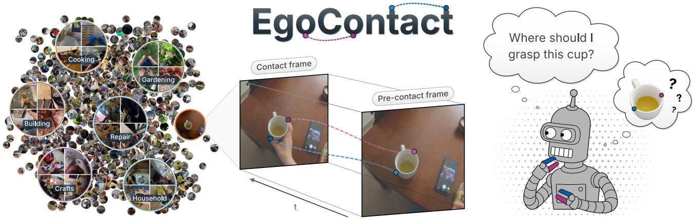
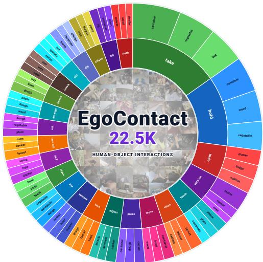
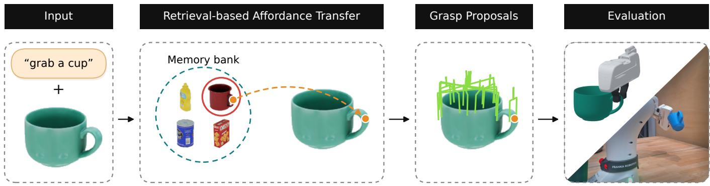
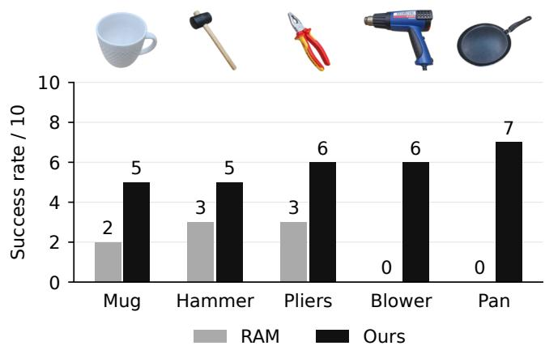
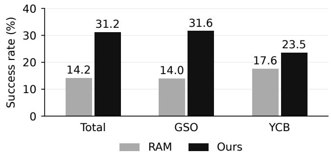

# EgoContact: Evaluating Physical Intelligence with Egocentric Video

Adam Deryło1,2, Alexey Gavryushin3, Daniel Cremers2,6, Marc Pollefeys3,4, Xi Wang5,3,2,6

  
Fig. 1. Overview of EgoContact. Egocentric video offers a scalable source of interactions with the environment. We use the captured human behavior to probe what the environment affords. Across diverse interactions (left), we annotate objects, actions, and contact points in contact and pre-contact frames (middle), enabling evaluation of where models predict contact for an intended action (right). Project page: https://egocontact.github.io

Abstract—Egocentric video has emerged as one of the most scalable sources of data for learning generalizable manipulation priors. Yet, despite its growing use in pretraining robotic policies, it has been underutilized as a validation tool for physical intelligence, a key component of which is understanding where to make contact with an object to achieve an intended interaction. We present EgoContact, a large-scale egocentric dataset for evaluating the generalizability and precision of learned manipulation priors through future contact-point prediction. EgoContact contains 22.5K manually verified interaction events, each with a pre-contact observation, semantic intent, and pixel-precise contact locations. We find that current methods often struggle to predict precise interaction contacts and sometimes fail to localize the target object in diverse, in-the-wild scenes, even when allowed multiple predictions. Furthermore, we demonstrate the usefulness of EgoContact’s annotated interactions for robotic manipulation: simply using EgoContact as the memory bank of an existing affordance-transfer policy improves grasp success from 14.2% to 31.2% in simulation and from 16% to 58% on a real robot.

Index Terms—Egocentric vision, affordance grounding, contact prediction, robotic grasping.

## I. INTRODUCTION

OBOTIC manipulation has advanced rapidly in controlled settings, yet reliable generalization to diverse, in  
the-wild scenarios remains elusive. Such generalization calls   
for more than just passive semantic understanding of objects   
and available actions, requiring a model capable of translating   
high-level intent into concrete physical interactions in novel   
environments. Yet acquiring such physical grounding directly

from robot experience is fundamentally difficult to scale, as real-world robot data remains costly and confined to narrow domains. By contrast, egocentric video offers a compelling source of scalable supervision. Everyday human activity captures a wide range of objects manipulated for diverse purposes in natural environments [1], [2]. Recent work therefore extracts pseudo-labeled interactions from egocentric video to pretrain dexterous and generalizable robotic policies [3]–[5]. While pseudo-labeled egocentric data has enabled scaling policy training, it offers no direct way to evaluate the physical knowledge these models actually acquire.

Evaluating such physical intelligence at scale, however, remains a fundamental challenge. Robot rollouts provide direct evidence, but are expensive, difficult to reproduce, and entangle physical understanding with perception, planning, embodiment, and control. Simulation is repeatable, but restricts the diversity of objects, interactions, and physical conditions and introduces a sim-to-real gap. Existing egocentric benchmarks retain real-world diversity, but primarily model the observed human through actions, narrations, objects, or motion [1], [2], [6], [7]. We instead ask whether human behavior can serve as a reproducible probe of the physical knowledge that makes that behavior possible.

Each observed interaction ties a semantic intent to a concrete realization on an object surface. Knowing that a bottle is graspable, for example, does not specify where the fingers should make contact; recognizing that a drawer will be opened does not identify the handle through which opening can be realized. We therefore focus on a specific component of physical intelligence: the ability to ground an intended action in the object locations that physically support it. Predicting these locations before contact isolates an action-relevant decision without prescribing an embodimentspecific hand pose, trajectory, or controller. This leads to our central question: can current models robustly infer precise, action-conditioned contacts before interaction? Unfortunately, existing benchmarks cannot resolve this question, constrained either by limited spatial precision in their annotations [1] or by insufficient scale and diversity [7]–[9].

To close this gap, we introduce EgoContact, a largescale validation benchmark designed to answer this question. EgoContact contains 22.5K interaction events sampled from unconstrained egocentric video. Each event includes a manually verified contact time, pre-contact observations, semantic intent, object localization, and two pixel-precise contact locations representing the thumb and an opposing finger. These annotations formulate future contact-point prediction: given a pre-contact observation and its action context, a model predicts where the subsequent interaction will occur. The task combines the diversity of human video with fixed, manually verified ground truth, enabling repeatable evaluation without requiring robot execution.

Using EgoContact, we evaluate current methods for affordance grounding, affordance transfer, and vision-language reasoning. We find that these methods often struggle to predict precise interaction contacts and sometimes fail to localize the target object, even when allowed multiple predictions. We then examine whether the understanding measured by EgoContact is relevant to robotic manipulation. To investigate this, we replace the memory bank of RAM [10], an existing affordancetransfer policy, with EgoContact while keeping the rest of the policy fixed. This simple change improves grasp success in both simulation and real-world experiments, demonstrating that contact grounding matters for robotic manipulation.

In summary, we make three contributions:

• We introduce EgoContact, a validation dataset that uses human interaction as a scalable probe of precise, actionconditioned physical grounding.

• We benchmark a wide range of methods, finding that all struggle to predict precise contact points.

• We show that contact grounding matters for manipulation: an EgoContact memory bank improves grasp success in simulation and on a real robot.

## II. RELATED WORKS

a) Egocentric Video Datasets: Egocentric video datasets such as EPIC-KITCHENS [2] and Ego4D [1] offer thousands of hours of unscripted manipulation footage. Benchmarks built on top of these corpora focus primarily on understanding human behavior during hand–object interactions, evaluating tasks such as action recognition [2], [11], future hand trajectory forecasting [7], and short-term object anticipation [1]. EPIC-Contact [12], for example, annotates dense 3D meshes and contact surfaces during active manipulation to study human hand–object pose reconstruction. EgoContact departs from this human-centric focus. Rather than modeling human hand kinematics or tracking motion, we use human interactions as physical demonstrations of what the environment affords. By grounding the resulting contact points onto untouched precontact frames, we evaluate whether models can infer precise interaction locations from the environment itself.

b) Robot Learning from Human Behavior: Egocentric human video has become one of the most scalable supervision sources for robot learning. Earlier work learned reusable visual representations from diverse human video [3], [4], [13]. More recent efforts train action-conditioned policies at far greater scale [5], [14]. Notably, EgoScale [5] reports a log-linear relation between human-data scale and action-prediction loss, which in turn tracks robot performance. Other works [14]– [16] likewise show that training with egocentric human data improves downstream robot policy performance and generalization. Yet these efforts use egocentric video primarily as a source of training supervision. EgoContact takes this a step further by using observed human interactions to evaluate whether models can ground semantic intent in precise contact locations.

c) Affordance Grounding: Given an image and an intended action, affordance grounding methods predict where on an object the interaction should occur. Outputs include heatmaps, part masks, and interaction points [8], [9], [17]– [19]. Contacts occupy a useful middle ground: more precise than object- or part-level regions, yet independent of a complete hand pose, trajectory, or controller. Contact-conditioned and hybrid systems similarly factor manipulation into global interaction-point localization followed by embodiment-specific grasp generation or dense control [4], [10], [20], [21]. EgoContact isolates the former, testing whether a model can identify the spatially precise contacts needed to guide the latter.

## III. DATASET

Human behavior reveals what the environment affords. Each successful human–object interaction observed in egocentric video is in essence a display of that object’s affordances. While most egocentric datasets are human-centric and seek to model human behavior, we subvert this perspective to focus on what these interactions reveal about the environment being manipulated. With this perspective in mind, we construct EgoContact, a large-scale validation dataset designed to complement existing evaluation frameworks by testing the generalizability of learned manipulation priors across diverse real-world environments.

## A. Data Curation

To evaluate manipulation priors across diverse environments, we source footage from Ego4D [1]. While datasets such as EPIC-KITCHENS [2] and Egocentric-10K [22] provide rich manipulation footage within particular domains, Ego4D captures in-the-wild human-object interactions across a wider variety of settings. We focus our annotation efforts on 37 manipulation-heavy scenarios, including cooking, construction, repair, gardening, crafts, and laboratory work, and exclude scenarios dominated by passive observation, locomotion, or social behavior. This yields 8,626 candidate clips spanning diverse environments, objects, and interaction types (Fig. 1). Across those clips, we use VISOR-HOS [6] to automatically detect candidate interaction timestamps. This yields 47,135 candidate events that annotators subsequently verify, adjust, and annotate.

  
Fig. 2. Diversity of EgoContact. The 24 most frequent actions (inner ring) and top three objects per action (outer ring), selected from 22.5K annotated contact events spanning 381 object and 85 action categories.

## B. Annotations

We annotate each verified interaction across temporal, spatial, and semantic dimensions.

Temporal annotations. Each event is anchored at the initial contact frame $f _ { c } ,$ defined as the first frame where contact is established and object manipulation begins. Next, we identify the observation window, an interval of frames $[ f _ { p _ { \mathrm { f i r s t } } } , f _ { p _ { \mathrm { l a s t } } } ]$ where the target object is visible and the contact surface is not trivialized by the hand’s proximity. We do so by first stepping back at least 0.5 s from $f _ { c }$ to select $f _ { p _ { \mathrm { l a s t } } }$ once these criteria are fulfilled, and then stepping back further up to 2.5 s before $f _ { c }$ to establish $f _ { p _ { \mathrm { f i r s t } } }$ . In total, this leaves each event with an uncontacted observation window for anticipation and the contact frame $f _ { c }$ as ground-truth evidence of the object’s realized affordance.

Spatial annotations. Having established temporal anchors, we annotate two contact points at $f _ { c } \mathrm { : }$ the thumb contact and an opposing virtual finger contact. These points are transferred onto $f _ { p _ { \mathrm { l a s t } } } :$ , with visibility flags indicating whether a contact lies on the backside of the object. This grounds the realized affordance directly onto the untouched object in $f _ { p _ { \mathrm { l a s t } } }$ . This two-point representation is motivated by the virtual-finger abstraction, in which multiple fingers can act as a functional unit opposing the thumb [23]. MultiGripperGrasp [24] further demonstrates successful transfer of parallel-jaw grasp poses to multi-fingered hands in simulation, supporting the use of a compact representation that is not tied to human hand kinematics. Lastly, we also annotate the bounding box of the to-be-interacted object.

Semantic annotations. Because the same object affords different contacts depending on the action (e.g., slicing with a knife vs. handing it over), we describe each interaction in natural language. We normalize these descriptions into canonical verb–noun pairs using Qwen3-VL [25] and map them to the Ego4D taxonomy [1] to consolidate paraphrases. This yields action-conditioned queries to test whether models can predict context-dependent contacts on the same object.

TABLE I  
COMPARISON OF EGOCONTACT AND PREVIOUS BENCHMARKS. EXISTING AFFORDANCE BENCHMARKS EITHER EVALUATE ON STATIC EXOCENTRIC IMAGES, LACK CONTACT-LEVEL PRECISION, OR PROVIDE VIDEO HEATMAPS AT VERY SMALL SCALE. EGOCONTACT IS THE FIRST BENCHMARK TO COMBINE DIVERSE EGOCENTRIC VIDEO, PRE-CONTACT TEMPORAL GROUNDING, AND MANUALLY VERIFIED TWO-POINT CONTACTS ACROSS HUNDREDS OF OBJECT AND ACTION CATEGORIES AT SCALE. EGO: EGOCENTRIC VIEW; TEMP.: TEMPORALLY GROUNDED; OBJ. AND ACT.: OBJECT AND ACTION CATEGORIES.
<table><tr><td>Dataset</td><td>Ego</td><td>Temp.</td><td></td><td>Obj. Act. Annotation</td><td></td><td>Scale</td></tr><tr><td>AGD20K [8]</td><td>X</td><td>X</td><td>50</td><td>36</td><td>Heatmap</td><td>2,250</td></tr><tr><td>3DOI [9]</td><td>X</td><td>X</td><td>一</td><td>3</td><td>Contact point</td><td>10,418</td></tr><tr><td>Ego4D STA [1]</td><td>L</td><td>一</td><td>110</td><td>115</td><td>Boxes only</td><td>37,900</td></tr><tr><td>Joint Hand Motion [7]</td><td>一</td><td>V</td><td>162</td><td>73</td><td>Heatmap</td><td>401</td></tr><tr><td>EgoContact</td><td>L</td><td>L</td><td>381</td><td>85</td><td>Contact points 22,523</td><td></td></tr></table>

## C. Dataset Statistics

EgoContact comprises 22,523 verified interaction events spanning 381 object categories and 85 canonical action verbs across 37 manipulation scenarios. As shown in Figure 2, the action–object distribution is long-tailed: common actions such as taking and holding dominate, while less frequent actions include kneading dough, attaching wires, and operating mowers. The interactions span everyday household tasks, such as opening drawers, turning on faucets, and cleaning plates, as well as outdoor and workshop activities, such as adjusting bicycles and inserting tools. This variety and the in-the-wild nature of the source data allow us to probe the robustness of physical intelligence across diverse methods.

## D. Relation to Existing Datasets

To our knowledge, EgoContact is the first validation dataset for affordance understanding that combines contact-point precision, large scale, and grounding in real-world interactions. AGD20K [8] and 3DOI [9] provide affordance annotations on static images, without grounding their labels in observed interactions. Ego4D STA [1] offers temporal grounding at scale, but its bounding-box annotations support evaluation of target-object localization rather than precise physical contacts. Joint Hand Motion [7] provides interaction heatmaps grounded in egocentric video, but is limited to 401 publicly available samples at the time of writing. Table I summarizes these differences. We omit datasets with automatically derived pseudoground-truth labels, such as HOVA-500K [18], from this comparison. While such labels can provide scalable training supervision, we have found them to be highly imprecise at times, limiting their suitability as ground truth for evaluating physical intelligence. This limitation was one of the motivations behind our effort.

## IV. EXPERIMENTS

Evaluating the physical intelligence required for generalizable robotic manipulation presents a trade-off between real-world fidelity, scalability, and reproducibility. On one hand, real-robot rollouts test this capability directly, but are expensive to conduct and difficult to reproduce reliably. On the other hand, evaluation in simulation is repeatable and costefficient to scale, but is limited by the realism and diversity of available assets and tasks. We use EgoContact data as the basis for a complementary approach to evaluating knowledge of how to interact with the environment. In doing so, we treat the human behavior depicted in egocentric footage as samples of the affordances of the observed environment. The scale and diversity of such interaction data allow us to probe the physical intelligence of current methods across a broad range of realworld settings. Given such perspective, we aim to answer the following questions:

1) Do current models possess physically precise affordance understanding?

2) And how does it translate to robotic manipulation?

## A. RQ1: Do Current Models Possess Physically Precise Affordance Understanding?

EgoContact enables us to assess the robustness of current methods’ affordance understanding at low cost, reproducibly, and at scale. Specifically, we do so through the task of future contact-point estimation.

1) Task Formulation: Given a pre-contact observation I and a semantic or spatial query q, a model predicts a ranked list of candidate contact locations $\{ \hat { p } _ { i } \} _ { i = 1 } ^ { K }$ in image space at which contact would realize the specified interaction. Ground truth is obtained by manually annotating the contact locations from the subsequent interaction in the pre-contact observation. In other words, we ask models where they would make contact with an object to carry out the intended action, and compare their predictions with the contact observed in the human interaction. For a common evaluation across methods, we measure prediction accuracy against a single annotated point: the opposing virtual finger contact introduced in the dataset section. The ranked candidates represent alternative predictions of this same contact.

2) Evaluated Methods: We evaluate existing methods from three families: affordance grounding, affordance transfer, and vision-language models. From the affordance grounding family, we benchmark GLOVER++ [18] and 3DOI [9]; from affordance transfer, we evaluate RAM [10] and Robo-ABC [20]. Motivated by their use as policy backbones, we evaluate two point-prediction VLMs, RoboPoint [19] and MolmoPoint [26], and three general-purpose VLMs, Qwen 3.8 27B [27], Gemma 4 31B [28], and the state-of-the-art proprietary model Muse Spark 1.3 [29].

All methods receive the observation frame and a semantic instruction, such as “pick up a cup,” except 3DOI, which receives the annotated target-object box center as a spatial prompt. We also use this center as an oracle baseline to measure contact accuracy from object localization alone.

For heatmap outputs, we extract local peaks with a $3 \times 3$ maximum filter and rank them by score, retaining up to ten candidates scoring at least 20% of the global maximum. For RAM, we evaluate ranked heatmap peaks, while for Robo-ABC, we use the contact selected by its retrieval-and-transfer pipeline. A minimal harness collects ranked points via tool calls from general-purpose VLMs, whereas RoboPoint and MolmoPoint produce native point coordinates.

TABLE II  
FUTURE CONTACT-POINT ESTIMATION ON EGOCONTACT. CURRENTMETHODS STRUGGLE TO GROUND SEMANTIC INTENT INTO REALISTICCONTACT POINTS. NOTABLY, NO EVALUATED METHOD BEATS THE NAIVEBASELINE OF PREDICTING THE CENTER OF THE OBJECT.
<table><tr><td rowspan="2">Method</td><td colspan="2">PiB ↑</td><td colspan="2">mDST ↓</td><td colspan="2">PCK@1%↑</td><td colspan="2">PCK@5% ↑</td></tr><tr><td></td><td>Top-1 Top-5 Top-1 Top-5</td><td></td><td></td><td>Top-1 </td><td>Top-5</td><td>Top-1 </td><td>Top-5</td></tr><tr><td>Naive baseline BBox center</td><td>100.0</td><td>100.0</td><td>0.04</td><td>0.04</td><td>7.36</td><td>7.36</td><td>73.78</td><td>73.78</td></tr><tr><td colspan="9">Affordance grounding</td></tr><tr><td>GLOVER++</td><td>21.02</td><td>28.32</td><td>0.16</td><td>0.14</td><td>0.92</td><td>2.79</td><td>14.43</td><td>20.59</td></tr><tr><td>3DOI</td><td>59.96</td><td>75.33</td><td>0.10</td><td>0.06</td><td>3.49</td><td>11.95</td><td>39.30</td><td>60.62</td></tr><tr><td colspan="9">Affordance transfer</td></tr><tr><td>RAM</td><td>29.49</td><td>40.41</td><td>0.17</td><td>0.13</td><td>1.47</td><td>4.63</td><td>17.95</td><td>31.22</td></tr><tr><td>Robo-ABC</td><td>33.69</td><td>一</td><td>0.19</td><td>一</td><td>1.59</td><td>一</td><td>18.02</td><td>1</td></tr><tr><td colspan="9">VLMs</td></tr><tr><td>RoboPoint</td><td>42.18</td><td>50.25</td><td>0.13</td><td>0.11</td><td>1.19</td><td>5.04</td><td>26.47</td><td>40.78</td></tr><tr><td>MolmoPoint</td><td>45.70</td><td>49.66</td><td>0.14</td><td>0.12</td><td>2.55</td><td>3.09</td><td>31.94</td><td>35.91</td></tr><tr><td>Qwen 3.8 27B</td><td>13.74</td><td>22.56</td><td>0.25</td><td>0.21</td><td>0.34</td><td>1.73</td><td>7.78</td><td>16.30</td></tr><tr><td>Gemma 4 31B</td><td>13.68</td><td>20.71</td><td>0.22</td><td>0.19</td><td>0.45</td><td>1.25</td><td>8.27</td><td>14.54</td></tr><tr><td>Muse Spark 1.3</td><td>57.32</td><td>79.91</td><td>0.10</td><td>0.05</td><td>3.44</td><td>11.05</td><td>42.35</td><td>71.82</td></tr></table>

3) Metrics: We evaluate predictions using Point-in-Box (PiB), mean normalized contact distance (mDST), and Percentage of Correct Keypoints (PCK) across Top-1 and Top-5 candidates. PiB checks whether any candidate falls inside the target object bounding box, reflecting coarse localization. Adapting the distance-to-mask metric from Robo-ABC [20] to point contacts, mDST measures the Euclidean distance from the predicted point to the ground-truth contact, normalized by the image diagonal, taking the minimum error across the top-k candidates. PCK measures the fraction of predictions within a tolerance of 1% or 5% of the diagonal. Together, these metrics separate coarse object localization from fine-grained contact placement.

4) Results: Predicting future contact points from semantic intent remains an open challenge across all evaluated model families, with no method outperforming the naive boundingbox center baseline (Table II). Errors stem from two distinct bottlenecks: object localization and fine-grained contact placement. First, models frequently fail at coarse localization. Low PiB scores indicate that predictions often miss the target object entirely before any contact reasoning can take place. Second, even when the object is correctly identified, precise contact prediction collapses. Among VLMs, Muse Spark 1.3 achieves the strongest overall performance, reaching 79.91% Top-5 PiB and 71.82% PCK@5%, yet drops to only 11.05% at the strict PCK@1% threshold. Similarly, 3DOI achieves the highest Top-5 PCK@1% (11.95%), but it receives an oracle spatial prompt that gives away the object location.

Proposing multiple candidates (Top-5) accommodates valid alternative grasp hypotheses, yet candidate sets still rarely capture the observed interaction at fine tolerance. Strikingly, the oracle box center achieves 73.78% PCK@5%, surpassing every evaluated model. This demonstrates that performance on loose distance thresholds is largely driven by coarse object localization rather than genuine contact understanding. This precision gap directly motivates RQ2: evaluating whether ground-truth contact precision translates into downstream robotic manipulation success.

  
Fig. 3. Grasp evaluation pipeline. Given an object image and an action query (left), RAM retrieves a relevant interaction from an affordance memory ban of reference images, action descriptions, and contact annotations, then transfers its contact to the target object (middle-left). The predicted contact guides selection among grasp proposals (middle-right), and the selected grasp is evaluated in simulation and on a real robot (right).

## B. RQ2: How does it translate to robotic manipulation?

EgoContact allows us to evaluate contact-point prediction at scale. But is the understanding measured by this benchmark relevant to robotic manipulation? To investigate this, we use RAM [10], which predicts contacts by transferring past interactions from a memory bank. We replace its original memory bank with EgoContact and compare grasp success in simulation and on a real robot. This setup lets us examine the usefulness of our annotated interactions while keeping the policy fixed and avoiding changes from fine-tuning.

1) Evaluation in Simulation: We use the MultiGripper-Grasp evaluation benchmark in Isaac Sim [24] and its set of 346 GSO and YCB objects. For each object, we render an RGB image and pass it to RAM with the instruction “pick up” and the selected memory bank (Figure 3). We project the predicted contact into an object point cloud captured from the same viewpoint. GraspGenX [30] generates proposals from this cloud, and we select the grasp whose midpoint is closest to the projected contact. We place a Franka-Panda gripper at the selected pose and close it. A grasp succeeds if the object remains held under gravity for at least three seconds.

2) Evaluation on a Real Robot: We follow RAM’s realrobot setup [10], using a Franka Panda arm, an RGB-D camera, and AnyGrasp [31] proposals with the same contact prediction and grasp-selection procedure. We evaluate a mug, hammer, pliers, air blower, and pan, with ten trials per object and memory bank. After closing the gripper at the selected grasp, the robot lifts the object. A trial succeeds if the object remains held after lifting.

3) Results: Using EgoContact improves grasp success in both settings. On the real robot, the improvement holds across all five objects, including the blower and pan, on which the original memory bank produces no successful grasps (Figure 4). Overall, successful trials increase from 8/50 to

Fig. 4. Real-robot grasp success on a mug, hammer, pliers, air blower, and pan, with ten trials per object using each memory bank.  
  
Fig. 5. Simulation grasp success over 346 objects: 329 from GSO and 17 from YCB. Each memory bank guides one grasp per object.

29/50. In simulation, success more than doubles relative to RAM’s original memory bank (Figure 5). These gains are consistent with the intuition that identifying an actionable region helps select a successful grasp: proposals near a useful contact are more likely to support the intended interaction. EgoContact’s annotations can thus guide better grasp selection without further training. The comparison measures the benefit of the memory bank as a whole, including its interaction coverage and contact annotations.

## V. CONCLUSION

We contribute EgoContact, a large-scale egocentric validation dataset for studying physical intelligence through action-conditioned contact prediction. EgoContact addresses the need for precise, reliable evaluation across diverse realworld interactions, which is constrained by the limited scale or coarse annotations of existing benchmarks and the reliance on automatic pseudo-labels in scalable egocentric supervision. Using its manually verified contact annotations, we benchmark a wide range of models and find that all struggle to translate semantic intent into precise contact predictions that match observed human interactions. Furthermore, replacing the affordance memory bank of an existing transfer policy with EgoContact more than doubles grasp success in both simulation and on a real robot, demonstrating the practical relevance of its annotated interactions. We hope EgoContact will help the robotics community assess the generalizability of learned manipulation priors and accelerate progress toward physically grounded robotic manipulation.

## REFERENCES

[1] K. Grauman et al., “Ego4d: Around the world in 3,000 hours of egocentric video,” Oct. 2021.

[2] D. Damen et al., “Scaling egocentric vision: The epic-kitchens dataset,” Apr. 2018.

[3] S. Nair, A. Rajeswaran, V. Kumar, C. Finn, and A. Gupta, “R3m: A universal visual representation for robot manipulation,” Mar. 2022.

[4] A. Gavryushin et al., “Maple: Encoding dexterous robotic manipulation priors learned from egocentric videos,” Apr. 2025.

[5] R. Zheng et al., “Egoscale: Scaling dexterous manipulation with diverse egocentric human data,” Feb. 2026.

[6] A. Darkhalil et al., “Epic-kitchens visor benchmark: Video segmentations and object relations,” Sep. 2022.

[7] S. Liu, S. Tripathi, S. Majumdar, and X. Wang, “Joint hand motion and interaction hotspots prediction from egocentric videos,” Apr. 2022.

[8] H. Luo, W. Zhai, J. Zhang, Y. Cao, and D. Tao, “Grounded affordance from exocentric view,” Aug. 2022.

[9] S. Qian and D. F. Fouhey, “Understanding 3d object interaction from a single image,” May 2023.

[10] Y. Kuang et al., “Ram: Retrieval-based affordance transfer for generalizable zero-shot robotic manipulation,” Jul. 2024.

[11] T. Perrett et al., “Hd-epic: A highly-detailed egocentric video dataset,” Feb. 2025.

[12] S. Bansal, Z. Zhu, S. Tripathi, J. Zhao, M. J. Black, and D. Damen, “Towards in-the-wild egocentric 3d hand-object pose estimation,” Jun. 2026.

[13] A. Majumdar et al., “Where are we in the search for an artificial visual cortex for embodied intelligence?” Mar. 2023.

[14] R. Punamiya, S. Kareer, Z. Liu, J. Citron, R.-Z. Qiu et al., “Egoverse: An egocentric human dataset for robot learning from around the world,” arXiv preprint arXiv:2604.07607, Apr. 2026. [Online]. Available: https://arxiv.org/abs/2604.07607

[15] S. Kareer et al., “EgoMimic: Scaling imitation learning via egocentric video,” arXiv preprint arXiv:2410.24221, 2024. [Online]. Available: https://arxiv.org/abs/2410.24221

[16] R. Yang et al., “EgoVLA: Learning vision-language-action models from egocentric human videos,” arXiv preprint arXiv:2507.12440, 2025. [Online]. Available: https://arxiv.org/abs/2507.12440

[17] S. Qian, W. Chen, M. Bai, X. Zhou, Z. Tu, and L. E. Li, “Affordancellm: Grounding affordance from vision language models,” Jan. 2024.

[18] T. Ma, J. Zheng, Z. Wang, Z. Gao, J. Zhou, and J. Liang, “Glover++: Unleashing the potential of affordance learning from human behaviors for robotic manipulation,” May 2025.

[19] W. Yuan et al., “Robopoint: A vision-language model for spatial affordance prediction for robotics,” Jun. 2024.

[20] Y. Ju, K. Hu, G. Zhang, G. Zhang, M. Jiang, and H. Xu, “Robo-abc: Affordance generalization beyond categories via semantic correspondence for robot manipulation,” Jan. 2024.

[21] P. Sundaresan et al., “Homer: Learning in-the-wild mobile manipulation via hybrid imitation and whole-body control,” 2025.

[22] Build AI, “Egocentric-10k,” 2025. [Online]. Available: https: //huggingface.co/datasets/builddotai/Egocentric-10K

[23] T. Iberall, “The nature of human prehension: Three dextrous hands in one,” in IEEE International Conference on Robotics and Automation (ICRA), vol. 4, 1987, pp. 396–401.

[24] L. F. Casas, N. Khargonkar, B. Prabhakaran, and Y. Xiang, “Multigrippergrasp: A dataset for robotic grasping from parallel jaw grippers to dexterous hands,” in IEEE/RSJ International Conference on Intelligent Robots and Systems (IROS), 2024.

[25] S. Bai et al., “Qwen3-vl technical report,” Nov. 2025.

[26] Allen Institute for AI, “Molmopoint: Better pointing architecture for vision-language models,” https://allenai.org/blog/molmopoint, 2026, accessed 2026-08-10.

[27] Qwen Team, “Qwen3.8-Max: A new bar for coding and cowork,” Aug. 2026. [Online]. Available: https://qwen.ai/blog?id=qwen3.8

[28] Gemma Team, “Gemma 4 technical report,” arXiv preprint arXiv:2607.02770, Jul. 2026. [Online]. Available: https://arxiv.org/ abs/2607.02770

[29] Meta AI, “Introducing Muse Spark 1.3,” Sep. 2026. [Online]. Available: https://research.meta.ai/blog/introducing-muse-spark-1-3

[30] B. Han et al., “Graspgen-x: Cross-embodiment 6-dof diffusion-based grasping,” in Proceedings of the IEEE/CVF Conference on Computer Vision and Pattern Recognition (CVPR), 2026.

[31] H.-S. Fang et al., “AnyGrasp: Robust and efficient grasp perception in spatial and temporal domains,” IEEE Transactions on Robotics, 2023.