# ElasticFormer: Detecting Objects in HRW Shots via Elastic Computing Vision Transformer

Wenxi Li<sup>‡</sup>\*, Jingchen Huang<sup>§,¶</sup>\*, Chenyang Lyu<sup>∥</sup>, Moran Liu<sup>§,¶,#</sup>,

Haozhe Lin<sup>§</sup>, Guiguang Ding<sup>§,⋆†</sup>, Yuchen Guo<sup>§†</sup>

<sup>§</sup>Beijing National Research Center for Information Science and Technology, Tsinghua University, Beijing, China

<sup>¶</sup>Department of Automation, Tsinghua University, Beijing, China <sup>‡</sup>KLATASDS-MOE, School of Statistics, East China Normal University, Shanghai, China <sup>⋆</sup>School of Software, Tsinghua University, Beijing, China <sup>#</sup>Zhuoxi Lab, Hangzhou, China

<sup>∥</sup>AI Business, Alibaba International Digital Commerce, Hangzhou, China wxli@sfs.ecnu.edu.cn, huang-jc23@mails.tsinghua.edu.cn, {linhz, dinggg}@tsinghua.edu.cn, liumoreran@gmail.com, lyuchenyang.dcu@gmail.com, yuchen.w.guo@gmail.com

## Abstract

Recent advances in gigapixel-level imaging have brought High-Resolution Wide shots to the forefront of research. However, these images present significant challenges: extreme sparsity of foreground, gigapixel-level resolutions and diverse target counts. This makes traditional closeup detectors inaccurate and slow as they are overwhelmed by the background. Although previous research has explored sparse backbones, their fixed sparsity patterns lack the adaptability required to handle diverse target numbers. To address this, we introduce ElasticFormer, a sparse backbone that dynamically allocates computational resources based on foreground proportion. After scoring windows based on variance, proposed ElasticSelector module will predict the foreground proportion for top-k selection. The mechanism guides the model to select target-containing windows, scaling resources in areas where objects are clustered. We introduce a novel lossfunction combined with the 3-phase training strategy for ElasticSelector, allowing it to function properly when bounding box annotations are missing. A WSOD study is carried on PASCAL VOC 2007 to evaluate its extensibility. Further, ElasticNet is created to verify its backbone-agnostic nature. In experiments on the PANDA gigapixel benchmark, ElasticFormer reduces backbone FLOPs by 80% while achieving a significant improvement in $A P _ { 5 0 }$ when compared tofixed-ratio sparse methods.

## 1. Introduction

Object detection is a core task in computer vision that involves both locating and identifying objects of interest in an image. It typically produces, for each detected instance, a category label and a spatial extent (usually an axis-aligned bounding box). Models such as Fast R-CNN [18] have demonstrated strong performance on MS COCO [25]. However, with the development of nondestructive high-resolution imaging systems, High-Resolution Wide (HRW) shots detection has drawn increasing attention [6, 16], which refers to object detection in imagery characterized by extremely high spatial resolution and a wide field of view, such as images captured by gigapixel-scale drone [33], satellite [12, 13, 37], or panoramic camera [4].

Firstly, in HRW scenarios, foreground density is much lower than that in conventional detection images. While typical datasets have foregrounds covering over 50% of the image, HRW images often contain less than 15% [22], with large background regions such as sky or vegetation. Given such extreme sparsity, cutting-edge detectors, including DINO [40], Deformable DETR [43], RMT [17], among others, still struggle with overwhelming background.

Secondly, limited computational resources pose another challenge. HRW detection scenarios (e.g., UAV-based inspection [14] and medical detection [24]) often require realtime responsiveness. As resolution scales from millions of pixels in COCO [25] to billions in PANDA [36], the cost of conventional detectors grows polynomially with input size, leading to inference up to two orders of magnitude slower.


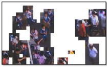

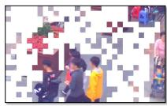

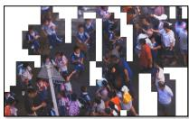

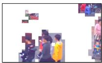

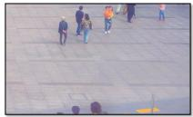  
(a) Origin Images

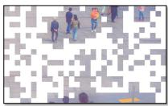  
(b) SparseFormer (fixed ratio = 0.5)

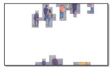  
(c) ElasticFormer (adaptive ratio)  
Figure 1. Comparison of inference region selection between different backbones. (b) SparseFormer selects a fixed ratio of regions for processing, regardless of input variability. (c) Elastic-Former adaptively selects a dynamic ratio of informative regions based on the input image content, enabling more flexible and efficient inference.

Thirdly, HRW scenarios show extreme variation in target counts, ranging from a few to dozens, as shown in Figure 1(a). Thus models must remain effective across both sparse and dense cases. However, existing approaches such as SaccadeDet [23] and SparseFormer [22] overlook this issue, as they rely on fixed sparsity rates that fail to adapt to fluctuations in target quantity. Consequently, their effectiveness is significantly reduced when confronted with highly variable target distributions, illustrated in Figure 1(b).

Inspired by human cognitive efficiency and recent advances [1, 7, 19, 32, 41], we propose ElasticFormer, a detection framework that introduces elasticity into backbone design. Unlike fixed-ratio methods that waste computation in HRW scenes with highly variable foreground proportion, ElasticFormer dynamically allocates resources by adaptively selecting image patches according to the predicted foreground proportion. A lightweight module, ElasticSelector, guides patch selection independently at each stage in backbone, enabling fine-grained perception while scaling cost with foreground proportion rather than overall image size. It is noteworthy that ElasticSelector is backboneagnostic, motivating the creation of ElasticNet for verification. Experiments show that ElasticFormer reduces computation by up to 80% while improving accuracy compared with SparseFormer [22], ElasticNet also achieves a 87% computational saving compared with ResNet-50 [20].

A further challenge in weakly supervised object detection (WSOD) is the absence of bounding-box annotations, making foreground proportion hard to compute. To address this, we design a new loss function for ElasticSelector, which uses either ground truth or pseudo labels as supervision. Validation on the PASCAL VOC 2007 dataset [15] demonstrates that this extension reduces FLOPs by at least 50% while improving both mAP and CorLoc.

To summarize, our key contributions are:

• We propose ElasticFormer, a novel sparse Vision Transformer-based backbone that not only addresses the extremely sparse target distribution and redundant background in HRW images, but also dynamically adapts to varying numbers of targets across diverse scenes.

• We further introduce a lightweight component, ElasticSelector, which dynamically predicts the foreground proportion during the forward inference process based on intermediate features, providing efficient guidance with negligible additional computational overhead.

• We design a label-free loss function that minimizes the gap between the predicted and actual foreground proportions, enabling self-supervised optimization of ElasticSelector without the need for extra annotations.

• We validate the proposed backbone on PANDA [36] and PASCAL VOC 2007 [15] datasets, and further extend our backbone-agnostic design to CNN-based architectures, consistently demonstrating its effectiveness and generality across model families.

## 2. Related Work

Object Detection in High-Resolution Wide Shots. HRW detection addresses the critical challenge of locating sparse objects in gigapixel-scale imagery, where target coverage is often below 15% and background is highly diverse [36], different from ImageNet [11]. While general-purpose detectors like Faster R-CNN [18] and Deformable Convolutional Networks [9] achieve strong performance on dense scenes, their cost scales prohibitively with input resolution, causing severe latency. Shufflenet [42] reduces complexity via grouped convolutions, yet lacks adaptive computation. DynamicDet [27] routes images by predicted difficulty, but its binary partitioning is ill-suited to HRW shots and maintaining dual branches is cumbersome. While DGE [31] has been applied to enhance vision transformer, it lacks the flexibility required to effectively handle HRW scenarios.

Vision Transformers for Detection. Transformers have revolutionized NLP, and Vision Transformers (ViTs) extend this success to detection by modeling long-range dependencies. However, conventional ViTs process all image tokens equally, incurring quadratic complexity with input size. To reduce cost, methods such as window-based attention [28, 44], multi-layer self-attention [35], and low-rank projection [2] have been proposed. Yet these approaches still face a trade-off between efficiency and accuracy, limiting their effectiveness in HRW detection.

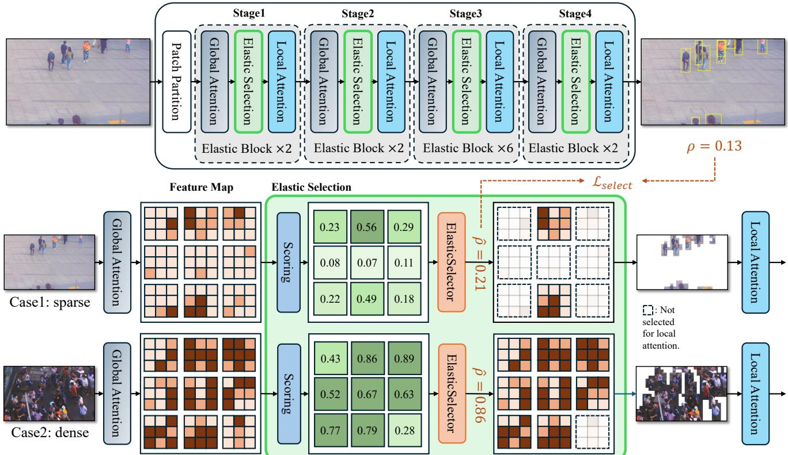  
Figure 2. Architecture Overview of ElasticFormer. The green box represents the ElasticBlock,in which the process of “Scoring” is listed in Eq. (1). Example scoring results of 9 windows is listed here, where the higher score corresponds to the darker color, indicating larger variance and a greater likelihood of containing targets. ElasticSelector selects windows according to their scores and the predicted $\hat { \rho } ,$ shown in Eq. (3). Here the sparse case select 2 windows out of 9 while the dense case select 8 windows as ρˆ differs. ElasticSelector is trained via $\mathcal { L } _ { s e l e c t }$ , in which ρ represents the real foreground proportion.

Sparse Computation Methods. Sparse detection paradigms reduce redundancy by focusing on informative regions. Dynamic token pruning [29] adjust computation per instance but remains limited by rigid backbones. Saliency-guided approaches like SaccadeDet [23] use auxiliary networks to predict candidate regions but introduce cascaded latency and struggle with extreme scale variations in HRW scenes. Fixed-ratio sparsification, exemplified by SparseFormer [22], retain a preset fraction of tokens, which wastes resources in sparse regions and under-allocates in dense ones. Critically, no existing method dynamically modulates token utilization across backbone stages based on spatially varying target density—a gap our ElasticSelector and ElasticFormer explicitly address.

## 3. Method

## 3.1. Overview of ElasticFormer

In the main network, input image is partitioned into nonoverlapping patches of size $( { \frac { H } { 4 } } \times { \frac { W } { 4 } } \times 4 8 )$ where H and W denote the original size of input. Through linear embedding layer, the number of channel is projected into C in the first stage. In subsequent stages, the width and height of the feature maps are progressively halved while channel doubled by merging patches, reshaping the size into $( { \frac { H } { 8 } } \times { \frac { W } { 8 } } \times 2 C )$ for global attention. Feature maps from global attention will be partitioned into winodws of size w × w for local attention, Figure 2 demonstrates a example of $w = 3 .$ , partitioning the feature map into 9 windows. Within each stage, the global attention and local attention modules appear in paired blocks, repeated $d _ { i }$ times. We refer to this repetition count as the depth of that stage, which is set to [2, 2, 6, 2] in ElasticFormer.

In Figure 2, we illustrate the structure of an Elastic Selection module in Stage 2 as an example. The feature map is divided into nine windows, each evaluated by the scoring module to obtain a score. Leveraging a variance-based mechanism, the scoring module assigns higher scores to windows containing richer foreground content. For visualization, windows are shaded with different intensities according to their scores: darker colors indicate higher scores and thus more foreground. Two extreme cases of foreground distribution are shown. In the sparse case, only the upper windows receive high scores, while in the dense case, most windows achieve high scores since they all contain substantial foreground regions.

After scoring, ElasticSelector predicts the overall foreground proportion of the image, which is used as the sparsity rate to guide a top-k selection of windows according to their scores. Discarded windows are marked with black hatching, while the selected ones retain their color and are forwarded to local attention for further foreground feature extraction. The intermediate visualization clearly illustrates how window selection adapts under different foreground proportions, highlighting both sparse and dense cases within the image. Here the proposed $\mathcal { L } _ { \mathrm { s e l e c t } }$ takes the GT foreground ratio $\rho$ as a supervisory signal, guiding ElasticSelector to produce accurate predictions ${ \hat { \rho } } .$

## 3.2. Elastic Selection

Definition of foreground proportion. To establish a transparent and interpretable basis for adaptive computation allocation within ElasticFormer, we choose the foreground proportion $\rho$ as the guidance. This ratio provides a direct geometric measure of the spatial complexity of an image by quantifying the overall area of all objects. First, we define $\rho$ as:

$$
\rho = \alpha \cdot \frac { \cup _ { i } \mathbf { B } \mathbf { B } 0 \mathbf { x } _ { i } } { H \cdot W } .\tag{1}
$$

Here BBox represent the bounding box of the $i ^ { t h }$ object while H and W denoting the size of complete image. $\cup _ { i }$ means summing up the area of all BBoxes where the overlap area will be counted only once. Since the backbone may not require all regions within the bounding box for effective feature extraction, we introduce a scaling factor $\alpha \in ( 0 , 1 )$ for $\rho ,$ encouraging the selection of more critical windows. We fix $\alpha = 0 . 8$ through experiments.

Variance-based token scoring. Identifying windows most likely to contain targets presents a critical challenge, constituting the key to enabling sparse computation in local attention. Observing that background regions (e.g., sky, plaza and roads) typically exhibit more uniform pixel distributions (i.e., lower variance) than object regions, we score each window as below, where the residual effectively captures the variance.

For the input feature map F in shape $( B \times H \times W \times C )$ we compute its average pooled result in shape $\begin{array} { r } { ( B \times \frac { H } { w } \ \times \ } \end{array}$ ${ \frac { W } { w } } \times C )$ and interpolate it back. The residual R is partitioned into ${ \bf R } _ { k }$ by window shape. We use ${ \bf R } _ { k }$ to calculate the score $s _ { k }$ for $k ^ { t h }$ window, then normalize it into $\hat { s } _ { k } \mathrm { : }$

$$
\begin{array} { r l } & { \mathbf { R } = \mathbf { F } - \operatorname { I n t e r p o l a t e } ( \operatorname { A v g P o o l } _ { w \times w } ( \mathbf { F } ) , w ) } \\ & { s _ { k } = f _ { \mathrm { s c o r e } } ( \operatorname { F l a t t e n } ( \mathbf { R } _ { k } ) ) \quad \forall k \in \{ 1 , \dots , N _ { w } \} } \\ & { \hat { s } _ { k } = \displaystyle \frac { \exp ( s _ { k } ) } { \sum _ { j = 1 } ^ { N _ { w } } \exp ( s _ { j } ) } } \end{array}\tag{2}
$$

Here $N _ { w }$ is the total number of windows. Through this computational approach, we construct an ordered sequence of windows whose scores are positively correlated with their variances, prepared for sparse selection. We take an example $( N _ { w } = 9 )$ in Figure 2 to illustrate the score results. Top-k selection. For self-attention module in backbone, limited tokens are needed as background regions do not contain information about objects. We use $\hat { \rho }$ generated by ElasticSelector to select the N highest-scoring windows:

$$
N = \lceil \hat { \rho } \cdot N _ { w } \rceil ,\tag{3}
$$

where $N _ { w }$ is the total number of windows.

These sequentially selected windows correspond to the regions in the image where target objects are most likely to appear. Taking Figure 2 as an example, in Case1:sparse, $N = \left\lceil 0 . 2 1 \cdot 9 \right\rceil = 2$ , thus top-2 windows with score of 0.56 and 0.49 are selected for “Local Attention”.In the following, we detail how ElasticSelector predicts $\hat { \rho }$ that determines the number of windows to be retained.

## 3.3. ElasticSelector

Predicting foreground proportion. In order to obtain such a feature of the overall image, ρ, we used feature map for extraction through a MLP. Because the MLP’s input dimensions are fixed and restricted to one-dimensional vectors, we apply a size-normalization operation to the feature maps:

$$
\begin{array} { r } { \mathbf { F } _ { \mathrm { p o o l e d } } = \mathrm { A d p P o o l } ( \mathbf { F } ) , \quad \quad } \\ { \mathbf { F } _ { \mathrm { f l a t } } = \mathrm { F l a t t e n } ( \mathbf { F } _ { \mathrm { p o o l e d } } ) . \quad \quad } \end{array}\tag{4}
$$

The adaptive average pooling (AdpPool) downsamples the input feature map F (derived from the backbone) to a predetermined, fixed spatial resolution regardless of the original size of input images. Here the size for 4 stages is $[ 3 2 ^ { 2 } , 1 6 ^ { 2 } , 8 ^ { 2 } , 4 ^ { 2 } ]$ The subsequent Flatten layer then serializes the two-dimensional output $\mathbf { F _ { p o o l e d } }$ into a onedimensional feature vector $\mathbf { F } _ { \mathrm { f l a t } }$ . The dimensionality of this vector is inherently determined by the output size chosen for the adaptive pooling and the number of feature channels $C ,$ , and is strategically configured based on the specific stage within the ElasticFormer backbone where ElasticSelector is integrated (larger dimensions for early layers capturing fine details, smaller for deeper semantic layers).

After obtaining the $\mathbf { F } _ { \mathrm { f l a t } } .$ , we employ a lightweight twolayer MLP, $f _ { \mathrm { p r e d } }$ , to predict the foreground proportion $\hat { \rho }$ for ElasticSelector in each stage as shown in Figure 2, marked as stage t:

$$
\hat { \rho } ^ { t } = \sigma ( f _ { \mathrm { p r e d } } ( \mathbf { F } _ { \mathrm { f l a t } } ^ { t } ) )\tag{5}
$$

where layer of Sigmoid ensures that $\hat { \rho }$ lies between 0 and 1. $\hat { \rho }$ will be used for top-k selection, shown in Equation (3). Loss function for ElasticSelector. As a novel module, ElasticSelector requires its own loss function for training. We propose a novel loss that accelerates its convergence while promoting balance between calculation and accuracy:

$$
\mathcal { L } _ { \mathrm { s e l e c t } } = ( \rho - \hat { \rho } ) ^ { 2 } + \gamma \cdot \hat { \rho } ,\tag{6}
$$

<table><tr><td>Method</td><td>Backbone</td><td>GFLOPs-F</td><td>GFLOPs-B</td><td>GFLOPs-O</td><td> $\mathrm { { A P } _ { 5 0 } }$ </td><td> $\mathsf { A P } _ { \mathrm { s m a l l } }$ </td><td> $\mathrm { A P } _ { \mathrm { m e d u i m } }$ </td><td> $\mathsf { A P _ { l a r g e } }$ </td></tr><tr><td>CascadeRCNN [3]</td><td>ResNet-101 [20]</td><td>15.54</td><td>295.24</td><td>310.78</td><td></td><td>0.227</td><td>0.579</td><td>0.765</td></tr><tr><td>ClusDet [38]</td><td>ResNet-50 [20]</td><td>10.35</td><td>196.71</td><td>207.07</td><td>0.718</td><td>0.219</td><td>0.696</td><td>0.782</td></tr><tr><td>DMNet [21]</td><td>ResNet-50</td><td>10.35</td><td>196.71</td><td>207.07</td><td>0.540</td><td>0.119</td><td>0.371</td><td>0.714</td></tr><tr><td>FasterRCNN [16]</td><td>ResNet-50</td><td>10.35</td><td>196.71</td><td>207.07</td><td>0.705</td><td>0.203</td><td>0.712</td><td>0.760</td></tr><tr><td>GigaDet [6]</td><td>CSP-DarkNet-53</td><td>4.61</td><td>87.59</td><td>92.20</td><td>0.684</td><td>0.210</td><td>0.599</td><td>0.762</td></tr><tr><td>PAN [16]</td><td>ResNet-50</td><td>10.35</td><td>196.71</td><td>207.07</td><td>0.715</td><td>0.256</td><td>0.719</td><td>0.768</td></tr><tr><td>RetinaNet [26]</td><td>ResNet-101</td><td>15.77</td><td>299.62</td><td>315.39</td><td></td><td>0.221</td><td>0.561</td><td>0.740</td></tr><tr><td>Dynamic-Head [10]</td><td>Swin-T [28]</td><td>5.74</td><td>109.1</td><td>114.8</td><td>0.592</td><td>0.165</td><td>0.537</td><td>0.694</td></tr><tr><td>Dynamic-Head+SparseFormer</td><td>SparseFormer [22]</td><td>6.29</td><td>58.35</td><td>64.64</td><td>0.771</td><td>0.364</td><td>0.740</td><td>0.863</td></tr><tr><td>Dynamic-Head+ElasticFormer</td><td>ElasticFormer(Ours)</td><td>6.91</td><td>6.58</td><td>13.49</td><td>0.782</td><td>0.409</td><td>0.762</td><td>0.860</td></tr><tr><td>DINO [40]</td><td>ResNet-50 [20]</td><td>6.21</td><td>118.02</td><td>124.24</td><td>0.542</td><td>0.289</td><td>0.530</td><td>0.592</td></tr><tr><td>DINO+ElasticNet</td><td>ElasticNet(Ours)</td><td>6.79</td><td>9.75</td><td>16.54</td><td>0.754</td><td>0.388</td><td>0.734</td><td>0.791</td></tr><tr><td>DINO [40]</td><td>Swin-T [28]</td><td>6.64</td><td>126.19</td><td>132.84</td><td>0.606</td><td>0.367</td><td>0.612</td><td>0.649</td></tr><tr><td>DINO+SparseFormer</td><td>SparseFormer [22]</td><td>6.90</td><td>68.81</td><td>75.71</td><td>0.780</td><td>0.508</td><td>0.781</td><td>0.823</td></tr><tr><td>DINO+ElasticFormer</td><td>ElasticFormer(Ours)</td><td>7.02</td><td>6.11</td><td>13.13</td><td>0.806</td><td>0.515</td><td>0.802</td><td>0.849</td></tr></table>

Table 1. Computational cost and accuracy comparison of different models on PANDA. GFLOPs are calculated exclusively for the backbone and neck when applicable. $\mathbf { \vec { \Delta } } ^ { 6 } \mathbf { \vec { F } } ^ { 5 }$ , $\mathbf { \ddot { \delta B } } ^ { \prime \prime }$ and $\mathrm { ^ { 6 6 } O ^ { 5 } }$ denote foreground, background and overall respectively.

where $\gamma$ lays in the interval (0, 1), motivating smaller $\hat { \rho }$ through $L _ { 1 }$ penalty. We set γ to 0.1 through experiments.

Considering that bounding-box annotations are not always available—such as in weakly supervised object detection scenarios—we further extend the supervisory signal $\rho$ to support model-generated pseudo labels. Specifically, $\rho$ can be computed from either human-annotated ground truth (GT) or from pseudo bounding boxes (pseudo-GT) predicted by the model itself during training. This design allows ElasticSelector to perform label-free self-supervised optimization, making it applicable in both fully and weakly supervised settings.

The residual between $\rho$ and the prediction $\hat { \rho }$ drives ElasticSelector to learn overall image features and accurately infer foreground proportion; concurrently, penalizing the predicted value itself encourages ElasticSelector to minimize its magnitude, once accurate predictions are secured, thereby reducing computational overhead.

As for our ElasticFormer, we apply the loss function to each stage, enabling them to learn the characteristics of their respective feature maps, thereby further enhancing the adaptability of our model. The overall loss function is defined as follows:

$$
\mathcal { L } _ { \mathrm { t o t a l } } = \mathcal { L } _ { \mathrm { b b o x } } + \mathcal { L } _ { \mathrm { s e l e c t } } .\tag{7}
$$

${ \mathcal { L } } _ { \mathrm { b b o x } }$ is the loss generally used for detection task, helping detector to locate targets precisely.

3-Phase training strategy. When training ElasticSelector using pseudo-GT, the model initially generates highly disordered bounding boxes. Under these conditions, the computed density values cannot effectively guide the optimization of ElasticSelector’s parameters and may even exert a negative effect on learning. Moreover, since the backbone’s token budget is directly determined by the density predicted by ElasticSelector, underestimation of density leads to a reduction in supervisory signals for the backbone, thereby impairing its convergence.

We therefore seek to train ElasticSelector with more stable pseudo-GT and to allow the backbone to utilize more tokens during the early period of training, thereby accelerating its convergence. However, a full decoupling of the two branches is not warranted, as achieving a balance between computational overhead and detection accuracy necessitates their coordinated operation. To this end, we introduce a 3- phase training strategy:

First, we freeze ElasticSelector and force the backbone to train on all token, ignoring ${ \hat { \rho } } .$ This guarantees that the backbone receives sufficient supervisory signal and prevents useless updates to ElasticSelector.

Second, once the backbone’s outputs have stabilized, we unfreeze ElasticSelector to drive its initial convergence and obtain more reliable density estimates. However, $\hat { \rho }$ is still ignored in this phase.

Third, we put $\hat { \rho }$ in use, enabling the network to autonomously balance computational load against detection accuracy.

## 4. Experiment

## 4.1. Datasets

Our primary evaluation is conducted on the PANDA [36] dataset, the first human-centric gigapixel-level benchmark featuring 13 training and 5 testing scenes with approximately 16 million annotated bounding boxes. The average image resolution of this dataset, $2 5 , 0 0 0 \times 1 6 , 0 0 0$ pixels, presents unprecedented computational demands, establishing a rigorous testbed for efficiency assessment.

## 4.2. Evaluation metrics

Model efficiency is quantified using FLOPs and standard COCO metrics, with particular emphasis on $\mathrm { A P _ { 5 0 } , A P _ { \mathrm { s m a l l } } }$ $( < 9 6 \times 9 6 ) , \mathrm { A P _ { m e d i u m } ( 9 6 \times 9 6 \sim 2 8 8 \times 2 8 8 ) }$ and $\mathsf { A P _ { l a r g e } }$ $\left( > \ 2 8 8 \times 2 8 8 \right)$ We further record the FLOPs on foreground (FLOPs-F) and background (FLOPs-B) to provide a more fine-grained evaluation of model. To ensure fair comparison, all detectors process uniformly cropped 1280×800 windows from test images. Given the dynamic token selection mechanism in ElasticFormer, its FLOPs are estimated by averaging measurements across the test set. All implementations utilized the MMDetection [5] framework under standardized 36-epoch training protocols.

## 4.3. Data analysis on PANDA

As presented in Table 1, traditional detectors consistently exceed 200 GFLOPs for backbone computation on PANDA [36], whereas modern Transformer-based approaches like Dynamic-head [10] and DINO [40] reduces computational costs to sub-100 GFLOPs. SparseFormer achieves further reduction to 75.71 GFLOPs through fixed-ratio token selection while delivering significant AP gains.

Whether integrated with Dynamic-Head [10] or DINO [40], our ElasticFormer delivers superior performance under significantly lower computational cost. Combined with DINO, our backbone outperforms the SparseFormer [22] by 3.3% $\mathrm { { A P } _ { 5 0 } }$ while consuming only 13.13 GFLOPs. This represents a 82.7% computational reduction compared to SparseFormer and an 90.2% reduction relative to Swin-T [28], demonstrating highly efficient sparse computation. The computational reduction stems from dramatically curtailing redundant background computations: the Elastic-Former expends merely 8.9% of the computational resources wasted by its SparseFormer counterpart on background regions.

## 4.4. 3-Phase Training Strategy

Comparison of strategies. As shown in Table 3, 3-phase strategy is consistently better than 1-phase (utilizing ElasticSelector all the time). The results demonstrate that the 3-phase strategy effectively mitigates the impact of early $\hat { \rho }$ noise on overall training. Moreover, with 3-phase strategy, results on GT under-performs pesudo-GT. This is because the noise in pseudo-GT can effectively enhance model generalization during joint optimization (Phase 3).

Balancing Phase 1 and 3. To mitigate mutual interference between the ElasticSelector pathway and the main backbone during early training, we implement a controlled 3- phase training regimen (detailed in Section 3.4) that gradually activates end-to-end coupling. The initial transition point is set after epoch 12, where ElasticSelector begins training without yet influencing the backbone. Analysis of loss convergence patterns during 1-phase training determines that Phase 2 spans 3 epochs, sufficient for ElasticSelector stabilization before initiating joint optimization (Phase 3).

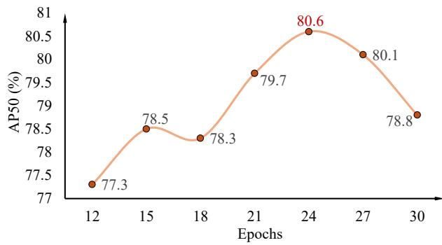  
Figure 3. $\mathbf { A P _ { 5 0 } } ~ ( \% )$ vs. the length of Phase 1. As Phase 1 becomes longer, $\mathrm { A P _ { 5 0 } }$ first increases and then decreases with the maximum at 24 epochs.

As Phase 1 and 3 share the total epochs of 33, the key of optimizing 3-phase strategy is to balance them. Figure 3 demonstrates critical tradeoffs: the shorter Phase 1 cause the noise in early-training, the shorter Phase 3 hinder the joint optimization. They both decrease the final accuracy.

Discussion on lower selection rates of stage3. During the ablation experiments on training strategies, we observed a phenomenon in Table 2: the sparsity rate at stage 3 is noticeably lower than that of other stages. Examining the model structure, we speculate that this may reflect an adaptation of Elastic Selection to network depth. As shown in Figure 2, the number of Elastic Selection executions corresponds to the depth, and a lower sparsity rate at greater depth may imply selecting fewer but more critical windows each time, thereby achieving foreground coverage through multiple selections. As this is not a central focus of our work, only a tentative discussion is provided here.

## 4.5. Backbone-agnostic Study

We keenly observe that the proposed ElasticSelector is backbone-agnostic and can be applied to both convolution-based and Transformer-based architectures. After implementing ElasticFormer on Transformer, we further obtained ElasticNet by replacing the self-attention modules with convolutional layers. As shown in Table 1, when combined with DINO and compared against ResNet-50, this validation backbone achieves a 87% reduction in computation while delivering competitive detection quality. This provides strong evidence that ElasticSelector can be applied to various backbones, dynamically adjusting computation according to the foreground proportion.

<table><tr><td>Method</td><td>Backbone</td><td>GFLOPs-F</td><td>GFLOPs-B</td><td>GFLOPs-O</td><td>mAP(%)</td><td>CorLoc(%)</td></tr><tr><td>WSOD2 [39]+GoogleNet</td><td>GoogleNet [34]</td><td>5.56</td><td>12.38</td><td>17.94</td><td>37.9</td><td>52.8</td></tr><tr><td> $\mathrm { W S O D ^ { 2 } { + } V G G 1 6 }$ </td><td>VGG16 [30]</td><td>36.88</td><td>86.05</td><td>122.93</td><td>47.2</td><td>59.5</td></tr><tr><td> $\mathrm { W S O D ^ { 2 } + R e s N e t - } 5 0$ </td><td>ResNet-50 [20]</td><td>63.01</td><td>111.90</td><td>174.91</td><td>46.7</td><td>59.9</td></tr><tr><td> $\mathrm { W S O D ^ { 2 } + R e s N e t - } 1 0 1$ </td><td>ResNet-101 [20]</td><td>70.83</td><td>165.27</td><td>236.10</td><td>48.9</td><td>61.1</td></tr><tr><td> $\mathrm { M o d i f i e d - D I N O + S w i n  – T }$ </td><td>Swin-T [28]</td><td>11.49</td><td>26.80</td><td>38.29</td><td>49.9</td><td>63.7</td></tr><tr><td>Modified-DINO+SparseFormer</td><td>SparseFormer [22]</td><td>9.11</td><td>13.01</td><td>22.12</td><td>50.3</td><td>63.1</td></tr><tr><td>Modified-DINO+ElasticFormer(Ours)</td><td>ElasticFormer(Ours)</td><td>7.45</td><td>3.26</td><td>10.71</td><td>50.9</td><td>63.9</td></tr></table>

Table 2. Comparisons of FLOPs, mean average precision and correct localization on different backbones in WSOD tasks. We modified DINO’s loss function using a Multiple Instance Learning (MIL) based loss to make it suitable for the WSOD task.

<table><tr><td rowspan="2">Strategies</td><td rowspan="2">Supervision</td><td colspan="4">Windows selection rates (%)</td><td rowspan="2"> $\mathrm { { A P } _ { 5 0 } }$ </td></tr><tr><td>Stage1</td><td>Stage2</td><td>Stage3</td><td>Stage4</td></tr><tr><td rowspan="2">1-phase</td><td>GT</td><td>15.11</td><td>15.32</td><td>12.79</td><td>15.73</td><td>0.791</td></tr><tr><td>Pseudo-GT</td><td>14.02</td><td>14.24</td><td>9.80</td><td>12.97</td><td>0.784</td></tr><tr><td rowspan="2">3-phase</td><td>GT</td><td>14.15</td><td>14.55</td><td>13.28</td><td>14.95</td><td>0.798</td></tr><tr><td>Pseudo-GT</td><td>11.31</td><td>10.41</td><td>7.56</td><td>12.09</td><td>0.806</td></tr></table>

Table 3. Windows selection rates and $\mathbf { A P } _ { 5 0 }$ across different configures and stages. Pseudo-GT means outputs from the detection head. Rates on Stage 3 is always the lowest.

## 4.6. WSOD Study

Methodology. Since bounding box annotations are absent in Weakly Supervised Object Detection (WSOD), the loss in the DINO [40] detection head based on them must be replaced. Inspired by CDTR [8] and other Transformer-based approaches, we incorporate the Smooth L1 loss, training with numerous pseudo BBoxes generated by the model.

Datasets. We conduct weakly supervised experiments on the PASCAL VOC 2007 [15] dataset, which is split into training, validation, and test subsets. It comprises 9,963 annotated images containing 24,640 object instances spanning 20 distinct categories. The images have an overall resolution on the order of $1 0 ^ { 5 }$ pixels, placing them in the non-HRW shots regime. This configuration provides a robust benchmark for evaluating ElasticFormer’s performance across diverse detection scenarios and target classes.

Evaluation metrics. Moving to evaluation, we use mAP and CorLoc as the metrics and the computational costs are measured on 224×224 resolution inputs. To ensure fair comparison, all transformer-based and convolution-based detectors are evaluated after the same epochs of training separately. We estimate the computation on ElasticFormer by averaging measurements across the test set due to elastic computation.

Data analysis. As evidenced by Table 3, our sparsification approach reduces computational load by up to 70% on non-HRW shots, compared with Swin-T [28]. Further,

ElasticFormer achieves gains in both mAP and CorLoc. It is noteworthy that in WSOD tasks, computation devoted to foreground regions increases markedly on non-HRW shots. This demonstrates that ElasticFormer can dynamically adjust its resource allocation to more effectively extract features in object-relevant areas.

This significant efficiency gain persists even when target density falls below typical HRW thresholds, thereby demonstrating the generalizability beyond specialized highresolution contexts, including WSOD tasks, of our method.

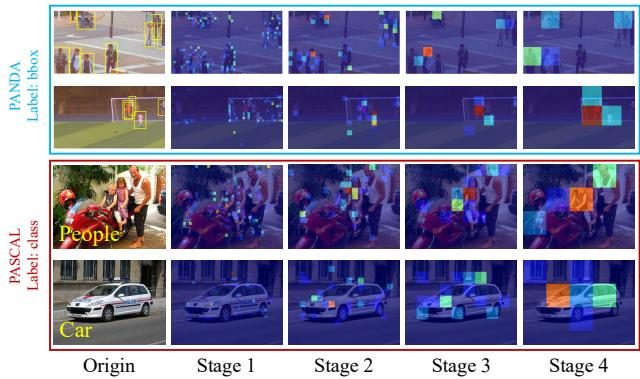  
Figure 4. Visualization of scored windows. We illustrate scored windows from each stage of ElasticFormer, with the top two rows from PANDA [36] and the others from PASCAL VOC 2007 [15] for WSOD task. Highlighted windows indicate regions requiring further feature extraction.

## 4.7. Visualization of Sparse Selection

Figure 4 illustrates our window scoring and sparsification mechanism with a thermal color map: high-scoring windows are shown in red, and low-scoring regions in blue. By using ElasticSelector’s score-driven sparse selection, we retain only ${ \hat { \rho } } \cdot n$ windows for detailed feature extraction. This approach markedly cuts computation on uninformative backgrounds and on areas with subtle features.

This efficiency gain arises from our target-coverageratio–based elastic computation modulation, which enables

ElasticFormer to achieve high detection efficiency. Figure 4 also includes examples from both the PANDA [36] and PASCAL VOC 2007 [15] datasets, demonstrating the method’s effectiveness across different detection scenarios, tasks and object classes.

## 4.8. Ablation Study

Ablation study on α and γ. We conduct a joint ablation study by selecting three values for each. Here we introduce a new metric, F-ratio, F-ratio $= \mathrm { ( F L O P s  – F / F L O P s – O ) } \times$ 100%. This metric reflects the backbone’s attention to foreground regions. Increasing γ reduces computational cost at the expense of AP50, highlighting the trade-off between efficiency and accuracy. F-ratio shows no significant association with γ.

In contrast, decreasing α proportionally reduces the supervised signal $\rho ,$ which also lowers FLOPs-O. Interestingly, $\mathrm { { A P } _ { 5 0 } }$ does not follow the same trend; it reaches its peak when $\alpha \ = \ 0 . 8$ . By examining F-ratio, we observe that smaller α values correspond to higher F-ratios, indicating that the backbone focuses more on foreground regions. Therefore, tuning α enables a trade-off between computational cost and foreground attention, leading to optimal detection performance.

<table><tr><td rowspan=1 colspan=1>α</td><td rowspan=1 colspan=1>γ</td><td rowspan=1 colspan=1> $\mathrm { { A P } _ { 5 0 } }$ </td><td rowspan=1 colspan=1>GFLOPs-O</td><td rowspan=1 colspan=1>GFLOPs-F</td><td rowspan=1 colspan=1>F-ratio (%)</td></tr><tr><td rowspan=3 colspan=1>1.0</td><td rowspan=3 colspan=1>0.10.20.3</td><td rowspan=3 colspan=1>0.8020.7990.793</td><td rowspan=2 colspan=1>14.9813.17</td><td rowspan=1 colspan=1>6.84</td><td rowspan=1 colspan=1>45.7</td></tr><tr><td rowspan=1 colspan=1>6.00</td><td rowspan=2 colspan=1>45.645.9</td></tr><tr><td rowspan=1 colspan=1>11.44</td><td rowspan=1 colspan=1>5.25</td></tr><tr><td rowspan=3 colspan=1>0.8</td><td rowspan=1 colspan=1>0.1</td><td rowspan=1 colspan=1>0.806</td><td rowspan=1 colspan=1>13.13</td><td rowspan=1 colspan=1>7.02</td><td rowspan=3 colspan=1>53.553.153.3</td></tr><tr><td rowspan=2 colspan=1>0.20.3</td><td rowspan=1 colspan=1>0.801</td><td rowspan=1 colspan=1>11.91</td><td rowspan=1 colspan=1>6.32</td></tr><tr><td rowspan=1 colspan=1>0.795</td><td rowspan=1 colspan=1>10.28</td><td rowspan=1 colspan=1>5.48</td></tr><tr><td rowspan=3 colspan=1>0.6</td><td rowspan=1 colspan=1>0.1</td><td rowspan=1 colspan=1>0.799</td><td rowspan=1 colspan=1>11.52</td><td rowspan=1 colspan=1>6.36</td><td rowspan=3 colspan=1>55.254.755.1</td></tr><tr><td rowspan=2 colspan=1>0.20.3</td><td rowspan=1 colspan=1>0.791</td><td rowspan=1 colspan=1>10.38</td><td rowspan=1 colspan=1>5.68</td></tr><tr><td rowspan=1 colspan=1>0.794</td><td rowspan=1 colspan=1>9.77</td><td rowspan=1 colspan=1>5.38</td></tr></table>

Table 4. $\bf { A P } _ { 5 0 }$ and FLOPs across different α and γ. F-ratio is the proportion of foreground computation to the total, indicating a backbone’s attention to foreground regions.

Ablation study on scoring mechanism. We further conduct ablation experiments on different window scoring mechanisms, including small learned objectness and gradient density. The results show that small learned objectness can slightly improve foreground selection accuracy, but it requires an additional prediction head and thus introduces noticeable latency. Gradient density captures edge and texture information, which is sensitive to noise and incurs extra computational overhead. In contrast, our variance-based scoring mechanism is lightweight and does not rely on additional network components, leading to significantly lower latency while maintaining competitive detection accuracy. This demonstrates a superior balance between efficiency

and accuracy.

<table><tr><td>Scoring Mechanism</td><td> $\mathrm { { A P } _ { 5 0 } }$ </td><td>GFLOPs-F</td><td>F-ratio (%)</td><td>Latency (ms)</td></tr><tr><td>Variance-based(Ours)</td><td>0.806</td><td>7.02</td><td>53.5</td><td>0.397</td></tr><tr><td>Small objectness</td><td>0.803</td><td>7.14</td><td>53.8</td><td>1.213</td></tr><tr><td>Gradient density</td><td>0.798</td><td>5.74</td><td>41.7</td><td>0.829</td></tr></table>

Table 5. AP<sub>50</sub>, FLOPs and latency across different scoring machanism. Latency is measured as the average over four stages, 100 forward passes of the backbone.

Ablation study on adaptive sparsity rates. SparseFormer [22] also adopts the concept of sparsity rate, but it uses a fixed parameter preset to 0.7. We choose this parameter from [0.1, 0.3, 0.5, 0.7, 1.0] to study SparseFormer’s performance under different sparsity rates. The experiments are conducted with both DINO [40] and Dynamic-Head [10].

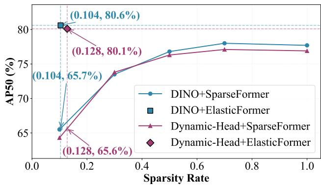  
Figure 5. $\bf { A P } _ { 5 0 }$ vs. sparsity rate on SparseFormer and ElasticFormer. The annotated data in the figure is obtained through linear interpolation.

Regardless of the detection head, SparseFormer suffers a sharp drop in $\mathrm { { A P } _ { 5 0 } }$ when the sparsity rate is small. With the same sparsity rate as ElasticFormer, its $\mathrm { { A P } _ { 5 0 } }$ is consistently at least 15% lower. This highlights the importance of dynamic sparsity in addressing target number variations in HRW scenarios.

## 5. Conclusion

We propose ElasticFormer, a Vision Transformer that dynamically allocates computation for HRW shot detection via its lightweight ElasticSelector module. By estimating target-coverage ratios $\hat { \rho }$ and prioritizing high-variance regions, it reduces FLOPs by 90.2% versus Swin-T [28] and 82.7% versus SparseFormer [22] while achieving 80.6% AP50 on PANDA [36]. The framework’s backboneagnostic design enables adaptive token utilization across stages, cutting background computation by 91.1%. This elastic paradigm establishes a new standard for efficient large-scale vision systems, particularly for real-time applications with constrained resources.

## Acknowledgments

This work was supported by National Science and Technology Major Project (No. 2022ZD0119402), National Natural Science Foundation of China (No. 6252510), “Pioneer” and “Leading Goose” R&D Program of Zhejiang (No. 2024C01142), and Tsinghua University – Migu Xinkong Culture Technology (Xiamen) Co., Ltd. Joint Research Center for Intelligent Light Field and Interaction Technology, Tsinghua University - Joint R&D Project (R2511DKW) – Phase 2. We also acknowledge the KLATASDS-MOE.

## References

[1] Danielle S Bassett and Olaf Sporns. Network neuroscience. Nature neuroscience, 20(3):353–364, 2017. 2

[2] Srinadh Bhojanapalli, Chulhee Yun, Ankit Singh Rawat, Sashank Reddi, and Sanjiv Kumar. Low-rank bottleneck in multi-head attention models. pages 864–873. PMLR, 2020. 2

[3] Zhaowei Cai and Nuno Vasconcelos. Cascade r-cnn: Delving into high quality object detection. In CVPR, pages 6154– 6162, 2018. 5

[4] Hao Chen, Yuqi Hou, Chenyuan Qu, Irene Testini, Xiaohan Hong, and Jianbo Jiao. 360+ x: A panoptic multi-modal scene understanding dataset. In CVPR, pages 19373–19382, 2024. 1

[5] Kai Chen, Jiaqi Wang, Jiangmiao Pang, Yuhang Cao, Yu Xiong, Xiaoxiao Li, Shuyang Sun, Wansen Feng, Ziwei Liu, Jiarui Xu, et al. Mmdetection: Open mmlab detection toolbox and benchmark. arXivpreprint arXiv:1906.07155, 2019. 6

[6] Kai Chen, Zerun Wang, Xueyang Wang, Dahan Gong, Longlong Yu, Yuchen Guo, and Guiguang Ding. Towards realtime object detection in gigapixel-level video. Neurocomputing, 477:14–24, 2022. 1, 5

[7] Shoufa Chen, Chongjian Ge, Zhan Tong, Jiangliu Wang, Yibing Song, Jue Wang, and Ping Luo. Adaptformer: Adapting vision transformers for scalable visual recognition. NeurIPS, 35:16664–16678, 2022. 2

[8] Zhiwei Chen, Yunhang Shen, Liujuan Cao, Shengchuan Zhang, and Rongrong Ji. Clip-driven transformer for weakly supervised object localization. IEEE TPAMI, 2025. 7

[9] Jifeng Dai, Haozhi Qi, Yuwen Xiong, Yi Li, Guodong Zhang, Han Hu, and Yichen Wei. Deformable convolutional networks. In ICCV, pages 764–773, 2017. 2

[10] Xiyang Dai, Yinpeng Chen, Bin Xiao, Dongdong Chen, Mengchen Liu, Lu Yuan, and Lei Zhang. Dynamic head: Unifying object detection heads with attentions. In CVPR, pages 7373–7382, 2021. 5, 6, 8

[11] Jia Deng, Wei Dong, Richard Socher, Li-Jia Li, Kai Li, and Li Fei-Fei. Imagenet: A large-scale hierarchical image database. In CVPR, pages 248–255. Ieee, 2009. 2

[12] Jian Ding, Nan Xue, Yang Long, Gui-Song Xia, and Qikai Lu. Learning roi transformer for detecting oriented objects in aerial images. arXiv preprint arXiv:1812.00155, 2018. 1

[13] Jian Ding, Nan Xue, Gui-Song Xia, Xiang Bai, Wen Yang, Michael Ying Yang, Serge Belongie, Jiebo Luo, Mihai Datcu, Marcello Pelillo, et al. Object detection in aerial images: A large-scale benchmark and challenges. IEEE TPAMI, 44(11):7778–7796, 2021. 1

[14] Dawei Du, Pengfei Zhu, Longyin Wen, Xiao Bian, Haibin Lin, Qinghua Hu, Tao Peng, Jiayu Zheng, Xinyao Wang, Yue Zhang, et al. Visdrone-det2019: The vision meets drone object detection in image challenge results. In ICCVW, pages 0–0, 2019. 1

[15] Mark Everingham, Luc Van Gool, Christopher KI Williams, John Winn, and Andrew Zisserman. The pascal visual object classes (voc) challenge. IJCV, 88(2):303–338, 2010. 2, 7, 8

[16] Jiahao Fan, Huabin Liu, Wenjie Yang, John See, Aixin Zhang, and Weiyao Lin. Speed up object detection on gigapixel-level images with patch arrangement. In CVPR, pages 4653–4661, 2022. 1, 5

[17] Qihang Fan, Huaibo Huang, Mingrui Chen, Hongmin Liu, and Ran He. Rmt: Retentive networks meet vision trans formers. In CVPR, pages 5641–5651, 2024. 1

[18] Ross Girshick. Fast r-cnn. In ICCV, pages 1440–1448, 2015. 1, 2

[19] Meng-Hao Guo, Cheng-Ze Lu, Zheng-Ning Liu, Ming-Ming Cheng, and Shi-Min Hu. Visual attention network. Compu tational Visual Media, 9(4):733–752, 2023. 2

[20] Kaiming He, Xiangyu Zhang, Shaoqing Ren, and Jian Sun. Deep residual learning for image recognition. In CVPR, pages 770–778, 2016. 2, 5, 7

[21] Changlin Li, Taojiannan Yang, Sijie Zhu, Chen Chen, and Shanyue Guan. Density map guided object detection in aerial images. In CVPRW, pages 190–191, 2020. 5

[22] Wenxi Li, Yuchen Guo, Jilai Zheng, Haozhe Lin, Chao Ma, Lu Fang, and Xiaokang Yang. Sparseformer: Detecting ob jects in hrw shots via sparse vision transformer. In ACM MM, pages 4851–4860, 2024. 1, 2, 3, 5, 6, 7, 8

[23] Wenxi Li, Ruxin Zhang, Haozhe Lin, Yuchen Guo, Chao Ma, and Xiaokang Yang. Saccadedet: A novel dual-stage archi tecture for rapid and accurate detection in gigapixel images. In ECML PKDD, pages 392–408. Springer, 2024. 2, 3

[24] Tianwei Lin, Wenqiao Zhang, Sijing Li, Yuqian Yuan, Binhe Yu, Haoyuan Li, Wanggui He, Hao Jiang, Mengze Li, Xiaohui Song, et al. Healthgpt: A medical large vision language model for unifying comprehension and generation via heterogeneous knowledge adaptation. arXiv preprint arXiv:2502.09838, 2025. 1

[25] Tsung-Yi Lin, Michael Maire, Serge Belongie, James Hays, Pietro Perona, Deva Ramanan, Piotr Dollar, and C Lawrence´ Zitnick. Microsoft coco: Common objects in context. In ECCV, pages 740–755. Springer, 2014. 1

[26] Tsung-Yi Lin, Priya Goyal, Ross Girshick, Kaiming He, and Piotr Dollar. Focal loss for dense object detection. In ´ ICCV, pages 2980–2988, 2017. 5

[27] Zhihao Lin, Yongtao Wang, Jinhe Zhang, and Xiaojie Chu. Dynamicdet: A unified dynamic architecture for object de tection. In CVPR, pages 6282–6291, 2023. 2

[28] Ze Liu, Yutong Lin, Yue Cao, Han Hu, Yixuan Wei, Zheng Zhang, Stephen Lin, and Baining Guo. Swin transformer:

Hierarchical vision transformer using shifted windows. In ICCV, pages 10012–10022, 2021. 2, 5, 6, 7, 8

[29] Yongming Rao, Wenliang Zhao, Benlin Liu, Jiwen Lu, Jie Zhou, and Cho-Jui Hsieh. Dynamicvit: Efficient vision transformers with dynamic token sparsification. NeurIPS, 34:13937–13949, 2021. 3

[30] Karen Simonyan and Andrew Zisserman. Very deep convolutional networks for large-scale image recognition. arXiv preprint arXiv:1409.1556, 2014. 7

[31] Lin Song, Songyang Zhang, Songtao Liu, Zeming Li, Xuming He, Hongbin Sun, Jian Sun, and Nanning Zheng. Dynamic grained encoder for vision transformers. NeurIPS, 34: 5770–5783, 2021. 2

[32] Peize Sun, Rufeng Zhang, Yi Jiang, Tao Kong, Chenfeng Xu, Wei Zhan, Masayoshi Tomizuka, Lei Li, Zehuan Yuan, Changhu Wang, et al. Sparse r-cnn: End-to-end object detection with learnable proposals. In CVPR, pages 14454–14463, 2021. 2

[33] Fredrik Svanstrom, Cristofer Englund, and Fernando¨ Alonso-Fernandez. Real-time drone detection and tracking with visible, thermal and acoustic sensors. In ICPR, pages 7265–7272. IEEE, 2021. 1

[34] Christian Szegedy, Wei Liu, Yangqing Jia, Pierre Sermanet, Scott Reed, Dragomir Anguelov, Dumitru Erhan, Vincent Vanhoucke, and Andrew Rabinovich. Going deeper with convolutions. In CVPR, pages 1–9, 2015. 7

[35] Wenhai Wang, Enze Xie, Xiang Li, Deng-Ping Fan, Kaitao Song, Ding Liang, Tong Lu, Ping Luo, and Ling Shao. Pyramid vision transformer: A versatile backbone for dense prediction without convolutions. In ICCV, pages 568–578, 2021. 2

[36] Xueyang Wang, Xiya Zhang, Yinheng Zhu, Yuchen Guo, Xiaoyun Yuan, Liuyu Xiang, Zerun Wang, Guiguang Ding, David Brady, Qionghai Dai, et al. Panda: A gigapixel-level human-centric video dataset. In CVPR, pages 3268–3278, 2020. 1, 2, 5, 6, 7, 8

[37] Gui-Song Xia, Xiang Bai, Jian Ding, Zhen Zhu, Serge Belongie, Jiebo Luo, Mihai Datcu, Marcello Pelillo, and Liangpei Zhang. Dota: A large-scale dataset for object detection in aerial images. In CVPR, pages 3974–3983, 2018. 1

[38] Fan Yang, Heng Fan, Peng Chu, Erik Blasch, and Haibin Ling. Clustered object detection in aerial images. In ICCV, pages 8311–8320, 2019. 5

[39] Zhaoyang Zeng, Bei Liu, Jianlong Fu, Hongyang Chao, and Lei Zhang. Wsod2: Learning bottom-up and top-down objectness distillation for weakly-supervised object detection. In ICCV, pages 8292–8300, 2019. 7

[40] Hao Zhang, Feng Li, Shilong Liu, Lei Zhang, Hang Su, Jun Zhu, Lionel M Ni, and Heung-Yeung Shum. Dino: Detr with improved denoising anchor boxes for end-to-end object detection. arXiv preprint arXiv:2203.03605, 2022. 1, 5, 6, 7, 8

[41] Weidong Zhang, Wenyi Zhao, Jia Li, Peixian Zhuang, Haihan Sun, Yibo Xu, and Chongyi Li. Cvanet: Cascaded visual attention network for single image super-resolution. Neural Networks, 170:622–634, 2024. 2

[42] Xiangyu Zhang, Xinyu Zhou, Mengxiao Lin, and Jian Sun. Shufflenet: An extremely efficient convolutional neural net work for mobile devices. In CVPR, pages 6848–6856, 2018. 2

[43] Xizhou Zhu, Weijie Su, Lewei Lu, Bin Li, Xiaogang Wang, and Jifeng Dai. Deformable detr: Deformable transformers for end-to-end object detection. arXiv preprint arXiv:2010.04159, 2020. 1

[44] Renjie Zou, Chunfeng Song, and Zhaoxiang Zhang. The devil is in the details: Window-based attention for image compression. In CVPR, pages 17492–17501, 2022. 2

# ElasticFormer: Detecting Objects in HRW Shots via Elastic Computing Vision Transformer — Supplementary Material —

Wenxi Li<sup>‡</sup>\*, Jingchen Huang<sup>§,¶</sup>\*, Chenyang Lyu<sup>∥</sup>, Moran Liu<sup>§,¶,#</sup>, Haozhe Lin<sup>§</sup>, Guiguang Ding<sup>§,⋆†</sup>, Yuchen Guo<sup>§†</sup>

<sup>§</sup>Beijing National Research Center for Information Science and Technology, Tsinghua University, Beijing, China

<sup>¶</sup>Department of Automation, Tsinghua University, Beijing, China <sup>‡</sup>KLATASDS-MOE, School of Statistics, East China Normal University, Shanghai, China <sup>⋆</sup>School of Software, Tsinghua University, Beijing, China <sup>#</sup>Zhuoxi Lab, Hangzhou, China

<sup>∥</sup>AI Business, Alibaba International Digital Commerce, Hangzhou, China wxli@sfs.ecnu.edu.cn, huang-jc23@mails.tsinghua.edu.cn, {linhz, dinggg}@tsinghua.edu.cn, liumoreran@gmail.com, lyuchenyang.dcu@gmail.com, yuchen.w.guo@gmail.com

## 1. Details of Training and Inference

Training configs. We train ElasticFormer with 36 epochs on RTX 4090 GPUs, using learning rate $l = 2 e { \mathrm { - } } 4$ . We use AdamW as the optimizer, linearly warming up the learning rate to its preset value over the first two epochs, and employ a MultiStepLR schedule to reduce it by a factor of ten at the 18th and 30th epochs.

Loss for 3-phase training. We compare the loss progression across the four training stages before and after adopting the 3-phase strategy, illustrating the results in Figure 1.

It is worth noting that all loss values were logged from the start of ElasticSelector training, meaning the curves for the two strategies are aligned only on a relative scale rather than a common absolute scale. Nevertheless, the convergence behavior matches that shown in the figure: the ElasticSelector module trained with the 3-phase strategy is more stable and achieves faster convergence in relative terms compared to when the strategy is omitted.

Inference configs. During inference, we divided largeresolution images into patches of 6000 × 3600 with an overlap of 600 pixels between patches for the PANDA [2] dataset, resizing images into 512 × 512 for PASCAL VOC 2007 [1].

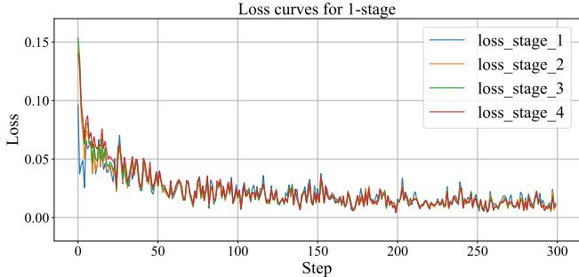  
(a) 1-Phase Strategy

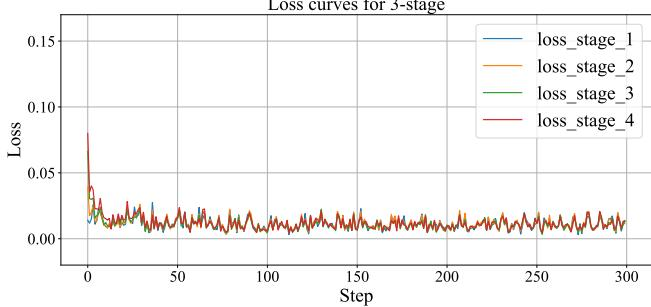  
(b) 3-Phase Strategy  
Figure 1. Comparison of the loss for different strategies. We demonstrate 4 loss curves in each sub-figure, representing the loss for each stage in ElasticFormer.

## 2. Visualization Results

To more clearly demonstrate the differences between the attention regions at each stage, we enlarge and reproduce the paper’s visualizations in Figure 2 to facilitate direct comparison. As shown in Figure 2, each stage corresponds to a different window size within the pyramid structure: the later stages (depicted lower in the image) employ larger windows that encompass broader regions.

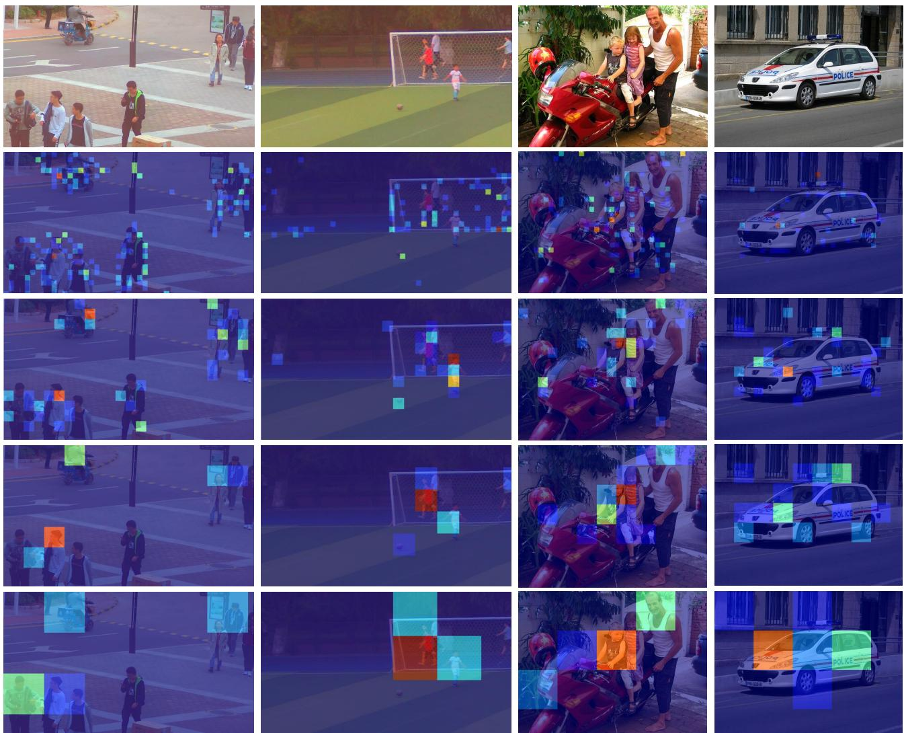  
Figure 2. Visualization of scored windows. Left two columns come from PANDA [2] and right two columns come from PASCAL VOC 2007 [1].

## 3. Code in PyTorch

The public implementation is available at https://github.com/Purecoo00/ElasticFormer. Algorithms 1 and 2 show the selection methods of ElasticStage and ElasticFormer, and the foreground-target helpers. Window scoring, attention, and detector integration are omitted.

ElasticSelector retains one predicted ratio per image using squeeze(-1). The first two training phases use all windows; the third phase and inference select $\lceil \hat { \rho } N _ { w } \rceil$ windows per image, retaining at least one. The squared error and ratio penalty are computed per image before averaging over the batch and four stages. The selector is frozen in the first phase.

Foreground targets use clipped bounding-box union area and α = 0.8 (Equation (1)). Boxes and dimensions share the augmented image coordinates (img\_shape). Pseudo boxes are predicted under torch.no\_grad() with rescale=False and a confidence threshold of 0.3; GT boxes require no score filtering.

Algorithm 1: Per-image window selection and selection loss

1 def select\_windows(self, scores, ratios):   
2 selections = []   
3 for image in range(scores.shape[0]):   
4 # Keep each image's budget independent, including batches above one.   
5 if self.training and not self.use\_dynamic\_topk:   
6 count = scores.shape[1]   
7 else:   
8 count = min(   
9 scores.shape[1],   
10 max(1, math.ceil(float(ratios[image].detach()) <sub>\*</sub> scores.shape[1])),   
11 )   
12 selections.append(scores[image].topk(count).indices)   
13 return selections   
14   
15   
16 def selection\_loss(self, targets):   
17 return torch.stack(   
18 [   
19 ((stage.last\_ratios - targets) <sub>\*\*</sub> 2 + self.select\_gamma <sub>\*</sub> stage.last\_ratios).mean()   
20 for stage in self.stages   
21 ]   
22 ).mean()

Algorithm 2: Foreground targets from pseudo boxes or GT (Equation (1))

```python
1 def foreground_ratio(boxes, image_shape):
2 """Measure clipped box coverage, counting overlapping areas only once."""
3 height, width = image_shape[:2]
4 if height <= 0 or width <= 0:
5 raise ValueError("Image dimensions must be positive")
6 if hasattr(boxes, "tensor"):
7 boxes = boxes.tensor
8 rectangles = []
9 for x1, y1, x2, y2 in boxes.detach().cpu().tolist():
10 x1, x2 = max(0.0, x1), min(float(width), x2)
11 y1, y2 = max(0.0, y1), min(float(height), y2)
12 if x2 > x1 and y2 > y1:
13 rectangles.append(box(x1, y1, x2, y2))
14 return unary_union(rectangles).area / (height <sub>*</sub> width) if rectangles else 0.0
15
16
17 def foreground_targets(instances, image_shapes, alpha=0.8, score_threshold=None):
18 targets = []
19 for result, shape in zip(instances, image_shapes):
20 boxes = result.bboxes
21 if score_threshold is not None:
22 boxes = boxes[result.scores > score_threshold]
23 targets.append(alpha <sub>*</sub> foreground_ratio(boxes, shape))
24 return targets
```

## References

[1] Mark Everingham, Luc Van Gool, Christopher KI Williams, John Winn, and Andrew Zisserman. The pascal visual object classes (voc) challenge. International journal ofcomputer vision, 88(2):303–338, 2010. 1, 2

[2] Xueyang Wang, Xiya Zhang, Yinheng Zhu, Yuchen Guo, Xiaoyun Yuan, Liuyu Xiang, Zerun Wang, Guiguang Ding, David Brady, Qionghai Dai, et al. Panda: A gigapixel-level human-centric video dataset. In CVPR, pages 3268–3278, 2020. 1, 2