# Evaluating Cultural Knowledge Editing in Vision-Language Models

Malvina Nikandrou† Georgios Pantazopoulos† Ioannis Konstas\* Alessandro Suglia†

†University of Edinburgh \*Heriot-Watt University

## Abstract

Current Vision-Language Models (VLMs) frequently fail to recognize culture-specific concepts, especially from underrepresented regions. Effectively injecting this long-tail knowledge into existing models remains a challenge. In this work, we investigate knowledge editing as a targeted alternative by introducing CulturalBind, a benchmark comprising 3.2K images of 1K concepts from 6 domains, designed to evaluate culture-aware cross-modal knowledge as well as concept-level knowledge editing in VLMs. Pre-edit evaluation reveals that textual and visual knowledge is decoupled: models often demonstrate text-based knowledge of cultural concepts but fail to identify them from images. We then evaluate editing methods in single and sequential scenarios. Although current methods successfully correct individual visual recognition errors, they exhibit low cross-modal portability, failing to integrate edits into the model's broader parametric knowledge. Furthermore, performance degrades rapidly under sequential editing, highlighting the need for comprehensive adaptation approaches that better consolidate multimodal knowledge over time.

## 1 Introduction

Current Vision-Language models (VLMs) exhibit broad visual and linguistic capabilities (Bai et al., 2025; GemmaTeam et al., 2025; Wang et al., 2025), yet frequently fail to recognize culture-specific concepts such as traditional musical instruments, regional dishes, and local festivals, particularly those from underrepresented cultures. This reflects a systematic imbalance in pretraining corpora that fail to capture the long tail of global cultural knowledge (Vayani et al., 2025; Richards et al., 2024; Nyandwi et al., 2025). As VLMs are increasingly deployed in global contexts, this limitation risks perpetuating cultural blind spots.

One approach to addressing this cultural gap is by curating more diverse pretraining datasets (Penedo et al., 2024; Albalak et al., 2024). However, improvements in long-tail cultural concepts are expected to diminish at scale (Hooker, 2025; Udandarao et al., 2024), making full retraining an expensive and uncertain fix. Moreover, subpar performance on cultural benchmarks may not reflect only limited data coverage. Work on general entity knowledge has shown that VLMs can showcase factual knowledge, and yet fail to access it through visual input (Ashok et al., 2025; Cohen et al., 2025), suggesting a similar modality gap may underlie cultural recognition failures.

Knowledge editing offers an efficient alternative, where localized parameter updates address gaps identified post training without affecting the model's existing knowledge (Wang et al., 2024b). Unlike prior work on entity-level editing (Huang et al., 2024; Li et al., 2024; Zhang et al., 2025), where the target is a unique referent, we target concept-level knowledge: the goal is to acquire a generalizable visual category that transfers across instances of the same concept and integrates with the model's broader parametric knowledge. Whereas an entity edit is validated on the same referent under varying conditions (e.g., the Golden Gate Bridge from different viewpoints), a concept edit must transfer to different instances of the category (e.g., nadaswarams of different makes, photographed in different settings).

To study this problem, we construct Cultural-Bind, a cross-modal evaluation benchmark of 1K concepts spanning 14 regions and 6 cultural domains, which pairs each concept with encyclopedic and visual attribute knowledge documented in Wikipedia. Before editing, we find that models demonstrate moderate parametric knowledge when probed through language, but recognition from images lags by large margins that do not close with scale. The correlation between textual recall and visual recognition is weak, indicating that the two are largely decoupled. This indicates that the bottleneck is not the absence of factual knowledge but the failure to access it through visual referents.

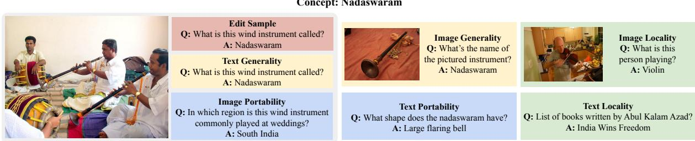  
Figure 1: Structure of the CulturalBind editing dataset. Each concept is paired with an edit sample and six auxiliary probes targeting generalization (Text and Image Generality), knowledge preservation (Text and Image Locality), and cross-modal knowledge integration (Text and Image Portability).

To evaluate whether editing methods can support cultural adaptation, we assess a range of parametermodifying and memory-based approaches under two editing scenarios. Single edits evaluate whether methods can fix individual recognition failures, while sequential edits reflect the more practical setting where a model must acquire new concepts incrementally over time. Both settings are evaluated across standard editing metrics and two portability dimensions specific to crossmodal knowledge integration (Figure 1): i) Text-Portability, whether a recognition edit transfers to text-only recall of visual attributes, and ii) Image-Portability, whether it enables visually grounded access to encyclopedic knowledge.

Results demonstrate that while editing methods reliably achieve recognition, portability remains uniformly low: editing establishes associations between images and concept labels without grounding them in the model's broader parametric knowledge, indicating that the visual-linguistic binding gap identified in the cross-modal evaluation persists after editing. In the sequential editing setting, this limitation is exacerbated by rapid performance degradation. Overall, these results indicate that cultural concept acquisition remains a challenge that requires more comprehensive continual adaptation techniques that consolidate multimodal knowledge.

## 2 Related Work

Cultural Evaluation of VLMs Recent work has expanded the scope of cultural evaluation for VLMs, including largely multilingual benchmarks (Vayani et al., 2025; Romero et al., 2024) and diverse task settings (Thapliyal et al., 2022; Yin et al., 2021; Richards et al., 2024; Bhatia et al.

2024). Benchmarks probing cultural knowledge typically use VQA, where a correct answer requires both visual recognition and factual recall. CVQA (Romero et al., 2024) and CulturalVQA (Nayak et al., 2024) do not pair these questions with textonly counterparts, so the two failure sources cannot be separated, while MMA-ASIA (Zheng et al., 2025) pairs text-only and visual versions of the same questions. CulturalBind extends this pairing across distinct knowledge dimensions.

Cultural Adaptation of VLMs Fewer works have explored approaches to improving cultural awareness in VLMs at different stages of model development. Prior work has proposed geo-diverse pretext objectives (Shankar et al., 2017), data augmentation through code-switching and image editing (Li and Zhang, 2023), and interventions in data compositions (Ignat et al., 2024) during pretraining. At the post-training level, recent work has explored pipelines for culturally-aware data construction (Nyandwi et al., 2025). At inference time, retrievalaugmented approaches have been proposed to inject cultural knowledge without modifying model parameters (Anugraha et al., 2026; Ibrahim et al., 2025; Nikandrou et al., 2025; Park et al., 2025). These methods target different points in the model lifecycle and can be considered as complementary strategies to improve cultural awareness of VLMs. In this work, we explore knowledge editing as a potential direction for injecting cultural knowledge through parameter updates that are computationally efficient and localized by design.

Multimodal Editing Evaluations Early work by Cheng et al. (2023) expanded text knowledge editing frameworks to captioning and VQA tasks, but relied on synthetic images for evaluating edit generalization and offered no assessment of portability. Subsequent work has extended this framework in several directions. VLKEB (Huang et al., 2024) extends the standard reliability, locality, and generality metrics with a portability dimension. MIKE (Li et al., 2024) focuses on fine-grained entity recognition and introduces a multi-task editing evaluation. MC-MKE (Zhang et al., 2025) defines multimodal knowledge in terms of visual and textual triples and evaluates portability from both text and visual edits. More recently, MMKE-Bench (Du et al., 2025) broadens the scope beyond structured knowledge triplets and includes visual semantic and user-specific editing scenarios. Rather than counterfactual edits that overwrite accurate associations, we focus on concept acquisition: the model learns visual categories that it previously failed to recognize. Edit images in CulturalBind are also less visually similar to their generality images than those in entity-based benchmarks (Section A.6), reflecting the greater visual variation across instances of a concept. Additionally, while existing benchmarks assess whether encyclopedic knowledge is accessible from visual input after editing (Huang et al., 2024), we further evaluate whether the model acquires descriptive knowledge of a concept's visual attributes accessible through text alone.

<table><tr><td>Dimension</td><td>Visual Input</td><td>Text Input</td><td>Tests</td></tr><tr><td>Reliability</td><td>Edit image</td><td>Recognition question</td><td>Edit success</td></tr><tr><td>Text-Generality</td><td>Edit image</td><td>Paraphrased question</td><td>Text generalization</td></tr><tr><td>Image-Generality</td><td>Held-out image</td><td>Recognition question</td><td>Image generalization</td></tr><tr><td>Text-Locality</td><td></td><td>Unrelated text question</td><td>Preservation of text knowledge</td></tr><tr><td>Image-Locality</td><td>Unrelated image</td><td>Unrelated visual question</td><td>Preservation of VL knowledge</td></tr><tr><td>Text-Portability</td><td></td><td>Visual attribute question</td><td>Textual attribute recall</td></tr><tr><td>Image-Portability</td><td>Edit image</td><td>Encyclopedic question</td><td>Visually-grounded factual recall</td></tr></table>

Table 1: Evaluation dimensions for knowledge editing. Generality targets the generalization of the edit, Locality focuses preservation of unrelated knowledge, and Portability tests cross-modal knowledge integration

## 3 Knowledge Editing Formulation

Knowledge editing modifies a specific piece of knowledge k within a model with parameters $\theta _ { t } .$ -1 through an editing process $E _ { \phi }$

$$
\begin{array} { c } { { \theta _ { t } = E _ { \phi } ( \theta _ { t - 1 } , k ) } } \\ { { \theta _ { t } ( k ^ { \prime } ) = \theta _ { t - 1 } ( k ^ { \prime } ) \quad \forall k ^ { \prime } \neq k } } \end{array}\tag{1}
$$

Each edit sample $\boldsymbol { k } = ( \boldsymbol { v } , \boldsymbol { q } , \boldsymbol { a } ^ { * } , \hat { \boldsymbol { a } } )$ consists of an input image v, a recognition question q (e.g., "What is this instrument called?"), the correct answer $a ^ { * }$ , and the model's incorrect pre-edit answer â. Unlike factual editing, where the target is a specific entity or proposition, we target conceptlevel knowledge (Wang et al., 2024c): rather than memorizing a single visual exemplar, the goal is to establish a concept-level association that generalizes across instances of the same category.

Table 1 summarizes the evaluation dimensions. Reliability measures edit success, while Text-Generality and Image-Generality capture generalization to paraphrases of the input question or held-out images of the same concept, respectively. Text-Locality and Image-Locality measure preservation of unrelated text-only and multimodal knowledge. Portability evaluates whether the edited model can apply the acquired knowledge beyond recognition. We focus on cross-modal portability: Text-Portability probes for knowledge transfer by testing whether a model that has learned to visually recognize a concept can also recall its visual attributes without image input. Image-Portability assesses whether recognition can be combined with encyclopedic factual recall through visually grounded questions, requiring the model to bind the concept from an image with factual knowledge. Figure 1 demonstrates an example across evaluation dimensions.

## 4 CulturalBind Edit Dataset

We construct a dataset to test VLMs’ knowledge of cultural concepts that refer to generalizable categories with multiple real-world instances, as opposed to named entities, whose recognition requires memorizing a unique referent. The full resource, CulturalBind, comprises 3.2K images from 1K concepts for cross-modal knowledge evaluation (Section 5). For editing experiments, we derive the editing samples by filtering CulturalBind based on model failures, and pairing samples with text and image locality probes (Section 6).

## 4.1 CulturalBind Construction

Concept Selection We collect concepts from two sources: 1) CulturalGround (Nyandwi et al., 2025)

is a large-scale cultural VQA dataset covering 42 countries and sourced from Wikidata, and 2) CROPE (Nikandrou et al., 2025), a smaller probing dataset containing culture-specific concepts across five regions validated by native-speaker annotators.

Image Collection and Filtering Evaluating generality across images requires at least two images per concept. For concepts with a single image, we retrieve up to 10 Creative Commons-licensed images using the Openverse API¹. Perceptual hashing² is applied to deduplicate across all images. We then apply a three-stage filtering process to ensure that retained images are relevant and unambiguous. First, we use GPT-5.2³ to dismiss images that contain the concept name in text, thereby preventing VLMs from bypassing visual recognition. Second, GPT-5.2 scores each image against the concept's Wikipedia summary to retain only representative images. Third, we manually inspect all retained Openverse and CulturalGround images to remove remaining ambiguous cases, discarding 96 images. Concepts with fewer than two images are excluded.

Knowledge QA Generation We extract two types of questions from each concept's Wikipedia page: visual attribute questions, covering features observable in images, and encyclopedic questions, covering knowledge that cannot be inferred from images alone. Table 10 reports the distribution across question categories. For visual attribute knowledge, we prompt GPT-5.2 to extract visual descriptions explicitly stated in the Wikipedia text across three observable categories: physical attributes, actions, and contextual cues, yielding 5,321 questions converted into QA format.

For encyclopedic knowledge, we prompt GPT-5.2 to generate question-answer pairs from a Wikipedia text using a taxonomy of eight knowledge categories (Table 10), excluding information present in the visual descriptions. To evaluate visually-grounded encyclopedic QA, the concept name in each question is replaced with a referring expression, requiring the model to identify the concept from an image before retrieving the associated background knowledge. Following Figure 1, "In which region is the nadaswaram commonly played at weddings?" becomes “In which region is this wind instrument commonly played at weddings?". We filter out questions that GPT-5.2 can answer correctly without images, resulting in a total of 5,298 encyclopedic questions. We manually audit a sample of 200 QA pairs for question clarity and answer faithfulness (Section A.2).

<table><tr><td>Region</td><td>Concepts Samples</td></tr><tr><td>Eastern Asia</td><td>199 571</td></tr><tr><td>South-eastern Asia</td><td>164 533</td></tr><tr><td>Southern Asia</td><td>168 519</td></tr><tr><td>Western &amp; Central Asia</td><td>118 366</td></tr><tr><td>Southern Europe</td><td>149 356</td></tr><tr><td>Northern Europe</td><td>81 166</td></tr><tr><td>Eastern Africa</td><td>22 136</td></tr><tr><td>Eastern Europe</td><td>45 108</td></tr><tr><td>Western Europe</td><td>26 100</td></tr><tr><td>Central Am. &amp; Caribbean</td><td>33 92</td></tr><tr><td>Northern America</td><td>19 85</td></tr><tr><td>Western Africa</td><td>24 64</td></tr><tr><td>Southern America</td><td>23 62</td></tr><tr><td>Northern Africa</td><td>19 58</td></tr><tr><td>Total</td><td>1,090 3,216</td></tr></table>

Table 2: CulturalBind distribution by region.

Dataset Summary The final dataset comprises 1,090 unique concepts paired with 3,216 images, spanning 14 geographic regions and 6 cultural domains. The number of concepts and total samples per region are listed in Table 2. Geographically, coverage is broadest in Asian regions, reflecting the cultural diversity of the source datasets, shown in Figure 4. African sub-regions are underrepresented mirroring known gaps in Wikidata and Wikipedia coverage. Samples across America are collectively sparse for different reasons: North American concepts are de-prioritized in long-tail cultural evaluations, while Central and South American regions reflect sparser Wikidata coverage. By domain (see Table 9), Foods & Beverages account for nearly 40% of concepts, while the remaining domains are broadly balanced across concrete categories and human activities.

## 4.2 Converting to KE Format

Existing multimodal KE benchmarks construct edit samples either from model failures (Cheng et al., 2023) or counterfactually (Huang et al., 2024; Du et al., 2025), replacing the true label with a plausible but incorrect target. Counterfactual construction produces a model-agnostic dataset suited to simulating knowledge updates, but can introduce logical inconsistencies: after relabeling images of a nadaswaram as “oboe", the expected answer for genuine oboe images becomes undefined. By selecting edit samples only for concepts the model fails to recognize, the edit target is always factually correct and consistent with image content, grounding evaluation in practical knowledge acquisition scenarios.

<table><tr><td colspan="4">Text-Based Metrics</td><td colspan="2">Image-Based Metrics</td></tr><tr><td>Model</td><td>OE Description</td><td>Encyclopedic</td><td>Attribute</td><td>Recognition</td><td>VG Encyclopedic</td></tr><tr><td>InternVL3.5 (4B)</td><td>35.7</td><td>24.8</td><td>31.6</td><td>18.6</td><td>15.5</td></tr><tr><td>InternVL3.5 (8B)</td><td>46.2</td><td>30.0</td><td>37.2</td><td>18.7</td><td>16.4</td></tr><tr><td>InternVL3.5 (14B)</td><td>54.0</td><td>33.1</td><td>42.3</td><td>19.8</td><td>17.3</td></tr><tr><td>InternVL3.5 (38B)</td><td>60.9</td><td>38.9</td><td>47.3</td><td>25.7</td><td>20.1</td></tr><tr><td>Qwen3-VL (4B)</td><td>56.2</td><td>32.4</td><td>39.5</td><td>34.6</td><td>23.9</td></tr><tr><td>Qwen3-VL (8B)</td><td>67.7</td><td>39.3</td><td>46.7</td><td>34.9</td><td>24.3</td></tr><tr><td>Qwen3-VL (32B)</td><td>77.4</td><td>47.1</td><td>55.7</td><td>36.3</td><td>28.1</td></tr><tr><td>Gemma 3 (4B)</td><td>54.2</td><td>31.1</td><td>37.3</td><td>31.9</td><td>21.2</td></tr><tr><td>Gemma 3 (12B)</td><td>73.8</td><td>43.1</td><td>50.6</td><td>38.2</td><td>26.8</td></tr><tr><td>Gemma 3 (27B)</td><td>82.8</td><td>52.2</td><td>56.8</td><td>43.1</td><td>33.7</td></tr><tr><td>GPT 5.2</td><td>90.5</td><td>67.7</td><td>69.3</td><td>44.6</td><td>40.2</td></tr></table>

Table 3: Cross-modal knowledge evaluation. Text-based measures (Open-Ended Description, Encyclopedic QA, Attribute QA) probe parametric cultural knowledge via text, while image-based measures (Recognition, Visually-Grounded Encyclopedic QA) test whether knowledge about the same concepts is accessible through visual input.

Each edit sample is linked to auxiliary samples that evaluate metrics beyond reliability. For text generality, the original question is paraphrased using Qwen3-32B (Yang et al., 2025) and paired with the original image, while for image generality, a held-out image of the same concept is paired with the original question. Following MMEdit (Cheng et al., 2023), text locality samples are drawn from Natural Questions (Kwiatkowski et al., 2019). For image locality, VQA-v2 (Goyal et al., 2017) samples are selected by averaging the image-image and text-text similarities with the edit sample using SigLIP2 embeddings (Tschannen et al., 2025). For text portability, we use the generated visual attribute questions posed without image input, while for image portability, visually-grounded encyclopedic questions are paired with the edit image.

## 5 Cross-Modal Knowledge Evaluation

A concern when sourcing concepts from Wikipedia is that VLMs may already have parametric knowledge of them, given Wikipedia's prominence as a pretraining source (Penedo et al., 2024). However, even if a model has knowledge of a concept, it might fail to access it through visual inputs. For example, a VLM may learn from text data that the nadaswaram is a wind instrument with a wooden body and a flaring bell, yet fail to identify one from an image. Following recent work surfacing gaps between text-based and image-based performance on factual recall tasks (Ashok et al., 2025; Cohen et al., 2025), we investigate whether a similar disconnect underlies failures on cultural concepts.

To establish if a model has a baseline parametric knowledge of a concept, we evaluate Open-Ended Description: given only a name, the model is asked to provide a short definition. Text-based knowledge is further probed through the Encyclopedic QA and Attribute QA pairs in CulturalBind. On the image-based side, Recognition QA tests whether VLMs can identify the concepts from images, and Visually-Grounded Encyclopedic QA additionally requires composing recognition with factual recall.

## 5.1 Experimental Setup

We evaluate open-weights models from three families: InternVL3.5 (Wang et al., 2025), Qwen3-VL (Bai et al., 2025), and Gemma 3 (GemmaTeam et al., 2025) with sizes between 4B and 38B parameters. Additionally, we report the performance of GPT-5.2 as an upper-bound closed-source model. All models are evaluated using greedy decoding to ensure deterministic, reproducible outputs. Responses are evaluated using Qwen3-32B (Yang et al., 2025) as the LLM judge against reference answers ensuring future reproducibility. Open-Ended Description responses are scored with a binary rubric, and all QA tasks are evaluated using a graded rubric adapted from Mañas et al. (2024). Following best practices (Bavaresco et al., 2025), we validate judge reliability against human scores, finding strong agreement (average QWK = 0.86). Further details provided in the Section B.

To assess the coupling between textual knowledge and visual access, we divide concepts into

Known and Unknown groups based on their Open-Ended Description scores, and compare Visual Recognition accuracy across groups. We measure the correlation between the binary Description and graded Visual Recognition scores using point-biserial correlation $( r _ { p b } )$

## 5.2 Results

Table 3 presents text-based and image-based performance across evaluated models. Models achieve the highest performance on Open-Ended Description, with several models reaching scores above 70%. This suggests that models possess substantive basic knowledge of the examined cultural concepts. Performance on Encyclopedic and Attribute QA drops considerably, indicating that background knowledge coverage is more limited. Models score approximately 7 points higher on Attribute QA than Encyclopedic QA across smaller models, likely because salient perceptual properties such as shape, color, and material are more broadly represented in pretraining text than specific factual knowledge. This advantage narrows for stronger models, as Encyclopedic QA improves.

All models struggle to identify the same concepts from images, with recognition scores consistently lagging behind text-based performance by a large margin. Within model families, scaling improves text-based performance more than visual recognition: Gemma 3 4B→27B gains approximately 29 points on Description but only 11 on Recognition, while for Qwen3-VL 4B→32B, the corresponding gains are 21 and fewer than 2 points. This suggests the modality gap is not merely a capacity limitation that larger models overcome.

Across models, the drop from text-only Encyclopedic QA to Visually-Grounded Encyclopedic QA ranges from approximately 8 to 28 points, with the largest gap observed for GPT-5.2 despite its overall strength. This indicates that visual grounding is a bottleneck: models may possess the relevant background knowledge but cannot access it from visual referents. This aligns with Cohen et al. (2025)'s findings on knowledge extraction gaps in VLMs. Results vary substantially across regions, while domain-level variance remains limited across all dimensions, as shown in Section D.1.

Table 4 breaks down the Recognition accuracy grouped according to their Description scores. Models consistently achieve higher recognition accuracy for known concepts with differences of up to 26.5 percentage points, and the correlation of

<table><tr><td>Model</td><td>Known</td><td>Unknown</td><td> $\Delta$ </td><td> $r _ { p b } ^ { * }$ </td></tr><tr><td>InternVL3.5 (4B)</td><td>25.8</td><td>10.8</td><td>15.0</td><td>0.267</td></tr><tr><td>InternVL3.5 (8B)</td><td>22.9</td><td>10.5</td><td>12.4</td><td>0.221</td></tr><tr><td>InternVL3.5 (14B)</td><td>22.3</td><td>10.6</td><td>11.7</td><td>0.215</td></tr><tr><td>InternVL3.5 (38B)</td><td>29.5</td><td>11.9</td><td>17.6</td><td>0.265</td></tr><tr><td>Qwen3-VL (4B)</td><td>42.4</td><td>15.9</td><td>26.5</td><td>0.374</td></tr><tr><td>Qwen3-VL (8B)</td><td>37.2</td><td>16.2</td><td>21.1</td><td>0.286</td></tr><tr><td>Qwen3-VL (32B)</td><td>35.5</td><td>15.2</td><td>20.3</td><td>0.241</td></tr><tr><td>Gemma 3 (4B)</td><td>37.9</td><td>16.6</td><td>21.3</td><td>0.314</td></tr><tr><td>Gemma 3 (12B)</td><td>37.9</td><td>17.2</td><td>20.7</td><td>0.256</td></tr><tr><td>Gemma 3 (27B)</td><td>39.8</td><td>24.0</td><td>15.8</td><td>0.158</td></tr><tr><td>GPT-5.2</td><td>41.0</td><td>18.8</td><td>22.2</td><td>0.177</td></tr></table>

Table 4: Recognition accuracy for correctly versus incorrectly recalled concepts. Known: model accurately described the concept; Unknown: model failed to describe it. Correlation $( r _ { p b } )$ indicates relationship strength. $^ { * } p < . 0 1$

Description and Recognition scores is statistically significant across all models. However, correlations remain weak $( r _ { p b } = . 1 6 - . 3 7 )$ , indicating that textual recall and visual recognition are largely decoupled. A model's ability to generate a textual description for a cultural concept does not serve as a reliable predictor of its ability to identify it in an image. We note again that the correlation does not strengthen with scale. Gemma 3-27B $( r _ { p b }$ = .158) and GPT-5.2 $( r _ { p b } = . 1 7 7 )$ show the weakest associations despite being among the strongest models overall. These results suggest that current multimodal pretraining does not encourage crossmodal consistency, even as general text and visual capabilities improve.

## 6 Knowledge Editing Evaluation

## 6.1 Experimental Setup

To address the identified recognition gap, we apply representative knowledge editing methods alongside finetuning baselines. We select Qwen3-VL (4B, 8B) and Gemma 3 (12B) as base models, given their stronger cross-modal performance. As baselines, we apply finetuning of the module which connects the visual encoder to the language model (FT-V), and the final language model layer (FT-T) using standard cross-entropy on response tokens, and Direct Preference Optimization (DPO) (Rafailov et al., 2023) using the model's incorrect pre-edit predictions as negative samples.

We evaluate four knowledge editing methods: IKE (Zheng et al., 2023), an in-context editing approach that retrieves demonstration examples at inference time without modifying model parameters; MEND (Mitchell et al., 2022), a meta-learning approach that trains a hypernetwork to predict parameter updates for new edits; GRACE (Hartvigsen et al., 2023), a memory-based approach that stores edited representations in a learned codebook; and WISE (Wang et al., 2024a), a dual-memory approach that routes inputs between original and edited parameter sets. For WISE, we implement two routing variants: text-based locality following the original formulation (WISE-T), and imagebased locality (WISE-V), which uses visual representations for routing⁴.

<table><tr><td>Model</td><td>Method</td><td>Reliability</td><td>T-Gen</td><td>I-Gen</td><td>T-Loc</td><td>I-Loc</td><td>T-Port</td><td>I-Port</td><td>Avg</td></tr><tr><td rowspan="7">Qwen3-VL (4B) N=871</td><td>FT-V</td><td>98.5</td><td>79.7</td><td>25.1</td><td>93.0</td><td>77.7</td><td>15.7</td><td>16.0</td><td>58.0</td></tr><tr><td>FT-T</td><td>100.0</td><td>79.8</td><td>63.4</td><td>75.7</td><td>84.2</td><td>14.0</td><td>14.1</td><td>61.6</td></tr><tr><td>DPO</td><td>99.8</td><td>78.9</td><td>62.8</td><td>75.4</td><td>84.3</td><td>14.0</td><td>14.2</td><td>61.3</td></tr><tr><td>IKE</td><td>99.7</td><td>98.9</td><td>99.8</td><td>23.4</td><td>31.7</td><td>15.8</td><td>17.4</td><td>55.2</td></tr><tr><td>MEND</td><td>92.3</td><td>88.1</td><td>85.9</td><td>86.1</td><td>82.3</td><td>12.7</td><td>12.5</td><td>65.7</td></tr><tr><td>GRACE</td><td>99.5</td><td>2.4</td><td>4.6</td><td>93.0</td><td>97.4</td><td>15.7</td><td>15.0</td><td>46.8</td></tr><tr><td>WISE-T WISE-V</td><td>100.0 83.8</td><td>97.7 85.5</td><td>98.1 79.6</td><td>93.0</td><td>38.4</td><td>7.2</td><td>8.0</td><td>63.2</td></tr><tr><td rowspan="7">Qwen3-VL (8B) N=864</td><td></td><td></td><td></td><td></td><td>92.9</td><td>72.9</td><td>12.7</td><td>10.5</td><td>62.6</td></tr><tr><td>FT-V FT-T</td><td>98.7</td><td>79.8</td><td>22.6</td><td>93.6</td><td>78.2</td><td>21.3</td><td>20.6</td><td>59.3</td></tr><tr><td>DPO</td><td>100.0 100.0</td><td>84.5</td><td>70.3</td><td>79.8</td><td>84.4</td><td>19.2</td><td>15.6</td><td>64.8</td></tr><tr><td></td><td></td><td>84.7</td><td>70.1</td><td>79.1</td><td>83.9</td><td>19.1</td><td>15.4</td><td>64.6</td></tr><tr><td>IKE</td><td>96.8</td><td>96.4</td><td>96.4</td><td>31.6</td><td>29.9</td><td>20.7</td><td>23.2</td><td>56.4</td></tr><tr><td>MEND GRACE</td><td>93.1 100.0</td><td>89.2 2.0</td><td>85.9</td><td>89.6 93.6</td><td>80.8</td><td>17.8</td><td>13.8</td><td>67.2</td></tr><tr><td>WISE-T</td><td>100.0</td><td>97.0</td><td>6.4 96.1</td><td>93.5</td><td>99.2 57.4</td><td>21.3 17.3</td><td>17.0</td><td>48.5</td></tr><tr><td rowspan="7">Gemma 3 (12B)</td><td>WISE-V</td><td>86.6</td><td>86.5</td><td>78.2</td><td>93.6</td><td>79.8</td><td>19.3</td><td>14.2 15.2</td><td>67.9 65.6</td></tr><tr><td>FT-V</td><td></td><td></td><td></td><td></td><td></td><td></td><td></td><td></td></tr><tr><td>FT-T</td><td>99.4 100.0</td><td>87.8</td><td>22.5</td><td>96.7</td><td>73.2</td><td>22.0</td><td>20.7</td><td>60.3</td></tr><tr><td></td><td>100.0</td><td>94.1</td><td>62.4</td><td>91.3</td><td>82.7</td><td>20.7</td><td>17.4</td><td>66.9</td></tr><tr><td>DPO IKE</td><td>99.4</td><td>94.5 99.1</td><td>63.4</td><td>91.6</td><td>82.6</td><td>20.6</td><td>17.5</td><td>67.2</td></tr><tr><td>MEND</td><td>86.6</td><td>82.0</td><td>99.4 62.7</td><td>30.5 93.2</td><td>26.5</td><td>21.2</td><td>28.1</td><td>57.8</td></tr><tr><td>GRACE</td><td>98.7</td><td>2.9</td><td>9.9</td><td>96.7</td><td>80.2 91.2</td><td>20.6</td><td>15.9</td><td>63.0</td></tr><tr><td></td><td></td><td></td><td></td><td></td><td></td><td></td><td>22.0</td><td>19.4</td><td>48.7</td></tr><tr><td>WISE-T</td><td></td><td>99.5</td><td>97.6</td><td>88.7</td><td>70.1</td><td>44.0</td><td>12.1</td><td>7.6</td><td>59.9</td></tr><tr><td>WISE-V</td><td></td><td>99.4</td><td>97.9</td><td>89.7</td><td>80.4</td><td>51.1</td><td>13.7</td><td>8.2</td><td>62.9</td></tr></table>

Table 5: Method performance on single edits to correct N model errors on cultural concept recognition.

We consider two editing scenarios. Single edits evaluate whether methods can fix individual recognition failures, while sequential edits are more practical editing use cases that evaluate whether a model can acquire new concepts over time. Sequential edits are applied cumulatively in a random order, shared across all methods to ensure comparability. IKE and MEND are excluded from sequential evaluation: IKE does not modify model parameters and has no mechanism for accumulating edits, while MEND's hypernetwork is trained against the model's initial weights, and, as shown by Lin et al. (2024), its predictions become unreliable under sequential application. After editing N concepts sequentially, we report average metrics across all N edited concepts. Results are reported after N = {10, 50, 100, 150, 200, 250} edits. Experiments are repeated for five orders.

Edit sets are derived from each model's recognition failures and therefore cover different concept subsets per model. These sets largely overlap (90.3–94.3% pairwise IoU), but we base our conclusions on within-model comparisons across methods rather than comparing a method across models. Additionally, as each method targets a different component, parameter budgets vary across methods and models (Table 12). Results should, therefore, be read as comparisons between editing strategies under their standard configurations, rather than between updates of equal capacity.

## 7 Results

## 7.1 Single Edits

As shown in Table 5, all methods achieve successful single edits with high reliability, confirming that fixing individual recognition errors is feasible across architectures. However, reliability does not guarantee generalization: methods consistently trade off generality and locality, with this tension most pronounced for image-based metrics. Among post-training methods, finetuning the visual connector (FT-V) negatively impacts both image generality and image locality, suggesting that direct updates to the visual connector disrupt cross-modal alignment rather than supporting targeted concept acquisition. Finetuning the language model (FT-T) improves image generality substantially, and DPO yields comparable results.

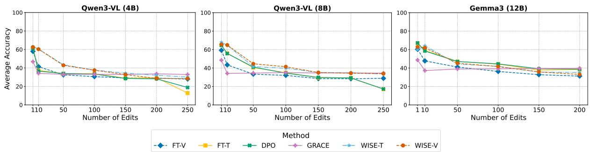  
Figure 2: Average accuracy of editing metrics as a function of the number of sequential edits.

Comparing editing methods, MEND achieves the most consistent performance across models. WISE also achieves competitive performance, though with a consistent weakness in image locality. WISE-T, which uses text-based locality samples to learn routing, achieves stronger text generality and text locality, while WISE-V, which uses image-based locality samples, recovers image locality at the cost of slightly lower generality. Together, MEND and WISE represent the most viable approaches for single-concept editing, though neither achieves strong portability.

IKE and GRACE demonstrate opposite failure modes. IKE achieves near-perfect generality by retrieving demonstration examples at inference time, but this comes at a severe cost to locality. This inability to leverage in-context text-based demonstration is in line with the findings of Nikandrou et al. (2025). GRACE is at the opposite extreme with minimal generality and near-perfect locality. This is a consequence of its activation-matching mechanism, as stored edits are retrieved only when input activations fall within a narrow neighborhood, preventing generalization across instances.

Text and image portability are uniformly low across all methods and models, ranging from 7 to 28%, and do not meaningfully differentiate method families. Even when edits are successful on other measures, the new associations between images and concept labels do not propagate to the model's broader parametric knowledge. To better understand model behavior, we examine randomly sampled outputs before and after editing. We classify each outcome as corrected (prediction changed from incorrect to correct), damaged (prediction changed from correct to incorrect), or unchanged (prediction matched the pre-edit answer, regardless of correctness). Table 6 reports the distribution of these outcomes. The overwhelming majority of questions fall in the unchanged category, showing that editing does not meaningfully alter model behavior on portability. Only 12-23% of questions show any change and among those, corrected and damaged cases occur at comparable rates, yielding near-zero net improvement. These suggest that the low portability scores are not because of errors introduced by editing but reflect pre-existing gaps consistent with the results in Section 5.

<table><tr><td>Model</td><td>Portability</td><td>Corrected</td><td>Damaged</td><td>Unchanged</td></tr><tr><td rowspan="2">Qwen3-VL (4B)</td><td>Text</td><td>48</td><td>61</td><td>367</td></tr><tr><td>Image</td><td>23</td><td>29</td><td>396</td></tr><tr><td rowspan="2">Qwen3-VL (8B)</td><td>Text</td><td>47</td><td>28</td><td>398</td></tr><tr><td>Image</td><td>35</td><td>21</td><td>366</td></tr><tr><td>Gemma 3</td><td>Text</td><td>43</td><td>34</td><td>393</td></tr><tr><td>(12B)</td><td>Image</td><td>40</td><td>25</td><td>370</td></tr></table>

Table 6: Portability outcomes before and after editing.

One possible explanation for the low image portability comes from mechanistic work on factual recall from visual inputs (Cohen et al., 2025; Venhoff et al., 2025): even when recognition succeeds, recall can fail when visual entity information becomes available at deeper model layers than those supporting factual recall. Most examined methods edit the second half of the language model (Table 12), so an edit may fix recognition while leaving the concept inaccessible at the depth of factual recall. FT-V, the only method that edits a component before the language model, improves image portability over FT-T only slightly (2–5 points).⁵

<table><tr><td>Method</td><td>Reliability</td><td>T-Gen</td><td>I-Gen</td></tr><tr><td>FT-V</td><td>8.8 → 53.6</td><td>6.7 → 43.2</td><td>2.7 → 5.6</td></tr><tr><td>FT-T</td><td>19.2 → 54.4</td><td>16.0 → 39.2</td><td>10.4 → 35.2</td></tr><tr><td>DPO</td><td>16.8 → 56.8</td><td>16.8 → 44.0</td><td>15.3 → 34.7</td></tr><tr><td>WISE-T</td><td>29.6 → 24.8</td><td>28.0 → 26.0</td><td>20.8 → 25.6</td></tr><tr><td>WISE-V</td><td>29.6 → 31.2</td><td>32.0 → 28.7</td><td>26.4 → 28.0</td></tr></table>

Table 7: Accuracy of Qwen3-VL (4B) after sequential editing, on the earliest → last 25% of edits.

## 7.2 Sequential Edits

Figure 2 shows average accuracy for sequential editing across methods and models. All methods exhibit a decline as the number of edits increases, with performance dropping sharply even at N=50. Between N=50 and N=200, methods cluster within a narrow accuracy range, with no single approach maintaining a consistent advantage. However, at N=250, FT-T and DPO collapse to near-zero for both Qwen3-VL variants, reflecting the compounding effect of sequential finetuning of the last language model layer. GRACE and WISE-T appear more stable at scale, but per-metric results (Section D.2) show that this reflects preserved locality rather than editing success, as reliability and generality decline for both methods.

Forgetting vs. Retention To separate forgetting of earlier edits from failure to acquire edits in the first place, we evaluate the final Qwen3-VL (4B) checkpoint and compare performance on the earliest and last 25% of edits (Table 7). For parametric methods (FT-V, FT-T, DPO), recent edits score considerably higher than early ones, indicating forgetting. WISE shows no such recency effect: performance is similarly low on early and recent edits, including reliability. Its degradation therefore does not stem from forgetting, but is consistent with interference among accumulated edits.

## 8 Conclusion

We introduce CulturalBind, a multidimensional benchmark for assessing textual and visual knowledge gaps of cultural concepts. Our cross-modal evaluation reveals that VLMs demonstrate stronger parametric knowledge in text-only settings than when identifying the same concepts from images, a gap that widens for visually-grounded QA, which requires factual knowledge recall through visual referents. Additionally, even when conditioning on concepts a model can describe, visual recognition remains weak, indicating that textual and visual knowledge are largely decoupled.

We then use CulturalBind as an editing benchmark targeting VLM recognition failures. While editing methods can reliably correct individual recognition errors without disrupting unrelated model knowledge, portability remains uniformly low. This indicates that edited associations do not propagate to the model's broader parametric knowledge of the concept. Under sequential editing, performance degrades sharply: parametric methods forget earlier edits, while memory-based methods preserve locality but fail to reliably recall even recent edits. Overall, our findings point to crossmodal consistency as a key missing objective, both during pretraining and in post-hoc adaptation. We hope CulturalBind motivates future work on methods that consolidate multimodal knowledge rather than patch isolated associations, moving towards VLMs that are adaptable across the diversity of global cultural concepts.

## 9 Limitations

First, experiments are conducted exclusively in English. Inclusive cultural evaluation ultimately requires multilingual assessment, as the visuallinguistic binding gap measured in English may not reflect the experience of speakers from the concept's origin language. At the same time, known performance disparities across languages in VLMs (Yue et al., 2025; Salazar et al., 2026) make it difficult to disentangle gaps attributable to cultural concept coverage from those attributable to languagelevel representation more broadly. Additionally, we acknowledge the limitations of our region-based operationalization of culture, following the geographic metadata available in source datasets, and the uneven cultural coverage in CulturalBind with South American and African sub-regions underrepresented, reflecting known inequalities in Wikidata and Wikipedia coverage (Miquel-Ribé and Laniado, 2018). Finally, the evaluated editing methods represent a selection of the current landscape that spans varying editing mechanisms and target layers across the visual projector and language model layers. However, these methods do not explicitly target cross-modal integration, which remains an important research direction for future work.

## 10 Ethical Considerations

This work diagnoses failures in the recognition of cultural concepts and the integration of knowledge in VLMs, with the goal of motivating more effective adaptation methods. The concepts evaluated represent cultural artefacts and practices, and absent or inaccurate model knowledge can disadvantage users from underrepresented groups (Prabhakaran et al., 2022). Our evaluation anchors cultural knowledge to English Wikipedia, whose documentation of cultural knowledge is itself shaped by WEIRD biases. While performance on our benchmark should not be interpreted as a comprehensive measure of cultural competence, it allows us to separate between concepts a model genuinely lacks knowledge of and those it fails to access through visual referents. We hope this work contributes to advancing the cultural adaptability and multimodal grounding of VLMs.

## Acknowledgements

This work was supported by the Edinburgh International Data Facility (EIDF) and the Data-Driven Innovation Program at the University of Edinburgh. In addition, the authors acknowledge the use of the HWU high-performance computing facility (DMOG) and associated support services in the completion of this work.

## References

Alon Albalak, Yanai Elazar, Sang Michael Xie, Shayne Longpre, Nathan Lambert, Xinyi Wang, Niklas Muennighoff, Bairu Hou, Liangming Pan, Haewon Jeong, Colin Raffel, Shiyu Chang, Tatsunori Hashimoto, and William Yang Wang. 2024. A survey on data selection for language models. Trans. Mach. Learn. Res., 2024.

David Anugraha, Patrick Amadeus Irawan, Anshul Singh, En-Shiun Annie Lee, and Genta Indra Winata. 2026. M4-RAG: a massive-scale multilingual multicultural multimodal rag. In Proceedings of the IEEE/CVF Conference on Computer Vision and Pattern Recognition, pages 23083–23094.

Dhananjay Ashok, Ashutosh Chaubey, Hirona Jacqueline Arai, Jonathan May, and Jesse Thomason. 2025. Can VLMs recall factual associations from visual references? In Findings of the Association for Computational Linguistics: EMNLP 2025, pages 15691– 15708, Suzhou, China. Association for Computational Linguistics.

Shuai Bai, Yuxuan Cai, Ruizhe Chen, Keqin Chen, Xionghui Chen, Zesen Cheng, Lianghao Deng, Wei Ding, Chang Gao, Chunjiang Ge, Wenbin Ge, Zhifang Guo, Qidong Huang, Jie Huang, Fei Huang, Binyuan Hui, Shutong Jiang, Zhaohai Li, Mingsheng Li, and 45 others. 2025. Qwen3-vl technical report. Preprint, arXiv:2511.21631.

Anna Bavaresco, Raffaella Bernardi, Leonardo Bertolazzi, Desmond Elliott, Raquel Fernández, Albert Gatt, Esam Ghaleb, Mario Giulianelli, Michael Hanna, Alexander Koller, Andre Martins, Philipp Mondorf, Vera Neplenbroek, Sandro Pezzelle, Barbara Plank, David Schlangen, Alessandro Suglia, Aditya K Surikuchi, Ece Takmaz, and Alberto Testoni. 2025. LLMs instead of human judges? a large scale empirical study across 20 NLP evaluation tasks. In Proceedings of the 63rd Annual Meeting of the Association for Computational Linguistics (Volume 2: Short Papers), pages 238–255, Vienna, Austria. Association for Computational Linguistics.

Mehar Bhatia, Sahithya Ravi, Aditya Chinchure, EunJeong Hwang, and Vered Shwartz. 2024. From local concepts to universals: Evaluating the multicultural understanding of vision-language models. In Proceedings of the 2024 Conference on Empirical Methods in Natural Language Processing, pages 6763–6782, Miami, Florida, USA. Association for Computational Linguistics.

Siyuan Cheng, Bozhong Tian, Qingbin Liu, Xi Chen, Yongheng Wang, Huajun Chen, and Ningyu Zhang. 2023. Can we edit multimodal large language models? In Proceedings of the 2023 Conference on Empirical Methods in Natural Language Processing, pages 13877–13888, Singapore. Association for Computational Linguistics.

Ido Cohen, Daniela Gottesman, Mor Geva, and Raja Giryes. 2025. Performance gap in entity knowledge

extraction across modalities in vision language models. In Proceedings of the 63rd Annual Meeting of the Association for Computational Linguistics (Volume 1: Long Papers), pages 29095–29108, Vienna, Austria. Association for Computational Linguistics.

Yuntao Du, Kailin Jiang, Zhi Gao, Chenrui Shi, Zilong Zheng, Siyuan Qi, and Qing Li. 2025. MMKE-bench: A multimodal editing benchmark for diverse visual knowledge. In The Thirteenth International Conference on Learning Representations.

GemmaTeam, Aishwarya Kamath, Johan Ferret, Shreya Pathak, Nino Vieillard, Ramona Merhej, Sarah Perrin, Tatiana Matejovicova, Alexandre Ramé, Morgane Rivière, Louis Rouillard, Thomas Mesnard, Geoffrey Cideron, Jean bastien Grill, Sabela Ramos, Edouard Yvinec, Michelle Casbon, Etienne Pot, Ivo Penchev, and 197 others. 2025. Gemma 3 technical report. Preprint, arXiv:2503.19786.

Yash Goyal, Tejas Khot, Douglas Summers-Stay, Dhruv Batra, and Devi Parikh. 2017. Making the v in vqa matter: Elevating the role of image understanding in visual question answering. In Proceedings of the IEEE Conference on Computer Vision and Pattern Recognition (CVPR).

Tom Hartvigsen, Swami Sankaranarayanan, Hamid Palangi, Yoon Kim, and Marzyeh Ghassemi. 2023. Aging with grace: Lifelong model editing with discrete key-value adaptors. In Advances in Neural Information Processing Systems, volume 36, pages 47934–47959. Curran Associates, Inc.

Sara Hooker. 2025. On the slow death of scaling. Avail able at SSRN 5877662.

Han Huang, Haitian Zhong, Tao Yu, Qiang Liu, Shu Wu, Liang Wang, and Tieniu Tan. 2024. VLKEB: A large vision-language model knowledge editing benchmark. In The Thirty-eight Conference on Neural Information Processing Systems Datasets and Benchmarks Track.

George Ibrahim, Rita Ramos, and Yova Kementchedjhieva. 2025. CONCAP: Seeing beyond english with retrieval-augmented captioning. In CVPR 2025 Workshop Vision Language Models For All.

Oana Ignat, Longju Bai, Joan C. Nwatu, and Rada Mihalcea. 2024. Annotations on a budget: Leveraging geo-data similarity to balance model performance and annotation cost. In Proceedings of the 2024 Joint International Conference on Computational Linguistics, Language Resources and Evaluation (LREC-COLING 2024), pages 1239–1259. ELRA and ICCL.

Tom Kwiatkowski, Jennimaria Palomaki, Olivia Redfield, Michael Collins, Ankur Parikh, Chris Alberti, Danielle Epstein, Illia Polosukhin, Jacob Devlin, Kenton Lee, Kristina Toutanova, Llion Jones, Matthew Kelcey, Ming-Wei Chang, Andrew M. Dai, Jakob Uszkoreit, Quoc Le, and Slav Petrov. 2019. Natural questions: A benchmark for question answering research. Transactions of the Association for Computational Linguistics, 7:452–466.

Jiaqi Li, Miaozeng Du, Chuanyi Zhang, Yongrui Chen, Nan Hu, Guilin Qi, Haiyun Jiang, Siyuan Cheng, and Bozhong Tian. 2024. MIKE: A new benchmark for fine-grained multimodal entity knowledge editing. In Findings of the Association for Computational Linguistics: ACL 2024, pages 5018–5029, Bangkok, Thailand. Association for Computational Linguistics.

Zhi Li and Yin Zhang. 2023. Cultural concept adaptation on multimodal reasoning. In Proceedings of the 2023 Conference on Empirical Methods in Natural Language Processing, pages 262–276. Association for Computational Linguistics.

Zihao Lin, Mohammad Beigi, Hongxuan Li, Yufan Zhou, Yuxiang Zhang, Qifan Wang, Wenpeng Yin, and Lifu Huang. 2024. Navigating the dual facets: A comprehensive evaluation of sequential memory editing in large language models. In Proceedings of the 62nd Annual Meeting of the Association for Computational Linguistics (Volume 1: Long Papers), pages 13755–13772, Bangkok, Thailand. Association for Computational Linguistics.

Fangyu Liu, Emanuele Bugliarello, EdoardoMaria Ponti, Siva Reddy, Nigel Collier, and Desmond Elliott. 2021. Visually grounded reasoning across languages and cultures. In Proceedings of the 2021 Conference on Empirical Methods in Natural Language Processing, pages 10467–10485, Online and Punta Cana, Dominican Republic. Association for Computational Linguistics.

Oscar Mañas, Benno Krojer, and Aishwarya Agrawal. 2024. Improving automatic vqa evaluation using large language models. In Proceedings of the AAAI Conference on Artificial Intelligence, volume 38, pages 4171–4179.

Marc Miquel-Ribé and David Laniado. 2018. Wikipedia culture gap: Quantifying content imbalances across 40 language editions. Frontiers in Physics, 6.

Eric Mitchell, Charles Lin, Antoine Bosselut, Chelsea Finn, and Christopher D Manning. 2022. Fast model editing at scale. In International Conference on Learning Representations.

Shravan Nayak, Kanishk Jain, Rabiul Awal, Siva Reddy, Sjoerd van Steenkiste, Lisa Anne Hendricks, Karolina Stańczak, and Aishwarya Agrawal. 2024. Benchmarking vision language models for cultural understanding. In Proceedings of the 2024 Conference on Empirical Methods in Natural Language Processing, pages 5769–5790. Association for Computational Linguistics.

Malvina Nikandrou, Georgios Pantazopoulos, Nikolas Vitsakis, Ioannis Konstas, and Alessandro Suglia. 2025. CROPE: Evaluating in-context adaptation of vision and language models to culture-specific concepts. In Proceedings of the 2025 Conference of the Nations of the Americas Chapter of the Association for Computational Linguistics: Human Language

Technologies (Volume 1: Long Papers), pages 7917– 7936, Albuquerque, New Mexico. Association for Computational Linguistics.

Jean De Dieu Nyandwi, Yueqi Song, Simran Khanuja, and Graham Neubig. 2025. Grounding multilingual multimodal LLMs with cultural knowledge. In Proceedings of the 2025 Conference on Empirical Methods in Natural Language Processing, pages 24187– 24231, Suzhou, China. Association for Computational Linguistics.

ChaeHun Park, Yujin Baek, Jaeseok Kim, Yu-Jung Heo, Du-Seong Chang, and Jaegul Choo. 2025. Evaluating visual and cultural interpretation: The k-viscuit benchmark with human-VLM collaboration. In Proceedings of the 63rd Annual Meeting of the Association for Computational Linguistics (Volume 1: Long Papers), pages 21960–21974, Vienna, Austria. Association for Computational Linguistics.

Guilherme Penedo, Hynek Kydlícek, Loubna Ben Allal, Anton Lozhkov, Margaret Mitchell, Colin A. Raffel, Leandro von Werra, and Thomas Wolf. 2024. The fineweb datasets: Decanting the web for the finest text data at scale. In Advances in Neural Information Processing Systems 38: Annual Conference on Neural Information Processing Systems 2024, NeurIPS 2024, Vancouver, BC, Canada, December 10 - 15, 2024.

Vinodkumar Prabhakaran, Rida Qadri, and Ben Hutchinson. 2022. Cultural incongruencies in artificial intelligence. arXiv preprint arXiv:2211.13069.

Rafael Rafailov, Archit Sharma, Eric Mitchell, Christopher D Manning, Stefano Ermon, and Chelsea Finn. 2023. Direct preference optimization: Your language model is secretly a reward model. In Advances in Neural Information Processing Systems, volume 36, pages 53728–53741. Curran Associates, Inc.

Nils Reimers and Iryna Gurevych. 2019. Sentence-bert: Sentence embeddings using siamese bert-networks. In Proceedings of the 2019 Conference on Empirical Methods in Natural Language Processing. Association for Computational Linguistics.

Megan Richards, Polina Kirichenko, Diane Bouchacourt, and Mark Ibrahim. 2024. Does progress on object recognition benchmarks improve generalization on crowdsourced, global data? In The Twelfth International Conference on Learning Representations.

David Romero, Chenyang Lyu, Haryo Akbarianto Wibowo, Teresa Lynn, Injy Hamed, Aditya Nanda Kishore, Aishik Mandal, Alina Dragonetti, Artem Abzaliev, Atnafu Lambebo Tonja, Bontu Fufa Balcha, Chenxi Whitehouse, Christian Salamea, Dan John Velasco, David Ifeoluwa Adelani, David Le Meur, Emilio Villa-Cueva, Fajri Koto, Fauzan Farooqui, and 57 others. 2024. CVQA: Culturally-diverse multilingual visual question answering benchmark. In Advances in Neural Information Processing Systems,

volume 37, pages 11479–11505. Curran Associates, Inc.

Israfel Salazar, Manuel Fernández Burda, Shayekh Islam, Arshia Soltani Moakhar, Shivalika Singh, Fabian Farestam, Angelika Romanou, Danylo Boiko, Dipika Khullar, Mike Zhang, Dominik Krzemiński, Jekaterina Novikova, Luisa Shimabucoro, Joseph Marvin Imperial, Rishabh Maheshwary, Sharad Duwal, Alfonso Amayuelas, Swati Rajwal, Jebish Purbey, and 26 others. 2026. Kaleidoscope: In-language exams for massively multilingual vision evaluation. In International Conference on Learning Representations, volume 2026, pages 81112–81164.

Shreya Shankar, Yoni Halpern, Eric Breck, James Atwood, Jimbo Wilson, and D. Sculley. 2017. No classification without representation: Assessing geodiversity issues in open data sets for the developingworld. In NeurIPS 2017 workshop: Machine Learning for the DevelopingWorld.

Ashish V. Thapliyal, Jordi Pont Tuset, and Radu Chen, Xiand Soricut. 2022. Crossmodal-3600: A massively multilingual multimodal evaluation dataset. In Proceedings of the 2022 Conference on Empirical Methods in Natural Language Processing, pages 715–729. Association for Computational Linguistics.

Michael Tschannen, Alexey Gritsenko, Xiao Wang, Muhammad Ferjad Naeem, Ibrahim Alabdulmohsin, Nikhil Parthasarathy, Talfan Evans, Lucas Beyer, Ye Xia, Basil Mustafa, and 1 others. 2025. SigLIP 2: Multilingual vision-language encoders with improved semantic understanding, localization, and dense features. arXiv preprint arXiv:2502.14786.

Vishaal Udandarao, Ameya Prabhu, Adhiraj Ghosh, Yash Sharma, Philip H.S. Torr, Adel Bibi, Samuel Albanie, and Matthias Bethge. 2024. No "zero-shot" without exponential data: Pretraining concept frequency determines multimodal model performance. In Advances in Neural Information Processing Systems, volume 37, pages 61735–61792. Curran Associates, Inc.

Ashmal Vayani, Dinura Dissanayake, Hasindri Watawana, Noor Ahsan, Nevasini Sasikumar, Omkar Thawakar, Henok Biadglign Ademtew, Yahya Hmaiti, Amandeep Kumar, Kartik Kukreja, Mykola Maslych, Wafa Al Ghallabi, Mihail Minkov Mihaylov, Chao Qin, Abdelrahman M. Shaker, Mike Zhang, Mahardika Krisna Ihsani, Amiel Gian Esplana, Monil Gokani, and 50 others. 2025. All languages matter: Evaluating lmms on culturally diverse 100 languages. In Proceedings of the IEEE/CVF Conference on Computer Vision and Pattern Recognition (CVPR), pages 19565–19575.

Constantin Venhoff, Ashkan Khakzar, Sonia Joseph, Philip Torr, and Neel Nanda. 2025. Too late to recall: Explaining the two-hop problem in multimodal knowledge retrieval. In Advances in Neural Information Processing Systems, volume 38, Main Conference, pages 48328–48355. Curran Associates, Inc.

Peng Wang, Zexi Li, Ningyu Zhang, Ziwen Xu, Yunzhi Yao, Yong Jiang, Pengjun Xie, Fei Huang, and Huajun Chen. 2024a. WISE: Rethinking the knowledge memory for lifelong model editing of large language models. In Advances in Neural Information Processing Systems, volume 37, pages 53764–53797. Curran Associates, Inc.

Song Wang, Yaochen Zhu, Haochen Liu, Zaiyi Zheng, Chen Chen, and Jundong Li. 2024b. Knowledge editing for large language models: A survey. ACM Computing Surveys, 57(3):1–37.

Weiyun Wang, Zhangwei Gao, Lixin Gu, Hengjun Pu, Long Cui, Xingguang Wei, Zhaoyang Liu, Linglin Jing, Shenglong Ye, Jie Shao, Zhaokai Wang, Zhe Chen, Hongjie Zhang, Ganlin Yang, Haomin Wang, Qi Wei, Jinhui Yin, Wenhao Li, Erfei Cui, and 44 others. 2025. Internvl3.5: Advancing open-source multimodal models in versatility, reasoning, and efficiency. ArXiv, abs/2508.18265.

Xiaohan Wang, Shengyu Mao, Shumin Deng, Yunzhi Yao, Yue Shen, Lei Liang, Jinjie Gu, Huajun Chen, and Ningyu Zhang. 2024c. Editing conceptual knowledge for large language models. In Findings of the Association for Computational Linguistics: EMNLP 2024, pages 706–724, Miami, Florida, USA. Association for Computational Linguistics.

An Yang, Anfeng Li, Baosong Yang, Beichen Zhang, Binyuan Hui, Bo Zheng, Bowen Yu, Chang Gao, Chengen Huang, Chenxu Lv, and 1 others. 2025. Qwen3 technical report. arXiv preprint arXiv:2505.09388.

Da Yin, Liunian Harold Li, Ziniu Hu, Nanyun Peng, and Kai-Wei Chang. 2021. Broaden the vision: Geodiverse visual commonsense reasoning. In Proceedings of the 2021 Conference on Empirical Methods in Natural Language Processing, pages 2115–2129, Online and Punta Cana, Dominican Republic. Association for Computational Linguistics.

Xiang Yue, Yueqi Song, Akari Asai, Seungone Kim, Jean Nyandwi, Simran Khanuja, Anjali Kantharuban, Lintang Sutawika, Sathyanarayanan Ramamoorthy, and Graham Neubig. 2025. Pangea: A fully open multilingual multimodal llm for 39 languages. In International Conference on Learning Representations, volume 2025, pages 47758–47811.

Junzhe Zhang, Huixuan Zhang, Xunjian Yin, Baizhou Huang, Xu Zhang, Xinyu Hu, and Xiaojun Wan. 2025. MC-MKE: A fine-grained multimodal knowledge editing benchmark emphasizing modality consistency. In Findings of the Association for Computational Linguistics: ACL 2025, pages 17430–17445, Vienna, Austria. Association for Computational Linguistics.

Ce Zheng, Lei Li, Qingxiu Dong, Yuxuan Fan, Zhiyong Wu, Jingjing Xu, and Baobao Chang. 2023. Can we edit factual knowledge by in-context learning? In Proceedings of the 2023 Conference on Empirical Methods in Natural Language Processing, pages

4862–4876, Singapore. Association for Computational Linguistics.

Weihua Zheng, Zhengyuan Liu, Tanmoy Chakraborty, Weiwen Xu, Xiaoxue Gao, Bryan Chen Zhengyu Tan, Bowei Zou, Chang Liu, Yujia Hu, Xing Xie, and 1 others. 2025. MMA-ASIA: A multilingual and multimodal alignment framework for culturally-grounded evaluation. arXiv preprint arXiv:2510.08608.

## A Dataset Details

## A.1 Data Sources

CulturalGround (Nyandwi et al., 2025) is a multilingual dataset of 22M culturally relevant VQA questions covering 42 countries and 39 languages, with cultural entities and images sourced from Wikidata. For the purpose of this study, it provides an initial pool of culturally relevant entities. However, the majority are named entities: as shown in Figure 3, the distribution of Wikidata instance of (P31) types is dominated by individual people (109K items), followed by geographic administrative units and infrastructure, none of which correspond to generalizable visual categories. We therefore filter at the group level, retaining only P31 types whose label denotes a concrete visual concept category (e.g., type of musical instrument) and excluding proper-noun categories such as human, business, or railway station. We further restrict to items that link to English Wikipedia pages, from which background knowledge can be extracted.

Note that while CulturalGround provides a VQA dataset, we follow a different QA generation approach suited to our evaluation objectives. CulturalGround prioritises multilinguality and broad coverage of cultural entities, providing on average 1.5 encyclopedic questions per entity. Our QA generation instead targets concept-level knowledge evaluation, generating on average 4.86 encyclopedic and 4.88 visual attribute questions per concept

CROPE (Nikandrou et al., 2025) is a dataset for probing in-context adaptation to culture-specific concepts, building on top of existing multimodal reasoning work, MaRVL (Liu et al., 2021) and MCC (Li and Zhang, 2023). By definition, the provided concepts satisfy the concept criterion, but images cover only 340 concepts from five language origins (Indonesian, Swahili, Tamil, Turkish, and Mandarin Chinese). CROPE frames concept recognition as a binary question, pairing each target concept with an adversarially selected distractor, visually or functionally similar, to test fine-grained discrimination. We consider both positive and negative concepts, retrieving additional images for each distractor. The region mapping is completed by querying Wikidata for COUNTRY OF ORIGIN (P495), COUNTRY (P17), and LOCATION (P276).

## A.2 Human Validation

All Openverse and CulturalGround images retained after automated filtering were manually inspected by the authors, removing 96 images and yielding the final 3,216. CROPE images had already been validated by native-speaker annotators (Nikandrou et al., 2025). For the generated QA pairs, we sample 20 pairs per question category (200 in total, see Table 10) and annotate each pair on two criteria: (i) question clarity, whether the question is wellformed with a single correct answer, and (ii) answer faithfulness, whether the answer is supported by the source Wikipedia text.

<table><tr><td></td><td>Question Clarity</td><td>Answer Faithfulness</td></tr><tr><td>Encyclopedic QA</td><td>89.3</td><td>94.6</td></tr><tr><td>Visual Attribute QA</td><td>90.5</td><td>96.5</td></tr></table>

Table 8: Manual audit of 200 generated QA pairs (%).

As shown in Table 8, all audited QA pairs were grammatically correct and coherent. Question clarity errors mostly result from underspecified questions (e.g., “Where" questions that do not specify whether the answer should be a region, country, or state), while faithfulness errors mostly result from partial answers (e.g., the reference answer includes only “coconut" instead of “lentils and coconut").

## A.3 Dataset Construction Prompts

Below, we report the prompts for 1) filtering CulturalGround for concept selection (Figure 5), 2) filtering images (Figure 6), 3) extracting visual descriptions (Figure 7), 4) extracting encyclopedic question-answer pairs (Figure 8).

## A.4 Additional Dataset Statistics

Table 9 reports the distribution of concepts and images across the six cultural domains in Cultural-Bind. Foods & Beverages is the largest domain, accounting for nearly 40% of concepts, while Sports is the smallest, reflecting the filtering criterion that excludes specific competitions and athletic events. The remaining domains are broadly balanced across concrete object categories (Artefacts,

<table><tr><td>Domain</td><td>Concepts Samples</td></tr><tr><td>Foods &amp; Beverages</td><td>432 1,235</td></tr><tr><td>Animals &amp; Plants</td><td>177 508</td></tr><tr><td>Music &amp; Performing Arts</td><td>152 543</td></tr><tr><td>Artefacts</td><td>135 462</td></tr><tr><td>Traditions</td><td>126 300</td></tr><tr><td>Sports</td><td>69 168</td></tr><tr><td>Total</td><td>1,090 3,216</td></tr></table>

Table 9: CulturalBind distribution by domain.

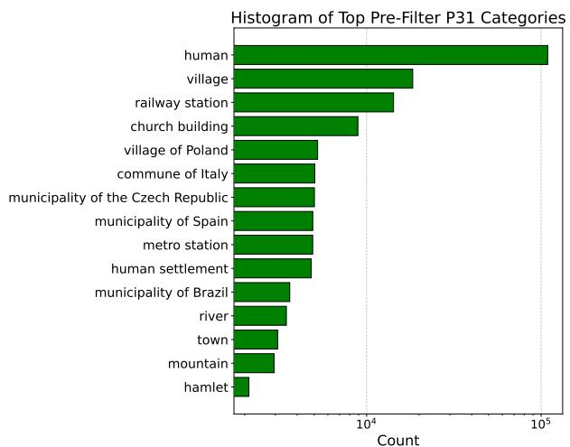

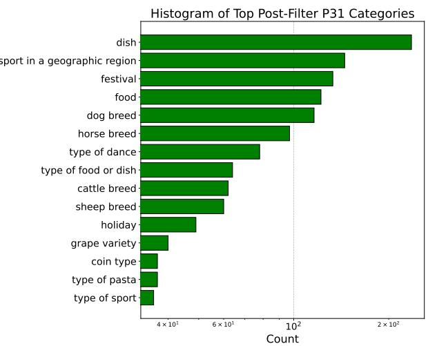

Figure 3: Distribution of the 15 largest Wikidata instance of (P31) groups among CulturalGround entities with English Wikipedia pages and multiple images. Before filtering, the majority of items belong to named-entity categories, which do not satisfy the concept criterion and are excluded at the group level.  
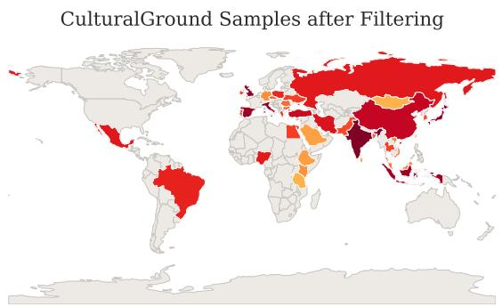

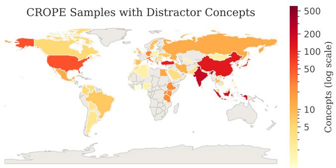  
Figure 4: Geographic distribution of concepts in CulturalGround (after filtering, left) and CROPE (after retrieving images for distractor concepts, right).

<table><tr><td>Question</td><td>Description</td><td>Count</td></tr><tr><td>Historical</td><td>Dates, events, historical figures</td><td>1,322</td></tr><tr><td>Geographic</td><td>Regional origins, specific locations</td><td>1,163</td></tr><tr><td>Linguistic</td><td>Etymology, meaning, language of origin</td><td>868</td></tr><tr><td>Cultural</td><td>Ethnic groups, practices, traditions</td><td>633</td></tr><tr><td>Function</td><td>Purpose, use case, role</td><td>449</td></tr><tr><td>Comparison</td><td>Similarities, equivalents, related items</td><td>441</td></tr><tr><td>Composition</td><td>Non-visible ingredients or components</td><td>372</td></tr><tr><td>Physical</td><td>Shape, color, size, visible components</td><td>3,043</td></tr><tr><td>Contextual</td><td>Settings, accompanying objects</td><td>1,341</td></tr><tr><td>Action</td><td>Movements, gestures, interactions</td><td>937</td></tr></table>

Table 10: Distribution of 5,298 encyclopedic (top) and 5,321 visual attribute (bottom) knowledge questions.

Animals & Plants) and performative or ceremonial human activities (Music & Performing Arts, Traditions).

Table 10 reports the distribution of knowledge questions across encyclopedic and visual attribute categories. Among encyclopedic questions, Historical, Geographic, and Linguistic categories together account for over 60% of questions. Cultural and Functional questions provide complementary coverage of context and use. Following in terms of number, Composition and Comparison questions, probe knowledge that is particularly resistant to visual inference, such as non-visible ingredients or cross-cultural equivalents. Among visual attribute questions, Physical characteristics are the most frequent, followed by Contextual and Action questions, which capture relational and motionrelated visual features. Together, the ten question categories span a diverse set of knowledge types.

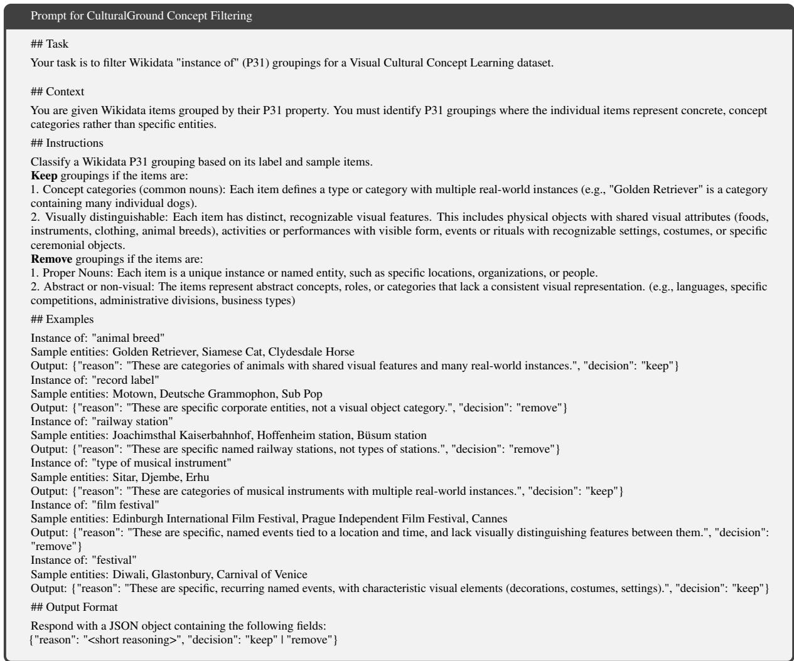  
Figure 5: Prompt for filtering the CulturalGround entities.

## A.5 Dataset Editing Examples

Figure 9 illustrates representative editing examples from CulturalBind across four cultural domains and regions, showing the edit sample and its associated generality, locality, and portability probes.

## A.6 Concept-Level vs. Entity-Level Edits

We compute the SigLIP2 (Tschannen et al., 2025) cosine similarity between each edit image and its paired generality and locality images in CulturalBind and two entity-based editing benchmarks, VLKEB (Huang et al., 2024) and the entity editing subset of MMKE-Bench (Du et al., 2025), using 2,000 samples each. As shown in Table 11, CulturalBind edit images are less visually similar to their generality images (mean 0.756) than those of VLKEB (0.853; Mann-Whitney U test $p < 1 0 ^ { - 5 } , \mathrm { C l i f f ^ { \ast } s } \delta = - 0 . 4 8 )$ and MMKE-Bench (0.845; p < 10−5, δ = −0.44), while remaining more similar than the locality images. This supports the hypothesis that generalizing across concept instances involves greater visual variation than identifying the same entity under different conditions.

<table><tr><td></td><td>Generality Locality</td></tr><tr><td>CulturalBind  $0 . 7 5 6 \pm 0 . 1 2 4$ </td><td> $0 . 5 4 8 \pm 0 . 0 9 5$ </td></tr><tr><td>VLKEB</td><td> $0 . 8 5 3 \pm 0 . 0 7 3$   $0 . 6 8 8 \pm 0 . 1 1 3$ </td></tr><tr><td>MMKE-Bench  $0 . 8 4 5 \pm 0 . 0 7 7$ </td><td> $0 . 4 2 5 \pm 0 . 0 8 4$ </td></tr></table>

Table 11: SigLIP2 cosine similarity (mean ± sd) between edit images and their paired generality and locality images.

## A.7 License

CulturalBind is released publicly upon publication under CC BY-SA 4.0. Images are sourced from Wikimedia Commons and Openverse under CC0, CC BY, and CC BY-SA licenses. Wikipedia text used for knowledge QA generation is licensed under CC BY-SA 4.0.

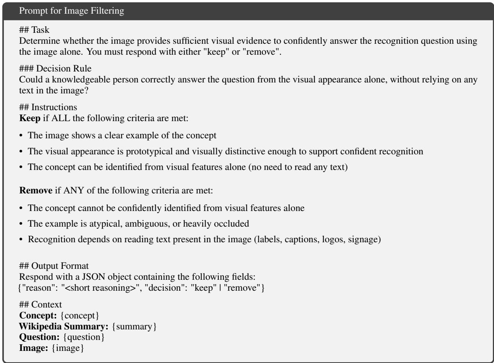  
Figure 6: Prompt for filtering the dataset images.

## B LLM-Judge Evaluation

Below, we report the prompts used for the evaluation of Open-Ended Concept Description (Figure 10), factual QA tasks (Encyclopedic, Attribute, and Visually-Grounded Encyclopedic QA, Figure 11), and Recognition QA (Figure 12).

To validate the reliability of automated evaluation, we independently annotated N=150 samples blind to the judge scores, stratified by score across all three evaluation dimensions: Open-ended Description (N=40), Text-based Factual QA (60 samples), and Image-based Recognition QA (50 samples). We use Qwen3-32B (Yang et al., 2025) as the LLM judge, as it is openly available and results are therefore fully reproducible. We compute Quadratic Weighted Kappa (QWK) between our annotations and the judge scores, which penalizes larger ordinal discrepancies more heavily. Agreement is strong across all dimensions with an overall QWK of 0.856. These results support the use of Qwen3-32B as a reliable proxy for reference-based evaluation.

## C Implementation Details

For each model, we construct stratified train, development, and test splits at the concept level with a 55/10/35 ratio, ensuring that all images of a given concept appear in the same split. Edit sets are then derived per model by filtering each split for the concepts the model fails to recognize, and results are reported on the test split. Methods that require additional data draw it from the train split: MEND's hypernetwork is trained on it, and IKE retrieves its in-context demonstrations from it.

We allow up to 30 updates per edit, with early stopping to prevent overfitting to the edit sample. We follow the default hyperparameters of each method and grid-search over the learning rate and, where applicable, the edit layer, selecting the configuration with the highest average accuracy on single edits on the development split. The selected configurations are reused unchanged in the sequential setting. For FT-V, FT-T, and DPO, we search over learning rates in $\{ 1 , 3 , 5 , 8 \} \times \{ 1 0 ^ { - 5 } , 1 0 ^ { - 4 } \}$ For GRACE and WISE, which apply edits at a single intermediate layer, we additionally sweep over

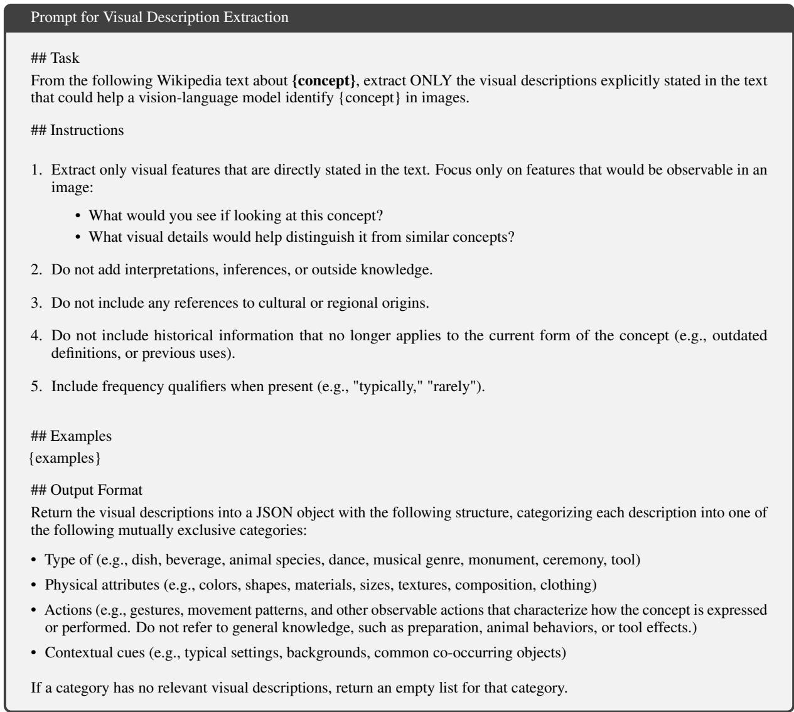  
Figure 7: Prompt for extracting visual descriptions from the Wikipedia page.

mid-to-late layers.

Table 12 details the edited component and parameter counts for each method per model. Budgets vary with both the method and the model architecture. This is most visible for FT-V: Gemma 3 reduces image patches with 2D average pooling followed by a linear projection, whereas Qwen3-VL concatenates 2 × 2 patch groups along the feature dimension before a 2-layer MLP, giving its connectors six to nine times as many trainable parameters.

All editing evaluations are run on a single NVIDIA H100 80GB GPU, with a total computational budget of approximately 360 GPU hours.

## D Additional Results

## D.1 Cross-Modal Evaluation Results

Figure 13 and Figure 14 present the breakdown of the cross-modal evaluation results per domain and per region. Across domains, variability is modest for text-based measures but more pronounced for image-based measures, where Foods & Beverages consistently scores lowest (mean 24.6% for Recognition QA), and Animal & Plant and Artefacts score highest (mean 41.4% and 46.6% respectively). Across regions, we observe consistent patterns. North America is a persistent outlier, with high performance across models and evaluation dimensions. Western Europe and East Asia are the next strongest regions, consistent with their higher representation in web-scale pretraining data. The gap relative to lower-resource regions, such as North Africa, Southeast Asia, and Eastern Europe, is substantial, but the individual weakest regions vary per model family.

Isolating Visual Recognition To verify that the drop from Encyclopedic to Visually-Grounded Encyclopedic QA is due to recognition rather than the image input acting as a distractor, we evaluate encyclopedic questions that keep the concept name alongside the image (Table 13). Adding the image to a question that names the concept increases accuracy (+0.4 to +2.1 points), but replacing the name with a referring expression results to a large drop, supporting that the bottleneck is visual recognition.

<table><tr><td>Method</td><td>Edited Component</td><td>Modified Params</td><td>Added Params</td><td>Auxiliary Component</td></tr><tr><td colspan="5">Qwen3-VL (4B), 36 LM layers</td></tr><tr><td>FT-V</td><td>VL connector</td><td>27M</td><td>0</td><td></td></tr><tr><td>FT-T</td><td>Wdown, layer 36</td><td>25M</td><td>0</td><td></td></tr><tr><td>DPO</td><td> $W _ { d o w n } ,$  layer 36</td><td>25M</td><td>0</td><td></td></tr><tr><td>IKE</td><td></td><td>0</td><td>0</td><td>SentenceBERT</td></tr><tr><td>MEND</td><td>FFN, layer 36</td><td>75M</td><td>0</td><td>Hypernet. (189M)</td></tr><tr><td>GRACE</td><td> $W _ { d o w n }$  out, layer 28</td><td>0</td><td>key: 9,728 value: 2,560</td><td></td></tr><tr><td>WISE</td><td> $W _ { d o w n } ,$  layer 22</td><td>0</td><td>25M</td><td></td></tr><tr><td colspan="5">Qwen3-VL (8B), 36 LM layers</td></tr><tr><td>FT-V</td><td>VL connector</td><td>40M</td><td>0</td><td></td></tr><tr><td>FT-T</td><td> $W _ { d o w n } , \mathrm { l a y e r } 3 6$ </td><td>50M</td><td>0</td><td></td></tr><tr><td>DPO</td><td> $W _ { d o w n } , \mathrm { l a y e r } 3 6$ </td><td>50M</td><td>0</td><td></td></tr><tr><td>IKE</td><td></td><td>0</td><td>0</td><td>SentenceBERT</td></tr><tr><td>MEND</td><td>FFN, layer 36</td><td>150M</td><td>0</td><td>Hypernet. (252M)</td></tr><tr><td>GRACE</td><td> $W _ { d o w n }$  out, layer 28</td><td>0</td><td>key: 12,288 value: 4,096</td><td></td></tr><tr><td>WISE</td><td> $W _ { d o w n } .$  layer 26</td><td>0</td><td>50M</td><td></td></tr><tr><td colspan="5">Gemma 3 (12B), 48 LM layers</td></tr><tr><td>FT-V</td><td>VL connector</td><td>4.4M</td><td>0</td><td></td></tr><tr><td>FT-T</td><td> $W _ { d o w n } , \mathrm { l a y e r } 4 8$ </td><td>59M</td><td>0</td><td></td></tr><tr><td>DPO</td><td> $W _ { d o w n } ,$  layer 48</td><td>59M</td><td>0</td><td></td></tr><tr><td>IKE</td><td></td><td>0</td><td>0</td><td>SentenceBERT</td></tr><tr><td>MEND</td><td>FFN, layer 48</td><td>177M</td><td>0</td><td>Hypernet. (300M)</td></tr><tr><td>GRACE</td><td> $W _ { d o w n }$  out, layer 31</td><td>0</td><td>key: 15,360 value: 3,840</td><td></td></tr><tr><td>WISE</td><td> $W _ { d o w n } ,$  layer 44</td><td>0</td><td>59M</td><td></td></tr></table>

Table 12: Configuration of editing methods per model. Modified Params count model parameters updated in place; Added Params count new parameters. IKE retrieves $k = 3 2$ in-context examples per edit, embedded with al1-MiniLM-L6-v2 SentenceBERT (Reimers and Gurevych, 2019). MEND's hypernetwork is trained before editing. GRACE stores a key-value entry per edit: when the key (the FFN intermediate state) is matched, the learned value replaces the $W _ { d o w n }$ output. WISE adds a copy of $W _ { d o w n }$ , updated sparsely per edit (20% at random).

## D.2 Sequential Edits

As the aggregate view in Figure 2 conceals how each method trades off reliability, generality, and locality, we report per-metric results in Figure 15. Reliability and generality are the most impacted across all methods. Neither finetuning-based nor memory-based approaches sustain either metric beyond the first few edits. Locality, which requires maintaining unrelated model outputs, is better retained by some methods and varies with the edited component. Portability is omitted, as it remains uniformly low across methods and edit counts.

<table><tr><td>Model</td><td>Name (no image)</td><td>Name + image</td><td>Ref. expr. + image</td></tr><tr><td>Qwen3-VL (4B)</td><td>32.4</td><td>34.5</td><td>23.9</td></tr><tr><td>Qwen3-VL (8B)</td><td>39.3</td><td>39.7</td><td>24.3</td></tr><tr><td>Gemma 3 (12B)</td><td>43.1</td><td>45.2</td><td>26.8</td></tr></table>

Table 13: Encyclopedic QA accuracy when the concept is referenced by name without the image, by name with the image, or by a referring expression with the image (Visually-Grounded Encyclopedic QA).

FT-T and DPO remain competitive in terms of reliability and generality. Their text locality declines steadily, potentially due to updates being applied to the final language model layer. FT-V shows the complementary pattern: editing the vision-language connector leaves text locality intact, as text-only inputs bypass the connector, while image locality is the lowest across methods.

Memory-based methods (GRACE and WISE) preserve higher locality across edits. GRACE preserves near-perfect locality but shows near-zero generality from the first edit onwards. Its flat average performance in Figure 2 is, therefore, an artifact of this trade-off rather than evidence of sustained editing success. The WISE variants perform similarly to direct finetuning on reliability and generality, but each better preserves the locality metric matching the modality used for routing: WISE-T maintains text locality above 85%, whereas WISE-V retains image locality more consistently. Note that image locality samples are selected based on their embedding similarity to the edit sample, making this a particularly challenging test of knowledge preservation.

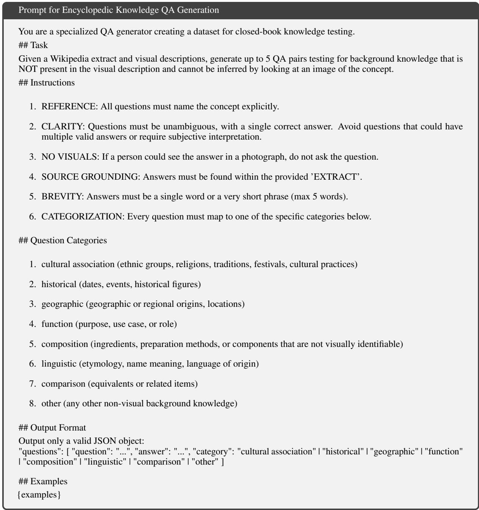  
Figure 8: LLM prompt to generate encyclopedic questions.

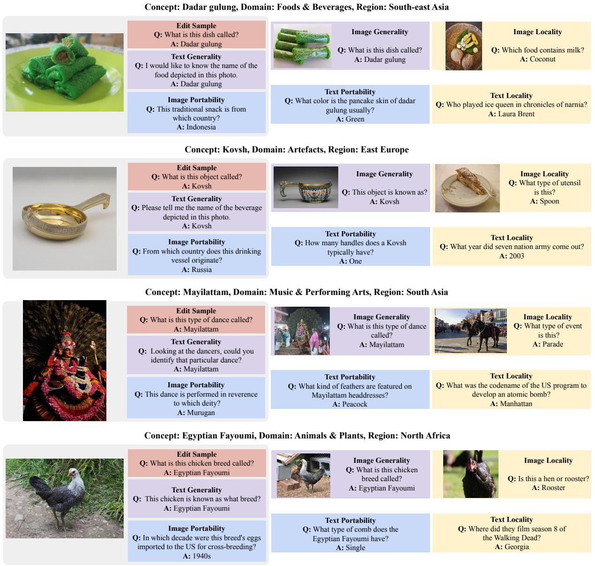  
Figure 9: CulturalBind editing examples.

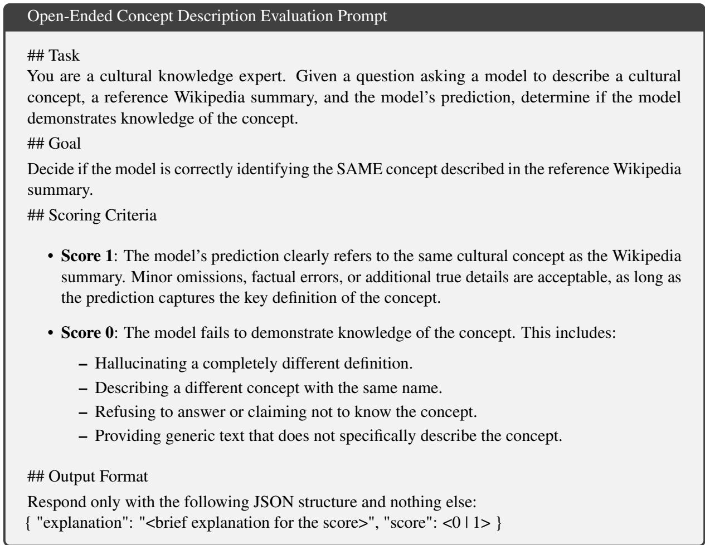  
Figure 10: Evaluation rubric for Open-Ended Description.

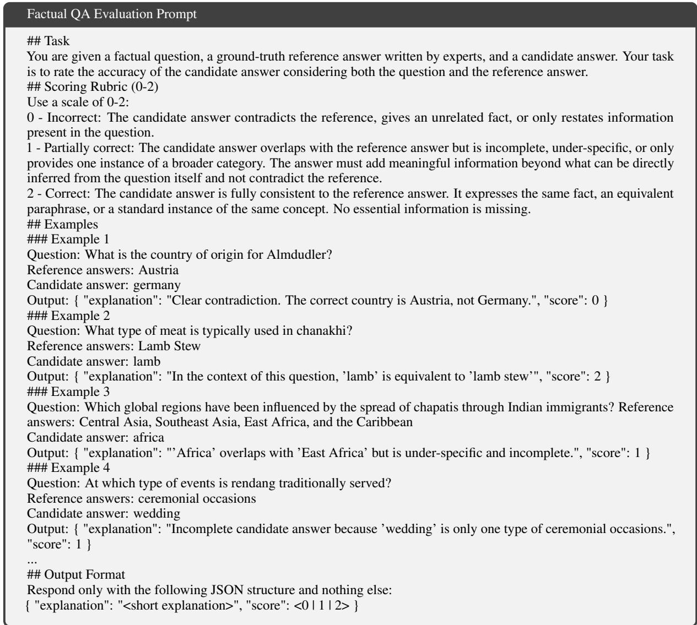  
Figure 11: Evaluation rubric for factual QA tasks.

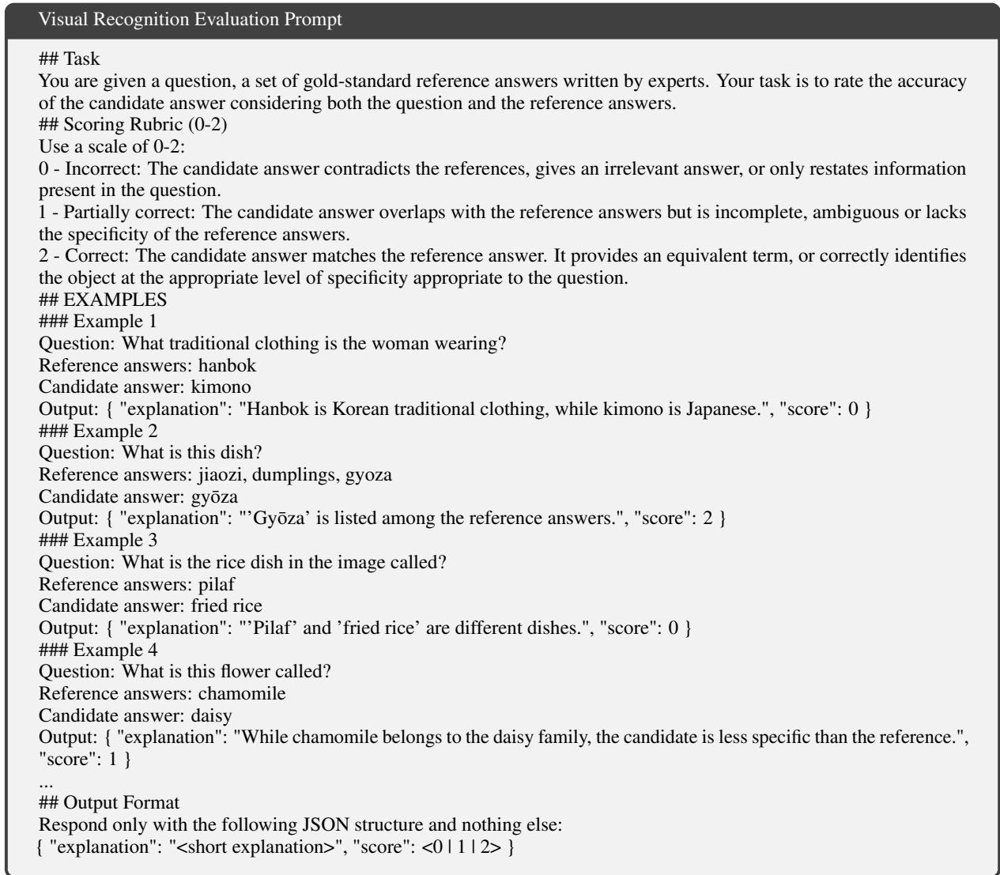  
Figure 12: Evaluation rubric for visual recognition QA tasks, adapted from LAVE (Mañas et al., 2024).

Encyclopedic QA  
Open-Ended Description  
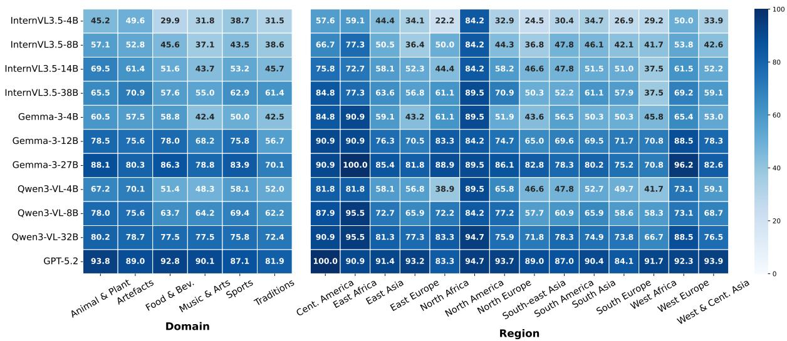

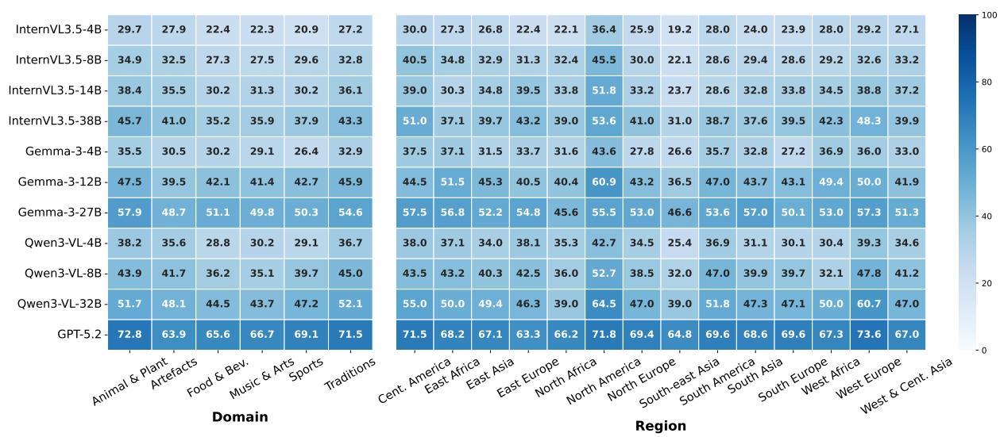

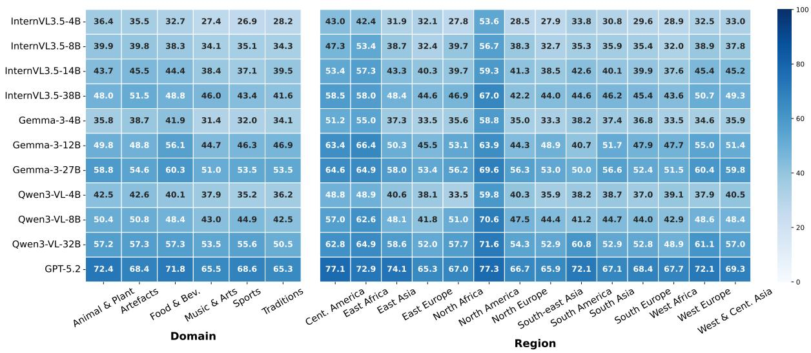  
Figure 13: Text-based cross-modal evaluation results per domain and per region.

Recognition QA  
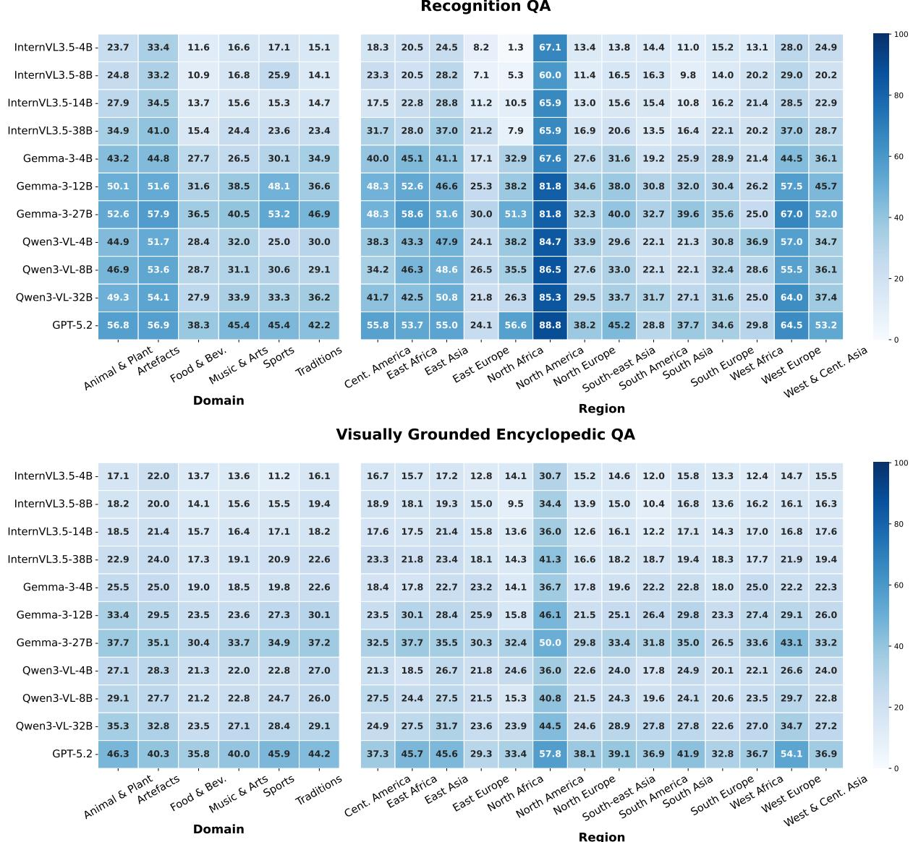  
Figure 14: Image-based cross-modal evaluation results per domain and per region.

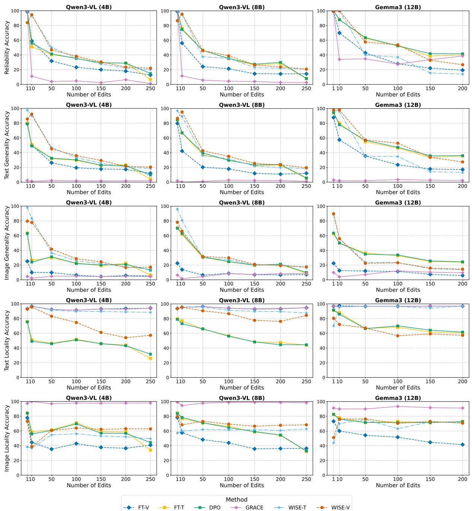  
Figure 15: Results per editing metric for sequential edits.