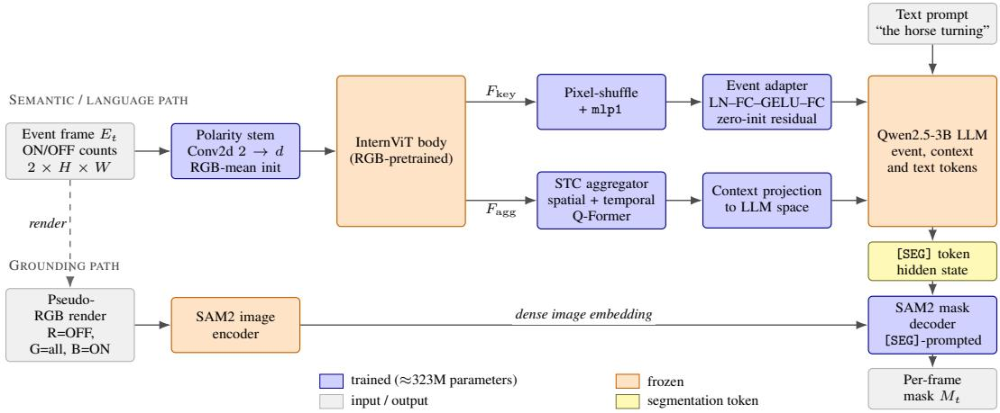
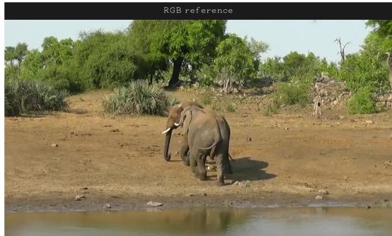
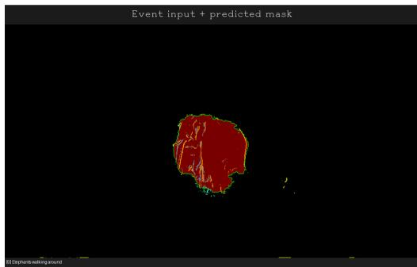
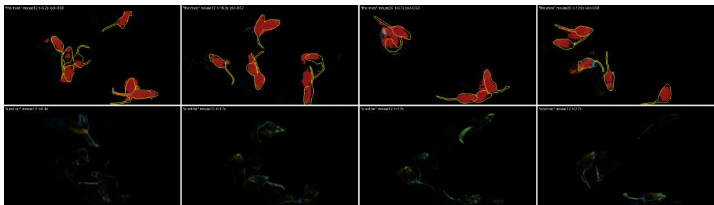
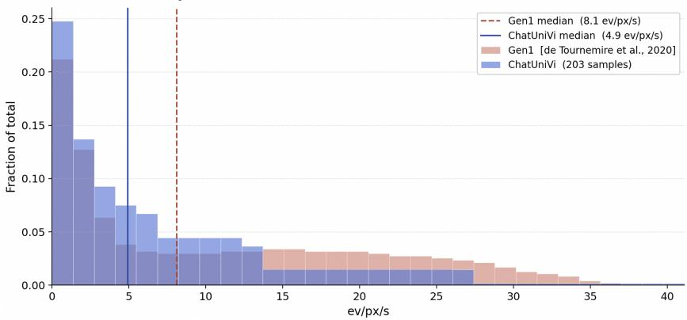
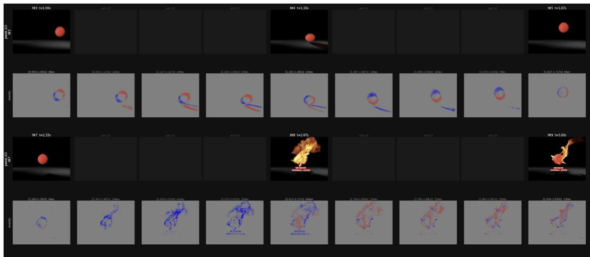
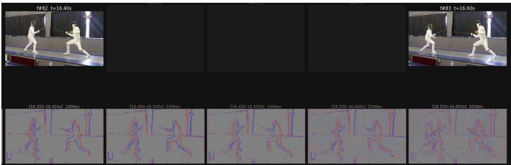
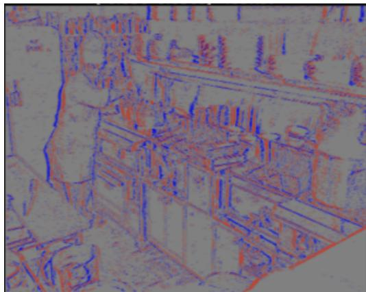
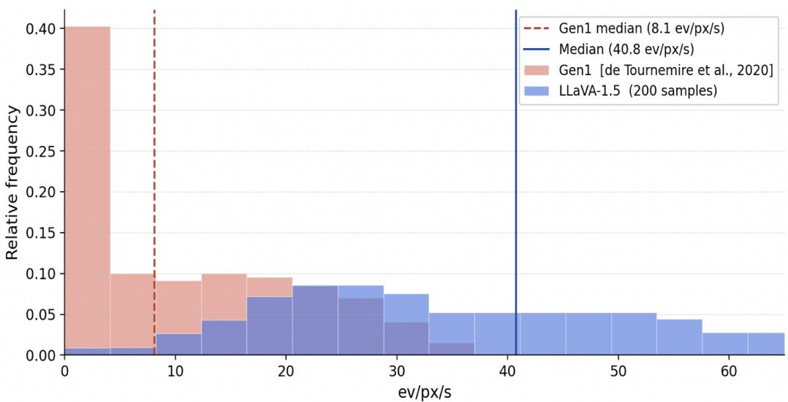

# Event-SAMA: Language-Grounded Video Object Segmentation on Neuromorphic Event Streams

Sergei Fedorchenko\* Max Zehnder\* Nikola Zubic Rong Zou Davide Scaramuzza´ University of Zurich sergey.a.fedorchenko@gmail.com max.zehnder@uzh.ch \*Equal contribution.

## Abstract

Event cameras offer microsecond temporal resolution, high dynamic range and no motion blur, but referring video object segmentation (RVOS) lacks eventstream datasets and models. We introduce Event-SAMA-239K, a synthetic-event conversion of the SAMA-239K grounded video-chat corpus and all additional SAMA training data: 30,650 video clips and 392,162 images. Optical-flow, FILM or saccade upsampling followed by a linear event generator preserves all mask, referring-expression and dialogue annotations. We also introduce Event-SAMA, adapting SAMA-4B with a two-channel polarity patch embedding initialised from pretrained RGB weights and a zero-initialised event adapter. End-to-end training yields 24.37 J&F on MeViS valid\_u and 22.33 J&F on the converted ReVOS valid subset, establishing the first event-native RVOS baseline (RGB SAMA-4B: 55.4 on MeViS). Frozen RGB SAMA-4B with pseudo-RGB renderings or E2VID reconstructions of the same events scores 13.23 and 15.94 J&F. Without retraining, Event-SAMA works on real event-camera recordings when the accumulation window matches their event density. A seed-controlled ablation with a measured noise floor of 0.47 J&F finds gains from diverse training sources over MeViS alone (+4.99), RGB-mean event-stem initialisation (+4.33), and a trainable SAM2 mask decoder (+2.76); the event adapter, partial ViT unfreezing and event polarity are within noise at this budget. An earlier, partially converted corpus snapshot trained with the identical recipe scores 1.38 J&F higher on MeViS and 1.12 higher on ReVOS. Both are single runs that also differ in schedule length, so we draw no conclusion about corpus scale.

Multimedial Material: For code, dataset generation process, weights and more visit: https://github.com/uzh-rpg/Event-SAMA.

## 1 Introduction

Referring video object segmentation (RVOS) and grounded video dialogue have progressed rapidly on RGB video, driven by motion-centric benchmarks such as MeViS [Ding et al., 2023] and by models that couple a large language model (LLM) to a promptable segmenter [Yuan et al., 2025, Sun et al., 2025]. These models ground language in pixels, which is exactly what real-world deployment of vision-language models requires. All of them, however, assume dense, synchronous RGB frames, and they inherit the failure modes of frame-based cameras: motion blur under fast motion, saturation in high-dynamic-range scenes and noise in low light.

Event cameras report per-pixel brightness changes asynchronously with microsecond latency, a dynamic range above 120 dB and no motion blur. They are attractive precisely in the regimes where frame-based cameras degrade, but the language-grounded segmenters that have matured on RGB video cannot consume this modality. To our knowledge, no dataset or model addresses referring segmentation from natural language on event streams. Recording a language-annotated event corpus at the scale that current vision-language models require would mean re-capturing hundreds of hours of video with event hardware and re-annotating it with referring expressions and multi-turn dialogue. We instead follow the standard practice in event vision [Gehrig et al., 2020] and convert an existing, richly annotated RGB corpus into synthetic event streams, inheriting its annotations at no annotation cost.

This paper makes three contributions:

• Event-SAMA-239K (Section 3), an event-camera conversion of the SAMA-239K grounded video-chat corpus [Sun et al., 2025] and of the full SAMA training mix: 30,650 video clips and 392,162 images from ten source datasets, converted with optical-flow, FILM or saccade upsampling followed by a linear event generator [Ziegler et al., 2023]. All SAMA-239K mask, referring-expression and dialogue annotations are preserved.

• Event-SAMA (Section 4), an event-native adaptation of SAMA-4B in which the InternViT patch embedding is replaced by a two-channel ON/OFF polarity stem initialised from the pretrained RGB weights, and a zero-initialised adapter aligns event features with the frozen vision-language pipeline.

• A seed-controlled ablation study and an event-specific evaluation protocol (Section 5) that separate real effects from run-to-run noise and characterise the sensitivity of RVOS on events to keyframe count and accumulation-window width.

## 2 Related work

Grounded video segmentation and dialogue. Ref-YouTube-VOS [Seo et al., 2020] and MeViS [Ding et al., 2023] established referring VOS, the latter with a focus on motion-centric expressions. SAM2 [Ravi et al., 2024] provides promptable segmentation with temporal propagation, and Sa2VA [Yuan et al., 2025] couples it to a multimodal LLM so that language can drive mask prediction through a dedicated [SEG] token, following the LISA reasoning-segmentation recipe [Lai et al., 2024]. SAMA [Sun et al., 2025] extends Sa2VA to multi-turn referential dialogue with a spatiotemporal context aggregator and contributes the SAMA-239K training corpus and SAMA-Bench. We build directly on the SAMA-4B model and the SAMA-239K data; our contribution is the event modality, not the underlying architecture or the source annotations.

Event vision and synthetic events. Labelled event data is scarce, so converting RGB video to synthetic event streams is standard practice [Gehrig et al., 2020]. Ziegler et al. [2023] benchmark several simulators and propose linear pixel-difference thresholding between frames, which matches the event density of log-intensity generators at substantially lower cost; we adopt it as our conversion path. Downstream event research has concentrated on low-level tasks such as optical flow, reconstruction and detection. EventGPT [Liu et al., 2025] is, to our knowledge, the only prior work coupling an LLM with event streams; it supports captioning, reasoning and visual question answering, but produces text only and performs neither pixel-level segmentation nor temporal object tracking. No prior dataset or model addresses referring video object segmentation on event data. A second route to labelled real events transfers labels from co-recorded frames: EV-SegNet [Alonso and Murillo, 2019] labels DDD17 by running a segmentation network on the grayscale frames, and DSEC-Semantic [Sun et al., 2022] pseudo-labels frames warped into the event view and filters them by manual inspection.

Table 1: Datasets converted to synthetic event streams. Count is video clips for video datasets and images for image datasets (annotated). $c _ { \pm }$ is the contrast threshold of the linear event generator. ev/px/s is the median number of events per pixel per second (2 s cap) over 200 randomly sampled items per dataset. †ReVOS comprises TAO (445 clips), OVIS (140) and UVO (77).
<table><tr><td>Dataset</td><td>Type</td><td>Upsampling</td><td> $c _ { \pm }$ </td><td></td><td>Count ev/px/s</td></tr><tr><td colspan="6">Event-SAMA-239K core (masks, referring expressions, dialogue)</td></tr><tr><td>VidSTG</td><td>Video</td><td>optical flow</td><td>3</td><td>6,618</td><td>26.6</td></tr><tr><td>SA-V</td><td>Video</td><td>optical flow</td><td>5</td><td>2,867</td><td>20.8</td></tr><tr><td>LV-VIS</td><td>Video</td><td>optical flow</td><td>3</td><td>2,595</td><td>9.6</td></tr><tr><td>Ref-YouTube-VOS</td><td>Video</td><td>optical flow</td><td>5</td><td>1,976</td><td>55.1</td></tr><tr><td>MeViS</td><td>Video</td><td>optical flow</td><td>4</td><td>1,087</td><td>6.4</td></tr><tr><td colspan="6">Additional SAMA training data</td></tr><tr><td>ChatUniVi</td><td>Video</td><td>FILM</td><td>3</td><td>14,845</td><td>4.9</td></tr><tr><td>ReVOS†</td><td>Video</td><td>optical flow</td><td>3</td><td>662</td><td>29.7</td></tr><tr><td>LLaVA-1.5</td><td>Image</td><td>saccade</td><td>5</td><td>308,379</td><td>40.8</td></tr><tr><td>COCO</td><td>Image</td><td>saccade</td><td>4</td><td>82,783</td><td>64.5</td></tr><tr><td>GRand-F</td><td>Image</td><td>saccade</td><td>5</td><td>1,000</td><td>29.9</td></tr><tr><td colspan="6">Total</td></tr></table>

These pipelines yield class labels for driving scenes with few classes (DSEC-Semantic: 11, daytime only, because the frame camera fails in hard illumination); referring expressions and dialogue about individual instances cannot be derived from frames and would require new human annotation for every clip. We therefore convert an existing referring corpus for training and use frame-annotated real data (MouseSIS [Hamann et al., 2024]) for evaluation (Section 5.3).

## 3 Event-SAMA-239K

## 3.1 Sources and scope

SAMA-239K [Sun et al., 2025] unifies five video datasets (VidSTG, SA-V, LV-VIS, Ref-YouTube-VOS, MeViS) under a common schema of object masks, referring expressions, region descriptions and multi-turn grounded conversations. Beyond this annotated core, the full SAMA training recipe draws on additional video and image instruction-tuning data (ChatUniVi, ReVOS, LLaVA-1.5, COCO, GRand-F). We convert both tiers and inherit all original annotations; the dataset is named after its annotated SAMA-239K core. Table 1 lists the composition, upsampling method and contrast threshold for event generation per source. The Count column reports the annotated clips or images used for training; additional clips from the same sources were converted without mask annotations and may support self-supervised pre-training but are not counted here. The event streams are stored as gzip-compressed HDF5 files with int32 microsecond timestamps and total 17.41 TB. Licensing and release are described in Appendix A.

## 3.2 Conversion pipeline

Every source is converted with a linear event generator [Ziegler et al., 2023] preceded by one of three upsampling strategies chosen according to content type. The generator emits an ON event at a pixel whenever its grey value has risen by $c _ { + }$ compared to the same pixel in the previous frame, and an OFF event whenever it has fallen by $^ { c _ { - } ; }$ thresholds are tuned per dataset in the range $c _ { \pm } \in [ 3 , 5 ]$ (Table 1).

Video sources (optical flow). Consecutive frame pairs are upsampled to at least 200 fps with DIS optical flow [Kroeger et al., 2016], following the dense interpolation of Ziegler et al. [2023] before event generation. This is the default path for all video sources except ChatUniVi.

ChatUniVi (FILM). For ChatUniVi we replace flow-based warping with FILM [Reda et al., 2022], a learned frame-interpolation model, using the adaptive upsampling scheme of vid2e [Gehrig et al., 2020]. FILM synthesises intermediate frames from the perceived motion between adjacent frames and produces smoother luminance transitions with fewer warping artefacts than optical-flow upsampling.

Image sources (saccade). A static image produces no brightness changes and therefore no events. To obtain a non-empty stream from still images (COCO, LLaVA-1.5, GRand-F) we apply a synthetic saccade, a 8 px shift along three directions over 60 frames spanning 300 ms, followed by event generation. This mimics the events a real sensor produces when a static scene is viewed under small camera or eye movements.

Event representation. At training and test time we accumulate events into two-channel polarity histograms. For a timestamp t and window width w, ON and OFF events with timestamps in $[ t - w / 2 , \ t + w / 2 )$ are counted into separate channels, yielding an event frame $E _ { t } \in \mathbb { R } ^ { 2 \times \tilde { H } \times W }$ Counts are compressed as asin $\iota ( x ) / 4$ before entering the network to limit the dynamic range of dense regions. We use $w = 1 0$ ms by default, i.e. an event frame rate of $1 0 0 \mathrm { H z } ;$ the sensitivity to w is analysed in Appendix D.

## 3.3 Validation of the converted streams

We validate the streams qualitatively and quantitatively. Qualitatively, we sample ten clips per dataset and inspect the source frames, the per-frame event accumulation and sub-bin windows within each inter-frame gap (Appendix F). Quantitatively, we measure the distribution of events per pixel per second (ev/px/s, 2 s cap) over 200 randomly sampled items per dataset; medians are reported in Table 1.

Across the video sources, medians range from 4.9 ev/px/s (ChatUniVi) to 55.1 ev/px/s (Ref-YouTube VOS). For reference, Ziegler et al. [2023] report 62.8 ev/px/s for a high-dynamic real recording and 0.046 ev/px/s for a low-dynamic one, so our video sources fall within the range of real sensors, toward its high-dynamic end. Figure 4 compares the ev/px/s distribution of converted ChatUniVi clips with real Gen1 recordings [de Tournemire et al., 2020]; the two distributions overlap substantially (medians 4.9 vs. 8.1 ev/px/s). One caveat applies: linear thresholding also fires on optical-flow warping residuals and JPEG compression artefacts, so at equal ev/px/s a real sensor encodes somewhat more scene motion than our synthetic streams.

Image sources exhibit higher densities (29.9–64.5 ev/px/s) because the saccade shifts all image content across the contrast threshold simultaneously, so a large fraction of pixels fires throughout the 300 ms window. This is by design, but image-derived streams are therefore denser than typical real recordings (Appendix F, Figure 8).

## 4 Event-SAMA

Problem statement. Given an event stream $\mathcal { E } = \{ ( x _ { i } , y _ { i } , t _ { i } , p _ { i } ) \}$ with pixel coordinates $( x _ { i } , y _ { i } )$ timestamps $t _ { i }$ and polarities $p _ { i } \in \{ \mathrm { O N } , \mathrm { O F F } \}$ , together with a natural-language referring expression $q ,$ the task is to predict a binary mask $M _ { t }$ of the referred object at every annotated timestamp t. No RGB frame is available at training or test time.

Event-SAMA adapts SAMA-4B [Sun et al., 2025], which itself builds on Sa2VA [Yuan et al., 2025], SAM2 [Ravi et al., 2024] and the BLIP-2 [Li et al., 2023] Q-Former, to consume the event frames $E _ { t }$ of Section 3.2 in place of RGB images. Figure 1 shows the architecture and marks the trained components. We first summarise the unchanged SAMA-4B pipeline and then describe the three event-specific modifications.

Base pipeline (unchanged from SAMA-4B). Each sampled keyframe is patch-embedded and encoded by a frozen InternViT [Chen et al., 2024], pixel-shuffled to reduce the token count and linearly projected by mlp1 into the language embedding space, giving per-keyframe features $F _ { \mathrm { k e y } }$ . In parallel, a two-stage spatio-temporal context (STC) aggregator built on the BLIP-2 Q-Former [Li et al., 2023] summarises the whole clip into a fixed-size context $F _ { \mathrm { a g g } }$ (details in Appendix B). Both are interleaved with the text tokens and fed to a frozen Qwen2.5-3B [Qwen Team, 2024] LLM. Following LISA [Lai et al., 2024], the vocabulary contains a [SEG] token; when the LLM emits it, the token’s final hidden state serves as a sparse prompt embedding for the SAM2 mask decoder, analogous to a point or box prompt. The frozen SAM2 image encoder supplies the dense image embedding, and the mask decoder, trained in both SAMA-4B and Event-SAMA, produces the per-frame mask.

  
Figure 1: Event-SAMA, adapted from SAMA-4B. Each event frame $E _ { t }$ drives two paths. On the semantic/language path, the two-channel polarity stem (trained) feeds the frozen InternViT; perkeyframe features $F _ { \mathrm { k e y } }$ pass through the pixel-shuffle/mlp1 projection and the trained event adapter, while whole-clip context $F _ { \mathrm { a g g } }$ is produced by the trained STC aggregator. Both are interleaved with the text prompt and fed to the frozen Qwen2.5-3B LLM, which emits a [SEG] token. On the grounding path, $E _ { t }$ is rendered to pseudo-RGB for the frozen SAM2 image encoder; the trained SAM2 mask decoder, prompted by the [SEG] hidden state, outputs the per-frame mask.

Two-channel polarity stem. The pretrained patch embedding is a $\mathrm { C o n v 2 d ( 3  } d )$ over RGB. We replace it with a Conv2d(2 → d) over the ON/OFF channels of $E _ { t }$ . Its kernel is initialised by averaging the pretrained RGB kernel over the input dimension and broadcasting the result to both event channels; the bias is copied unchanged. The pretrained ViT body therefore receives inputs in a familiar range from the first iteration instead of having to adapt to a randomly initialised stem. This initialisation is worth +4.33 J&F over a random one (Table 3). Everything downstream of the patch embedding within InternViT is untouched.

Event adapter. Following the event-language adapter of EventGPT [Liu et al., 2025], we insert a residual module (LayerNorm → Linear → GELU → Linear, hidden size unchanged, 8.4M parameters) after mlp1 on the keyframe path. The second linear layer is zero-initialised, so the adapter is the identity at initialisation: training starts from the exact pretrained RGB–language alignment, and the adapter can learn a modality-specific correction on top of it. The aggregated path $F _ { \mathrm { a g g } }$ is not adapted because the STC aggregator and its output projection are trained from scratch, as in the base SAMA recipe. In the ablation, removing the adapter changes the score by $+ 0 . 6 7 \mathcal { I } \& \mathcal { F }$ , and on an independent earlier batch by −0.57; both are within the seed noise (Section 5.4). We retain the adapter on architectural rather than empirical grounds: zero-initialisation guarantees that it cannot hurt at the start of training, and its cost is negligible.

SAM2 grounding path. The SAM2 image encoder expects three-channel input. Rather than retraining it on two channels, we render each event frame to a pseudo-RGB image (R = OFF density, G = total density, B = ON density) and apply SAM2’s standard preprocessing. This reuses the RGB-pretrained encoder unmodified at the cost of a synthetic-image domain gap (Section 6). Unlike the vision-to-language path, the mask decoder is fully trained: its output space (per-pixel mask logits)

is task-specific, so there is no pretrained alignment to preserve. Freezing the decoder costs 2.76 J&F (Table 3).

Trainable components and training. The LLM, the InternViT body and the SAM2 image encoder are frozen. The trained components are the polarity stem (0.4M parameters), the event adapter (8.4M), the mlp1 vision–language projection that the adapter wraps (12.6M), the STC aggregator with its projections (288.8M), the context projection into the LLM embedding space (4.2M), the projection mapping [SEG] hidden states into the SAM2 prompt space (4.7M), and the SAM2 mask decoder (4.2M), for a total of 323M trained parameters. The [SEG] token requires no new embedding: it is already part of the SAMA-4B vocabulary, so its input embedding is inherited from SAMA-4B training and remains frozen with the rest of the LLM. The trained [SEG]-to-prompt projection is the only component that adapts its representation.

An item is one annotated training sample, i.e. an expression–clip pair, a referring-expression image sample, or one dialogue. An epoch is one pass over the repeat-weighted concatenation of all sources, with per-source repeat factors of 1–10 up-weighting the small mask-annotated sources (e.g. MeViS ×4). One epoch of the full corpus is ≈1.60M weighted samples, so 4 epochs at global batch 48 give 133,208 iterations.

## 5 Experiments

## 5.1 Setup

Benchmarks and metrics. We evaluate referring VOS on MeViS valid\_u (50 videos, 793 video– expression pairs) and on ReVOS valid [Sun et al., 2025] (416 videos), reporting region similarity J, contour accuracy F and their mean J&F. MeViS valid\_u is fully converted. ReVOS coverage in our conversion is partial: 97 of the 416 validation videos have a converted event stream. We therefore score ReVOS on this 97-video subset only, since scoring the unconverted videos as misses would measure conversion coverage rather than model quality.

Evaluation protocol. Because event streams are continuous, a frame-level protocol must be defined explicitly. We predict masks on K = 32 temporally uniform keyframes per clip, each accumulated over a 10 ms window centred on the keyframe timestamp (matching training), and propagate each prediction to the remaining annotated timestamps by nearest-keyframe assignment before scoring against the per-frame ground truth. The LLM receives the first 5 keyframes as visual context. We evaluate the final training checkpoint directly. All numbers in this paper use this identical setting; its sensitivity is characterised in Appendix D.

## 5.2 Main results

Table 2 reports the main results. Event-SAMA trained on the full corpus reaches 24.37 J&F on MeViS valid\_u and 22.33 J&F on the converted ReVOS subset. The model trained on the fivesource subset scores about one point higher on both benchmarks (25.75 and 23.45). We nevertheless report the full-corpus model as the main result because it is the model trained on the corpus this paper describes; selecting the subset model as the headline because of its higher score would misrepresent the paper’s central model. Section 5.4 analyses the difference.

A large gap to the RGB upper bound (55.4 J&F) remains. Event streams carry no colour and no static texture, all training and test events are synthetic, and Event-SAMA is a first baseline rather than a tuned system. A qualitative example is shown in Appendix C.

Native events vs. reconstruct-and-reuse. An obvious alternative to an event-native model is to turn events into RGB-like frames and reuse an existing RGB model. We test two such pipelines with the frozen RGB SAMA-4B, the checkpoint Event-SAMA is initialised from: pseudo-RGB, the exact rendering our grounding branch feeds to SAM2 (Appendix B), and E2VID [Rebecq et al., 2021], a learned intensity reconstruction (pretrained, default settings). Both trail the native model by a wide margin (13.23 and 15.94 vs. 24.37 J&F; Table 2). Our synthetic events arrive in equal-timestamp bursts between low-rate source frames, which lies outside E2VID’s training distribution and blurs its reconstructions.

Table 2: Referring VOS on MeViS valid\_u and ReVOS valid‡. Both Event-SAMA rows use the same 4-epoch recipe and differ only in training data. The full-corpus model (bold) is our main result because it is the model trained on the corpus described in Section 3. The RGB SAMA-4B number is the published MeViS result [Sun et al., 2025]; it serves as an upper bound, not as a like-for-like comparison. The two reconstruct-and-reuse rows feed pseudo-RGB renderings or E2VID [Rebecq et al., 2021] reconstructions of the same events to the unmodified RGB SAMA-4B with its own evaluation script.
<table><tr><td>Model</td><td>Training data</td><td>J</td><td>F</td><td>MeViS J&amp;F ReVOS</td><td> $\mathcal { I } \& \mathcal { F } ^ { \ddagger }$ </td></tr><tr><td>SAMA-4B (RGB, upper bound)</td><td>SAMA mix (RGB)</td><td></td><td></td><td>55.4</td><td></td></tr><tr><td>SAMA-4B (frozen)</td><td>pseudo-RGB events</td><td>12.42</td><td>14.03</td><td>13.23</td><td></td></tr><tr><td>SAMA-4B (frozen)</td><td>E2VID reconstr.</td><td>15.62</td><td>16.25</td><td>15.94</td><td></td></tr><tr><td>Event-SAMA</td><td>5-source subset (27,461)</td><td>25.32</td><td>26.19</td><td>25.75</td><td>23.45</td></tr><tr><td>Event-SAMA</td><td>Full corpus (422,812)</td><td>23.81</td><td>24.92</td><td>24.37</td><td>22.33</td></tr></table>

‡Computed on the 97/416 valid videos with a converted event stream (Section 5.1).

## 5.3 Real event-camera data

All other results use synthetic events. To test whether the model transfers to real sensors, we evaluate the unchanged full-corpus checkpoint on two public real-event datasets with ground-truth masks. MouseSIS [Hamann et al., 2024] provides real 1280×720 recordings of freely moving mice with perframe instance masks; we use all 25 annotated clips, none of which we train on, with the expression “the mice” and the absent “a red car” as a negative control. N-Caltech101 [Orchard et al., 2015] provides real ATIS recordings with object contours. Setup details and qualitative examples are in Appendix E.

On the 25 MouseSIS clips, “the mice” reaches 31.7 J&F, against 24.5 for a language-free motion mask computed from the same events, and “a red car” yields an empty mask in 63% of frames. Since MouseSIS events are much sparser than our training data, we match the accumulation window to the event density of each clip instead of using the 10 ms training window. On N-Caltech101 the correct class expression reaches a higher IoU than a wrong-class expression in 69% of samples, with a mean IoU of 0.52 vs. 0.37. Figure 3 in Appendix E shows qualitative examples.

## 5.4 Ablations

Protocol. The ablation study was conducted before the full-corpus conversion was complete and therefore uses the five-source subset (27,461 items) with a 1-epoch iso-compute recipe. The baseline is trained with two seeds (24.20 and 24.67 J&F, spread 0.47), which bounds the run-to-run noise; each variant is trained once. Architectural findings (adapter, decoder trainability, stem initialisation, polarity, ViT unfreezing) are model properties and are unaffected by the choice of subset, but the baseline (24.44) is not the same model as the full-corpus headline (24.37). Table 3 groups the variants by whether their effect exceeds the noise floor.

Data diversity is the dominant factor, up to a point. The full-corpus model scores 1.38 J &F below the comparison model on MeViS and 1.12 below on ReVOS. The two runs differ in conversion snapshot (≈4% of weighted samples), in schedule length (127,468 vs. 133,208 iterations under the same 4-epoch cosine schedule), and in seed, and each was trained once. Against the 0.47 J &F two-seed spread measured for the 1-epoch recipe, we read this gap as run-to-run variation and draw no conclusion about training-set size from this pair.

Table 3: Ablations on MeViS valid\_u, 1-epoch iso-compute recipe on the five-source subset. The baseline is the mean of two seeds (24.20 / 24.67 J&F; spread 0.47). Rows in the first group lie outside the noise floor; rows in the second group do not, and the adapter and ViT variants reversed sign (−0.57, +0.26) on an independent earlier batch, whereas the decoder effect kept its sign in both batches. The last row is not iso-compute with the others (see footnote).
<table><tr><td>Configuration</td><td>J</td><td>F</td><td>∆J&amp;F</td></tr><tr><td>Full model (baseline, mean of 2 seeds)</td><td>23.42</td><td>25.46</td><td></td></tr><tr><td>Effects outside the noise floor</td><td></td><td></td><td></td></tr><tr><td>— diverse data mix (train on MeViS only)</td><td>18.19</td><td>20.71</td><td>-4.99</td></tr><tr><td>— RGB-mean stem init (random init)†</td><td>16.79</td><td>20.63</td><td>-4.33</td></tr><tr><td>— trainable SAM2 decoder (frozen)</td><td>20.65</td><td>22.70</td><td>-2.76</td></tr><tr><td>Effects within the noise floor</td><td></td><td></td><td></td></tr><tr><td>— event polarity (ON/OFF merged)</td><td>24.41</td><td>25.51</td><td>+0.52</td></tr><tr><td>— event adapter</td><td>24.26</td><td>25.95</td><td>+0.67</td></tr><tr><td>+ ViT last 6 layers unfrozen</td><td>22.89</td><td>24.58</td><td>-0.71</td></tr><tr><td colspan="2">Data scale (4-epoch recipe, not iso-compute) + full corpus (422,812 items)‡ 23.81</td><td>24.92</td><td>-1.38</td></tr></table>

†Trained in an earlier batch against a matched baseline of 23.04 J &F; the effect size makes a re-run unnecessary. ‡Delta with respect to the matched 4-epoch five-source model (25.75 J &F, Table 2), not the 1-epoch baseline above.

Stem initialisation and decoder trainability. Initialising the two-channel stem from the RGBmean kernel rather than randomly is worth 4.33 J&F, and training the SAM2 mask decoder rather than freezing it is worth 2.76 J&F. Both effects are several times larger than the noise floor, and the decoder effect kept its sign across two independent training batches.

Adapter and ViT unfreezing. Removing the event adapter (+0.67) and unfreezing the last six ViT layers (−0.71) both produce deltas comparable to the seed spread, and both reversed sign on an earlier batch (−0.57 and +0.26). At this budget neither can be distinguished from a no-op.

Polarity: no measurable effect, but underpowered. Merging the ON and OFF channels into their mean, which destroys polarity while preserving total event count, changes the score by $+ 0 . 5 2 \ : \mathcal { I } \& \mathcal { F }$ within the seed spread. We do not interpret this as evidence that polarity is unnecessary: a single run against a two-seed baseline cannot establish the absence of an effect of this size, and unlike the adapter and ViT variants this configuration was measured only once. The supported conclusion is narrower: at this training budget, polarity is not among the factors that dominate performance, in contrast to data mix, stem initialisation and decoder trainability. Whether polarity-free representations are viable for language-grounded segmentation, which would matter for sensor bandwidth and representation design, requires a properly powered study.

## 6 Limitations

Synthetic events. All events are simulated from RGB video with a linear generator. Our validation (Section 3.3) matches event density against real Gen1 recordings, but density is only one axis: we do not reproduce sensor noise, refractory periods, per-pixel threshold mismatch or the true microsecond timing statistics of a real sensor. Our real-event evaluation (Section 5.3) is small (25 MouseSIS clips of a single animal domain and 200 N-Caltech101 samples) and shows that the accumulation window must be matched to the sensor’s event density; training on real or density-randomised events is the most important direction for follow-up work.

Saccades are a proxy. Still-image sources constitute the majority of the corpus by count, and their events stem from a synthetic saccade rather than scene motion. This is a deliberate stand-in for eye-movement-driven events and yields higher event densities (29.9–64.5 ev/px/s) than the video sources; conclusions drawn from image-heavy training should be read with this in mind.

Partial second benchmark. Our best-supported numbers are on MeViS val $\mathtt { \lrcorner d \_ u }$ (full coverage, 793 items). Our ReVOS valid numbers cover 97 of 416 videos because the remainder has not yet been converted. The grounded-dialogue capabilities supported by the training data are trained but not benchmarked.

Ablation budget. Ablations use a 1-epoch schedule with two seeds for the baseline and one seed per variant. Effects below approximately 0.5 $\mathcal { T } \& \mathcal { F }$ cannot be resolved, which is why three of the six architectural ablations are reported as inconclusive.

Absolute performance. At 24.37 $\mathcal { T } \& \mathcal { F }$ against an RGB upper bound of 55.4, Event-SAMA is a first baseline demonstrating that language-grounded segmentation on events is feasible, not a competitive system.

## 7 Conclusion

We introduced Event-SAMA-239K, the first large-scale language-grounded event video dataset (30,650 video clips and 392,162 images converted to synthetic event streams with all SAMA-239K annotations preserved), and Event-SAMA, the first model that segments objects in event streams from natural-language referring expressions. Event-SAMA reaches 24.37 $\mathcal { T } \& \mathcal { F }$ on MeViS valid\_u and 22.33 $\mathcal { T } \& \mathcal { F }$ on the converted subset of ReVOS valid. A seed-controlled ablation shows that data diversity (+4.99), RGB-mean initialisation of the event stem (+4.33) and a trainable SAM2 mask decoder (+2.76) are the decisive design choices, while the event adapter, ViT unfreezing and event polarity cannot be separated from a $0 . 4 7 - \mathcal { I } \& \mathcal { F }$ noise floor. Longer accumulation windows at test time improve accuracy even though the model was trained at 10 ms. The event-native model outperforms reconstruct-and-reuse pipelines built on the same RGB model on MeViS and works on real event-camera recordings without retraining once the accumulation window matches their event density. We release the conversion pipeline with per-dataset configuration, which regenerate the full corpus from the original RGB source, together with training code and checkpoints, so that language-grounded event understanding can be studied as a benchmark task.

## Acknowledgments and Disclosure of Funding

This work was supported by the European Union’s Horizon Europe Research and Innovation Programme under grant agreement No. 101120732 (AUTOASSESS) and the European Research Council (ERC) under grant agreement No. 864042 (AGILEFLIGHT).

## References

Iñigo Alonso and Ana C. Murillo. EV-SegNet: Semantic segmentation for event-based cameras. In IEEE/CVF Conference on Computer Vision and Pattern Recognition Workshops (CVPRW), pages 1624–1633, 2019.

Zhe Chen, Jiannan Wu, Wenhai Wang, Weijie Su, Guo Chen, Sen Xing, Muyan Zhong, Qinglong Zhang, Xizhou Zhu, Lewei Lu, et al. InternVL: Scaling up vision foundation models and aligning for generic visual-linguistic tasks. arXiv preprint arXiv:2312.14238, 2024.

Pierre de Tournemire, Davide Oscar Nitti, Etienne Perot, Davide Migliore, and Amos Sironi. A large scale event-based detection dataset for automotive. arXiv preprint arXiv:2001.08499, 2020.

Henghui Ding, Chang Liu, Shuting He, Xudong Jiang, and Chen Change Loy. MeViS: A largescale benchmark for video segmentation with motion expressions. In IEEE/CVF International Conference on Computer Vision (ICCV), 2023.

Daniel Gehrig, Mathias Gehrig, Javier Hidalgo-Carrió, and Davide Scaramuzza. Video to events: Recycling video datasets for event cameras. In IEEE/CVF Conference on Computer Vision and Pattern Recognition (CVPR), 2020.

Friedhelm Hamann, Hanxiong Li, Paul Mieske, Lars Lewejohann, and Guillermo Gallego. MouseSIS: A frames-and-events dataset for space-time instance segmentation of mice. In European Conference on Computer Vision Workshops (ECCVW), 2024. arXiv:2409.03358.

Till Kroeger, Radu Timofte, Dengxin Dai, and Luc Van Gool. Fast optical flow using dense inverse search. In European Conference on Computer Vision (ECCV), 2016.

Xin Lai, Zhuotao Tian, Yukang Chen, Yanwei Li, Yuhui Yuan, Shu Liu, and Jiaya Jia. LISA: Reasoning segmentation via large language model. arXiv preprint arXiv:2308.00692, 2024.

Junnan Li, Dongxu Li, Silvio Savarese, and Steven Hoi. BLIP-2: Bootstrapping language-image pre-training with frozen image encoders and large language models. In International Conference on Machine Learning (ICML), 2023.

Shaoyu Liu, Jianing Li, Guanghui Zhao, Yunjian Zhang, Xin Meng, Fei Richard Yu, Xiangyang Ji, and Ming Li. EventGPT: Event stream understanding with multimodal large language models. In IEEE/CVF Conference on Computer Vision and Pattern Recognition (CVPR), 2025. arXiv:2412.00832.

Garrick Orchard, Ajinkya Jayawant, Gregory K. Cohen, and Nitish Thakor. Converting static image datasets to spiking neuromorphic datasets using saccades. Frontiers in Neuroscience, 9:437, 2015.

Qwen Team. Qwen2.5 technical report. arXiv preprint arXiv:2412.15115, 2024.

Nikhila Ravi, Valentin Gabeur, Yuan-Ting Hu, Ronghang Hu, Chaitanya Ryali, Tengyu Ma, Haitham Khedr, Roman Rädle, Chloe Rolland, Laura Gustafson, Eric Mintun, Junting Pan, Kalyan Vasudev Alwala, Nicolas Carion, Chao-Yuan Wu, Ross Girshick, Piotr Dollár, and Christoph Feichtenhofer. SAM 2: Segment anything in images and videos. arXiv preprint arXiv:2408.00714, 2024.

Henri Rebecq, René Ranftl, Vladlen Koltun, and Davide Scaramuzza. High speed and high dynamic range video with an event camera. IEEE Transactions on Pattern Analysis and Machine Intelligence, 43(6):1964–1980, 2021.

Fitsum Reda, Janne Kontkanen, Eric Tabellion, Deqing Sun, Caroline Pantofaru, and Brian Curless. FILM: Frame interpolation for large motion. In European Conference on Computer Vision (ECCV), 2022.

Seonguk Seo, Joon-Young Lee, and Bohyung Han. URVOS: Unified referring video object segmentation network with a large-scale benchmark. In European Conference on Computer Vision (ECCV), 2020.

Ye Sun, Hao Zhang, Henghui Ding, Tiehua Zhang, Xingjun Ma, and Yu-Gang Jiang. SAMA: Towards multi-turn referential grounded video chat with large language models. In Advances in Neural Information Processing Systems (NeurIPS), 2025. arXiv:2505.18812.

Zhaoning Sun, Nico Messikommer, Daniel Gehrig, and Davide Scaramuzza. ESS: Learning eventbased semantic segmentation from still images. In European Conference on Computer Vision (ECCV), 2022.

Haobo Yuan, Xiangtai Li, Tao Zhang, Zilong Huang, et al. Sa2VA: Marrying SAM2 with LLaVA for dense grounded understanding of images and videos. arXiv preprint arXiv:2501.04001, 2025.

Andreas Ziegler, Daniel Teigland, Jonas Tebbe, Thomas Gossard, and Andreas Zell. Real-time event simulation with frame-based cameras. In IEEE International Conference on Robotics and Automation (ICRA), 2023. arXiv:2209.04634.

## A Licensing and release

We release the means to regenerate the full corpus rather than the event streams themselves. At 17.41 TB, the streams are much larger than their RGB sources, so conversion is faster than downloading; several sources, notably SA-V and YouTube-derived corpora, also restrict redistribution of derived works. The release comprises:

1. The conversion pipeline, training code, evaluation harness and trained checkpoints, which are released under Apache 2.0, matching the SAMA codebase, except the FILM upsampling module adapted from vid2e, which remains under its original GPL-3.0 license.

2. A complete manifest (conversion method, contrast thresholds, upsampling settings) is released alongside, so that the full corpus can be regenerated by a user who has obtained the original data from its provider.

## B Implementation details

Spatio-temporal context aggregator. The STC aggregator of SAMA [Sun et al., 2025] consists of two Q-Formers built on the BLIP-2 design [Li et al., 2023]. A spatial Q-Former with 32 learned query tokens attends over each frame’s InternViT features independently. A temporal Q-Former with 2 transformer layers then attends across the per-frame spatial-Q-Former outputs and produces a fixed-size clip summary $F _ { \mathrm { a g g } }$ , which Qformer\_final\_proj maps into the language embedding space. Both Q-Formers and the projection are trained from scratch, as in the base SAMA recipe, and operate on event-derived ViT features without further modification.

Event adapter placement. The adapter wraps mlp1 in a two-stage sequential module (mlp1 followed by the residual adapter), so that it is applied on every forward pass regardless of which code path is active at inference time. mlp1 is trained jointly with the adapter (Section 4).

Pseudo-RGB rendering. For the SAM2 image encoder, the event frame $E _ { t }$ is rendered to three channels as $R = E _ { t } ^ { \mathrm { O F F } } , G = E _ { t } ^ { \mathrm { O N } } + E _ { t } ^ { \mathrm { O F F } } , \bar { B } = E _ { t } ^ { \mathrm { O N } }$ , followed by SAM2’s standard resizing and normalisation. The rendering is used only on the grounding path; the semantic/language path consumes the two-channel frame directly.

Training configuration. Training uses 16 NVIDIA GH200 GPUs (4 nodes × 4 GPUs) with DeepSpeed ZeRO-2 in bf16, a per-device batch size of 3 (global batch 48) and a cosine learning-rate schedule with warm-up. The main model is trained for 4 epochs (133,208 iterations) on the full corpus; the five-source comparison model for 4 epochs on the subset. Ablations use a 1-epoch schedule on the five-source subset with otherwise identical settings.

Evaluation details. For each clip, K = 32 keyframe timestamps are placed uniformly over the annotated duration. Each keyframe is accumulated over a 10 ms window centred on its timestamp. The LLM receives the first 5 keyframes as visual tokens; masks are decoded for all 32 keyframes. Every annotated ground-truth frame is assigned the prediction of its temporally nearest keyframe before $\mathcal { I }$ and $\mathcal { F }$ are computed with the standard MeViS evaluation code.

## C Qualitative results

Figure 2 illustrates the input the model operates on. The event frame is extremely sparse compared with an RGB frame: the referred object is delineated by motion-induced events along its contours, while the static background (trees, water, ground texture) produces almost no events. This is the central trade-off of the modality. The model cannot rely on colour or texture to identify an “elephant” and must ground the expression in shape and motion alone; conversely, a moving object is cleanly separated from a background that contributes no competing signal.

  
Figure 2: Event-SAMA on MeViS valid\_u for the expression “elephants walking around”. Left: the RGB source frame, shown for reference only; the model never sees it. Right: the two-channel event frame the model receives, with the predicted mask overlaid. Only the moving elephant generates events; the static background is almost empty.

## D Protocol sensitivity

Table 4: Protocol sweeps on a fixed checkpoint (MeViS valid\_u, $\mathcal { I } \& \mathcal { F } )$ . Left: number of keyframes K at a 10 ms accumulation window. Right: accumulation window w at $K = 3 2$ . Accuracy saturates in K but is strongly asymmetric in w.
<table><tr><td>Keyframes K</td><td>8</td><td>16</td><td>32</td><td>Window w</td><td>5 ms</td><td>10ms</td><td>20 ms</td></tr><tr><td>J&amp;F</td><td>20.64</td><td>21.93</td><td>23.04</td><td> $\mathcal { I } \& \mathcal { F }$ </td><td>18.73</td><td>23.04</td><td>24.59</td></tr></table>

Table 4 characterises the two protocol parameters on a fixed checkpoint. Accuracy increases with the number of keyframes with diminishing returns $( 2 0 . 6 4  2 1 . 9 3  2 3 . 0 4 \mathcal { I } \& \mathcal { F }$ for $K = 8 , 1 6 , 3 2 )$ which justifies $K = 3 2 ; K = 6 4$ could not be evaluated because the SAM2 image encoder does not run at that batch size in our setup. The accumulation window shows a strong asymmetry: halving it to 5 ms costs 4.31 $\mathcal { T } \& \mathcal { F }$ , whereas doubling it to 20 ms gains 1.55 $\mathcal { T } \& \mathcal { F }$ even though the model was trained at 10 ms. Under-populated event frames are far more damaging than over-integrated ones, which suggests that future models should be trained at longer accumulation windows.

## E Real event-camera evaluation: details

MouseSIS. MouseSIS [Hamann et al., 2024] provides real 1280×720 event recordings of freely moving mice (Prophesee Gen4.1) with per-frame instance masks annotated on grayscale frames co-recorded through a beam splitter. We use all 25 clips with public annotations (the 4 validation and 21 training clips; 15–25 s each; every third annotated frame, 4,946 frames in total); none of them is used for training. Each clip is queried with “the mice” (ground truth: union of all mice) and with “a red car” as a negative control (object absent). Hot pixels are removed by a rule set from event statistics alone (isolated pixels with more than 100 events and more than 10× the median of their 3×3 neighbourhood).

N-Caltech101. N-Caltech101 [Orchard et al., 2015] contains real ATIS recordings of static images under sensor motion. On 200 samples from 25 animal classes, “the ⟨class⟩” reaches a mean IoU of 0.52 against the object contour (0.57 at 20 ms), against 0.37 for a wrong-class expression; the correct expression scores higher in 69% of samples.

What differs from synthetic events. Three effects absent from our synthetic data matter on real sensors. Event density shifts the useful window. Hot pixels and background noise distort the perwindow max normalisation of the pseudo-RGB grounding input. Animals that stop moving emit almost no events and disappear from short windows.

  
Figure 3: Event-SAMA on real MouseSIS events (75 ms window), selected examples from two validation clips. Background: the events exactly as the grounding branch receives them; red: predicted mask; yellow: ground-truth contour. Top: “the mice”; bottom: the absent “a red car” (empty predictions). Aggregate numbers are in Section 5.3.

## F Additional visualisations of the converted data

  
Figure 4: Distribution of events per pixel per second for converted ChatUniVi clips (200 clips) and for real Gen1 event-camera recordings [de Tournemire et al., 2020]. Medians: ChatUniVi 4.9, Gen1 8.1 ev/px/s.

  
Figure 5: Converted ChatUniVi clip spanning 3 s. Top row: three consecutive source RGB frames. Bottom row: converted event accumulations over 100 ms windows covering the original and FILMupsampled frames. Only moving regions generate events; the static background is silent.

  
Figure 6: Converted VidSTG clip spanning 0.2 s. Top row: two consecutive source RGB frames. Bottom row: converted event accumulations over 100 ms windows covering the original and optical flow-upsampled frames.

  
Figure 7: Saccade conversion of a still image. Left: source RGB image from LLaVA-1.5. Right: ON/OFF event accumulation after the ±8 px saccade (ON red, OFF blue). The saccade fires events across the full image extent, providing training signal that a static image would otherwise not produce.

  
Figure 8: Distribution of events per pixel per second for saccade-converted LLaVA-1.5 images (200 images) and for real Gen1 recordings [de Tournemire et al., 2020]. Medians: LLaVA-1.5 40.8, Gen1 8.1 ev/px/s.