# FDSML: Formula-Driven Supervised Metric Learning with Parameter-Aware Triplet Loss

Hina Otake1∗ Shinei Arakawa1∗ Keitaro Tanaka2∗ Yoshihiro Fukuhara1,3 Hirokatsu Kataoka3,4 Shigeo Morishima2

1Waseda University 2Waseda Research Institute for Science and Engineering 3National Institute of Advanced Industrial Science and Technology 4University of Oxford

## Abstract

Formula-Driven Supervised Learning (FDSL) enables vision pre-training without real images, but existing methods cast pre-training as classification on discretized labels, discarding continuity in the generative process. We propose Formula-Driven Supervised Metric Learning (FDSML), which derives relational supervisionfrom image-generation parameters beyond discrete class labels. FDSML combines FineFractalDB, our refined fractal dataset with higher intra-class variation and more stable structures, with a Parameter-Aware Triplet (PA-Triplet) Loss that assigns positives and negatives according to distances in the underlying Iterated Function System parameter space. This objective trains embeddings to respect parameter-derived relative similarity orderings. Experiments show that FDSML improves transferability to image retrieval while remaining competitive on downstream classification and improving robustness under several corruption settings. On ResNet-50, Recall@1 improves from 65.6% to 74.0% on Stanford Online Products and from 56.2% to 78.4% on Stanford Cars over FDSL pre-training. These results suggest that parameter-derived relational supervision provides a stronger synthetic pre-training signal than label-based classification for transfer beyond recognition. Project page: https://shineiarakawa.github.io/fdsml.

## 1. Introduction

The success of modern computer vision models relies heavily on large-scale, human-annotated datasets such as ImageNet [17]. However, the paradigm of real-world pretraining faces escalating challenges, including prohibitive annotation costs [34, 38], privacy concerns [3, 51, 73], and inherent social biases [9, 16, 66]. To circumvent these bottlenecks, synthetic image pre-training has emerged as a promising alternative [52, 64, 65], offering an infinitely scalable and privacy-compliant source of visual data.

Among synthetic approaches, Formula-Driven Supervised Learning (FDSL) [27–29, 43–45, 59, 61], exemplified by FractalDB [27], has shown potential. By generating images from mathematical formulas and assigning labels based on the generation parameters, FDSL allows models to learn complex visual patterns without any natural images. FDSL pre-training has shown competitive or even superior performance on downstream classification tasks [18, 36].

Despite this success, a fundamental question remains: does FDSL truly replace real-world pre-training, or merely imitate it? While FDSL-trained models can achieve high classification accuracy, their learned representations can still differ from those learned on real data. This limitation becomes more apparent in tasks such as image retrieval, where performance relies on the quality of feature representations rather than classification boundaries. Furthermore, these models can be sensitive to perturbations such as blur and can even underperform training from scratch in certain target domains.

We argue that this limitation stems from biases inherent in mathematics-driven image generation. Traditional FDSL tasks models with identifying synthetic categories. Since synthetic images differ structurally from natural scenes, models tend to overfit to localized, low-level geometric textures. To address this issue, we propose a paradigm shift in FDSL: from simple recognition to relational comparison, encouraging models to learn how to look at visual structures and their relationships by reasoning about relative distances among samples.

To this end, we propose Formula-Driven Supervised Metric Learning (FDSML), a pre-training framework that provides models with a structured notion of distance between images. We first construct FineFractalDB, which substantially increases intra-class diversity through more parameter perturbations, providing the fine-grained relational supervision required for metric learning. On this dataset, we pre-train models with a Parameter-Aware Triplet (PA-Triplet) Loss that assigns positives and negatives according to relative orderings in the image-synthesis parameter space, while discrete class labels only restrict the candidate pool. This objective trains embeddings to respect parameter-derived relative similarity orderings.

Our experimental results demonstrate that FDSML improves transfer beyond classification-based FDSL. FDSML improves over conventional FDSL baselines on several downstream classification benchmarks and, most notably, on image retrieval, highlighting its advantage in transferability. It further improves corruption robustness for ResNet-50, with architecture-dependent trade-offs for ViT, and produces qualitative differences in activation and attention patterns.

Our contributions are threefold: (i) we propose FDSML, a synthetic pre-training framework that reformulates FDSL from category recognition to relational comparison; (ii) we develop FineFractalDB, a refined synthetic dataset with substantially higher intra-class diversity for fine-grained relational supervision; and (iii) we introduce the PA-Triplet Loss, which constructs triplets from relative orderings in the generative parameter space, encouraging embeddings that respect parameter-derived similarity orderings.

## 2. Related Work

## 2.1. Learning from Synthetic Data

Learning visual representations without natural images or manual annotations has emerged as a robust alternative to traditional pre-training, avoiding the high collection costs, restrictive licensing, privacy violations, and implicit biases of large-scale real-image corpora.

## 2.1.1. Formula-Driven Supervised Learning (FDSL).

Formula-driven datasets synthesize both images and supervision from explicit mathematical rules, ensuring full controllability and transparency. FractalDB [27, 45] first demonstrated that images generated by Iterated Function Systems (IFS) [7] provide effective pre-training for CNNs and ViTs, and the paradigm has been extended to recursive tilings (TileDB [28]), contours (RCDB [29]), and sinusoidal structures (VisualAtom [61]), with further explorations into scaling and data efficiency [43, 44].

However, most FDSL pipelines cast pre-training as classification [27–29, 43–45, 59, 61], mapping continuous generation parameters to discrete labels and thereby discarding the neighborhood structure and continuity of the generative process. In contrast, we reformulate FDSL as supervised metric learning, exploiting parameter-space relations as ordinal supervision to learn more structured embeddings.

## 2.1.2. Data-Free Procedural Programs and Stochastic Generative Processes.

Representation learning is also possible from stochastic processes and procedural programs without any realworld data, including corpora derived from shader-like programs [5] and stochastic occlusion models such as Dead Leaves [37] and its derivatives [6]. These methods, however, typically rely on implicit supervision or pretext tasks and do not necessarily provide a continuous, interpretable parameter space for fine-grained geometric control.

## 2.1.3. Model-Generated Synthetic Data (Data-Dependent Generators).

Another line of work builds synthetic datasets with modern generative models such as diffusion models [53] for dataset cloning or augmentation [67, 72]: synthetic “ImageNet clone” data yields transferable representations, and diffusion-based augmentation improves supervised training [4, 55], while text-to-image generators enable large corpora for representation learning, such as StableRep [63] and learning-from-models paradigms [64]. However, these generators are trained on large real-image corpora and may inherit their biases. In contrast, we focus on formula-driven synthetic data independent of real-image-trained generators and explore how continuous generative factors can shape embedding geometry.

## 2.2. Metric Learning and Image Retrieval as Representation Evaluation

Deep metric learning (DML) learns an embedding space where distances reflect semantic similarity, and image retrieval is a canonical downstream task for diagnosing whether the learned geometry is meaningful. Retrieval systems have progressed from local-feature pipelines [41, 49, 68] to deep global/local representations [11, 46, 48, 50, 58] and learned re-ranking modules [62, 75, 77]. We use retrieval performance as a probe of whether synthetic pre-training yields embeddings with faithful neighborhood structure, beyond classification accuracy alone.

Core DML objectives include contrastive loss [21] and triplet-based formulations [26, 56, 60], often paired with sample mining strategies that strongly affect convergence and embedding quality [25, 71]. Structured objectives such as multi-similarity loss and ranked list loss exploit dense pairwise relations [69, 70], and proxy-based methods improve scalability by replacing explicit triplet enumeration with learnable class proxies [31, 42]. In parallel, selfsupervised contrastive learning (e.g., SimCLR [12, 13], MoCo [14, 15, 23], BYOL [20]) shows that instance discrimination yields strong representations without labels, and recent methods explore richer geometries such as hyperbolic and hierarchy-aware metric learning [19, 32].

Most prior DML methods construct similarity constraints from discrete class labels (supervised DML) [30] or image augmentations (self-supervised contrastive learning). In contrast, our approach exploits continuous generative factors in formula-driven synthetic data: we derive relative similarity orderings from distances in the IFS parameter space and train a parameter-aware triplet objective, encouraging the learned embedding geometry to respect these orderings rather than only discrete class partitions.

## 3. Method

We present a metric learning framework tailored to the continuous generative nature of fractal images. We first revisit the Iterated Function System (IFS) underlying fractal generation, then reformulate pre-training as a metric learning problem with the Parameter-Aware Triplet (PA-Triplet) Loss, and finally describe a refined dataset design that enhances structural diversity and stability.

## 3.1. Background: Fractal Generation with Iterated Function System

We briefly review IFS, a framework for generating stochastic fractals widely used in synthetic datasets such as FractalDB [27].

Formal ${ \mathrm { l y } } ,$ an IFS on a complete metric space $( X , d )$ is a finite set of contraction mappings with selection probabilities, ${ \mathcal { S } } = \{ ( w _ { k } , \pi _ { k } ) \mid k = 1 , \ldots , N \}$ , where each $w _ { k }$ : $X \  \ X$ is a contraction mapping and $\pi _ { k } ~ > ~ 0$ satisfies $\textstyle \sum _ { k } \pi _ { k } = 1$ . FractalDB employs an affine IFS, in which each transformation $w _ { k }$ is an affine map in $\mathbb { R } ^ { 2 }$

$$
w _ { k } ( { \pmb x } ) = \left[ \begin{array} { l l } { a _ { k } } & { b _ { k } } \\ { c _ { k } } & { d _ { k } } \end{array} \right] { \pmb x } + \left[ \begin{array} { l } { e _ { k } } \\ { f _ { k } } \end{array} \right] ,\tag{1}
$$

where $\pmb { x } \in \mathbb { R } ^ { 2 }$ . For notational convenience, we denote the affine parameters by $\psi _ { k } = ( a _ { k } , b _ { k } , c _ { k } , d _ { k } , e _ { k } , f _ { k } )$

For generation, the number of transformations N and parameters $\psi _ { k } \sim \mathcal { U } [ - 1 , 1 ]$ are sampled, with $\{ \pi _ { k } \} _ { k = 1 } ^ { N }$ set proportional to the absolute determinant of each affine matrix. Starting from $\pmb { x } _ { 0 } = ( 0 , 0 )$ , points are updated as ${ \pmb x } _ { i + 1 } = { \pmb w } _ { k _ { i } } ( { \pmb x } _ { i } )$ , where $k _ { i }$ is drawn from $\{ 1 , \ldots , N \}$ with probability $\pi _ { k _ { i } }$ , producing an orbit that converges to the IFS attractor.

Since the affine parameters $\{ \psi _ { k } \}$ determine the attractor geometry, they provide a direct parameterization of fractal shapes, enabling labeled synthetic datasets where each image is associated with its generating parameters.

## 3.2. FDSML: Formula-Driven Supervised Metric Learning

Previous works have explored pre-training from procedurally generated data under the paradigm of Formula-Driven Supervised Learning (FDSL), where labels are derived directly from the parameters of generative formulas. In the case of synthetic fractal datasets [1, 27, 43, 44], this paradigm is typically realized as a classification problem. In these approaches, the continuous parameter space is discretized into a finite set of classes, inevitably discarding fine-grained geometric relationships among fractals. Moreover, classification objectives encourage the model to optimize decision boundaries, which may promote memorization of instance-specific patterns [2, 74]. However, since individual fractal shapes lack intrinsic semantic meaning, memorizing particular instances does not necessarily result in representations that generalize well to downstream tasks.

To better exploit the continuous nature of fractal generation, we reformulate pre-training as a supervised metric learning problem, which we term Formula-Driven Supervised Metric Learning (FDSML). Unlike classificationbased FDSL, which enforces discrete category boundaries, FDSML models relative orderings among samples. Because fractals are generated from a continuous parameter space where structural changes can occur gradually, the supervision signal naturally lies in which of two candidates is closer to a given reference, rather than in class membership. By learning to respect such relative orderings derived from the underlying generative formulas, FDSML encourages representations that are less biased toward arbitrary class partitions and more transferable to downstream tasks.

## 3.3. Parameter-Aware Triplet Loss

We adopt a standard triplet-based metric learning objective [26, 56]. Let $g _ { \theta } : \mathcal { X } \subset \mathbb { R } ^ { d } \to \mathbb { R } ^ { m }$ denote a feature extractor that maps an input image x to an embedding vector. Given an anchor ${ \mathbf { } } x _ { a } ,$ a positive $\mathbf { \boldsymbol { x } } _ { p }$ , and a negative ${ \pmb x } _ { n }$ the triplet loss is defined as

$$
{ \mathcal { L } } _ { \mathrm { t r i p l e t } } = \operatorname* { m a x } \Bigl ( 0 , ~ \| g _ { \theta } ( \pmb { x } _ { a } ) - g _ { \theta } ( \pmb { x } _ { p } ) \| _ { 2 } - \| g _ { \theta } ( \pmb { x } _ { a } ) - g _ { \theta } ( \pmb { x } _ { n } ) \| _ { 2 } + \alpha \Bigr ) ,
$$

where $\alpha > 0$ is a margin hyperparameter.

(2)

In conventional supervised metric learning [30, 42, 56], positives and negatives are determined by discrete class labels. In contrast, we construct triplets from distances defined in the continuous parameter space of the IFS (Fig. 1).

Given a parameter set $\{ ( \psi _ { k } , \pi _ { k } ) \} _ { k = 1 } ^ { N }$ that generates an image ${ \mathbf { } } x _ { i } ,$ we summarize the generative process by the expectation of the affine parameters, $\begin{array} { r } { \Psi _ { i } \ : = \ : \sum _ { k = 1 } ^ { N } \pi _ { k } \psi _ { k } \in \quad } \end{array}$ $\mathbb { R } ^ { 6 }$ , a compact descriptor summarizing the weighted affine parameters of the underlying IFS.

We then define a parameter-space distance $d _ { \Psi } ( i , j ) =$ $\| \Psi _ { i } - \Psi _ { j } \| _ { 2 }$ . For an anchor $\scriptstyle { \mathbf { \mathcal { x } } } _ { a }$ with descriptor $\Psi _ { a }$ and two candidates $\scriptstyle { \mathbf { { \vec { x } } } } _ { 1 }$ and $\mathbf { x } _ { 2 } , \mathbf { \Psi } \mathbf { x } _ { 1 }$ is treated as the positive and $\mathbf { x } _ { 2 }$ as the negative whenever $d _ { \Psi } ( a , 1 ) ~ \leq ~ d _ { \Psi } ( a , 2 )$ Note that this formulation uses d only ordinally, to decide which candidate is closer, rather than as a perceptual distance, training the embedding to respect relative orderings instead of categorical separability. We refer to this formulation as Parameter-Aware Triplet (PA-Triplet) Loss, as triplet construction is explicitly guided by distances in the continuous parameter space.

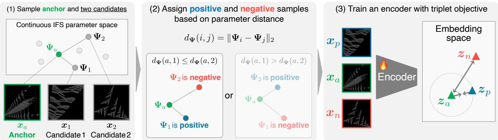  
Figure 1. Overview of the proposed framework with the Parameter-Aware Triplet (PA-Triplet) Loss. (1) An anchor image ${ \pmb x } _ { a }$ and two candidate images $\scriptstyle { \mathbf { 2 } } ( { \mathbf { 2 } } )$ and $\mathbf { x } _ { 2 }$ are sampled from the continuous IFS parameter space together with their associated parameter descriptors $\Psi _ { a } , \Psi _ { 1 }$ , and $\Psi _ { 2 } . ( 2 )$ The candidates are assigned as positive or negative according to their parameter-space distances to the anchor, where $d _ { \Psi } ( i , j ) = \lVert \Psi _ { i } - \Psi _ { j } \rVert _ { 2 }$ . (3) The resulting triplet $( { \pmb x } _ { a } , { \pmb x } _ { p } , { \pmb x } _ { n } )$ is encoded by a feature extractor into embeddings $\left( z _ { a } , z _ { p } , z _ { n } \right)$ , and the network is optimized so that the embedding-space distances reflect the relative ordering induced by the underlying IFS parameter space.

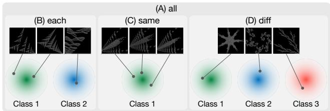  
Figure 2. Conceptual illustration of the coarse filtering strategy used to construct candidate triplets. (A) all: Two candidates are randomly drawn from the entire dataset. (B) each: One candidate is drawn from the same discrete class as the anchor, and the other from a different class. (C) same: Both candidates are drawn from the same discrete class as the anchor. (D) diff: Both candidates are drawn from classes other than the anchor’s class. Discrete labels only restrict the candidate pool; the final positive and negative assignments are determined by parameter-space distance orderings.

## 3.4. Filtering Triplets with Discrete Labels

Triplet mining is crucial in deep metric learning, strongly affecting both convergence and embedding quality [25, 71]. In preliminary experiments, we observed that excessively large distances between IFS parameter vectors produce renderings with such substantial structural differences that the similarity relation becomes trivial, providing little useful constraint for learning a meaningful metric structure.

To mitigate this issue, we introduce discrete class labels as an auxiliary signal to restrict the candidate pool for triplet construction. Although positive/negative assignments are determined by parameter-space distance orderings, discrete labels provide a coarse structural prior that controls the can-

didate regime.

The filtering strategies differ in how candidates are constrained before triplet construction (Fig. 2). The all setting imposes no restriction, allowing maximal structural variation; each requires one within-class and one crossclass candidate; same restricts both candidates to the anchor’s class, focusing on finer structural differences; and diff draws both from other classes, emphasizing larger variations. Within each filtered set, positives and negatives are determined by relative distances in the continuous parameter space. These strategies regulate the difficulty and informativeness of the learned similarity constraints.

## 3.5. Fine-Grained Fractal Database

To better support metric learning, we refine the fractal dataset design inspired by Anderson and Farrell [1]. While the original FractalDB [27] is effective for classificationbased pre-training, it is less suitable for fine-grained relational supervision for two reasons: each class is generated from only a small number of parameter perturbations, resulting in low intra-class diversity, and affine transformations are not strictly constrained to be contraction mappings, occasionally producing visually collapsed patterns with limited structural information.

To address these issues, we increase the number of parameter perturbations to 1,000 per class, matching the number of instances and substantially increasing intra-class diversity. We also enforce strict contraction constraints on affine transformations to ensure stable fractal structures. In addition, we apply rejection sampling based on the pixel occupation rate, discarding samples whose occupied pixel ratio is below 0.05%.

We refer to this refined dataset as the Fine-grained Fractal Database (FineFractalDB). As shown in Fig. 3,

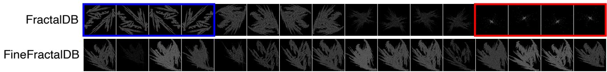  
Figure 3. Comparison of FractalDB [27] and FineFractalDB. FractalDB-1k generates 1,000 instances per class from 25 parameter perturba tions with flips and rendering variations. The blue box (left) shows samples differing only by flipping (limited intra-class diversity), while the red box (right) shows degenerate samples from non-contractive transformations. FineFractalDB instead uses independent perturbations with strict contraction constraints, producing richer structural variation and far fewer collapsed patterns.

FineFractalDB exhibits greater structural variation and far fewer degraded samples than the original FractalDB, improving both the stability and diversity of generated fractals and making the dataset better suited for learning variationsensitive representations through metric learning.

## 4. Experiments

## 4.1. Pre-training Dataset

For our main FDSML pre-training, we use FineFractalDB (Sec. 3.5), which contains 1,000 categories with 1,000 synthesized images per class (1 million samples in total).

## 4.2. Downstream Benchmarks

## 4.2.1. Image Classification.

We report Top-1 accuracy after fine-tuning on diverse natural-image datasets: CIFAR-10/100 (C10, C100) [35], ImageNet-1k/100 (IN1k, IN100) [54], Places-30 (P30) [76], Stanford Cars (Cars) [33], and Flowers-102 (Flowers) [47]. ImageNet-100 and Places-30 follow the evaluation protocols of the original FractalDB study [27]: the former uses the predefined 100-class subset for efficient benchmarking, and the latter selects 30 scene categories from Places365 [76] to evaluate scene-level recognition.

## 4.2.2. Image Retrieval.

We use the Stanford Online Products (SOP) [60], Stanford Cars [33], and In-Shop Clothes Retrieval (In-Shop) [39] datasets, reporting Recall@K [%] with $K \in \{ 1 , 1 0 , 1 0 0 \}$ for SOP, {1, 4, 16} for Cars, and {1, 10, 20} for In-Shop. This evaluation verifies whether semantically similar instances are correctly ranked in nearest-neighbor search within the learned representation space.

## 4.2.3. Robustness.

To investigate robustness under distribution shifts and outof-distribution (OOD) corruptions, we evaluate our models on the CIFAR-10-C and ImageNet-C benchmarks [24].

## 4.3. Implementation Details

## 4.3.1. Network Architectures.

We adopt ResNet-50 [22], ViT-Tiny, and ViT-Base [18] as backbones. The final fully connected layer of ResNet-50 is replaced with a 512-dimensional linear embedding layer. For ViT, following the MoCo v3 [15] design, the classification head is replaced with a 2-layer MLP projection head (Linear → BatchNorm → ReLU → Linear). The hidden and output dimensions are 192 and 128 for ViT-Tiny, and 768 and 256 for ViT-Base.

Table 1. Agreement [%] between the $d _ { \Psi }$ and Chamfer distance orderings under each filtering strategy. Label only assigns the positive by class label (†: at chance by definition). The value for all is omitted (–), as it would reflect the class composition of the dataset rather than information extractable from the labels.
<table><tr><td rowspan="2">Filtering</td><td colspan="2">Agreement [%]</td></tr><tr><td> $d _ { \Psi }$ </td><td>Label only</td></tr><tr><td>all</td><td>47.2</td><td>-</td></tr><tr><td>each</td><td>89.2</td><td>89.4</td></tr><tr><td>same</td><td>80.6</td><td>50.0†</td></tr><tr><td>diff</td><td>46.8</td><td>50.0†</td></tr></table>

## 4.3.2. Optimization and Training Schedule.

For ResNet-50, we use SGD [10] with momentum 0.9 and weight decay $1 . 0 \times 1 0 ^ { - 4 }$ ; the learning rate is linearly scaled with the effective batch size. Following the FDSL protocol [27], the learning rate is kept constant for the first 40% of training and then decayed with a cosine schedule, and the model is pre-trained for 134 epochs. For ViT, we use AdamW [40] with a weight decay of 0.05 and a base learning rate of $1 . 0 \times 1 0 ^ { - 4 }$ for ViT-Tiny and $1 . 0 \times 1 0 ^ { - 5 }$ for ViT-Base, following the linear scaling rule (base lr × BatchSize/256) [15]. We apply a 10,000-step linear warm-up followed by cosine decay, and pre-train for 536 epochs to account for the slower convergence of transformers on synthetic data.

## 5. Experimental Results

## 5.1. Validating the Parameter Descriptor

The PA-Triplet loss uses $d _ { \Psi }$ only to rank two candidates relative to an anchor (Sec. 3.3). We therefore validate whether the candidate ranked closer in $d _ { \Psi }$ is also the structurally closer one once rendered, using the symmetric Chamfer distance [8] as the reference measure. Binarizing two renderings into foreground pixel sets A and B, we compute

Table 2. Top-1 classification accuracy (%) on ResNet-50.
<table><tr><td>PT Dataset</td><td>PT Type</td><td>C10</td><td>C100</td><td>IN100</td><td>IN1k</td><td>P30</td></tr><tr><td>Scratch ImageNet-1k</td><td>SL</td><td>87.60 96.96</td><td>62.70 84.48</td><td>72.42</td><td>75.47</td><td>73.50 80.33</td></tr><tr><td>FractalDB-1k</td><td>FDSL</td><td>90.50</td><td>70.21</td><td>79.42</td><td>70.43</td><td>76.33</td></tr><tr><td>FineFractalDB</td><td>FDSML (all)</td><td>90.79</td><td>68.49</td><td>79.62</td><td>71.37</td><td>76.07</td></tr><tr><td>FineFractalDB</td><td>FDSML (each)</td><td>90.53</td><td>67.46</td><td>78.80</td><td>71.21</td><td>77.53</td></tr><tr><td>FineFractalDB</td><td>FDSML (same)</td><td>91.47</td><td>68.74</td><td>80.62</td><td>72.65</td><td>77.20</td></tr><tr><td>FineFractalDB</td><td>FDSML (diff)</td><td>90.29</td><td>68.37</td><td>79.66</td><td>71.56</td><td>77.17</td></tr></table>

Table 3. Top-1 classification accuracy (%) on ViT-Tiny.
<table><tr><td>PT Dataset</td><td>PT Type</td><td>C10</td><td>C100</td><td>IN100</td><td>IN1k</td><td>P30</td><td>Cars</td><td>Flowers</td></tr><tr><td>Scratch</td><td></td><td>76.47</td><td>58.02</td><td>70.08</td><td>71.46</td><td>81.17</td><td>21.30</td><td>48.74</td></tr><tr><td>ImageNet-1k</td><td>SL</td><td>97.92</td><td>85.65</td><td></td><td></td><td>81.48</td><td>91.26</td><td>93.70</td></tr><tr><td>FractalDB-1k</td><td>FDSL</td><td>96.65</td><td>81.18</td><td>84.40</td><td>72.40</td><td>80.46</td><td>77.01</td><td>73.99</td></tr><tr><td>FineFractalDB</td><td>FDSML (all)</td><td>97.71</td><td>81.73</td><td>88.47</td><td>73.68</td><td>80.25</td><td>80.83</td><td>66.99</td></tr><tr><td>FineFractalDB</td><td>FDSML (each)</td><td>98.00</td><td>82.08</td><td>88.90</td><td>73.71</td><td>80.35</td><td>83.17</td><td>74.21</td></tr><tr><td>FineFractalDB</td><td>FDSML (same)</td><td>97.71</td><td>81.68</td><td>88.28</td><td>73.80</td><td>80.58</td><td>81.72</td><td>69.23</td></tr><tr><td>FineFractalDB</td><td>FDSML (diff)</td><td>97.72</td><td>80.68</td><td>88.25</td><td>73.97</td><td>80.49</td><td>79.84</td><td>66.96</td></tr></table>

Table 4. Top-1 classification accuracy (%) on ViT-Base.
<table><tr><td>PT Dataset</td><td>PT Type</td><td>C10</td><td>C100</td><td>IN100</td></tr><tr><td>Scratch</td><td></td><td>90.03</td><td>66.83</td><td>87.64</td></tr><tr><td>ImageNet-1k</td><td>SL</td><td>98.49</td><td>85.73</td><td></td></tr><tr><td>FractalDB-1k</td><td>FDSL</td><td>98.19</td><td>83.68</td><td>89.59</td></tr><tr><td>FineFractalDB</td><td>FDSML (all)</td><td>97.96</td><td>81.79</td><td>89.28</td></tr><tr><td>FineFractalDB</td><td>FDSML (each)</td><td>98.23</td><td>83.30</td><td>90.09</td></tr><tr><td>FineFractalDB</td><td>FDSML (same)</td><td>98.12</td><td>82.19</td><td>89.52</td></tr><tr><td>FineFractalDB</td><td>FDSML (diff)</td><td>98.15</td><td>82.77</td><td>89.41</td></tr></table>

$$
D ( A , B ) = \frac { 1 } { 2 } \left( \frac { 1 } { | A | } \sum _ { \mathbf { p } \in A } \operatorname* { m i n } _ { \mathbf { q } \in B } \| \mathbf { p } - \mathbf { q } \| _ { 1 } + \frac { 1 } { | B | } \sum _ { \mathbf { q } \in B } \operatorname* { m i n } _ { \mathbf { p } \in A } \| \mathbf { q } - \mathbf { p } \| _ { 1 } \right) ,\tag{3}
$$

which averages the distance from each foreground pixel to its nearest counterpart in the other set. Since each attractor is min–max normalized to the image frame before rasterization, D reflects differences in shape rather than global position or scale. We verify in the supplementary material that D responds consistently to controlled generative perturbations and that $d _ { \Psi }$ tracks it closely, establishing D as a reliable reference for structural difference.

For triplets sampled under each filtering strategy, Table 1 reports how often the candidate closer in $d _ { \Psi }$ is also closer in $D ,$ which is exactly the information PA-Triplet uses to assign positives and negatives. each and same reach 89.2% and 80.6%, respectively, against a chance level of 50%, confirming a valid similarity signal in these regimes. To isolate the descriptor’s contribution, we compare with assigning the positive by class label alone. Under each, this label rule attains 89.4%, and the descriptor picks the same positive in 99.6% of triplets, so its supervision is effectively equivalent to that of the labels. Under same, no label rule exists because all three images share a class, yet the descriptor attains 80.6%, a signal that class labels cannot provide even in principle. In contrast, all and diff fall below chance, at 47.2% and 46.8%, respectively. Because Ψ compresses each IFS into a six-dimensional expectation, dissimilar transformation sets can map to nearby descriptors, mainly across class boundaries. These results indicate that the reliability of the descriptor ordering depends strongly on the candidate regime: same provides meaningful withinclass ordinal structure, whereas comparisons among unrelated classes under diff are unreliable.

Table 5. Ablation study on pre-training configurations. Top-1 accuracy (%) of ViT-Tiny on downstream datasets.
<table><tr><td>PT Type</td><td>PT Dataset</td><td>C10</td><td>C100</td><td>IN100</td></tr><tr><td>FDSL</td><td>FractalDB-1k</td><td>96.65</td><td>81.18</td><td>84.40</td></tr><tr><td>FDSL</td><td>FineFractalDB</td><td>96.11</td><td>77.52</td><td>84.32</td></tr><tr><td>FDSML (each)</td><td>FractalDB-1k</td><td>97.77</td><td>81.72</td><td>87.93</td></tr><tr><td>FDSML (each)</td><td>FineFractalDB</td><td>98.00</td><td>82.08</td><td>88.90</td></tr><tr><td>FDSML (same)</td><td>FractalDB-1k</td><td>97.16</td><td>79.76</td><td>87.23</td></tr><tr><td>FDSML (same)</td><td>FineFractalDB</td><td>97.71</td><td>81.68</td><td>88.28</td></tr></table>

## 5.2. Downstream Classification

We evaluate the transferability of the learned representations on several downstream benchmarks. Tables 2, 3, and 4 report Top-1 accuracy for ResNet-50, ViT-Tiny, and ViT-Base, respectively.

For ResNet-50 (Table 2), while natural-image pretraining (ImageNet-1k) remains the most potent baseline, our distance-based synthetic pre-training outperforms conventional cross-entropy pre-training on FractalDB-1k on most benchmarks, while remaining competitive on the rest. In particular, FineFractalDB with FDSML (same) achieves 91.47% on CIFAR-10 and 72.65% on ImageNet-1k, indicating that distance-based supervision provides more transferable features than classification-based synthetic pretraining. The strong performance of FDSML (same) is consistent with Section 5.1, where same provides parameterderived orderings that discrete class labels cannot express.

For ViT-Tiny (Table 3), similar trends hold: our metric-based approach improves ImageNet-100 accuracy to 88.90%, a substantial gain over the 84.40% of crossentropy pre-training on FractalDB-1k, and reaches 98.00% on CIFAR-10, slightly exceeding ImageNet-1k supervised pre-training (97.92%). These results indicate that the metric-learning reformulation transfers beyond convolutional architectures and, as shown in Section 5.2.1, accounts for a substantial share of these gains.

Table 4 shows that these trends extend to ViT-Base. Although the gap between FDSL and FDSML narrows relative to ViT-Tiny, FDSML (each) achieves the strongest overall performance, with the highest accuracy on CIFAR-10 and ImageNet-100 while remaining competitive on CIFAR-100. The PA-Triplet objective thus remains effective even for larger models.

Table 6. Classification Error (CE ↓, %) on ImageNet-C. Each entry reports the average CE over corruption types within each group.  
(a) ResNet-50
<table><tr><td>PT Dataset</td><td>PT Type</td><td>Noise</td><td>Blur</td><td>Weather</td><td>Digital</td><td>Geometric</td></tr><tr><td>FractalDB-1k</td><td>FDSL</td><td>86.16</td><td>74.82</td><td>71.94</td><td>60.36</td><td>61.15</td></tr><tr><td>FineFractalDB</td><td>FDSML (all)</td><td>84.06</td><td>72.55</td><td>68.50</td><td>59.40</td><td>59.85</td></tr><tr><td>FineFractalDB</td><td>FDSML (each)</td><td>85.22</td><td>73.25</td><td>70.06</td><td>58.97</td><td>61.23</td></tr><tr><td>FineFractalDB</td><td>FDSML (same)</td><td>83.62</td><td>72.87</td><td>68.81</td><td>57.46</td><td>59.13</td></tr><tr><td>FineFractalDB</td><td>FDSML (diff)</td><td>84.56</td><td>73.41</td><td>69.55</td><td>59.27</td><td>61.10</td></tr></table>

## 5.2.1. Ablation Studies.

Table 5 decomposes the contributions of the pre-training objective and dataset design with ViT-Tiny. With the dataset fixed to FractalDB-1k, replacing cross-entropy with PA-Triplet improves all three benchmarks, isolating the effect of the metric-learning reformulation from any change in the data. Under FDSML, FineFractalDB yields gains for both each and same. In contrast, under FDSL, FineFractalDB provides no gain over FractalDB-1k and degrades performance on CIFAR-100. FineFractalDB increases intra-class variation, but cross-entropy assigns all instances within a class the same label and therefore does not directly exploit this variation. PA-Triplet instead uses relative orderings among samples to construct relational supervision from such variation. These results support the complementarity of the refined dataset and the relational objective.

## 5.3. Robustness Analysis

We evaluate robustness against common visual corruptions on ImageNet-C. Table 6 reports the Classification Error averaged within five semantic groups.

For ResNet-50, our distance-based pre-training outperforms the classification-based synthetic baseline (FDSL) across all five corruption categories, with FDSML (same) achieving the best performance in three of them.

For ViT-Tiny, the results reveal a more nuanced tradeoff: our method consistently improves resilience against structural and environmental distortions, achieving a 6.3% relative improvement in the Weather category (47.64 vs. 50.84), while degrading in the Noise (58.69 for FDSML (each) vs. 55.31) and Digital (43.41 vs. 41.94) categories. These findings suggest that PA-Triplet can improve robustness to structural and environmental distortions, while its relationship to high-frequency noise remains architecturedependent and requires dedicated frequency analysis. Detailed CIFAR-10-C evaluations are provided in the supplementary material.

## 5.4. Image Retrieval

Table 7 reports Recall@K on SOP, Cars, and In-Shop after fine-tuning with the Proxy-Anchor objective [31].

(b) ViT-Tiny
<table><tr><td>PT Dataset</td><td>PT Type</td><td>Noise</td><td>Blur</td><td>Weather</td><td>Digital</td><td>Geometric</td></tr><tr><td>FractalDB-1k</td><td>FDSL</td><td>55.31</td><td>60.78</td><td>50.84</td><td>41.94</td><td>48.49</td></tr><tr><td>FineFractalDB</td><td>FDSML (all)</td><td>60.26</td><td>60.78</td><td>48.15</td><td>43.96</td><td>47.90</td></tr><tr><td>FineFractalDB</td><td>FDSML (each)</td><td>58.69</td><td>60.13</td><td>48.34</td><td>43.41</td><td>48.40</td></tr><tr><td>FineFractalDB</td><td>FDSML (same)</td><td>59.26</td><td>60.06</td><td>47.64</td><td>43.55</td><td>47.97</td></tr><tr><td>FineFractalDB</td><td>FDSML (diff)</td><td>59.47</td><td>60.54</td><td>48.22</td><td>43.88</td><td>48.29</td></tr></table>

Table 7. Recall@K [%] on Stanford Online Products (SOP) [60], Stanford Cars [33], and In-Shop Clothes [39] using a ResNet-50 backbone under different pre-training strategies.
<table><tr><td rowspan="2">PT Dataset</td><td rowspan="2">PT Type</td><td colspan="3">SOP</td><td colspan="4">Stanford Cars</td><td colspan="3">In-Shop</td></tr><tr><td>1</td><td>10</td><td>100</td><td>1</td><td>4</td><td></td><td>16</td><td>1</td><td>10</td><td>20</td></tr><tr><td>Scratch</td><td>=</td><td>70.4</td><td>83.1</td><td>90.9</td><td>40.9</td><td>61.5</td><td></td><td>80.4</td><td>87.2</td><td>95.7</td><td>96.9</td></tr><tr><td>ImageNet-1k</td><td>SL</td><td>79.1</td><td>91.0</td><td>96.3</td><td>87.7</td><td>95.6</td><td></td><td>98.6</td><td>91.1</td><td>97.8</td><td>98.4</td></tr><tr><td>FractalDB-1k</td><td>FDSL</td><td>65.6</td><td>81.3</td><td>91.0</td><td>56.2</td><td>76.3</td><td></td><td>89.8</td><td>87.3</td><td>95.5</td><td>96.6</td></tr><tr><td>FineFractalDB</td><td>FDSML (all)</td><td>73.9</td><td>86.3</td><td>93.3</td><td>77.8</td><td>89.5</td><td></td><td>95.4</td><td>89.2</td><td>96.9</td><td>97.9</td></tr><tr><td>FineFractalDB</td><td>FDSML (each)</td><td>74.0</td><td>86.5</td><td>93.4</td><td>76.2</td><td>88.6</td><td></td><td>95.2</td><td>89.2</td><td>96.7</td><td>97.8</td></tr><tr><td>FineFractalDB</td><td>FDSML (same)</td><td>74.0</td><td>86.6</td><td>93.5</td><td>78.4</td><td>90.2</td><td></td><td>96.0</td><td>89.2</td><td>97.0</td><td>97.9</td></tr><tr><td>FineFractalDB</td><td>FDSML (diff)</td><td>73.6</td><td>86.3</td><td>93.2</td><td>75.6</td><td>88.2</td><td></td><td>95.1</td><td>88.9</td><td>96.9</td><td>97.8</td></tr></table>

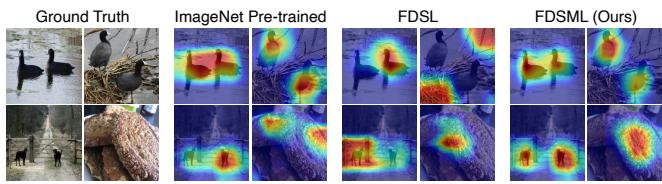  
Figure 4. Grad-CAM visualizations for ResNet-50 pre-trained un der different methods.

Across all three datasets, models pre-trained on Fine-FractalDB with FDSML consistently outperform those trained from scratch and those pre-trained on FractalDB-1k with FDSL, while ImageNet-1k pre-training serves as an upper baseline. These results suggest that FDSML pre-training better preserves relative similarity structure in the embedding space, yielding representations that transfer more effectively to embedding-based tasks.

Notably, on SOP the FDSL model pre-trained on FractalDB underperforms training from scratch in Recall@1 (65.6 vs. 70.4) and Recall@10 (81.3 vs. 83.1), indicating that classification-based formula-driven supervision does not necessarily provide a beneficial inductive bias for tasks that rely on embedding geometry. One possible explanation is that classification objectives enforce categorical separability without modeling relative similarity orderings among samples: while effective for classification, they do not explicitly exploit the ordinal relationships available from the continuous IFS parameter space.

Among the triplet candidate filtering strategies (Sec. 3.4), FDSML (same), which samples both candidates from the anchor’s discrete class, performs best on SOP and Stanford Cars and remains on par with the best variant on In-Shop. These results support the hypothesis that learning to respect the relative ordering of generative variation, rather than merely enforcing categorical separability, leads to representations better suited to embedding-based tasks.

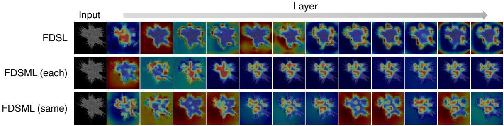  
Figure 5. Layer-wise CLS-to-patch attention maps of ViT-Tiny pre-trained with different objectives. Rows correspond to different pre training strategies and columns correspond to Transformer layers ordered from shallow (left) to deep (right).

## 5.5. Qualitative Analysis

## 5.5.1. Grad-CAM Visualization on ResNet-50.

Figure 4 presents Grad-CAM [57] visualizations for ResNet-50 models pre-trained under different strategies. Each example shows the input image with its groundtruth label, followed by the Grad-CAM results of (i) the ImageNet-1k pre-trained model, (ii) the FDSL model pretrained on FractalDB-1k with cross-entropy, and (iii) our FDSML (same) model pre-trained on FineFractalDB with the PA-Triplet objective.

Compared with the FDSL model, our FDSML produces more spatially concentrated activation maps on objectrelevant regions, qualitatively closer to those of the ImageNet pre-trained model, whereas FDSL often yields more diffuse and less localized responses. These observations suggest that PA-Triplet pre-training promotes spatially coherent feature representations, which may contribute to improved transfer performance.

## 5.5.2. Visualizing Attention Maps.

Figure 5 presents layer-wise CLS-to-patch attention maps of ViT models pre-trained with different objectives, computed on FractalDB [27] images across all 12 Transformer layers. Columns correspond to layers ordered from shallow (left) to deep (right), and rows to pre-training strategies.

The FDSL model concentrates attention primarily along prominent boundaries, whereas the FDSML model also attends to textured and interior regions. This broader spatial distribution suggests that FDSML captures fine-grained appearance variations in addition to coarse structural cues. Such representations may be advantageous for downstream tasks that depend on subtle visual distinctions, including fine-grained recognition. Additional qualitative results are provided in the supplementary material.

## 5.6. Limitations

Our validation is currently limited to IFS-based fractal pre-training. Although the parameter-aware triplet construction could in principle be instantiated for other FDSL generators such as VisualAtom or TileDB, each generator would require its own similarity definition over the generation parameters, together with dedicated empirical validation. We therefore leave this extension to future work. In addition, our results are confined to the one-millionimage scale of FineFractalDB, and whether the gains from parameter-aware supervision persist at larger scales remains an open question. Finally, compared with cross-entropybased FDSL, FDSML incurs additional overhead for descriptor computation and triplet construction, which we have not yet analyzed in detail.

## 6. Conclusion

We introduced Formula-Driven Supervised Metric Learning (FDSML), a synthetic pre-training framework that leverages continuous generative parameters for representation learning. Unlike conventional FDSL, which mainly encourages category recognition, FDSML reformulates synthetic pre-training as a relational learning problem. Through the PA-Triplet Loss and FineFractalDB, models are supervised with relative orderings derived from the generative parameter space. Experiments show that FDSML substantially improves image retrieval over classification-based FDSL while remaining competitive on downstream classification. It also improves corruption robustness for ResNet-50, with architecture-dependent trade-offs for ViT, and produces qualitative differences in activation and attention patterns. These results show that parameter-derived relational supervision can improve transfer beyond category recognition in IFS-based formula-driven synthetic pre-training.

## 7. Acknowledgement

This work was supported by JSPS KAKENHI Grant Numbers JP24H00742 and JP24H00748, JST SPRING Grant Number JPMJSP2128, and computational resources of ABCI 3.0 provided by AIST and AIST Solutions.

## References

[1] Connor Anderson and Ryan Farrell. Improving fractal pretraining. In WACV, pages 1300–1309, 2022. 3, 4

[2] Devansh Arpit, Stanislaw Jastrzebski, Nicolas Ballas, David Krueger, Emmanuel Bengio, Maxinder S. Kanwal, Tegan Maharaj, Asja Fischer, Aaron C. Courville, Yoshua Bengio, and Simon Lacoste-Julien. A Closer Look at Memorization in Deep Networks. In ICML, pages 233–242, 2017. 3

[3] Yuki M. Asano, Christian Rupprecht, Andrew Zisserman, and Andrea Vedaldi. Pass: An imagenet replacement for self-supervised pretraining without humans. NeurIPS Track on Datasets and Benchmarks, 2021. 1

[4] Shekoofeh Azizi, Simon Kornblith, Chitwan Saharia, Mohammad Norouzi, and David J Fleet. Synthetic data from diffusion models improves imagenet classification. arXiv preprint arXiv:2304.08466, 2023. 2

[5] Manel Baradad, Chun-Fu Chen, Jonas Wulff, Tongzhou Wang, Rogerio Feris, Antonio Torralba, and Phillip Isola. Procedural image programs for representation learning. In NeurIPS, 2022. 2

[6] Manel Baradad Jurjo, Jonas Wulff, Tongzhou Wang, Phillip Isola, and Antonio Torralba. Learning to see by looking at noise. In NeurIPS, pages 2556–2569, 2021. 2

[7] Michael F. Barnsley. Fractals Everywhere. Academic Press, Boston, MA, USA, 1988. 2

[8] H. G. Barrow, J. M. Tenenbaum, R. C. Bolles, and H. C. Wolf. Parametric correspondence and chamfer matching: two new techniques for image matching. In IJCAI, page 659–663, 1977. 6

[9] Abeba Birhane and Vinay Uday Prabhu. Large image datasets: A pyrrhic win for computer vision? . In WACV, pages 1536–1546, 2021. 1

[10] Leon Bottou. Large-scale machine learning with stochastic´ gradient descent. In COMPSTAT, pages 177–186, 2010. 5

[11] Bingyi Cao, Andre Araujo, and Jack Sim. Unifying deep local and global features for image search. In ECCV, pages 726–743, 2020. 2

[12] Ting Chen, Simon Kornblith, Mohammad Norouzi, and Geoffrey Hinton. A simple framework for contrastive learning of visual representations. In ICML, 2020. 2

[13] Ting Chen, Simon Kornblith, Kevin Swersky, Mohammad Norouzi, and Geoffrey Hinton. Big self-supervised models are strong semi-supervised learners. In NeurIPS, 2020. 2

[14] Xinlei Chen, Haoqi Fan, Ross Girshick, and Kaiming He. Improved baselines with momentum contrastive learning. arXiv preprint arXiv:2003.04297, 2020. 2

[15] Xinlei Chen, Saining Xie, and Kaiming He. An Empirical Study of Training Self-Supervised Vision Transformers. In ICCV, pages 9620–9629, 2021. 2, 5

[16] Terrance De Vries, Ishan Misra, Changhan Wang, and Lau rens Van der Maaten. Does Object Recognition Work for Everyone? In CVPRW, pages 52–59, 2019. 1

[17] Jia Deng, Wei Dong, Richard Socher, Li-Jia Li, Kai Li, and Li Fei-Fei. Imagenet: A large-scale hierarchical image database. In CVPR, pages 248–255, 2009. 1

[18] Alexey Dosovitskiy, Lucas Beyer, Alexander Kolesnikov, Dirk Weissenborn, Xiaohua Zhai, Thomas Unterthiner, Mostafa Dehghani, Matthias Minderer, Georg Heigold, Sylvain Gelly, Jakob Uszkoreit, and Neil Houlsby. An image is worth 16x16 words: Transformers for image recognition at scale. ICLR, 2021. 1, 5

[19] Aleksandr Ermolov, Leyla Mirvakhabova, Valentin Khrulkov, Nicu Sebe, and Ivan Oseledets. Hyperbolic vision transformers: Combining improvements in metric learning. In CVPR, pages 7399–7409, 2022. 2

[20] Jean-Bastien Grill, Florian Strub, Florent Altche, Corentin´ Tallec, Pierre Richemond, Elena Buchatskaya, Carl Doersch, Bernardo Avila Pires, Zhaohan Guo, Mohammad Gheshlaghi Azar, Bilal Piot, koray kavukcuoglu, Remi Munos, and Michal Valko. Bootstrap your own latent - a new approach to self-supervised learning. In NeurIPS, pages 21271–21284, 2020. 2

[21] Raia Hadsell, Sumit Chopra, and Yann LeCun. Dimension ality reduction by learning an invariant mapping. In CVPR, page 1735–1742, 2006. 2

[22] Kaiming He, Xiangyu Zhang, Shaoqing Ren, and Jian Sun. Deep residual learning for image recognition. In CVPR, pages 770–778, 2016. 5

[23] Kaiming He, Haoqi Fan, Yuxin Wu, Saining Xie, and Ross Girshick. Momentum contrast for unsupervised visual representation learning. In CVPR, pages 9726–9735, 2020. 2

[24] Dan Hendrycks and Thomas Dietterich. Benchmarking neu ral network robustness to common corruptions and perturba tions. In ICLR, 2019. 5

[25] Alexander Hermans, Lucas Beyer, and Bastian Leibe. In defense of the triplet loss for person re-identification. arXiv preprint arXiv:1703.07737, 2017. 2, 4

[26] Elad Hoffer and Nir Ailon. Deep metric learning using triplet network. In Similarity-Based Pattern Recognition, pages 84– 92, 2015. 2, 3

[27] Hirokatsu Kataoka, Kazushige Okayasu, Asato Matsumoto, Eisuke Yamagata, Ryosuke Yamada, Nakamasa Inoue, Akio Nakamura, and Yutaka Satoh. Pre-training without natural images. In ACCV, 2020. 1, 2, 3, 4, 5, 8

[28] Hirokatsu Kataoka, Asato Matsumoto, Ryosuke Yamada, Yutaka Satoh, Eisuke Yamagata, and Nakamasa Inoue. Formula-driven supervised learning with recursive tiling patterns. In ICCV Workshops, pages 4081–4088, 2021. 2

[29] Hirokatsu Kataoka, Ryo Hayamizu, Ryosuke Yamada, Kodai Nakashima, Sora Takashima, Xinyu Zhang, Edgar Josafat Martinez-Noriega, Nakamasa Inoue, and Rio Yokota. Replacing labeled real-image datasets with auto-generated con tours. In CVPR, pages 21200–21209, 2022. 1, 2

[30] Prannay Khosla, Piotr Teterwak, Chen Wang, Aaron Sarna, Yonglong Tian, Phillip Isola, Aaron Maschinot, Ce Liu, and Dilip Krishnan. Supervised contrastive learning. In NeurIPS, pages 18661–18673, 2020. 3

[31] Sungyeon Kim, Dongwon Kim, Minsu Cho, and Suha Kwak. Proxy anchor loss for deep metric learning. In CVPR, 2020. 2, 7

[32] Sungyeon Kim, Boseung Jeong, and Suha Kwak. HIER: Metric learning beyond class labels via hierarchical regularization. In CVPR, pages 19903–19912, 2023. 2

[33] Jonathan Krause, Michael Stark, Jia Deng, and Li Fei-Fei. 3d object representations for fine-grained categorization. In CVPRW, pages 554–561, 2013. 5, 7

[34] Ranjay Krishna, Yuke Zhu, Oliver Groth, Justin Johnson, Kenji Hata, Joshua Kravitz, Stephanie Chen, Yannis Kalantidis, Li-Jia Li, David A. Shamma, Michael S. Bernstein, and Li Fei-Fei. Visual genome: Connecting language and vision using crowdsourced dense image annotations. IJCV, 123(1): 32–73, 2017. 1

[35] Alex Krizhevsky, Geoffrey Hinton, et al. Learning multiple layers of features from tiny images. 2009. 5

[36] Yann LeCun, Leon Bottou, Yoshua Bengio, and Patrick´ Haffner. Gradient-based learning applied to document recognition. Proceedings of the IEEE, 86(11):2278–2324, 2002. 1

[37] Ann B. Lee, David Mumford, and Jinggang Huang. Occlusion models for natural images: A statistical study of a scaleinvariant dead leaves model. IJCV, 41(1–2):35–59, 2001. 2

[38] Tsung-Yi Lin, Michael Maire, Serge Belongie, James Hays, Pietro Perona, Deva Ramanan, Piotr Dollar, and C. Lawrence´ Zitnick. Microsoft COCO: Common Objects in Context. In ECCV, pages 740–755, 2014. 1

[39] Ziwei Liu, Ping Luo, Shi Qiu, Xiaogang Wang, and Xiaoou Tang. Deepfashion: Powering robust clothes recognition and retrieval with rich annotations. In CVPR, 2016. 5, 7

[40] Ilya Loshchilov and Frank Hutter. Decoupled weight decay regularization. arXiv preprint arXiv:1711.05101, 2017. 5

[41] David G. Lowe. Distinctive image features from scaleinvariant keypoints. IJCV, 60(2):91–110, 2004. 2

[42] Yair Movshovitz-Attias, Alexander Toshev, Thomas K. Leung, Sergey Ioffe, and Saurabh Singh. No fuss distance metric learning using proxies. In ICCV, 2017. 2, 3

[43] Ryo Nakamura, Hirokatsu Kataoka, Sora Takashima, Edgar Josafat Martinez Noriega, Rio Yokota, and Nakamasa Inoue. Pre-training vision transformers with very limited synthesized images. In ICCV, pages 20360–20369, 2023. 1, 2, 3

[44] Ryo Nakamura, Ryu Tadokoro, Ryosuke Yamada, Yuki M. Asano, Iro Laina, Christian Rupprecht, Nakamasa Inoue, Rio Yokota, and Hirokatsu Kataoka. Scaling backwards: Minimal synthetic pre-training? In ECCV, pages 153–171, 2025. 2, 3

[45] Kodai Nakashima, Hirokatsu Kataoka, Asato Matsumoto, Kenji Iwata, Nakamasa Inoue, and Yutaka Satoh. Can vision transformers learn without natural images? Proceeding ofthe AAAI, 36(2):1990–1998, 2022. 1, 2

[46] Joe Yue-Hei Ng, Fan Yang, and Larry S. Davis. Exploiting local features from deep networks for image retrieval. In CVPRW, pages 53–61, 2015. 2

[47] Maria-Elena Nilsback and Andrew Zisserman. Automated flower classification over a large number of classes. In Indian

Conference on Computer Vision, Graphics & Image Process ing, pages 722–729, 2008. 5

[48] Hyeonwoo Noh, Andre Araujo, Jack Sim, Tobias Weyand, and Bohyung Han. Large-scale image retrieval with attentive deep local features. In ICCV, pages 3476–3485, 2017. 2

[49] Stephen O’hara and Bruce A Draper. Introduction to the bag of features paradigm for image classification and retrieval. arXiv preprint arXiv:1101.3354, 2011. 2

[50] Eng-Jon Ong, Sameed Husain, and Miroslaw Bober. Siamese network of deep fisher-vector descriptors for image retrieval, 2017. 2

[51] Zhongzheng Ren, Yong Jae Lee, and Michael S. Ryoo. Learning to anonymize faces for privacy preserving action detection. In ECCV, page 639–655, 2018. 1

[52] Stephan R Richter, Vibhav Vineet, Stefan Roth, and Vladlen Koltun. Playing for data: Ground truth from computer games. In ECCV, pages 102–118, 2016. 1

[53] Robin Rombach, Andreas Blattmann, Dominik Lorenz, Patrick Esser, and Bjorn Ommer. High-resolution image syn-¨ thesis with latent diffusion models. In CVPR, pages 10684– 10695, 2022. 2

[54] Olga Russakovsky, Jia Deng, Hao Su, Jonathan Krause, Sanjeev Satheesh, Sean Ma, Zhiheng Huang, Andrej Karpathy, Aditya Khosla, Michael Bernstein, et al. Imagenet large scale visual recognition challenge. IJCV, 115(3):211–252, 2015. 5

[55] Mert Bulent Sarıyıldız, Karteek Alahari, Diane Larlus, and¨ Yannis Kalantidis. Fake it till you make it: Learning transferable representations from synthetic imagenet clones. In CVPR, pages 8011–8021, 2023. 2

[56] Florian Schroff, Dmitry Kalenichenko, and James Philbin. Facenet: A unified embedding for face recognition and clustering. In CVPR, 2015. 2, 3

[57] Ramprasaath R. Selvaraju, Michael Cogswell, Abhishek Das, Ramakrishna Vedantam, Devi Parikh, and Dhruv Batra. Grad-cam: Visual explanations from deep networks via gradient-weighted class activation mapping. In ICCV, pages 618–626, 2017. 8

[58] Shihao Shao, Kaifeng Chen, Arjun Karpur, Qinghua Cui, Andre Araujo, and Bingyi Cao. Global features are all you´ need for image retrieval and reranking. In ICCV, pages 11002–11012, 2023. 2

[59] Risa Shinoda, Ryo Hayamizu, Kodai Nakashima, Nakamasa Inoue, Rio Yokota, and Hirokatsu Kataoka. Segrcdb: Semantic segmentation via formula-driven supervised learning. In CVPR, pages 20054–20063, 2023. 1, 2

[60] Hyun Oh Song, Yu Xiang, Stefanie Jegelka, and Silvio Savarese. Deep metric learning via lifted structured feature embedding. In CVPR, 2016. 2, 5, 7

[61] Sora Takashima, Ryo Hayamizu, Nakamasa Inoue, Hirokatsu Kataoka, and Rio Yokota. Visual atoms: Pre-training vision transformers with sinusoidal waves. In CVPR, pages 18579–18588, 2023. 1, 2

[62] Fuwen Tan, Jiangbo Yuan, and Vicente Ordonez. Instancelevel image retrieval using reranking transformers. In ICCV, 2021. 2

[63] Yonglong Tian, Lijie Fan, Phillip Isola, Huiwen Chang, and Dilip Krishnan. Stablerep: Synthetic images from text-toimage models make strong visual representation learners. NeurIPS, 36:48382–48402, 2023. 2

[64] Yonglong Tian, Lijie Fan, Kaifeng Chen, Dina Katabi, Dilip Krishnan, and Phillip Isola. Learning vision from models rivals learning vision from data. In CVPR, pages 15887– 15898, 2024. 1, 2

[65] Josh Tobin, Rachel Fong, Alex Ray, Jonas Schneider, Wojciech Zaremba, and Pieter Abbeel. Domain randomization for transferring deep neural networks from simulation to the real world. In IROS, pages 23–30, 2017. 1

[66] Tatiana Tommasi, Novi Patricia, Barbara Caputo, and Tinne Tuytelaars. A deeper look at dataset bias. In PR, page 504–516. 2015. 1

[67] Brandon Trabucco, Kyle Doherty, Max Gurinas, and Ruslan Salakhutdinov. Effective data augmentation with diffusion models. arXiv preprint arXiv:2302.07944, 2023. 2

[68] Yusuke Uchida, Shigeyuki Sakazawa, and Shin’ichi Satoh. Image retrieval with fisher vectors of binary features. ITE Transactions on Media Technology and Applications, 4(4): 326–336, 2016. 2

[69] Xun Wang, Xintong Han, Weilin Huang, Dengke Dong, and Matthew R Scott. Multi-similarity loss with general pair weighting for deep metric learning. In CVPR, pages 5022– 5030, 2019. 2

[70] Xinshao Wang, Yang Hua, Elyor Kodirov, Guosheng Hu, Romain Garnier, and Neil M. Robertson. Ranked List Loss for Deep Metric Learning . In CVPR, pages 5202–5211, 2019. 2

[71] Chao-Yuan Wu, R. Manmatha, Alexander J. Smola, and Philipp Krahenbuhl. Sampling matters in deep embedding learning. In ICCV, 2017. 2, 4

[72] Weijia Wu, Yuzhong Zhao, Hao Chen, Yuchao Gu, Rui Zhao, Yefei He, Hong Zhou, Mike Zheng Shou, and Chunhua Shen. DatasetDM: Synthesizing data with perception annotations using diffusion models. In NeurIPS, 2023. 2

[73] Kaiyu Yang, Jacqueline H Yau, Li Fei-Fei, Jia Deng, and Olga Russakovsky. A study of face obfuscation in imagenet. In ICML, pages 25313–25330. PMLR, 2022. 1

[74] Chiyuan Zhang, Samy Bengio, Moritz Hardt, Benjamin Recht, and Oriol Vinyals. Understanding deep learning requires rethinking generalization. In ICLR, 2017. 3

[75] Xuanmeng Zhang, Minyue Jiang, Zhedong Zheng, Xiao Tan, and Yi Yang. Understanding image retrieval re-ranking: A graph neural network perspective. ACM Trans. Multimedia Comput. Commun. Appl., 22(5), 2026. 2

[76] Bolei Zhou, Agata Lapedriza, Aditya Khosla, Aude Oliva, and Antonio Torralba. Places: A 10 million image database for scene recognition. TPAMI, 40(6):1452–1464, 2018. 5

[77] Sijie Zhu, Linjie Yang, Chen Chen, Mubarak Shah, Xiaohui Shen, and Heng Wang. R2former: Unified retrieval and reranking transformer for place recognition. In CVPR, pages 19370–19380, 2023. 2

# FDSML: Formula-Driven Supervised Metric Learning with Parameter-Aware Triplet Loss (Supplementary Material)

Hina Otake1∗ Shinei Arakawa1∗ Keitaro Tanaka2∗ Yoshihiro Fukuhara1,3 Hirokatsu Kataoka3,4 Shigeo Morishima2

1Waseda University 2Waseda Research Institute for Science and Engineering 3National Institute of Advanced Industrial Science and Technology 4University of Oxford

## A. Empirical Validation of the Parameter Descriptor

The PA-Triplet loss uses the descriptor distance $d _ { \Psi }$ only to rank two candidates relative to an anchor. Section 5.1 of the main paper validates this ordinal supervision directly by measuring how often the candidate ranked closer in $d _ { \Psi }$ is also the closer one under the symmetric Chamfer distance D [1] (Eq. (3) and Table 1 of the main paper). That analysis presupposes that D itself is a reliable reference for structural difference. This section supplies the supporting evidence. Section $\mathrm { A . a }$ verifies that D responds consistently to controlled perturbations of the generative parameters and that $d _ { \Psi }$ tracks this response. Section A.b complements the quantitative agreement with qualitative examples of triplets constructed under each filtering strategy.

We adopt D as the reference for two reasons. First, the renderings are effectively binary, so the binarization threshold is immaterial and D involves no tunable hyperparameters such as a blur width. Second, unlike learned perceptual metrics (e.g., LPIPS [5]), D assumes no prior over natural images and thus avoids the secondary question of whether such a prior transfers to synthetic fractals.

## A.a. Response to Controlled Generative Perturbations

Starting from a base IFS code, we rescale one of the six affine coefficients across all maps by a factor $s \in [ 0 . 6 , 1 . 4 ]$ sampled at 33 evenly spaced values including s=1, and recompute the selection probabilities from the determinant magnitudes. This is the same mechanism used to synthesize intra-class instances of FineFractalDB, in which one randomly chosen coefficient is rescaled by a factor drawn from the same range. The sweep therefore probes the type of variation realized in our dataset. Each perturbed code is rendered and compared with the base rendering by $D .$ By construction, D averages the distance from each foreground pixel to its nearest counterpart in the other rendering. It is therefore expressed in pixels and indicates how far, on average, the two rendered shapes are displaced from each other. Because rendering involves stochastic point sampling and random patch patterns, re-rendering identical parameters with different seeds yields a nonzero $D .$ . We estimate this rendering noise floor for each sweep from such seedonly re-renderings and use it to separate structural change from rendering variability.

Figure A illustrates the response of D for a single base IFS parameter set. In all six directions, D increases monotonically on both sides of $s { = } 1$ , and only the immediate neighborhood of the base falls within the noise floor of 0.53 px. The largest displacement per direction reaches $2 . 2 \mathrm { - }$ 3.6 px, four to seven times the noise floor. Figure B plots D against $d _ { \Psi }$ for the same sweeps. Within each direction, the Spearman rank correlation coefficient $\rho$ between $d _ { \Psi }$ and D is nearly perfect $( \rho \ge 0 . 9 4 )$ , whereas pooling all directions yields $\rho ~ = ~ 0 . 8 3 1$ because the slope of the response differs across directions by roughly a factor of four for this IFS. The descriptor therefore orders structural change reliably along each direction but is not calibrated in magnitude across directions, which matches the strictly ordinal use of $d _ { \Psi }$ in PA-Triplet (Sec. 3.3 of the main paper).

To move beyond a single example, we repeat the sweep for 50 base IFS codes taken from distinct FineFractalDB classes and for each of the six coefficients, yielding 300 sweeps in total. Among them, 198 sweeps remain contractive over the entire range, in the sense that the largest singular value of every affine map stays below one. In 91.4% of these sweeps, D never decreases as the perturbation strength grows on either side of $s { = } 1$ . Permitting decreases within each sweep’s own noise floor raises this fraction to $9 9 . 0 \%$ . The per-sweep Spearman correlation $\rho$ between $d _ { \Psi }$ and D has a median of 0.977. In contrast, for the sweeps that violate the contraction condition, the fraction of sweeps in which D never decreases drops to 49.0%, and 10 of the 102 sampled sweeps produce empty renderings. This degradation supports the contraction constraint of FineFractalDB as a condition under which local parameter distances remain structurally meaningful. Taken together, these results establish D as a reliable reference for structural difference and show that $d _ { \Psi }$ tracks it closely under local generative perturbations.

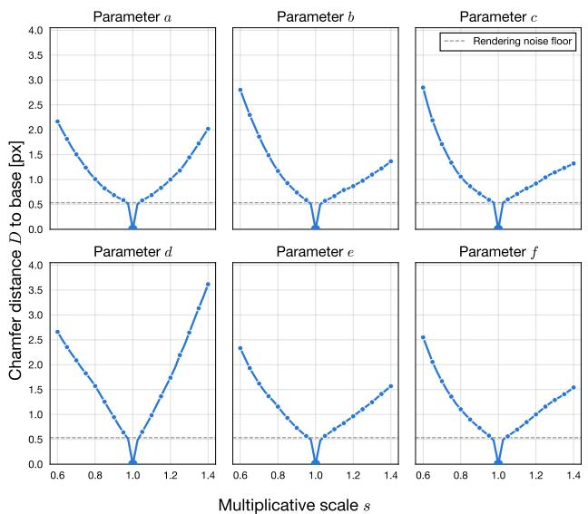  
Figure A. Response of the Chamfer distance D to controlled perturbations of a single base IFS parameter set. One affine coefficient is rescaled across all maps by a factor $s \in [ 0 . 6 , 1 . 4 ]$ (33 steps), and the selection probabilities are recomputed from the determinant magnitudes. Each panel corresponds to one of the six coefficients. The dashed line indicates the rendering noise floor, estimated by re-rendering the unperturbed parameters with different random seeds. D increases monotonically on both sides of the base in all six directions.

## A.b. Qualitative Examples of Filtered Triplets

Figure C shows triplets sampled from FineFractalDB under the four filtering strategies (Sec. 3.4 of the main paper), allowing the descriptor-based assignment to be compared visually with the apparent structural similarity. Under same, both candidates are drawn from the anchor’s class and differ from it only in fine structural details, so ranking them is precisely the fine-grained decision that the descriptor is asked to make. Under each, one candidate shares the anchor’s class while the other does not, and the descriptor almost always selects the within-class candidate, consistent with its near-equivalence to the class-label rule reported in Sec. 5.1 of the main paper. Under all and diff, the candidates are mostly unrelated to the anchor, and the ordering induced by $d _ { \Psi }$ no longer reflects structural similarity. These examples make concrete why the reliability of the descriptor ordering depends on the candidate regime.

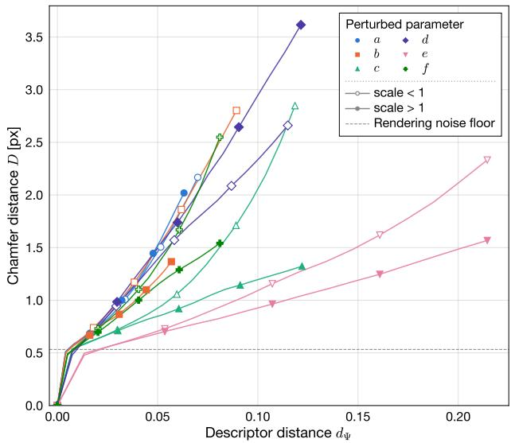  
Figure B. Chamfer distance D versus descriptor distance $d _ { \Psi }$ for the perturbation sweeps of Fig. A, colored by the perturbed coefficient. Each sweep contributes two branches corresponding to shrinking (s<1) and enlarging (s>1) perturbations. The rank correlation is nearly perfect within each direction, whereas the slope differs across directions, so $d _ { \Psi }$ orders structural change reliably but is not calibrated in magnitude across directions.

## B. FineFractalDB

This section provides additional visual examples from Fine-FractalDB. For comparison, we also present samples from the original FractalDB [3].

Figure D shows randomly selected images from FractalDB. Because affine transformations are not strictly constrained to be contractive, many generated samples exhibit degraded fractal structures where characteristic patterns collapse into visually indistinct blobs. In addition, some variations arise from discrete transformations such as flips and rendering patterns.

Figure E presents randomly selected images from the proposed FineFractalDB. In contrast, FineFractalDB samples perturbations continuously from the parameter space while enforcing contraction constraints, resulting in clearer fractal structures. Since the variations are generated through continuous perturbations, the visual differences between nearby instances can appear relatively small when only a limited number of samples are displayed.

## C. Qualitative Analysis

## C.a. Grad-CAM Visualization

This section provides additional Grad-CAM visualizations for ResNet-50. Figure F presents representative examples obtained under different pre-training strategies.

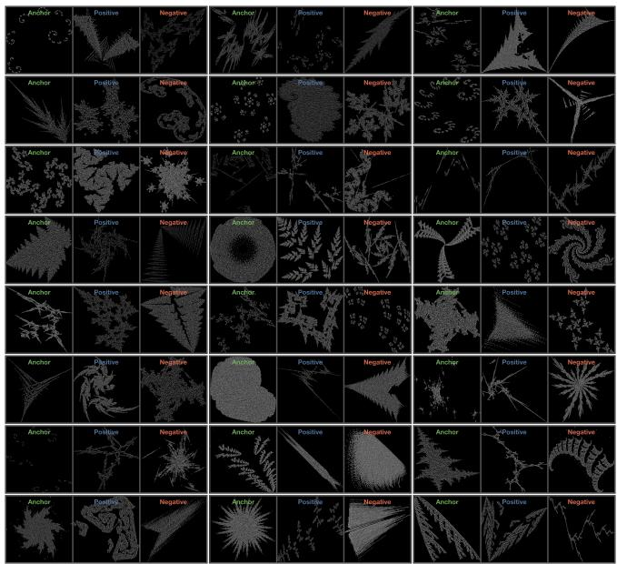  
(a) all

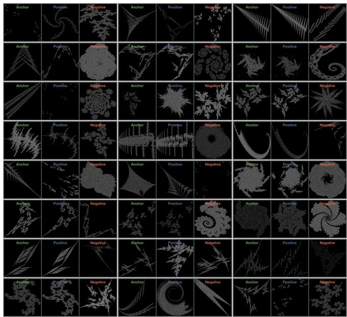  
(b) each

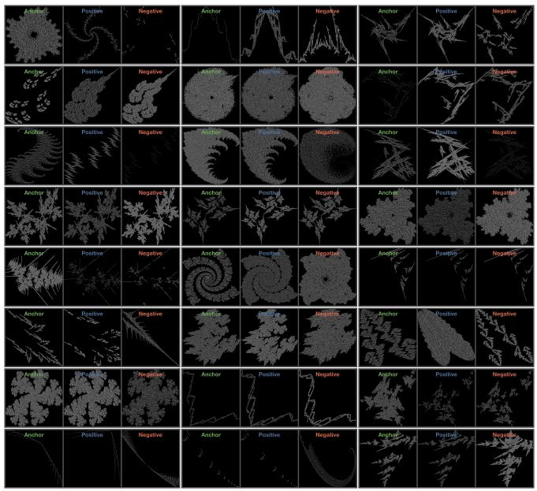  
(c) same

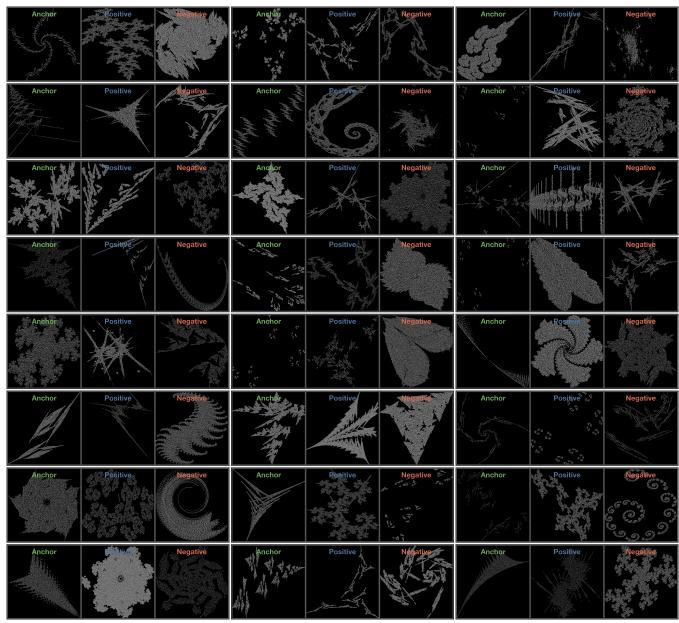  
(d) diff  
Figure C. Triplets sampled from FineFractalDB under the four filtering strategies (Sec. 3.4 of the main paper). Each cell shows an anchor and two candidates, with the positive and negative assigned by the descriptor distance d . same yields structurally close within-class candidates, each contrasts a within-class candidate with a cross-class one, and all and diff mostly produce candidates structurally unrelated to the anchor. Fine details are best observed when zoomed in.

When the ImageNet-pre-trained model is taken as a reference, models trained with synthetic data using FDSML exhibit activation patterns that more closely resemble those of the ImageNet-pre-trained model compared with FDSL. This observation suggests that the proposed formulation encourages the model to capture object-relevant visual structures more effectively.

Interestingly, the ImageNet-pre-trained model occasionally produces activation maps that highlight background regions rather than the target object. In many such cases, the FDSML-pre-trained model instead focuses on the object itself. This behavior indicates that metric-learning-based supervision can encourage the model to rely more consistently on structurally meaningful cues for recognition.

To further quantify this observation, we compute the cosine similarity between the Grad-CAM maps produced by each model and those generated by the ImageNet-pretrained model, which serves as a reference. The resulting distributions are shown in Fig. G. As can be seen, the similarity scores for FDSML are consistently higher than those for FDSL, indicating that the activation patterns learned through the proposed formulation tend to align more closely with those of the natural-image pre-trained model. In particular, the mean similarity increases from 0.7892 for FDSL to 0.8434 and 0.8462 for FDSML (each) and FDSML (same), respectively. These results quantitatively support the qualitative observations in Fig. F, suggesting that FDSML encourages representations that attend to semantically relevant regions of the image.

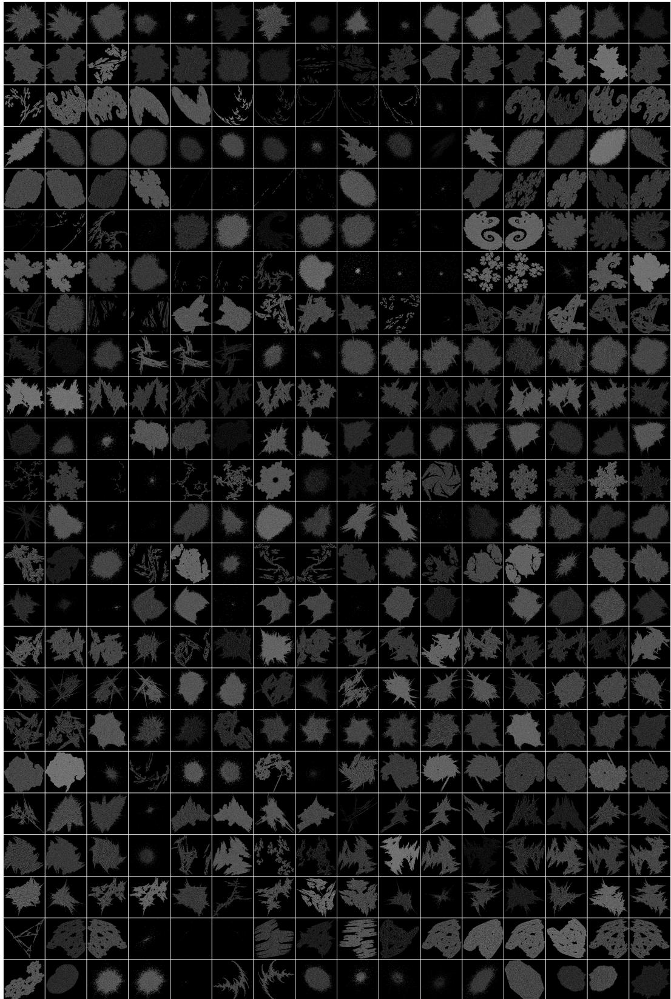  
Figure D. Randomly selected samples from FractalDB. Each row corresponds to a class and each column shows different instances belong ing to that class. Fine details are best observed when zoomed in.

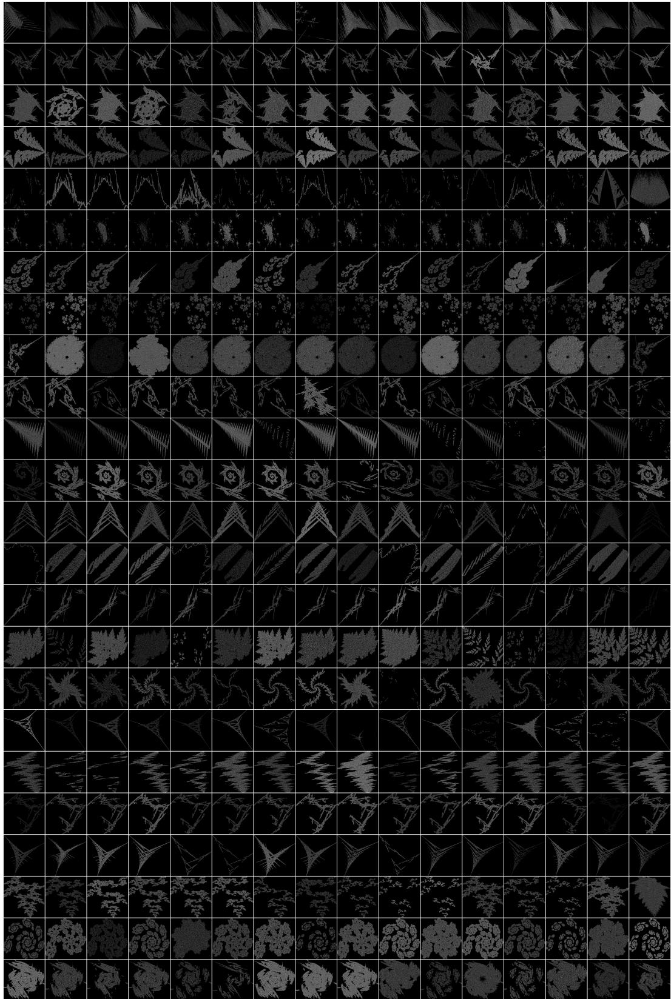  
Figure E. Randomly selected samples from the proposed FineFractalDB. Each row corresponds to a class and each column shows differen instances generated from independently sampled parameters within the class. Fine details are best observed when zoomed in.

## C.b. Visualization of Attention Maps

This section presents additional visualizations of layer-wise attention maps for Vision Transformer models after pretraining under different strategies. Figure H shows the CLSto-patch attention across Transformer layers for the pretrained models.

A clear difference can be observed between the two pretraining formulations. The model pre-trained with FDSL tends to concentrate attention primarily along object boundaries. In contrast, the model pre-trained with FDSML allocates attention not only to edges but also to textured regions within the object, indicating that the proposed formulation encourages the model to capture both structural and appearance cues.

Comparing the two variants of FDSML further reveals a difference in the types of visual cues emphasized during pre-training. The model trained with FDSML (each) exhibits stronger attention on textured regions than FDSML (same). A possible explanation lies in the scale of structural variations emphasized during training. In the same strategy, candidate samples are drawn from the same class, requiring the model to distinguish subtle structural differences. In contrast, the each strategy compares samples from different classes where larger structural variations are present. As a result, FDSML (each) tends to rely more on appearance cues such as textures, whereas FDSML (same) focuses more on coarse structural boundaries.

## C.c. Visualization of Learned Embedding Space

## C.c.1. Visualization of Embedding Space.

To gain further insights into the structure of the learned representations, we visualize the embedding space using UMAP [4], as shown in Fig. I. For each pre-training strategy, features extracted from the layer before the final fully connected layer of the pre-trained ResNet-50 are projected into two dimensions. We randomly select 10 classes from the FineFractalDB test set and visualize their embeddings with different colors.

We analyze the embedding structure in terms of interclass separation and intra-class structure. Compared with FDSL, the model pre-trained with FDSML (each) forms more structured trajectories within each class while remaining well separated across classes. As highlighted by the samples (A)–(D), which correspond to representative points along a trajectory within a single class, the associated fractal images vary gradually along the trajectory, showing that gradual structural variation is also visible in the projected embedding. The inter-class separation itself is expected in this regime, because the positive and negative assignments under each nearly coincide with the class-label rule, making the supervision effectively equivalent to class-label supervision. The structured intra-class trajectories, in contrast, are not directly prescribed by such categorical supervision, suggesting qualitative differences in how intra-class variation is organized under the relational objective.

In contrast, the embeddings learned with FDSML (same) exhibit a greater degree of overlap across classes. Since this strategy derives supervisory signals only from intra-class variations, the model may learn a more continuous representation of structural variations that extend beyond discrete class boundaries.

## C.c.2. Continuity of the Learned Embedding Space.

To further examine whether the learned representations reflect the structure of the underlying generative process, we analyze the continuity of the embedding space induced by gradual changes in the fractal generation parameters. Specifically, we randomly select two parameter sets from FineFractalDB and generate intermediate parameters by linear interpolation,

$$
\psi ( \alpha ) = ( 1 - \alpha ) \psi _ { 0 } + \alpha \psi _ { 1 } ,
$$

where the interpolation coefficient $\alpha \in [ 0 , 1 ]$ is sampled at 5000 evenly spaced intervals. Fractal images rendered from these parameters form a sequence that smoothly varies in the generative parameter space.

Each generated image is encoded using ResNet-50 models pre-trained with either FDSL or FDSML (same). The resulting embeddings are projected into two dimensions using UMAP [4], and the embedding trajectories are visualized in Fig. J. Points are colored according to the interpolation coefficient \alpha , allowing the progression along the parameter interpolation to be observed in the embedding space.

As shown in Fig. J, the UMAP projection of the FDSLpre-trained embeddings exhibits an abrupt transition around $\alpha \approx 0 . 6$ , where the trajectory shifts markedly despite the smooth variation in the underlying generative parameters. In contrast, the FDSML (same) embeddings form a smooth trajectory that follows the progression of the interpolation parameter. Although this visualization alone does not establish continuity in the original high-dimensional embedding space, the projected trajectory under FDSML (same)

Table A. Classification Error (CE ↓, %) on CIFAR-10-C with ResNet-50. Each entry reports the average CE over corruption types within each group.
<table><tr><td>PT Dataset</td><td>PT Type</td><td>Noise</td><td>Blur</td><td>Weather</td><td>Digital</td><td>Geometric</td></tr><tr><td>FractalDB-1k</td><td>FDSL</td><td>39.69</td><td>35.49</td><td>27.07</td><td>22.15</td><td>21.55</td></tr><tr><td>FineFractalDB</td><td>FDSML (all)</td><td>38.24</td><td>27.43</td><td>22.73</td><td>19.37</td><td>18.84</td></tr><tr><td>FineFractalDB</td><td>FDSML (each)</td><td>43.24</td><td>27.08</td><td>22.85</td><td>20.03</td><td>18.73</td></tr><tr><td>FineFractalDB</td><td>FDSML (same)</td><td>41.15</td><td>27.65</td><td>22.24</td><td>19.69</td><td>18.47</td></tr><tr><td>FineFractalDB</td><td>FDSML (diff)</td><td>42.55</td><td>28.66</td><td>24.06</td><td>20.27</td><td>19.26</td></tr></table>

Table B. Classification Error (CE ↓, %) on CIFAR-10-C with ViT-Tiny. Each entry reports the average CE over corruption types within each group.
<table><tr><td>PT Dataset</td><td>PT Type</td><td>Noise</td><td>Blur</td><td>Weather</td><td>Digital</td><td>Geometric</td></tr><tr><td>FractalDB-1k</td><td>FDSL</td><td>13.56</td><td>13.70</td><td>7.82</td><td>10.09</td><td>9.99</td></tr><tr><td>FineFractalDB</td><td>FDSML (all)</td><td>12.33</td><td>9.94</td><td>6.24</td><td>7.56</td><td>7.78</td></tr><tr><td>FineFractalDB</td><td>FDSML (each)</td><td>11.64</td><td>10.70</td><td>6.33</td><td>7.30</td><td>8.40</td></tr><tr><td>FineFractalDB</td><td>FDSML (same)</td><td>12.45</td><td>10.31</td><td>6.15</td><td>7.58</td><td>7.77</td></tr><tr><td>FineFractalDB</td><td>FDSML (diff)</td><td>13.07</td><td>10.14</td><td>6.70</td><td>7.88</td><td>8.03</td></tr></table>

is qualitatively more consistent with the gradual variation of the generative process than that under FDSL.

## D. Robustness Analysis

We further evaluate the robustness of the learned representations against common visual corruptions using the CIFAR-10-C benchmark [2]. Following the standard protocol, corruptions are grouped into five semantic categories: Noise, Blur, Weather, Digital, and Geometric. In CIFAR-10-C, these groups include Noise (Gaussian, Shot, Impulse, Speckle), Blur (Gaussian, Glass, Motion, Zoom), Weather (Snow, Frost, Fog, Spatter), Digital (Brightness, Contrast, Saturate, Pixelate, JPEG), and Geometric (Elastic). For reference, the ImageNet-C benchmark used in the main paper adopts a similar grouping with slightly different corruption types: Noise (Gaussian, Shot, Impulse), Blur (Defocus, Glass, Motion, Zoom), Weather (Snow, Frost, Fog), Digital (Brightness, Contrast, Pixelate, JPEG), and Geometric (Elastic). Tables A and B report the classification error (CE) averaged over corruption types within each group.

## D.a. Robustness Improvement on ResNet-50.

As shown in Table A, FDSML reduces classification error relative to FDSL in the Blur, Weather, Digital, and Geometric groups for every variant. For example, FDSML (each) reduces the Blur error from 35.49% to 27.08%, and FDSML (same) reduces the Geometric error from 21.55% to 18.47%. These improvements may arise from the different training objectives of the two formulations. While classification-based pre-training primarily encourages separability between discrete classes, FDSML learns to encode relative structural relationships between samples. The learned representations may therefore rely less on fragile local cues and instead capture more stable structural cues that remain consistent under these corruptions. The Noise group is the exception, as only FDSML (all) improves over FDSL (38.24% versus 39.69%) while the other variants perform worse. We analyze this behavior in Sec. D.c.

## D.b. Robustness Across Architectures.

The improvements extend to the ViT-Tiny architecture, as shown in Table B. On CIFAR-10-C, every FDSML variant reduces classification error relative to FDSL in all five corruption groups, and unlike ResNet-50, this includes the Noise group. For example, FDSML (all) reduces the Blur error from 13.70% to 9.94%, and FDSML (each) reduces the Digital error from 10.09% to 7.30%. Although Vision Transformers may inherently exhibit stronger robustness to certain corruptions, FDSML still provides consistent additional gains on this benchmark. These results complement the ImageNet-C evaluation, where ViT-Tiny instead degrades in the Noise and Digital groups (Table 6 of the main paper). Taken together, the two evaluations suggest that the robustness benefits of FDSML are not limited to convolutional backbones, although the direction of individual group-level effects depends on both the benchmark and the architecture.

## D.c. Comparison within Proposed Variants.

Among the proposed variants, FDSML (all) ranks first or second in nine of the ten combinations of architecture and corruption group, and FDSML (same) does so in four of the five groups on ResNet-50. For ResNet-50, FDSML (same) achieves the lowest error in the Weather and Geometric groups, whereas for ViT-Tiny, FDSML (each) attains the lowest error in the Noise and Digital groups.

The variants separate most clearly under the Noise corruptions on ResNet-50, where FDSML (all) is the only variant that outperforms FDSL. One possible explanation is that the unconstrained pool exposes the loss to comparisons spanning the widest range of structural differences, encouraging features that remain stable across instances rather than features attuned to fine structural distinctions. The more constrained pools of each and same concentrate training on narrower structural differences, and the resulting representations may be more sensitive to unstructured highfrequency perturbations. On ViT-Tiny, however, FDSML (each) attains the lowest Noise error despite its constrained candidate pool.

FDSML (diff) yields the smallest gains in most corruption groups. By construction, its triplets compare the anchor exclusively with candidates from other classes. For such cross-class comparisons, the descriptor ordering agrees with the structural ordering below chance, and the strategy simultaneously excludes the within-class comparisons for which the ordering is reliable.

Ground Truth  
ImageNet Pre-trained  
FDSL  
FDSML (Ours)  
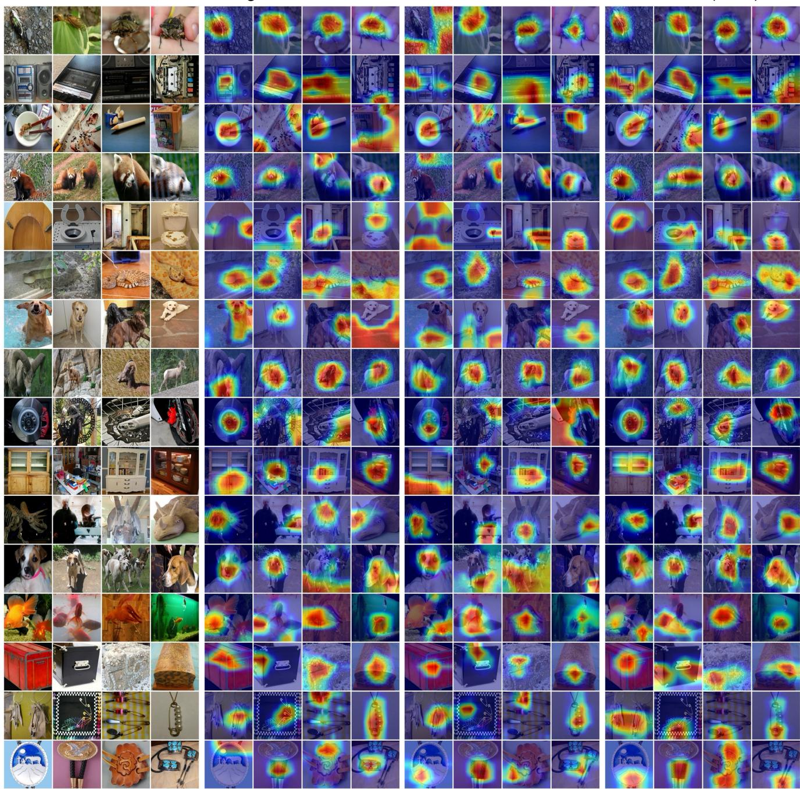  
Figure F. Grad-CAM visualizations for ResNet-50 models trained under different pre-training strategies. The leftmost panel shows the input images, while the subsequent panels present the corresponding Grad-CAM heatmaps produced by the ImageNet-1k pre-trained model, the FDSL-pre-trained model, and the proposed FDSML-pre-trained model. For the FDSL and FDSML settings, the models are first pre-trained on synthetic fractal datasets and subsequently fine-tuned on ImageNet-1k. Within each panel, rows correspond to object classes and columns correspond to different instances from the same class.

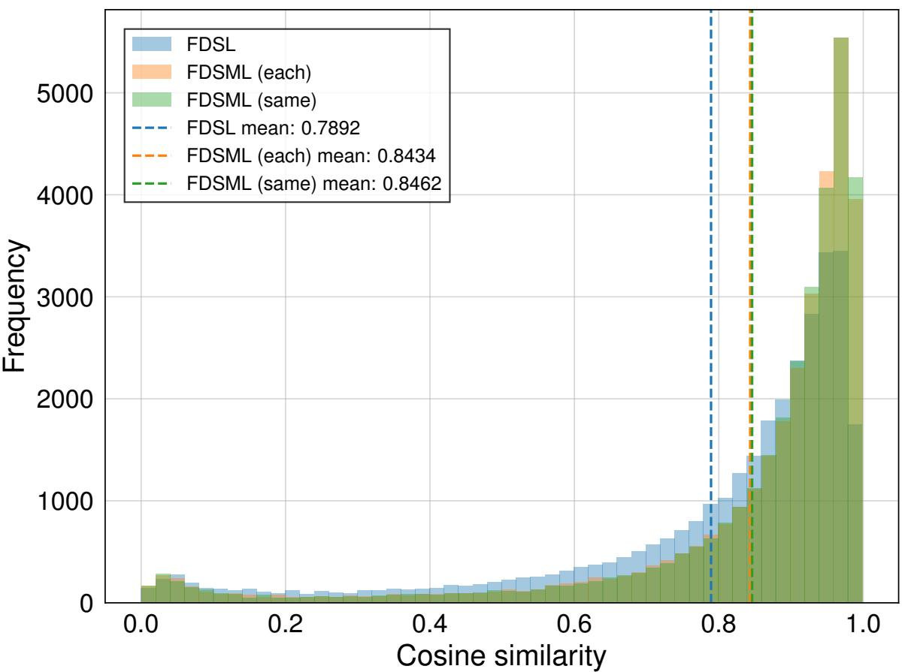  
Figure G. Histogram of cosine similarity between Grad-CAM maps produced by models pre-trained with different strategies and those from an ImageNet-pre-trained ResNet-50, used here as a reference model. Each similarity is computed per image using cosine similarity between Grad-CAM maps. Dashed vertical lines indicate the mean similarity for each method. FDSML variants exhibit higher similarit to the reference model than FDSL, suggesting that their activation patterns tend to align more closely with those of the natural-image pre-trained model.

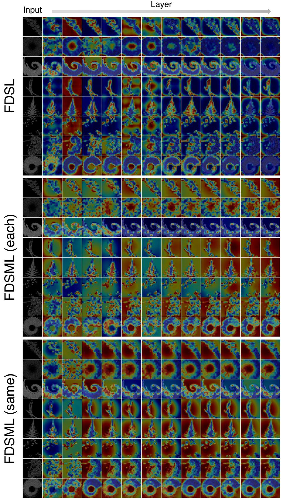  
Figure H. Layer-wise CLS-to-patch attention maps of Vision Transformer models after pre-training under different strategies. The leftmost column shows the input images, and the subsequent columns visualize attention maps from successive Transformer layers. Fine details are best observed when zoomed in.

FDSL  
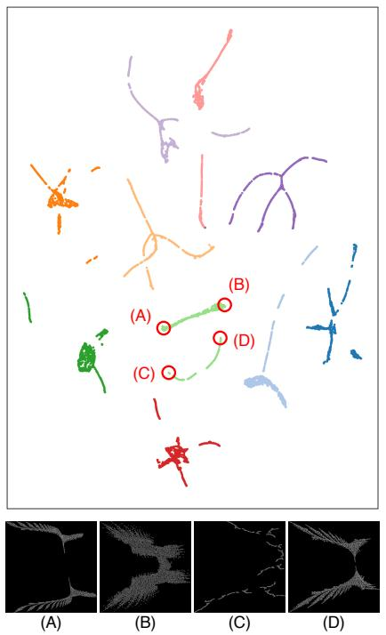

FDSML (each)  
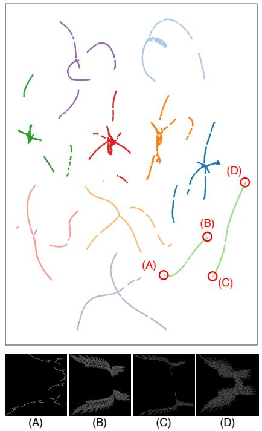

FDSML (same)  
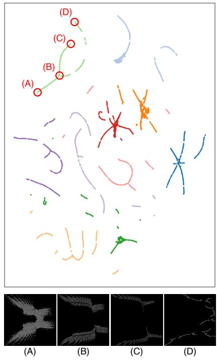  
Figure I. UMAP visualization of feature embeddings from ResNet-50 models pre-trained with different strategies. Features from the layer before the final fully connected layer are projected into two dimensions using UMAP [4]. Ten classes from the FineFractalDB test set are randomly selected and color-coded. Compared with FDSL, FDSML (each) forms more structured intra-class trajectories while remaining relatively well separated across classes, whereas FDSML (same) exhibits more noticeable overlap between classes. Points (A)–(D) indicate representative samples along a trajectory within the same class, with the corresponding fractal images shown below each panel.

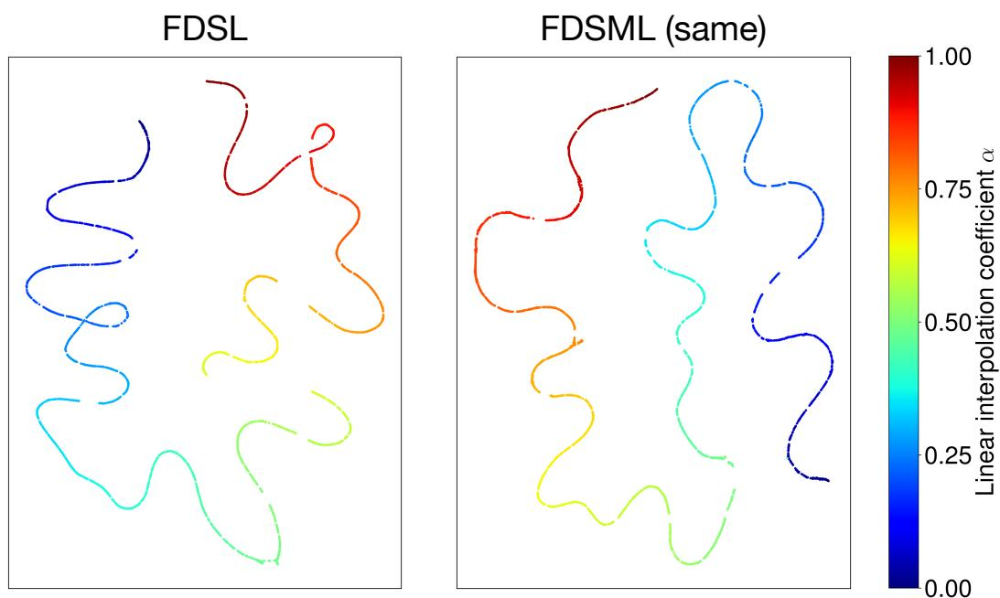  
Figure J. Visualization of embedding trajectories induced by linear interpolation in the generative parameter space. Two parameter sets are randomly selected from FineFractalDB, and intermediate parameters are generated by linear interpolation with coefficient $\alpha \in [ 0 , 1 ]$ sampled at 5000 evenly spaced intervals. Fractal images rendered from these parameters are then encoded using ResNet-50 models pretrained with FDSL or FDSML (same), and the resulting embeddings are projected to two dimensions using UMAP. Points are colored according to the interpolation coefficient $\alpha .$ While the projected embeddings of FDSL exhibit an abrupt trajectory transition around $\alpha \approx 0 . 6 .$ , those of FDSML (same) form a smoother trajectory that more closely follows the gradual parameter interpolation.

## References

[1] H. G. Barrow, J. M. Tenenbaum, R. C. Bolles, and H. C. Wolf. Parametric correspondence and chamfer matching: two new techniques for image matching. In IJCAI, page 659–663, 1977. 1

[2] Dan Hendrycks and Thomas Dietterich. Benchmarking neural network robustness to common corruptions and perturbations. ICLR, 2019. 7

[3] Hirokatsu Kataoka, Kazushige Okayasu, Asato Matsumoto, Eisuke Yamagata, Ryosuke Yamada, Nakamasa Inoue, Akio Nakamura, and Yutaka Satoh. Pre-training without natural images. In ACCV, 2020. 2

[4] Leland McInnes, John Healy, Nathaniel Saul, and Lukas Grossberger. Umap: Uniform manifold approximation and projection. The Journal of Open Source Software, 3(29):861, 2018. 6, 11

[5] Richard Zhang, Phillip Isola, Alexei A Efros, Eli Shechtman, and Oliver Wang. The unreasonable effectiveness of deep features as a perceptual metric. In CVPR, 2018. 1