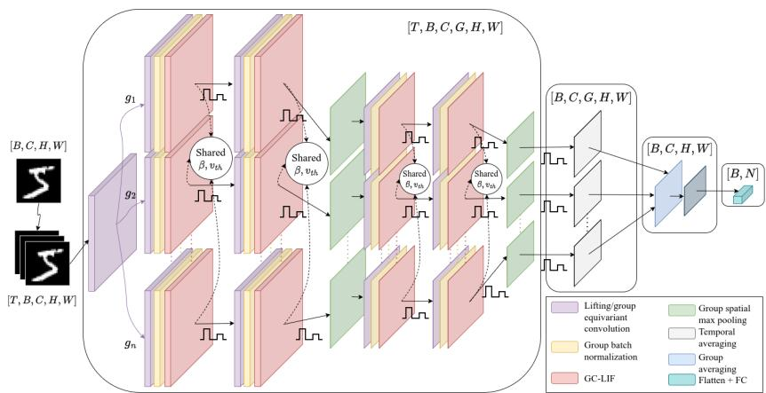
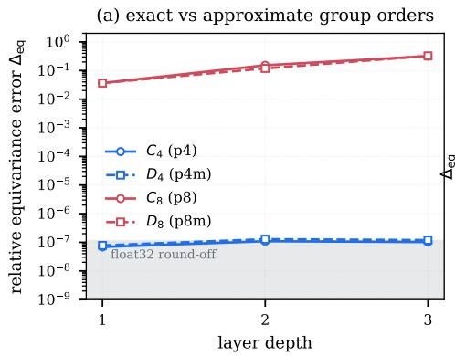
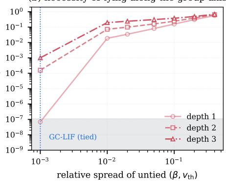
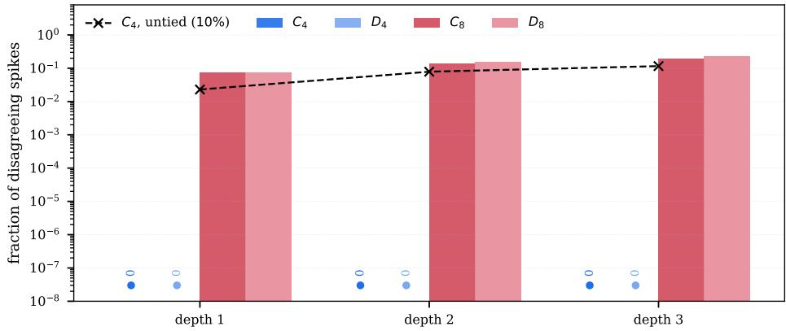
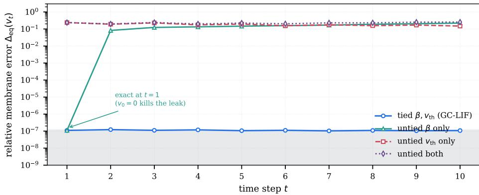
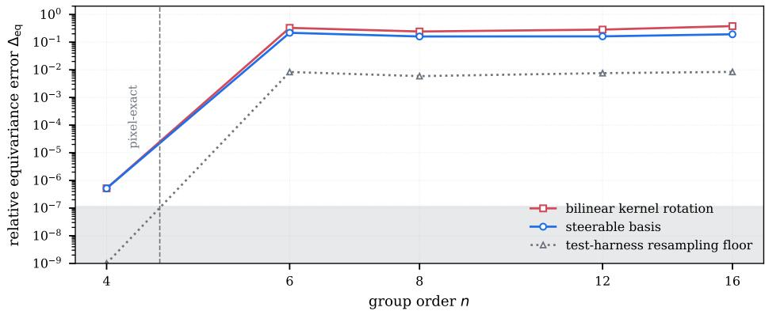
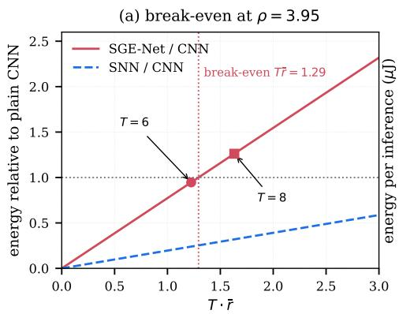
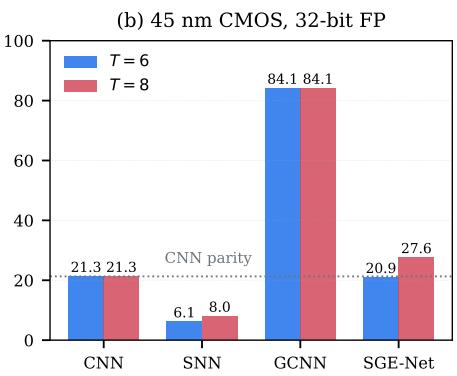

# GC-LIF: Spiking Group-Equivariant Neural Network With Group-Coupled Membrane Dynamics

Nhan Trong Luu∗ · Duong Trung Luu · Truong Cong Thang

Revised October 30, 2026

Abstract Spiking neural networks (SNNs) promise event-driven, low-power inference, but on vision tasks they still acquire rotation invariance only through data augmentation. Group-equivariant CNNs build such symmetries into the architecture, yet a faithful spiking analogue is missing: a leaky integrate-and-fire (LIF) neuron placed after a G-equivariant convolution can break equivariance through its membrane recurrence. We give a necessary and suficient condition for this not to happen. The layer is equivariant at every time step if and only if the neuron parameters (β, vth) are constant along the joint orbits of the group action on the (group, space) index. We solve it in closed form, and it covers any elementwise stateful neuron. Its suficiency half specialises a known result for equivariant recurrent networks; its necessity half rules out the heterogeneous per-neuron parameters common in SNNs. The per-channel parameterisation that satisfies it, Group-Coupled LIF (GC-LIF), is combined with p4 and p4m-equivariant convolutions and a spike-rate group max-pool into SGE-Net. On MNIST, KMNIST, Fashion-MNIST, CIFAR-10 and CIFAR-100, evaluating each checkpoint on the clean test set and all its group-transformed copies, SGE-Net trained without rotations is invariant under $C _ { 4 }$ and $D _ { 4 }$ and outperforms a plain SNN trained with rotations in nine of ten dataset-group pairs, whereas non-equivariant baselines lose up to 72 percentage points in the worst case. Operator-level tests confirm the theory before and after training, and an analytical estimate places SGE-Net at 1.7× the arithmetic energy of a standard CNN and 2.3× below its ANN counterpart at eight time steps.

Convolutional neural networks (CNNs) [27] are translation-equivariant by construction, which is a major reason for their sample eficiency. Group-equivariant CNNs (G-CNNs) [7] and steerable CNNs [8, 43] extend this to rotations and reflections, and improve parameter eficiency and generalisation when data arrive in arbitrary poses, as in medical imaging, microscopy and satellite imagery.

Spiking neural networks (SNNs) have meanwhile become a practical substrate for low-power, event-driven inference, and surrogate-gradient training [32,34] brings them close to ANN accuracy on vision benchmarks. On rotation-sensitive tasks, however, SNNs still rely on data augmentation [42] or fixed transformation priors [37] rather than on the exact discrete-group equivariance of G-CNNs.

Simply inserting a spiking neuron into a G-CNN does not solve this. Equivariance requires every internal feature to transform along with the input, and a spiking neuron carries a membrane state across time steps. If its parameters difer between the positions that the group action exchanges, the rotated and unrotated networks drift apart step by step, even though every convolution in the stack is equivariant. This paper works out exactly which parameterisations avoid this and what the resulting network buys and costs. We make four contributions:

– A necessary and suficient condition. A G-equivariant convolution followed by per-element LIF neurons is equivariant at every time step if and only $\operatorname { i f } \left( \beta , v _ { \mathrm { t h } } \right)$ are constant along the joint orbits of the group action on the (group, space) index. We solve this constraint in closed form and show that it covers any elementwise stateful neuron. The suficiency half is the spiking instance of a known induction for equivariant recurrent networks [20]; the necessity half, and the list of common SNN parameterisations it excludes, are specific to this work.

– GC-LIF and SGE-Net. Group-Coupled LIF (GC-LIF) keeps one membrane state per (group, spatial) location but shares $( \beta , v _ { \mathrm { t h } } )$ per channel, the only choice that is both orbit invariant and translation equivariant. With lifting and group convolutions, group BatchNorm and a spike-rate group max-pool it forms the Spiking Group Equivariant Network (SGE-Net).

– A controlled evaluation. We compare SGE-Net with a plain CNN, a plain SNN and an ANN G-CNN on five datasets, four groups $( C _ { 4 } , C _ { 8 } , D _ { 4 } , D _ { 8 } )$ and three training and test regimes. Every number comes from one checkpoint, selected on a held-out validation split and evaluated on the clean test set and on every group-transformed copy of it, so that exact invariance can be read of the tables directly. We report 95% confidence intervals over four seeds, a sensitivity study over the number of time steps T, and an analytical energy estimate.

– Operator-level validation. We test the theory on the operators themselves, at initialisation and after training: tied parameters give identical spike trains under $C _ { 4 }$ and $D _ { 4 }$ up to float32 rounding, untying them breaks this immediately, and the threshold and the leak break it through diferent mechanisms, exactly as the proof predicts.

To our knowledge, SGE-Net is the first spiking network with exact discretegroup equivariance through time, exact for $n \in \{ 1 , 2 , 4 \}$ , where the group acts by pixel permutations, and approximate for $n = 8 .$ . Equivariance of recurrent networks under static group actions is itself established theory [3,20,35], and we do not claim it. Our contribution is the characterisation of which spiking parameterisations satisfy it and a controlled measurement of the resulting accuracy and cost.

## 1 Related Work

## 1.1 Group-equivariant CNNs

Cohen and Welling [7] introduced G-CNNs for discrete cyclic and dihedral groups. Steerable CNNs [8, 43] generalise them to continuous groups through irreducible representations [4, 16]. Later work covers separable G-CNNs [23], partial equivariance [21, 40] and steerable transformers [25].

## 1.2 Spiking neural networks for vision

Surrogate-gradient training [14,34,46] gives strong SNN results on MNIST, CIFAR-10 and event-based data such as DVS-CIFAR10 [30–33]. Recent work addresses long-range dependencies [12] and convolutional backbones [28]. All of these treat geometric invariance as an augmentation problem.

## 1.3 Equivariance in recurrent and sequence models

Equivariance of stateful models under static group actions is well understood. Keller [20] studies equivariance of sequence models with respect to time-parameterised flows and, on the way, proves by induction that a recurrent network built from a group-equivariant input map, a group-equivariant recurrent map, a pointwise equivariant nonlinearity and a group-invariant initial state is equivariant at every time step. Static equivariance has also been built into recurrent dynamical models for motion prediction [3] and recurrent policies for partially observed control [35], and the principle that compositions of equivariant maps are equivariant goes back to [24]. The suficiency half of Theorem 1 is the spiking instance of this line of work (Section 2.5). The architectures in that literature carry no per-element parameters, so the question of which parameterisations of a stateful unit preserve equivariance does not arise there. It does arise for SNNs, where per-neuron time constants and thresholds are routine [15], and Proposition 1 answers it.

## 1.4 Symmetries in SNNs

Pedersen et al. [37] build covariant spatio-temporal receptive fields for event-based vision from fixed Gaussian kernels, covering spatial afine and temporal scaling transformations but not learnable discrete rotation and reflection groups. Pedersen et al. [38] use the scale covariance of the LIF membrane to build spiking wavelets; the symmetry there is temporal scale, and the kernels are fixed. Augmentationbased methods [41, 42] obtain approximate rotation robustness through preprocessing. We are not aware of prior work stating when the membrane recurrence itself commutes with a discrete spatial group action.

## 2 Theoretical basis

## 2.1 Background

## 2.1.1 LIF neurons

A discrete-time leaky integrate-and-fire neuron has membrane potential $v ,$ leak factor $\beta \in ( 0 , 1 )$ and threshold $v _ { \mathrm { t h } }$ . With reset to zero after a spike,

$$
v _ { t } = \beta v _ { t - 1 } \left( 1 - s _ { t - 1 } \right) + i _ { t } , \quad s _ { t } = { \bf 1 } \left[ v _ { t } \geq v _ { \mathrm { t h } } \right] .\tag{1}
$$

Training uses an arctangent surrogate gradient for the indicator (Section 3.4).

## 2.1.2 Feature maps and the group action

We work with the cyclic group $G = C _ { n } = \left\{ g _ { 0 } , \dots , g _ { n - 1 } \right\}$ , where $g _ { a }$ is a planar rotation by $\theta _ { a } : = 2 \pi a / n$ and $g _ { a } g _ { b } = g _ { a + b } \mathrm { ~ m o d ~ } n \cdot \mathrm { ~ A l l }$ arithmetic on group indices is modulo n. The dihedral case is analogous and is detailed in Appendix H.

The following definition fixes the index notation used in every statement below.

Definition 1 (Feature maps) A feature map at a hidden layer is a function $F : \{ 0 , \dots , n - \mathrm { i } \} \times \mathcal { P }  \mathbb { R } ^ { C }$ indexed by a group coordinate $h ,$ a spatial coordinate $p \in \mathcal P \subseteq \mathbb R ^ { 2 }$ and a channel $c .$ We write $F [ c , h , p ]$ , so one time step of a layer is a tensor in $\mathbb { R } ^ { C \times n \times | \mathcal { P } | }$

Every equivariance statement in this paper is made with respect to one operator on such feature maps, which we now define.

Definition 2 (Group action) For $g _ { a } \in G$ the operator $\rho ( g _ { a } )$ acts on a feature map by

$$
\left( \rho ( g _ { a } ) F \right) \left[ c , h , p \right] = F \left[ c , h - a , R _ { - \theta _ { a } } p \right] ,\tag{2}
$$

where $R _ { \theta }$ is the $2 \times 2$ rotation matrix. It cyclically shifts the group axis by a and rotates the spatial axes by $\theta _ { a }$ . For $n \in \{ 1 , 2 , 4 \}$ it is a permutation of the pixel grid; it only relabels each position $( h , p )$ as $( h - a , R _ { - \theta _ { a } p } )$

A map L is G-equivariant if $L ( \rho ( g ) x ) = \rho ( g ) L ( x )$ for all g and x. A lifting convolution maps $\mathbb { R } ^ { 2 } \to G \times \mathbb { R } ^ { 2 }$ and a group convolution maps $\bar { G } \times \mathbb { R } ^ { 2 } \to G \times \mathbb { R } ^ { 2 }$ both tie weights through rotated copies of a base kernel [7]. The theorem below treats the convolution as a black box that is equivariant, so we first state that property together with the sign convention it depends on, which is easy to get wrong.

Lemma 1 (Equivariance of group convolution) Define the group convolution Conv $_ G : F \mapsto F$ ⋆ w with kernel w $[ c ^ { \prime } , c , h ^ { \prime } , q ]$ by

$$
( F \star w ) [ c ^ { \prime } , h , p ] = \sum _ { c = 1 } ^ { C } \sum _ { h ^ { \prime } = 0 } ^ { n - 1 } \sum _ { q \in \mathcal { Q } } F \left[ c , h - h ^ { \prime } , p - R _ { \theta _ { h } } q \right] \cdot w [ c ^ { \prime } , c , h ^ { \prime } , q ] ,\tag{3}
$$

where $\mathcal { Q }$ is the kernel footprint. Then Conv $\dot { \mathbf { \eta } } _ { G }  \left( \rho ( g _ { a } ) F \right) = \rho ( g _ { a } ) \operatorname { C o n v } _ { G } ( F )$ for every $g _ { a } \in G$ and every $F$

Proof See Appendix A.

The ofset rotation $R _ { + \theta _ { h } }$ in Equation 3 must match the convention of Equation 2: since $R _ { - \theta _ { a } } R _ { \theta _ { h } } = R _ { \theta _ { h - a } } .$ , the spatial rotation then follows the shifted group index. With $R _ { - } \theta _ { h }$ instead, the composition gives R $\boldsymbol { \cdot } \theta _ { h + a }$ and equivariance fails for every a with 2a $\neq 0$ mod $n ;$ Section 4.5 confirms this numerically.

## 2.2 Why a naive spiking G-CNN fails through time

Suppose the LIF parameters $\beta _ { c , h , p }$ and $v _ { \mathrm { t h } , c , h , p }$ may vary over the whole feature index. The group action moves the current that the unrotated network had at $( h - a , R _ { - \theta _ { a } } p )$ to position $( h , p )$ . If the parameters at these two positions difer, the neuron at $( h , p )$ integrates the right current with the wrong leak or compares it with the wrong threshold, and its spike train no longer matches the relabelled spike train of the unrotated network. Because the membrane carries this mismatch to the next step, the error also accumulates in time. The natural $\mathrm { f i x } ,$ making the parameters independent of the group index $h ,$ is neither suficient nor necessary, because the action moves $p$ as well as $h .$ The correct condition, derived next, is invariance along the joint orbits of $G$ on $( h , p )$

## 2.3 Condition for space-time equivariance

Each step of the induction behind Theorem 1 moves $\rho ( g _ { a } )$ past one elementary operation of the LIF update. The next lemma lists exactly those operations; property (R5) uses Definition 3 below.

Lemma 2 (Properties of $\rho ( g _ { a } ) )$ For any $g _ { a } \in G$ , feature maps $F , F ^ { \prime }$ and scalar $\alpha \in \mathbb { R } .$

(R1) Scalar multiplication: $\rho ( g _ { a } ) ( \alpha F ) = \alpha ( \rho ( g _ { a } ) F )$

(R2) Addition: $\rho ( g _ { a } ) ( F + F ^ { \prime } ) = \rho ( g _ { a } ) F + \rho ( g _ { a } ) F ^ { \prime }$

(R3) Hadamard product: $\rho ( g _ { a } ) ( F \odot F ^ { \prime } ) = \rho ( g _ { a } ) F \odot \rho ( g _ { a } ) F ^ { \prime } .$

(R4) Pointwise function $\phi : \mathbb { R } \to \mathbb { R } : \rho ( g _ { a } ) ( \phi ( F ) ) = \phi ( \rho ( g _ { a } ) F )$

(R5) Orbit-invariant scaling: if a parameter field λ satisfies Equation $^ { 4 , }$ then $\rho ( g _ { a } ) ( \lambda \odot F ) = \lambda \odot \rho ( g _ { a } ) F .$ (R1) is the special case of a constant field.

Proof See Appendix B.

## 2.3.1 Orbit-invariant parameter fields

The theorem’s hypothesis is membership of the following class of parameter fields, so we need to name it. It is strictly larger than, and diferently shaped from, the class of fields that do not depend on h.

Definition 3 (Orbit-invariant parameter field) A parameter field $\lambda = ( \lambda _ { c , h , p } )$ is orbit invariant if

$$
\lambda _ { c , h , p } = \lambda _ { c , h - a , R _ { - \theta _ { a } } p } \qquad \mathrm { f o r ~ e v e r y ~ } c , h , p , a ,\tag{4}
$$

that is, if λ is constant on each orbit of the joint action $( h , p ) \mapsto ( h - a , R _ { - \theta _ { a } } p )$

Equation 4 quantifies over all a, which makes it awkward to check. The next lemma replaces it with an explicit parameterisation, so that one can tell at a glance whether a given design is admissible.

Lemma 3 (Characterisation of orbit-invariant fields) A field λ is orbit invariant if and only if there are functions $f _ { c } : \mathcal { P } \to \mathbb { R }$ , one per channel, such that

$$
\lambda _ { c , h , p } = f _ { c } ( R _ { - \theta _ { h } } p ) \qquad f o r \ e v e r y \ c , h , p .\tag{5}
$$

Proof See Appendix C.

Four consequences follow and delimit what a designer may do:

(C1) Spatially homogeneous fields. If $\lambda _ { c , h , p } \equiv \lambda _ { c , h }$ , then $f _ { c }$ must be constant, so the condition reduces to $^ { 6 6 } \lambda _ { c , h }$ does not depend on $h ^ { \prime \prime }$ . Only in this case is the familiar statement correct.

(C2) Independence of h is not suficient. If $\lambda _ { c , h , p } \equiv \lambda _ { c , p }$ , the condition becomes $\lambda _ { c , p } = \lambda _ { c , R _ { - \theta _ { a } } p }$ for every a: $\lambda _ { c }$ must be constant on each $C _ { n } \mathrm { - o r b i t }$ of pixel positions. A per-neuron learnable time constant, which varies freely over $p ,$ violates it.

(C3) Independence of h is not necessary. Any non-constant $f _ { c }$ in Equation 5 gives an orbit-invariant field that depends on h: slot h receives the profile of slot 0 rotated by $\theta _ { h }$

(C4) GC-LIF is the intersection. A field that is orbit invariant and spatially homogeneous is a per-channel constant $\lambda _ { c }$ . Spatial homogeneity is what translation equivariance requires, so per-channel constants are the only parameters that are both $C _ { n }$ -equivariant and translation-equivariant. GC-LIF uses them.

## 2.3.2 The space-time equivariance theorem

The following theorem is what allows a stateful spiking neuron to sit inside an equivariant stack at all: without it, a network built only from equivariant convolutions can still lose equivariance once a neuron with memory is inserted, and a mismatched leak does not even show at the first time step (Section 4.5).

Theorem 1 (Space-time equivariance of LIF over group coupling) Let $L = \mathrm { L I F } \circ \mathrm { C o n v } _ { G }$ be a G-equivariant group convolution followed by per-element LIF neurons whose parameters $\beta _ { c , h , p } \in ( 0 , 1 )$ and $v _ { \mathrm { t h } , c , h , p } > 0$ are orbit invariant, with dynamics

$$
\begin{array} { r l } & { v _ { t } [ c , h , p ] = \beta _ { c , h , p } v _ { t - 1 } [ c , h , p ] ( 1 - s _ { t - 1 } [ c , h , p ] ) + i _ { t } [ c , h , p ] , } \\ & { s _ { t } [ c , h , p ] = { \bf 1 } \left[ v _ { t } [ c , h , p ] \geq v _ { \mathrm { t h } , c , h , p } \right] , \qquad v _ { 0 } = 0 , \quad s _ { 0 } = 0 , } \end{array}\tag{6}
$$

where $i _ { t } : = \mathrm { C o n v } _ { G } ( x _ { t } )$ . Then for every $g _ { a } \in G$ and every input sequence $x _ { 1 : T }$

$$
L \left( \rho ( g _ { a } ) x _ { 1 : T } \right) = \rho ( g _ { a } ) L ( x _ { 1 : T } ) ,\tag{7}
$$

where $\rho ( g _ { a } )$ acts on each time step separately: $( \rho ( g _ { a } ) x _ { 1 : T } ) _ { t } : = \rho ( g _ { a } ) x _ { t }$

Proof See Appendix D.

The proof uses orbit invariance at exactly two places: when the leak is moved through the index relabelling and when the threshold is moved through the indicator. Everything else is bookkeeping about relabelled coordinates. Two readings follow. Sharing across channels is never needed, and the algebraic form of the LIF update plays no role beyond being applied elementwise (Section 2.4).

The converse is what constrains design in practice, because it says whether a heterogeneous parameterisation can be kept or must be abandoned.

Proposition 1 (Orbit invariance is necessary) Let $L ^ { \mathrm { n a i v e } }$ be as in Theorem 1 but $w i t h \beta _ { c , h , p }$ and $v _ { \mathrm { t h } , c , h , p }$ unrestricted. Then $L ^ { \mathrm { n a i v e } } ( \rho ( g _ { a } ) x _ { 1 : T } ) = \rho ( g _ { a } ) L ^ { \mathrm { n a i v e } } ( x _ { 1 : T } )$ for every input and every $g _ { a } \in G$ if and only if both $\beta$ and $v _ { \mathrm { t h } }$ are orbit invariant, that $i s ,$ if and only if both have the form of Equation 5. In particular, independence from h alone is neither suficient (C2) nor necessary (C3).

Proof See Appendix G.

Together, Theorem 1 and Proposition 1 give a test for any candidate parameterisation: it is admissible exactly when it factors through Equation 5. A per-neuron learnable time constant, as in Parametric LIF [15], fails the test; a per-channel one passes; a per-orientation one, which looks natural on a lifted tensor, fails by (C1).

## 2.4 Extension to other spiking neuron models

The argument above is easy to mistake for a property of the LIF equation, which would make it fragile under a change of neuron model. The next proposition shows it is not: what matters is that the update acts elementwise and that its parameters are orbit invariant.

Proposition 2 (Equivariance of elementwise stateful neurons) Let $u _ { t } [ c , h , p ] \in$ $\mathbb { R } ^ { d }$ be a neuron state with

$$
u _ { t } [ c , h , p ] = \varPsi ( u _ { t - 1 } [ c , h , p ] , i _ { t } [ c , h , p ] ; \lambda _ { c , h , p } ) , \qquad s _ { t } [ c , h , p ] = \theta ( u _ { t } [ c , h , p ] ; \lambda _ { c , h , p } ) ,\tag{8}
$$

for fixed maps $\varPsi : \mathbb R ^ { d } \times \mathbb R \times \mathbb R ^ { m } \to \mathbb R ^ { d }$ and $\theta : \mathbb { R } ^ { d } \times \mathbb { R } ^ { m }  \mathbb { R }$ , a parameter field $\lambda _ { c , h , p } \in \mathbb { R } ^ { m }$ and an initial state u0 that is constant over $( h , p )$ . Let $L : =$ $\mathcal { N } .$ ◦ Conv $^ { \dag } G ,$ where $\mathcal { N }$ is the recursion of Equation 8. If λ is orbit invariant, then $L ( \rho ( g _ { a } ) x _ { 1 : T } ) = \rho ( g _ { a } ) L ( x _ { 1 : T } ) $ for every $g _ { a }$ and every input. If Ψ or Θ depends non-trivially on $\lambda ,$ orbit invariance is also necessary.

## Proof See Appendix E.

Checking standard neuron models against the two requirements:

– Covered as is: $\mathrm { L I F }$ with subtractive reset $( v _ { t } \mapsto v _ { t } - v _ { \operatorname { t h } } s _ { t } ) ;$ current-based (second-order) LIF with state $( v , I ) ;$ ; adaptive-threshold LIF with state $( v , \vartheta )$ driven by the neuron’s own spikes; the Izhikevich model with state $( v , w )$ and a quadratic $\varPsi ;$ exponential and quadratic integrate-and-fire; and Parametric LIF [15] with a per-channel learnable time constant.

Covered with a constraint: neurons with lateral coupling, such as winnertake-all or inhibition across orientations, are not elementwise. They remain admissible if the coupling is itself G-equivariant, which for inhibition across orientations means a circulant kernel on the group axis.

– Not covered: neurons with independent stochastic firing, unless the noise is transported by $\rho ( g _ { a } )$ . For those the guarantee weakens to equivariance in distribution.

## 2.5 Relation to equivariant recurrent network theory

The suficiency half of Theorem 1 specialises an established argument. Keller [20] proves by induction that a recurrent network assembled from a G-equivariant input map, a G-equivariant recurrent map, a pointwise equivariant nonlinearity and a group-invariant initial state is G-equivariant at every step; instantiating it with group convolutions and a spiking nonlinearity gives our suficiency direction, as it would for the recurrent models of [3, 35]. An ordinary LIF with a scalar or perchannel leak and threshold already satisfies the condition, and GC-LIF does not make such a neuron more equivariant.

Three points are specific to our setting. First, the LIF update is not of the form $h _ { t + 1 } = \sigma ( \mathcal { W } \star h _ { t } + \mathcal { U } \star f _ { t } )$ assumed in [20]: the reset multiplies the state by a thresholded function of itself, so the induction also needs the Hadamard property (R3), and the nonlinearity is a discontinuous indicator. This is a modest technical diference. Second, and more substantively, prior results are suficiency statements that assume every component is equivariant by construction; they do not say which parameterisations of a stateful unit are admissible, because the units they consider carry no per-element parameters. Proposition 1 and Lemma 3 answer that question constructively, and the answer matters for SNNs, where heterogeneous parameters are standard. Third, we measure the failure modes (Section 4.5) and show that the threshold and the leak break equivariance through diferent mechanisms and on diferent time scales.

## 3 SGE-Net: a group-equivariant SNN with GC-LIF

SGE-Net is a stack of equivariant blocks followed by an invariant readout (Figure 1). The input is encoded directly, $x _ { t } = x$ for $t = 1 , \dots , T$ , and block ℓ applies at every time step

$$
i _ { t } ^ { ( \ell ) } = \mathrm { B N } ^ { ( \ell ) } \left( \mathrm { C o n v } ^ { ( \ell ) } F _ { t } ^ { ( \ell - 1 ) } \right) , \qquad \left( F _ { t } ^ { ( \ell ) } , v _ { t } ^ { ( \ell ) } \right) = \mathrm { G C - L I F } ^ { ( \ell ) } \left( i _ { t } ^ { ( \ell ) } , v _ { t - 1 } ^ { ( \ell ) } \right) ,\tag{9}
$$

where $\mathrm { C o n v } ^ { ( \ell ) }$ is the lifting convolution for $\ell = 1$ and a group convolution for $\ell \geq 2 , \mathrm { B N } ^ { ( \ell ) }$ is group BatchNorm and $v _ { 0 } ^ { ( \ell ) } = 0$ . Every component commutes with $\rho ( g _ { a } )$ , as shown below, so the whole stack does.

  
Fig. 1: Overview of SGE-Net: lifting and group convolutions, group BatchNorm and GC-LIF neurons, group spatial average pooling between blocks, and a readout that averages spike rates over time and max-pools over the group axis.

## 3.1 Lifting convolution

The first layer turns an image into a G-indexed feature map. For a base kernel $K \in \mathbb { R } ^ { C _ { 1 } \times C _ { \mathrm { i n } } \times k \times k }$

$$
\left( \operatorname { L i f t } x \right) \left[ c , h , p \right] = \sum _ { q \in N } \left. K _ { h } \left[ c , : , q \right] , x \left[ : , p + q \right] \right. , \qquad K _ { h } ( q ) : = K \left( R _ { - \theta _ { h } } q \right) ,\tag{10}
$$

so slot h holds the base kernel rotated by $\theta _ { h }$ and K is the only parameter. The standard property [7, 43]

$$
\mathrm { L i f t } \left( R _ { \theta _ { a } } x \right) = \rho ( g _ { a } ) \mathrm { L i f t } ( x )\tag{11}
$$

says that rotating the image shifts which slots respond rather than changing the response.

For $n \in \{ 1 , 2 , 4 \}$ the rotated kernel is a permutation of kernel entries and is exact. For $n > 4$ , bilinear resampling of a non-smooth kernel is inaccurate, so we parameterise K in a Gaussian-radial, Fourier-angular steerable basis [2, 8, 44]:

$$
K ( r , \varphi ) = \sum _ { m , \ell } \psi _ { m } ( r ) \left( \alpha _ { m , \ell } \cos ( \ell \varphi ) + \beta _ { m , \ell } \sin ( \ell \varphi ) \right) , \qquad \psi _ { m } ( r ) : = e ^ { - ( r - r _ { m } ) ^ { 2 } / 2 \sigma ^ { 2 } } ,\tag{12}
$$

with trainable coeficients $\left( \alpha _ { m , \ell } , \beta _ { m , \ell } \right)$ . Rotation is then the exact relabelling $K _ { h } ( r , \varphi ) = K ( r , \varphi - \theta _ { h } )$ of the continuous kernel. The layer, however, uses $K _ { h }$ sampled on the $k \times k \ \mathrm { g r i d }$ , and sampling does not commute with rotation for angular frequencies the grid cannot resolve. The basis therefore removes the resampling error but not the sampling error, and equivariance at $n = 8$ remains approximate (Section 4.5).

## 3.2 Group BatchNorm

Group BatchNorm pools statistics over the group axis as well as over batch and space:

$$
\begin{array} { l } { \displaystyle \mu _ { c } = \frac { 1 } { B n | \mathcal { P } | } \sum _ { b , h , p } F [ b , c , h , p ] , \quad \boldsymbol { \sigma } _ { c } ^ { 2 } = \frac { 1 } { B n | \mathcal { P } | } \sum _ { b , h , p } \left( F [ b , c , h , p ] - \mu _ { c } \right) ^ { 2 } , } \\ { \displaystyle \widehat { F } [ b , c , h , p ] = \gamma _ { c } \frac { F [ b , c , h , p ] - \mu _ { c } } { \sqrt { \boldsymbol { \sigma } _ { c } ^ { 2 } + \epsilon } } + \delta _ { c } . } \end{array}\tag{13}
$$

The group action only permutes the indices being summed, so $( \mu _ { c } , \sigma _ { c } )$ are unchanged by it. The per-channel scale commutes with $\rho ( g _ { a } )$ by (R1) and the per-channel shift by (R2), because a constant map is fixed by the action. Hence BN $( \rho ( g _ { a } ) F ) = \rho ( g _ { a } )$ BN(F).

## 3.3 Group convolution

Hidden layers use the group convolution of Lemma 1: the kernel for output slot h is the base kernel with its input-group axis cyclically shifted by h and its spatial part rotated by $\theta _ { h }$ , through the steerable basis when $n > 4$

## 3.4 Group-Coupled LIF

GC-LIF applies Equation 6 at every $( c , h , p )$ with per-channel constants $( \beta , v _ { \mathrm { t h } } )$ the parameterisation singled out by (C4). The forward pass uses the Heaviside step, and the backward pass uses the arctangent surrogate [14, 34]

$$
\frac { \partial s _ { t } } { \partial v _ { t } } : = \frac { \alpha } { \pi \left( 1 + \left( \alpha \left( v _ { t } - v _ { \mathrm { t h } } \right) \right) ^ { 2 } \right) } , \qquad \alpha = 2 .\tag{14}
$$

## 3.5 Group spatial pooling

Between blocks, the spatial axes are downsampled by average pooling while the group axis is untouched:

$$
\left( \mathrm { S P o o l } _ { k } F \right) \left[ c , h , p \right] = \frac { 1 } { k ^ { 2 } } \sum _ { q \in [ k ] ^ { 2 } } F \left[ c , h , k p + q \right] .\tag{15}
$$

With $k = 2$ on grids of even size, a $9 0 ^ { \circ }$ rotation maps pooling windows onto pooling windows, so SPool2 commutes exactly with $\rho ( g _ { a } )$ for $C _ { 4 }$ and $D _ { 4 }$ , and approximately for $n = 8$

## 3.6 Spike-rate group max-pool readout

After the last block, spikes $S _ { 1 : T } \in \{ 0 , 1 \} ^ { C _ { L } }$ ×n× $H ^ { \prime } \times W ^ { \prime }$ are averaged over time, max-pooled over the group axis and averaged over space:

$$
\begin{array} { r } { \bar { S } [ c , h , p ] = \frac { 1 } { T } \displaystyle \sum _ { t = 1 } ^ { T } S _ { t } [ c , h , p ] , } \end{array}\tag{16}
$$

$$
M [ c , p ] = \operatorname* { m a x } _ { h } \bar { S } [ c , h , p ] , \qquad z [ c ] = \frac { 1 } { | \mathcal { P } ^ { \prime } | } \sum _ { p } M [ c , p ] , \qquad \hat { y } = W _ { \mathrm { c l s } } z + b _ { \mathrm { c l s } } .\tag{17}
$$

The whole network is meant to be invariant rather than equivariant, and this readout is the step that makes it so. The next lemma states the property we rely on.

Lemma 4 (Group-axis max-pool yields invariance) For any $\bar { S } \in \mathbb { R } ^ { C _ { L } \times n \times H ^ { \prime } \times W ^ { \prime } }$ and $g _ { a } \in G$

$$
\operatorname* { m a x } _ { h } \left( \rho ( g _ { a } ) \bar { S } \right) \left[ c , h , p \right] = \operatorname* { m a x } _ { h } \bar { S } \left[ c , h , R _ { - \theta _ { a } } p \right] .
$$

Consequently z in Equation 17 satisfies $z ( \rho ( g _ { a } ) \bar { S } ) = z ( \bar { S } )$

Proof See Appendix F.

Averaging over h would also give an invariant readout. We use the maximum because it follows the G-CNN convention [7] of keeping the best-matching orientation, and because spike rates are bounded in [0, 1] and sparse, so averaging over h shrinks the response of the few matching orientations by a factor of up to n; mean pooling is known to under-perform in this setting [31].

## 4 Experiments

## 4.1 Experimental protocol

We compare SGE-Net with three models of matched size: a plain CNN, the same CNN with LIF neurons (SCNN), and the ANN group CNN (GCNN) of [7]. The datasets are MNIST [11], KMNIST [6], Fashion-MNIST [45], CIFAR-10 and CIFAR-100 [1]. CIFAR-100 keeps the input resolution of CIFAR-10 while raising the number of classes tenfold and cutting the examples per class from 5000 to 500, so it tests the models where a constrained hypothesis class is most costly and an architectural prior most valuable.

## 4.1.1 Splits, checkpoint selection and reporting

The oficial training set of each dataset is split 90/10 into training and validation parts with a seed-dependent permutation that is shared by all models. Each model trains for 100 epochs, and the parameters with the highest validation accuracy are kept. Every reported number is computed from that single checkpoint on the oficial test set, which is never used for training or model selection.

## 4.1.2 Full-orbit evaluation

For a group $G$ we evaluate the selected checkpoint $f$ on the clean test set $\mathcal { D }$ and on every transformed copy $g \cdot D \colon$

$$
\operatorname { A c c } _ { \mathrm { c l e a n } } = \operatorname { A c c } ( f , { \mathcal { D } } ) , \qquad \operatorname { A c c } _ { G } = { \frac { 1 } { | G | } } \sum _ { g \in G } \operatorname { A c c } ( f , g \cdot { \mathcal { D } } ) .\tag{18}
$$

Both numbers come from the same weights and the same images, and no group element is sampled at random. We also record the per-sample prediction agreement $\begin{array} { r } { \frac { 1 } { | G | | \mathcal { D } | } \sum _ { g , x } \mathbf { 1 } [ f ( g \cdot x ) = f ( x ) ] } \end{array}$ , which is the quantity that Lemma 4 constrains. The tables report three regimes: clean, meaning clean training and $\operatorname { A c c } _ { \mathrm { c l e a n } } ; \mathrm { ~ } w / o$ train aug, meaning clean training and AccG; and $w /$ train aug, meaning training on randomly transformed images and $\operatorname { A c c } _ { G }$ , the classical rotated benchmark [7, 43]. For an exactly invariant model the first two coincide, which gives a direct check on both the model and the pipeline.

## 4.1.3 Group transformations

Transformations are applied to the raw image before per-channel normalisation. For $n \in \{ 1 , 2 , 4 \}$ rotations and reflections are exact pixel permutations. For $n = 8$ the $4 5 ^ { \circ }$ rotations use bilinear resampling, and every image, clean or rotated, is restricted to a centred disc whose diameter equals the image side, with the dataset mean outside the disc. Because the disc is applied at every group element, including the identity, clean and rotated images share the same surround, and a rotation introduces no boundary pattern that clean images lack. Training augmentation uses the same transformations. Appendix I compares this protocol with a simpler one and shows how each choice afects the results.

## 4.1.4 Architectures

All models share a four-block backbone of $3 \times 3$ convolutions (padding 1, stride 1), normalisation and activation, with 2×2 average pooling after blocks 2 and 4, global average pooling and a linear classifier. Per-slot channel widths are $( c _ { 1 } , c _ { 1 } , 2 c _ { 1 } , 2 c _ { 1 } )$ with $c _ { 1 } = 1 6$ on the $2 8 \times 2 8$ datasets and $c _ { 1 } = 3 2$ on CIFAR for the plain models; the equivariant models use half these widths, which matches the parameter budgets. The activation is ReLU for the $\mathrm { A N N s } ,$ LIF for SCNN and GC-LIF for SGE-Net. The equivariant models use a lifting convolution in block 1, group convolutions in blocks 2 to $^ { 4 , }$ group BatchNorm (Equation 13) and the group max-pool of Equation 17. Convolution weights and steerable coeficients use Kaiming-uniform initialisation $( a = { \sqrt { 5 } } )$ , BatchNorm starts at $\gamma = 1 , \delta = 0$ , and membrane states start at zero.

## 4.1.5 Neuron and steerable-basis settings

Unless Section 4.7 states otherwise, all SNNs use $T = 8 , \beta = 0 . 9 , v _ { \mathrm { t h } } = 1 . 0$ , reset to zero, direct input encoding $I _ { i } ( t ) = x _ { i }$ for $t \in \{ 1 , \ldots , T \}$ , and the surrogate of Equation 14. For $n \in \{ 1 , 2 , 4 \}$ kernels are rotated by exact permutations. For $n = 8$ the steerable basis of Equation 12 uses $\left\lfloor ( k + 1 ) / 2 \right\rfloor$ Gaussian radial profiles of width

Table 1: Clean test accuracy (%): training and testing without any transformation. Mean and 95% confidence interval over four seeds, from the checkpoint selected on the validation split (Section 4.1). Group convolutions are p4.
<table><tr><td>Models</td><td>MNIST</td><td>FMNIST</td><td>KMNIST</td><td>CIFAR10</td><td>CIFAR100</td></tr><tr><td>CNN</td><td> $9 9 . 2 0 \pm 0 . 3 2$ </td><td> $9 1 . 1 3 \pm 2 . 5 4$ </td><td> $9 3 . 8 8 \pm 0 . 5 1$ </td><td> $7 9 . 9 3 \pm 3 . 4 3$ </td><td> $4 9 . 4 8 \pm 2 . 1 0$ </td></tr><tr><td>SCNN</td><td> $9 8 . 6 8 \pm 0 . 1 3$ </td><td> $8 9 . 8 4 \pm 0 . 5 7$ </td><td> $8 9 . 2 0 \pm 5 . 5 3 $ </td><td> $7 5 . 7 7 \pm 0 . 0 6$ </td><td> $3 4 . 9 4 \pm 5 . 5 9$ </td></tr><tr><td>GCNN</td><td> $9 7 . 8 6 \pm 1 . 5 9$ </td><td> $9 1 . 3 7 \pm 1 . 0 2$ </td><td> $9 1 . 6 1 \pm 0 . 7 0$ </td><td> $7 9 . 8 1 \pm 1 . 8 4$ </td><td> $4 7 . 2 1 \pm 6 . 0 4$ </td></tr><tr><td>SGE-NET</td><td> $9 5 . 5 8 \pm 1 . 4 6$ </td><td> $8 7 . 7 8 \pm 2 . 1 6$ </td><td> $8 8 . 3 0 \pm 0 . 1 0$ </td><td> $7 3 . 5 8 \pm 4 . 3 8$ </td><td> $4 0 . 5 0 \pm 3 . 0 5$ </td></tr></table>

$\sigma = 0 . 6$ pixels, maximum angular frequency $\ell _ { \mathrm { m a x } } = \mathrm { m i n } ( \lfloor ( k - 1 ) / 2 \rfloor + 1 , \lfloor n / 2 \rfloor )$ angular components set to zero at the central pixel where the angle is undefined, and one normalisation constant shared by all rotated copies so that equivariance is not afected.

## 4.1.6 Optimisation and statistics

All models use AdamW with learning rate $5 \times 1 0 ^ { - 4 }$ , weight decay $1 0 ^ { - 4 }$ , a cosine schedule with a floor at 1% of the peak, batch size 128, and, for the SNNs, gradientnorm clipping at 1.0, on one RTX 3090 GPU. Every configuration is trained with four seeds, and the four models share each seed’s data split and data order. Tables report the mean and the half-width of the 95% confidence interval, t0.975, ${ _ { 3 } s } / { \sqrt { 4 } } =$ $3 . 1 8 2 s / 2 \approx 1 . 5 9 s ,$ where s is the sample standard deviation over seeds. We call a diference between two models resolved only when their 95% intervals are disjoint, which is a conservative test at the 5% level. Overlapping intervals are reported as unresolved, not as evidence that the models are equal. With four seeds many diferences in the tables are unresolved, and we do not rank those. Per-seed results are included in the supplementary material.

## 4.2 Clean accuracy

Table 1 trains and tests every model on images in their canonical orientation. This is the regime in which equivariance cannot help, so it measures what each constraint costs. The plain CNN has the highest mean on four of the five datasets, as expected of the least constrained model. Equivariance alone (CNN against GCNN) costs at most 2.27 pp. Spiking alone (CNN against SCNN) costs 0.52 to 4.68 pp on the ten-class datasets and 14.54 pp on CIFAR-100. Within the spiking family, the cost of equivariance (SCNN against SGE-Net) is resolved only on MNIST, at 3.10 pp; on CIFAR-100 SGE-Net has the higher mean (40.50 against 34.94), though the intervals overlap.

## 4.3 Cyclic groups

Table 2 evaluates every model on the full $C _ { 4 }$ and $C _ { 8 }$ orbits of the test set.

Table 2: Full-orbit test accuracy (%) for the cyclic groups (Equation 18). Aug.: trained on clean images $( \mathbb { X } , \mathbb { w } / \mathrm { o }$ train aug) or with random group transformations (✓, w/ train aug). Mean and 95% confidence interval over four seeds. For GCNN and SGE-Net at $C _ { 4 } ,$ the ✗ rows equal the clean accuracies of Table 1.  
(a) Group C4, |G| = 4.
<table><tr><td>Models</td><td> $\mathbf { E q u i v . }$ </td><td>Aug.</td><td>MNIST</td><td>FMNIST</td><td>KMNIST</td><td>CIFAR10</td><td>CIFAR100</td></tr><tr><td rowspan="2">CNN</td><td rowspan="2"> $ { \mathbb { Z } } ^ { 2 }$ </td><td>× &gt;</td><td> $4 3 . 1 7 \pm 3 . 2 9$ </td><td> $3 4 . 5 3 \pm 1 . 9 9$ </td><td> $3 5 . 2 8 \pm 0 . 7 1$ </td><td> $4 6 . 7 3 \pm 9 . 3 2$ </td><td> $3 0 . 2 6 \pm 0 . 6 0$ </td></tr><tr><td></td><td> $9 6 . 3 2 \pm 0 . 8 3$ </td><td> $8 7 . 7 2 \pm 1 . 9 4$ </td><td> $7 9 . 5 7 \pm 2 . 9 5$ </td><td> $7 3 . 0 2 \pm 1 . 3 5$ </td><td> $4 2 . 3 5 \pm 2 . 8 7$ </td></tr><tr><td rowspan="2">SCNN</td><td rowspan="2"> $ { \mathbb { Z } } ^ { 2 }$ </td><td>× √</td><td> $4 5 . 6 6 \pm 7 . 7 8$ </td><td> $3 6 . 7 0 \pm 8 . 7 5$ </td><td> $3 3 . 9 7 \pm 4 . 5 3$ </td><td> $4 6 . 6 8 \pm 3 . 1 9$ </td><td> $2 3 . 8 4 \pm 1 . 6 7$ </td></tr><tr><td></td><td> $9 1 . 8 2 \pm 0 . 9 5$ </td><td> $8 3 . 6 0 \pm 0 . 0 5$ </td><td> $6 5 . 5 8 \pm 6 . 4 3$ </td><td> $6 7 . 0 3 \pm 1 . 6 4$ </td><td> $2 9 . 8 0 \pm 5 . 8 8$ </td></tr><tr><td rowspan="2">GCNN</td><td rowspan="2"> $p 4$ </td><td>× &gt;</td><td> $9 7 . 8 6 \pm 1 . 5 9$ </td><td> $9 1 . 3 7 \pm 1 . 0 2$ </td><td> $9 1 . 6 1 \pm 0 . 7 0$ </td><td> $7 9 . 8 1 \pm 1 . 7 9$ </td><td> $4 7 . 2 1 \pm 6 . 0 4$ </td></tr><tr><td></td><td> $9 7 . 8 5 \pm 1 . 6 5$ </td><td> $9 1 . 4 6 \pm 3 . 1 6$ </td><td> $9 1 . 6 2 \pm 1 . 3 3$ </td><td> $7 9 . 7 2 \pm 0 . 4 0$ </td><td> $4 7 . 1 2 \pm 2 . 6 0$ </td></tr><tr><td rowspan="2">SGE-NET</td><td rowspan="2"> $p 4$ </td><td>x &gt;</td><td> $9 5 . 5 8 \pm 1 . 4 6$ </td><td> $8 7 . 7 8 \pm 2 . 1 6$ </td><td> $8 8 . 3 0 \pm 0 . 1 0$ </td><td> $7 3 . 5 9 \pm 4 . 3 8$ </td><td> $4 0 . 5 0 \pm 3 . 0 5$ </td></tr><tr><td></td><td> $9 5 . 3 7 \pm 0 . 1 3$ </td><td> $8 7 . 8 3 \pm 1 . 3 3$ </td><td> $8 8 . 5 0 \pm 5 . 6 5$ </td><td> $7 3 . 3 3 \pm 4 . 2 4$ </td><td> $4 0 . 9 9 \pm 1 . 5 1$ </td></tr></table>

(b) Group C8, |G| = 8.
<table><tr><td>Models</td><td>Equiv.</td><td>Aug.</td><td>MNIST</td><td>FMNIST</td><td>KMNIST</td><td>CIFAR10</td><td>CIFAR100</td></tr><tr><td rowspan="2">CNN</td><td rowspan="2"> $\mathbb { Z } ^ { 2 }$ </td><td>x√</td><td> $4 1 . 0 2 \pm 1 5 . 0 8$ </td><td> $2 5 . 7 9 \pm 0 . 9 9$ </td><td> $2 4 . 0 5 \pm 5 . 2 8$ </td><td> $3 8 . 9 6 \pm 3 . 2 2$ </td><td> $2 5 . 2 3 \pm 1 . 8 0$ </td></tr><tr><td></td><td> $9 5 . 7 4 \pm 0 . 2 2$ </td><td> $8 3 . 2 6 \pm 1 . 6 9$ </td><td> $7 2 . 8 6 \pm 2 . 2 9$ </td><td> $6 7 . 5 1 \pm 2 . 1 8$ </td><td> $3 9 . 1 5 \pm 2 . 5 3$ </td></tr><tr><td rowspan="2">SCNN</td><td rowspan="2"> $\mathbb { Z } ^ { 2 }$ </td><td>x √</td><td> $4 1 . 3 5 \pm 0 . 2 5$ </td><td> $2 6 . 4 6 \pm 8 . 4 0$ </td><td> $2 3 . 6 5 \pm 0 . 6 6$ </td><td> $3 7 . 9 1 \pm 1 . 4 0$ </td><td> $1 9 . 3 6 \pm 1 . 5 1$ </td></tr><tr><td></td><td> $9 0 . 5 8 \pm 2 . 5 5$ </td><td> $7 8 . 4 6 \pm 0 . 5 5$ </td><td> $5 8 . 8 3 \pm 5 . 3 3$ </td><td> $5 9 . 9 8 \pm 2 . 4 8$ </td><td> $2 6 . 6 7 \pm 4 . 5 6$ </td></tr><tr><td rowspan="2">GCNN</td><td rowspan="2"> $p 8$ </td><td>x &gt;</td><td> $8 7 . 8 8 \pm 5 . 4 2$ </td><td> $5 9 . 3 1 \pm 4 . 0 8$ </td><td> $5 6 . 1 2 \pm 4 . 7 6$ </td><td> $6 4 . 9 2 \pm 8 . 6 1$ </td><td> $3 8 . 4 0 \pm 5 . 5 3$ </td></tr><tr><td></td><td> $9 8 . 3 0 \pm 0 . 7 3$ </td><td> $9 0 . 5 6 \pm 1 . 5 9$ </td><td> $9 2 . 1 2 \pm 1 . 0 1$ </td><td> $7 8 . 3 7 \pm 0 . 6 6$ </td><td> $4 6 . 3 2 \pm 2 . 1 1$ </td></tr><tr><td rowspan="2">SGE-NET</td><td rowspan="2"> $p 8$ </td><td>× &gt;</td><td> $8 5 . 6 2 \pm 1 7 . 7 7$ </td><td> $5 8 . 4 2 \pm 5 . 0 0$ </td><td> $5 3 . 3 1 \pm 0 . 8 1$ </td><td> $5 9 . 7 5 \pm 9 . 8 1$ </td><td> $3 3 . 9 5 \pm 2 . 8 2$ </td></tr><tr><td></td><td> $9 6 . 2 7 \pm 0 . 5 6$ </td><td> $8 7 . 2 6 \pm 1 . 1 9$ </td><td> $8 0 . 2 4 \pm 2 . 8 5$ </td><td> $7 2 . 3 7 \pm 0 . 2 3$ </td><td> $4 0 . 6 0 \pm 1 . 4 6$ </td></tr></table>

## 4.3.1 Exact invariance at $C _ { 4 }$

For GCNN and SGE-Net at $C _ { 4 }$ , the $w / o$ train aug entries equal the clean accuracies of Table 1 to within 0.01 pp, the last reported digit, and the per-sample prediction agreement is 1.0000 (Table 4). Training with $C _ { 4 }$ augmentation changes these models by at most 0.49 pp, always within the confidence intervals. This is expected: for an exactly invariant network, rotating a training image leaves the loss and its gradient unchanged, so augmentation has nothing to add.

## 4.3.2 Non-equivariant models and augmentation

Without rotated training data the non-equivariant models collapse: from clean to $C _ { 4 } .$ , CNN loses 19.22 to 58.60 pp and SCNN 11.10 to 55.23 pp, with the largest drops on the character datasets, where orientation carries the most information. Training with rotations recovers much of this but not all of it. SGE-Net trained without rotations outperforms SCNN trained with them on all five datasets, and every one of these diferences is resolved; the largest is 22.72 pp on KMNIST. On the ANN side, GCNN without rotations outperforms CNN with rotations on Fashion-MNIST, KMNIST and CIFAR-10 (resolved) and has the higher mean on MNIST and CIFAR-100.

Table 3: Full-orbit test accuracy (%) for the dihedral groups, with $| D _ { 4 } | = 8$ and $| D _ { 8 } | = 1 6$ . Layout as in Table 2.  
(a) Group $D _ { 4 } , \left| { \cal G } \right| = 8 .$
<table><tr><td>Models</td><td>Equiv.</td><td>Aug.</td><td>MNIST</td><td>FMNIST</td><td>KMNIST</td><td>CIFAR10</td><td>CIFAR100</td></tr><tr><td rowspan="2">CNN</td><td rowspan="2"> $\mathbb { Z } ^ { 2 }$ </td><td>x &gt;</td><td> $3 8 . 4 0 \pm 5 . 0 9$ </td><td> $3 3 . 4 5 \pm 4 . 4 5$ </td><td> $2 8 . 5 1 \pm 0 . 4 4$ </td><td> $4 6 . 5 9 \pm 2 . 6 4$ </td><td> $3 0 . 1 4 \pm 0 . 5 5$ </td></tr><tr><td></td><td> $9 3 . 5 6 \pm 0 . 5 2$ </td><td> $8 7 . 6 2 \pm 2 . 2 4$ </td><td> $7 5 . 1 5 \pm 3 . 6 1$ </td><td> $7 3 . 5 4 \pm 2 . 4 7$ </td><td> $4 2 . 4 1 \pm 1 . 1 9$ </td></tr><tr><td rowspan="2">SCNN</td><td rowspan="2"> $ { \mathbb { Z } } ^ { 2 }$ </td><td>x&gt;</td><td> $3 9 . 1 6 \pm 1 0 . 6 7$ </td><td> $3 6 . 6 2 \pm 2 . 7 6$ </td><td> $2 7 . 6 5 \pm 1 . 4 3$ </td><td> $4 6 . 0 7 \pm 0 . 1 0$ </td><td> $2 3 . 9 1 \pm 2 . 4 1$ </td></tr><tr><td></td><td> $8 7 . 5 0 \pm 3 . 9 1$ </td><td> $8 3 . 4 6 \pm 0 . 8 3$ </td><td> $6 1 . 8 3 \pm 2 . 3 3$ </td><td> $6 6 . 9 9 \pm 0 . 0 4$ </td><td> $2 9 . 8 5 \pm 4 . 0 5$ </td></tr><tr><td rowspan="2">GCNN</td><td rowspan="2"> $p 4 m$ </td><td>x&gt;</td><td> $9 6 . 6 3 \pm 1 . 6 0$ </td><td> $9 2 . 7 8 \pm 0 . 4 4$ </td><td> $9 2 . 0 9 \pm 2 . 0 3$ </td><td> $8 3 . 7 4 \pm 1 . 6 8$ </td><td> $5 1 . 4 0 \pm 1 . 9 3$ </td></tr><tr><td></td><td> $9 6 . 8 0 \pm 0 . 3 2$ </td><td> $9 2 . 8 3 \pm 1 . 0 8$ </td><td> $9 2 . 1 1 \pm 1 . 3 4$ </td><td> $8 3 . 6 9 \pm 4 . 1 8$ </td><td> $5 1 . 6 7 \pm 0 . 2 5$ </td></tr><tr><td rowspan="2">SGE-NET</td><td rowspan="2">p4m</td><td>x √</td><td> $9 3 . 9 4 \pm 0 . 6 4$ </td><td> $9 0 . 2 3 \pm 0 . 8 9$ </td><td> $8 1 . 4 4 \pm 0 . 1 3$ </td><td> $7 7 . 2 4 \pm 7 . 4 3$ </td><td> $3 2 . 5 9 \pm 4 . 2 6$ </td></tr><tr><td></td><td> $9 3 . 9 8 \pm 0 . 8 3$ </td><td> $9 0 . 0 4 \pm 1 . 7 2$ </td><td> $8 1 . 6 2 \pm 4 . 5 1$ </td><td> $7 7 . 3 1 \pm 4 . 5 3$ </td><td> $3 3 . 1 0 \pm 1 . 7 7$ </td></tr></table>

(b) Group $D _ { 8 } , \left. G \right. = 1 6 .$
<table><tr><td>Models</td><td>Equiv.</td><td>Aug.</td><td>MNIST</td><td>FMNIST</td><td>KMNIST</td><td>CIFAR10</td><td>CIFAR100</td></tr><tr><td rowspan="2">CNN</td><td rowspan="2"> $ { \mathbb { Z } } ^ { 2 }$ </td><td>x &gt;</td><td> $3 6 . 2 7 \pm 3 . 6 6$ </td><td> $2 5 . 1 8 \pm 2 . 6 0$ </td><td> $2 1 . 3 9 \pm 3 . 0 9$ </td><td> $3 8 . 8 0 \pm 1 . 9 7$ </td><td> $2 5 . 1 0 \pm 1 . 7 2$ </td></tr><tr><td></td><td> $9 2 . 0 6 \pm 0 . 8 2$ </td><td> $8 3 . 1 1 \pm 3 . 4 6$ </td><td> $6 8 . 7 7 \pm 1 . 0 9$ </td><td> $6 7 . 4 4 \pm 1 . 4 8$ </td><td> $3 8 . 8 9 \pm 2 . 1 5$ </td></tr><tr><td rowspan="2">SCNN</td><td rowspan="2"> $ { \mathbb { Z } } ^ { 2 }$ </td><td>× √</td><td> $3 8 . 1 3 \pm 7 . 1 0$ </td><td> $2 5 . 4 3 \pm 4 . 9 2$ </td><td> $2 1 . 3 2 \pm 0 . 5 8$ </td><td> $3 7 . 7 9 \pm 2 . 0 5$ </td><td> $1 9 . 6 1 \pm 2 . 1 6$ </td></tr><tr><td></td><td> $8 6 . 2 1 \pm 2 . 0 1$ </td><td> $7 8 . 4 4 \pm 1 . 7 0$ </td><td> $5 6 . 7 6 \pm 0 . 2 0$ </td><td> $5 9 . 9 5 \pm 5 . 7 3$ </td><td> $2 6 . 7 1 \pm 3 . 8 6$ </td></tr><tr><td rowspan="2">GCNN</td><td rowspan="2">p8m</td><td>× &gt;</td><td> $8 6 . 7 3 \pm 9 . 7 3$ </td><td> $5 7 . 8 8 \pm 5 . 6 5$ </td><td> $5 7 . 5 1 \pm 3 . 0 7$ </td><td> $6 7 . 9 7 \pm 4 . 5 9$ </td><td> $4 1 . 7 2 \pm 4 . 2 0$ </td></tr><tr><td></td><td> $9 7 . 3 4 \pm 0 . 1 3$ </td><td> $9 1 . 8 0 \pm 1 . 6 2 $ </td><td> $9 3 . 1 9 \pm 4 . 8 6$ </td><td> $8 2 . 3 3 \pm 1 . 8 9$ </td><td> $5 0 . 8 3 \pm 1 . 2 4$ </td></tr><tr><td rowspan="2">SGE-NET</td><td rowspan="2">p8m</td><td>x √</td><td> $8 5 . 3 9 \pm 5 . 5 4$ </td><td> $5 8 . 9 7 \pm 5 . 2 9$ </td><td> $5 3 . 6 4 \pm 4 . 7 9$ </td><td> $6 3 . 3 6 \pm 0 . 5 3$ </td><td> $3 6 . 7 3 \pm 3 . 5 4$ </td></tr><tr><td></td><td> $9 4 . 6 0 \pm 0 . 4 0$ </td><td> $8 9 . 3 8 \pm 0 . 8 9$ </td><td> $8 2 . 1 4 \pm 3 . 1 3$ </td><td> $7 5 . 7 2 \pm 0 . 7 7$ </td><td> $4 2 . 4 2 \pm 1 . 5 9$ </td></tr></table>

## 4.3.3 Spiking against ANN group CNNs

GCNN has a higher mean than SGE-Net on every dataset at $C _ { 4 } ,$ by 2.28 to 6.71 pp; the diference is resolved on Fashion-MNIST, KMNIST and CIFAR-10. Section 6 discusses how this gap relates to the plain spiking gap of Table 1.

## 4.3.4 Approximate equivariance at $C _ { 8 }$

At $C _ { 8 }$ the equivariant models are only approximately invariant: the $4 5 ^ { \circ }$ kernel rotations are sampled on the pixel grid (Section 4.5), and the $4 5 ^ { \circ }$ image rotation is itself an interpolation rather than a permutation, so Theorem 1 does not apply. Without augmentation, both equivariant models therefore fall well below their $C _ { 4 }$ accuracy, for example from 91.61% to 56.12% for GCNN on KMNIST, and training with $C _ { 8 }$ augmentation recovers between 6.65 and 36.00 pp. GCNN and SGE-Net are not resolved from each other in any of the five w/o train aug cells. An activation ablation (Appendix I) that replaces ReLU in GCNN by a quantiser with the same number of levels as the spike-rate readout, or by ReLU with matched noise, also finds no advantage for discretised activations at $n = 8$

## 4.4 Dihedral groups

Following [7, 8, 43], we add reflections, extending $C _ { n }$ to the dihedral group

$$
D _ { n } = \left\{ r ^ { a } : 0 \leq a < n \right\} \cup \left\{ s r ^ { a } : 0 \leq a < n \right\} , \qquad | D _ { n } | = 2 n ,
$$

where r generates the rotations and s is the reflection across the x-axis, $( \rho , \varphi ) \mapsto$ $( \rho , - \varphi )$ . Thus $| D _ { 4 } | = 8$ and $| D _ { 8 } | = 1 6$ . Implementation details are in Appendix H, and results are in Table 3.

The picture at $D _ { 4 }$ matches that at $C _ { 4 }$ . Relative to $C _ { 4 }$ , the non-equivariant models lose a further 0.1 to 6.8 pp on the digit and character datasets, since half of the test orbit is now mirrored, and at most 0.61 pp on CIFAR, whose images are close to mirror symmetric. The p4m models are invariant, with prediction agreement 1.0000 wherever we measured it (Table 4). SGE-Net without reflected or rotated training data outperforms SCNN with them on four of five datasets (resolved), all except CIFAR-100.

The reflection generator afects the two equivariant families diferently. Compared with its p4 version, GCNN-p4m gains on CIFAR-10 by 3.93 pp (resolved) and has higher means on Fashion-MNIST, KMNIST and CIFAR-100. SGE-Netp4m gains on Fashion-MNIST and CIFAR-10 but loses 6.86 pp on KMNIST and 7.91 pp on CIFAR-100, both resolved. We cannot explain this asymmetry with the present experiments. As at $C _ { 8 } ,$ , GCNN and SGE-Net are not resolved from each other in any w/o train aug cell at $D _ { 8 }$

## 4.5 Operator-level validation at initialisation

Accuracy tables test equivariance only indirectly: they cannot tell an exactly equivariant network from a very good approximation. We therefore test Lemma 1, Theorem 1, Proposition 1 and Lemma 4 on the operators, using the relative equivariance error [17, 43]

$$
\mathcal { } _ { \mathrm { e q } } ( L , g ) = \frac { \left. L \left( \rho _ { \mathrm { i n } } ( g ) x \right) - \rho _ { \mathrm { o u t } } ( g ) L ( x ) \right. _ { 2 } } { \left. L ( x ) \right. _ { 2 } } ,\tag{19}
$$

averaged over $g \in G$ . This section measures at initialisation, where any small error must come from the architecture because nothing has been learned; Section 4.6 repeats the measurement after training. The operator is a three-block stack $\mathrm { C o n v } _ { G }  \mathrm { B N }  \mathrm { G C } \mathrm { - } \mathrm { L I F }$ run for $T = 8$ steps, which emits about $2 \times 1 0 ^ { 6 }$ spikes per test. For $n \in \{ 1 , 2 , 4 \}$ the only error floor is float32 rounding $( \varepsilon \approx 1 . 1 9 \times 1 0 ^ { - 7 } )$ ; for $n = 8$ the inputs are band-limited with a radial taper, so that the residual reflects the operator rather than the image boundary.

## 4.5.1 The sign convention of Lemma 1 matters

We evaluate Equation 3 index by index on a periodic $8 \times 8$ grid with $G = C _ { 4 }$ where every rotation is an exact permutation. With $R _ { \theta _ { h } }$ the error is 0 for all four group elements. With $R _ { - } \theta _ { h }$ it is 0 for $a \in \{ 0 , 2 \}$ and of order one for $a \in \{ 1 , 3 \}$ The failure is invisible at $a = 2$ because $R _ { - \theta _ { 2 } } = R _ { \theta _ { 2 } }$ , which is why this sign error is easy to miss when only $1 8 0 ^ { \circ }$ rotations are checked.

## 4.5.2 Theorem 1 holds to float32 precision

Figure $2 ( \mathrm { a } )$ shows that under $C _ { 4 }$ and $D _ { 4 }$ the membrane error is $7 . 8 \times 1 0 ^ { - 8 }$ to $1 . 3 \times 1 0 ^ { - 7 }$ at every depth: it sits on the float32 floor and does not grow with depth. The spike trains agree exactly: no spike out of about $2 \times 1 0 ^ { 6 }$ disagrees, at

(b) necessity of tying along the group axis

  
Fig. 2: Relative equivariance error $\varDelta _ { \mathrm { e q } }$ of the membrane potential of a three-block $\operatorname { C o n v } _ { G } \to \operatorname { B N } \to \operatorname { G C - L I F }$ stack at initialisation, $T = 8 ,$ averaged over all group elements. The shaded band is the float32 rounding floor. (a) By group and depth: $C _ { 4 }$ and $D _ { 4 }$ stay on the floor, while $C _ { 8 }$ and $D _ { 8 }$ accumulate the kernel sampling residual. (b) Error against the relative spread of $( \beta , v _ { \mathrm { t h } } )$ when they are untied along the group axis on the exact $C _ { 4 }$ grid, so that broken sharing is the only source of error. The leftmost point is tied GC-LIF.

  
Fig. 3: Fraction of disagreeing spikes between $L ( \rho ( g ) x )$ and $\rho ( g ) L ( x )$ , averaged over $g \in G ,$ , at each depth of the GC-LIF stack at initialisation. The $C _ { 4 }$ and $D _ { 4 }$ values are exactly zero and are marked by circles at the axis floor. The dashed line is the $C _ { 4 }$ stack with $( \beta , v _ { \mathrm { t h } } )$ untied along the group axis at 10% relative spread.

any depth and for any group element. The spike test is the stricter one, since a single threshold decision broken the other way would show up.

Under $C _ { 8 }$ and $D _ { 8 }$ the membrane error grows from $3 . 7 \times 1 0 ^ { - 2 }$ at depth 1 to $3 . 2 \times 1 0 ^ { - 1 }$ at depth 3, and the fraction of disagreeing spikes from 7.4% to 18.9%. The theorem is not violated here; its hypothesis is, because $\operatorname { C o n v } _ { G }$ is only approximately equivariant once $4 5 ^ { \circ }$ kernel rotations are sampled on a pixel grid. The residual therefore originates in the convolution, not in the neuron.

  
Fig. 4: Relative membrane error per time step on the exact $C _ { 4 }$ grid, untying one LIF parameter at a time with 10% relative spread. An untied $v _ { \mathrm { t h } }$ corrupts the output at $t = 1 ;$ an untied $\beta$ is exact at $t = 1$ and then degrades, as predicted by Equation 44.

Figure 3 gives the same comparison for spikes, which is what the readout consumes: exactly zero for $C _ { 4 }$ and $D _ { 4 } .$ , of order $1 0 ^ { - 1 }$ for $C _ { 8 }$ and $D _ { 8 }$ , and of order $1 0 ^ { - 1 }$ again when the parameters are untied on the exact $C _ { 4 }$ grid.

## 4.5.3 Parameter tying is necessary, and the two parameters fail diferently

Figure 2(b) tests the necessity direction of Proposition 1 by untying $( \beta , v _ { \mathrm { t h } } )$ along the group axis on the exact $C _ { 4 }$ grid. Tied GC-LIF sits at $6 . 9 \times 1 0 ^ { - 8 } ;$ a spread of only 1% already gives $\varDelta _ { \mathrm { e q } } = 1 . 9 7 \times 1 0 ^ { - 1 }$ and 6.8% disagreeing spikes at depth 3, and the error grows with the spread and with depth.

Figure 4 separates the two parameters. An untied $v _ { \mathrm { t h } }$ corrupts the output at $t = 1$ , because the threshold enters the first indicator. An untied $\beta$ is exact at $t = 1$ (error $1 . 1 \times 1 0 ^ { - 7 } )$ and then degrades monotonically, from $8 . 2 \times 1 0 ^ { - 2 }$ at $t = 2$ to $2 . 2 \times 1 0 ^ { - 1 } \mathrm { ~ a t ~ } t = 1 0$ . This is what the proof predicts: at $t = 1$ the leak multiplies $v _ { 0 } = 0$ and cannot act, and from $t = 2$ onward the residue of Equation 39 enters the recurrence and accumulates as in Equation 44.

## 4.5.4 The readout is invariant

Lemma 4 predicts unchanged logits for every $g \in G$ . The relative logit deviation of SGE-Net is $4 . 5 \times 1 0 ^ { - 4 }$ under $C _ { 4 }$ and $2 . 8 \times 1 0 ^ { - 4 }$ under $D _ { 4 }$ , with every predicted class unchanged. The residual comes from float32 ties: tracing the network layer by layer, a single spike out of about $2 \times 1 0 ^ { 6 }$ flips at the second block under the $1 8 0 ^ { \circ }$ rotation and spreads to $1 0 ^ { - 3 }$ of the spikes by the fourth block. Repeating the computation in float64 removes it.

## 4.5.5 The steerable basis reduces but does not remove the sampling residual

Figure 5 shows how much of the steerable basis’ exactness survives discretisation. For $n \in \{ 1 , 2 , 4 \}$ both parameterisations are exact and sit at $5 \times 1 0 ^ { - 7 }$ . For $n > 4$

  
Fig. 5: Layer-level relative equivariance error of ConvG ◦ Lift against the group order $n ,$ for bilinear kernel resampling and for the steerable basis of Equation 12. The grey curve is the resampling floor of the test harness itself, more than an order of magnitude below the measured errors.

Table 4: Equivariance of SGE-Net at the deepest spiking block, averaged over the non-identity group elements: relative error $\varDelta _ { \mathrm { e q } }$ of the spike trains and fraction of disagreeing spikes at initialisation and after training, and relative logit deviation and per-sample prediction agreement after training. n.d.: undefined, because the reference output contains no spikes.
<table><tr><td rowspan="3">Data</td><td rowspan="3">Group</td><td colspan="6">Spike</td><td rowspan="3">Prediction agreement</td></tr><tr><td colspan="2"> $\pmb { \Delta } _ { \mathrm { e q } }$ </td><td colspan="2">disagreement</td><td rowspan="2">Logit deviation</td></tr><tr><td>init</td><td>trained</td><td>init</td><td>trained</td></tr><tr><td>KMNIST</td><td> $C _ { 4 }$ </td><td> $_ 0$ </td><td> $3 . 0 \times 1 0 ^ { - 3 }$ </td><td>0</td><td> $2 . 7 \times 1 0 ^ { - 6 }$ </td><td> $1 . 7 \times 1 0 ^ { - 4 }$ </td><td>1.0000</td></tr><tr><td>KMNIST</td><td> $C _ { 8 }$ </td><td> $\mathrm { n . d . }$ </td><td> $8 . 8 \times 1 0 ^ { - 1 }$ </td><td> $5 . 6 \times 1 0 ^ { - }$  -9</td><td> $1 . 9 \times 1 0 ^ { - }$  1</td><td>5.7 × 10−1</td><td>0.5770</td></tr><tr><td>KMNIST</td><td> $D _ { 4 }$ </td><td>0</td><td>4.0 × 10−3</td><td>0</td><td> $3 . 9 \times 1 0 ^ { - 6 }$ </td><td>2.4 × 10−4</td><td>1.0000</td></tr><tr><td>KMNIST</td><td> $D _ { 8 }$ </td><td> $4 . 3 \times 1 0 ^ { - }$  1</td><td>8.8 × 10−1</td><td> $3 . 9 \times 1 0 ^ { - 7 }$ </td><td> $1 . 5 \times 1 0 ^ { - }$  -1</td><td>5.1 × 10−1</td><td>0.6062</td></tr><tr><td>CIFAR10</td><td> $C _ { 4 }$ </td><td>0</td><td>1.4 × 10−2</td><td>0</td><td> $5 . 5 \times 1 0 ^ { - 5 }$ </td><td>4.6 × 10−4</td><td>1.0000</td></tr><tr><td>CIFAR10</td><td> $C _ { 8 }$ </td><td> $4 . 8 \times 1 0 ^ { - }$  -1</td><td> $8 . 1 \times 1 0 ^ { - 1 }$ </td><td> $1 . 9 \times 1 0 ^ { - 8 }$ </td><td> $1 . 7 \times 1 0 ^ { - 1 }$ </td><td>3.5 × 10−1</td><td>0.7076</td></tr><tr><td>CIFAR10</td><td> $D _ { 4 }$ </td><td> $_ 0$ </td><td> $1 . 8 \times 1 0 ^ { - 2 }$ </td><td>0</td><td> $8 . 5 \times 1 0 ^ { - 5 }$ </td><td>5.2 × 10−4</td><td>1.0000</td></tr><tr><td>CIFAR10</td><td> $D _ { 8 }$ </td><td> $\mathrm { n . d . }$ </td><td> $7 . 9 \times 1 0 ^ { - }$  -1</td><td>0</td><td> $1 . 4 \times 1 0 ^ { - }$  -1</td><td>3.1 × 10−1</td><td>0.7241</td></tr></table>

the steerable basis reduces the error by 1.5 to $2 . 0 \times$ relative to bilinear resampling $( \varDelta _ { \mathrm { e q } } = 0 . 1 6 0$ against 0.242 at $n = 8 ; 0 . 1 9 2$ against 0.379 at $n = 1 6 )$ but does not make it exact, because the layer uses the kernel sampled on ${ \mathrm { a ~ } } k \times k { \mathrm { ~ g r i d } }$ . The resampling floor of the test harness is 6 to $8 \times 1 0 ^ { - 3 }$ , so the residual belongs to the operator, not to the measurement. All claims of exact equivariance in this paper therefore refer to $n \in \{ 1 , 2 , 4 \}$

## 4.6 Equivariance after training

Training cannot break the guarantee in exact arithmetic, but it can expose the limits of float32 arithmetic. Rotating an input changes the order in which a convolution sums its terms, so a membrane potential within rounding distance of the threshold can fire in one orientation and not in the other. We therefore measure $\varDelta _ { \mathrm { e q } }$ and the fraction of disagreeing spikes at the deepest block of the trained SGE-Net, together with the relative logit deviation and the prediction agreement (Table 4).

Table 5: Sensitivity of SGE-Net to the number of time steps $T$ on MNIST: clean and full-orbit test accuracy (%, mean and 95% confidence interval over four seeds), mean firing rate ¯r and estimated energy (Equation 22) of the trained networks. $\varDelta _ { \mathrm { e q } }$ is the membrane error of the three-block stack of Figure 2 at depth $^ { 3 , }$ at initialisation, run for $T$ steps.
<table><tr><td>Group</td><td>T</td><td>Clean</td><td>Full-orbit</td><td> $\varDelta _ { \mathrm { e q } }$ </td><td>r</td><td>Energy  $( \mu \mathbf { J } )$ </td></tr><tr><td> $C _ { 4 }$ </td><td>4</td><td> $9 3 . 4 2 \pm 1 . 7 2$ </td><td> $9 3 . 4 1 \pm 1 . 7 0$ </td><td> $7 . 8 \times 1 0 ^ { - 8 }$ </td><td>0.253</td><td>21.70</td></tr><tr><td> $C _ { 4 }$ </td><td>6</td><td> $9 4 . 8 7 \pm 1 . 5 5$ </td><td> $9 4 . 8 7 \pm 1 . 5 2 $ </td><td> $7 . 8 \times 1 0 ^ { - 8 }$ </td><td>0.245</td><td>29.09</td></tr><tr><td> $C _ { 4 }$ </td><td>8</td><td> $9 5 . 5 8 \pm 1 . 4 6$ </td><td> $9 5 . 5 8 \pm 1 . 4 6$ </td><td> $7 . 8 \times 1 0 ^ { - 8 }$ </td><td>0.237</td><td>36.50</td></tr><tr><td> $C _ { 4 }$ </td><td>12</td><td> $9 6 . 0 2 \pm 1 . 3 8$ </td><td> $9 6 . 0 1 \pm 1 . 2 7$ </td><td> $7 . 8 \times 1 0 ^ { - 8 }$ </td><td>0.221</td><td>51.38</td></tr><tr><td> $C _ { 4 }$ </td><td>16</td><td> $9 6 . 3 5 \pm 1 . 3 1$ </td><td> $9 6 . 3 4 \pm 1 . 2 9$ </td><td> $7 . 8 \times 1 0 ^ { - 8 }$ </td><td>0.205</td><td>66.22</td></tr><tr><td> $C _ { 8 }$ </td><td>4</td><td> $9 3 . 4 2 \pm 1 . 7 2$ </td><td> $8 7 . 2 1 \pm 1 . 8 5$ </td><td> $1 . 6 \times 1 0 ^ { - 1 }$ </td><td>0.253</td><td>21.70</td></tr><tr><td> $C _ { 8 }$ </td><td>6</td><td> $9 4 . 8 7 \pm 1 . 5 5$ </td><td> $8 6 . 3 4 \pm 1 . 9 2$ </td><td> $2 . 4 \times 1 0 ^ { - 1 }$ </td><td>0.245</td><td>29.09</td></tr><tr><td> $C _ { 8 }$ </td><td>8</td><td> $9 5 . 5 8 \pm 1 . 4 6$ </td><td> $8 5 . 6 2 \pm 2 . 0 4$ </td><td> $3 . 2 \times 1 0 ^ { - 1 }$ </td><td>0.237</td><td>36.50</td></tr><tr><td> $C _ { 8 }$ </td><td>12</td><td> $9 6 . 0 2 \pm 1 . 3 8$ </td><td> $8 4 . 1 8 \pm 2 . 1 5$ </td><td> $4 . 8 \times 1 0 ^ { - 1 }$ </td><td>0.221</td><td>51.38</td></tr><tr><td> $C _ { 8 }$ </td><td>16</td><td> $9 6 . 3 5 \pm 1 . 3 1$ </td><td> $8 2 . 4 1 \pm 2 . 2 8$ </td><td> $6 . 4 \times 1 0 ^ { - 1 }$ </td><td>0.205</td><td>66.22</td></tr></table>

At $C _ { 4 }$ and $D _ { 4 } ,$ a fraction of $2 . 7 \times 1 0 ^ { - 6 }$ to $8 . 5 \times 1 0 ^ { - 5 }$ of the spikes disagree after training, and every prediction is unchanged. These are rounding ties, not a structural gap. The larger values of $\varDelta _ { \mathrm { e q } }$ are what a few flips in a sparse binary tensor produce: each flip changes one entry by 1, so with a disagreement fraction $d$ and a firing fraction $r ,$

$$
\varDelta _ { \mathrm { e q } } = \sqrt { \frac { \# \mathrm { f l i p s } } { \# \mathrm { s p i k e s } } } = \sqrt { \frac { d } { r } } .
$$

For KMNIST at $C _ { 4 } , d = 2 . 7 \times 1 0 ^ { - 6 }$ and a firing fraction near r ≈ 0.2 (Table 7) give ${ \sqrt { 2 . 7 \times 1 0 ^ { - 6 } / 0 . 2 } } = { \sqrt { 1 . 3 5 \times 1 0 ^ { - 5 } } } \approx 3 . 7 \times 1 0 ^ { - 3 }$ , close to the measured $3 . 0 \times 1 0 ^ { - 3 }$ Ties are more frequent than in the untrained stack of Section 4.5, which had none; a likely reason is that surrogate-gradient training concentrates membrane potentials near the threshold, where the surrogate is largest.

At initialisation the deepest block of these networks is almost silent on real images, so the initialisation columns mostly measure silence: two relative errors are undefined because the reference output contains no spikes (marked n.d.), and all disagreement fractions are below $4 \times 1 0 ^ { - 7 }$ . The firing stack of Section 4.5 is the informative test at initialisation.

At $C _ { 8 }$ and $D _ { 8 }$ the trained networks are clearly only approximately equivariant: 14% to 19% of spikes disagree and predictions agree on 58% to 72% of rotated inputs, consistent with the accuracy loss at $n = 8$ in Tables 2 and 3.

## 4.7 Sensitivity to the number of time steps

All other experiments use $T = 8$ . Table 5 varies $T \in \{ 4 , 6 , 8 , 1 2 , 1 6 \}$ for SGE-Net on MNIST and reports accuracy, the membrane equivariance error, the firing rate and the energy estimate of Section 5.

Clean accuracy rises with T with diminishing returns: +2.16 pp from $T = 4$ to $T = 8 \ \mathrm { a n d } \ + 0 . 7 7$ pp from $T = 8$ to $T = 1 6$ . The firing rate falls from 0.253 to 0.205, but the estimated energy still grows almost linearly, by

$$
{ \frac { 6 6 . 2 2 - 2 1 . 7 0 } { 1 6 - 4 } } \ \mu \mathrm { { J } } = { \frac { 4 4 . 5 2 } { 1 2 } } \ \mu \mathrm { { J } } \approx 3 . 7 1 \ \mu \mathrm { { J } }
$$

per time step. The equivariance error behaves as the theory predicts. At $C _ { 4 }$ it stays at $7 . 8 \times 1 0 ^ { - 8 }$ for every $T ,$ because Theorem 1 holds at each step and rounding error does not accumulate. At $C _ { 8 }$ it grows in proportion to $T ,$ from $1 . 6 \times 1 0 ^ { - 1 }$ to $6 . 4 \times 1 0 ^ { - 1 }$ , which is the accumulation of Equation $^ { 4 4 ; }$ correspondingly the $C _ { 8 }$ full-orbit accuracy falls from 87.21% to 82.41% while clean accuracy rises. In the exact regime, $T$ trades accuracy for energy only; in the approximate regime, a longer horizon also costs robustness.

## 5 Energy estimate

A synapse that receives a binary spike performs an addition, whereas the same synapse in an ANN performs a multiply-accumulate. We turn this into an estimate of per-inference arithmetic energy for the four models on MNIST with $C _ { 4 }$ augmentation. The equivariant models are the $p 4$ variants, so $| G | = 4 .$ . This section is an analytical estimate, not a hardware measurement: it counts arithmetic operations and prices them with published per-operation energies, and it excludes data movement (Section 5.3.2).

## 5.1 Operation counts

A convolution with $C _ { \mathrm { i n } }$ input and $C _ { \mathrm { o u t } }$ output channels, a $k \times k$ kernel and an $H \times W$ output performs

$$
\mathrm { M A C } _ { \mathrm { c o n v } } = C _ { \mathrm { i n } } \cdot C _ { \mathrm { o u t } } \cdot k ^ { 2 } \cdot H \cdot W\tag{20}
$$

multiply-accumulates (MACs). A lifting convolution produces $G$ output slots from one kernel, and a group convolution mixes all G input slots into each of $G$ output slots (Equation 3), so at the same per-slot widths

$$
\mathrm { M A C } _ { \mathrm { l i f t } } = G \cdot \mathrm { M A C } _ { \mathrm { c o n v } } , \qquad \mathrm { M A C } _ { \mathrm { g c o n v } } = G ^ { 2 } \cdot \mathrm { M A C } _ { \mathrm { c o n v } } .\tag{21}
$$

Table 6 lists the counts at the benchmarked widths (16 and 32 channels for the plain models, 8 and 16 per slot for the equivariant ones), which give similar parameter budgets (16,890 and 16,514). Two facts follow. First, the equivariant family performs $\rho : = 1 8 . 2 9 / 4 . 6 3$ ≈ 3.95 times more MACs than the plain family. The factor is close to 4 rather than 16 because halving the per-slot width divides each count by 4: $G ^ { 2 } \cdot ( 1 / 2 ) ^ { 2 } = 1 6 \cdot 1 / 4 = 4$ , and the lifting layer, which carries only a factor $G ,$ lowers it slightly below 4. Second, the ANN and SNN in each family have identical counts; they difer only in which operations are executed and at what cost.

Table 6: Millions of multiply-accumulates per inference, by layer, at the benchmarked widths. Hidden group convolutions cost $G ^ { 2 } = 1 6$ times a plain convolution of the same per-slot width.
<table><tr><td>Layer</td><td>CNN</td><td>SCNN</td><td>GCNN</td><td>SGE-NET</td></tr><tr><td>conv/lift-1</td><td>0.113</td><td>0.113</td><td>0.226</td><td>0.226</td></tr><tr><td>conv/gconv-2</td><td>1.806</td><td>1.806</td><td>7.225</td><td>7.225</td></tr><tr><td>conv/gconv-3</td><td>0.903</td><td>0.903</td><td>3.613</td><td>3.613</td></tr><tr><td>conv/gconv-4</td><td>1.806</td><td>1.806</td><td>7.225</td><td>7.225</td></tr><tr><td>classifier</td><td> $3 \times 1 0 ^ { - 4 }$ </td><td> $3 \times 1 0 ^ { - 4 }$ </td><td> $2 \times 1 0 ^ { - 4 }$ </td><td> $2 \times 1 0 ^ { - 4 }$ </td></tr><tr><td>Total</td><td>4.63</td><td>4.63</td><td>18.29</td><td>18.29</td></tr></table>

## 5.2 Energy model

We use the 45 nm CMOS figures for 32-bit floating point of [18]: $E _ { \mathrm { M A C } } = 4 . 6 \mathrm { p J }$ for a multiply-accumulate and $E _ { \mathrm { A C } } = 0 . 9 \mathrm { p J }$ for an addition. With $M _ { \ell }$ the MAC count and $N _ { \ell }$ the number of neurons of layer $\ell ,$ and $\bar { r } _ { \ell }$ the measured firing rate of the spikes entering layer $\ell ,$ the estimate for an SNN with $T$ time steps is

$$
\widehat { E } _ { \mathrm { S N N } } = \underbrace { E _ { \mathrm { M A C } } M _ { 1 } } _ { \mathrm { d e n s e ~ i n p u t } } + \underbrace { T \cdot E _ { \mathrm { A C } } \sum _ { \ell = 2 } ^ { L } \bar { r } _ { \ell } M _ { \ell } } _ { \mathrm { s p i k e - d r i v e n ~ s y n a p s e s } } + E _ { \mathrm { M A C } } M _ { \mathrm { f c } } + \underbrace { T \sum _ { \ell } N _ { \ell } \left( E _ { \mathrm { M A C } } + E _ { \mathrm { A C } } \right) } _ { E _ { \mathrm { n e u r o n } } } + E _ { \mathrm { a u x } } ,\tag{22}
$$

and for an ANN $\begin{array} { r } { \widehat { E } _ { \mathrm { A N N } } = E _ { \mathrm { M A C } } \sum _ { \ell } M _ { \ell } + E _ { \mathrm { a u x } } } \end{array}$ . The terms are as follows. Under direct encoding the first convolution sees the same image at every step, so it is computed once [22,39]. Later layers receive binary spikes and perform an addition only when an input spike arrives; the rates $\bar { r } _ { \ell }$ are measured per layer on the test set. The neuron update costs one multiplication and one addition for leak and reset and one comparison, charged as an addition, per neuron and per step. This term is not reduced by sparsity, since every neuron is updated whether or not it fires, and it grows with $| G | _  \{$ , since a lifted tensor has |G| times as many neurons at the same per-slot width. $E _ { \mathrm { a u x } }$ covers normalisation, folded into one multiplication and one addition per activation, and average pooling, one addition per input element; the SNN pays it at every step, the ANN once.

## 5.3 Results

Table 7 gives the estimates. The plain CNN performs $4 . 6 3 \times 1 0 ^ { 6 }$ MACs, which cost $4 . 6 { \overset { \sim } { 3 } } \times 1 0 ^ { 6 } \times 4 . 6 \times 1 0 ^ { - 1 2 } { \mathrm { J } } \ { \overset { \sim } { \approx } } \ 2 1 . 3 \mu { \mathrm { J } }$ ; with normalisation and pooling its total is 21.53 $\mu \mathrm { J }$ . SCNN needs 0.54× this at $T = 8$ and $0 . 4 2 \times$ at $T = 6$ . GCNN needs $3 . 9 3 \times$ , which is the compute overhead $\rho$ paid in full, because every MAC is executed.

Table 7: Estimated per-inference arithmetic energy $( \mu \mathrm { J } )$ at 45 nm CMOS with 32- bit floating point (Equation 22), on MNIST with $C _ { 4 }$ augmentation at p4 $\left( \left| G \right| = 4 \right)$ Syn.: synaptic term; Neuron: neuron-update term; the total also includes normalisation and pooling. Firing rates ¯r are measured at each $T .$ Ratio: total relative to CNN. Memory trafic is excluded.
<table><tr><td rowspan="2">Model</td><td rowspan="2">Params</td><td colspan="5"> $T = 6$ </td><td colspan="5"> $T = 8$ </td></tr><tr><td>ī</td><td>Syn.</td><td>Neuron</td><td>Total (µJ)</td><td>Ratio</td><td>τ</td><td>Syn.</td><td>Neuron</td><td>Total (µJ)</td><td>Ratio</td></tr><tr><td>CNN</td><td>16,890</td><td>N/A</td><td>21.29</td><td>0.00</td><td>21.53</td><td>1.00×</td><td>N/A</td><td>21.29</td><td>0.00</td><td>21.53</td><td>1.00×</td></tr><tr><td>SCNN</td><td>16,890</td><td>0.274</td><td>6.26</td><td>1.24</td><td>8.95</td><td>0.42×</td><td>0.264</td><td>8.01</td><td>1.66</td><td>11.59</td><td>0.54×</td></tr><tr><td>GCNN</td><td>16,514</td><td>N/A</td><td>84.13</td><td>0.00</td><td>84.61</td><td>3.93×</td><td>N/A</td><td>84.13</td><td>0.00</td><td>84.61</td><td>3.93×</td></tr><tr><td>SGE-NET</td><td>16,514</td><td>0.245</td><td>23.72</td><td>2.48</td><td>29.09</td><td>1.35×</td><td>0.237</td><td>29.33</td><td>3.31</td><td>36.50</td><td>1.69×</td></tr></table>

SGE-Net needs $3 6 . 5 0 \mu \mathrm { J }$ at $T = 8 ,$ or $1 . 6 9 \times$ the CNN, and 29.09 µJ at $T = 6 ,$ $\mathrm { o r ~ 1 . 3 5 \times }$ . Against GCNN it is cheaper by $8 4 . 6 1 / 3 6 . 5 0 $ ≈ 2.3× at $T = 8$ and $8 4 . 6 1 / 2 9 . 0 9 \approx 2 . 9 \times$ at $T = 6$ . At $T = 8$ the synaptic term is $2 9 . 3 3 \mu \mathrm { J \ ( 8 0 \% ) }$ ， the neuron term 3.31 µJ (9%) and the auxiliary term 3.86 µJ (11%). The synaptic term alone is explained by two opposing factors. The compute overhead is $\rho \approx 3 . 9 5$ spike-driven sparsity scales the hidden layers by

$$
\frac { T \cdot \bar { r } \cdot E _ { \mathrm { A C } } } { E _ { \mathrm { M A C } } } = \frac { 8 \times 0 . 2 3 7 \times 0 . 9 } { 4 . 6 } = \frac { 1 . 7 0 6 } { 4 . 6 } \approx 0 . 3 7 .
$$

Their product, $3 . 9 5 \times 0 . 3 7 \approx 1 . 4 7$ , is close to the ratio of synaptic terms, 29.33/21.29 ≈ 1.38; the remaining diference comes from using the mean rate instead of the layerwise rates and from the dense first layer.

## 5.3.1 Break-even condition

When does SGE-Net cost no more than the plain CNN? Ignoring the neuron and auxiliary terms, the condition is that sparsity cancels the compute overhead:

$$
\begin{array} { r } { \rho \cdot \frac { T \cdot \bar { r } \cdot E _ { \mathrm { A C } } } { E _ { \mathrm { M A C } } } \leq 1 \iff T \cdot \bar { r } \leq \frac { E _ { \mathrm { M A C } } } { \rho E _ { \mathrm { A C } } } = \frac { 4 . 6 } { 3 . 9 5 \times 0 . 9 } = \frac { 4 . 6 } { 3 . 5 5 5 } \approx 1 . 2 9 . } \\ { T \cdot \bar { r } \lesssim 1 . 2 9 . } \end{array}\tag{23}
$$

The measured rates give $T \bar { r } = 8 \times 0 . 2 3 7 \approx 1 . 9 0$ at T = 8, $6 \times 0 . 2 4 5$ ≈ 1.47 at $T = 6$ and $4 \times 0 . 2 5 3$ ≈ 1.01 at $T = 4 .$ , so only $T = 4$ meets Equation 23. The neuron and auxiliary terms, paid at every step regardless of firing, then consume the remaining margin: at $T = 4$ the full estimate is $2 1 . 7 0 \mu \mathrm { J }$ , or 1.01× the CNN (Table 5). At these widths, parity with the plain CNN therefore requires $T$ ≈ 4, which costs 2.16 pp of clean MNIST accuracy relative to $T = 8$ . Because $\rho$ grows as $G ^ { 2 } / 4$ , larger groups lower the threshold in proportion to $1 / \rho$

## 5.3.2 What the estimate includes

Included: synaptic operations in all convolutional and linear layers, gated by the measured layerwise rates for the SNNs; the neuron update, not gated by the rates; normalisation; average pooling. Excluded: all memory trafic, in particular reading and writing the membrane state at every step, which the SNN pays $T$ times and the

  
Fig. 6: Analytical energy estimate at 45 nm CMOS with 32-bit floating point, excluding memory trafic. (a) Estimated energy of SGE-Net relative to the plain CNN against the number of time steps T, with the $C _ { 4 }$ full-orbit accuracy at each point (Table 5); the dotted line marks parity. (b) Estimated per-inference energy of the four models at $T = 6$ and $T = 8$ , split into synaptic, neuron-update and auxiliary terms (Table 7). CNN and GCNN do not depend on T.

ANN not at all; control and address arithmetic; the overhead of exploiting sparsity, without which a dense accelerator does not realise the addition-only saving; and static power. Hardware-aware studies [9] find that memory access can move the ANN and SNN crossover substantially, so these figures are an optimistic bound on the spiking side rather than a prediction of measured energy.

## 6 Discussion, limitations and future work

## 6.1 Discussion

## 6.1.1 Structure beats augmentation in the exact regime

At $C _ { 4 }$ and $D _ { 4 }$ , SGE-Net trained without transformed images is invariant by construction and outperforms SCNN trained with them in nine of ten dataset and group pairs, all resolved. Augmentation teaches a network approximate invariance on the training distribution; the architecture guarantees it on every input. This matters wherever training data do not cover all orientations of the test data, as for histopathology slides [26], satellite imagery without a preferred direction [29] or microscopy [5].

## 6.1.2 The cost of spiking in an equivariant network

GCNN leads SGE-Net by 2.28 to 6.71 pp at $C _ { 4 }$ , resolved on three of five datasets. This gap does not follow the plain spiking gap of Table 1, which ranges from 0.52 to 14.54 pp: it is larger on MNIST and Fashion-MNIST and much smaller on CIFAR-100. The cost of combining spiking with equivariance is therefore neither the sum of the two separate costs nor a fixed multiple of the spiking cost. Improvements to spiking training, such as better surrogates, learned per-channel time constants or hybrid encodings, are independent of the equivariance machinery and can be combined with it, provided they respect the condition of Proposition 1.

## 6.1.3 Sparsity ofsets most, but not all, of the group overhead

Group equivariance multiplies the arithmetic by ρ ≈ 3.95 at matched parameters. In the ANN this overhead is paid in full (3.93× the CNN); in SGE-Net spikedriven sparsity reduces it to $1 . 6 9 \times$ at $T = 8$ and to parity at T ≈ $^ { 4 , }$ at a cost of 2.16 pp on MNIST. These are compute estimates for p4 at small widths that exclude memory trafic, and they should be read as such.

## 6.2 Limitations

Group order. We cover discrete groups with $n \leq 8 .$ . At $n = 8$ the $4 5 ^ { \circ }$ rotation of a pixel grid is an interpolation, so the Hadamard and pointwise properties (R3) and (R4) hold only approximately and Theorem 1 gives no guarantee; our $n = 8$ results describe the architecture in a regime without a guarantee. Exact $4 5 ^ { \circ }$ equivariance would need a grid on which the rotation is a permutation, such as a hexagonal or polar grid. Continuous groups and the three-dimensional groups relevant to volumetric data [13] are not addressed.

Statistical resolution. Four seeds give wide confidence intervals, and many differences in Tables 1 to 3, including every comparison between GCNN and SGE-Net at $n = 8 ,$ are unresolved.

Scale. All datasets have small images, and all models are small. We have not evaluated ImageNet-scale data or event-based benchmarks.

Energy. The energy figures are analytical estimates that exclude memory traffic; they have not been validated on hardware.

Reflections. Adding the reflection generator helps GCNN but lowers the accuracy of SGE-Net on KMNIST and CIFAR-100, and our experiments do not explain why.

## 6.3 Future work

Three directions follow. First, event-based data such as DVS-Gesture and N-MNIST, where time carries information and the rotation prior would combine with real motion rather than with static images. Second, measuring energy on a neuromorphic substrate (Loihi [10], SpiNNaker 2 [36], Akida [19]), where sparse additions are exploited directly but membrane memory trafic counts against the SNN [9]. Third, grids on which larger rotation groups act by permutation, which would extend the exact guarantee beyond n = 4.

## 7 Conclusion

We characterised when a spiking neuron preserves group equivariance through time. A G-equivariant convolution followed by elementwise stateful neurons is equivariant at every step if and only if the neuron parameters are constant along the joint orbits of the group action (Theorem 1, Proposition 1), and Lemma 3 gives these parameterisations in closed form. The suficiency half specialises a known result for equivariant recurrent networks [20]; the necessity half is what excludes the heterogeneous per-neuron parameters common in SNNs, and Proposition 2 shows that the condition does not depend on the LIF equation. GC-LIF, with per-channel parameters, is the unique choice that is also translation equivariant, and with a spike-rate group max-pool it yields the invariant network SGE-Net.

Under a single-checkpoint, full-orbit protocol, SGE-Net is invariant under $C _ { 4 }$ and $D _ { 4 }$ without transformed training data and outperforms a plain SNN trained with them in nine of ten dataset and group pairs, while non-equivariant models lose up to 72 pp without augmentation. Operator-level tests confirm the theory at initialisation and after training, up to float32 rounding ties that afect at most $1 0 ^ { - 4 }$ of the spikes and no prediction. At $n = 8$ equivariance is only approximate, and there SGE-Net and GCNN cannot be separated. An analytical compute estimate places SGE-Net at 1.69× the energy of a plain CNN at $T = 8$ , 2.3× below GCNN, and at parity with the CNN at $T \approx 4$ . These figures exclude memory trafic, so they identify SGE-Net as a candidate for low-power neuromorphic vision rather than establish a measured saving.

## Acknowledgment

The author received no funding for this work.

## Data availability

All vision dataset implementations can be found publicly online at torchvision. Source code for all benchmarked algorithm will be released publicly online upon acceptance and are available from the corresponding author on reasonable request during review.

## Conflict of Interest

The authors declare no known conflict of interest that are related to this article.

## References

1. Alex, K.: Learning multiple layers of features from tiny images. https://www. cs. toronto. edu/kriz/learning-features-2009-TR. pdf (2009)

2. Andrearczyk, V., Fageot, J., Oreiller, V., Montet, X., Depeursinge, A.: Exploring local ro tation invariance in 3d cnns with steerable filters. In: International Conference on Medical Imaging with Deep Learning, pp. 15–26. PMLR (2019)

3. Azari, B., Erdogmus, D.: Equivariant deep dynamical model for motion prediction. In: International Conference on Artificial Intelligence and Statistics, pp. 11655–11668. PMLR (2022)

4. Bekkers, E.J.: B-spline cnns on lie groups. arXiv preprint arXiv:1909.12057 (2019)

5. Chidester, B., Zhou, T., Do, M.N., Ma, J.: Rotation equivariant and invariant neural networks for microscopy image analysis. Bioinformatics 35(14), i530–i537 (2019)

6. Clanuwat, T., Bober-Irizar, M., Kitamoto, A., Lamb, A., Yamamoto, K., Ha, D.: Deep learning for classical japanese literature (2018)

7. Cohen, T., Welling, M.: Group equivariant convolutional networks. In: International conference on machine learning, pp. 2990–2999. PMLR (2016)

8. Cohen, T.S., Welling, M.: Steerable cnns. arXiv preprint arXiv:1612.08498 (2016)

9. Dampfhofer, M., Mesquida, T., Valentian, A., Anghel, L.: Are snns really more energyeficient than anns? an in-depth hardware-aware study. IEEE Transactions on Emerging Topics in Computational Intelligence 7(3), 731–741 (2022)

10. Davies, M., Srinivasa, N., Lin, T.H., Chinya, G., Cao, Y., Choday, S.H., Dimou, G., Joshi, P., Imam, N., Jain, S., et al.: Loihi: A neuromorphic manycore processor with on-chip learning. Ieee micro 38(1), 82–99 (2018)

11. Deng, L.: The mnist database of handwritten digit images for machine learning research [best of the web]. IEEE signal processing magazine 29(6), 141–142 (2012)

12. Du, Y., Liu, X., Chua, Y.: Spiking structured state space model for monaural speech enhancement. In: ICASSP 2024-2024 IEEE International Conference on Acoustics, Speech and Signal Processing (ICASSP), pp. 766–770. IEEE (2024)

13. Esteves, C., Allen-Blanchette, C., Makadia, A., Daniilidis, K.: Learning so (3) equivariant representations with spherical cnns. In: Proceedings of the european conference on computer vision (ECCV), pp. 52–68 (2018)

14. Fang, W., Yu, Z., Chen, Y., Huang, T., Masquelier, T., Tian, Y.: Deep residual learning in spiking neural networks. Advances in Neural Information Processing Systems 34, 21056– 21069 (2021)

15. Fang, W., Yu, Z., Chen, Y., Masquelier, T., Huang, T., Tian, Y.: Incorporating learnable membrane time constant to enhance learning of spiking neural networks. In: Proceedings of the IEEE/CVF international conference on computer vision, pp. 2661–2671 (2021)

16. Finzi, M., Stanton, S., Izmailov, P., Wilson, A.G.: Generalizing convolutional neural networks for equivariance to lie groups on arbitrary continuous data. In: International conference on machine learning, pp. 3165–3176. PMLR (2020)

17. Gruver, N., Finzi, M., Goldblum, M., Wilson, A.G.: The lie derivative for measuring learned equivariance. arXiv preprint arXiv:2210.02984 (2022)

18. Horowitz, M.: 1.1 computing’s energy problem (and what we can do about it). In: 2014 IEEE international solid-state circuits conference digest of technical papers (ISSCC), pp. 10–14. IEEE (2014)

19. Ivanov, D., Chezhegov, A., Kiselev, M., Grunin, A., Larionov, D.: Neuromorphic artificial intelligence systems. Frontiers in Neuroscience 16, 959626 (2022)

20. Keller, A.: Flow equivariant recurrent neural networks. In: Advances in Neural Information Processing Systems, vol. 38, pp. 156934–156979 (2026)

21. Kim, H., Kim, Y., Yang, H., Lee, J.: Variational partial group convolutions for inputaware partial equivariance of rotations and color-shifts. Proceedings of Machine Learning Research 235, 24194–24209 (2024)

22. Kim, Y., Park, H., Moitra, A., Bhattacharjee, A., Venkatesha, Y., Panda, P.: Rate coding or direct coding: Which one is better for accurate, robust, and energy-eficient spiking neural networks? In: ICASSP 2022-2022 IEEE International Conference on Acoustics, Speech and Signal Processing (ICASSP), pp. 71–75. IEEE (2022)

23. Knigge, D.M., Romero, D.W., Bekkers, E.J.: Exploiting redundancy: Separable group convolutional networks on lie groups. In: International Conference on Machine Learning, pp. 11359–11386. PMLR (2022)

24. Kondor, R., Trivedi, S.: On the generalization of equivariance and convolution in neural networks to the action of compact groups. In: International conference on machine learning, pp. 2747–2755. PMLR (2018)

25. Kundu, S., Kondor, R.: Steerable transformers for volumetric data. In: International Conference on Machine Learning, pp. 32011–32031. PMLR (2025)

26. Lafarge, M.W., Bekkers, E.J., Pluim, J.P., Duits, R., Veta, M.: Roto-translation equivariant convolutional networks: Application to histopathology image analysis. Medical Image Analysis 68, 101849 (2021)

27. LeCun, Y., Bottou, L., Bengio, Y., Hafner, P.: Gradient-based learning applied to document recognition. Proceedings of the IEEE 86(11), 2278–2324 (1998)

28. Liao, W., Chen, F., Liu, C., Wang, W., Liu, H.: Spikeatconv: an integrated spikingconvolutional attention architecture for energy-eficient neuromorphic vision processing. Frontiers in Neuroscience 19, 1536771 (2025)

29. Luo, Y., Guo, C., Liu, J.: Equivariant filtering framework for inertial-integrated navigation. Satellite Navigation 2(1), 30 (2021)

30. Luu, N., Luu, D., Nam, P.N., Thang, T.C.: Improvement of spiking neural network with bit plane coding. In: 2024 IEEE 16th International Conference on Computational Intelligence and Communication Networks (CICN). IEEE (2024)

31. Luu, N.T., Luu, D.T., Nam, P.N., Thang, T.C.: Hybrid layer-wise ann-snn with surrogate spike encoding-decoding structure. arXiv preprint arXiv:2509.24411 (2025)

32. Luu, N.T., Luu, D.T., Nam, P.N., Thang, T.C.: A survey on spiking neural network foundation and recent progress. IEEE Access (2026)

33. Luu, N.T., Luu, D.T., Pham, N.N., Truong, T.C.: Parameter eficient hybrid spikingquantum convolutional neural network with surrogate gradient and quantum data reupload. PeerJ Computer Science 12, e3554 (2026)

34. Neftci, E.O., Mostafa, H., Zenke, F.: Surrogate gradient learning in spiking neural networks: Bringing the power of gradient-based optimization to spiking neural networks. IEEE Signal Processing Magazine 36(6), 51–63 (2019)

35. Nguyen, H.H., Baisero, A., Klee, D., Wang, D., Platt, R., Amato, C.: Equivariant reinforcement learning under partial observability. In: Conference on Robot Learning, pp. 3309–3320. PMLR (2023)

36. Pedersen, J., et al.: Spinnaker 2: A 10 million core processor system for brain simulation and machine learning. Communicating Process Architectures 2017 & 2018: WoTUG-39 & WoTUG-40 70, 277 (2019)

37. Pedersen, J.E., Conradt, J., Lindeberg, T.: Covariant spatio-temporal receptive fields for spiking neural networks. Nature Communications 16(1), 8231 (2025)

38. Pedersen, J.E., Lindeberg, T., Gerstoft, P.: Scale-covariant spiking wavelets. In: ICASSP 2026-2026 IEEE International Conference on Acoustics, Speech and Signal Processing (ICASSP), pp. 20347–20351. IEEE (2026)

39. Rathi, N., Roy, K.: Diet-snn: A low-latency spiking neural network with direct input encoding and leakage and threshold optimization. IEEE Transactions on Neural Networks and Learning Systems 34(6), 3174–3182 (2021)

40. Romero, D.W., Lohit, S.: Learning partial equivariances from data. Advances in Neural Information Processing Systems 35, 36466–36478 (2022)

41. Shen, H., Luo, Y., Cao, X., Zhang, L., Xiao, J., Wang, T.: Training robust spiking neural networks on neuromorphic data with spatiotemporal fragments. In: ICASSP 2023-2023 IEEE International Conference on Acoustics, Speech and Signal Processing (ICASSP), pp. 1–5. IEEE (2023)

42. Shen, H., Xiao, J., Luo, Y., Cao, X., Zhang, L., Wang, T.: Training robust spiking neural networks with viewpoint transform and spatiotemporal stretching. In: ICASSP 2023-2023 IEEE international conference on acoustics, speech and signal processing (ICASSP), pp. 1–5. IEEE (2023)

43. Weiler, M., Cesa, G.: General e (2)-equivariant steerable cnns. Advances in neural information processing systems 32 (2019)

44. Worrall, D.E., Garbin, S.J., Turmukhambetov, D., Brostow, G.J.: Harmonic networks: Deep translation and rotation equivariance. In: Proceedings of the IEEE conference on computer vision and pattern recognition, pp. 5028–5037 (2017)

45. Xiao, H., Rasul, K., Vollgraf, R.: Fashion-mnist: a novel image dataset for benchmarking machine learning algorithms. arXiv preprint arXiv:1708.07747 (2017)

46. Zenke, F., Ganguli, S.: Superspike: Supervised learning in multilayer spiking neural networks. Neural computation 30(6), 1514–1541 (2018)

## A Proof for Lemma 1

Apply Equation 3 to $\rho ( g _ { a } ) F$ and substitute Equation 2:

$$
\begin{array} { r l } {  { ( \rho ( g _ { a } ) F \star w ) [ c ^ { \prime } , h , p ] = \sum _ { c , h ^ { \prime } , q } ( \rho ( g _ { a } ) F ) [ c , h - h ^ { \prime } , p - R _ { \theta _ { h } } q ] w [ c ^ { \prime } , c , h ^ { \prime } , q ] } } \\ & { = \sum _ { c , h ^ { \prime } , q } F [ c , ( h - h ^ { \prime } ) - a , R _ { - \theta _ { a } } ( p - R _ { \theta _ { h } } q ) ] w [ c ^ { \prime } , c , h ^ { \prime } , q ] } \\ & { = \displaystyle \sum _ { c , h ^ { \prime } , q } F [ c , ( h - a ) - h ^ { \prime } , R _ { - \theta _ { a } } p - R _ { - \theta _ { a } } R _ { \theta _ { h } } q ] w [ c ^ { \prime } , c , h ^ { \prime } , q ] . } \end{array}
$$

The rotation matrices on the spatial axis form a one-parameter group, so their composition adds angles:

$$
\begin{array} { r } { R _ { - \theta _ { a } } R _ { \theta _ { h } } = R _ { \theta _ { h } - \theta _ { a } } = R _ { \frac { 2 \pi h } { n } - \frac { 2 \pi a } { n } } = R _ { \frac { 2 \pi ( h - a ) } { n } } = R _ { \theta _ { h - a } } . } \end{array}
$$

This is the step at which the sign convention of Equation 3 matters: the angle that survives the composition is $\theta _ { h - a } ,$ , which is exactly the angle attached to the shifted group index $\widetilde { h } : = h - a$ produced by $\rho ( g _ { a } )$ . Renaming $\widetilde { h } : = h - a$ and substituting:

$$
\begin{array} { l } { { ( \rho ( g _ { a } ) F \star w ) [ c ^ { \prime } , h , p ] = \displaystyle \sum _ { c , h ^ { \prime } , q } F \left[ c , \tilde { h } - h ^ { \prime } , R _ { - \theta _ { a } } \left( p - R _ { \theta _ { \tilde { h } } } q \right) \right] w [ c ^ { \prime } , c , h ^ { \prime } , q ] } } \\ { { { } } } \\ { { { } = ( F \star w ) [ c ^ { \prime } , \tilde { h } , R _ { - \theta _ { a } } p ] , } } \end{array}
$$

where the last equality applies Equation 3 at coordinates $( \tilde { h } , R _ { - } \theta _ { a } p )$ , using $R _ { - \theta _ { a } } ( p - R _ { \theta _ { \tilde { h } } } q ) =$ $R _ { - \theta _ { a } } p - R _ { - \theta _ { a } } R _ { \theta _ { \tilde { h } } } q$ and the fact that $R _ { - } \theta _ { a }$ is linear. Re-substituting $\tilde { h } = h - a$ yields:

$$
\begin{array} { r l } & { \left( \rho ( g _ { a } ) F \star w \right) [ c ^ { \prime } , h , p ] = \left( F \star w \right) \left[ c ^ { \prime } , h - a , R _ { - \theta _ { a } } p \right] } \\ & { \qquad = \left( \rho ( g _ { a } ) ( F \star w ) \right) [ c ^ { \prime } , h , p ] , } \\ & { \qquad \Leftrightarrow \mathrm { C o n v } _ { G } \left( \rho ( g _ { a } ) F \right) = \rho ( g _ { a } ) \mathrm { C o n v } _ { G } ( F ) . } \end{array}
$$

which resulted in the claim of this lemma. What the proof shows is that equivariance of $\operatorname { C o n v } _ { G }$ is not a property of the kernel but a property of the pairing between two conventions: the direction in which $\rho ( g _ { a } )$ shifts the group axis, and the direction in which the kernel footprint is rotated. Fixing one determines the other, and a mismatched pair fails for every group element $g _ { a }$ with $2 a \not \equiv 0$ mod n. Section 4.5 verifies this numerically.

## B Proof for Lemma 2

All five properties follow because $\rho ( g _ { a } )$ acts by relabelling coordinates. Concretely, evaluating both sides at $( c , h , p )$ for (R3):

$$
\begin{array} { r l } & { \left( \rho ( g _ { a } ) ( F \odot F ^ { \prime } ) \right) [ c , h , p ] = ( F \odot F ^ { \prime } ) [ c , h - a , R _ { - \theta _ { a } } p ] } \\ & { \qquad = F [ c , h - a , R _ { - \theta _ { a } } p ] \cdot F ^ { \prime } [ c , h - a , R _ { - \theta _ { a } } p ] } \\ & { \qquad = ( \rho ( g _ { a } ) F ) [ c , h , p ] \cdot \left( \rho ( g _ { a } ) F ^ { \prime } \right) [ c , h , p ] . } \end{array}
$$

The arguments for (R1), (R2), (R4) are identical: the coordinate substitution $( h , p ) \mapsto ( h -$ $a , R _ { - \theta _ { a } } p )$ and the elementwise operation commute because they act on disjoint axes (the former on the index, the latter on the value).

For (R5) the parameter field carries its own index, so the substitution does act on it and we have to use Equation 4. Evaluating at $( c , h , p ) { : }$

$$
\begin{array} { r l r l } & { \left( \rho ( g _ { a } ) ( \lambda \odot F ) \right) [ c , h , p ] = ( \lambda \odot F ) [ c , h - a , R _ { - \theta _ { a } } p ] } & & { \mathrm { ( d e f n i t i o n ~ o f ~ t h e ~ a c t i o n ) } } \\ & { = \lambda _ { c , h - a , R _ { - \theta _ { a } } p } \cdot F [ c , h - a , R _ { - \theta _ { a } } p ] } & & { \mathrm { ( e l e m e n t w i s e ~ p r o d u c t ) } } \\ & { = \lambda _ { c , h , p } \cdot F [ c , h - a , R _ { - \theta _ { a } } p ] } & & { \mathrm { ( E q u a t i o n ~ 4 ) } } \\ & { = \lambda _ { c , h , p } \cdot ( \rho ( g _ { a } ) F ) [ c , h , p ] } & & { \mathrm { ( d e f i n i t i o n ~ o f ~ t h e ~ a c t i o n ) } } \\ & { = ( \lambda \odot \rho ( g _ { a } ) F ) [ c , h , p ] . } \end{array}
$$

What this shows is that orbit invariance is precisely the condition under which a per-element parameter behaves, as far as the group action is concerned, like a global scalar. Everything else in the theorem follows from that single substitution.

## C Proof for Lemma 3

We prove the two directions separately. Suficiency. Suppose $\lambda _ { c , h , p } = f _ { c } ( R _ { - \theta _ { h } } p )$ for some $f _ { c } .$ . Because the planar rotations compose by adding angles, we have $R _ { - \theta _ { h - a } } R _ { - \theta _ { a } } = R _ { - \theta _ { h - a } - \theta _ { a } } = R _ { - \theta _ { h } }$ , where the last equality uses $\begin{array} { r } { \theta _ { h - a } + \theta _ { a } = \frac { 2 \pi ( h - a ) } { n } + \frac { 2 \pi a } { n } = \frac { 2 \pi h } { n } = \theta _ { h } } \end{array}$ . Substituting into the right-hand side of Equation 4:

$$
\begin{array} { r l r } { \lambda _ { c , h - a , R _ { - \theta _ { a } } p } = f _ { c } \Big ( R _ { - \theta _ { h - a } } \left( R _ { - \theta _ { a } } p \right) \Big ) } & { \mathrm { ( b y ~ t h e ~ a s s u m e d ~ f o r m ) } } \\ & { = f _ { c } \Big ( \Big ( R _ { - \theta _ { h - a } } R _ { - \theta _ { a } } \Big ) p \Big ) } & { \mathrm { ( a s s o c i a t i v i t y ~ o f ~ t h e ~ m a t r i x ~ a c t i o n ) } } \\ & { = f _ { c } \Big ( R _ { - \theta _ { h } } p \Big ) } & { \mathrm { ( a n g l e ~ a d d i t i o n , ~ a b o v e ) } } \\ & { = \lambda _ { c , h , p } } & { \mathrm { ( b y ~ t h e ~ a s s u m e d ~ f o r m ) , } } \end{array}
$$

which is $\operatorname { E q }$ uation 4.

Necessity. Suppose Equation 4 holds for every a. Specialising to $a = h$ and using $\theta _ { 0 } = 0 :$

$$
\lambda _ { c , h , p } = \lambda _ { c , h - h , R _ { - \theta _ { h } } p } = \lambda _ { c , 0 , R _ { - \theta _ { h } } p } .
$$

Defining $f _ { c } ( q ) : = \lambda _ { c , 0 , q }$ gives $\lambda _ { c , h , p } = f _ { c } ( R _ { - \theta _ { h } } p )$ , which is Equation 5.

What the proof shows is that the orbit-invariance constraint removes exactly one of the two indices: the field is determined freely on the slice $h = 0$ and is then forced everywhere else by rotating that slice. This is why the admissible family is as large as the set of spatial profiles, and why collapsing it to “independent of $h ^ { \prime \prime }$ both loses admissible fields and admits inadmissible ones.

## D Proof for Theorem 1

Fix $g _ { a } \in G$ . We compare the network’s hidden state when run on the rotated input $\begin{array} { r l } { \tilde { x } _ { t } : = } \end{array}$ $\rho ( g _ { a } ) x _ { t }$ against the rotated hidden state of the network run on the original input x . Quantities computed from $\tilde { x } _ { t }$ are denoted with primes $( \tilde { i } _ { t } , v _ { t } ^ { \prime } , s _ { t } ^ { \prime } )$ ; those computed from xt are unprimed $( i _ { t } , v _ { t } , s _ { t } )$ . By definition $\tilde { i } _ { t } = \mathrm { C o n v } _ { G } ( \tilde { x } _ { t } ) = \mathrm { C o n v } _ { G } ( \rho ( g _ { a } ) x _ { t } )$ . Lemma 1 applied at every time step gives:

$$
\tilde { i } _ { t } = \rho ( g _ { a } ) i _ { t } \quad \mathrm { f o r ~ e v e r y } \ t = 1 , 2 , \ldots , T .\tag{24}
$$

We claim that for every $t \in \{ 0 , 1 , \ldots , T \}$

$$
v _ { t } ^ { \prime } = \rho ( g _ { a } ) v _ { t } \quad \mathrm { a n d } \quad s _ { t } ^ { \prime } = \rho ( g _ { a } ) s _ { t } .\tag{25}
$$

We proceed to prove this claim in 2 cases:

– Base case $( t = 0 ) \colon \mathrm { B y }$ the initial-condition convention in Equation 6 we have $v _ { 0 } = s _ { 0 } = 0$ for the original network, and likewise $v _ { 0 } ^ { \prime } = s _ { 0 } ^ { \prime } = 0$ for the rotated-input network. Since $\rho ( g _ { a } ) 0 = 0$ (the zero feature map is fixed by every group action), we obtain $v _ { 0 } ^ { \prime } = \rho ( g _ { a } )$ v0 and $s _ { 0 } ^ { \prime } = \rho ( g _ { a } ) s _ { 0 }$ . Hence Equation 25 at $t = 0$ holds.

– Other cases $( t > 0 ) { : }$ : We compute $ { \boldsymbol { v } } _ { t } ^ { \prime }$ from the LIF recurrence:

$$
\begin{array} { r } { v _ { t } ^ { \prime } [ c , h , p ] = \underbrace { \beta _ { c , h , p } v _ { t - 1 } ^ { \prime } [ c , h , p ] ( 1 - s _ { t - 1 } ^ { \prime } [ c , h , p ] ) } _ { \mathrm { l e a k ~ \& ~ r e s e t } } + \underbrace { \tilde { i } _ { t } [ c , h , p ] } _ { \mathrm { i n p u t ~ c u r r e n t } } . } \end{array}\tag{26}
$$

We process this expression in five sub-steps:

1. Substitute Equation 25 and 24 into Equation 26:

$$
v _ { t } ^ { \prime } [ c , h , p ] = \beta _ { c , h , p } ( \rho ( g _ { a } ) v _ { t - 1 } [ c , h , p ] ) \cdot ( 1 - \rho ( g _ { a } ) s _ { t - 1 } [ c , h , p ] ) + \rho ( g _ { a } ) i _ { t } [ c , h , p ] .\tag{27}
$$

2. The constant feature map 1 (i.e. value 1 everywhere on $\{ 0 , \ldots , n - 1 \} \times \mathcal { P } )$ satisfies $\rho ( g _ { a } ) \mathbf { 1 } = \mathbf { 1 }$ , because every entry equals 1 and a permutation of indices maps 1 to 1. Combined with (R2) of Lemma $^ { 2 , }$ this gives

$$
\begin{array} { r l } & { 1 - \rho ( g _ { a } ) s _ { t - 1 } [ c , h , p ] } \\ & { = \rho ( g _ { a } ) \mathbf { 1 } - \rho ( g _ { a } ) s _ { t - 1 } [ c , h , p ] } \\ & { = \rho ( g _ { a } ) \left( 1 - s _ { t - 1 } [ c , h , p ] \right) . } \end{array}\tag{28}
$$

3. Substituting Equation 28 into Equation $^ { 2 7 }$ and applying (R3) of Lemma $^ 2$ to the elementwise product:

$$
\begin{array} { r l } & { v _ { t } ^ { \prime } [ c , h , p ] = \beta _ { c , h , p } \left( \rho ( g _ { a } ) v _ { t - 1 } [ c , h , p ] \right) \cdot \left( \rho ( g _ { a } ) \left( 1 - s _ { t - 1 } [ c , h , p ] \right) \right) + \rho ( g _ { a } ) i _ { t } [ c , h , p ] } \\ & { \qquad = \beta _ { c , h , p } \left[ \rho ( g _ { a } ) \left( v _ { t - 1 } [ c , h , p ] \odot \left( 1 - s _ { t - 1 } [ c , h , p ] \right) \right) \right] + \rho ( g _ { a } ) i _ { t } [ c , h , p ] . } \end{array}\tag{29}
$$

4. The leak field $\beta$ is orbit invariant by hypothesis, so by (R5) of Lemma 2 it passes through $\rho ( g _ { a } )$

$$
\begin{array} { r l } & { \beta _ { c , h , p } \left[ \rho ( g _ { a } ) \left( \boldsymbol { v } _ { t - 1 } [ c , h , p ] \odot ( 1 - \boldsymbol { s } _ { t - 1 } [ c , h , p ] ) \right) \right] } \\ & { \textit { \textbf { = } } \rho ( g _ { a } ) \left( \beta _ { c , h , p } \boldsymbol { v } _ { t - 1 } [ c , h , p ] \odot ( 1 - \boldsymbol { s } _ { t - 1 } [ c , h , p ] ) \right) . } \end{array}\tag{30}
$$

Written out at the index, the middle step of (R5) is the substitution $\beta _ { c , h , p } = \beta _ { c , h - a , R _ { - \theta _ { a } } p } ,$ which is Equation 4. This is the first of the two places where the hypothesis is consumed. A field that violates Equation 4 leaves behind the residue computed in Equation 39.

5. Applying (R2) of Lemma 2 to the sum in Equation 29:

$$
\begin{array} { r l } & { v _ { t } ^ { \prime } [ c , h , p ] = \rho ( g _ { a } ) \left( \beta _ { c , h , p } v _ { t - 1 } [ c , h , p ] \odot ( 1 - s _ { t - 1 } [ c , h , p ] ) \right) + \rho ( g _ { a } ) i _ { t } [ c , h , p ] } \\ & { \qquad = \rho ( g _ { a } ) \left( \beta _ { c , h , p } v _ { t - 1 } [ c , h , p ] \left( 1 - s _ { t - 1 } [ c , h , p ] \right) + i _ { t } [ c , h , p ] \right) . } \end{array}\tag{31}
$$

The expression inside the outermost $\rho ( g _ { a } )$ on the right-hand side is exactly the LIF recurrence in Equation 6 for $v _ { t }$ . Therefore:

$$
v _ { t } ^ { \prime } = \rho ( g _ { a } ) v _ { t } .\tag{32}
$$

For the spike output we compare the two indicators index by index. This is the second and last place where the hypothesis is consumed:

$$
\begin{array} { r l r l } & { s _ { t } ^ { \prime } [ c , h , p ] = \mathbf { 1 } \left[ v _ { t } ^ { \prime } [ c , h , p ] \geq v _ { \mathrm { t h } , c , h , p } \right] } & & { ( \mathrm { d e f n i t i o n ~ o f ~ } s ^ { \prime } ) } \\ & { \qquad = \mathbf { 1 } \left[ ( \rho ( g _ { a } ) v _ { t } ) \left[ c , h , p \right] \geq v _ { \mathrm { t h } , c , h , p } \right] } & & { ( \mathrm { b y ~ E q u a t i o n ~ 3 2 } ) } \\ & { \qquad = \mathbf { 1 } \left[ v _ { t } \left[ c , h - a , R _ { - \theta _ { a } } p \right] \geq v _ { \mathrm { t h } , c , h , p } \right] } & & { ( \mathrm { d e f n i t i o n ~ o f ~ t h e ~ a c t i o n } ) } \\ & { \qquad = \mathbf { 1 } \left[ v _ { t } \left[ c , h - a , R _ { - \theta _ { a } } p \right] \geq v _ { \mathrm { t h } , c , h - a , R _ { - \theta _ { a } } p } \right] } & & { ( \mathrm { E q u a t i o n ~ 4 ~ f o r ~ } v _ { \mathrm { t h } } ) } \\ & { \qquad = s _ { t } \left[ c , h - a , R _ { - \theta _ { a } } p \right] } & & { ( \mathrm { d e f n i t i o n ~ o f ~ } s ) } \\ & { \qquad = ( \rho ( g _ { a } ) s _ { t } ) \left[ c , h , p \right] } & & { ( \mathrm { d e f n i t i o n ~ o f ~ t h e ~ a c t i o n } ) . } \end{array}\tag{33}
$$

When $v _ { \mathrm { t h } }$ is a global constant the same chain collapses to a single application of (R4) of Lemma $2 .$ . Equations 32 and 33 together establish Equation $^ { 2 5 , }$ closing the induction.

The output of $L$ at time t is $s _ { t }$ on the original input and $s _ { t } ^ { \prime }$ on the rotated input. By Equation 25, $s _ { t } ^ { \prime } = \rho ( g _ { a } ) s _ { t }$ for every $t \in \{ 1 , \ldots , T \}$ . Stacking along the time axis (on which $\rho ( g _ { a } )$ acts trivially) gives $L ( \rho ( g _ { a } ) x _ { 1 : T } ) = \rho ( g _ { a } ) L ( x _ { 1 : T } )$ , which is Equation $^ { 7 . }$

Orbit invariance was used in exactly two places, Equation 30 for the leak and Equation 33 for the threshold, and nowhere else. Three readings follow. First, sharing across channels is never needed, because the group action does not touch the channel index; per-channel $\beta _ { c }$ and $v _ { \mathrm { t h } , c }$ are admissible. Second, the two parameters enter through structurally diferent steps, a multiplicative one and a comparison, which is why Section 4.5 finds that they fail on diferent time scales: the threshold corrupts the very first indicator whereas the leak is inert at $t = 1$ because $v _ { 0 } = 0$ and only accumulates from $\dot { t } = 2 .$ Third, nothing in the argument refers to the algebraic form of the LIF update beyond the fact that it is applied elementwise, which is the observation Proposition 2 formalises.

## E Proof for Proposition 2

Suficiency. We first record the multi-argument version of (R4) of Lemma 2. Let $\Xi : \mathbb { R } ^ { d } \times \mathbb { R } $ $\mathbb { R } ^ { d ^ { \prime } }$ be any fixed map and let $U , I$ be feature maps of the appropriate value type. Applying $\Xi$

elementwise and then relabelling indices gives the same result as relabelling first, because the two operations act on disjoint axes:

$$
\begin{array} { r } { \left( \rho ( g _ { a } ) \Xi ( U , I ) \right) \left[ c , h , p \right] = \Xi ( U [ c , h - a , R _ { - \theta _ { a } } p ] , I [ c , h - a , R _ { - \theta _ { a } } p ] ) = \Xi ( \rho ( g _ { a } ) U , \rho ( g _ { a } ) I ) \left[ c , h , p \right] . } \end{array}
$$

Now fix $g _ { a } \in G$ and write primed quantities for the run on the rotated input. By Lemma 1, $\hat { i } _ { t } = \rho ( g _ { a } ) i _ { t }$ for every t. We claim $u _ { t } ^ { \prime } = \rho ( g _ { a } ) ,$ ut for every $t \geq 0$ and prove it by induction. Base case. u is constant over $( h , p )$ by hypothesis, and every constant feature map is fixed by the action, so $u _ { 0 } ^ { \prime } = u _ { 0 } = \rho ( g _ { a } ) \dot { u } _ { 0 }$

Inductive step. Assume $u _ { t - 1 } ^ { \prime } = \rho ( g _ { a } ) u _ { t - 1 }$ . Then

$$
\begin{array} { r l } & { u _ { t } ^ { \prime } [ c , h , p ] = \varPsi \big ( u _ { t - 1 } ^ { \prime } [ c , h , p ] , \tilde { \cdot } _ { t } [ c , h , p ] ; \lambda _ { c , h , p } \big ) \quad \mathrm { ( r e c u r s i o n ~ o n ~ t h e ~ r o t a t e d ~ r u n ) } } \\ & { \qquad = \varPsi \big ( u _ { t - 1 } [ c , h - a , R _ { - \theta _ { a } } p ] , i _ { t } [ c , h - a , R _ { - \theta _ { a } } p ] ; \lambda _ { c , h , p } \big ) } \\ & { \qquad \mathrm { ( i n d u c t i v e ~ h y p o t h e s i s ~ a n d ~ } \tilde { \iota } _ { t } = \rho ( g _ { a } ) i _ { t } \big ) } \\ & { \qquad = \varPsi \Big ( u _ { t - 1 } \left[ c , h - a , R _ { - \theta _ { a } } p \right] , i _ { t } \left[ c , h - a , R _ { - \theta _ { a } } p \right] ; \lambda _ { c , h - a , R _ { - \theta _ { a } } } p \Big ) \quad \mathrm { ( E q u a t i o n ~ 4 ) } } \\ & { \qquad = u _ { t } \left[ c , h - a , R _ { - \theta _ { a } } p \right] \quad \mathrm { ( r e c u r s i o n ~ o n ~ t h e ~ o r i g i n a l ~ r u n ) } } \\ & { \qquad = ( \rho ( g _ { a } ) u _ { t } ) \left[ c , h , p \right] \quad \mathrm { ( d e f i n i t i o n ~ o f ~ t h e ~ a c t i o n ) } . } \end{array}
$$

The identical chain with Θ in place of Ψ gives $s _ { t } ^ { \prime } = \rho ( g _ { a } ) s _ { t } ,$ , and stacking over t yields the claim.

Necessity. Suppose λ violates Equation 4, so that $\lambda _ { c , h , p } \neq \lambda _ { c , h - a , R _ { - \theta _ { a } } p }$ for some $( c , h , p , a )$ By the assumption that Ψ or Θ depends non-trivially on λ, there is a state-input pair $( u , i )$ at which the two parameter values produce diferent outputs. Choosing an input sequence whose lifted current realises that pair at the index in question, which is possible whenever Conv is surjective onto a neighbourhood of the relevant current value, reproduces the single-index discrepancy exhibited for the LIF case in Appendix G.

What this proof shows is that the equivariance of a spiking layer is a statement about where the parameters live, not about the neuron model. Any state recursion applied independently at each $( c , h , p )$ , of any state dimension d and with any nonlinearity, inherits Theorem 1 unchanged as long as its parameter field satisfies Equation 4. The corollary that matters in practice is negative: the guarantee is lost the moment a neuron couples across the group or spatial axes with a non-equivariant operator, and no choice of parameter sharing can restore it.

## F Proof for Lemma 4

By Equation $2 , ( \rho ( g _ { a } ) \bar { S } ) [ c , h , p ] = \bar { S } [ c , h - a$ mod $n , R _ { - \theta _ { a } } p ]$ . Maximising over h on the left equals maximising over the relabelled index $h ^ { \prime } : = h - \stackrel { \triangledown } { a }$ mod n on the $\mathrm { r i g h t } ,$ which is the same range, so max $\begin{array} { r } { ( \rho ( g _ { a } ) \bar { S } ) [ c , h , p ] = \operatorname* { m a x } _ { h ^ { \prime } } \bar { S } [ c , h ^ { \prime } , R _ { - \theta _ { a } } p ] } \end{array}$ . This makes M equivariant on the spatial axes (a rotated input gives a spatially rotated $\grave { M } )$ . Spatial GAP then averages over p, and $\begin{array} { r } { \sum _ { p } f ( R _ { - \theta _ { a } } p ) = \sum _ { p } f ( p ) } \end{array}$ for any rotation that preserves $\mathcal { P } ^ { \prime }$ , giving full invariance of z. What the proof shows is that invariance needs two separate symmetric reductions: the maximum over h removes the cyclic shift of the group axis, and the average over p removes the spatial rotation. Either one alone leaves an equivariant, not an invariant, feature, and the second requires the final spatial grid $\mathcal { P } ^ { \prime }$ to be closed under the rotation, which holds exactly for $C _ { 4 }$ and $D _ { 4 }$ on a square grid.

## G Proof for Proposition 1 and analysis of the naive construction

We now make precise the claim that simply chaining a G-equivariant convolution with a per-element $\mathrm { L I F }$ neuron does not yield an equivariant layer. The argument runs in the same notation as established in Lemma 2. Consider replacing the constant β and threshold v in the LIF recurrence in Equation 6 by parameters that are allowed to vary across every feature index, including the group axis:

$$
\begin{array} { r l } & { v _ { t } [ c , h , p ] = \beta _ { c , h , p } v _ { t - 1 } [ c , h , p ] ( 1 - s _ { t - 1 } [ c , h , p ] ) + i _ { t } [ c , h , p ] , } \\ & { s _ { t } [ c , h , p ] = { \bf 1 } \left[ v _ { t } [ c , h , p ] \geq v _ { { \mathrm { t h } } , c , h , p } \right] . } \end{array}\tag{34}
$$

This is the form taken by any SNN that learns per-neuron time constants and thresholds, instantiated on a feature tensor that has been lifted to $G \times \mathbb { R } ^ { 2 }$ by a G-equivariant convolution. Let $L ^ { \mathrm { n a i v e } } : = \mathrm { L I F } _ { \beta _ { \bullet } , v _ { \mathrm { t h } , \bullet } } :$ ◦ Conv denote the resulting layer. We prove Proposition 1, namely that

$$
L ^ { \mathrm { n a i v e } } \left( \rho ( g _ { a } ) x _ { 1 : T } \right) = \rho ( g _ { a } ) L ^ { \mathrm { n a i v e } } ( x _ { 1 : T } ) \qquad \mathrm { f o r ~ a l l ~ } x _ { 1 : T } \mathrm { ~ a n d ~ a l l ~ } g _ { a } \in G \qquad\tag{35}
$$

holds if and only if $\beta$ and $v _ { \mathrm { t h } }$ are orbit invariant in the sense of Definition 3. The suficiency direction is Theorem 1, so only necessity remains, and we obtain it by localising the first step of the induction that can fail.

Proof We retrace the induction of Theorem 1, looking for the first sub-step that fails. Suppose for the sake of argument that the induction hypothesis of Equation 25 (namely $v _ { t - 1 } ^ { \prime } =$ $\rho ( g _ { a } ) v _ { t - 1 }$ and $s _ { t - 1 } ^ { \prime } ~ = ~ \rho ( g _ { a } ) \ : s _ { t - 1 } )$ is granted. We compute $ { \boldsymbol { v } } _ { t } ^ { \prime }$ exactly as before until the moment the parameters appear.

The substitutions and the application of Lemma 2 (R2), (R3) do not invoke $\beta$ or $v _ { \mathrm { t h } }$ . So we still arrive at:

$$
\begin{array} { r } { v _ { t } ^ { \prime } [ c , h , p ] = \beta _ { c , h , p } ( \rho ( g _ { a } ) v _ { t - 1 } ) \left[ c , h , p \right] \cdot ( 1 - \rho ( g _ { a } ) s _ { t - 1 } ) \left[ c , h , p \right] + ( \rho ( g _ { a } ) i _ { t } ) \left[ c , h , p \right] , } \end{array}\tag{36}
$$

which is just Equation $^ { 2 7 }$ rewritten at one specific index compared with Equation 29. Substi tuting the action of Equation 2:

$$
\begin{array} { r } { v _ { t } ^ { \prime } [ c , h , p ] \ = \ \beta _ { c , h , p } v _ { t - 1 } [ c , h - a , R _ { - \theta _ { a } } p ] \left( 1 - s _ { t - 1 } [ c , h - a , R _ { - \theta _ { a } } p ] \right) + i _ { t } [ c , h - a , R _ { - \theta _ { a } } p ] . } \end{array}\tag{37}
$$

In the proof of Theorem 1, sub-step 4 moved the orbit-invariant field $\beta$ through $\rho ( g _ { a } )$ by property (R5). Here that move is no longer available. To see the obstruction precisely, we compute what $\rho ( g _ { a } )$ vt would be at the same index using the unrotated recurrence (34):

$$
\begin{array} { r l } & { ( \rho ( g _ { a } ) v _ { t } ) [ c , h , p ] = v _ { t } [ c , h - a , R _ { - \theta _ { a } } p ] } \\ & { \qquad = \beta _ { c , h - a , R _ { - \theta _ { a } } p } \cdot v _ { t - 1 } [ c , h - a , R _ { - \theta _ { a } } p ] \cdot ( 1 - s _ { t - 1 } [ c , h - a , R _ { - \theta _ { a } } p ] ) + _ { i _ { t } } [ c , h - a , R _ { - \theta _ { a } } p ] . } \end{array}
$$

Comparing Equation $^ { 3 7 }$ and Equation 38 side by side, the input terms agree (both equal $i _ { t } [ c , \bar { h } - a , \bar { R } _ { - \theta _ { a } } p ] \rangle$ ), but the multiplicative coeficients in front of the leak-and-reset term difer:

$$
\begin{array} { r l } { v _ { t } ^ { \prime } [ c , h , p ] - ( \rho ( g _ { a } ) v _ { t } ) [ c , h , p ] } & { { } = \Big ( \beta _ { c , h , p } - \beta _ { c , h - a , R - \theta _ { a } p } ) \cdot v _ { t - 1 } [ c , h - a , R _ { - \theta _ { a } p } ] \cdot ( 1 - s _ { t - 1 } [ c , h - a , R _ { - \theta _ { a } p } p ] ) \cdot ( 1 - s _ { t - 1 } [ c , h - a , R _ { - \theta _ { a } p } p ] ) \cdot ( 1 - s _ { t - 1 } [ c , h - a , R _ { - \theta _ { a } p } p ] ) \cdot ( 1 - s _ { t - 1 } [ c , h - a , R _ { - \theta _ { a } p } p ] ) \cdot ( 1 - s _ { t - 1 } [ c , h - a , R _ { - \theta _ { a } p } p ] ) \cdot ( 1 - s _ { t } [ c , h - a , R _ { - \theta _ { a } p } p ] ) } \end{array}\tag{39}
$$

The residue factorises into a parameter mismatch and a state factor. Since $v _ { t - 1 }$ and $s t - 1$ are determined by the input, and since for any index $( c , h - a , R _ { - \theta _ { a } } p )$ one can choose an input sequence whose lifted current makes $v _ { t - 1 } \left( 1 - s _ { t - 1 } \right)$ ) non-zero at that index, the residue in Equation 39 vanishes for all inputs if and only if the parameter mismatch itself vanishes:

$$
\beta _ { c , h , p } = \beta _ { c , h - a , R _ { - \theta _ { a } } p } \qquad \mathrm { f o r ~ e v e r y ~ } c , h , p , a ,\tag{40}
$$

which is exactly Equation $^ { 4 , }$ the orbit-invariance condition of Definition 3. By Lemma 3 this is the same as saying that $\beta _ { c , h , p } = f _ { c } ( R _ { - \theta _ { h } } p )$ for some spatial profile $f _ { c }$

It is worth being explicit that Equation 40 is genuinely a joint condition on $( h , p )$ , and that neither half of it can be dropped:

– Independence of h does not imply Equation 40. Take $C _ { 4 } ,$ a single channel, and $\beta _ { h , p } : = \beta _ { p } \mathrm { ~ a ~ }$ field that depends only on position, say $\beta _ { p } = 0 . 5$ 5 on the upper half of the grid and $\beta _ { p } = 0 . 9$ on the lower half. This is independent of h, yet for $a = 1$ and any p in the upper half with $R _ { - \pi / 2 } p$ in the lower half we get $\beta _ { h , p } = 0 . 5 \neq 0 . 9 = \beta _ { h - 1 , R _ { - \pi / 2 } p } ,$ so the residue is non-zero and equivariance fails. Per-neuron learnable time constants produce exactly such a field.

Equation 40 does not imply independence of h. Take $C _ { 4 }$ and any non-radial profile $f ,$ for instance $f ( q ) = 0 . 5$ if q lies in the upper half plane and 0.9 otherwise, and set $\beta _ { h , p } : = f ( R _ { - \theta _ { h } } p ) .$ By the suficiency half of Lemma 3 this satisfies Equation 40, the residue vanishes identically, and the layer is equivariant, yet $\beta _ { 0 , p } \neq \beta _ { 1 , p }$ at most positions.

Consequently the condition “independent of the group index” is neither suficient nor necessary. It becomes equivalent to Equation 40 only under the additional assumption that $\beta$ is spatially homogeneous, $\beta _ { c , h , p } \equiv \beta _ { c , h }$ , in which case Equation 39 reduces to

$$
\left( \beta _ { c , h } - \beta _ { c , h - a } \right) v _ { t - 1 } \left[ c , h - a , R _ { - \theta _ { a } } p \right] \cdot \left( 1 - s _ { t - 1 } \left[ c , h - a , R _ { - \theta _ { a } } p \right] \right) ,\tag{41}
$$

which vanishes for all $h , a$ if and only if $\beta _ { c , h }$ is constant in $h .$ Because a layer is also required to be translation equivariant on the spatial axis, which forces spatial homogeneity, the perchannel constant $\beta _ { c }$ is the parameterisation that survives both requirements in practice. This is the design rule that GC-LIF implements, and the reason the two conditions are so easily conflated. For the spike output, in the equivariant case (Theorem 1) property (R4) of Lemma 2 gave us ${ \bf 1 } [ \rho ( g _ { a } ) v _ { t } \ge v _ { \mathrm { t h } } ] = \rho ( g _ { a } )$ 1[vt $\geq v _ { \mathrm { t h } } ]$ , which used that $v _ { \mathrm { t h } }$ is the same scalar at every index. With position-dependent $v _ { \mathrm { t h } , c , h , p } ,$ , evaluating at $( c , h , p ) \colon$

$$
\begin{array} { r l } & { s _ { t } ^ { \prime } [ c , h , p ] = \mathbf { 1 } \left[ v _ { t } ^ { \prime } [ c , h , p ] \geq v _ { \mathrm { t h } , c , h , p } \right] , } \\ & { \left( \rho ( g _ { a } ) s _ { t } \right) [ c , h , p ] = s _ { t } [ c , h - a , R _ { - \theta _ { a } } p ] } \\ & { \qquad = \mathbf { 1 } \left[ v _ { t } [ c , h - a , R _ { - \theta _ { a } } p ] \geq v _ { \mathrm { t h } , c , h - a , R _ { - \theta _ { a } } p } \right] . } \end{array}
$$

Even if the membrane potentials happened to satisfy $v _ { t } ^ { \prime } [ c , h , p ] = v _ { t } [ c , h - a , R _ { - \theta _ { a } } p ]$ (which they do not, by the preceding paragraph), the two indicators would still disagree whenever the membrane lies in the gap:

$$
[ \operatorname* { m i n } ( \boldsymbol { v } _ { \mathrm { t h } , c , h , p } , \boldsymbol { v } _ { \mathrm { t h } , c , h - a , R _ { - \theta _ { a } } p } ) , \operatorname* { m a x } ( \boldsymbol { v } _ { \mathrm { t h } , c , h , p } , \boldsymbol { v } _ { \mathrm { t h } , c , h - a , R _ { - \theta _ { a } } p } ) \quad ] .
$$

Hence the threshold step is equivariant for all inputs if and only if $v _ { \mathrm { t h } , c , h , p } = v _ { \mathrm { t h } , c , h - a , R _ { - \theta _ { a } } p }$ for $\mathrm { e v e r y } c , h , p , a ,$ which is Equation 4 applied to $v _ { \mathrm { t h } }$ . Combining this with Equation 40 establishes $\mathrm { { t h e } \ ^ { \mathrm { { \sc \omega } } \mathrm { { o n l y } \ i f { \vec { \tau } } } } }$ half of Proposition 1; the $\mathrm { ^ { 6 6 } i f } ^ { \mathrm { p } }$ half is Theorem 1. ⊓⊔

What the proof shows is where the two parameters difer. The leak enters multiplicatively against the previous state, so its mismatch is invisible whenever that state is zero and thereafter compounds through the recurrence; the threshold enters a comparison and so corrupts the output at the first time step at which any neuron is near threshold. Section 4.5 measures both efects and finds exactly this separation, which is the sharpest available confirmation that the analysis has identified the right mechanism rather than merely an inequality.

The error in Equation 39 is generic, but to confirm the failure without any inductive bookkeeping we exhibit it at $t = 1$ , where the hypothesis $v _ { 0 } = s _ { 0 } = 0$ is satisfied trivially on both sides.

Consider $G = C _ { 4 }$ and a single channel $( C = 1 ,$ so we drop the index $^ { c ) }$ . Take a per-groupindex threshold $v _ { \mathrm { t h } , h } = \tau _ { h }$ with $\tau _ { 0 } = 0 . 5$ and $\tau _ { 1 } = \tau _ { 2 } = \tau _ { 3 } = 1 . 5$ , and any uniform $\beta \in ( 0 , 1 )$ We evaluate at $t = 1$ , where the leak term is multiplied by $v _ { \mathrm { 0 } } = 0$ and therefore drops out of the recurrence for every admissible $\beta ;$ this isolates the threshold issue without having to leave the admissible range $\beta \in ( 0 , 1 )$ . Choose an input $x _ { 1 }$ such that the lifted current $i _ { 1 } = \mathrm { C o n v } _ { G } ( x _ { 1 } )$ has value $i _ { 1 } [ h _ { 0 } , p _ { 0 } ] = 1 . 0$ at exactly one location $( h _ { 0 } , p _ { 0 } ) = ( 0 , p _ { 0 } )$ and zero elsewhere:

– Original network at $t = 1 \colon \mathrm { A }$ pplying Equation 34 at $t = 1$ gives $v _ { 1 } = \beta v _ { 0 } \left( 1 - s _ { 0 } \right) + i _ { 1 } =$ $\beta \cdot 0 \cdot 1 + i _ { 1 } = i _ { 1 } , \mathrm { { } } \mathrm { { s o } } \ v _ { 1 } [ 0 , p _ { 0 } ] = 1 . 0$ and v is zero elsewhere. The output is s $_ 1 [ h , p ] =$ $\mathbf { 1 } [ v _ { 1 } [ h , p ] \ \geq \ \tau _ { h } ]$ . At (0, p0) we have $1 . 0 \ge \tau _ { 0 } = 0 . 5 .$ so $s _ { 1 } [ 0 , p _ { 0 } ] = 1$ . Everywhere else, $s _ { 1 } = 0$

– Rotated input: Now apply $\rho ( g _ { 1 } )$ , the rotation by $\theta _ { 1 } = \pi / 2$ on the group axis. The lifted current of the rotated input is, by Lemma $1 , \tilde { i } _ { 1 } = \rho ( g _ { 1 } ) i _ { 1 }$ , which by Equation 2 satisfies

$$
\tilde { i } _ { 1 } [ h , p ] \ = \ i _ { 1 } [ h - 1 \bmod 4 , R _ { - \pi / 2 } p ] .\tag{42}
$$

$$
h - 1 \equiv 0
$$

$$
( 0 , p _ { 0 } )
$$

$$
\tilde { v } _ { 1 } ~ = ~ 0
$$

$$
R _ { - \pi / 2 } p = p _ { 0 } , \mathrm { i . e . \ a t } \left( h , p \right) = \left( 1 , R _ { \pi / 2 } p _ { 0 } \right)
$$

$$
( h , p )
$$

$$
\tilde { s } _ { 1 } [ h , p ] \ = \ { \bf 1 } [ \tilde { v } _ { 1 } [ h , p ] \ \geq \ \tau _ { h } ]
$$

$$
\tilde { v } _ { 1 } [ 1 , R _ { \pi / 2 } p _ { 0 } ] = 1 . 0
$$

$$
\tau _ { 1 } = 1 . 5 > 1 . 0
$$

$$
\tilde { s } _ { 1 } = 0
$$

$$
( 1 , R _ { \pi / 2 } ^ { ^ { \prime } } p _ { 0 } )
$$

– Equivariance would require $\tilde { s } _ { 1 } = \rho ( g _ { 1 } ) s _ { 1 } \colon$ Which (relabelling the original output by Equation 2) is 1 at $( 1 , R _ { \pi / 2 } p _ { 0 } )$ and 0 elsewhere. We computed $\tilde { s } _ { 1 } = 0$ everywhere. The two outputs difer at $( 1 , R _ { \pi / 2 } ^ { ' } p _ { 0 } )$ :

$$
\left( L ^ { \mathrm { n a i v e } } ( \rho ( g _ { 1 } ) x _ { 1 } ) \right) [ 1 , R _ { \pi / 2 } p _ { 0 } ] = 0 , \quad \left( \rho ( g _ { 1 } ) L ^ { \mathrm { n a i v e } } ( x _ { 1 } ) \right) [ 1 , R _ { \pi / 2 } p _ { 0 } ] = 1 .
$$

This is the explicit counter-example claimed in Proposition 1.

(43)

Two features of Equation 39 explain why the failure of equivariance is more serious than a small numerical perturbation, and motivate GC-LIF as the principled fix. Even if at some time step the membrane residue in Equation 39 is small, on the next step it enters as part of $v _ { t } ^ { \prime } ,$ gets multiplied by $\beta ,$ and is added to the next residue. Unrolling for T steps:

$$
v _ { T } ^ { \prime } - \rho ( g _ { a } ) v _ { T } = \sum _ { t = 1 } ^ { T } \left( \prod _ { u = t + 1 } ^ { T } \beta _ { \bullet , h , p } \cdot \left( 1 - s _ { u - 1 } ^ { \prime } [ c , h , p ] \right) \right) \varDelta _ { t } ,\tag{44}
$$

where $\varDelta _ { t }$ is the per-step residue at index $( c , h , p ) \colon$

$$
\varDelta _ { t } \ = \ \Bigl ( \beta _ { c , h , p } - \beta _ { c , h - a , R _ { - \theta _ { a } } p } \Bigr ) \ v _ { t - 1 } \left[ c , h - a , R _ { - \theta _ { a } } p \right] \cdot \left( 1 - s _ { t - 1 } \left[ c , h - a , R _ { - \theta _ { a } } p \right] \right) ,
$$

plus a correction whenever the spike paths $s _ { t - 1 } ^ { \prime } [ c , h , p ]$ and $s _ { t - 1 } [ c , h - a , R _ { - \theta _ { a } } p ]$ disagree (which they generically do once the residues have grown enough to push the membrane across threshold at one location but not the other). The $\varDelta _ { t }$ contributions therefore not only persist but interact non-linearly with the spike non-linearity.

A standard G-CNN classifier head pools over the group axis at the end: $\hat { y } = \mathrm { P o o l } _ { h } \left( \mathrm { R a t e } _ { T } ( s _ { \bullet , h , \bullet } ) \right)$ where Rate averages spikes over time. If the layer were equivariant, ρ(ga)s would be a permutation of $s _ { 1 : T }$ along $h ,$ and any permutation-invariant pool (max, mean, $\Sigma )$ would produce identical readouts on the rotated and unrotated inputs. With the naive construction, the residue in Equation 39 generally lands at a diferent spatial location than the corresponding unrotated spike, so the orientation-pool and the spatial-pool see diferent totals, destroying the invariance that motivated building a G-CNN in the first place.

## H Dihedral group convolution implementation

## H.1 Linear encoding of $D _ { n }$

We index every group element by a single integer:

$$
\begin{array} { l } { g = L ( f , a ) : = f \cdot n + a , } \\ { f \in \{ 0 , 1 \} , \quad a \in \{ 0 , \dots , n - 1 \} , } \end{array}\tag{45}
$$

so that slots $[ 0 , \ldots , n - 1 ]$ hold the n rotations and slots $[ n , \ldots , 2 n - 1 ]$ hold the n reflections.

## H.2 Multiplication and inverses

The non-abelian structure of $D _ { n }$ is captured by four product rules:

$$
\begin{array} { l l } { { r ^ { a } \cdot r ^ { b } = r ^ { a + b } , } } & { { r ^ { a } \cdot s r ^ { b } = s r ^ { b - a } , } } \\ { { } } & { { } } \\ { { s r ^ { a } \cdot r ^ { b } = s r ^ { a + b } , } } & { { s r ^ { a } \cdot s r ^ { b } = r ^ { b - a } , } } \end{array} \ ( \mathrm { m o d } \ n ) .\tag{46}
$$

The asymmetry $r ^ { a } \cdot s r ^ { b } = s r ^ { b - a }$ (not $s r ^ { a + b } )$ follows from the relation $s r = r ^ { - 1 } \varepsilon$ and is the only place where $D _ { n }$ truly difers from $C _ { n } \times \{ e , s \}$ . Inverses are

$$
( r ^ { a } ) ^ { - 1 } \ = \ r ^ { - a } , \qquad ( s r ^ { a } ) ^ { - 1 } \ = \ s r ^ { a } .\tag{47}
$$

That every reflection is its own inverse is a direct consequence of Equation 46.

## H.3 Action table

A $D _ { n }$ -equivariant group convolution must permute its input-group axis according to $g _ { \mathrm { o u t } } ^ { - 1 }$ · h for every output slot $g _ { \mathrm { o u t } }$ and every input slot h. We pre-compute this once at construction time as a $2 n \times 2 n$ table of integers

$$
\begin{array} { r } { \boldsymbol { \mathcal { A } } [ g _ { \mathrm { o u t } } , \boldsymbol { h } ] : = L \big ( \boldsymbol { g } _ { \mathrm { o u t } } ^ { - 1 } \cdot \boldsymbol { h } \big ) , } \end{array}\tag{48}
$$

register it as a non-trainable bufer, and use it as an index tensor in every forward pass: the input-group permutation needed for output slot $g _ { \mathrm { o u t } }$ is the row $\mathcal { A } [ g _ { \mathrm { o u t } } , \vdots ]$ . Equation 48 also encodes the inverse operator alone $( \mathcal { A } [ g , \overset { \cdot } { 0 } ] = L ( g ^ { - 1 } ) )$ which is convenient for sanity checks.

## H.4 Spatial action of a dihedral element

For each $g = L ( f , a ) \in D _ { n }$ acting on a kernel $K \in \mathbb { R } ^ { C _ { \mathrm { o u t } } \times C _ { \mathrm { i n } } \times k \times k }$ , the spatial part is:

$$
s _ { g } ( K ) \ = \ { \left\{ \begin{array} { l l } { \operatorname { r o t } _ { a } ( K ) } & { { \mathrm { i f ~ } } f = 0 , } \\ { \operatorname { \mathrm { H i p } } _ { y } { \big ( } \mathrm { r o t } _ { a } ( K ) { \big ) } } & { { \mathrm { i f ~ } } f = 1 , } \end{array} \right. }\tag{49}
$$

where $\mathrm { r o t } _ { a }$ rotates the kernel by $\theta _ { a } = 2 \pi a / n$ and $\mathrm { f i p } _ { y }$ negates the vertical coordinate, that is, reflects across the horizontal axis, consistent with s in Section 4.4. For $n \in \{ 1 , 2 , 4 \}$ both $\mathrm { r o t } _ { a }$ and $\mathrm { f i p } _ { y }$ are pixel-exact permutations; for n $> 4$ the rotation is not, which motivates the steerable variant below.

## H.5 Dihedral lifting convolution

Given a base kernel $K \in \mathbb { R } ^ { C _ { \mathrm { o u t } } \times C _ { \mathrm { i n } } \times k \times k }$ and a planar input $x : \mathbb { R } ^ { 2 }  \mathbb { R } ^ { C _ { \mathrm { i n } } }$ , the dihedral lifting layer is:

$$
( { \mathrm { L i f t } } x ) [ c , g , p ] = \sum _ { q \in N } { \bigl \langle } s _ { g } ( K ) [ c , : , q ] , x [ : , p + q ] { \bigr \rangle } , \quad g \in \{ 0 , \ldots , 2 n - 1 \} .\tag{50}
$$

A single base kernel K is the only learnable parameter, which is the 2n output slots are obtained by applying Equation 49 to it. Equivariance under $\rho ( g )$ for every $g \in D _ { n }$ then follows by the same argument as for $C _ { n }$ (Section 3.1): the right-hand side of Equation 50 is the standard lifting convolution with the Dn-orbit of $K$

## H.6 Dihedral group convolution

For the hidden layers we keep a learnable kernel $W \in \mathbb { R } ^ { C _ { \mathrm { o u t } } \times C _ { \mathrm { i n } } \times 2 n \times k \times k }$ indexed by an explicit input-group axis. The kernel for output slot gout is

$$
W _ { g _ { \mathrm { o u t } } } \left[ c _ { \mathrm { o u t } } , c _ { \mathrm { i n } } , h , q \right] : = s _ { g _ { \mathrm { o u t } } } \Big ( W \left[ c _ { \mathrm { o u t } } , c _ { \mathrm { i n } } , \mathcal { A } [ g _ { \mathrm { o u t } } , h ] , q \right] \Big ) ,\tag{51}
$$

i.e. we first permute the input-group axis using the action table in Equation 48 and then apply the spatial part of $g _ { \mathrm { { o u t } } }$ to every spatial slice. The convolution itself is:

$$
( \mathrm { C o n v } _ { G } F ) [ c _ { \mathrm { o u t } } , g _ { \mathrm { o u t } } , p ] = \sum _ { c _ { \mathrm { i n } } } \sum _ { h = 0 } ^ { 2 n - 1 } \sum _ { q \in \mathcal { N } } ( W _ { g _ { \mathrm { o u t } } } [ c _ { \mathrm { o u t } } , c _ { \mathrm { i n } } , h , q ] \cdot F [ c _ { \mathrm { i n } } , h , p + q ]  ) .\tag{52}
$$

At implementation level the 2n output kernels are stacked along the output-channel axis, $W _ { \mathrm { f l a t } } \stackrel { \cdot } { \in } \mathbb { R } ^ { ( 2 n \cdot C _ { \mathrm { o u t } } ) \times ( 2 n \cdot C _ { \mathrm { i n } } ) \times k \times k }$ , so that a single convolution call produces all 2n output slots in parallel.

## H.7 Steerable basis for $n > 4$

For $n \in \{ 1 , 2 , 4 \}$ Equations 50, 51 and 52 are pixel-exact. For larger n we replace the discrete kernel with a continuous steerable parameterisation, identical in form to the $C _ { n }$ case Equation 12 but with the angular argument modified by the reflection bit. Writing the kernel in polar pixel coordinates $( \rho , \varphi ) \colon$

$$
K _ { g } ( \rho , \varphi ) = \sum _ { m , \ell } \left( \alpha _ { m , \ell } \psi _ { m } ( \rho ) \cos ( \ell \varphi _ { g } ) + \beta _ { m , \ell } \psi _ { m } ( \rho ) \sin ( \ell \varphi _ { g } ) \right) ,\tag{53}
$$

where $\psi _ { m } ( \rho ) = \exp \bigl ( - ( \rho - \rho _ { m } ) ^ { 2 } / 2 \sigma ^ { 2 } \bigr )$ are Gaussian radial profiles and the angular argument is:

$$
\varphi _ { g } \ = \ \left\{ \begin{array} { l l } { \varphi - \theta _ { a } } & { \mathrm { i f } \ g = L ( 0 , a ) = r ^ { a } , } \\ { - \varphi - \theta _ { a } } & { \mathrm { i f } \ g = L ( 1 , a ) = s r ^ { a } . } \end{array} \right.\tag{54}
$$

The single sign flip on $\varphi$ in the reflection case is what enforces $D _ { n }$ -equivariance in closed form: it is exactly the substitution $( \rho , \varphi ) \mapsto ( \rho ,$ −φ) induced by s. Crucially, the trainable coeficients $( \alpha _ { m , \ell } , \beta _ { m , \ell } )$ in Equation 53 are shared across all 2n slots; the slot index g enters only through the evaluation pattern of Equation 54. The parameter count is therefore identical to the $\bar { C } _ { n }$ steerable basis and the extra reflection equivariance is free.

## I Efect of the evaluation pipeline

All results in the main text use the protocol of Section 4.1. Preliminary experiments used a simpler pipeline, and one of their results contradicted Lemma 4. This appendix compares the two pipelines on the same models and datasets, so that each element of the final protocol can be judged by its efect on the numbers.

## I.1 The two pipelines

The preliminary pipeline difered from the final one in four ways:

(i) there was no validation split: each model was trained on the full training set, and the reported number was its highest test accuracy over the 100 epochs;

(ii) the clean and the transformed test accuracies came from separately trained networks;

(iii) the transformed test set drew one random group element per image in every epoch;

(iv) transformations were applied after normalisation, and at $4 5 ^ { \circ }$ the pixels leaving the frame were set to zero, that is, to the dataset mean intensity, in transformed images only, so that rotated images gained a uniform frame that clean images did not have.

Results were averaged over four runs. The final pipeline replaces (i) by checkpoint selection on a held-out validation split, (ii) and (iii) by a single checkpoint evaluated on the whole orbit, and (iv) by the disc of Section 4.1.3, applied to every image. The models, their kernel parameterisations and the training hyperparameters are the same in both pipelines.

## I.2 Exact groups

Table 8 compares the two pipelines for the clean setting, $C _ { 4 }$ and $D _ { 4 }$ . Clean accuracy falls under the final pipeline for every model and dataset, by 0.01 to 1.27 pp (median 0.62 pp). This is the expected efect of (i): the maximum over epochs of a noisy test accuracy is biased upward. Most other entries change by about 1 pp.

One entry changes qualitatively. Under the preliminary pipeline, SGE-Net-p4 on KM-NIST had a clean accuracy of 89.57% and a $C _ { 4 }$ accuracy without augmentation of 80.41%. A diference of 9.16 pp is impossible for a fixed invariant network, and under the final pipeline both numbers are 88.30%. The inconsistency came from (ii): the two numbers were produced by diferent networks, and (i) and (iii) added selection and sampling noise on top.

Table 8: Mean test accuracy (%) under the preliminary and the final pipeline (Appendix I) for the clean setting and the exact groups, and the change ∆ = final − preliminary. Final values are those of Tables 1 to 3; confidence intervals are given there.
<table><tr><td rowspan="2">Setting</td><td rowspan="2">Model</td><td colspan="3">MNIST</td><td colspan="3">FMNIST</td><td colspan="3">KMNIST</td><td colspan="3">CIFAR10</td></tr><tr><td>Prelim.</td><td>Final</td><td>Δ</td><td>Prelim.</td><td>Final</td><td>Δ</td><td>Prelim.</td><td>Final</td><td>Δ</td><td>Prelim.</td><td>Final</td><td>Δ</td></tr><tr><td rowspan="4">Clean</td><td>CNN</td><td>99.21</td><td>99.20</td><td>-0.01</td><td>91.95</td><td>91.13</td><td>-0.82</td><td>94.67</td><td>93.88</td><td>-0.79</td><td>80.88</td><td>79.93</td><td>-0.95</td></tr><tr><td>SCNN</td><td>98.73</td><td>98.68</td><td>-0.05</td><td>90.84</td><td>89.84</td><td>-1.00</td><td>89.49</td><td>89.20</td><td>-0.29</td><td>76.67</td><td>75.77</td><td>-0.90</td></tr><tr><td>GCNN</td><td>98.16</td><td>97.86</td><td>-0.30</td><td>91.82</td><td>91.37</td><td>-0.45</td><td>91.93</td><td>91.61</td><td>-0.32</td><td>80.84</td><td>79.81</td><td>-1.03</td></tr><tr><td>SGE-NET</td><td>95.75</td><td>95.58</td><td>-0.17</td><td>88.64</td><td>87.78</td><td>-0.86</td><td>89.57</td><td>88.30</td><td>-1.27</td><td>73.61</td><td>73.58</td><td>-0.03</td></tr><tr><td rowspan="4"> $C _ { 4 } , \&$ </td><td>CNN</td><td>46.78</td><td>43.17</td><td>-3.61</td><td>37.58</td><td>34.53</td><td>-3.05</td><td>36.89</td><td>35.28</td><td>-1.61</td><td>48.17</td><td>46.73</td><td>-1.44</td></tr><tr><td>SCNN</td><td>46.36</td><td>45.66</td><td>-0.70</td><td>39.22</td><td>36.70</td><td>-2.52</td><td>35.03</td><td>33.97</td><td>-1.06</td><td>47.26</td><td>46.68</td><td>-0.58</td></tr><tr><td>GCNN</td><td>98.08</td><td>97.86</td><td>-0.22</td><td>91.30</td><td>91.37</td><td>+0.07</td><td>91.64</td><td>91.61</td><td>-0.03</td><td>80.02</td><td>79.81</td><td>-0.21</td></tr><tr><td>SGE-NET</td><td>95.76</td><td>95.58</td><td>-0.18</td><td>88.62</td><td>87.78</td><td>-0.84</td><td>80.41</td><td>88.30</td><td>+7.89</td><td>72.78</td><td>73.59</td><td>+0.81</td></tr><tr><td rowspan="4"> $C _ { 4 } , \mathcal { A }$ </td><td>CNN</td><td>94.60</td><td>96.32</td><td>+1.72</td><td>88.08</td><td>87.72</td><td>-0.36</td><td>80.81</td><td>79.57</td><td>-1.24</td><td>74.14</td><td>73.02</td><td>-1.12</td></tr><tr><td>SCNN</td><td>92.76</td><td>91.82</td><td>-0.94</td><td>84.18</td><td>83.60</td><td>-0.58</td><td>67.65</td><td>65.58</td><td>-2.07</td><td>68.15</td><td>67.03</td><td>-1.12</td></tr><tr><td>GCNN</td><td>98.00</td><td>97.85</td><td>-0.15</td><td>91.76</td><td>91.46</td><td>-0.30</td><td>91.65</td><td>91.62</td><td>-0.03</td><td>80.17</td><td>79.72</td><td>-0.45</td></tr><tr><td>SGE-NET</td><td>95.91</td><td>95.37</td><td>-0.54</td><td>88.64</td><td>87.83</td><td>-0.81</td><td>81.32</td><td>88.50</td><td>+7.18</td><td>75.80</td><td>73.33</td><td>-2.47</td></tr><tr><td rowspan="4"> $D _ { 4 } , { \mathbb X }$ </td><td>CNN</td><td>40.84</td><td>38.40</td><td>-2.44</td><td>37.05</td><td>33.45</td><td>-3.60</td><td>29.73</td><td>28.51</td><td>-1.22</td><td>47.87</td><td>46.59</td><td>-1.28</td></tr><tr><td>SCNN</td><td>41.52</td><td>39.16</td><td>-2.36</td><td>38.90</td><td>36.62</td><td>-2.28</td><td>29.16</td><td>27.65</td><td>-1.51</td><td>47.61</td><td>46.07</td><td>-1.54</td></tr><tr><td>GCNN</td><td>96.97</td><td>96.63</td><td>-0.34</td><td>92.81</td><td>92.78</td><td>-0.03</td><td>92.55</td><td>92.09</td><td>-0.46</td><td>84.52</td><td>83.74</td><td>-0.78</td></tr><tr><td>SGE-NET</td><td>93.98</td><td>93.94</td><td>-0.04</td><td>90.83</td><td>90.23</td><td>-0.60</td><td>81.69</td><td>81.44</td><td>-0.25</td><td>77.64</td><td>77.24</td><td>-0.40</td></tr><tr><td rowspan="4"> $D _ { 4 } , \mathcal { A }$ </td><td>CNN</td><td>94.87</td><td>93.56</td><td>-1.31</td><td>87.89</td><td>87.62</td><td>-0.27</td><td>75.53</td><td>75.15</td><td>-0.38</td><td>74.27</td><td>73.54</td><td>-0.73</td></tr><tr><td>SCNN</td><td>89.03</td><td>87.50</td><td>-1.53</td><td>83.81</td><td>83.46</td><td>-0.35</td><td>63.29</td><td>61.83</td><td>-1.46</td><td>67.66</td><td>66.99</td><td>-0.67</td></tr><tr><td>GCNN</td><td>97.07</td><td>96.80</td><td>-0.27</td><td>92.98</td><td>92.83</td><td>-0.15</td><td>92.82</td><td>92.11</td><td>-0.71</td><td>84.61 78.50</td><td>83.69</td><td>-0.92</td></tr><tr><td>SGE-NET</td><td>95.25</td><td>93.98</td><td>-1.27</td><td>90.97</td><td>90.04</td><td>-0.93</td><td>81.97</td><td>81.62</td><td>-0.35</td><td></td><td>77.31</td><td>-1.19</td></tr></table>

Table 9: Mean test accuracy (%) under the preliminary and the final pipeline for group order 8, and the change ∆ = final − preliminary. ✗: trained on clean images; $\mathcal { A } \colon$ trained with random group transformations.
<table><tr><td rowspan="2">Setting</td><td rowspan="2">Model</td><td colspan="3">MNIST</td><td colspan="3">FMNIST</td><td colspan="3">KMNIST</td><td colspan="3">CIFAR10</td></tr><tr><td>Prelim.</td><td>Final</td><td>Δ</td><td>Prelim.</td><td>Final</td><td>Δ</td><td>Prelim.</td><td>Final</td><td>Δ</td><td>Prelim.</td><td>Final</td><td>Δ</td></tr><tr><td rowspan="4"> $C _ { 8 } , \&$ </td><td>CNN</td><td>40.44</td><td>41.02</td><td>+0.58</td><td>29.45</td><td>25.79</td><td>-3.66</td><td>25.51</td><td>24.05</td><td>-1.46</td><td>39.20</td><td>38.96</td><td>-0.24</td></tr><tr><td>SCNN</td><td>40.69</td><td>41.35</td><td>+0.66</td><td>29.55</td><td>26.46</td><td>-3.09</td><td>25.42</td><td>23.65</td><td>-1.77</td><td>37.91</td><td>37.91</td><td>+0.00</td></tr><tr><td>GCNN</td><td>69.50</td><td>87.88</td><td>+18.38</td><td>61.89</td><td>59.31</td><td>-2.58</td><td>56.64</td><td>56.12</td><td>-0.52</td><td>64.51</td><td>64.92</td><td>+0.41</td></tr><tr><td>SGE-NET</td><td>77.75</td><td>85.62</td><td>+7.87</td><td>56.43</td><td>58.42</td><td>+1.99</td><td>51.75</td><td>53.31</td><td>+1.56</td><td>58.02</td><td>59.75</td><td>+1.73</td></tr><tr><td rowspan="4"> $C _ { 8 } , \mathcal { A }$ </td><td>CNN</td><td>95.95</td><td>95.74</td><td>-0.21</td><td>85.21</td><td>83.26</td><td>-1.95</td><td>73.49</td><td>72.86</td><td>-0.63</td><td>72.14</td><td>67.51</td><td>-4.63</td></tr><tr><td>SCNN</td><td>90.91</td><td>90.58</td><td>-0.33</td><td>79.67</td><td>78.46</td><td>-1.21</td><td>59.08</td><td>58.83</td><td>-0.25</td><td>68.15</td><td>59.98</td><td>-8.17</td></tr><tr><td>GCNN</td><td>98.50</td><td>98.30</td><td>-0.20</td><td>91.81</td><td>90.56</td><td>-1.25</td><td>93.07</td><td>92.12</td><td>-0.95</td><td>80.17</td><td>78.37</td><td>-1.80</td></tr><tr><td>SGE-NET</td><td>96.25</td><td>96.27</td><td>+0.02</td><td>88.04</td><td>87.26</td><td>-0.78</td><td>81.63</td><td>80.24</td><td>-1.39</td><td>72.80</td><td>72.37</td><td>-0.43</td></tr><tr><td rowspan="4"> $D _ { 8 } , { \mathbb X }$ </td><td>CNN</td><td>37.19</td><td>36.27</td><td>-0.92</td><td>29.62</td><td>25.18</td><td>-4.44</td><td>23.53</td><td>21.39</td><td>-2.14</td><td>38.84</td><td>38.80</td><td>-0.04</td></tr><tr><td>SCNN</td><td>37.20</td><td>38.13</td><td>+0.93</td><td>29.88</td><td>25.43</td><td>-4.45</td><td>23.14</td><td>21.32</td><td>-1.82</td><td>37.62</td><td>37.79</td><td>+0.17</td></tr><tr><td>GCNN</td><td>71.35</td><td>86.73</td><td>+15.38</td><td>62.76</td><td>57.88</td><td>-4.88</td><td>56.95</td><td>57.51</td><td>+0.56</td><td>65.92</td><td>67.97</td><td>+2.05</td></tr><tr><td>SGE-NET</td><td>74.65</td><td>85.39</td><td>+10.74</td><td>57.89</td><td>58.97</td><td>+1.08</td><td>54.58</td><td>53.64</td><td>-0.94</td><td>59.31</td><td>63.36</td><td>+4.05</td></tr><tr><td rowspan="4"> $D _ { 8 } , \mathcal { A }$ </td><td>CNN</td><td>92.65</td><td>92.06</td><td>-0.59</td><td>84.37</td><td>83.11</td><td>-1.26</td><td>68.42</td><td>68.77</td><td>+0.35</td><td>71.65</td><td>67.44</td><td>-4.21</td></tr><tr><td>SCNN</td><td>86.47</td><td>86.21</td><td>-0.26</td><td>79.49</td><td>78.44</td><td>-1.05</td><td>55.48</td><td>56.76</td><td>+1.28</td><td>67.51</td><td>59.95</td><td>-7.56</td></tr><tr><td>GCNN</td><td>97.36</td><td>97.34</td><td>-0.02</td><td>93.02</td><td>91.80</td><td>-1.22</td><td>93.42</td><td>93.19</td><td>-0.23</td><td>81.46</td><td>82.33</td><td>+0.87</td></tr><tr><td>SGE-NET</td><td>94.76</td><td>94.60</td><td>-0.16</td><td>90.49</td><td>89.38</td><td>-1.11</td><td>82.90</td><td>82.14</td><td>-0.76</td><td>73.96</td><td>75.72</td><td>+1.76</td></tr></table>

## I.3 Group order 8

Table 9 compares $C _ { 8 }$ and $D _ { 8 }$ . Two changes stand out. Without augmentation the equivariant models gain substantially on MNIST, GCNN by 18.38 pp at $C _ { 8 }$ and 15.38 pp at $D _ { 8 }$ and SGE-Net by 7.87 and 10.74 pp, so the preliminary advantage of SGE-Net over GCNN on MNIST (77.75 against 69.50% at $C _ { 8 } ,$ 74.65 against 71.35% at $D _ { 8 } )$ disappears (final: 85.62 against 87.88% and 85.39 against 86.73%, both unresolved). With augmentation, the disc removes the image corners, which lowers the plain models on CIFAR-10 by up to 8.17 pp. The unequal gains show that the preliminary boundary artifact did not afect all models equally.

Table 10 isolates change (iv). Everything follows the final protocol except the disc, which is either applied or omitted; without the disc, out-of-frame pixels receive the preliminary fill. The table also contains the activation ablation mentioned in Section 4.3, which varies only the activation of GCNN: ReLU; a T-level quantiser quan ${ \bf \Phi } _ { T } ( u ) = \lfloor T \exp ( u , 0 , 1 ) \rfloor / T$ with a straight-through gradient, which reproduces the value discretisation of a spike-rate readout without temporal dynamics; and ReLU followed, during training, by uniform noise of width $1 / T _ { ; }$ , which matches the quantisation step and controls for regularisation. SGE-Net has both the discretisation and the recurrence. If discretisation helped at $n = 8 ,$ , the quantiser should behave like SGE-Net and the noisy ReLU should not.

Table 10: Full-orbit accuracy $( \% )$ at group order 8 without training augmentation, without and with the disc of Section 4.1.3, for GCNN with three activations and for SGE-Net. Mean and 95% confidence interval over four seeds. These are training runs separate from those of Tables 2 and $^ { 3 , }$ so the entries with the disc difer from those tables by less than 0.7 pp.
<table><tr><td rowspan="2">Data</td><td rowspan="2">Model</td><td colspan="2"> $C _ { 8 }$ </td><td colspan="2"> $D _ { 8 }$ </td></tr><tr><td>no disc</td><td>disc</td><td>no disc</td><td>disc</td></tr><tr><td>MNIST</td><td>GCNN (ReLU)</td><td> $5 7 . 7 4 \pm 1 8 . 7 7$ </td><td> $8 7 . 4 6 \pm 0 . 8 6$ </td><td> $7 1 . 9 2 \pm 4 3 . 1 7$ </td><td> $8 7 . 0 3 \pm 8 . 1 6$ </td></tr><tr><td>MNIST</td><td>GCNN (T-level quantiser)</td><td> $6 1 . 0 4 \pm 5 . 5 4$ </td><td> $8 4 . 8 4 \pm 2 5 . 4 5$ </td><td> $6 6 . 6 2 \pm 6 . 0 3$ </td><td> $8 4 . 3 2 \pm 3 . 9 7$ </td></tr><tr><td>MNIST</td><td>GCNN (noisy ReLU)</td><td> $6 4 . 6 9 \pm 2 4 . 0 4$ </td><td> $8 7 . 7 6 \pm 5 . 0 4$ </td><td> $6 8 . 2 1 \pm 2 . 0 0$ </td><td> $8 7 . 4 3 \pm 0 . 2 9$ </td></tr><tr><td>MNIST</td><td>SGE-NET (spiking)</td><td> $6 6 . 8 2 \pm 2 3 . 0 7$ </td><td> $8 5 . 4 1 \pm 1 8 . 3 0$ </td><td> $6 3 . 3 2 \pm 2 2 . 6 0$ </td><td> $8 4 . 7 5 \pm 7 . 9 8$ </td></tr><tr><td>KMNIST</td><td>GCNN (ReLU)</td><td> $5 5 . 0 2 \pm 1 0 . 6 2$ </td><td> $5 6 . 1 8 \pm 1 0 . 9 8$ </td><td> $5 4 . 6 0 \pm 7 . 4 3$ </td><td> $5 6 . 9 9 \pm 4 . 2 8$ </td></tr><tr><td>KMNIST</td><td>GCNN (T-level quantiser)</td><td> $5 0 . 4 0 \pm 1 4 . 3 4$ </td><td> $5 3 . 1 9 \pm 1 . 2 6$ </td><td> $5 1 . 9 4 \pm 1 6 . 0 1$ </td><td> $5 3 . 8 6 \pm 7 . 4 8$ </td></tr><tr><td>KMNIST</td><td>GCNN (noisy ReLU)</td><td> $5 4 . 4 0 \pm 1 0 . 5 3$ </td><td> $5 6 . 3 6 \pm 6 . 7 3$ </td><td> $5 4 . 2 9 \pm 5 . 5 0$ </td><td> $5 8 . 0 0 \pm 8 . 5 1$ </td></tr><tr><td>KMNIST</td><td>SGE-NET (spiking)</td><td> $5 0 . 5 9 \pm 3 . 0 5$ </td><td> $5 3 . 3 8 \pm 1 . 4 7$ </td><td> $5 1 . 5 1 \pm 2 0 . 1 7$ </td><td> $5 3 . 3 3 \pm 7 . 9 0$ </td></tr></table>

On MNIST, removing the artifact raises accuracy by 18.59 to 29.72 pp at $C _ { 8 }$ and by 15.11 to 21.43 pp at $D _ { 8 } ,$ by amounts that depend on the model. With the artifact, SGE-Net has the highest mean at $C _ { 8 }$ , which reproduces the preliminary result; without it, the ReLU and noisy-ReLU models have the highest means, and all four intervals overlap. On KMNIST the artifact changes accuracy by only 1.2 to 3.7 pp, and after its removal the two discretised models, the quantiser GCNN and SGE-Net, have the lowest means (53.19 and 53.38% against 56.18% for ReLU at $C _ { 8 } )$ , again unresolved. Neither observation supports the hypothesis that spike-rate discretisation reduces the efect of the $4 5 ^ { \circ }$ sampling residual; the preliminary advantage is explained by the boundary artifact.