# GROME: GROUNDING FACTORIZED MEMORY INTO VIDEO WORLD MODELS

Fang Yu1,4,∗, Xiaoxue Wu4,2, Haiyu Zhang3, Yangfu Li1, Botong Zhao1, Yu Qiao4, Tianfan Xue4,5, Yue Lu1, Xinyuan Chen4,†

1East China Normal University 2Fudan University 3Beihang University 4Shanghai Artificial Intelligence Laboratory 5The Chinese University of Hong Kong

Project Page: https://lyeean.github.io/GROME\_/

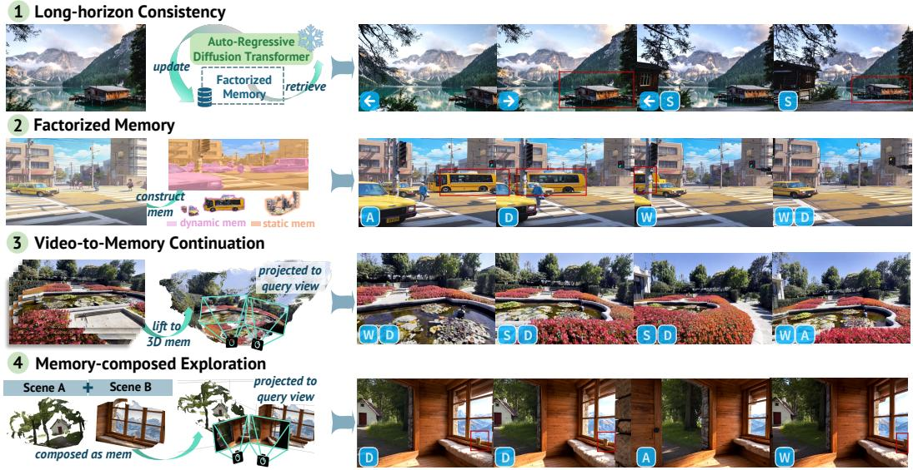  
Figure 1: (1) During autoregressive rollout, GROME progressively updates historical observations into a factorized memory and injects retrieved local evidence into a frozen video world model. (2) By decoupling static scene structures from dynamic entities, it ensures scene persistence while accommodating entity dynamics. (3) GROME also supports lifting real-world videos into factorized memory as plug-and-play references for controllable video continuation. (4) Multiple point clouds can be seamlessly composed as unified external memory for open-ended spatial exploration.

## ABSTRACT

Long-horizon consistency is essential for video world models, yet it becomes difficult to maintain once observed content falls outside the context window. Existing memory mechanisms either retrieve history as implicit context, which remains constrained by context capacity and entangles static and dynamic information or consolidate history into explicit global representations, which struggle to model evolving dynamics and accumulate geometric errors. To overcome these limitations, we introduce GROME, a novel factorized memory framework that augments video world models for long-horizon coherence across both static scenes and dynamic entities. GROME operates via three synergistic components: 1) Static-Dynamic Factorization decouples historical evidence into static and dynamic components, preserving static scene geometry and dynamic entity states separately; 2) Local Memory Retrieval selects spatially aligned static history to eliminate geometric drift alongside the latest dynamic entity states to ensure temporal continuity; 3) Training-Free Memory Injection seamlessly grounds the factorized memory into video world models via their native conditioning pathways.

Experiments on long-horizon revisit scenarios demonstrate that GROME substantially enhances scene persistence and dynamic entity fidelity over existing methods, all while preserving the visual quality and controllability of the frozen backbone without additional training. Beyond self-rollouts, GROME readily accommodates external observations as plug-and-play memory, unlocking flexible and controllable video continuation and scene exploration.

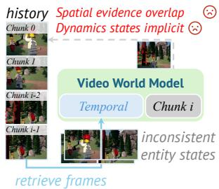  
(a) Implicit memory

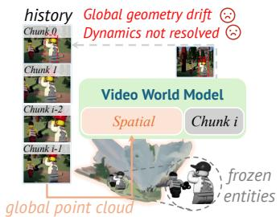  
(b) Explicit memory

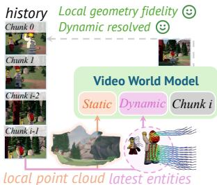  
(c) Factorized memory (ours)  
Figure 2: Comparison of memory paradigms. Implicit memory suffers from substantial scenecontent overlap and ambiguous in dynamic states, while explicit memory consolidates historical frames into a global 3D scene but struggles with evolving dynamic entities and accumulated geometric drift. GROME instead factorizes historical frames into static-dynamic memory, preserving both persistent static scene structure and evolving dynamic entities over long-horizon generation.

## 1 INTRODUCTION

Long-horizon consistency is essential for video world models. It ensures that the model preserves coherent internal world states across control inputs, thereby synthesizing geometrically and temporally consistent visual frames. This capability is pivotal for downstream applications spanning interactive entertainment and embodied AI (Zhu et al., 2025; Yang et al., 2023; Hu et al., 2023; Zhou et al., 2024; Kanervisto et al., 2025; He et al., 2026; Tang et al., 2025).

Existing studies on modeling long-horizon consistency broadly fall into two paradigms as shown in Fig. 2. Implicit memory methods (Yu et al., 2025a; Sun et al., 2025; Li et al., 2025b) maintain historical observations and retrieve relevant context, encouraging the model to implicitly learn geometric consistency. However, these methods are constrained by finite context windows, hindering their ability to retain all historical information necessary for continuous world evolution. Moreover, disentangling static content from dynamic variations solely from visual observations is inherently ill-posed and challenging, potentially inducing temporal inconsistencies over extended horizons.

Alternatively, explicit memory methods (Ren et al., 2025; Wu et al., 2026; Chen et al., 2025) reconstruct historical information into compact 3D representations, e.g., point clouds or 3D Gaussians, to sustain persistent memory. While these approaches model long-horizon geometric consistency more efficiently, they focus on reconstructing static scene content while neglecting dynamic world attributes. Consequently, they struggle to faithfully simulate time-varying environmental dynamic and entity motions. Moreover, due to compounding reconstruction errors and surface stratification artifacts over long horizons, maintaining a globally consistent explicit 3D representation becomes prohibitively difficult, ultimately failing to provide reliable guidance for subsequent world evolution. Therefore, video world models fundamentally require a coherent memory representation capable of preserving static scene content while adaptively retaining the evolving states of dynamic entities.

To bridge this gap, we introduce GROME, a novel factorized memory that explicitly disentangles static scene content from evolving dynamics, which can be injected into video world models in a training-free manner. Specifically, we propose Static-Dynamic Factorization, which performs per-chunk 3D reconstruction and decomposes the resulting pointmaps into static and dynamic components. To avoid the geometric drift caused by global consolidation, both types of components are stored as local pointmaps, preserving the geometric fidelity of observations over extended horizons. Under a bounded context budget, we present Local Memory Retrieval, which executes distinct retrieval strategies tailored to the characteristics of the two components. Static pointmaps are retrieved to maximize spatial coverage relative to target views and consolidated into reference views, thereby offering rich and consistent geometric context. To encourage the model to treat these references as invariant spatial anchors, we assign them the same temporal RoPE indices as the target views, effectively enforcing spatial consistency. In contrast, dynamic pointmaps are ranked by temporal recency, with only the latest dynamic evidence selected as the source for rendering target-view references. Here, we preserve their original temporal RoPE indices to maintain the causal temporal dynamics.

Furthermore, we introduce Training-Free Memory Injection to seamlessly integrate our factorized memory into video world models via their native conditioning pathways. Since our rendered reference inevitably contain unobserved and occluded regions, these contexts induces a noticeable distri butional mismatch with the backbone’s native feature space. Therefore, we employ Reference Value Adaptation, which dynamically modulates the rendered contexts within attention blocks, aligning their numerical statistics with the pretrained feature manifold. To prevent mutual interference between the static and dynamic streams, we design Static-Dynamic Disentangled Attention to register both memory contexts through separate attention pathways. Finally, we incorporate Timestep-Aware Memory Routing to dynamically schedule the relative influence of both memory components across diffusion denoising timesteps, enabling effective coarse-to-fine memory conditioning.

The resulting system equips video world models with a factorized memory mechanism for longhorizon autoregressive generation, enabling them to preserve static scene content and evolving dynamic entity states beyond the model’s finite context window without fine-tuning. Experiments on long-horizon revisit scenarios involving both static and dynamic scenes demonstrate the effectiveness of GROME. Across multiple LingBotV2 variants and representative memory-based baselines, GROME consistently improves revisit consistency and dynamic entity preservation while retaining the visual quality and controllability of the frozen backbone. Ablation studies further confirm that static-dynamic factorization, local memory retrieval, and training-free memory injection provide complementary benefits, together accounting for the improvements in long-horizon consistency.

## 2 RELATED WORK

Interactive Video World Models. Interactive video world models predict future visual observations conditioned on user actions (Wu et al., 2024; Wang et al., 2024a;b). Recent generative video world models have substantially improved visual fidelity and visual environment diversity (Agarwal et al., 2025; Ni et al., 2025; Yu et al., 2025b; Guo et al., 2025). Meanwhile, contemporary systems increasingly support real-time user exploration and richer multi-modal control (He et al., 2025; Mao et al., 2026; Ye et al., 2025; Gao et al., 2026; Xiang et al., 2025; Liao et al., 2026). Despite these remarkable advances, maintaining long-horizon consistency remains a critical challenge: under continuous action sequences, previously observed scene structure and evolving dynamic states inevitably degrade due to catastrophic forgetting once they exit the finite context window. To bridge this gap, GROME directly overcomes this limitation by augmenting frozen video world models with factorized static–dynamic memory in a training-free manner, faithfully preserving both persistent 3D structure and dynamic entities simultaneously over extended rollouts.

Memory for Long-Horizon World Modeling. To maintain long-horizon consistency beyond the finite context window, recent video world models increasingly introduce different memory mechanisms to preserve historical evidence. Existing approaches broadly follow two paradigms: implicit memory, which retrieves historical observations as model context, and explicit memory, which reconstructs history into persistent structured representations. Implicit memory methods directly reuse historical observations (Yu et al., 2025a; Li et al., 2025b); related methods further retrieve past observations or learned memory to extend effective context (Xiao et al., 2026; Yu et al., 2026a; Sun et al., 2025; Li et al., 2025a). These approaches retain direct visual evidence and improve access to history, but remain fundamentally bounded by the model’s finite context capacity, making it difficult to preserve all historical information required for continuous world evolution. Moreover, static scene structure and dynamic variations remain entangled in the retrieved visual context, leaving the model to implicitly infer which content should remain persistent and which should evolve over time. This ambiguity becomes increasingly difficult to resolve over long rollouts and can lead to temporal inconsistencies. Explicit memory methods (Team et al., 2026; Wang & He, 2026; Yu et al., 2026b) instead reconstruct history into persistent geometric representations. Gen3C (Ren et al., 2025) main tains a global 3D cache, while broader variants maintain geometric memory in 3D or latent spaces (Wu et al., 2026; Wang et al., 2026a). These representations provide more persistent geometric grounding, but largely emphasize stable scene content and remain challenged by evolving dynamic states (Wang et al., 2026b; Zhao et al., 2026). To address evolving dynamic states and cumulative geometric drift, GROME factorizes historical evidence into static and dynamic local memories, preserving persistent scene content and time-varying entity states without global consolidation.

## 3 METHOD

This section presents the core design of GROME (Fig. 3). We first formulate the problem by highlighting the bounded-context bottleneck in world models and our memory augmentation objective (Sec. 3.1). We then introduce Static-Dynamic Factorization to decouple history (Sec. 3.2), and execute Local Memory Retrieval via asymmetric policies (Sec. 3.3). Finally, to condition the frozen backbone without retraining, we apply Training-Free Memory Injection (Sec. 3.4). Together, these components ensure robust long-horizon consistency across rollouts.

## 3.1 PROBLEM FORMULATION

We consider a pretrained, action-conditioned video world model $\mathcal { F } _ { \theta }$ that autoregressively synthesizes future video rollouts. At step t, let $X _ { t }$ denote the generated video chunk and $a _ { t }$ the corresponding action conditioning (e.g., camera trajectory). Constrained by memory and computation, the frozen backbone retains only a bounded window of recent history:

$$
\mathcal { C } _ { t - 1 } = \left\{ X _ { i } \right\} _ { i = \operatorname* { m a x } ( 1 , t - L _ { \mathrm { c t x } } ) } ^ { t - 1 } , \qquad | \mathcal { C } _ { t - 1 } | \leq L _ { \mathrm { c t x } } ,\tag{1}
$$

where $L _ { \mathrm { c t x } }$ specifies the context capacity of the pretrained backbone.

The world model maps this active context into its native historical condition $\mathcal { R } _ { t } ^ { \mathrm { R C } }$ via an internal conditioning operator $\mathcal { H } ,$ , generating the next chunk as:

$$
\mathcal { R } _ { t } ^ { \mathrm { R C } } = \mathcal { H } ( \mathcal { C } _ { t - 1 } ) , \qquad X _ { t } = \mathcal { F } _ { \boldsymbol { \theta } } \left( a _ { t } , \mathcal { R } _ { t } ^ { \mathrm { R C } } \right) , \qquad \boldsymbol { \theta } \mathrm { f r o z e n . }\tag{2}
$$

During autoregressive rollout, observations older than $L _ { \mathrm { c t x } }$ steps are inevitably evicted from $\mathcal { C } _ { t - 1 }$ Consequently, $\mathcal { R } _ { t } ^ { \mathrm { R C } }$ loses historical grounding over extended horizons, leading to catastrophic forgetting of previously visited environments and inconsistent dynamic entity evolution. To overcome this bounded-context constraint without retraining the backbone, we formulate the objective as maintaining an external, persistent world memory $\mathcal { M } _ { t - 1 }$ across rollouts. At each step t, we reallocate a portion of the bounded context budget in $\mathbf { \mathcal { R } } _ { t } ^ { \mathrm { R C } }$ to host relevant evidence retrieved from $\mathcal { M } _ { t - 1 }$ thereby enabling long-horizon consistency within the native capacity of the frozen backbone $\mathcal { F } _ { \theta }$

## 3.2 STATIC-DYNAMIC FACTORIZATION

Static scene content remains largely persistent across observations, whereas dynamic entities may occupy different positions and states over time. Consequently, retaining only static content discards historical evidence of dynamic entities, while directly consolidating dynamic observations into a shared spatial representation can mix incompatible states from different times. To preserve both types of historical evidence, GROME factorizes historical evidence into two components,

$$
\mathcal { M } _ { t - 1 } = \left( \mathcal { M } _ { t - 1 } ^ { S } , \mathcal { M } _ { t - 1 } ^ { D } \right) ,\tag{3}
$$

where $\mathcal { M } _ { t - 1 } ^ { S }$ denotes static memory and $\mathcal { M } _ { t - } ^ { D }$ denotes dynamic memory. Static scene content is retained as spatially addressable evidence, while dynamic entities are stored separately with explicit temporal indexing. In this way, GROME preserves both persistent scene content and the timevarying states of dynamic entities, preventing mutual interference throughout long-horizon rollouts.

A separate challenge arises from long-term geometric accumulation. Depth estimated from generated observations inevitably contains errors, and repeatedly consolidating these observations into a persistent global point cloud can propagate such errors and progressively degrade the geometry of rendered references. Therefore, GROME retains both static and dynamic evidence as local pointmaps. This preserves the local geometric fidelity of individual observations while allowing them to be spatially composed only when required by future generation.

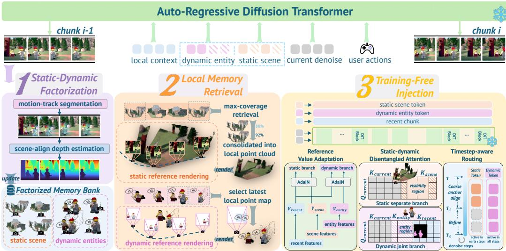  
Figure 3: Overview of GROME. GROME factorizes historical evidence into static scene and dynamic entity components. Both are retained over extended rollouts as local spatial memories, with the dynamic component further organized by explicit temporal indexing. Given a target camera trajectory, relevant historical evidence is separately retrieved from the static and dynamic components to render references. These static-dynamic references are then injected into the model’s native history-conditioning pathway through a set of training-free injection strategies, conditioning generation together with the local context and user actions. This allows GROME to better preserve consistency over long rollouts while maintaining generation quality and controllability.

Local 3D Observation Lifting. For each historical chunk $X _ { i }$ , we first apply motion-aware segmentation to separate static scene regions from dynamic content. Let $X _ { i , f }$ denote the f-th frame of chunk $X _ { i }$ . For each frame, we estimate its depth map and align it to the existing static memory using reliable static overlap. The aligned depth $D _ { i , f }$ is then back-projected into a local pointmap,

$$
P _ { i , f } = \Pi _ { D } ^ { - 1 } \left( X _ { i , f } , D _ { i , f } , K _ { i , f } \right) ,\tag{4}
$$

where $K _ { i , f }$ denotes the camera intrinsics. The corresponding motion-aware segmentation further separates $P _ { i , f }$ into a static pointmap $P _ { i , f } ^ { S }$ and a dynamic pointmap $P _ { i , f } ^ { D }$ . Each pointmap remains local to its source observation rather than being permanently fused with previous observations. Details of depth alignment and segmentation are provided in Appendix B.1.1 and Appendix B.1.2. Let $F _ { i }$ denote the frame-index set of chunk $X _ { i }$ , the two memory components retain local pointmaps with different indexing information:

$$
\begin{array} { r l } & { \mathcal { M } _ { t - 1 } ^ { S } = \left\{ ( P _ { i , f } ^ { S } , T _ { i , f } ) ~ \middle | ~ i < t , ~ f \in \mathcal { F } _ { i } , ~ P _ { i , f } ^ { S } ~ \mathrm { v a l i d } \right\} , } \\ & { \mathcal { M } _ { t - 1 } ^ { D } = \left\{ ( P _ { i , f } ^ { D } , T _ { i , f } , \tau _ { i , f } ) ~ \middle | ~ i < t , ~ f \in \mathcal { F } _ { i } , ~ P _ { i , f } ^ { D } ~ \mathrm { v a l i d } \right\} . } \end{array}\tag{5}
$$

where $T _ { i , f }$ provides spatial addressability for both memory components, while $\tau _ { i , f }$ additionally records the source temporal position of dynamic evidence.

## 3.3 LOCAL MEMORY RETRIEVAL

Retaining historical observations as local pointmaps avoids cumulative geometric drift, but causes the external memory to grow continuously over long rollouts, while the conditioning budget of the frozen backbone remains bounded. GROME therefore retrieves query-relevant evidence from the growing memory and renders references within a bounded context budget. Importantly, static and dynamic memories require different retrieval criteria: static observations provide complementary spatial coverage, whereas dynamic observations may represent competing states at different times.

Distinct Memory Retrieval. Given the target camera trajectory $q _ { t } ,$ , GROME retrieves the two memory components according to their distinct characteristics. For static scene memory, we select complementary local pointmaps using a max-coverage criterion (Wang et al., 2026b), favoring observations that provide additional coverage of the target views. The selected pointmaps are temporarily composed and projected to $q _ { t } .$ , yielding a static reference with rich spatial coverage while retaining the geometric fidelity of the original local observations.

For dynamic entity memory, only the latest dynamic evidence is selected as the source for targetview reference rendering. We denote the resulting references as

$$
\widetilde { \mathcal { M } } _ { t } = \left( \widetilde { \mathcal { M } } _ { t } ^ { S } , \widetilde { \mathcal { M } } _ { t } ^ { D } \right) ,\tag{6}
$$

where $\widetilde { \mathcal { M } } _ { t } ^ { S }$ and $\widetilde { \mathcal { M } } _ { t } ^ { D }$ denote the retrieved static and dynamic references, respectively. Details of retrieval and geometric projection are provided in Appendix B.1.3.

Spatiotemporal RoPE. Both static and dynamic references are rendered into the target views and use query-aligned spatial RoPE indices, while their temporal indices are assigned differently. To encourage the model to treat static references as invariant spatial anchors, we assign them the same temporal RoPE indices as the target views, following Wang & He (2026). Dynamic references, in contrast, are spatially aligned with the query views but still represent entity states observed at their source times. We therefore preserve their original temporal RoPE indices, preserving its causal temporal dynamics and preventing historical entity states from being interpreted as current observations.

## 3.4 TRAINING-FREE MEMORY INJECTION

## preserving its causal temporal dynamics and preventing

To incorporate the retrieved static-dynamic references into a frozen world model, GROME addresses three mismatches with the backbone’s native history-conditioning pathway: reference statistics, heterogeneous memory semantics, and timestep-dependent conditioning requirements.

Reference Value Adaptation. Although projection aligns historical evidence geometrically with the target views, references retrieved from distant observations may contain partial support and exhibit appearance statistics that differ from those of the recent rollout. Directly injecting such references can therefore introduce a distributional mismatch with the backbone’s native context features. GROME uses the retained recent context as an appearance anchor and aligns the value statistics of each memory stream before attention. For $m \in \{ S , D \}$

$$
\widehat V ^ { m } = \frac { V ^ { m } - \mu ( V ^ { m } ) } { \sigma ( V ^ { m } ) + \epsilon } \sigma ( V ^ { \mathrm { c t x } } ) + \mu ( V ^ { \mathrm { c t x } } ) , \qquad \bar { V } ^ { m } = ( 1 - \lambda _ { m } ) V ^ { m } + \lambda _ { m } \widehat V ^ { m } ,\tag{7}
$$

where $\mu ( \cdot )$ and $\sigma ( \cdot )$ are computed over valid memory tokens, and $\lambda _ { m }$ controls the alignment strength of each stream. Only the values are adapted, while the corresponding keys $K ^ { m }$ remain unchanged, preserving the original query–key correspondence.

Static-Dynamic Disentangled Attention. Static and dynamic references carry different spatial and temporal semantics: static memory provides dense scene-level support, whereas dynamic memory contains temporally indexed entity evidence. Normalizing both streams within a single attention distribution would force these heterogeneous references to compete for attention. We therefore inject them through two independently normalized attention branches. The dynamic branch jointly attends to current, recent-context, and dynamic-memory tokens, while the static branch attends to current and static-memory tokens, avoiding mutual interference between distinct memories.

Let $( K ^ { m } , V ^ { m } ) , m \in \{ \mathrm { c u r } , \mathrm { c t x } , D , S \}$ , denote the KV states of current, recent-context, dynamic, and static tokens, respectively, and let $Q ^ { \mathrm { c u r } }$ denote the current-token queries. Using the aligned memory values from Eq.( 7), the two branches are

$$
\begin{array} { r l } & { { \cal O } ^ { D } = \mathrm { S o f t m a x } \left( \frac { { \cal Q } ^ { \mathrm { c u r } } [ K ^ { \mathrm { c u r } } ; K ^ { \mathrm { c t x } } ; K ^ { D } ] ^ { \top } } { \sqrt { d _ { h } } } + [ B ^ { \mathrm { c u r } } ; 0 ; B ^ { D } ] \right) [ V ^ { \mathrm { c u r } } ; V ^ { \mathrm { c t x } } ; \bar { V } ^ { D } ] , } \\ & { { \cal O } ^ { S } = \mathrm { S o f t m a x } \left( \frac { { \cal Q } ^ { \mathrm { c u r } } [ K ^ { \mathrm { c u r } } ; K ^ { S } ] ^ { \top } } { \sqrt { d _ { h } } } + [ B ^ { \mathrm { c u r } } ; B ^ { S } ] \right) [ V ^ { \mathrm { c u r } } ; \bar { V } ^ { S } ] . } \end{array}\tag{8}
$$

Here, $B ^ { \mathrm { c u r } }$ preserves native causal attention, $B ^ { D }$ restricts dynamic attention according to both projected query support and valid dynamic keys, and $B ^ { S }$ masks invalid static keys while being shared across all current queries. The two branches are then fused via normalized linear blending.

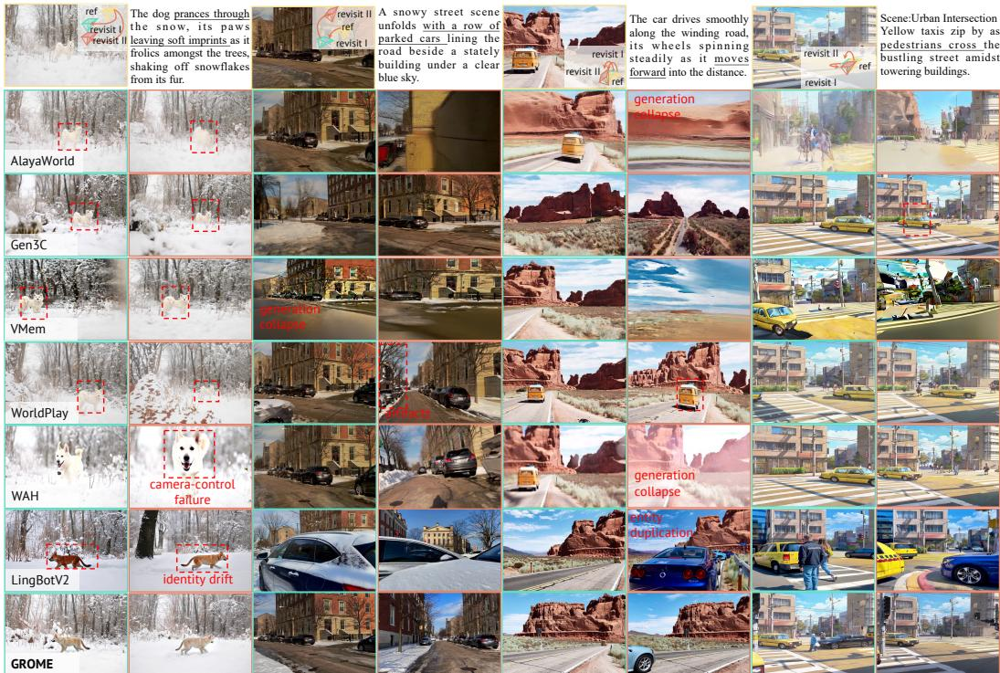  
Figure 4: Qualitative comparison. GROME better preserves revisit scene structure and entity consistency simultaneously across diverse revisit trajectories compared with existing world models.

Timestep-Aware Memory Routing. The two memory components contribute differently across the denoising trajectory. At early, high-noise timesteps, static references provide spatial and appearance anchors for establishing coarse scene structure, while dynamic references supply historical entity evidence for temporal continuity. As denoising progresses and the scene structure becomes established, continued static conditioning may over-constrain fine-grained visual refinement. GROME therefore activates both static and dynamic branches during early denoising, while retaining only the dynamic branch at later timesteps. This timestep-aware routing enables effective coarse-to-fine memory conditioning without modifying the pretrained backbone.

## 4 EXPERIMENTS

## 4.1 EXPERIMENTAL SETUP

Implementation Details. GROME operates as a training-free memory framework that enhances frozen world models for long-horizon consistency without any parameter updates. Both GROME and its controlled variants build upon LingBotV2 (Gao et al., 2026). Memory injection is deliberately scheduled across denoising: static scene references are injected solely during the first two denoising steps to establish global layout, whereas dynamic entity references remain active throughout denoising to ensure continuous temporal evolution. All external baselines strictly follow their official implementations and default sampling protocols on identical evaluation subsets. Complete architecture parameters and inference hyperparameters are detailed in Appendix C.

Evaluation Protocol and Metrics. We compare GROME with mainstream baselines under a uni fied long-horizon revisit protocol from three complementary aspects. The benchmark contains 200 WorldScore scenes (Duan et al., 2025), including 100 static and 100 dynamic scenes, with 15–18 s trajectories at 24 FPS. Long-horizon consistency is evaluated at matched revisit poses using PSNR, SSIM, and LPIPS. To assess the quality of generated videos, including subject preservation and dynamic behavior, we report Entity Consistency, Motion Accuracy, CLIP Aesthetic, and Subjective Quality. We further evaluate whether memory conditioning preserves camera and semantic con trollability using camera translation/rotation errors and Prompt Consistency. Dataset composition, trajectory construction, and metric implementations are detailed in Appendix C.

Table 1: Quantitative comparison on static and dynamic long-horizon revisit trajectories. LingBotV2RC denotes LingBotV2 with raw-context conditioning, while LingBot $\mathbf { V } 2 ^ { \mathrm { T R } ^ { \mathbf { v } } }$ denotes LingBotV2 with temporal retrieval. Values are reported as mean ± the half-width of the 95% paired bootstrap confidence intervals. Best and second-best values are shown in bold and underlined.
<table><tr><td></td><td colspan="3">Revisit Consistency</td><td colspan="2">Visual Quality</td><td colspan="2">Dynamic Quality</td><td colspan="3">Controllability</td></tr><tr><td>Model</td><td>PSNR ↑</td><td>SSIM↑</td><td>LPIPS ↓</td><td>CLIP Aesthetic ↑ Subjective Qual. ↑Entity Cons. ↑</td><td></td><td></td><td>Motion Acc. ↑</td><td>Trans. Err. ↓ Rot. Err. (°) ↓ Prompt Cons. ↑</td><td></td><td></td></tr><tr><td colspan="9">Static</td></tr><tr><td>Gen3C</td><td>21.725 ± 0.5582 0.749 ± 0.02030.173 ± 0.0140</td><td></td><td></td><td>5.334 ± 0.0874</td><td>0.469 ± 0.0264</td><td></td><td></td><td>0.420 ± 0.0513</td><td>3.878±0.6494</td><td>0.258 ± 0.0093</td></tr><tr><td>VMem</td><td>15.784 ± 0.5323 0.460 ± 0.02210.367 ± 0.0132</td><td></td><td></td><td>5.089 ± 0.0760</td><td>0.338 ± 0.0230</td><td>N/A N/A</td><td>N/A N/A</td><td>0.624 ± 0.4502</td><td>7.187 ± 1.0210</td><td>0.251 ± 0.0121</td></tr><tr><td>WAH</td><td>16.911 ± 0.6472 0.540 ± 0.0320 0.369 ± 0.0266</td><td></td><td></td><td>5.116 ± 0.0739</td><td>0.347 ± 0.0308</td><td>N/A</td><td>N/A</td><td>2.141 ± 0.7641</td><td>6.709 ± 1.3273</td><td>0.231 ± 0.0104</td></tr><tr><td>WorldPlay</td><td>16.087 ± 0.4921 0.465 ± 0.0236 0.289 ± 0.0139</td><td></td><td></td><td>5.265 ± 0.0869</td><td>0.404 ± 0.0265</td><td>N/A</td><td>N/A</td><td>0.471 ± 0.0504 6.391 ± 0.9905</td><td></td><td>0.260 ± 0.0090</td></tr><tr><td>AlayaWorld</td><td>15.367 ± 0.5238 0.487 ± 0.0340 0.443 ± 0.0272</td><td></td><td></td><td>4.911 ± 0.0745</td><td>0.263 ± 0.0247</td><td>N/A</td><td>N/A</td><td>0.766 ± 0.2868 7.829 ± 1.1486</td><td></td><td>0.241 ± 0.0105</td></tr><tr><td>LingBotV2RC</td><td>11.400 ± 0.3338 0.285 ± 0.0175 0.590 ± 0.0152</td><td></td><td></td><td> $5 . 3 5 5 \pm 0 . 0 7 4 0$ </td><td>0.558 ± 0.0263</td><td>N/A</td><td>N/A</td><td>1.620 ± 0.4639 12.156 ± 1.1314</td><td></td><td>0.269 ± 0.0084</td></tr><tr><td>LingBotV2TR</td><td>12.805 ± 0.2783 0.291 ± 0.0180 0.597 ± 0.0097</td><td></td><td></td><td>5.278 ± 0.0617</td><td>0.514 ± 0.0248</td><td>N/A</td><td>N/A</td><td>1.143 ± 0.2427 15.698 ± 6.2615</td><td></td><td>0.265 ± 0.0086</td></tr><tr><td>GROME</td><td>20.620 ± 0.41960.652 ± 0.02660.169 ± 0.0178</td><td></td><td></td><td>5.436 ± 0.0890</td><td>0.581 ± 0.0305</td><td>N/A</td><td>N/A</td><td>0.401 ± 0.0368</td><td>3.984 ± 0.8028</td><td>0.270 ± 0.0092</td></tr><tr><td colspan="9">Dynamic</td><td></td></tr><tr><td>Gen3C</td><td></td><td></td><td></td><td>5.037 ± 0.1293</td><td>0.473 ± 0.0476</td><td>0.841 ± 0.0125</td><td>-38.560 ± 25.0853 |0.417 ± 0.0238</td><td></td><td>0.835 ± 0.5012</td><td>0.213 ± 0.0113</td></tr><tr><td>VMem</td><td>22.183 ± 1.3030 0.696 ± 0.0415 0.259 ± 0.0226 17.448 ± 1.6641 0.551 ± 0.0226 0.349 ± 0.0329</td><td></td><td></td><td>4.916 ± 0.2246</td><td>0.313 ± 0.0840</td><td>0.461 ± 0.0253</td><td>-2.324 ± 25.6885</td><td>1.242 ± 0.5574</td><td>9.336 ± 6.2733</td><td>0.203 ± 0.0312</td></tr><tr><td>WAH</td><td>23.423 ± 1.4130 0.703 ± 0.0143 0.259 ± 0.0125</td><td></td><td></td><td>4.999 ± 0.1348</td><td>0.406 ± 0.0527</td><td>0.748 ± 0.0155</td><td>14.475 ± 3.5071</td><td>3.090 ± 3.1861</td><td>2.568 ±2.1433</td><td>0.219 ± 0.0106</td></tr><tr><td>WorldPlay</td><td>23.870 ± 1.01170.654 ± 0.03370.249 ± 0.0179</td><td></td><td></td><td>5.120 ± 0.1481</td><td>0.492 ± 0.0541</td><td>0.910 ± 0.0113</td><td>-2.883 ± 12.2510</td><td>0.695 ± 0.0106 0.963 ± 0.4839</td><td></td><td>0.214 ± 0.0104</td></tr><tr><td>AlayaWorld</td><td>22.479 ± 1.2827 0.656 ± 0.0377 0.332 ± 0.0265</td><td></td><td></td><td>4.778 ± 0.1282</td><td>0.321 ± 0.0543</td><td>0.764 ± 0.0240</td><td>-15.656 ± 6.0129</td><td>1.887 ± 1.6161 10.420 ± 7.3239</td><td></td><td>0.207 ± 0.0150</td></tr><tr><td>LingBotV2RC</td><td>19.291 ± 0.9170 0.638 ± 0.0320 0.403 ± 0.0284</td><td></td><td></td><td> $5 . 1 9 9 \pm 0 . 1 0 5 2$ </td><td>0.557 ± 0.0358</td><td>0.717 ± 0.0191</td><td>16.640 ± 16.1201</td><td>2.160 ± 1.5836 4.561 ± 1.6069</td><td></td><td>0.227 ± 0.0114</td></tr><tr><td>LingBotV2TR</td><td>21.243 ± 1.0685 0.700 ± 0.0257 0.312 ± 0.0290</td><td></td><td></td><td>5.259 ± 0.1069 5.274 ± 0.1047</td><td>0.415 ± 0.0419 0.585 ± 0.0481</td><td>0.691 ± 0.0234</td><td>14.222 ± 12.2639</td><td>3.681 ± 2.3274 7.084 ± 1.8285</td><td></td><td>0.224 ± 0.0105</td></tr><tr><td>GROME</td><td>24.111±0.9633 0.717±0.0437 0.243±0.0263</td><td></td><td></td><td></td><td></td><td>0.769 ± 0.0274</td><td>16.840 ± 14.6834</td><td>0.498 ± 0.10410.759 ± 0.5400</td><td></td><td>0.230 ± 0.0130</td></tr></table>

## 4.2 MAIN RESULTS AND ANALYSIS

Quality Results. As illustrated in Fig. 4, existing world models exhibit distinct trade-offs across long-horizon revisits, dynamic entity consistency, and trajectory controllability. While Gen3C and WorldPlay preserve plausible appearance consistency for dynamic subjects, their motion tends to freeze over extended horizons. Conversely, WAH sustains dynamic motion but struggles to strictly follow the intended camera trajectory, leading to degraded camera controllability during revisits. LingBotV2 demonstrates competitive camera tracking and dynamic motion; however, over extended rollouts, its dynamic entities suffer from notable drift, while the model frequently hallucinates spurious or duplicate objects (e.g., redundant cars), thereby degrading visual coherence and deviating from the prompt. In contrast, GROME effectively balances these competing objectives: it retains consistent scene geometry upon revisits, preserves persistent dynamic entities with continuous motion, and faithfully adheres to both the target camera trajectory and text prompt.

Quantitative Results. Table 1 evaluates GROME against representative world modeling baselines. Notably, existing methods struggle with a dilemma between long-horizon revisit consistency and motion dynamics, whereas GROME offers a better joint trade-off between them. While Gen3C and WorldPlay achieve high entity consistency, they yield severely negative motion accuracy. This exposes a fundamental failure mode in coupled spatial representations: to enforce scene persistence, their coupled representations can collapse dynamic entities into static or frozen textures. In contrast, GROME achieves positive motion accuracy while preserving high entity consistency, demonstrating that factorizing historical observations into decoupled static and dynamic components prevents environmental persistence from penalizing dynamic motion. To verify that these gains stem specifically from factorized memory rather than backbone capacity or conditioning budgets, we benchmark against LingBotV2RC and LingBotV2TR under the same architecture. On static scenes, naive temporal retrieval only marginally improves PSNR, as unconstrained temporal retrieval struggles to resolve geometric ambiguities across wide baselines. Conversely, GROME significantly elevates PSNR and markedly improves camera controllability. On dynamic scenes, GROME consistently outperforms retrieval baselines in rendering fidelity and revisit consistency. These controlled comparisons on LingBotV2 confirm the superiority of GROME, showing that long-horizon world modeling requires structured static-dynamic factorization rather than simple historical access.

## 4.3 ABLATION STUDY

Static-Dynamic Factorization. Removing the static component substantially lowers PSNR and increases camera rotation error, showing that persistent scene evidence provides the geometric constraints required to recover previously observed views. Removing the dynamic component instead reduces entity consistency while maintaining relatively low camera errors, indicating that scene geometry alone cannot preserve evolving entities over long rollouts. These complementary effects show that GROME preserves static scene structure and dynamic entities through factorized but co operative memory components over extended autoregressive generation horizons.

Table 2: Quantitative ablation on Static-Dynamic Factorization and Injection across 50 scenes.
<table><tr><td></td><td colspan="3">Revisit Consistency</td><td colspan="2">Visual Quality</td><td colspan="2">Dynamic Quality</td><td colspan="3">Controllability</td></tr><tr><td>Setting</td><td>PSNR ↑</td><td>SSIM↑</td><td>LPIPS ↓</td><td>CLIP Aesthetic ↑ Subjective Qual. ↑|Entity Cons. ↑</td><td></td><td></td><td>Motion Acc. ↑</td><td>Trans. Err. ↓</td><td>Rot. Err. (°) ↓ Prompt Cons. ↑</td><td></td></tr><tr><td>LingBotV2RC</td><td>15.505 ± 3.1742 0.456 ± 0.0418 0.500 ± 0.0147</td><td></td><td></td><td>5.247 ± 0.2950</td><td> $0 . 5 7 2 \pm 0 . 0 8 7 5$ </td><td>0.711 ± 0.0482</td><td>16.333 ± 13.4337</td><td>1.903 ± 1.2061</td><td>8.391 ± 1.2254</td><td>0.247 ± 0.0103</td></tr><tr><td>Joint Attention.</td><td>5.470 ± 0.8511</td><td>0.203 ± 0.0115 0.533 ± 0.0739</td><td></td><td> $4 . 4 1 7 \pm 0 . 0 2 7 5$ </td><td>0.153 ± 0.0430</td><td>0.641 ± 0.0170</td><td>10.987 ± 17.7273</td><td>2.573 ± 0.1557</td><td>8.834 ± 3.4000</td><td>0.224 ± 0.0142</td></tr><tr><td>w/o Static</td><td>18.512 ± 2.9186 0.609 ± 0.0471 0.323 ± 0.0152</td><td></td><td></td><td> $5 . 3 0 9 \pm 0 . 3 9 8 7$ </td><td> $0 . 5 6 6 \pm 0 . 1 1 9 9$ </td><td>0.735 ± 0.0160</td><td>15.709 ± 12.6554</td><td>1.586 ± 0.0388</td><td>7.252 ± 0.4953</td><td>0.247 ± 0.0111</td></tr><tr><td>w/o Dynamic</td><td>19.542 ± 3.2823</td><td>0.640 ± 0.0354 0.270 ± 0.0104</td><td></td><td> $\overline { { 5 . 2 3 1 \pm 0 . 3 2 1 4 } }$ </td><td> $0 . 5 5 0 \pm 0 . 0 4 6 4$ </td><td>0.609 ± 0.0216</td><td>15.430 ± 11.5595</td><td>0.450 ± 0.1339</td><td>2.867 ± 3.5811</td><td>0.244 ± 0.0098</td></tr><tr><td>w/o Ref. Adapt</td><td>6.344 ± 2.7415</td><td>0.233 ± 0.0446</td><td> $\overline { { 0 . 4 7 5 \pm 0 . 0 1 3 8 } } \vert$ </td><td> $4 . 5 2 4 \pm 0 . 3 6 8 2$ </td><td> $0 . 2 0 8 \pm 0 . 1 0 8 2$ </td><td>0.682 ± 0.0120</td><td>14.135 ± 12.5521</td><td>0.468 ± 0.0339</td><td>2.695 ± 0.4918</td><td>0.242 ± 0.0124</td></tr><tr><td>Static at all Steps</td><td>16.003 ± 3.2694 0.576 ± 0.1112 0.317 ± 0.0133</td><td></td><td></td><td> $5 . 0 6 6 \pm 0 . 0 3 4 4$ </td><td> $0 . 5 1 5 \pm 0 . 1 1 6 2$ </td><td>0.685 ± 0.0296</td><td>14.507 ± 13.2834</td><td>0.413 ± 0.0587</td><td>2.645 ± 3.5399</td><td>0.245 ± 0.0107</td></tr><tr><td>Full GROME</td><td>23.838 ± 2.5864 0.743 ± 0.0382 0.189 ± 0.0119</td><td></td><td></td><td>5.352 ± 0.1216</td><td>0.598 ± 0.0412</td><td></td><td>0.749 ± 0.0148 16.872 ±12.3846 0.363 ± 0.0315</td><td></td><td>2.320 ± 0.4627</td><td>0.251 ± 0.0113</td></tr></table>

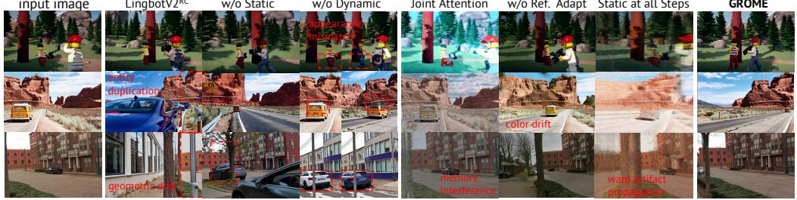  
Figure 5: Qualitative ablation of GROME. Static-dynamic factorization and three injection strategies demonstrate their complementary roles in maintaining static scene and evolving entity states.

Training-Free Memory Injection. Na¨ıvely injecting static and dynamic references through a shared attention pathway yields substantially lower PSNR than the full model, showing that additional historical evidence alone is insufficient. Removing Reference Value Adaptation further degrades PSNR and causes severe appearance mismatch between projected references and native context, which can accumulate over autoregressive rollout and destabilize generation (Figure 5). Likewise, injecting static references throughout denoising lowers PSNR, as geometric and warping errors persist into refinement; Timestep-Aware Memory Routing restricts static guidance to coarse structure formation. Together, these results demonstrate the complementary roles of these strategies.

Local Retrieval vs. Global Consolidation. As shown in Fig. 6, repeatedly consolidating observations into a global cache accumulates geometric errors, producing visible drift in both rendered references and generated frames. In contrast, local retrieval preserves the geometry of individual observations and composes them only when needed, yielding more stable references and subsequent generation over rollouts.

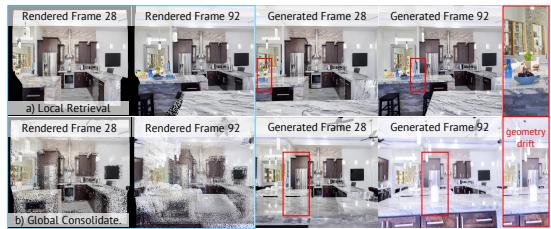  
Figure 6: Local retrieval vs. Global consolidation.

## 4.4 APPLICATIONS

Benefiting from its persistent static-dynamic memory and long-horizon consistency, GROME enables several downstream applications, as shown in Fig. 7. First, it can initialize memory directly from an input video and continue generation along a user-specified trajectory, allowing the rollout to explore beyond the observed region and later revisit previously observed content. Moreover, the explicit world-space memory provides an editable spatial interface, enabling scene elements to be recomposed before generation and subsequently explored along novel trajectories while preserving the imposed spatial layout.

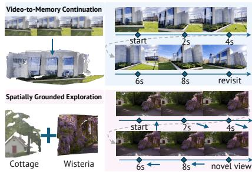  
Figure 7: Applications of GROME.

## 5 CONCLUSION

GROME is a memory framework that grounds factorized memory into frozen video model through distinct retrieval and training-free injection strategies. Experimental results demonstrate that GROME significantly boosting revisit consistency over long rollouts. Moreover, GROME supports video-to-memory continuation and spatial scene editing, highlighting how structured explicit memory empowers models to remember, revisit, and evolve coherent worlds over extended horizons.

## ETHICS STATEMENT

This work follows the ICLR Code of Ethics. Our study concerns memory mechanisms for video world models, evaluated on static and dynamic trajectories based on scenes in WorldScore (2025). Generated videos are synthetic simulations and should not be presented as verified recordings of real events. GROME may inherit biases and limitations from its frozen backbone and auxiliary models. Use and redistribution of benchmark data, frozen models, and real-world video inputs remain subject to their original licenses and applicable privacy requirements.

## REPRODUCIBILITY STATEMENT

GROME operates at inference time on a frozen LingBotV2 backbone and requires no additional training. Section 3 describes the static-dynamic memory factorization, local memory retrieval and training-free injection. Appendix B.1 details depth alignment, static-dynamic decomposition, and distinct memory retrieval policies. Algorithm 1 summarizes the inference procedure. Section 4.1 specifies the WorldScore evaluation subset, revisit protocols, and reported metrics to support replication of the evaluation.

## AI USE STATEMENT

We used large language models to polish the manuscript, including rephrasing sentences, correcting grammar, and improving readability and flow. The authors reviewed and edited the AI-assisted text to ensure that it accurately reflects the methods, experiments, and results, and take full responsibility for the content of the manuscript.

## REFERENCES

Niket Agarwal, Arslan Ali, Maciej Bala, Yogesh Balaji, Erik Barker, Tiffany Cai, Prithvijit Chattopadhyay, Yongxin Chen, Yin Cui, Yifan Ding, et al. Cosmos world foundation model platform for physical ai. arXiv preprint arXiv:2501.03575, 2025.

Nicolas Carion, Laura Gustafson, Yuan-Ting Hu, Shoubhik Debnath, Ronghang Hu, D´ıdac Sur´ıs, Chaitanya K. Ryali, Kalyan Vasudev Alwala, Haitham Khedr, Andrew Huang, Jie Lei, Tengyu Ma, Baishan Guo, Arpit Kalla, Markus Marks, Joseph Greer, Meng Wang, Peize Sun, Roman Radle, Triantafyllos Afouras, Effrosyni Mavroudi, Katherine Xu, Tsung-Han Wu, Yu Zhou, Lil-¨ iane Momeni, Rishi Hazra, Shuangrui Ding, Sagar Vaze, Francois Porcher, Feng Li, Siyuan Li, Aishwarya Kamath, Ho Kei Cheng, Piotr Doll’ar, Nikhila Ravi, Kate Saenko, Pengchuan Zhang, and Christoph Feichtenhofer. Sam 3: Segment anything with concepts. ArXiv, abs/2511.16719, 2025.

Yabo Chen, Yuanzhi Liang, Jiepeng Wang, Tingxi Chen, Junfei Cheng, Zixiao Gu, Yuyang Huang, Zicheng Jiang, Wei Li, Tian Li, et al. Teleworld: Towards dynamic multimodal synthesis with a 4d world model. arXiv preprint arXiv:2601.00051, 2025.

Haoyi Duan, Hong-Xing Yu, Sirui Chen, Li Fei-Fei, and Jiajun Wu. Worldscore: A unified evaluation benchmark for world generation. In Proceedings of the IEEE/CVF international conference on computer vision, pp. 27713–27724, 2025.

Zelin Gao, Qiuyu Wang, Jiapeng Zhu, Jingye Chen, Zichen Liu, Qingyan Bai, Jiahao Wang, Yufeng Yuan, Hanlin Wang, Yichong Lu, et al. Infinite worlds with versatile interactions. arXiv preprint arXiv:2607.07534, 2026.

Junliang Guo, Yang Ye, Tianyu He, Haoyu Wu, Yushu Jiang, Tim Pearce, and Jiang Bian. Mineworld: a real-time and open-source interactive world model on minecraft. arXiv preprint arXiv:2504.08388, 2025.

Haoran He, Yang Zhang, Liang Lin, Zhongwen Xu, and Ling Pan. Pre-trained video generative models as world simulators. In Proceedings of the AAAI Conference on Artificial Intelligence, volume 40, pp. 4645–4653, 2026.

Xianglong He, Chunli Peng, Zexiang Liu, Boyang Wang, Yifan Zhang, Qi Cui, Fei Kang, Biao Jiang, Mengyin An, Yangyang Ren, et al. Matrix-game 2.0: An open-source real-time and streaming interactive world model. arXiv preprint arXiv:2508.13009, 2025.

Anthony Hu, Lloyd Russell, Hudson Yeo, Zak Murez, George Fedoseev, Alex Kendall, Jamie Shotton, and Gianluca Corrado. Gaia-1: A generative world model for autonomous driving. arXiv preprint arXiv:2309.17080, 2023.

Ziqi Huang, Yinan He, Jiashuo Yu, Fan Zhang, Chenyang Si, Yuming Jiang, Yuanhan Zhang, Tianxing Wu, Qingyang Jin, Nattapol Chanpaisit, et al. Vbench: Comprehensive benchmark suite for video generative models. In 2024 IEEE/CVF Conference on Computer Vision and Pattern Recognition (CVPR), pp. 21807–21818. IEEE, 2024.

Anssi Kanervisto, Dave Bignell, Linda Yilin Wen, Martin Grayson, Raluca Georgescu, Sergio Valcarcel Macua, Shan Zheng Tan, Tabish Rashid, Tim Pearce, Yuhan Cao, et al. World and human action models towards gameplay ideation. Nature, 638(8051):656–663, 2025.

Nikita Karaev, Ignacio Rocco, Benjamin Graham, Natalia Neverova, Andrea Vedaldi, and Christian Rupprecht. Cotracker: It is better to track together. In European conference on computer vision, pp. 18–35. Springer, 2024.

Jiaqi Li, Junshu Tang, Zhiyong Xu, Longhuang Wu, Yuan Zhou, Shuai Shao, Tianbao Yu, Zhiguo Cao, and Qinglin Lu. Hunyuan-gamecraft: High-dynamic interactive game video generation with hybrid history condition. arXiv preprint arXiv:2506.17201, 2(3):6, 2025a.

Runjia Li, Philip Torr, Andrea Vedaldi, and Tomas Jakab. Vmem: Consistent interactive video scene generation with surfel-indexed view memory. In 2025 IEEE/CVF International Conference on Computer Vision (ICCV), pp. 25690–25699. IEEE, 2025b.

Yue Liao, Pengfei Zhou, Siyuan Huang, Donglin Yang, Shengcong Chen, Yuxin Jiang, Yue Hu, Si Liu, Jianlan Luo, Liliang Chen, et al. Genie envisioner: A unified world foundation platform for robotic manipulation. In International Conference on Learning Representations, volume 2026, pp. 88446–88463, 2026.

Haotong Lin, Sili Chen, Junhao Liew, Donny Y Chen, Zhenyu Li, Guang Shi, Jiashi Feng, and Bingyi Kang. Depth anything 3: Recovering the visual space from any views. arXiv preprint arXiv:2511.10647, 2025.

Xiaofeng Mao, Zhen Li, Chuanhao Li, Xiaojie Xu, Kaining Ying, and Kaipeng Zhang. Yume1.5: A text-controlled interactive world generation model. In Proceedings of the IEEE/CVF Conference on Computer Vision and Pattern Recognition, pp. 7752–7761, 2026.

Jingcheng Ni, Yuxin Guo, Yichen Liu, Rui Chen, Lewei Lu, and Zehuan Wu. Maskgwm: A generalizable driving world model with video mask reconstruction. In 2025 IEEE/CVF Conference on Computer Vision and Pattern Recognition (CVPR), pp. 22381–22391. IEEE, 2025.

Xuanchi Ren, Tianchang Shen, Jiahui Huang, Huan Ling, Yifan Lu, Merlin Nimier-David, Thomas Muller, Alexander Keller, Sanja Fidler, and Jun Gao. Gen3c: 3d-informed world-consistent video¨ generation with precise camera control. In 2025 IEEE/CVF Conference on Computer Vision and Pattern Recognition (CVPR), pp. 6121–6132. IEEE, 2025.

Wenqiang Sun, Haiyu Zhang, Haoyuan Wang, Junta Wu, Zehan Wang, Zhenwei Wang, Yunhong Wang, Jun Zhang, Tengfei Wang, and Chunchao Guo. Worldplay: Towards long-term geometric consistency for real-time interactive world modeling. arXiv preprint arXiv:2512.14614, 2025.

Junshu Tang, Jiacheng Liu, Jiaqi Li, Longhuang Wu, Haoyu Yang, Penghao Zhao, Siruis Gong, Xiang Yuan, Shuai Shao, Linfeng Zhang, et al. Hunyuan-gamecraft-2: Instruction-following interactive game world model. arXiv preprint arXiv:2511.23429, 2025.

AlayaWorld Team, Kaipeng Zhang, Chuanhao Li, Yifan Zhan, Yongtao Ge, Yuanyang Yin, Jiaming Tan, Kang He, Liaoyuan Fan, Ruicong Liu, et al. Alayaworld: Long-horizon and playable video world generation. arXiv preprint arXiv:2607.06291, 2026.

Weijie Wang, Haoyu Zhao, Yifan Yang, Feng Chen, Zeyu Zhang, Yefei He, Zicheng Duan, Donny Y Chen, Yuqing Yang, and Bohan Zhuang. Latent spatial memory for video world models. arXiv preprint arXiv:2606.09828, 2026a.

Xiaofeng Wang, Zheng Zhu, Guan Huang, Xinze Chen, Jiagang Zhu, and Jiwen Lu. Drivedreamer: Towards real-world-drive world models for autonomous driving. In European conference on computer vision, pp. 55–72. Springer, 2024a.

Yifan Wang and Tong He. Warp-as-history: Generalizable camera-controlled video generation from one training video. arXiv preprint arXiv:2605.15182, 2026.

Yuqi Wang, Jiawei He, Lue Fan, Hongxin Li, Yuntao Chen, and Zhaoxiang Zhang. Driving into the future: Multiview visual forecasting and planning with world model for autonomous driving. In 2024 IEEE/CVF Conference on Computer Vision and Pattern Recognition (CVPR), pp. 14749– 14759. IEEE, 2024b.

Zhou Wang, Alan C Bovik, Hamid R Sheikh, and Eero P Simoncelli. Image quality assessment: from error visibility to structural similarity. IEEE transactions on image processing, 13(4):600– 612, 2004.

Zun Wang, Han Lin, Jaehong Yoon, Jaemin Cho, Yue Zhang, and Mohit Bansal. Anchorweave: World-consistent video generation with retrieved local spatial memories. arXiv preprint arXiv:2602.14941, 2026b.

Jialong Wu, Shaofeng Yin, Ningya Feng, Xu He, Dong Li, Jianye Hao, and Mingsheng Long. ivideogpt: Interactive videogpts are scalable world models. Advances in Neural Information Processing Systems, 37:68082–68119, 2024.

Tong Wu, Shuai Yang, Ryan Po, Yinghao Xu, Ziwei Liu, Dahua Lin, and Gordon Wetzstein. Video world models with long-term spatial memory. Advances in Neural Information Processing Systems, 38:49371–49393, 2026.

Jiannan Xiang, Yi Gu, Zihan Liu, Zeyu Feng, Qiyue Gao, Yiyan Hu, Benhao Huang, Guangyi Liu, Yichi Yang, Kun Zhou, et al. Pan: A world model for general, interactable, and long-horizon world simulation. arXiv preprint arXiv:2511.09057, 2025.

Zeqi Xiao, Yushi Lan, Yifan Zhou, Wenqi Ouyang, Shuai Yang, Yanhong Zeng, and Xingang Pan. Worldmem: Long-term consistent world simulation with memory. Advances in Neural Information Processing Systems, 38:49632–49652, 2026.

Sherry Yang, Yilun Du, Kamyar Ghasemipour, Jonathan Tompson, Leslie Kaelbling, Dale Schuurmans, and Pieter Abbeel. Learning interactive real-world simulators. arXiv preprint arXiv:2310.06114, 2023.

Deheng Ye, Fangyun Zhou, Jiacheng Lv, Jianqi Ma, Jun Zhang, Junyan Lv, Junyou Li, Minwen Deng, Mingyu Yang, Qiang Fu, et al. Yan: Foundational interactive video generation. arXiv preprint arXiv:2508.08601, 2025.

Jiwen Yu, Jianhong Bai, Yiran Qin, Quande Liu, Xintao Wang, Pengfei Wan, Di Zhang, and Xi hui Liu. Context as memory: Scene-consistent interactive long video generation with memory retrieval. In Proceedings of the SIGGRAPH Asia 2025 Conference Papers, pp. 1–11, 2025a.

Jiwen Yu, Yiran Qin, Xintao Wang, Pengfei Wan, Di Zhang, and Xihui Liu. Gamefactory: Creating new games with generative interactive videos. In 2025 IEEE/CVF International Conference on Computer Vision (ICCV), pp. 11590–11599. IEEE, 2025b.

Jiwen Yu, Jianxiong Gao, Jianhong Bai, Yiran Qin, Kaiyi Huang, Quande Liu, Xintao Wang, Pengfei Wan, Kun Gai, and Xihui Liu. Memlearner: Learning to query context memory for video world models. arXiv preprint arXiv:2606.31734, 2026a.

Wei Yu, Runjia Qian, Yumeng Li, Liquan Wang, Songheng Yin, Dennis Anthony, Yang Ye, Yidi Li, Weiwei Wan, Animesh Garg, et al. Mosaicmem: Hybrid spatial memory for controllable video world models. arXiv preprint arXiv:2603.17117, 2026b.

Richard Zhang, Phillip Isola, Alexei A Efros, Eli Shechtman, and Oliver Wang. The unreasonable effectiveness of deep features as a perceptual metric. In 2018 IEEE/CVF conference on computer vision and pattern recognition, pp. 586–595. IEEE, 2018.

Jinjing Zhao, Fangyun Wei, Zhening Liu, Hongyang Zhang, Chang Xu, and Yan Lu. Spatia: Video generation with updatable spatial memory. In Proceedings of the IEEE/CVF Conference on Computer Vision and Pattern Recognition, pp. 4245–4257, 2026.

Siyuan Zhou, Yilun Du, Jiaben Chen, Yandong Li, Dit-Yan Yeung, and Chuang Gan. Robodreamer: Learning compositional world models for robot imagination. arXiv preprint arXiv:2404.12377, 2024.

Fangqi Zhu, Hongtao Wu, Song Guo, Yuxiao Liu, Chilam Cheang, and Tao Kong. Irasim: A finegrained world model for robot manipulation. In 2025 IEEE/CVF International Conference on Computer Vision (ICCV), pp. 9834–9844. IEEE, 2025.

## CONTENTS

1 Introduction 2   
2 Related Work 3   
3 Method 4   
3.1 Problem Formulation . 4   
3.2 Static-Dynamic Factorization 4   
3.3 Local Memory Retrieval 5   
3.4 Training-Free Memory Injection 6   
4 Experiments 7   
4.1 Experimental Setup 7   
4.2 Main Results and Analysis 8   
4.3 Ablation Study 8   
4.4 Applications . 9   
5 Conclusion 10   
A Overview of Supplementary Material 16   
B Additional method details 16   
B.1 Static-Dynamic Memory Factorization . 16   
B.2 Generation configuration 18   
C Evaluation Protocol 18   
C.1 Baseline Models . 18   
C.2 Evaluation Set Construction 19   
C.3 Long-horizon Trajectory Design 20   
C.4 Evaluation Metrics 20   
D Efficiency and Runtime Analysis 21   
E More Results 23   
E.1 Complex-Memory Revisit 23   
E.2 Long-Horizon Qualitative Comparison . 28   
E.3 Additional Application Cases . 28   
E.4 Robustness to Imperfect Geometric Projection . 32   
F Limitations and Failure Cases 32

## A OVERVIEW OF SUPPLEMENTARY MATERIAL

This supplementary material provides implementation details, extended analyses, and additional experimental results to complement the main paper.

Specifically, we elaborate on:

• Methodological Details (Sec. B.1): static-dynamic memory factorization, local memory retrieval, and training-free injection.

• Experimental Setup (Sec. C): benchmark curation, baselines, and evaluation protocols.

• Extended Results (Secs. D, E.1, and E.2): runtime efficiency, complex-memory revisits, long-horizon comparisons, and additional qualitative analyses.

• Downstream Applications & Limitations (Secs. E.3 and F): real-world video continuation, spatially guided exploration, and failure cases.

In addition, interactive video demonstrations are provided in the supplementary package. Readers are invited to unzip the folder and open index.html in a web browser to view animated examples of long-horizon revisit consistency, dynamic entity evolution, and interactive exploration showcased in the paper.

## B ADDITIONAL METHOD DETAILS

Algorithm 1 GROME inference overview.   
Require: Frozen world model ${ \mathcal { F } } _ { \theta } .$ , initial frame $X _ { 0 } .$ , action sequence $\left\{ { { a } _ { t } } \right\}$   
Ensure: Long-horizon generated rollout   
1: Initialize active context $\mathcal { R } ^ { \mathrm { c t x } }$ and factorized memory $\mathcal { M } = ( \mathcal { M } ^ { S } , \mathcal { M } ^ { D } )$   
2: for each generation step t do   
3: Project $\mathcal { M } _ { t - 1 }$ along the target camera trajectory $q _ { t } .$ , combining static evidence and resolving   
overlapping dynamic evidence by recency   
4: Encode the projected historical references and condition the frozen model through separate   
attention branches   
5: Generate chunk $X _ { t }$   
6: Separate $X _ { t }$ into static scene content and dynamic entities and store their local pointmaps in   
$\mathcal { M } _ { t }$   
7: Update active context with the newest generated frames   
8: end for   
9: return generated rollout

At generation step $t ,$ the model reads the factorized memory $\mathcal { M } _ { t - 1 }$ , projects it along the target camera trajectory $q _ { t } ,$ and uses the resulting references to generate chunk $X _ { t } .$ . After generation, the frames of $X _ { t }$ are processed and added to $\mathcal { M } _ { t }$ for later steps.

## B.1 STATIC-DYNAMIC MEMORY FACTORIZATION

This section expands the memory construction in Sec. 3. GROME processes generated frames, aligns their estimated depth to the static component of factorized memory, and partitions the result ing spatial content into static scene regions and dynamic entity regions.

## B.1.1 DEPTH ALIGNMENT ACROSS CHUNKS

For each generated chunk X , GROME predicts a metric monocular depth map $\hat { D } _ { t , f }$ for each frame $X _ { t , f }$ using DA3 (Lin et al., 2025) with overlapping chunk-wise prediction. Let $\mathcal { F } _ { t }$ be the frame indices in the current geometry update, and let $\bar { \mathcal { O } } _ { t } \subseteq \mathcal { F } _ { t }$ be those shared with the preceding window. These shared frames provide correspondence for depth calibration, while newly generated frames extend the reconstructed region. Each frame is aligned independently to the existing static component whenever it has sufficient valid projected overlap. Although metric depth provides a common depth scale, residual scale and offset inconsistencies can remain across autoregressive chunks and lead to misalignment when their geometry is later reused.

To align each frame with previously stored static evidence, GROME projects the static component $\boldsymbol { \mathcal { M } } _ { t - 1 } ^ { S }$ into that frame’s camera view to obtain a reference depth

$$
D _ { t , f } ^ { \mathrm { r e f } } = \Pi _ { D } \left( \mathcal { M } _ { t - 1 } ^ { S } ; C _ { t , f } \right) , \qquad f \in \mathcal { F } _ { t } ,\tag{9}
$$

where $C _ { t , f }$ denotes the camera parameters of frame $f$ in the current geometry update. Each projected reference depth is accompanied by its valid visibility mask $M _ { t , f } ^ { \mathrm { r e f } }$ . The overlapping frames $f \in { \mathcal { O } } _ { t }$ anchor consecutive DA3 windows; the same frame-wise fit applies to a newly generated frame when its projected static memory provides sufficient overlap.

Initialization. For the first generated chunk, no previous static component is available and no crossframe alignment is performed. We therefore set $D _ { t , f } = \hat { D } _ { t , f }$ for its frames and use them to initialize the memory. Subsequent depth predictions are calibrated against the static content established by previously processed frames.

Depth alignment is restricted to static regions shared by the current generated frame and the projected memory:

$$
\Omega _ { t , f } ^ { \mathrm { a l i g n } } = M _ { t , f } ^ { \mathrm { r e f } } \cap M _ { t , f } ^ { \mathrm { s t a t i c } } .\tag{10}
$$

Here $M _ { t , f } ^ { \mathrm { s t a t i c } }$ excludes regions identified as dynamic by the SAM3 (Carion et al., 2025)/Co-Tracker (Karaev et al., 2024) motion-aware segmentation. Frame $f$ is aligned only when $| \Omega _ { t , f } ^ { \mathrm { a l i g n } } | \geq$ 256 pixels. Otherwise, depth alignment is skipped for that frame.

Affine Inverse-Depth Alignment. We perform alignment in inverse-depth space. Let $\widehat { q } _ { t , f } ( u ) =$ $1 / \hat { D } _ { t , f } ( u )$ and $q _ { t , f } ^ { \mathrm { r e f } } ( u ) = 1 / D _ { t , f } ^ { \mathrm { r e f } } ( u )$ . Before fitting, both inverse-depth distributions are trimmed to their [0.10, 0.90] quantile ranges over $\Omega _ { t , f } ^ { \mathrm { a l i g n } }$ . On the remaining pixels $\Omega _ { t , f } ^ { \mathrm { f i t } }$ , we estimate a separate affine correction for each frame:

$$
\left( \alpha _ { t , f } , \beta _ { t , f } \right) = \arg \operatorname* { m i n } _ { \alpha , \beta } \sum _ { u \in \Omega _ { t , f } ^ { \mathrm { f i t } } } \left( \alpha \widehat { q } _ { t , f } ( u ) + \beta - q _ { t , f } ^ { \mathrm { r e f } } ( u ) \right) ^ { 2 } .\tag{11}
$$

The pair $\left( \alpha _ { t , f } , \beta _ { t , f } \right)$ is fitted independently for each $f ;$ no affine parameters are shared across frames in the update. We use ordinary least squares without an additional robust loss or RANSAC; outliers are removed only by the quantile trimming above. If the source inverse-depth variance is below $1 0 ^ { - 8 }$ , we set the affine bias to zero and estimate the scale from the median inverse-depth ratio.

The aligned depth is then

$$
D _ { t , f } ( u ) = \frac { 1 } { \alpha _ { t , f } / \hat { D } _ { t , f } ( u ) + \beta _ { t , f } } .\tag{12}
$$

Pixels whose corrected inverse depth is non-finite or non-positive are excluded from the subsequent memory construction. This alignment places each newly generated frame in a depth gauge consistent with the static geometry projected from previously stored memory.

## B.1.2 STATIC-DYNAMIC DECOMPOSITION

To construct decoupled world memories, we first separate transient dynamic entities from persistent static environments by compensating for ego-motion. Specifically, given video frames, we apply SAM3 (Carion et al., 2025) to segment instance masks and leverage CoTracker (Karaev et al., 2024) to track dense point trajectories. Since camera motion introduces apparent displacement to static regions, we estimate the global camera-induced motion from background point trajectories and compute the relative motion residuals of candidate instances; an entity is classified as dynamic only when its trajectory significantly diverges from the estimated background field. Guided by the resulting static and dynamic masks, the local pointmap of each frame is factorized into static and dynamic sub-clouds, $\mathsf { \bar { P } } _ { i , f } ^ { S }$ and $P _ { i , f } ^ { D }$ . Both are stored as local pointmaps registered with their corresponding camera poses, while dynamic pointmaps are additionally indexed with source timestamps to facilitate temporal-recency-based retrieval during future generation.

## B.1.3 LOCAL MEMORY RETRIEVAL

Static Retrieval and Consolidation. Rather than maintaining an accumulated global point cloud that is prone to drift, the static component preserves individual local pointmaps $P _ { i , f } ^ { S }$ in their original camera coordinate frames alongside camera-to-world poses $T _ { i , f }$ , as defined in Eq. 5. Retaining historical observations as decoupled local evidence avoids the artifacts of repeated point fusion across independently estimated geometries. Conditioned on a target camera trajectory, GROME selects a set of complementary source maps via the max-coverage criterion of AnchorWeave (Wang et al., 2026b). These selected maps are synthesized into target-view references and encoded by the frozen VAE into at most $N _ { S }$ latent slots, thereby decoupling the source observation count from the model’s fixed token budget.

Dynamic States Selection. For dynamic memory, historical entities across different timestamps may project onto overlapping regions in the target view, inducing spatial-temporal ambiguity. GROME resolves these conflicts through a region-based recency policy: candidate bounding boxes of projected entities that overlap are clustered, and only the observation with the most recent source timestamp is retained, actively suppressing stale historical duplicates. The disambiguated static and dynamic pointmaps are subsequently rasterized via standard depth-based z-buffering. For positional encoding, dynamic references adopt target-view 2D coordinates for spatial RoPE while preserving their original source timestamps for temporal RoPE, delivering geometrically aligned yet temporally faithful conditioning.

## B.2 GENERATION CONFIGURATION

The controlled LingBotV2 comparisons generate at 24 FPS and follow the input image resolution; the default resolution bucket is $4 8 0 \times 8 3 2$ . Autoregressive generation uses four-latent chunks and four diffusion steps without classifier-free guidance. For GROME, the static-reference branch uses a fixed branch weight of

$$
\alpha _ { S } = 0 . 5 ,\tag{13}
$$

and is activated only during the first two denoising steps of the four-step sampling process. The dynamic-reference branch remains active throughout all four denoising steps. This schedule and branch weight are fixed across all evaluation scenes and trajectories. For Reference Value Adaptation, we use fixed alignment strengths

$$
\lambda _ { S } = 0 . 2 , \qquad \lambda _ { D } = 0 . 2 ,\tag{14}
$$

for the static and dynamic reference streams, respectively. These values are kept unchanged across all evaluation scenes and trajectories. We use the same random seed for all controlled LingBotV2 comparisons on a given trajectory; external baselines use their official sampling configurations.

Bootstrap Confidence Intervals. We estimate uncertainty by bootstrapping case- or video-level metric values, rather than individual frames. For a metric with valid values $\mathcal { X } = \{ x _ { i } \} _ { i = 1 } ^ { N }$ , each bootstrap replicate samples N evaluation units with replacement and computes the corresponding mean. For all methods, the same resampled indices are used across methods within each replicate to preserve the paired evaluation structure. We use 10,000 bootstrap replicates and compute 95% confidence intervals with the percentile method, taking the 2.5th and 97.5th percentiles of the bootstrap mean distribution as the lower and upper bounds. All bootstrap experiments use a fixed random seed of 12345. For compact presentation, result tables report the mean together with the half-width $( U - L ) / 2$ of the corresponding 95% percentile interval.

## C EVALUATION PROTOCOL

## C.1 BASELINE MODELS

We compare GROME with representative long-horizon world-modeling approaches that differ in how historical information is retained and reused. Table 3 organizes these methods by their pri mary way of accessing generated history. “Frame based” denotes methods that retain temporally organized frames, while “pose indexed” denotes methods that store content with camera geometry in a shared coordinate system. This organization describes the main access pattern rather than a complete ranking of each method’s capabilities.

Table 3: Comparison of historical memory access patterns in long-horizon world models. Implicit memory methods rely on temporally indexed 2D frames, whereas explicit memory methods maintain global 3D reconstructions. In contrast, GROME introduces a unified, factorized memory: both static and dynamic components are grounded as local pointmaps, with the dynamic stream retaining source timestamps for temporal indexing.
<table><tr><td>Method</td><td>Static Scene</td><td>Moving Regions</td></tr><tr><td>VMem (Li et al., 2025b)</td><td>Temporal</td><td>Temporal</td></tr><tr><td>WAH (Wang &amp; He, 2026)</td><td>Temporal</td><td>Temporal</td></tr><tr><td>AlayaWorld (Team et al., 2026)</td><td>Spatial</td><td>Temporal</td></tr><tr><td>Gen3C (Ren et al., 2025)</td><td>Spatial</td><td>Spatial</td></tr><tr><td>WorldPlay (Sun et al., 2025)</td><td>Temporal</td><td>Temporal</td></tr><tr><td> $\mathrm { L i n g B o t V } 2 ^ { \mathrm { R C } }$ </td><td>Temporal</td><td>Temporal</td></tr><tr><td>LingBotV2TR</td><td>Temporal</td><td>Temporal</td></tr><tr><td>GROME</td><td>Spatial</td><td>SpatioTemporal</td></tr></table>

LingBotV2 Backbone. All controlled comparisons in our main experiments use the same pretrained LingBotV2 (Gao et al., 2026) backbone with frozen parameters. The raw LingBotV2 baseline uses its built-in history-conditioning pathway without external memory or retrieval. GROME and the temporal-retrieval baseline use the same total conditioning budget; GROME additionally applies the two attention branches described in Sec. 3.4. The backbone parameters, sampling configuration, camera trajectory, and random seed are otherwise kept unchanged.

Matched History-Conditioning Budget. All controlled LingBotV2 variants use the same total history-conditioning capacity. The raw baseline uses recent context, temporal retrieval replaces part of that context with FOV-overlap selected history, and GROME allocates the same capacity across recent context and projected static and dynamic references. In our experiments, the GROME allocation is 12 recent-context slots, 4 dynamic reference slots, and 4 static reference slots, for a total of 20 latent slots.

Temporal Retrieval Baseline. To isolate structured world memory from direct frame retrieval, the temporal retrieval baseline ranks previously generated chunks by field-of-view overlap with the target trajectory, following the co-visibility criterion of Context-as-Memory (Yu et al., 2025a). Retrieved history replaces an equal amount of recent context, so the raw baseline, temporal retrieval, and GROME share the same total conditioning capacity and all other LingBotV2 settings.

Other World-Model Baselines. For comparisons with independently developed world models (VMem, WAH, WorldPlay, AlayaWorld, and Gen3C), we use their official implementations and evaluation protocols whenever available. These external baselines retain their official model-specific sampling and inference configurations; only the WorldScore evaluation subset and prescribed camera trajectories are shared across methods. By contrast, the controlled LingBotV2 comparisons share resolution, FPS, random seed, sampling configuration, camera trajectory, and history-conditioning budget. These methods are included to compare different long-horizon memory representations rather than as controlled architectural ablations of LingBotV2. Controlled claims about history conditioning are therefore based on the matched LingBotV2, temporal-retrieval, and GROME settings described above.

## C.2 EVALUATION SET CONSTRUCTION

Source Scenes. Our evaluation is constructed from 200 source scenes in WorldScore (Duan et al., 2025), including 100 static and 100 dynamic scenes. We retain the original scene content and prompts, while replacing the original WorldScore generation protocol with our long-horizon exploration-and-revisit trajectories.

The subset is balanced across the scene categories and visual domains of WorldScore. Figure 8 summarizes its composition. The selected WorldScore sample IDs are listed in the anonymized supplementary configuration submitted with the paper.

Difference From the Original WorldScore Protocol. WorldScore provides the scene content, prompts, and category annotations used in our evaluation. We do not use its original generation trajectories. The original benchmark evaluates static world generation using prescribed scene transitions and evaluates dynamic generation with a fixed camera, whereas our goal is to measure longhorizon memory during interactive exploration. We therefore assign each selected scene a new camera trajectory that first explores the environment and later revisits previously observed regions. The same scene, prompt, and prescribed trajectory are used for all compared methods.

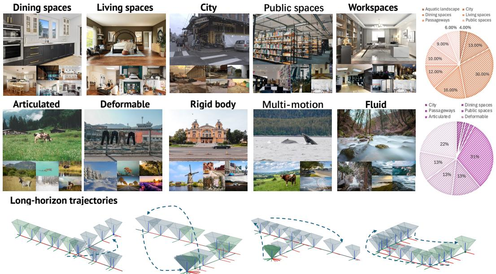  
Figure 8: Evaluation set and trajectory design. The top panels show representative static and dynamic scene categories and their proportions. The bottom panels illustrate exploration-and-revisit camera trajectories; dashed arrows mark returns to previously observed regions.

## C.3 LONG-HORIZON TRAJECTORY DESIGN

Each evaluation trajectory is represented by a sequence of prescribed camera poses as shown in Figure 8,

$$
\mathcal { T } = \{ C _ { f } \} _ { f = 1 } ^ { F } , \qquad C _ { f } = ( K _ { f } , T _ { f } ) ,\tag{15}
$$

where $K _ { f }$ and $T _ { f }$ denote the camera intrinsics and extrinsics at frame f. All videos are generated at 24 FPS, and each trajectory spans 15–18 s, corresponding to 360–432 frames.

Each trajectory has an exploration phase followed by a revisit phase:

$$
\mathcal { T } = \mathcal { T } ^ { \mathrm { e x p l o r e } } \cup \mathcal { T } ^ { \mathrm { r e v i s i t } } ,\tag{16}
$$

where $\tau ^ { \mathrm { e x p l o r e } }$ moves the camera through previously unobserved regions and $\tau ^ { \mathrm { r e v i s i t } }$ later returns to camera poses visited during the exploration phase. The revisit is placed sufficiently late such that its corresponding reference frames have left the backbone’s effective context.

## C.4 EVALUATION METRICS

Unless otherwise stated, we report raw component metrics rather than the normalized 0–100 scores derived from WorldScore’s empirical bounds. This is particularly crucial for Motion Accuracy, whose unnormalized value is not bounded below by zero. Specifically, we categorize the evaluation protocol into three primary dimensions:

Revisit Consistency. To assess long-horizon scene and instance persistence, we evaluate: (1) Static-Region Revisit Consistency: We measure environmental persistence using PSNR, SSIM (Wang et al., 2004), and LPIPS (Zhang et al., 2018) computed exclusively over jointly valid static regions. Dynamic pixels in either the reference or revisit frames are explicitly masked out to isolate background geometry from moving objects. (2) Entity Consistency: We adapt the VBench Subject Consistency metric (Huang et al., 2024) to evaluate moving entities, computing feature-level appearance consistency strictly within SAM3-segmented dynamic instances rather than across the full frame.

Visual and Dynamic Quality. To verify general generation fidelity and physical motion plausibility without memory degradation, we consider: (1) Visual Quality: We evaluate perceived visual appeal and general realism using CLIP Aesthetic from VBench (Huang et al., 2024) and Subjective Quality from WorldScore (Duan et al., 2025). (2) Dynamic Quality: We report the raw Motion Accuracy from WorldScore (Duan et al., 2025) to quantify whether motion is properly concentrated within target regions. This metric penalizes spurious background movement and can yield negative values if out-of-region motion surpasses in-region dynamics.

Controllability. To ensure the generative model faithfully adheres to user instructions and target trajectories, we measure: (1) Camera Pose Error: We compute camera translation and rotation errors following the WorldScore (Duan et al., 2025) protocol to evaluate 3D camera trajectory adherence. (2) Prompt Consistency: We adopt the Overall Consistency metric from VBench (Huang et al., 2024) to assess semantic alignment with input text prompts across generated rollouts.

## D EFFICIENCY AND RUNTIME ANALYSIS

Profiling Setup. GROME is training-free and introduces no additional optimization or fine-tuning cost. All additional computation is incurred at inference time.

We profile a representative long-horizon dynamic rollout under the default configuration on three NVIDIA A800 GPUs, where LingBotV2 is distributed over two GPUs and the geometry pipeline runs on a separate GPU. The online geometry estimator maintains a 93-frame sliding window with 77-frame overlap, while each subsequent generation chunk contributes 16 new frames.

Scaling With Geometry Input Size. We first examine the computational cost of the geometry estimator itself. Table 4 reports pure DA3 inference time as its active input window grows during initialization. Increasing the input from 1 to 93 frames raises the inference time from 1.060 s to 52.437 ± 0.994 s. Once the 93-frame operating window is reached, its size remains fixed for subsequent updates.

Scaling With Rollout Length. The fixed-window design keeps geometry-estimation cost approximately bounded as the generated trajectory grows. As shown in Fig. 10(a), DA3 inference increases during the initial warm-up as its input window is filled. Once the fixed 93-frame window is reached, the inference cost remains approximately constant as the accumulated rollout grows from 109 to 893 frames. Thus, the geometry estimator does not repeatedly reprocess the complete generated history when updating factorized memory.

The memory-side computation shows a similarly bounded trend. As shown in Fig. 10(b), computing the keys and values for projected references remains nearly constant throughout the steady-state rollout, and the total history-token preparation cost stabilizes after the native context is filled. Reference keys and values are shared across the denoising steps of one generated chunk and recomputed for the next chunk; these K/V tensors are not retained across chunks. Pointmap fusion exhibits a discrete workload transition around 333 rollout frames, where its cost increases as the active fusion working set expands. Importantly, the cost stabilizes again after this transition rather than continuing to grow with accumulated rollout length.

Runtime Breakdown. Table 5 reports component-wise latency in the steady-state regime, measured over chunks 7–56, corresponding to accumulated rollout lengths from 109 to 893 frames. Geometry estimation is the dominant cost: the complete DA3 geometry update requires 54.772 ± 1.055 s per update. This quantity includes DA3 inference together with the associated alignment and geometryupdate operations, and is therefore slightly larger than the pure DA3 inference time reported in Table 4.

In contrast, preparing the projected reference tokens is substantially cheaper than geometry esti mation. Computing their attention keys and values requires 1.203 ± 0.016 s per generation chunk, while preparing the keys and values for the complete history input, including retained context, takes 4.985 ± 0.057 s. These quantities are recomputed for each generated chunk. Pointmap fusion requires 2.117 ± 0.977 s on average over the same range. Its relatively large variance is primarily caused by the workload transition visible in Fig. 10(b): the fusion cost changes from $0 . 6 0 1 { \pm } 0 . 0 2 2 \mathrm { s }$ over 109–317 frames to 2.706 ± 0.245 s over 333–893 frames, while remaining stable within each regime.

Table 4: DA3 inference-time scaling with input-frame count. The default 93- frame operating point is highlighted in light green. The 93-frame result reports mean and standard deviation over 51 updates.  
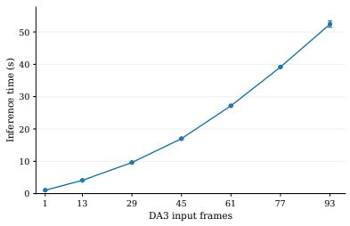

<table><tr><td>Input Frames</td><td>Samples</td><td>Time (s)</td></tr><tr><td>1</td><td>1</td><td>1.060</td></tr><tr><td>13</td><td>1</td><td>4.104</td></tr><tr><td>29</td><td>1</td><td>9.622</td></tr><tr><td>45</td><td>1</td><td>17.003</td></tr><tr><td>61</td><td>1</td><td>27.175</td></tr><tr><td>77</td><td>1</td><td>39.167</td></tr><tr><td>93</td><td>51</td><td>52.437 ± 0.994</td></tr></table>

Figure 9: DA3 inference scaling with input-frame count. Geometry-estimation cost increases with the active input-window size during initialization. GROME subsequently maintains a fixed sliding window instead of expanding the geometry input with rollout length.  
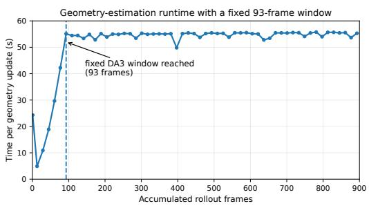  
(a) Geometry-estimation runtime

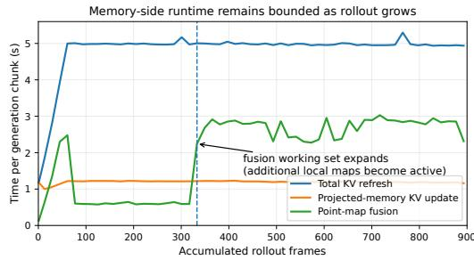  
(b) Memory-side runtime  
Figure 10: Runtime scaling with rollout length. (a) During initialization, the DA3 input window grows to a fixed 93-frame window; subsequent geometry updates have approximately constant cost. (b) Reference K/V computation and total history-token preparation remain nearly constant with rollout length. The step increase in pointmap fusion around 333 frames reflects an expanded active working set rather than continuous growth with the complete history.

Discussion. These results separate two sources of inference overhead in GROME. The dominant cost arises from external geometric estimation used to construct factorized memory, whereas preparing projected reference tokens adds a smaller and stable attention-side overhead. Geometry estimation operates on a fixed temporal window, while history conditioning consumes references projected into the target camera views rather than the complete memory bank. Accordingly, within the evaluated rollout range, neither geometry estimation nor reference K/V computation exhibits a progressive increase in per-chunk cost with accumulated history. Pointmap fusion depends on the active scene geometry and can change when its working set expands, but it likewise stabilizes within each observed workload regime and remains substantially cheaper than geometry estimation. GROME therefore trades additional test-time geometry computation for improved long-horizon consistency while requiring no training or fine-tuning.

Table 5: Runtime breakdown in the steady-state long-horizon regime. Reference K/V computation, highlighted in light green, represents the reference-token preparation overhead introduced by GROME.
<table><tr><td>Component</td><td>Mean (s)</td><td>Std. (s)</td></tr><tr><td>Geometry and memory construction</td><td></td><td></td></tr><tr><td>DA3 geometry update</td><td>54.772</td><td>1.055</td></tr><tr><td>Pointmap fusion</td><td>2.117</td><td>0.977</td></tr><tr><td>History-token preparation</td><td></td><td></td></tr><tr><td>Context K/V computation</td><td>3.782</td><td>0.056</td></tr><tr><td>Reference K/V computation</td><td>1.203</td><td>0.016</td></tr><tr><td>Total history K/V computation</td><td>4.985</td><td>0.057</td></tr></table>

## E MORE RESULTS

## E.1 COMPLEX-MEMORY REVISIT

We further evaluate GROME under a more challenging complex-memory revisit setting, where successful long-horizon generation requires information that cannot be recovered from a single historical frame. We consider both static and dynamic cases, which stress different aspects of factorized memory.

Static Complex-Memory Revisit. As shown in Figs. 11–13, the camera first explores several spatially distinct views (ref 1–4) before moving to a final target pose. The content visible from this target view is distributed across multiple earlier frames, such that no single historical frame provides sufficient evidence for reconstructing the complete view. Successful generation therefore requires the model to compose complementary spatial evidence accumulated throughout the trajectory, rather than merely retrieve the most similar historical frame.

Across these examples, competing methods frequently preserve only part of the previously observed environment or introduce local structural inconsistencies when information from multiple references is required simultaneously. Temporal-memory or context-based methods retain direct historical frames, but their usable spatial coverage remains tied to individual stored views, making multi-view composition difficult once relevant evidence is distributed across the trajectory. Explicit spatial-memory baselines provide stronger geometric grounding, but can still exhibit incomplete recovery, warping artifacts, or local structural distortion. In contrast, GROME stores complementary static content with camera poses in a shared 3D coordinate system and jointly projects relevant evidence from multiple local maps. This allows the final generation to remain compatible with several previously observed regions simultaneously.

Dynamic Complex-Memory Revisit. Figs. 14–16 extend the same setting to scenes containing moving objects. These examples introduce an additional challenge: historical frames should not be indiscriminately consolidated, since different references may contain the same dynamic content at different temporal states. A successful memory mechanism must therefore combine persistent spatial evidence from the scene while resolving dynamic evidence according to its recency within the current target view.

This distinction exposes characteristic failure modes of existing memory strategies. Methods that spatially preserve historical frames without explicitly separating static and dynamic content can lock moving objects to stale states, resulting in the frozen motion visible in Figs. 14 and 16. Other methods exhibit accumulated rendering artifacts, pose drift, or long-horizon changes in scene content. GROME instead applies different reuse rules to the two components of one factorized memory: the static component combines complementary spatial content across frames, whereas the dynamic component retains source times and resolves overlapping projected content by recency. Consequently, GROME can preserve the persistent world structure without forcing moving objects to match an outdated historical frame.

Because different world models synthesize different intermediate content, their final views are not pixel-wise aligned to a common generated target. We therefore use these examples as qualitative comparisons rather than image-level quantitative evaluations. Together, the six cases demonstrate that complex long-horizon memory requires not only broader spatial coverage, but also different reuse strategies for persistent scene structure and time-varying visible content.

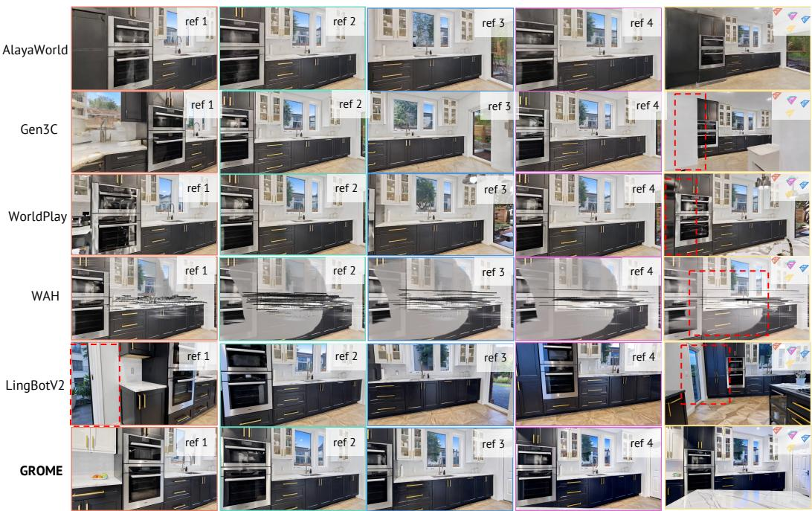  
Figure 11: Static complex-memory revisit-case 1. When exploring both sides of the kitchen, the visual evidence required for the return view is distributed across multiple historical frames, exceeding the model’s finite context window. GROME retrieves and consolidates local memories to reconstruct comprehensive, high-fidelity static scene references. Red boxes highlight representative inconsistencies in the baselines.

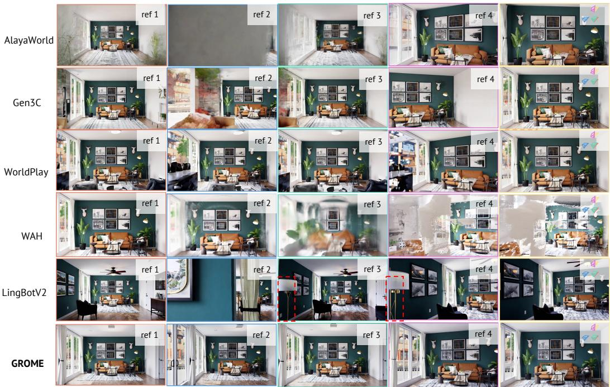

Figure 12: Static complex-memory revisit-case 2. The L-shaped explore–return trajectory distributes pose and scene evidence across several views, causing context-based methods to drift or omit content. GROME retrieves complementary static scene evidence through max-coverage retrieval, preserving the revisit scene structure. Red boxes mark representative failures.  
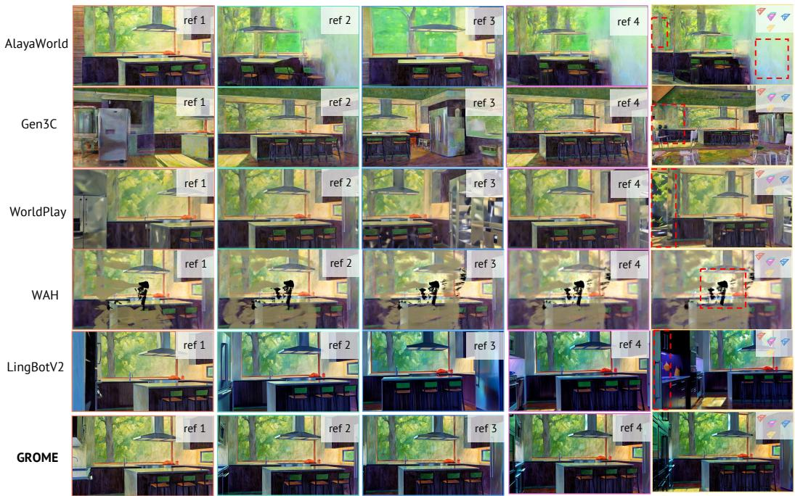  
Figure 13: Static complex-memory revisit-case 3. Complex camera trajectories create multi-view spatial configurations where different parts of the target view are scattered across disparate historical references, exposing the limits of single-frame retrieval. While maintaining a monolithic global cache often suffers from accumulated drift and high overhead, GROME retains historical evidence as local point clouds and selectively retrieves them under target poses. This strategy synthesizes complementary scene evidence to generate the target view with high-fidelity revisit consistency. Red boxes mark representative baseline failures.

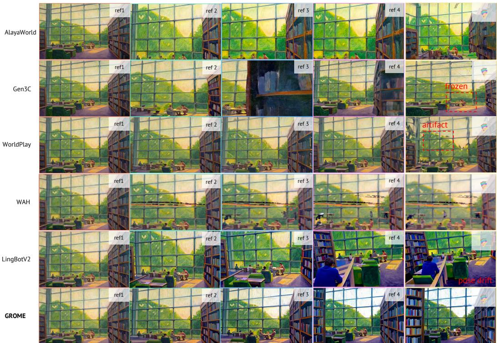

Figure 14: Dynamic complex-memory revisit-case 1. Explicit-memory baselines overlook dynamic entities during memory construction, freezing them at outdated historical states, whereas context-only generation inevitably loses long-range environmental evidence. By factorizing static structure from dynamic entities, GROME simultaneously preserves background consistency and enables dynamic states to evolve. Red boxes mark representative failures.  
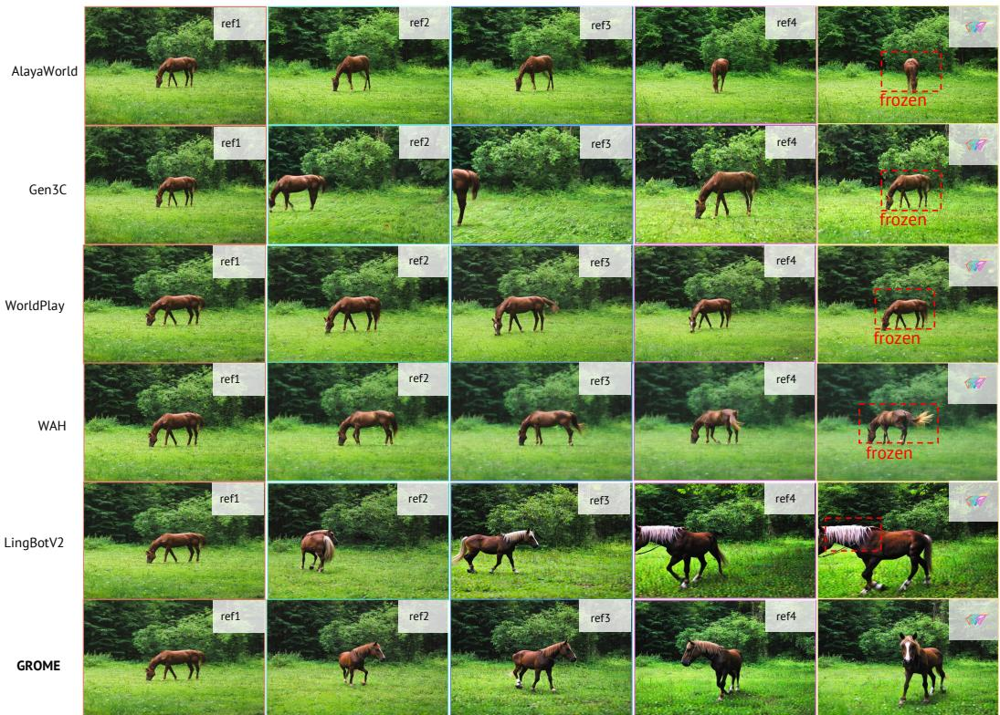  
Figure 15: Dynamic complex-memory revisit-case 2.

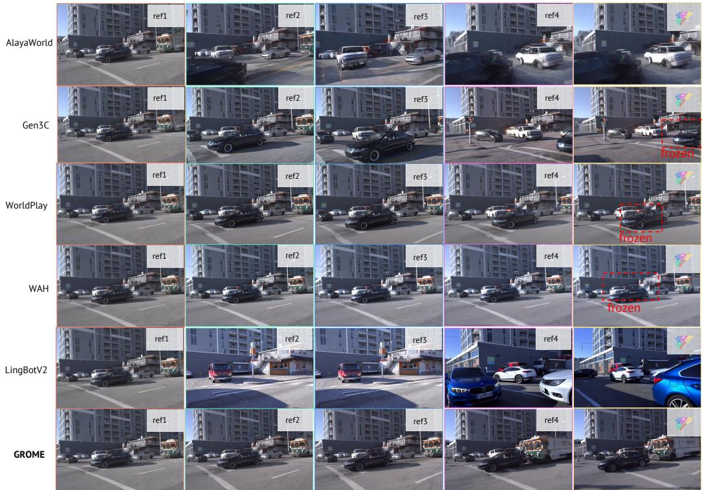  
Figure 16: Dynamic complex-memory revisit-case 3.

## E.2 LONG-HORIZON QUALITATIVE COMPARISON

Our main quantitative evaluation uses trajectories of 15–18 s (360–432 frames at 24 FPS). Here, we additionally evaluate substantially longer autoregressive rollouts exceeding 800 frames to examine failure modes that become apparent only over extended horizons. Since such long rollouts involve progressively accumulated generation errors and do not admit a stable frame-wise quantitative comparison throughout the entire sequence, we report representative qualitative results instead. These examples examine whether different methods can preserve previously generated spatial structure and appearance after the corresponding frames have long left the model’s effective context window.

Static Scenes. Fig. 17(a) compares representative rollouts over more than 1,400 frames. Vanilla LingBotV2 gradually loses the geometry and appearance of the initial environment, eventually generating views that are only weakly related to the observed scene. Temporal or warp-based baselines alleviate short-term drift, but their errors continue to accumulate over longer horizons. WAH exhibits severe appearance degradation in the later stages, while WorldPlay progressively distorts scene structure under continued camera motion. Gen3C preserves stronger local geometry, but its generated views still show noticeable long-horizon appearance and structural changes. In contrast, GROME produces views that remain closer to the characteristic architecture, layout, and appearance of the earlier generated environment, including at very late frames. These qualitative examples suggest that pose-indexed historical content provides a useful anchor beyond recent or retrieved frames.

Dynamic Scenes. Long-horizon consistency becomes more challenging when the environment also contains dynamic content. As shown in Fig. 17(b), simply preserving an early frame is insuffi cient: the model must retain the underlying scene while allowing visible moving content to change. LingBotV2 exhibits substantial scene and appearance drift as the rollout progresses, while temporalmemory baselines gradually deviate from the initial environment despite remaining locally plausible. WAH further accumulates noticeable appearance degradation at later frames. Gen3C preserves the static scene structure relatively well, but moving objects progressively disappear from the generated world, indicating that strong scene consistency can come at the expense of dynamic preservation. In contrast, GROME maintains the recognizable scene layout and moving content throughout the rollout. The backbone, rather than factorized memory, generates future motion. This behavior is consistent with the quantitative results, where GROME improves revisit similarity while maintaining a Motion Accuracy score comparable to the frozen backbone.

Overall, these examples complement the quantitative revisit evaluation by showing how errors accumulate over time. GROME conditions each generated chunk on projected content from factorized memory, delaying the scene and appearance drift observed in competing methods.

## E.3 ADDITIONAL APPLICATION CASES

This section expands the two applications summarized in Sec. 4.4. Both use the inference pipeline described in the main paper; they differ in how factorized memory is initialized and in the camera trajectory used for the subsequent rollout.

Real-World Video Continuation. The cases in Fig. 18 are organized to separate two aspects of continuation: recovering scene evidence when the camera revisits an observed region and generating views outside the recorded trajectory. Each case places the input frames before the rollout, enabling a direct comparison of retained appearance and layout with the source video.

Spatially Guided Exploration. Figure 19 uses the memory operation as the reference point for each case. Showing the source frames beside the edited memory and rollout makes it possible to assess whether the generated views follow the requested spatial configuration while retaining the appearance of the contributing regions.

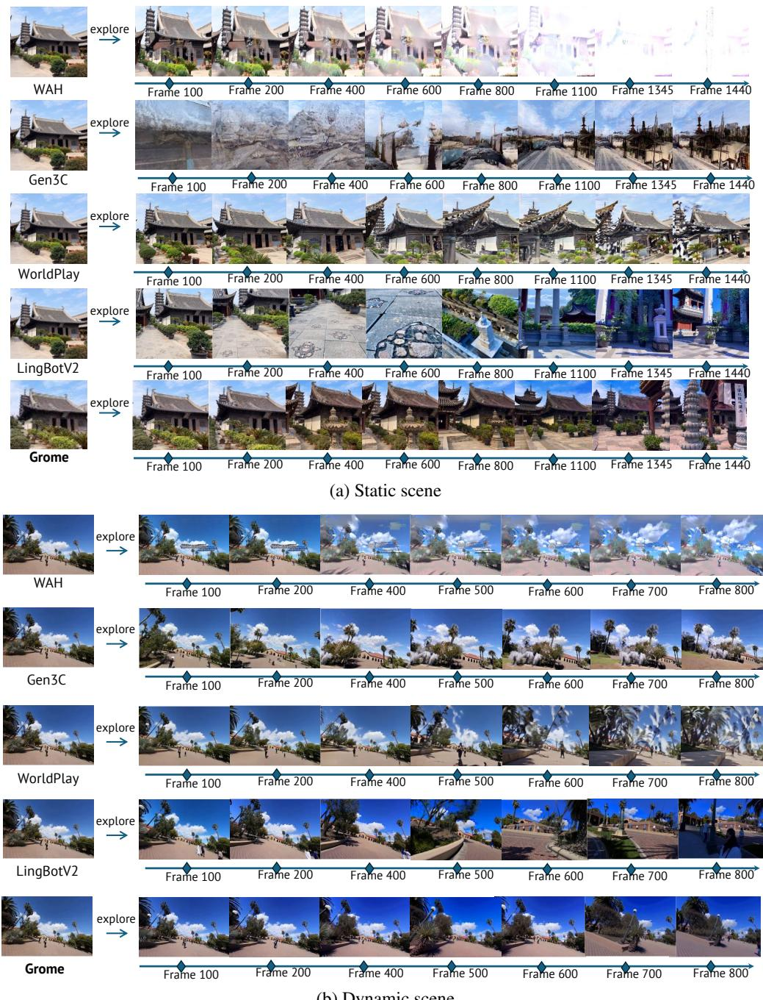  
(b) Dynamic scene  
Figure 17: Long-horizon qualitative comparison. When historical views leave the finite context, implicit memory and explicit memory-based baselines drift from the scene, while GROME preserves static structure beyond 1,400 frames. On dynamic scenes, factorized memory retains evolving dynamic entities without forcing them to remain in a stale state.

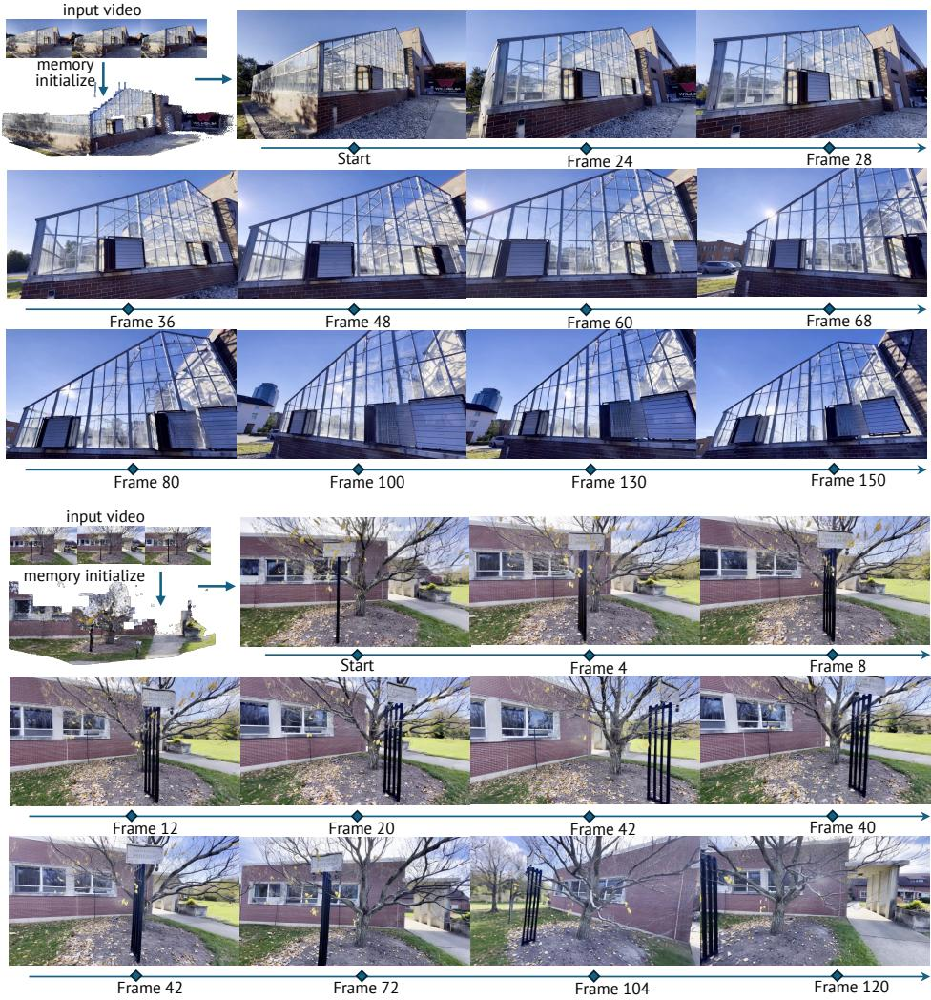  
Figure 18: Video-to-Memory Continuation. Additional real-world video-continuation cases. Each row pairs an observed video with a GROME rollout generated along a new camera trajectory. Revisit frames assess retention of previously observed scene content, while novel-view frames show the continuation beyond the input.

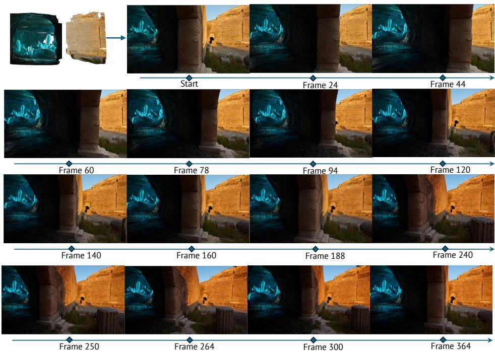  
Figure 19: Spatially Grounded Exploration. Additional spatially grounded exploration cases. Each row shows the source evidence, the memory transformation or composition, and the resulting rollout under a novel camera trajectory. This arrangement exposes which visual content originates from each memory region.

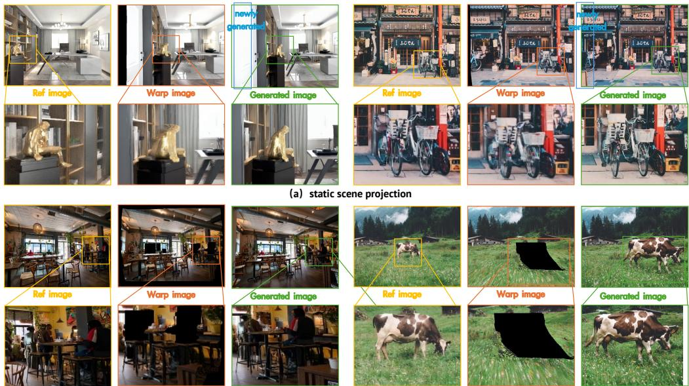  
（b）dynamic entity projection  
Figure 20: Robustness to imperfect geometric projection. Although rendered historical memories often exhibit geometric artifacts such as disocclusion holes and blur, GROME leverages them as soft spatial guidance rather than rigid pixel-level targets via timestep-aware memory routing. Guided by pretrained world priors, the frozen model corrects moderate rendered distortions and plausibly synthesizes unobserved regions during finer denoising steps while maintaining scene consistency.

## E.4 ROBUSTNESS TO IMPERFECT GEOMETRIC PROJECTION

GROME relies on explicit geometric projection to bring historical content into the target camera view and therefore, similar to other 3D-conditioned world models (Ren et al., 2025), is affected by the quality of depth and camera estimation. Importantly, however, the projected memory in GROME is used as a reference rather than a pixel-wise reconstruction target. As shown in Fig. 20, the warped references may contain misalignment, blur, missing regions, or occlusion-induced holes, while the generated results recover coherent object appearance and local scene structure instead of directly reproducing these artifacts.

This robustness comes from the interaction between geometric memory and the pretrained world prior. Projection provides spatially aligned evidence about previously observed content, while the frozen video world model remains free to reconcile imperfect references with the current context and synthesize content where the projected evidence is unreliable or unavailable. Validity-aware masking further prevents invalid memory regions from entering attention. Consequently, moderate geometric errors typically degrade the quality of the guidance rather than being copied directly into the generated frame.

## F LIMITATIONS AND FAILURE CASES

As a training-free framework, GROME remains bounded by both the generative capability of the frozen backbone and the quality of the external geometric estimation. As shown in Fig. 21(a), LingBotV2 gradually accumulates appearance and color drift over very long autoregressive rollouts. Although Reference Value Adaptation alleviates this mismatch by aligning historical reference values with the current rollout, GROME cannot eliminate such backbone-intrinsic degradation, and residual drift can still become noticeable at long horizons. GROME is also tolerant to moderate depth and projection errors, as the pretrained VWM can often correct local artifacts using its learned world prior. However, under extreme geometric failures, this self-correction can break down. In Fig. 21(b), a small foreground region becomes poorly reconstructed during the rollout, producing sparse and erroneous points in the warped reference. The frozen video model subsequently interprets these artifacts as plausible translucent or glass-like structures, leading to incorrect generation in the affected region. These cases highlight that GROME improves the reuse of historical evidence without retraining the generator, but does not remove the fundamental uncertainties inherited from either the backbone or geometric estimation. Future work could move beyond the current trainingfree setting by jointly learning how to condition the generative backbone on projected references, allowing the model to better recognize and correct imperfect geometric guidance rather than relying solely on the pretrained world prior.

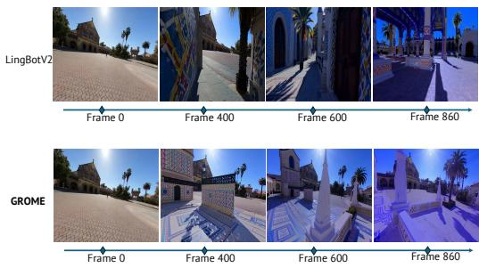  
(a) Backbone-dependent appearance drift

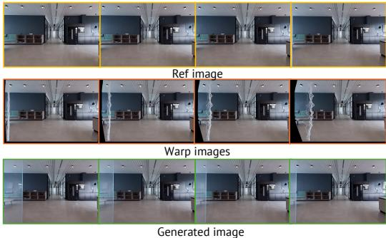  
(b) Depth-induced projection artifacts  
Figure 21: Representative failure cases of GROME. (a) At long rollout horizons, appearance and color drift inherited from the frozen backbone can still accumulate despite Reference Value Adaptation. (b) Severe local geometry errors can produce sparse or corrupted warped evidence. Although the pretrained VWM usually tolerates moderate projection imperfections, extreme artifacts may be interpreted as plausible scene content and propagate into the generated frame.