# Greenscapes: Optimized Vegetation Configurations in Cities

PATRYK BARTKOWIAK, Adam Mickiewicz University, Poznań, Poland   
MARCIN MARLEWSKI, Adam Mickiewicz University, Poznań, Poland   
PAWEŁ WÓJCIK, Adam Mickiewicz University, Poznań, Poland   
JAE JOONG LEE, Purdue University, United States of America   
DOMINIK L. MICHELS, King Abdullah University of Science and Technology (KAUST), Saudi Arabia   
BEDRICH BENES, Purdue University, United States of America   
SÖREN PIRK, Christian-Albrechts-Universität zu Kiel, Germany   
WOJCIECH PAŁUBICKI, Adam Mickiewicz University, Poznań, Poland

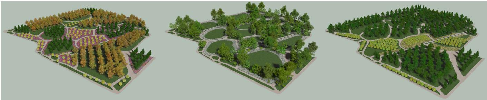  
Fig. 1. Three complete park designs synthesized from identical Open Street Map site constraints but diferent style prompts. Left: formal design and regular spacing. Middle: picturesque-asymmetric composition and clustered planting. Right: modernist-clear geometry. All scenes are generated 3D layouts optimized under perceptual and functional objectives using a non-convex approach.

Vegetation plays a central role in cities, serving functional roles such as balancing shade and sky exposure, shaping the microclimate, carbon sequestration, and providing acoustic screening. Furthermore, aesthetic choices in landscape styles (formal, modernist, picturesque) are important for citizens’ well-being and should be considered in the design of urban landscapes. In this paper, we present a novel method for placing vegetation – ranging from shrubs to large trees – in 3D urban scenes. Our method uses individual lots as input and employs a conditioned Vision-Language Model (VLM) to generate a top-down rendering of vegetation, placing large trees, small trees, and shrubs on lawn areas. This rendering is then converted into a 3D scene by detecting individual plants and selecting appropriate 3D assets. To refine the proposed configurations, we define an optimization loop that keeps the VLM-generated positions fixed after a deterministic feasibility repair and uses CMA-ES to optimize per-instance scale transformations along with discrete vegetation asset substitutions. To define the objective function for the optimization, we evaluate the generated 3D scenes with eficient surrogate models of shade and path-based acoustic exposure. Furthermore, we render in-scene views at each optimization step to compute view-dependent perceptual descriptors, enabling the generation of both aesthetic and functional vegetation layouts for urban scenes.

CCS Concepts: • Computing methodologies → Mesh geometry models;   
Neural networks.

Additional Key Words and Phrases: Urban Modeling, Vision-Language-Models, Scene Generation, Modeling of Parks, Tree Modeling

## 1 Introduction

Synthesizing urban vegetation in computer graphics poses substantial challenges due to the interplay of planning constraints, aesthetic composition across multiple scales, from individual plants to citywide ecosystems, and vegetation diversity. Modeling urban landscapes is critical for visual storytelling in games and movies [Smelik et al. 2014], urban planning [Vanegas et al. 2012], microclimate analysis [Toparlar et al. 2017], and digital twins [Ketzler et al. 2020]. Moreover, urban aforestation plays a critical role in making cities more livable [European Commission 2021; European Parliament and the Council of the European Union 2024].

While computer graphics has made significant progress in procedural city generation and building synthesis [Müller et al. 2006; Nishida et al. 2016; Parish and Müller 2001], most existing techniques either reduce vegetation to stochastic point distributions or focus solely on trees, ignoring the understory, shrubbery, and ground cover. Ecosystem simulations provide high-fidelity growth models but are designed for wild, competitive environments [Emilien et al. 2015; Gain et al. 2017; Pałubicki et al. 2022; Peytavie et al. 2024] and not for managed urban spaces [Benes et al. 2011]. Others focus on learning distributions from satellite data [Niese et al. 2022], but often lack the precise controllability required to enforce specific setbacks, clearance zones, or functional performance goals. Generative approaches have begun to explore text-to-3D city synthesis [Feng et al. 2023; Xie et al. 2024] and reconstruction [Liu et al. 2025b; Zhang et al. 2020]. However, coupling explicit landscape design rules with quantifiable 3D performance metrics, such as acoustic damping or thermal comfort, remains largely unaddressed.

We present a novel urban landscaping framework for synthesizing heterogeneous vegetation assets. For a given urban layout, our method employs a design-centric approach to generating and optimizing vegetation layout and function. The input is a 2D map of the urban layout and a text prompt describing the layout strategy. Our framework outputs aesthetically plausible vegetation configuration that fulfills high-order functional constraints. We show that modeling urban landscapes can be accomplished by coupling Vision-Language Models (VLMs) for high-level semantic structure with evolutionary optimization (CMA-ES) [Hansen and Ostermeier 2001] for geometric refinement. This enables the generation of a broad range of design typologies, such as borders, allées, and garden rooms, while adhering to parcel geometry. Unlike previous models that focus on vegetation location, our framework explicitly evaluates functional performance by estimating shade coverage, sky-view factors (SVF), and acoustic attenuation. Fig. 1 shows three park designs generated from identical geometric site constraints. Left: a formal layout with regular spacing. Center: a picturesque, asymmetric composition with clustered planting. Right: a modernist scheme characterized by clear, rigorous geometry.

Our contributions are (1) a hybrid landscaping framework combining VLM-based structural priors with geometric evolutionary optimization, (2) phenomenological functional objectives – eficient scene-design surrogates for shade, biomass, and acoustic exposure – and (3) a coupled evaluation scheme for view-dependent aesthetics. Source code, prompt templates, and configurations are publicly available at https://github.com/greenscapes-project/greenscapes.

## 2 Related Work

Computer graphics research on plant synthesis spans procedural modeling, reconstruction, and interactive authoring.

Early approaches model branching using rule-based systems [Honda 1971], grammars [Aono and Kunii 1984], particle systems [Reeves and Blau 1985], and fractals [Oppenheimer 1986]. L-systems [Pałubicki et al. 2019; Prusinkiewicz 1986; Prusinkiewicz and Lindenmayer 1990] provide a principled formalism for plant generation. However, specifying rules for complex trees is labor-intensive and may require learned rule inference [Guo et al. 2020; Lee et al. 2023]. To improve usability, procedural modeling methods combine botanical priors with geometric modeling and interactive controls [Lintermann and Deussen 1996; Longay et al. 2012; Weber and Penn 1995]. Subsequent work addresses self-organizing growth [Guo et al. 2020; Palubicki et al. 2009; Runions et al. 2005], inverse procedural modeling [Stava et al. 2014], urban forests [Benes et al. 2011; Niese et al. 2022], and environmental response [Pirk et al. 2012].

Tree reconstruction has been studied from single or multi-view imagery [Neubert et al. 2007; Reche-Martinez et al. 2004; Tan et al. 2008], point clouds [Livny et al. 2011; Xu et al. 2007], and videos [Li et al. 2011]. Several pipelines leverage intermediate representations, such as segmentation masks [Argudo et al. 2016] or 3D bounding volumes [Li et al. 2021], to regularize inference of branching and foliage. Bradley et al. [2013] reconstruct dense foliage by combining stereo-derived point clouds with a statistical model.

Interactive authoring aims to make plant design practical for artists and designers. Sketch-based methods use gestures and silhouettes that guide procedural branching [Chen et al. 2008; Okabe et al. 2007; Tan et al. 2008], as well as sketch-driven modeling of plants [Anastacio et al. 2009] and flowers [Ijiri et al. 2006]. TreeSketch provides a particularly complete integration of user sketches with procedural generation [Longay et al. 2012].

Recent generative pipelines have begun to address text- and structure-conditioned synthesis of large outdoor environments by combining layout planning from language and difusion-based gen eration of scene representations. On the layout side, LLM and VLMdriven planners generate structured spatial specifications (e.g., bounding boxes, scene elements, or hierarchical layouts) that can be executed by downstream generators, enabling improved controllability and spatial reasoning compared to direct text-to-image generation [Feng et al. 2023; Srivastava et al. 2025; Wang et al. 2025]. For outdoor and urban environments, difusion models have been extended from object- and indoor-centric settings toward city-scale or real-world outdoor scene synthesis, including semantic scene generation and editing in large outdoor maps [Lee et al. 2024], text-driven multi-view consistent 3D scene generation that supports long camera trajectories and outdoor content [Zhang et al. 2024], and coarse-to-fine 3D difusion schemes designed for detailed large-scale outdoor scenes [Liu et al. 2024a]. Structure-conditioned urban generation has explored graph-based formulations, including hierarchical layout generation at the city scale from scene-graph conditioned difusion for controllable 3D outdoor scenes [Liu et al. 2025a]. LLM-assisted procedural modeling has also been explored for instruction-driven 3D asset construction in 3D-GPT [Sun et al. 2025], text-controlled procedural landscape generation [Liu et al. 2024b], and large-scale procedural scene generation in SceneX [Zhou et al. 2025]. While these methods substantially improve controllability, they primarily optimize for visual or structural fidelity. In contrast, our approach explicitly couples generative proposals with functional and perceptual evaluation inside an optimization loop.

## 3 Method

The inputs to our pipeline (Fig. 2) are a user-defined text prompt (Fig. 2a) and a lot polygon geometry from OpenStreetMap (OSM) [Haklay and Weber 2008] data expressed in a 2D coordinate frame (Fig. 2b). We rasterize the OSM polygon into a top-down condition ing image and run a constrained image-to-image generator (Gemini 3, [Google DeepMind 2025]) instructed to modify only a designated editable region (grass). This produces top-down vegetation-layout proposals (Fig. 2c) that are used as the sole input for class-wise instance extraction (Fig. 2d–e). All experiments use fixed prompt templates rather than interactively tuned prompts. The templates specify the editable mask, the allowed vegetation vocabulary, the required top-down orthographic style, and the requested landscape pattern or design strategy. In our experiments, we used 18 fixed templates: 17 style and layout templates for prompt-conditioned generation and one annotation template for instance extraction. In parallel, we construct a bounded set of evaluation viewpoints by prompting the VLM to annotate pedestrian standing points and view directions on the conditioning raster (Fig. 2f); the decoding procedure is detailed in the supplementary material. Detected instances are then projected into world coordinates, assigned assets from a library, and assembled into a 3D scene with per-instance attribute vectors and collision proxies (Fig. 2g–h). We evaluate candidate scenes by rendering in-scene bufers from the selected viewpoints and compute image- and simulation-derived metrics (Fig. 2i–j). Finally, we refine continuous per-instance parameters and discrete asset identities using the Covariance Matrix Adaptation Evolution Strategy (CMA-ES) under a low-dimensional parameterization coupled with a Gaussian Mixture Model (GMM) (Fig. 2k). We return the best feasible configuration (Fig. 2l).

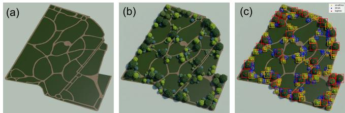

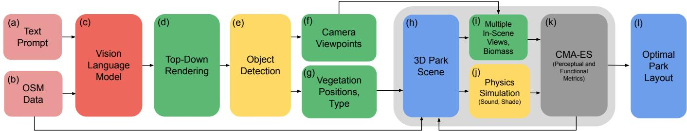  
Fig. 2. Overview of our pipeline for prompt-driven park vegetation design. Inputs are a user text prompt (a) and OSM-derived site context (b). An image-to image constrained editor generates multiple top-down layout proposals (c), which are converted to a metric top-down representation (d) and processed by instance extraction (e) to obtain candidate pedestrian viewpoints (f) and vegetation instance positions and coarse types (g). These instances are projected into world coordinates and assembled into a 3D park scene (h). We evaluate candidate scenes by rendering multiple in-scene views to compute perceptua descriptors and biomass-related quantities (i) and by running physics-inspired field models for functional measures such as shade and sound (j). CMA-ES then refines continuous instance parameters and triggers discrete species substitutions under a Gaussian-mixture asset prior using the combined perceptual and functional objectives (k), yielding the final optimized park layout (l)

## 3.1 OSM Preprocessing, Masks, and Assets

For the target lot and neighborhood context, we query OSM for polygonal geometry (lot boundaries, building footprints, and obstacles) and graph geometry (streets and paths).

The OSM tags are mapped into a compact set of region classes used throughout the pipeline (e.g., plots, parks, alleys, urban forest, and other vegetation-relevant categories). The layers are rasterized into aligned masks and grouped into exclusion and mandatory regions (e.g., building, road, water, pathway, open space, and grass).

We use a library of parameterized vegetation assets categorized as large trees, small trees, and shrubs. Each vegetation asset stores an attribute vector

$$
\mathbf { z } = \left[ \mathbf { \alpha } a , \mathbf { \gamma } b , \mathbf { \alpha } c , \mathbf { \alpha } k _ { \mathrm { s h a d e } } , \mathbf { \alpha } k _ { \mathrm { b i o } } , \mathbf { \alpha } k _ { \mathrm { a c } } \right] \in \mathbb { R } ^ { 6 } ,\tag{1}
$$

where the ellipsoidal bounding volume $( \mathcal { E } = ( a , b , c )$ is defined by the two horizontal crown radii $( a , b )$ and its height $c , k _ { \mathrm { s h a d e } }$ defines the shadow strength used in the shadow-propagation method [Palubicki et al. 2009], $k _ { \mathrm { b i o } }$ linearly maps canopy volume to a biomass proxy [Jenkins et al. 2003], and $k _ { \mathrm { a c } }$ represents acoustic damping and scales a difusion coeficient of a 3D acoustic difusion model. The bounding box ellipsoid $( a , b , c )$ also serves as a Gaussian prior. The values are derived from horticultural size ranges.

Fig. 3. Feasibility and constraint adherence of the first stages of our pipeline. In (a), we show an example conditioning raster obtained from OSM data. In (b), a constrained-edit proposal of the VLM is depicted for that input raster. In (c), we show the VLM-generated bounding box annotation overlay.

We rasterize the OSM geometry into a top-down orthographic image. This rasterization defines a single global axis-aligned afine transform $T : \mathbb { R } ^ { 2 } \xrightarrow { } \mathbb { R } ^ { 2 }$ that maps world coordinates (meters) to pixel coordinates. We use � throughout for all pixel-to-meter conversions.

## 3.2 Top-down Layout Generation and Instance Extraction

We generate vegetation layouts using Gemini 3 Pro [Google Deep-Mind 2025] on the conditioning raster, subject to spatial constraints: only pixels labeled as grass are editable. Obstacles (paths, buildings, water) and the outside-canvas background are regions where vegetation cannot be placed, and the pixels in these regions must remain unchanged. The prompt restricts the vocabulary of vegetation assets to (largetree, smalltree, shrub), each represented by a distinct canopy color; lawns form the editable ground region. Fig. 3a) illustrates the conditioning raster.

To accurately recover individual assets from the generated layout, we then perform a second pass with Gemini 3 Pro and prompt the model to return a JSON list of labeled bounding boxes (bigtree, smalltree, shrub) in normalized image coordinates, which we convert to pixel coordinates; for the city-scale examples, a dotannotation variant is used instead (see supplementary material). The extraction yields an instance list $\pi _ { i } = \{ { \mathsf { c l a s s } } _ { i } , ( u _ { i } , v _ { i } ) , s _ { i } \}$ where $( u _ { i } , v _ { i } )$ is the center of the bounding box and $s _ { i }$ is derived from the box dimensions.

Instance centers are reprojected to world coordinates by the inverse transform $( x _ { i } , y _ { i } ) = T ^ { - 1 } ( u _ { i } , v _ { i } )$ . We map each detected class to a vegetation category and select a random asset within that category.

Each instance stores the assigned asset identity and its attribute vector z, as defined in Eq. (1). The size proxy $s _ { i }$ is converted to an initial footprint radius in meters using � and assigned a canopy ellipsoid E with radii $( a _ { i } , b _ { i } , c _ { i } )$ . Continuous per-instance scale parameters are applied to the mesh and ellipsoid.

The VLM output is post-processed deterministically. Each detected bounding box is first assigned to one of the vegetation classes and mapped from image coordinates to lot coordinates by $T ^ { - 1 }$ . The box center defines the initial 2D instance position, while the box extent defines an initial footprint that is converted into a 3D bound ing ellipsoid. A placement is marked invalid if its center lies outside the editable scene region, if its ellipsoid extends outside the lot, intersects obstacle polygons, overlaps path geometry, or violates vegetation-to-vegetation collision constraints. The invalid placements are repaired in two steps. First, center reprojection moves the instance center to the nearest feasible location on the planting mask. Then, local obstacle correction shifts the bounding ellipsoid along the signed-distance gradient until remaining intersections are removed. The maximum number of repair iterations is 30. If the instance is still invalid, it is discarded. More technical details about the repair step of our method are given in the supplementary material of this paper.

## 3.3 In-scene Rendering and Metric Computation

Segmentation bufers for each scene and each selected viewpoint are rendered. We define eye-level perspective views for skyline shape assessment and a hemispherical fisheye segmentation to compute a sky view factor at all viewpoints generated in the previous stage. The bufers are inputs to the view-dependent aesthetic metrics. We also compute the scene’s biomass based on the biomass of the vegetation assets. Furthermore, we simulate shading and acoustic exposure from the vegetation meshes. These functional terms are eficient scene-design surrogates rather than calibrated physical predictions.

Shade calculation. The path-level direct-sun shading is estimated using a deterministic shadow propagation method from [Palubicki et al. 2009]. Monte-Carlo or global-illumination-style estimators are substantially more expensive, while voxel shadow propagation provides a plausible approximation proxy of local light conditions [Nauber and Mäder 2024].

Acoustic exposure is estimated with a two-stage model designed for repeated evaluation during optimization. First, we pre-compute a small set of acoustic descriptors for each vegetation asset from its 3D geometry and acoustic damping value using Monte Carlo ray tracing. Second, we use the descriptors to parameterize a difusionwith-decay simulation of sound energy on a 3D voxel grid. The resulting exposure is measured at camera view points.

We trace 20,000 rays for each of 16 incident directions sampled over a hemisphere per vegetation asset in a pre-processing stage. Each ray performs a single interaction with the geometry. At the intersection point, the outgoing direction is sampled either as a specular or a difuse reflection, where difuse directions are sampled from a cosine-weighted lobe. We compute three parameters per asset from the final distribution of outgoing ray directions and energies: $( 1 ) s _ { \mathrm { r a n d } }$ is the fraction of reflected energy describing random scattering (using ISO-17497-1), (2) $d _ { n }$ denotes a normalized measure of how spread-out the outgoing energy is over the azimuth, where higher values imply stronger spreading (using ISO-17497-2), and (3) $\pmb { \mu }$ is the dominant outgoing direction.

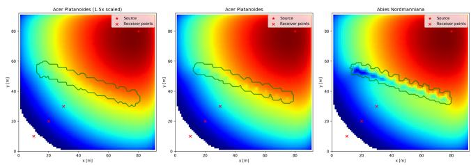

Fig. 4. Color-mapped visualization of the ear-height slice of the simulated 3D sound-energy voxel space. A sound source is placed near the upperright corner (red marker), and a linear tree belt (green outline) separates the source from receiver samples (red markers) below. Increasing the pervegetation atenuation parameter slows the difusion update through the tree belt, reducing and delaying energy propagation toward the receivers; the three panels difer only in this atenuation coeficient, while keeping the geometry and discretization fixed.  
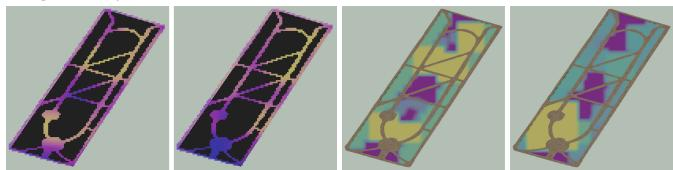  
Fig. 5. Example park scenes before and after CMA-ES refinement of the VLM prior. Path shading is visualized as a scalar field over the walkable network (plasma colormap), and vegetation biomass is visualized per instance (viridis colormap). Optimization increases functional shading where needed while reallocating plant mass to meet biomass/coverage targets under the same geometric constraints; the images show the resulting redistribution of canopy placement along paths.

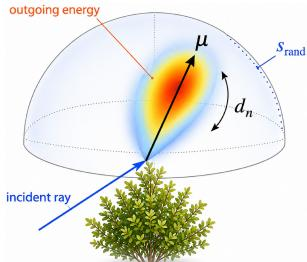

For reflected rays with outgoing unit directions $\omega _ { i }$ and remaining energies $w _ { i }$ , we define $\mu = { \textstyle \sum _ { i } w _ { i } \omega _ { i } } / \| \sum _ { i } w _ { i } \omega _ { i } \|$ , which gives the normalized energy-weighted resultant direction.

Scene-level evaluations. Given a candidate scene, we discretize the park volume into a 3D voxel grid and label voxels by material class (air, vegetation, buildings, ground). We then simulate the propagation of sound-energy density �(x, �) with an anisotropic difusion model with decay and a point-source term. The update is computed with an explicit finite-diference scheme (forward Euler) and a timestep chosen for stability (CFL). The top and side domain boundaries are treated as open space by enforcing �=0.

We propagate energy density �(x, �) using an anisotropic difusion equation with decay:

$$
\frac { \partial E } { \partial t } = \nabla \cdot \left( D ( { \bf x } ) \nabla E \right) - \lambda ( { \bf x } ) E + S ( { \bf x } , t ) ,\tag{2}
$$

where � is a source term. Each voxel stores a difusion tensor � and a decay rate � determined by the class of the occupying object (air, vegetation species, building, ground), with vegetation parameters derived from the precomputed asset descriptors.

Vegetation voxels receive anisotropic difusion and decay parameters from the precomputed descriptors using a fixed global heuristic shared across all experiments. Specifically, higher $d _ { n }$ increases the base difusion magnitude as the energy spreads more in space, � biases difusion along a dominant direction (anisotropy), and higher $s _ { \mathrm { r a n d } }$ increases decay to represent stronger attenuation. Buildings are treated as strong decay regions, while air uses fixed background values. All numerical mapping constants are listed in the supplementary material.

We place eight receiver points at 2 m ear height, evenly spaced along the path network and record the simulated energy � over time. To isolate the efect of vegetation, three simulations are run with identical source, discretization, and boundary handling: one free-field reference, one with vegetation, and another with higher attenuating vegetation. We report excess attenuation as an energy ratio, expressed in decibels

$$
\Delta L _ { \mathrm { d B } } = - 1 0 \log _ { 1 0 } \left( \frac { E _ { \mathrm { w i t h } } } { E _ { \mathrm { f r e e } } } \right) ,\tag{3}
$$

visualized as a heat map in Fig. 4. This provides a deterministic acoustic objective term comparable across optimization iterations.

Skyline flatness and periodicity. From the eye-level segmentation view, we compute a binary sky mask. We then extract a skyline profile �(�) column-wise as the last sky pixel before the first non-sky pixel (with interpolation over missing columns). Flatness is computed from the detrended skyline (linear trend removed) using three terms: the standard deviation of�(�), mean absolute first diference, and RMS second diference; these are normalized by a fixed pixel scale and combined into a score exp(−(·)). Periodicity is computed on the same detrended skyline as the average of the dominantfrequency power ratio in the FFT and the strongest autocorrelation peak in a window around the FFT-implied wavelength. For targetmatching experiments, the skyline term measures the deviation of the extracted profile from a target profile, e.g., a sinusoid.

## 3.4 CMA-ES Refinement

Our main goal is to generate optimal green layouts through nonconvex optimization. Therefore, we process the 3D representation of our generated park output through a shade and acoustic exposure simulation pipeline, and compute all relevant skyline and biomass metrics. We then start the final optimization stage of our framework, leveraging CMA-ES. For a selected set of� CMA-ES scene operators,

$$
\boldsymbol { \theta } = \{ ( s _ { i } ^ { x y } , s _ { i } ^ { z } , \mathbf { z } _ { i } ^ { \prime } ) \} _ { i = 1 } ^ { M } ,\tag{4}
$$

where $( s _ { i } ^ { x y } , s _ { i } ^ { z } )$ are horizontal and vertical scale multipliers and $\mathbf { z } _ { i } ^ { \prime } \in \mathbb { R } ^ { 6 }$ is an attribute proposal in the asset space of Eq. (1). All feasible instances of the repaired configuration are optimized: the VLM proposal fixes the number, class, and 2D position of the in stances; the repair operator (Sec. 3.2) runs once before optimization to establish feasibility; and CMA-ES subsequently adjusts only the per-instance scales and attribute proposals, with the GMM assignment triggering discrete species substitutions. Positions are not optimization variables; feasibility during optimization is maintained by clamping the scale parameters to their bounds.

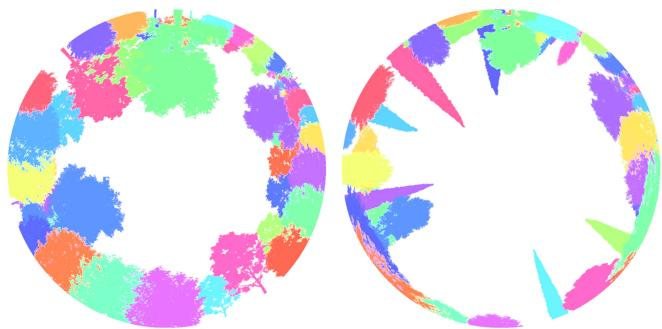

Fig. 6. Sky-view exposure before and after CMA-ES refinement from a fixed in-park viewpoint. The fisheye sky segmentation (white = sky) shows increased open-sky visibility after optimization, raising the sky view factor (SVF) to 0.70 while preserving the surrounding layout constraints.  
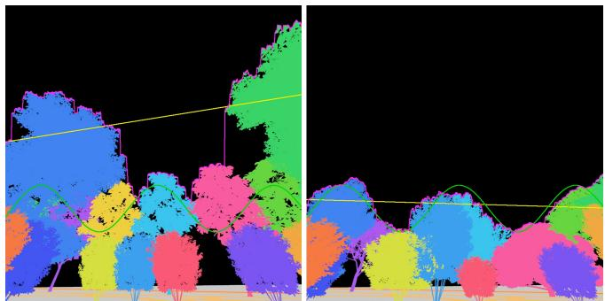  
Fig. 7. Skyline periodicity matching before (left) and after (right) CMA-ES refinement from a fixed viewpoint. The green curve is the target sinusoidal skyline profile; CMA-ES improves agreement by jointly adjusting per-instance scales and performing discrete species substitutions to introduce canopies with more suitable sizes and crown shapes, yielding a more periodic silhouete while maintaining feasibility constraints.

Each species � defines one Gaussian kernel $\textstyle N ( \pmb { \mu } _ { j } , \pmb { \Sigma } _ { j } )$ in attribute space (diagonal $\Sigma _ { j } )$ . Given a proposal $\mathbf { z } _ { i } ^ { \prime } ,$ we assign

$$
j ^ { * } = \arg \operatorname* { m a x } _ { j } \ \pi _ { j } \ N ( \mathbf { z } _ { i } ^ { \prime } \mid \pmb { \mu } _ { j } , \pmb { \Sigma } _ { j } ) ,\tag{5}
$$

and set the discrete asset identity of instance � to $j ^ { * } .$ . We reject proposals outside an admissible Mahalanobis distance for all assets. In case no valid species is selected, we project $\mathbf { z } _ { i } ^ { \prime }$ back onto the closest ellipsoid defined by the Mahalanobis threshold and use it to set $( a , b )$ and coeficients $( k _ { \mathrm { s h a d e } } , k _ { \mathrm { b i o } } , k _ { \mathrm { a c } } )$ . Fig. 8 illustrates the resulting walk-and-jump behavior. Initially, an asset starts within the Gaussian kernel that defines the species Acer campestre. As a result of multiple optimization steps, the asset’s attribute proposal falls within the Mahalanobis threshold for another species (Acer platanoides) and switches its species tag. As a consequence, we replace the asset with another (belonging to Acer platanoides) and continue the CMA-ES optimization loop.

Each candidate � is evaluated as �(�), where � is the weighted sum of five normalized terms – SVF, a skyline-fit term (flatness, periodicity, or deviation from a target profile, depending on the experiment), path shading, acoustic exposure, and biomass – plus a small regularizer penalizing deviations from the initial scales. CMA-ES is run with a fixed seed, iteration budget �, initial step size �<sub>0</sub>, and population size $\lambda _ { \mathrm { p o p } } = \operatorname* { m a x } \left( 4 , \lfloor 4 + 3 \ln n \rfloor \right)$ for search dimensionality �; the bounds on $\left( s _ { i } ^ { x y } , s _ { i } ^ { z } \right)$ are enforced by clamping. The best feasible configuration over all generations is returned.

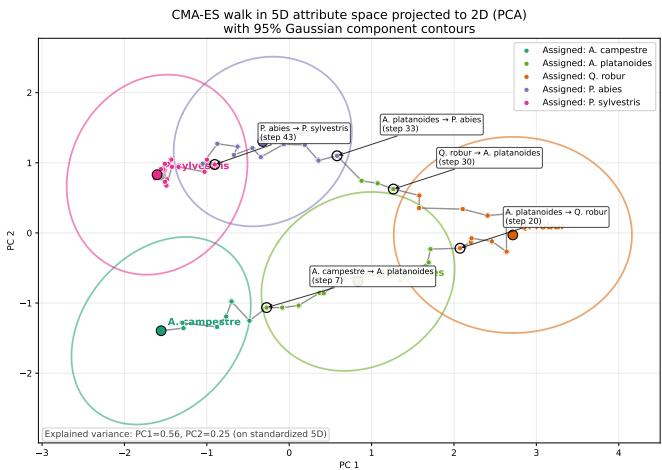  
Fig. 8. Visualization of the CMA-ES trajectory in the 6D atribute space after PCA projection to 2D. Elliptical contours indicate projected Gaussian components (species priors) used by the GMM-based substitution rule; the polyline shows successive CMA-ES proposals and the induced discrete component assignments.

## 4 Results and Validation

In this section, we present the results of our modeling framework.

Park-Design Strategies. Figure 14 shows three design concepts: formal (geometric or axial), picturesque (English landscape), and modernist. They are commonly treated as distinct and iconic histor ical styles in landscape design and landscape architecture [Rogers 2001]. To quantify the design principles, we propose orientation entropy and linearity: formal layouts tend to have lower entropy and higher linearity, while picturesque layouts are more irregular.

We embed each scene from its GeoJSON vegetation layout (tree and shrub point locations) by computing two deterministic layout descriptors in a common metric frame (EPSG:3857): orientation entropy is the Shannon entropy of a 36-bin histogram of nearest-neighbor bearing angles modulo $1 8 0 ^ { \circ }$ (low for axis-aligned grids; high for irregular and circulinear layouts), while linearity is the fraction of points whose two nearest neighbors are approximately collinear (within 5<sup>◦</sup>), reported as a percentage. We plot 33 reconstructed reference parks with known design strategies and 30 generated parks from three OSM sites and style-specific prompts (three templates per style, with LLM-generated textual variants); the generated parks are rendered as circles. The clusterings show that the two descriptors separate the three strategies and that prompt-conditioned generations align with the corresponding reference distributions, supporting both metric validity and reproducible style control from the GeoJSON layouts.

Prompt-conditioned Controllability. Figure 10 shows results with our 3D generative pipeline from a single OSM input, but diferent text prompts. We use the parcel boundary and OSM-derived path network of St. Mary’s Park and reconstruct a reference vegetation layout from the NYC Tree Map inventory (geolocated trees with species and size attributes) [NYC Parks 2024]. Starting from the single OSM masks, we vary only the text prompt (e.g., agroecological, East Asian, infrastructural, post-modernist, formal, picturesque, modernist, memorial), yielding diverse 3D layouts that appear as plausible design alternatives to the reconstructed St. Mary’s Park baseline (top left panel in Figure 10). The results show generated complex vegetation layouts; e.g., the agroecological layout features haphazardly distributed trees and bushes, whereas the modernist and memorial layouts are sparser and more organized.

CMA-ES Refinement. Figure 12 shows an objective-ablation study on Joyce Kilmer Park. Panel (a) shows the reconstructed reference layout from the NYC tree inventory (3D trees placed at their real locations), used as the input condition. Panels (b–f) show five optimization configurations in which one objective term is assigned a dominant weight while the remaining terms are assigned low or zero weights. This protocol isolates the qualitative efect of each criterion while keeping the site boundary, path network, feasibility constraints, asset library, and optimizer fixed. A key observation is that CMA-ES can substantially change the perceived park design without changing the underlying planting positions. Most of the visible diferences arise from continuous rescaling and GMMdriven discrete substitutions (crown width, height propensity, and species-level density proxies). The skyline-targeted run (b) exhibits a distinct, non-local signature: alternating canopy heights emerge along the view direction to match a periodic skyline profile. Increasing SVF (c) results in species with tall or wide crowns being replaced by slimmer forms so that the same spatial arrangement gives the impression of a more open, plaza-like room from interior viewpoints. Minimizing shade (d) selects narrower, more open crowns and lower efective canopy density. The noise-reduction target in (e) yields a belt-like planting appearance by selecting species with higher attenuation for regions near the viewpoints. Finally, maximizing biomass (f) increases visual mass by selecting broader-canopy assets and higher scale factors, yielding a denser canopy and reduced longrange sightlines. The exact weights and targets for each experiment are listed in the supplementary material and released with the code.

Planting Layouts ofLots. Figure 11 provides a qualitative SOTA comparison to Figure 6 in the procedural urban-forestry method of Niese et al. [2022]. Their method defines representative procedural planting strategies, including semi-random, boundary-biased, and clustered placement. Our prompt-conditioned pipeline qualitatively reproduces these baseline planting patterns.

Figure 13 demonstrates this capability on multiple reconstructed site lots derived from OSM. For each example, we use the OSM parcel boundary and building footprint polygons, extrude the footprints into 3D building masses (blue), and treat these as exclusion constraints for vegetation placement. Despite substantial variation in parcel shape, footprint size, and building placement, the generated layouts remain constraint-adherent and adapt the planting structure to the remaining ground area: vegetation concentrates along parcel edges and setbacks, fills residual wedges and corners, and forms strip-like bands where the geometry induces narrow corridors.

Table 1. Quantitative error analysis over � = 30 experimental runs reports the mean absolute deviation from design targets $( \mu \pm \sigma )$ to demonstrate robustness. While the VLM Prior exhibits high variance, the Optimized result shows significantly lower standard deviation, indicating that our method reliably converges to the design goals regardless of initialization. Real Park is a fixed reference geometry.
<table><tr><td>Metric (Target)</td><td>Real Park (Ref) |∆|</td><td>VLM Prior |∆|</td><td>Optimized |∆|</td></tr><tr><td>SVF (0.75)</td><td>0.12</td><td> $\overline { { 0 . 0 6 \pm 0 . 0 4 } }$ </td><td> $\overline { { { \bf 0 . 0 3 \pm 0 . 0 1 } } }$ </td></tr><tr><td>Shade (2.5)</td><td>0.32</td><td> $0 . 8 0 \pm 0 . 2 0$ </td><td> $\mathbf { 0 . 2 8 \pm 0 . 0 7 }$ </td></tr><tr><td>Acoustics (3.5)</td><td>5.76</td><td> $0 . 5 0 \pm 0 . 1 4$ </td><td> $\mathbf { 0 . 2 1 \pm 0 . 0 6 }$ </td></tr><tr><td>Biomass (75k)</td><td>9,736</td><td> $1 8 , 6 8 3 \pm 6 , 1 7 4$ </td><td> ${ \bf 8 9 6 \pm 1 9 0 }$ </td></tr><tr><td>Skyline Fit (10k)</td><td>10,213</td><td> $9 , 4 3 3 \pm 1 , 8 1 5$ </td><td> $2 , 9 8 6 \pm 4 5 6$ </td></tr><tr><td>Total Cost</td><td>1.30</td><td> $0 . 4 0 \pm 0 . 1 0$ </td><td> $\mathbf { 0 . 0 5 \pm 0 . 0 1 }$ </td></tr></table>

Runtime Analysis. The system was implemented in Rust using Bevy for rendering and CUDA for acoustic pre-processing. All results were generated on a laptop running Windows 11 and equipped with an Intel Core i9-14900HX CPU (24 cores), 32 GB of RAM, and an NVIDIA GeForce RTX 4080 mobile GPU. The average wall-clock time for one optimization generation (processing the full population of candidate scenes) is approximately 23 seconds. Consequently, a typical full experimental run of 100 generations requires approximately 38 minutes to converge. The initialization phase (VLM generation and detection) incurs a fixed one-time latency of ∼ 15–20 seconds depending on API response times.

Quantitative Validation and Robustness. Table 1 summarizes � = 30 independent runs with independently sampled VLM layouts (the VLM API is unseeded; downstream stages use fixed seeds) and reports absolute deviations from the optimization targets. The reconstructed park layout yields a high total cost and fails to meet several prompt-specific objectives, such as SVF and Acoustics. The VLM prior exhibits substantial sample sensitivity, with large run-torun variance in several terms (e.g. skyline-related error), whereas the CMA-ES refinement consistently reduces both the mean target error and the variance across runs, indicating that the optimization stage significantly improves objective alignment over the VLM prior.

To isolate the role of the VLM prior, we additionally perform a component ablation on Joyce Kilmer Park (Table 2). We compare random-position initialization, random initialization followed by CMA-ES, the VLM-derived prior, and the final VLM-initialized CMA-ES result. The VLM prior already improves shade scores over random placement while keeping biomass in a comparable range, indicating that the prompt-conditioned layout provides a useful semantic initialization rather than only random feasible samples. Starting from random placement, CMA-ES improves the functional scores, but remains less efective than VLM-initialized CMA-ES because random layouts often place vegetation away from paths. The final VLM+CMA-ES result achieves the highest shade and acoustic scores while minimizing biomass.

## 5 Discussion and Limitations

Generating plausible vegetation placements in urban scenes is chal lenging because solutions must simultaneously satisfy geometric constraints and align with human expectations for planting structure and landscape style. Prior work tends to restrict the design space; for example, Niese et al. [2022] focuses primarily on trees and does not model understory vegetation, nor does it explicitly couple functional performance with perceptual architectural strategies; in contrast, our method configures heterogeneous multi-class plantings under such coupled objectives.

Table 2. Ablation of the two components of our method: initialization (ran dom vs. VLM-derived prior) and CMA-ES refinement (on vs. of)-reported on Shade, Biomass, and the optimization Cost, the weighted squared distance to the Shade and Biomass targets (lower is beter). CMA-ES on the VLM prior achieves the lowest cost (0.006), reaching the shade target (2.04 vs. 2.00) while keeping biomass within ∼2.3% of baseline; CMA-ES on random initialization falls short of the shade target (1.91) and overshoots biomass by ∼ 5.5%, ending ∼ 20× further from the joint target.
<table><tr><td>Run</td><td>Shade</td><td>Biomass</td><td>Cost</td></tr><tr><td>Target</td><td>2.00</td><td>56,317</td><td>0.0000</td></tr><tr><td>Random Init.</td><td>1.65</td><td>54,473</td><td>0.2012</td></tr><tr><td>Random+CMA-ES</td><td> $1 . 9 1 \pm 0 . 0 4$ </td><td> $5 9 , 4 4 7 \pm 1 , 1 7 6$ </td><td> $0 . 1 2 0 5 \pm 0 . 0 0 7 5$ </td></tr><tr><td>VLM Prior</td><td> $1 . 7 0$ </td><td> $^ { 5 6 , 3 1 7 }$ </td><td>0.0227</td></tr><tr><td>VLM+CMA-ES</td><td> $2 . 0 4 \pm 0 . 0 6$ </td><td> $5 7 , 5 8 1 \pm 7 8 0$ </td><td> $0 . 0 0 5 9 \pm 0 . 0 0 3 0$ </td></tr></table>

A core bottleneck is that many landscape-architectural principles are qualitative and therefore dificult to formalize in a procedural manner. Our pipeline separates responsibilities accordingly: the constrained image-edit prior provides stylistically coherent, humanplausible structure, while CMA-ES operates on a low-dimensional 3D parameterization to optimize scene-derived objectives via statistical evaluation of in-scene renderings and physics-inspired surrogate metrics. However, this gain in expressive power of scene modeling comes at the cost of algorithm runtime. Another limitation is that our functional metrics are designed as optimization surrogates, approximative in nature, rather than first-principles-based physical simulations. Finally, our method has a slower runtime than procedural urban vegetation configuration approaches, which report placing 50K trees per minute ([Niese et al. 2022]) but do not optimize for functional or aesthetic objectives.

## 6 Conclusion

We introduced a pipeline for urban vegetation design that combines a constrained image-edit generative prior with a low-dimensional, simulation-driven CMA-ES refinement loop. The generative stage produces stylistically coherent top-down layouts that capture per ceptual landscape strategies, while the optimization stage improves functional and view-dependent objectives by performing continuous scale adjustments and discrete asset substitutions within an attribute-space GMM. Our results show prompt-conditioned controllability, metric-consistent clustering with reconstructed exemplars of known styles, and substantial refinement gains beyond the generative prior, suggesting a practical route to integrate high-level aesthetic intent with surrogate-based performance criteria in automated park design.

## Acknowledgments

This work is supported by ERC grant #101170158 - WildfireTwins. This work was supported in part by the U.S. National Science Foundation under awards No. 2412928, 2506783, and 2417510. Any opinions, findings, and conclusions or recommendations expressed in this material are those of the author(s) and do not necessarily reflect those of the National Science Foundation. This work is based upon eforts supported by the USDA-NIFA grants 2024-67021-42879 “Improving Forest Management Through Automated Measurement of Tree Geometry” and 2023-08563 “Optimizing soybean canopy architecture for eficient light and water use under climate change”. The views and conclusions contained herein are those of the authors and should not be interpreted as representing the oficial policies, either expressed or implied, of the U.S. Government or NRCS. The U.S. Government is authorized to reproduce and distribute reprints for governmental purposes notwithstanding any copyright annotation therein.

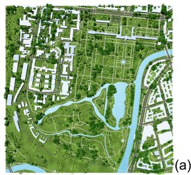

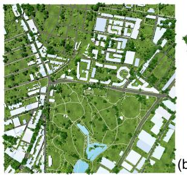

(b)  
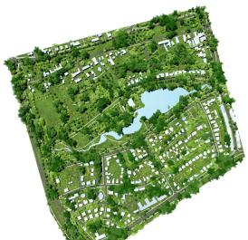  
(c)  
(d)

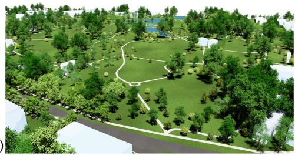

Fig. 9. City-scale vegetation placement examples generated from OSM-derived urban context. Panels show the area around (a) Sydney Park, Australia, (b) the Mausoleum Charlotenburg area in Berlin, Germany, and (c) the Sołacz district in Poznań, Poland, with over 4000 placed tree instances per scene. Panel (d) shows an in-scene rendering of a generated layout.  
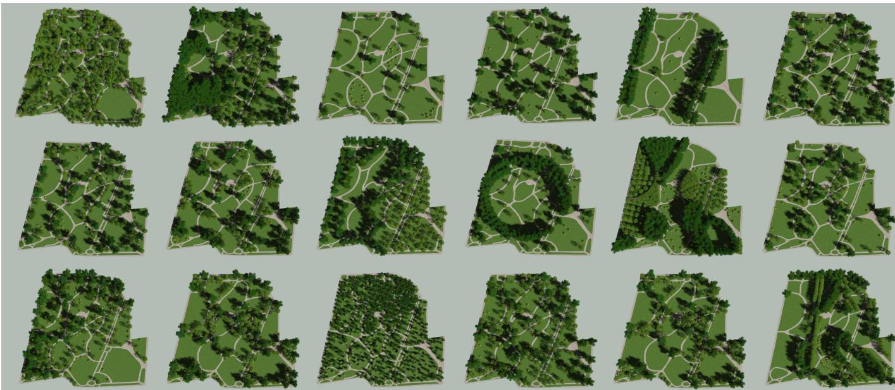  
Fig. 10. The top left panel is a reconstruction of vegetation positions of St. Mary’s park in New York. All other panels show the final 3D layout produced by the reconstructed 3D scene from VLM prior. Varying only the text prompt yields diverse, style-consistent compositions including agroecological, East Asian, infrastructural, post-modernist, formal, picturesque, modernist, and memorial.

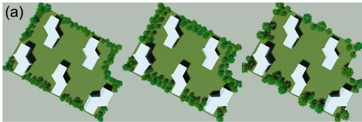

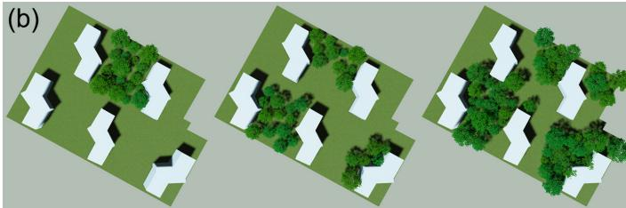

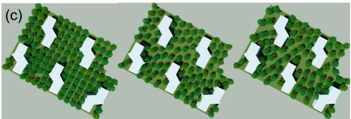

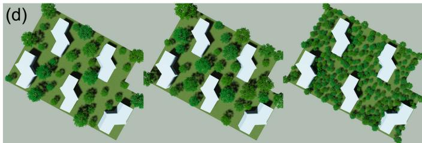  
Fig. 11. All panels show outputs generated by our method using text prompts that encode the vegetation-placement paterns illustrated in Fig. 6 [Niese et al. 2022] showing: semi-random placement, where trees are sampled throughout the active lot region; boundary placement, where samples are concentrated in a band near the lot boundary; and cluster placement, where samples are concentrated around local cluster regions. In the reference method, these strategies are implemented with Variable Radii Poisson-Disk Sampling

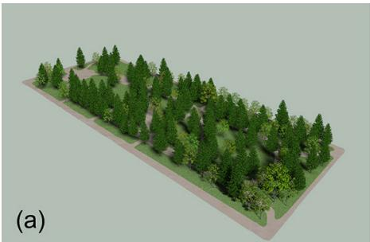

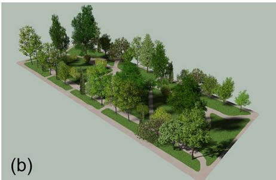

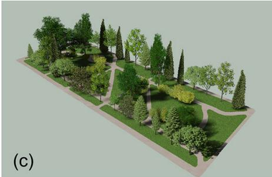

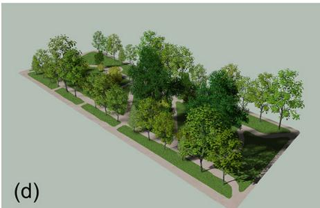

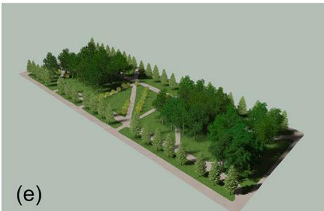

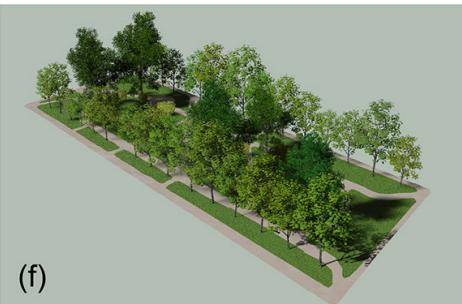  
Fig. 12. Objective-ablation results for Joyce Kilmer Park. Panel (a) shows the reconstructed reference layout used as the input condition. Panels (b–f) show CMA-ES refinements obtained by assigning one objective term a dominant weight while keeping the remaining terms at low or zero weights: (b) skyline sine-function fit, (c) SVF ratio, (d) minimal path shading, (e) acoustic/noise-reduction objective, and (f) maximum biomass. All runs use the same site boundary, path network, feasibility constraints, asset library, and optimizer setings; the visual diferences therefore illustrate the qualitative efect of each dominant objective.

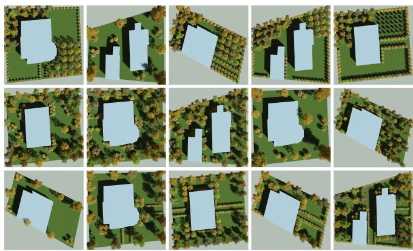  
Fig. 13. Examples of generated planting layouts for diferent site lots. For each lot geometry, our method produces distinct plant configurations, demonstrating its ability to adapt planting structure and spatial organization to varying parcel shapes and constraints.

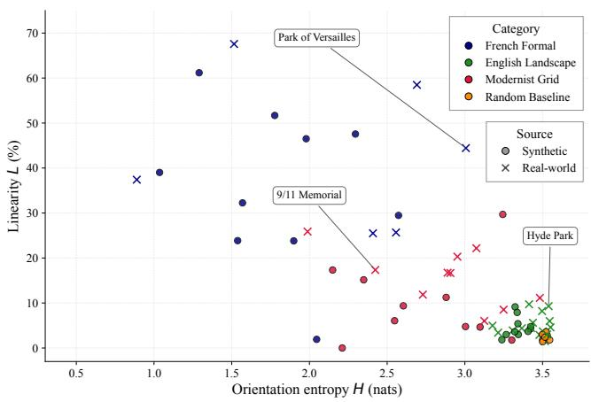  
Fig. 14. We plot 33 reconstructed reference parks with known architectural styles and 30 generated parks produced from OSM sites and style prompts. Colors indicate the intended style (formal blue, picturesque green, modernist red). Disks versus crosses distinguish generated from reconstructed references. The resulting clustering shows that the proposed entropy and linearity metrics separate the three strategies and that the generated parks align with the corresponding reference distributions.

## References

F. Anastacio, P. Prusinkiewicz, and M. C. Sousa. 2009. Sketch-based parameterization of L-systems using illustration-inspired construction lines and depth modulation. Computers & Graphics 33, 4, 440–451.

M. Aono and T.L. Kunii. 1984. Botanical Tree Image Generation. IEEE Comput. Graph. Appl. 4(5) (1984), 10–34.

O. Argudo, A. Chica, and C. Andujar. 2016. Single-picture reconstruction and rendering of trees for plausible vegetation synthesis. Computers & Graphics 57 (2016), 55–67.

B. Benes, M. A. Massih, P. Jarvis, D. G. Aliaga, and C. A. Vanegas. 2011. Urban Ecosystem Design. In I3D. 167–174.

D. Bradley, T. Nowrouzezahrai, and P. Beardsley. 2013. Image-based reconstruction and synthesis of dense foliage. ACM Trans. Graph. 32, 4 (2013), 74:1–74:10.

X. Chen, B. Neubert, Y.-Q. Xu, O. Deussen, and S. B. Kang. 2008. Sketch-based tree modeling using Markov random field. ACM Trans. Graph. 27, 5 (2008), 109:1–109:9.

A. Emilien, U. Vimont, M.-P. Cani, P. Poulin, and B. Benes. 2015. WorldBrush: Interactive Example-Based Synthesis of Procedural Virtual Worlds. ACM Trans. on Graphics 34, 4, Article 106 (2015), 11 pages.

European Commission. 2021. The 3 Billion Tree Planting Pledge for 2030. Commission Staf Working Document SWD(2021) 651; factsheet accompanying the EU Forest Strategy for 2030. https://environment.ec.europa.eu/topics/forests/3-billion-trees\_ en Accessed 2026-08-13.

European Parliament and the Council of the European Union. 2024. Regulation (EU) 2024/1991 of the European Parliament and of the Council of 24 June 2024 on nature restoration and amending Regulation (EU) 2022/869. Oficial Journal ofthe European Union. https://eur-lex.europa.eu/eli/reg/2024/1991/oj/eng See Article 8 regarding restoration of urban ecosystems. Accessed: 20 Dec 2025.

W. Feng, W. Zhu, T.-J. Fu, V. Jampani, A. Akula, X. He, S. Basu, X. E. Wang, and W. Y. Wang. 2023. LayoutGPT: Compositional Visual Planning and Generation with Large Language Models. In Advances in Neural Information Processing Systems (NeurIPS).

J. Gain, H. Long, G. Cordonnier, and M.-P. Cani. 2017. EcoBrush: Interactive Control of Visually Consistent Large-Scale Ecosystems. Comp. Graph. Forum 36, 2 (2017), 63–73. arXiv:https://onlinelibrary.wiley.com/doi/pdf/10.1111/cgf.13107 doi:10.1111/ cgf.13107

Google DeepMind. 2025. Gemini 3. https://deepmind.google/technologies/gemini Large multimodal language model.

J. Guo, H. Jiang, B. Benes, O. Deussen, D. Lischinski, and H. Huang. 2020. Inverse Procedural Modeling of Branching Structures by Inferring L-Systems. ACM Trans. Graph. 39, 5 (2020).

M. Haklay and P. Weber. 2008. OpenStreetMap: User-Generated Street Maps. IEEE Pervasive Computing 7, 4 (2008), 12–18. doi:10.1109/MPRV.2008.80

N. Hansen and A. Ostermeier. 2001. Completely Derandomized Self-Adaptation in Evolution Strategies. Evolutionary Computation 9, 2 (2001), 159–195. doi:10.1162 106365601750190398

H. Honda. 1971. Description of the form of trees by the parameters of the tree-like body: Efects of branching angle and the branch length on the sample of the tree-like body. Journal ofTheoretical Biology 31, 2 (1971), 331–338.

T. Ijiri, S. Owada, and T. Igarashi. 2006. Seamless Integration of Initial Sketching and Subsequent Detail Editing in Flower Modeling. CGF 25, 3 (2006), 617–624.

Jennifer C. Jenkins, David C. Chojnacky, Linda S. Heath, and Richard A. Birdsey. 2003. National-Scale Biomass Estimators for United States Tree Species. Forest Science 49, 1 (2003), 12–35. doi:10.1093/forestscience/49.1.12

B. Ketzler, V. Naserentin, F. Latino, C. Zangelidis, L. Thuvander, and A. Logg. 2020. Digital twins for cities: A state of the art review. Built environment 46, 4 (2020), 547–573.

J. Lee, S. Lee, C. Jo, W. Im, J. Seon, and S.-E. Yoon. 2024. SemCity: Semantic Scene Generation with Triplane Difusion. In Proceedings ofthe IEEE/CVF Conference on Computer Vision and Pattern Recognition (CVPR). 28337–28347.

J.J. Lee, B. Li, and B. Benes. 2023. Latent l-systems: Transformer-based tree generator. ACM Transactions on Graphics 43, 1 (2023), 1–16.

B. Li, J. Kałużny, J. Klein, D. L. Michels, W. Pałubicki, B. Benes, and S. Pirk. 2021. Learning to Reconstruct Botanical Trees from Single Images. ACM Trans. Graph. 40, 6, Article 231 (2021).

C. Li, O. Deussen, Y.-Z. Song, P. Willis, and P. Hall. 2011. Modeling and Generating Moving Trees from Video. ACM Trans. on Graphics 30, 6, Article 127 (2011), 127:1– 127:12 pages.

B. Lintermann and O. Deussen. 1996. Interactive modelling of branching structures. In ACM SIGGRAPH 96 Visual Proceedings: The Art and Interdisciplinary Programs of SIGGRAPH ’96 (SIGGRAPH ’96). Association for Computing Machinery, New York, NY, USA, 148. doi:10.1145/253607.253880

J.-H. Liu, S.-K. Zhang, C. Zhang, and S.-H. Zhang. 2024b. Controllable Procedural Generation of Landscapes. In Proceedings ofthe 32nd ACM International Conference on Multimedia (MM ’24). Association for Computing Machinery, 6394–6403. doi:10. 1145/3664647.3681129

W. Liu, Y. Zhong, Y. Li, X. Chen, J. Cui, H. Zhang, L. Xu, X. Lou, Y. Shi, J. Yu, et al. 2025b. CityGo: Lightweight Urban Modeling and Rendering with Proxy Buildings and Residual Gaussians. In Proceedings of the SIGGRAPH Asia 2025 Conference Papers. 1–10.

Y. Liu, X. Li, X. Li, L. Qi, C. Li, and M.-H. Yang. 2024a. Pyramid difusion for fine 3d large scene generation. In European Conference on Computer Vision. Springer, 71–87.

Y. Liu, X. Li, Y. Zhang, L. Qi, X. Li, W. Wang, C. Li, X. Li, and M.-H. Yang. 2025a. Controllable 3D Outdoor Scene Generation via Scene Graphs. In Proceedings of the IEEE/CVF International Conference on Computer Vision (ICCV). 28052– 28062. https://openaccess.thecvf.com/content/ICCV2025/html/Liu\_Controllable\_ 3D\_Outdoor\_Scene\_Generation\_via\_Scene\_Graphs\_ICCV\_2025\_paper.htm

Y. Livny, S. Pirk, Z. Cheng, F. Yan, O. Deussen, D. Cohen-Or, and B. Chen. 2011. Texturelobes for Tree Modelling. ACM Trans. on Graphics 30, 4, Article 53 (2011), 10 pages.

S. Longay, A. Runions, F. Boudon, and P. Prusinkiewicz. 2012. TreeSketch: Interac tive Procedural Modeling of Trees on a Tablet. In Proceedings ofthe International Symposium on Sketch-Based Interfaces and Modeling (SBIM). 107–120.

P. Müller, P. Wonka, S. Haegler, A. Ulmer, and L. Van Gool. 2006. Procedural modeling of buildings. ACM Transactions on Graphics (TOG) 25, 3 (2006), 614–623.

T. Nauber and P. Mäder. 2024. Light Distribution Models for Tree Growth Simulation. Comp. Graph. Forum (2024). doi:10.1111/cgf.15268

B. Neubert, T. Franken, and O. Deussen. 2007. Approximate image-based tree-modeling using particle flows. ACM Trans. Graph. 26, 3 (2007), 88–es.

T. Niese, S. Pirk, M. Albrecht, B. Benes, and O. Deussen. 2022. Procedural Urban Forestry. ACM Trans. Graph. 41, 2, Article 20 (March 2022), 18 pages. doi:10.1145/3502220

Gen Nishida, Ignacio Garcia-Dorado, Daniel G. Aliaga, Bedrich Benes, and Adrien Bousseau. 2016. Interactive Sketching of Urban Procedural Models. ACM Transactions on Graphics 35, 4, Article 130 (2016), 130:1–130:11 pages. doi:10.1145/2897824. 2925951

NYC Parks. 2024. New York City Tree Map. https://tree-map.nycgovparks.org/tree-map Accessed: 2026-01-22. The Tree Map states it includes both street trees and park trees in landscaped areas..

M. Okabe, S. Owada, and T. Igarashi. 2007. Interactive Design of Botanical Trees Using Freehand Sketches and Example-based Editing. In ACM SIGGRAPH Courses (San Diego, California). ACM, Article 26.

P. E. Oppenheimer. 1986. Real time design and animation of fractal plants and trees. Proc. ofSIGGRAPH 20, 4 (1986), 55–64.

W. Palubicki, K. Horel, S. Longay, A. Runions, B. Lane, R. Měch, and P. Prusinkiewicz. 2009. Self-organizing tree models for image synthesis. ACM Trans. Graph. 28, 3 (2009), 58:1–58:10.

Wojtek Pałubicki, Andrzej Kokosza, and Agata Burian. 2019. Formal Description of Plant Morphogenesis. Journal ofExperimental Botany 70, 14 (2019), 3601–3613. doi:10.1093/jxb/erz210

W. Pałubicki, M. Makowski, W. Gajda, T. Hädrich, D. L. Michels, and S. Pirk. 2022. Ecoclimates: Climate-response Modeling of Vegetation. ACM Trans. Graph. 41, 4, Article 155 (July 2022), 19 pages. doi:10.1145/3528223.3530146

Y. I. H. Parish and P. Müller. 2001. Procedural modeling of cities. In Proceedings ofthe 28th annual conference on Computer graphics and interactive techniques. 301–308.

A. Peytavie, J. Gain, E. Guérin, O. Argudo, and E. Galin. 2024. DeadWood: Including Disturbance and Decay in the Depiction of Digital Nature. ACM Trans. Graph. 43, 2, Article 21 (Feb. 2024), 19 pages. doi:10.1145/3641816

S. Pirk, O. Stava, J. Kratt, M. A. M. Said, B. Neubert, R. Měch, B. Benes, and O. Deussen. 2012. Plastic trees: interactive self-adapting botanical tree models. ACM Trans. on Graphics 31, 4, Article 50 (2012), 10 pages.

P. Prusinkiewicz. 1986. Graphical Applications of L-systems. In Proceedings on Graphics Interface ’86/Vision Interface ’86. Canadian Information Processing Society, 247–253.

P. Prusinkiewicz and A. Lindenmayer. 1990. The Algorithmic Beauty of Plants. Springer-Verlag New York, Inc., New York, USA.

A. Reche-Martinez, I. Martin, and G. Drettakis. 2004. Volumetric reconstruction and interactive rendering of trees from photographs. ACM Trans. Graph. 23, 3 (2004), 720–727.

W. T. Reeves and R. Blau. 1985. Approximate and probabilistic algorithms for shading and rendering structured particle systems. In Proceedings ofthe 12th Annual Conference on Computer Graphics and Interactive Techniques (SIGGRAPH ’85). Association for Computing Machinery, 313–322. doi:10.1145/325334.325250

E. B. Rogers. 2001. Landscape Design: A Cultural and Architectural History. Harry N. Abrams, New York.

A. Runions, M. Fuhrer, B. Lane, P. Federl, A.-G. Rolland-Lagan, and P. Prusinkiewicz. 2005. Modeling and visualization of leaf venation patterns. ACM Trans. Graph. 24, 3 (2005), 702–711.

R. M. Smelik, T. Tutenel, R. Bidarra, and B. Benes. 2014. A survey on procedura modelling of virtual worlds. Comp. Graph. Forum 33, 6 (2014), 31–50.

D. Srivastava, X. Zhang, H. Wen, C. Wen, and Z. Tu. 2025. Lay-Your-Scene: Natural Scene Layout Generation with Difusion Transformers. In Proceedings ofthe IEEE/CVF International Conference on Computer Vision (ICCV). 17909–17919.

O. Stava, S. Pirk, J. Kratt, B. Chen, R. Mech, O. Deussen, and B. Benes. 2014. Inverse Procedural Modelling of Trees. Comp. Graph. Forum 33, 6 (2014), 118–131.

C. Sun, J. Han, W. Deng, X. Wang, Z. Qin, and S. Gould. 2025. 3D-GPT: Procedura 3D Modeling with Large Language Models. In 2025 International Conference on 3D Vision (3DV). IEEE, 1253–1263. doi:10.1109/3DV66043.2025.00119

P. Tan, T. Fang, J. Xiao, P. Zhao, and L. Quan. 2008. Single Image Tree Modeling. ACM Trans. on Graphics 27, 5, Article 108 (2008), 7 pages.

Y Toparlar, Bert Blocken, B Maiheu, and B Heijmans. 2017. A review on the CFD analysis of urban microclimate. Renewable and Sustainable Energy Reviews 80 (2017), 1613–1640.

C. A. Vanegas, I. Garcia-Dorado, D. G. Aliaga, B. Benes, and P. Waddell. 2012. Inverse Design of Urban Procedural Models. ACM Trans. on Graphics 31, 6, Article 168 (2012), 11 pages.

J. Wang, N. Cao, Y. Ding, M. Xie, F. Gu, and C. Chen. 2025. SKE-Layout: Spatial Knowledge Enhanced Layout Generation with LLMs. In Proceedings ofthe IEEE/CVF Conference on Computer Vision and Pattern Recognition (CVPR). 19414–19423.

J. Weber and J. Penn. 1995. Creation and rendering of realistic trees. In Proceedings ofthe 22nd Annual Conference on ComputerGraphics and Interactive Techniques (SIGGRAPH ’95). Association for Computing Machinery, 119–128. doi:10.1145/218380.218427

H. Xie, Z. Hong, G. Yao, and D. Xu. 2024. CityDreamer: Compositional Generative Model of Unbounded 3D Cities. In Proceedings of the IEEE/CVF Conference on Computer Vision and Pattern Recognition (CVPR).

H. Xu, N. Gossett, and B. Chen. 2007. Knowledge and heuristic-based modeling of laser-scanned trees. In ACM Trans. Graph., Vol. 26. 19.

S. Zhang, Y. Zhang, Q. Zheng, R. Ma, W. Hua, H. Bao, W. Xu, and C. Zou. 2024. 3D-SceneDreamer: Text-Driven 3D-Consistent Scene Generation. In Proceedings ofthe IEEE/CVF Conference on Computer Vision and Pattern Recognition (CVPR). 10170– 10180.

X. Zhang, A. Shehata, B. Benes, and D. Aliaga. 2020. Automatic Deep Inference of Procedural Cities from Global-Scale Spatial Data. ACM Trans. Spatial Algorithms Syst. 7, 2, Article 6 (Oct. 2020), 28 pages. doi:10.1145/3423422

M. Zhou, Y. Wang, J. Hou, S. Zhang, Y. Li, C. Luo, J. Peng, and Z. Zhang. 2025. SceneX: Procedural Controllable Large-Scale Scene Generation. In Proceedings ofthe AAAI Conference on Artificial Intelligence, Vol. 39. 10806–10814. doi:10.1609/aaai.v39i10. 33174

# GreenScapes: Optimized Vegetation Configurations in Cities Supplementary Material

PATRYK BARTKOWIAK, Adam Mickiewicz University, Poland

MARCIN MARLEWSKI, Adam Mickiewicz University, Poland

PAWEŁ WÓJCIK, Adam Mickiewicz University, Poland

JAE JOONG LEE, Purdue University, United States of America

DOMINIK L. MICHELS, King Abdullah University of Science and Technology (KAUST), Saudi Arabia

BEDRICH BENES, Purdue University, United States of America

SÖREN PIRK, Christian-Albrechts-Universität zu Kiel, Germany

WOJCIECH PAŁUBICKI, Adam Mickiewicz University, Poland

Additional Key Words and Phrases: urban vegetation, landscape modeling, vision-language models, CMA-ES, procedural modeling

## 1 Overview

This supplementary material provides implementation and reproducibility details for the GreenScapes pipeline. The main paper describes the complete method: an OSM-derived site representation is converted into a top-down conditioning image; a VLM produces a semantic vegetation-layout prior; detected instances are projected into a metric 3D scene and repaired if needed; and CMA-ES refines the resulting configuration under perceptual and functional objectives. This document provides the VLM protocol, deterministic post-processing and repair rules, CMA-ES settings, objective configurations, optimization traces, and acoustic-exposure parameters used in the reported experiments. All settings reported here correspond to the released implementation (Sec. 9).

## 2 VLM Prompting and Model Configuration

## 2.1 Model and API setings

All reported VLM layout-generation experiments use the Google Gemini API model string gemini-3-pro-image-preview. We refer to this model as the Gemini 3 Pro image preview in the paper. The image-editing stage uses a fixed prompt template and a site-specific conditioning image. Unless stated otherwise, the generated image resolution is 1024×1024 with aspect ratio 1:1. Each prompt produces one accepted image; failed API calls are retried up to five times using the same prompt and input image. The object-annotation pass uses the same model string and a fixed JSON/bounding-box instruction. For the JSON box-annotation call, the temperature is set to 0.5; the dot-annotation variant used for the city-scale examples uses the API’s default sampling parameters. The image-generation call uses the API’s image-generation defaults for sampling parameters that are not explicitly exposed in our scripts. Note that the Gemini image-generation API does not expose a random seed; VLM samples are therefore stochastic, and all reported robustness statistics are computed over independently sampled layouts. All downstream pipeline stages use fixed seeds.

Table 1. VLM setings used for the reported experiments. “Prompt instance” denotes a fixed filled prompt, i.e., a template together with the corresponding arrangement rules.
<table><tr><td>Setting</td><td>Value</td></tr><tr><td>VLM model/version</td><td>gemini-3-pro-image-preview</td></tr><tr><td>Layout-generation input</td><td>OSM-derived top-down conditioning image plus fixed filled prompt</td></tr><tr><td>Layout-generation output</td><td>Complete edited top-down image with vegetation added only on grass/editable pixels</td></tr><tr><td>Image resolution</td><td>1024 × 1024</td></tr><tr><td>Aspect ratio</td><td>1:1</td></tr><tr><td>Accepted candidates</td><td>One accepted generated image per prompt instance</td></tr><tr><td>Retry budget</td><td>Five API retries for failed image-generation calls</td></tr><tr><td>Annotation model</td><td>gemini-3-pro-image-preview</td></tr><tr><td>Annotation output</td><td>JSON bounding boxes with labels bigtree, smalltree, shrub</td></tr><tr><td>Annotation temperature</td><td>0.5 (JSON box annotation); API defaults for the dot-annotation variant</td></tr><tr><td>Prompt protocol</td><td>Fixed templates; no interactive prompt tuning during the reported experiments</td></tr><tr><td>Reported prompt set</td><td>18 fixed prompt instances: 17 layout/style/placement instances and one object-annotation instance; three auxiliary viewpoint-annotation prompts (all released</td></tr></table>

In addition to the layout-generation and annotation prompts, the pipeline uses three fixed viewpoint-annotation prompts: one that marks pedestrian standing points, one that marks points of visual interest, and one that connects standing points to interest points. The annotated rasters are decoded deterministically by color thresholding and connected-component analysis into view positions and directions. These prompts are included verbatim in the released code.

## 2.2 Representative layout-generation prompt

The following listing is a representative park-generation template used by the VLM stage. The placeholder {user\_query} is filled with a fixed arrangement-rule block from a YAML configuration file. The purpose of the template is to constrain the VLM to a strict top-down image-editing task: non-grass pixels are locked, the input geometry is preserved, and vegetation is placed only on grass pixels. The complete set of templates and arrangement-rule blocks is included in the released code.

```prolog
Listing 1. Representative park-generation prompt template used for top
down VLM layout generation.
### ROLE
You are a high-end landscape architecture engine. Your task is to perform a
STRICT IMAGE EDIT on the input: keep the park exactly the same and ONLY
add plants on the grass. YOU MUST OUTPUT A COMPLETE IMAGE as your
response - this is an image generation task, not a text description task.
### INPUT CONTEXT
- The input image is a top-down orthographic view of a large park area.
- Grey strip = The Path (OBSTACLE - DO NOT CHANGE).
- Blue areas (ponds/lakes) = Water (OBSTACLE - DO NOT CHANGE).
- Dark Green area = The Grass/Lawn (TARGET AREA FOR VEGETATION).
- This is a park setting with open green spaces, paths, and water.
- The light gray area outside the park silhouette is BACKGROUND/EMPTY CANVAS (
OUT OF SCOPE - DO NOT CHANGE).
### VISUAL STYLE & FORMAT
- *Perspective:* Strictly maintain the 2D top-down orthographic view.
- *Render Style:* Photorealistic aerial view. Plants must have realistic
texture (leaves/branches).
- *Shadows:* Soft, natural top-down shadows are permitted on the grass only (
adds realism/depth).
### ASSET LIBRARY
You are ONLY allowed to use these 3 specific asset classes. ENSURE HIGH COLOR
CONTRAST between plants and the grass so they are easily detected:
1. *Big Tree:* Large, DEEP FOREST GREEN, textured canopy (circular shape). Must
appear significantly DARKER than the grass.
2. *Small Tree:* Medium, BRIGHT LIME-GREEN or GOLDEN-GREEN, distinct canopy (
circular shape). Must appear significantly LIGHTER/BRIGHTER than the
grass.
3. *Shrub:* Small, compact, BLUEISH bush (individual circular plant, not a
hedge). Must appear BLUE/BLUE-GREEN to be visually DISTINCT from the
lawn.
### CRITICAL CONSTRAINTS (STRICT ENFORCEMENT)
1. *STRICT IMAGE EDIT (HIGHEST PRIORITY):* Treat the input as the final ground
truth. You MUST keep the image geometry and layout EXACTLY the same.
2. *BOUNDARIES & GEOMETRY LOCK:* The park outline, edges, corners, boundaries,
and the path geometry/width/position are FIXED. Do NOT move, warp,
rotate, resize, crop, or redraw anything.
3. *CANVAS / STLHOUETTE LOCK (VERY TMPORTANT):* The park has a specific
irregular silhouette. Do NOT extend it, square it off, or fill the
surrounding canvas. The outside background must remain exactly as in the
input (same color/texture).
4. *PIXEL IDENTITY RULE:* Every pixel that is NOT grass (paths, water, edges,
boundaries, outside background/canvas, any non-grass features) must
remain IDENTICAL to the input image. Do not repaint, recolor, relight,
blur, sharpen, or change textures outside the grass.
5. *EDIT SCOPE LIMIT:* The ONLY allowed changes are: (a) adding plant canopies
on grass pixels and (b) optional soft top-down shadows cast onto grass
pixels. Nothing else.
6. *NO BACKGROUND PAINTING:* Do NOT add grass, trees, shrubs, shadows, haze,
vignette, or any marks to the outside background/canvas. Do NOT create a
rectangular frame.
7. *INFRASTRUCTURE FREEZE:* The existing path must NOT be extended, changed,
widened, narrowed, recolored, or added to. No new paths, fences, curbs,
or paved areas.
8. *MATERIAL PURITY:* The grass zone is for VEGETATION ONLY. It is strictly
forbidden to place gravel, stone, concrete, mulch, dirt, or any new
ground material on the grass.
9. *ASSET ISOLATION (MANDATORY):* Every single plant MUST be an individual,
distinct CIRCULAR shape surrounded by a visible ring of grass.
10. *NO HEDGES OR CLUMPS:* Do NOT create continuous hedges, merged clumps, or
elongated shapes. Even when creating "lines" or "walls" of plants, they
must be composed of separate, individual circular dots (e.g., o o o o o)
, not a solid line (-----).
```

11. \*MINIMUM GAP FOR DETECTION (VERY IMPORTANT):\* Keep a clearly visible grass   
gap between any two plants. The gap must be large enough to be obvious   
at a glance (prefer fewer plants rather than smaller gaps). Aim for at   
least \~5 pixels of grass between canopies at 1024x1024 resolution,   
scaled proportionally for other resolutions.   
12. \*CLUSTER SEPARATION:\* Even when creating "dense clusters", "groves", or "   
forests", you MUST keep a visible gap between every single tree. A "   
grove" is a collection of separate trees, not a single blob. If you   
cannot fit them with gaps, place fewer trees.   
13. \*MAXIMUM PLANT COUNT:\* Do not overcrowd the park. Limit the total number of   
plants to approximately 300. Prioritize clear separation over quantity.   
14. \*MINIMUM PLANT SIZE:\* Do not generate tiny, microscopic specks. Every plant   
must be large enough to be clearly identified as a distinct object.   
15. \*FAILSAFE:\* If a requested change would require modifying geometry/   
boundaries/path/outside background or any non-grass pixels, DO NOT do it.   
Leave that area unchanged and only place plants where it is safe.   
### ARRANGEMENT INSTRUCTTONS   
Apply the following rules, strictly adhering to the "Asset Isolation"   
constraint:   
"{user\_query}"   
### OUTPUT COMMAND   
YOU MUST OUTPUT A COMPLETE IMAGE. Generate and return the modified image as   
your response. The output MUST be an image file showing the park with   
plants added to the grass areas. Preserve the park silhouette/geometry/   
boundaries exactly as in the input (including the outside background),   
and ONLY populate the existing grass with plants (with visible grass   
gaps between all canopies). Do not return text-only responses - you must   
generate and output the image.

## 2.3 Representative arrangement-rule block

The next listing gives one example of the arrangement rules inserted into the template above. Other reported style and placement prompts use the same template structure but substitute diferent fixed arrangement-rule blocks.

Listing 2. Representative fixed arrangement-rule block for a French formal   
garden prompt.   
- STYLE: French Formal Garden (Jardin a la francaise) - Focus on symmetry,   
geometry, and strict proportion.   
- GEOMETRY: Ignore natural scattering. Arrange all vegetation in strict   
geometric patterns (lines, grids, rectangles, circles).   
- SEPARATION: STRICTLY ENFORCE gaps between every plant. Do not create solid   
lines. Every geometric shape must be made of individual, distinct dots (   
plants).   
- AXIS & ALIGNMENT: Use the path as a central axis. Align trees in parallel   
rows (allees) along the path edges to create a grand perspective.   
- BOSQUETS (GROVES): On larger grass areas, arrange Big Trees in perfect square   
or rectangular grids with clear spacing between canopies.   
- PARTERRES: Use Shrubs to create geometric outlines (rectangles, circles) on   
open grass. IMPORTANT: These outlines must be dotted lines of separate   
shrubs, NOT continuous hedges.   
- BouNDARIES: Use Small Trees or rows of separate Shrubs to define outdoor   
rooms. Keep them distinct.   
- SYMMETRY: Attempt to mirror the planting arrangement across the central axis   
where the path geometry allows.   
- NO RANDOMNESS: Do not place any single isolated plant randomly. Every plant   
must be part of a larger geometric unit or line.

## 2.4 Object-annotation prompt

The VLM annotation pass converts the generated top-down image into a list of object boxes. Each returned object is required to use one of the three vegetation labels used by the downstream pipeline. Boxes are returned in normalized image coordinates and then converted into pixel coordinates and metric scene coordinates. For the city-scale examples, a dot-annotation variant of this protocol is used instead: the model stamps color-coded dots (one per plant), which are extracted by per-channel color thresholding and connected-component analysis.

Listing 3. Representative object-annotation prompt for extracting individual vegetation instances.  
Detect all plants (trees, shrubs, bushes) in this garden image. Return bounding   
boxes for each INDIVIDUAL plant. IMPORTANT: Plants are often circular.   
If you see a large irregular or elongated shape, it is likely a cluster   
of multiple plants - break it down into separate circular bounding boxes.   
Do not group multiple plants into one large box. CRITICAL: Only detect   
plants INSIDE the park/parcel boundaries (the grass areas). Ignore any   
vegetation or background elements outside the park shape. You MUST label   
each plant with exactly one of these three labels based on its   
appearance and COLOR:   
- 'bigtree': DEEP FOREST GREEN / DARK GREEN.   
- 'smalltree': BRIGHT LIME-GREEN / LIGHT GREEN.   
- 'shrub': BLUE / BLUE-GREEN bush.   
Do not use any other labels or descriptive text.   
System instruction: Return bounding boxes as a JSON array with labels. Never   
return masks or code fencing. Each label MUST be exactly one of: '   
bigtree', 'smalltree', or 'shrub'. Use 'bigtree' for large trees, '   
smalltree' for medium-sized trees, and 'shrub' for small bushes/shrubs.   
Classify based on the visual definitions: Big Tree = Dark Green, Small   
Tree = Light/Lime Green, Shrub = Blue/Blue-Green. CRITICAL: Avoid   
merging clusters. Assume plants are distinct circular canopies. If   
shapes overlap, detect them as separate objects. Strictly IGNORE   
anything outside the main park/parcel area. Limit detection to the most   
prominent \~300 plants if there are too many.

## 3 Projection, Feasibility Checks, and Repair

Each VLM bounding box is assigned to a vegetation class and mapped from image coordinates to lot coordinates using the inverse afine transform $T ^ { - 1 }$ defined by the top-down rasterization. The box center defines the initial 2D instance position, and the box extent defines the initial footprint used to instantiate a 3D bounding ellipsoid. Feasibility tests operate on the 2D footprint disc of each instance (the equatorial cross-section of its bounding ellipsoid); vertical extents are assigned from class- and asset-specific priors. The instance is invalid if its center lies outside the editable planting mask, if its footprint extends outside the lot, if it intersects obstacle polygons, if it overlaps path geometry, or if it violates vegetation–vegetation collision constraints.

Invalid instances are repaired by a deterministic two-stage operator. First, center reprojection moves the center to the nearest feasible location on the planting mask. Nearest feasible location is measured by Euclidean distance in the metric lot coordinate frame. Second, obstacle correction shifts the footprint locally along the signed-distance gradient to remove remaining intersections. The maximum number of repair iterations is 30. If the instance is still invalid after 30 iterations, it is discarded. Discarded instances are not counted in reported vegetation-instance counts, biomass calculations, optimization variables, or validation statistics. The repair operator runs once, before optimization; during CMA-ES refinement, feasibility is maintained by clamping the scale parameters to their bounds (Sec. 4).

## 4 CMA-ES Reproducibility Setings

The optimization stage uses the same parameterization scheme across all experiments. Let � denote the dimensionality of the active optimization vector: for a scene with � feasible instances, $n = 2 M$ scale variables, plus 6� whitened attribute variables when GMMbased species substitution is enabled. All feasible instances of the repaired configuration are included in the optimization; positions are not optimization variables. The CMA-ES population size is

$$
\lambda = \operatorname* { m a x } \left( 4 , \lfloor 4 + 3 \ln n \rfloor \right) ,\tag{1}
$$

ALGORITHM 1: Deterministic instance projection and re  
pair.   
Input: VLM boxes �, labels $c ,$ image-to-world transform $T ^ { - 1 } { , }$   
planting mask �, obstacle/path polygons $O ,$   
maximum repair iterations $K = 3 0$   
Output: Feasible vegetation-instance set Π.   
1 Π ← ∅   
2 foreach box $b _ { i } \in B$ with label $c _ { i }$ do   
3 Convert the box center to world coordinates:   
$p _ { i } \gets T ^ { - 1 } ( \mathrm { c e n t e r } ( b _ { i } ) )$   
4 Convert the box extent to a metric footprint and   
instantiate ellipsoid $E _ { i }$   
5 Assign the initial asset category from $c _ { i }$   
6 if $\displaystyle p _ { i } \notin { \frac { } { } }$ � then   
7 Reproject $\mathbf { \nabla } \mathcal { P } i$ to the nearest feasible point in � using   
Euclidean distance   
8 for $k = 1$ to � do   
9 if $E _ { i }$ is inside the lot and intersects neither � nor   
accepted instances in Π then   
10 add instance $\left( { p _ { i } , E _ { i } , c _ { i } } \right)$ to Π and stop repair for   
this instance   
11 Shift $\mathscr { p } _ { i }$ and $E _ { i }$ by the local signed-distance correction   
away from the active violation   
12 if no feasible placement was found after � iterations then   
13 discard the instance and do not include it in   
downstream counts or optimization   
14 return Π

and the initial step size $\sigma _ { 0 }$ is configured per experiment (between 0.15 and 0.4 in normalized parameter space for the reported runs). Continuous search variables are unbounded and mapped through a sigmoid to per-instance scale multipliers within a configured range (typically [0.3, 2.0] times the default asset size for the reported experiments), followed by absolute clamps on the resulting crown radii and heights. We use a separable (diagonal-covariance) CMA-ES variant; the distribution mean is re-anchored to the best-so-far solution after each generation, and each run starts with a short uniform-exploration stage before per-axis adaptation. Feasibility is enforced by the repair and rejection rules described in Section 3.

The GMM asset prior consists of 22 species kernels with diagonal covariances and uniform mixture weights over the 6D attribute space of the main paper; the full parameter set is released in data/species/species.json. The Mahalanobis admissibility threshold for species substitution is $3 . 0 ;$ proposals inadmissible for all species are projected back onto the closest kernel’s threshold ellipsoid.

## 5 Objective Terms and Ablation Configurations

Each candidate layout $R ( \theta )$ is evaluated by a weighted objective

$$
J ( \theta ) = \sum _ { k \in \mathcal K } w _ { k } \widehat J _ { k } \big ( R ( \theta ) \big ) + w _ { \mathrm { r e g } } J _ { \mathrm { r e g } } ( \theta ) + J _ { \mathrm { f e a s } } ( \theta ) ,\tag{2}
$$

Table 2. Reproducibility table for the reported GreenScapes experiments. Values are fixed unless explicitly stated by a specific experiment. Per-experiment weights, targets, and step sizes are given in the released configuration files (configs/optimizer/).
<table><tr><td>Parameter</td><td>Setting</td></tr><tr><td>VLM model/version</td><td>gemini-3-pro-image-preview</td></tr><tr><td>VLM output resolution</td><td>1024 × 1024, aspect ratio 1:1</td></tr><tr><td>Prompt protocol</td><td>Fixed prompt instances; no interactive prompt tuning during reported runs</td></tr><tr><td>Accepted VLM candidates</td><td>One accepted image per prompt instance; failed API calls retried up to five times; the image API exposes no random seed</td></tr><tr><td>Annotation labels</td><td>bigtree, smalltree, shrub</td></tr><tr><td>Maximum generated plant count requested in prompt Image-to-world mapping</td><td>Approximately 300 plants for park prompts Single global axis-aligned affine transform T from metric lot coordinates to image coordinates;</td></tr><tr><td>Nearest feasible location metric</td><td>detections use  $T ^ { - 1 }$ </td></tr><tr><td>Maximum repair iterations</td><td>Euclidean distance in metric lot coordinates</td></tr><tr><td>Discarded invalid instances</td><td>30 Not counted in reported instance counts, biomass, optimization variables, or validation statistics</td></tr><tr><td>Evaluation viewpoints</td><td>VLM-annotated standing points and view directions, decoded by color thresholding; fixed during</td></tr><tr><td>CMA-ES seed</td><td>optimization; view files released with the code</td></tr><tr><td>CMA-ES population size</td><td> $\lambda = \operatorname* { m a x } ( 4 , \lfloor 4 + 3 \ln n \rfloor )$ </td></tr><tr><td>CMA-ES initial step size</td><td> $\sigma _ { 0 } \in \left[ 0 . 1 5 , 0 . 4 \right]$  in normalized parameter space, configured per experiment</td></tr><tr><td>CMA-ES variant</td><td>Separable (diagonal-covariance); mean re-anchored to best-so-far each generation; short</td></tr><tr><td>Continuous optimization bounds</td><td>uniform-exploration stage at the start of each run Unbounded search variables mapped through a sigmoid to configured multiplier ranges, followed by</td></tr><tr><td>Physical scale range</td><td>absolute clamps on radii and heights Typically [0.3, 2.0] times the default asset size (multiplier range), with absolute clamps per</td></tr><tr><td>Asset substitution</td><td>experiment Deterministic maximum-posterior assignment under the GMM asset prior, followed by admissibility</td></tr><tr><td>Voxel resolution for acoustic exposure</td><td>checking; Mahalanobis threshold 3.0; 22 species kernels with diagonal covariances (released) 1m</td></tr><tr><td>Acoustic rays per asset</td><td>20,000 single-bounce Monte Carlo rays for each of 16 incident directions (RNG seed 12)</td></tr><tr><td>Acoustic incident-direction sampling</td><td>Cosine-weighted sampling over a hemisphere</td></tr><tr><td>Acoustic receiver viewpoints</td><td>Eight receiver points at 2 m ear height, evenly spaced along the path network</td></tr><tr><td>Optimization generations</td><td>100 generations for a typical full run; the Joyce Kilmer trace in the main paper visualizes 30</td></tr><tr><td>Runtime hardware</td><td>generations Windows 11 laptop, Intel Core i9-14900HX CPU, 32 GB RAM, NVIDIA GeForce RTX 4080 mobile GPU</td></tr><tr><td>Typical runtime</td><td>Approximately 23 seconds per generation and approximately 38 minutes for a 100-generation run, excluding VLM API latency</td></tr></table>

where $\widehat { J } _ { k }$ are normalized objective terms, $J _ { \mathrm { r e g } }$ penalizes unnecessary deviations from the initial scale configuration when used, and $J _ { \mathrm { f e a s } }$ rejects or repairs infeasible candidates. The objective set $\mathcal { K }$ contains sky-view factor, skyline fit, path shading, acoustic exposure, and biomass terms. Concretely, each term contributes $w _ { k } \big ( ( v _ { k } \mathrm { ~ - ~ }$ $t _ { k } ) / \operatorname* { m a x } ( | t _ { k } | , \epsilon ) ) ^ { 2 }$ , i.e., the squared relative error of the measured value �<sub>�</sub> with respect to the target $t _ { k } ,$ using the target magnitude as the normalization denominator (with fallback denominators of 1.0, or the rendered image height for the skyline-fit term, when the target is zero). View-dependent terms are averaged over the evaluation viewpoints before weighting. The regularizer $J _ { \mathrm { r e g } }$ penalizes the mean squared deviation of the scale multipliers from one, with weight 10<sup>−3</sup> unless stated otherwise. For monotonic terms, the value is normalized over the valid range used by the experiment and assigned the sign required by the optimization direction.

The skyline-fit term is instantiated per experiment as one of: skyline flatness, skyline periodicity, or the deviation of the extracted skyline profile from a target profile (e.g., a sinusoid). The skyline descriptor comprises two components (flatness and periodicity); counting these components separately yields six metric values over the five objective terms.

SVF objective. Sky-view factor is computed from a fisheye semantic segmentation bufer as the fraction of sky pixels inside the circular fisheye domain. The fisheye view is composited from five cube-map faces using an equidistant hemispherical projection. The SVF objective is a target-matching term when a target SVF is specified.

Skyline objective. The skyline term is computed from the eye-level perspective segmentation view. We extract a skyline profile columnwise, detrend it, and compute flatness and periodicity descriptors. The sine-function ablation uses a target skyline profile and penalizes deviations from it.

Path-shading objective. The path-shading term is computed over samples ofwalkable paths using the deterministic shadow-propagation approximation described in the main paper. Depending on the experiment, this term can be used either as a target-matching term or as a monotonic term. The ablation in Table 3 uses the minimal path-shading configuration.

Table 3. Objective configurations used for the objective-ablation figure in the main paper (Fig. 12). Each ablation assigns one dominant weight $\boldsymbol { w } _ { \star }$ to the selected term and low or zero weights $w _ { \mathrm { l o w } }$ to the remaining terms. The exact weight vectors and targets for each panel are provided in the released configuration files (configs/optimizer/). This preserves weak regularization from the other objectives while visualizing the qualitative efect of the dominant criterion.
<table><tr><td>Main-paper panel</td><td>Configuration</td><td>Dominant term</td><td>Optimization direction</td><td>Remaining objective weights</td></tr><tr><td>Fig. 12(b)</td><td>Skyline sine-function criterion</td><td> $\widehat { J } _ { \mathrm { s k y } }$ </td><td>Minimize deviation from the target sinusoidal skyline profile</td><td>SVF, path shading, acoustic exposure, and biomass use  $w _ { \mathrm { l o w } }$ </td></tr><tr><td>Fig. 12(c)</td><td>SVF ratio</td><td> $\widehat { J } _ { \mathrm { S V F } }$ </td><td>Match the target sky-view factor / increase openness when the target requires higher SVF</td><td>Skyline, path shading, acoustic exposure, and biomass use  $w _ { \mathrm { l o w } }$ </td></tr><tr><td>Fig. 12(d)</td><td>Minimal path shading</td><td> $\widehat { J } _ { \mathrm { s h a d e } }$ </td><td>Minimize path-level shading according to the ablation target</td><td>SVF, skyline, acoustic exposure, and biomass use Wow</td></tr><tr><td>Fig. 12(e)</td><td>Acoustic objective</td><td> $\widehat { J } _ { \mathrm { { a c o u s t i c } } }$ </td><td>Reduce acoustic exposure / increase excess attenuation at receiver viewpoints</td><td>SVF, skyline, path shading, and biomass use Wow</td></tr><tr><td>Fig. 12(f)</td><td>Maximum biomass</td><td> $\widehat { J } _ { \mathrm { b i o } }$ </td><td>Maximize normalized vegetation biomass under feasibility constraints</td><td>SVF, skyline, path shading, and acoustic exposure use Mow</td></tr></table>

Acoustic-exposure objective. The acoustic term is computed as the excess attenuation relative to a free-field reference, with fixed source, receiver, grid, timestep, and boundary settings. It is treated as a deterministic optimization surrogate rather than a calibrated wave-acoustic simulation.

Biomass objective. The biomass term is computed from the assetspecific biomass coeficients and current vegetation scale, i.e., as occupied canopy volume on the voxel grid scaled by the per-species coeficient $k _ { \mathrm { b i o } }$ . The ablation rewards higher normalized biomass while preserving feasibility constraints.

## 6 Optimization Trace

Figure 1 plots the CMA-ES optimization trace for Joyce Kilmer Park as normalized target error (0 = at target, 1 = worst). Starting from the VLM-initialized scene at generation 0, CMA-ES rapidly decreases most errors within the first ∼ 10 generations. After this initial drop, the curves enter a slower refinement regime where improvements become incremental and occasionally non-monotonic, most visibly for shade and biomass, reflecting trade-ofs introduced by discrete asset substitutions and constraint repairs. By the end of the run (∼ 30 generations), SVF, skyline fit, shade, and biomass converge to low residual error, while noise reduction remains higher, indicating that the acoustic objective is harder to satisfy simultaneously under the same geometric constraints.

## 7 Acoustic-Exposure Details

Acoustic exposure is evaluated with a two-stage surrogate model designed for repeated use inside CMA-ES. In preprocessing, each vegetation asset is assigned three geometric-acoustic descriptors computed from its 3D geometry. We trace 20,000 single-bounce

Monte Carlo rays for each of 16 incident directions per asset (RNG seed 12). Incident directions are sampled over a hemisphere using cosine-weighted sampling. At the first intersection, the outgoing direction is sampled as either specular or difuse reflection, with difuse directions drawn from a cosine-weighted lobe. From the resulting outgoing-direction distribution we compute a randomscattering fraction $s _ { \mathrm { r a n d } } .$ , a normalized angular-spread descriptor $d _ { n } \in [ 0 , 1 ]$ ], and a mean outgoing direction �.

For each candidate scene, the park volume is discretized at 1 m voxel resolution, and voxels are labeled as air, vegetation, building, or ground. Sound-energy density �(x, �) is evolved with an anisotropic difusion-with-decay model,

$$
\frac { \partial E } { \partial t } = \nabla \cdot ( D ( \mathbf { x } ) \nabla E ) - \lambda ( \mathbf { x } ) E + S ( \mathbf { x } , t ) ,\tag{3}
$$

where � is a point-source term, � is a material-dependent difusion tensor, and � is a material-dependent decay rate. Vegetation voxels receive parameters from the precomputed descriptors using the same global heuristic in all experiments: larger $d _ { n }$ increases difusion magnitude, $\pmb { \mu }$ biases the anisotropy direction, and larger �<sub>rand</sub> increases decay. Buildings are treated as high-decay regions, and air uses fixed background parameters. We use a CFL-stable explicit finite-diference timestep and open top and side boundaries.

For completeness, the released implementation uses the following fixed mapping constants. Air: difusion $D _ { \mathrm { a i r } } \ = \ 0 . 0 2 .$ , decay $\lambda _ { \mathrm { a i r } } = 0 . 1$ . Vegetation: base difusion min $( d _ { n } \cdot 3 . 0 , 3 . 0 D _ { \mathrm { a i r } } )$ , distributed anisotropically across the coordinate axes by weighting with the normalized components of � (anisotropy strength 0.2, with a lower bound of 0.001 per axis); decay clip(�, 0, 0.99) · 0.37, where $\alpha = \mathrm { c l i p } \left( 0 . 0 5 + 0 . 3 \overline { { s _ { \mathrm { r a n d } } } } + 0 . 1 \mathrm { s t d } ( s _ { \mathrm { r a n d } } ) , 0 , 0 . 9 9 \right)$ aggregates the perdirection scattering fractions. Buildings: $D = 0 . 0 0 1 , \lambda = 5 . 0$ . The point source has strength $9 \times 1 0 ^ { 1 5 }$ ; the timestep uses a CFL safety factor of 0.4; simulations run for at most 60,000 steps or until the total energy falls below a relative threshold of $1 0 ^ { - 1 4 }$ . The reported attenuation is the mean over receivers of the time-integrated energy ratio. Note that with the released species parameters, the vegetation base difusion saturates at the air-derived cap for all species, so species difer acoustically through their anisotropy direction and decay rather than difusion magnitude.

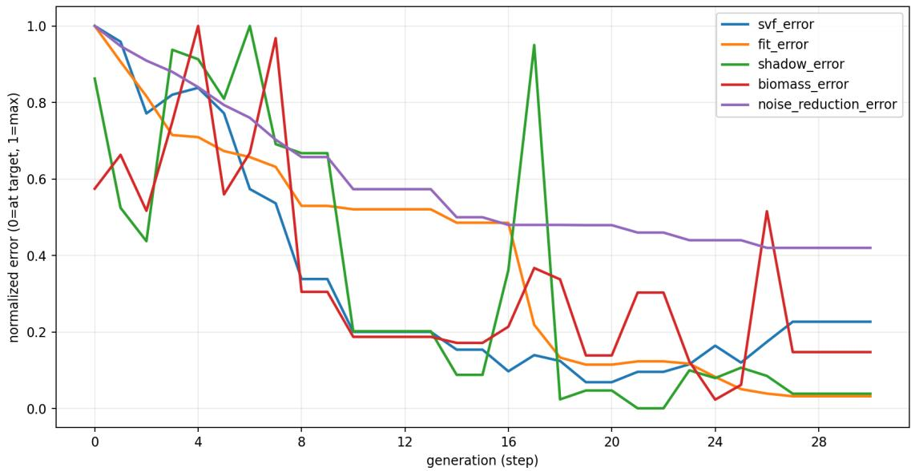  
Fig. 1. CMA-ES optimization trace for Joyce Kilmer Park. Normalized target error (0 = at target, 1 = worst) over generations for SVF, skyline fit, shade, biomass, and noise reduction. Most terms drop rapidly in the first ∼ 10 generations, then refine more slowly with occasional non-monotonic trade-ofs. Noise reduction decreases more gradually, indicating a harder objective under the same geometric constraints.

Exposure is evaluated at eight receiver viewpoints sampled along the path network. For each candidate scene, we compare the vegetation simulation against a free-field reference with identical source, receiver, grid, timestep, and boundary settings. The reported objective uses excess attenuation,

$$
\Delta L _ { \mathrm { d B } } = - 1 0 \log _ { 1 0 } \left( \frac { E _ { \mathrm { w i t h } } } { E _ { \mathrm { f r e e } } } \right) ,\tag{4}
$$

averaged over receivers. This gives a deterministic acoustic-exposure term that is comparable across optimization iterations.

To check that the surrogate produces plausible magnitudes, we ran a single-belt sanity test: a linear tree belt of 12 m width separates an omnidirectional source from three receivers at 2 m ear height. Excess attenuation across receivers falls in the 5–10 dB range, consistent with the 3–8 dB reported by Attenborough and Taherzadeh [2016] for tree belts of similar width and the ground-attenuation guidance of ISO 9613-2 [International Organization for Standardization 1996]. The agreement is qualitative, not calibrated, and is reported only to verify that the difusion-with-decay surrogate stays within the right order of magnitude for the regimes used during optimization. This validation is included as an automated test in the released code.

## 8 Notes on Reported Counts and Statistics

All reported instance counts are computed after VLM annotation, metric reprojection, feasibility checking, and repair. Instances discarded after failed repair are excluded. This convention is used consistently for the large-scale examples, biomass calculations, optimizer variable construction, and validation statistics. The convention avoids counting objects that were proposed by the VLM but could not be placed in the valid metric scene.

Across 147 park-generation experiments, the VLM-derived initial layout contained at least one invalid placement in 48 cases. Such invalid placements were corrected by the deterministic repair stage when possible; otherwise, the ofending instances were discarded and excluded from downstream counts. In all 147 experiments, the optimization stage modified the VLM-derived scene through feasible configuration changes, scale adjustment, or asset/species substitution. This supports the interpretation of the VLM as a semantic prior rather than as the final layout generator.

## 9 Code and Data Release

We release the implementation of the GreenScapes pipeline at https: //github.com/greenscapes-project/greenscapes. The release comprises the optimization engine (Rust), the VLM pipeline and acoustic surrogate (Python), all VLM prompt templates and arrangement rule blocks, the object- and viewpoint-annotation prompts, the projection and repair operators, the objective definitions and per experiment optimizer configurations, the species database with the complete GMM parameters (data/species/species.json), the acoustic descriptor precomputation and difusion solver, analysis tooling (style metrics, optimization traces, attribute-space visual ization), site data for the reported examples, and automated tests, including the acoustic tree-belt validation. Because the commercial 3D vegetation assets used for the paper’s renderings cannot be redistributed, the release includes a script that generates placeholder assets with identical bounding volumes, so quantitative results reproduce while renderings appear schematic. Because VLM APIs may change over time, the release records the exact model string (gemini-3-pro-image-preview), prompt instances, image resolution, and post-processing rules used for the reported experiments; the image-generation API exposes no random seed, so VLM outputs are stochastic.

## References

Keith Attenborough and Shahram Taherzadeh. 2016. Sound propagation through forests and tree belts. In Proceedings ofthe Institute ofAcoustics, Vol. 38. 114–125. https://oro.open.ac.uk/47314

International Organization for Standardization. 1996. Acoustics — Attenuation of Sound During Propagation Outdoors — Part 2: General Method ofCalculation. Technical Report ISO 9613-2:1996. International Organization for Standardization, Geneva, Switzerland.