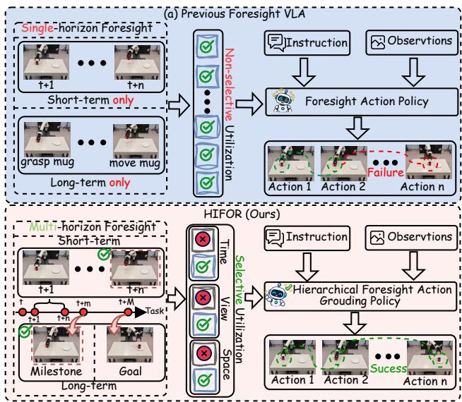
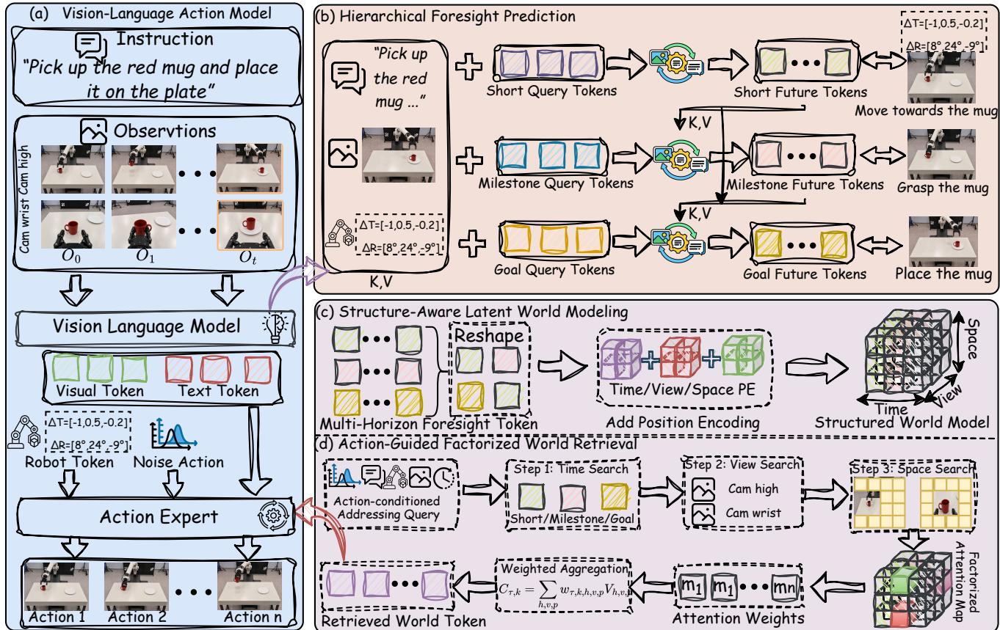
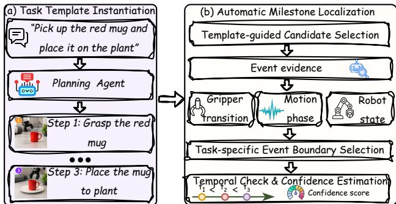
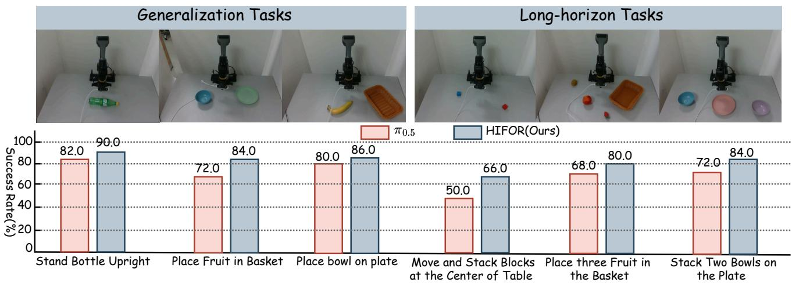
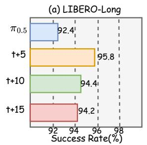
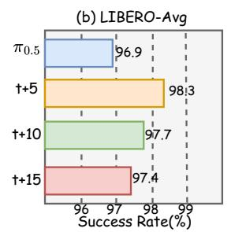
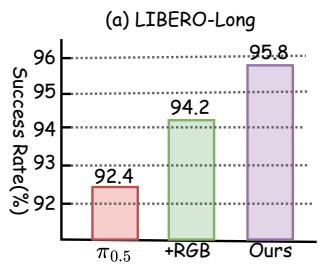
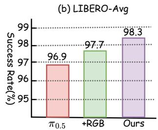
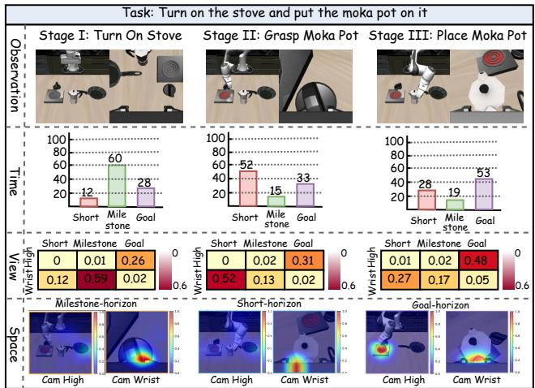

# HiFOR: Hierarchical Foresight with Action-Guided World Grounding for Vision-Language-Action Model

Rongxing Ding1, Hongyu Qu1,2, Kehong Wu1, Xudong Wang2,3, Fan Zhang 4, Xinguang Xiang1, Xiangbo Shu1

1 Nanjing University of Science and Technology 2 National University of Singapore 3 Shenyang Institute of Automation, Chinese Academy of Sciences 4 The Chinese University of Hong Kong

## Abstract

Vision-Language-Action (VLA) models have demonstrated promising capabilities in robotic manipulation by integrating visual perception, language understanding, and action generation. Recent advances have further incorporated future prediction to enhance the understanding of environmental dynamics and task progression. However, existing methods often model short-term dynamics and longterm task objectives separately, while directly incorporating predictedfutures into action policies without sufficiently considering their relevance to current action requirements. To address these limitations, we propose HiFOR, a hierarchical foresight framework with action-guided world retrieval. Specifically, Hierarchical Foresight Prediction jointly predicts short-term state evolution, semantic milestones, andfinal goal states through a Hierarchical Dependency Mask (HDM), establishing dependencies across temporal horizons. Building upon these predictions, Structure-Aware Latent World Modeling organizes future latent representations along the horizon, view, and spatial dimensions to facilitate fine-grained retrieval. Furthermore, Action-Guided Factorized World Retrieval adaptively retrieves relevant future information from the structured latent world based on evolving action representations during denoising, providing targeted guidance for action generation. Extensive experiments on two simulation benchmarks and six real-world robotic manipulation tasks demonstrate the effectiveness ofour approach.

## 1. Introduction

Vision-Language-Action (VLA) models [16, 17, 26, 29, 34, 46, 56, 59] have achieved remarkable progress in robotic manipulation by integrating visual perception, language understanding, and action generation within a unified endto-end framework. Benefiting from advances in largescale vision-language models and the growing availability of diverse robotic demonstrations, recent VLA models have demonstrated promising capabilities across a wide range of manipulation tasks. As robotic manipulation tasks become increasingly complex, anticipating future environmental changes and task evolution becomes essential for effective action generation. To this end, recent studies have explored incorporating foresight capabilities into VLA models to enhance their understanding of environmental dynamics and task progression [19, 27, 43]. Existing approaches primarily predict future states or latent representations to model environmental dynamics [15, 27, 30, 52, 57], or generate future images and videos to anticipate visual scene evolution [5, 19, 33, 43, 53], thereby providing additional foresight information for action generation.

  
Figure 1. Comparison of Foresight VLA Models. (a) Existing methods typically adopt single-horizon foresight and directly feed predictions into VLA models without selective utilization. (b) In contrast, HiFOR combines multi-horizon foresight with action guided retrieval of relevant future information.

Despite these advances, effectively translating future predictions into actionable guidance for complex robotic manipulation remains challenging. First, modeling shortterm world dynamics or long-term task objectives in isolation limits hierarchical coordination across temporal horizons. As illustrated in Fig. 1(a), many existing foresight-based VLA methods primarily focus on a single prediction horizon. Short-term prediction methods [8, 21, 47, 58] emphasize near-future environmental changes and local motion dynamics, capturing fine-grained state evolution but often lacking explicit connections to subsequent task stages and ultimate goals. In contrast, longterm prediction methods [9, 28, 36, 53, 54] provide intermediate task guidance through semantic subtask planning or visual subgoal prediction, enabling the policy to anticipate key future task states. However, these methods often lack sufficient modeling of the continuous state transitions and motion dynamics required to achieve such objectives. Although both forms of foresight provide valuable information, modeling them independently makes it difficult to establish explicit dependencies among local state evolution, key semantic milestones, and final task objectives, thereby limiting the policy’s coherent understanding of task progression across temporal horizons.

More importantly, directly incorporating predicted future information into action generation often overlooks its varying relevance to current action requirements. As illustrated in Fig. 1(a), many existing approaches [8, 9, 38, 47, 53, 54, 58] directly incorporate predicted future images or latent representations into action policies as additional conditioning signals, without sufficiently distinguishing the relevance of different predictions to current actions. However, future information across different prediction horizons, camera views, and spatial regions contributes differently to action generation, and its relevance dynamically evolves throughout task execution and the action generation process. Therefore, even with rich and complementary future predictions, selectively retrieving and utilizing information relevant to current action requirements remains essential for fully exploiting the decision-making potential of foresight. These observations motivate a unified framework that establishes hierarchical dependencies across temporal horizons and adaptively retrieves and leverages relevant future information according to current action requirements.

To address these challenges, we propose HiFOR, a hierarchical foresight framework with action-guided world retrieval for robotic manipulation. As illustrated in Fig. 1(b), HiFOR integrates multi-horizon foresight prediction with action-guided selective retrieval, enabling future information across different temporal horizons to provide targeted guidance according to evolving action requirements.

Specifically, ❶ we first introduce Hierarchical Foresight Prediction, which jointly predicts short-term state evolution, key semantic milestones, and final goal states. By incorporating a Hierarchical Dependency Mask (HDM), the prediction module establishes asymmetric dependencies across temporal horizons, connecting local motion dynamics with intermediate task progression and long-term objectives. ❷ Building upon these predictions, we propose Structure-Aware Latent World Modeling, which organizes predicted future latent representations along the horizon, view, and spatial dimensions to construct a structured latent world while preserving fine-grained structural information for subsequent selective retrieval. ❸ Furthermore, we develop Action-Guided Factorized World Retrieval, which leverages evolving action representations during denoising to perform factorized attention over the structured latent world. By adaptively evaluating the relevance of different prediction horizons, camera views, and spatial regions to current actions, the retrieved future information provides targeted guidance for action generation. Through these designs, HiFOR effectively integrates hierarchical future modeling with action-guided information retrieval, enabling foresight predictions to better support robotic manipulation.

Our main contributions are summarized as follows: First, we propose a hierarchical foresight prediction mechanism that jointly models short-term state evolution, key semantic milestones, and final goal states through hierarchical dependency modeling, establishing explicit connections between local world dynamics and long-term task objectives. Second, we develop an action-guided structured world retrieval mechanism that adaptively retrieves future information relevant to current action requirements from a structured latent world organized along the horizon, view, and spatial dimensions through denoising-aware factorized attention. Third, we conduct extensive experiments on LIBERO, RoboTwin 2.0, and six real-world robotic manipulation tasks, demonstrating the effectiveness of HiFOR and further validating the contributions of its key components through comprehensive ablation studies.

## 2. Related Works

## 2.1. Vision-Language-Action Model

Vision-Language-Action (VLA) models aim to integrate visual perception, language understanding, and action generation to develop general-purpose robotic policies capable of executing complex manipulation tasks. Based on their action representations and generation mechanisms, existing VLA models can be broadly categorized into two paradigms: discrete and continuous action generation.

Discrete action generation methods [3, 4, 17, 23, 31, 44, 45, 48, 54] convert continuous actions into discrete tokens or textual sequences, enabling autoregressive action prediction. In contrast, continuous action generation methods [2, 13, 16, 18, 22] typically employ specialized action prediction modules to directly generate continuous control signals, mainly adopting regression-based, diffusionbased, or flow-matching-based approaches. Specifically, regression-based methods [18, 42] directly learn mappings from observations to actions, while diffusion-based methods [12, 25, 40, 41] generate action sequences through iterative denoising. Flow-matching-based methods [2, 16, 32, 35, 37, 60] learn a continuous vector field to transform samples from a noise distribution into the target action distribution. Although these approaches have improved the action generation and generalization capabilities of VLA models, they primarily focus on action prediction itself, whereas accurate local action predictions do not necessarily guarantee successful completion of complex manipulation tasks.

## 2.2. Foresight Predication in VLA

To overcome the limitations of local action prediction, recent studies have incorporated foresight prediction into VLA to anticipate future environmental changes and task progression, thereby guiding action generation. Based on how future information is represented, existing methods can be categorized into implicit and explicit foresight prediction. Implicit methods [15, 27, 30, 49, 52, 57] model environmental dynamics in state or latent feature spaces, leveraging predicted future representations to facilitate policy learning and action generation. In contrast, explicit methods [5, 7, 19, 33, 43, 53] generate future images or videos to anticipate visual scene evolution and potential action outcomes, supporting robotic planning and decision-making.

Despite these advances, existing methods still face limitations in modeling and utilizing future information. First, predicting short-term dynamics and long-term task objectives in isolation overlooks dependencies across temporal horizons, limiting coherent modeling of task progression. Second, existing methods often directly incorporate predicted future information into action policies as additional conditioning signals, without adequately considering its varying relevance to current action requirements.

## 3. Method

## 3.1. Problem Formulation

We formulate robotic manipulation with VLA models as a language-conditioned sequential decision-making problem. At each timestep t, the policy receives multi-view visual observations $\mathcal { O } _ { t } = \{ I _ { t } ^ { v } \} _ { v = 1 } ^ { V }$ , a language instruction $\pmb { L }$ , and the robot state $\mathbf { } _ { s _ { t } } .$ , and predicts a future action chunk:

$$
A _ { t } = \{ a _ { t + h } \} _ { h = 0 } ^ { H - 1 } = \pi _ { \theta } \big ( \mathcal { O } _ { t } , L , s _ { t } \big ) ,\tag{1}
$$

where H denotes the action horizon. Each action $\begin{array} { r l } { \mathbf { \nabla } a _ { t } } & { { } = } \end{array}$ $[ \Delta x , \Delta y , \Delta z , \Delta \theta _ { x } , \Delta \theta _ { y } , \Delta \theta _ { z } , g ] ^ { \top }$ consists of relative

end-effector translation, rotation, and gripper control.

## 3.2. Overview

The overall framework of our method is illustrated in Fig. 2. Given a language instruction, multi-view visual observations, and the robot state, we first employ a VLA backbone to encode the current multimodal context and generate action representations. We then introduce Hierarchical Foresight Prediction (§3.4), which jointly predicts shortterm state evolution, intermediate semantic milestones, and final goal states through a Hierarchical Dependency Mask (HDM), establishing dependencies across prediction horizons. Building upon these predictions, Structure-Aware Latent World Modeling (§3.5) organizes the predicted future latent representations along the horizon, view, and spatial dimensions to construct a structured latent world model. Furthermore, we propose Action-Guided Factorized World Retrieval (§3.6), which selectively retrieves action-relevant future information from the structured latent world to guide subsequent action generation. Together, these components enable our method to model hierarchical future evolution and selectively leverage relevant future information for action decision-making.

## 3.3. Hierarchical Foresight Planning Dataset

We construct a hierarchical planning dataset from existing successful expert demonstrations without collecting additional robot trajectories. Instead of uniformly sampling future frames, we identify semantically meaningful milestones to capture key task progression across different temporal horizons, providing structured future supervision for VLA training.

As illustrated in Fig. 3, we first employ a Planning Agent to generate a task-specific semantic template from the language instruction $\scriptstyle L ,$ decomposing it into an ordered sequence of subgoals ${ \mathcal { G } } = \{ G _ { 1 } , G _ { 2 } , \ldots , G _ { K } \}$ . Each subgoal specifies a semantic stage, an event type, and a completion verification criterion. For example, “Pick up the red mug and place it on the plate” can be decomposed into ❶ grasp the mug, ❷ move it to the target region, and ❸ place it on the plate, with the number and types of milestones determined by the task.

Given the semantic template, we automatically localize the completion timestamps of each subgoal in expert demonstrations. Specifically, candidate event boundaries are identified using gripper transitions, robot motion phases, and state information. For stable-state events, such as grasping and placement, we select the earliest frame where the target condition remains persistently satisfied, while dynamic events are localized based on motion or statetransition boundaries. We further enforce temporal consistency $t _ { 1 } < t _ { 2 } < \cdots < t _ { K }$ and assign confidence scores to the identified milestones, flagging ambiguous or low-

  
Figure 2. The overview of HIFOR. (a) We augment the VLA with hierarchical foresight prediction and action-guided world retrieval, enabling the Action Expert to leverage future information during action generation. (b) Hierarchical Foresight Prediction (§3.4) predicts short-term, milestone, and goal futures through hierarchical dependency modeling. (c) Structure-Aware Latent World Modeling (§3.5) organizes future latent representations along the horizon, view, and spatial dimensions. (d) Action-Guided Factorized World Retrieva (§3.6) selectively retrieves action-relevant future information through denoising-aware factorized attention to guide action generation.

spatial grid:

  
Figure 3. Hierarchical Foresight Planning Data Construction. (a) A planning agent generates semantic milestones from task instructions. (b) Automatic milestone localization identifies their completion timestamps in expert demonstrations using event evidence and temporal consistency checks.

confidence cases for manual review. The resulting annotations are represented as $\mathcal { M } = \{ ( G _ { k } , t _ { k } ) \} _ { k = 1 } ^ { K }$

To construct future visual supervision, we extract multiview semantic features from all trajectory frames using a frozen DINOv2 ViT-L/14 encoder. After removing prefix tokens, the patch features are adaptively pooled into a 4 × 4

$$
\begin{array} { r } { \pmb { F } _ { t } ^ { v } = \phi _ { \mathrm { D I N O } } \big ( \pmb { I } _ { t } ^ { v } \big ) \in \mathbb { R } ^ { 1 6 \times 1 0 2 4 } . } \end{array}\tag{2}
$$

These features serve as visual supervision for subsequent hierarchical foresight prediction.

## 3.4. Hierarchical Foresight Prediction

Complex robotic manipulation requires not only anticipating near-future environmental changes and motion dynamics but also understanding intermediate task progression and final goals. However, short-term world prediction and longterm semantic guidance in existing VLA methods often lack effective coordination, limiting their ability to capture task evolution across temporal scales. To address this, we propose Hierarchical Foresight Prediction. By establishing cross-horizon dependencies, our approach learns future representations that capture both local dynamics and long-term task objectives.

Hierarchical Future Targets. Given the semantic milestone annotations $\mathcal { M } ~ = ~ \bar { \{ }  ( G _ { k } , t _ { k } ) \} _ { k = 1 } ^ { K }$ , we define three complementary prediction horizons for each timestep $t \ <$ $t _ { K }$ . Specifically, the short-term target is defined as $t _ { t } ^ { s } ~ =$ min $\left( t + \Delta , t _ { K } \right)$ , the milestone target as $t _ { t } ^ { m } = \operatorname* { m i n } _ { k : t _ { k } > t } t _ { k }$ and the goal target as $t _ { t } ^ { g } = t _ { K }$ , corresponding to near-future state evolution, the next semantic milestone, and the final task state, respectively, where $\Delta$ denotes the short-term prediction interval.

For each prediction horizon, we construct the corresponding visual supervision using the precomputed multiview DINOv2 features:

$$
\begin{array} { r } { Z _ { t } ^ { h } \big [ { v } , { : } , { : } \big ] = F _ { t _ { t } ^ { h } } ^ { v } , \quad Z _ { t } ^ { h } \in \mathbb { R } ^ { V \times S \times D } , \quad h \in \{ s , m , g \} . } \end{array}\tag{3}
$$

Here, V denotes the number of camera views, while $S = 1 6$ and $D = 1 0 2 4$ represent the number of spatial tokens per view and the feature dimension, respectively.

Unlike long-term prediction, which focuses on intermediate semantic stages and final goal states, short-term prediction additionally requires modeling continuous robot motion during action execution. Since visual supervision at the target timestep alone may not sufficiently constrain finegrained robot state changes, we introduce the future robot state sequence $\mathbf { } S _ { t } ^ { s } = \left( { } s _ { t + 1 } , { } s _ { t + 2 } , \ldots , { } s _ { t _ { t } ^ { s } } \right)$ as auxiliary supervision, where $\mathbf { } _ { \mathbf { } \mathbf { } \mathbf { } \mathbf { } s _ { t } }$ denotes the robot state at timestep t. Thus, short-term prediction combines visual and state supervision to capture local motion dynamics, while long-term prediction models task progression and final goal states through future visual supervision.

Hierarchical Future Prediction. To predict the hierarchical future targets, we encode the current multi-view observations ${ \mathcal { O } } _ { t }$ and language instruction L into visual tokens $V _ { t }$ and language tokens $E _ { L }$ using the VLM. We introduce three groups of learnable future queries, $Q ^ { s } , Q ^ { m }$ , and $Q ^ { g }$ corresponding to short-term, milestone, and goal prediction. To establish cross-horizon dependencies, we design a Hierarchical Dependency Mask (HDM) that progressively expands attention visibility from short-term to goal queries. Under HDM, future queries at different temporal horizons interact hierarchically through a shared prediction module, with the prediction process formulated as:

$$
\begin{array} { r } { \pmb { U } _ { t } ^ { h } = \mathcal { H } _ { \theta } \left( \pmb { Q } ^ { h } ; [ V _ { t } ; E _ { L } ; \pmb { Q } ^ { \mathrm { s h } } ] \right) , \quad h \in \{ s , m , g \} . } \end{array}\tag{4}
$$

Here, $\mathcal { H } _ { \theta }$ denotes the shared prediction module, and $Q ^ { \leq h }$ represents the concatenation of query groups from the shortterm level up to the current horizon $h ,$ following the hierarchical order $s \prec m \prec g$ . All query groups are jointly updated within the shared network under HDM, producing the corresponding hierarchical prediction features $\pmb { U } _ { t } ^ { h }$

We project the predicted features into the DINOv2 feature space using visual prediction heads:

$$
\hat { \pmb { Z } } _ { t } ^ { h } = \mathcal { P } _ { \mathrm { v i s } } ^ { h } ( \pmb { U } _ { t } ^ { h } ) \in \mathbb { R } ^ { V \times S \times D } , \quad h \in \{ s , m , g \} .\tag{5}
$$

For short-term prediction, an additional state prediction head estimates the future robot state sequence $\begin{array} { r l } { \hat { S } _ { t } ^ { s } } & { { } = } \end{array}$

$\mathcal { P } _ { \mathrm { s t a t e } } ( U _ { t } ^ { s } )$ . The overall foresight prediction loss is defined as

$$
\begin{array} { r } { \mathcal { L } _ { \mathrm { H F P } } = \lambda _ { m } \mathcal { D } _ { \mathrm { v } } \left( \hat { Z } _ { t } ^ { h } , Z _ { t } ^ { h } \right) + \lambda _ { \mathrm { n } } \mathcal { D } _ { \mathrm { s } } \left( \hat { S } _ { t } ^ { s } , S _ { t } ^ { s } \right) , } \end{array}\tag{6}
$$

where $\mathcal { D } _ { \mathrm { v i s } }$ and $\mathcal { D } _ { \mathrm { s t a t e } }$ denote the visual and robot state prediction losses, respectively, and $\lambda _ { m }$ and $\lambda _ { n }$ are the corresponding weights.

## 3.5. Structure-Aware Latent World Modeling

The Hierarchical Foresight Prediction module generates future visual representations at three temporal horizons: short-term, milestone, and goal. These predictions contain complementary information across temporal horizons, camera views, and spatial regions. However, organizing these predictions into a unified token sequence without explicitly preserving their structural attributes hinders the effective utilization of future information. To address this, we propose Structure-Aware Latent World Modeling, which organizes multi-horizon predictions into a Structured Latent World, explicitly preserving their horizon, view, and spatial structures to facilitate subsequent fine-grained information retrieval.

Specifically, given the predicted future features $\{ \hat { Z } _ { t } ^ { h } \} _ { h \in \{ s , m , g \} }$ , we construct structured world tokens through feature projection and structural positional embeddings:

$$
\begin{array} { r } { \pmb { w } _ { t } ^ { h , v , p } = \mathcal { P } _ { \mathrm { w } } \left( \hat { Z } _ { t } ^ { h } [ v , p , : ] \right) + \pmb { e } _ { h } ^ { \mathrm { h o r } } + \pmb { e } _ { v } ^ { \mathrm { v i e w } } + \pmb { e } _ { p } ^ { \mathrm { s p a } } , } \end{array}\tag{7}
$$

where $\mathcal { P } _ { \mathrm { w } }$ denotes the feature projection, and $e _ { h } ^ { \mathrm { h o r } } , e _ { v } ^ { \mathrm { v i e w } }$ and $e _ { p } ^ { \mathrm { s p a } }$ represent horizon, view, and spatial positional embeddings, respectively. Here, $p \in \{ 1 , \ldots , S \}$ indexes the spatial tokens within each camera view.

We then organize these tokens into a unified structured latent world representation:

$$
W _ { t } [ h , v , p , : ] = { w } _ { t } ^ { h , v , p } , \quad W _ { t } \in \mathbb { R } ^ { 3 \times V \times S \times d _ { w } } .\tag{8}
$$

where $d _ { w }$ denotes the latent world feature dimension. This representation explicitly preserves the horizon, view, and spatial dimensions, enabling fine-grained access to predicted future information.

To support world representations at different granularities, we further derive horizon-level and view-level features through spatial aggregation:

$$
{ r _ { t } ^ { h } } = \frac { 1 } { { V S } } \sum _ { v = 1 } ^ { V } { \sum _ { p = 1 } ^ { S } { w _ { t } ^ { h , v , p } } } , { r _ { t } ^ { h , v } } = \frac { 1 } { S } \sum _ { p = 1 } ^ { S } { w _ { t } ^ { h , v , p } } .\tag{9}
$$

Here, $\boldsymbol { r } _ { t } ^ { h }$ summarizes the predicted world state at horizon $h ,$ while $\boldsymbol { r } _ { t } ^ { h , v }$ captures view-specific information within that horizon. The original world tokens $\mathbf { \Delta } w _ { t } ^ { h , v , p }$ retain finegrained spatial details. Together, these representations provide horizon, view, and spatial information, facilitating subsequent action-guided retrieval of task-relevant future features.

## 3.6. Action-Guided Factorized World Retrieval

After constructing the structured latent world, we further introduce Action-Guided Factorized World Retrieval (AWR). Since the relevance of future information to current action requirements may vary across denoising steps, we construct dynamic retrieval queries from the action expert’s hidden representations at each denoising step. We then perform factorized attention along the horizon, view, and spatial dimensions to selectively retrieve future information relevant to the ongoing action generation process.

Specifically, given the structured latent world $W _ { t } ~ \in$ $\mathbb { R } ^ { 3 \times \dot { V } \times S \times d _ { w } }$ , we construct an action-conditioned query $\pmb { q } _ { t , \tau } ^ { a } = \mathcal { Q } ( { \pmb { H } } _ { t , \tau } ^ { a } )$ from the action expert’s hidden representations $H _ { t , \cdot } ^ { a }$ at denoising step τ. Three independent linear projections then generate queries corresponding to temporal horizons, camera views, and spatial locations, denoted as $\mathbf { } q _ { t , \tau } ^ { H } , \ q _ { t , \tau } ^ { V } ,$ and $\pmb { q } _ { t , \tau } ^ { S }$ , respectively. Meanwhile, we employ a shared linear projection to map the hierarchical features of the structured latent world into corresponding key representations $\bar { k } _ { t } ^ { h } , \bar { k } _ { t } ^ { h , v }$ , and $k _ { t } ^ { h , v , p }$ , while projecting the spatial-level world tokens into value representations $\boldsymbol { u } _ { t } ^ { h , v , p }$ for subsequent factorized attention-based retrieval.

Based on these queries and keys, we formulate a unified factorized attention operation across the horizon, view, and spatial dimensions:

$$
a _ { t , \tau } ^ { \ell } ( i \mid c ) = \mathrm { S o f t m a x } _ { i } \left( \frac { ( q _ { t , \tau } ^ { \ell } ) ^ { \top } k _ { t } ^ { \ell } ( i \mid c ) } { \sqrt { d } } \right) , \quad \ell \in \{ H , V , S \} .\tag{10}
$$

Here, $\ell \in \{ H , V , S \}$ denotes the horizon, view, and spatial attention levels, with the corresponding index-condition pairs (i, c) given by $( h , \emptyset ) , ( v , h )$ , and $\left( p , \left( h , v \right) \right)$ , respectively. The associated key representations are $\bar { k } _ { t } ^ { h } , \bar { k } _ { t } ^ { h , v }$ , and $k _ { t } ^ { h , v , p }$ , where d denotes the feature dimension per attention head. The resulting attention weights are denoted as $\alpha _ { t , \tau } ^ { h } .$ $\beta _ { t , \tau } ^ { v | h }$ , and $\gamma _ { t , \tau } ^ { p | h , v }$ , respectively.

We then combine the three attention weights to aggregate the latent world values, yielding the action-relevant future representation at denoising step τ :

$$
\pmb { f } _ { t , \tau } = W _ { O } \left( \sum _ { h \in \{ s , m , g \} } \sum _ { v = 1 } ^ { V } \sum _ { p = 1 } ^ { S } \alpha _ { t , \tau } ^ { h } \beta _ { t , \tau } ^ { v | h } \gamma _ { t , \tau } ^ { p | h , v } \pmb { u } _ { t } ^ { h , v , p } \right) .\tag{11}
$$

Here, $W _ { O }$ denotes the output projection. As the actionconditioned queries evolve throughout denoising, the model dynamically adjusts its attention across different prediction horizons, camera views, and spatial regions. Finally, the retrieved future features are fused with the action representations and short-term robot state features, and injected into the action expert through residual connections to guide iterative action generation.

Overall Loss Function. HiFOR jointly optimizes action generation and hierarchical foresight prediction through the flow-matching loss $\mathcal { L } _ { \mathrm { A C T } }$ and the foresight prediction loss $\mathcal { L } _ { \mathrm { H F P } }$ , respectively. The overall training objective is defined as:

$$
\begin{array} { r } { \mathcal { L } = \mathcal { L } _ { \mathrm { A C T } } + \mathcal { L } _ { \mathrm { H F P } } . } \end{array}\tag{12}
$$

## 4. Experiments

## 4.1. Evaluation on Simulation Benchmarks

Simulation Benchmarks. To evaluate the robustness of our method under diverse simulated environments, we perform experiments on both LIBERO [24] and RoboTwin 2.0 [10]. For LIBERO [24], we report the average success rate over four task suites, including Spatial, Object, Goal, and Long, where each suite contains 10 tasks. Each task suite is evaluated with 500 rollouts to obtain reliable performance statistics. For RoboTwin 2.0 [10], we follow the Hard evaluation protocol and assess our method on 20 randomly selected tasks with 100 rollouts per task. The Hard setting introduces challenging domain randomizations, including variations in clutter, illumination, textures, and object heights.

Implementation Details. All experiments are conducted on 8 × H200 GPUs with a global batch size of 512 (64 per GPU). Both LIBERO [24] and RoboTwin 2.0 [10] are trained end-to-end for 30000 optimization steps using AdamW. The learning rate is linearly warmed up to $\mathrm { { \bar { 5 } } } \times \mathrm { { 1 0 ^ { - \bar { 5 } } } }$ over the first 5000 steps and then kept constant for the remaining training. We apply gradient clipping with a maximum norm of 1.0 and maintain an exponential moving average of the model parameters with a decay rate of 0.999.

Performance on RoboTwin 2.0 Benchmark. As shown in Table 1, HiFOR achieves the best overall performance on RoboTwin 2.0 under the Hard setting, reaching an average success rate of 49.40% across 20 tasks, outperforming π0.5 by 9.05%. Specifically, HiFOR improves the success rates on Blocks Ranking RGB and Place Cans Plasticbox from 29% and 40% to 46% and 63%, respectively. Moreover, on Move Playingcard and Stack Blocks Two, HiFOR achieves success rates of 54% and 45%, surpassing the baseline by 14% and 13%, respectively. These results demonstrate the effectiveness of HiFOR in improving performance across diverse and challenging robotic manipulation tasks.

Performance on LIBERO Benchmark. As shown in Table 2, HiFOR achieves the best overall performance on LIBERO, with an average success rate of 98.3%. Specifically, it achieves the highest success rates of 99.4%, 98.6% and 95.8% on LIBERO-Spatial, LIBERO-Goal and LIBERO-Long, respectively, while remaining highly competitive on other task suites. Compared with the $\pi _ { 0 . 5 }$ baseline, HiFOR improves the average success rate from 96.9% to 98.3%, with the largest gain of 3.4% on long-horizon tasks. These results demonstrate that HiFOR effectively enhances long-horizon task execution while maintaining strong performance across diverse manipulation tasks.

Table 1. Performance comparison on RoboTwin 2.0 [10]. We report per-task success rates (SR) over 100 rollouts under the Hard setting. † denotes reproduced results. Results for all 20 tasks are provided in the Appendix.
<table><tr><td rowspan="2">Method</td><td colspan="10">RoboTwin 2.0 (Hard)</td></tr><tr><td>Adjust</td><td>Blocks</td><td>Click</td><td>Dump Bin</td><td>Move</td><td>Open</td><td>Place Burger</td><td>Place Can</td><td>Place Cans</td><td>Stack Blocks</td><td>Avg.</td></tr><tr><td></td><td>Bottle</td><td>Ranking RGB</td><td>Bell</td><td>Bigbin</td><td>Playingcard</td><td>Laptop</td><td>Fries</td><td>Basket</td><td>Plasticbox</td><td>Two</td><td></td></tr><tr><td>RDT [25]</td><td>75%</td><td>0%</td><td>9%</td><td>32%</td><td>11%</td><td>32%</td><td>27%</td><td>6%</td><td>5%</td><td>2%</td><td>14.60%</td></tr><tr><td>ACT [55]</td><td>23%</td><td>0%</td><td>3%</td><td>1%</td><td>0%</td><td>0%</td><td>0%</td><td>0%</td><td>0%</td><td>0%</td><td>2.90%</td></tr><tr><td>DP3 [51]</td><td>3%</td><td>0%</td><td>0%</td><td>53%</td><td>3%</td><td>7%</td><td>18%</td><td>2%</td><td>3%</td><td>0%</td><td>4.85%</td></tr><tr><td>EventVLA [46]</td><td>24%</td><td>6%</td><td>48%</td><td>64%</td><td>17%</td><td>23%</td><td>7%</td><td>7%</td><td>14%</td><td>13%</td><td>19.00%</td></tr><tr><td>Spatial Forcing [20]</td><td>71%</td><td>7%</td><td>28%</td><td>70%</td><td>15%</td><td>15%</td><td>71%</td><td>10%</td><td>11%</td><td>19%</td><td>29.40%</td></tr><tr><td>X-VLA [56]</td><td>33%</td><td>4%</td><td>63%</td><td>41%</td><td>5%</td><td>16%</td><td>35%</td><td>9%</td><td>60%</td><td>2%</td><td>23.25%</td></tr><tr><td>π0 [2]</td><td>56%</td><td>5%</td><td>3%</td><td>24%</td><td>22% 40%</td><td>46% 59%</td><td>4%</td><td>5%</td><td>2%</td><td>1%</td><td>14.60%</td></tr><tr><td> $\underline { { \pi _ { 0 . 5 } ^ { \dagger } [ 1 6 ] } }$ </td><td>77%</td><td>29%</td><td>35%</td><td>67%</td><td></td><td></td><td>82%</td><td>4%</td><td>40%</td><td>32%</td><td>40.35%</td></tr><tr><td>HiFOR (Ours)</td><td>83%</td><td>46%</td><td>48%</td><td>75%</td><td>54%</td><td>65%</td><td>88%</td><td>14%</td><td>63%</td><td>45%</td><td>49.40%</td></tr></table>

Table 2. Success rates (%) on the LIBERO benchmark. Best results are shown in bold, and second-best results are underlined.
<table><tr><td>Method</td><td>Publication</td><td>Spatial</td><td>Object</td><td>Goal</td><td>Long</td><td>Avg.</td></tr><tr><td>Diffusion Policy [11]</td><td>IJRR&#x27;25</td><td>78.5</td><td>87.5</td><td>73.5</td><td>64.8</td><td>76.1</td></tr><tr><td>GR00T-N1 [1]</td><td>arXiv&#x27;25</td><td>94.4</td><td>97.6</td><td>93.0</td><td>90.6</td><td>93.9</td></tr><tr><td>OpenVLA [17]</td><td>arXiv&#x27;24</td><td>84.7</td><td>88.4</td><td>79.2</td><td>53.7</td><td>76.5</td></tr><tr><td>OpenVLA-OFT [18]</td><td>arXiv&#x27;25</td><td>97.6</td><td>98.4</td><td>97.9</td><td>94.5</td><td>97.1</td></tr><tr><td>MemoryVLA [34]</td><td>ICLR&#x27;26</td><td>98.4</td><td>98.4</td><td>96.4</td><td>93.4</td><td>96.7</td></tr><tr><td>UniVLA [6]</td><td>arXiv&#x27;25</td><td>95.4</td><td>98.8</td><td>95.8</td><td>85.2</td><td>94.2</td></tr><tr><td>π0-Fast [31]</td><td>AAAI&#x27;26</td><td>96.4</td><td>96.8</td><td>88.6</td><td>60.2</td><td>85.5</td></tr><tr><td>π0 [2]</td><td>arXiv&#x27;24</td><td>96.8</td><td>98.8</td><td>95.8</td><td>85.2</td><td>94.2</td></tr><tr><td>π0.5 [16]</td><td>arXiv&#x27;25</td><td>98.8</td><td>98.2</td><td>98.0</td><td>92.4</td><td>96.9</td></tr><tr><td>VLA-Adapter [39]</td><td>AAAI&#x27;26</td><td>97.8</td><td>99.2</td><td>97.2</td><td>95.0</td><td>97.3</td></tr><tr><td>Fast-ThinkAct [14]</td><td>CVPR&#x27;26</td><td>92.0</td><td>97.2</td><td>90.2</td><td>79.4</td><td>89.7</td></tr><tr><td>LEAP-VLA [50]</td><td>ECCV&#x27;26</td><td>98.4</td><td>99.4</td><td>97.6</td><td>93.0</td><td>97.1</td></tr><tr><td>HiFOR (Ours)</td><td>=</td><td>99.4</td><td>99.2</td><td>98.6</td><td>95.8</td><td>98.3</td></tr></table>

## 4.2. Evaluation on Real-World

Training and Evaluation Setting. To evaluate the effectiveness of HiFOR in real-world robotic manipulation, we conduct experiments on Generalization Tasks and Longhorizon Tasks using an AgileX Piper 6-DoF single-arm manipulator. The robot is equipped with a parallel-jaw gripper and two Intel RealSense D435i RGB cameras, providing wrist-mounted and third-person visual observations. For Generalization Tasks, we use 100 expert demonstrations per task for training, while Long-horizon Tasks use 200 demonstrations per task. All models are trained on 8 × H200 GPUs and deployed on a single NVIDIA RTX 4090 GPU for realworld evaluation. Both task categories are evaluated with 50 rollouts per task, with object positions randomly initialized in each rollout to assess robustness and generalization under varying initial conditions.

Performance on Real-World Setup. To evaluate the effectiveness of HiFOR in real-world robotic manipulation, we conduct experiments on six tasks involving object grasping, placement, and stacking. As shown in Fig. 4, HiFOR consistently outperforms $\pi _ { 0 . 5 }$ across all tasks, achieving an average success rate of 81.7%, an improvement of 11.0% over $\pi _ { 0 . 5 }$ . Notably, HiFOR achieves a 16.0% improvement on the challenging block stacking task, demonstrating its effectiveness in complex real-world manipulation.

Table 3. Ablation analysis of the core components in terms of Success Rate (%) on LIBERO [24] and RoboTwin 2.0 [10].
<table><tr><td rowspan="2">Short</td><td colspan="2">Method</td><td colspan="4">LIBERO</td><td rowspan="2">RoboTwin2.0 Avg.</td></tr><tr><td>Milestone</td><td>Goal AWR</td><td>Spatial</td><td>Object</td><td>Goal</td><td>Long</td></tr><tr><td></td><td></td><td></td><td>98.8</td><td>98.2</td><td>98.0</td><td>92.4</td><td>40.35</td></tr><tr><td>√</td><td></td><td></td><td>99.0</td><td>98.4</td><td>98.0</td><td>93.4</td><td>44.15</td></tr><tr><td>√</td><td>√</td><td></td><td>99.2</td><td>99.0</td><td>98.0</td><td>94.2</td><td>45.60</td></tr><tr><td>√</td><td>√</td><td></td><td>99.0</td><td>98.8</td><td>98.2</td><td>95.0</td><td>46.95</td></tr><tr><td>√</td><td>√</td><td>√ √</td><td>99.4</td><td>99.2</td><td>98.6</td><td>95.8</td><td>49.40</td></tr></table>

## 4.3. Ablation Study

Key Component Analysis. We evaluate the key components of HiFOR through ablation studies in Table 3. Introducing short-term foresight prediction improves the average success rate on RoboTwin 2.0 from 40.35% to 44.15%, while incorporating milestone and goal predictions further increases it to 45.60% and 46.95%, respectively. Adding action-guided world retrieval (AWR) further raises the success rate to 49.40%, an additional gain of 2.45%. Consistent improvements are also observed on LIBERO, particularly LIBERO-Long, where the success rate increases from 92.4% to 95.8%. These results highlight the complementary benefits of hierarchical foresight prediction and action-guided retrieval in effectively leveraging future information for robotic manipulation.

Different Short-horizon Prediction Length. We investigate the effect of different short-horizon prediction lengths on LIBERO, as illustrated in Fig. 5. Specifically, we evaluate prediction horizons of 5, 10, and 15 steps. The 5- step horizon achieves success rates of 95.8% and 98.3% on LIBERO-Long and LIBERO-Avg, respectively. Notably, the policy updates its predictions every 5 execution steps on LIBERO, naturally aligning the 5-step prediction horizon with the action execution interval. This alignment enables short-term foresight to provide effective guidance within the current execution cycle, whereas longer prediction horizons extend beyond the next prediction update.

Different Future Prediction Representations. We investigate the impact of different future prediction targets by comparing direct pixel-level prediction of future RGB images with semantic feature-based future prediction. As shown in Fig. 6, RGB-based prediction improves success rates from 92.4% to 94.2% on LIBERO-Long and from 96.9% to 97.7% on LIBERO-Avg. Our method further achieves 95.8% and 98.3%, outperforming RGB-based prediction by 1.6 and 0.6 percentage points, respectively. These results demonstrate the benefits of future-aware supervision and suggest that semantic feature-based prediction provides more effective guidance for action generation, particularly in long-horizon manipulation tasks.

  
Figure 4. Real-world evaluation results.We evaluate HIFOR against leading models on the Generalization and Long-horizon task suites.

Figure 5. Analysis of the Effects of Different Short-Horizon Prediction Lengths on LIBERO. [24].  

  
Figure 6. Analysis of different future prediction representations on LIBERO [24].

## 4.4. Qualitative Analysis

Hierarchical Spatiotemporal Attention Visualization. To investigate how our method utilizes structured future information, we visualize the hierarchical spatiotemporal attention at representative timesteps from three task stages. As shown in Fig. 7, during stove activation, the model primarily attends to the milestone horizon (60%), focusing on the wrist view and stove control knob. During grasping, attention shifts toward the short-term horizon (52%), emphasizing local manipulation details from the wrist view. During final placement, the goal horizon receives the highest attention (53%), with the third-person view highlighting the target placement region. These results illustrate that our method adaptively retrieves task-relevant future information across temporal horizons, camera views, and spatia regions.

  
Figure 7. The Visualization of Action-Guided Factorized World Retrieval Across Task Stages.

## 5. Conclusion

In this paper, we propose HiFOR, a hierarchical foresightguided framework for vision-language-action robotic manipulation. HiFOR employs Hierarchical Foresight Prediction to jointly predict short-term dynamics, intermediate semantic milestones, and final goal states, capturing dependencies across different prediction horizons. Structure-Aware Latent World Modeling further organizes these predictions along the horizon, view, and spatial dimensions to construct a structured latent world. Action-Guided Factorized World Retrieval then adaptively retrieves action-relevant future information to guide subsequent action generation. Extensive experiments on LIBERO and RoboTwin 2.0, together with real-world evaluations, demonstrate the effectiveness of HiFOR in improving robotic manipulation performance.

## References

[1] Johan Bjorck, Fernando Castaneda, Nikita Cherniadev,˜ Xingye Da, Runyu Ding, Linxi Fan, Yu Fang, Dieter Fox, Fengyuan Hu, Spencer Huang, et al. Gr00t n1: An open foundation model for generalist humanoid robots. arXiv preprint arXiv:2503.14734, 2025. 7

[2] Kevin Black, Noah Brown, Danny Driess, Adnan Esmail, Michael Equi, Chelsea Finn, Niccolo Fusai, Lachy Groom, Karol Hausman, Brian Ichter, et al. pi 0: A vision-languageaction flow model for general robot control. arXiv preprint arXiv:2410.24164, 2024. 3, 7

[3] Anthony Brohan, Noah Brown, Justice Carbajal, Yevgen Chebotar, Joseph Dabis, Chelsea Finn, Keerthana Gopalakrishnan, Karol Hausman, Alex Herzog, Jasmine Hsu, et al. Rt-1: Robotics transformer for real-world control at scale. arXiv preprint arXiv:2212.06817, 2022. 2

[4] Anthony Brohan, Noah Brown, Justice Carbajal, Yevgen Chebotar, Xi Chen, Krzysztof Choromanski, Tianli Ding, Danny Driess, Avinava Dubey, Chelsea Finn, et al. Rt-2: Vision-language-action models transfer web knowledge to robotic control. arXiv preprint arXiv:2307.15818, 2023. 2

[5] Qingwen Bu, Jia Zeng, Li Chen, Yanchao Yang, Guyue Zhou, Junchi Yan, Ping Luo, Heming Cui, Yi Ma, and Hongyang Li. Closed-loop visuomotor control with generative expectation for robotic manipulation. NeurIPS, 37: 139002–139029, 2024. 2, 3

[6] Qingwen Bu, Yanting Yang, Jisong Cai, Shenyuan Gao, Guanghui Ren, Maoqing Yao, Ping Luo, and Hongyang Li. Univla: Learning to act anywhere with task-centric latent actions. arXiv preprint arXiv:2505.06111, 2025. 7

[7] Jun Cen, Siteng Huang, Yuqian Yuan, Kehan Li, Hangjie Yuan, Chaohui Yu, Bohan Hou, Yuming Jiang, Jiayan Guo, Xin Li, et al. Rynnvla-002: A unified vision-language-action and world model. arXiv preprint arXiv:2511.17502, 2025. 3

[8] Jun Cen, Chaohui Yu, Hangjie Yuan, Yuming Jiang, Siteng Huang, Jiayan Guo, Xin Li, Yibing Song, Hao Luo, Fan Wang, et al. Worldvla: Towards autoregressive action world model. arXiv preprint arXiv:2506.21539, 2025. 2

[9] Haonan Chen, Jingxiang Guo, Bangjun Wang, Tianrui Zhang, Xuchuan Huang, Boren Zheng, Yiwen Hou, Chenrui Tie, Jiajun Deng, and Lin Shao. Goal-vla: Image-generative vlms as object-centric world models empowering zero-shot robot manipulation. In 2026 IEEE International Conference on Robotics and Automation (ICRA), pages 10323–10330. IEEE, 2026. 2

[10] Tianxing Chen, Zanxin Chen, Baijun Chen, Zijian Cai, Yibin Liu, Zixuan Li, Qiwei Liang, Xianliang Lin, Yiheng Ge, Zhenyu Gu, et al. Robotwin 2.0: A scalable data generator and benchmark with strong domain randomization

for robust bimanual robotic manipulation. arXiv preprint arXiv:2506.18088, 2025. 6, 7

[11] Cheng Chi, Zhenjia Xu, Siyuan Feng, Eric Cousineau, Yilun Du, Benjamin Burchfiel, Russ Tedrake, and Shuran Song. Diffusion policy: Visuomotor policy learning via action dif fusion. The International Journal of Robotics Research, 44 (10-11):1684–1704, 2025. 7

[12] Bing-Cheng Chuang, I Chu, Bor-Jiun Lin, YuanFu Yang, Min Sun, Chun-Yi Lee, et al. The lie we tell: Correct ing the euclidean fallacy in vision language action policies via score matching on tangent space. arXiv preprint arXiv:2606.01847, 2026. 3

[13] Yuanchun Guo and Bingyan Liu. Reflex: Real-time visionlanguage-action control through streaming inference. In Forty-third International Conference on Machine Learning, 2026. 3

[14] Chi-Pin Huang, Yunze Man, Zhiding Yu, Min-Hung Chen, Jan Kautz, Yu-Chiang Frank Wang, and Fu-En Yang. Fastthinkact: Efficient vision-language-action reasoning via verbalizable latent planning. arXiv preprint arXiv:2601.09708, 2026. 7

[15] Yuhang Huang, Jiazhao Zhang, Shilong Zou, Xinwang Liu, Ruizhen Hu, and Kai Xu. Ladi-wm: A latent diffusion-based world model for predictive manipulation. arXiv preprin arXiv:2505.11528, 2025. 1, 3

[16] Physical Intelligence, Kevin Black, Noah Brown, James Darpinian, Karan Dhabalia, Danny Driess, Adnan Esmail, Michael Equi, Chelsea Finn, Niccolo Fusai, et al. pi {0.5}: a vision-language-action model with open-world generaliza tion. arXiv preprint arXiv:2504.16054, 2025. 1, 3, 7

[17] Moo Jin Kim, Karl Pertsch, Siddharth Karamcheti, Ted Xiao, Ashwin Balakrishna, Suraj Nair, Rafael Rafailov, Ethan Foster, Grace Lam, Pannag Sanketi, et al. Openvla: An open-source vision-language-action model. arXiv preprint arXiv:2406.09246, 2024. 1, 2, 7

[18] Moo Jin Kim, Chelsea Finn, and Percy Liang. Fine-tuning vision-language-action models: Optimizing speed and success. arXiv preprint arXiv:2502.19645, 2025. 3, 7

[19] Moo Jin Kim, Yihuai Gao, Tsung-Yi Lin, Yen-Chen Lin, Yunhao Ge, Grace Lam, Percy Liang, Shuran Song, Ming Yu Liu, Chelsea Finn, et al. Cosmos policy: Fine-tuning video models for visuomotor control and planning. In ICLR, 2026. 1, 2, 3

[20] Fuhao Li, Wenxuan Song, Han Zhao, Jingbo Wang, Pengxi ang Ding, Donglin Wang, Long Zeng, and Haoang Li. Spatial forcing: Implicit spatial representation alignment for vision-language-action model. In International Conference on Learning Representations, pages 132324–132345, 2026. 7

[21] Wei Li, Peijin Jia, Yuan Ma, Xuefeng Jiang, Titong Jiang, Sheng Sun, Yujian Li, Xin Wen, Han Hong, Zhikang Liu, et al. Fomovla: Bridging visual foresight and motion guid ance for vision-language-action models. arXiv preprint arXiv:2607.14739, 2026. 2

[22] Yang Li, Zhaxizhuoma Zhaxizhuoma, Hongru Jiang, Junjie Xia, Hongquan Zhang, Jinda Du, Yunsong Zhou, Jia Zeng, Ce Hao, Jieji Ren, et al. Forcevla2: Unleashing hybrid force

position control with force awareness for contact-rich manipulation. In Proceedings of the IEEE/CVF Conference on Computer Vision and Pattern Recognition, pages 8911– 8920, 2026. 3

[23] Zhixuan Liang, Yizhuo Li, Tianshuo Yang, Chengyue Wu, Sitong Mao, Liuao Pei, Tian Nian, Shunbo Zhou, Xiaokang Yang, Jiangmiao Pang, et al. Discrete diffusion vla: Bringing discrete diffusion to action decoding in vision-languageaction policies. arXiv preprint arXiv:2508.20072, 2025. 2

[24] Bo Liu, Yifeng Zhu, Chongkai Gao, Yihao Feng, Qiang Liu, Yuke Zhu, and Peter Stone. Libero: Benchmarking knowledge transfer for lifelong robot learning. In NeurIPS, pages 44776–44791, 2023. 6, 7, 8

[25] Songming Liu, Lingxuan Wu, Bangguo Li, Hengkai Tan, Huayu Chen, Zhengyi Wang, Ke Xu, Hang Su, and Jun Zhu. Rdt-1b: a diffusion foundation model for bimanual manipulation. In ICLR, pages 29982–30009, 2025. 3, 7

[26] Yu Liu, Hetian Guo, Tianlv Huang, Ziyi Cai, Wudi Chen, Hantang Wang, Qiutong Liu, Yingzhi Peng, Wei Han, Peijun Tang, et al. Plaw-vla: Predictive latent world modeling for vision-language-action policies. arXiv preprint arXiv:2610.12285, 2026. 1

[27] Zhuoyang Liu, Jiaming Liu, Hao Chen, Jiale Yu, Ziyu Guo, Chengkai Hou, Chenyang Gu, Xiangju Mi, Renrui Zhang, Kun Wu, et al. Last {0}: Latent spatio-temporal chainof-thought for robotic vision-language-action model. arXiv preprint arXiv:2601.05248, 2026. 1, 3

[28] Qian Long, Yueze Wang, Jiaxi Song, Junbo Zhang, Peiyan Li, Wenxuan Wang, Yuqi Wang, Haoyang Li, Shaoxuan Xie, Guocai Yao, et al. Scaling world model for hierarchical manipulation policies. arXiv preprint arXiv:2602.10983, 2026. 2

[29] Hao Luo, Wanpeng Zhang, Yicheng Feng, Sipeng Zheng, Haiweng Xu, Chaoyi Xu, Ziheng Xi, Yuhui Fu, and Zongqing Lu. Being-h0. 7: A latent world-action model from egocentric videos. arXiv preprint arXiv:2605.00078, 2026. 1

[30] Duc Minh Nguyen, Nghiem Tuong Diep, Binh Gia Nguyen, Trong-Bao Ho, Doanh Le, Tan Q Nguyen, Thien-Loc Ha, Nhiem Tran, Bao Thach, Nhat X Tran, et al. Foca: Futureoriented conditioning for data-efficient vision-languageaction adaptation. arXiv preprint arXiv:2606.20867, 2026. 1, 3

[31] Karl Pertsch, Kyle Stachowicz, Brian Ichter, Danny Driess, Suraj Nair, Quan Vuong, Oier Mees, Chelsea Finn, and Sergey Levine. Fast: Efficient action tokenization for visionlanguage-action models. arXiv preprint arXiv:2501.09747, 2025. 2, 7

[32] Sandeep Kumar Routray, Hengkai Pan, Unnat Jain, Shikhar Bahl, and Deepak Pathak. Vipra: Video prediction for robot actions. In ICLR, pages 68823–68857, 2026. 3

[33] Yichao Shen, Fangyun Wei, Zhiying Du, Yaobo Liang, Yan Lu, Jiaolong Yang, Nanning Zheng, and Baining Guo. Videovla: Video generators can be generalizable robot manipulators. NeurIPS, 38:95597–95621, 2026. 2, 3

[34] Hao Shi, Bin Xie, Yingfei Liu, Lin Sun, Fengrong Liu, Tiancai Wang, Erjin Zhou, Haoqiang Fan, Xiangyu Zhang,

and Gao Huang. Memoryvla: Perceptual-cognitive memory in vision-language-action models for robotic manipulation. In International Conference on Learning Representations, pages 18567–18602, 2026. 1, 7

[35] Jinwoo Shin, John Won, Kyungmin Lee, Huiwon Jang, and Dongyoung Kim. Dual-stream diffusion for world-model augmented vision-language-action model. In 43rd International Conference on Machine Learning, ICML 2026. Inter national Conference on Machine Learning (ICML), 2026. 3

[36] Quanxin Shou, Fangqi Zhu, Shawn Chen, Puxin Yan, Zhengyang Yan, Yikun Miao, Xiaoyi Pang, Zicong Hong, Ruikai Shi, Hao Huang, et al. Halo: A unified vision language-action model for embodied multimodal chain-ofthought reasoning. arXiv preprint arXiv:2602.21157, 2026. 2

[37] Zhipeng Tang, Xinda Chen, Weining Rao, Xiao Li, Wenting Tan, Yuning Wang, Xiao Shi, and Xiaofang Zhao. Fewer steps, better actions: Rethinking flow-matching inference for vla policies. arXiv preprint arXiv:2609.21216, 2026. 3

[38] Haomin Wang, Anqiong Ji, Ke Wang, Zhongshan Liu, Ru Ying, Ran Zheng, and Zhipeng Zhang. Wave-0: Bridging vla policies and wams with lightweight latent future prediction. arXiv preprint arXiv:2610.18568, 2026. 2

[39] Yihao Wang, Pengxiang Ding, Lingxiao Li, Can Cui, Ziru Ge, Xinyang Tong, Wenxuan Song, Han Zhao, Wei Zhao, Pengxu Hou, et al. Vla-adapter: An effective paradigm for tiny-scale vision-language-action model. In Proceedings of the AAAI conference on artificial intelligence, pages 18638– 18646, 2026. 7

[40] Junjie Wen, Yichen Zhu, Jinming Li, Zhibin Tang, Chaomin Shen, and Feifei Feng. Dexvla: Vision-language model with plug-in diffusion expert for general robot control. arXiv preprint arXiv:2502.05855, 2025. 3

[41] Junjie Wen, Yichen Zhu, Minjie Zhu, Zhibin Tang, Jinming Li, Zhongyi Zhou, Xiaoyu Liu, Chaomin Shen, Yaxin Peng, and Feifei Feng. Diffusionvla: Scaling robot foundation models via unified diffusion and autoregression. In ICML, 2025. 3

[42] Hongtao Wu, Ya Jing, Chilam Cheang, Guangzeng Chen, Jiafeng Xu, Xinghang Li, Minghuan Liu, Hang Li, and Tao Kong. Unleashing large-scale video generative pre-training for visual robot manipulation. In ICLR, pages 10641–10662, 2024. 3

[43] Junjin Xiao, Yandan Yang, Xinyuan Chang, Ronghan Chen, Feng Xiong, Mu Xu, Wei-Shi Zheng, and Qing Zhang. Rehearsevla: Simulated post-training for vlas with physicallyconsistent world model. In Proceedings of the IEEE/CVF Conference on Computer Vision and Pattern Recognition, pages 20867–20877, 2026. 1, 2, 3

[44] Chunpu Xu, Zhixuan Liang, Tianshuo Yang, Chi-Min Chan, Yang Xiao, Jessie Wang, Xiaokang Yang, and Yao Mu. Moeactok: A moe-based action tokenizer for vision-languageaction models. In CVPR, pages 28042–28051, 2026. 2

[45] Fuxiang Yang, Donglin Di, Lulu Tang, Xuancheng Zhang, Lei Fan, Hao Li, Wei Chen, Tonghua Su, and Baorui Ma. Chain of world: world model thinking in latent motion. In CVPR, pages 6675–6684, 2026. 2

[46] Ganlin Yang, Zhangzheng Tu, Yuqiang Yang, Sitong Mao, Junyi Dong, Tianxing Chen, Jiaqi Peng, Jing Xiong, Jiafei Cao, Jifeng Dai, et al. Eventvla: Event-driven visual evidence memory for long-horizon vision-language-action policies. arXiv preprint arXiv:2606.20092, 2026. 1, 7

[47] Yi Yang, Xueqi Li, Yiyang Chen, Jin Song, Yihan Wang, Zipeng Xiao, Jiadi Su, You Qiaoben, Pengfei Liu, and Zhijie Deng. Mantis: A versatile vision-language-action model with disentangled visual foresight. In Proceedings of the IEEE/CVF Conference on Computer Vision and Pattern Recognition, pages 42505–42515, 2026. 2

[48] Seonghyeon Ye, Joel Jang, Byeongguk Jeon, Se June Joo, Jianwei Yang, Baolin Peng, Ajay Mandlekar, Reuben Tan, Yu-Wei Chao, Bill Yuchen Lin, et al. Latent action pretraining from videos. In ICLR, pages 28213–28239, 2025. 2

[49] Zhan Yi, Yuchen Wang, Chao Li, Lei Hong, and Boyuan Yang. Placa: Learning patch-level future latent change for action generation. arXiv preprint arXiv:2610.27657, 2026. 3

[50] Bo-Yun Yu, Kuan-Chuan Peng, and Jun-Wei Hsieh. Leapvla: Latent-enhanced action prototyping via continuous residual latent spaces for vision-language-action models. In European Conference on Computer Vision, 2026. 7

[51] Yanjie Ze, Gu Zhang, Kangning Zhang, Chenyuan Hu, Muhan Wang, and Huazhe Xu. 3d diffusion policy: Generalizable visuomotor policy learning via simple 3d representations. arXiv preprint arXiv:2403.03954, 2024. 7

[52] Wenyao Zhang, Hongsi Liu, Zekun Qi, Yunnan Wang, Xinqiang Yu, Jiazhao Zhang, Runpei Dong, Jiawei He, He Wang, Zhizheng Zhang, et al. Dreamvla: a vision-languageaction model dreamed with comprehensive world knowledge. In NeurIPS, pages 24195–24228, 2026. 1, 3

[53] Zhuoyang Zhang, Shang Yang, Qinghao Hu, Luke J Huang, James Hou, Yufei Sun, Yao Lu, and Song Han. Foreact: Steering your vla with efficient visual foresight planning. arXiv preprint arXiv:2602.12322, 2026. 2, 3

[54] Qingqing Zhao, Yao Lu, Moo Jin Kim, Zipeng Fu, Zhuoyang Zhang, Yecheng Wu, Zhaoshuo Li, Qianli Ma, Song Han, Chelsea Finn, et al. Cot-vla: Visual chain-of-thought reasoning for vision-language-action models. In CVPR, pages 1702–1713. IEEE, 2025. 2

[55] Tony Z Zhao, Vikash Kumar, Sergey Levine, and Chelsea Finn. Learning fine-grained bimanual manipulation with low-cost hardware. arXiv preprint arXiv:2304.13705, 2023. 7

[56] Jinliang Zheng, Jianxiong Li, Zhihao Wang, Dongxiu Liu, Xirui Kang, Yuchun Feng, Yinan Zheng, Jiayin Zou, Yilun Chen, Jia Zeng, et al. X-vla: Soft-prompted transformer as scalable cross-embodiment vision-language-action model. In International Conference on Learning Representations, pages 60580–60606, 2026. 1, 7

[57] Ruijie Zheng, Jing Wang, Scott Reed, Johan Bjorck, Yu Fang, Fengyuan Hu, Joel Jang, Kaushil Kundalia, Zongyu Lin, Loic Magne, et al. Flare: Robot learning with implicit world modeling. arXiv preprint arXiv:2505.15659, 2025. 1, 3

[58] Zhide Zhong, Haodong Yan, Junfeng Li, Xiangchen Liu, Xin Gong, Wenxuan Song, Jiayi Chen, and Haoang Li. Flowvla:

Thinking in motion with a visual chain of thought. arXiv e-prints, pages arXiv–2508, 2025. 2

[59] Yijie Zhu, Rui Shao, Jie He, Wei Li, Bo Zhao, Yelin Wang, Xiaochen Yuan, Tao Tan, Miao Zhang, Xiaojiang Peng, et al. Ati-vla: Action-centric predictive vision-languageaction models via actionable alignment then adaptive injec tion. arXiv preprint arXiv:2610.01741, 2026. 1

[60] Kuangji Zuo, Tuo An, Xinying Guo, Gen Li, Mengfei Zhao, Jiaqi Bai, Bofan Lyu, Zhuoyuan Yu, Jinghan Yang, Jiayi Li, et al. delta flow matching for robot foundation models. arXiv preprint arXiv:2610.15794, 2026. 3