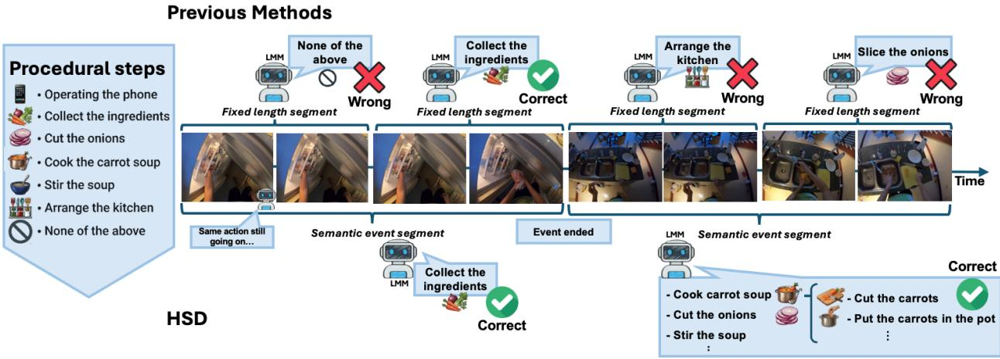
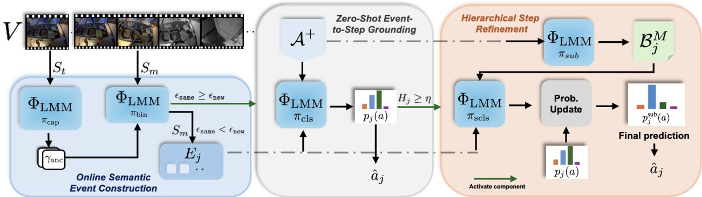
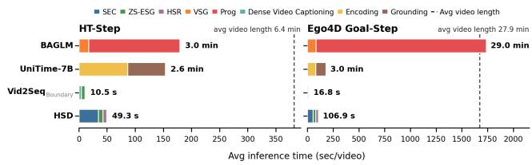
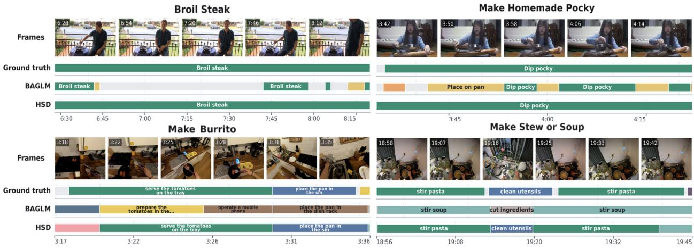
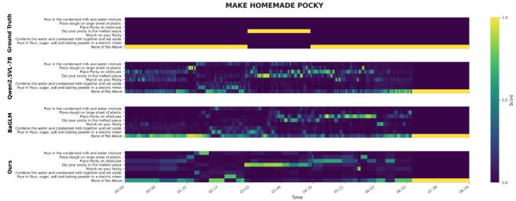
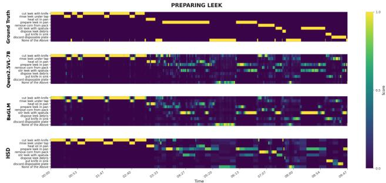
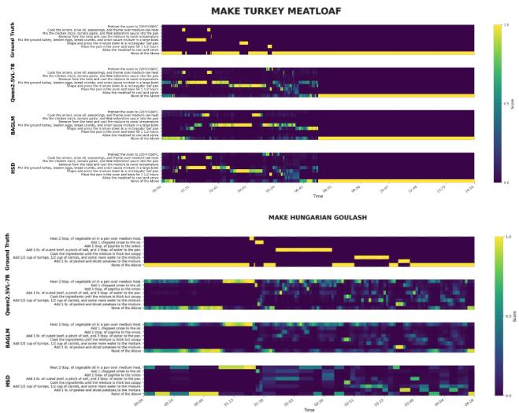

# Hierarchical Step Decomposition for Training-free Online Video Step Grounding

Long Zhou1 Luca Zanella1 Paolo Rota1

Massimiliano Mancini1 Elisa Ricci1,2

1University of Trento 2Fondazione Bruno Kessler https://zhoulong0.github.io/hsd/

## Abstract

Given a set of procedural steps, Video Step Grounding (VSG) aims to identify which steps occur in a video and localize when they are performed. Existing methods are either offline, requiring access to the full video before making predictions, or online, but relying on fixed-length video segments producing noisy, over-segmented outputs. In this work, we propose Hierarchical Step Decomposition (HSD), a training-free framework for online VSG that leverages the semantic understanding capabilities of Large Multimodal Models. HSD addresses two central challenges in online grounding: constructing semantically coherent temporal segmentsfrom a streaming video, and bridging the semantic gap between coarse procedural step descriptions and visual observations. To construct elementary temporal units, HSD incrementally groups incoming segments into semantically consistent events, using an anchor caption that is continuously validated against the visual stream. Based on these events, we perform zero-shot procedural step classification and selectively refine uncertain predictions by decomposing candidate steps into fine-grained substeps that capture more nuanced visual evidence. By operating on semantically coherent events rather than every fixed-length segment, HSD reduces redundant computation and produces more stable predictions. Experiments on HT-Step, Ego4D Goal-Step, and CrossTask show that HSD substantially outperforms state-of-the-art methods, overall achieving better step recognition, more accurate temporal localization, and faster inference.

Online Video Step Grounding (OVSG) is significantly more difficult, as it requires recognizing a step given only past frames. A major challenge lies in the choice of the temporal units to use for prediction. The only existing OVSG method [45] relies on fixed-length segments, a rigid representation poorly aligned with instructional procedures, where action lengths vary substantially. For instance, short segments often lack sufficient visual evidence to reliably identify a step while longer segments may encompass multiple actions, mixing visual evidence from different steps and leading to ambiguous predictions. A second challenge arises from the semantic gap between procedural step descriptions and local visual observations. Step descriptions are often coarse and goal-oriented. For instance, a step such as cook carrot soup may involve several finer-grained actions, such as taking the carrots, cutting them, and placing them into a pot. At any given timestep, the video may show only one of these sub-actions, so the visual information may only partially match the step description. As a result, the model may miss the correspondence with the higher-level step or may confuse it with visually similar actions.

Recent progress in VSG has been largely driven by weakly supervised approaches [5, 12, 18, 23] that formulate temporal grounding as alignment between textual descriptions and predefined video units, such as individual frames or fixed-length segments. While effective, these methods rely on task-specific supervision on curated training data, and typically process the video offline. As a result, they are difficult to transfer to unseen tasks and not well suited for streaming scenarios, such as always-on assistive devices, where a video must be processed incrementally as it is observed. This limitation has recently motivated the development of online, training-free approaches based on Large Multimodal Models (LMMs) [45].

## 1. Introduction

When humans perform a task (e.g., cooking), they undergo a series of steps (e.g., cutting, adding ingredients, mixing): recognizing these steps is essential for applications that analyze, monitor, or assist humans. To this end, given a video and a list of procedural steps in natural language, Video Step Grounding (VSG) [23, 51], aims to identify which steps are present in the video and when they occur.

In this work, we propose Hierarchical Step Decomposition (HSD), a training-free framework for OVSG that jointly addresses both challenges. HSD operates in three stages. In the first, instead of grounding predictions on fixed-length temporal units as in [45], we incrementally build semantically consistent event segments by determining whether each incoming visual observation continues the current event or initiates a new one. As a result, the model performs grounding over semantically coherent video units, avoiding the rigidity and the noise of fixed-length partitioning. In the second stage, we perform an initial prediction of the procedural step associated with an event, leveraging the zero-shot capabilities of an LMM [2, 3, 6, 40]. To reduce the granularity mismatch between the coarse procedural steps and local visual evidence, we introduce a third stage, i.e., a hierarchical step refinement stage, that is activated when the model has low confidence in the initial event-to-step assignment. In this stage, coarse descriptions of procedural steps are expanded into multiple, fine-grained substeps, and the current event is re-evaluated against these more detailed alternatives. Importantly, all stages of HSD use the same, frozen LMM, in a unified training-free pipeline. A comparison between HSD and previous methods is illustrated in Fig. 1.

  
Figure 1. Top: previous works for Online VSG [45] predict procedural steps on fixed-length segments. Bottom: Hierarchical Step Decomposition (HSD) constructs semantically coherent temporal event segments and, if necessary, decomposes procedural steps into multiple substeps to mitigate the granularity mismatch between coarse procedural step descriptions and visual observations.

We evaluate HSD on HT-Step [1], Ego4D Goal-Step [37] and CrossTask [51]. Overall, our approach advances the state of the art in OVSG by jointly improving step recognition, temporal localization, and inference efficiency. Using the same Qwen2.5-VL-7B backbone, it runs approximately 3× faster on short videos and up to 16× faster on longer videos than the prior state-of-the-art method, while improving average mAP by +6.98 on HT-Step and +6.63 on CrossTask, and increasing R@1 at mIoU= 0.3 by +6.42 points on Ego4D Goal-Step.

Contributions. We make three key contributions: 1) We introduce a training-free framework for online VSG that incrementally constructs semantically consistent event segments. 2) We propose a hierarchical refinement mechanism that resolves granularity mismatches between textual descriptions of coarse procedural steps and local visual observations. 3) We evaluate HSD on instructional video benchmarks, showing that it significantly outperforms state-ofthe-art methods in recognition, localization, and efficiency.

## 2. Related Work

Early work on VSG considered weak supervision from narrations and task structure. CrossTask [51] exploited ordered steps and narrations to learn shared step classifiers across tasks, while TAN [12] and VINA [23] learned narrationto-video alignment from pseudo-labels and wikiHow articles respectively. MPTVA [5] and NaSVA [18] improved the alignment by refining narrations with a Large Language Model (LLM), through filtered summaries and by converting ASR narrations into descriptive steps. More recently, BAGLM [45] introduced a training-free approach for OVSG, leveraging LMMs over fixed-duration video segments and refining predictions with Bayesian filtering. While HSD is also online and training-free, it fundamentally differs from BAGLM as it groups video segments and incorporates a hierarchical step-to-substep refinement, enabling more accurate predictions on fine-grained actions.

VSG is also related to several other video understanding tasks. Temporal action localization (TAL) and segmentation (TAS) detect action boundaries and assign framelevel labels from a fixed vocabulary shared between training and test time, offline [7, 35, 44, 46] or, more recently, online [14, 15, 32, 33, 38, 49]. Their closed-set formulation, however, requires retraining if new actions are introduced. Open-vocabulary TAL [11, 20, 27] lifts this constraint and localizes actions unseen during training, but typically operates offline, specifies the action of interest through category labels rather than free-form text, and requires a separate inference pass per action. Dense video captioning [10, 42, 43] and its streaming variants [50] produce free-form captions with associated temporal boundaries, but are not conditioned on a given list of procedural steps. Video temporal grounding [17, 21, 47], including temporal-grounding video LLMs [19, 29, 31] and causal variants [8, 48], returns a temporal interval for a textual query, yet assumes the query occurs in the video offering no mechanism to abstain when the queried action is absent. Generic event boundary detection [13, 26, 36] produces taxonomy-free boundaries, close in spirit to our segments grouping, but learns them from boundary annotations rather than training-free. OVSG differs from all of these in requiring online, openvocabulary, single-pass predictions over free-form step descriptions, without assuming every step occurs in the video.

## 3. Method

In this section, we illustrate the proposed training-free approach for OVSG. We first formally introduce the OVSG problem (Sec. 3.1). We then describe the first building block of our approach: a simple yet effective technique for identifying continuous segments corresponding to the same semantic event (Sec. 3.2). Then, we detail how we assign semantic labels to each event via visual question answering (Sec. 3.3), leveraging sub-step decomposition to refine uncertain predictions (Sec. 3.4).

## 3.1. Online Video Step Grounding

Given a video depicting a sequence of procedural steps, Video Step Grounding aims to identify which steps are performed and localize their temporal boundaries within the video. Formally, let $V ~ \in ~ \nu$ denote a video in the visual space V, and $A ~ = ~ \{ a _ { i } \} _ { i = 1 } ^ { M }$ denote a given set of M candidate procedural steps, where each $a _ { i } ~ \in ~ { \mathcal { L } }$ is a natural language description in the space $\mathcal { L } .$ We model the video as a sequence of $T$ non-overlapping segments ${ \cal { S } } ~ = ~ \{ { \cal { S } } _ { t } \} _ { t = 1 } ^ { T }$ , where $S _ { t } ~ \subset ~ V$ is the t-th incoming segment. In the online setting [45], predictions at time $t \leq T$ are restricted to the partial history $\boldsymbol { S } _ { 1 : t } ~ = ~ \{ S _ { 1 } , \ldots , S _ { t } \}$ rather than the full sequence $s$ available in offline inference. For each segment $S _ { t } .$ , the model outputs a prediction $\hat { a } _ { t } \in \mathcal { A } \cup \{ \varnothing \}$ }, where ∅ denotes that none of the candidate procedural steps is being performed. A step prediction should be made as soon as enough evidence is available, without access to future frames, as in online temporal action detection. [14, 15, 32, 38].

Previous work [45] addressed online VSG by estimating, for each incoming fixed-length segment $S _ { t }$ , a probability distribution over the candidate procedural steps in ${ \mathcal { A } } ^ { + } = { \mathcal { A } } \cup \{ \emptyset \}$ While effective, this formulation has two key limitations. First, operating on fixed temporal units leads to semantic noise, as action boundaries rarely align with uniform segments. Second, it assumes that the descriptions associated with procedural steps are sufficient to distinguish among visually similar actions. This assumption often breaks if the visual content is ambiguous (e.g., holding a knife over a cutting board), and multiple steps may remain plausible $( e . g .$ , slicing onions or cutting vegetables).

In the following, we describe how both challenges can be addressed by leveraging the zero-shot reasoning capabilities of LMMs to (i) construct semantic events; (ii) perform zero-shot predictions; and (iii) refine them in case of uncertainty (Fig. 2). Given the increasing granularity of the approach (i.e., task→procedural steps→substeps), we name our method Hierarchical Step Decomposition (HSD). In the following we describe its three main stages.

## 3.2. Online Semantic Event Construction

The first stage of HSD converts a stream of fixed-duration input segments into adaptive temporal events. We denote as event a sequence of segments with consistent semantic. In this stage, as in subsequent ones, we employ a Large Multimodal Model $\Phi _ { \mathrm { L M M } } : \mathcal { V } \times \mathcal { L } \to \mathcal { L } .$ , which maps a visual input and a textual prompt to a language output. The model is used in a frozen, training-free setting.

When the video or a new event begins, the incoming segment $S _ { t }$ is selected as the anchor segment. We perform two operations. First, the LMM generates a caption $\gamma _ { \mathrm { a n c } } = \Phi _ { \mathrm { L M M } } ( S _ { t } , \pi _ { \mathrm { c a p } } )$ , where $\pi _ { \mathrm { c a p } }$ is a captioning prompt1. This caption provides a compact textual description of the current event and it is used as an anchor to identify subsequent segments associated with the same action. Second, we initialize the active event as $E _ { j } = \{ S _ { t } \}$ where $E _ { j }$ denotes the ordered set of fixed-length segments assigned to the $j \cdot$ -th event.

For each subsequent incoming segment $S _ { m } .$ , with $m > t ,$ we assess its continuity with the active event by comparing it against the anchor caption. Specifically, we prompt the LMM with a binary query $\pi _ { \mathrm { b i n } } ( \gamma _ { \mathrm { a n c } } )$ , which asks whether the visual content of $S _ { m }$ corresponds to the same event described by $\gamma _ { \mathrm { a n c } }$ or marks the start of a new one. We define the continuity score $\epsilon _ { \tt S a m e }$ as the probability that the model assigns to the same outcome under its next-token distribution: $\epsilon _ { s a m e } = P _ { \Phi _ { \mathrm { L M M } } }$ (same $\mid S _ { m } , \pi _ { \mathrm { b i n } } ( \gamma _ { \mathrm { a n c } } ) )$ . Similarly, we denote as $\epsilon _ { \mathrm { n e w } } = P _ { \Phi _ { \mathrm { L M M } } } ( \mathrm { n e w } \mid S _ { m } , \pi _ { \mathrm { b i n } } ( \gamma _ { \mathrm { a n c } } ) )$ the probability assigned by $\Phi _ { \mathrm { L M M } }$ to new. The segment is considered part of the active event if $\epsilon _ { s a m e } \geq \epsilon _ { \mathfrak { n } \in \mathfrak { w } } .$ . In this case, the event is extended through temporal concatenation: $E _ { j } \gets E _ { j } \cup \{ S _ { m } \}$ . Otherwise, the current event is considered complete and passed to the next stage (Sec. 3.3). The incoming segment $S _ { m }$ then initializes a new event $E _ { j + 1 }$ , and the process repeats. This recursive online procedure partitions the video stream into semantically coherent events whose duration adapts to the underlying actions, providing more coherent inputs to the grounding stage. We report the pseudo-code in Appendix 6.5.

  
Figure 2. Overview of HSD. Given an input video $V ,$ the Online Semantic Event Construction module incrementally builds each event $E _ { j }$ from fixed-duration segments using a frozen LMM $\Phi _ { \mathrm { L M M } }$ . The first segment of $E _ { j }$ is captioned as $\gamma _ { \mathrm { a n c } } .$ , and each arriving segment is appended to $E _ { j }$ if its continuity score $\epsilon _ { \mathrm { s a m e } }$ exceeds $\epsilon _ { \mathrm { n } \in \mathrm { w } }$ ; otherwise, $E _ { j }$ is terminated and a new event is initialized. For each completed event $E _ { j }$ , the Zero-Shot Event-to-Step Grounding module predicts a probability distribution $p _ { j }$ over procedural steps. If its entropy $H _ { j }$ falls below threshold η, the most likely step is predicted. Otherwise, Hierarchical Step Refinement decomposes the top-k steps into substeps, re-evaluates $E _ { j }$ , aggregates substep scores into $p _ { j } ^ { \mathrm { s u b } }$ , and outputs the final prediction $\hat { a } _ { j }$

## 3.3. Zero-Shot Event-to-Step Grounding

After constructing a semantic event $E _ { j }$ , we leverage the zero-shot recognition capabilities of $\Phi _ { \mathrm { L M M } }$ to identify which procedural step it depicts. Because some events may capture background activities or out-of-procedure actions, we use the extended set of candidates ${ \mathcal { A } } ^ { + } = { \mathcal { A } } \cup \{ \emptyset \}$

We frame event-to-step grounding as a multiple-choice question answering task. Let $\pi _ { \mathrm { c l s } } ( \mathcal { A } ^ { + } )$ denote a classification prompt that provides the overall task context (e.g., “Making a sandwich”) and the enumerated list of candidates in $\mathcal { A } ^ { + }$ . For each candidate $a \in A ^ { + }$ , we use the probability assigned by $\Phi _ { \mathrm { L M M } }$ to its corresponding answer token, $i . e .$ , the next-token probability of the multiple-choice letter associated with a:

$$
\hat { p } _ { j } ( a ) = P _ { \Phi _ { \mathrm { L M M } } } ( a \mid E _ { j } , \pi _ { \mathrm { c l s } } ( A ^ { + } ) ) .\tag{1}
$$

We then normalize these scores over all candidates to obtain a probability distribution $p _ { j }$ over $\mathcal { A } ^ { + }$ :

$$
p _ { j } ( a ) = \frac { \hat { p } _ { j } ( a ) } { \sum _ { a ^ { \prime } \in A ^ { + } } \hat { p } _ { j } ( a ^ { \prime } ) } , \qquad a \in A ^ { + } .\tag{2}
$$

The resulting distribution $p _ { j }$ provides the initial semantic prediction for the completed event $E _ { j }$ . The class with the highest probability represents the predicted step, while the overall confidence determines whether the prediction requires further hierarchical refinement.

## 3.4. Hierarchical Step Refinement

While the initial distribution $p _ { j }$ provides a semantic prediction for event $E _ { j } ,$ , the observed event may contain only partial visual evidence of the corresponding procedural step. This is particularly challenging when candidate steps in A are high-level and goal-oriented, while the event captures only a fine-grained sub-action, creating a mismatch in semantic granularity. To reduce this mismatch, we refine uncertain predictions by decomposing the most likely candidate steps into atomic, open-vocabulary, substeps (e.g., Make mashed potatoes → boil the potatoes, drain the potatoes, mash the potatoes) and re-evaluating the event segment at this finer level of granularity.

We first quantify the uncertainty of the initial prediction using the Shannon entropy of $p _ { j } \colon$

$$
H _ { j } = - \sum _ { a \in \mathcal { A } ^ { + } } p _ { j } ( a ) \log p _ { j } ( a ) .\tag{3}
$$

For a predefined threshold $\eta ,$ if $H _ { j } < \eta$ the prediction is considered confident, and we skip refinement and directly output $\hat { a } _ { j } = \arg \operatorname* { m a x } _ { a \in \mathcal { A } ^ { + } } p _ { j } ( a )$ . However, if $H _ { j } \geq \eta ,$ we need to further disambiguate the prediction via hierarchical refinement. For computational efficiency, this is restricted to the top-k most plausible steps under the initial distribution, $\mathcal { A } _ { j } ^ { k } = \{ a \in \mathcal { A } ^ { + } \mid p _ { j } ( a ) \in \tan ( p _ { k } ( p _ { j } ) \}$

For each selected step $a \in \mathcal { A } _ { j } ^ { k }$ , we prompt $\Phi _ { \mathrm { L M M } }$ using a substep generation prompt $\pi _ { \mathrm { s u b } }$ to decompose it into a set of finer-grained action descriptions:

$$
B _ { a } = \Phi _ { \mathrm { L M M } } ( a , \pi _ { \mathrm { s u b } } ) = \{ b _ { 1 } ^ { a } , \dots , b _ { L _ { a } } ^ { a } \} ,\tag{4}
$$

where $L _ { a }$ is the number of substeps identified for a. These substeps provide more atomic action descriptions that can be matched more directly to the visual evidence in $E _ { j } { } ^ { 2 }$ Although this operation only requires textual reasoning, we use $\Phi _ { \mathrm { L M M } }$ instead of introducing an additional LLM, keeping the entire pipeline based on a single frozen LMM.

We aggregate the generated substeps into a candidate pool $\begin{array} { r } { B _ { j } ^ { k } = \bigcup _ { a \in \mathcal A _ { i } ^ { k } } B _ { a } } \end{array}$ and perform zero-shot semantic prediction (as in $\operatorname { E q . } \left( 1 \right) )$ over this finer-grained set. For each substep $b \in B _ { j } ^ { k }$ , we compute its alignment score as

$$
\hat { p } _ { j } ( b ) = P _ { \Phi _ { \mathrm { L M M } } } \big ( b \mid E _ { j } , \pi _ { \mathrm { s c l s } } ( \mathcal { B } _ { j } ^ { k } ) \big ) ,\tag{5}
$$

where $\pi _ { \mathrm { s c l s } }$ is a multiple-choice classification prompt, now applied to the substep candidates. Next, we aggregate these substep scores back to the original candidate step space. Since a high-level step is supported if any of its atomic substeps are strongly detected, each candidate step $a \in A ^ { + }$ inherits the maximum score of its constituent substeps:

$$
\hat { p } _ { j } ^ { \mathrm { s u b } } ( a ) = \left\{ \begin{array} { l l } { \operatorname* { m a x } _ { b \in \mathcal { B } _ { a } } \hat { p } _ { j } ( b ) , } & { \mathrm { i f ~ } a \in \mathcal { A } _ { j } ^ { k } , } \\ { 0 , } & { \mathrm { o t h e r w i s e } . } \end{array} \right.\tag{6}
$$

Finally, we want fine-grained predictions to remain anchored to the broader procedural context, preventing the model from favoring a substep that is visually plausible but conceptually disconnected from the initial step prior. Thus, we weight the aggregated substep scores by their initial probability $p _ { j } ( a )$ . The final refined probability distribution is obtained via normalization:

$$
p _ { j } ^ { \mathrm { s u b } } ( a ) = \frac { \hat { p } _ { j } ^ { \mathrm { s u b } } ( a ) \cdot p _ { j } ( a ) } { \sum _ { a ^ { \prime } \in \mathcal { A } ^ { + } } \hat { p } _ { j } ^ { \mathrm { s u b } } ( a ^ { \prime } ) \cdot p _ { j } ( a ^ { \prime } ) } , \qquad a \in \mathcal { A } ^ { + } .\tag{7}
$$

The final prediction in case of high entropy $( i . e . , H _ { j } \geq \eta )$ is thus $\hat { a } _ { j } = \arg \operatorname* { m a x } _ { a \in \mathcal { A } ^ { + } } p _ { j } ^ { \mathrm { s u b } } ( a )$

## 4. Experiments

In this section, we present our evaluation protocol and implementation details (Sec. 4.1). We then compare HSD with state-of-the-art methods in Sec. 4.2, followed by ablation studies in Sec. 4.3.

## 4.1. Evaluation protocol

Benchmarks. We evaluate HSD on three public benchmarks: HT-Step [1], Ego4D Goal-Step [37] and CrossTask [51]. HT-Step defines an evaluation setting with both seen and unseen activities. Following prior work [23, 45], we use the seen validation split, since the official evaluation server for the seen and unseen test sets is currently unavailable. This split contains 600 videos spanning 120 activities, with 5 videos per activity. Ego4D Goal-Step, a subset of Ego4D [9], contains 851 egocentric videos with an average duration of about 26 minutes. Following [37, 45], we consider the validation set containing 134 videos, use only the step-level annotations, and apply text normalization with spaCy. CrossTask is an instructional video benchmark for zero-shot step localization. It contains approximately 4.8k instructional videos, covering

18 primary tasks and 65 related tasks. We follow the same evaluation set as [18, 45], using videos from primary tasks. Metrics. For HT-Step and CrossTask, we evaluate grounding performance using mAP@IoU following the HT-Step evaluation protocol. For Ego4D Goal-Step, we follow its official protocol and report Recall@1 at mIoU = 0.3. Unlike the Recall@1 (R@1) metric adopted in prior works [18, 23, 45], which only verifies whether the top-ranked prediction falls within the annotated interval, our evaluation additionally requires sufficient temporal overlap between predicted and ground-truth segments. This yields a stricter, segment-level assessment that penalizes imprecise, noisy, or fragmented predictions, and thus constitutes a more appropriate measure of grounding quality. For completeness, we report R@1 results and discuss the differences between the two evaluation protocols in Appendix 6.1.

Baselines. We compare HSD with several baselines. First, among VSG methods, we consider the only two online approaches in the literature, BAGLM [45] and NaSVA-Online, the online variant of NaSVA introduced in [45], together with the offline methods TAN [12] and NaSVA [18]. Second, we adapt dense video captioning (DVC) models, which predict temporal boundaries together with free-form captions. Since no online DVC model releases official code, we use the offline methods Vid2Seq [43], VidChapters-7M [42] and TRACE [10], and adapt each in two ways: the text variant assigns every predicted caption to the candidate step with the highest Sentence-BERT similarity [30], while the boundary variant discards the captions and applies the same zero-shot event-to-step grounding as HSD to the predicted boundaries. Third, we adapt UniTime [19], a stateof-the-art offline video temporal grounding model trained on large-scale data,3 which returns the temporal boundaries of a given textual description in the video. We adapt it by querying it once for each candidate step and taking the returned boundaries. Finally, we report the performance of an oracle that applies the same zero-shot event-to-step grounding as HSD to ground-truth temporal segments.

For VSG methods, we report numbers from [45] on HT-Step, while on Ego4D Goal-Step and CrossTask we reproduce all methods with their official code. For methods operating on fixed-length units, final merged segments are obtained with a 1D blob detector, following [18, 39, 45].

Implementation Details. For fair comparison with prior work [45], each video is processed sequentially as a stream of non-overlapping 2-second segments sampled at 2 fps. Since $E _ { j }$ is incrementally extended until the continuity criterion is violated, we uniformly sample 16 frames for the subsequent stages. In the Hierarchical Refinement stage, we set the entropy threshold to $\eta = 0 . 0 5$ , use max aggregation over substeps, and refine at most $k = 1 0$ candidate steps, with the number of generated substeps ranging from 1 to 5. In all settings, adjacent segments sharing the same predicted step are merged, with the final score averaged over the constituent segments. All experiments are conducted on a single NVIDIA A100 GPU.

Table 1. Comparison with state-of-the-art methods on HT-Step, CrossTask, and Ego4D Goal-Step. Methods marked operate online while methods marked are offline.
<table><tr><td rowspan="2">Method</td><td colspan="4">HT-Step mAP@IoU ↑</td><td colspan="4">CrossTask mAP@IoU ↑</td><td rowspan="2">Ego4D Goal-Step R@1, IoU 0.3 ↑</td></tr><tr><td>@0.3</td><td>@0.5</td><td>@0.7</td><td>@[0.3-0.7]</td><td>@0.3</td><td>@0.5</td><td>@0.7</td><td>@[0.3-0.7]</td></tr><tr><td>Oracle</td><td></td><td></td><td></td><td></td><td></td><td></td><td></td><td></td><td></td></tr><tr><td>InternVL2.5-8B [6]</td><td>34.15</td><td>26.09</td><td>21.87</td><td>27.02</td><td>45.40</td><td>36.33</td><td>28.92</td><td>36.65</td><td>30.89</td></tr><tr><td>Qwen2.5-VL-7B [3]</td><td>41.24</td><td>32.83</td><td>28.04</td><td>33.76</td><td>48.26</td><td>38.89</td><td>31.26</td><td>39.23</td><td>32.07</td></tr><tr><td>Qwen3-VL-8B [2]</td><td>38.91</td><td>30.61</td><td>26.12</td><td>31.52</td><td>50.73</td><td>42.01</td><td>34.81</td><td>42.35</td><td>48.59</td></tr><tr><td>Dense video captioning (DVC)</td><td></td><td></td><td></td><td></td><td></td><td></td><td></td><td></td><td></td></tr><tr><td> $\mathrm { V i d } 2 \mathrm { S e q } _ { \mathrm { t e x t } } \ [ 4 3 ]$ </td><td>9.89</td><td>2.46</td><td>0.43</td><td>3.86</td><td>12.16</td><td>2.83</td><td>0.24</td><td>4.56</td><td>0.48</td></tr><tr><td>Vid2Seqboundary [43]</td><td>19.03</td><td>7.21</td><td>2.43</td><td>9.01</td><td>21.03</td><td>7.61</td><td>1.67</td><td>9.48</td><td>14.46</td></tr><tr><td> $\mathrm { V i d C h a p t e r s } { - } 7 \mathbf { M } _ { \mathrm { t e x t } } \ [ 4 2 ]$ </td><td>7.85</td><td>2.33</td><td>0.37</td><td>3.19</td><td>9.72</td><td>2.23</td><td>0.19</td><td>3.64</td><td>0.48</td></tr><tr><td> $\mathrm { V i d C h a p t e r s  – 7 M _ { b o u n d a r y } \ [ 4 2 ] }$ </td><td>17.53</td><td>7.04</td><td>2.22</td><td>8.45</td><td>19.13</td><td>6.90</td><td>1.50</td><td>8.63</td><td>14.67</td></tr><tr><td> $\mathrm { T R A C E } _ { \mathrm { t e x t } } \ [ 1 0 ]$ </td><td>9.50</td><td>3.12</td><td>0.90</td><td>4.20</td><td>6.77</td><td>1.54</td><td>0.23</td><td>2.53</td><td>1.19</td></tr><tr><td> $\mathrm { T R A C E _ { \mathrm { { b o u n d a r y } } } [ 1 0 ] }$ </td><td>11.66</td><td>3.93</td><td>1.38</td><td>5.24</td><td>9.07</td><td>2.92</td><td>0.70</td><td>3.89</td><td>9.36</td></tr><tr><td>Temporal sentence grounding</td><td></td><td></td><td></td><td></td><td></td><td></td><td></td><td></td><td></td></tr><tr><td>UniTime-7B [19]</td><td>19.92</td><td>11.48</td><td>5.52</td><td>12.27</td><td>28.86</td><td>18.90</td><td>8.17</td><td>18.68</td><td>24.87</td></tr><tr><td>Video Step Grounding</td><td></td><td></td><td></td><td></td><td></td><td></td><td></td><td></td><td></td></tr><tr><td>TAN [12]</td><td>14.07</td><td>5.28</td><td>1.25</td><td>6.48</td><td>12.35</td><td>4.00</td><td>0.58</td><td>5.14</td><td>4.96</td></tr><tr><td>NaSVA [18]</td><td>15.02</td><td>5.70</td><td>1.11</td><td>6.89</td><td>17.42</td><td>5.69</td><td>0.86</td><td>7.32</td><td>10.41</td></tr><tr><td>NaSVA-Online [18]</td><td>12.50</td><td>5.00</td><td>1.20</td><td>6.30</td><td>15.75</td><td>6.13</td><td>1.18</td><td>7.27</td><td>7.07</td></tr><tr><td>BAGLMInternVL2.5-8B [45]</td><td>15.90</td><td>6.70</td><td>1.50</td><td>7.70</td><td>28.18</td><td>12.18</td><td>1.45</td><td>13.26</td><td>16.80</td></tr><tr><td>BAGLMQwen2.5-VL-7B [45]</td><td>15.80</td><td>6.60</td><td>1.70</td><td>7.70</td><td>24.58</td><td>10.22</td><td>1.47</td><td>11.43</td><td>13.09</td></tr><tr><td> $\mathbf { B A G L M } _ { \mathrm { Q w e n 3 - V L - 8 B } } \ [ 4 5 ]$ </td><td>16.70</td><td>7.20</td><td>1.80</td><td>8.40</td><td>29.35</td><td>13.02</td><td>1.58</td><td>14.08</td><td>14.52</td></tr><tr><td>HSDInternVL2.5-8B</td><td>23.98</td><td>11.60</td><td>4.73</td><td>13.15</td><td>33.41</td><td>17.65</td><td>6.10</td><td>18.80</td><td>20.33</td></tr><tr><td> $\mathbf { H S D } _ { \mathrm { Q w e n 2 . 5 - V L - 7 B } }$ </td><td>25.92</td><td>13.43</td><td>5.74</td><td>14.68</td><td>32.44</td><td>16.78</td><td>5.71</td><td>18.06</td><td>19.51</td></tr><tr><td> $\mathbf { H S D } _ { \mathrm { Q w e n 3 - V L - 8 B } }$ </td><td>26.45</td><td>13.78</td><td>6.16</td><td>15.13</td><td>38.64</td><td>21.42</td><td>7.66</td><td>22.43</td><td>25.36</td></tr></table>

## 4.2. Comparison with the State of the Art

Table 1 compares HSD with the state of the art on HT-Step, CrossTask and Ego4D Goal-Step. Across all backbones and benchmarks, HSD consistently outperforms the correspond ing BAGLM variant, establishing a new state of the art for online VSG. On HT-Step, with the same Qwen2.5-VL-7B backbone, HSD improves the average mAP from 7.70 to 14.68 over BAGLM. The gains are consistent across all IoU thresholds and are particularly pronounced under stricter localization criteria: at IoU= 0.7, HSD improves from 1.70 to 5.74. Qwen3-VL-8B improves performance further, indicating that our method scales effectively with stronger backbones. The same behavior is observed on CrossTask and Ego4D Goal-Step, where Qwen2.5-VL-7B improves from 11.43 to 18.06 average mAP and from 13.09 to 19.51 R@1 at mIoU=0.3, respectively. HSD also surpasses the offline methods TAN and NaSVA on all three benchmarks. Notably, the oracle, which considers ground-truth temporal segments, remains far from perfect (31.52 and 42.35 average mAP on HT-Step and CrossTask with Qwen3-VL-8B), confirming the difficulty of the task.

It is also interesting to evaluate the performance of other methods adapted to the VSG task. While DVC-based baselines remain clearly behind HSD, they provide useful insights into the sources of difficulty in performing online VSG. For all three DVC models, the boundary variant outperforms its text counterpart by a large margin (e.g., 9.01 vs. 3.86 average mAP for Vid2Seq on HT-Step). Since the two variants share the same predicted boundaries and differ only in how segments are matched to steps, the gap isolates the captions as the weak component: DVC models do localize meaningful temporal units, but their free-form captions describe visual appearance rather than step identity, and are therefore poor proxies for procedural step descriptions. UniTime is the strongest baseline, reaching 12.27 and 18.68 average mAP on HT-Step and CrossTask, and 24.87 R@1 at mIoU on Ego4D Goal-Step. The comparison is however unfavorable to HSD, as UniTime operates in the easier offline setting, it requires multiple forward passes (one for each candidate procedural step) and is trained on a large-scale grounding corpus covering the same instructional domain.

  
Figure 3. Inference-time comparison between BAGLM [45], UniTime-7B [19], Vid2SeqBoundary [43] and HSD on HT-Step and Ego4D Goal-Step using Qwen2.5-VL-7B.

Inference speed comparison. Beyond grounding accuracy, we analyze the inference cost of HSD against BAGLM [45], the state-of-the-art OVSG method, and the best competitive baselines UniTime [19] and Vid2Seq [43]. We use the same Qwen2.5-VL-7B backbone for BAGLM and HSD on a single NVIDIA A100 64GB GPU, treating video loading as shared and reporting the average runtime of the methodspecific components (Figure 3): Semantic Event Construction (SEC), Zero-Shot Event-to-Step Grounding (ZS-ESG) and Hierarchical Step Refinement (HSR) for HSD, Visual Step Grounding (VSG) and Progress Estimation (Prog) for BAGLM, and encoding and grounding for UniTime.

On HT-Step, where videos last 6.4 minutes on average, HSD requires 49.3 seconds per video against 3.0 minutes for BAGLM and 2.6 minutes for UniTime-7B, i.e. a 3.6× and 3.2× speedup. The gap widens on Ego4D Goal-Step, with videos of 27.9 minutes: HSD takes 106.9 seconds, whereas BAGLM requires 29.0 minutes, longer than the video itself, and UniTime 3.0 minutes, yielding a 16.3× and 1.7× speedup. This follows from the different computational granularity: BAGLM grounds and estimates progress on every fixed 2-second segment and UniTime needs one forward pass per candidate step, whereas HSD applies ZS-ESG, and possibly HSR, to semantically coherent events, avoiding redundant grounding and scaling better to long videos. $\mathrm { V i d 2 S e q _ { B o u n d a r y } }$ is the only faster method, but it is offline and far less accurate (Table 1).

Qualitative comparison. Figure 4 shows four qualitative comparisons between BAGLM [45] and HSD using Qwen2.5-VL-7B. Across the Broil Steak, Make Homemade Pocky, and Make Burrito examples, BAGLM produces fragmented or noisy predictions, likely due to noisy visual evidence in the fixed-duration segments. For instance, it interrupts the central broil steak action with None, confuses prepare tomato with serve tomato, and incorrectly predicts Place on pan in the Make Homemade Pocky video, where the pan in the scene may bias the prediction toward an incorrect step. By constructing semantically consistent events, HSD reduces the influence of such spurious cues and produces more coherent temporal localizations. In the Make Stew or Soup example, HSD further benefits from its hierarchical refinement stage. Here, the generated substeps rinse the utensil and move the pasta around with a spoon provide more evidence for grounding the higher-level steps clean utensils and stir pasta, respectively, which would otherwise be confused with semantically similar steps. These examples highlight how HSD improves temporal coherence and semantic discrimination in challenging procedural videos.

Table 2. Component ablation study on HT-Step and Ego4D Goal Step using Qwen2.5-VL-7B.
<table><tr><td rowspan="2">OSEC</td><td rowspan="2">HSR</td><td colspan="4">HT-Step mAP@IoU ↑</td><td rowspan="2">Ego4D Goal-Step R@1, IoU=0.3 ↑</td></tr><tr><td>@0.3</td><td>@0.5</td><td>@0.7</td><td>@[0.3-0.7]</td></tr><tr><td>x</td><td>x</td><td>18.10</td><td>8.84</td><td>3.53</td><td>9.87</td><td>8.08</td></tr><tr><td>x</td><td>√</td><td>20.89</td><td>10.31</td><td>3.95</td><td>11.44</td><td>8.22</td></tr><tr><td>V</td><td>x</td><td>23.65</td><td>12.56</td><td>5.73</td><td>13.72</td><td>17.48</td></tr><tr><td>V</td><td>√</td><td>25.92</td><td>13.43</td><td>5.74</td><td>14.68</td><td>19.51</td></tr></table>

## 4.3. Ablation studies

In this section, we analyze the main components and design choices of HSD. We first evaluate the individual and combined contributions of Semantic Event Construction and Hierarchical Step Refinement. We then study different refinement activation strategies and, finally, assess the substep score weighting and diverse aggregation strategies. Additional studies are provided in Appendix 6.3.

Impact of Semantic Event Construction and Hierarchical Step Refinement. We first evaluate the contribution of the two main components of the proposed framework, i.e., OSEC (Online Semantic Event Construction) and HSR (Hierarchical Step Refinement), through an ablation study. Table 2 reports the results using Qwen2.5-VL-7B evaluated on HT-Step and Ego4D Goal-Step. As a base variant, we directly ground procedural steps on fixed-length video segments using the same LMM, without semantic event construction or hierarchical refinement. Adding OSEC alone already yields a clear improvement on both benchmarks, increasing performance on HT-Step from 18.10 to 23.65 at IoU= 0.3, and on Ego4D Goal-Step from 8.08 to 17.48 R@1 at mIoU= 0.3. This confirms that semantically coherent event segments online provides a much stronger temporal support for grounding than fixed-length segments. Adding HSR further improves performance, with gains of +2.27 on HT-Step at IoU= 0.3 and +2.03 R@1 at mIoU= 0.3 on Ego4D Goal-Step. This shows that hierarchical substep reasoning brings additional fine-grained semantic evidence once predictions are grounded on more coherent event segments. Furthermore, applying HSR alone also improves over the base method, indicating that the two components are individually useful and complementary, with the best performance obtained when both are used.

Substep refinement activation strategy. Table 3 analyzes different strategies for deciding when to activate the Hierarchical Step Refinement stage using Qwen2.5-VL-7B variant evaluated on HT-Step and Ego4D Goal-Step. We compare four variants: NONE, which performs no refinement; ALWAYS, which applies refinement to every event segment; RANDOM, which triggers refinement at random; ENTROPY, our proposed uncertainty-based criterion. We also consider an upper bound, i.e., ORACLE, where refinement is activated only when the initial prediction is incorrect. Among these strategies, ENTROPY achieves the best results on both datasets, improving over NONE by +2.27 mAP@0.3 and +0.96 average mAP on HT-Step and +2.03 R@1 with mIoU= 0.3 on Ego4D Goal-Step. It also outperforms ALWAYS, showing that refinement is most effective when applied selectively rather than indiscriminately.

  
Figure 4. Qualitative comparison between HSD and BAGLM.

Table 3. HSR activation strategy on HT-Step and Ego4D Goal-Step for Qwen2.5-VL-7B.
<table><tr><td rowspan="2">Trigger</td><td colspan="4">HT-Step mAP@tIoU ↑</td><td rowspan="2">Ego4D Goal-Step R@1, IoU=0.3 ↑</td></tr><tr><td>@0.3</td><td>@0.5</td><td>@0.7</td><td>@[0.3-0.7]</td></tr><tr><td>NONE</td><td>23.65</td><td>12.56</td><td>5.73</td><td>13.72</td><td>17.48</td></tr><tr><td>ALWAYS</td><td>23.58</td><td>12.11</td><td>5.03</td><td>13.26</td><td>17.36</td></tr><tr><td>RANDOM</td><td>18.05</td><td>9.05</td><td>3.85</td><td>10.64</td><td>17.09</td></tr><tr><td>ENTROPY</td><td>25.92</td><td>13.43</td><td>5.74</td><td>14.68</td><td>19.51</td></tr><tr><td>ORACLE</td><td>41.85</td><td>23.05</td><td>10.22</td><td>21.09</td><td>33.26</td></tr></table>

Table 4. Ablation on Parent-Step Prior Weighting (PSPW) and Aggregation (Agg) on HT-Step and Ego4D Goal-Step using Qwen2.5-VL-7B.
<table><tr><td rowspan="2">PSPW</td><td rowspan="2">Agg</td><td colspan="4">HT-Step mAP@tIoU ↑</td><td rowspan="2">Ego4D Goal-Step R@1, IoU=0.3 ↑</td></tr><tr><td>@0.3</td><td>@0.5</td><td>@0.7</td><td>@[0.3-0.7]</td></tr><tr><td>x</td><td>Sum</td><td>24.50</td><td>12.79</td><td>5.35</td><td>14.21</td><td>17.44</td></tr><tr><td>√</td><td>Sum</td><td>25.03</td><td>12.93</td><td>5.59</td><td>14.52</td><td>19.02</td></tr><tr><td>x</td><td>Max</td><td>25.05</td><td>13.30</td><td>5.52</td><td>14.62</td><td>17.53</td></tr><tr><td>√</td><td>Max</td><td>25.92</td><td>13.43</td><td>5.74</td><td>14.68</td><td>19.51</td></tr></table>

Analysis of Parent-Step Prior Weighting and Aggregation Strategies. We evaluate two key design choices in the Hierarchical Step Refinement stage: whether substep scores are reweighted by the probability of their parent step, as in Eq. (7), which we refer to as Parent-Step Prior Weighting (PSPW), and how these scores are aggregated back to the step level, as in Eq. (6), denoted Aggregation (Agg). For Agg, we compare two strategies: Sum, which accumulates evidence across all substeps, and Max, which keeps the highest-scoring substep. Table 4 reports the results using Qwen2.5-VL-7B on HT-Step and Ego4D Goal-Step. Across both datasets, PSPW consistently improves performance for both Agg strategies, highlighting the importance of preserving coarse step-level priors when incorporating fine-grained substep evidence. Additionally, the choice of Agg is also relevant: Max aggregation outperforms Sum aggregation in all settings, suggesting that relying on the most informative substep yields a stronger signal than aggregating potentially noisy evidence across all substeps.

## 5. Conclusion

We presented HSD, a training-free framework for online video step grounding that operates with a single frozen LMM. Unlike prior methods that ground procedural steps on fixed-length video segments, HSD incrementally constructs adaptive temporal units that better align with the variable duration of real procedural steps, and decomposes candidate steps into finer-grained substeps to refine uncertain predictions addressing the granularity mismatch between coarse step descriptions and local visual evidence. Experiments on HT-Step, Ego4D Goal-Step and CrossTask demonstrate that HSD achieves state-of-the-art performance. We also compare VSG against adjacent settings, so far unexplored, and find that these perform poorly with procedural steps. The results highlight the importance of adapting both the temporal unit and the semantic granularity of steps descriptions in online VSG.

Acknowledgments. This work was supported by the EU Horizon ELIAS (No. 101120237), ELLIOT (No. 101214398), TURING (No. 101215032) and FIS project GUIDANCE (No. FIS2023-03251) projects. The authors acknowledge the CINECA award under the ISCRA initiative for the availability of high performance computing resources and support.

## References

[1] Triantafyllos Afouras, Effrosyni Mavroudi, Tushar Nagarajan, Huiyu Wang, and Lorenzo Torresani. Ht-step: Aligning instructional articles with how-to videos. NeurIPS, 2023. 2, 5, 12

[2] Shuai Bai, Yuxuan Cai, Ruizhe Chen, Keqin Chen, Xionghui Chen, Zesen Cheng, Lianghao Deng, Wei Ding, Chang Gao, Chunjiang Ge, Wenbin Ge, Zhifang Guo, Qidong Huang, Jie Huang, Fei Huang, Binyuan Hui, Shutong Jiang, Zhaohai Li, Mingsheng Li, Mei Li, Kaixin Li, Zicheng Lin, Junyang Lin, Xuejing Liu, Jiawei Liu, Chenglong Liu, Yang Liu, Dayiheng Liu, Shixuan Liu, Dunjie Lu, Ruilin Luo, Chenxu Lv, Rui Men, Lingchen Meng, Xuancheng Ren, Xingzhang Ren, Sibo Song, Yuchong Sun, Jun Tang, Jianhong Tu, Jianqiang Wan, Peng Wang, Pengfei Wang, Qiuyue Wang, Yuxuan Wang, Tianbao Xie, Yiheng Xu, Haiyang Xu, Jin Xu, Zhibo Yang, Mingkun Yang, Jianxin Yang, An Yang, Bowen Yu, Fei Zhang, Hang Zhang, Xi Zhang, Bo Zheng, Humen Zhong, Jingren Zhou, Fan Zhou, Jing Zhou, Yuanzhi Zhu, and Ke Zhu. Qwen3-vl technical report, 2025. 2, 6

[3] Shuai Bai, Keqin Chen, Xuejing Liu, Jialin Wang, Wenbin Ge, Sibo Song, Kai Dang, Peng Wang, Shijie Wang, Jun Tang, Humen Zhong, Yuanzhi Zhu, Mingkun Yang, Zhaohai Li, Jianqiang Wan, Pengfei Wang, Wei Ding, Zheren Fu, Yiheng Xu, Jiabo Ye, Xi Zhang, Tianbao Xie, Zesen Cheng, Hang Zhang, Zhibo Yang, Haiyang Xu, and Junyang Lin. Qwen2.5-vl technical report, 2025. 2, 6

[4] Brian Chen, Andrew Rouditchenko, Kevin Duarte, Hilde Kuehne, Samuel Thomas, Angie Boggust, Rameswar Panda, Brian Kingsbury, Rogerio Feris, David Harwath, James Glass, Michael Picheny, and Shih-Fu Chang. Multimodal clustering networks for self-supervised learning from unlabeled videos. In ICCV, 2021. 13

[5] Yuxiao Chen, Kai Li, Wentao Bao, Deep Patel, Yu Kong, Martin Renqiang Min, and Dimitris N Metaxas. Learning to localize actions in instructional videos with llm-based multipathway text-video alignment. In ECCV, 2024. 1, 2, 13

[6] Zhe Chen, Weiyun Wang, Yue Cao, Yangzhou Liu, Zhangwei Gao, Erfei Cui, Jinguo Zhu, Shenglong Ye, Hao Tian, Zhaoyang Liu, Lixin Gu, Xuehui Wang, Qingyun Li, Yiming Ren, Zixuan Chen, Jiapeng Luo, Jiahao Wang, Tan Jiang, Bo Wang, Conghui He, Botian Shi, Xingcheng Zhang, Han Lv, Yi Wang, Wenqi Shao, Pei Chu, Zhongying Tu, Tong He, Zhiyong Wu, Huipeng Deng, Jiaye Ge, Kai Chen, Kaipeng Zhang, Limin Wang, Min Dou, Lewei Lu, Xizhou Zhu, Tong Lu, Dahua Lin, Yu Qiao, Jifeng Dai, and Wenhai Wang. Expanding performance boundaries of open-source multimodal models with model, data, and test-time scaling, 2024. 2, 6

[7] Yazan Abu Farha and Juergen Gall. Ms-tcn: Multi-stage temporal convolutional network for action segmentation. In CVPR, 2019. 2

[8] Tian Gan, Xiao Wang, Yan Sun, Jianlong Wu, Qingpei Guo, and Liqiang Nie. Temporal sentence grounding in streaming videos. In ACM MM, 2023. 3

[9] Kristen Grauman, Andrew Westbury, Eugene Byrne, Zachary Chavis, Antonino Furnari, Rohit Girdhar, Jackson Hamburger, Hao Jiang, Miao Liu, Xingyu Liu, Miguel Martin, Tushar Nagarajan, Ilija Radosavovic, Santhosh Kumar Ramakrishnan, Fiona Ryan, Jayant Sharma, Michael Wray, Mengmeng Xu, Eric Zhongcong Xu, Chen Zhao, Siddhant Bansal, Dhruv Batra, Vincent Cartillier, Sean Crane, Tien Do, Morrie Doulaty, Akshay Erapalli, Christoph Feichtenhofer, Adriano Fragomeni, Qichen Fu, Abrham Gebreselasie, Cristina Gonzalez, James Hillis, Xuhua Huang, Yifei´ Huang, Wenqi Jia, Weslie Khoo, Jachym Kol´ a´ˇr, Satwik Kottur, Anurag Kumar, Federico Landini, Chao Li, Yanghao Li, Zhenqiang Li, Karttikeya Mangalam, Raghava Modhugu, Jonathan Munro, Tullie Murrell, Takumi Nishiyasu, Will Price, Paola Ruiz, Merey Ramazanova, Leda Sari, Kiran Somasundaram, Audrey Southerland, Yusuke Sugano, Ruijie Tao, Minh Vo, Yuchen Wang, Xindi Wu, Takuma Yagi, Ziwei Zhao, Yunyi Zhu, Pablo Arbelaez, David Crandall,´ Dima Damen, Giovanni Maria Farinella, Christian Fuegen, Bernard Ghanem, Vamsi Krishna Ithapu, C. V. Jawahar, Hanbyul Joo, Kris Kitani, Haizhou Li, Richard Newcombe, Aude Oliva, Hyun Soo Park, James M. Rehg, Yoichi Sato, Jianbo Shi, Mike Zheng Shou, Antonio Torralba, Lorenzo Torresani, Mingfei Yan, and Jitendra Malik. Ego4d: Around the world in 3,000 hours of egocentric video. In CVPR, 2022. 5

[10] Yongxin Guo, Jingyu Liu, Mingda Li, Qingbin Liu, Xi Chen, and Xiaoying Tang. Trace: Temporal grounding video llm via causal event modeling. In ICLR, 2025. 2, 5, 6

[11] Chaolei Han, Hongsong Wang, Jidong Kuang, Lei Zhang, and Jie Gui. Training-free zero-shot temporal action detec tion with vision-language models. arXiv, 2025. 2

[12] Tengda Han, Weidi Xie, and Andrew Zisserman. Temporal alignment network for long-term video. In CVPR, 2022. 1, 2, 5, 6, 13

[13] Hyungrok Jung, Daneul Kim, Seunggyun Lim, Jeany Son, and Jonghyun Choi. Online generic event boundary detec tion. In ICCV, 2025. 3

[14] Hyolim Kang, Kyungmin Kim, Yumin Ko, and Seon Joo Kim. Cag-qil: Context-aware actionness grouping via q imitation learning for online temporal action localization. In ICCV, 2021. 2, 3

[15] Young Hwi Kim, Hyolim Kang, and Seon Joo Kim. A sliding window scheme for online temporal action localization. In ECCV, 2022. 2, 3

[16] Dohwan Ko, Joonmyung Choi, Juyeon Ko, Shinyeong Noh, Kyoung-Woon On, Eun-Sol Kim, and Hyunwoo J Kim. Video-text representation learning via differentiable weak temporal alignment. In CVPR, 2022. 13

[17] Jie Lei, Tamara L Berg, and Mohit Bansal. Detecting moments and highlights in videos via natural language queries. NeurIPS, 2021. 3

[18] Zeqian Li, Qirui Chen, Tengda Han, Ya Zhang, Yanfeng Wang, and Weidi Xie. Multi-sentence grounding for longterm instructional video. In ECCV, 2024. 1, 2, 5, 6, 13

[19] Zeqian Li, Shangzhe Di, Zhonghua Zhai, Weilin Huang, Yanfeng Wang, and Weidi Xie. Universal video temporal grounding with generative multi-modal large language models. NeurIPS, 2025. 3, 5, 6, 7

[20] Benedetta Liberatori, Alessandro Conti, Paolo Rota, Yiming Wang, and Elisa Ricci. Test-time zero-shot temporal action localization. In CVPR, 2024. 2

[21] Kevin Qinghong Lin, Pengchuan Zhang, Joya Chen, Shraman Pramanick, Difei Gao, Alex Jinpeng Wang, Rui Yan, and Mike Zheng Shou. Univtg: Towards unified videolanguage temporal grounding. In ICCV, 2023. 3

[22] Huaishao Luo, Lei Ji, Botian Shi, Haoyang Huang, Nan Duan, Tianrui Li, Jason Li, Taroon Bharti, and Ming Zhou. Univl: A unified video and language pre-training model for multimodal understanding and generation. arXiv, 2020. 13

[23] Effrosyni Mavroudi, Triantafyllos Afouras, and Lorenzo Torresani. Learning to ground instructional articles in videos through narrations. In ICCV, 2023. 1, 2, 5, 13

[24] Antoine Miech, Dimitri Zhukov, Jean-Baptiste Alayrac, Makarand Tapaswi, Ivan Laptev, and Josef Sivic. Howto100m: Learning a text-video embedding by watching hundred million narrated video clips. In ICCV, 2019. 13

[25] Antoine Miech, Jean-Baptiste Alayrac, Lucas Smaira, Ivan Laptev, Josef Sivic, and Andrew Zisserman. End-to-end learning of visual representations from uncurated instructional videos. In CVPR, 2020. 13

[26] Ramy Mounir, Sujal Vijayaraghavan, and Sudeep Sarkar. Streamer: Streaming representation learning and event segmentation in a hierarchical manner. In NeurIPS, 2023. 3

[27] Sauradip Nag, Xiatian Zhu, Yi-Zhe Song, and Tao Xiang. Zero-shot temporal action detection via vision-language prompting. In ECCV, 2022. 2

[28] Maxime Oquab, Timothee Darcet, Th´ eo Moutakanni, Huy´ Vo, Marc Szafraniec, Vasil Khalidov, Pierre Fernandez, Daniel Haziza, Francisco Massa, Alaaeldin El-Nouby, et al. DINOv2: Learning robust visual features without supervision. TMLR, 2024. 13

[29] Shraman Pramanick, Effrosyni Mavroudi, Yale Song, Rama Chellappa, Lorenzo Torresani, and Triantafyllos Afouras. Enrich and detect: Video temporal grounding with multimodal llms. In ICCV, 2025. 3

[30] Nils Reimers and Iryna Gurevych. Sentence-bert: Sentence embeddings using siamese bert-networks. In EMNLP-IJCNLP, 2019. 5

[31] Shuhuai Ren, Linli Yao, Shicheng Li, Xu Sun, and Lu Hou. Timechat: A time-sensitive multimodal large language model for long video understanding. In CVPR, 2024. 3

[32] Sakib Reza, Yuexi Zhang, Mohsen Moghaddam, and Octavia Camps. Hat: History-augmented anchor transformer for online temporal action localization. In ECCV, 2024. 2, 3

[33] Y. Shen and E. Elhamifar. Progress-aware online action segmentation for egocentric procedural task videos. CVPR, 2024. 2

[34] Yuhan Shen, Lu Wang, and Ehsan Elhamifar. Learning to segment actions from visual and language instructions via differentiable weak sequence alignment. In CVPR, 2021. 13

[35] Dingfeng Shi, Yujie Zhong, Qiong Cao, Lin Ma, Jia Li, and Dacheng Tao. Tridet: Temporal action detection with relative boundary modeling. In CVPR, 2023. 2

[36] Mike Zheng Shou, Stan Weixian Lei, Weiyao Wang, Deepti Ghadiyaram, and Matt Feiszli. Generic event boundary detection: A benchmark for event segmentation. In ICCV, 2021. 3

[37] Yale Song, Eugene Byrne, Tushar Nagarajan, Huiyu Wang, Miguel Martin, and Lorenzo Torresani. Ego4d goal-step: Toward hierarchical understanding of procedural activities. NeurIPS, 2023. 2, 5, 12

[38] Youngkil Song, Dongkeun Kim, Minsu Cho, and Suha Kwak. Online temporal action localization with memoryaugmented transformer. In ECCV, 2024. 2, 3

[39] Huiyu Wang, Mitesh Kumar Singh, and Lorenzo Torresani. Ego-only: Egocentric action detection without exocentric transferring. In ICCV, 2023. 5

[40] Weiyun Wang, Zhangwei Gao, Lixin Gu, Hengjun Pu, Long Cui, Xingguang Wei, Zhaoyang Liu, Linglin Jing, Shenglong Ye, Jie Shao, et al. Internvl3. 5: Advancing open-source multimodal models in versatility, reasoning, and efficiency. arXiv, 2025. 2

[41] Hu Xu, Gargi Ghosh, Po-Yao Huang, Dmytro Okhonko, Armen Aghajanyan, Florian Metze, Luke Zettlemoyer, and Christoph Feichtenhofer. Videoclip: Contrastive pre-training for zero-shot video-text understanding. In EMNLP, 2021. 13

[42] Antoine Yang, Arsha Nagrani, Ivan Laptev, Josef Sivic, and Cordelia Schmid. Vidchapters-7m: Video chapters at scale. NeurIPS, 2023. 2, 5, 6

[43] Antoine Yang, Arsha Nagrani, Paul Hongsuck Seo, Antoine Miech, Jordi Pont-Tuset, Ivan Laptev, Josef Sivic, and Cordelia Schmid. Vid2seq: Large-scale pretraining of a visual language model for dense video captioning. In CVPR, 2023. 2, 5, 6, 7, 13

[44] Fangqiu Yi, Hongyu Wen, and Tingting Jiang. Asformer: Transformer for action segmentation. BMVC, 2021. 2

[45] Luca Zanella, Massimiliano Mancini, Yiming Wang, Alessio Tonioni, and Elisa Ricci. Training-free online video step grounding. In NeurIPS, 2025. 1, 2, 3, 5, 6, 7, 12, 13

[46] Chen-Lin Zhang, Jianxin Wu, and Yin Li. Actionformer: Localizing moments of actions with transformers. In European Conference on Computer Vision, 2022. 2

[47] Hao Zhang, Aixin Sun, Wei Jing, Liangli Zhen, Joey Tiany Zhou, and Rick Siow Mong Goh. Natural language video localization: A revisit in span-based question answering framework. IEEE TPAMI, 2021. 3, 13

[48] Minghang Zheng, Yuxin Peng, Benyuan Sun, Yi Yang, and Yang Liu. Hierarchical event memory for accurate and low latency online video temporal grounding. In ICCV, 2025. 3

[49] Qing Zhong, Guodong Ding, and Angela Yao. Onlinetas: An online baseline for temporal action segmentation. In NeurIPS, 2024. 2

[50] Xingyi Zhou, Anurag Arnab, Shyamal Buch, Shen Yan, Austin Myers, Xuehan Xiong, Arsha Nagrani, and Cordelia Schmid. Streaming dense video captioning. In CVPR, 2024. 3

[51] Dimitri Zhukov, Jean-Baptiste Alayrac, Ramazan Gokberk Cinbis, David Fouhey, Ivan Laptev, and Josef Sivic. Crosstask weakly supervised learning from instructional videos. In CVPR, 2019. 1, 2, 5, 12, 13

## 6. Technical appendices and supplementary material

## 6.1. Evaluation protocol details

HT-Step and CrossTask evaluation. For HT-Step [1] and CrossTask [51], we follow the official article-grounding protocol and report mean Average Precision over temporal IoU thresholds. A predicted segment is correct if its step label matches the ground-truth step and its temporal IoU exceeds the threshold. We report mAP at temporal IoU thresholds {0.3, 0.5, 0.7}, as well as the average mAP over thresholds {0.3, 0.4, 0.5, 0.6, 0.7}, denoted as mAP@[0.3–0.7].

AP is computed separately for each activity by pooling all predictions and ground-truth intervals from videos of that activity; the final mAP is the average across activities. This metric is well suited to HT-Step and CrossTask because it evaluates both step identification and temporal extent, while also penalizing false positives on nongroundable article steps. In contrast, recall-based metrics ignore such false positives, and frame-wise metrics do not assess segment-level localization quality.

Ego4D Goal-Step evaluation. For Ego4D Goal-Step [37], we follow official evaluation protocol, reporting Recall@1 at mIoU = 0.3. A prediction is counted as correct if the top-ranked predicted segment for a step overlaps with the ground-truth interval with temporal IoU greater than 0.3. As in the main paper, we evaluate only at the step level and apply the same text normalization procedure used by prior work [45], including lowercasing, lemmatization, and plural canonicalization.

Relation to Recall@1. For completeness, we also report the results with Recall@1 in Appendix 6.2. Recall@1 is useful for comparison with prior step-grounding methods, but it is less suitable compared to the official metric. Specifically, it only checks whether the highest-scoring temporal prediction falls inside the ground-truth interval, without evaluating the predicted segment as a whole. Therefore, a method can obtain high R@1 as long as one topscoring frame lies within the ground-truth interval, even if the remaining predictions are fragmented or imprecise. Moreover, R@1 does not penalize false positives on nongroundable article steps. For these reasons, we do not use R@1 as our primary metric. R@1 is also not fully aligned with our prediction format: our method produces variable-length segments and assigns the same score to all frames within each predicted segment, rather than producing frame-level scores. As a result, multiple frames may share the highest score. When computing R@1, we therefore count a prediction as correct if any of the top-scoring frames falls within the ground-truth interval.

## 6.2. Additional analysis using Recall@1

Table 7 reports additional results under the Recall@1 protocol commonly used in prior work. Although our method is designed for segment-level grounding, it remains competitive under this point-based metric and achieves the best performance among online methods on both HT-Step and Ego4D Goal-Step. In particular, it improves over BaGLM by +1.5 R@1 on HT-Step and +1.1 R@1 on Ego4D Goal-Step. For a fair comparison, we report both BaGLM and our method with the same Qwen2.5-VL-7B base model.

## 6.3. Hyperparameter Analysis

We analyze the sensitivity of HSD to the two main hyperparameters introduced by the Hierarchical Step Refinement module: the entropy threshold η, which controls whether refinement is activated, and the number of top-k candidate steps considered during refinement. Experiments are conducted on Ego4D Goal-Step using Qwen2.5-VL-7B as the frozen LMM, and performance is reported in terms of R@1 at IoU threshold 0.3.

Hierarchical Step Refinement activation threshold. The Hierarchical Step Refinement module is applied when the initial event-to-step prediction is uncertain. Specifically, after obtaining the coarse probability distribution $p _ { j }$ over the candidate procedural steps, we compute its entropy $H _ { j }$ and activate refinement when $H _ { j } \geq \eta$ . In this case, the model decomposes the most plausible high-level steps into finergrained substeps, re-evaluates the event over this substep pool, and aggregates the resulting scores back to the original step space. Thus, η determines how often this additional refinement stage is invoked.

Table 8 reports the effect of varying the entropy threshold $\eta ~ \in ~ \{ 0 . 0 5 , 0 . 1 0 , 0 . 1 5 , 0 . 2 0 \}$ while keeping $k ~ = ~ 1 0$ fixed. Smaller values of η activate refinement on a larger fraction of events, while larger values restrict refinement to only the most uncertain predictions. The results show that performance remains relatively stable across all tested thresholds, with R@1 at mIoU= 0.3 varying only within a narrow range. This suggests that HSD is not highly sensitive to the exact value of η. Nevertheless, the best result is obtained with $\eta = 0 . 0 5$ , indicating that applying refinement more broadly is beneficial.

Number of top-k plausible step candidates. Once refinement is activated, HSD does not decompose all candidate steps. Instead, it first selects the top-k most likely steps according to the initial distribution $p _ { j }$ , and only these candidates are expanded into substeps. This design keeps the refinement stage computationally tractable while focusing the additional reasoning on the most plausible hypotheses. The value of M therefore controls the breadth of the refinement pool.

Table 9 reports the effect of varying the number of candidate steps used during refinement, with $k \in \{ 4 , 6 , 8 , 1 0 \}$ and $\eta = 0 . 0 5$ fixed. Increasing k enlarges the set of coarse step hypotheses that are decomposed into substeps. As a result, the refinement stage has a higher chance of including the correct step among its candidate parents, at the cost of evaluating a larger substep pool. Performance improves when moving from $k \ = \ 4$ to larger values, confirming that considering too few candidates can prematurely discard the correct step before refinement. The best performance is achieved with $k \ = \ 1 0 .$ , which suggests that a broader refinement pool provides useful additional coverage while remaining computationally manageable. Overall, these results indicate that HSD benefits from using hierarchical refinement over a sufficiently diverse set of plausible step hypotheses.

Table 5. Performance comparison on CrossTask, HT-Step, and Ego4D Goal-Step.  
Table 6. CrossTask
<table><tr><td rowspan=1 colspan=1>Method                         Avg. R@1↑</td></tr><tr><td rowspan=1 colspan=1>Offline methods</td></tr><tr><td rowspan=1 colspan=1>Zhukov et al. [51]                 22.4HT100M [24]                       33.6VideoCLIP [41]                    33.9MCN [4]                             35.1</td></tr><tr><td rowspan=1 colspan=1>DWSA [34]                          35.3</td></tr><tr><td rowspan=1 colspan=1>MIL-NCE [25]                      40.5</td></tr><tr><td rowspan=1 colspan=1>VT-TWINS [16]                    40.7</td></tr><tr><td rowspan=1 colspan=1>UniVL [22]                          42.0</td></tr><tr><td rowspan=1 colspan=1>VINA [23]                           44.8</td></tr><tr><td rowspan=1 colspan=1>NASVA [18]                         46.7MPTVA [5]                          47.9</td></tr><tr><td rowspan=1 colspan=1>Online methods</td></tr><tr><td rowspan=1 colspan=1> $\mathbf { B A G L M } _ { \mathrm { Q w e n 2 . 5 - V L - 7 B } }$ [45]       53.3 $\mathbf { O u r s } _ { \mathrm { Q w e n 2 . 5 - V L - 7 B } }$                    53.6</td></tr></table>

## 6.4. Comparison with alternative temporal units.

We compare OSEC with simpler ways of building temporal units, keeping the rest of the pipeline unchanged (Qwen2.5- VL-7B, without HSR). We consider longer fixed windows, boundaries detected from visual feature changes, and the boundaries predicted by Vid2Seq [43]. For feature changes, we encode each 1-second segment with DINOv2 [28] and start a new event when its similarity to the current event drops below a threshold τ. Table 10 reports the results on HT-Step. Longer windows reach OSEC only at $\mathrm { I o U = 0 . 3 , }$ while feature-change boundaries are better than fixed windows at $\mathrm { { I o U } \mathrm { { = } \mathrm { { \ 0 . 7 } } } }$ but remain below OSEC on average. Moreover, both require tuning a window length or a threshold, while OSEC does not.

Table 7. HT-Step and Ego4D Goal-Step
<table><tr><td>Method</td><td>HT-Step R@1↑</td><td>Ego4D R@1↑</td></tr><tr><td>Offline methods</td><td></td><td></td></tr><tr><td>VSLNet [47]</td><td>一</td><td>24.3</td></tr><tr><td>TAN* [12]</td><td>30.7</td><td>一</td></tr><tr><td>VINA [23]</td><td>39.1</td><td></td></tr><tr><td>NaSVA [18]</td><td>53.1</td><td>29.1</td></tr><tr><td>Online methods</td><td></td><td></td></tr><tr><td>NaSVA-Online [18]</td><td>46.1</td><td>24.2</td></tr><tr><td> $\mathbf { B a G L M } _ { \mathrm { Q w e n 2 . 5 - V L - 7 B } }$  [45]</td><td>54.3</td><td>36.3</td></tr><tr><td> $\mathbf { O u r s } _ { \mathrm { Q w e n 2 . 5 - V L - 7 B } }$ </td><td>55.8</td><td>37.4</td></tr></table>

## 6.5. Additional Method Details

This section provides implementation and procedural details that complement the method description in Section 3. The exact prompt templates used by each module are reported in Appendix 7.

Online Semantic Event Construction. As described in Section 3, the input video is processed as a stream of nonoverlapping 2-second chunks. Here, we provide additional details on the binary decision used during continuity checking. After a new active event is initialized, the current chunk is captioned using the prompt reported in 7.1; this caption serves as the anchor description of the event. The model then examines each subsequent chunk using the continuation prompt in 7.1 and decides whether the chunk belongs to the same event or starts a new one. Concretely, we score the two admissible responses using the model’s next-token generation probabilities. Given the anchor caption $\gamma _ { \mathrm { a n c } } ,$ , we

<table><tr><td>η</td><td>R@1, IoU=0.3</td></tr><tr><td>0.05</td><td>0.1951</td></tr><tr><td>0.10</td><td>0.1916</td></tr><tr><td>0.15</td><td>0.1920</td></tr><tr><td>0.20</td><td>0.1933</td></tr></table>

Table 8. Sensitivity to the entropy threshold η on Ego4D Goal-Step with K=10 and Qwen2.5-VL-7B. Lower values activate refinement for a larger fraction of events.

Table 10. Alternatives to Online Semantic Event Construction (OSEC) on HT-Step with Qwen2.5-VL-7B and no Hierarchical Step Refinement. All rows share the same zero-shot event-to-step grounding and merging; only the temporal unit changes. #Units: average number of temporal units per video. Avg.: mAP averaged over tIoU ∈ {0.3, 0.4, 0.5, 0.6, 0.7}. †Offline.
<table><tr><td>Temporal unit</td><td>#Units</td><td>@0.3 @0.5</td><td>@0.7</td><td></td><td>Avg.</td></tr><tr><td>Fixed windows</td><td></td><td></td><td>8.84</td><td></td><td>9.87</td></tr><tr><td>2 s (Table 2) 4s</td><td>190.7 95.1</td><td>18.10 22.96</td><td>10.63</td><td>3.53 3.80</td><td>12.05</td></tr><tr><td>8s</td><td>47.3</td><td>23.81</td><td>10.47</td><td>3.12</td><td>11.87</td></tr><tr><td>Feature-change boundaries (DINOv2)</td><td></td><td></td><td></td><td></td><td></td></tr><tr><td> $\tau = 0 . 6$ </td><td>19.9</td><td>17.79</td><td>9.59</td><td>4.59</td><td>10.49</td></tr><tr><td>τ = 0.7  $\tau = 0 . 8$ </td><td>26.5 36.6</td><td>19.47 21.74</td><td>10.74 12.05</td><td>5.01 5.56</td><td>11.48 12.72</td></tr><tr><td></td><td></td><td></td><td></td><td></td><td></td></tr><tr><td>Learned boundaries</td><td></td><td></td><td></td><td></td><td></td></tr><tr><td>Vid2Seq† (Table 1)</td><td>27.7</td><td>19.03</td><td>7.21</td><td>2.43</td><td>9.01</td></tr><tr><td>OSEC (ours)</td><td>60.6</td><td>23.65</td><td>12.56</td><td>5.73</td><td>13.72</td></tr></table>

define

$$
\epsilon _ { \tt s a m e } = P _ { \Phi _ { \mathrm { L M M } } } ( { \tt s a m e } \mid S _ { m } , \pi _ { \mathrm { b i n } } ( \gamma _ { \mathrm { a n c } } ) ) ,\tag{8}
$$

$$
\epsilon _ { \mathrm { n e w } } = P _ { \Phi _ { \mathrm { L M M } } } ( \mathrm { n e w } \mid S _ { m } , \pi _ { \mathrm { b i n } } ( \gamma _ { \mathrm { a n c } } ) ) .\tag{9}
$$

$S _ { m }$ is assigned to the active event when $\epsilon _ { s a m e } \geq \epsilon _ { \mathfrak { n } \in \mathfrak { w } } ,$ and a new event boundary is introduced when $\epsilon _ { \mathrm { n e w } } > \epsilon _ { \mathrm { s a m e } } .$

Upon detecting a boundary, the active event is closed and emitted as a semantically coherent event segment $c _ { i } .$ . The incoming segment $S _ { m }$ then starts a new active event, serving as its anchor segment; a new anchor caption is generated from it, and the same online procedure is repeated.

In our implementation, the exact verbalizers are selected to ensure that both admissible responses correspond to single-token outputs for the LMM being used. For Qwen2.5-VL and Qwen3-VL, we use the uppercase verbalizers SAME and NEW. For InternVL2.5, we instead use lowercase same and new, since uppercase SAME is split into multiple tokens, while lowercase same and new are singletoken outputs. This allows all continuity decisions in our experiments to be computed directly from the next-token distribution. A step-by-step pseudocode description of the

<table><tr><td>k</td><td>R@1, IoU=0.3</td></tr><tr><td>4</td><td>0.1867</td></tr><tr><td>6</td><td>0.1920</td></tr><tr><td>8</td><td>0.1916</td></tr><tr><td>10</td><td>0.1951</td></tr></table>

Table 9. Sensitivity to the number of top-k candidate steps used for hierarchical refinement on Ego4D Goal-Step with η=0.05 and Qwen2.5-VL-7B.

Algorithm 1 Online Semantic Event Construction   
Require: Video stream ${ \cal { S } } = \{ { \cal { S } } _ { t } \} _ { t = 1 } ^ { T }$ , LMM ΦLMM, cap  
tioning prompt $\pi _ { \mathrm { c a p } } ,$ binary prompt $\pi _ { \mathrm { b i n } } ( \cdot )$   
Ensure: Event sequence $\mathcal { C } _ { 1 : m _ { T } } = \{ c _ { 1 } , . . . , c _ { m _ { T } } \}$   
1: ${ \mathcal { C } } \gets \emptyset ,$ m ← 0 \triangleright Set of completed event segments   
2: $t \gets 1$   
3: while $t \leq T$ do   
4: $c \gets [ S _ { t } ]$ \triangleright Initialize a new active event   
5: $\gamma _ { \mathrm { a n c } }  \Phi _ { \mathrm { L M M } } ( S _ { t } , \pi _ { \mathrm { c a p } } )$ \triangleright Caption the anchor   
segment   
6: $t \gets t + 1$   
7: while $t \leq T$ do   
8: $\epsilon _ { \tt s a m e } \gets P _ { \Phi _ { \mathrm { L M M } } } ( { \tt s a m e } \mid S _ { t } , \pi _ { \mathrm { b i n } } ( \gamma _ { \mathrm { a n c } } ) )$   
9: $\epsilon _ { \tt n e w }  P _ { \Phi _ { \mathrm { L M M } } } ( \mathrm { n e w } \mid S _ { t } , \pi _ { \mathrm { b i n } } ( \gamma _ { \mathrm { a n c } } ) )$   
10: i $\mathbf { f } \in _ { \mathrm { s a m e } } \geq \epsilon _ { \mathrm { n e w } }$ then   
11: $c \gets c \cup [ S _ { t } ] \triangleright { } _ { i }$ Append the current segment   
to the active event   
12: $t \gets t + 1$   
13: else   
14: break \triangleright A new event starts at $S _ { t }$   
15: end if   
16: end while   
17: $m _ { T } \gets m _ { T } + 1$   
18: $c _ { m _ { T } } \gets c \qquad \triangleright$ Store the completed event segment   
19: $\mathcal { C }  \mathcal { C } \cup \{ c _ { m _ { T } } \}$   
20: end while   
21: return $\mathcal { C } _ { 1 : m _ { T } } = \{ c _ { 1 } , . . . , c _ { m _ { T } } \}$

Online Semantic Event Construction procedure is given in Algorithm 1.

Zero-shot Event-to-Step grounding For each event $E _ { j } ,$ baseline step identification is performed as a multi-choice classification problem using the prompt in Appendix 7.2. The candidate set includes all task steps together with an additional ”None of the above” option. The probability of the step is estimated by taking the probability of the model generating the letter token corresponding to the candidate option.

Hierarchical Refinement and Substep Reweighting During refinement, the current event segment is evaluated against all candidate substeps using the prompt in Appendix 7.3. Each candidate is formatted as <parent step:substep> so that the model can jointly consider the fine-grained action and its high-level procedural context. We also include the original parent-step description as an additional candidate, allowing the model to select the high-level step directly when the generated substeps are unnecessary or less informative.

## 7. Prompts

This section reports the exact prompt templates used in the proposed pipeline.

## 7.1. Prompts for Online Event Segmentation

To construct semantically consistent event segments, each incoming 2-second video chunk is first captioned using a dataset-specific description prompt. For HT-Step, we use:

## HTStep description prompt

Describe the action being performed by the person in 8–10 words in this 2 second video segment.

Describe only what is directly observable in the video.

For Ego4D Goal-Step, we use:

## Ego4D GoalStep description prompt

The video shows the first view of a person performing an action.

Describe the action being performed by the person in 8–10 words in this 2 second video segment.

Describe only what is directly observable in the video.

For CrossTask, we use:

## CrossTask description prompt

Describe in detail the action being performed by the person in this 2 second video segment.

Describe only the action performed by the person.

Given the previous event description, action continuity is determined with the following prompt:

## Continuation / new-event prompt

Given the previous event description: {previous description}, does the current video segment show exactly the SAME event continuing, or a NEW event starting?

Respond ONLY with “SAME” if it is the same event or “NEW” if it is a new event.

## 7.2. Prompts for Zero-shot Event-to-Step Grounding

For each predicted event segment, baseline step classification is performed using the following multi-choice prompt for all the datasets:

## Baseline step-classification prompt

You are watching a video segment of someone attempting to {goal}.

What is the main action being performed in this exact moment?

Options:

{choices}

Answer with only the letter label of the correct option (e.g., A, B, ..., Z, AA, AB, etc.), with no extra text.

## 7.3. Prompts for Hierarchical Step Refinement

When baseline uncertainty is high, the event segment is reevaluated against fine-grained substep candidates using the following prompt for all the datasets:

## Hierarchical refinement prompt

You are watching a video segment of someone attempting to {goal}.

What is the main action being performed in this exact moment?

Each option contains a context and an action. Choose the option considering both the context and the action.

Options:

{choices}

Answer with only the letter label of the correct option (e.g., A, B, ..., Z, AA, AB, etc.), with no extra text.

## 7.4. Prompts for Offline Substep Generation

Substeps are generated offline from the textual procedure annotations using the following prompt for all the datasets:

## Substep-generation prompt

Task: Given the target step, the recipe goal/activity, and   
the ordered list of other steps of the recipe: Decompose the target step into atomic meaningful substeps that are necessary to complete the step.   
Output requirements: Return JSON only. Use this exact schema: {”substeps”: [”...”, ”...”]} Generate between 1 and 5 items. Every substep must be complete in meaning and contain at least a verb and an object; if missing from the original step, infer it from the goal/activity/context. Do not repeat the original target step. Do not generate substeps for any step other than the target step.   
• If the target step is already very simple and cannot be decomposed, return the empty substeps array.   
Target step: {target step}   
Goal of the recipe / activity: {goal}   
Ordered steps from the recipe: {ordered steps}

## 7.5. Qualitative results

Figure 5 presents additional full-video video qualitative comparisons one video from HT-Step and another one from Ego4D Goal-Step, showing ground-truth step boundaries together with the step probabilities predicted by the baseline Qwen2.5-VL-7B, BaGLM, and our method.

In the HT-Step example, Make Homemade Pocky, the ground truth indicates that the relevant step, Dip your pocky in the melted sauce, occurs only in the middle portion of the video. Qwen2.5-VL-7B produces noisy activations and assigns high probabilities to irrelevant steps around the true interval. BaGLM reduces some of this noise, but its predictions remain fragmented, particularly when distinguishing between visually or semantically similar steps such as Dip your pocky in the melted sauce and Place pocky on oiled pan. In contrast, our method concentrates probability on the correct step within its true temporal window.

In the Ego4D Goal-Step example, Preparing leek, BaGLM also exhibits fragmented predictions. Although it captures part of the overall step ordering, its predictions frequently jump between neighboring steps and produce short, unstable activations that are not well aligned with the ground-truth boundaries. This is especially visible after the initial Cut leek with knife / Rinse leek under tap phase, where BaGLM switches among Heat oil in pan, Prepare leek in pan, and Stir leek with spatula. Similar abrupt transitions appear later in the sequence, where BaGLM intermittently activates steps such as Remove corn from pack and cleanup-related actions at incorrect timestamps. By contrast, our method produces more temporally stable predictions: it preserves the repeated early pattern, transitions more cleanly into the cooking phase, and avoids the backand-forth fragmented outputs. As a result, its predictions are smoother and better aligned with the actual step boundaries throughout the video.

We further include two additional HT-Step examples, Make Turkey Meatloaf and Make Hungarian Goulash, in Figure 6. These examples show a similar overall trend: compared with BaGLM, our method produces more coherent temporal segments, reduces abrupt step switches, and better follows the ground-truth progression of the procedure. However, they also reveal a remaining limitation: our method does not always accurately capture the None of the above option, occasionally assigning procedural steps to intervals that should be treated as background or non-step activity. This suggests that distinguishing valid procedural actions from irrelevant or transitional content remains an important direction for improvement.

  
Figure 5. Qualitative results of HSD on videos from HT-Step (Make Homemade Pocky) and Ego4D Goal-Step (Preparing leek). Ground-truth step boundaries and predicted step probabilities per segment are shown for the baseline Qwen2.5-VL-7B, BAGLM with Qwen2.5-VL-7B, and HSD with the same backbone.

## 8. Broader Impact

Our approach enables online understanding of instructional video steps without requiring task-specific training or additional annotated data. This makes it suitable for real-world scenarios where a system must process a video stream incrementally and provide timely feedback to users performing procedural tasks. Such capabilities can benefit applications in education, skill development, remote learning, cooking assistance, assembly guidance, and assistive technologies, especially in settings where annotated data is limited or immediate feedback is needed.

  
Figure 6. Qualitative results of HSD on two HT-Step videos: Make Turkey Meatloaf and Make Hungarian Goulash.

However, since our method builds on large pretrained multimodal models, it may inherit their limitations. These include biased or unreliable predictions, inconsistent performance across different activities, environments, cultures, or user populationss. In addition, online video understanding systems may raise privacy concerns if deployed in alwayson or monitoring settings. Future work should investigate bias mitigation, privacy-preserving deployment and systematic evaluation across diverse users, activities, and environments.

## 9. Assets

Table 11 lists the main existing assets used in this work, including pretrained multimodal models and benchmark datasets. We use these assets in accordance with their corresponding licenses and terms of use. The datasets are used only for research evaluation, and the original creators are cited in the main paper.

Table 11. List of URLs and licenses for the main assets used in this paper.  
Name URL License   
Qwen2.5-VL-7B-Instruct https://huggingface.co/Qwen/Qwen2.5-VL-7B-Instruct Apache 2.   
Qwen3-VL-8B-Instruct https://huggingface.co/Qwen/Qwen3-VL-8B-Instruct Apache 2.0   
InternVL2.5-8B https://huggingface.co/OpenGVLab/InternVL2\_5-8B MIT   
HT-Step https://github.com/facebookresearch/htstep CC-BY-NC 4.0   
Ego4D Goal-Step https://github.com/facebookresearch/ego4d-goalstep MIT   
CrossTask https://github.com/DmZhukov/CrossTask BSD-3-Clause

## 10. Limitations

We identify two main limitations of our method. First, HSD relies on the visual-language reasoning capabilities of pretrained Large Multimodal Models for the three stages of the method. As a result, its effectiveness is closely tied to the quality of the underlying LMM. We expect that stronger LMMs will further improve the robustness and performance of our method. Second, our hierarchical refinement strategy depends on uncertainty estimation to decide when substep reasoning should be activated. While entropy-based activation is simple and effective, it is not perfect. Future work could explore more reliable refinement triggers, for example by incorporating temporal consistency.