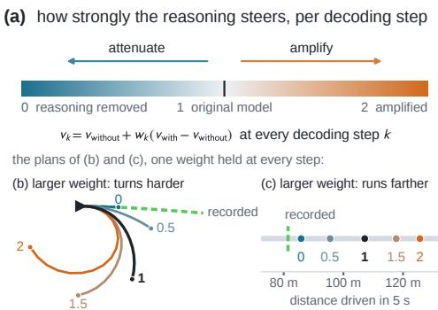
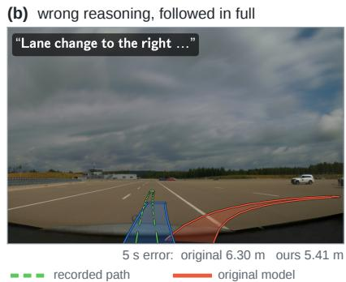
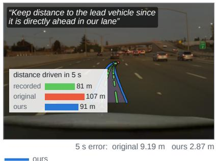
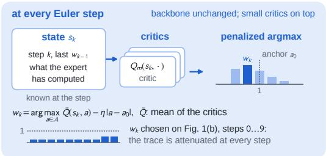
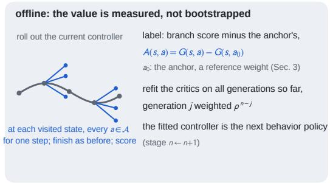

# How Much Should a VLA Trust Its Reasoning? Step-Level Guidance as a Measured Action-Value Function

Dabin Seo Eunhyek Joa∗ Department of Mechanical Engineering, Seoul National University sdabin@snu.ac.kr eunhyekj@snu.ac.kr

(c) reasoning that reads correctly, followed in full  
  
Figure 1. Not whether to trust a VLA’s reasoning, but how strongly it steers the action, at every step. A reasoning VLA writes its reasoning, then decodes the action conditioned on it. (a) COC-CFG sets with one weight per decoding (Euler) step how strongly the reasoning steers, from removed (0) through the original model (1) to amplified (2). Held at every step, a larger weight turns the plan of (b) harder and carries the plan of (c) farther. (b) On a held-out scene of the Alpasim driving simulator the reasoning calls for a lane change the scene does not offer; the original model (red) follows it off the recorded path (green). (c) This reasoning reads correctly, yet followed at ful strength the plan runs far ahead of the recorded drive. In both, ours (blue; Q-adaptive guidance trained in Alpasim) attenuates the reasoning.

## Abstract

Reasoning vision–language–action (VLA) policies write a reasoning trace and then decode the actionfrom it. A wrong trace yields a wrong action, and even a correct-looking trace can mislead the plan. Existing remedies ask whether the reasoning is right. We ask how strongly it should steer. CoC-CFG applies classifier-free guidance between the policy’s context and the same context without the reasoning span. One weight per Euler step attenuates or amplifies the reasoning, and w=1 recovers the original policy. We treat the choice of this weight as a Markov decision process whose action values are measured, not bootstrapped. With the expert frozen and the noise fixed, applying a weight for one step andfinishing the plan under the current controller returns that weight’s value exactly. Q-adaptive guidance fits these values with small critics and improves the controller conservatively. In the Alpasim driving simulator it outperforms every fixed weight and online RL (SAC, GRPO) in open loop, and in closed loop it passes 262 of 300 scenes, against 252for the original policy. On held-outframes ofthe

Waymo end-to-end driving benchmark, itsfirst three stages outperform everyfixed weight,four adaptive-guidance methods, SAC and GRPO. On the hidden test set, afrozen Alpamayo 1.5 with rule-based camera and vehicle conversions and Q-adaptive guidance sets a new state ofthe art among published methods: 8.135159 raterfeedback score, against 8.079for the best published method.

## 1. Introduction

Vision–language–action (VLA) models increasingly reason before they act: a vision–language model (VLM) writes a reasoning trace, and an action expert decodes the action conditioned on it [11, 23, 38]. In the Alpamayo driving planners [23], the VLM writes a Chain-of-Causation (CoC) into its key–value cache, and a flow-matching expert decodes the trajectory from that cache in a few Euler steps. The trace is not a caption but part of the condition: editing it moves the trajectory [22].

The trace is often wrong. Fewer than half of a driving VLA’s traces match the scene [20], VLMs answer driving questions from the text rather than the image [31], and hallucination has statistical causes [14]. A wrong trace becomes a wrong plan: in Fig. 1b the trace calls for a lane change the scene does not offer, and the unmodified policy follows it off the logged path. A trace that reads correctly can mislead too: followed in full, the plan of Fig. 1c runs far past the log.

The obvious fixes ask whether the reasoning is right. Alpamayo 1.5 is already post-trained with reinforcement learning for reasoning–action consistency [23], and its traces still err; detecting hallucinations remains unsolved, at 0.51 IoU for the best system of a recent shared task [29], and a detector only keeps or drops the trace. Neither helps when the trace reads correctly yet misleads the plan.

We ask instead how strongly the trace should steer. COC-CFG, Chain-of-Causation classifier-free guidance [10], runs the frozen expert on the policy’s own context and on the same context with only the reasoning span removed, and moves each Euler step along the line through the two velocities. The position on that line, the guidance weight $w _ { k } .$ sets how strongly the trace steers step k: $w _ { k } { = } 1$ is the unmodified model, lower weights attenuate the trace and higher weights amplify it (Fig. 1a). Trusting and rejecting the trace are two points on this axis.

The weight acts before the plan exists, so we treat its choice as a Markov decision process over the Euler steps whose only reward is the score of the finished plan (Sec. 4). Because the expert is frozen and the noise fixed, generation is deterministic and can be reset to any step: applying one weight for one step and finishing the plan under the current controller returns that weight’s value exactly. Learning becomes supervised regression on measured values, where online reinforcement learning would bootstrap what can be measured. Q-adaptive guidance (Fig. 2) fits small critics to these measurements with a cost for leaving a reference weight, re-measures under the improved controller and refits on every measurement so far.

In Alpasim, a driving simulator reconstructed from real drives, the controller lowers the open-loop displacement cost of Alpamayo 1.5 by 16.5 % against w=1, above soft actorcritic (SAC) and group-relative policy optimization (GRPO) trained on the same signal, and passes 262 of 300 closed-loop scenes against 252 (Sec. 5.1). On the Waymo end-to-end driving benchmark [32], its first three stages clear every fixed weight, four adaptive-guidance methods, SAC and GRPO on the held-out frames, and Alpamayo 1.5, converted to the Waymo vehicle by rule-based conversions and steered by Q-adaptive guidance, sets a new state of the art among published methods on the hidden test set: 8.135159 rater feedback score (RFS) against 8.079 (Sec. 5.2).

Our contributions are three. (i) COC-CFG, a guidance axis over the reasoning span of a VLA’s context that attenuates or amplifies the trace and is exact at w=1: an unreliable trace becomes an influence to control rather than a defect to detect. (ii) Step-level guidance as a Markov decision process with measured action values, each obtained by a one-step branch, and Q-adaptive guidance, a controller that chooses the weight at every Euler step from critics fitted to these values. (iii) Evidence on a frozen driving VLA: open-loop gains in Alpasim above fixed weights and online ${ \mathrm { R L } } ,$ closed-loop gains over fixed weights, held-out Waymo gains over fixed weights, adaptive-guidance methods and online RL, and a new state of the art among published methods on the hidden test set of the Waymo end-to-end driving benchmark.

## 2. Related Work

Guidance Classifier-free guidance [10] carries over to flow matching [19]; schedules [15] and learned or searched perstep weights [8, 21, 24] assume a trusted condition, whereas ours is the measured value of acting on a condition that can be wrong.

Sampling as control, and offline value learning Denoising is a Markov decision process with a terminal reward [1], steered by the gradient of a soft value [28] or by soft valuebased selection among candidates [17]; our controller is the discrete, one-dimensional member of this family (Sec. 3), with a measured value. The fit is a one-step advantage [2] (Sec. 4), conservatism comes from a cost for departing from a reference weight, as in conservative policy iteration [13], and the one-step branches are “vine” rollouts [26].

## 3. CoC-CFG: How Strongly the Reasoning Steers

Reasoning VLAs with a flow-matching expert A reasoning VLA acts in two stages. A VLM reads the observation and the instruction and writes a reasoning trace. An action expert then decodes the action from a context C that holds the observation, the instruction and the trace; in the Alpamayo planners $C$ is the VLM’s key–value cache. The expert is a flow-matching model: from initial noise $x _ { 0 }$ it integrates a learned velocity field $v ( x , t , C )$ over unit pseudo-time in K Euler steps, $x _ { k + 1 } = x _ { k } + \Delta t v ( x _ { k } , t _ { k } , C )$ with $\Delta t = 1 / K$ and $t _ { k } = k \Delta t .$ , and a decoder maps x to the plan. A task score $R ( x _ { K } )$ , higher is better, rates the decoded plan against a reference the policy does not observe, the logged future in driving. The tokens of the trace occupy one contiguous span of $C ,$ , the reasoning span.

The axis Let $C _ { \mathrm { f u l l } }$ be the complete context and $C _ { \mathrm { r e f } }$ the same context with the reasoning span removed and nothing else changed: observation, instruction, prompt format and the positions of the remaining entries are kept. COC-CFG is classifier-free guidance [10] between these two branches.

Q-adaptive guidance, the controller  

  
Figure 2. Q-adaptive guidance. At every Euler step small critics read what the step has computed, and the penalized argmax of their mean is wk. Offline, each weight’s value is measured by one-step branches, and the critics are refit on every generation of labels.

With a weight $w _ { k }$ at step k the Euler step becomes

$$
\begin{array} { r l } & { x _ { k + 1 } = x _ { k } + \Delta t \Big ( v ( x _ { k } , t _ { k } , C _ { \mathrm { r e f } } ) } \\ & { ~ + w _ { k } \big [ v ( x _ { k } , t _ { k } , C _ { \mathrm { f u l l } } ) - v ( x _ { k } , t _ { k } , C _ { \mathrm { r e f } } ) \big ] \Big ) , } \end{array}\tag{1}
$$

$v _ { \mathrm { w i t h } } = v ( x _ { k } , t _ { k } , C _ { \mathrm { f u l l } } )$ and $v _ { \mathrm { w i t h o u t } } = v ( x _ { k } , t _ { k } , C _ { \mathrm { r e f } } )$ denote the two velocities (Fig. 1a). At $w _ { k } { = } 1$ the policy is the unmodified VLA, at $w _ { k } { = } 0$ the trace is removed, weights in between attenuate it and weights above 1 amplify it. The weight takes values in a finite action set $\mathcal { A } \ni 1$ , fixed per backbone. The anchor $a _ { 0 } ~ \in ~ { \mathcal { A } }$ is a reference constant weight, the best one on the training scenes (Sec. 5.1) or, on Waymo, the backbone’s default w=1; the controller’s departures from it are penalized (Sec. 4).

## 4. Q-Adaptive Guidance

Step-level guidance as a Markov decision process A guidance rule π chooses the weight $w _ { k } \in { \mathcal { A } }$ at every Euler step from what the expert has computed up to that step. Its state is $s _ { k } = ( k , x _ { k } , w _ { k - 1 } , C )$ , with $w _ { - 1 } : = a _ { 0 } ;$ the two velocities are functions of $( x _ { k } , t _ { k } , C )$ and so of $s _ { k }$ . Its action is the weight. The transition is the guided Euler step (1), deterministic for a fixed initial noise, and the reward is zero until the last step and then the score $R ( x _ { K } )$ of the decoded plan. The rule is non-anticipative: it reads neither the scoring reference nor the score. Since the next latent depends on the past only through $s _ { k } .$ , this is a finite-horizon Markov decision process with a terminal reward, and the best rule applies at every step the weight with the highest action value $Q ( s _ { k } , a )$ , the expected final score of applying a at $s _ { k }$ and choosing well afterwards.

The action value is measured, not bootstrapped Generation is deterministic: the expert is frozen and the initial noise fixed, so the same state and weights give the same plan. It is resettable: a stored latent restores the generation at any step. On a training scene, where the scoring reference is known, the value of applying a at $s _ { k }$ and then following a fixed controller π is therefore measured, not estimated: a one-step branch applies a for one step, finishes the plan under $\pi ,$ and its score $G ^ { \pi } ( s _ { k } , a )$ is that value with no sampling variance. Paired with the anchor’s branch from the same state, the label $A ( s _ { k } , a ) = G ^ { \pi } ( s _ { k } , a ) - G ^ { \pi } ( s _ { k } , a _ { 0 } )$ isolates the effect of one step’s weight. Every weight is labeled at every visited state, and no target is built from a later estimate: no bootstrapping, no max over next actions. Learning the controller is supervised regression on measured values. Online reinforcement learning fits this structure poorly: a group-relative policy gradient [27] credits one score to a whole schedule of K decisions, and a soft actor-critic [9] bootstraps a critic toward values that can be measured exactly (Sec. 5.1 compares the three).

Measuring Stage n captures a generation of labels $D _ { n }$ on the training scenes. Each scene is rolled forward under the current controller $\pi _ { n - 1 }$ , with $\pi _ { 0 } \equiv a _ { 0 }$ , with occasional non-anchor weights for exploration. At every visited state all $| { \cal A } |$ weights are branched for one step, and each branch is completed under $\pi _ { n - 1 }$ and scored.

Fitting The critics regress a target that charges for leaving the anchor,

$$
\begin{array} { c } { { y ( s , a ) = \mathrm { c l i p } \big ( A ( s , a ) - \lambda _ { c } { \bf 1 } [ a \neq a _ { 0 } ] } } \\ { { - \lambda _ { m } | a - a _ { 0 } | , - \tau , \tau \big ) , } } \end{array}\tag{2}
$$

a fixed cost $\lambda _ { c }$ for any departure, a proportional cost $\lambda _ { m }$ for its distance, and a clip τ for the heavy tail of the score. A controller fitted to these labels visits states its predecessor did not, where no label was measured; the costs keep each improvement close to the measured behavior, as in conservative policy iteration [13].

Iterating The fitted controller $\pi _ { n }$ becomes the next behavior policy, and the capture repeats on the same training scenes. Labels age, since $D _ { j }$ was measured under the continuation of $\pi _ { j - 1 }$ , so stage n fits every generation so far, discounted in age:

$$
{ \mathcal L } _ { n } = \sum _ { j = 1 } ^ { n } \rho ^ { n - j } { \mathcal L } _ { D _ { j } } , \qquad 0 < \rho \le 1 ,\tag{3}
$$

Table 1. Alpasim open loop, held-out, Alpamayo 1.5. Mean reward (negative displacement cost) over 358 scenes, and the cost reduction against the default w=1. SAC and GRPO at their best held-out checkpoint. Bold: best reward.
<table><tr><td></td><td>reward ↑</td><td>vs. w=1</td></tr><tr><td>w=0 (span removed)</td><td>-1.1315</td><td>+3.3%</td></tr><tr><td>w=1 (default)</td><td>-1.1704</td><td></td></tr><tr><td>best fixed w=0.5 (anchor)</td><td>-1.0495</td><td> $+ 1 0 . 3 \%$ </td></tr><tr><td>SAC, best checkpoint</td><td>-1.0468</td><td> $+ 1 0 . 6 \%$ </td></tr><tr><td>GRPO, best checkpoint</td><td>-1.0091</td><td> $+ 1 3 . 8 \%$ </td></tr><tr><td>ours, stage n=1</td><td>-0.9943</td><td> $+ 1 5 . 0 \%$ </td></tr><tr><td>ours, stage n=2</td><td>-0.9802</td><td> $+ 1 6 . 3 \%$ </td></tr><tr><td>ours, stage n=3 (driven in Table 2)</td><td>-0.9767</td><td> $+ 1 6 . 5 \%$ </td></tr><tr><td>ours, stage n=4</td><td>-0.9769</td><td> $+ 1 6 . 5 \%$ </td></tr></table>

Table 2. Alpasim closed loop, Alpamayo 1.5. 300 scenes outside the training pool, 10 s at 10 Hz inside the reconstruction after ground-truth warm-up, one inference per 25 control steps, one rollout per scene and arm; ours is the stage-n=3 controller. A rollout passes when it ends without an at-fault (front or lateral) collision or an off-road event; distance to log is the largest gap to the logged path, averaged over scenes; score is the simulator’s composite rollout score. Bold: best in a column.
<table><tr><td></td><td>passed</td><td></td><td>at-fault coll. dist. to log (m) ↓ score ↑</td><td></td></tr><tr><td>w=0 (span removed)</td><td>243/300</td><td>21</td><td>1.239</td><td>0.638</td></tr><tr><td>w=0.5 (anchor)</td><td>254/300</td><td>10</td><td>1.272</td><td>0.691</td></tr><tr><td>w=1 (default)</td><td>252/300</td><td>13</td><td>1.232</td><td>0.695</td></tr><tr><td>ours</td><td>262/300</td><td>7</td><td>1.118</td><td>0.712</td></tr></table>

with $\mathcal { L } _ { D _ { j } }$ the loss of each critic $Q _ { m }$ on $D _ { j }$ .

Deployment At inference the controller applies

$$
w _ { k } = \arg \operatorname* { m a x } _ { a \in \mathcal { A } } \big ( \bar { Q } ( s _ { k } , a ) - \eta \left| a - a _ { 0 } \right| \big ) ,\tag{4}
$$

with $\bar { Q }$ the mean of the critics $Q _ { m }$ . The critics read features of $s _ { k } .$ , computed from the context and from what the denoising loop has computed; no scoring reference and no branch rollout is used at inference.

## 5. Experiments

## 5.1. Alpasim: Open and Closed Loop

Setup Alpasim drives a policy inside neural reconstructions of real drives [33]. Open loop scores the plans of Alpamayo 1.5 against the logged future, without re-planning; the score is a negative displacement cost, a fixed weighted sum of the average and final displacement errors at 3 and 5 s, each divided by a fixed scale. The controller is trained on 120 scenes and evaluated on 358 held-out scenes from disjoint clips; its anchor, measured on the training scenes, is w=0.5.

Online RL baselines Discrete soft actor-critic (SAC) [3, 9] and a group-relative (GRPO-style) policy gradient [27] learn the same per-step weight from the same state, action set, task score and training scenes, trained from scratch. SAC’s reward is paired against the w=1 rollout, and GRPO is regularized toward the anchor policy.

Table 3. Waymo, held-out, Alpamayo 1.5. RFS on the 358 held-out frames, every arm with the same conversions; ∆ is ours (stage n=2) minus the row. ‡: one weight per scene, scored in a separate evaluation of the same frames; its ∆ is against the per-step controller in that evaluation, its four stages averaged per scene (8.1972).
<table><tr><td>method</td><td>RFS</td><td>∆, ours minus row</td></tr><tr><td>fixed w=0.25</td><td>8.1431</td><td>+0.160</td></tr><tr><td>fixed w=0.5</td><td>8.2096</td><td>+0.094</td></tr><tr><td>fixed w=0.75</td><td>8.2412</td><td>+0.062</td></tr><tr><td>fixed w=1.0 (default, anchor)</td><td>8.2363</td><td>+0.067</td></tr><tr><td>fixed w=1.25</td><td>8.1736</td><td>+0.130</td></tr><tr><td>fixed w=1.5</td><td>8.1197</td><td>+0.183</td></tr><tr><td>fixed w=2.0</td><td>7.9734</td><td>+0.330</td></tr><tr><td>CFG++ [4]</td><td>8.0084</td><td>+0.295</td></tr><tr><td>linear ramp</td><td>8.2419</td><td>+0.061</td></tr><tr><td>guidance interval [15]</td><td>8.2418</td><td>+0.061</td></tr><tr><td>guidance rescale [18]</td><td>8.2441</td><td>+0.059</td></tr><tr><td>reward fine-tuning of the expert [5]</td><td>8.1911</td><td>+0.112</td></tr><tr><td>discrete SAC [3]</td><td>8.2783</td><td>+0.025</td></tr><tr><td>GRPO-style policy gradient [27]</td><td>8.2493</td><td>+0.054</td></tr><tr><td>scene-level Q, one w per scene</td><td>8.1105</td><td>+0.0867</td></tr><tr><td>Q-adaptive guidance (ours), n=2</td><td colspan="2">8.3032</td></tr><tr><td>stages n=1 / 3 / 4</td><td colspan="2">8.2917 / 8.2922 / 8.2780</td></tr></table>

Results In open loop every stage of the controller is above every fixed weight, SAC and GRPO (Table 1); at its third stage it lowers the displacement cost by 16.5 % against w=1. Closed loop drives the same policy inside the reconstruction, every frame re-rendered from the vehicle’s actual pose. The controller passes the most scenes, 262 of 300 against 252 for w=1 and 254 for the anchor, with the fewest atfault collisions, 7 against 13 for w=1 and 10 for the anchor (Table 2).

## 5.2. Waymo End-to-End Driving

Benchmark and system The Waymo Open Dataset endto-end driving benchmark [30, 32] poses vision-based planning on long-tail scenarios. Its rater feedback score (RFS) is the mean of eleven per-category scores of a plan against trajectories rated by humans. Of 478 scored validation frames, 358 are held out for every controller comparison and 120 supply training data; the organizers score the hidden test set. Alpamayo 1.5 [23] decodes its trajectory in K=10 Euler steps. It is trained on a camera rig and a vehicle unlike Waymo’s, so rule-based conversions map Waymo’s camera images into its camera geometry and its plan onto the Waymo vehicle. The VLM and the expert stay frozen; the anchor is the default w=1.

Held-out split Table 3 compares all 7 fixed weights, four adaptive-guidance methods ported onto the axis with hyperparameters swept on the training frames, reward fine-tuning of the expert at w=1, SAC and GRPO as in Sec. 5.1, and a scene-level controller, a regression that picks one weight per scene from trace and command features, fitted to each constant weight’s score on the training frames. Stages n=1 to 3 clear every fixed weight, adaptive-guidance method, reward fine-tuning, SAC and GRPO, and stage n=2, the best on this split, reaches 8.3032: +0.0620 above the best fixed weight (w=0.75) and +0.0669 above the default. Averaged over its four stages, the controller is +0.0867 above the scene-level controller (‡ in Table 3).

Table 4. Waymo end-to-end driving, official hidden test. Rater feedback score (RFS) of the ten best published methods with a reported hidden-test score, one row per paper with its best reported variant, as printed in its paper or in the hidden-test tables of [34, 36]; four-decimal scores are rounded to three.
<table><tr><td>Method</td><td>RFS↑</td></tr><tr><td>SimWAM [35]</td><td>7.84</td></tr><tr><td>FROST-Drive [6]</td><td>7.856</td></tr><tr><td>MindVLA-U1 + RL [11]</td><td>7.87</td></tr><tr><td>IRL-VLA [12]</td><td>7.89</td></tr><tr><td>Qwen-Drive-1.0-RL [37]</td><td>7.91</td></tr><tr><td>SUV [34]</td><td>7.94</td></tr><tr><td>Poutine [25]</td><td>7.986</td></tr><tr><td>RAP [7]</td><td>8.043</td></tr><tr><td>NTR (ensemble) [16]</td><td>8.046</td></tr><tr><td>DriveMA-4B [36]</td><td>8.079</td></tr><tr><td>Alpamayo 1.5 + Q-adaptive guidance</td><td>8.135159</td></tr></table>

A rule on the late disagreement The late disagreement, the distance between the latents of the constant w=1 and w=0 rollouts entering the last Euler step, exists only after both have run. A receding-horizon rule obtains it at decision time: at every Euler step it rolls candidate schedules ahead and keeps w=1 unless the reasoning’s exposure on the last steps would exceed a calibrated limit.

Hidden test set We run the stage-n=2 controller, the best on the held-out split (Table 3), on the hidden test set; it chooses the weight at every Euler step. The system sets a new state of the art among published methods (Table 4): 8.135159 RFS against 8.079 for DriveMA-4B.

## 6. Conclusion

What matters is not whether to trust a VLA’s trace but how strongly it steers. COC-CFG makes that a control axis inside flow matching, and the frozen, resettable generator gives each step’s weight a measured value. Q-adaptive guidance learns from these measurements; on Alpamayo 1.5 it outperforms every fixed weight and online RL in Alpasim open loop, passes the most closed-loop scenes, and sets a new state of the art among published methods on the Waymo end-to-end driving benchmark.

## References

[1] Kevin Black, Michael Janner, Yilun Du, Ilya Kostrikov, and Sergey Levine. Training diffusion models with reinforcement learning. arXiv preprint arXiv:2305.13301, 2023.

[2] David Brandfonbrener, William F. Whitney, Rajesh Ranganath, and Joan Bruna. Offline RL without off-policy evaluation. In Advances in Neural Information Processing Systems (NeurIPS), 2021. arXiv:2106.08909.

[3] Petros Christodoulou. Soft actor-critic for discrete action settings. arXiv preprint arXiv:1910.07207, 2019.

[4] Hyungjin Chung, Jeongsol Kim, Geon Yeong Park, Hyelin Nam, and Jong Chul Ye. CFG++: Manifold-constrained classifier free guidance for diffusion models. arXiv preprint arXiv:2406.08070, 2024.

[5] Hanze Dong, Wei Xiong, Deepanshu Goyal, et al. RAFT: Reward rAnked FineTuning for generative foundation model alignment. arXiv preprint arXiv:2304.06767, 2023.

[6] Zeyu Dong, Yimin Zhu, Yu Wu, and Yu Sun. FROST-Drive: Scalable and efficient end-to-end driving with a frozen vision encoder. arXiv preprint arXiv:2601.03460, 2026.

[7] Lan Feng, Yang Gao, Eloi Zablocki, et al. RAP: 3D rasterization augmented end-to-end planning, 2025. arXiv:2510.04333.

[8] Alexandre Galashov, Ashwini Pokle, Arnaud Doucet, Arthur Gretton, Mauricio Delbracio, and Valentin De Bortoli. Learn to guide your diffusion model. arXiv preprint arXiv:2510.00815, 2025.

[9] Tuomas Haarnoja, Aurick Zhou, Pieter Abbeel, and Sergey Levine. Soft actor-critic: Off-policy maximum entropy deep reinforcement learning with a stochastic actor. In International Conference on Machine Learning (ICML), 2018. arXiv:1801.01290.

[10] Jonathan Ho and Tim Salimans. Classifier-free diffusion guidance. arXiv preprint arXiv:2207.12598, 2022.

[11] Yuzhou Huang, Benjin Zhu, Hengtong Lu, et al. MindVLA-U1: VLA beats VA with unified streaming architecture for autonomous driving. arXiv preprint arXiv:2605.12624, 2026.

[12] Anqing Jiang, Yu Gao, Yiru Wang, et al. IRL-VLA: Training an vision-language-action policy via reward world model. arXiv preprint arXiv:2508.06571, 2025.

[13] Sham Kakade and John Langford. Approximately optimal approximate reinforcement learning. In International Conference on Machine Learning (ICML), 2002.

[14] Adam Tauman Kalai, Ofir Nachum, Santosh S. Vempala, and Edwin Zhang. Why language models hallucinate. arXiv preprint arXiv:2509.04664, 2025.

[15] Tuomas Kynka¨anniemi, Miika Aittala, Tero Karras, Samuli Laine,¨ Timo Aila, and Jaakko Lehtinen. Applying guidance in a limited interval improves sample and distribution quality in diffusion models. In Advances in Neural Information Processing Systems (NeurIPS), 2024.

[16] Jiahui Li, Jiawei Sun, Zixiang Ren, et al. NTR: Neural token reconstruction for scene token bottleneck in end-to-end driving. arXiv preprint arXiv:2605.31116, 2026.

[17] Xiner Li, Yulai Zhao, Chenyu Wang, et al. Derivative-free guidance in continuous and discrete diffusion models with soft value-based decoding. arXiv preprint arXiv:2408.08252, 2024.

[18] Shanchuan Lin, Bingchen Liu, Jiashi Li, and Xiao Yang. Common diffusion noise schedules and sample steps are flawed. In IEEE/CVF Winter Conference on Applications of Computer Vision (WACV), 2024.

[19] Yaron Lipman, Ricky T. Q. Chen, Heli Ben-Hamu, Maximilian Nickel, and Matthew Le. Flow matching for generative modeling. In International Conference on Learning Representations, 2023.

[20] Nicanor Mayumu, Xiaoheng Deng, and Patrick Mukala. Is VLA reasoning faithful? Probing safety of chain-of-causation in autonomous driving models. arXiv preprint arXiv:2605.17268, 2026. CVPR 2026 DriveX Workshop, non-archival poster.

[21] Avishag Nevo and Tamir Hazan. PathGuide: Dynamic classifier-

free guidance via on-policy transport alignment. arXiv preprint arXiv:2608.29107, 2026.

[22] T. Nguyen, D. Guo, T. Lampo, F. Wu, and B. Yaman. VLADriveBench: Evaluating CoT-action relationship in VLA for autonomous driving. arXiv preprint arXiv:2606.12706, 2026.

[23] NVIDIA, Yan Wang, Wenjie Luo, et al. Alpamayo-R1: Bridging reasoning and action prediction for generalizable autonomous driving in the long tail. arXiv preprint arXiv:2511.00088, 2025.

[24] Pinelopi Papalampidi, Olivia Wiles, Ira Ktena, et al. Dynamic classifier-free diffusion guidance via online feedback. arXiv preprint arXiv:2509.16131, 2025.

[25] Luke Rowe, Rodrigue de Schaetzen, Roger Girgis, Christopher Pal, and Liam Paull. Poutine: Vision-language-trajectory pre-training and reinforcement learning post-training enable robust end-to-end autonomous driving. arXiv preprint arXiv:2506.11234, 2025.

[26] John Schulman, Sergey Levine, Pieter Abbeel, Michael I. Jordan, and Philipp Moritz. Trust region policy optimization. In International Conference on Machine Learning (ICML), 2015.

[27] Zhihong Shao, Peiyi Wang, Qihao Zhu, et al. Deepseekmath: Pushing the limits of mathematical reasoning in open language models. arXiv preprint arXiv:2402.03300, 2024.

[28] Masatoshi Uehara, Yulai Zhao, Kevin Black, et al. Fine-tuning of continuous-time diffusion models as entropy-regularized control. arXiv preprint arXiv:2402.15194, 2024.

[29] Raul V´ azquez, A. Sinha, C. Li, Artem Shelmanov, et al. Overview´ of SHROOM-Visions 2026: A shared task on hallucination detection in large vision-language models. arXiv preprint arXiv:2608.25662, 2026.

[30] Waymo Open Dataset. Vision-based end-to-end driving leaderboard and evaluation protocol, 2026. https://waymo.com/ open/challenges/2025/e2e-driving/; accessed 28 October 2026.

[31] Shaoyuan Xie, Lingdong Kong, Yuhao Dong, et al. Are VLMs ready for autonomous driving? An empirical study from the reliability, data, and metric perspectives. arXiv preprint arXiv:2501.04003, 2025.

[32] Runsheng Xu, Hubert Lin, Wonseok Jeon, et al. WOD-E2E: Waymo open dataset for end-to-end driving in challenging long-tail scenarios. In Proceedings ofthe IEEE/CVF Conference on Computer Vision and Pattern Recognition, pages 3709–3718, 2026.

[33] Ze Yang, Yun Chen, Jingkang Wang, et al. UniSim: A neural closedloop sensor simulator. In Proceedings of the IEEE/CVF Conference on Computer Vision and Pattern Recognition, 2023. arXiv:2308.01898.

[34] Yibo Yuan, Jiacheng Fu, Jiangtong Zhu, et al. SUV: Future scene understanding as video generation for end-to-end driving. arXiv preprint arXiv:2608.03084, 2026.

[35] Zongchuang Zhao, Xin Zhou, Tianyang Xu, et al. SimWAM: A simple world action model for end-to-end autonomous driving. arXiv preprint arXiv:2608.07468, 2026.

[36] Weicheng Zheng, Yixin Huang, Qiao Sun, Derun Li, and Hang Zhao. DriveMA: Driving vision-language-action models with verifiable meta-actions. arXiv preprint arXiv:2605.31271, 2026.

[37] Xin Zhou, Zongchuang Zhao, Zhibo Yang, et al. Qwen-Drive-1.0: An initial step towards a vision-language foundation model for autonomous driving. arXiv preprint arXiv:2609.00111, 2026.

[38] Zewei Zhou, Tianhui Cai, Seth Zhao, et al. AutoVLA: A visionlanguage-action model for end-to-end autonomous driving with adaptive reasoning and reinforcement fine-tuning. In Advances in Neural Information Processing Systems, pages 27920–27956, 2025.