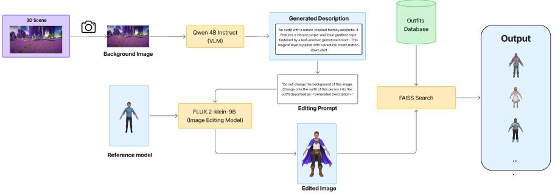
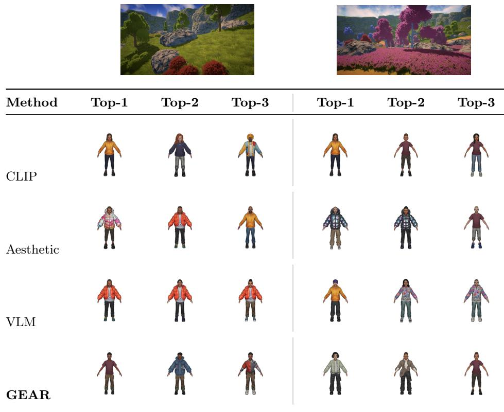
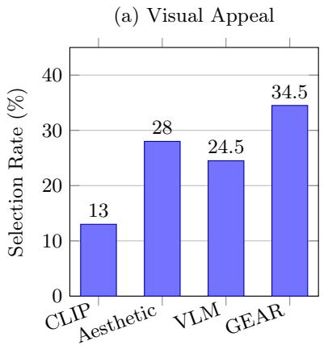
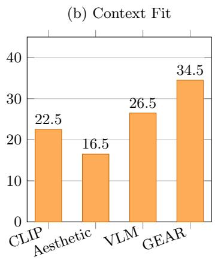

# GEAR: Generative Editing for Scene-Conditioned Outfit Retrieval for VR Travel

Gia-Huy Dinh1,2 ⋆, Thinh-Phuc Nguyen1,2 ⋆, Thanh-Hai Nguyen1,2 ⋆ Lam-Huy Nguyen-Ngoc1,2 , Hoang-Bach Nguyen-Phan1,2 , Nam-Quan Nguyen1,2 , Minh-Triet Tran1,2 , and Trung-Nghia Le1,2 ⋆⋆

1 University of Science, Ho Chi Minh City, Vietnam   
2 Vietnam National University, Ho Chi Minh City, Vietnam   
{dhghuy23, nltphuc23, nthai23, nnlhuy23, nphbach23, nnquan23}@apcs.fitus.edu.vn, {tmtriet, ltnghia}@fit.hcmus.edu.vn

Abstract. In virtual environments, choosing appropriate outfits requires contextual harmony with surrounding scenes, yet bridging the visual gap between 3D ambient views and catalog garment assets remains challenging. This paper investigates scene-conditioned outfit retrieval for interactive 3D environments, where a user’s egocentric view serves as the retrieval signal. We present GEAR (Generative Editing for Asset Retrieval), a framework that bridges the cross-domain gap by synthesizing intermediate visual queries rather than predicting direct compatibility. GEAR uses a vision-language model to describe suitable clothing from a captured scene, employs an instruction-guided difusion model to render the concept onto a standardized reference character, and utilizes the cropped clothing region to retrieve existing 2D outfit assets via embedding similarity. An interactive Unity prototype demonstrates real-time scene capture, asset retrieval, and in-engine 3D avatar fitting. We benchmark GEAR against direct visual similarity, aesthetic scoring, and VLMbased reranking on a controlled dataset using automated Swiss-system pairwise judgments, where GEAR achieves competitive top-ranked performance (mean Elo@5 of 1012.75 and top-10 overlap of 0.180) alongside 0.539 pairwise agreement. Furthermore, a user study across 20 virtual travel scenes demonstrates that GEAR achieves the highest overall participant preference in both visual appeal (34.5%) and contextual suitability (34.5%).

Keywords: Scene-conditioned retrieval · Fashion retrieval · Image editing · Virtual reality

## 1 Introduction

Selecting appropriate clothing is inherently contextual: an outfit that appears visually appealing in isolation may become unsuitable once the surrounding environment, activity, and occasion are taken into account. Traditional fashion recommendation and retrieval systems have largely focused on 2D product catalogs and user queries expressed through text, reference images, or historical preferences. Immersive applications, including virtual reality (VR) and desktop 3D environments, motivate using the current scene view as a query for this contextual recommendation task. An egocentric view ofers one way to capture the user’s surroundings without requiring a manually specified outfit query.

  
Fig. 1. Overview of scene-conditioned outfit retrieval in an interactive 3D environment. The user’s current scene view serves as a query to retrieve and rank outfits according to their contextual compatibility. A selected outfit is matched to its corresponding 3D asset, when available, and presented on an avatar in the original Unity environment.

This paper studies scene-conditioned fashion retrieval in interactive 3D environments, where the user’s current view serves as a query for retrieving suitable outfit assets. As illustrated in Figure 1, the system captures an egocentric scene view and returns ranked outfit recommendations from an existing asset collection. Retrieved outfits are presented as 2D previews, with corresponding 3D models displayed in Unity when available. A retrieval-based formulation preserves existing asset fidelity while avoiding the challenges of directly generating and rigging 3D garments. By representing outfits as standardized 2D images, retrieval can be performed independently of 3D asset presentation, with corresponding models instantiated in the virtual environment upon selection.

To bridge the semantic gap between scene views and fashion assets, we propose GEAR (Generative Editing for Asset Retrieval), which constructs sceneconditioned visual queries through image generation. A vision–language model (VLM) generates an outfit description from the scene, which an instructionguided difusion model renders onto a reference character. The resulting clothing region serves as a visual query for retrieving existing outfit assets. This approach is intended to reduce the visual mismatch between scenery and garment images without generating new assets as retrieval outputs. To demonstrate this retrieval mechanism in context, we implement an interactive Unity-based prototype paired with a curated fashion asset collection derived from Ready Player Me. The catalog includes 1,624 standardized 2D outfit renderings used for indexing, alongside 105 corresponding 3D models available for avatar presentation in the virtual environment.

We evaluate GEAR against three baseline retrieval paradigms: CLIP-style direct visual similarity, composite aesthetic scoring, and composed VLM retrieval with reranking. On a controlled benchmark of 10 scenes and 100 candidate outfits, we evaluate complete rankings using an automated Swiss-system pairwise tournament. In addition, we conduct a user study with 10 participants across 20 travel scenes to assess the perceived visual appeal and contextual suitability of top-three recommendation sets.

In summary, this work makes the following contributions:

We study scene-conditioned retrieval of existing outfit assets in a virtualenvironment application, using a scene view as the query and linking 2D retrieval results to available 3D assets.

– We propose GEAR, a retrieval pipeline that uses VLM reasoning and instructionguided character editing to synthesize intermediate visual queries for searching existing asset collections.

– We implement an end-to-end Unity prototype backed by 1,624 outfit images, with 105 corresponding 3D models, connecting scene capture to ranked previews and optional in-engine avatar presentation.

– We benchmark GEAR against direct visual, aesthetic, and composed VLM retrieval baselines through both automated pairwise preferences and human evaluations of visual appeal and context fit.

## 2 Related Work

## 2.1 Scene-Conditioned Fashion Retrieval

Fashion retrieval has incorporated language and contextual information beyond garment appearance. Fashion IQ studies retrieval using reference images and natural-language feedback [18]. Scene-aware approaches instead model the suitability of clothing for a given environment. SAFRS learns scene–outfit compatibility by combining scene and outfit representations [20], while GLOSS additionally considers body shape and relational information [12]. Unlike these approaches, GEAR constructs a visual query from the user’s current view of an interactive 3D environment to retrieve existing outfit assets. Our evaluation compares GEAR with direct visual retrieval, aesthetic scoring, and composed VLM retrieval (Section 4.3). The benchmark lacks the body-shape annotations and user–outfit relationship graphs required by the released GLOSS pipeline. Direct comparisons with SAFRS and GLOSS remain a limitation and an important direction for further evaluation.

## 2.2 Generation-Guided Retrieval

Generative models can construct intermediate visual representations for retrieving existing items. In fashion, GeCo generates complementary garment templates from seed items through image-to-image translation and incorporates the generated images into composed retrieval queries [1]. Beyond fashion, Imagine and Seek generates an imagined proxy conditioned on a reference image and relative text to support composed image retrieval [11]. GEAR applies generation-guided retrieval to scene-conditioned outfit recommendation: an environmental scene guides an outfit description, which is rendered on a standardized reference character to construct the visual retrieval query.

  
Fig. 2. GEAR retrieval pipeline. A VLM suggests clothing for the scene, and FLUX edits a reference character to wear it. The clothing region of the generated image is cropped and used to search an indexed outfit collection. The generated image is an intermediate visual query; the returned items are existing outfit assets.

## 2.3 Instruction-Guided Image Editing

Instruction-guided image editing enables visual modifications specified through natural-language prompts. InstructPix2Pix demonstrates this capability using a conditional difusion model [4]. Related virtual try-on methods, such as IDM-VTON, instead condition generation on an existing garment image to visualize that garment on a person [6]. GEAR uses image editing for a diferent purpose: synthesizing a scene-conditioned outfit appearance without requiring a reference garment. The edited image is subsequently cropped and embedded for similarity-based retrieval, separating visual query construction from the selection of existing fashion assets.

## 3 Methodology

## 3.1 Overview

Our system retrieves existing outfit assets for a user’s current view of an interactive 3D environment. GEAR (Generative Editing for Asset Retrieval) constructs a visual outfit query from that view and searches for similar assets. Figure 2 shows the sequence from scene understanding to image editing and retrieval.

## 3.2 Problem Formulation

Let $I _ { s }$ denote an egocentric scene image and C a collection of candidate outfit assets represented by images $I _ { c } , c \in \mathcal { C }$ . The objective is to rank existing outfit assets according to their suitability for the observed scene. Rather than directly predicting scene–outfit compatibility, GEAR constructs a scene-conditioned visual query and ranks candidates by their appearance similarity to this representation.

The retrieved item is an existing asset, not a generated garment. When a candidate has an associated local .glb model, that model can be presented in Unity; image-only candidates remain valid retrieval results.

## 3.3 Proposed Method

GEAR uses a reference character to provide a consistent canvas for rendering the outfit concept. The intended benefit is to express clothing appearance in the same visual modality as the indexed candidates. Whether this improves scene suitability depends on both the generated concept and its match to the available collection.

Scene-conditioned outfit suggestion. A vision–language model examines $I _ { s }$ and generates a textual description $t _ { s }$ of an outfit suited to its setting. The description supplies visual details for the subsequent edit. Optional user preferences or feedback can also inform the suggestion, but neither was provided in the reported benchmark. This VLM produces the outfit description for $\operatorname { G E A R } ;$ the separate VLM Retrieval baseline uses a diferent retrieval pipeline.

Reference-character image editing. We provide a reference image $I _ { r }$ of a clothed virtual character. The system contains male and female reference characters and selects one according to the request; the benchmark uses the worker’s default male reference. An instruction-guided image editor receives $I _ { r }$ and $t _ { s }$ and is asked to change only the character’s outfit:

$$
I _ { e } = \mathrm { E d i t } ( I _ { r } , t _ { s } ) .\tag{1}
$$

The generated image $I _ { e }$ depicts one possible scene-conditioned look. We apply a fixed spatial crop, $I _ { q } = \mathrm { C r o p C l o t h e s } ( I _ { e } )$ , intended to reduce the influence of the face and surrounding background. This heuristic assumes a centered, frontfacing character and does not perform garment segmentation. Image editing constructs $I _ { q } ,$ but no generated garment is inserted into the retrieval database. The fixed crop is intended to focus retrieval on clothing, but it may retain body or background cues or exclude garment details. Sensitivity to reference-character appearance and framing has not been evaluated.

Outfit retrieval. We encode the cropped query $I _ { q }$ and each candidate outfit image $I _ { c }$ with the same PE-Core image encoder $f$ . Their $L _ { 2 }$ -normalized embeddings are compared by inner product:

$$
s ( c \mid I _ { s } ) = { \frac { f ( I _ { q } ) } { \| f ( I _ { q } ) \| _ { 2 } } } ^ { \top } { \frac { f ( I _ { c } ) } { \| f ( I _ { c } ) \| _ { 2 } } } .\tag{2}
$$

A FAISS index stores the candidate embeddings [7], and the candidates are returned in descending order of $s ( c \mid I _ { s } )$ . This last step maps the generated visual target to outfits that already exist in the collection. The score measures appearance similarity to the synthesized target; its relationship to scene suitability is assessed by the retrieval evaluation. For the benchmark, retrieval is restricted to the 100 candidates in the shared manifest and returns a complete ranking of that pool.

## 3.4 Unity Prototype

We integrate GEAR into a Unity prototype [17] intended for virtual travel applications. The system uses the user’s egocentric view as the retrieval query and presents ranked recommendations through an in-engine gallery. Users can inspect the retrieved outfits and, when corresponding 3D assets are available, visualize them on an avatar within the original environment.

This integration separates scene-conditioned retrieval from asset presentation, allowing the same ranking framework to accommodate both image-only candidates and outfits with associated 3D models. The experimental evaluation focuses on retrieval quality rather than end-to-end VR interaction performance. The reported experiments use static scene images and recommendation sets; in-headset interaction remain unevaluated.

## 4 Experiments

## 4.1 Dataset

Our asset collection comprises 1,624 outfit images from Ready Player Me [14], including 105 outfits with corresponding .glb models. Outfit images are rendered using a standardized front-facing camera with transparent backgrounds for retrieval. Assets with available 3D models can additionally be presented in Unity.

For evaluation, we constructed a fixed subset of 10 scene image queries and 100 candidate outfits sampled from our asset collection. All methods are evaluated on the same candidate pool to ensure a controlled comparison of sceneconditioned retrieval performance.

## 4.2 Experimental Setup

Each method ranks the same 100 candidate outfits for each of the 10 scene queries, producing complete and directly comparable rankings.

Following pairwise multimodal evaluation approaches used in fashion try-on and text-to-3D generation [8,19], we construct automated reference preferences using a blinded Swiss-style tournament judged by Gemma 4 26B A4B [16]. For each scene, seven rounds pair every outfit once per round, without repeating pairs, yielding 350 comparisons per scene and 3,500 distinct comparisons overall.

Each pair is evaluated in both presentation orders to reduce positional bias, yielding 7,000 presentations. The judge considers climate, season, activity, occasion, style, theme, color harmony, and overall suitability. A preference is retained only when both orders agree; otherwise, the comparison is treated as a tie.

We aggregate these judgments into per-scene reference rankings using Elo ratings initialized at 1,000 with K = 32. These automated rankings serve as evaluation references, not independently validated human ground truth. The 3,500 comparisons are drawn from 10 shared scene queries. Presenting both orders addresses positional consistency but does not validate the judge’s suitability judgments.

## 4.3 Baseline Methods

CLIP-based Retrieval The baseline labeled CLIP uses the PE-Core-L14-336 image encoder [3] to embed the scene and each outfit directly. Candidates are ranked by cosine similarity. This implements a CLIP-style visual retrieval strategy [13] with PE-Core weights, without an explicit outfit suggestion or generated query.

Aesthetic Predictor This baseline evaluates the visual appeal of an outfit within a given scene. For each candidate outfit, the outfit image is composited onto the query scene background. The resulting image is passed through a CLIP image encoder [5] followed by a learned linear aesthetic prediction head [15], which outputs a scalar aesthetic score. Outfits are ranked according to the predicted aesthetic quality of the composed image.

VLM Retrieval The VLM-based baseline uses Qwen3-VL-4B-Instruct [2] to describe the scene and propose several suitable and unsuitable outfits. It combines scene and outfit descriptions with visual scene features to form multiple PE-Core queries, retrieves candidates with FAISS, and reranks their images with Qwen3-VL-Reranker-2B [10]. This is a separate retrieval baseline; the VLM in GEAR supplies only the outfit suggestion for the edit. This baseline difers from GEAR in query construction, encoder configuration, and reranking; it therefore compares complete pipelines rather than isolating image generation.

## 4.4 Evaluation Metrics

Our reference ranking follows the pattern of pairwise VLM judgments aggregated with Elo ratings, introduced for text-to-3D evaluation by Wu et al. [19] and adapted to fashion try-on by Kwon et al. [8]. We adapt that pattern to scene– outfit suitability; the metrics below evaluate how closely each retrieval method matches our reference judgments.

We use three metrics that assess both pairwise ranking agreement and the quality of top-ranked recommendations.

Pairwise Agreement. We measure agreement of the ranked outfits with the automated reference judgments. For each judged pair, a method receives 1 if its ranking agrees with the reference preference, 0 if the preference is reversed, and 0.5 if the reference judgment is tied. Scores are averaged across all judged pairs within each scene. Under this scoring rule, a uniformly random ranking has expected pairwise agreement of 0.5, with tied reference judgments contributing 0.5 regardless of the ranking.

Mean Elo@5. We compute the average reference Elo rating of a method’s top-five retrieved outfits. This metric measures the reference quality of the recommended items independently of their exact ranking order.

Table 1. Results on the retrieval benchmark with 10 scene queries and 100 outfit candidates. Values are macro-averages over scenes; higher is better for every metric. Pairwise agreement was the benchmark’s declared primary metric; mean Elo@5 and top-10 overlap characterize the quality of top-ranked recommendations. The best value in each metric column is shown in bold.
<table><tr><td>Method</td><td>Pairwise agreement</td><td>Mean Elo@5</td><td>Top-10 overlap</td></tr><tr><td>CLIP</td><td>0.506</td><td>998.80</td><td>0.140</td></tr><tr><td>Aesthetic Predictor</td><td>0.480</td><td>995.60</td><td>0.080</td></tr><tr><td>VLM</td><td>0.548</td><td>1012.59</td><td>0.170</td></tr><tr><td>GEAR (ours)</td><td>0.539</td><td>1012.75</td><td>0.180</td></tr></table>

Top-10 Overlap. We measure the proportion of outfits in the reference top-10 that also appear in the method’s top-10:

$$
\mathrm { O v e r l a p @ 1 0 } = \frac { | T _ { 1 0 } \cap E _ { 1 0 } | } { 1 0 } ,\tag{3}
$$

where $T _ { 1 0 }$ and $E _ { 1 0 }$ denote the method’s and reference ranking’s top-10 sets, respectively.

All metrics are macro-averaged across the 10 benchmark scenes.

## 4.5 Implementation Details

The four methods ranked the same 100 candidates. Candidate embeddings were precomputed, $L _ { 2 ^ { - } }$ -normalized, and searched with flat FAISS inner-product indices. Direct retrieval and GEAR shared a PE-Core-L14-336 image index; VLM Retrieval used a separate PE-Core-B16-224 image–text index.

For GEAR, Qwen3-VL-4B-Instruct generated an outfit description of at most 50 words from an RGB scene image resized to a maximum side length of 512 pixels (temperature 0.7, top-p 0.9, 256-token limit). FLUX.2-klein-9B [9] edited the default male reference character at 1024×1024 pixels using 30 steps, guidance scale 7.0; the reference image was resized to 512 × 512 pixels. The query crop retained the central 50% of image width and lower 65% of image height.

The aesthetic baseline used an $\mathrm { O p e n C L I P \ V i T { - } L / 1 4 }$ encoder with a pretrained LAION aesthetic head. VLM Retrieval generated seven compatible and three incompatible outfit descriptions, reranked all 100 candidates with Qwen3- VL-Reranker-2B. No optional user preferences were supplied. The interactive prototype ran in Unity 6000.2.1f1 [17] on Meta Quest 2 with Meta XR SDK v78.

## 4.6 Quantitative Results

Table 1 compares the four retrieval methods. VLM achieves the highest pairwise agreement (0.548), followed by GEAR (0.539), CLIP (0.506), and Aesthetic Predictor (0.480).

  
Fig. 3. Qualitative comparison of the top-three retrieved outfits of 2 scenes. All methods retrieve from the same candidate pool. Outfits are shown in descending rank order.

GEAR has the highest observed mean Elo@5 (1012.75 versus 1012.59 for VLM) and top-10 overlap (0.180 versus 0.170), and the absolute diferences are 0.16 Elo points and 0.010 overlap. VLM achieves higher pairwise agreement. The statistical reliability of these benchmark diferences has not been assessed.

## 4.7 Qualitative Comparison

Figure 3 illustrates the top-three recommendations produced by the four methods for two outdoor scenes.

Several notable behaviors emerge from these examples. In the mountainous scene, Aesthetic Predictor retrieves brightly colored and patterned outerwear that appears less visually harmonious with the natural surroundings. This illustrates a potential limitation of aesthetic-based ranking, where visually appealing garments may not necessarily suit the environmental context. VLM Retrieval produces three nearly identical orange jackets in the mountainous scene and two visually similar patterned outfits in the fantasy scene. Although these recommendations may individually be suitable, their redundancy reduces the variety of options available to the user. CLIP ranks the same yellow outfit first in both scenes, whereas GEAR returns diferent top-ranked outfits, including a burgundy shirt for the mountainous scene and a light-green jacket for the fantasy scene. GEAR also retrieves visually varied alternatives within each recommendation set. These examples illustrate potential diferences in contextual suitability, recommendation diversity, and scene sensitivity.

## 4.8 User Study

Design and Procedure We conducted a user study with ten participants aged 20–22 years to assess the perceived visual appeal and contextual suitability of retrieved outfits across 20 scenes. For each scene, participants compared the topthree recommendations from four retrieval methods, all operating on the same pool of 100 candidate outfits.

To minimize presentation bias, method identities were concealed using randomized labels (A–D), and scene presentation order was randomized for each participant. Participants could preview the recommended outfits against the corresponding scene before selecting their preferred recommendation set independently for Visual Appeal and Context Fit. Overlapping recommendations across methods were permitted.

Analysis For each evaluation criterion, we obtained 200 selections across 10 participants and 20 scenes. We compared GEAR against each baseline using paired diferences in participant-level selection rates. Statistical significance was assessed using two-sided exact sign-flip permutation tests, enumerating all $2 ^ { 1 0 }$ possible sign assignments. We report mean diferences in percentage points, nominal 95% confidence intervals based on Student’s t distribution, and paired efect sizes $( d _ { z } )$

To account for multiple comparisons, we applied Holm correction separately to the three GEAR–baseline comparisons within each evaluation criterion.

Results GEAR received the largest observed share of selections for both criteria (69/200, 34.5%; Figure 4). Its mean diferences relative to VLM Retrieval were +10.0 percentage points for visual appeal and +8.0 points for context fit, with both nominal CIs including zero (Table 2). The GEAR–CLIP visual-appeal and GEAR–Aesthetic Predictor context-fit comparisons had unadjusted $p \ < \ 0 . 0 5$ and nominal CIs excluding zero, but no comparison survived Holm correction.

Preferences varied across participants: GEAR–VLM diferences ranged from −25 to +55 percentage points for visual appeal and from −10 to +35 for context fit. These results describe preferences for static three-outfit sets; they do not establish a statistically reliable advantage for GEAR or assess interactive VR use.

Table 2. Diferences in selection rates between GEAR and the baseline methods across 10 participants. ∆ is the mean paired diference in percentage points (pp); positive values favor GEAR. CIs are nominal 95% participant-level t intervals, and $d _ { z }$ is the paired standardized efect. Two-sided sign-flip p values are shown before and after Holm adjustment within each criterion.
<table><tr><td>Baseline</td><td>∆(pp)</td><td>95% CI (pp)</td><td> $d _ { z }$ </td><td></td><td>p Holm p</td></tr><tr><td>Visual Appeal</td><td></td><td></td><td></td><td></td><td></td></tr><tr><td>VLM</td><td>+10.0</td><td>[−11.0,31.0]</td><td>0.34</td><td>0.332</td><td>0.664</td></tr><tr><td>CLIP</td><td>+21.5</td><td>[3.0, 40.0]</td><td>0.83</td><td>0.029</td><td>0.088</td></tr><tr><td>Aesthetic Predictor</td><td>+6.5</td><td>[−18.3, 31.3]</td><td>0.19</td><td>0.590</td><td>0.664</td></tr><tr><td>Context Fit</td><td></td><td></td><td></td><td></td><td></td></tr><tr><td>VLM</td><td>+8.0</td><td>[−2.8, 18.8]</td><td></td><td>0.53 0.172</td><td>0.188</td></tr><tr><td>CLIP</td><td>+12.0</td><td>[−1.5, 25.5]</td><td></td><td>0.64 0.094</td><td>0.188</td></tr><tr><td>Aesthetic Predictor</td><td>+18.0</td><td>[4.6, 31.4]</td><td></td><td>0.96 0.023</td><td>0.070</td></tr></table>

## 5 Discussion

## 5.1 Analysis

The automated and human evaluations capture complementary aspects of retrieval quality. While the VLM baseline achieves higher pairwise agreement, GEAR obtains slightly higher mean Elo@5 and top-10 overlap, suggesting differences between pairwise agreement and top-ranked recommendation quality. The human study additionally shows higher observed selection rates for GEAR in both visual appeal and context fit. However, the diferences are small in the automated evaluation, and none of the human-study comparisons remain statistically significant after multiple-comparison correction. These findings do not establish a reliable performance advantage for GEAR.

## 5.2 Limitations

The evaluation compares complete pipelines with diferent query construction, encoders, and reranking stages, so it does not isolate the contribution of image generation. A matched text-only baseline using the same outfit description and aligned encoder checkpoint remains unevaluated. Sensitivity to referencecharacter appearance, framing, cropping, and generation randomness has not been assessed. Direct comparisons with SAFRS and GLOSS are also absent.

The benchmark covers only 10 scenes and 100 sampled candidates from a larger collection. Its automated comparisons share scenes and outfits, so their number should not be interpreted as independent evidence across thousands of contexts. Seven Swiss rounds expose each outfit to only seven opponents; the resulting Elo order has not been tested for sensitivity to pairing or update order. Mirrored disagreement is treated as a tie, conflating uncertain judgments with genuine indiference. Judge repeatability and agreement with independent human pairwise judgments remain unvalidated.

Additionally, the qualitative examples illustrate potential diferences in contextual suitability and recommendation diversity, but cover only two selected scenes. These observations may not generalize across the benchmark, and recommendation diversity was not systematically quantified.

  
Fig. 4. User-study selection rates for the four retrieval methods across 20 travel scenes. Participants selected their preferred three-outfit set separately for (a) visual appeal and (b) context fit. Each criterion received 200 scene-level selections from 10 participants. Percentages are computed separately for each criterion.

The user study involves only 10 participants aged 20–22 years evaluating static top-three recommendation sets across 20 scenes. Its findings may not generalize to other populations, environments, or candidate collections. Moreover, participants evaluated the same scenes, so the reported statistical inference is conditional on this scene collection. Set-level preferences provide evidence about perceived visual appeal and contextual suitability but do not independently validate the automated Elo rankings. The study does not evaluate in-engine usability or asset fitting quality. Broader evaluations of both retrieval quality and interactive performance are therefore needed.

## 6 Conclusion

We presented GEAR, a proposed retrieval method within a scene-conditioned outfit system for interactive 3D environments. GEAR renders a VLM’s outfit suggestion on a reference character and uses the clothing crop to retrieve existing assets.

On a benchmark of 10 scenes and 100 outfits, VLM achieves the highest pairwise agreement, the primary metric, while GEAR obtains slightly higher mean Elo@5 and top-10 overlap. GEAR receives the largest observed share of userstudy preferences for both visual appeal and contextual suitability, although no GEAR–baseline comparison remains statistically significant after Holm correction. These findings suggest competitive performance within the evaluated setting. Further evaluation should isolate the contribution of image generation and assess robustness and interactive performance.

Acknowledgments. This research is funded by Vietnam National University - Ho Chi Minh City (VNU-HCM) under Grant Number C2026-18-12. Trung-Nghia Le was funded by the Postdoctoral Scholarship Programme of Vingroup Innovation Foundation (VINIF), VinUniversity, code VINIF.2025.STS.14.

## References

1. Attimonelli, M., Pomo, C., Jannach, D., Di Noia, T.: Fashion image-to-image translation for complementary item retrieval. arXiv preprint arXiv:2408.09847 (2024)

2. Bai, S., Cai, Y., Chen, R., Chen, K., Chen, X., Cheng, Z., Deng, L., Ding, W., Gao, C., Ge, C., et al.: Qwen3-vl technical report. arXiv preprint arXiv:2511.21631 (2025)

3. Bolya, D., Huang, P.Y., Sun, P., Cho, J.H., Madotto, A., Wei, C., Ma, T., Zhi, J., Rajasegaran, J., Bangalath, H., et al.: Perception encoder: The best visual embeddings are not at the output of the network. Advances in Neural Information Processing Systems 38, 60884–60937 (2026)

4. Brooks, T., Holynski, A., Efros, A.A.: Instructpix2pix: Learning to follow image editing instructions. In: 2023 IEEE/CVF Conference on Computer Vision and Pattern Recognition (CVPR). pp. 18392–18402. IEEE (2023)

5. Cherti, M., Beaumont, R., Wightman, R., Wortsman, M., Ilharco, G., Gordon, C., Schuhmann, C., Schmidt, L., Jitsev, J.: Reproducible scaling laws for contrastive language-image learning. In: 2023 IEEE/CVF Conference on Computer Vision and Pattern Recognition (CVPR). pp. 2818–2829. IEEE (2023)

6. Choi, Y., Kwak, S., Lee, K., Choi, H., Shin, J.: Improving difusion models for authentic virtual try-on in the wild. In: European Conference on Computer Vision. pp. 206–235. Springer (2024)

7. Douze, M., Guzhva, A., Deng, C., Johnson, J., Szilvasy, G., Mazaré, P.E., Lomeli, M., Hosseini, L., Jégou, H.: The faiss library. IEEE Transactions on Big Data (2025)

8. Kwon, S., Lee, K., Jung, D., Lee, J.: Feat: Fashion editing and try-on from any design. arXiv preprint arXiv:2605.02393 (2026)

9. Labs, B.F.: FLUX.2: Frontier Visual Intelligence. https://bfl.ai/blog/flux-2 (2025)

10. Li, M., Zhang, Y., Long, D., Chen, K., Song, S., Bai, S., Yang, Z., Xie, P., Yang, A., Liu, D., et al.: Qwen3-vl-embedding and qwen3-vl-reranker: A unified framework for state-of-the-art multimodal retrieval and ranking. arXiv preprint arXiv:2601.04720 (2026)

11. Li, Y., Ma, F., Yang, Y.: Imagine and seek: Improving composed image retrieval with an imagined proxy. In: 2025 IEEE/CVF Conference on Computer Vision and Pattern Recognition (CVPR). pp. 3984–3993. IEEE (2025)

12. Ma, C., Sun, H., Ma, J., Zhang, H., Ding, Y., Zhang, Z.: Gloss: Global-local matching network towards outfit recommendation for diverse body shapes and scenes. IEEE Transactions on Multimedia 27, 9399–9414 (2025). https://doi.org/10. 1109/TMM.2025.3613163

13. Radford, A., Kim, J.W., Hallacy, C., Ramesh, A., Goh, G., Agarwal, S., Sastry, G., Askell, A., Mishkin, P., Clark, J., et al.: Learning transferable visual models from natural language supervision. In: International conference on machine learning. pp. 8748–8763. PmLR (2021)

14. Ready Player Me: Ready Player Me: Metaverse 3d avatar creator. https:// readyplayer.me/

15. Schuhmann, C.: LAION-Aesthetics. https://laion.ai/blog/laion-aesthetics/ (2022)

16. Team, G., Abd, S.E., Aggarwal, V., Algayres, R., Andreev, A., Bachem, O., Ballantyne, I., Brick, C., Cărbune, V., Casbon, M., et al.: Gemma 4 technical report. arXiv preprint arXiv:2607.02770 (2026)

17. Unity Technologies: Unity (2025), https://unity.com/, game development platform

18. Wu, H., Gao, Y., Guo, X., Al-Halah, Z., Rennie, S., Grauman, K., Feris, R.: Fashion iq: A new dataset towards retrieving images by natural language feedback. In: 2021 IEEE/CVF Conference on Computer Vision and Pattern Recognition (CVPR). pp. 11302–11312. IEEE (2021)

19. Wu, T., Yang, G., Li, Z., Zhang, K., Liu, Z., Guibas, L., Lin, D., Wetzstein, G.: Gpt-4v (ision) is a human-aligned evaluator for text-to-3d generation. In: 2024 IEEE/CVF Conference on Computer Vision and Pattern Recognition (CVPR). pp. 22227–22238. IEEE (2024)

20. Ye, T., Hu, L., Zhang, Q., Lai, Z.Y., Naseem, U., Liu, D.D.: Show me the best outfit for a certain scene: A scene-aware fashion recommender system. In: Proceedings of the ACM Web Conference 2023. p. 1172–1180. WWW ’23, Association for Computing Machinery, New York, NY, USA (2023). https://doi.org/10.1145/ 3543507.3583435, https://doi.org/10.1145/3543507.3583435