# GPU-Native Real-Time Textured Mesh Reconstruction with Seam-Aware Multi-View Radiometric Correction

Hiroyuki Sato MinD in a Device Co., Ltd., Tokyo, Japan h.sato@mindinadevice.com

## Abstract

We present a GPU-native volumetric-video systemfor realtime reconstruction of graphics-compatible textured triangle meshes from multiple RGB-D sensors. Existing TSDF systems accelerate fusion and mesh extraction, but extending them to per-frame textured meshing adds CPU mesh processing, CPU-side texturing work, or extra CPU–GPU transfers between stages. After input staging, our method keeps the reconstruction and texturing stages (TSDF fusion, Marching Cubes, connected-component noise removal, view-based texture mapping, inpainting, and radiometric seam correction) resident on the GPU; no intermediate mesh or image data returns to the host between these stages. A fixed-size-array representation of mesh topology gives constant-time neighbor access on the GPU and makes the downstream mesh-level operations data-parallel. Because we texture each face from a single camera, exposure seams that vary smoothly across each image remain; we estimate a per-camera low-frequency gain field and bake it into the atlas on the GPU. On the CMU Panoptic dataset, our method isfaster than the baselines at every tested voxel resolution and number of sensors, achieves peak speedups ofmore than an order ofmagnitude over CUDA-accelerated nvblox and CPU-based Open3D, and approaches an offline textured-meshing baseline in perceptual re-rendering quality.

## 1. Introduction

Volumetric video [7] enables telepresence and AR/VR avatar generation, and its capture with multiple RGB-D sensors has been an active area of research [13, 44]. The dominant scene representation in current systems is the colored point cloud, but its data volume is large and, under realistic bandwidth budgets, real-time transmission remains challenging [15]. Neural representations such as NeRF [34] and 3D Gaussian Splatting [25] achieve highquality novel-view synthesis, but their per-frame reconstruction cost and storage footprint hinder real-time use. A textured triangle mesh provides a graphics-compatible representation in which geometry and appearance budgets can be controlled separately: mesh simplification adjusts geometry, while atlas resolution and texture compression adjust appearance. Commodity GPUs and standard graphics engines support this representation natively through their rasterization pipelines.

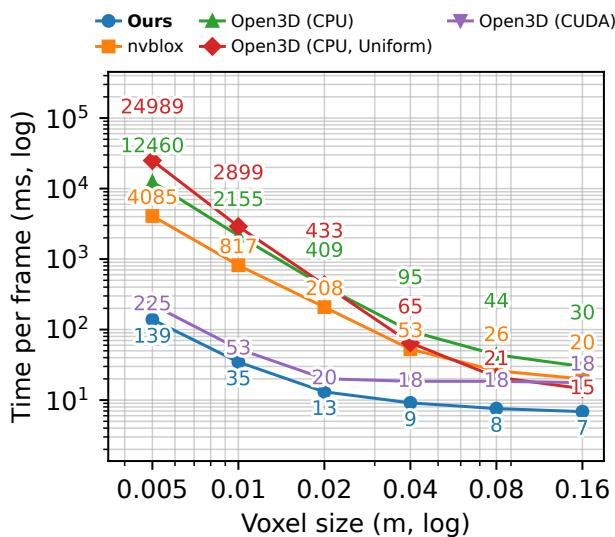  
Figure 1. Per-frame processing time versus voxel size on the office2 sequence of CMU Panoptic [21, 22] with five Kinect inputs. Both axes use log scale. “Ours” includes input upload, preprocessing, and radiometric seam correction (Sec. 3.6) and remains real-time at 0.02 m. Open3D (CPU) is run without noise removal here and in Fig. 4; Tab. 1 includes it.

Producing this representation every frame from multiple RGB-D streams is costly. Truncated Signed Distance Function (TSDF) fusion [8] is widely used for 3D reconstruction because it is robust and parallel [9, 36, 37, 51]. GPU implementations such as nvblox [35] and Open3D [53] accelerate TSDF fusion and Marching Cubes (MC) [30] based mesh extraction; Open3D’s CPU pipeline adds connectedcomponent noise removal (NR). These systems do not support texture mapping in our setting, and they do not provide the per-frame textured mesh pipeline that volumetric video requires. Extending them to textured meshing adds mesh filtering, texture processing, and host-device movement. Runtime then rises sharply as voxel resolution increases (Fig. 1), the regime demanding high visual quality.

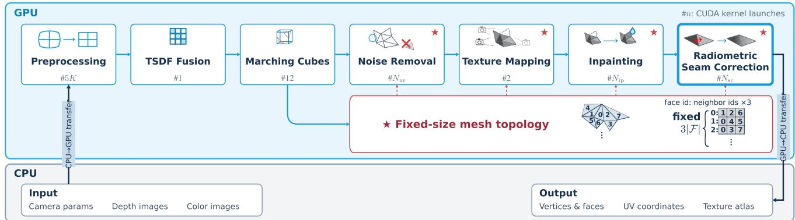  
Figure 2. Our GPU-native textured-meshing pipeline. Each frame uploads the raw depth and color images in one batch; Preprocessing undistorts them and registers depth to color on the GPU. Apart from a few scalar counters and flags only the final mesh, UV coordinates, and corrected atlas return to the CPU. #n gives the main CUDA kernel launches per stage (K cameras); $N _ { \mathrm { n r } }$ and $N _ { \mathrm { i p } }$ are the label-propagation and inpainting iterations (capped at 100 and 5) and $N _ { \mathrm { { s c } } } = 5 5$ . Red stars mark the stages that build on the fixed-size-array mesh topology (Sec. 3.2); the seam correction (Sec. 3.6) reuses this adjacency and writes the corrected atlas before output.

Real-time texturing raises an appearance challenge. When each face uses one camera, adjacent faces may meet along visible exposure seams whose magnitude varies smoothly across each camera’s image. Texture mapping methods reduce such seams by globally optimizing view labels, colors, or texture alignment [14, 28, 45], but at offline cost. Real-time systems instead texture the scene online, fusing images into progressively updated texture representations [26, 27] or adjusting patch colors against a reference [17]. They scan static scenes with one moving sensor, rather than reconstructing each dynamic frame from simultaneous views and correcting their seams.

We target indoor volumetric video with high-density, high-frame-rate multi-view RGB-D input. Our system (Fig. 2) targets a bounded observation volume, and after one batched input upload keeps the reconstruction and texturing stages (TSDF fusion, mesh generation, noise removal, texture mapping, and radiometric seam correction) on the GPU. At high resolution, data movement dominates fusion arithmetic, so GPU residency lets per-frame textured meshing, topology-aware cleanup, inpainting, and radiometric correction fit within the 33 ms budget of 30 fps capture. We make four contributions: (1) a GPU-native volumetricvideo system that generates graphics-compatible textured meshes from multiple RGB-D sensors while keeping meshlevel processing and texturing on the GPU; (2) a fixed-sizearray representation of mesh topology that enables efficient post-MC mesh processing on the GPU; (3) GPU-resident texture processing, including noise removal and inpainting, built on this representation; and (4) a real-time, on-GPU radiometric seam correction stage that estimates a per-camera low-frequency gain field and bakes it into the texture atlas, reducing inter-camera exposure seams, including mismatches that vary across each camera’s image.

As shown in Fig. 1, our method runs 89.7×/29.4× faster than Open3D (CPU)/nvblox at 0.005 m voxels. At 0.02 m it runs in real time (13.1 ms per frame including input upload and preprocessing, within the 33 ms budget of 30 fps sensors), and its reconstruction quality approaches the offline textured-meshing baseline in LPIPS under held-out rerendering. Code is available at https://github.com/ unclearness/grtmesh. Implementation details, protocols, and further results are in the appendix, and the supplementary video is on the project page, https:// unclearness.github.io/grtmesh/.

## 2. Related Work

TSDF-based real-time reconstruction. Volumetric TSDF fusion [8] underlies dense reconstruction, from real-time KinectFusion [36], voxel hashing [37], and BundleFusion [9] to offline scene reconstruction [51]. Our baselines nvblox [35] and Open3D [53] implement TSDF fusion and MC-based [30] mesh extraction with per-vertex color (Open3D adds CPU connected-component noise removal). They provide mapping pipelines with per-vertex color rather than per-frame texture-mapped meshes; Open3D integrates one RGB-D image at a time.

Multi-view RGB-D human and scene capture. For multiple RGB-D sensors, per-frame methods fuse the views without tracking, by merging per-view meshes [1] or by moving-least-squares fusion of the point clouds [32]; another line performs non-rigid fusion and tracking. Function4D [49] requires training on large datasets. The singlesensor DoubleFusion [48] and SparseFusion [54] further rely on the SMPL body template [29]. Fusion4D [10], the engine behind the Holoportation telepresence system [40], and its successor Motion2Fusion [11] are compelling but compute-heavy, and an FFT-based method [2] scales worse than TSDF fusion with resolution. Our method is objectagnostic and reconstructs everything visible without foreground/background segmentation.

High-quality offline reconstruction and texturing. Screened Poisson Surface Reconstruction (SPSR) [23, 24] produces high-quality watertight meshes but requires a large sparse solve. Global texture mapping optimizations [3, 14, 28, 45] yield seamless atlases by leveling colors along seams [28], combining global color adjustment with local blending [45], or correcting texture misalignment from global to local [14]; related work jointly optimizes appearance with pose, texture coordinates, or lighting [19, 31, 52]. These methods, like motion-graph synthesis [41] and spatiotemporal atlas parameterization [42], run offline. We cast related view selection and seam leveling as per-face, data-parallel GPU computations, with a percamera low-frequency field baked into the atlas (Sec. 3.6).

Real-time online texturing. MeshReduce [20] produces real-time textured meshes through distributed processing. TextureFusion [27] and NormalFusion [16] store appearance in a texture-tile voxel grid rather than a standard UV atlas, while TextureMe [26] maintains a conventional-texturecompatible but fragmented atlas of right-triangular patches. All three update a static single-sensor scan online, registering each new frame to reduce geometric or photometric misalignment. This temporal accumulation assumes a persistent surface and does not fit per-frame meshes for dynamic volumetric video. TextureFusion and TextureMe report degraded texture under severe exposure change, viewdependent or specular lighting, and automatic white balance; NormalFusion assumes Lambertian surfaces under static illumination. Han et al. [17] texture a globally consistent reconstruction online with MRF view selection and CPU per-patch color transfer. It is closest to ours, but adjusts each patch as a whole; we fit a per-camera spatial field in fixed time on the GPU, avoiding CPU-side optimization.

## 3. Method

Fig. 2 shows our pipeline. We implement the host (CPU) side in C++ and the device (GPU) side in CUDA [38]. For each frame, we upload the raw color and depth images in one batch; the GPU undistorts them, registers depth to color, builds the color atlas, runs the reconstruction and texturing stages, and writes the textured mesh back to the CPU. To minimize synchronization and transfer overhead, we coalesce data where possible and use pinned memory.

## 3.1. TSDF Fusion and Mesh Generation

To reconstruct a surface from a stream of depth images we use projective TSDF-based volumetric fusion [36]. For speed the voxel grid uses a uniform (dense) layout rather than a hash- or tree-based sparse structure. To process the multi-view depth input, we implement the entire fusion step as a single CUDA kernel in which each thread owns one voxel. The thread projects its grid point into each view’s depth image in turn, computes the corresponding signed distance, and integrates the per-view TSDF contributions. Because each voxel is processed independently, the kernel needs no atomic operations and reaches high parallel efficiency.

We then extract a triangle mesh $\mathcal { M } = ( \mathcal { V } , \mathcal { F } )$ from the TSDF volume with MC, where $\boldsymbol { \gamma } = \{ \mathbf { v } _ { i } \in \mathbb { R } ^ { 3 } \}$ is the set of vertex positions and $\mathcal { F } = \{ f _ { j } = \left( v _ { j 0 } , v _ { j 1 } , v _ { j 2 } \right) \}$ is the set of triangular faces, each defined by three vertex indices. Running MC in parallel on the GPU requires determining the output size in advance and resolving vertices shared between adjacent cells; following common practice [12], we therefore implement vertex generation and face generation as two separate CUDA kernels in a multi-pass scheme.

## 3.2. Fixed-Size-Array Mesh Topology

The plain vertex/face list produced by MC carries no face adjacency: locating the neighbors of a face requires an additional $O ( | \mathcal { F } | )$ search, which makes it a bottleneck for downstream mesh processing. We therefore introduce a fixed-size-array adjacency data structure suited to fast construction and lookup on the GPU. For every edge of a face f we define an undirected edge key $\mathrm { k e y } ( v _ { i } , v _ { j } ) ~ =$ $( \operatorname* { m i n } ( v _ { i } , v _ { j } ) , \operatorname* { m a x } ( v _ { i } , v _ { j } ) )$ and pack it into a 64-bit integer. For all $3 | \mathcal { F } |$ edges we form (key, face-ID) pairs and sort them by key with a radix sort; faces that share an identical key are then linked, which determines the neighbor set $\mathcal { N } ( f )$ of each face.

Because a manifold mesh has at most three edgeadjacent neighbors per face, we store $\mathcal { N } ( f )$ in a fixed-size array of length three. Half-edge structures [5] also give constant-time access but store several references per edge for general polygons; our layout keeps only the three indices that triangle adjacency needs. Inside a CUDA kernel it yields regular, coalesced memory access and suppresses warp divergence. Construction consists of $O ( | \mathcal { F } | )$ data-parallel steps (edge generation, a radix sort over fixedlength keys, and neighbor registration) and completes on the GPU. Boundary slots remain invalid. For non-manifold edge runs with more than two incident faces, the sortededge pass registers one valid face pair and leaves the remaining incidences disconnected for downstream propagation. As the red stars in Fig. 2 indicate, the subsequent stages (noise removal, texture mapping, inpainting, and seam correction) all build on this representation.

## 3.3. Noise Removal

Small isolated mesh fragments, caused by depth noise, occlude other surfaces during texture mapping and degrade visual quality. To suppress them we run a connectedcomponent analysis on the GPU using a label-propagation scheme [18] built on the data structure of Sec. 3.2. Each face is initialized with its own face index as a label; we then propagate the minimum label over the adjacent faces (with pointer jumping) until convergence or an iteration cap (100 in all experiments, which bounds latency). Faces sharing a common label form a connected component; we count the faces per component and remove components below a size threshold in a compaction step. Casting noise removal as an independent per-face label update lets it exploit the parallelism of the GPU.

## 3.4. Texture Mapping

Following prior work [14, 45], we adopt a view-selection approach driven by the projected geometry of each face. We use a fixed atlas layout that stacks the input RGB images [20, 28], giving each camera a known atlas band. The texture mapping kernels compute UV coordinates and bestview assignments directly against this layout on the GPU. For each triangular face we test candidate cameras using its three vertices. We reject a camera if a vertex has invalid observed depth or its camera-space depth differs from the depth at its projection by more than a tolerance. The default is 10 cm, fixed across voxel sizes. Among valid cameras we select the view that minimizes the angle between the face normal and viewing direction, excluding angles above $8 0 ^ { \circ }$ to avoid projective distortion. Projecting the face into that camera’s RGB image yields local UV coordinates. Unassigned faces go to the inpainting stage below; the scaling and offset of the atlas layout then give the final mesh UVs. We avoid MRF-style view-label optimization because the face graph changes every frame, and a data-dependent global solve would make latency hard to bound. Independent per-face assignment maps directly onto the GPU; the seam correction stage below handles the radiometric discontinuities it leaves.

## 3.5. Inpainting

The texture mapping stage of Sec. 3.4 leaves some faces unassigned due to occlusion. We fill them with a fast inpainting procedure that again uses the data structure of Sec. 3.2. The procedure is iterative: whenever an unassigned face has an already-assigned neighbor, we propagate the neighbor’s UV coordinates to it. To prevent artifacts, we copy the value of a single vertex of the neighbor and fill the entire triangle with a uniform color. The procedure terminates once no face changes state in an iteration or after a fixed cap of five iterations, which bounds the latency. Each iteration is an independent per-face GPU operation.

## 3.6. Radiometric Seam Correction

View-selection texturing assigns one camera to each face. Adjacent faces that use different cameras form a texture seam, where exposure differences can produce a visible brightness step (Fig. 3, left). Our correction uses these seams as sparse measurements of radiometric mismatch and spreads their evidence through a coarse gain field in each camera’s image space (Fig. 3, center). The field varies spatially because a single exposure offset per camera cannot represent mismatches that change across the image, such as those left by lens vignetting, locally adaptive ISP processing (e.g., local tone mapping), and view-dependent shading. Seams constrain only differences between cameras: the field reduces these relative mismatches, while shading common to all cameras is not observable.

Measure mismatch at seams. We identify seams by comparing camera IDs across the existing face adjacency. At eight corresponding positions along each shared edge, we sample the two source images after a small inward inset into their respective projected faces (the edge points and inset samples in Fig. 3). Sampling a 1/8-resolution linear-RGB proxy suppresses texture detail and sensitivity to small misalignments. We exclude sharp folds and degenerate projected faces, reject dark or invalid samples, and summarize each seam by $d _ { s } = \mathrm { m e d i a n } _ { i } ( \log Y _ { b } ^ { i } - \log Y _ { a } ^ { i } )$ , where $Y _ { a } ^ { i } , Y _ { b } ^ { i }$ are the sampled luminances. The weight $w _ { s }$ is the fraction of valid samples. Thus, each accepted seam supplies one robust brightness-difference constraint between its two source cameras.

Estimate smooth per-camera fields. Each camera k has a 24 × 16 log-gain grid $g _ { k }$ . We associate each seam with one nearest cell in each grid, at the inset projection of its midpoint; call these cells $p _ { a } ^ { s }$ and $p _ { b } ^ { s }$ (the outlined cells in Fig. 3). Since multiplying luminance by $e ^ { g }$ adds g in log space, matching the corrected samples requires $g _ { a ( s ) } [ p _ { a } ^ { s } ] -$ $g _ { b ( s ) } [ p _ { b } ^ { s } ] \approx d _ { s }$ . We minimize

$$
\begin{array} { l } { { \displaystyle { \cal E } ( { \bf g } ) = \sum _ { s \in { \mathcal S } } w _ { s } \big ( g _ { a ( s ) } [ p _ { a } ^ { s } ] - g _ { b ( s ) } [ p _ { b } ^ { s } ] - d _ { s } \big ) ^ { 2 } } \ ~ } \\ { { \displaystyle ~ + \lambda _ { \mathrm { s m } } \sum _ { k } \sum _ { ( p , q ) \in { \mathcal E } } \big ( g _ { k } [ p ] - g _ { k } [ q ] \big ) ^ { 2 } + \lambda _ { \mathrm { a } } \sum _ { k } \| g _ { k } \| ^ { 2 } } , } \end{array}\tag{1}
$$

where $a ( s )$ and $b ( s )$ are the two source cameras of seam $s , g _ { k } [ p ]$ is the value of $g _ { k }$ at cell $p , s$ is the seam set, and

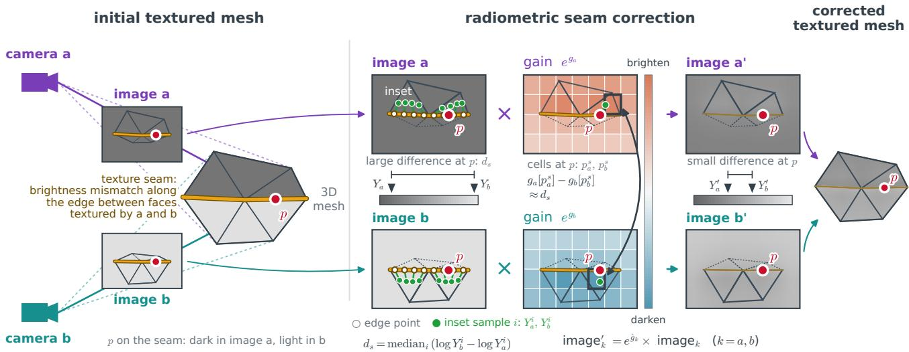  
Figure 3. Radiometric seam correction. Left: cameras a and b see the same surface at different exposures (dark in image a, light in image b); faces above the seam are textured from a and faces below it from $b ,$ so brightness mismatches along the texture seam. Center: both images are sampled at eight corresponding positions per seam edge (four drawn), each inset toward the opposite vertex of that camera’s own face (◦ edge point, • sample); the median log-luminance difference $d _ { s }$ constrains the per-camera log-gain grids $g _ { k }$ , which live in each camera’s image space. The cells $p _ { a } ^ { s }$ , p at the seam midpoint p are coupled by $g _ { a } [ p _ { a } ^ { s } ] - g _ { b } [ p _ { b } ^ { s } ] \approx d _ { s } ,$ , smoothness spreads the correction to neighboring cells, and $e ^ { \hat { g } _ { k } }$ multiplies the camera image (red brightens, blue darkens, as in Fig. 7). Right: the corrected images and mesh; the correction is strongest at the seam and fades with distance, and the mismatch at $p$ is reduced. Two cameras are shown; with K cameras each seam couples the grids of its two cameras in the same way, and all K grids are solved jointly.

E contains each undirected four-neighbor grid edge once. The smoothness term $( \lambda _ { \mathrm { s m } } )$ propagates seam evidence into unobserved cells; the anchor term $\left( \lambda _ { \mathrm { a } } \right)$ favors unit gain $( g = 0 )$ . Together with the coarse grid, this favors gradual radiometric changes rather than independent per-face offsets. The fields are estimated jointly: seams couple cameras and smoothness couples cells within each camera.

Solve and apply. We use twelve matrix-free weighted Jacobi iterations (ω = 0.7). Each update combines neighboring grid values with the seam constraints, clamps the updated log-gain to ±0.15, and then removes the global mean across cameras to control overall exposure drift. Nearestcell assignment keeps the data term local during the solve. At bake time, we instead interpolate the solved field bilinearly and clamp the interpolated log-gain to ±0.15. The bake is then a single multiplication: each full-resolution linear-RGB atlas pixel is scaled by exp(ˆgk) (Fig. 3, right) before conversion back to sRGB. A scalar gain scales all channels equally. The vertically stacked camera images give a direct mapping from each atlas pixel to its camera’s grid, without changing mesh UVs. Camera exposure changes little between frames, so an exponential moving average of the grids $( \alpha = 0 . 1 5 $ , in all experiments) suppresses frame-to-frame flicker of the correction (8× smaller frameto-frame change of the grid).

All stages run on the GPU and reuse the face adjacency, camera assignments, and projected coordinates already produced by texturing. Persistent buffers and a fixed iteration count keep the correction stage bounded.

## 4. Experiments

We evaluate the runtime and visual quality of our method on the Panoptic Studio dataset [21, 22], in which ten Kinect v2 sensors [33] are arranged on a hemisphere and observe a volume of roughly 6 m × 6 m and about 2 m in height. We use two sequences: office2, in which a single performer interacts with a variety of objects, and band2, in which three performers play musical instruments. Runtimes are measured on office2, frames 400–2399; held-out re-rendering and seam metrics use 100 frames.

## 4.1. Runtime Evaluation

Fig. 1 reports processing time as a function of voxel size and Fig. 4 as a function of the number of sensors.1 We compare against the GPU implementation nvblox and Open3D, both of which represent appearance with per-vertex color. nvblox targets incremental mapping rather than per-frame full textured-mesh output, so this comparison measures the

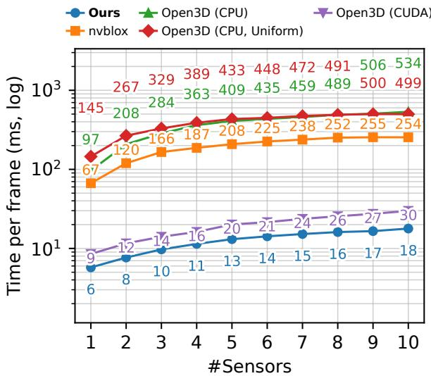  
Figure 4. Per-frame processing time versus the number of sensors. Measured on the office2 sequence of CMU Panoptic at a voxel size of 0.02 m. The vertical axis is the processing time per frame (ms, log scale). Our method’s processing time increases more slowly with the number of sensors than the baselines. “Ours” is the full method, including the radiometric seam correction stage (Sec. 3.6); it stays below all baselines at every sensor count.

Table 1. Per-stage runtime breakdown (ms) on office2 (voxel 0.02 m, five Kinect inputs; about 0.59M output faces per frame). “Ours w/o sc” disables the seam correction, and “Ours (plain)” drops all texture stages for comparison with the per-vertex-color baselines nvblox, Open3D (CPU; Scalable variant with noise removal), and Open3D (CUDA). Inpainting includes the adjacency rebuild (1.3 of 1.7 ms). Columns are separate runs; shared stages vary by up to ∼0.3 ms with GPU timing.
<table><tr><td>Stage</td><td>Ours</td><td>Ours w/o sc</td><td>Ours (plain)</td><td>nvblox</td><td>Open3D (CPU)</td><td>Open3D (CUDA)</td></tr><tr><td>CPU→GPU</td><td>2.0</td><td>1.9</td><td>1.9</td><td>3.3</td><td>N.A.</td><td>4.4</td></tr><tr><td>Preprocessing†</td><td>0.3</td><td>0.3</td><td>0.3</td><td>N.A.</td><td>N.A.</td><td>N.A.</td></tr><tr><td>TSDF Fusion</td><td>0.4</td><td>0.4</td><td>0.4</td><td>36.3</td><td>95.7</td><td>8.2</td></tr><tr><td>Marching Cubes</td><td>0.5</td><td>0.5</td><td>0.6</td><td>28.1</td><td>299.6</td><td>5.7</td></tr><tr><td>Noise Removal</td><td>3.2</td><td>2.9</td><td>3.4</td><td>N.A.</td><td>957.0</td><td>N.A. N.A.</td></tr><tr><td>Texture Mapping</td><td>0.2</td><td>0.1</td><td>一</td><td>N.A.</td><td>N.A.</td><td></td></tr><tr><td>Inpainting</td><td>1.7</td><td>1.7</td><td>一</td><td>N.A.</td><td>N.A.</td><td>N.A.</td></tr><tr><td>GPU→CPU</td><td>2.9</td><td>2.8</td><td>1.1</td><td>86.3</td><td>N.A.</td><td>1.8</td></tr><tr><td>Seam Corr.</td><td>1.9</td><td>1</td><td>一</td><td>N.A.</td><td>N.A.</td><td>N.A.</td></tr><tr><td>Other</td><td>0.2</td><td>0.2</td><td>0.1</td><td>54.2</td><td>7.2</td><td>0.0</td></tr><tr><td>Total</td><td>13.1</td><td>10.8</td><td>7.7</td><td>208.2</td><td>1359.4</td><td>20.1</td></tr><tr><td>Speedup (full) Speedup (plain)†</td><td></td><td></td><td></td><td>15.9× 27.0×</td><td>103.8×</td><td>1.5×</td></tr></table>

† Undistortion and depth-to-color registration, on the GPU in ours; baselines run it on the CPU, untimed. ‡ Baseline time divided by Ours or Ours (plain), respectively. Rows are rounded independently and need not sum to the totals.

cost of adapting such systems to our volumetric-video protocol. On the CPU we run Open3D’s Scalable [51] (plain “Open3D” below) and Uniform variants, and for the former we also report the effect of connected-component noise removal (w/ nr, w/o nr); Open3D (CUDA), its GPU path, performs fusion and MC only. Anticipating volumetricvideo applications that capture an entire space, we reconstruct everything visible without distinguishing foreground from background. Sensor input arrives on the CPU and the mesh returns to it for transmission, so the reported runtime includes the CPU–GPU transfers.

Table 2. Quantitative re-rendering quality on office2 and band2 (held-out five-Kinect evaluation, voxel 0.02 m), measured against the GT images with 5% trimmed mean PSNR, SSIM [47], and LPIPS [50]. “Ours” is the full method including radiometric seam correction and “Ours w/o sc” the ablation; “Ours (vtx color)” replaces the texture atlas with per-vertex color on the same geometry, isolating the atlas contribution. Metrics are computed on the common valid-pixel mask, the intersection of covered pixels across all eight evaluated variants. The qualitative comparison is in Fig. 5.
<table><tr><td></td><td colspan="3">office2</td><td colspan="3">band2</td></tr><tr><td>Method</td><td>PSNR↑</td><td>SSIM↑</td><td>LPIPS↓</td><td>PSNR↑</td><td>SSIM↑</td><td>LPIPS↓</td></tr><tr><td>Open3D w/o nr</td><td>16.483</td><td>0.783</td><td>0.353</td><td>17.635</td><td>0.807</td><td>0.329</td></tr><tr><td>Open3D w/ nr</td><td>16.408</td><td>0.784</td><td>0.353</td><td>17.590</td><td>0.808</td><td>0.330</td></tr><tr><td>nvblox</td><td>15.604</td><td>0.759</td><td>0.378</td><td>16.549</td><td>0.785</td><td>0.355</td></tr><tr><td>Ours (vtx color)</td><td>16.160</td><td>0.787</td><td>0.337</td><td>17.320</td><td>0.808</td><td>0.319</td></tr><tr><td>Ours w/o sc</td><td>15.869</td><td>0.771</td><td>0.299</td><td>17.115</td><td>0.796</td><td>0.277</td></tr><tr><td>Ours</td><td>15.976</td><td>0.785</td><td>0.288</td><td>17.174</td><td>0.804</td><td>0.270</td></tr><tr><td>Offline</td><td>15.191</td><td>0.798</td><td>0.239</td><td>16.206</td><td>0.829</td><td>0.196</td></tr></table>

Our method is faster than the baselines across the tested settings. In particular, at a voxel size of 0.02 m the full method runs at 13.1 ms per frame (10.9 ms excluding input upload and preprocessing), within the 33 ms (30 fps) budget of typical RGB-D sensors and thus real-time (the texture-free “Ours (plain)” pipeline of Tab. 1 is faster still, at 7.7 ms). At a voxel size of 0.005 m it attains a 29.4× speedup over nvblox and an 89.7× speedup over Open3D on the CPU (179.9× over its Uniform variant and 1.6× over Open3D (CUDA), the closest baseline); peak GPU memory at this setting is about 24.1 GB, of which 16.6 GB are static grid and mesh buffers. Tab. 1 gives the per-stage breakdown; it attributes much of nvblox’s runtime to CPU–GPU transfer and GPU-side container overhead, which our dense GPU-resident design avoids.

## 4.2. Visual Quality Evaluation

Fig. 5 and Tab. 2 show the qualitative and quantitative evaluation. We reconstruct from five Kinects and use the remaining five as evaluation viewpoints. We set the voxel size to 0.02 m, at which our method runs in real time. Prior online texturing systems are not direct baselines here: they assume persistent single-sensor scans or CPU-side global patch optimization, whereas our input is a fresh multi-view mesh each frame. We therefore bracket the texture stage with two references on the same protocol: a real-time pervertex-color variant on identical geometry and an offline texture-optimization reference. For the offline reference we use SPSR [23] followed by mvs-texturing [45]. Our method reproduces sharp facial and clothing textures and ranks second to Offline in LPIPS. PSNR follows a different order: Offline scores lowest and Open3D highest. This pattern is consistent with the perception–distortion tradeoff [4]. On identical geometry, replacing our atlas with per-vertex color (“Ours (vtx color)”) raises PSNR/SSIM but worsens LPIPS, isolating the atlas’s benefit to perceptual similarity. These scores compare appearance on shared covered pixels; they do not measure missing surface coverage. The offline method takes about 13 s per frame (about 3 s for SPSR and 10 s for mvs-texturing), about 993× slower than ours. Among the compared methods, only ours has an explicit temporal component: the others texture each frame independently, whereas our gain field is smoothed over time (Sec. 3.6), which suppresses frame-to-frame changes of the correction. The supplementary video shows the temporal behavior and further qualitative comparisons.

GT  
Open3D w/o nr  
Open3D w/ nr  
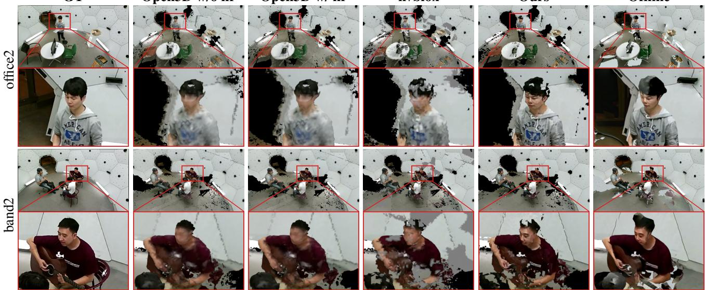  
nvblox  
Ours  
Offline  
Figure 5. Qualitative re-rendering comparison on the office2 and band2 sequences of CMU Panoptic (camera 9, frames 933 and 403, respectively). Meshes reconstructed from five Kinect inputs at a voxel size of 0.02 m are re-rendered from the RGB viewpoints of a different set of five Kinects that were not used as input. “Ours” includes the radiometric seam correction (Sec. 3.6). Compared with the per-vertex-color outputs of Open3D and nvblox, our method reproduces facial and clothing textures more clearly, approaching the offline result at real-time speed. Quantitative scores are in Tab. 2.

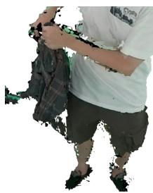  
(a) Texturing

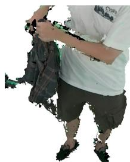  
(b) + noise removal

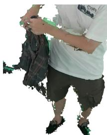  
(c) + noise removal + inpainting  
Figure 6. Effect of noise removal and inpainting on a foregroundonly in-house capture. The subject swings a shirt, producing noisy depth near the cloth and hands. (a) uses texture mapping without noise removal or inpainting; it leaves isolated fragments and untextured faces. (b) Noise removal suppresses the fragments, and (c) inpainting fills many remaining untextured faces. See the supplementary video for temporal behavior.

Table 3. Mean absolute log-luminance mismatch at the seams between input cameras (0.02 m, frames of Tab. 2), inside the solver (Constr.) and on the written atlas (Output).
<table><tr><td></td><td colspan="2">office2</td><td colspan="2">band2</td></tr><tr><td>Seam residual↓</td><td>Constr.</td><td>Output</td><td>Constr.</td><td>Output</td></tr><tr><td>Before (Ours w/o sc)</td><td>0.159</td><td>0.162</td><td>0.151</td><td>0.150</td></tr><tr><td>After (Ours)</td><td>0.101</td><td>0.108</td><td>0.103</td><td>0.109</td></tr><tr><td>Reduction</td><td>36.5%</td><td>33.3%</td><td>31.8%</td><td>27.3%</td></tr></table>

## 4.3. Effect of Radiometric Seam Correction

Fig. 7 and Tab. 3 evaluate the radiometric seam correction of Sec. 3.6 on office2 and band2 under the same heldout protocol. Its effect on re-rendering quality is already in Tab. 2, where “Ours” improves over “Ours w/o sc” in PSNR, SSIM, and LPIPS on both sequences; one gain per camera reaches only 30–72% of these gains. At the seams themselves, the correction reduces the solver’s seam residual by 31.8–36.5 % and that of the written atlas by 27.3– 33.3 % (Tab. 3); Fig. 7(a,b) shows the equalized seams as a smooth, low-frequency difference with no blotching.

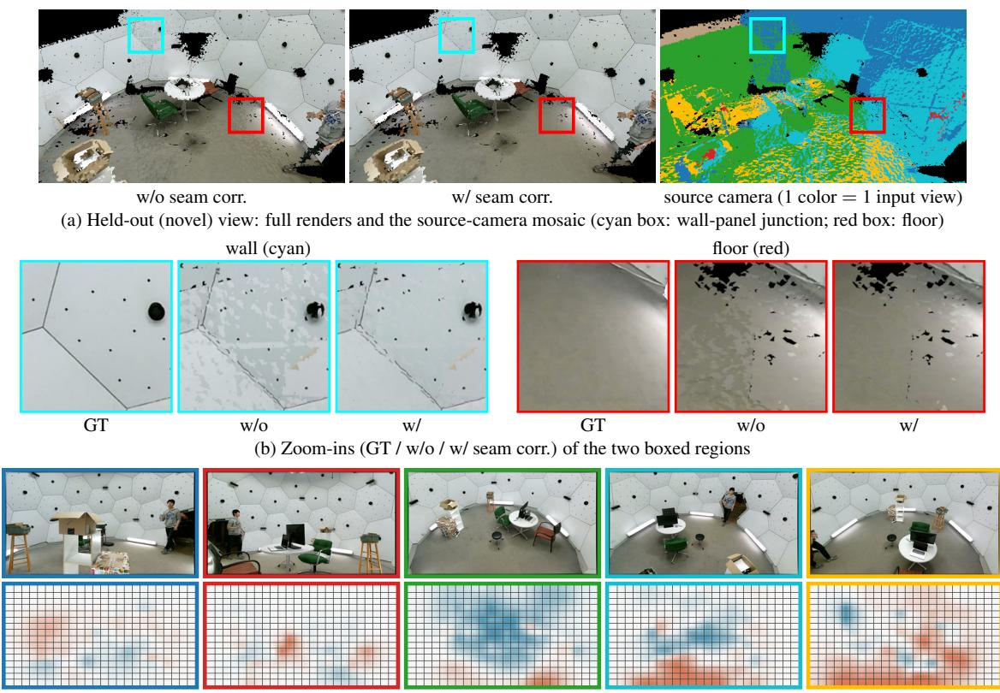  
(c) Each input view: its image (top) and low-frequency gain exp(gk) on a 24 × 16 grid (bottom)  
Figure 7. Radiometric seam correction on office2, rendered from a held-out viewpoint. (a) Full view without and with correction, and the source-camera mosaic, where each color marks the input camera that textures that face, so inter-camera seams lie at the color boundaries. (b) Two zoomed regions, a wall-panel junction (cyan) and the floor (red), each as GT, without, and with correction. (c) Each input camera’s 24 × 16 gain field exp(gk) (red brightens, blue darkens). Seam residuals are in Tab. 3.

The log-gain clamp (±0.15) bounds the applied gain to approximately [0.86, 1.16] times the input linear RGB, and the solved fields remain smooth and low-frequency (Fig. 7(c)). With the stage enabled, the frame time rises from 10.8 ms to 13.1 ms (2.3 ms end to end, mostly the 1.9 ms Seam Corr. row of Tab. 1), within the real-time budget. Finally, correcting all three color channels instead of luminance only changes the held-out metrics negligibly (Sec. C): exposure dominates the inter-camera differences, so we keep the luminance-only field, which preserves chroma and solves a third as many parameters. The RGB variant uses the same solver; on our in-house capture with independent white balance it is on par.

## 4.4. Effect of Noise Removal and Inpainting

Fig. 6 shows the effect of our noise removal and inpainting on an in-house dataset captured with five Orbbec Femto Bolt sensors [39]. On a dynamic scene with heavy depth noise, both stages suppress artifacts, in particular temporal flickering; see the supplementary video. Unlike the Panoptic runs, this auxiliary test reconstructs the foreground only.

## 5. Conclusion

We presented a GPU-native volumetric-video system for graphics-compatible textured meshes from multiple RGB-D sensors. A fixed-size-array adjacency keeps mesh postprocessing and texturing data-parallel on the GPU, and an on-GPU low-frequency gain field baked into the atlas reduces inter-camera exposure seams, including mismatches that vary across each image. The system reaches 13.1 ms per frame at 0.02 m voxels and ranks second only to an offline baseline in LPIPS. At 0.005 m voxels, the full method is 89.7×/29.4× faster than Open3D (CPU, w/o nr)/nvblox.

Limitations and future work. Detail is bounded by the voxel size; finer voxels cost memory and time. Visibility is tested per vertex, not inside triangles that span a depth discontinuity. The low-frequency gain field leaves sharp local seams from geometric or calibration error; gradient-domain leveling is a natural extension.

## References

[1] Dimitrios S Alexiadis, Dimitrios Zarpalas, and Petros Daras. Real-time, full 3-d reconstruction of moving foreground objects from multiple consumer depth cameras. IEEE Transactions on Multimedia, 15(2):339–358, 2013. 2

[2] Dimitrios S Alexiadis, Anargyros Chatzitofis, Nikolaos Zioulis, Olga Zoidi, Georgios Louizis, Dimitrios Zarpalas, and Petros Daras. An integrated platform for live 3d human reconstruction and motion capturing. IEEE Transactions on Circuits and Systems for Video Technology, 27(4):798–813, 2017. 3

[3] Sai Bi, Nima Khademi Kalantari, and Ravi Ramamoorthi. Patch-based optimization for image-based texture mapping. ACM Transactions on Graphics (Proceedings ofSIGGRAPH 2017), 36(4), 2017. 3

[4] Yochai Blau and Tomer Michaeli. The perception-distortion tradeoff. In Proceedings of the IEEE conference on computer vision and pattern recognition, pages 6228–6237, 2018. 7

[5] Mario Botsch, Leif Kobbelt, Mark Pauly, Pierre Alliez, and Bruno Levy.´ Polygon mesh processing. CRC press, 2010. 3

[6] Carnegie Mellon University Graphics Lab. CMU graphics lab motion capture database. http://mocap.cs.cmu. edu. Accessed 2026-10-09. 15

[7] Alvaro Collet, Ming Chuang, Pat Sweeney, Don Gillett, Dennis Evseev, David Calabrese, Hugues Hoppe, Adam Kirk, and Steve Sullivan. High-quality streamable free-viewpoint video. ACM Transactions on Graphics (ToG), 34(4):69:1– 69:13, 2015. 1

[8] Brian Curless and Marc Levoy. A volumetric method for building complex models from range images. In Proceedings of the 23rd annual conference on Computer graphics and interactive techniques, pages 303–312, 1996. 1, 2

[9] Angela Dai, Matthias Nießner, Michael Zollhofer, Shahram¨ Izadi, and Christian Theobalt. Bundlefusion: Real-time globally consistent 3d reconstruction using on-the-fly surface reintegration. ACM Trans. Graph., 36(3), 2017. 1, 2

[10] Mingsong Dou, Sameh Khamis, Yury Degtyarev, Philip Davidson, Sean Ryan Fanello, Adarsh Kowdle, Sergio Orts Escolano, Christoph Rhemann, David Kim, Jonathan Taylor, Pushmeet Kohli, Vladimir Tankovich, and Shahram Izadi. Fusion4d: real-time performance capture of challenging scenes. ACM Trans. Graph., 35(4), 2016. 3

[11] Mingsong Dou, Philip Davidson, Sean Ryan Fanello, Sameh Khamis, Adarsh Kowdle, Christoph Rhemann, Vladimir Tankovich, and Shahram Izadi. Motion2Fusion: Real-time volumetric performance capture. ACM Transactions on Graphics (ToG), 36(6):246:1–246:16, 2017. 3

[12] Christopher Dyken, Gernot Ziegler, Christian Theobalt, and Hans-Peter Seidel. High-speed marching cubes using histopyramids. Computer Graphics Forum, 27(8):2028– 2039, 2008. 3

[13] Ulrich Eck, Michael Wechner, Frieder Pankratz, Kevin Yu, Marc Lazarovici, and Nassir Navab. Real-time 3D reconstruction pipeline for room-scale, immersive, medical teleconsultation. Applied Sciences, 13(18):10199, 2023. 1

[14] Yanping Fu, Qingan Yan, Long Yang, Jie Liao, and Chunxia Xiao. Texture mapping for 3d reconstruction with rgb-d sen-

sor. In Proceedings of the IEEE conference on computer vision and pattern recognition, pages 4645–4653, 2018. 2, 3, 4

[15] Rajrup Ghosh, Christina Suyong Shin, Lei Zhang, Muyang Ye, Tao Jin, Harsha V. Madhyastha, Ravi Netravali, Antonio Ortega, Sanjay Rao, Anthony Rowe, and Ramesh Govindan. Livo: Toward bandwidth-adaptive fully-immersive volumetric video conferencing. Proc. ACM Netw., 3(CoNEXT4), 2025. 1

[16] Hyunho Ha, Joo Ho Lee, Andreas Meuleman, and Min H Kim. NormalFusion: Real-time acquisition of surface normals for high-resolution RGB-D scanning. In Proceedings of the IEEE/CVF Conference on Computer Vision and Pattern Recognition, pages 15970–15979, 2021. 3

[17] Lei Han, Siyuan Gu, Dawei Zhong, Shuxue Quan, and Lu Fang. Real-time globally consistent dense 3d reconstruction with online texturing. IEEE Transactions on Pattern Analysis and Machine Intelligence, 44(3):1519–1533, 2022. 2, 3

[18] Kenneth A Hawick, Arno Leist, and Daniel P Playne. Parallel graph component labelling with gpus and cuda. Parallel Computing, 36(12):655–678, 2010. 4

[19] Junho Jeon, Yeongyu Jung, Haejoon Kim, and Seungyong Lee. Texture map generation for 3d reconstructed scenes. The Visual Computer, 32(6):955–965, 2016. 3

[20] Tao Jin, Mallesham Dasari, Connor Smith, Kittipat Apicharttrisorn, Srinivasan Seshan, and Anthony Rowe. Meshreduce: Scalable and bandwidth efficient 3d scene capture. In 2024 IEEE Conference Virtual Reality and 3D User Interfaces (VR), pages 20–30, 2024. 3, 4

[21] Hanbyul Joo, Hao Liu, Lei Tan, Lin Gui, Bart Nabbe, Iain Matthews, Takeo Kanade, Shohei Nobuhara, and Yaser Sheikh. Panoptic studio: A massively multiview system for social motion capture. In ICCV, 2015. 1, 5

[22] Hanbyul Joo, Tomas Simon, Xulong Li, Hao Liu, Lei Tan, Lin Gui, Sean Banerjee, Timothy Scott Godisart, Bart Nabbe, Iain Matthews, Takeo Kanade, Shohei Nobuhara, and Yaser Sheikh. Panoptic studio: A massively multiview system for social interaction capture. IEEE Transactions on Pattern Analysis and Machine Intelligence, 41(1):190–204, 2019. 1, 5

[23] Michael Kazhdan and Hugues Hoppe. Screened poisson surface reconstruction. ACM Transactions on Graphics (ToG), 32(3):1–13, 2013. 3, 7

[24] Michael Kazhdan, Matthew Bolitho, and Hugues Hoppe. Poisson surface reconstruction. In Eurographics Symposium on Geometry Processing, pages 61–70, 2006. 3

[25] Bernhard Kerbl, Georgios Kopanas, Thomas Leimkuhler,¨ and George Drettakis. 3d gaussian splatting for real-time radiance field rendering. ACM Transactions on Graphics, 42 (4), 2023. 1

[26] Jungeon Kim, Hyomin Kim, Hyeonseo Nam, Jaesik Park, and Seungyong Lee. Textureme: High-quality textured scene reconstruction in real time. ACM Trans. Graph., 41(3), 2022. 2, 3

[27] Joo Ho Lee, Hyunho Ha, Yue Dong, Xin Tong, and Min H Kim. Texturefusion: High-quality texture acquisition for real-time rgb-d scanning. In Proceedings of the IEEE/CVF

Conference on Computer Vision and Pattern Recognition, pages 1272–1280, 2020. 2, 3

[28] Victor Lempitsky and Denis Ivanov. Seamless mosaicing of image-based texture maps. In 2007 IEEE conference on computer vision and pattern recognition, pages 1–6. IEEE, 2007. 2, 3, 4

[29] Matthew Loper, Naureen Mahmood, Javier Romero, Gerard Pons-Moll, and Michael J. Black. SMPL: A skinned multi-person linear model. ACM Trans. Graphics (Proc. SIGGRAPH Asia), 34(6):248:1–248:16, 2015. 3

[30] William E. Lorensen and Harvey E. Cline. Marching cubes: A high resolution 3d surface construction algorithm. SIG-GRAPH Comput. Graph., 21(4):163–169, 1987. 1, 2

[31] Robert Maier, Kihwan Kim, Daniel Cremers, Jan Kautz, and Matthias Nießner. Intrinsic3d: High-quality 3d reconstruction by joint appearance and geometry optimization with spatially-varying lighting. In Proceedings of the IEEE international conference on computer vision, pages 3114–3122, 2017. 3

[32] Siim Meerits, Diego Thomas, Vincent Nozick, and Hideo Saito. FusionMLS: Highly dynamic 3D reconstruction with consumer-grade RGB-D cameras. Computational Visual Media, 4(4):287–303, 2018. 3

[33] Microsoft. Kinect for windows v2: Sensor and data sources overview. https://learn.microsoft. com/en-us/shows/visual-studio-connectevent-2014/716, 2014. 5

[34] Ben Mildenhall, Pratul P. Srinivasan, Matthew Tancik, Jonathan T. Barron, Ravi Ramamoorthi, and Ren Ng. Nerf: Representing scenes as neural radiance fields for view synthesis. In ECCV, 2020. 1

[35] Alexander Millane, Helen Oleynikova, Emilie Wirbel, Remo Steiner, Vikram Ramasamy, David Tingdahl, and Roland Siegwart. nvblox: Gpu-accelerated incremental signed distance field mapping. In 2024 IEEE International Confer ence on Robotics and Automation (ICRA), pages 2698–2705. IEEE, 2024. 1, 2

[36] Richard A Newcombe, Shahram Izadi, Otmar Hilliges, David Molyneaux, David Kim, Andrew J Davison, Pushmeet Kohli, Jamie Shotton, Steve Hodges, and Andrew Fitzgibbon. Kinectfusion: Real-time dense surface mapping and tracking. In 2011 10th IEEE international symposium on mixed and augmented reality, pages 127–136. Ieee, 2011. 1, 2, 3

[37] Matthias Nießner, Michael Zollhofer, Shahram Izadi, and¨ Marc Stamminger. Real-time 3d reconstruction at scale using voxel hashing. ACM Transactions on Graphics (ToG), 32 (6):1–11, 2013. 1, 2

[38] NVIDIA Corporation. CUDA Programming Guide. https : / / docs . nvidia . com / cuda / cuda - programming-guide/. Accessed: 2026-03-12. 3

[39] Orbbec Inc. Femto bolt: Time-of-flight rgb-d camera. https://www.orbbec.com/products/tofcamera/femto-bolt/, 2023. Time-of-flight RGB-D sensor. 8

[40] Sergio Orts-Escolano, Christoph Rhemann, Sean Fanello, Wayne Chang, Adarsh Kowdle, Yury Degtyarev, David

Kim, Philip L. Davidson, Sameh Khamis, Mingsong Dou, Vladimir Tankovich, Charles Loop, Qin Cai, Philip A. Chou, Sarah Mennicken, Julien Valentin, Vivek Pradeep, Shenlong Wang, Sing Bing Kang, Pushmeet Kohli, Yuliya Lutchyn, Cem Keskin, and Shahram Izadi. Holoportation: Virtual 3d teleportation in real-time. In Proceedings of the 29th An nual Symposium on User Interface Software and Technology, page 741–754, New York, NY, USA, 2016. Association for Computing Machinery. 3

[41] Fabian Prada, Misha Kazhdan, Ming Chuang, Alvaro Col-´ let, and Hugues Hoppe. Motion graphs for unstructured textured meshes. ACM Transactions on Graphics (ToG), 35(4): 108:1–108:14, 2016. 3

[42] Fabian Prada, Misha Kazhdan, Ming Chuang, Alvaro Collet,´ and Hugues Hoppe. Spatiotemporal atlas parameterization for evolving meshes. ACM Transactions on Graphics (ToG), 36(4):58:1–58:12, 2017. 3

[43] Thomas Schops, Johannes L. Sch¨ onberger, Silvano Galliani,¨ Torsten Sattler, Konrad Schindler, Marc Pollefeys, and Andreas Geiger. A multi-view stereo benchmark with highresolution images and multi-camera videos. In Conference on Computer Vision and Pattern Recognition (CVPR), 2017. 20

[44] Vladimiros Sterzentsenko, Antonis Karakottas, Alexandros Papachristou, Nikolaos Zioulis, Alexandros Doumanoglou, Dimitrios Zarpalas, and Petros Daras. A low-cost, flexible and portable volumetric capturing system. In 2018 14th International Conference on Signal-Image Technology & Internet-Based Systems (SITIS), pages 200–207. IEEE, 2018. 1

[45] Michael Waechter, Nils Moehrle, and Michael Goesele. Let there be color! — Large-scale texturing of 3D reconstructions. In Proceedings of the European Conference on Computer Vision. Springer, 2014. 2, 3, 4, 7, 17

[46] Jianyuan Wang, Minghao Chen, Nikita Karaev, Andrea Vedaldi, Christian Rupprecht, and David Novotny. Vggt: Visual geometry grounded transformer. In Proceedings of the IEEE/CVF Conference on Computer Vision and Pattern Recognition, 2025. 20

[47] Zhou Wang, Alan C Bovik, Hamid R Sheikh, and Eero P Simoncelli. Image quality assessment: from error visibility to structural similarity. IEEE transactions on image processing, 13(4):600–612, 2004. 6

[48] Tao Yu, Zerong Zheng, Kaiwen Guo, Jianhui Zhao, Qionghai Dai, Hao Li, Gerard Pons-Moll, and Yebin Liu. Doublefusion: Real-time capture of human performances with inner body shapes from a single depth sensor. In Proceedings of the IEEE conference on computer vision and pattern recognition, pages 7287–7296, 2018. 3

[49] Tao Yu, Zerong Zheng, Kaiwen Guo, Pengpeng Liu, Qionghai Dai, and Yebin Liu. Function4d: Real-time human volumetric capture from very sparse consumer rgbd sensors. In Proceedings of the IEEE/CVF conference on computer vision and pattern recognition, pages 5746–5756, 2021. 3

[50] Richard Zhang, Phillip Isola, Alexei A Efros, Eli Shechtman, and Oliver Wang. The unreasonable effectiveness of deep features as a perceptual metric. In Proceedings of the

IEEE conference on computer vision and pattern recognition, pages 586–595, 2018. 6

[51] Qian-Yi Zhou and Vladlen Koltun. Dense scene reconstruction with points of interest. ACM Trans. Graph., 32(4), 2013. 1, 2, 6

[52] Qian-Yi Zhou and Vladlen Koltun. Color map optimization for 3d reconstruction with consumer depth cameras. ACM Transactions on Graphics (ToG), 33(4):1–10, 2014. 3

[53] Qian-Yi Zhou, Jaesik Park, and Vladlen Koltun. Open3D: A modern library for 3D data processing. arXiv:1801.09847, 2018. 1, 2

[54] Xinxin Zuo, Sen Wang, Jiangbin Zheng, Weiwei Yu, Minglun Gong, Ruigang Yang, and Li Cheng. Sparsefusion: Dynamic human avatar modeling from sparse rgbd images. IEEE Transactions on Multimedia, 23:1617–1629, 2021. 3

## Appendix: Supplementary Material

This appendix provides (i) implementation details and the full hyperparameter list (Sec. A), (ii) the held-out rerendering evaluation protocol (Sec. B), (iii) ablations of the seam correction (one gain per camera, luminance vs. RGB) on Panoptic, on a synthetic capture with ground truth, and on our in-house five-camera capture (Sec. C), (iv) a comparison against applying an offline texturing method to our own geometry (Sec. D), (v) the quality/runtime/memory tradeoff of finer voxel sizes (Sec. E), (vi) an ablation of the depth tolerance in occlusion-aware view selection (Sec. F), (vii) an SfM+MVS application example (Sec. G), and (viii) a statement on the use of large language models (Sec. H). An accompanying video (project page: https: //unclearness.github.io/grtmesh/) shows (1) the seam correction on the 100 held-out frames of the evaluation in Sec. 4.2 (office2, frames 400–697 at stride 3, camera 7), playing the re-rendering without (left) and with (right) correction; (2) the texture atlas and the solved gain fields over time; (3) free-view comparisons of our output with nvblox and the offline baseline on office2 and band2 over 800 continuous frames; and (4) the noise-removal, inpainting, and seam-correction ablations on the in-house capture (Sec. C) with its luminance and RGB gain fields. The video shows the temporal behavior of the correction; the fixed 10 cm evaluation is reported in Sec. 4.2 and the ablations below.

## A. Implementation Details and Hyperparameters

All runtime and quality numbers were obtained on a workstation with an AMD Ryzen Threadripper 9970X, 256 GB of RAM, and an NVIDIA RTX PRO 6000 Blackwell Max-Q. Tab. 4 lists the Panoptic defaults of Sec. 4; ablations and the auxiliary capture specify their overrides. We stabilize the seam correction gain field across frames with an exponential moving average, $\mathbf { g } _ { t }  \alpha \mathbf { g } _ { t } + ( 1 - \alpha ) \mathbf { g } _ { t - 1 }$ with $\alpha = 0 . 1 5$ and the zero-mean gauge re-applied after the blend. Fig. 9 illustrates how the seam residuals are sampled, including the direction and magnitude of the sub-pixel inset.

Runtime protocol. Runtimes are measured on frames 400–2399 (band2: 1397–3396) and reported as the mean over the fastest 95% of the timed frames, which removes start-up and scheduling outliers. Frames are decoded into host memory before timing; our times start with the batched upload of the raw color and depth images and include their undistortion and depth-to-color registration on the GPU (2.2 ms together at 0.02 m). The baselines perform these two steps on the CPU, outside their timed region. Over all

2000 frames without the trimming, the full method takes 13.2 ms on average at 0.02 m (95th percentile 15.2 ms), against 13.1 ms in Tab. 1.

At 0.01 m and 0.005 m the baselines are timed on every fourth and every tenth frame of the same range (500 and 200 frames; nvblox at 0.005 m: the first 60 of these). nvblox (nvblox torch 0.0.9) does not release GPU memory when its mapper is cleared, so memory grows until the device is full and the following frames stall. We therefore recreate the mapper outside the timed region whenever device memory use exceeds 50% (90% at 0.005 m). The first frames after each recreation re-grow the memory pool and stall. At 0.02 m and coarser, these stalls fall in the trimmed 5%. At 0.01 m we use frames 18–57 after each recreation (291 of 500, fastest-95% mean). At 0.005 m, memory fills within five timed frames, so we use the single regrowth-free frame of each segment (12 of 60 timed frames, plain mean). Excluding the stalls favors nvblox. On exactly the same frames, our method is 23.7× and 29.4× faster than nvblox at 0.01 m and 0.005 m, as with the reported means.

Open3D (CUDA) is the tensor VoxelBlockGrid of Open3D 0.19 on the GPU (block resolution 16, truncation of four voxels, mesh weight threshold 0.5; the default of 3 removes most of the surface). Its time covers the image upload, block allocation and integration per camera, Marching Cubes, and the mesh download. Its 0.02 m to 0.16 m runs were repeated back to back because the first sweep drifted between jobs; the two sweeps differ by up to 1.9 ms per setting.

Kernel launches per frame. The launch counts in the pipeline figure (Fig. 2) were measured with Nsight Systems on office2 (ten frames, five Kinects, 0.02 m): TSDF fusion 1; Marching Cubes 12; noise removal $N _ { \mathrm { n r } } ~ = ~ 1 0 0$ labelpropagation launches (the iteration cap, which the roomscale meshes reach in every frame; a convergence flag is read back every ten iterations) plus about 28 launches for edge sorting, adjacency construction, and compaction, and 3 for normal computation and smoothing; texture mapping 2 (view selection and UV generation) plus 13 launches that rebuild the fixed-size-array adjacency of the compacted mesh (edge sort); inpainting $N _ { \mathrm { i p } } = 5$ (the cap, reached in every frame); and seam correction $N _ { \mathrm { s c } } = 5 5 \colon$ 12 Jacobi iterations of four kernels (clear, splat seams, update, gauge) plus proxy construction, seam detection, residual sampling, the temporal EMA blend and its gauge re-application, residual statistics, and the bake (53 on the first frame, which has no EMA history). In total, about 219 kernel launches per frame. The GPU input preprocessing adds 25 more (five per camera: color and depth undistortion, z-buffer clear, depth reprojection into the color view, and upsampling), 244 in all.

Noise-removal iteration cap. The cap of 100 labelpropagation iterations bounds the latency of noise removal, but on our room-scale meshes propagation has not yet converged when it stops. We reran 30 frames (400–690, stride 10) with a cap of 5000 and the same convergence check: propagation converges after 111–241 iterations at 0.02 m and 241–591 at 0.01 m (office2 and band2), and after 791 to more than 5000 at 0.005 m (office2). With the cap, a large component can still carry several labels, and a part with fewer than 500 faces is removed with the noise. Compared with the long runs, the cap removes on average 0.02– 0.05% and at most 0.12% of the output faces per frame. The component analysis is therefore an approximation with a bounded number of iterations; all reported results use the cap.

Texture atlas. The atlas is the vertical stack of the input color images, one 1920 × 1080 band per Kinect in input order, i.e. $1 9 2 0 \times 5 4 0 0$ pixels for five Kinects (Fig. 8). A face textured from camera k receives as UVs the pixel coordinates of its projection into band k; an inpainted face receives the UV of one vertex of a neighboring face and is therefore filled with a uniform color; and the seam correction multiplies band k by exp(ˆgk) in place, so the mesh UVs never change. Image regions that no face samples simply stay in the atlas: the layout needs no chart packing, and the corrected atlas of the frame shown is a 1.9 MB JPEG. The layout also suits real-time delivery: it is fixed and each band is the camera image itself, so consecutive atlases keep a constant resolution and are temporally coherent, and the atlas sequence can be streamed with a standard video encoder (compression is not evaluated here).

## A.1. Seam Correction Sampling and Solver

Section 3.6 gives the seam-to-field formulation. Here we detail its implementation. We read seams directly from the fixed-size-array face adjacency, processing each face pair once. A candidate is discarded if the face-normal dot product is below 0.5, or if either projected triangle has twicearea below one full-resolution pixel squared (including collapsed inpainted faces). For each retained seam we sample eight edge parameters $t _ { i } = ( i + \frac { 1 } { 2 } ) / 8$ . In each camera, the projected point is moved by 0.5 proxy pixels toward that face’s projected opposite vertex, as illustrated in Fig. 9. These positions lie near corresponding shared-edge locations; after the independent insets they need not be projections of the same 3D point. Samples outside the proxy or with linear luminance below 0.01 in either view are rejected. The median log-luminance difference supplies $d _ { s } ,$ and the valid-sample fraction supplies $w _ { s }$ . There is no additional robust penalty on the resulting least-squares residual.

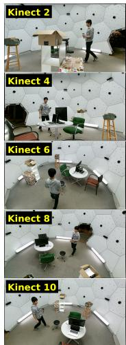

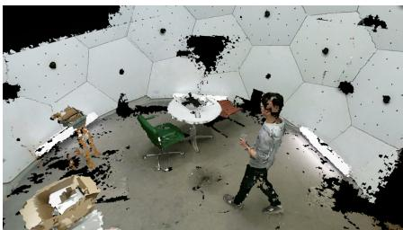  
(b) textured mesh, held-out Kinect 7

(a) texture atlas  
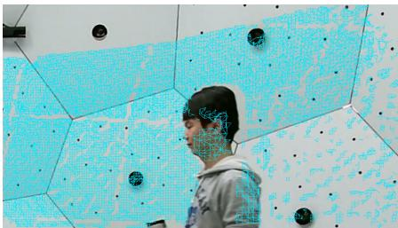  
(c) UV triangles in a crop of the Kinect 2 band  
Figure 8. Texture atlas of our output (office2, frame 445, 0.02 m, seam correction on). (a) The atlas is the stack of the five input color images, one band per Kinect, with the per-camera gain baked in. (b) The mesh textured from it, rendered from a held-out camera. (c) A crop of the top band with the UV triangles of the faces that sample it: UVs are pixel coordinates in the source image, so the mesh reads the texture exactly where the camera saw it.

Table 4. Default hyperparameters for the Panoptic evaluation of Sec. 4. Overrides for ablations and the auxiliary capture are stated in their respective sections.
<table><tr><td>Stage / parameter</td><td>Value</td></tr><tr><td>Reconstruction</td><td></td></tr><tr><td>Voxel size</td><td>0.02 m</td></tr><tr><td>SDF truncation band</td><td>4× voxel size</td></tr><tr><td>Mesh post-processing</td><td></td></tr><tr><td>Noise removal: min. component</td><td>500 faces</td></tr><tr><td>Noise removal: max. iterations</td><td>100</td></tr><tr><td>Inpainting: max. iterations</td><td>5</td></tr><tr><td>Texture view selection: max. angle</td><td>80°</td></tr><tr><td>Texture view selection: depth tolerance</td><td>10 cm</td></tr><tr><td>Radiometric seam correction</td><td></td></tr><tr><td>Per-camera gain grid</td><td>24 × 16</td></tr><tr><td>Color space</td><td>luminance (scalar)</td></tr><tr><td>Solver</td><td>weighted Jacobi</td></tr><tr><td>Relaxation ω</td><td>0.7</td></tr><tr><td>Iterations</td><td>12</td></tr><tr><td>Smoothness weight λsm</td><td>30</td></tr><tr><td>Anchor weight λa</td><td>0.02</td></tr><tr><td>Log-gain clamp gmax</td><td>0.15 (exp Îk ∈ [0.86, 1.16])</td></tr><tr><td>Residual proxy downscale</td><td>1/8 (box)</td></tr><tr><td>Samples per seam</td><td>8</td></tr><tr><td>Sub-pixel inset</td><td>0.5 proxy px, toward the opposite vertex</td></tr><tr><td>Fold/veil cutoff  $\boldsymbol { \tau } \left( \mathbf { n } _ { a } \cdot \mathbf { n } _ { b } \right)$ </td><td>0.5</td></tr><tr><td>Gauge</td><td>zero-mean over cameras</td></tr><tr><td>Temporal EMA α</td><td>0.15</td></tr></table>

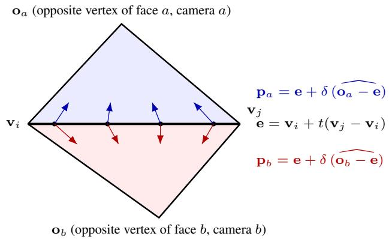  
Figure 9. Seam-residual sampling geometry (Sec. 3.6). A seam is the edge $\mathbf { v } _ { i } \mathbf { v } _ { j }$ shared by face a (textured from camera a) and face b (camera b). For each of the $N = 8$ sample points e at $t = ( i + \textstyle \frac { 1 } { 2 } ) / N$ along the edge, both faces are sampled at corresponding shared-edge positions e, and the image-space sample position is inset by δ from e toward the projection of that face’s opposite vertex $\left( \mathbf { O } _ { a } \ \mathrm { o r } \ \mathbf { o } _ { b } \right)$ , not along the edge normal. The inset is applied independently in each camera’s projected coordinates, with $\delta = 0 . 5$ proxy pixels (= 4 full-resolution pixels at the $1 / 8 \ \mathrm { p r o x y } )$ , moving the samples toward the interiors of their respective projected faces. The inset positions need not correspond to the same 3D point. Dark or invalid samples are rejected, and the seam residual $d _ { s }$ is the median over the remaining samples of log $Y _ { b } - \log { Y _ { a } }$ ; seams whose faces fold sharply $( { \bf n } _ { a } \cdot { \bf n } _ { b } < 0 . 5 )$ or project degenerately are discarded.

Proxy and discrete constraints. We build the linear-RGB proxy by $1 / 8$ box reduction of each input camera band. This reduces the influence of texture detail and small misalignments on the residual. One constraint per seam is assigned to the nearest grid cell at the inset midpoint in each camera. Bilinear assignment would couple multiple same-camera unknowns in each data term; the nearest-cell construction instead retains a graph of pairwise differences. Bilinear interpolation is used only when applying the solved field to the atlas.

Matrix-free update. We use the notation $g _ { k } [ p ] , \ a ( s )$ $b ( s ) , p _ { a } ^ { s } , p _ { b } ^ { s }$ of Sec. 3.6. For cell $p$ of camera k, let $\mathcal { N } ( \boldsymbol { p } )$ be its four-neighbors in the same grid and $S ( p )$ the seams assigned to it, i.e. with $( a ( s ) , p _ { a } ^ { s } ) = ( k , p ) \mathrm { o r } ( b ( s ) , p _ { b } ^ { s } ) =$ $( k , p )$ . For such a seam let $( k _ { s } ^ { \prime } , q _ { s } )$ be the other camera and its cell, and let $\sigma _ { p , s }$ be +1 if $k = a ( s )$ and −1 if $k = b ( s )$

The update is

$$
\begin{array} { l } { { \mathrm { n u m } _ { p } = \lambda _ { \mathrm { s m } } \displaystyle \sum _ { q \in \mathcal { N } ( p ) } g _ { k } [ q ] + \displaystyle \sum _ { s \in S ( p ) } w _ { s } \big ( g _ { k _ { s } ^ { \prime } } [ q _ { s } ] + \sigma _ { p , s } d _ { s } \big ) , } } \\ { { \mathrm { d e n } _ { p } = \lambda _ { \mathrm { a } } + \lambda _ { \mathrm { s m } } | \mathcal { N } ( p ) | + \displaystyle \sum _ { s \in S ( p ) } w _ { s } , } } \\ { { \displaystyle g _ { k } ^ { + } [ p ] = ( 1 - \omega ) g _ { k } [ p ] + \omega \mathrm { n u m } _ { p } / \mathrm { d e n } _ { p } } . } \end{array}\tag{2}
$$

Here $\mathrm { \ n u m } _ { p }$ and $\mathrm { d e n } _ { p }$ are the numerator and denominator of the weighted average num $\mathrm { _ { l } } _ { p } / \mathrm { d e n } _ { p } \mathrm { ; }$ the anchor adds $\lambda _ { \mathrm { a } }$ to $\mathrm { d e n } _ { p }$ and nothing to nump because its target is $g = 0 .$ . Every frame starts from $g = 0$ , and all cells are updated from the previous iterate (Jacobi). We use $\lambda _ { \mathrm { s m } } = 3 0 , \lambda _ { \mathrm { a } } = 0 . 0 2$ $\omega = 0 . 7$ , and twelve iterations. The anchor makes the unprojected linear system strictly diagonally dominant. After every update, the implementation first clamps each value to $[ - 0 . 1 5 , 0 . 1 5 ]$ and then subtracts the mean over all camera cells. Consequently the clamp is a bound before gauge removal, not a strict bound on the final re-centered field. An optional reference-camera mode sets that camera’s grid to zero instead of removing the mean. Luminance uses one scalar field; RGB mode solves three independent channels.

Temporal filtering and bake. Continuous capture uses the EMA specified above, with the gauge re-applied after blending. On office2 frames 400–699, it reduces the mean frame-to-frame change of the (clamped) log-gain grid from 0.0079 to 0.0010, and the 99th percentile over cells and frames from 0.057 to 0.0072; without it, single cells jump by several percent between frames. Filtering is in cameragrid coordinates and does not require mesh correspondences across frames. For each atlas pixel, the band layout identifies its camera and image coordinates. We interpolate that camera’s field bilinearly, clamp the interpolated log-gain again to [−0.15, 0.15], and multiply the original linear RGB by $\exp ( \hat { g } )$ , where $\hat { g }$ denotes this clamped value. The applied gain therefore remains in approximately [0.86, 1.16], even if the gauge-shifted grid exceeds the update clamp. We then convert back to sRGB. This leaves image detail in the original texture while modulating it with a coarse spatial correction; it does not repair geometric misalignment or sharp local seams.

Constraint and output seam residuals. Table 3 reports two seam residuals. The constraint residual (Constr.) is computed inside the solver: the mean $| d _ { s } |$ over the sampled seams before, and $| d _ { s } - ( g _ { a ( s ) } [ p _ { a } ^ { s } ] - \dot { g } _ { b ( s ) } [ p _ { b } ^ { s } ] ) |$ after, using the EMA-blended grid at the nearest cell, without interpolation or the bake clamp. The output residual (Output) is measured after the bake: it applies the same seam detection and sampling (Fig. 9) to the atlas the system writes (8- bit JPEG), so it includes the bilinear field interpolation, the clamp, and quantization. “Before” reads the correction-off run and “after” the full run, each with its own mesh. Both residuals are measured between the input cameras on the evaluated frames.

GPU reuse. Faces, normals, camera labels, and projected coordinates remain on the device from reconstruction and texturing. The correction also reuses the existing fixedsize-array adjacency, avoiding another edge-key sort (about 1.7 ms per frame). It needs no new camera projection and no geometry re-upload. Proxy construction, residual sampling, field updates, and atlas bake execute on the GPU. Persistent buffers avoid per-frame allocations, and the iterations require no CPU synchronization.

## B. Held-out Re-rendering Protocol

We reconstruct the textured mesh from one set of Kinects and render it from a disjoint set, so the evaluation views are never used as input. Concretely, we reconstruct from the even Kinects {2, 4, 6, 8, 10} and evaluate on the odd Kinects {1, 3, 5, 7, 9}, at a voxel size of 0.02 m (cmu-room). For each held-out camera we render the reconstructed mesh with its calibrated intrinsics/extrinsics (Blender/EEVEE, emission shading) and compare to that camera’s real, undistorted RGB image.

Shared valid-pixel mask. Each method leaves different uncovered (black) pixels where faces are unseen or removed. Scoring each method only on its own covered pixels would compare different pixel sets and make the numbers incomparable. We therefore evaluate every method on the intersection of all methods’ covered pixels: a pixel is valid only if every method renders non-black there (a light morphological opening removes speckle). PSNR, SSIM, and LPIPS are computed on this single shared mask and averaged with a 5% trimmed mean. PSNR uses only the masked pixels. SSIM and LPIPS (AlexNet) are computed on the full frame after every pixel outside the mask is set to the same constant in both images (black for SSIM and mid-gray for LPIPS, whose input range is [−1, 1]). All metrics use sRGB values in [0, 1].

Subsets. The quality numbers of Sec. 4.2 and the luminance-vs-RGB ablation use frames 400–697 at stride 3 (100 evaluated frames) per sequence and the same common mask over all eight evaluated variants. The offline-texturing comparison (Sec. D) uses frames 400–429; the voxel-size and occlusion ablations use the 50-frame subsets specified in their captions. Within each comparison, all methods are evaluated on the same frames and mask. For the quality and seam numbers of Sec. 4 and the luminance-vs-RGB ablation, our method reconstructs every frame from 400 to 699 in order, and only every third frame is rendered and evaluated. The correction-on variants use the gain-field EMA (α = 0.15) throughout, as do the runtimes in Tab. 1; its history starts at frame 400 (the first field is used as is) without a separate warm-up.

Rounding. Differences, ratios, and percentages in the text and in the ∆ columns of this appendix are computed from unrounded metrics, so they can differ in the last digit from values recomputed from the rounded table entries.

## C. Seam Correction Variants

Our seam correction estimates a single luminance gain field by default, which preserves chroma and solves a third as many parameters as a per-channel (RGB) field; the RGB field uses the same solver with three independent channels and is meant for cameras whose white balance differs. We compare the two variants on Panoptic, whose Kinects share their white balance, on a synthetic capture with known percamera differences, and on our in-house capture, whose cameras run their own white balance.

Panoptic. Tab. 5 compares the two fields on the same 100-frame held-out set and common mask as Tab. 2. Correcting chroma in addition to luminance changes the rerendering metrics negligibly (PSNR within 0.002, SSIM within 0.0002, LPIPS within 0.0005 on both sequences in Tab. 5): the inter-camera differences are dominated by exposure, and the luminance field is sufficient.

Spatial field vs. one gain per camera. To test whether the spatial field is needed, we also solve a single luminance gain per camera (a 1 × 1 field) with the same solver, gain bound, and temporal filter (“constant” in Tab. 5). It reaches only 72% / 35% of the PSNR gain, 54% / 30% of the SSIM gain, and 50% / 50% of the LPIPS gain of the 24 × 16 field over no correction (office2 / band2). Per image pair, the field scores higher than the constant gain in SSIM and LPIPS on 499–500 of the 500 pairs of each sequence and in PSNR on 418 and 370. The seam constraint residual falls by 13.8% / 7.8% with the constant gain against 36.5% / 31.8% with the field (Tab. 3). The variation of the gain within each camera therefore matters beyond a per-camera exposure offset.

Synthetic capture with ground truth. Our in-house capture cannot be released, and neither it nor Panoptic has images free of inter-camera color differences. We therefore render a synthetic stand-in in Blender, whose generation scripts are released with the code: a person animated with CMU motion capture [6] dances for 150 frames on a 3×3 m floor, seen by ten 1280 × 720 RGB-D cameras on a circle, with an empty background. All materials are Lambertian and the lighting is fixed, so a surface point has the same color in every camera. We then multiply each camera’s linear color by a fixed smooth gain: an exposure offset (log) o $\dot { { \bf \theta } } + 0 . 1 0 , - 0 . 1 0 , + 0 . 1 0 , - 0 . 1 0 .$ , and 0 in order around the circle, assigned separately to the five reconstruction and the five held-out cameras, so most neighboring cameras of a group differ by about 22%, plus a small linear gradient and a small white-balance shift; every gain stays within $\pm 0 . 1 4$ per channel and is zero-mean over the reconstruction cameras. This is the ideal case for our model: the differences are multiplicative, low-frequency, and within the default bound. We reconstruct the foreground at 0.01 m from the five even cameras and evaluate on the five odd ones against the unperturbed renders on all 150 frames and the shared mask. As for the in-house capture, the correction uses $| g | \leq 0 . 4$ and $\lambda _ { \mathrm { s m } } = 5 ,$ , and the seams are sampled on a $1 / 2$ instead of a 1/8 proxy. This is a limitation of the default: the 1/8 proxy suits scenes that fill the image, as in Panoptic, but here the person covers only a small part of each image, the proxy boxes at its seams mix in background and other body parts, and the gains solved on the body do not follow the applied ones. A small subject needs a finer proxy.

Table 5. Luminance-only vs. per-channel RGB seam correction (held-out, 0.02 m, 100 frames, common mask over all eight evaluated variants). $\ " \mathrm { o f f } \ "$ is no seam correction; “constant” solves one luminance gain per camera (1 × 1 field) and is scored on the same masks.
<table><tr><td></td><td colspan="3">office2</td><td colspan="3">band2</td></tr><tr><td>Variant</td><td>PSNR↑</td><td>SSIM↑</td><td>LPIPS↓</td><td>PSNR↑</td><td>SSIM↑</td><td>LPIPS↓</td></tr><tr><td>off</td><td>15.869</td><td>0.7714</td><td>0.2988</td><td>17.115</td><td>0.7960</td><td>0.2773</td></tr><tr><td>constant  $( 1 \times 1 )$ </td><td>15.946</td><td>0.7786</td><td>0.2932</td><td>17.136</td><td>0.7984</td><td>0.2737</td></tr><tr><td>luminance</td><td>15.976</td><td>0.7847</td><td>0.2876</td><td>17.174</td><td>0.8038</td><td>0.2701</td></tr><tr><td>RGB</td><td>15.977</td><td>0.7847</td><td>0.2873</td><td>17.176</td><td>0.8039</td><td>0.2696</td></tr></table>

Tab. 6 shows that the correction recovers most of the loss caused by the gains: 94% (luminance) and 97% (RGB) of the SSIM gap and 87% / 95% of the LPIPS gap to the reconstruction from unperturbed input, and 57% / 59% of the 0.34 dB PSNR gap. The seam constraint residual (Tab. 3) drops from 0.091 to 0.049, close to the mismatch on the unperturbed input (0.048), which reflects geometric and sampling error alone. Fig. 10(a) shows seams on the floor and on the shirt: without correction the surface breaks into brighter and darker patches where the texture switches between cameras; with either field the patches disappear.

We compare the applied log-gain h with the recovered gain −g, the negated correction field. The correction is relative, so −g is not expected to equal h. A seam constrains only the difference between the two cameras that meet there: across the seams, the recovered difference matches the applied one $( r = 0 . 9 7$ , slope 0.94), which is what removes the seams. Each camera’s own level is not observed;

Table 6. Synthetic capture (held-out cameras, 0.01 m, 150 frames, shared mask). “clean input”: reconstruction from the unperturbed renders, the upper bound.
<table><tr><td>Variant</td><td>PSNR↑</td><td>SSIM↑</td><td>LPIPS↓</td></tr><tr><td>off</td><td>22.645</td><td>0.9404</td><td>0.1024</td></tr><tr><td>luminance</td><td>22.842</td><td>0.9509</td><td>0.0948</td></tr><tr><td>RGB</td><td>22.847</td><td>0.9513</td><td>0.0941</td></tr><tr><td>clean input</td><td>22.988</td><td>0.9516</td><td>0.0937</td></tr></table>

it is set by the zero-mean gauge and, away from the seams, by the smoothness term and the anchor toward unit gain. The per-camera gain at the same seams therefore follows the applied one with less than half its amplitude $( r = 0 . 8 3 $ slope 0.41; Fig. 10(b)), and a gain common to all cameras would not be recovered at all.

In-house capture. Fig. 11 shows the foreground-only inhouse capture of the main paper (Sec. 4.4; five Orbbec Femto Bolt sensors), whose cameras run independent auto exposure and auto white balance, so camera boundaries may differ in color cast as well as in brightness. We run both variants with a wider gain bound and weaker smoothing than the Panoptic default $( | g | \ \leq \ 0 . 4 .$ , i.e. gains in [0.67, 1.49], and $\lambda _ { \mathrm { s m } } = 5 )$ ; the $2 4 \times 1 6 ~ \mathrm { g r i d }$ , the solver, and all other seam-correction parameters are as in Tab. 4. The foreground-only reconstruction uses 0.01 m voxels in a 2 m cube, a 0.10 m depth tolerance, a four-voxel truncation band, a 100-face component threshold, and at most 20 inpainting iterations. The view is a turntable render of one frame seen from behind; no held-out camera exists for this capture, so the comparison is qualitative. The sequence was recorded by the authors; the person shown took part voluntarily and gave informed consent to being recorded and to the use of the recordings in this paper and its supplementary video.

Two cameras texture most of the back (red and yellow in the source-camera mosaic), and their boundary crosses the T-shirt and the plaid shirt at the waist. Without correction, the T-shirt region textured by the yellow camera is darker and slightly greenish next to the bright white of the red camera, and the plaid shirt steps in brightness across the boundary; accordingly, both fields brighten the yellow camera by up to about 1.5× toward the center of its view. The luminance field removes the brightness steps as well as the RGB field does: on the T-shirt fabric on both sides of the boundary, the difference of the mean CIELAB lightness of the two sides drops from about 8 to 3 units with either variant, while the distance between their mean $( a ^ { * } , b ^ { * } )$ stays at 2–3 units with and without correction, close to the visibility threshold. (The fabric pixels are those in the Tshirt zoom box with $L ^ { * } > 5 5$ in the uncorrected render that lie within 25 pixels of both cameras’ regions of the sourcecamera mosaic, in the 1440 × 1440 renders.) Consistently, the three channels of the RGB field agree with their mean to within 1% on average (Fig. 11(c)): even with independent white balance, the exposure difference dominates on this capture, and the luminance default suffices here too (the figure applies 0.5 exp(gk) to sRGB rather than linear values, exaggerating the tint). As on Panoptic, the fields are smooth and low-frequency; they shift each camera’s colors as a whole rather than re-texturing the surface. The green fringes at the silhouette stem from background pixels mixed into depth-edge faces of the input images and are present in all variants.

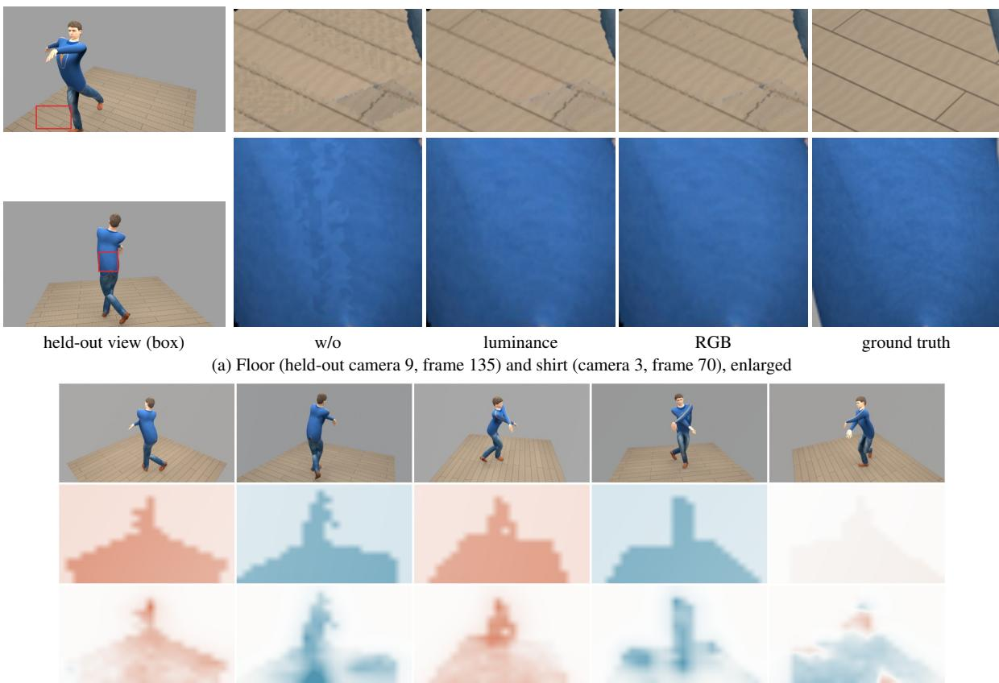  
(b) Reconstruction cameras 2, 4, 6, 8, 10 (columns): input, applied exposure gain h, and the recovered gain −g (negated luminance correction field; red brighter, blue darker, ±0.15; faded: no visible surface)  
Figure 10. Synthetic capture. (a) Without correction the floor and the shirt split into brighter and darker patches where the texture switches between cameras; both fields remove them. (b) The correction is relative: it reproduces the differences between cameras across the seams, not each camera’s applied gain, which is why the two rows differ in amplitude.

## D. Offline Texturing on Our Geometry

The Offline baseline of Sec. 4 pairs SPSR geometry with mvs-texturing [45], so it differs from our method in both geometry and texturing. To isolate the texturing step, we instead apply mvs-texturing to our own per-frame meshes and evaluate from held-out cameras (Tab. 7). This auxiliary comparison uses a separate mesh set (frames 400–429 of each sequence) and a two-method coverage intersection; its scores support comparisons within this experiment, rather than direct comparisons with Tab. 2.

We verified the consistency of the offline texturing pipeline: re-texturing the same SPSR meshes matches the reference renders to 34–41 dB PSNR. mvs-texturing is run with hole filling enabled; we also tried both settings of its keep-unseen-faces option.

In this auxiliary comparison, offline texturing on our geometry performs worse than our texturing in all three metrics. Some faces unseen by the input views remain untextured (rendered blank), while our inpainting supplies colors for these faces. This result is specific to the dense, noisy per-frame Marching-Cubes meshes tested here.

## E. Voxel Size: Quality versus Runtime and Memory

Section 4 uses 0.02 m voxels, the setting at which the full pipeline stays well within the 33 ms real-time budget.

T-shirt (cyan): w/o, luminance, RGB

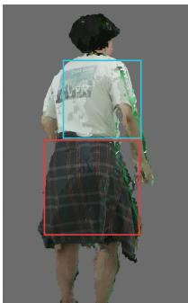  
w/o seam corr.

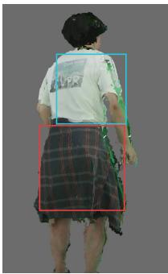  
luminance

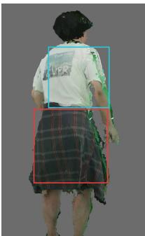  
RGB

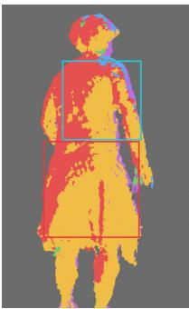  
source camera

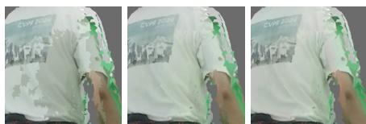

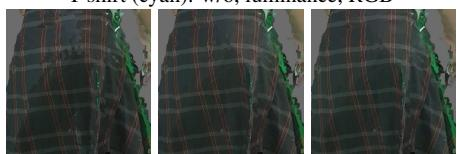  
waist (red): w/o, luminance, RGB

(a) Full view without correction, with the luminance field, with the RGB field, and the source-camera mosaic (1 color = 1 input view; cyan box: T-shirt; red box: waist); (b) zoom-ins of the two boxed regions in the same order  
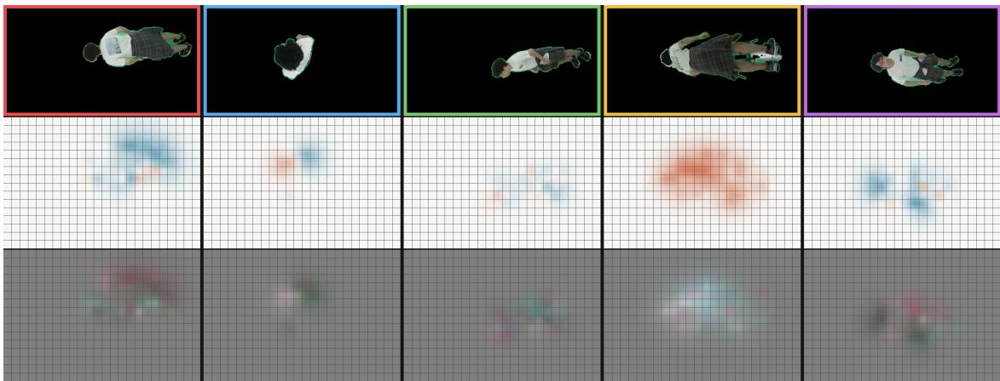  
(c) Each input camera (border color as in the mosaic): input view (top), the luminance gain exp(g ) on the 24 × 16 grid (middle; red brightens, blue darkens, as in Fig. 7), and the RGB gain shown as the color it gives a neutral gray (bottom; 0.5 exp(g ) on sRGB values, exaggerating the tint)  
Figure 11. Luminance vs. RGB seam correction on the in-house five-camera capture (turntable view from behind; both with |g| ≤ 0.4 and $\lambda _ { \mathrm { s m } } = 5 )$ . (a) Without correction, with the luminance-only field, with the per-channel RGB field, and the source-camera mosaic: the red and yellow cameras texture most of the back, and their boundary crosses the T-shirt (cyan box) and the plaid shirt at the waist (red box). (b) Zoom-ins of the boxed regions: the darker, greenish T-shirt patch of the yellow camera and the brightness step on the plaid shirt are equalized by both variants. (c) Input views (background masked) and the solved gain fields: both brighten the yellow camera by up to about 1.5× toward the center of its view, and the three channels of the RGB field nearly coincide. The fields stay smooth and low-frequency and shift each camera’s colors as a whole.

Table 7. Offline texturing (mvs-texturing) applied to our geometry vs. our real-time texturing, on identical meshes (held-out, 0.02 m, frames 400–429).
<table><tr><td></td><td colspan="3">office2</td><td colspan="3">band2</td></tr><tr><td>Texturing</td><td>PSNR↑</td><td>SSIM↑</td><td>LPIPS↓</td><td>PSNR↑</td><td>SSIM↑</td><td>LPIPS↓</td></tr><tr><td>Offline (mvs)</td><td>13.303</td><td>0.674</td><td>0.390</td><td>14.605</td><td>0.704</td><td>0.360</td></tr><tr><td>Ours</td><td>15.290</td><td>0.761</td><td>0.311</td><td>16.535</td><td>0.782</td><td>0.289</td></tr></table>

Finer voxels recover geometric detail that 0.02 m loses (thin structures, small objects, sharper silhouettes) but the dense TSDF grid grows cubically. To quantify this tradeoff we run the identical pipeline on office2 at 0.02 m, 0.01 m, and 0.005 m (the cmu-room volume of 5.8 × 2.7 × 5.8 m, i.e. 290 × 135 × 290, 580 × 270 × 580, and $1 1 6 0 \times 5 4 0 \times 1 1 6 0$ voxels) and report held-out re-rendering quality, per-stage runtime, and GPU memory (Tab. 8). All three settings use the same pipeline and the same shared valid-pixel mask (the intersection of the three runs’ coverage), so the rows are directly comparable to each other. The comparison in Sec. 4 includes other reconstruction methods and uses a different frame subset and coverage intersection (Sec. B); its absolute scores therefore should not be compared directly with this ablation.

Quality. Halving the voxel size to 0.01 m changes PSNR, SSIM, and LPIPS by −0.12 dB, −0.027, and +0.038, respectively. Fig. 12 shows the sharper chair and table rim and the additional holes on the wall and floor. At 0.005 m, the changes relative to 0.02 m are −1.25 dB, −0.170, and +0.175. The truncation band is four voxels, i.e. 2 cm, at this fine setting. On band2, halving the voxel size changes the same metrics by −0.37 dB, −0.050, and +0.061. 0.02 m remains the setting with a clear margin under the real-time budget; 0.01 m slightly exceeds it (see below).

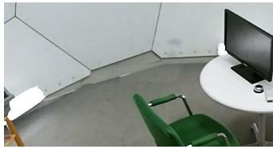  
GT

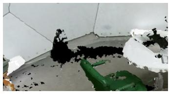  
0.02 m

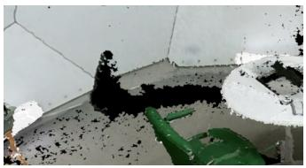  
0.01 m

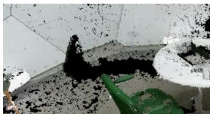  
0.005 m  
Figure 12. Voxel size versus reconstruction detail on office2, held-out camera 7, frame 445 (crop). Finer voxels sharpen silhouettes (chair, table rim) but leave more small holes and noise on the wall and floor, where each voxel receives fewer depth samples; the truncation band also shrinks with the voxel (four voxels: 8, 4, and 2 cm), so voxel size is not the only change. Overall the held-out metrics decrease (see text). Thin, dark structures such as the stool remain missing at every setting because the depth sensors do not observe them reliably.

Table 8. Voxel size versus held-out re-rendering quality, runtime, and GPU memory on office2 (same pipeline, shared mask, frames 400–547 at stride 3, cameras 1,3,5,7,9, 10 cm depth tolerance). ∆ columns are relative to the 0.02 m row, from unrounded values. Runtime is the per-frame processing time (low-95% mean) over 2000 frames (400–2399); the 0.02 m row uses the same five-input timing trace as Tab. 1. Memory is the peak device memory over these 2000 frames (static grid and mesh buffers plus per-frame allocations). Quality uses the 50-frame subset specified above.
<table><tr><td>Voxel</td><td>PSNR↑</td><td>SSIM↑</td><td>LPIPS↓</td><td>∆PSNR</td><td>∆LPIPS</td><td>ms/frame</td><td>GPU mem</td></tr><tr><td>0.02 m</td><td>15.821</td><td>0.795</td><td>0.271</td><td>一</td><td></td><td>13.1</td><td>2.7 GB</td></tr><tr><td>0.01 m</td><td>15.704</td><td>0.768</td><td>0.308</td><td>-0.12</td><td>+0.038</td><td>34.6</td><td>5.7 GB</td></tr><tr><td>0.005 m</td><td>14.571</td><td>0.625</td><td>0.445</td><td>-1.25</td><td>+0.175</td><td>138.9</td><td>24.1 GB</td></tr></table>

Runtime and memory. Halving the voxel size multiplies the cell count by eight and the frame time by 2.6– 4.0×: 13.1 ms at 0.02 m, 34.6 ms at 0.01 m, and 138.9 ms at 0.005 m over the same 2000 frames (band2: 12.8 and 35.3 ms at 0.02 and 0.01 m). The stages scale differently. TSDF fusion and Marching Cubes grow with the cell count (0.4 → 2.3 → 15.6 and $0 . 5  1 . 9  1 0 . 8 ~ \mathrm { m s } )$ ; noise removal, texture mapping, inpainting, and seam correction grow with the output face count (about 0.6M, 2.9M, and 12.4M faces per frame), and the GPU→CPU download of the finished mesh becomes the largest single stage at fine voxels $( 2 . 9  1 1 . 3  4 5 . 6 ~ \mathrm { m s } )$ because the output itself is about 0.85 GB per frame at 0.005 m. The dense grid, edge table, and mesh buffers take 0.4, 2.3, and 16.6 GB of static device memory at the three sizes (peak 2.7, 5.7, and 24.1 GB including per-frame allocations and the input buffers), so 0.005 m needs a 24 GiB-class GPU and, at about 7.2 fps, is an offline setting on this hardware, while 0.01 m fits an 8 GB GPU at about 28.9 fps, just short of the real-time budget (32.4 ms without the input upload and preprocessing). Marching-cubes edge indices exceed 231 at 0.005 m on this volume, so that build uses 64-bit edge keys (a compile-time option; the default build is unchanged).

Table 9. Occlusion threshold on office2 and band2 (same build, shared mask per scene, frames 400–547 at stride 3, cameras 1,3,5,7,9). Rejecting occluded projections removes the ghost texture and improves all three held-out metrics; the seam residual columns are the seam constraint residual of Tab. 3 before and after seam correction.
<table><tr><td>Tocc</td><td>PSNR↑</td><td>SSIM↑</td><td>LPIPS↓</td><td>seam res. (before→after)</td></tr><tr><td>office2</td><td></td><td></td><td></td><td></td></tr><tr><td>1.1 m (loose)</td><td>14.882</td><td>0.737</td><td>0.327</td><td>0.328→0.271</td></tr><tr><td>10 cm (default)</td><td>15.556</td><td>0.765</td><td>0.304</td><td>0.158→0.104</td></tr><tr><td>band2</td><td></td><td></td><td></td><td></td></tr><tr><td>1.1 m (loose)</td><td>16.110</td><td>0.753</td><td>0.310</td><td>0.287→0.240</td></tr><tr><td>10 cm (default)</td><td>16.521</td><td>0.781</td><td>0.288</td><td>0.152→0.104</td></tr></table>

## F. Occlusion-Aware View Selection

The per-face view selection (Sec. 3.4) tests all three vertices of a face against the chosen camera’s depth image and rejects the camera when the depth of a vertex differs from the observed depth at its projection by more than a threshold $\tau _ { \mathrm { o c c } } ,$ in either direction. We use $\tau _ { \mathrm { o c c } } = 1 0$ cm and compare it with a loose 1.1 m tolerance. The loose test admits large depth discrepancies, allowing foreground texture to be projected onto occluded background surfaces. The fixed 10 cm tolerance corresponds to five voxels at 0.02 m. Rejected assignments leave faces without a camera, which the inpainting stage fills with flat color. On the common heldout mask, the default changes PSNR, SSIM, and LPIPS by +0.67 dB, +0.028, and −0.022 on office2, and +0.41 dB, +0.028, and −0.021 on band2 (Tab. 9). Fig. 13 shows the effect and Tab. 9 reports the held-out metrics of both settings on the same build and mask.

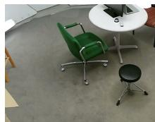  
GT

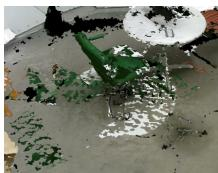  
τocc = 1.1 m

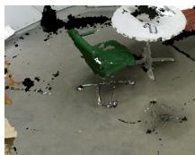  
τocc = 10 cm

Figure 13. Occlusion-aware view selection on office2 (held-out camera 7, frame 405, crop). With the loose 1.1 m tolerance, the green chair’s texture spills onto the floor and the table’s white texture onto the chair. The 10 cm test rejects these occluded projections; inpainting fills the affected faces. Both use the same reconstruction settings.  
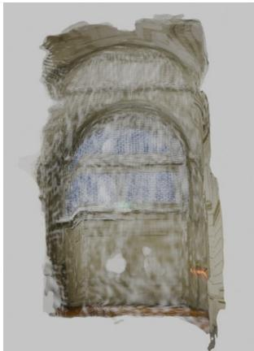  
(a) VGGT point cloud

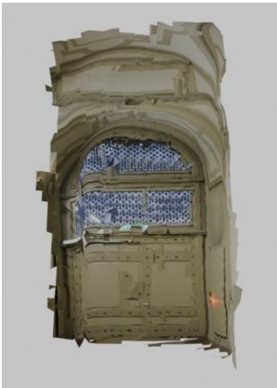  
(b) Textured mesh  
Figure 14. Application with SfM+MVS-style input. (a) Pointcloud output of VGGT [46]. (b) Textured mesh obtained by applying our method to the VGGT-derived geometry and camera views.

## G. Application to SfM+MVS

Our method can also texture surfaces reconstructed from image-based depth and camera estimates rather than RGB-D sensors. Fig. 14 shows an example using the door sequence of ETH3D [43]: we take the point-cloud output of VGGT [46] and apply our textured-meshing pipeline to the derived geometry and camera views. This example is qualitative, but it illustrates that the texturing stage is not tied to Kinect-style RGB-D input.

## H. Use of Large Language Models

In line with the WACV 2027 policy on large language models (LLMs), we disclose that an LLM-based coding assistant was used in two ways. It helped polish the English of this paper, and it facilitated the experiments: it assisted in writing and running the scripts that drive the reconstruction and evaluation campaigns, compute the metrics, generate the plots and the supplementary video, and check the reported numbers against the measured data, as well as in refactoring the code for release. The method, its CUDA implementation, the experimental design, and all claims are the author’s; every statement and number was verified by the author, who takes full responsibility for the content.