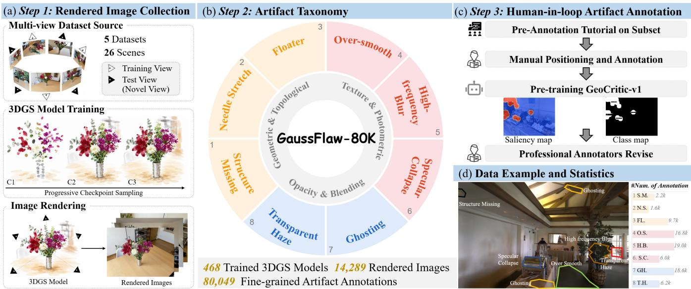
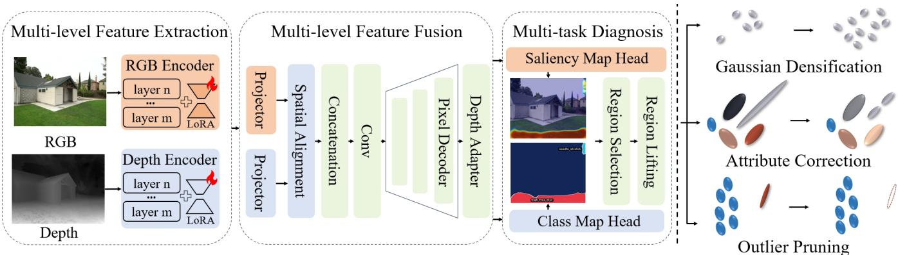
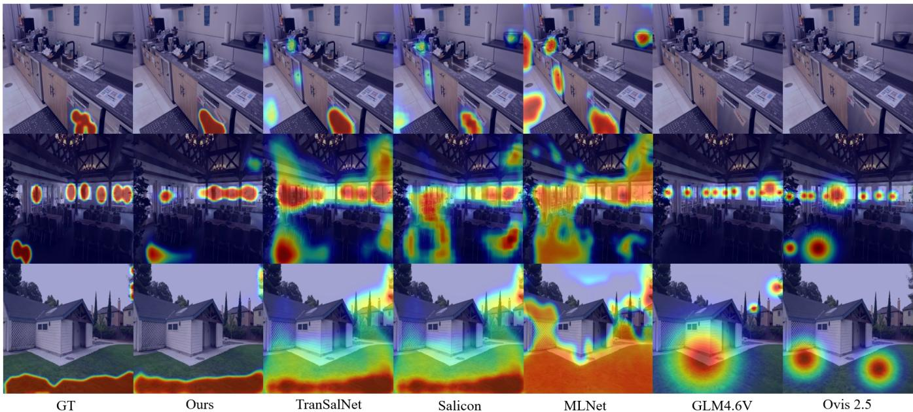
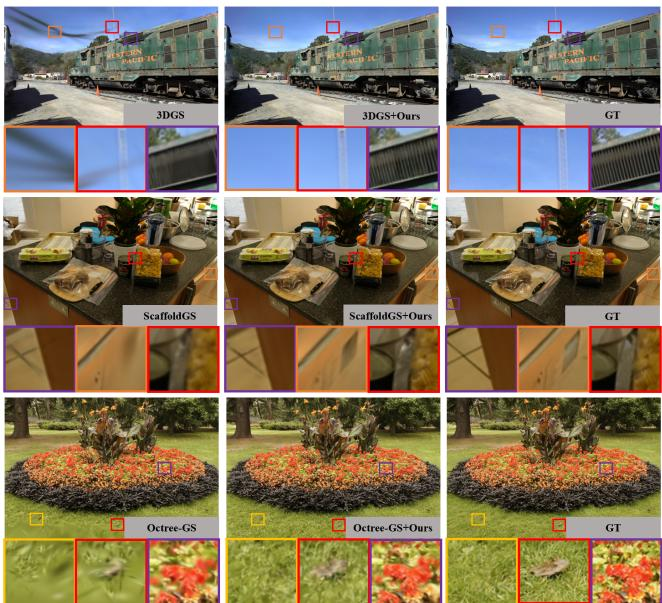

# GaussFlaw: Fine-Grained Perceptual Diagnosis for 3D Gaussian Splatting

Shaocheng Shen, Zihan Zheng, Kejin Li, Lu Liu, Xiaoyun Zhang,

Qiang Hu, Wenjun Zhang

Shanghai Jiao Tong University, Shanghai, China

## Abstract

3D Gaussian Splatting (3DGS) enables photorealistic novelview synthesis with real-time rendering, yet fine-grained diagnosis of its rendering artifacts remains challenging. These artifacts are typically spatially localized and exhibit diverse degradation patterns, making them dificult to characterize using global quality metrics and image-level assessment benchmarks, which provide no explicit indication of where they occur or what types of artifacts they represent. To address this limitation, we introduce GaussFlaw-80K, the first large-scale dataset for fine-grained perceptual diagnosis in 3DGS. Constructed through a model-assisted human-in-theloop pipeline, GaussFlaw-80K contains 80,049 artifact regions across 14,289 rendered images, each annotated with a pixel-level mask and one of eight flaw labels spanning geometric, blending, and photometric degradations. These annotations turn 3DGS artifact diagnosis into an explicit and measurable task. Building on this dataset, we propose GeoCritic, a geometry-guided multi-task model that integrates RGB appearance with depth-derived cues to jointly localize artifacts and classify their flaw types. Beyond evaluation, we further demonstrate the downstream benefits of fine-grained diagnosis through three complementary targeted operations: Gaussian densification, attribute correction, and outlier pruning. Experiments show that GeoCritic achieves an AUC-J of 0.9507 and an Acc@1 of 80.08%, while diagnosis-guided refinement improves all reported global and crop-level metrics across diverse datasets and 3DGS backbones.

## Introduction

3D Gaussian Splatting (3DGS) (Kerbl et al. 2023) and its variants (Feng et al. 2025; Hu et al. 2025; Navaneet et al. 2024; Zheng et al. 2025) have emerged as powerful representations for novel-view synthesis, ofering photorealistic rendering with real-time eficiency. Despite its impressive global quality, 3DGS renderings often remain locally unreliable: perceptually salient artifacts such as floaters, ghosting, needle-like stretching, and over-smoothed details can persist within otherwise realistic novel views. Importantly, these artifacts exhibit distinct spatial patterns and degradation characteristics, reflecting diferent failures in geometry, opacity and blending, or texture representation. Since such flaws are typically spatially localized, their perceptual impact can be easily obscured by the overall rendering quality. A reliable assessment of 3DGS therefore requires fine-grained perceptual diagnosis that explicitly answers two questions: where does an artifact occur, and what type of flaw does it represent?

Conventional full-reference metrics, such as PSNR, SSIM (Wang et al. 2004), and LPIPS (Zhang et al. 2018), aggregate spatially varying errors into a single score, merely reflecting the global rendering quality. Recent 3DGS quality assessment datasets, including NVS-QA (Zhang et al. 2025), GS-QA (Martin et al. 2025), 3DGS-QA (Wan et al. 2026), 3DGS-IEval-15K (Xing et al. 2025), and MUGSQA (Chen et al. 2026), broaden the evaluated scenes and perceptual dimensions, yet still rely primarily on image- or sequence-level quality annotations. Consequently, they cannot expose localized flaws hidden within otherwise high-quality renderings, nor do they provide the region masks and labels of artifacts for targeted refinement. General-purpose Vision-Language Models (VLMs) ofer richer semantic descriptions, but their lack of 3DGS-specific artifact priors makes dense spatial grounding and fine-grained artifact discrimination unreliable. Existing approaches therefore remain limited to global quality prediction, leaving fine-grained diagnosis largely unexplored.

To address this gap, we introduce GaussFlaw-80K, the first large-scale dataset for fine-grained perceptual diagnosis in 3DGS with joint spatial and categorical annotations. Its pixel-level masks identify where perceptually significant artifacts occur, while its fine-grained labels characterize what type of flaw each region exhibits. Together, these annotations extend prior assessment from global score prediction to explicit flaw localization and classification (Table 1). GaussFlaw-80K contains 80,049 annotated artifact regions from 14,289 rendered images and organizes common 3DGS artifacts into a hierarchical taxonomy of eight categories spanning geometric, blending, and photometric degradations. The annotations are collected through a modelassisted human-in-the-loop pipeline to ensure an optimal trade-of between pixel-level precision and scalable annotation costs. By moving beyond image-level quality scores, GaussFlaw-80K establishes fine-grained artifact diagnosis as a measurable and reproducible task for 3DGS.

Building on the pixel-level supervision provided by GaussFlaw-80K, we propose GeoCritic, a geometry-guided multi-task perception model that jointly localizes 3DGS rendering artifacts and classifies their fine-grained flaw types. GeoCritic integrates RGB appearance with depth- derived geometric cues to improve spatial grounding and distinguish visually ambiguous artifacts. Beyond evaluation, we demonstrate the downstream benefit of fine-grained diagnosis for 3DGS refinement. Specifically, we translate Geo-Critic’s class-aware regional diagnosis into three complementary operations: Gaussian densification for underrepresented content, attribute correction for unreliable primitives, and outlier pruning for detached Gaussians. Extensive experiments show that GeoCritic achieves state-of-the-art performance in both artifact localization and fine-grained classification (yielding an AUC-J of 0.9507 and an Acc@1 of 80.08%). Furthermore, our targeted refinement significantly improves afected Gaussian representations across diverse datasets and backbones while minimizing unnecessary changes to well-reconstructed regions, demonstrating the practical value of region-level diagnosis for 3DGS refinement.

<table><tr><td rowspan="2">Name</td><td rowspan="2">Scene</td><td rowspan="2">Number of Vids/Imgs</td><td rowspan="2">Number of Ann.</td><td rowspan="2">Annotation Format</td><td rowspan="2">Flaw Location</td><td rowspan="2">Flaw Type</td><td rowspan="2">Refinement</td></tr><tr><td></td></tr><tr><td>GSC-QA (Yang et al. 2024)</td><td>15</td><td>120</td><td>120</td><td>Score</td><td>X</td><td>X</td><td>X</td></tr><tr><td>GS-QA (Martin et al. 2025)</td><td>8</td><td>64</td><td>64</td><td>Score</td><td>X</td><td>X</td><td>X</td></tr><tr><td>NVS-QA (Zhang et al. 2025)</td><td>13</td><td>65</td><td>130</td><td>Score</td><td>X</td><td>X</td><td>X</td></tr><tr><td>3DGS-IEval-15K (Xing et al. 2025)</td><td>10</td><td>15.2K</td><td>15.2K</td><td>Score</td><td>X</td><td>X</td><td>X</td></tr><tr><td>GaussFlaw-80K (Ours)</td><td>26</td><td>14.2K</td><td>80K</td><td>Pixel-level Diagnosis</td><td>√</td><td>√ (8 Types)</td><td>√(Targeted)</td></tr></table>

Table 1: Comparison of 3DGS quality assessment datasets. Compared to existing benchmarks, GaussFlaw-80K ofer advantages in diversity and volume, featuring 26 complex scenes and 80K pixel-level annotations. By advancing the annotation format to fine-grained diagnosis (enabling explicit flaw location and typing), our dataset uniquely supports artifact analysis and targeted refinement.

Our contributions are summarized as follows:

• We introduce GaussFlaw-80K, the first dataset for finegrained diagnosis of 3DGS rendering artifacts, providing 80,049 pixel-level artifact masks with category labels and enabling explicit region-level diagnosis beyond conventional global quality assessment.

• We propose GeoCritic, a geometry-guided diagnostic expert that synergizes visual semantics with physical depth priors, enabling fine-grained spatial grounding and explicit topological reasoning of rendering artifacts.

• We demonstrate the downstream benefit of fine-grained diagnosis by translating class-aware regional predictions into three targeted Gaussian operations, which consistently improve local perceptual quality across multiple 3DGS backbones.

• Extensive experiments validate the superiority of our proposed GeoCritic in accurately localizing and classifying 3DGS artifacts. Additionally, our empirical results demonstrate that the targeted refinement efectively rectifies local flaws, achieving noticeable perceptual improvements over existing baselines.

## GaussFlaw-80K Construction

We construct GaussFlaw-80K, a large-scale dataset specifically designed for fine-grained diagnosis of 3DGS rendering artifacts. It provides precise pixel-level region masks and fine-grained flaw type annotations for over 80K flaw regions across 8 artifact categories.

## Artifact Taxonomy

As shown in Table 1, existing 3DGS evaluation datasets are primarily restricted to global quality scores (e.g., MOS) at a limited scale. To overcome this, we advance the annotation format from traditional holistic scoring to pixel-level diagnosis. Supported by an unprecedented volume of 80K annotations, this fine-grained paradigm enables precise spatial location and categorization of specific rendering flaws.

Central to this pixel-level assessment is a hierarchical taxonomy, as illustrated in Figure 1, which organizes common 3DGS artifacts into eight specific categories across three high-level dimensions. Specifically, Geometric and Topological Distortions encompass Floater, characterized by detached or foreground-like blobs; Needle Stretch, manifested as thin and elongated spike-like structures; and Structure Missing, referring to absent or incomplete scene structures. Opacity and Blending Artifacts include Transparent Haze, which appears as veil-like opacity accumulation over otherwise valid content, and Ghosting, characterized by duplicated, trailing, or semi-transparent structures. Lastly, Texture and Photometric Flaws comprise Over-smooth, characterized by excessively smoothed structures and appearance; High-frequency Blur, referring to the loss of fine textures and edge details; and Specular Collapse, manifested as spurious, unstable, or distorted view-dependent highlights. At a high level, these artifacts reflect insuficient representation coverage, unreliable Gaussian attributes, and inadequate geometric support. This taxonomy provides a structured and interpretable foundation for fine-grained perceptual diagnosis.

## Data Collection and Annotation

Rendering Sources and Diversity. To ensure a comprehensive and generalizable data distribution, we curate rendering outputs from three representative 3DGS methods: vanilla 3DGS (Kerbl et al. 2023), FastGS (Ren et al. 2026), and HAC++ (Chen et al. 2025). Specifically, we train models using three methods across 26 scenes sourced from five widely used datasets (Mip-NeRF 360 (Barron et al. 2022), Deep-Blending (Hedman et al. 2018), LERF (Kerr et al. 2023), TandT (Kerbl et al. 2023), and Tanks & Temples (Knapitsch et al. 2017)). Recognizing that rendering artifacts dynamically evolve and manifest distinct visual characteristics at diferent training stages, we extract rendered images at six distinct checkpoints for each model, starting from 5K steps with a 5K-step interval. This temporal sampling yields a total of 468 intermediate checkpoint models. Furthermore, we comprehensively sample multiple novel views for each scene.

  
Figure 1: Data Construction Pipeline of GaussFlaw-80K. (a) rendered image collection across datasets, 3DGS methods, checkpoints, and novel views; (b) the hierarchical taxonomy of eight artifact categories; (c) the human-in-the-loop annotation pipeline; and (d) annotated examples and dataset statistics.

Human-in-the-loop annotation pipeline. We design a four-stage model-assisted human-in-the-loop annotation pipeline. (1) Annotators first align with the established taxonomy through a pre-annotation phase. Subsequently, a small initial subset of rendered images is precisely annotated manually, providing pixel-level boundary masks and corresponding fine-grained topological labels for each distorted region. (2) We pre-train a preliminary artifact perception model GeoCritic-v1 (detailed in Sec. 3) on this initial subset, and apply it to the remaining unannotated renderings to automatically generate candidate masks and topological pseudo-labels. (3) Annotators manually adjust inaccurate mask boundaries, correct misclassified labels, filter out falsepositive predictions, and add artifact regions missed by the model. (4) Final annotations are reconciled through majority voting and cross-validation by experts to eliminate subjective biases. Consequently, each sample in GaussFlaw comprises a 3DGS rendering, precise artifact region masks, and finegrained artifact labels. This paradigm significantly reduces annotation cost compared with fully manual annotation.

Quality Control. To ensure annotation quality, all GeoCritic-v1 proposals were manually reviewed and corrected. Starting from 17,444 manually annotated seed regions, GeoCritic-v1 generated 62,510 candidate regions, of which annotators retained 52,359. Among the retained masks, annotators refined the boundaries of 92.9%, changed the areas of 39.99% by more than 10%, and corrected the category labels of 15.3%. Annotators also added 10,246 missed regions. Expert cross-validation achieved over 95% annotation agreement, demonstrating the high consistency and reliability of the final category labels and pixel-level masks. Finally, we obtained 80,049 pixel-level artifact regions with categorie labels across 14,289 rendered images, averaging 5.6 regions per image. As shown in Figure 1(d), High-frequency Blur and Ghosting are the most prevalent categories (23.7% and 23.2%, respectively), with further statistics provided in the supplementary material.

## Fine-Grained Perceptual Diagnosis

In this section, we first present GeoCritic, a multi-task perception model that simultaneously predicts dense artifact saliency and fine-grained flaw categories. We then introduce a downstream Targeted Rectification application, which projects GeoCritic’s 2D predictions back to 3D Gaussians for precise geometric control (e.g., targeted expansion, attribute repair, and outlier removal) without compromising valid scene structures.

## GeoCritic: Geometry-Guided Artifact Perception

3DGS rendering artifacts typically exhibit ambiguous boundaries and complex categories. To explicitly diagnose these artifacts, we design a geometry-guided dense perception model, which is systematically constructed from two core perspectives: geometry-guided representation learning and unified multi-task diagnostic prediction.

Geometry-Guided Representation Learning. As illustrated in the left panel of Figure 2, the model leverages a dualstream architecture to inject physical geometric priors. The appearance branch extracts rich semantic features {Ri}4i=1 via an RGB encoder, while the geometry branch employs a depth encoder to capture multi-level depth cues $\{ G _ { i } \} _ { i = 1 } ^ { 4 } .$ To seamlessly integrate these two modalities, we introduce a lightweight multi-level fusion module. At each hierarchical level, the RGB and depth features are mapped into a shared latent space via projection layers. Following spatial alignment and channel-wise concatenation, the combined multimodal representations are integrated through a convolutional fusion:

  
Figure 2: Overview of the proposed fine-grained perceptual diagnosis pipeline. Left: The GeoCritic model, leveraging a dual-stream architecture for RGB-depth feature extraction and multi-level fusion, followed by a multi-task head for fine-grained diagnosis. Right: The downstream targeted rectification operations guided by the selected artifact regions.

$$
F _ { i } = \mathcal { F } _ { i } \Big ( C o n c a t \big [ \mathcal { P } _ { i } ^ { r } ( R _ { i } ) , \mathbf { A } ( \mathcal { P } _ { i } ^ { d } ( G _ { i } ) ) \big ] \Big )\tag{1}
$$

where $\mathcal { P } _ { i } ^ { r }$ and $\mathcal { P } _ { i } ^ { d }$ denote the projection operations for RGB and depth, respectively, $\mathbf { A } ( \cdot )$ represents the spatial alignment, and ${ \mathcal { F } } _ { i }$ stands for the convolutional fusion layer. The fused features $\{ F _ { i } \} _ { i = 1 } ^ { 4 }$ are aggregated by an FPN-style pixel decoder. We further introduce a CNN-based Depth Adapter that injects depth-derived boundary cues into decoded features, enforcing geometry-aware localization and suppressing false positives in physically consistent regions.

Unified Multi-Task Diagnostic Prediction. Instead of cascading separate localization and classification networks, we attach a unified multi-task head to the shared dense features, enabling the joint diagnosis of artifact regions and their corresponding topological flaw types. From the decoded representation, the unified head predicts an artifact saliency map $S \in [ 0 , 1 ] ^ { H \times W }$ and a fine-grained class map $C \in [ 0 , 1 ] ^ { K \times H \times W }$ . This design tightly couples spatial localization with category-aware evidence through shared dense features and aligned supervision. The network is optimized via a dual supervision objective:

$$
\mathcal { L } = \lambda _ { c } \mathcal { L } _ { c l a s s } + \lambda _ { s } \mathcal { L } _ { s a l i e n c y }\tag{2}
$$

For the artifact saliency branch, we supervise the saliency prediction with a fidelity term and a distribution-alignment term:

$$
\mathcal { L } _ { s a l i e n c y } = \mathcal { L } _ { f i d } ( S , S ^ { * } ) + \mathcal { L } _ { d i s t } ( \hat { S } , \hat { S } ^ { * } ) ,\tag{3}
$$

where $S ^ { * }$ denotes the ground-truth artifact saliency map. Given the inherently ambiguous visual boundaries of 3DGS artifacts, we apply a Gaussian kernel to the pixel-level annotations to generate this continuous ground-truth saliency map. $\hat { S }$ and ${ \hat { S } } ^ { * }$ denote the corresponding normalized saliency distributions. The fidelity term encourages local response consistency with the annotated artifact regions, while the distribution-alignment term encourages the predicted saliency distribution to match the human-annotated artifact saliency density. This formulation supports both pixel-level localization fidelity and distribution-level saliency consistency. For the class heatmap branch, we apply a per-class sigmoid focal loss:

$$
\mathcal { L } _ { c l a s s } = \mathcal { L } _ { f o c a l } ( C , C ^ { * } ) ,\tag{4}
$$

where $C ^ { * }$ is the ground-truth class map. During inference, the predicted saliency map S is thresholded to extract connected components as localized artifact proposals. The flaw type of each proposal is then obtained by aggregating the corresponding spatial responses in the class map C.

## Downstream Application: Targeted Rectification

After obtaining class-aware artifact maps from GeoCritic, GaussFlaw translates the image-space diagnoses into 3D refinement targets through two steps: region selection and region lifting. Region selection extracts connected artifact regions from the predicted maps and assigns each region its corresponding degradation type. Region lifting then associates the selected regions with the underlying Gaussians by projecting the primitives into multiple probe views and aggregating their class-specific responses across views under visibility, depth-consistency, and surface-support constraints. Based on the lifted evidence, GaussFlaw applies three complementary forms of localized refinement: Gaussian densification, attribute correction and outlier pruning.

Gaussian Densification. High-frequency blur, oversmoothing, and missing structures often indicate insuficient local representation capacity. For these regions, modifying existing Gaussians alone may be inefective because the required geometry is underrepresented or absent. Gauss-Flaw establishes multi-view correspondences within the diagnosed regions and triangulates depth-consistent observations into additional surface seeds. These seeds augment the original initialization before re-optimization, allocating new representation capacity to geometrically supported regions containing missing structures or fine details.

Attribute Correction. GaussFlaw corrects unreliable attributes of geometrically plausible Gaussians in a categoryspecific manner: opacity is reduced for transparent haze, ghosting, and non-detached floaters; the largest scale dimension is contracted for needle stretching and anisotropic ghosting; and higher-order SH coeficients are attenuated for specular collapse. Gaussian positions and unrelated attributes remain unchanged, while the corresponding optimizer states are reset to preserve the corrections during subsequent training.

  
Figure 3: Qualitative comparison of artifact location results. Our method yields sharper and more precise localization than deep saliency detectors and VLM-based methods. More qualitative results are included in the supplementary material.

Outlier Pruning. GaussFlaw projects the diagnosed floater and needle-stretch regions back to the 3D representation to identify the Gaussians responsible for these artifacts. It then aggregates their evidence across views and compares their projected depths with the corresponding rendered surfaces. Gaussians that consistently appear as foreground outliers without suficient surface support are regarded as detached from the scene. Only these verified outliers are removed from the Gaussian representation under a conservative pruning budget, while all other candidates are excluded from pruning.

## Experiments

## Implementation Details

GeoCritic. We implement GeoCritic using pretrained SigLIP 2 (Tschannen et al. 2025) and Depth Anything 3 encoders (Lin et al. 2025) for appearance and geometry representation, respectively. Both encoders are adapted with LoRA using a rank of 16. For the depth adapter, we employ a lightweight CNN that simultaneously processes the dense features output by the pixel decoder and the normalized depth gradients. GeoCritic is optimized for 60 epochs using AdamW with a learning rate of $2 \times 1 0 ^ { - 5 }$ , a weight decay of $1 \times 1 0 ^ { - 4 }$ , and a batch size of 8. The loss weights are set to $\lambda _ { s } = 1 . 5$ and $\lambda _ { c } = 1$ . Training is conducted on 2 NVIDIA A100 GPUs.

Targeted Rectification. For diagnosis-guided rectification, we first train a short preliminary reconstruction to generate the additional surface seeds used for Gaussian densification. We add at most 12,000 seeds per scene and initialize them with a scale multiplier of 0.35 and an opacity of 0.15. The final reconstruction is optimized for 30K iterations, with GeoCritic invoked at iterations 8K, 15K, and 23K. During attribute correction, opacity values are multiplied by 0.65 for transparent haze, ghosting, and non-detached floaters; the largest scale dimension is multiplied by 0.75 for needle stretching and by 0.90 for anisotropic ghosting; and higherorder SH coeficients are multiplied by 0.70 for specular collapse. GeoCritic is used only to guide these explicit operations, and no auxiliary perceptual loss is introduced during reconstruction. All remaining optimization settings follow the oficial configuration of each 3DGS backbone.

## GeoCritic Analysis

Experimental Setup. For artifact localization, following (Bylinskii et al. 2019), we adopt CC, SIM, KLD, AUC-Judd, and NSS to evaluate pixel-wise localization and distributional consistency. For topological artifact classification, we employ Top-1 and Top-3 accuracy (Acc@1, Acc@3), alongside Macro-Recall (M-Recall) and Macro-F1 (M-F1). While Acc@1 strictly evaluates primary label accuracy, we introduce Acc@3 as a relaxed metric to reflect predictive robustness given the inherent visual ambiguity of 3DGS artifacts. Furthermore, M-Recall and M-F1 are computed as the macro-average across all 8 flaw categories, which are incorporated to further measure the stability of the model’s recognition capability across diferent classes.

Comparisons. Table 2 and Table 3 evaluate the proposed GeoCritic in terms of artifact localization and topological artifact classification. Conventional saliency detectors (SR (Hou and Zhang 2007), PFT (Guo, Ma, and Zhang 2008), SWD (Duan et al. 2011), SUN (Zhang et al. 2008), and Murray (Murray et al. 2011)) perform poorly because they primarily respond to low-level contrast rather than renderingspecific distortions. Deep saliency networks (Salicon (Huang et al. 2015), MLNet (Cornia et al. 2016), Sal-CFS-GAN (Che et al. 2020), SAM (Cornia et al. 2018), and TranSalNet (Lou et al. 2022)) achieve better localization results, but their lack of geometry priors limits their ability to recognize 3DGSspecific artifacts even after task-specific training. Moreover, these single-task saliency methods inherently lack the capability to classify topological artifact categories. Generalpurpose VLMs (Qwen3-VL-8B (Bai et al. 2025), GLM-4.6V-9B (V Team et al. 2025), Ovis 2.5-9B (Lu et al. 2025), and Gemma 4-E4B (Gemma Team et al. 2026)) exhibit limited artifact grounding in the zero-shot setting. Even with fine tuning, these VLMs remain limited in both localization and classification, suggesting that general multimodal priors are insuficient for fine-grained 3DGS artifact diagnosis.

<table><tr><td>Model</td><td>AUC-J↑</td><td>NSS↑</td><td>CC↑</td><td>SIM↑</td><td>KLD↓</td></tr><tr><td>SR</td><td>0.4322</td><td>-0.1132</td><td>-0.0839</td><td>0.2575</td><td>2.4141</td></tr><tr><td>PFT</td><td>0.4370</td><td>-0.1070</td><td>-0.0794</td><td>0.2651</td><td>2.1804</td></tr><tr><td>SWD</td><td>0.4493</td><td>-0.2018</td><td>-0.0753</td><td>0.2998</td><td>2.0255</td></tr><tr><td>SUN</td><td>0.4249</td><td>-0.1704</td><td>-0.1036</td><td>0.2827</td><td>2.1543</td></tr><tr><td>Murray</td><td>0.4726</td><td>0.0234</td><td>-0.0287</td><td>0.3043</td><td>2.1249</td></tr><tr><td>Salicon</td><td>0.9419</td><td>1.9878</td><td>0.6745</td><td>0.5305</td><td>1.0941</td></tr><tr><td>MLNet</td><td>0.9286</td><td>1.6901</td><td>0.5935</td><td>0.4580</td><td>1.2734</td></tr><tr><td>Sal-CFS-GAN</td><td>0.8415</td><td>1.6022</td><td>0.5703</td><td>0.5030</td><td>3.0521</td></tr><tr><td>SAM-VGG</td><td>0.9355</td><td>2.0124</td><td>0.6607</td><td>0.5298</td><td>1.1257</td></tr><tr><td>SAM-ResNet</td><td>0.9251</td><td>1.9043</td><td>0.6274</td><td>0.4958</td><td>1.2108</td></tr><tr><td>TranSalNet</td><td>0.9436</td><td>2.0629</td><td>0.6744</td><td>0.5424</td><td>1.0486</td></tr><tr><td>Qwen3-VL-8B</td><td>0.5138</td><td>0.0210</td><td>0.0094</td><td>0.0332</td><td>8.3581</td></tr><tr><td>Qwen3-VL-8B†</td><td>0.7164</td><td>0.8402</td><td>0.3240</td><td>0.3381</td><td>2.3794</td></tr><tr><td>GLM-4.6V-9B</td><td>0.4976</td><td>0.0012</td><td>0.0007</td><td>0.1537</td><td>3.0515</td></tr><tr><td>GLM-4.6V-9B†</td><td>0.7193</td><td>0.9241</td><td>0.3170</td><td>0.3165</td><td>3.0042</td></tr><tr><td>Ovis 2.5-9B</td><td>0.4435</td><td>-0.0738</td><td>-0.0307</td><td>0.0706</td><td>7.0901</td></tr><tr><td>Ovis 2.5-9B†</td><td>0.6114</td><td>0.3488</td><td>0.1306</td><td>0.1862</td><td>4.5628</td></tr><tr><td>Gemma 4-E4B</td><td>0.5283</td><td>0.0508</td><td>0.0189</td><td>0.0525</td><td>7.5783</td></tr><tr><td>Gemma 4-E4B†</td><td>0.7059</td><td>0.7062</td><td>0.2502</td><td>0.2689</td><td>3.9959</td></tr><tr><td>Ours (RGB-only)</td><td>0.9493</td><td>2.1390</td><td>0.6987</td><td>0.6095</td><td>1.1085</td></tr><tr><td>Ours (RGB+depth)</td><td>0.9507</td><td>2.1680</td><td>0.7062</td><td>0.6201</td><td>1.0898</td></tr></table>

Table 2: Quantitative evaluation of the GeoCritic for artifact location. Unmarked VLMs are zero-shot, and † denotes LoRA fine-tuning. Best and second-best results are shown in bold and underlined, respectively.

By contrast, GeoCritic delivers the strongest overall performance across the two tasks (AUC-J = 0.9507, CC = 0.7062, SIM = 0.6201, Acc@1 = 80.08%), demonstrating the efectiveness of our Unified Multi-Task Diagnostic Prediction, which jointly models where rendering artifacts occur and what flaw types they correspond to. To further assess Geometry-Guided Representation Learning, we compare GeoCritic with an RGB-only variant that removes depth-derived geometric cues. The full model consistently improves both localization and classification performance over this variant, increasing AUC-J from 0.9493 to 0.9507 and Acc@1 from 78.97% to 80.08%. These gains show that depth-derived geometry provides complementary evidence to RGB appearance, leading to more reliable artifact diagnosis.

<table><tr><td>Model</td><td>Acc@1↑</td><td>Acc@3↑</td><td>M-Recall↑</td><td>M-F1↑</td></tr><tr><td>Qwen3-VL-8B</td><td>27.56%</td><td>76.32%</td><td>0.1775</td><td>0.1479</td></tr><tr><td>Qwen3-VL-8B†</td><td>75.37%</td><td>83.46%</td><td>0.6596</td><td>0.6748</td></tr><tr><td>GLM-4.6V-9B</td><td>14.39%</td><td>50.00%</td><td>0.1106</td><td>0.0776</td></tr><tr><td>GLM-4.6V-9B†</td><td>75.11%</td><td>82.87%</td><td>0.6230</td><td>0.6455</td></tr><tr><td>Ovis 2.5-9B</td><td>16.23%</td><td>54.60%</td><td>0.1054</td><td>0.0872</td></tr><tr><td>Ovis 2.5-9B†</td><td>67.12%</td><td>77.54%</td><td>0.5371</td><td>0.5407</td></tr><tr><td>Gemma 4-E4B</td><td>10.86%</td><td>39.55%</td><td>0.0927</td><td>0.0638</td></tr><tr><td>Gemma 4-E4B†</td><td>71.07%</td><td>80.45%</td><td>0.5859</td><td>0.6021</td></tr><tr><td>Ours (RGB-only)</td><td>78.97%</td><td>95.74%</td><td>0.6877</td><td>0.7048</td></tr><tr><td>Ours (RGB+depth)</td><td>80.08%</td><td>97.60%</td><td>0.7235</td><td>0.7285</td></tr></table>

Table 3: Quantitative evaluation of GeoCritic for fine-grained topological artifact classification. Unmarked VLMs are zeroshot, and † denotes LoRA fine-tuning. Best and second-best results are shown in bold and underlined, respectively.

Figure 3 presents qualitative visualizations of artifact localization by GeoCritic. Compared with deep saliency networks (producing coarse responses with many false positives) and VLMs (tending to miss subtle artifacts and provide imprecise spatial grounding), GeoCritic delivers sharper spatial focus and stronger agreement with ground-truth annotations. Such precise localization provides a reliable foundation for fine-grained artifact diagnosis.

## Targeted Rectification Analysis

Experimental Setup. We evaluate diagnosis-guided rectification on Mip-NeRF 360 (Barron et al. 2022) and TandT (Kerbl et al. 2023) using three representative 3DGS backbones: 3DGS (Kerbl et al. 2023), Scafold-GS (Lu et al. 2024) and Octree-GS (Ren et al. 2025). For each backbone, we compare its oficial baseline with the corresponding GaussFlaw-guided variant while retaining the original reconstruction objective, optimizer, and backbone-specific training configuration. We report PSNR, SSIM (Wang et al. 2004), LPIPS (Zhang et al. 2018), and DISTS (Ding et al. 2020) on complete renderings. To evaluate localized artifacts that may be obscured by global averaging, we additionally report LPIPSc and DISTSc on diagnosed-region crops. The crop boundaries are determined once from the baseline predictions and shared by both variants; the masks only define these boundaries, and all pixels within each crop are retained for metric computation.

Comparisons across 3DGS Backbones. Table 4 demonstrates the consistent efectiveness and backbone-agnostic applicability of GaussFlaw. Under full-image evaluation, GaussFlaw consistently improves PSNR and SSIM while reducing LPIPS and DISTS across all six dataset-backbone combinations, demonstrating stable improvements in both global reconstruction fidelity and perceptual quality. More importantly, its benefits are particularly evident within the diagnosed artifact regions. On Mip-NeRF 360, GaussFlaw reduces the average LPIPSc and DISTSc by 0.025 and 0.015, respectively. Consistent local improvements are obtained on TandT, with average reductions of 0.023 in LPIPS and 0.011 in DISTS . Notably, both crop-level perceptual metrics improve for every backbone on both datasets, demonstrating that GaussFlaw consistently enhances perceptually degraded regions across diferent Gaussian representations.

<table><tr><td rowspan="2">Model</td><td colspan="6">Mip-NeRF 360</td><td colspan="6">TandT</td></tr><tr><td></td><td colspan="3">Global Quality</td><td colspan="2">Region Quality</td><td colspan="3">Global Quality</td><td colspan="3">Region Quality</td></tr><tr><td></td><td>PSNR↑</td><td>SSIM↑</td><td>LPIPS↓</td><td>DISTS↓</td><td>LPIPSc↓</td><td>DISTSc↓</td><td>PSNR↑</td><td>SSIM↑</td><td></td><td>LPIPS↓ DISTS↓</td><td>LPIPSc↓</td><td>DISTSc↓</td></tr><tr><td>Vanilla 3DGS</td><td>27.749</td><td>0.823</td><td>0.176</td><td>0.069</td><td>0.231</td><td>0.148</td><td>23.826</td><td>0.853</td><td>0.169</td><td>0.063</td><td>0.222</td><td>0.137</td></tr><tr><td>+ Ours</td><td>27.895</td><td>0.828</td><td>0.166</td><td>0.065</td><td>0.206</td><td>0.134</td><td>23.959</td><td>0.858</td><td>0.159</td><td>0.060</td><td>0.201</td><td>0.128</td></tr><tr><td>Scaffold-GS</td><td>28.430</td><td>0.833</td><td>0.170</td><td>0.070</td><td>0.223</td><td>0.144</td><td>23.991</td><td>0.850</td><td>0.174</td><td>0.068</td><td>0.207</td><td>0.132</td></tr><tr><td>+ Ours</td><td>28.448</td><td>0.838</td><td>0.158</td><td>0.063</td><td>0.195</td><td>0.126</td><td>24.379</td><td>0.857</td><td>0.160</td><td>0.063</td><td>0.180</td><td>0.117</td></tr><tr><td>Octree-GS</td><td>28.165</td><td>0.833</td><td>0.148</td><td>0.068</td><td>0.216</td><td>0.144</td><td>24.178</td><td>0.856</td><td>0.163</td><td>0.064</td><td>0.198</td><td>0.128</td></tr><tr><td>+ Ours</td><td>28.267</td><td>0.836</td><td>0.140</td><td>0.065</td><td>0.194</td><td>0.131</td><td>24.414</td><td>0.858</td><td>0.155</td><td>0.062</td><td>0.177</td><td>0.118</td></tr></table>

Table 4: Quantitative evaluation of GaussFlaw-guided rectification across diferent 3DGS backbones. Metrics are reported on both complete rendered images (Global) and diagnosed-region crops (Region).

<table><tr><td>Metric</td><td>Baseline</td><td>Densification</td><td>Correction</td><td>Pruning</td></tr><tr><td>LPIPSc↓</td><td>0.231</td><td>0.212</td><td>0.225</td><td>0.229</td></tr><tr><td>DISTSc↓</td><td>0.148</td><td>0.138</td><td>0.144</td><td>0.146</td></tr></table>

Table 5: Quantitative analysis of individual diagnosis-guided operations on Mip-NeRF 360 with Vanilla 3DGS. Metrics are computed over diagnosed-region crops.

Qualitative comparisons (Figure 4) further corroborate these improvements, particularly in challenging and perceptually sensitive regions such as skies, vegetation, floors, finely textured surfaces, and reflective objects. GaussFlaw restores coherent fine-scale structures, suppresses oversmoothing, haze, and geometric stretching, and removes detached floaters without disturbing well-reconstructed content. These results further demonstrate that GeoCritic provides reliable and actionable guidance for targeted 3DGS rectification.

Analysis of Individual Operations. To disentangle the contribution of each diagnosis-guided operation, we conduct controlled ablations by enabling Gaussian densification, attribute correction and outlier pruning individually under the same backbone and training configuration. As shown in Table 5, each operation consistently improves all crop-level metrics over the baseline, confirming its independent contribution to targeted rectification. Among them, Gaussian densification yields the largest overall improvement, reducing LPIPSc and DISTSc by 0.019 and 0.010, respectively, highlighting its efectiveness in recovering missing structures and high-frequency details. Attribute correction and outlier pruning also improve local fidelity and perceptual quality, validating the efectiveness of correcting unreliable Gaussian attributes and removing geometrically unsupported primitives.

  
Figure 4: Qualitative comparison of GaussFlaw-guided rectification across diferent 3DGS backbones.

## Conclusion

We introduced GaussFlaw-80K, a dataset for fine-grained perceptual diagnosis of rendering artifacts in 3D Gaussian Splatting. Building on this dataset, we proposed GeoCritic, which combines appearance and geometric cues to jointly localize artifacts and classify their flaw types. We further demonstrated the practical value of these diagnoses through three targeted rectification operations that directly refine the afected Gaussians. Experiments confirm GeoCritic’s reliable diagnostic performance and the consistent global and local improvements achieved by diagnosis-guided refinement. These results highlight fine-grained perceptual diagnosis as a promising direction for interpretable and actionable 3DGS optimization.

## References

Bai, S.; Cai, Y.; Chen, R.; et al. 2025. Qwen3-VL Technical Report. arXiv:2511.21631.

Barron, J. T.; Mildenhall, B.; Verbin, D.; Srinivasan, P. P.; and Hedman, P. 2022. Mip-nerf360: Unbounded anti-aliased neural radiance fields. In Proceedings ofthe IEEE/CVF conference on computer vision and pattern recognition, 5470– 5479.

Bylinskii, Z.; Judd, T.; Oliva, A.; Torralba, A.; and Durand, F. 2019. What Do Diferent Evaluation Metrics Tell Us About Saliency Models? IEEE TPAMI, 41(3): 740–757.

Che, Z.; Borji, A.; Zhai, G.; Min, X.; Guo, G.; and Le Callet, P. 2020. How is Gaze Influenced by Image Transformations? Dataset and Model. IEEE TIP, 29: 2287–2300.

Chen, T.; Jin, J.; Cai, S.; Li, Z.; and Lin, W. 2026. MUGSQA: Novel Multi-Uncertainty-Based Gaussian Splatting Quality Assessment Method, Dataset, and Benchmarks. In Proc. ICASSP.

Chen, Y.; Wu, Q.; Lin, W.; Harandi, M.; and Cai, J. 2025. HAC++: Towards 100X Compression of 3D Gaussian Splatting. IEEE Transactions on Pattern Analysis and Machine Intelligence, 47(11): 10210–10226.

Cornia, M.; Baraldi, L.; Serra, G.; and Cucchiara, R. 2016. A Deep Multi-Level Network for Saliency Prediction. In ICPR.

Cornia, M.; Baraldi, L.; Serra, G.; and Cucchiara, R. 2018. Predicting Human Eye Fixations via an LSTM-based Saliency Attentive Model. IEEE Transactions on Image Processing, 27(10): 5142–5154.

Ding, K.; Ma, K.; Wang, S.; and Simoncelli, E. P. 2020. Image Quality Assessment: Unifying Structure and Texture Similarity. CoRR, abs/2004.07728.

Duan, L.; Wu, C.; Miao, J.; Qing, L.; and Fu, Y. 2011. Visual saliency detection by spatially weighted dissimilarity. In CVPR 2011, 473–480.

Feng, G.; Chen, S.; Fu, R.; Liao, Z.; Wang, Y.; Liu, T.; Hu, B.; Xu, L.; Pei, Z.; Li, H.; et al. 2025. Flashgs: Eficient 3d gaussian splatting for large-scale and high-resolution rendering. In Proceedings of the Computer Vision and Pattern Recognition Conference, 26652–26662.

Gemma Team; Abd, S. E.; Aggarwal, V.; et al. 2026. Gemma 4 Technical Report. arXiv:2607.02770.

Guo, C.; Ma, Q.; and Zhang, L. 2008. Spatio-temporal Saliency detection using phase spectrum of quaternion fourier transform. In 2008 IEEE Conference on Computer Vision and Pattern Recognition, 1–8.

Hedman, P.; Philip, J.; Price, T.; Frahm, J.-M.; Drettakis, G.; and Brostow, G. 2018. Deep blending for free-viewpoint image-based rendering. ACM Trans. Graph., 37(6).

Hou, X.; and Zhang, L. 2007. Saliency Detection: A Spectral Residual Approach. In 2007 IEEE CVPR, 1–8.

Hu, Q.; Zheng, Z.; Zhong, H.; Fu, S.; Song, L.; Zhang, X.; Zhai, G.; and Wang, Y. 2025. 4DGC: Rate-Aware 4D Gaussian Compression for Eficient Streamable Free-Viewpoint Video. In Proceedings of the Computer Vision and Pattern Recognition Conference, 875–885.

Huang, X.; Shen, C.; Boix, X.; and Zhao, Q. 2015. SAL-ICON: Reducing the Semantic Gap in Saliency Prediction by Adapting Deep Neural Networks. In 2015 IEEE International Conference on Computer Vision (ICCV), 262–270.

Kerbl, B.; Kopanas, G.; Leimkühler, T.; Drettakis, G.; et al. 2023. 3d gaussian splatting for real-time radiance field rendering. ACM Trans. Graph., 42(4): 139–1.

Kerr, J.; Kim, C. M.; Goldberg, K.; Kanazawa, A.; and Tancik, M. 2023. LERF: Language Embedded Radiance Fields. In International Conference on Computer Vision (ICCV).

Knapitsch, A.; Park, J.; Zhou, Q.-Y.; and Koltun, V. 2017. Tanks and temples: Benchmarking large-scale scene reconstruction. ACM Transactions on Graphics (ToG), 36(4): 1– 13.

Lin, H.; Chen, S.; Liew, J. H.; Chen, D. Y.; Li, Z.; Shi, G.; Feng, J.; and Kang, B. 2025. Depth Anything 3: Recovering the visual space from any views. arXiv preprint arXiv:2511.10647.

Lou, J.; Lin, H.; Marshall, D.; Saupe, D.; and Liu, H. 2022. TranSalNet: Towards perceptually relevant visual saliency prediction. Neurocomputing, 494: 455–467.

Lu, S.; Li, Y.; Xia, Y.; et al. 2025. Ovis2.5 Technical Report. arXiv:2508.11737.

Lu, T.; Yu, M.; Xu, L.; Xiangli, Y.; Wang, L.; Lin, D.; and Dai, B. 2024. Scafold-gs: Structured 3d gaussians for viewadaptive rendering. In Proceedings ofthe IEEE/CVF Conference on Computer Vision and Pattern Recognition, 20654– 20664.

Martin, P.; Rodrigues, A.; Ascenso, J.; and Queluz, M. P. 2025. GS-QA: Comprehensive Quality Assessment Benchmark for Gaussian Splatting View Synthesis. In 2025 17th International Conference on Quality of Multimedia Experience (QoMEX), 1–7.

Murray, N.; Vanrell, M.; Otazu, X.; and Parraga, C. A. 2011. Saliency estimation using a non-parametric low-level vision model. In CVPR 2011, 433–440.

Navaneet, K.; Meibodi, K. P.; Koohpayegani, S. A.; and Pirsiavash, H. 2024. CompGS: Smaller and Faster Gaussian Splatting with Vector Quantization. ECCV.

Ren, K.; Jiang, L.; Lu, T.; Yu, M.; Xu, L.; Ni, Z.; and Dai, B. 2025. Octree-GS: Towards Consistent Real-time Rendering with LOD-Structured 3D Gaussians. IEEE Transactions on Pattern Analysis and Machine Intelligence, 1–15.

Ren, S.; Wen, T.; Fang, Y.; and Lu, B. 2026. FastGS: Training 3D Gaussian Splatting in 100 Seconds. In Proceedings of the IEEE/CVF Conference on Computer Vision and Pattern Recognition (CVPR), 26094–26103.

Tschannen, M.; Gritsenko, A.; Wang, X.; Naeem, M. F.; Alabdulmohsin, I.; Parthasarathy, N.; Evans, T.; Beyer, L.; Xia, Y.; Mustafa, B.; Hénaf, O.; Harmsen, J.; Steiner, A.; and Zhai, X. 2025. SigLIP 2: Multilingual Vision-Language Encoders with Improved Semantic Understanding, Localization, and Dense Features. arXiv:2502.14786.

V Team; Hong, W.; Yu, W.; et al. 2025. GLM-4.5V and GLM-4.1V-Thinking: Towards Versatile Multimodal Reasoning with Scalable Reinforcement Learning. arXiv:2507.01006.

Wan, Z.; Diao, Y.; Xu, J.; Wang, H.; Li, Z.; Fan, X.; Zuo, W.; and Zhao, D. 2026. Perceptual Quality Assessment of 3D Gaussian Splatting: A Subjective Dataset and Prediction Metric. In Proceedings of the AAAI conference on artificial intelligence.

Wang, Z.; Bovik, A.; Sheikh, H.; and Simoncelli, E. 2004. Image quality assessment: from error visibility to structural similarity. IEEE Transactions on Image Processing, 13(4): 600–612.

Xing, Y.; Wang, J.; Niu, P.; Huang, W.; Zhai, G.; and Xu, Y. 2025. 3DGS-IEval-15K: A Large-scale Image Quality Evaluation Database for 3D Gaussian-Splatting. In Proceedings of the 33rd ACM International Conference on Multimedia, MM ’25, 12682–12689. New York, NY, USA: Association for Computing Machinery. ISBN 9798400720352.

Yang, Q.; Yang, K.; Xing, Y.; Xu, Y.; and Li, Z. 2024. A Benchmark for Gaussian Splatting Compression and Quality Assessment Study. In Proceedings of the 6th ACM International Conference on Multimedia in Asia, MMAsia ’24. New York, NY, USA: Association for Computing Machinery. ISBN 9798400712739.

Zhang, L.; Tong, M.; Marks, T.; Shan, H.; and Cottrell, G. 2008. SUN: A Bayesian framework for saliency using natural statistics. Journal of Vision, 8: 32.

Zhang, R.; Isola, P.; Efros, A. A.; Shechtman, E.; and Wang, O. 2018. The Unreasonable Efectiveness ofDeep Features as a Perceptual Metric. In Proceedings ofthe IEEE Conference on Computer Vision and Pattern Recognition (CVPR).

Zhang, Y.; Maraval, J.; Zhang, Z.; Ramin, N.; Tian, S.; and Zhang, L. 2025. Evaluating Human Perception of Novel View Synthesis: Subjective Quality Assessment of Gaussian Splatting and NeRF in Dynamic Scenes. arXiv:2501.08072.

Zheng, Z.; Wu, Z.; Zhong, H.; Tian, Y.; Cao, N.; Xu, L.; Yao, J.; Zhang, X.; Hu, Q.; and Zhang, W. 2025. 4DGCPro: Eficient Hierarchical 4D Gaussian Compression for Progressive Volumetric Video Streaming. In Belgrave, D.; Zhang, C.; Lin, H.; Pascanu, R.; Koniusz, P.; Ghassemi, M.; and Chen, N., eds., Advances in Neural Information Processing Systems, volume 38, 100860–100885. Curran Associates, Inc.