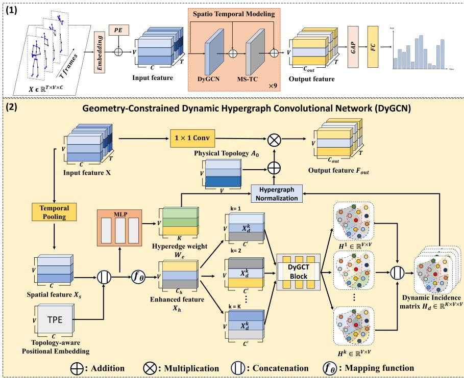
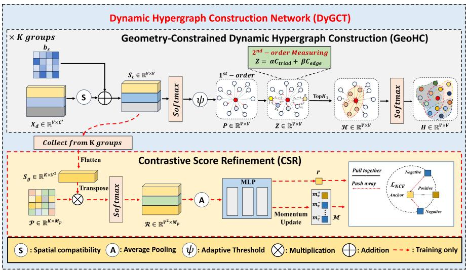
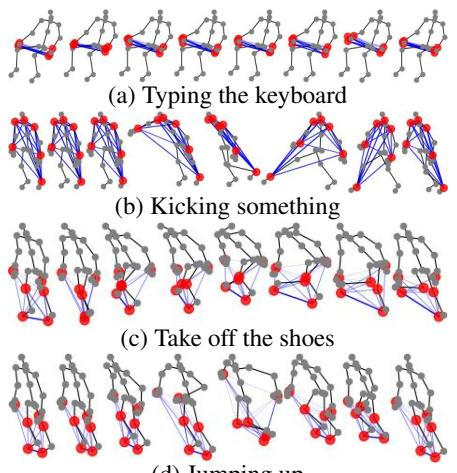
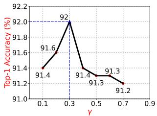
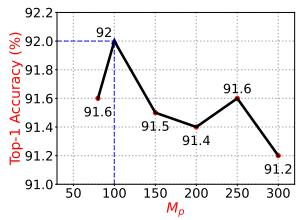
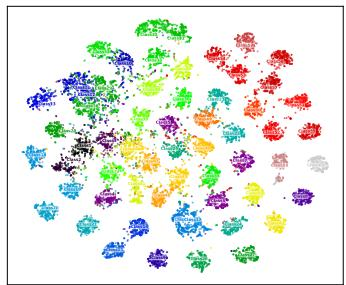
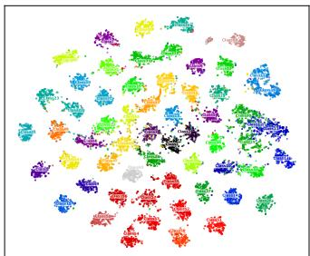

# Geometry-Constrained Dynamic Hypergraph Convolutional Network with Contrastive Score Refinement for Skeleton-Based Action Recognition

6Minh Ta Tran Nhat nhatminhtatran@chungbuk.ac.kr

vyeyuning@chungbuk.ac.kr

oYuseok Ban Nban@cbnu.ac.kr

Department of Electronics Engineering Chungbuk National University Cheongju, South Korea

## Abstract

Skeleton-based action recognition is a pivotal task in computer vision; however, conventional Graph Convolutional Networks (GCNs) are often constrained by pairwise joint modeling, which fails to capture the intricate high-order interactions inherent in human movement. While recent hypergraph-based methods attempt to address this limitation, they typically rely on static structures derived from anatomical priors, lacking the flexibility to capture dynamic, action-specific joint correlations. To this end, we propose DyGCN, a Geometry-Constrained Dynamic Hypergraph Convolutional Network for skeleton-based action recognition. At the core of DyGCN is the Dynamic Hypergraph Construction Network with Contrastive Score Refinement (DyGCT) block, which comprises two novel components: the Geometry-Constrained Dynamic Hypergraph Construction (GeoHC) module and the Contrastive Score Refinement (CSR) module. Specifically, GeoHC dynamically constructs action-specific hyperedges by leveraging geometry-constrained second-order compatibility, transcending the limitations of static hyperedge structures. Furthermore, CSR explicitly refines the pairwise compatibility scores during hypergraph construction through prototype-based contrastive learning, fostering more discriminative action-specific hyperedges — with zero inference-time overhead as CSR operates only during training. Extensive experiments on NTU RGB+D, NTU RGB+D 120, and Northwestern-UCLA validate the effectiveness of DyGCN, achiev ing state-of-the-art performance on widely used benchmarks. The source code is available at GitHub.

## 1 Introduction

As a fundamental problem in computer vision and deep learning, Human Action Recognition (HAR) has attracted increasing attention due to its wide-ranging applications in domains such as surveillance, sports analytics, and behavioral assessment [17, 24, 31, 33]. However, early HAR methods primarily relied on image or video data, making them sensitive to illumination changes, background noise, and viewpoint variations. To address these limitations, skeleton-based action recognition methods have been widely adopted due to their computational efficiency and robustness to environmental noise.

Early approaches to skeleton-based action recognition mainly relied on Convolutional Neural Networks (CNNs) and Recurrent Neural Networks (RNNs). CNN-based methods [14, 15] transform skeleton sequences into image-like representations, whereas RNN-based methods [9, 22, 34] model long-term dependencies among joints. However, both paradigms largely overlook the intrinsic connectivity and motion structure of the human body. For that reason, Graph Convolutional Networks (GCNs) have recently become the dominant approach for modeling human joint dynamics from skeleton sequences [4, 16, 25, 39]. By representing the human skeleton as a graph, where joints are treated as nodes and bones as edges, GCN-based methods can effectively capture spatial-temporal dependencies and complex inter-joint interactions for accurate action analysis. Despite their effectiveness, conventional GCN-based methods are fundamentally limited by the adjacency matrix, which only models pairwise joint connections, thereby failing to capture multi-joint dependencies and neglecting high-order correlations essential for recognizing subtle and complex actions.

To bridge this gap, hypergraph learning [10] was introduced for skeleton-based action recognition. Unlike conventional graphs in GCN-based methods, where edges are restricted to pairwise joint connections through the adjacency matrix, hyperedges are defined via an incidence matrix that connects multiple joints simultaneously, enabling the modeling of high-order relationships among joint groups. Several studies [10, 45] construct the incidence matrix based on predefined human anatomical prior knowledge, providing a stable physical skeletal structure. While these methods have demonstrated effectiveness in capturing higher-order relationships among joints, two key limitations remain: (1) fixed joint groupings within hyperedges constrain the model’s flexibility by failing to capture dynamic correlations among joints that vary significantly across action categories; and (2) existing methods often emphasize global structural patterns while overlooking subtle motion details of key body parts, thereby missing fine-grained action-specific relations and making visually similar actions harder to distinguish.

To address these limitations, we propose a novel Dynamic Hypergraph Construction Network with Contrastive Score Refinement, namely DyGCT. Specifically, DyGCT consists of two core parts: Geometry-Constrained Dynamic Hypergraph Construction (GeoHC) and Contrastive Score Refinement (CSR). GeoHC is designed to mitigate the limitations of static hypergraph structures by enabling the model to dynamically construct action-specific hyperedges through second-order compatibility, inspired by prior works [6, 40]. Different from prior HGCN methods that rely on predefined incidence matrices, GeoHC derives hyperedges from learned compatibility scores in an action-specific manner. Moreover, in contrast to [6, 40], which define second-order compatibility for homogeneous entities based only on direct first-order relations, GeoHC extends this formulation to heterogeneous skeleton joints by incorporating topology-aware structural bias and introducing a complementary compatibility term to capture indirect joint dependencies. To further promote discriminative features among ambiguous action categories, we propose a Contrastive Score Refinement (CSR) module that explicitly refines the pairwise compatibility score during the hypergraph construction process. Extensive experiments on three benchmark datasets, namely NTU RGB+D, NTU RGB+D 120, and NW-UCLA, demonstrate that DyGCN achieves state-ofthe-art performance on widely used benchmarks.

## 2 Related Work

## 2.1 GCN-Based Methods

In recent years, graph-structured data has become increasingly common, as nodes and edges can naturally represent the topological structure of the human skeleton. Accordingly, GCNbased models [4, 7, 16, 25, 29, 39] have become dominant for skeleton-based action recognition by modeling spatial-temporal dependencies over skeleton graphs. Chen et al. [4] proposed CTR-GCN, a channel-wise topology refinement network that learns dynamic, sampleadaptive topologies and fuses joint features across channels. HD-GCN [18] improves feature extraction via a hierarchical decomposition of joints that models both short-range and longrange interactions. BlockGCN [44] encodes bone connectivity through graph distance representations, achieving superior performance over conventional GCNs while substantially reducing model parameters. However, adaptive GCNs still learn topology through pairwise joint edges. In contrast, DyGCN learns which sets of joints should form action-dependent hyperedges, shifting topology learning from pairwise edge refinement to group-level structural inference.

## 2.2 HGCN-Based Methods

In contrast to GCNs, which are constrained to pairwise interactions, HGCN-based methods employ hyperedges to encode group-wise joint correlations, enabling high-order structural reasoning. Hao et al. [10] introduced Hyper-GNN, one of the first works to exploit hypergraph learning for capturing both spatial-temporal dynamics and high-order joint dependencies. Selective-HCN [45] introduces a Selective-scale Hypergraph Convolution module for capturing multi-scale skeleton information and a Selective-frame Temporal Convolution module for adaptively filtering discriminative frames. Wu et al. [36] proposed STHG-DAN, which divides the human body into three parts and constructs multi-view spatial-temporal hypergraphs to extract higher-order features for action recognition. KEHCN [26] leverages hypergraph convolution to capture higher-order joint correlations, further enhanced by LLM-based kinematic supervision and a mixture-of-experts gating module for comprehensive motion representation. A limitation of the mentioned approaches is their reliance on fixed hypergraph structures derived from human prior knowledge, overlooking the dynamic action-specific joint correlations.

## 2.3 Contrastive Learning

Recently, contrastive learning has made significant advances across a wide range of fields [3, 12]. In action recognition scenarios, [8, 19, 20] employ contrastive learning to learn invariant representations from skeleton data in an unsupervised manner. Under supervised learning, several approaches [13, 27, 42] leverage contrastive learning to refine skeleton representations and enhance model performance. Specifically, skeletonGCL [13] explicitly exploits rich cross-sequence relations through graph contrastive learning. FR-Head [42] incorporates multi-level contrastive learning into GCN-based methods to improve discrimination between ambiguous actions. THT-Former [27] integrates contrastive learning within a Topology-adaptive Hypergraph Transformer Network to refine local action representations and obtain more discriminative skeleton features. Different from THT-Former, which mainly refines skeleton representations within a transformer-based hypergraph framework, our DyGCN explicitly learns action-specific hypergraph topology by dynamically constructing the incidence matrix from compatibility scores. Thus, contrastive learning in our method is applied to refine the compatibility representation used for hypergraph construction, rather than directly supervising local action features.

## 3 Method

## 3.1 Preliminaries

Graph Convolution. A human action can be described as a series of skeleton graphs, where each skeleton is formulated as a graph $G = ( \nu , \mathcal { E } )$ . In this representation, joints correspond to vertices in the set $\mathcal { V } = \{ \nu _ { 1 } , \nu _ { 2 } , . . . , \nu _ { N } \}$ , while bones define the edges E connecting these vertices. The input skeleton sequence is denoted as a matrix $\mathbf { X } \in \mathbb { R } ^ { T \times V \times C }$ , where T denotes the number of frames, V represents the number of vertices, and C indicates the feature dimension of each vertex. The conventional Graph Convolution (GCN) process for an input skeleton feature X at layer k can be mathematically represented as follows:

$$
\mathbf { F } ^ { k } = \sigma \left( \tilde { \mathbf { D } } ^ { - 1 / 2 } \tilde { \mathbf { A } } \tilde { \mathbf { D } } ^ { - 1 / 2 } \mathbf { X } ^ { k } \mathbf { W } ^ { k } \right) .\tag{1}
$$

where $\sigma ( \cdot )$ denotes the nonlinear activation function ReLU. $\tilde { \mathbf { A } } \in \mathbb { R } ^ { V \times V }$ is the adjacency matrix with added self-loops, where V represents the number of human joints. D˜ is the degree matrix of A˜ . $\mathbf { W } ^ { k } \in \mathbb { R } ^ { C ^ { k } \times C ^ { k + 1 } }$ is the learnable weight matrix utilized for feature transformation in the feature space.

Hypergraph Convolution. Unlike standard graphs that model only pairwise relationships via edges, hypergraphs use hyperedges to connect multiple vertices simultaneously, enabling the model to capture high-order relational structure. Generally, a hypergraph for human skeleton is defined as $\mathcal { H } = ( \mathcal { V } _ { h } , \mathcal { E } _ { h } , \mathcal { W } _ { h } )$ , where $\mathcal { V } _ { h }$ and ${ \mathcal { E } } _ { h }$ denote the sets of vertices and hyperedges. In addition, $\mathcal { W } _ { h }$ represents the weight matrix, which encodes the strength of each hyperedge. To represent the multi-vertex interactions induced by hyperedges, the hypergraph H can be denoted by ${ \bf a } \left| \mathcal { V } \right| \times \left| \mathcal { E } \right|$ incidence matrix $H \in \mathbb { R } ^ { V \times \check { E } }$ . V indicates the number of joints and E indicates the number of hyperedges. In detail, with $\nu \in \mathcal { V } _ { h }$ and $e \in { \mathcal { E } } _ { h }$ , the elements of the incidence matrix are determined by:

$$
h ( \nu , e ) = { \left\{ \begin{array} { l l } { 1 , } & { \nu \in e } \\ { 0 , } & { \nu \not \in e } \end{array} \right. }\tag{2}
$$

In a hypergraph, the notion of degree is defined by both vertices (joints) and hyperedges. For a joint $\nu \in \mathcal { V } _ { h }$ , its degree is computed as the total weight of the hyperedges that contain v, expressed as

$$
d ( \nu ) = \sum _ { e \in { \mathcal { E } } _ { h } } { \mathcal { W } } _ { h } ( e ) h ( \nu , e ) ,\tag{3}
$$

where $\mathcal { W } _ { h } ( e )$ denotes the weight of hyperedge e. The degree of a hyperedge $e \in { \mathcal { E } } _ { h }$ is defined as the number of vertices contained in that hyperedge, given by

$$
d ( e ) = \sum _ { \nu \in \mathcal { V } _ { h } } h ( \nu , e ) .\tag{4}
$$

To represent the degrees of joints and hyperedges, diagonal matrices $\ b { D } _ { \nu } \in \mathbb { R } ^ { V \times V }$ and $D _ { e } \in$ $\mathbb { R } ^ { E \times \hat { E } }$ are constructed, whose diagonal entries correspond to the degrees of vertices and

  
Figure 1: Overview of our proposed method. (1) The overall pipeline takes skeleton sequences X as input, followed by embedding, spatio-temporal modeling via stacked DyGCN and MS-TC [5] modules, and global average pooling with Fully Connected Layers (FC) for action classification. (2) The detailed architecture of the Dynamic Hypergraph Convolutional Network (DyGCN)

hyperedges, respectively. Here, the Hypergraph Convolution [1] applied to the input skeleton feature X at layer L can be written as :

$$
\begin{array} { r } { X ^ { ( L + 1 ) } = \sigma \left( D _ { \nu } ^ { - 1 } H W D _ { e } ^ { - 1 } H ^ { \top } X ^ { ( L ) } \Theta ^ { ( L ) } \right) , } \end{array}\tag{5}
$$

where W is a diagonal matrix representing the hyperedge weights, and $\Theta ^ { ( L ) } \in \mathbb { R } ^ { F ^ { ( L ) } \times F ^ { ( L + 1 ) } }$ is the learnable matrix between the L-th and (L + 1)-th layers.

## 3.2 Dynamic Hypergraph Convolution Module

In this subsection, we first introduce the GeoHC module to construct the dynamic hypergraph incidence matrix. Based on the constructed hypergraph, DyGCN is applied to capture high-order joint interactions. The overall architecture is shown in Fig. 1.

Hypergraph Construction. The construction of the hypergraph incidence matrix is critical for modeling high-order structural dependencies. Existing approaches typically rely on a static hypergraph derived from a natural fixed topological structure, which constrains the model’s ability to capture action-dependent relationships among vertices across different actions. To address this limitation, we propose a strategy for dynamically constructing the incidence matrix for hypergraph convolution, namely Geometry-Constrained Dynamic Hypergraph Construction (GeoHC), as shown in Fig. 2.

  
Figure 2: The framework of the DyGCT block, comprising the Geometry-Constrained Dynamic Hypergraph Construction (GeoHC) module and the Contrastive Score Refinement (CSR) module.

In the proposed framework, we construct hyperedges by treating each joint as the Center of Mass (CoM), resulting in a total of V hyperedges. Given the input feature $\mathbf { X } \in \mathbb { R } ^ { T \times V \times C }$ ， we first apply temporal average pooling to obtain a spatial representation $\mathbf { X } _ { S } \in \mathbb { R } ^ { V \times C }$ , where V represents the number ofjoints and C is the input channel dimension. To preserve anatomical structure during dynamic hypergraph construction, we introduce a Topology-aware Positional Embedding (TPE) based on skeleton hop distances, inspired by RPE [43]. Unlike the original formulation that biases pairwise attention scores, we aggregate hop-distance encodings across all joints to produce a per-node topology-aware embedding. Specifically, let $D ( i , j )$ denote the hop distance between joint i and joint j in the predefined skeleton topology, we define a learnable embedding table $\dot { \mathbf { E } } \in \mathbb { R } ^ { ( D _ { \operatorname* { m a x } } + 1 ) \times C }$ to map each discrete hop distance to a feature vector. The structural embedding $\mathbf { p } _ { i }$ ofjoint i is obtained by aggregating the relative embeddings with respect to all other joints:

$$
{ \bf p } _ { i } = \frac { 1 } { V } \sum _ { j = 1 } ^ { V } { \bf E } _ { D ( i , j ) } ,\tag{6}
$$

where $D _ { \mathrm { m a x } }$ denotes the maximum hop distance. The enriched node representation is formed by concatenating the spatial feature and the structural embedding:

$$
\begin{array} { r } { \tilde { \mathbf { X } } _ { S } ( i ) = [ \mathbf { X } _ { S } ( i ) \| \mathbf { p } _ { i }  . } \end{array}\tag{7}
$$

This design allows each joint to encode not only its own appearance information but also its relative structural position within the skeleton graph, thereby enhancing the modeling of topology-aware interactions before dynamic hyperedge construction. Then, we project the resulting representation into a hidden feature dimension through a mapping function $f _ { \theta } : \mathbb { R } ^ { 2 C }  \mathbb { R } ^ { C _ { h } }$ , obtaining $\mathbf { X } _ { h } \in \mathbb { R } ^ { V \times C _ { h } }$ . Following [44], we split the projected representation $\mathbf { X } _ { h }$ into $\{ \mathbf { X } _ { d } ^ { ( k ) } \} _ { k = 1 } ^ { K }$ , where each group $\mathbf { X } _ { d } ^ { ( k ) } \in \mathbb { R } ^ { V \times C ^ { \prime } }$ captures joint differences in a distinct semantic subspace and $C ^ { \prime } = \lfloor C _ { h } / K \rfloor$ . This grouped design encourages the model to learn diverse relational patterns across different semantic subspaces. Since the following compatibility construction is shared across groups, we denote a representative group as $\mathbf { X } _ { d } ^ { \mathsf { ^ { - } } } \in \mathbb { R } ^ { \bar { V } \times C ^ { \prime } }$ for simplicity.

While Euclidean distance is commonly utilized to measure joint correspondence, firstorder feature distances alone are insufficient to capture the complex high-order dependencies among skeleton joints. Motivated by the second-order compatibility measure proposed for point cloud registration in [6], we adapt this concept to the skeleton domain by extending it to capture high-order joint interactions for action recognition. Specifically, we first construct a pairwise compatibility score between joints based on their distance in the projected feature space. However, the compatibility score in [6] is defined for homogeneous entities, whereas skeleton joints are inherently heterogeneous — each joint plays a unique anatomical role in the human body. To address this, we augment the joint compatibility score with a learned hop-distance bias to encode structural relationships between joints. Let $\mathbf { q } _ { i }$ and ${ \bf q } _ { j }$ be the i-th and j-th row vectors of $\mathbf { X } _ { d } \in \mathbb { R } ^ { V \times C ^ { \prime } }$ , the entries of the pairwise compatibility matrix $\mathbf { S } _ { c }$ are defined as:

$$
S _ { i , j } = \underbrace { - \frac { \| \mathbf { q } _ { i } - \mathbf { q } _ { j } \| _ { 2 } ^ { 2 } } { 2 \sigma ^ { 2 } } } _ { \mathrm { S p a t i a l c o m p a t i b i l i t y } } + \underbrace { b _ { D ( i , j ) } } _ { \mathrm { H o p - d i s t a n c e b i a s } } .\tag{8}
$$

where $S _ { i , j }$ denotes the $( i , j )$ -th entry of the pairwise compatibility matrix $\mathbf { S } _ { c } .$ , representing the compatibility score between joints i and $j . \ \| \mathbf { q } _ { i } - \mathbf { q } _ { j } \| _ { 2 } ^ { 2 }$ denotes the squared Euclidean distance between ${ \bf q } _ { i }$ and ${ \bf q } _ { j } , \sigma$ is a learnable distance parameter, and $b _ { D ( i , j ) }$ is a learned structural bias indexed by the shortest-path hop distance $D ( i , j )$ between joints i and j. The first-order affinity matrix $\mathbf { F }$ is then constructed by applying row-wise softmax to the pairwise compatibility scores with self-connections explicitly removed, expressed as:

$$
F _ { i , j } = \frac { \exp ( S _ { i , j } ) } { \sum _ { l \neq i } \exp ( S _ { i , l } ) } , \quad F _ { i , i } = 0\tag{9}
$$

Based on this affinity measure, two joints are considered compatible when $F _ { i , j }$ exceeds a threshold $\psi .$ However, rather than using a static global threshold as in [6], we introduce an adaptive threshold $\psi _ { i }$ for each joint as the mean of its $\mathrm { T o p K } _ { 0 }$ affinity values:

$$
\psi _ { i } = \frac { 1 } { K _ { 0 } } \sum _ { t \in \mathcal { T } _ { i } } F _ { i , t } , \quad \mathrm { w h e r e ~ } \mathcal { T } _ { i } = \mathrm { T o p K } _ { 0 } \left( \{ F _ { i , j } \} _ { j = 1 } ^ { V } \right) ,\tag{10}
$$

where $K _ { 0 }$ is a hyperparameter denoting the number of entries selected for computing the adaptive threshold $\psi _ { i }$ . Subsequently, the first-order compatibility matrix P is defined as:

$$
P _ { i , j } = \left\{ { \begin{array} { l l } { F _ { i , j } , } & { { \mathrm { i f } } \ F _ { i , j } \geq \psi _ { i } } \\ { 0 , } & { { \mathrm { i f } } \ F _ { i , j } < \psi _ { i } } \end{array} } , \right.\tag{11}
$$

where $P _ { i , j }$ denotes the $( i , j )$ -th entry of P. To further capture high-order relational structures, similar to [6], the second-order spatial compatibility $C _ { \mathrm { t r i a d } }$ is defined as the sum of weighted

products over common compatible joints shared between joints i and $j ,$ formulated as:

$$
C _ { i , j } ^ { \mathrm { t r i a d } } = P _ { i , j } \cdot \sum _ { l = 1 } ^ { V } P _ { i , l } \cdot P _ { l , j } ,\tag{12}
$$

where $C _ { i , j } ^ { \mathrm { t r i a d } }$ denotes the $( i , j )$ -th entry of $\mathbf { C } _ { \mathrm { t r i a d } }$ , representing the second-order compatibility score between joints i and j. However, this formulation requires joints i and j to have non-zero first-order compatibility, i.e., $P _ { i , j } > 0$ , and therefore ignores potentially meaningful indirect relationships mediated by shared compatible joints. As a result, the hypergraph may fail to select joints without direct first-order compatibility as valid hyperedge members during hyperedge construction. To alleviate this limitation, we extend the second-order spatial compatibility $\mathbf { C } _ { \mathrm { t r i a d } }$ with a complementary term $\mathbf { C } _ { \mathrm { e d g e } }$ to incorporate indirect joint relationships bridged by shared intermediate joints. The overall compatibility score is then formulated as:

$$
C _ { i , j } ^ { \mathrm { e d g e } } = ( 1 - \mathbb { 1 } \big [ P _ { i , j } > 0 ] ) \cdot \sum _ { l = 1 } ^ { V } P _ { i , l } P _ { l , j } ,\tag{13}
$$

$$
\mathbf { Z } = \alpha \cdot \mathbf { C } _ { \mathrm { t r i a d } } + \beta \cdot \mathbf { C } _ { \mathrm { e d g e } } ,\tag{14}
$$

where $C _ { i , j } ^ { \mathrm { e d g e } }$ denotes the $( i , j )$ -th entry of $\mathbf { C } _ { \mathrm { e d g e } }$ , capturing indirect joint relationships through shared intermediate joints. α and $\beta$ are learnable weights balancing the contributions of both terms in the final second-order compatibility matrix Z.

To encourage the model to capture action-specific features, we constrain hyperedge membership to the most semantically compatible joints rather than assigning all joints to every hyperedge. Given each row vector $\mathbf { z } _ { i }$ in the compatibility matrix $\mathbf { Z } ,$ which represents the compatibility score between joint i and all other joints, we select the $\mathrm { T o p K } _ { 1 }$ most compatible joints as the set of hyperedge members $\mathcal { N } _ { i }$

$$
\begin{array} { r } { \mathcal { N } _ { i } = \mathrm { T o p K } _ { 1 } ( \mathbf { z } _ { i } ) , } \end{array}\tag{15}
$$

where $K _ { 1 }$ is a hyperparameter controlling the number of joints in each hyperedge. The selected compatibility scores in $\mathcal { N } _ { i }$ are then normalized via softmax to estimate the hyperedge membership probability, constructing the incidence matrix $\mathbf { H } \in \mathbb { R } ^ { V \times E }$ for the representative group, where $E = V$ since each joint is treated as a hyperedge center:

$$
H _ { j , i } = \left\{ \begin{array} { l l } { \displaystyle \frac { \exp ( z _ { i , j } ) } { \sum _ { l \in \mathcal { N } _ { i } } \exp ( z _ { i , l } ) } , } & { j \in \mathcal { N } _ { i } , } \\ { 0 , } & { j \not \in \mathcal { N } _ { i } , } \end{array} \right.\tag{16}
$$

Since the same construction is applied independently to each group, we obtain group-specific incidence matrices $\{ \mathbf { H } ^ { ( k ) } \} _ { k = 1 } ^ { K }$ . The resulting incidence matrices $\bar { \mathbf { H } } ^ { ( k ) }$ from all K groups are then stacked along the group dimension to form the final dynamic incidence tensor:

$$
\mathbf { H } _ { d } = \mathrm { S t a c k } _ { k = 1 } ^ { K } \mathbf { H } ^ { ( k ) } \in \mathbb { R } ^ { K \times V \times V } .\tag{17}
$$

DyGCN. In Eq. 5, the hypergraph convolution is determined by both the incidence matrix and the hyperedge weight matrix. Therefore, we employ a learned MLP layer to estimate the hyperedge weights $\mathbf { W } _ { e } \in \mathbb { R } ^ { K \times V }$ based on the enriched node representation $\tilde { \mathbf { X } } _ { S }$

$$
\mathbf { W } _ { e } = \sigma _ { 2 } \left( \mathbf { M L P } \big ( \tilde { \mathbf { X } } _ { S } \big ) \right) ,\tag{18}
$$

where $\sigma _ { 2 } ( \cdot )$ denotes the nonlinear activation function Tanh. For hypergraph normalization, ${ \mathbf W } _ { e }$ is lifted to a group-wise diagonal tensor ${ \mathcal { D } } ( \mathbf { W } _ { e } ) \in { \mathbb { R } } ^ { K \times V \times V }$ . The degree matrices are computed separately for each group and then stacked along the group dimension, yielding $D _ { \nu } , \bar { D } _ { e } \in \mathbb { R } ^ { K \times V \times V }$ . Subsequently, the hypergraph normalization $\tilde { \mathbf { H } } _ { d }$ induced by the dynamic incidence tensor $\mathbf { H } _ { d }$ and the hyperedge weights is defined as follows:

$$
\begin{array} { r } { D _ { \nu } ^ { ( k ) } = \mathrm { d i a g } \left( \mathbf { H } ^ { ( k ) } w _ { e } ^ { ( k ) } \right) , \quad D _ { e } ^ { ( k ) } = \mathrm { d i a g } \left( ( \mathbf { H } ^ { ( k ) } ) ^ { \top } \mathbf { 1 } _ { V } \right) . } \end{array}\tag{19}
$$

$$
\tilde { \mathbf { H } } _ { d } ^ { ( k ) } = ( D _ { \nu } ^ { ( k ) } + \varepsilon I _ { V } ) ^ { - 1 } \mathbf { H } ^ { ( k ) } \mathcal { D } ( w _ { e } ^ { ( k ) } ) ( D _ { e } ^ { ( k ) } + \varepsilon I _ { E } ) ^ { - 1 } ( \mathbf { H } ^ { ( k ) } ) ^ { \top } ,\tag{20}
$$

$$
\tilde { \mathbf { H } } _ { d } = \mathrm { S t a c k } _ { k = 1 } ^ { K } \left( \tilde { \mathbf { H } } _ { d } ^ { ( k ) } \right) \in \mathbb { R } ^ { K \times V \times V } .\tag{21}
$$

where $w _ { e } ^ { ( k ) } \in \mathbb { R } ^ { E }$ denotes the hyperedge weight vector for the k-th group, and the normalization is performed independently for each group, yielding $\tilde { \mathbf { H } } _ { d } \in \mathbf { \overline { { R } } } ^ { K \times \mathbf { \bar { V } } \times V }$ . Furthermore, we incorporate the physical topology $A _ { 0 }$ in order to preserve the inherent physical connectivity of the skeleton. Specifically, following [39], which partitions the physical topology of the human body into three subsets, namely centripetal (cp), identity (id), and centrifugal (cf), we construct $A _ { 0 }$ by combining these subsets into a unified adjacency matrix and repeating it across the K groups, yielding $A _ { 0 } \in \mathbb { R } ^ { K \times V \times V }$ . Let $\mathbf { X } ^ { ( L ) } \in \mathbb { R } ^ { \breve { T } \times V \times C _ { L } ^ { \breve { L } } }$ denote the input feature of the L-th DyGCN layer. The input feature $\mathbf { X } ^ { ( L ) }$ is split into K channel groups, i.e., $\mathbf { X } ^ { ( L ) } = \operatorname { C o n c a t } _ { c } ( \mathbf { X } _ { 1 } ^ { ( L ) } , \mathbf { X } _ { 2 } ^ { ( \bar { L } ) } , . . . , \mathbf { X } _ { K } ^ { ( L ) } )$ , where $\mathbf { X } _ { k } ^ { ( L ) } \in \mathbb { R } ^ { T \times V \times C _ { L } / K }$ . The groupspecific transformation matrix is defined as $\Theta _ { k } ^ { ( L ) } \in \mathbb { R } ^ { C _ { L } / K \times C _ { L + 1 } / K }$ . The spatial propagation matrix $A _ { 0 } ^ { ( k ) } + \lambda \tilde { \mathbf { H } } _ { d } ^ { ( k ) } \in \mathbb { R } ^ { V \times V }$ is applied along the joint dimension and shared across all temporal steps, and the outputs from all groups are concatenated along the channel dimension. Then, the hypergraph convolution in Eq. 5 can be rewritten as:

$$
\mathbf { X } ^ { ( L + 1 ) } = \sigma \left( \underset { k = 1 } { \overset { K } { | } } \left[ \left( A _ { 0 } ^ { ( k ) } + \lambda \tilde { \mathbf { H } } _ { d } ^ { ( k ) } \right) \mathbf { X } _ { k } ^ { ( L ) } \boldsymbol { \Theta } _ { k } ^ { ( L ) } \right] \right) ,\tag{22}
$$

where $\mathbf { X } _ { k } ^ { ( L ) }$ denotes the k-th channel partition of $\mathbf { X } ^ { ( L ) }$ , ∥ denotes channel-wise concatenation, and λ is a learnable parameter controlling the contribution of the dynamic hypergraph topology relative to the physical topology.

## 3.3 Contrastive Score Refinement

To encourage the dynamic hypergraph construction to capture fine-grained action-specific relational structures, we propose Contrastive Score Refinement (CSR) to refine the learned compatibility scores, as shown in Fig. 2. Specifically, the compatibility scores from all K groups are collected and flattened into $\mathbf { S } _ { g } \in \mathbb { R } ^ { K \times V ^ { 2 } }$ . We then define a learnable prototype matrix $\mathcal { P } = \{ \mathbf { p } _ { m } \in \mathbb { R } ^ { K } \} _ { m = 1 } ^ { M _ { p } }$ , where each randomly initialized prototype captures a compatibility pattern across the K groups and $M _ { p }$ denotes the number of prototypes. The similarity between the joint-pair compatibility representation $\mathbf { S } _ { g }$ and $\mathcal { P }$ is computed via inner product followed by softmax normalization, formulated as:

$$
\mathcal { R } = \mathrm { s o f t m a x } \left( \mathbf { S } _ { g } ^ { \top } \mathcal { P } \right) \in \mathbb { R } ^ { V ^ { 2 } \times M _ { p } } ,\tag{23}
$$

where $\mathcal { R } _ { i , m }$ denotes the $( i , m )$ -th entry of $\mathcal { R } .$ , reflecting the similarity between the i-th jointpair compatibility representation and the m-th prototype. Subsequently, $\mathcal { R }$ is aggregated

along the prototype dimension via average pooling and projected via an MLP to obtain the compatibility representation vector r:

$$
\mathbf { r } = \mathbf { M } \mathbf { L } \mathbf { P } \left( \operatorname { A v g P o o l } ( \mathcal { R } ) \right) \in \mathbb { R } ^ { C _ { g } }\tag{24}
$$

Consequently, to further leverage discriminative cross-sequence context to distinguish similar action patterns, we adopt contrastive loss from [12, 13] to supervise the representation vector r. Given the memory bank M and a batch of representation samples, the momentum update is defined as:

$$
\mathbf { m } _ { c } \gets \mu \cdot \mathbf { m } _ { c } + ( 1 - \mu ) \cdot \mathbf { r } ,\tag{25}
$$

where $\mathbf { m } _ { c } \in \mathcal { M }$ is the compatibility representation entry for class $c$ and $0 < \mu < 1$ is a momentum coefficient. The corresponding contrastive loss is formulated as:

$$
\mathcal { L } _ { \mathrm { C } } = - \log \frac { \exp ( \sin ( \mathbf { r } , \mathbf { m } _ { c } ^ { + } ) / \tau ) } { \exp ( \sin ( \mathbf { r } , \mathbf { m } _ { c } ^ { + } ) / \tau ) + \sum _ { \mathbf { m } _ { c } ^ { - } \in \mathcal { M } ^ { - } } \exp \left( \sin ( \mathbf { r } , \mathbf { m } _ { c } ^ { - } ) / \tau \right) }\tag{26}
$$

where sim $( \cdot , \cdot )$ denotes the cosine similarity function, $\mathbf { m } _ { c } ^ { + } \in \mathcal { M }$ denotes the memory bank entry of the same class as r, $\mathbf { m } _ { c } ^ { - } \in \mathcal { M } ^ { - }$ denotes memory bank entries of different classes, and $\tau$ is a temperature parameter. In general, the overall training objective of the proposed method is formulated as the sum of multiple loss terms, which can be written as:

$$
\mathcal { L } = \mathcal { L } _ { C E } + \gamma \cdot \mathcal { L } _ { \mathrm C }\tag{27}
$$

where $\mathcal { L } _ { C E }$ denotes the cross-entropy loss for supervising action classification. $\gamma$ is the hyperparameter to control the Contrastive Score Refinement loss $\mathcal { L } _ { \mathrm { C } }$ . Notably, the Contrastive Score Refinement loss $\mathcal { L } _ { \mathrm { C } }$ is employed only during training and omitted during inference, ensuring that the proposed framework incurs no additional computational overhead.

## 4 Experiments

## 4.1 Experimental Settings

Extensive experiments are conducted on three widely used action recognition datasets: NTU RGB+D [28], NTU RGB+D 120 [23] and NW-UCLA [35]. The details of each dataset can be found in the supplementary material. All experiments are performed using a single NVIDIA RTX A6000 GPU within the PyTorch framework and CUDA 11.4 environment. The models are optimized using stochastic gradient descent (SGD) with a momentum of 0.9 and a weight decay of 0.0004. To improve training stability, a warm-up strategy following [11] is applied during the first five epochs. For the NTU RGB+D and NTU RGB+D 120 datasets, training is conducted with a batch size of 64 over 140 epochs. The initial learning rate is set to 0.05 and is reduced by a factor of 10 at the 110th and 120th epochs. For the NW-UCLA dataset, the training configuration uses a batch size of 16. The hyperparameter $K _ { 0 }$ is set to 2 throughout all experiments. The number of groups K is set to 8. Regarding the contrastive learning setup, the momentum coefficient $\mu$ is set to 0.9, and the compatibility representation dimension $C _ { g }$ is set to 256. The temperature parameter τ is fixed at 0.8 throughout the experiments. We adopt the data preprocessing procedures outlined in CTR-GCN [4] and utilize its architecture as the baseline model.

Table 1: Comparison with state-of-the-art methods on NTU RGB+D [28], NTU RGB+D 120 [23], and NW-UCLA [35]. \* denotes methods using additional supervision signals or non-standard input data.
<table><tr><td rowspan="2">Types</td><td rowspan="2">Methods</td><td rowspan="2">Publication</td><td colspan="2">NTU RGB+D</td><td colspan="2">NTU RGB+D 120</td><td>NW-UCLA</td></tr><tr><td>X-Sub(%)</td><td>X-View(%)</td><td>X-Sub(%)</td><td>X-Set(%)</td><td>Top-1(%)</td></tr><tr><td rowspan="9">GCN-based</td><td>ST-GCN [9]</td><td>AAAI2018</td><td>81.5</td><td>88.3</td><td>70.7</td><td>73.2</td><td></td></tr><tr><td>2s-AGCN [四]</td><td>CVPR2019</td><td>88.5</td><td>95.1</td><td>82.5</td><td>84.2</td><td></td></tr><tr><td>CTR-GCN []</td><td>ICCV2021</td><td>92.4</td><td>96.8</td><td>88.9</td><td>90.6</td><td>96.5</td></tr><tr><td>EfficientGCN-B4 []</td><td>TPAMI2022</td><td>91.7</td><td>95.7</td><td>88.3</td><td>89.1</td><td>97.0</td></tr><tr><td>InfoGCN [0]</td><td>CVPR2022</td><td>93.0</td><td>97.1</td><td>89.8</td><td>91.2</td><td>97.0</td></tr><tr><td>GAP* []</td><td>ICCV2023</td><td>92.9</td><td>97.0</td><td>89.9</td><td>91.1</td><td>97.2</td></tr><tr><td>HD-GCN*(6s) []</td><td>ICCV2023</td><td>93.4</td><td>97.2</td><td>90.1</td><td>91.6</td><td>97.2</td></tr><tr><td>BlockGCN []</td><td>CVPR2024</td><td>93.1</td><td>97.0</td><td>90.3</td><td>91.5</td><td>96.9</td></tr><tr><td>HiOD [0]</td><td>ICCV2025</td><td>93.6</td><td>97.4</td><td>90.2</td><td>91.6</td><td></td></tr><tr><td rowspan="4">Transformer-based</td><td>ProtoGCN []</td><td>CVPR2025</td><td>93.5</td><td>97.5</td><td>90.4</td><td>91.9</td><td>96.9</td></tr><tr><td>DSTA-Net [60]</td><td>ACCV2020</td><td>89.5</td><td>95.7</td><td>86.6</td><td>89.0</td><td></td></tr><tr><td>STST[]</td><td>ACMM2021</td><td>90.8</td><td>96.6</td><td></td><td></td><td></td></tr><tr><td>Skeleton MixFormer[]</td><td>ACMM2023</td><td>93.0</td><td>97.0</td><td>90.0</td><td>91.3</td><td>97.2</td></tr><tr><td rowspan="4">HGNN-based</td><td>THTFormer []</td><td>PR2025</td><td>93.0</td><td>96.8</td><td>90.1</td><td>91.3</td><td>97.1</td></tr><tr><td>Hyper-GNN [] Selective-HCN []</td><td>TIP2021</td><td>89.5</td><td>95.7</td><td></td><td></td><td></td></tr><tr><td>STHG-DAN []</td><td>ICMR2022 PR2024</td><td>90.8 91.2</td><td>96.6</td><td></td><td></td><td></td></tr><tr><td>KEHCN*[]</td><td>ACMM2025</td><td>93.5</td><td>96.5 97.3</td><td>88.7 90.4</td><td>89.8</td><td></td></tr><tr><td>Ours</td><td>DyGCN</td><td></td><td>93.7</td><td>97.6</td><td>90.8</td><td>91.8 92.0</td><td>97.4 97.4</td></tr></table>

Table 2: Ablation study on the contribution of each component in DyGCT under the NTU RGB+D X-Sub setting with the joint input modality only.
<table><tr><td rowspan="2">Method</td><td colspan="3">DyGCT</td><td rowspan="2">Params (M)</td><td rowspan="2">GFLOPs (G)</td><td rowspan="2">Acc (%)</td></tr><tr><td>TPE</td><td>CM</td><td>CSR</td></tr><tr><td>Baseline</td><td>一</td><td>一</td><td>一</td><td>1.5</td><td>1.97</td><td>89.8</td></tr><tr><td rowspan="3">DyGCN</td><td></td><td>√</td><td>一</td><td>2.24</td><td>2.7</td><td>91.2 (↑ 1.4)</td></tr><tr><td>√</td><td>√</td><td></td><td>2.28</td><td>2.7</td><td>91.7 (↑ 1.9)</td></tr><tr><td>√</td><td>√</td><td>√</td><td>2.3</td><td>2.7</td><td>92.0 (↑ 2.2)</td></tr></table>

## 4.2 Comparison with State-of-the-Arts

In this section, we compare our method with state-of-the-art approaches on three benchmark datasets: NTU RGB+D [28], NTU RGB+D 120 [23], and NW-UCLA [35]. For a fair comparison, we follow the same experimental framework as [4]. To comprehensively evaluate DyGCN, we adopt a 4-stream fusion strategy with four input modalities: joint, bone, joint motion, and bone motion. The fused score is obtained by summing the softmax outputs across all four streams. The quantitative results are presented in Table 1.

Specifically, DyGCN surpasses all state-of-the-art methods on two large-scale benchmarks: NTU RGB+D and NTU RGB+D 120. Taking the NTU RGB+D 120 dataset as an example, our method surpasses the most recent HGNN-based method, KEHCN, by margins of 0.4% on X-Sub and 0.2% on X-Set. Notably, KEHCN [26] relies on additional pre-trained large language models (GPT-4 and CLIP) to extract fine-grained features, which substantially contribute to its final performance. In addition to evaluations on large-scale datasets such as NTU-60 and NTU-120, we further examine our model on the small-scale NW-UCLA dataset to validate its performance across different data scales. Our method shares the best performance with KEHCN [26] and exceeds the state-of-the-art GCN-based method ProtoGCN [21] by 0.5%. Overall, our method consistently outperforms most existing state-of-the-art approaches across different settings, demonstrating its effectiveness. Additional analyses, including computational complexity, runtime comparison, and singlemodality performance, are provided in the supplementary material.

Table 3: The impact of the hyperparameter $K _ { 1 }$ in DyGCT (left) and Compatibility Measuring Component $\mathbf { C } _ { \mathrm { t r i a d } }$ and $\mathbf { C } _ { \mathrm { e d g e } }$ (right) under NTU RGB+D X-Sub setting.
<table><tr><td>Methods</td><td> $K _ { 1 }$ </td><td>w/ CSR</td><td>w/o CSR</td><td>Methods</td><td>Acc (%)</td></tr><tr><td rowspan="4">DyGCT</td><td>3</td><td>91.8</td><td>91.5</td><td>DyGCT</td><td>92.0</td></tr><tr><td>5</td><td>92.0</td><td>91.7</td><td> $\mathrm { w } / \mathrm { o } \mathrm { \mathbf { C } _ { \mathrm { t r i a d } } }$ </td><td>91.6</td></tr><tr><td>7</td><td>91.5</td><td>91.2</td><td> $\mathbf { w } / \mathbf { o } ~ \mathbf { C } _ { \mathrm { e d g e } }$ </td><td>91.5</td></tr><tr><td>9</td><td>91.3</td><td>91.1</td><td> $\mathbf { w } / \mathbf { o } \mathbf { C } _ { \mathrm { t r i a d } } , \mathbf { C } _ { \mathrm { e d g e } }$ </td><td>91.4</td></tr></table>

Table 4: Performance comparison of DyGCN variants on ambiguous actions.
<table><tr><td></td><td>CTR-GCN[]</td><td>FR-Head[]</td><td>HD-GCN[8]</td><td>Ours</td></tr><tr><td>NTU60-Hard</td><td>62.1</td><td>67.5</td><td>67.4</td><td> $7 1 . 1 ^ { + 3 . 6 }$ </td></tr><tr><td>NTU60-Medium</td><td>83.8</td><td>83.9</td><td>84.9</td><td> $\mathbf { 8 7 . 9 ^ { + 3 . 0 } }$ </td></tr><tr><td>NTU60-Easy</td><td>95.2</td><td>95.8</td><td>95.5</td><td> $\mathbf { 9 6 . 1 ^ { + 0 . 6 } }$ </td></tr></table>

## 4.3 Ablation Study

To examine the effectiveness of each component in the proposed method, we conduct ablation studies on the NTU RGB+D dataset using the joint modality under the X-Sub setting. Effectiveness of Each Module. In Table 2, we evaluate the contribution of each component in DyGCT. Using the latest official implementation, the reproduced baseline achieves 89.8% accuracy. Introducing the proposed Compatibility Measuring (CM) improves the accuracy by 1.4%, from 89.8% to 91.2%. Adding the Topology-aware Positional Embedding (TPE) further yields a 0.5% gain, showing that GeoHC effectively captures high-order joint relations beyond the pairwise adjacency modeling of the baseline. Built upon GeoHC, the CSR module provides an additional 0.3% improvement. Although CSR introduces extra training cost, it is used only during training and therefore does not affect inference. Overall, DyGCN improves accuracy from 89.8% to 92.0%, corresponding to a 2.2 percentage-point gain, while increasing the model complexity from 1.50M parameters and 1.97 GFLOPs to 2.30M parameters and 2.70 GFLOPs.

Dynamic Hypergraph Construction. Since the choice of $K _ { 1 }$ , which controls the maximum number of joints contained in each hyperedge, directly influences the model’s recognition accuracy, we present an ablation study in Table 3 (left) to examine its impact on dynamic hypergraph construction under two settings: without Contrastive Score Refinement (CSR) and with CSR. Specifically, a large $K _ { 1 }$ forces each hyperedge to aggregate noisy joint associations, degrading the quality of the learned representations. In contrast, a small $K _ { 1 }$ limits the hypergraph’s ability to capture complex joint dependencies. As a result, $K _ { 1 } = 5$ achieves the best performance under both settings and is therefore adopted for subsequent experiments. Furthermore, the results demonstrate that incorporating CSR consistently yields higher accuracy across all values of $K _ { 1 }$ , highlighting the effectiveness of this module.

Analysis of Second-order Spatial Compatibility. We conduct an ablation study to assess the influence of the complementary term $\mathbf { C } _ { \mathrm { e d g e } }$ in the Compatibility Measuring (CM) module and report the results in Table 3 (right). The variant w/o $\mathbf { C } _ { \mathrm { t r i a d } } , \mathbf { C } _ { \mathrm { e d g e } }$ represents the case where the CM module relies solely on the first-order affinity matrix F for hyperedge construction, without any second-order compatibility reasoning. The results demonstrate that the complementary $\mathbf { C } _ { \mathrm { e d g e } }$ is essential for augmenting $\mathbf { C } _ { \mathrm { t r i a d } }$ in capturing indirect joint relationships, and their removal leads to consistent performance degradation, confirming the necessity of both terms for high-order joint modeling.

  
(d) Jumping up  
Figure 3: Left: Ablation study on the influence of weight γ (upper) and memory capacity $M _ { p }$ (lower) under the NTU X-Sub setting. Right: Visualization of the learned hyperedges across 8 frames for four different action categories.

Effect of Hyperparameters. We conduct an ablation study to further analyze the impact of different hyperparameter configurations in Contrastive Score Refinement, as illustrated in Fig. 3 (left). As a result, we determine $\gamma = 0 . 3$ as the optimal hyperparameter, as it yields peak recognition accuracy. Furthermore, we examine the impact of the number of prototypes $M _ { p }$ on recognition performance. As shown in Fig. 3 (left), accuracy tends to decrease as $M _ { p }$ increases, which can be attributed to the fact that not all prototypes are relevant to the target action. Therefore, $M _ { p } = 1 0 0$ is selected as the optimal configuration, as it yields the best recognition accuracy.

## 4.4 Performance on Ambiguous Classes

To evaluate the effectiveness of the proposed method on ambiguous action categories, we partition NTU-RGB+D into three difficulty levels based on CTR-GCN [4] accuracy: hard $( < 7 0 \% )$ , medium (70%–90%), and easy $( > 9 0 \% )$ . The results are reported in Table 4. Since ambiguous actions often fall into the hard subset, our method achieves the greatest advantage on this subset, surpassing the strongest competing method by 3.6%, which demonstrates its effectiveness in distinguishing visually similar action classes. A more detailed analysis of each action category can be found in the supplementary material.

## 4.5 Qualitative Results

Visualization of the Learned Hypergraphs. To demonstrate the effectiveness of DyGCN, we visualize the learned hyperedges for four actions: “Typing the keyboard”, “Kicking something”, “Take off the shoes”, and “Jumping up” in Fig. 3 (right). Each action sequence is uniformly sampled every 8 frames, and each hyperedge is formed by the $\mathrm { t o p } { - } K _ { 1 }$ most compatible joints, with $K _ { 1 } = 5$ . For “Jumping up” and “Take off the shoes”, the learned hyperedges connect hands and feet, indicating coordinated interactions between non-adjacent upper- and lower-body joints. Similarly, for “Kicking something”, the hyperedge links the right hand and left foot, which move forward simultaneously, capturing cross-limb coordination. For “Typing the keyboard”, the learned hyperedge concentrates on the main joints involved in the action.

  
(a) Baseline

  
(b) DyGCN  
Figure 4: t-SNE visualization of the output features from the Baseline and DyGCN. Different colors denote different action categories.

t-SNE visualization. We use t-SNE to visualize the distribution in their feature space between the baseline and our method trained on the NTU RGB+D dataset, as shown in Fig. 4. The results indicate that DyGCN forms more compact and well-separated clusters, with clearer classification boundaries and fewer ambiguous samples compared to the baseline. This further demonstrates that the proposed method learns more discriminative actionspecific representations, validating the effectiveness of both GeoHC and CSR in enhancing the separability among fine-grained actions.

## 5 Conclusion

In this study, we proposed DyGCN, a Geometry-Constrained Dynamic Hypergraph Convolutional Network for skeleton-based action recognition. DyGCN addresses the limitations of conventional GCNs and static hypergraph methods by introducing two novel components: the Geometry-Constrained Dynamic Hypergraph Construction (GeoHC) module and the Contrastive Score Refinement (CSR) module. Specifically, GeoHC dynamically constructs action-specific hyperedges by leveraging geometry-constrained second-order compatibility, transcending the limitations of static hyperedge structures. Furthermore, CSR refines the pairwise compatibility scores via prototype-based contrastive learning during training, fostering more discriminative action-specific hyperedges while being entirely omitted at inference. Extensive experiments on NTU RGB+D, NTU RGB+D 120, and Northwestern-UCLA demonstrate that DyGCN achieves state-of-the-art performance on widely used benchmarks. Although DyGCN effectively captures dynamic high-order dependencies from standard skele ton inputs, some actions are crucially determined by semantic context, such as object interactions, action intent, and language-level motion priors. A promising future direction is to extend DyGCN with object-level context or language-guided priors from large visionlanguage models to further enhance dynamic hypergraph construction for ambiguous action recognition.

## Acknowledgements

This work was partly supported by the National Research Foundation of Korea (NRF) grant funded by the Korea government (MSIT) (No. 2022R1A5A8026986), Korea Institute for Advancement of Technology (KIAT) grant funded by the Korea Government (MOTIE) (P0020536, HRD Program for Industrial Innovation), the Institute of Information & Communications Technology Planning & Evaluation (IITP)-Innovative Human Resource Development for Local Intellectualization program grant funded (80%) by the Korea government (MSIT) (IITP-2026-RS-2020-II201462), and the Regional Innovation System & Education (RISE) program through the Chungbuk Regional Innovation System & Education Center (2026-RISE-11-014-03) funded by the Ministry of Education (MOE) and the Chungcheongbuk-do (Republic of Korea).

## References

[1] Song Bai, Feihu Zhang, and Philip H.S. Torr. Hypergraph convolution and hypergraph attention. Pattern Recognition, 110:107637, 2021. ISSN 0031-3203. doi: https://doi. org/10.1016/j.patcog.2020.107637. URL https://www.sciencedirect.com/ science/article/pii/S0031320320304404.

[2] Haochen Chang, Pengfei Ren, Haoyang Zhang, Liang Xie, Hongbo Chen, and Erwei Yin. Hierarchical-aware orthogonal disentanglement framework for fine-grained skeleton-based action recognition. In Proceedings ofthe IEEE/CVF International Conference on Computer Vision (ICCV), pages 11252–11261, October 2025.

[3] Ting Chen, Simon Kornblith, Mohammad Norouzi, and Geoffrey Hinton. A simple framework for contrastive learning of visual representations. In Proceedings of the 37th International Conference on Machine Learning, ICML’20. JMLR.org, 2020.

[4] Yuxin Chen, Ziqi Zhang, Chunfeng Yuan, Bing Li, Ying Deng, and Weiming Hu. Channel-wise topology refinement graph convolution for skeleton-based action recognition. In Proceedings ofthe IEEE/CVF International Conference on Computer Vision (ICCV), pages 13359–13368, Montreal, QC, Canada (Virtual), October 2021. IEEE.

[5] Zhan Chen, Sicheng Li, Bing Yang, Qinghan Li, and Hong Liu. Multi-scale spatial temporal graph convolutional network for skeleton-based action recognition. In Proceedings of the AAAI Conference on Artificial Intelligence, volume 35, pages 1113–1122, 2021.

[6] Zhi Chen, Kun Sun, Fan Yang, and Wenbing Tao. Sc2-pcr: A second order spatial compatibility for efficient and robust point cloud registration. In Proceedings of the IEEE/CVF Conference on Computer Vision and Pattern Recognition (CVPR), pages 13221–13231, June 2022.

[7] Hyung-Gun Chi, Myoung Hoon Ha, Seunggeun Chi, Sang Wan Lee, Qixing Huang, and Karthik Ramani. Infogcn: Representation learning for human skeleton-based action recognition. In 2022 IEEE/CVF Conference on Computer Vision and Pattern Recognition (CVPR), pages 20154–20164, 2022. doi: 10.1109/CVPR52688.2022. 01955.

[8] Jianfeng Dong, Shengkai Sun, Zhonglin Liu, Shujie Chen, Baolong Liu, and Xun Wang. Hierarchical contrast for unsupervised skeleton-based action representation learning. In Proceedings of the Thirty-Seventh AAAI Conference on Artificial Intelligence and Thirty-Fifth Conference on Innovative Applications of Artificial Intelligence and Thirteenth Symposium on Educational Advances in Artificial Intelligence, AAAI’23/IAAI’23/EAAI’23. AAAI Press, 2023. ISBN 978-1-57735-880-0. doi: 10.1609/aaai.v37i1.25127. URL https://doi.org/10.1609/aaai.v37i1. 25127.

[9] Yong Du, Wei Wang, and Liang Wang. Hierarchical recurrent neural network for skeleton based action recognition. In 2015 IEEE Conference on Computer Vision and Pattern Recognition (CVPR), pages 1110–1118, Boston, MA, USA, 2015. IEEE. doi: 10.1109/CVPR.2015.7298714.

[10] Xiaoke Hao, Jie Li, Yingchun Guo, Tao Jiang, and Ming Yu. Hypergraph neural network for skeleton-based action recognition. IEEE Transactions on Image Processing, 30:2263–2275, 2021. doi: 10.1109/TIP.2021.3051495.

[11] Kaiming He, Xiangyu Zhang, Shaoqing Ren, and Jian Sun. Deep residual learning for image recognition. In Proceedings of the IEEE Conference on Computer Vision and Pattern Recognition, pages 770–778, Las Vegas, NV, USA, 2016. IEEE.

[12] Kaiming He, Haoqi Fan, Yuxin Wu, Saining Xie, and Ross Girshick. Momentum contrast for unsupervised visual representation learning. In 2020 IEEE/CVF Conference on Computer Vision and Pattern Recognition (CVPR), pages 9726–9735, Seattle, WA, USA, 2020. IEEE. doi: 10.1109/CVPR42600.2020.00975.

[13] Xiaohu Huang, Hao Zhou, Jian Wang, Haocheng Feng, Junyu Han, Errui Ding, Jingdong Wang, Xinggang Wang, Wenyu Liu, and Bin Feng. Graph contrastive learning for skeleton-based action recognition. In The Eleventh International Conference on Learning Representations, 2023.

[14] Qiuhong Ke, Mohammed Bennamoun, Senjian An, Ferdous Sohel, and Farid Boussaid. A new representation of skeleton sequences for 3d action recognition. In 2017 IEEE Conference on Computer Vision and Pattern Recognition (CVPR), pages 4570–4579, Honolulu, HI, USA, 2017. IEEE. doi: 10.1109/CVPR.2017.486.

[15] Tae Soo Kim and Austin Reiter. Interpretable 3d human action analysis with temporal convolutional networks. In 2017 IEEE Conference on Computer Vision and Pattern Recognition Workshops (CVPRW), pages 1623–1631, Honolulu, HI, USA, 2017. IEEE. doi: 10.1109/CVPRW.2017.207.

[16] Cuong Le and Xin Liu. Spatio-temporal attention graph convolutions for skeletonbased action recognition. In Image Analysis: 22nd Scandinavian Conference, SCIA 2023, Sirkka, Finland, April 18–21, 2023, Proceedings, Part I., page 140–153, Berlin, Heidelberg, 2023. Springer-Verlag. ISBN 978-3-031-31434- 6. doi: 10.1007/978-3-031-31435-3\_10. URL https://doi.org/10.1007/ 978-3-031-31435-3\_10.

[17] Manh Cuong Le, Truong-Dong Do, Minh-Thien Duong, Tran-Nhat-Minh Ta, Van-Binh Nguyen, and My-Ha Le. Skeleton-based recognition of pedestrian crossing intention

using attention graph neural networks. In 2022 International Workshop on Intelligent Systems (IWIS), pages 1–5, 2022. doi: 10.1109/IWIS56333.2022.9920850.

[18] Jungho Lee, Minhyeok Lee, Dogyoon Lee, and Sangyoun Lee. Hierarchically decomposed graph convolutional networks for skeleton-based action recognition. In Proceedings of the IEEE/CVF International Conference on Computer Vision (ICCV), pages 10444–10453, October 2023.

[19] Lilang Lin, Jiahang Zhang, and Jiaying Liu. Actionlet-dependent contrastive learning for unsupervised skeleton-based action recognition. In CVPR, 2023.

[20] Li Linguo, Wang Minsi, Ni Bingbing, Wang Hang, Yang Jiancheng, and Zhang Wenjun. 3d human action representation learning via cross-view consistency pursuit. In CVPR, 2021.

[21] Hongda Liu, Yunfan Liu, Min Ren, Hao Wang, Yunlong Wang, and Zhenan Sun. Revealing key details to see differences: A novel prototypical perspective for skeletonbased action recognition. In Proceedings ofthe Computer Vision and Pattern Recognition Conference, pages 29248–29257, 2025.

[22] Jun Liu, Amir Shahroudy, Dong Xu, Alex C. Kot, and Gang Wang. Skeleton-based action recognition using spatio-temporal lstm network with trust gates. IEEE Transactions on Pattern Analysis and Machine Intelligence, 40(12):3007–3021, 2018. doi: 10.1109/TPAMI.2017.2771306.

[23] Jun Liu, Amir Shahroudy, Mauricio Perez, Gang Wang, Ling-Yu Duan, and Alex C. Kot. Ntu rgb+d 120: A large-scale benchmark for 3d human activity understanding. IEEE Transactions on Pattern Analysis and Machine Intelligence, 42(10):2684–2701, 2020. doi: 10.1109/TPAMI.2019.2916873.

[24] Xin Liu, Henglin Shi, Haoyu Chen, Zitong Yu, Xiaobai Li, and Guoying Zhao. imigue: An identity-free video dataset for micro-gesture understanding and emotion analysis. In 2021 IEEE/CVF Conference on Computer Vision and Pattern Recognition (CVPR), pages 10626–10637, June 2021. doi: 10.1109/CVPR46437.2021.01049.

[25] Ziyu Liu, Hongwen Zhang, Zhenghao Chen, Zhiyong Wang, and Wanli Ouyang. Disentangling and Unifying Graph Convolutions for Skeleton-Based Action Recognition . In 2020 IEEE/CVF Conference on Computer Vision and Pattern Recognition (CVPR), pages 140–149, Los Alamitos, CA, USA, June 2020. IEEE Computer Society. doi: 10. 1109/CVPR42600.2020.00022. URL https://doi.ieeecomputersociety. org/10.1109/CVPR42600.2020.00022.

[26] Nan Ma, Beining Sun, Yiheng Han, and Genbao Xu. Kinematic enhanced hypergraph convolutional network for skeleton-based human action recognition with LLM training guides. In Proceedings of the 33rd ACM International Conference on Multimedia, MM ’25, page 1920–1928, New York, NY, USA, 2025. Association for Computing Machinery. ISBN 9798400720352. doi: 10.1145/3746027.3755538. URL https: //doi.org/10.1145/3746027.3755538.

[27] Nan Ma, Genbao Xu, Yiheng Han, and Beining Sun. Thtformer: Topology-adaptive hypergraph transformer network for skeleton-based action recognition. Pattern Recognition, 171:112125, 2026. ISSN 0031-3203. doi: https://doi.org/10.1016/j.patcog.2025.

112125. URL https://www.sciencedirect.com/science/article/ pii/S003132032500785X.

[28] Amir Shahroudy, Jun Liu, Tian-Tsong Ng, and Gang Wang. Ntu rgb+d: A large scale dataset for 3d human activity analysis. In 2016 IEEE Conference on Computer Vision and Pattern Recognition (CVPR), pages 1010–1019, Las Vegas, NV, USA, 2016. IEEE. doi: 10.1109/CVPR.2016.115.

[29] Lei Shi, Yifan Zhang, Jian Cheng, and Hanqing Lu. Two-stream adaptive graph convolutional networks for skeleton-based action recognition. In CVPR, 2019.

[30] Lei Shi, Yifan Zhang, Jian Cheng, and Hanqing Lu. Decoupled spatial-temporal attention network for skeleton-based action-gesture recognition. In ACCV, 2020.

[31] Arkaprava Sinha, Dominick Reilly, Francois Bremond, Pu Wang, and Srijan Das. Ski models: Skeleton induced vision-language embeddings for understanding activities of daily living. Proceedings of the AAAI Conference on Artificial Intelligence, 39(7): 6931–6939, Apr. 2025. doi: 10.1609/aaai.v39i7.32744. URL https://ojs.aaai. org/index.php/AAAI/article/view/32744.

[32] Yi-Fan Song, Zhang Zhang, Caifeng Shan, and Liang Wang. Constructing stronger and faster baselines for skeleton-based action recognition. IEEE Transactions on Pattern Analysis and Machine Intelligence, 45(2):1474–1488, 2023. doi: 10.1109/TPAMI. 2022.3157033.

[33] Dao Tuan Dat Vo, Van Dang Nguyen, Tran Hao Minh Nguyen, and Minh Huan Vo. Mag-kd: Mask-guided adaptive gating knowledge distillation for skeleton-based sign language recognition on edge devices. IEEE Access, 14:54761–54775, 2026. doi: 10.1109/ACCESS.2026.3681176.

[34] Hongsong Wang and Liang Wang. Modeling temporal dynamics and spatial configurations of actions using two-stream recurrent neural networks. In 2017 IEEE Conference on Computer Vision and Pattern Recognition (CVPR), pages 3633–3642, Honolulu, HI, USA, 2017. IEEE. doi: 10.1109/CVPR.2017.387.

[35] Jiang Wang, Xiaohan Nie, Yin Xia, Ying Wu, and Song-Chun Zhu. Cross-view action modeling, learning, and recognition. In 2014 IEEE Conference on Computer Vision and Pattern Recognition, pages 2649–2656, Columbus, OH, USA, 2014. IEEE. doi: 10.1109/CVPR.2014.339.

[36] Zhixuan Wu, Nan Ma, Cheng Wang, Cheng Xu, Genbao Xu, and Mingxing Li. Spatial–temporal hypergraph based on dual-stage attention network for multi-view data lightweight action recognition. Pattern Recognition, 151:110427, 2024. ISSN 0031- 3203. doi: https://doi.org/10.1016/j.patcog.2024.110427. URL https://www. sciencedirect.com/science/article/pii/S003132032400178X.

[37] Wangmeng Xiang, Chao Li, Yuxuan Zhou, Biao Wang, and Lei Zhang. Generative action description prompts for skeleton-based action recognition. In Proceedings of the IEEE/CVF International Conference on Computer Vision (ICCV), pages 10276– 10285, Paris, France, October 2023. IEEE.

[38] Wentian Xin, Qiguang Miao, Yi Liu, Ruyi Liu, Chi-Man Pun, and Cheng Shi. Skeleton mixformer: Multivariate topology representation for skeleton-based action recognition. In Proceedings of the 31st ACM International Conference on Multimedia, MM ’23, page 2211–2220, New York, NY, USA, 2023. Association for Computing Machinery. ISBN 9798400701085. doi: 10.1145/3581783.3611900. URL https://doi.org/ 10.1145/3581783.3611900.

[39] Sijie Yan, Yuanjun Xiong, and Dahua Lin. Spatial temporal graph convolutional networks for skeleton-based action recognition. In AAAI, 2018.

[40] Jiaqi Yang, Xiyu Zhang, Peng Wang, Yulan Guo, Kun Sun, Qiao Wu, Shikun Zhang, and Yanning Zhang. Mac: Maximal cliques for 3d registration. IEEE Transactions on Pattern Analysis and Machine Intelligence, 2024.

[41] Yuhan Zhang, Bo Wu, Wen Li, Lixin Duan, and Chuang Gan. Stst: Spatial-temporal specialized transformer for skeleton-based action recognition. In Proceedings of the 29th ACM International Conference on Multimedia, MM ’21, page 3229–3237, New York, NY, USA, 2021. Association for Computing Machinery. ISBN 9781450386517. doi: 10.1145/3474085.3475473. URL https://doi.org/10.1145/3474085. 3475473.

[42] Huanyu Zhou, Qingjie Liu, and Yunhong Wang. Learning discriminative representations for skeleton based action recognition. In Proceedings of the IEEE/CVF International Conference on Computer Vision, 2023.

[43] Yuxuan Zhou, Zhi-Qi Cheng, Chao Li, Yanwen Fang, Yifeng Geng, Xuansong Xie, and Margret Keuper. Hypergraph transformer for skeleton-based action recognition, 2023. URL https://arxiv.org/abs/2211.09590.

[44] Yuxuan Zhou, Xudong Yan, Zhi-Qi Cheng, Yan Yan, Qi Dai, and Xian-Sheng Hua. Blockgcn: Redefining topology awareness for skeleton-based action recognition. In Proceedings of the IEEE/CVF Conference on Computer Vision and Pattern Recognition, 2024.

[45] Yiran Zhu, Guangji Huang, Xing Xu, Yanli Ji, and Fumin Shen. Selective hypergraph convolutional networks for skeleton-based action recognition. In Proceedings of the 2022 International Conference on Multimedia Retrieval, ICMR ’22, page 518–526, New York, NY, USA, 2022. Association for Computing Machinery. ISBN 9781450392389. doi: 10.1145/3512527.3531367. URL https://doi.org/10. 1145/3512527.3531367.