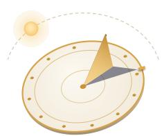

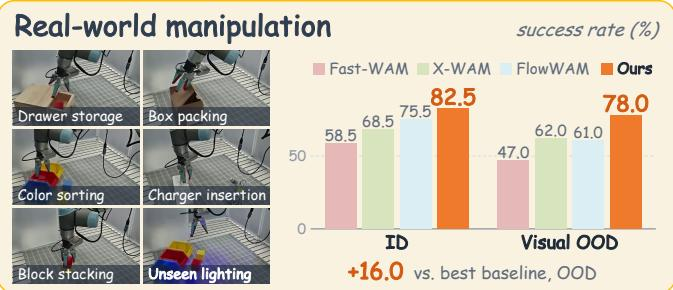

# Gnomon4D: Learning Where and When to Focus for Geometric Motion-Grounded World-Action Modeling

Lingwei Dang<sup>1,2∗</sup> Yan Zhou<sup>3</sup> Juntong Li<sup>1</sup> Zhenhao Zhang<sup>2∗</sup> Yiteng Chen<sup>1</sup> Xiaoqiang Liu<sup>3†</sup> Liang An<sup>4</sup> Hongwen Zhang<sup>5</sup> Wei Min<sup>6</sup> Guoxin Zhang<sup>3</sup> Pengfei Wan<sup>3</sup> Yebin Liu<sup>2</sup> Qingyao Wu<sup>1‡</sup> <sup>1</sup> South China University of Technology <sup>2</sup> Tsinghua University <sup>3</sup> KlingAI Research <sup>4</sup> Nanjing University <sup>5</sup> Beijing Normal University <sup>6</sup> Shadow AI https://droliven.github.io/Gnomon4D

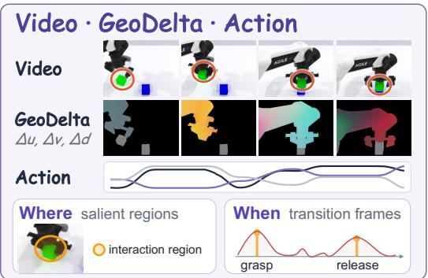  
Geometric motion-grounded world–action model

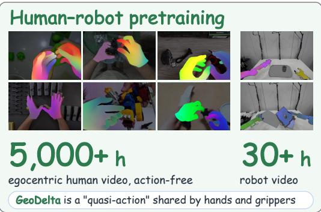

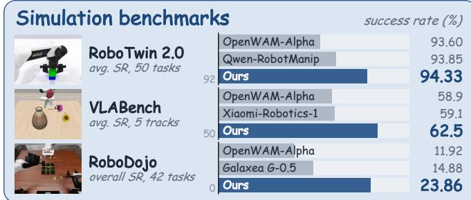

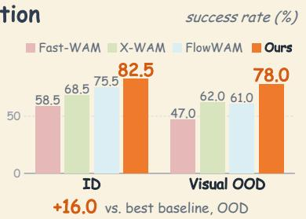  
Figure 1. Gnomon4D is a world-action model that jointly generates future video, robot actions, and 4D geometric motion (GeoDelta), the image-plane displacement and depth change (∆u, ∆v, ∆d) of embodiment and object points, and uses it to focus the action expert on interaction regions and transition frames (top left). As an embodiment-agnostic quasi-action, GeoDelta enables action-free pretraining on EgoManip-5000H (5,000+ hours; top right). Gnomon4D leads in simulation (bottom left) and real-robot experiments (bottom right).

## Abstract

World-action models (WAMs) use video-generation priors to jointly predict future observations and robot actions. Yet RGB futures entangle physical state changes with appearance, while frame-wise depth and point maps lack temporal correspondence. Existing 4D approaches either keep motion implicit in visual features or translate predicted traces into actions through a separate interface. We present Gnomon4D, a WAM that jointly generates future video, robot actions, and GeoDelta, a videoaligned 4D geometric motionfield encoding the cross-frame image-plane displacement and depth change of embodiment and object points. By placing embodiment motion and object responses in a shared space, GeoDelta exposes their motion relations to the action expert at inference. Interaction-Salient Attention (InSAttn) uses these relations to focus spatial readout on task-relevant interaction regions, while Transition-Anchored Aggregation (TransAgg) aggregates evidence around changes in their relative motion, such as grasp and release. GeoDelta describes surface motion independently ofembodiment-specific controls, providing a shared human–robot quasi-action for action-free pretraining on EgoManip-5000H followed by robot midtraining on Robot-30H. Gnomon4D leads on RoboTwin 2.0, VLABench, and RoboDojo, and outperforms the strongest real-robot baseline by 7.0 and 16.0 percentage points under in-distribution and out-of-distribution settings, respectively.

## 1. Introduction

Robot manipulation advances along complementary routes: vision-language-action models (VLAs) map observations and instructions to actions [22, 47], world-action models (WAMs) jointly predict future observations and actions [16, 44, 55, 68, 91], and agentic recursive selfimprovement (RSI) refines skills or generates simulationready worlds [45, 49]. All three aim to generate actions that change object states to accomplish a task, and WAMs in particular explicitly predict these changes to guide the action. Most WAMs represent this future as video [24, 68, 86], inheriting the visual priors of large video foundation models [63], which has driven their rapid adoption. RGB futures, however, entangle task-relevant state changes with texture, lighting, and background, leading policies to overfit to appearance and generalize poorly to unseen visual conditions [40, 80]. As 2D projections of the scene, they further lack the 3D geometry that precise manipulation such as insertion and stacking requires [52].

To strengthen geometric perception and reasoning, recent WAMs either predict depth together with video [3, 15] or distill depth-aware features during training [31]. Yet depth and point maps remain frame-wise: they locate surfaces but provide no temporal correspondence, and thus do not directly encode embodiment–object motion through approach, manipulation, and release. 4D geometric motion addresses this gap by tracking physical points over time, yielding explicit and temporally coherent dynamics. Existing methods use such 4D cues in two ways. 4D-WAM [75] and GEM-4D [88] regularize WAM features with dense trajectory fields during training, but discard the 4D teacher or geometric branch at inference, leaving no explicit motion for the action to read (Fig. 2a). TraceGen [26] and µ<sub>0</sub> [27] predict sparse 3D traces, but translate them into robot control through separate interfaces (Fig. 2b). Thus, existing methods either keep 4D cues implicit in visual representations or decouple them from control through a separate trace-to-action interface. None of them jointly generates future video, explicit 4D motion, and robot actions as online modalities, nor explicitly uses embodiment–object motion relations and their transitions to organize action readout.

What is therefore needed is an efficient 4D geometric motion representation that bridges video and action. It should align with the visual future, be generated jointly with the action, and place embodiment and object motion in a shared spatiotemporal space. Accordingly, we introduce Gnomon4D, a WAM built on a Mixture-of-Transformers architecture [33] that jointly generates future video, robot actions, and a video-aligned 4D geometric motion, i.e., GeoDelta (Figs. 1 and 2c). For each foreground pixel on the embodiment and the manipulated object, GeoDelta records the image-plane displacement and depth change $( \Delta u , \Delta v , \Delta d )$ of the same physical point over a short interval, forming a video-aligned field of 3D motion. Unlike per-frame depth and point maps, its explicit cross-frame correspondences make motion directly observable and temporally coherent. Unlike 2D optical flow, its depth component captures motion along the line of sight, distinguishing 3D motions that induce similar image-plane displacements. Defined on the video pixel grid, GeoDelta reuses the video VAE while preserving alignment with the visual future and its generative priors. Within this architecture, Video, GeoDelta, and Action experts denoise jointly through shared attention. The GeoDelta and Action experts further share a denoising clock and exchange information at matched stages, making predicted geometric motion directly available to the action expert.

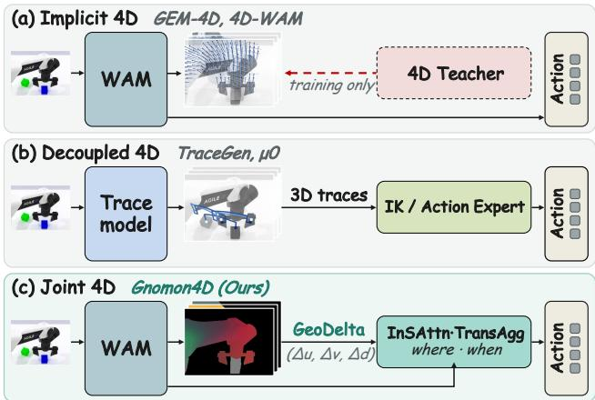  
Figure 2. How 4D motion reaches the action. Existing methods keep 4D motion implicit (a) or decouple it from control (b). Gnomon4D generates GeoDelta jointly with the action and, through InSAttn and TransAgg, uses it to decide where and when the action should focus (c).

Yet explicit 4D geometric motion alone does not tell the action expert where and when to focus. We hypothesize that control-relevant cues concentrate spatially at embodiment–object interaction regions and temporally when contact is established, the object begins to move with the embodiment, or release occurs. Low-dimensional action supervision offers no direct localization among dense video and motion tokens, so the expert may memorize actions from embodiment-centric patterns rather than reason over these interactions [35]. Probe experiments on RoboTwin 2.0 [10] confirm this tendency: the action attention of existing WAMs favors the embodiment as a whole over embodiment–object interaction regions (see supplementary material). To direct the action expert toward these cues, Gnomon4D uses predicted 4D motion for task-adaptive spatiotemporal reweighting. Specifically, Gnomon4D employs Interaction-Salient Attention (InSAttn) to emphasize interaction regions from task-conditioned embodiment–object relative motion, and Transition-Anchored Aggregation (TransAgg) to emphasize and aggregate frames where this relation changes. The resulting interaction tokens are injected residually into the dense action readout.

Returning to the representation itself, GeoDelta is embodiment-agnostic: it describes foreground surface motion without encoding embodiment-specific joints, poses, or control parameters. It can therefore serve as a shared quasiaction across human hands and diverse robot embodiments. Existing human-video pretraining pipelines instead treat estimated hand poses, such as MANO parameters, as actions [13, 41], learn latent actions from human videos [74], or align human and robot data through embodiment-specific retargeting and robot rendering [43, 44]. By contrast, GeoDelta defines an explicit, video-aligned motion space shared directly by human and robot videos, without mapping either source into the other’s action space. Using this shared representation, we first pretrain the Video and GeoDelta experts on EgoManip-5000H (5,000+ hours of action-free egocentric manipulation video). We then mid train the full model on Robot-30H (30+ hours of real-robot data) to connect this motion space to robot controls, and finally post-train it on target tasks.

Our contributions are threefold:

• Gnomon4D, a WAM that jointly generates future video, actions, and GeoDelta, an explicit 4D geometric motion representation that exposes embodiment–object interaction dynamics to the action expert.

• InSAttn and TransAgg for task-adaptive spatiotemporal reweighting, focusing the action expert on interaction regions and transition frames.

• Embodiment-agnostic GeoDelta as a human–robot quasiaction for action-free pretraining on EgoManip-5000H, with state-of-the-art performance on three simulation benchmarks and real-robot validation.

## 2. Related Work

World-action models and human-video pretraining. World-action models (WAMs) use predicted futures for control, decoding actions from video features or jointly denoising video and actions [24, 55, 68, 77, 84, 91], often with Mixture-of-Transformers [33]. Fast-WAM and GigaWorld-Policy decouple training-time future supervision from inference-time imagination [58, 81], VPP2 pairs event-level video pretraining with a distilled visual planner [16], and InternW0-∆ learns Causal Imprint queries from 20,000+ hours of robot and human data [44]. Humanvideo pretraining uses hand-pose retargeting [13, 41, 43, 44, 79, 87], motion-supervised egocentric world models [28], or action-free 3D-aware latent actions [74]. Most WAM futures remain RGB or visual latents that entangle state changes with appearance [40, 80]. Gnomon4D instead uses embodiment-agnostic GeoDelta as a quasi-action shared by humans and robots, without human action labels.

Geometry and motion in world-action models. Geometry enters WAMs as a predicted future, a bridge to control, or auxiliary supervision. Predicted futures include RGB-D [3, 15], pointmaps or geometric latents [21, 32, 71], and optical flow [11, 86], but frame-wise depth and pointmaps lack temporal correspondence, and 2D flow and tracks omit line-of-sight motion. Bridging methods connect 3D dynamics to control through action-conditioned point flow, latent scene trajectories, or geometric backbones [7, 17, 20, 70], or through dynamic pointmaps and sparse 3D traces with dedicated action interfaces [26, 27, 48, 62, 67]. Crossembodiment methods transfer 4D affordances, contact trajectories, or tool–target motion from human videos and recover control by fine-tuning, planning, or a separate controller [1, 18, 19]. Auxiliary uses include distilling depth, trajectory, or 4D priors only during training [28, 31, 44, 51, 65, 75, 83, 88]. Gnomon4D instead generates GeoDelta online with video and actions, directly accessible to the action expert during denoising.

Spatiotemporal information selection for control. Explicit motion alone does not tell the action expert which regions and moments matter. Prior methods compress futures into predictive states, joint embeddings, latent intentions or subgoals, and learned queries [8, 14, 23, 30, 36, 44, 73, 76], or learn an interaction-dynamics bottleneck [64]. Others select information with spatial cues such as grounding, affordances, interaction primitives, or end-effector distance [12, 39, 54, 61, 69, 78, 82], temporal cues such as action boundaries, keyframes, or rolling schedules [39, 72, 90], or interaction-aware training objectives [56, 57]. These cues come from latent or action supervision or isolated spatial and event signals. Gnomon4D derives both from predicted embodiment–object relative motion: InSAttn focuses on regions where it is salient and TransAgg on frames where it changes.

## 3. Method

## 3.1. Preliminaries

WAMs built on video generators jointly denoise future video and actions [15, 68, 91]. Each modality m follows a flow-matching path [37] $\mathbf { x } _ { \sigma _ { m } } ^ { m } = ( 1 - \sigma _ { m } ) \mathbf { x } ^ { m } + \sigma _ { m } \epsilon ^ { m }$ between a clean sample $\mathbf { x } ^ { m }$ , a video latent or an action chunk, and Gaussian noise $\epsilon ^ { m }$ , and the network $\mathbf { u } _ { \theta }$ regresses the velocity given the context C:

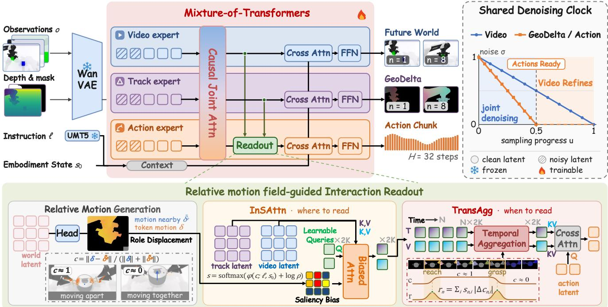  
Figure 3. Overview of Gnomon4D. (a) Video, GeoDelta, and Action experts jointly generate future video, GeoDelta, and actions through joint attention, and an interaction readout is added residually to the Action expert. (b) GeoDelta and Action share a denoising clock that finishes ahead of Video, so actions are ready before the video is refined. (c) Embodiment–object motion relations give task-conditioned saliency, with which InSAttn selects interaction regions and TransAgg aggregates transition frames. Image tiles show RoboTwin examples.

$$
\mathcal { L } _ { \mathrm { F M } } ^ { m } = \mathbb { E } \left\| \mathbf { u } _ { \boldsymbol { \theta } } ^ { m } \big ( \{ \mathbf { x } _ { \sigma _ { m ^ { \prime } } } ^ { m ^ { \prime } } \} _ { m ^ { \prime } } ; \mathcal { C } \big ) - \big ( \epsilon ^ { m } - \mathbf { x } ^ { m } \big ) \right\| _ { 2 } ^ { 2 } .\tag{1}
$$

Since noise levels are modality-specific [15, 91], a modality with $\sigma _ { m } = 0$ serves as a clean condition and incurs no loss, so one network can act as a policy, an action-conditioned world model, or a joint generator. The denoiser is typically a Mixture-of-Transformers (MoT) [33], whose modality experts have separate parameters and exchange information through joint attention at every layer.

## 3.2. Overview

At each replanning step, Gnomon4D receives multi-view observations o, the proprioceptive state $\mathbf { s } _ { 0 } .$ , and a language instruction $\ell ,$ denoted jointly as the context C. It predicts the next $H = 3 2$ control steps in three modalities: an action chunk $\mathbf { A } \ = \ \{ \mathbf { a } _ { \tau } \} _ { \tau = 1 } ^ { H }$ , future video $\mathbf { V } ~ = ~ \{ \mathbf { v } _ { n } \} _ { n = 1 } ^ { N } ,$ and a GeoDelta sequence $\mathbf { \dot { G } } = \{ \mathbf { g } _ { n } \} _ { n = 1 } ^ { N }$ . To reduce computation, video and GeoDelta are sampled with a stride of $\Delta = 4$ control steps, giving $N = H / \Delta = 8$ future frames. Gnomon4D models the joint distribution $p _ { \theta } ( \mathbf { V } , \mathbf { G } , \mathbf { A _ { \theta } } \mid \mathcal { C } )$ with Video, GeoDelta, and Action experts. We detail each component of Gnomon4D below.

## 3.3. GeoDelta: 4D Geometric Motion

GeoDelta describes the short-term 4D motion of foreground surfaces between adjacent sampled frames. Let $\Pi _ { n }$ map a 3D point to its pixel coordinates and depth in the camera of frame n. For a foreground surface point that moves from $\mathbf { X } _ { n }$ to ${ \bf X } _ { n + 1 }$ , GeoDelta stores at its source pixel $( u _ { n } , v _ { n } )$ the displacement ${ \bf g } _ { n + 1 } ( u _ { n } , v _ { n } ) = \Pi _ { n } ( { \bf X } _ { n + 1 } ) -$ $\Pi _ { n } ( { \bf X } _ { n } ) = ( \Delta u , \Delta v , \Delta d )$

Measuring both positions in one camera makes the field invariant to camera motion, and pixels without valid depth or correspondence are masked out. The foreground consists of the embodiment and the manipulated objects, so actiondriven embodiment motion and the resulting object motion share one pixel grid and time axis and can be compared directly. As it describes surface motion rather than joints or control signals, human hands and robot embodiments share one supervision space (Sec. 3.6).

To reuse the frozen video VAE, we normalize the displacements $( \Delta u , \Delta v , \Delta d )$ of GeoDelta and map them to the three channels of an RGB video. Each component $g _ { c }$ is soft-thresholded to suppress label noise, normalized by a fixed scale $\omega _ { c } .$ , and converted to an 8-bit channel value $I _ { c }$ by

signed µ-law companding:

$$
\begin{array} { l } { { z _ { c } = \mathrm { c l i p } ( g _ { c } / \omega _ { c } , - 1 , 1 ) , } } \\ { { { } } } \\ { { I _ { c } = 1 2 7 . 5 \left( 1 + \mathrm { s g n } ( z _ { c } ) \displaystyle \frac { \log ( 1 + \mu | z _ { c } | ) } { \log ( 1 + \mu ) } \right) , } } \end{array}\tag{2}
$$

where $\mu = 3 1 , \ : \omega _ { u } = \omega _ { v } = W / 6$ for image width $W .$ and $\omega _ { d }$ is set from the depth-change statistics of the training data. The µ-law assigns more intensity levels to small displacements and thus preserves the fine motion near contact.

## 3.4. Joint World–Motion–Action Generation

Architecture. Gnomon4D extends the Video–Action MoT (Sec. 3.1) with a GeoDelta expert (Fig. 3a), so that Video imagines the future appearance, GeoDelta supplies its geometry and motion, and Action turns both into embodied execution. Each expert is a stack of DiT blocks with its own weights, and the experts interact through joint attention in every layer. All three experts read the language instruction and proprioceptive state through cross-attention. The Video expert takes the current multi-view frame latent $\mathbf { V _ { o b s } }$ as a clean condition and denoises the N future frame latents V. The GeoDelta expert takes the current headcamera depth and foreground mask, encoded as clean condition tokens $\mathbf { G } _ { \mathrm { c o n d } }$ , and denoises the future GeoDelta latents G. The Action expert has no condition tokens of its own. It observes the scene by attending to $\mathbf { V _ { o b s } }$ and $\mathbf { G } _ { \mathrm { c o n d } }$ and denoises the H-step chunk A.

Denoising clock and causal mask. For three experts to reinforce one another, joint attention must expose each modality at the right time, which is set by the denoising clock and the attention mask. Video needs many denoising steps for its fine detail, whereas low-dimensional actions need only a few. Sampling the noise level of each expert independently, as in standard MoT training, therefore spreads training over all combinations, most of which inference never meets [15]. We instead tie the noise levels $\sigma _ { m }$ of Eq. (1) to one sampling progress u, which runs from 0 at pure noise to 1 at clean outputs. GeoDelta and actions are both sparse motion signals coupled through kinematics, so they share a clock that runs twice as fast as that of Video:

$$
\sigma _ { \mathrm { V } } ( u ) = 1 - u , \quad \sigma _ { \mathrm { G } } ( u ) = \sigma _ { \mathrm { A } } ( u ) = \operatorname* { m a x } ( 1 - 2 u , 0 ) .\tag{3}
$$

Sampling thus runs in two phases: in the first half, all three modalities are denoised jointly; in the second, $\sigma _ { \mathrm { { G } } } =$ $\sigma _ { \mathrm { { A } } } ~ = ~ 0 .$ , so GeoDelta and actions serve as clean conditions while Video refines its details. Training concentrates a large share of samples on this clock and draws the rest anywhere GeoDelta and actions are no noisier than Video, $\sigma _ { \mathrm { G } } = \sigma _ { \mathrm { A } } \leq \sigma _ { \mathrm { V } }$ , which also covers uses beyond this sampler, such as generating video from clean actions. On top of this schedule, the attention mask follows the causal order of execution. Future Video and GeoDelta tokens attend only to the actions up to their own time step, and clean tokens never attend to noisy ones (see the supplementary material).

## 3.5. Relation-Guided Interaction Readout

Joint attention exposes all future tokens to the Action expert but does not tell it which ones matter for control. As hypothesized in Sec. 1, the informative tokens are those where an object moves differently from the nearby embodiment, and the informative frames are those where this relation changes, such as grasp and release. We therefore read the predicted future with $K = 3 2$ learnable queries $\{ \mathbf { q } _ { k } \} _ { k = 1 } ^ { K }$ per world modality. Each query first reads every frame, with InSAttn focusing it on interaction regions, and then pools the frames, with TransAgg focusing it on transition moments.

Relative-motion field. Let $\mathbf { f } _ { n , i }$ be the hidden feature of token i in future frame $n ,$ taken from the Video or GeoDelta expert. Lightweight heads on GeoDelta features predict a token motion $\pmb { \delta } _ { n , i } \in \mathbb { R } ^ { 3 }$ and role probabilities $\rho _ { n , i } ^ { \mathrm { e } }$ and $\rho _ { n , i } ^ { \mathrm { o } }$ of belonging to the embodiment or an object, shared by both readout branches. The local embodiment motion $\bar { \delta } _ { n , i } ^ { \mathrm { e } }$ is the average motion of the arm and gripper around token i. The relative-motion field c measures how far each token’s motion departs from it:

$$
c _ { n , i } = \frac { | | \delta _ { n , i } - \bar { \delta } _ { n , i } ^ { \mathrm { e } } | | } { | | \delta _ { n , i } | | + | | \bar { \delta } _ { n , i } ^ { \mathrm { e } } | | + \varepsilon } \in [ 0 , 1 ] .\tag{4}
$$

Thus c is near 1 where an object and the embodiment move relative to each other and near 0 where they move together. A grasp switches c from the first case to the second and a release switches it back, so both show up as a large frameto-frame change $| \Delta c _ { n , i } |$ , where $\Delta c _ { n , i } = c _ { n , i } - c _ { n - 1 , i }$

InSAttn: where to read. InSAttn turns c into a saliency map over each frame. A small MLP ϕ scores every token from its relative motion c given the instruction ℓ and proprioception ${ \bf s } _ { 0 }$ , and the log foreground probability suppresses the background:

$$
s _ { n , i } = \mathrm { s o f t m a x } \left( \phi ( c _ { n , i } ; \ell , \mathbf { s } _ { 0 } ) + \log ( \rho _ { n , i } ^ { \mathrm { e } } + \rho _ { n , i } ^ { \mathrm { o } } ) \right) .\tag{5}
$$

Because the score depends on motion rather than appearance, s can single out the grasped object and the fingers around it instead of the most conspicuous pixels. Each learnable query $\mathbf { q } _ { k }$ then reads every frame n separately:

$$
\mathbf { y } _ { k , n } = \sum _ { i } { \mathrm { s o f t m a x } } \left( \mathbf { q } _ { k } ^ { \top } \mathbf { f } _ { n , i } + \log s _ { n , i } \right) \mathbf { f } _ { n , i } .\tag{6}
$$

This is standard attention, with key and value projections omitted, except that log s in the logits multiplies each token’s attention weight by its saliency. The result is a $K \times N$ grid of vectors ${ \bf y } _ { k , n }$ , one per query and frame.

RoboTwin 2.0: “Use the left arm to pick up the medium-sized shoe from the table and drop it on the mat”

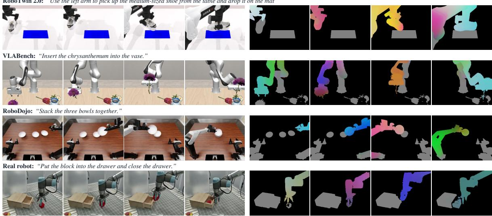  
Figure 4. GeoDelta supervision in the four domains. Each row shows four head-camera frames of one training demonstration with its instruction, and the GeoDelta from each frame t to t+4 encoded by Eq. (2). Neutral gray marks static embodiment or object pixels, and black marks background. The real-robot row (block drawer) uses recorded head-camera depth.

TransAgg: when to read. TransAgg pools this grid over time, turning the N per-frame vectors $\mathbf { y } _ { k , 1 } , \ldots , \mathbf { y } _ { k , N }$ of each query into one token $\mathbf { z } _ { k } .$ . It scores each frame by how much c changes on salient tokens, $\begin{array} { r } { r _ { n } = \sum _ { i } s _ { n , i } \vert \Delta c _ { n , i } \vert , } \end{array}$ a score that peaks at transitions such as grasp and release. Each query then aggregates its vectors as in Eq. (6), with log $r _ { n }$ in place of log $s _ { n , i } \colon$

$$
\mathbf { z } _ { k } = \sum _ { n } { \mathrm { s o f t m a x } } \left( \mathbf { q } _ { k } ^ { \mathsf { T } } \mathbf { y } _ { k , n } + \log r _ { n } \right) \mathbf { y } _ { k , n } ,\tag{7}
$$

so transition frames dominate each token. Pseudocode is given in the supplementary material.

Injection. The 2K tokens $\mathbf { Z } \ = \ \{ \mathbf { z } _ { k } ^ { \mathrm { V } } , \mathbf { z } _ { k } ^ { \mathrm { G } } \}$ of the two modalities enter the Action layers through a residual crossattention alongside the dense joint attention. During training, an auxiliary head predicts clean actions from Z while the Action expert’s instruction and proprioception are randomly masked, forcing Z to carry action-relevant evidence.

## 3.6. Training and Inference

Training. Since human hands and robot embodiments share the GeoDelta space, human video can teach the world experts how an embodiment interacts with objects before any action labels are involved. We therefore pretrain the Video and GeoDelta experts on EgoManip-5000H without action labels. We then add the Action expert, mid-train the full model on Robot-30H from IG-10K [89], and post-train it on each simulated and real-world benchmark.

Inference. All modalities start from noise and follow the shifted schedule of Eq. (3) over 20 solver steps. GeoDelta and actions become clean after step 10, at which point the controller executes a prefix of the action chunk and replans from the next observation. The remaining steps refine Video only when a visual prediction is needed.

## 4. Experiments

We evaluate whether explicit 4D geometric motion improves closed-loop control, where the gains emerge, and which components of Gnomon4D produce them. The study covers three simulation benchmarks, five real-robot tasks under in-distribution (ID) and out-of-distribution (OOD) conditions, and controlled ablations of the future representation, interaction readout, and pretraining curriculum.

## 4.1. Experimental Setup

Baselines. In simulation, we compare with representative VLA and WAM models (Tables 1–3). On RoboTwin 2.0, we further group WAMs by how they represent and read out predicted futures: RGB futures, 3D geometry or flow (depth, 4D geometric priors, or 2D optical flow), and structured readout that selects action-relevant information. On the real robot, we compare with Fast-WAM [81], X-WAM [15], and FlowWAM [11], whose futures are RGB, RGB-D, and RGB with 2D flow, respectively.

GeoDelta supervision. GeoDelta labels require per-pixel depth, embodiment and object masks, and cross-frame correspondences, which the public demonstrations do not provide in full. We replay RoboTwin 2.0 demonstrations from their seeds in SAPIEN and regenerate VLABench demonstrations in MuJoCo with the official scene sampler and expert skills. Moving each back-projected pixel with the recorded rigid motion of its robot link or object then yields exact GeoDelta for both the embodiment and the objects. RoboDojo releases only RGB videos, camera parameters, and robot states, without the object poses or scene seeds needed for reproduction. Its embodiment GeoDelta remains exact through forward kinematics of the released joint states, whereas object GeoDelta is estimated from the RGB videos with DA3 [34] depth, SAM 3.1 [6] masks, and RAFT [60] flow. To put both on a common metric scale, we rescale DA3 depth by one factor per episode, fitted to the rendered embodiment depth on robot pixels. Realrobot GeoDelta is constructed from measured RGB-D camera depth, SAM 3.1 masks, and RAFT flow (Fig. 4). At inference, Gnomon4D takes the RGB image, depth, camera parameters, and foreground mask of the current frame as input (Sec. 3.4). RoboTwin 2.0 and VLABench provide simulator-rendered conditions; RoboDojo uses robot-only renders from joint states and camera parameters. On the real robot, depth comes directly from the RGB-D camera and the foreground mask from SAM 3.1.

Implementation details. We initialize the Video expert from Wan2.2-TI2V-5B [63] (30 layers, width 3072). We derive the narrower GeoDelta and Action experts (width 1024) from it by width interpolation, so that all three share its attention space. We train with FSDP hybrid sharding and bfloat16 precision. More details are in the supplementary material.

## 4.2. Simulation Experiments

Setup. We train one multitask policy per benchmark and report success rate (SR) throughout. RoboTwin 2.0 [10] evaluates bimanual manipulation on 50 tasks in clean and randomized scenes. VLABench [85] tests language understanding and commonsense reasoning with 10 task families on five tracks: ID, unseen categories (Cat), commonsense variations (CS), semantic instructions (Ins), and unseen textures (Tex). RoboDojo [9] spans 42 bimanual tasks over Generalization, Precision, Long-Horizon, Memory, and Open-Instruction, and macro-averages SR and a partial-credit Score over these five dimensions.

Results. Gnomon4D achieves the best average result on all three benchmarks. On the near-saturated RoboTwin 2.0 (Table 1), it ranks first in both settings and surpasses the strongest geometry- or flow-based WAM, MECo-WAM, by 1.71 points. We attribute this to image-plane alignment: GeoDelta records the 4D motion of each pixel on the grid of the predicted video. The 0.77-point lead over the structuredreadout STARRY reflects InSAttn and TransAgg, which read from embodiment–object relative motion.

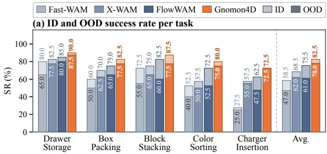

(b) OOD success rate per visual shift  
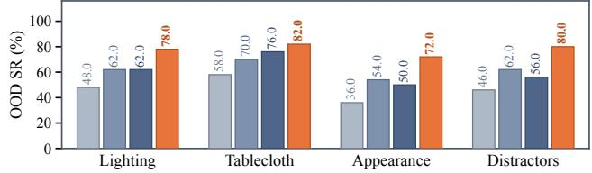  
Figure 5. Real-robot success rate. (a) SR per task, with the OOD bar (dark) overlaid on the ID bar (light) of each method, where Avg. averages the five tasks. (b) OOD SR under each visual shift, aggregated over 50 trials across the five tasks. Success counts are reported in the supplementary material.

The gains are pronounced under appearance shifts and in precise positioning. On VLABench (Table 2), the margin over OpenWAM-Alpha grows from 0.6 points on ID to 7.4 on unseen textures, as GeoDelta encodes motion rather than appearance. On RoboDojo (Table 3), Gnomon4D doubles the SR of OpenWAM-Alpha (23.86% vs. 11.92%) and reaches 28.24% on Precision against at most 20.42%, as these tasks demand exact positions in both image plane and depth, which GeoDelta encodes jointly.

## 4.3. Real-Robot Experiments

Setup. We use a UR5e arm with a parallel gripper, a fixed third-person RGB-D camera, and a wrist camera. On this platform, we evaluate five tasks covering routine manipulation (Drawer Storage, Box Packing, and Block Stacking), long-horizon manipulation (Color Sorting), and precision manipulation (Charger Insertion). For training, we collect 50 demonstrations per task (250 in total) and train all methods on them. For evaluation, each method runs 80 trials per task (400 in total) from initial configurations shared by all methods. Half are ID trials under the training conditions; the other half are OOD trials, 10 for each of four shifts: unseen lighting, tablecloth, or object appearance, and added distractors. Details are in the supplementary material.

Table 1. Success rate (%) on RoboTwin 2.0-Full over 50 bimanual tasks. Clean and Rand. denote the clean and domain-randomized settings. WAMs are grouped by their future-state representation and readout mechanism.
<table><tr><td>Method</td><td>Clean</td><td>Rand.</td><td>Avg.</td></tr><tr><td colspan="4">VLA</td></tr><tr><td>π0.5 [5]</td><td>82.74</td><td>76.76</td><td>79.75</td></tr><tr><td>Galaxea G-0.5 [38]</td><td>93.72</td><td>92.84</td><td>93.28</td></tr><tr><td>Qwen-RobotManip [79]</td><td>93.70</td><td>94.00</td><td>93.85</td></tr><tr><td colspan="4">WAM: RGB Futures</td></tr><tr><td>Motus [4]</td><td>88.66</td><td>87.02</td><td>87.84</td></tr><tr><td>Fast-WAM [81]</td><td>91.88</td><td>91.78</td><td>91.83</td></tr><tr><td>LingBot-VA 2.0 [84]</td><td>93.80</td><td>93.40</td><td>93.60</td></tr><tr><td>OpenWAM-Alpha [68]</td><td>93.74</td><td>93.46</td><td>93.60</td></tr><tr><td colspan="4">WAM: 3D Geometry / Flow</td></tr><tr><td>X-WAM [15]</td><td>89.76</td><td>90.68</td><td>90.22</td></tr><tr><td>WAM4D [31]</td><td>93.82</td><td>89.86</td><td>91.84</td></tr><tr><td>FlowWAM [11]</td><td>92.94</td><td>92.14</td><td>92.54</td></tr><tr><td>MECo-WAM [83]</td><td>93.26</td><td>91.98</td><td>92.62</td></tr><tr><td colspan="4">WAM: Structured Readout</td></tr><tr><td>ARPS [14]</td><td>91.32</td><td>90.10</td><td>90.71</td></tr><tr><td>STARRY [61]</td><td>93.82</td><td>93.30</td><td>93.56</td></tr><tr><td>Gnomon4D</td><td>94.56</td><td>94.10</td><td>94.33</td></tr></table>

Results. Gnomon4D ranks first on every task under both conditions, reaching 82.5% ID and 78.0% OOD SR (Fig. 5a). The baselines trade accuracy for robustness: FlowWAM leads them in ID (75.5%) but loses 14.5 points under visual shifts, whereas X-WAM loses only 6.5 but trails in ID. Encoding image-plane displacement and depth change jointly, GeoDelta achieves both: Gnomon4D loses only 4.5 points, and its margin over the strongest baseline widens from 7.0 points in ID to 16.0 in OOD.

By shift, the OOD gain is largest under unseen object appearance and distractors (18.0 points each; Fig. 5b), which leave GeoDelta unchanged: it is independent of texture, and a static distractor contributes no motion. By task, the OOD gain is largest on Color Sorting and Charger Insertion (22.5 and 17.5 points), where errors compound over three successive interactions or the insertion demands exact depth.

## 4.4. Ablation Study

Ablations use 10 interaction-intensive RoboTwin 2.0 tasks, and every variant is post-trained for 20k steps. The three groups in Table 4 are cumulative: starting from the Wan2.2-5B initialization without pretraining, (a) varies the future representation under dense readout, (b) varies the readout on full GeoDelta, and (c) adds the pretraining stages to the full model.

Object motion drives the gain of GeoDelta. Embodiment-only GeoDelta barely improves over RGB (+0.7), while adding object motion brings another 2.7 points (Table 4a); GeoDelta thus helps by capturing how objects respond to the embodiment, not by re-encoding the action. Full GeoDelta also exceeds depth and 2D flow by 2.5 and 0.9 points, and its margin over flow grows from 0.7 points in Clean to 1.0 in Rand., where varying table heights make the same image-plane displacement correspond to different 3D motion. Guiding where and when to read matters more than query capacity. Generic queries only match dense readout (83.6% vs. 83.4%), whereas InSAttn and TransAgg add 1.7 and 0.9 points (Table 4b). Human video transfers through GeoDelta. Pretraining on EgoManip-5000H improves SR by 2.1 points (Table 4c), and mid-training on Robot-30H adds another 2.7.

Table 2. Success rate (%) across VLABench tracks.
<table><tr><td>Method</td><td></td><td>ID</td><td>Cat</td><td>CS</td><td>Ins</td><td>Tex</td><td>Avg.</td></tr><tr><td rowspan="2">VLA</td><td>π0.5 [5]</td><td>65.4</td><td>38.2</td><td>43.9</td><td>48.2</td><td>44.9</td><td>48.1</td></tr><tr><td>Xiaomi-Robotics-1 [59]</td><td>75.6</td><td>53.0</td><td>48.4</td><td>55.8</td><td>62.6</td><td>59.1</td></tr><tr><td>WAM</td><td>OpenWAM-Alpha [68]</td><td>83.4</td><td>38.1</td><td>58.0</td><td>53.8</td><td>61.4</td><td>58.9</td></tr><tr><td colspan="2">Gnomon4D</td><td>84.0</td><td>39.1</td><td>61.7</td><td>59.1</td><td>68.8</td><td>62.5</td></tr></table>

Table 3. Success rate (%) and Score on RoboDojo.
<table><tr><td rowspan="2">Method</td><td colspan="5">Dimension SR</td><td colspan="2">Overall</td></tr><tr><td>Gen.</td><td>Prec.</td><td>Long</td><td>Mem.</td><td>Open</td><td>SR</td><td>Score</td></tr><tr><td>VLA</td><td></td><td></td><td></td><td></td><td></td><td></td><td></td></tr><tr><td>InternVLA-A1.5 [42]</td><td>6.83</td><td>10.17</td><td>13.75</td><td>3.56</td><td>1.42</td><td>7.14</td><td>11.15</td></tr><tr><td>π0.5 [5]</td><td>8.17</td><td>5.50</td><td>14.67</td><td>4.67</td><td>1.67</td><td>6.93</td><td>11.44</td></tr><tr><td>Xiaomi-Robotics-1 [59] Galaxea G-0.5 [38]</td><td>17.00 12.83</td><td>18.83 20.42</td><td>23.67 32.25</td><td>6.56 7.33</td><td>3.58 1.58</td><td>13.93 14.88</td><td>20.07 20.23</td></tr><tr><td>WAM</td><td></td><td></td><td></td><td></td><td></td><td></td><td></td></tr><tr><td>Fast-WAM [81]</td><td>1.11</td><td></td><td>5.17</td><td></td><td></td><td>2.03</td><td></td></tr><tr><td></td><td></td><td>0.00</td><td></td><td>3.44</td><td>0.42</td><td></td><td>3.48</td></tr><tr><td>GigaWorld-Policy-0 [46]</td><td>2.89</td><td>1.83</td><td>8.92</td><td>2.22</td><td>0.50</td><td>3.27</td><td>6.20</td></tr><tr><td>X-WAM [15]</td><td>3.33</td><td>1.83</td><td>9.08</td><td>4.67</td><td>0.25</td><td>3.83</td><td>7.69</td></tr><tr><td>OpenWAM-Alpha [68]</td><td>14.83</td><td>9.25</td><td>25.33</td><td>9.11</td><td>1.08</td><td>11.92</td><td>17.18</td></tr><tr><td>Gnomon4D</td><td>23.28</td><td></td><td>828.24 24.4434.34</td><td></td><td>9.02</td><td></td><td>23.86 30.96</td></tr></table>

Table 4. Ablations on 10 interaction-intensive RoboTwin 2.0 tasks.
<table><tr><td>Variant Clean Rand. Avg.</td></tr><tr><td>(a) Future Representation (Dense Readout)</td></tr><tr><td>RGB 81.0 79.0 80.0</td></tr><tr><td>RGB + Depth 81.5 80.3 80.9 RGB + 2D Flow 83.1 81.9 82.5</td></tr><tr><td>RGB + GeoDelta (Body) 81.5 79.8 80.7</td></tr><tr><td>RGB + GeoDelta (Full) 83.8 82.9 83.4</td></tr><tr><td>(b) Readout Structure</td></tr><tr><td>Generic Queries 84.2 82.9 83.6 InSAttn Only 85.7 84.8 85.3</td></tr><tr><td>InSAttn + TransAgg 86.6 85.7 86.2</td></tr><tr><td>(c) Pretraining Curriculum</td></tr><tr><td>Wan2.2-5B Init. (No Pretraining) 86.6 85.7 86.2</td></tr><tr><td>+ EgoManip-5000H 88.4 88.2 88.3</td></tr><tr><td>+ Robot-30H (Gnomon4D) 91.3 90.6 91.0</td></tr></table>

## 5. Conclusion

We presented Gnomon4D, a world-action model that jointly generates future video, robot actions, and GeoDelta, a video-aligned 4D geometric motion field. GeoDelta records the image-plane displacement and depth change of embodiment and object points, turning the predicted future into an explicit interface between imagination and control. From the embodiment–object relative motion it exposes, InSAttn determines where the action expert reads and TransAgg determines when. Because this motion space is shared by human hands and robots, Gnomon4D can also pretrain on action-free egocentric video from EgoManip-5000H. Across three simulation benchmarks and real-robot experiments, Gnomon4D achieves leading performance, with the clearest gains in precise manipulation such as insertion and under appearance shifts such as unseen textures and distractors. RGB futures are weakest in both settings, suggesting that what a predicted future encodes, not only how realistic it looks, determines its value for control.

Limitations and future work. GeoDelta uses measured camera depth in our real-robot experiments and monocular depth estimates for human videos, together with masks and optical flow. Errors on thin, reflective, or transparent surfaces mainly perturb the depth change ∆d. Agentic recursive self-improvement offers a scalable route to cleaner labels, either by rebuilding real scenes as simulation-ready worlds where GeoDelta is exact or by iteratively refining the estimation pipeline with embodied feedback.

## Acknowledgements

This work was supported by KlingAI, the National Natural Science Foundation of China (NSFC) under Grant Nos. 62672187 and 62125107, and the Guangdong Basic and Applied Basic Research Foundation under Grant No. 2025B1515120037.

## References

[1] Sami Azirar, Enrico Pallotta, Jan Nogga, Jurgen Gall, Sven¨ Behnke, and Hermann Blum. Contactflow: A video action conditioning that transfers across embodiments. arXiv preprint arXiv:2607.26579, 2026. 3

[2] Shuai Bai, Yuxuan Cai, Ruizhe Chen, Keqin Chen, Xionghui Chen, Zesen Cheng, Lianghao Deng, Wei Ding, Chang Gao, Chunjiang Ge, Wenbin Ge, Zhifang Guo, Qidong Huang,

Jie Huang, Fei Huang, Binyuan Hui, Shutong Jiang, Zhaohai Li, Mingsheng Li, Mei Li, Kaixin Li, Zicheng Lin, Junyang Lin, Xuejing Liu, Jiawei Liu, Chenglong Liu, Yang Liu, Dayiheng Liu, Shixuan Liu, Dunjie Lu, Ruilin Luo, Chenxu Lv, Rui Men, Lingchen Meng, Xuancheng Ren, Xingzhang Ren, Sibo Song, Yuchong Sun, Jun Tang, Jianhong Tu, Jianqiang Wan, Peng Wang, Pengfei Wang, Qiuyue Wang, Yuxuan Wang, Tianbao Xie, Yiheng Xu, Haiyang Xu, Jin Xu, Zhibo Yang, Mingkun Yang, Jianxin Yang, An Yang, Bowen Yu, Fei Zhang, Hang Zhang, Xi Zhang, Bo Zheng, Humen Zhong, Jingren Zhou, Fan Zhou, Jing Zhou, Yuanzhi Zhu, and Ke Zhu. Qwen3-VL technical report, 2025. 5

[3] Jai Bardhan, Josef Sivic, and Vladimir Petrik. Depthworld: 3d world model for robot manipulation. arXiv preprint arXiv:2610.08780, 2026. 2, 3

[4] Hongzhe Bi, Hengkai Tan, Shenghao Xie, Zeyuan Wang, Shuhe Huang, Haitian Liu, Ruowen Zhao, Yao Feng, Chen dong Xiang, Yinze Rong, Hongyan Zhao, Hanyu Liu, Zhizhong Su, Lei Ma, Hang Su, and Jun Zhu. Motus: A unified latent action world model. In CVPR, pages 35101– 35113, 2026. 8, 3

[5] Kevin Black, Noah Brown, James Darpinian, Karan Dhabalia, Danny Driess, Adnan Esmail, Michael Robert Equi, Chelsea Finn, Niccolo Fusai, Manuel Y. Galliker, Dibya Ghosh, Lachy Groom, Karol Hausman, Brian Ichter, Szymon Jakubczak, Tim Jones, Liyiming Ke, Devin LeBlanc, Sergey Levine, Adrian Li-Bell, Mohith Mothukuri, Suraj Nair, Karl Pertsch, Allen Z. Ren, Lucy Xiaoyang Shi, Laura Smith, Jost Tobias Springenberg, Kyle Stachowicz, James Tanner, Quan Vuong, Homer Walke, Anna Walling, Haohuan Wang, Lili Yu, and Ury Zhilinsky. π<sub>0.5</sub>: a Vision-Language-Action Model with Open-World Generalization. In CoRL, pages 17–40. PMLR, 2025. 8

[6] Nicolas Carion, Laura Gustafson, Yuan-Ting Hu, Shoubhik Debnath, Ronghang Hu, Didac Suris Coll-Vinent, Chaitanya Ryali, Kalyan Vasudev Alwala, Haitham Khedr, Andrew Huang, Jie Lei, Tengyu Ma, Baishan Guo, Arpit Kalla, Markus Marks, Joseph Greer, Meng Wang, Peize Sun, Roman Radle, Triantafyllos Afouras, Effrosyni Mavroudi,¨ Katherine Xu, Tsung-Han Wu, Yu Zhou, Liliane Momeni, RISHI HAZRA, Shuangrui Ding, Sagar Vaze, Francois Porcher, Feng Li, Siyuan Li, Aishwarya Kamath, Ho Kei Cheng, Piotr Dollar, Nikhila Ravi, Kate Saenko, Pengchuan Zhang, and Christoph Feichtenhofer. SAM 3: Segment Anything with Concepts. In ICLR, pages 138846–138923, 2026. 7, 5, 8

[7] Ying Chai, Litao Deng, Ruizhi Shao, Jiajun Zhang, Kangchen Lv, Liangjun Xing, Xiang Li, Hongwen Zhang, and Yebin Liu. GAF: Gaussian action field as a 4D representation for dynamic world modeling in robotic manipulation. In ICRA, 2026. 3

[8] Jialei Chen, Kai Wang, Kang Chen, Shuaihang Chen, Feng Gao, Wenhao Tang, Zhiyuan Li, Weilin Liu, Zhuyu Yao, Boxun Li, Yuanbo Xu, and Chao Yu. Lawam: Latent world action models for efficient dynamics-aware robot policies. arXiv preprint arXiv:2606.15768, 2026. 3

[9] Tianxing Chen, Yue Chen, Zixuan Li, Junyuan Tang, Kailun Su, Haoran Lu, Weijie Wan, Baijun Chen, Songling Liu,

Haowen Yan, Honghao Su, Zhiyang Dou, Kaixuan Wang, Dandan Zhang, Yunze Liu, Yan Qin, Qiwei Liang, Qiwei Wu, Zijian Lin, Wenwei Lin, Yuran Wang, Minghua He, Tianshu Wu, Ruihai Wu, Jingquan Zhou, Kai-Chong Lei, Haibao Yu, Yuanfeng Ji, Weiyang Jin, Guanyu Lin, Xiaofan Li, Qi Xiong, Renjing Xu, Zhongyu Li, Wenhao Chai, Enze Xie, Ziwei Wang, Yao Mu, Hao Dong, Wojciech Matusik, Mingyu Ding, Wenbo Ding, Ping Luo, and Masayoshi Tomizuka. Robodojo: A unified sim-and-real benchmark for comprehensive evaluation of generalist robot manipulation policies. arXiv preprint arXiv:2607.04434, 2026. 7

[10] Tianxing Chen, Zanxin Chen, Baijun Chen, Zijian Cai, Yibin Liu, Zixuan Li, Qiwei Liang, Xianliang Lin, Yiheng Ge, Zhenyu Gu, Weiliang Deng, Yubin Guo, Tian Nian, Xuanbing Xie, Qiangyu Chen, Kailun Su, Tianling Xu, Guodong Liu, Mengkang Hu, Huan-Ang Gao, Kaixuan Wang, Zhixuan Liang, Yusen Qin, Xiaokang Yang, Ping Luo, and Yao Mu. RoboTwin 2.0: A Scalable Data Generator and Benchmark with Strong Domain Randomization for Robust Bimanual Robotic Manipulation. In ICML, pages 13673– 13699. PMLR, 2026. 3, 7

[11] Yixiang Chen, Peiyan Li, Yuan Xu, Qisen Ma, Jiabing Yang, Kai Wang, Jianhua Yang, Dong An, He Guan, Gaoteng Liu, Jianlou Si, Jun Huang, Jing Liu, Nianfeng Liu, Yan Huang, and Liang Wang. Flowwam: Optical flow as a unified action representation for world action models. arXiv preprint arXiv:2607.13017, 2026. 3, 6, 8, 10

[12] Jintao Cheng, Weibin Li, Haozhe Wang, Gang Wang, Yipu Zhang, Xiaoyu Tang, Jin Wu, Xieyuanli Chen, Yunhui Liu, and Wei Zhang. Training-free interaction-aligned visual token pruning for efficient embodied manipulation. arXiv preprint arXiv:2603.22991, 2026. 3

[13] Dyna Robotics. Dyna-2: A 1-million-hour scaling law for world-action models. dyna.co/dyna-2, 2026. Technical report, August 2026. 3

[14] Qiwen Gu, Jifan Li, Bingjie Gao, Rui Chen, Jing Tang, Xiangxiang Chu, and Junqiao Zhao. The right future for action: Learning action-relevant predictive states in world action models. arXiv preprint arXiv:2609.23369, 2026. 3, 8

[15] Jun Guo, Qiwei Li, Peiyan Li, Zilong Chen, Nan Sun, Yifei Su, Heyun Wang, Yuan Zhang, Xinghang Li, and Huaping Liu. Unified 4d world action modeling from video priors with asynchronous denoising. arXiv preprint arXiv:2604.26694, 2026. 2, 3, 4, 5, 6, 8, 10

[16] Yanjiang Guo, Haodong Yan, Zhide Zhong, Zhongru Zhang, Qingyuan Yang, Qingzhou Lu, Xiaoyu Chen, Yen-Jen Wang, Shuying Deng, Chenghan Yang, Puzhen Yuan, Chenxin Liu, Tun Ban, Xiang Zhu, Yichen Liu, Kun Feng, Haoang Li, and Jianyu Chen. Video prediction policy 2: Predict better, act better, 2026. 2, 3

[17] Jisang Han, Seonghu Jeon, Jaewoo Jung, Rene Zurbr ´ ugg,¨ Honggyu An, Tifanny Portela, Marco Hutter, Marc Pollefeys, Seungryong Kim, and Sunghwan Hong. Geometric action model for robot policy learning. arXiv preprint arXiv:2606.17046, 2026. 3

[18] Yifan Han, Jianxiang Liu, Haoyu Zhang, Yuqi Gu, Yunhan Guo, and Wenzhao Lian. BridgeACT: Bridging Human

Demonstrations to Robot Actions via Unified Tool-Target Affordances. arXiv preprint arXiv:2604.23249, 2026. 3

[19] Yifan Han, Litao Liu, Yuqi Gu, Ye Lu, Hanqing Wang, Sidney Wai, Ishaan Myrie, Qi Zhang, Jingjin Yu, and Gen Li. A4a: Cross-embodiment transfer of action-oriented 4d affordances from human demonstrations. arXiv preprint arXiv:2609.05892, 2026. 3

[20] Wenlong Huang, Yu-Wei Chao, Arsalan Mousavian, Ming-Yu Liu, Dieter Fox, Kaichun Mo, and Li Fei-Fei. Pointworld: Scaling 3d world models for in-the-wild robotic manipula tion. In CVPR, pages 20765–20779, 2026. 3

[21] Adam Hung, Bardienus P. Duisterhof, Deva Ramanan, and Jeffrey Ichnowski. Modality-autoregressive world-action models. arXiv preprint arXiv:2609.17524, 2026. 3

[22] Physical Intelligence, Bo Ai, Ali Amin, Raichelle Aniceto, Ashwin Balakrishna, Greg Balke, Kevin Black, George Bokinsky, Shihao Cao, Thomas Charbonnier, Vedant Choudhary, Foster Collins, Ken Conley, Grace Connors, James Darpinian, Karan Dhabalia, Maitrayee Dhaka, Jared Di-Carlo, Danny Driess, Michael Equi, Adnan Esmail, Yunhao Fang, Chelsea Finn, Catherine Glossop, Thomas Godden, Ivan Goryachev, Lachlan Groom, Haroun Habeeb, Hunter Hancock, Karol Hausman, Gashon Hussein, Victor Hwang, Brian Ichter, Connor Jacobsen, Szymon Jakubczak, Rowan Jen, Tim Jones, Gregg Kammerer, Ben Katz, Liyiming Ke, Mairbek Khadikov, Chandra Kuchi, Marinda Lamb, Devin LeBlanc, Brendon LeCount, Sergey Levine, Xinyu Li, Adrian Li-Bell, Vladislav Lialin, Zhonglin Liang, Wallace Lim, Yao Lu, Enyu Luo, Vishnu Mano, Nandan Marwaha, Aikys Mongush, Liam Murphy, Suraj Nair, Tyler Patterson, Karl Pertsch, Allen Z. Ren, Gavin Schelske, Charvi Sharma, Baifeng Shi, Lucy Xiaoyang Shi, Laura Smith, Jost To bias Springenberg, Kyle Stachowicz, Will Stoeckle, Jiaming Tang, Jimmy Tanner, Shalom Tekeste, Marcel Torne, Kyle Vedder, Quan Vuong, Anna Walling, Haohuan Wang, Jason Wang, XuDong Wang, Chris Whalen, Samuel Whitmore, Blake Williams, Charles Xu, Sukwon Yoo, Lili Yu, Wuming Zhang, Zhuoyang Zhang, and Ury Zhilinsky. π<sub>0.7</sub>: a steerable generalist robotic foundation model with emergent capabilities, 2026. 2

[23] Haoyi Jiang, Liu Liu, Xinjiang Wang, Zhihao Sun, Zequn Chen, Sen Wang, Xinjie Wang, Xia Chen, Jingfeng Yao, Weiheng Zhao, Shanglin Yuan, Zhizhong Su, Wei Sui, Wenyu Liu, and Xinggang Wang. Rethinking representations for world-action modeling. arXiv preprint arXiv:2609.38163, 2026. 3

[24] Moo Jin Kim, Yihuai Gao, Tsung-Yi Lin, Yen-Chen Lin, Yunhao Ge, Grace Lam, Percy Liang, Shuran Song, Ming-Yu Liu, Chelsea Finn, and Jinwei Gu. Cosmos policy: Finetuning video models for visuomotor control and planning, 2026. 2, 3

[25] Kimi Team. Kimi K2.6. https://huggingface.co/ moonshotai/Kimi-K2.6, 2026. 5

[26] Seungjae Lee, Yoonkyo Jung, Inkook Chun, Yao-Chih Lee, Zikui Cai, Hongjia Huang, Aayush Talreja, Tan Dao, Yongyuan Liang, Jia-Bin Huang, and Furong Huang. Tracegen: World modeling in 3d trace space enables learning from

cross-embodiment videos. In CVPR, pages 20721–20731, 2026. 2, 3

[27] Seungjae Lee, Yoonkyo Jung, Jusuk Lee, Jonghun Shin, Amir Hossein Shahidzadeh, Yao-Chih Lee, H. Jin Kim, Jia-Bin Huang, and Furong Huang. µ<sub>0</sub>: A scalable 3d interaction-trace world model. arXiv preprint arXiv:2606.13769, 2026. 2, 3

[28] Baoyu Li, Xinchen Yin, Mengying Lin, Yixin Zhang, and Danfei Xu. Egowam: World action models beyond pixels with in-the-wild egocentric human data. arXiv preprint arXiv:2607.08436, 2026. 3

[29] Mingxin Li, Yanzhao Zhang, Dingkun Long, Keqin Chen, Sibo Song, Shuai Bai, Zhibo Yang, Pengjun Xie, An Yang, Dayiheng Liu, Jingren Zhou, and Junyang Lin. Qwen3-VL-Embedding and Qwen3-VL-Reranker: A unified framework for state-of-the-art multimodal retrieval and ranking, 2026. 5

[30] Xiang Li, Yupeng Zheng, Songen Gu, Huailiang Ma, Feng Yu, Yuhang Zheng, Xian Nie, Shanshuai Yuan, Yujie Zang, Weize Li, Shuai Tian, Moyang Liu, Ya-Qin Zhang, and Wenchao Ding. Latent action as intention enables efficient future imagination for world action models. arXiv preprint arXiv:2608.24882, 2026. 3

[31] Ying Li, Xiaobao Wei, Jiajun Cao, Hao Wang, Xiaowei Chi, Chengyu Bai, Qianpu Sun, Jiajun Li, Xiaojie Zhang, Peidong Jia, Jian Tang, Sirui Han, and Shanghang Zhang. Wam4d: Fast 4d world action model via spatial register tokens. arXiv preprint arXiv:2606.14048, 2026. 2, 3, 8

[32] Zhiyi Li, Peilin Wu, Xiaoshen Han, Ruojin Cai, and Yilun Du. Structured 4D Latent Predictive Model for Robot Planning. In ICML, pages 71216–71230. PMLR, 2026. 3

[33] Weixin Liang, LILI YU, Liang Luo, Srini Iyer, Ning Dong, Chunting Zhou, Gargi Ghosh, Mike Lewis, Wen tau Yih, Luke Zettlemoyer, and Xi Victoria Lin. Mixture-of-Transformers: A Sparse and Scalable Architecture for Multi-Modal Foundation Models. TMLR, 2025. 2, 3, 4

[34] Haotong Lin, Sili Chen, Jun Hao Liew, Donny Y. Chen, Zhenyu Li, Yang Zhao, Sida Peng, Hengkai Guo, Xiaowei Zhou, Guang Shi, Jiashi Feng, and Bingyi Kang. Depth Anything 3: Recovering the Visual Space from Any Views. In ICLR, pages 141261–141285, 2026. 7, 5

[35] Jianman Lin, Shailesh Shailesh, Zhongyi Luo, and Jiafei Duan. Breaking the vision-action shortcut: Latent interface training for generalizable robotics foundation models. arXiv preprint arXiv:2609.12641, 2026. 2

[36] Yihan Lin, Jiawei He, Shifeng Bao, Chen Zhao, Yang Li, Xiaobo Wang, Yan Wang, Cheng Chi, and Jing Zhang. Jepa-wam: Learning vision-language-action policies with joint-embedding world modeling. arXiv preprint arXiv:2608.09381, 2026. 3

[37] Yaron Lipman, Ricky T. Q. Chen, Heli Ben-Hamu, Maximilian Nickel, and Matt Le. Flow Matching for Generative Modeling. In ICLR, 2023. 4

[38] Yicheng Liu, Zibin Dong, Baijun Ye, Tianyuan Yuan, Tao Jiang, Anqi Yang, Shicheng Cao, Haonan Liu, Yue Sun, Zihan Guo, Xiao Liu, Dong Ke, Changxun Pan, Chenru Wu, Tailai Cheng, Xiaoshu Ren, Xinlei Zhang, Jianning Cui, Zijie Zhao, Haoyu Zhang, Kaiming Xu, Haodong Yang, Bowen

Zhang, Jiahui Niu, Shaoting Zhu, Shiduo Zhang, and Hang Zhao. G0.5: One autoregressive stream for robot reasoning and action. arXiv preprint arXiv:2608.11739, 2026. 8

[39] Yuanzhe Liu, Jingyuan Zhu, Yuchen Mo, Gen Li, Xu Cao, Jin Jin, Yifan Shen, Zhengyuan Li, Tianjiao Yu, Wenzhen Yuan, Fangqiang Ding, and Ismini Lourentzou. Palm: Progress-aware policy learning via affordance reasoning for long-horizon robotic manipulation. In CVPR, pages 28096– 28110, 2026. 3

[40] Yunfan Lou, Xiaowei Chi, Xiaojie Zhang, Zezhong Qian, Chengxuan Li, Rongyu Zhang, Yaoxu Lyu, Guoyu Song, Chuyao Fu, Haoxuan Xu, Pengwei Wang, and Shanghang Zhang. Predicting What Matters: Robust Generalist Robot Policy Learning via Future Semantic Mask. In ICML, pages 80599–80614. PMLR, 2026. 2, 3

[41] Hao Luo, Wanpeng Zhang, Yicheng Feng, Sipeng Zheng, Haiweng Xu, Chaoyi Xu, Ziheng Xi, Yuhui Fu, and Zongqing Lu. Being-h0.7: A latent world-action model from egocentric videos, 2026. 3

[42] Haoxiang Ma, Junhao Cai, Xiaoxu Xu, Hao Li, Yuyin Yang, Yang Tian, Jiafei Cao, Hongrui Zhu, Zherui Qiu, Zhaxizhuoma, Yuqiang Yang, Jiaqi Peng, Xueyuan Wei, Yangkun Zhu, Jiahao Jiang, Xing Gao, Hanqing Wang, Feng Yuan, Kailin Li, Xueyue Zhu, Tai Wang, Yan Ding, Jiangmiao Pang, Jia Zeng, Jingjing Zhang, Bowen Zhou, Yao Mu, Chunhua Shen, and Weinan Zhang. Internvla-a1.5: Unifying understanding, latent foresight, and action for compositional generalization. arXiv preprint arXiv:2607.04988, 2026. 8

[43] Juncheng Ma, Jianxin Bi, Yufan Deng, Xuanran Zhai, Kewei Zhang, Ye Huang, Bo Liang, Shukai Gong, Jiankai Tu, Xiaotian Tang, Jiaxin Li, Kaiqi Chen, Duomin Wang, Yuqi Wang, Bingyi Kang, Eric Huang, Zhiyang Dou, Zhen Dong, Enze Xie, Wojciech Matusik, Tat-Seng Chua, and Daquan Zhou. Humanscale: Egocentric human video can outperform real robot data for embodied pretraining, 2026. 3

[44] Xingyu Miao, Zizun Li, Baole Fang, Kaiwen Song, Tenghu Wang, Hanxue Zhang, Yating Wang, Xudong Li, Yuping He, Xueyuan Wei, Chao Gao, Xijie Yang, Yingxiang Xu, Kerui Ren, Wenqi Guo, Jianjun Zhou, Xinzhe Wang, Weiguang Zhao, Ni Yang, Zetao Cai, Yufei Xue, Hengjie Li, Zeyu He, Yuanzhen Zhou, Rong Fu, Jianyang Zhang, Siwei Cui, Fux ian Huang, Yunsong Zhou, Xing Gao, Yifei Yao, Qiaojun Yu, Kailin Li, Ming Zhou, Mu Huang, Xinyue Li, Wenze Cui, Bingqi Jiang, Xueyue Zhu, Junting Dong, Haoyu Guo, Tao Lu, Mulin Yu, Bowen Zhou, Bin Zhao, Tianfan Xue, Weinan Zhang, and Chunhua Shen. Internw0-δ: A world action model bridging predictive dynamics and actions with 20k+ hours of open data, 2026. 2, 3

[45] MMLab & PhysicalRSI contributors. Physical RSI 1.0: Recursive Self-Harness for Scaling Embodied Skills. https: //mmlab.hk/research/PhysicalRSI, 2026. Preview release. 2

[46] Chaojun Ni, Xinyu Zhou, Yukun Zhou, Jingyu Liu, Xiaofeng Wang, Zheng Zhu, Yang Wang, Qiuping Deng, Yun Ye, Hao Li, Zhichao Liu, Jindi Lv, Boyuan Wang, Guosheng Zhao, Guan Huang, Min Cao, and Wenjun Mei. GigaWorld Policy: An Efficient Action-Centered World–Action Model. In ECCV, pages 315–333. Springer, 2026. 8

[47] NVIDIA, Johan Bjorck, Fernando Castaneda, Nikita Cher-˜ niadev, Xingye Da, Runyu Ding, Linxi ”Jim” Fan, Yu Fang, Dieter Fox, Fengyuan Hu, Spencer Huang, Joel Jang, Zhenyu Jiang, Jan Kautz, Kaushil Kundalia, Lawrence Lao, Zhiqi Li, Zongyu Lin, Kevin Lin, Guilin Liu, Edith Llontop, Loic Magne, Ajay Mandlekar, Avnish Narayan, Soroush Nasiriany, Scott Reed, You Liang Tan, Guanzhi Wang, Zu Wang, Jing Wang, Qi Wang, Jiannan Xiang, Yuqi Xie, Yinzhen Xu, Zhenjia Xu, Seonghyeon Ye, Zhiding Yu, Ao Zhang, Hao Zhang, Yizhou Zhao, Ruijie Zheng, and Yuke Zhu. Gr00t n1: An open foundation model for generalist humanoid robots, 2025. 2

[48] Chunghyun Park, Beomjun Kim, Seungcheol Park, Heeseung Kwon, Yashu Shukla, Seunghoon Sim, Jinwoo Shin, and Minsu Cho. PointWAM: 3D world action modeling for dexterous robotic manipulation, 2026. 3

[49] PhysicalRSI Team, Danjiao Ma, Enhui Ma, Haohan Liu, Heng Jia, Hui Shan, Jianhua Xu, Jiahuan Zhang, Jiangdi Xu, Kaiwen Guo, Kaicheng Yu, Linwei Zhang, Liyang Jin, Maochun Luo, Pengyao Niu, Shiwen Li, Shuangyu Feng, Tong Zhang, Tianheng Wang, Xin Wang, Xiangru Huang, Yongqiang Huang, Zhaozhi Wang, and Zijian Ma. Awomo-SimDataEngine: Agentic Simulation-ReadyWorld Generation. arXiv preprint arXiv:2610.02274, 2026. 2

[50] Rolandos Alexandros Potamias, Jinglei Zhang, Jiankang Deng, and Stefanos Zafeiriou. WiLoR: End-to-end 3D hand localization and reconstruction in-the-wild. In Proceedings of the IEEE/CVF Conference on Computer Vision and Pattern Recognition (CVPR), 2025. 5

[51] Jingjing Qian, Boyao Han, Chen Shi, Lei Xiao, Long Yang, Shaoshuai Shi, and Li Jiang. Geopredict: Leveraging predictive kinematics and 3d gaussian geometry for precise vla manipulation. In CVPR, pages 13529–13539, 2026. 3

[52] Delin Qu, Haoming Song, Qizhi Chen, Yuanqi Yao, Xinyi Ye, Jiayuan Gu, Zhigang Wang, Yan Ding, Bin Zhao, Dong Wang, and Xuelong Li. SpatialVLA: Exploring Spatial Representations for Visual-Language-Action Models. In RSS, LosAngeles, CA, USA, 2025. 2

[53] Javier Romero, Dimitrios Tzionas, and Michael J. Black. Embodied hands: Modeling and capturing hands and bodies together. ACM Transactions on Graphics, 36(6):245:1– 245:17, 2017. 5

[54] Xinyu Shao, Keru Zhou, Guowei Huang, Yajun Gao, Tongtong Cao, and Xiu Li. Kam-wm: Kinematic affordance maps from latent world models for robot manipulation. arXiv preprint arXiv:2607.04652, 2026. 3

[55] Yichao Shen, Fangyun Wei, Zhiying Du, Yaobo Liang, Yan Lu, Jiaolong Yang, Nanning Zheng, and Baining Guo. VideoVLA: Video Generators Can Be Generalizable Robot Manipulators. In NeurIPS, pages 95597–95621. Curran Associates, Inc., 2025. 2, 3

[56] Ziying Song, Yuchen Liu, Zhuoran Xu, Ziyang Liu, Jian Jin, Jiangtao Su, Haibao Yu, Lei Yang, and Yuanpei Chen. Kineworld: Action-induced transport fields for embodied world modeling. arXiv preprint arXiv:2610.06349, 2026. 3

[57] Rongze Tang, Jianjie Fang, Zhaolu Wang, Ziyou Wang, Xvyuan Liu, Haisheng Su, Xin Zhang, Wei Wu, Chen Gao,

Yong Li, and Zhibo Chen. Impact: Attention is the interaction map for scalable interaction-aware world model training. arXiv preprint arXiv:2609.00161, 2026. 3

[58] GigaWorld Team, Angen Ye, Angyuan Ma, Boyuan Wang, Chaojun Ni, Fangzheng Ye, Guan Huang, Guo Li, Gu osheng Zhao, Haodong Yan, Hengtao Li, Jiwen Lu, Kai Wang, Mingming Yu, Qitang Hu, Qiuping Deng, Songling Liu, Xiaoyu Tian, Xiaofeng Wang, Xinyu Zhou, Xiuwei Xu, Xinze Chen, Yang Wang, Yejun Zeng, Yifan Chang, Yun Ye, Zhenyu Wu, Zhanqian Wu, and Zheng Zhu. Gigaworld policy-0.5: A faster and stronger wam empowered by autoresearch, 2026. 3

[59] Xiaomi Robotics Team, Jun Guo, Piaopiao Jin, Jason Li, Peiyan Li, Yingyan Li, Futeng Liu, Wanli Peng, Optimus Qin, Yifei Su, Nan Sun, Qiao Sun, Runze Suo, Heyun Wang, Yunhong Wang, Rujie Wu, Caoyu Xia, Lina Zhang, Jack Zhao, Guoliang Chen, Wenlong Chen, Xinze He, Bin Li, Qing Li, Zhuorong Li, Heng Qu, Wenxuan Song, Diyun Xi ang, Yifan Xie, Peiran Xu, Hangjun Ye, Wen Ye, Han Zhao, and Quanyun Zhou. Xiaomi-robotics-1: Scaling vision language-action models with over 100k hours of real-world trajectories. arXiv preprint arXiv:2607.15330, 2026. 8

[60] Zachary Teed and Jia Deng. RAFT: Recurrent All-Pairs Field Transforms for Optical Flow. In ECCV, pages 402–419. Springer, 2020. 7, 5, 8

[61] Yuxuan Tian, Yurun Jin, Bin Yu, Yukun Shi, Hao Wu, Chi Harold Liu, Kai Chen, and Cong Huang. Starry: Spatial temporal action-centric world modeling for robotic manipu lation. arXiv preprint arXiv:2604.26848, 2026. 3, 8

[62] Mutian Tong, Han Jiang, Qiao Feng, Lingjie Liu, and Jiatao Gu. Pointaction: 3d points as universal action representations for robot control. arXiv preprint arXiv:2606.03943, 2026. 3

[63] Team Wan, Ang Wang, Baole Ai, Bin Wen, Chaojie Mao, Chen-Wei Xie, Di Chen, Feiwu Yu, Haiming Zhao, Jianxiao Yang, Jianyuan Zeng, Jiayu Wang, Jingfeng Zhang, Jingren Zhou, Jinkai Wang, Jixuan Chen, Kai Zhu, Kang Zhao, Keyu Yan, Lianghua Huang, Mengyang Feng, Ningyi Zhang, Pandeng Li, Pingyu Wu, Ruihang Chu, Ruili Feng, Shiwei Zhang, Siyang Sun, Tao Fang, Tianxing Wang, Tianyi Gui, Tingyu Weng, Tong Shen, Wei Lin, Wei Wang, Wei Wang, Wenmeng Zhou, Wente Wang, Wenting Shen, Wenyuan Yu, Xianzhong Shi, Xiaoming Huang, Xin Xu, Yan Kou, Yangyu Lv, Yifei Li, Yijing Liu, Yiming Wang, Yingya Zhang, Yitong Huang, Yong Li, You Wu, Yu Liu, Yulin Pan, Yun Zheng, Yuntao Hong, Yupeng Shi, Yutong Feng, Zeyinzi Jiang, Zhen Han, Zhi-Fan Wu, and Ziyu Liu. Wan: Open and advanced large-scale video generative models. arXiv preprint arXiv:2503.20314, 2025. 2, 7

[64] Alex Wang, Zhiwei Dong, Qicheng Bai, Chenshi Zhang, Yujie Yi, Guang Dai, Yong Liu, and Mengmeng Wang. Dyn bridge: Bridging imagination and control through interaction dynamics for robot manipulation. In CVPR, pages 22423– 22432, 2026. 3

[65] Chenyi Wang, Xinkai Wang, Bokai Lin, Jialin Tian, Fucheng Zhang, Cewu Lu, and Lixin Yang. Track4action: Distilling world-centric 3d tracker into vision-language-action poli cies. arXiv preprint arXiv:2608.03727, 2026. 3

[66] Jianyuan Wang, Minghao Chen, Shangzhan Zhang, Nikita Karaev, Johannes Schonberger, Patrick Labatut, Piotr Bo-¨ janowski, David Novotny, Andrea Vedaldi, and Christian Rupprecht. VGGT-ω, 2026. 5

[67] Ruixiang Wang, Yongyi Su, Wenlve Zhou, Bo Yue, Hengyan Liu, Dekun Lu, Yuxin Tian, Yihan Fang, Zerui Wu, Xing Hu, Jietao Chen, Yong Guo, Ziyan He, Junbin Yuan, Guiliang Liu, Xiaofen Xing, and Kui Jia. UNITAS: A 3D-native world action model for embodied manipulation, 2026. 3

[68] Yuran Wang, Siqiao Huang, Mingleyang Li, Chenhao Zhang, Jiaqi Liang, Weiyang Jin, Yue Chen, Xuemin Chi, Dong hao Zhou, Qize Yu, Yu-Kai Wang, Yuhan Rui, Shenzhe Yao, Zhen Yuan, Zhenhao Shen, Kefei Zhu, Zijie Zhu, Ning Gao, Xiaowei Chi, Guanqi He, Shanghang Zhang, Hao Dong, Lin Shao, and Hang Zhao. Openwam: An open, modular exploration towards systematic world-action model pretraining. arXiv preprint arXiv:2609.07398, 2026. 2, 3, 8

[69] Lei Xiao, Jifeng Li, Juntao Gao, Feiyang Ye, Yan Jin, Jingjing Qian, Jing Zhang, Yong Wu, and Xiaoyuan Yu. Avavla: Improving vision-language-action models with active visual attention. In CVPR, pages 13453–13463, 2026. 3

[70] Ziyin Xiong, Nikos Gkanatsios, Moritz Reuss, and Katerina Fragkiadaki. Geomvla: Unifying scene, motion, and action in 3d. arXiv preprint arXiv:2609.13812, 2026. 3

[71] Chongyang Xu, Haipeng Li, Shen Cheng, Haoqiang Fan, Ziliang Feng, and Shuaicheng Liu. Action-geometry prediction with 3d geometric prior for bimanual manipulation. In CVPR, pages 35036–35046, 2026. 3

[72] Fuxiang Yang, Donglin Di, Lulu Tang, Xuancheng Zhang, Lei Fan, Hao Li, Wei Chen, Tonghua Su, and Baorui Ma. Chain of world: World model thinking in latent motion. In CVPR, pages 6675–6684, 2026. 3

[73] Fan Yang, Yuting Su, Xiaobo Wang, Yuncheng You, Fugui Fan, Yuting Wu, Minghui Wu, Chenxu Zhao, JiaHong Ning, and Peiguang Jing. Lila-wam: Lightweight latent reasoning world-action model for robotic manipulation. arXiv preprint arXiv:2608.03701, 2026. 3

[74] Jiarui Yang, Jiale Zhange, Jiawei Li, Hang Guo, Wen Huang, Jinpeng Wang, Peidong Liu, and Shu-Tao Xia. LAWM-3D: Learning 3D-Aware Latent Actions from Human Videos for Generalizable Robot World Models. arXiv preprint arXiv:2608.05706, 2026. 3

[75] Lishan Yang, Wenxuan Song, Xi Wang, Pingyue Sheng, Zheng Fang, Ziyang Zhou, Junjie He, Haodong Yan, Jiayi Chen, Nan Sun, Qiao Sun, Pengwei Wang, Lingqiao Liu, Yan Wang, Yuxiang Gao, Feras Dayoub, and Haoang Li. 4d-wam: Infusing spatiotemporal awareness into world action models through trajectory fields. arXiv preprint arXiv:2608.08023, 2026. 2, 3

[76] Yi Yang, Xueqi Li, Yiyang Chen, Jin Song, Yihan Wang, Zipeng Xiao, Jiadi Su, You Qiaoben, Pengfei Liu, and Zhijie Deng. Mantis: A versatile vision-language-action model with disentangled visual foresight. In CVPR, pages 42505– 42515, 2026. 3

[77] Seonghyeon Ye, Yunhao Ge, Kaiyuan Zheng, Shenyuan Gao, Sihyun Yu, George Kurian, Suneel Indupuru, You Liang Tan, Chuning Zhu, Jiannan Xiang, Ayaan Malik,

Kyungmin Lee, William Liang, Nadun Ranawaka, Jiasheng Gu, Yinzhen Xu, Guanzhi Wang, Fengyuan Hu, Avnish Narayan, Johan Bjorck, Jing Wang, Gwanghyun Kim, Dantong Niu, Ruijie Zheng, Yuqi Xie, Jimmy Wu, Qi Wang, Ryan Julian, Danfei Xu, Yilun Du, Yevgen Chebotar, Scott Reed, Jan Kautz, Yuke Zhu, Linxi ”Jim” Fan, and Joel Jang. World action models are zero-shot policies. arXiv preprint arXiv:2602.15922, 2026. 3

[78] Jiadi You, Qize Yu, Yue Chen, Minghong Cai, Zhide Zhong, Yuran Wang, Bowen Ping, Jiaqi Liang, Zhenhao Shen, Haodong Yan, Yinchuan Li, Ruihai Wu, Xiaojuan Qi, and Yingcong Chen. Affordancewam: Affordance-aware joint world-action modeling for robot manipulation. arXiv preprint arXiv:2609.22332, 2026. 3

[79] Haoqi Yuan, Zhixuan Liang, Anzhe Chen, Ye Wang, Haoyang Li, Pei Lin, Yiyang Huang, Zixing Lei, Tong Zhang, Jiazhao Zhang, Jie Zhang, Jingyang Fan, Gengze Zhou, Qihang Peng, Chenxu Lv, Xiaoyue Chen, An Yang, Fei Huang, Junyang Lin, Dayiheng Liu, Jingren Zhou, Chen fei Wu, and Xiong-Hui Chen. Qwen-robotmanip technical report: Alignment unlocks scale for robotic manipulation foundation models, 2026. 3, 8

[80] Shanglin Yuan, Weiheng Zhao, Xin Shi, Haoyi Jiang, Xianda Guo, Liu Liu, Wenyu Liu, Wei Sui, and Xinggang Wang. Dreamwam: Beyond rgb future prediction for world action models. arXiv preprint arXiv:2608.04996, 2026. 2, 3

[81] Tianyuan Yuan, Zibin Dong, Yicheng Liu, and Hang Zhao. Fast-wam: Do world action models need test-time future imagination? arXiv preprint arXiv:2603.16666, 2026. 3, 6, 8, 10

[82] Gehao Zhang, Weikai Huang, Shailesh Shailesh, Yiyan Peng, Jiafei Duan, and Ranjay Krishna. Grounded action model: 3d grounding as a foundation for robotics. arXiv preprint arXiv:2609.23863, 2026. 3

[83] Jianjun Zhang, Jian Zhu, Taiyi Su, Chong Ma, Zitai Huang, Yi Xu, and Hanli Wang. Learning 4d geometric priors for inference-efficient world action models. arXiv preprint arXiv:2607.05468, 2026. 3, 8

[84] Qihang Zhang, Lin Li, Luyao Zhang, Shuai Yang, Yiming Luo, Shuaiting Li, Ruilin Wang, Junke Wang, Jiahao Shao, Gangwei Xu, Jiaming Zhou, Yishu Shen, Yudong Jin, Fangyi Xu, Shuailei Ma, Jiaqi Liao, Guanxing Lu, Zifan Shi, Yongkun Wen, Yujie Zhao, Weixuan Tang, Xinyang Wang, Chaojian Li, Jiapeng Zhu, Ka Leong Cheng, Nan Xue, Xing Zhu, Yujun Shen, and Yinghao Xu. Native video-action pretraining for generalizable robot control, 2026. 3, 8

[85] Shiduo Zhang, Zhe Xu, Peiju Liu, Xiaopeng Yu, Yuan Li, Qinghui Gao, Zhaoye Fei, Zhangyue Yin, Zuxuan Wu, Yu Gang Jiang, and Xipeng Qiu. VLABench: A large-scale benchmark for language-conditioned robotics manipulation with long-horizon reasoning tasks. In ICCV, pages 11142– 11152, 2025. 7

[86] Haoyu Zhao, Xingyue Zhao, Siteng Huang, Xin Li, Deli Zhao, and Zhongyu Li. Rynnworld-4d: 4d embodied world models for robotic manipulation, 2026. 2, 3

[87] Ruijie Zheng, Dantong Niu, Yuqi Xie, Jing Wang, Mengda Xu, Yunfan Jiang, Fernando Castaneda, Fengyuan Hu,˜

You Liang Tan, Letian Fu, Trevor Darrell, Furong Huang, Yuke Zhu, Danfei Xu, and Linxi Fan. Egoscale: Scaling dexterous manipulation with diverse egocentric human data, 2026. 3

[88] Kaichen Zhou, Yuzhen Chen, Fangneng Zhan, Hang Hua, Grace Chen, Xinhai Chang, Ao Qu, Yilun Du, Zhuang Liu, Paul Pu Liang, and Mengyu Wang. GEM-4D: Geometry-Enhanced Video World Models for Robot Manipulation. In ECCV, pages 130–147. Springer, 2026. 2, 3

[89] Xunzhe Zhou, Yiyang Cai, Fengyi Wang, Ran Ju, Hanxiang Ren, Ruizhe Liu, Yu Zhang, Qian Luo, Feng Chen, Pei Zhou, Yi Ma, and Yanchao Yang. The imitator game: Benchmarking robot imitative ability beyond action prediction, 2026. 6, 5, 7

[90] Yinghua Zhou, Junjie Ye, Yiqi Zhao, Hao Dong, Celina Shiyu Wang, Ruohai Ge, Tingyi Yang, Basile Van Hoorick, Gaurav Sukhatme, Vitor Guizilini, and Yue Wang. Rolling-wam: World action models with rolling imagination. arXiv preprint arXiv:2609.30247, 2026. 3

[91] Chuning Zhu, Raymond Yu, Siyuan Feng, Benjamin Burchfiel, Paarth Shah, and Abhishek Gupta. Unified World Models: Coupling Video and Action Diffusion for Pretraining on Large Robotic Datasets. In RSS, LosAngeles, CA, USA, 2025. 2, 3, 4

# Gnomon4D: Learning Where and When to Focus for Geometric Motion-Grounded World-Action Modeling

Supplementary Material

Sections A and B examine spatial action readout and compare the design choices of existing WAMs. Section C details the joint attention mask and interaction readout of Gnomon4D. Section D describes the data used for pretraining and mid-training. Sections E and F detail data construction and experimental protocols for simulation and the real robot, followed by real-robot success counts.

## A. Attention Probes

We examine whether action readout concentrates on embodiment–object interactions. The study compares Gnomon4D with three released RoboTwin 2.0 policies without updating their weights.

## A.1. Probe Protocol

We use 50 clean-condition event windows, one per RoboTwin 2.0 task, with matched observations, instructions, and seeds. Baselines are probed through action-tovideo attention; for Gnomon4D, we record the benchmark checkpoint’s interaction-token route. Its 20-round schedule completes actions after round 10. We compose its action-totoken, temporal, and spatial attention weights, then average the checkpoint’s object-side and embodiment-side maps. For all models, attention is averaged over action queries, heads, active denoising steps, and readout layers, then normalized within the head-camera domain.

We measure attention in the future latent block containing the event; Fast-WAM, whose action reads only the observed frame, is measured on that frame. Simulator embodiment masks and motion-associated object components define the reference regions. The interaction region consists of the motion-associated object and the embodiment within 3 cm of contact; the rest of the embodiment forms a second region. Motion requires 4 mm surface displacement over two steps and at least 40 moving pixels; static regions follow overlap with the nearest moving frame. Contact uses 3 cm proximity, and event selection also includes motion onset, lift-off (1.5 cm), and settling, merging gaps up to eight steps.

Mask preprocessing follows each model’s native images: a 384×320 three-view layout for Fast-WAM, OpenWAM-Alpha, and Gnomon4D, and three 256×320 views with a 0.95 center crop for X-WAM. Each 8×10 future grid pools four stride-four reference masks. Attention enrichment is the attention mass on a region divided by its area fraction; a value of 1 corresponds to uniform attention. Bootstrap intervals resample tasks 5,000 times.

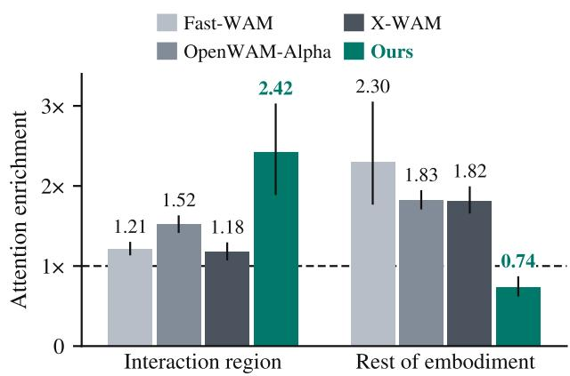  
Figure 6. Where does action attention go? Attention enrichment over 50 event windows, one per RoboTwin 2.0 task, on the interaction region, formed by the manipulated object and the embodiment within 3 cm of contact, and on the rest of the embodiment. Enrichment is the attention mass on a region divided by its area fraction; the dashed line marks uniform attention (1×). The baselines favor the embodiment as a whole, whereas Gnomon4D concentrates on the interaction region. Error bars are 95% bootstrap intervals over tasks.

## A.2. Results and Visualization

The baselines favor the embodiment as a whole (Fig. 6): its remaining part receives 1.82–2.30× uniform attention, more than the 1.18–1.52× on the interaction region. Gnomon4D reverses this allocation, raising the interaction region to 2.42× [1.89, 3.03] and lowering the rest of the embodiment to 0.74×. Attention to the embodiment near contact stays at 1.51×, within the 1.27–1.77× range of the baselines. The baseline maps motivate explicit interactionregion selection. The probed route in Gnomon4D allocates more attention to the interacting pair than to the remaining embodiment.

Figure 7 shows three selected interactions under the same protocol. On the 46 windows with visible objects, mean object enrichment is 2.53 for Gnomon4D, compared with 1.48 for OpenWAM-Alpha and 1.16 for X-WAM (paired gains: 1.05 [0.43, 1.73] and 1.37 [0.76, 2.05], 95% bootstrap intervals). Gnomon4D exceeds both baselines on 25 of the 46 windows, and its maps retain scattered offobject peaks.

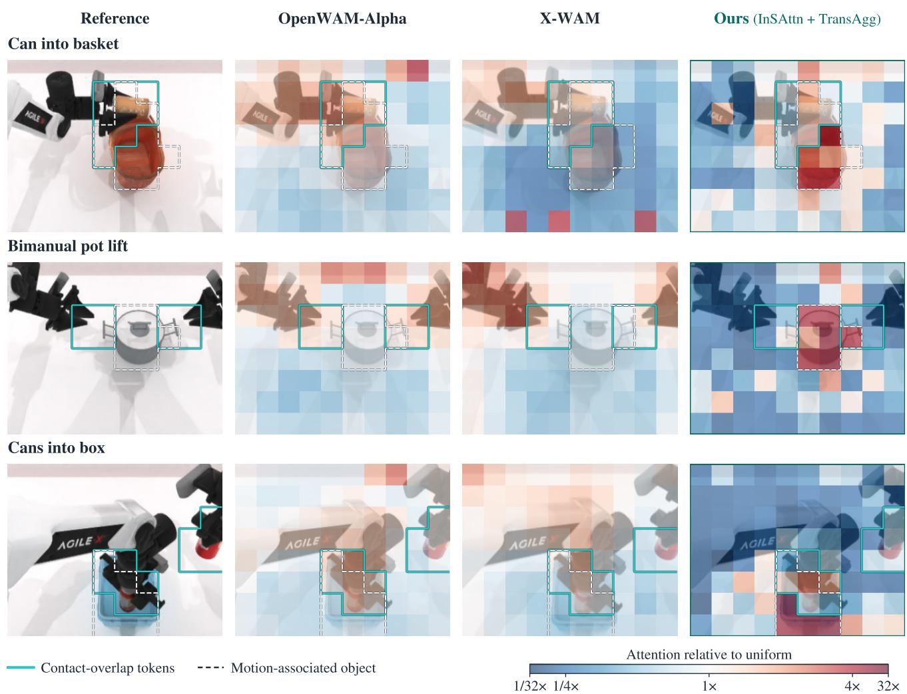  
Figure 7. Action-conditioned spatial readout. Three selected interactions from the 50-window probe; population statistics are given in the text. All models are shown on the future latent block containing the event; Fast-WAM is omitted because its action reads only the observed frame. Gnomon4D shows the interaction rollout of the benchmark checkpoint. Reference regions are pooled within that block. Cyan contours mark contact-overlap tokens, and dashed white contours mark motion-associated objects. Colors show attention relative to uniform within each displayed frame on one piecewise log scale $( \textstyle { \frac { 1 } { 3 2 } } \times - 3 2 \times ; \thinspace { \frac { 1 } { 4 } } \times - 4 \times$ spans 80% of the color range) and the native 8×10 token grid.

## B. Design Comparison with Existing WAMs

The attention probes motivate examining both what a predicted future contains and how the action expert reads it. Table 5 compares the WAM baselines evaluated in the main paper along three axes: future representation, access at inference, and action readout.

Representation. No baseline gives the action online access to the 3D motion of both the embodiment and the objects. Futures that carry geometry encode it frame by frame (X-WAM, WAM4D), restrict 3D motion to the end effector (STARRY), keep motion in the image plane (Motus, FlowWAM), or use 4D targets only as a training signal (MECo-WAM). GeoDelta is generated together with the action and records image displacement and depth change on a common grid for the embodiment and objects.

Readout. Five baselines read the predicted future through dense joint attention or cross-attention, while Fast-WAM, WAM4D, and MECo-WAM do not read it at inference. ARPS compresses it into learned predictive-state queries, and STARRY biases action attention by distance to the predicted end effector. InSAttn and TransAgg instead select regions and frames from the predicted embodiment–object relative motion, which neither cue represents. Among models with reported sizes, Gnomon4D has 6.76B parameters and the baselines have 5.7–8B, except LingBot-VA 2.0 (15.3B, mixture of experts).

Table 5. Design comparison with the WAM baselines of Table 1 of the main paper. Future: prediction targets beyond RGB video. Online: the action reads a predicted future at inference; otherwise the future is a training signal only. 3D motion: the target encodes cross-frame 3D displacement; EE, end effector only. Emb./Obj.: embodiment and object motion are represented separately. Ego. video: pretraining on egocentric human video. Params: inference-time parameters, summed from the components each paper reports; n/r, not reported. Avg. is the RoboTwin 2.0 SR of Table 1 of the main paper.
<table><tr><td>Method</td><td>Future</td><td>Online</td><td>3D motion</td><td>Emb./Obj.</td><td>Ego. video</td><td>Action readout</td><td>Params</td><td>Avg.</td></tr><tr><td colspan="9">WAM: RGB Futures</td></tr><tr><td>Motus [4]</td><td>Flow latent action</td><td>√</td><td>x</td><td>x</td><td>√</td><td>Joint attention</td><td>8B</td><td>87.84</td></tr><tr><td>Fast-WAM [81]</td><td></td><td>x</td><td>x</td><td>x</td><td>x</td><td>Current frame only</td><td>6B</td><td>91.83</td></tr><tr><td>LingBot-VA 2.0 [84]</td><td>Latent action</td><td>√</td><td>x</td><td>x</td><td>√</td><td>Joint attention</td><td>15.3B (MoE)</td><td>93.60</td></tr><tr><td>OpenWAM-Alpha [68]</td><td></td><td>√</td><td>x</td><td>x</td><td>V</td><td>Joint attention</td><td>6B</td><td>93.60</td></tr><tr><td colspan="9">WAM: 3D Geometry / Flow</td></tr><tr><td>X-WAM [15]</td><td>Per-frame depth</td><td>√</td><td>x</td><td>x</td><td>x</td><td>Joint attention</td><td>n/r</td><td>90.22</td></tr><tr><td>WAM4D [31]</td><td>Per-frame depth</td><td>x</td><td>x</td><td></td><td>n/r</td><td>History frames only</td><td>5.7B</td><td>91.84</td></tr><tr><td>FlowWAM [11]</td><td>Robot 2D flow</td><td>√</td><td>x</td><td></td><td>√</td><td>Cross-attention</td><td>5.8B</td><td>92.54</td></tr><tr><td>MECo-WAM [83]</td><td>4D geometry tokens</td><td>x</td><td>r</td><td>x××</td><td>x</td><td>Current frame only</td><td>6B</td><td>92.62</td></tr><tr><td colspan="9">WAM: Structured Readout</td></tr><tr><td>ARPS [14]</td><td>V-JEPA2 features</td><td>x</td><td>x</td><td>x</td><td>n/r</td><td>Predictive-state queries</td><td>6B</td><td>90.71</td></tr><tr><td>STARRY [61]</td><td>Depth, EE pose</td><td>√</td><td>EE</td><td>EE</td><td>√</td><td>EE-distance attention bias</td><td>n/r</td><td>93.56</td></tr><tr><td>Gnomon4D</td><td>GeoDelta  $( \Delta u , \Delta v , \Delta d )$ </td><td>√</td><td>√</td><td>√</td><td>√</td><td>InSAttn + TransAgg</td><td>6.76B</td><td>94.33</td></tr></table>

## C. Model Implementation

The joint attention mask determines which predictions each expert can access. The interaction readout then selects the spatial and temporal evidence used by the Action expert.

```latex
Algorithm 1 Relation-guided interaction readout.
Input: future features $\mathbf { f } _ { n , i } ^ { m } ,$ , queries $\{ \mathbf { q } _ { k } ^ { m } \} _ { k = 1 } ^ { K }$ , and grid alignment
$\mathcal { A } _ { m } , \mathrm { f o r } m \in \{ \mathrm { V } , \mathrm { G } \} ;$ instruction ℓ and proprioception s<sub>0</sub>
Output: interaction tokens $\mathbf { Z } = \{ \mathbf { z } _ { k } ^ { \mathrm { V } } , \mathbf { z } _ { k } ^ { \mathrm { G } } \} _ { k = 1 } ^ { \hat { K } }$
Estimate geometric cues shared by both modalities.
1: $\delta _ { n , i } , \rho _ { n , i } ^ { \mathrm { e } } , \rho _ { n , i } ^ { \mathrm { o } }  \mathrm { h e a d s } ( \mathbf { f } _ { n , i } ^ { \mathrm { G } } )$
$\begin{array} { r } { \ \mathrm { ~ z ~ } \ \bar { \delta } _ { n , i } ^ { \mathrm { e } }  \sum _ { j } w _ { i j } \rho _ { n , j } ^ { \mathrm { e } } \delta _ { n , j } \big / \big ( \sum _ { j } w _ { i j } \rho _ { n , j } ^ { \mathrm { e } } + \varepsilon \big ) } \end{array}$
$\| \delta _ { n , i } - \bar { \pmb \delta } _ { n , i } ^ { \mathrm { e } } \|$
3: c
$c _ { n , i }  \frac { } { \| \delta _ { n , i } \| + \| \bar { \delta } _ { n , i } ^ { \mathrm { e } } \| + \varepsilon }$
4: $\Delta c _ { 1 , i } \gets 0$ ▷ No preceding future frame.
$\mathfrak { s } \colon \Delta c _ { n , i }  c _ { n , i } - c _ { n - 1 , i } \mathrm { f o r } n = 2 , \ldots , N$
6: $h _ { n , i } \gets \phi ( c _ { n , i } ; \ell , \mathbf { s } _ { 0 } )$
$\begin{array} { r } { 7 \mathrm { : ~ } s _ { n , i } \gets \operatorname { s o f t m a x } _ { i } \left( h _ { n , i } + \log ( \rho _ { n , i } ^ { \mathrm { e } } + \rho _ { n , i } ^ { \mathrm { o } } + \varepsilon ) \right) } \end{array}$
8: $\begin{array} { r } { r _ { n } \gets \sum _ { i } s _ { n , i } | \Delta c _ { n , i } | } \end{array}$
InSAttn: read salient regions within eachframe.
9: for m $\in \{ \mathrm { V } , \mathrm { G } \}$ do
10: $\widetilde { s } ^ { m } \gets { A } _ { m } ( s )$ ▷ Match the feature grid.
11: for $k = 1 , \ldots , K , n = 1 , \ldots , N$ do
12: $\mathbf { y } _ { k , n } ^ { m } \gets \mathrm { A t t n } \left( \mathbf { q } _ { k } ^ { m } , \{ \mathbf { f } _ { n , i } ^ { m } \} _ { i } ; \log ( \widetilde { s } _ { n , i } ^ { m } + \varepsilon ) \right)$
13: end for
14: end for
TransAgg: poolframes around relation changes.
15: for $m \in \{ \mathrm { V } , \mathrm { G } \} , k = 1 , \ldots , K \mathbf { d o }$
16: $\mathbf { z } _ { k } ^ { m } \gets \mathrm { A t t n } \left( \mathbf { q } _ { k } ^ { m } , \{ \mathbf { y } _ { k , n } ^ { m } \} _ { n } ; \log ( r _ { n } + \varepsilon ) \right)$
17: end for
18: return $\{ \mathbf { z } _ { k } ^ { \mathrm { V } } , \mathbf { z } _ { k } ^ { \mathrm { G } } \} _ { k = 1 } ^ { K }$
```

## C.1. Attention Visibility

Each layer uses one masked softmax over the three experts (Fig. 8). Its five token groups are clean current Video $\mathbf { V _ { o b s } }$ , future Video V, clean GeoDelta conditions $\mathbf { G } _ { \mathrm { c o n d } }$ future GeoDelta G with camera tokens when present, and actions A. Current-observation tokens attend only to one another within each modality, preventing noisy predictions from altering them. Future Video and GeoDelta attend to all world tokens and actions up to the corresponding control time, learning the visual and geometric responses. Actions attend to themselves, clean conditions, and future world tokens. A zero-noise block becomes a condition and stops attending to other modalities’ noisy blocks. During the second half of sampling, future Video continues to read clean GeoDelta and actions, while these clean blocks do not read noisy future Video (Fig. 8b). The same visibility rule applies when training with clean GeoDelta and actions paired with noisy Video.

## C.2. Interaction Readout

Figure 9 illustrates the readout through a reach-andgrasp interaction. Relative motion increases as the gripper approaches a stationary object and decreases once they move together. InSAttn maps this relation, conditioned on the task, to saliency over the embodiment and object. The wells depict − log s: lower values correspond to a stronger attention bias. TransAgg then pools frame features using saliency-weighted changes in the relation, concentrating evidence around interaction transitions. Algorithm 1 reads the valid tokens of N future frames at one readout layer and denoising step.

Masked (dark: noisy, light: clean)FFN  
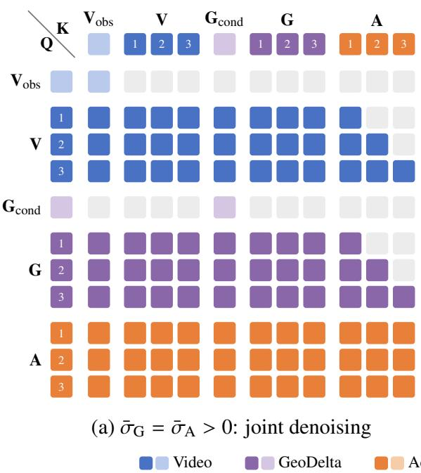

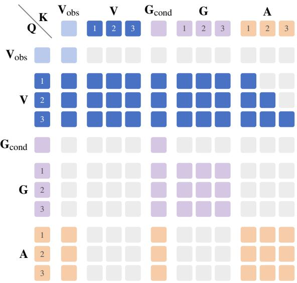  
(b) $\bar { \sigma } _ { \mathrm { G } } = \bar { \sigma } _ { \mathrm { A } } = 0 \mathrm { : }$ Video refinement

Figure 8. Attention visibility of the joint softmax. Rows are queries and columns are keys. Colored cells are visible, gray cells are masked,Action expert t <sup>Action</sup> <sup>Chunk</sup> <sub>0 0.5 1</sub> dark and light shades mark noisy and clean blocks, and numbers index time steps. (a) While GeoDelta and actions are noisy, future Videosampling progress u and GeoDelta tokens read all world tokens and actions up to the corresponding control time, action tokens read the full sequence, and= 32 steps current-observation condition tokens read only themselves. (b) Future Video reads the clean GeoDelta and Action blocks, which do no<sup>Embodiment</sup> <sup>State</sup> <sup>s</sup>0 <sup>Context</sup> frozen trainable read noisy future Video.  
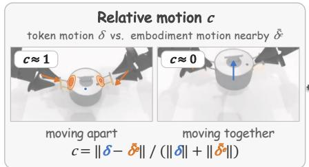

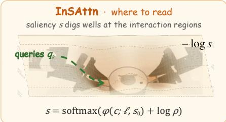

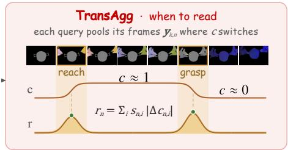  
Figure 9. Intuition behind relation-guided interaction readout. Left: relative motion decreases when the embodiment and object move together. Middle: InSAttn converts this relation into task-conditioned spatial saliency. Right: TransAgg emphasizes frames where the relation changes. Here $\rho = \rho ^ { \mathrm { e } } + \rho ^ { \mathrm { o } }$ denotes foreground probability.

The motion and role heads act on GeoDelta features, supervised by L1 loss on mean token displacement and crossentropy on role labels. All geometric quantities are computed for every future frame n and token i. The weights $w _ { i j }$ form a fixed $5 \times 5$ Gaussian neighborhood around i and are zero outside it. The MLP $\phi$ uses FiLM conditioning on ℓ and $\mathbf { s } _ { 0 }$

Each modality has K = 32 queries and shares the saliency s and frame scores r computed on the GeoDelta grid. The operator $A _ { m }$ returns nonnegative saliency weights on the target feature grid and preserves the frame index; $\mathcal { A } _ { \mathrm { G } }$ is the identity. With projected keys and values,

attention takes the form

$$
\begin{array} { l } { { \displaystyle \mathrm { A t t n } ( { \bf q } , \{ { \bf x } _ { j } \} ; b _ { j } ) = \sum _ { j } \alpha _ { j } W _ { V } { \bf x } _ { j } } , } \\ { ~ } \\ { { \displaystyle \alpha _ { j } = \mathrm { s o f t m a x } _ { j } \left( \frac { ( W _ { Q } { \bf q } ) ^ { \top } W _ { K } { \bf x } _ { j } } { \sqrt { d } } + b _ { j } \right) } . } \end{array}
$$

The projections are specific to each modality and attention stage; d is the key dimension, and both branches output tokens in a common readout space. We add $\varepsilon > 0$ before logarithms and in the motion denominators. When all $r _ { n }$ vanish, the temporal bias is constant and pooling reduces to content-based attention. The resulting 2K tokens enter the Action expert through residual cross-attention.

Table 6. Output of each curation stage of EgoManip-5000H.
<table><tr><td>Stage</td><td>Clips</td><td>Hours</td><td>Supervises</td></tr><tr><td>1 Real-scene filtering</td><td>17.23M</td><td>37,132</td><td>1</td></tr><tr><td>2 Ego-manipulation classifier</td><td>3.42M</td><td>7,575</td><td>一</td></tr><tr><td>3 Hand reconstruction</td><td></td><td></td><td></td></tr><tr><td>Hands visible</td><td>1.45M</td><td>2,859</td><td>Video, GeoDelta</td></tr><tr><td>Hands rarely visible</td><td>1.96M</td><td>4,716</td><td>Video</td></tr></table>

## D. Pretraining and Mid-Training Data

The training curriculum uses EgoManip-5000H for action-free pretraining and Robot-30H for mid-training with robot controls.

## D.1. EgoManip-5000H for Pretraining

EgoManip-5000H is mined from a sub-pool of an industrial-scale proprietary video library, in which egocentric manipulation accounts for only about 5% of the footage. Three stages refine the sub-pool (Fig. 10), and Table 6 reports the clips and hours that each stage retains.

Real-scene filtering. Production video operators split each video into single-shot clips and retain real-time recordings of real scenes. Filtering removes animated, CG, and AI-generated content, visual effects, and low-quality footage. It also excludes static shots and clips altered by fast or slow motion, time-lapse, editing, or stylized camera moves. The 17.2M clips (37,132 hours) that pass these checks form the input to the next stage.

Egocentric manipulation classifier. This stage selects egocentric clips in which the camera wearer manipulates objects. Kimi-K2.6 [25] labels a subset using viewpoint, content, and hand-presence cues. VGGT-Ω [66] supplies camera trajectories and 3D geometry, and Qwen3-VL [2] supplies captions and embeddings. WiLoR [50] provides hand detections. A Qwen3-VL-Embedding-2B [29] classifier trained on these labels then scores every clip, and the 3.42M clips (7,575 hours) it accepts form the egocentric manipulation set.

Hand reconstruction. This stage splits the egocentric manipulation set by whether the hands remain in view. WiLoR detects the hands in every frame, and we fit a MANO [53] mesh to each detection by inverse kinematics. Clips whose hands appear in at least 51% of the frames form the hand-visible group of 1.45M clips (2,859 hours), which supervises both the Video and GeoDelta experts. Their hand GeoDelta is rendered from the fitted meshes during data loading, after the camera rotation between frames is compensated with the VGGT-Ω extrinsics. The remaining 1.96M clips (4,716 hours) supervise only the Video expert.

Every clip also carries a Qwen3-VL caption with a global intent and time-stamped events, which provides the prompt of each training window.

Composition. We annotate a subset of high-confidence clips with Kimi-K2.6 scene and action labels and report their distribution in Fig. 11. Vehicles form the largest scene (38.5%), and showing, pressing, inspecting, and grasping account for two thirds of the actions. The hand-visible group contains more bimanual clips (45.4% versus 29.4%), and Fig. 12 shows examples from eight scene groups.

## D.2. Robot-30H for Mid-Training

Robot platform and tasks. Mid-training uses the realrobot subset of IG-10K [89], recorded on a dual-arm Realman platform teleoperated in VR at 30 Hz. Each arm has seven joints and a parallel gripper, and a fixed ZED2i camera provides the head view that our model observes. The subset covers 53 tasks in household, supermarket, restaurant, warehouse logistics, hospital, and laboratory scenes. Each task is recorded in several scene variants that change the object layout, appearance, or category, so the same skill appears in visually diverse settings.

Data scale and split. The real-robot subset contains 11,220 episodes and 37.0 hours of demonstrations. We use 10,500 of these episodes, 34.1 hours that cover all 53 tasks (Fig. 14), with a median episode length of 11.5 s. The last two episodes of every task variant are held out for validation, and the remaining 10,080 episodes (32.8 hours) are used for training.

Training targets. Every episode is converted to the posttraining benchmark format (Fig. 13). The head view is resized to 512×288. The dataset records depth only for the three auxiliary RealSense cameras and provides no camera calibration, so DA3 [34] estimates the metric depth and intrinsics of the ZED2i head view. The instance masks released with the dataset label the manipulated objects, and SAM 3.1 [6] segments the robot arms; for directories without released masks, SAM 3.1 also segments the objects from prompts derived from the task description. RAFT [60] flow between frames four steps apart, combined with the DA3 depth at both ends, gives the displacement of every arm and object pixel, and pixels that move by less than 0.5 px are set to zero motion to suppress depth flicker on static surfaces. Actions are the end-effector positions, 6D rotations, and gripper states of both arms, normalized to [−1, 1] with dataset statistics.

Show and handle one hand · A person holds a small colorful bird on their left

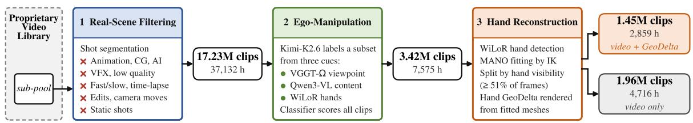  
Figure 10. Curation of EgoManip-5000H. A sub-pool of the library passes real-scene filtering and an egocentric-manipulation classifier, and hand reconstruction splits the result into a hand-visible group with GeoDelta and a video-only group. Rounded boxes give the clips and hours that each stage outputs.

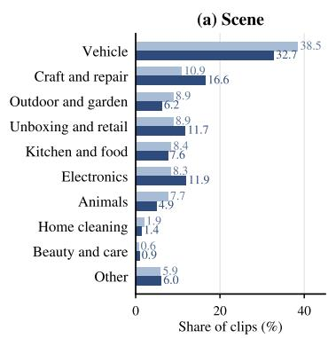

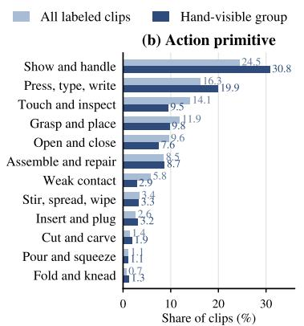

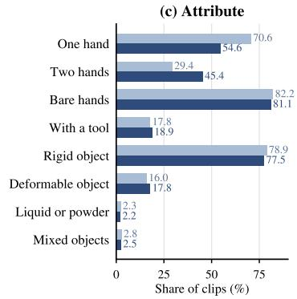

Figure 11. Composition of EgoManip-5000H. Shares of Kimi-K2.6 scene, action, and attribute labels among labeled clips of the full se and of the hand-visible group.  
Frame t  
Hand GeoDelta at t+16  
Frame t+32  
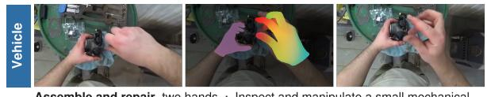

Frame t  
Hand GeoDelta at t+16  
Frame t+32  
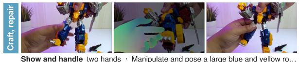

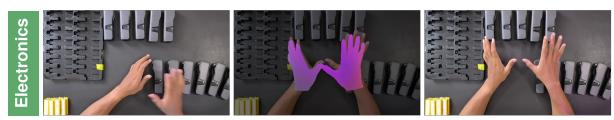

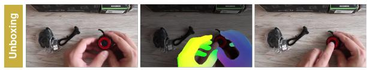

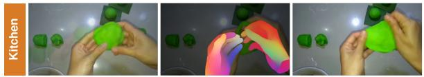


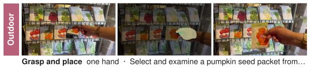

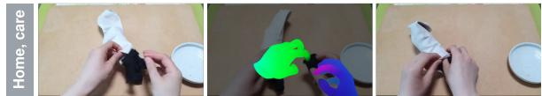  
Fold and knead two hands · Insert a piece of dark fabric into a white sock  
Mid-gray means no motion. Hands are rendered from the fitted MANO meshes over a dimmed frame.

Figure 12. Training windows of EgoManip-5000H across scenes. Each example shows frames t and t+32 and, between them, the RGBencoded hand GeoDelta at t+16, labeled with the action primitive and the caption intent of its clip.

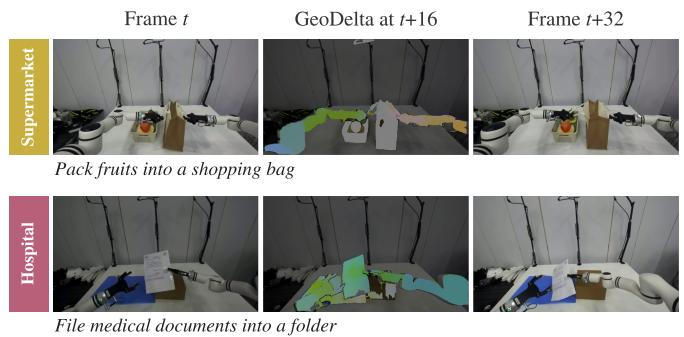

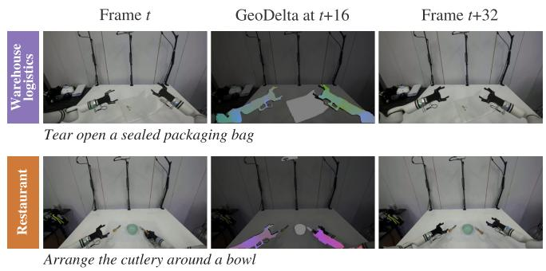  
Figure 13. Robot-30H training windows from different scenes. Each example shows frames t and t+32 and, between them, the RGBencoded GeoDelta of both arms and the manipulated objects at t+16; parts at rest appear mid-gray.

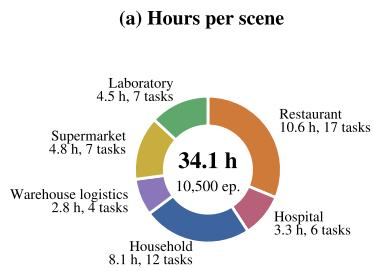

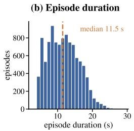  
Figure 14. Robot-30H overview. (a) Hours of the 10,500 episodes by scene, with scenes as defined by IG-10K [89]. (b) Distribution of episode durations.

## E. Simulation Experiments

We detail geometric supervision, post-training, and evaluation on RoboTwin 2.0, VLABench, and RoboDojo.

## E.1. Data and Geometric Supervision

All benchmarks use three role labels: background, embodiment, and object. Foreground GeoDelta stores sourcecamera displacement $( \Delta u , \Delta v , \Delta d )$ to the next sampled frame.

RoboTwin 2.0. We replay each released seed and trajectory in SAPIEN, requiring joint states to match within $1 0 ^ { - 5 }$ Each frame records head-camera depth, actor segmentation, and all robot-link and scene-entity poses. Robot links are embodiment, and all task objects are object, together with other entities whose centers move more than 2 mm. Pixels are back-projected with simulator depth, transformed by their entity’s relative pose, and reprojected into the source camera.

VLABench. Official episodes supply depth and robot masks but lack object segmentation and poses. We regenerate demonstrations with the official scene sampler, expert skill sequences, and success filter, changing only the recorder to save primary-camera depth, segmentation, and all body poses per frame. Franka arm and gripper bodies are embodiment; other bodies translating more than 2 mm or rotating more than 1<sup>◦</sup> are object. The rigid construction follows RoboTwin 2.0, with median deviation of 0.8 mm between transported and next-frame rendered depth. Training mixes 6,575 regenerated demonstrations with the official data.

RoboDojo. Released episodes contain head- and twowrist-camera JPEG streams, per-frame intrinsics and extrinsics, joint states, end-effector poses, and actions, but no depth, segmentation, object poses, or scene seeds. Using the released joint states and ARX X5 URDF, we render headview robot depth and link indices in SAPIEN and derive embodiment GeoDelta from each link’s forward-kinematic motion. Remaining pixels use DA3 depth, SAM 3.1 object masks, and RAFT flow to the next sampled frame. We align DA3’s episode-dependent depth scale to rendered robot depth $d ^ { \mathrm { R } }$ with one factor per episode,

$$
s = \mathrm { m e d i a n } _ { ( t , p ) \in { \mathcal R } } \ d _ { t } ^ { \mathrm { R } } ( p ) / d _ { t } ^ { \mathrm { D A 3 } } ( p ) ,\tag{8}
$$

where $\mathcal { R }$ collects the rendered robot pixels of all frames. A shared scale avoids fluctuations from per-frame fits, while a constant offset cancels in $\Delta d .$ Pixels inside the object masks whose flow exceeds 1 px are labeled object and take $( \Delta u , \Delta v )$ from the flow and $\bar { \Delta } d = s ( d _ { t + 4 } ^ { \mathrm { D A 3 } } ( p ^ { \prime } ) \ – d _ { t } ^ { \mathrm { D A 3 } } ( p ) )$ where $p ^ { \prime }$ is the flow correspondence of $p .$ The other nonrobot pixels are treated as static background.

Current-frame conditions. The GeoDelta expert receives current head-view depth and a binary foreground mask covering the robot and task objects in RoboTwin 2.0, or the robot in VLABench. Both benchmarks use simulatorrendered conditions during training and evaluation. RoboDojo uses the robot-only renders above, recomputed at test time from live joint states and camera parameters rather than evaluation-simulator depth or segmentation, keeping training and test inputs consistent.

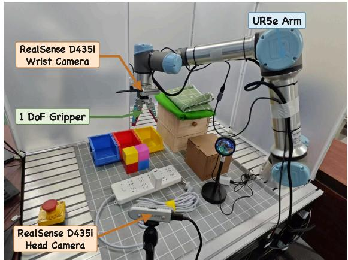  
Figure 15. Real-robot platform. A UR5e arm with a 1-DoF parallel gripper operates in a tabletop workspace, observed by a fixed RealSense D435i head camera and a RealSense D435i wrist camera.

## E.2. Training and Evaluation Protocols

Post-training. For 40% of training samples, we draw u ∼ $\mathcal { U } ( 0 , 1 )$ and set $\sigma _ { \mathrm { V } } = 1 - u$ and $\sigma _ { \mathrm { G } } = \sigma _ { \mathrm { A } } = \mathrm { m a x } ( 1 -$ 2u, 0). Another 40% draw noise levels uniformly within $\sigma _ { \mathrm { G } } = \sigma _ { \mathrm { A } } \leq \sigma _ { \mathrm { V } }$ . The remaining 20% keep GeoDelta and actions clean with $\sigma _ { \mathrm { V } } \sim \mathcal { U } ( 0 , 1 )$ .

Evaluation. RoboTwin 2.0 uses 100 evaluation episodes per task in each setting. VLABench uses 50 episodes per task and track, except 10 for Insert Flower on the unseencategory track, following the official protocol. RoboDojo macro-averages success rate and partial-credit Score over its five evaluation dimensions.

## F. Real-Robot Experiments

We evaluate five tasks under training conditions and controlled visual shifts.

## F.1. Platform and Tasks

The platform consists of a UR5e arm, a 1-DoF parallel gripper, and two RealSense D435i cameras (Fig. 15, Table 7). The fixed head view and the wrist view provide RGB observations, and head-camera depth supplies the geometry for GeoDelta.

Tasks. Table 8 defines the five tasks and their success criteria. Success requires completing the full task without human intervention, with no partial credit for intermediate progress. Fig. 16 illustrates the task sequences and representative visual shifts.

## F.2. Demonstrations and Geometric Supervision

Demonstrations. We collect 50 robot demonstrations per task, 250 in total, and all methods are trained on the same data. An operator guides the arm in freedrive mode and controls gripper opening and closing with keyboard commands. Object and movable-container placements vary within a 30×30 cm region, with fixed lighting, tablecloth, and object appearance. The two camera views are saved on a common 10 Hz grid, and image timestamps are matched to the nearest recorded robot state. Each training window contains the current observation and 32 future control steps, with video and GeoDelta sampled every four steps.

Table 7. Real-robot acquisition and control settings. The 10 Hz action grid specifies the nominal spacing of predicted targets. Replanning also includes inference time.
<table><tr><td>Component</td><td>Configuration</td></tr><tr><td>Arm and gripper</td><td>Six arm joints and one gripper command; measured joint states read through RTDE.</td></tr><tr><td>Camera streams</td><td>Head and wrist RGB-D at 640 ×480, 30 Hz; frames saved at 10 Hz.</td></tr><tr><td>Depth</td><td>Aligned to RGB with the camera SDK and con- verted to meters using the device depth scale; zero denotes invalid depth.</td></tr><tr><td>Action chunk</td><td>32 targets on a 10 Hz grid; the first 16 are executed before replanning.</td></tr><tr><td>Execution</td><td>Joint targets interpolated at 500 Hz; the arm holds its position during inference.</td></tr></table>

Table 8. Real-robot tasks and complete-task success criteria. Task instructions are shown in Fig. 16.
<table><tr><td>Task</td><td>Success criterion</td></tr><tr><td>Routine</td><td></td></tr><tr><td>Drawer Storage</td><td>The block is inside the drawer and the drawer is closed.</td></tr><tr><td>Box Packing</td><td>The block is inside the box and the lid is closed.</td></tr><tr><td>Block Stacking</td><td>The red block rests stably on the yellow block af- ter release.</td></tr><tr><td>Long-horizon</td><td></td></tr><tr><td>Color Sorting</td><td>The red, yellow, and blue blocks are each inside the bin of the same color.</td></tr><tr><td>Precision</td><td></td></tr><tr><td></td><td>Charger Insertion The charger is fully inserted into the power strip.</td></tr></table>

Foreground and role masks. SAM 3.1 [6] segments the head-camera video with task prompts and optional boxes; missing or drifting masks are corrected offline. Pixels are labeled background, embodiment (arm and gripper), or object (manipulated objects and task containers). The role labels supervise the interaction readout, and their foreground union conditions the GeoDelta expert. At deployment, the mask is computed from the current observation.

Geometric motion. For head-camera frames t and t+4, RAFT-Large [60] estimates forward and backward flow with 24 updates. At each source pixel, the forward flow

Task execution

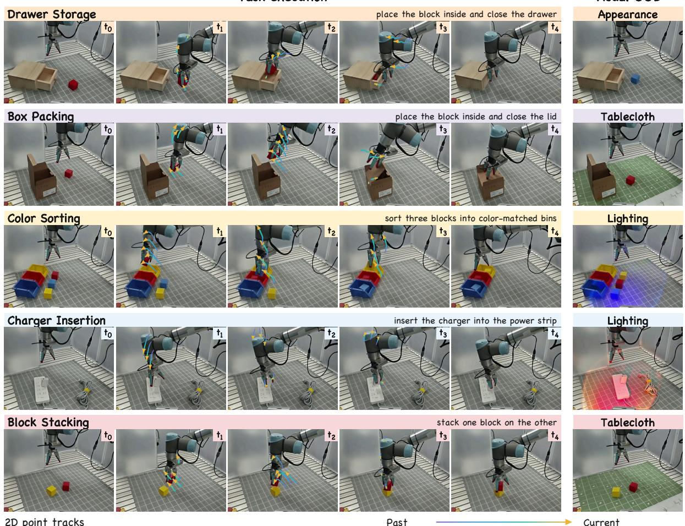  
Figure 16. Real-robot tasks and visual OOD conditions. Each row is labeled with its task instruction, and the first five frames show one execution under training conditions. Gradient arrows show recorded 2D point tracks on the robot and objects; color progresses from purple (past) to gold (current), with arrowheads marking current positions. The right column shows separate trials with changed object appearance, tablecloth, or lighting.

gives $( \Delta u , \Delta v )$ , and the depth change $\Delta d$ is the bilinearly sampled endpoint depth minus the source depth. Together, they form GeoDelta in the fixed head-camera frame. A foreground correspondence is valid when its endpoint lies inside the image, both depths are valid, the forward–backward error is below 1 px, and the embodiment or object role agrees across frames. We apply the signed µ-law displacement codec from the main paper with $\omega _ { u } = \omega _ { v } = W / 6$ $\omega _ { d } = 0 . 1 0 \mathrm { m }$ , and $\mu = 3 1$ . Soft thresholds of 0.5 px for image displacement and 2 mm for depth change suppress label noise. Fig. 17 shows the resulting supervision across tasks.

## F.3. Training and Inference

Action representation. At future step τ , the action is $( { \bf q } _ { \tau } - { \bf q } _ { 0 } , g _ { \tau } )$ , where ${ \bf q } _ { 0 }$ contains the six current joint angles in radians. The absolute gripper command $g _ { \tau }$ is 0 for open and 1 for closed. Proprioception contains ${ \bf q } _ { 0 }$ and the current gripper command. Joint actions and states are standardized with training-set statistics, and gripper commands are mapped to $[ - 1 , 1 ]$ . After inverse normalization, each joint displacement is added to ${ \bf q } _ { 0 }$ and executed with interpolation and velocity limits.

Table 9. Visual OOD factors. Each factor is evaluated in 10 trials per task, totaling 50 trials across the five tasks.
<table><tr><td>Factor</td><td>Setting</td></tr><tr><td>Lighting</td><td>Colored side illumination changes the light on the ob- jects and workspace.</td></tr><tr><td>Tablecloth</td><td>The training tablecloth is replaced with an unseen green plaid tablecloth.</td></tr><tr><td>Appearance</td><td>Task objects have unseen appearances, including block-color changes in Drawer Storage and Box Packing.</td></tr><tr><td>Distractors</td><td>Additional non-target objects are placed in the workspace.</td></tr></table>

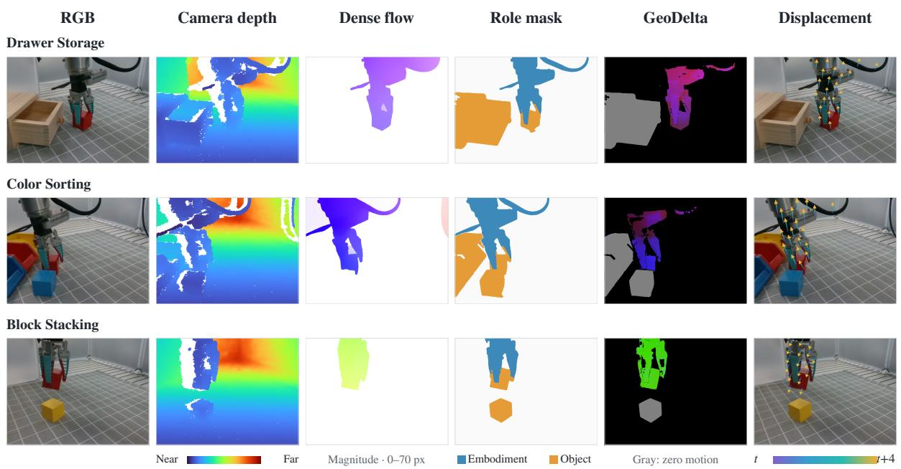  
Figure 17. Geometric supervision on Drawer Storage, Color Sorting, and Block Stacking. From left to right: RGB, recorded camera depth, smoothed dense RAFT flow over the full image with linear magnitude scaling, SAM 3.1 role masks after morphological cleanup, RGB-encoded GeoDelta, and displacement overlaid on RGB. All motion panels use the same frame pair, four control steps apart. Gradient arrows indicate image-plane displacement from t to t+4.

Table 10. Real-robot complete-task success counts. Each task has 40 ID and 40 OOD trials per method, and Total aggregates 200 trials per condition. Gnomon4D performs best on every task under both conditions.
<table><tr><td></td><td colspan="2">RGB</td><td colspan="2">Fast-WAM X-WAM RGB-D</td><td colspan="2">FlowWAM RGB + 2D Flow RGB + GeoDelta</td><td colspan="2">Gnomon4D</td></tr><tr><td>Task</td><td>ID</td><td>OOD</td><td>ID</td><td>OOD</td><td>ID</td><td>OOD</td><td>ID</td><td>OOD</td></tr><tr><td>Drawer Storage</td><td>32</td><td>26</td><td>33</td><td>31</td><td>34</td><td>32</td><td>36</td><td>35</td></tr><tr><td>Box Packing</td><td>24</td><td>20</td><td>28</td><td>25</td><td>30</td><td>26</td><td>33</td><td>31</td></tr><tr><td>Block Stacking</td><td>29</td><td>22</td><td>30</td><td>26</td><td>33</td><td>24</td><td>35</td><td>31</td></tr><tr><td>Color Sorting</td><td>21</td><td>16</td><td>23</td><td>20</td><td>29</td><td>21</td><td>32</td><td>30</td></tr><tr><td>Charger Insertion</td><td>11</td><td>10</td><td>23</td><td>22</td><td>25</td><td>19</td><td>29</td><td>29</td></tr><tr><td>Total</td><td>117</td><td>94</td><td>137</td><td>124</td><td>151</td><td>122</td><td>165</td><td>156</td></tr></table>

Table 11. Real-robot success counts under each visual OOD shift. Each shift aggregates 50 trials across the five tasks, and Total aggregates the 200 OOD trials of Table 10.
<table><tr><td>Method</td><td>Lighting</td><td>Cloth</td><td>Appearance</td><td>Distractors</td><td>Total</td></tr><tr><td>Fast-WAM [81]</td><td>24/50</td><td>29/50</td><td>18/50</td><td>23/50</td><td>94/200</td></tr><tr><td>X-WAM [15]</td><td>31/50</td><td>35/50</td><td>27/50</td><td>31/50</td><td>124/200</td></tr><tr><td>FlowWAM [11]</td><td>31/50</td><td>38/50</td><td>25/50</td><td>28/50</td><td>122/200</td></tr><tr><td>Gnomon4D</td><td>39/50</td><td>41/50</td><td>36/50</td><td>40/50</td><td>156/200</td></tr></table>

Post-training. Gnomon4D is post-trained for 5k steps on the 250 demonstrations after pretraining on EgoManip-5000H and mid-training on Robot-30H. We train one policy across all five tasks, conditioned on the task instruction. Fast-WAM, X-WAM, and FlowWAM are fine-tuned from their released weights on the same demonstrations, with shared RGB views, action normalization, and execution settings. X-WAM uses the aligned sensor depth, and FlowWAM constructs flow supervision with its public implementation.

Inference. Gnomon4D follows the coupled 20-step denoising schedule, with GeoDelta and actions ready after step 10. The controller executes the first 16 of the 32 predicted actions, then acquires a new observation and replans. The remaining denoising steps refine Video only when a visual prediction is requested.

## F.4. Evaluation and Results

Each method runs 40 ID and 40 OOD trials per task (400 total), alternating methods on shared initial configurations. ID trials vary object and container placements within the training range. OOD trials change one visual factor at a time (Table 9), with 10 trials per factor and task. The goal and other conditions stay fixed; appearance shifts preserve block–bin color correspondence in Color Sorting. Tables 10 and 11 report complete-task success counts by task and visual shift, respectively, using the criteria in Table 8.