# HIVE-Diff: High Frame Rate HDR Video Reconstruction from a Single LDR Frame and Events

Caixin Wang1,2 Qingrui Wang3 Jie Zhang2 Ralph Etienne-Cummings1

1Johns Hopkins University 2Northwestern University 3Massachusetts Institute of Technology

## Abstract

High frame rate HDR video is important in applications such as autonomous driving and scientific imaging, where rapid motion and extreme illumination often occur simultaneously. Conventional frame cameras face a trade-off between temporal resolution and dynamic range, while event cameras provide complementary high-speed brightnesschange measurements over a wide illumination range. These properties have motivated event-based HDR reconstruction, with existing methods broadly following eventonly and hybrid event-frame paradigms. Event-only HDR reconstruction, however, suffers from brightness and color drift due to the lack ofabsolute intensity references. Hybrid event-frame methods alleviate this ambiguity using lowdynamic-range (LDR)frames as anchors, but most perform one-to-one HDR reconstruction at available LDR timestamps. In this work, we investigate single-reference HDR temporal expansion, reconstructing N HDR frames from one LDR reference and events instead of N aligned LDR observations. We develop HIVE-Diff, an event-conditioned video diffusion framework that decomposes the task into event-guided temporal generation and HDR content completion. Because paired real HDR-event data are scarce, we train on synthetic data and adapt the model to real event domains using LDR-event sequences as proxy supervision with teacher-student distillation. Experiments on synthetic and multiple real-world datasets demonstrate strong reconstruction quality and robust real-data adaptation. Code: github.com/caixinw4-afk/hive-diff.

## 1. Introduction

High-dynamic-range (HDR) video is important for capturing scenes with extreme lighting while preserving details in both highlights and shadows. Prior research has explored different methods to capture and reconstruct HDR video, such as multi-exposure fusion, learning-based HDR synthesis, and hardware-assisted sensing [3, 7, 20, 42]. Methods using temporally varying exposures with frame alignment are effective for static and slow scenes, but they may fail to reconstruct HDR content at high-speed scenes. Hardwarebased approaches avoid inter-frame alignment using spatially varying exposures or multi-sensor designs, but increase system complexity and often sacrifice spatial resolution, field of view, or readout bandwidth [33, 40, 42]. Together, these limitations make it difficult for conventional frame-based systems to achieve both high dynamic range and high temporal resolution.

Compared with frame-based methods, event cameras record per-pixel brightness changes asynchronously with microsecond latency [10, 25]. This allows them to capture fast motion without blur even at extreme light conditions. Existing event-based HDR methods broadly fall into two categories. Event-only methods reconstruct blur-free, highspeed HDR video directly from event streams. However, this method does not have absolute intensity references and often produces videos with severe color and brightness drifts [36, 44, 57, 58]. Hybrid event-frame methods instead use synchronous LDR frames as intensity anchors and uses events to compensate for over-/under-exposed contents. While this approach produces HDR videos with high perceptual quality and color fidelity, most existing methods reconstruct HDR content at the timestamps of the available LDR frames [15, 38, 50].

In this work, we explore a different event-frame imaging setting. Instead of reconstructing HDR video either from events alone or through one-to-one HDR reconstruction from individual LDR frames, we ask whether a single LDR frame can serve as the appearance and intensity reference for a temporally expanded HDR sequence, as illustrated in Fig. 1. Specifically, we use the LDR frame to provide absolute color and scene appearance, while the subsequent event stream is used to recover both the tempora evolution of the scene and the missing information in overor under-exposed regions. In this way, the same event measurements are exploited for both temporal expansion and HDR reconstruction, allowing multiple HDR frames to be generated from only one LDR observation. We refer to this setting as single-reference HDR temporal expansion.

To address this problem, we propose HIVE-Diff, an event-conditioned video diffusion framework for singlereference HDR temporal expansion. We use a pretrained Stable Video Diffusion (SVD) model as the spatiotemporal prior and introduce a ControlNet-style event adaptor [52] to guide the generated dynamics and HDR content. We further decompose training into event-guided LDR video generation and HDR content completion, allowing the model to first learn temporal structure and then recover HDR content.

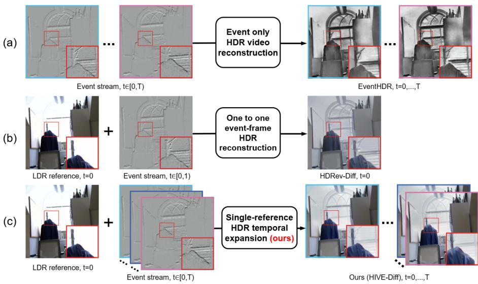  
Figure 1. Comparison of three event-based HDR reconstruction settings: (a) event-only HDR video reconstruction, represented by Even tHDR [58]; (b) one-to-one event-frame HDR reconstruction, represented by HDRev-Diff [51]; and (c) our single-reference HDR tempora expansion, which reconstructs multiple HDR frames from one LDR reference and an event stream.

A practical challenge is adapting the framework to real event-camera data, where paired high-frame-rate HDRevent ground truth is extremely scarce. We therefore train on synthetic event-HDR pairs generated with an event simulator [19]. Simulated events, however, differ from real sensors in noise, contrast thresholds, and event-frame alignment. Since paired LDR videos and event streams are easy to collect, we use them as proxy supervision to finetune the event-conditioning modules on real data, with teacher-student distillation preventing feature drift during fine-tuning.

We evaluate our framework on synthetic and multiple real-world event datasets. Since existing event-based HDR methods operate under different input-output settings, we benchmark against representative methods under their respective settings. Experiments show that a single LDR reference with events supports temporally expanded HDR reconstruction, and that the proposed adaptation improves quality and temporal stability across real event datasets. Our main contributions are summarized as follows:

(1) We investigate single-reference HDR temporal expansion, which jointly reconstructs N HDR frames from one LDR reference and events rather than N aligned LDR ob-

servations.

(2) We develop HIVE-Diff, an event-conditioned video diffusion framework that decomposes this task into eventguided LDR video generation and HDR content completion using a pretrained video prior.

(3) We introduce an HDR-GT-free real-domain adaptation strategy that uses paired LDR-event data and teacherstudent distillation to adapt the model to real event statistics and event-frame misalignment.

## 2. Related Work

## 2.1. Frame-based HDR Video Reconstruction

Most frame-based HDR video methods rely on multiexposure fusion and accurate frame alignment to recover saturated and under-exposed content [21, 54]. However, large motion and unreliable observations in saturated or noisy regions can cause misalignment, ghosting, and temporal inconsistency. Learning-based methods improve alignment through coarse-to-fine estimation and featurelevel matching [7, 20, 39], but large motion remains challenging in high-speed scenes. Hardware solutions such as spatially varying or interleaved exposures reduce temporal alignment requirements, but introduce additional sensor complexity and trade-offs in spatial resolution, field of view, or readout bandwidth [7, 42].

## 2.2. Event-based HDR Reconstruction

Event cameras offer high temporal resolution and a wide effective dynamic range, making them attractive for HDR reconstruction in fast-moving scenes. Event-only methods reconstruct high-speed HDR video directly from events [36, 44, 57, 58], but the lack of absolute intensity observations can cause brightness drift, color ambiguity, and temporal flickering. Hybrid event-frame methods instead use LDR frames as intensity and appearance references and events to recover saturated or under-exposed content [5, 15, 38, 50, 51]. Most perform one-to-one HDR reconstruction at available LDR timestamps, while several approaches further interpolate between repeated or alternating-exposure observations to produce higher-framerate HDR video [2, 37]. Closer to our setting, AKF [46] interpolates HDR intensity between frames with events, but relies on a continuous frame stream and reduces to drifting event integration when only one frame is available; Zhu et al. [56] and ContinuityCam [47] reconstruct LDR video from one image and the subsequent events, and Lin et al. [26] expand a single rolling-shutter image into HDR frames with events. None of them generates multiple HDR frames from a single LDR frame with a learned video prior.

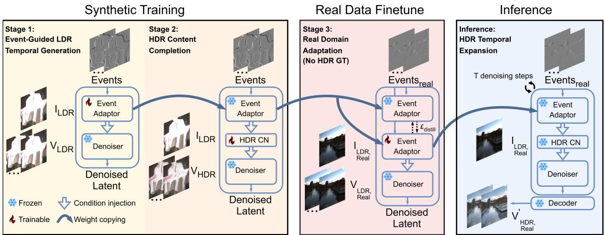  
Figure 2. Overview of the HIVE-Diff training and inference pipeline. Stage 1 learns event-guided temporal generation from synthetic LDR-event data, and Stage 2 learns HDR content completion with synthetic HDR supervision. Stage 3 adapts the event adaptor to real event data using LDR-event proxy supervision without HDR ground truth. During inference, the adapted event adaptor is combined with the HDR branch and frozen video diffusion backbone for real-world HDR temporal expansion.

Unlike these settings, we study single-reference HDR temporal expansion, where one LDR observation and its corresponding event stream are used to reconstruct multiple HDR frames within a temporal window. This setting retains an absolute appearance reference while reducing the need for an aligned LDR observation at every output timestamp.

## 2.3. Diffusion Priors for Event-Guided Reconstruction

Pretrained video diffusion models provide strong spatiotemporal priors for temporally coherent generation from a single image [1, 17, 18]. RE-VDM [4] and EGVD [55] steer a frozen video diffusion model with events to generate video from a start frame; our Stage 1 builds on this eventconditioning design. Diffusion priors have also been applied to HDR reconstruction and saturated-region recovery [14, 43, 51], but at existing frame timestamps. HIVE-Diff connects the two with a second ControlNet for HDR content completion and an adaptation stage for real sensors.

## 2.4. Real-World Adaptation for Event-based Vision

Models trained on simulated events often degrade on real sensors because of differences in noise, contrast thresholds, event rates, and other sensor characteristics [11]. Domain and test-time adaptation have therefore been explored for event-based vision [6]. For HDR video reconstruction, however, paired real events and high-frame-rate HDR ground truth are rarely available. We therefore adapt the event-conditioning modules with paired real LDR videos and events as proxy supervision (Sec. 3.3).

## 3. Proposed Method

## 3.1. Framework Overview

As illustrated in Fig. 2, HIVE-Diff realizes single-reference HDR temporal expansion through three stages: eventguided temporal generation, HDR content completion, and real-domain adaptation. This decomposition learns temporal dynamics and HDR reconstruction from synthetic data, while adapting the event-conditioning module to real sensor characteristics without requiring real HDR ground truth.

In Stage 1, we train an event adaptor on synthetic LDRevent pairs to guide a frozen pretrained video diffusion model in generating an LDR sequence from a single reference. In Stage 2, we freeze the adaptor and train an HDR ControlNet with synthetic HDR supervision to recover HDR content while preserving the learned temporal structure. In Stage 3, we adapt only the event adaptor to real data, using paired real LDR videos and event streams as proxy supervision and a frozen synthetic-trained copy as teacher to prevent feature drift. At inference, the adapted adaptor, the synthetic-trained HDR ControlNet, and the frozen backbone together reconstruct temporally expanded HDR video from real event-camera data.

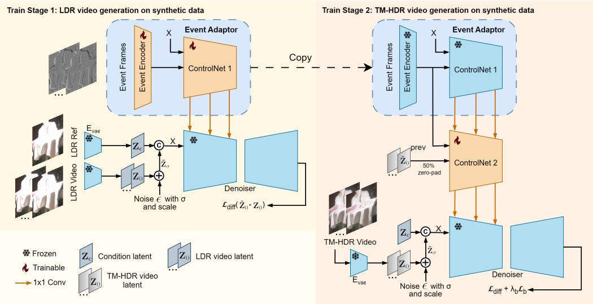  
Figure 3. Training strategies on synthetic dataset. Stage 1: We encode the randomly exposed LDR reference and the LDR video into latents, add noise to the video latents, and condition a pretrained denoiser via an event adaptor (event encoder + ControlNet 1) to generate LDR video. Stage 2: We freeze a copy of the trained event adaptor, insert the trainable ControlNet 2, and switch the target to normalized PQ-encoded HDR video latents. We also optionally feed previously denoised latents to encourage temporal consistency across video clips

## 3.2. Training on Synthetic Data

As illustrated in Fig. 3, synthetic training is decomposed into two stages. Stage 1 learns event-guided temporal generation in the LDR domain, while Stage 2 builds on the learned temporal representation for HDR content completion.

Stage 1: Event-guided temporal generation. We use the pretrained SVD image-to-video denoiser as the video prior and keep its weights frozen to preserve the pretrained spatiotemporal representation. A trainable event adaptor, consisting of an event encoder and a ControlNet-style branch, injects event-derived control signals into the frozen denoiser [4, 51, 52]. For each training clip, we render an LDR video at a randomly sampled exposure and use its first frame as the reference. The LDR video and reference frame are encoded by the pretrained VAE into the target latent $\mathbf { Z } _ { 0 }$ and reference latent $\mathbf { Z } _ { c } ,$ respectively. Following the standard SVD/EDM training formulation [1, 22], the target latent is perturbed with Gaussian noise, while the reference latent is repeated along the temporal dimension and concatenated with the noisy video latent as input to the denoiser and event adaptor.

The event tensor is built as follows. For each output time $t _ { k }$ we form 4 channels: channel $b \in \{ 0 , \ldots , 3 \}$ is the polarity-signed event count accumulated over a window of length $( 2 b { + } 1 ) \Delta t / 4$ centred at $t _ { k }$ , where ∆t is the output frame interval. Stacking these nested windows gives a multi-scale representation [4, 28, 32]: the shortest window resolves fast motion, the longer ones gather enough events in slowly changing regions. The resulting tensor V is encoded by a CNN-based event encoder $E ( \cdot )$ and fused with the initial ControlNet features:

$$
\mathbf { h } ^ { ( 0 ) }  \mathbf { h } ^ { ( 0 ) } + E ( \mathbf { V } ) .\tag{1}
$$

The event adaptor then produces multi-scale control residuals through zero-initialized $1 \times 1$ convolutional layers, which are injected into the down- and mid-blocks of the frozen denoiser. The model is trained using the standard SVD diffusion objective, denoted as ${ \mathcal { L } } _ { \mathrm { d i f f } }$ . Through this stage, the event adaptor learns to translate asynchronous event observations into temporal controls for generating an LDR sequence from a single reference frame.

Stage 2: HDR content completion. After Stage 1, we freeze the trained event adaptor and introduce an HDR ControlNet. For each training clip, an LDR reference is generated from the first HDR frame at a randomly sampled exposure, while the normalized PQ-encoded HDR sequence [9] serves as the target and is encoded into the clean latent $\mathbf { Z } _ { 0 }$

The frozen event features are mapped through zeroinitialized $1 \times 1$ convolutions and injected into the HDR ControlNet, which conditions the same frozen denoiser for HDR content recovery. The exposure value α of the reference is encoded by an MLP and injected through crossattention; α is the known rendering exposure for synthetic and EventHDR data and is set to 0 for real captures.

For longer HDR videos, independently synthesized clips may exhibit appearance drift or discontinuities at clip boundaries. To improve long-range temporal consistency, we condition the current clip on the denoised latent from the previous clip and impose a boundary consistency loss between adjacent clips:

$$
\begin{array} { r } { \mathcal { L } _ { \mathrm { b } } = \left. \hat { \mathbf { Z } } _ { 0 , [ 0 ] } ^ { \mathrm { c u r r } } - \hat { \mathbf { Z } } _ { 0 , [ - 1 ] } ^ { \mathrm { p r e v } } \right. _ { 2 } ^ { 2 } , } \end{array}\tag{2}
$$

$$
\begin{array} { r } { \mathcal { L } = \mathcal { L } _ { \mathrm { d i f f } } + \lambda _ { \mathrm { b } } \mathcal { L } _ { \mathrm { b } } . } \end{array}\tag{3}
$$

where [0] and $[ - 1 ]$ denote the first and last latent frames, respectively.

## 3.3. Real-Domain Adaptation without HDR Ground Truth

After synthetic training, we adapt only the event adaptor to real data using paired LDR videos and event streams as proxy supervision, while keeping the pretrained denoiser and HDR branch fixed. This allows adaptation to real event statistics and event–frame misalignment without requiring HDR ground truth. To prevent feature drift, we keep a frozen synthetic-trained adaptor as the teacher and fine-tune another copy as the student, as illustrated in Stage 3 of Fig. 2.

In addition to the diffusion loss ${ \mathcal { L } } _ { \mathrm { d i f f } }$ , two feature-level distillation losses regularize the student. With $D _ { \cos } ( { \mathbf a } , { \mathbf b } ) =$ $1 - \cos ( \mathbf { a } , \mathbf { b } )$ , the event-embedding loss keeps the student embedding ${ \bf E } _ { \mathrm { s } }$ close to the teacher embedding $\mathbf { E _ { \mathrm { t } } }$ , and the residual loss does the same for the multi-scale control residuals $\mathbf { R } ^ { ( d ) }$ at the selected down- and mid-blocks $d \in D \colon$

$$
\begin{array} { r } { \mathcal { L } _ { \mathrm { e } } = \frac { 1 } { | K | } \sum _ { k \in K } D _ { \mathrm { c o s } } \big ( \mathbf { E } _ { \mathrm { s } } ^ { ( k ) } , \mathbf { E } _ { \mathrm { t } } ^ { ( k ) } \big ) , } \end{array}\tag{4}
$$

$$
\begin{array} { r } { \mathcal { L } _ { \mathrm { r } } = \frac { 1 } { | D | } \sum _ { d \in D } D _ { \mathrm { c o s } } \big ( \mathbf { R } _ { \mathrm { s } } ^ { ( d ) } , \mathbf { R } _ { \mathrm { t } } ^ { ( d ) } \big ) , } \end{array}\tag{5}
$$

where K indexes the flattened event features. The final adaptation objective is $\mathcal { L } _ { \mathrm { f } } = \mathcal { L } _ { \mathrm { d i f f } } + \lambda _ { \mathrm { e } } \mathcal { L } _ { \mathrm { e } } + \lambda _ { \mathrm { r } } \mathcal { L } _ { \mathrm { r } }$

## 3.4. Training Data Synthesis and Implementation Details

We use the 16-bit color-graded HDR TIFF sequences from HdM-HDR-2014 [9] as the source HDR data. The PQencoded pixel values are normalized to [0, 1] and used as the HDR supervision. Following the exposure-rendering procedure provided with the dataset, we synthesize LDR observations at randomly sampled exposure values. We further apply randomly sampled global camera motion to the video sequences so that static scene regions also produce temporal intensity changes, and generate the corresponding event streams using the v2e event simulator [19].

We train two variants of HIVE-Diff with clip lengths of 5 and 20 frames at $5 1 2 \times 5 1 2$ resolution with 4 event bins on a single NVIDIA L40S GPU. Optimizer settings, learning rates, and step counts are given in the supplementary material.

## 4. Experiments

Because no existing method jointly addresses singlereference HDR temporal expansion, we compare representative event-based HDR methods. EventHDR [58] uses events only, whereas NeurImg-HDR [15], HDRev [50], and HDRev-Diff [51] perform one-to-one LDR-event HDR reconstruction. An input-matched cascade would first predict the missing LDR frames and make its performance depend on both LDR generation and HDR reconstruction. We therefore evaluate each one-to-one method under its native and more favorable protocol—an aligned LDR input at every output timestamp—while HIVE-Diff uses only the initial frame. We also tried an input-matched variant of EventHDR that fits a per-window affine brightness and color correction of its output to the LDR reference at $t { = } 0 .$ . On EventHDR this raises its PSNR by only about 1 dB and changes LPIPS little, because the anchor corrects the global level but not the structural errors of the event-only reconstruction; we therefore do not report it as a separate row. We report $\mathrm { F ^ { * } }$ for the reference-aligned first output frame, and $5 \times / 2 0 \times$ for full-sequence averages of the variants that generate 5 or 20 HDR frames per LDR reference. All baselines are retrained on the same synthetic data with identical LDR rendering and event simulation protocols using official implementations and recommended settings.

For datasets with HDR ground truth, we report PSNR [13], Scale- and Shift-Invariant PSNR (SSI-PSNR) [23, 48], SSIM [45], LPIPS [53], CIEDE2000 [29], and temporal warping error $( E _ { \mathrm { w a r p } } )$ [24]. $E _ { \mathrm { w a r p } }$ is undefined for $\mathrm { F ^ { * } }$ HdM-HDR-2014 metrics are computed against normalized Perceptual Quantizer $( \mathrm { P Q } )$ -encoded HDR ground truth. For datasets without HDR ground truth, we report MANIQA [49] on $\mathrm { F ^ { * } }$ , and Event-Photometric Consistency (EPC) on $5 \times$ outputs. EPC checks whether the reconstructed brightness changes agree with the recorded events. With $\hat { L } _ { t }$ the log-luminance computed from the PQ-encoded output $\hat { I } _ { t }$ and $E _ { t }$ the net polarity count of the real events between t and $t { + } 1$ , the ideal event model gives $\hat { L } _ { t + 1 } - \hat { L } _ { t } \approx C E _ { t }$ for contrast threshold C [10, 35]; we therefore report

$$
\begin{array} { r } { \mathrm { E P C } = \frac { 1 } { | \mathcal { T } | } \sum _ { t \in \mathcal { T } } \rho \Big ( G _ { \sigma } \ast \big ( \hat { L } _ { t + 1 } - \hat { L } _ { t } \big ) , G _ { \sigma } \ast E _ { t } \Big ) , } \end{array}\tag{6}
$$

with $\rho$ the Pearson correlation and $G _ { \sigma }$ a Gaussian kernel $( { \boldsymbol { \sigma } } { = } 2 \operatorname { p x } )$ that absorbs small misalignment and sensor noise. EPC does not require HDR ground truth. It measures how well brightness changes match the events, regardless of the overall brightness scale or offset. Additional multitimestamp results and frame-wise quality curves are provided in the supplementary material.

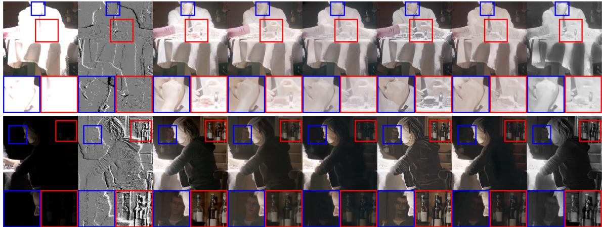  
Figure 4. Qualitative evaluation of synthetic data on hdm-hdr-2014 [9] over both over-exposed and under-exposed scenarios

<table><tr><td>Methods</td><td colspan="6">#Ref PSNR↑ SSI-PSNR↑ SSIM↑ LPIPS↓ CIEDE↓</td></tr><tr><td>EventHDR [58]</td><td>0</td><td>19.60</td><td>21.28</td><td>0.774</td><td>0.257</td><td>9.20</td><td>0.0189</td></tr><tr><td>NeurImg-HDR [15]</td><td>N</td><td>20.42</td><td>25.32</td><td>0.806</td><td>0.243</td><td>7.76</td><td>0.0099</td></tr><tr><td>HDRev [50]</td><td>N</td><td>20.73</td><td>25.13</td><td>0.763</td><td>0.267</td><td>8.99</td><td>0.0092</td></tr><tr><td>HDRev-Diff [51]</td><td>N</td><td>18.97</td><td>25.67</td><td>0.692</td><td>0.229</td><td>9.76</td><td>0.0365</td></tr><tr><td>Ours (F*)</td><td>1</td><td>21.85</td><td>25.99</td><td>0.814</td><td>0.224</td><td>6.59</td><td></td></tr><tr><td>Ours (5x)</td><td>1</td><td>21.71</td><td>25.71</td><td>0.802</td><td>0.237</td><td>6.65</td><td>0.0059</td></tr><tr><td>Ours (20x)</td><td>1</td><td>18.83</td><td>25.48</td><td>0.735</td><td>0.238</td><td>8.65</td><td>0.0091</td></tr></table>

Table 1. Controlled evaluation on the held-out “poker fullshot” sequence of HdM-HDR-2014 [9], averaged over over- and underexposed scenarios. #Ref: LDR reference frames needed for an N-frame output. F∗: reference-aligned first frame; 5×/20×: full-sequence averages. $E _ { \mathrm { w a r p } }$ is undefined for F∗. Red/blue: best/second best.

<table><tr><td>Methods</td><td>#Ref PSNR↑ SSI-PSNR↑ SSIM↑ LPIPS↓ CIEDE↓</td><td></td><td></td><td></td><td></td><td></td><td> $E _ { \mathrm { w a r p } } \downarrow$ </td></tr><tr><td>EventHDR [58]</td><td>0</td><td>11.22</td><td>12.34</td><td>0.353</td><td>0.690</td><td>20.63</td><td>0.0885</td></tr><tr><td>NeurImg-HDR [15]</td><td>N</td><td>17.69</td><td>23.15</td><td>0.803</td><td>0.259</td><td>12.07</td><td>0.0141</td></tr><tr><td>HDRev [50]</td><td>N</td><td>17.09</td><td>21.20</td><td>0.795</td><td>0.349</td><td>12.05</td><td>0.0148</td></tr><tr><td>HDRev-Diff [51]</td><td>N</td><td>15.19</td><td>17.86</td><td>0.518</td><td>0.566</td><td>14.18</td><td>0.0568</td></tr><tr><td>Ours (w/o FT, F*)</td><td>1</td><td>16.10</td><td>23.11</td><td>0.811</td><td>0.212</td><td>13.77</td><td></td></tr><tr><td>Ours (w/ FT, F*)</td><td>1</td><td>18.03</td><td>23.99</td><td>0.830</td><td>0.190</td><td>12.07</td><td></td></tr><tr><td>Ours (w/ FT, 5x)</td><td>1</td><td>17.98</td><td>23.93</td><td>0.825</td><td>0.197</td><td>12.08</td><td>0.0065</td></tr><tr><td>Ours (w/ FT, 20x)</td><td>1</td><td>17.37</td><td>22.58</td><td>0.819</td><td>0.224</td><td>11.30</td><td>0.0065</td></tr></table>

Table 2. Results on five held-out EventHDR sequences [58]. FT uses 19 disjoint LDR-event sequences without HDR GT; applying this objective to the baselines would require modifying their original formulations.

## 4.1. Controlled Evaluation on Synthetic Data

We first conduct a controlled synthetic evaluation on the held-out “poker fullshot” sequence from HdM-HDR-2014 [9], where HDR ground truth enables direct assessment of reconstruction fidelity and temporal consistency; broader real-world generalization is evaluated in Sec. 4.2. As shown in Tab. 1, under the first-frame protocol $( \mathrm { F ^ { * } } ) .$ , our method achieves the best performance across all frame-wise metrics compared with the one-to-one hybrid HDR baselines. The 5× model remains close to $\mathrm { F ^ { * } }$ , while 20× shows larger degradation in PSNR, SSIM and CIEDE2000. For temporal consistency, the $5 \times$ and 20× variants achieve $E _ { \mathrm { w a r p } }$ values of 0.0059 and 0.0091, respectively, ranking first and second among the evaluated methods.

Fig. 4 further shows qualitative comparisons under overand under-exposed conditions. EventHDR [58] produces grayscale reconstructions without reliable color information. HDRev [50] and NeurImg-HDR [15] recover coarse structures when events are sufficiently informative, but exhibit color or brightness distortions in severely exposed regions and degrade when event information is sparse. HDRev-Diff [51] generates perceptually plausible content, although some reconstructed details deviate from the ground truth. In comparison, our method better preserves color and structural fidelity while reconstructing multiple HDR frames from the same LDR reference and event stream.

## 4.2. Real-World Evaluation with HDR Ground Truth

We first evaluate real-world performance on the EventHDR dataset [58], which contains paired high-frame-rate grayscale HDR videos and real event streams. We render over-exposed LDR clips from the HDR frames at EV=+4 and use the first LDR frame of each temporal window as the reference. To evaluate generalization after real-domain adaptation, we use 19 sequences exclusively for fine-tuning and five disjoint, unseen sequences for evaluation. Finetuning uses the rendered LDR sequences and corresponding real events, while the original HDR values are not used as reconstruction targets. Compared with the synthetic data,

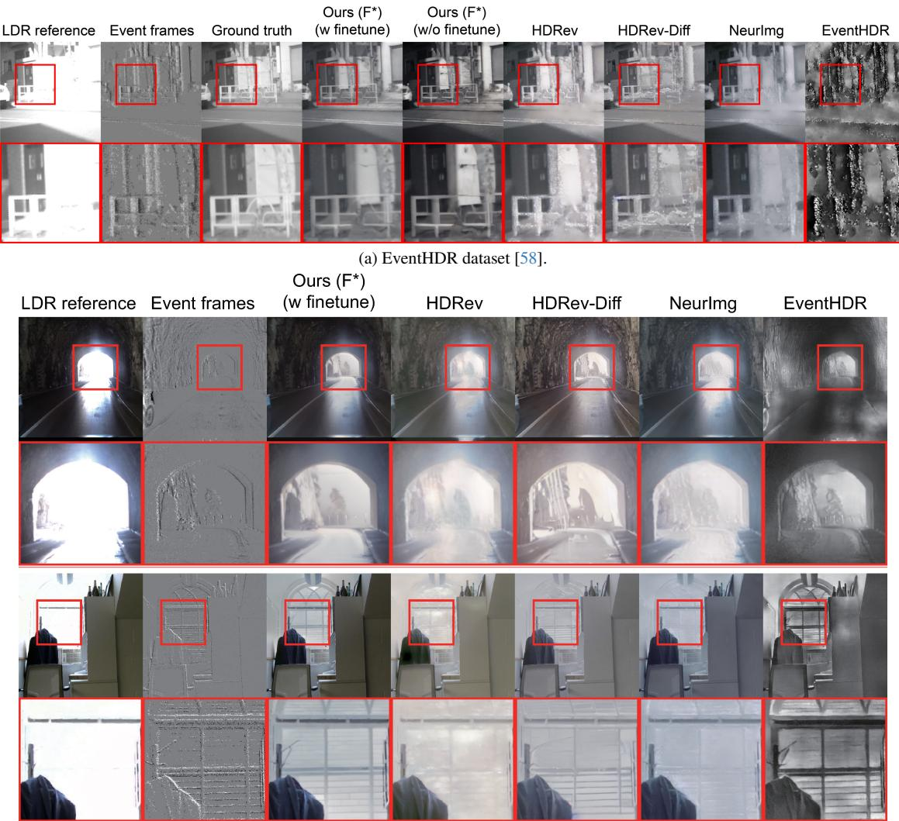  
(b) DSEC [12] (top) and our self-collected data (bottom); HS-ERGB [41] results are in the supplementary material.  
Figure 5. Qualitative evaluation on real event datasets. (a) EventHDR provides HDR ground truth for evaluating real-domain adaptation. (b) DSEC and our self-collected data evaluate cross-sensor real-domain adaptation without HDR ground truth.

EventHDR exhibits different event statistics and imperfect event–frame alignment, allowing us to evaluate adaptation to real sensor characteristics.

Quantitative results are reported in Tab. 2. Fine-tuning with LDR-event proxy supervision consistently improves reconstruction quality on the five unseen test sequences. For Ours (F∗), fine-tuning improves all frame-wise metrics, including PSNR, SSI-PSNR, SSIM, LPIPS, and CIEDE2000. The adapted 5× model maintains frame-wise quality close to $\mathrm { F ^ { * } }$ while achieving the best temporal consistency. The 20× model supports a longer temporal horizon with some degradation in frame-wise quality, while retaining the second-best temporal consistency. Both variants outperform the baselines in temporal consistency despite using only a single LDR reference per temporal window, demonstrating generalization to unseen real sequences.

Fig. 5a shows qualitative results on held-out EventHDR sequences. The synthetic-only model exhibits brightness deviations, blur, and ghosting due to domain shift. After adaptation, these artifacts are substantially reduced, producing sharper reconstructions more consistent with the HDR ground truth and improved temporal consistency.

## 4.3. Evaluation on Real Data without HDR Ground Truth

We further evaluate our method on DSEC [12], HS-ERGB [41], and our self-collected event-frame dataset, which provide paired LDR RGB videos and events but no HDR ground truth. For each dataset, we use non-overlapping adaptation and evaluation segments. The event adaptor is fine-tuned on paired LDR-event data from the adaptation segments, while all reported results are computed on heldout segments unseen during fine-tuning. This enables realdomain adaptation without HDR supervision.

Table 3. Evaluation without HDR ground truth. MANIQA is evaluated on $\mathrm { F ^ { * } }$ , while EPC is evaluated over five-frame sequences.
<table><tr><td>Method</td><td>#Ref</td><td>MANIQA↑</td><td>EPC↑</td></tr><tr><td>EventHDR [58]</td><td>0</td><td>0.240</td><td>0.535</td></tr><tr><td>NeurImg-HDR [15]</td><td>N</td><td>0.220</td><td>0.660</td></tr><tr><td>HDRev [50]</td><td>N</td><td>0.228</td><td>0.610</td></tr><tr><td>HDRev-Diff [51]</td><td>N</td><td>0.253</td><td>0.627</td></tr><tr><td>Ours (w/o FT)</td><td>1</td><td>0.272</td><td>0.716</td></tr><tr><td>Ours (w/ FT)</td><td>1</td><td>0.261</td><td>0.730</td></tr></table>

Qualitative results are shown in Fig. 5b. On DSEC, our method better recovers structures in the over-exposed sky when the vehicle exits the tunnel. Similar improvements are observed on our self-collected data and on HS-ERGB (supplementary material), where our method better preserves structure and color in severely over-exposed regions. Without HDR ground truth, Tab. 3 reports MANIQA on F∗ for perceptual quality and EPC over five-frame outputs for event consistency. A higher EPC indicates that reconstructed temporal changes better follow the sensor-recorded scene dynamics rather than model hallucinations. Finetuning improves EPC from 0.716 to 0.730, while MANIQA decreases slightly from 0.272 to 0.261; nevertheless, our two variants rank first and second on both metrics. Generated videos and additional results are provided in the supplementary material.

## 5. Ablation Study

We evaluate the effects of real-domain fine-tuning and teacher–student distillation on the EventHDR dataset [58], as summarized in Tab. 4. Without fine-tuning, the model is less adapted to real event statistics and event–frame misalignment. Fine-tuning without distillation improves SSI-PSNR and temporal consistency, but degrades PSNR, SSIM, LPIPS, and CIEDE2000, consistent with feature drift during adaptation. Adding teacher–student distillation substantially improves PSNR and overall reconstruction fidelity while preserving the same temporal warping error. Although the model without distillation obtains a higher SSI-PSNR, the full model achieves the best PSNR and better overall quality. Additional qualitative analyses of realdomain fine-tuning and ablations on previous-latent conditioning are provided in the supplementary material.

## 6. Limitations and Conclusion

HIVE-Diff relies on iterative diffusion denoising, and Tab. 5 reports its inference cost. Our method is about 2.3× faster per frame than HDRev-Diff, but still around 100× slower than feed-forward methods. Few-step distillation and feature caching are promising ways to close this gap.

Table 4. Ablation study of real-domain adaptation on EventHDR [58]. Frame-wise metrics are reported at $\mathrm { F ^ { * } }$ , while $E _ { \mathrm { w a r p } }$ is computed over the corresponding 5-frame sequence.
<table><tr><td>Method</td><td></td><td>PSNR↑ SSI-PSNR↑ SSIM↑ LPIPS↓ CIEDE↓</td><td></td><td></td><td></td><td> $E _ { \mathrm { w a r p } } \downarrow$ </td></tr><tr><td>Ours (w/ FT)</td><td>18.03</td><td>23.99</td><td>0.830</td><td>0.190</td><td>12.07</td><td>0.0065</td></tr><tr><td>Ours (w/o distill.)</td><td>15.54</td><td>24.71</td><td>0.805</td><td>0.238</td><td>16.65</td><td>0.0065</td></tr><tr><td>Ours (w/o FT)</td><td>16.10</td><td>23.11</td><td>0.811</td><td>0.212</td><td>13.77</td><td>0.0070</td></tr></table>

Table 5. Inference cost at $5 1 2 \times 5 1 2$ on one NVIDIA L40S GPU, per output frame. Ours: 5× model, 25 Euler steps, FP16, CFG. HDRev-Diff: 50 DDIM steps, FP32, CFG. Other baselines: FP32 feed-forward.
<table><tr><td>Method</td><td colspan="4">Params (M) Time (s) TFLOPs Mem. (GiB)</td></tr><tr><td>HDRev [50]</td><td>57.9</td><td>0.037</td><td>1.6</td><td>1.4</td></tr><tr><td>NeurImg-HDR [15]</td><td>44.0</td><td>0.052</td><td>1.1</td><td>1.1</td></tr><tr><td>EventHDR [58]</td><td>3.3</td><td>0.152</td><td>2.6</td><td>2.0</td></tr><tr><td>HDRev-Diff [51]</td><td>1494</td><td>4.15</td><td>120.4</td><td>6.7</td></tr><tr><td>Ours</td><td>3620</td><td>1.79</td><td>120.6</td><td>9.2</td></tr></table>

Beyond inference cost, HIVE-Diff has four limitations. First, fidelity decreases gradually with distance from the reference: the 20× model loses about 2 dB in SSI-PSNR from the first to the last output frame on both HdM-HDR-2014 and EventHDR (per-frame curves in the supplementary material). Second, where a saturated region produces no events, such as a static blown-out sky, its content comes from the video prior alone and is plausible rather than measured. Third, previous-latent conditioning smooths clip boundaries, but brightness and color drift still accumulate over long sequences. Fourth, adaptation is performed once per sensor with a few LDR-event sequences; generalization to an unseen camera without adaptation is not evaluated.

In this work, we studied single-reference HDR temporal expansion, reconstructing multiple HDR frames from one LDR reference and events, and developed HIVE-Diff, an event-conditioned video diffusion framework that combines event-guided temporal generation with HDR content completion and adapts to real sensors through proxy-supervised, distillation-regularized fine-tuning without HDR ground truth. Experiments on synthetic and real event datasets show strong reconstruction quality, temporal consistency, and robust real-domain adaptation.

## References

[1] Andreas Blattmann, Tim Dockhorn, Sumith Kulal, Daniel Mendelevitch, Maciej Kilian, Dominik Lorenz, Yam Levi, Zion English, Vikram Voleti, Adam Letts, Varun Jampani, and Robin Rombach. Stable video diffusion: Scaling la-

tent video diffusion models to large datasets. arXiv preprint arXiv:2311.15127, 2023. 3, 4

[2] Yakun Chang, Chu Zhou, Yuchen Hong, Liwen Hu, Chao Xu, Tiejun Huang, and Boxin Shi. 1000 FPS HDR video with a Spike-RGB hybrid camera. In Proceedings of the IEEE/CVF Conference on Computer Vision and Pattern Recognition, pages 22180–22190, 2023. 3

[3] Guanying Chen, Chaofeng Chen, Shi Guo, Zhetong Liang, Kwan-Yee K Wong, and Lei Zhang. HDR video reconstruction: A coarse-to-fine network and a real-world benchmark dataset. In Proceedings of the IEEE/CVF International Conference on Computer Vision, pages 2502–2511, 2021. 1

[4] Jingxi Chen, Brandon Y Feng, Haoming Cai, Tianfu Wang, Levi Burner, Dehao Yuan, Cornelia Fermuller, Christopher A Metzler, and Yiannis Aloimonos. Repurposing pre-trained video diffusion models for event-based video interpolation. In Proceedings of the IEEE/CVF Conference on Computer Vision and Pattern Recognition, pages 12456–12466, 2025. 3, 4

[5] Zehao Chen, Zhan Lu, De Ma, Huajin Tang, Xudong Jiang, Qian Zheng, and Gang Pan. EvHDR-GS: Event-guided HDR video reconstruction with 3D Gaussian splatting. In Proceedings of the AAAI Conference on Artificial Intelligence, pages 2367–2375, 2025. 3

[6] Hoonhee Cho, Taewoo Kim, Yuhwan Jeong, and Kuk-Jin Yoon. TTA-EVF: Test-time adaptation for event-based video frame interpolation via reliable pixel and sample estimation. In Proceedings of the IEEE/CVF Conference on Computer Vision and Pattern Recognition, pages 25701–25711, 2024. 3

[7] Ugur Cogalan, Mojtaba Bemana, Karol Myszkowski, Hans-Peter Seidel, and Tobias Ritschel. Learning HDR video reconstruction for dual-exposure sensors with temporallyalternating exposures. Computers & Graphics, 105:57–72, 2022. 1, 2

[8] Zihan Ding, Chi Jin, Difan Liu, Haitian Zheng, Krishna Kumar Singh, Qiang Zhang, Yan Kang, Zhe Lin, and Yuchen Liu. DOLLAR: Few-step video generation via distillation and latent reward optimization. In Proceedings of the IEEE/CVF International Conference on Computer Vision, pages 17961–17971, 2025. 19

[9] Jan Froehlich, Stefan Grandinetti, Bernd Eberhardt, Simon Walter, Andreas Schilling, and Harald Brendel. Creating cinematic wide gamut HDR-video for the evaluation of tone mapping operators and HDR-displays. In Digital Photography X, page 90230X. SPIE, 2014. 4, 5, 6, 13, 15, 16

[10] Guillermo Gallego, Tobi Delbruck, Garrick Orchard, Chiara¨ Bartolozzi, Brian Taba, Andrea Censi, Stefan Leutenegger, Andrew J Davison, Jorg Conradt, Kostas Daniilidis, and Da-¨ vide Scaramuzza. Event-based vision: A survey. IEEE Transactions on Pattern Analysis and Machine Intelligence, 44(1):154–180, 2022. 1, 5

[11] Daniel Gehrig, Mathias Gehrig, Javier Hidalgo-Carrio, and´ Davide Scaramuzza. Video to events: Recycling video datasets for event cameras. In Proceedings ofthe IEEE/CVF Conference on Computer Vision and Pattern Recognition, pages 3586–3595, 2020. 3

[12] Mathias Gehrig, Willem Aarents, Daniel Gehrig, and Davide Scaramuzza. DSEC: A stereo event camera dataset for driving scenarios. IEEE Robotics and Automation Letters, 6(3): 4947–4954, 2021. 7, 12, 15, 18

[13] Rafael C. Gonzalez and Richard E. Woods. Digital image processing. Pearson Education India, 3rd edition, 2009. 5

[14] Yuanshen Guan, Ruikang Xu, Mingde Yao, Ruisheng Gao, Lizhi Wang, and Zhiwei Xiong. Diffusion-promoted HDR video reconstruction. In European Conference on Computer Vision Workshops, pages 20–38. Springer, 2024. 3

[15] Jin Han, Yixin Yang, Peiqi Duan, Chu Zhou, Lei Ma, Chao Xu, Tiejun Huang, Imari Sato, and Boxin Shi. Hybrid high dynamic range imaging fusing neuromorphic and conventional images. IEEE Transactions on Pattern Analysis and Machine Intelligence, 45(7):8553–8565, 2023. 1, 3, 5, 6, 8, 19

[16] Roberto Henschel, Levon Khachatryan, Hayk Poghosyan, Daniil Hayrapetyan, Vahram Tadevosyan, Zhangyang Wang, Shant Navasardyan, and Humphrey Shi. StreamingT2V: Consistent, dynamic, and extendable long video generation from text. In Proceedings of the IEEE/CVF Conference on Computer Vision and Pattern Recognition, pages 2568– 2577, 2025. 15

[17] Jonathan Ho, William Chan, Chitwan Saharia, Jay Whang, Ruiqi Gao, Alexey Gritsenko, Diederik P Kingma, Ben Poole, Mohammad Norouzi, David J Fleet, and Tim Salimans. Imagen Video: High definition video generation with diffusion models. arXiv preprint arXiv:2210.02303, 2022. 3

[18] Jonathan Ho, Tim Salimans, Alexey Gritsenko, William Chan, Mohammad Norouzi, and David J Fleet. Video diffusion models. Advances in Neural Information Processing Systems, 35:8633–8646, 2022. 3

[19] Yuhuang Hu, Shih-Chii Liu, and Tobi Delbruck. v2e: From video frames to realistic DVS events. In Proceedings of the IEEE/CVF Conference on Computer Vision and Pattern Recognition Workshops, pages 1312–1321, 2021. 2, 5

[20] Nima Khademi Kalantari and Ravi Ramamoorthi. Deep HDR video from sequences with alternating exposures. Computer Graphics Forum, 38(2):193–205, 2019. 1, 2

[21] Sing Bing Kang, Matthew Uyttendaele, Simon Winder, and Richard Szeliski. High dynamic range video. ACM Transactions on Graphics, 22(3):319–325, 2003. 2

[22] Tero Karras, Miika Aittala, Timo Aila, and Samuli Laine. Elucidating the design space of diffusion-based generative models. Advances in Neural Information Processing Sys tems, 35:26565–26577, 2022. 4

[23] Alexander Krull, Toma´s Viˇ car, Mangal Prakash, Mananˇ Lalit, and Florian Jug. Probabilistic Noise2Void: Unsuper vised content-aware denoising. Frontiers in Computer Science, 2:5, 2020. 5, 13

[24] Wei-Sheng Lai, Jia-Bin Huang, Oliver Wang, Eli Shechtman, Ersin Yumer, and Ming-Hsuan Yang. Learning blind video temporal consistency. In European Conference on Computer Vision, pages 179–195. Springer, 2018. 5

[25] Patrick Lichtsteiner, Christoph Posch, and Tobi Delbruck. A¨ 128×128 120 dB 15 µs latency asynchronous temporal contrast vision sensor. IEEE Journal of Solid-State Circuits, 43 (2):566–576, 2008. 1

[26] Guixu Lin, Jin Han, Mingdeng Cao, Zhihang Zhong, and Yinqiang Zheng. Event-guided frame interpolation and dynamic range expansion of single rolling shutter image. In Proceedings of the 31st ACM International Conference on Multimedia, pages 3078–3088, 2023. 3

[27] Ilya Loshchilov and Frank Hutter. Decoupled weight decay regularization. In International Conference on Learning Representations, 2019. 12

[28] Yunfan Lu, Yusheng Wang, Zipeng Wang, Pengteng Li, Bin Yang, and Hui Xiong. HR-INR: Continuous space-time video super-resolution via event camera. International Journal ofComputer Vision, 134(10):466, 2026. 4

[29] M Ronnier Luo, Guihua Cui, and Bryan Rigg. The development of the CIE 2000 colour-difference formula: CIEDE2000. Color Research & Application, 26(5):340–350, 2001. 5, 13

[30] Zhengyao Lyu, Chenyang Si, Junhao Song, Zhenyu Yang, Yu Qiao, Ziwei Liu, and Kwan-Yee K Wong. FasterCache: Training-free video diffusion model acceleration with high quality. In International Conference on Learning Representations, 2025. 19

[31] Xinyin Ma, Gongfan Fang, and Xinchao Wang. DeepCache: Accelerating diffusion models for free. In Proceedings of the IEEE/CVF Conference on Computer Vision and Pattern Recognition, pages 15762–15772, 2024. 19

[32] Yeongwoo Nam, Mohammad Mostafavi, Kuk-Jin Yoon, and Jonghyun Choi. Stereo depth from events cameras: Concentrate and focus on the future. In Proceedings of the IEEE/CVF Conference on Computer Vision and Pattern Recognition, pages 6114–6123, 2022. 4

[33] Shree K Nayar and Tomoo Mitsunaga. High dynamic range imaging: Spatially varying pixel exposures. In Proceedings IEEE Conference on Computer Vision and Pattern Recognition. CVPR 2000 (Cat. No. PR00662), pages 472–479. IEEE, 2000. 1

[34] Haonan Qiu, Menghan Xia, Yong Zhang, Yingqing He, Xintao Wang, Ying Shan, and Ziwei Liu. FreeNoise: Tuningfree longer video diffusion via noise rescheduling. In International Conference on Learning Representations, 2024. 15

[35] Henri Rebecq, Daniel Gehrig, and Davide Scaramuzza. ESIM: An open event camera simulator. In Conference on Robot Learning, pages 969–982. PMLR, 2018. 5

[36] Henri Rebecq, Rene Ranftl, Vladlen Koltun, and Davide´ Scaramuzza. High speed and high dynamic range video with an event camera. IEEE Transactions on Pattern Analysis and Machine Intelligence, 43(6):1964–1980, 2021. 1, 3

[37] Rishabh Samra, Kaushik Mitra, and Prasan Shedligeri. High-speed HDR video reconstruction from hybrid intensity frames and events. In Computer Vision and Machine Intelligence: Proceedings of CVMI 2022, pages 179–190. Springer, 2023. 3

[38] Richard Shaw, Sibi Catley-Chandar, Ales Leonardis, and Eduardo Perez-Pellitero. HDR reconstruction from bracketed exposures and events. In British Machine Vision Conference, 2022. 1, 3

[39] Yong Shu, Liquan Shen, Xiangyu Hu, Mengyao Li, and Zihao Zhou. Towards real-world HDR video reconstruc-

tion: A large-scale benchmark dataset and a two-stage align ment network. In Proceedings ofthe IEEE/CVF Conference on Computer Vision and Pattern Recognition, pages 2879– 2888, 2024. 2

[40] Michael D Tocci, Chris Kiser, Nora Tocci, and Pradeep Sen. A versatile HDR video production system. ACM Transac tions on Graphics, 30(4):41:1–41:10, 2011. 1

[41] Stepan Tulyakov, Daniel Gehrig, Stamatios Georgoulis, Julius Erbach, Mathias Gehrig, Yuanyou Li, and Davide Scaramuzza. Time lens: Event-based video frame interpola tion. In Proceedings of the IEEE/CVF Conference on Computer Vision and Pattern Recognition, pages 16155–16164, 2021. 7, 12, 13

[42] Caixin Wang, Jie Zhang, Matthew A Wilson, and Ralph Etienne-Cummings. Pix2HDR: A pixel-wise acquisition and deep learning-based synthesis approach for high-speed HDR videos. IEEE Transactions on Pattern Analysis and Machine Intelligence, 46(12):8771–8787, 2024. 1, 2

[43] Chao Wang, Zhihao Xia, Thomas Leimkuhler, Karol Myszkowski, and Xuaner Zhang. LEDiff: Latent exposure diffusion for HDR generation. In Proceedings of the IEEE/CVF Conference on Computer Vision and Pattern Recognition, pages 453–464, 2025. 3

[44] Lin Wang, S. Mohammad Mostafavi I., Yo-Sung Ho, and Kuk-Jin Yoon. Event-based high dynamic range image and very high frame rate video generation using conditional generative adversarial networks. In Proceedings of the IEEE/CVF Conference on Computer Vision and Pattern Recognition, pages 10081–10090, 2019. 1, 3

[45] Zhou Wang, Alan C Bovik, Hamid R Sheikh, and Eero P Simoncelli. Image quality assessment: from error visibility to structural similarity. IEEE Transactions on Image Processing, 13(4):600–612, 2004. 5, 13

[46] Ziwei Wang, Yonhon Ng, Cedric Scheerlinck, and Robert Mahony. An asynchronous Kalman filter for hybrid event cameras. In Proceedings of the IEEE/CVF International Conference on Computer Vision, pages 448–457, 2021. 3

[47] Ziyun Wang, Friedhelm Hamann, Kenneth Chaney, Wen Jiang, Guillermo Gallego, and Kostas Daniilidis. Eventbased continuous color video decompression from single frames. In Proceedings of the IEEE/CVF Conference on Computer Vision and Pattern Recognition Workshops, pages 4977–4987, 2025. 3

[48] Martin Weigert, Uwe Schmidt, Tobias Boothe, Andreas Muller, Alexandr Dibrov, Akanksha Jain, Benjamin Wil-¨ helm, Deborah Schmidt, Coleman Broaddus, Sian Culley,ˆ Mauricio Rocha-Martins, Fabian Segovia-Miranda, Caren´ Norden, Ricardo Henriques, Marino Zerial, Michele Solimena, Jochen Rink, Pavel Tomancak, Loic Royer, Florian Jug, and Eugene W. Myers. Content-aware image restoration: pushing the limits of fluorescence microscopy. Nature Methods, 15(12):1090–1097, 2018. 5, 13

[49] Sidi Yang, Tianhe Wu, Shuwei Shi, Shanshan Lao, Yuan Gong, Mingdeng Cao, Jiahao Wang, and Yujiu Yang. MANIQA: Multi-dimension attention network for noreference image quality assessment. In Proceedings of the IEEE/CVF Conference on Computer Vision and Pattern Recognition Workshops, pages 1191–1200, 2022. 5

[50] Yixin Yang, Jin Han, Jinxiu Liang, Imari Sato, and Boxin Shi. Learning event guided high dynamic range video reconstruction. In Proceedings of the IEEE/CVF Conference on Computer Vision and Pattern Recognition, pages 13924– 13934, 2023. 1, 3, 5, 6, 8, 19

[51] Yixin Yang, Jiawei Zhang, Yang Zhang, Yunxuan Wei, Dongqing Zou, Jimmy S Ren, and Boxin Shi. Event-guided HDR reconstruction with diffusion priors. In Proceedings of the IEEE/CVF International Conference on Computer Vision, pages 11787–11796, 2025. 2, 3, 4, 5, 6, 8, 19

[52] Lvmin Zhang, Anyi Rao, and Maneesh Agrawala. Adding conditional control to text-to-image diffusion models. In Proceedings of the IEEE/CVF International Conference on Computer Vision, pages 3836–3847, 2023. 2, 4

[53] Richard Zhang, Phillip Isola, Alexei A Efros, Eli Shechtman, and Oliver Wang. The unreasonable effectiveness of deep features as a perceptual metric. In Proceedings of the IEEE Conference on Computer Vision and Pattern Recognition, pages 586–595, 2018. 5, 13

[54] Wei Zhang, Shengnan Hu, and Kan Liu. Patch-based correlation for deghosting in exposure fusion. Information Sciences, 415–416:19–27, 2017. 2

[55] Ziran Zhang, Xiaohui Li, Yihao Liu, Yujin Wang, Yueting Chen, Tianfan Xue, and Shi Guo. EGVD: Event-guided video diffusion model for physically realistic large-motion frame interpolation. In Proceedings of the IEEE/CVF International Conference on Computer Vision Workshops, pages 3982–3991, 2025. 3

[56] Juanjuan Zhu, Zhexiong Wan, and Yuchao Dai. Video frame prediction from a single image and events. In Proceedings of the AAAI Conference on Artificial Intelligence, pages 7748– 7756, 2024. 3

[57] Yunhao Zou, Yinqiang Zheng, Tsuyoshi Takatani, and Ying Fu. Learning to reconstruct high speed and high dynamic range videos from events. In Proceedings of the IEEE/CVF Conference on Computer Vision and Pattern Recognition, pages 2024–2033, 2021. 1, 3

[58] Yunhao Zou, Ying Fu, Tsuyoshi Takatani, and Yinqiang Zheng. EventHDR: From event to high-speed HDR videos and beyond. IEEE Transactions on Pattern Analysis and Machine Intelligence, 47(1):32–50, 2025. 1, 2, 3, 5, 6, 7, 8, 13, 16, 17, 19

# Supplementary Material

## A. Overview

This appendix provides additional analyses and qualitative results for HIVE-Diff, including implementation details, realdomain adaptation, qualitative results on HS-ERGB, frame-wise temporal evaluation, previous-latent conditioning for crossclip continuity, additional qualitative results, and a discussion of inference cost.

## B. Implementation Details

Training. All training stages use AdamW [27] with $\beta _ { 1 } = 0 . 9 , \beta _ { 2 } = 0 . 9 9 9$ , a weight decay of $1 0 ^ { - 2 }$ , a batch size of 1, and gradient accumulation over 16 steps. Stages 1 and 2 use a learning rate of $1 \times 1 0 ^ { - 4 }$ and are trained for 9,000 and 16,000 steps, respectively. Real-domain adaptation uses a learning rate of $1 \times 1 0 ^ { - 5 }$ for 1,000 steps. The $5 \times$ and 20× variants share these settings and are trained at $5 1 2 \times 5 1 2$ resolution with 4 event bins on a single NVIDIA L40S GPU.

Event-Photometric Consistency. In the EPC definition of the main paper, the log-luminance of an output frame is $\hat { L } _ { t } = \log ( Y _ { t } ^ { \gamma } + \epsilon )$ , where $Y _ { t } \in [ 0 , 1 ]$ is the luminance of the PQ-encoded output $\hat { I } _ { t } ,$ the power $\gamma = 2 . 2$ expands the PQ code values toward a linear scale before the log, and $\epsilon = 1 0 ^ { - 3 }$ avoids log 0. The same transform is applied to all methods. $E _ { t }$ is the per-pixel signed count of the real events recorded between the timestamps of outputs t and t+1. Both maps are smoothed with a Gaussian kernel of $\sigma = 2 { \tt p x }$ , the Pearson correlation is computed over the frame, and the result is averaged over al consecutive frame pairs of the 5× outputs.

## C. Effect of Real-Domain Adaptation

We visualize the effect of real-domain adaptation in Fig. 6. When the synthetic-trained model is directly applied to real event data, the sim-to-real gap leads to noticeable ghosting artifacts, as highlighted by the red arrows in the figure. Fine-tuning the event adaptor with paired real LDR-event data as proxy supervision substantially suppresses these artifacts and improves structural consistency across frames, as observed on both DSEC [12] and our self-collected data.

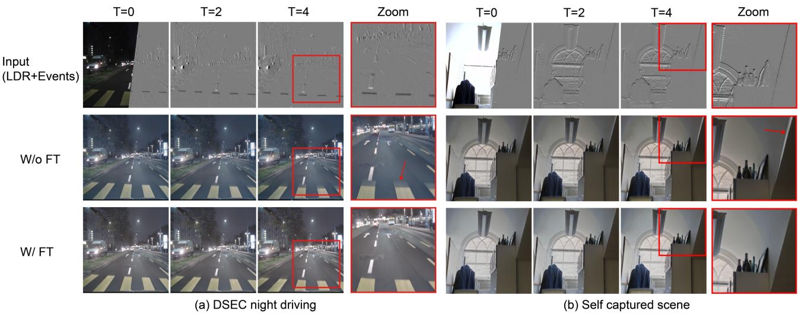  
Figure 6. Effect of real-domain adaptation on (a) DSEC [12] and (b) our self-collected data. The top row shows the LDR/event inputs, while the middle and bottom rows show outputs without and with real-domain fine-tuning, respectively. Red arrows highlight representative ghosting artifacts caused by the sim-to-real gap when the synthetic-trained model is directly applied to real data. Fine-tuning with real LDR-event pairs as proxy supervision substantially suppresses these artifacts.

## D. Qualitative Results on HS-ERGB

Fig. 7 shows the HS-ERGB [41] comparison that accompanies Fig. 5(b) of the main paper. As on DSEC and our self-collected data, HIVE-Diff recovers structure in the over-exposed regions while preserving the color of the LDR reference.

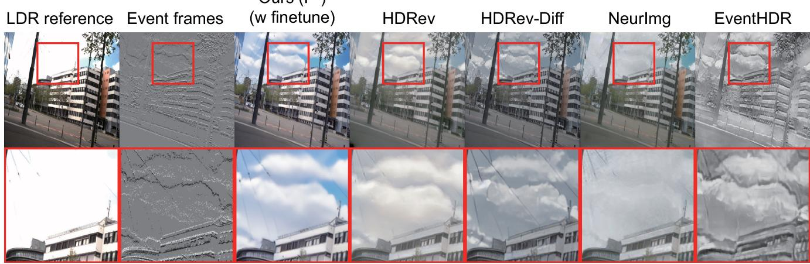  
Figure 7. Qualitative comparison on HS-ERGB [41] (reference-aligned output F∗). Columns follow Fig. 5 of the main paper.

## E. Temporal Evaluation over the Reconstruction Horizon

We further analyze frame-wise reconstruction quality over the temporal horizon to study how HIVE-Diff behaves as the output moves farther from the single LDR reference. Fig. 8 shows the trajectories of SSI-PSNR [23, 48], SSIM [45], LPIPS [53], and CIEDE2000 [29] on the synthetic HdM-HDR-2014 benchmark [9] and the held-out EventHDR sequences [58].

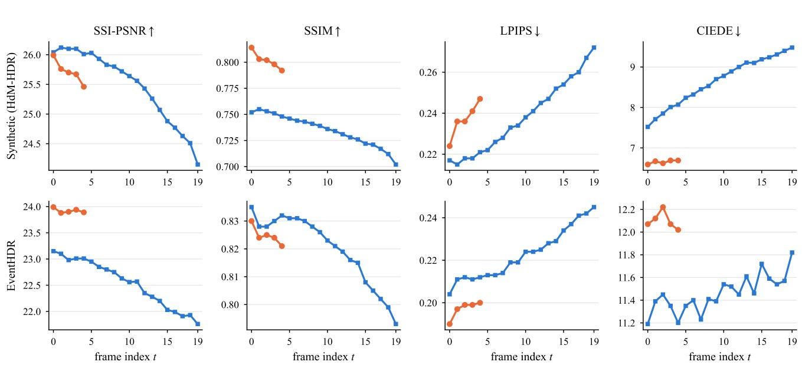  
Figure 8. Frame-wise reconstruction quality over the temporal horizon on HdM-HDR-2014 [9] (top) and five held-out EventHDR sequences [58] (bottom). The 5× models remain relatively stable over their short output horizons. For the 20× models, reconstruction quality degrades gradually as the temporal distance from the reference increases, with more noticeable quality loss at larger temporal offsets.

On the synthetic benchmark, the 5× model maintains relatively stable quality across all five output frames. The 20× model is also stable near the reference, followed by gradual degradation over the longer horizon. SSI-PSNR decreases from 26.04 at t=0 to 24.15 at t=19, while SSIM decreases from 0.752 to 0.702 and LPIPS increases from 0.217 to 0.272. CIEDE2000 similarly increases from 7.52 to 9.48. The smooth evolution of these metrics indicates a gradual loss of frame-wise fidelity

rather than an abrupt failure at longer temporal offsets.

A similar overall trend is observed on the held-out EventHDR sequences. The 5× model remains stable over its short horizon, while the 20× model exhibits gradual degradation as the temporal offset increases. SSI-PSNR decreases from 23.15 at t=0 to 21.76 at t=19, SSIM decreases from 0.835 to 0.793, and LPIPS increases from 0.204 to 0.245. CIEDE2000 exhibits larger frame-dependent fluctuations, but increases overall from 11.19 to 11.82. These results show that HIVE-Dif maintains relatively stable reconstruction quality over short and intermediate temporal horizons, while longer single-reference expansion becomes progressively more challenging.

## F. Effect of Previous-Latent Conditioning

We further examine previous-latent conditioning in the 5× setting to evaluate continuity across independently generated clips. As shown in Fig. 9, we compare the last frame of the previous clip (t= − 1) with the first frame of the subsequent clip (t=0), generated with and without conditioning on the previously denoised latent. Here, the frame indices are defined relative to the clip boundary. Without previous-latent conditioning, independently generated clips can exhibit visible discontinuities in local structure, brightness, and appearance. Conditioning on the previous latent substantially reduces these discontinuities and produces a smoother cross-clip transition.

T=-1  
T=0  
T=0  
(w prev. latent) (w/o prev. latent)  
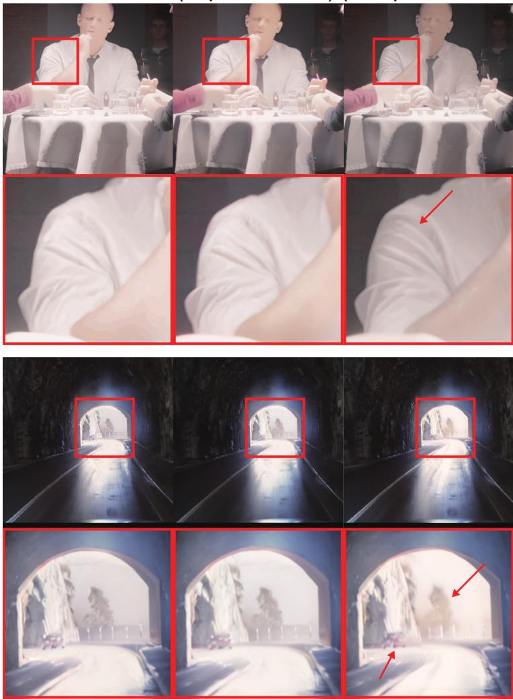  
Figure 9. Effect of previous-latent conditioning in the 5× setting on (top) synthetic HdM-HDR-2014 [9] and (bottom) DSEC [12]. The left column shows the last frame of the previous clip (t= − 1), while the middle and right columns show the first frame of the next clip (t=0) with and without previous-latent conditioning, respectively. Frame indices are defined relative to the clip boundary. Previous-laten conditioning improves structural and appearance continuity, whereas independent generation introduces visible discontinuities highlighted by the red boxes and arrows.

Previous-latent conditioning can be viewed as a short-term memory that promotes local consistency between adjacent clips. However, it does not explicitly constrain the global appearance of the entire sequence. Consequently, small brightness and color deviations may accumulate during long autoregressive generation, resulting in residual flickering even when individual clip boundaries are locally smooth. Similar long-horizon consistency issues have been studied in recent long-video diffusion methods, where short-term inter-clip memory is complemented by long-term appearance preservation [16].

Importantly, subsequent clips may also receive newly observed LDR frames and event measurements. Therefore, the HDR content of a new clip is expected to update as the scene and observations evolve, and not all cross-clip appearance changes should be suppressed. The key challenge is to distinguish observation-driven content updates from undesired generation drift. A promising extension of HIVE-Diff is thus to combine the previous latent with a dynamically updated appearance memory derived from the available LDR observations, rather than relying on a fixed appearance anchor. Overlapping-window generation with latent, feature, or photometric consistency could further suppress residual flickering while allowing new LDR and event evidence to modify the reconstructed HDR content. Long-video diffusion techniques based on temporal memory and windowed generation [16, 34] provide useful directions for this extension.

## G. Additional Qualitative Results

We provide additional qualitative results on the synthetic HdM-HDR-2014 benchmark [9], held-out EventHDR sequences [58], and real-world datasets without HDR ground truth. In addition to the reference-aligned results presented in the main paper, these examples show HIVE-Diff outputs at multiple timestamps over the 20× reconstruction horizon.

Synthetic data. Fig. 10 shows an additional example on HdM-HDR-2014 [9], where HDR ground truth is available for direct comparison. Starting from a single over-exposed LDR reference and the corresponding event stream, HIVE-Diff reconstructs the scene over a long temporal horizon. The selected frames show that the model preserves the overall scene structure and recovers content in saturated regions across time. The enlarged regions further illustrate the reconstruction of local appearance and motion at different temporal offsets.

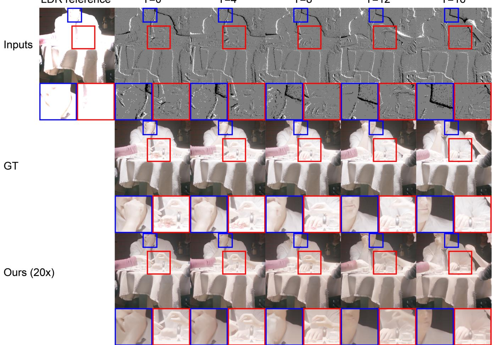  
Figure 10. Additional qualitative results on HdM-HDR-2014 [9]. The first row shows the LDR reference and event observations at selected timestamps. The second and third groups show the corresponding HDR ground truth and HIVE-Diff 20× reconstructions, respectively. Enlarged regions highlight local reconstruction details across the temporal horizon.

EventHDR. We next provide additional results on held-out EventHDR sequences [58] in Fig. 11. Despite using only the first LDR frame as the appearance and intensity reference, HIVE-Diff follows the temporal evolution indicated by the real event stream and reconstructs subsequent HDR frames over the 20× horizon. The reconstructed scene content remains visually close to the available HDR ground truth across the selected timestamps.  
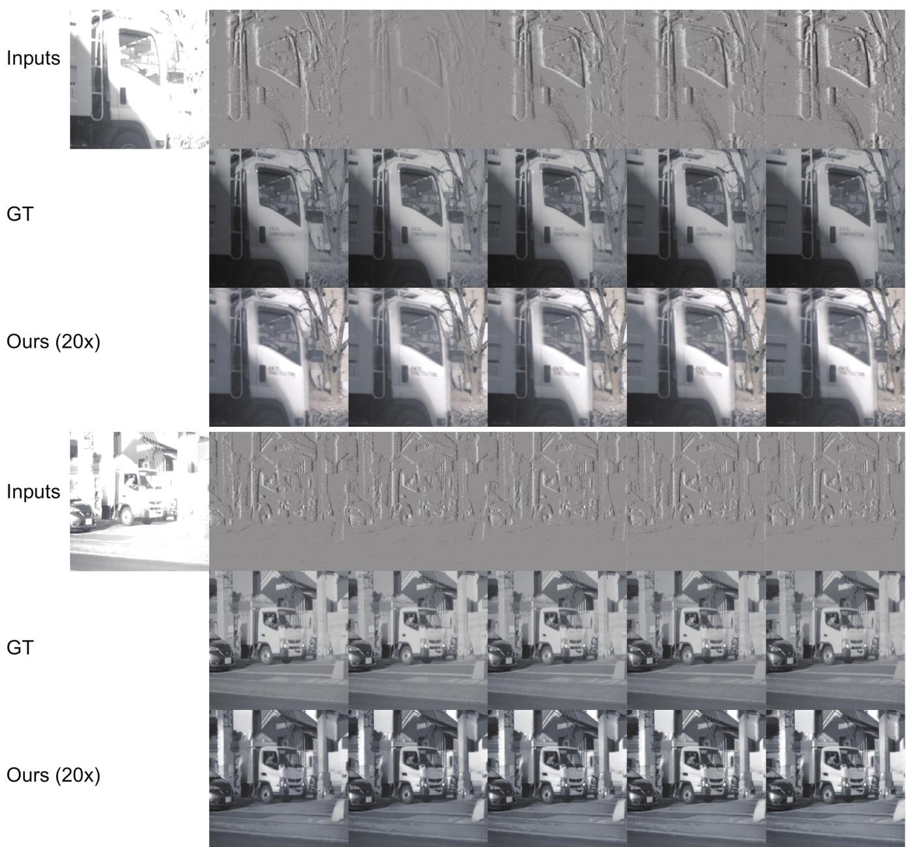  
Figure 11. Additional qualitative results on two held-out EventHDR sequences [58]. For each example, the input consists of one LDR reference and event observations at selected timestamps. HDR ground truth and the corresponding HIVE-Diff 20× reconstructions are shown for direct comparison.

Real-world data without HDR ground truth. Finally, Fig. 12 presents additional results on two DSEC sequences [12] and one sequence from our self-collected event-frame data, none of which provides HDR ground truth. Across these scenes, HIVE-Diff reconstructs temporally evolving scene content from a single LDR reference and the subsequent event stream while recovering structures in severely over-exposed regions. These examples further demonstrate the applicability of singlereference HDR temporal expansion to real event-camera data. As discussed in Sec. F, mild brightness or color drift may still appear over long sequences.

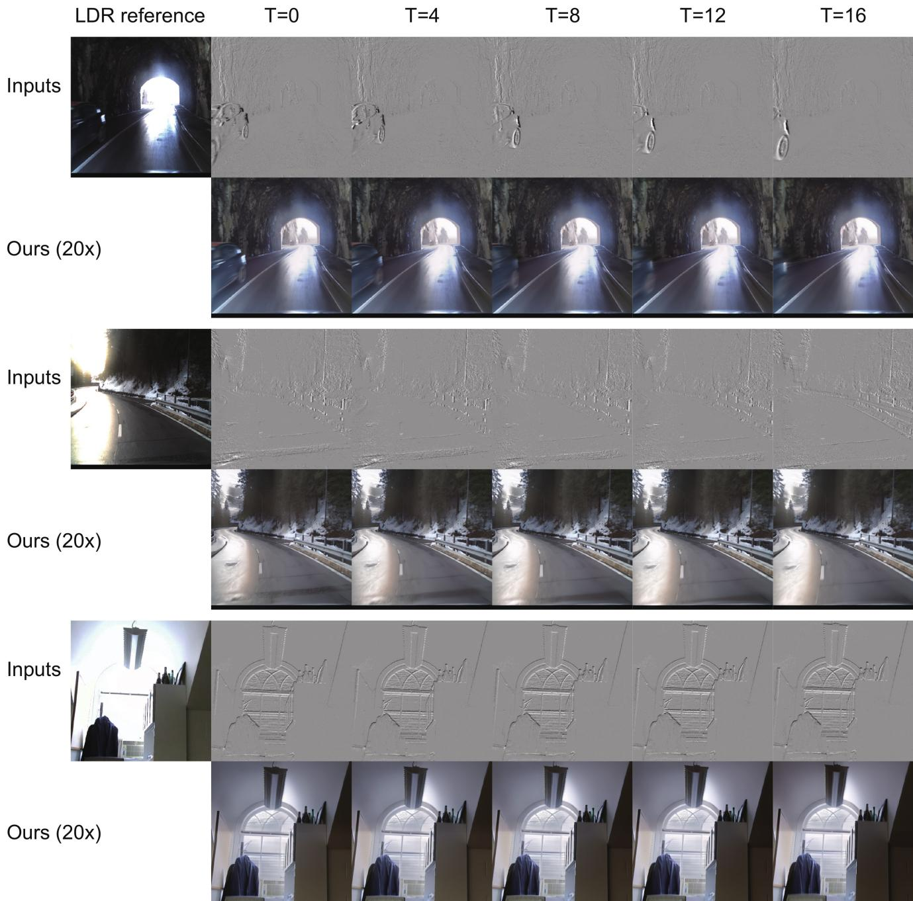  
Figure 12. Additional qualitative results on real-world data without HDR ground truth. The top and middle examples are from DSEC [12] while the bottom example is from our self-collected data. Each example shows one LDR reference, event observations at selected times tamps, and the corresponding HIVE-Diff 20× reconstructions.

## H. Runtime and Computational Cost

Tab. 5 of the main paper reports model size, inference time per output frame, computational cost, and peak GPU memory of HIVE-Diff and the event-based HDR baselines HDRev [50], NeurImg-HDR [15], EventHDR [58], and HDRev-Diff [51], profiled at 512 × 512 resolution on a single NVIDIA L40S GPU. HIVE-Diff uses the 5× model with 25-step Euler sampling, FP16 precision, and classifier-free guidance (CFG), without temporal chunking; HDRev-Diff uses 50-step DDIM sampling with CFG. The two diffusion methods have similar computational cost per output frame (120.6 vs. 120.4 TFLOPs), while HIVE-Diff has more parameters and higher peak memory (9.2 vs. 6.7 GiB). Because the two methods use different numerical precisions, samplers, and numbers of denoising steps, the 2.3× runtime difference should be read under these inference settings rather than as an intrinsic architectural speedup.

Further acceleration could be achieved through two complementary directions. First, recent few-step video diffusion distillation methods can compress a multi-step denoising trajectory into only a few sampling steps [8], suggesting that the curren 25-step HIVE-Diff sampler could potentially be distilled to substantially fewer steps. Second, training-free feature caching can reduce the computation within each remaining denoising step by reusing redundant intermediate features across adjacen timesteps [31]. Since HIVE-Diff also uses CFG, CFG-aware caching methods such as FasterCache [30] are particularly relevant because they further exploit redundancy between the conditional and unconditional branches. Combining few-step distillation with feature/CFG caching is therefore a promising direction for reducing HIVE-Diff inference latency, although the achievable speedup and its effect on HDR reconstruction fidelity and temporal consistency require dedicated evaluation.