# Intent2CAD: How Semantic–Parametric Supervision Shapes Text-to-CAD Generation

Jinbo Yang Beijing Institute of Technology Beijing, China jinboy@bit.edu.cn

Mingyue Yuan∗   
University of New South Wales Sydney NSW, Australia   
mingyue.yuan@unsw.edu.au

Shikai Jing† Beijing Institute of Technology Beijing, China jingshikai@bit.edu.cn

## Abstract

Text-to-CAD generation aims to make CAD modeling more accessible by generating executable CAD programs from natural-language descriptions. However, practical CAD workflows require more than executable geometry: generated programs should also expose reusable structure that supports later modification. We introduce intent-oriented text-to-CAD generation, where design intent is expressed as recoverable code-level signals: semantic features, reusable parameters, and lightweight parametric relations. Rather than changing the model architecture or decoding procedure, we investigate how supervision representation granularity affects both CAD generation and zero-shot intent-preserving editing. To enable this study, we construct IntentCAD-100K, a 100K paired text–code dataset built by converting low-level CAD construction traces into executable CadQuery programs. We further construct IntentCAD-Edit-1K to evaluate zero-shot intent-preserving editing from the same representation perspective. Intent2CAD uses a two-stage conservative lifting pipeline: semantic lifting rewrites reliable primitive groups into feature-level operations, while parametric lifting exposes lightweight parametric relations. Under controlled fine-tuning, semantic lifting mainly improves generation reliability and feature recovery, reducing IR from 2.39% to 0.22% and achieving 99.96% API Recovery, while parametric lifting makes reusable relation structure explicit and further improves relation-aware zero-shot editing. Datasets and code are available at https://github.com/JinboYang94/Intent2CAD.

## 1 Introduction

Computer-Aided Design (CAD) is a fundamental tool in modern engineering design and manufacturing, where designers create, refine, and iterate product designs throughout the development process [1–3]. Because traditional CAD workflows remain time-consuming and expertise-intensive [4], recent text-to-CAD research has explored how Large Language Models (LLMs) can generate CAD scripts from natural language descriptions [5–10]. This direction is promising, but practical CAD modeling is not only about producing a final shape. In parametric CAD modeling, a generated CAD program should support later reuse and modification, not just match the final shape.

Most existing text-to-CAD studies therefore leave an important gap. They primarily focus on geometric fidelity and program executability [5–9]. These criteria are necessary, but they do not fully capture the needs of parametric CAD workflows [11–13]. A program that approximates the target geometry with many low-level primitives may pass a shape metric, while still making a simple later edit, such as changing a shared radius or preserving symmetry, difficult to perform consistently. In this paper, we call this broader requirement intent-oriented text-to-CAD generation: the generated program should not only reproduce the requested shape, but also expose recoverable code-level intent signals that support reuse and local refinement.

We use intent in a restricted sense, referring only to recoverable code-level signals such as supported semantic features, reusable parameters, and lightweight parametric relations, rather than full design history or constraint-solving processes [14]. The supervision representation is important to this problem. Most current benchmarks are built from low-level construction traces composed of primitives such as lines, arcs, and circles [5, 6, 15, 16]. While expressive, these traces can hide the semantic and parametric structure that makes CAD programs reusable and editable.

Figure 1 illustrates this representation gap. Both forms can describe same geometry, but they expose different supervision signals: the primitive-only form emphasizes low-level primitives, whereas the semantic–parametric form makes high-level feature and reusable parameters explicit in code. This motivates our main question: when the model, training objective, text descriptions, and inference setup are fixed, how much does the target representation itself affect text-to-CAD generation and intent-preserving editing?

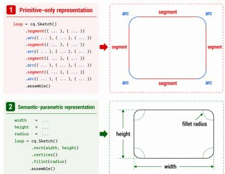

To answer this question, we introduce Intent2CAD, a semantic– parametric supervision representation implemented as executable CadQuery code. Following a conservative “lift when reliable, preserve when uncertain” rule, Intent2CAD rewrites supported primitive groups into high-level CAD features when geometric and constraint evidence agree, while retaining lowlevel fallbacks for unsupported or ambiguous geometry. It exposes four code-level representation elements: semantic features, explicit parameters, parametric relations, and fallbacks.

Figure 1: Illustration of the representation gap between primitive-only and semantic– parametric CAD supervision.

We construct this representation through a two-stage lift-and-validate pipeline. Stage I performs tagpreserving reconstruction and constraint-grounded semantic lifting, rewriting reliable primitive groups into feature-level CadQuery operations with explicit parameters. Stage II performs restricted relation induction by local parameter rewriting, exposing shared variables and simple derived expressions when they pass execution, geometric consistency, and locality checks. The pipeline produces three supervision granularities for study: primitive-only, semantic, and semantic–parametric supervision.

Using this pipeline, we build IntentCAD-100K, a 100K paired text–code dataset derived from raw DeepCAD [15] construction sequences. Beyond standard Invalid Ratio (IR) and Chamfer Distance (CD), we evaluate whether generated code recovers semantic features, preserves shared/equal parameters, and preserves derived parametric relations. We further construct IntentCAD-Edit-1K, a zero-shot intent-preserving editing benchmark with 1K aligned Feature Edit (FE), Consistencypreserving Edit (CE), and Derived-Relation Edit (DE) samples. Unlike prior text-based CAD editing work that trains specialized editors [17–19], we use the same text-to-CAD generation checkpoints to evaluate local refinement while preserving representation-specific intent signals. We also evaluate visually grounded editing to examine target localization capacity with spatial descriptions.

Experiments show that representation granularity has measurable effects. Under the same supervised fine-tuning setup, semantic lifting reduces IR from 2.39% to 0.22%, lowers mean CD from 1.44 to 0.46 (×103), and achieves 99.96% API Recovery. Parametric lifting keeps reliability and typical geometry comparable to semantic supervision, while recovering relation structure with 93.35% ERS and 95.25% PRS. In zero-shot editing, semantic–parametric supervision further improves relationaware edits, raising CE@ES from 91.00% to 95.82% and DE@ES from 77.09% to 88.73%. Our contributions can be summarized as follows:

• We introduce intent-oriented text-to-CAD generation as a representation-centered formulation that goes beyond executable geometry by focusing on recoverable semantic features, reusable parameters, and lightweight parametric relations.

• We construct IntentCAD-100K, a large-scale aligned text–code dataset that converts low-level CAD construction traces into primitive-only, semantic, and semantic–parametric executable CadQuery targets through our automated conservative lifting-and-validation pipeline.

• We construct IntentCAD-Edit-1K as a validation benchmark for studying how representation granularity affects zero-shot intent-preserving editing, covering feature edits, consistency-preserving edits, and derived-relation edits without edit-specific training.

• Experiments show that semantic lifting improves generation reliability and feature-level editability, while parametric lifting improves relation preservation and relation-aware editing.

## 2 Related Work

## 2.1 Symbolic CAD Representations for Text-to-CAD

Text-to-CAD differs from general shape generation [20–23] because the symbolic output should be an editable construction program, not only a final geometry. Prior work has therefore adopted symbolic CAD targets, including sketch-and-extrude sequences, primitive and constraint graphs, domain-specific CAD formats, and executable CAD code [5, 6, 8, 9, 15, 24, 25]. Early approaches represent CAD models as low-level construction traces over primitives such as lines, arcs, circles, and extrusion commands [15, 24], while recent text-conditioned systems extend these targets to natural-language generation and executable CadQuery code [5, 6, 8, 9]. However, a code target alone does not determine the semantic quality of the representation. Existing supervision is still largely derived from primitive-level traces, which scale well but leave feature grouping, editable variables, and geometric or parametric relations implicit. This limits their ability to expose the modeling structure needed for refinement and reuse. Our work addresses this representation gap by constructing aligned primitive-only, semantic, and semantic–parametric targets.

## 2.2 Design Intent in Parametric CAD Modeling

Design intent in parametric CAD modeling describes how a model is expected to behave under modification [11, 12]. A geometrically valid model may still be poorly editable if feature structure, dimensions, or relations are lost [13]. Prior work has studied such relational structure in constraintbased sketches [26, 27], including primitive–constraint graph representations [24] and constrained sketch generation with automatic constraint completion [28]. Our work extends this editability perspective to code-based parametric 3D CAD. Rather than reconstructing a full constraint system or using solver feedback, we expose recoverable code-level signals, such as semantic features, reusable parameters, and lightweight parametric relations, directly in executable CAD programs.

## 2.3 LLM-based Text-to-CAD Generation and Editing

LLMs have recently been applied to text-to-CAD through sequential command prediction [5, 6], B-rep-grounded command generation with pointer-based entity selection [29], multimodal generation with visual feedback [7], and direct generation of executable CAD code [8–10]. Parallel efforts study controllable generation and text-guided editing, including hierarchy-aware control [19], local geometry control [18], locate-then-infill editing [17], and unified CAD prototyping with dedicated tokenization [30]. CAD-Tokenizer [30] learns compact, primitive-aware tokens for generation and editing, while cadrille [31] focuses on multimodal CAD reconstruction from text, images, and point clouds. However, existing work rarely studies the semantic and parametric granularity of the supervision target itself. Execution and geometric checks verify whether a CAD program runs and matches the target shape, but do not ensure reusable feature semantics or meaningful parametric relations. Rather than proposing another editor or decoding pipeline, our work focuses on the upstream target representation and studies whether explicit semantic–parametric supervision improves learning and editability under standard supervised fine-tuning.

## 3 Method: Intent-Explicit Supervision for Text-to-CAD

## 3.1 Intent2CAD: Intent-Explicit CadQuery Representation

Intent2CAD provides semantic—parametric representation supervision for intent-oriented text-to-CAD generation. Rather than changing the model architecture, training objective, or decoding procedure, it changes the representation of the target code that the model is trained to produce. In this way, each CAD program is represented as executable CadQuery code in which recoverable design intent is made explicit: semantic features expose reusable CAD modeling operations, explicit parameters name editable design variables, and lightweight parametric relations capture simple geometric and parameter relations, while low-level fallbacks retain coverage for complex geometry. This allows standard supervised fine-tuning to learn not only the resulting executable geometry, but also how that geometry is constructed and parameterized.

By contrasting the two supervision representations of the same CAD instance, Figure 2 illustrates how Intent2CAD changes the supervision target. The primitive-only target keeps the recovered construction as low-level primitives, where semantic structures appear as segments, arcs, and repeated numeric constants. In the semantic–parametric target, recoverable primitive groups are rewritten into semantic CAD operations such as rect, editable attributes are named as explicit parameters such as radii, widths, heights, and centers, and related values are represented through shared variables or simple derived expressions. For example, proportional radii and symmetric centers are exposed as code-level relations, as indicated by the red boxes and arrows. Unsupported primitive groups remain as low-level fallback loops to preserve executable coverage for complex geometry. The intermediate semantic target used in the controlled study stops before relation lifting: it keeps the semantic feature rewrites, but lacks explicit parameters and relations.

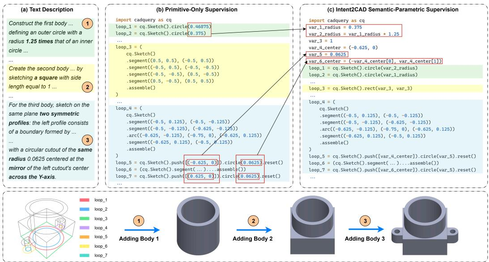  
Figure 2: Illustration of the Intent2CAD semantic–parametric representation. (a) Intent-oriented text description of a CAD model. (b) Corresponding program using primitive-only supervision. (c) Corresponding program using semantic-parametric supervision. The bottom block shows the modeling process for each step. Red boxes and arrows indicate parameters and relations exposed by Intent2CAD.

We define the supported operations based on common CadQuery modeling patterns that can be reliably recovered from low-level sketch–extrude traces using geometric checks and source constraint evidence. This conservative set includes semantic CAD construction commands, such as rect, regular polygon, irregular polygon, slot, fillet, and array, as well as lightweight sketch relation cues, including PARALLEL, HORIZONTAL, VERTICAL, PERPENDICULAR, and TANGENT. To make repeated or related values more editable than repeated numeric constants, Intent2CAD further introduces a restricted set of recoverable code-level relation signals, including EQUAL, CONCENTRIC, MIRROR, DISTANCE, and common RATIO relations between dimensional parameters. Equal lengths, radii, or centers are represented by shared variables, while mirrored or distance-based structures are represented through symmetric or offset parameter definitions. These relations are not a full constraint system; they expose recurring geometric and parametric regularities in code.

## 3.2 Lift-and-Validate Construction Pipeline

To construct Intent2CAD supervision at scale, we introduce an automatic lift-and-validate construction pipeline that converts each raw CAD sample into a paired text–code instance. The pipeline combines deterministic geometric checks, recovered constraint evidence, constrained LLM-based local rewriting, and executable validation, without requiring manual annotation of semantic features or parameter relations. Candidate lifts or rewrites are accepted only when their reliability can be established; otherwise, the original low-level implementation is preserved. This makes the construction process scalable while keeping the generated target code executable and geometrically faithful.

As shown in Figure 3 1 , each raw CAD sample is represented as $d = ( S , C )$ , where command sequences S contain the original low-level sequential CAD commands and source constraint C contains recovered geometric and dimensional relations. We extract a constraint graph G from C and use it as structural evidence for reliable semantic lifting and safe exposure of parameter relations, rather than to reconstruct the full design history. The intermediate programs are retained, yielding three aligned supervision granularities: the primitive reconstruction before lifting, the Stage-I semantic program, and the Stage-II semantic–parametric program.

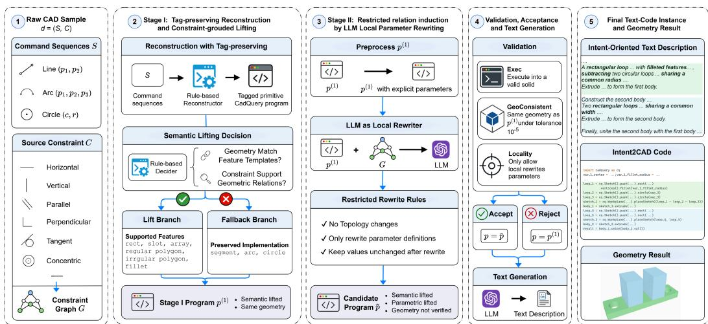  
Figure 3: Intent2CAD lift-and-validate construction pipeline. In 5 , green indicates the roundedrectangle base, and blue indicates two same-width rectangular extrusions.

Stage I: Tag-preserving reconstruction and constraint-grounded lifting. As shown in Figure 3 2 , Stage I first performs tag-preserving reconstruction: we reconstruct an executable low-level CadQuery program from Command Sequences S using a rule-based reconstructor, while assigning each low-level primitive a unique tag identifier. The recovered constraints C are represented as a typed relation graph G, whose nodes are tagged geometric entities and whose edges encode available local geometric or dimensional relations. This yields a tagged primitive CadQuery program for checking candidate primitive groups against geometry and recovered relations.

Semantic lifting is then applied through a conservative semantic lifting decision. For each candidate primitive group g and supported feature template τ , lifting is accepted only if

$$
\operatorname { L i f t a b l e } ( g , \tau ) = \mathbf { 1 } [ \operatorname { G e o m M a t c h } ( g , \tau ) \wedge \operatorname { C o n s t r a i n t S u p p o r t } ( G [ g ] , \tau ) ] .\tag{1}
$$

where GeomMatch checks whether the local primitive arrangement matches the feature template, while ConstraintSupport checks whether the available relations in $G [ g ]$ support the corresponding geometric relations. Accepted groups enter the lift branch and are rewritten into a feature-level expression with explicit parameters; rejected or ambiguous groups enter the fallback branch, where the original implementation is preserved.

Stage II: Restricted relation induction by local parameter rewriting. Stage I makes feature structure explicit, but reusable relations may still remain implicit in parameter expressions, such as repeated dimensions, equality-style relations, shared centers, and simple derived forms. As shown in Figure $3 \textcircled { 3 }$ , Stage II begins by preprocessing the Stage-I program $p ^ { ( 1 ) }$ into $p ^ { ( 1 ) }$ with explicit parameters, so that candidate parameter definitions and use sites can be rewritten locally. The LLM is then used only as a constrained local rewriter: it receives $p ^ { ( 1 ) }$ and the relation graph $G ,$ , and predicts a structured rewrite plan $\phi$ over parameter definitions and parameter-use sites. The plan is applied deterministically to obtain a candidate relation-enhanced program ${ \tilde { p } } .$ . In our implementation, we use GPT-5.4 with a structured JSON output format; the full prompt is provided in Appendix A. The LLM output is not directly used as supervision, but is treated as a rewrite proposal that must follow restricted rewrite rules and pass deterministic validation before acceptance. Specifically, the rewrite interface is limited to a whitelist of parameter definitions and parameter-use sites: it cannot change topology, cannot introduce new geometric operations or alter their order, and can only rewrite parameter expressions into shared variables or simple derived forms while keeping evaluated values unchanged. Applying this proposal produces a candidate program $\tilde { p }$ that is semantically and parametrically lifted, but whose geometry has not yet been verified.

Validation, acceptance and text generation. As shown in Figure $3 \textcircled{4}$ , LLM-proposed rewrites are treated as candidates rather than directly accepted, and we apply deterministic validation to every candidate program. A candidate rewrite is accepted only if

$$
\mathrm { V a l i d } ( \tilde { p } , p ^ { ( 1 ) } ) = { \bf 1 } \left[ \mathrm { E x e c } ( \tilde { p } ) \wedge \mathrm { G e o C o n s i s t e n t } ( \tilde { p } , p ^ { ( 1 ) } ) \wedge \mathrm { L o c a l i t y } ( \phi ) \right] ,\tag{2}
$$

where Exec checks whether the rewritten CadQuery program executes into a valid solid; GeoConsistent checks whether the rewritten program remains geometrically consistent with the Stage-I program under a fixed geometric tolerance; and Locality verifies that the rewrite only changes allowed parameter definitions or parameter uses, without changing the program skeleton. The final accepted program is $\tilde { p }$ if validation succeeds, and $p ^ { ( 1 ) }$ otherwise. This fallback mechanism allows the pipeline to process large collections automatically, since uncertain relation rewrites are rejected rather than manually repaired.

After the final program $p$ is determined, we use GPT-5.4 to generate its paired text description $x$ from the acceptance procedure. The text descriptions are written at the design-intent level, including supported feature semantics and, when applicable, simple geometry or parameter relations. To avoid representation-specific leakage, the descriptions do not expose implementation-specific function names, variable names, or the chosen target representation.

Therefore, the pipeline yields three granularities for the controlled study: primitive-only supervision, semantic supervision after Stage I, and semantic–parametric supervision after Stage II. These forms share the same underlying geometry and text description, but differ in the symbolic structure exposed in the target code. Thus, the controlled study changes the target supervision representation while keeping the input description and underlying geometry fixed. Overall, this automatic supervisionconstruction process produces validated target representations at scale.

## 4 Experiments

## 4.1 Experimental Setup

IntentCAD-100K Construction and Splits. We evaluate Intent2CAD on IntentCAD-100K, which is constructed by applying the conversion pipeline in Section 3.2 to 178,238 raw construction sequences from DeepCAD [15]. We retain samples that can be converted into executable CadQuery programs, normalized to a canonical coordinate scale, and passed through geometric validity checks; samples with unsupported operations or unrecoverable sketch/extrusion structure are discarded. Before splitting, we also remove duplicate primitive reconstructions using a quantized construction signature computed before semantic and parametric lifting, ensuring that the three supervision representations remain aligned after deduplication and reducing leakage from duplicate construction records. The final benchmark contains 100K paired text–code samples, randomly split into training, validation, and test sets with a ratio of 80/10/10. Appendix A reports the data distribution, conversion pipeline, and duplicate-removal details.

Statistical Analysis. We apply bootstrap analysis to the controlled representation comparisons in Section 4.3 and Section 4.4. The preliminary baseline comparison is reported as a diagnostic reference. For these controlled comparisons, we report 95% percentile bootstrap confidence intervals using 10,000 resamples over test instances. For representation comparisons, we additionally report paired bootstrap confidence intervals in Appendix D for metric differences by resampling the same instance indices across representations. Positive differences indicate that the main representation performs better: for lower-is-better metrics such as IR and CD, we compute baseline minus main; for higher-is-better metrics, we compute main minus baseline.

Representation setup. We evaluate three aligned supervision representations: primitive-only supervision (−), semantic supervision (S.), and semantic–parametric supervision $( S . + P . )$ . The controlled comparisons use the same text instructions, data split, model backbone, training strategy, and inference setting, making representation granularity the primary varying factor.

IntentCAD-Edit-1K Construction. We synthesize editing triples $( c _ { \mathrm { s r c } } , e , c _ { \mathrm { t g t } } )$ from the $S , + P .$ part of IntentCAD-100K test set, where $c _ { \mathrm { s r c } }$ is the source program, e is an intent-oriented edit instruction, and $c _ { \mathrm { t g t } }$ is the target edited program. Each sample contains a single edit intent, but the corresponding code change may involve multiple locations when required by a design relation. For each edit, the same instruction is paired with aligned primitive-only, semantic-only, and semantic– parametric source/target programs, so that the comparison isolates the effect of representation.

We construct three edit types that directly correspond to the intent-bearing structures exposed by our representation. (1) Feature Edit (FE): replace a semantic feature or modify its attributes while preserving the remaining relations. (2) Consistency Edit (CE): change one editable value while preserving equality-like relations encoded by shared variables or shared geometric references, such as EQUAL dimensions or CONCENTRIC centers. (3) Derived-Relation Edit (DE): change one editable value while preserving lightweight derived relations encoded in the target program, such as MIRROR coordinates, RATIO dimensions, or DISTANCE offsets. The final benchmark contains 1K samples, including 414 FE, 311 CE, and 275 DE samples. Additional construction details and edit-type statistics are provided in Appendix C.

Evaluation Metrics. For text-to-CAD generation, following prior works [5, 8, 9], we report Invalid Ratio (IR) for generation reliability and Chamfer Distance (CD) for geometric fidelity. IR counts programs that fail execution, fail CadQuery solid construction, or cannot be converted into a valid evaluation mesh. CD is computed as symmetric squared Chamfer distance between sampled surface point clouds after shape normalization, and is reported in units of $\times 1 0 ^ { 3 }$

To further evaluate intent-oriented generation quality, we propose API Recovery (AR) for feature recovery. AR is computed as a feature-level F1 score between predicted and ground-truth semantic feature classes after normalizing equivalent CadQuery implementations. For relation preservation, we propose Equal Relation Score (ERS) for equality-like shared-parameter relations and Parametric Relation Score (PRS) for lightweight derived relations.

For zero-shot editing on IntentCAD-Edit-1K, each representation uses its corresponding generation checkpoint without additional editing training. We use Edit Success Rate (ES) as the primary metric, defined as the percentage of edit samples whose outputs are executable and satisfy the target edit specification after variable resolution and normalization of equivalent implementations. We report FE@ES, CE@ES, and DE@ES for the three edit categories introduced in part of IntentCAD-Edit-1K Construction, and retain Median CD only as a weak compatibility metric because global point-cloud distance is often insensitive to small but functionally important local edits. Appendix B provides the full normalization rules and metric definitions.

## 4.2 Diagnostic Baseline Comparison

We first examine how existing text-to-CAD models and general-purpose LLMs transfer to intentoriented prompts. We evaluate frontier LLMs with direct prompting and include both CAD-Coder [8] and the text-conditioned setting of cadrille [31], two dedicated models fine-tuned for CadQuery generation on their own datasets. Since these CAD-specific models are trained on different text– code distributions, this comparison is intended as a transfer diagnostic rather than a controlled representation comparison. While both IntentCAD-100K and CAD-Coder’s dataset use expert-level text instructions, IntentCAD-100K prompts explicitly describe common geometric features and lightweight relation structures for intent-oriented text-to-CAD generation.

Table 1 shows that intent-oriented prompts are not handled reliably by existing systems. Generalpurpose LLMs suffer from high invalid ratios, indicating that strong general code-generation ability does not directly translate into reliable CadQuery generation under intent-oriented instructions. CAD-Coder and cadrille achieve much lower invalid ratio, but their worse CD and AR suggest limited transfer to our intent-oriented setting, where both geometric fidelity and semantic feature recovery are required. After IntentCAD SFT, both open-source backbones obtain much lower invalid ratios and substantially better geometric and feature recovery.

Table 1: Diagnostic baseline comparison on IntentCAD-100K. CD metrics are $\times 1 0 ^ { 3 }$
<table><tr><td>Setting</td><td>IR.%↓</td><td>Mean CD↓</td><td>Median CD↓</td><td>AR.% ↑</td></tr><tr><td>GPT-5.4</td><td>41.85</td><td>6.21</td><td>0.13</td><td>71.97</td></tr><tr><td>GPT-5.4-mini</td><td>50.20</td><td>38.72</td><td>0.20</td><td>69.17</td></tr><tr><td>Qwen3.5-397B-A17B</td><td>41.70</td><td>12.56</td><td>0.15</td><td>75.25</td></tr><tr><td>Qwen3.5-plus</td><td>41.74</td><td>12.49</td><td>0.14</td><td>76.43</td></tr><tr><td>CAD-Coder [8]</td><td>1.29</td><td>145.04</td><td>102.95</td><td>6.11</td></tr><tr><td>cadrille [31]</td><td>24.43</td><td>208.31</td><td>116.00</td><td>0.16</td></tr><tr><td>Qwen2.5-7B</td><td>99.98</td><td>210.04</td><td>210.04</td><td>0.00</td></tr><tr><td>+IntentCAD SFT</td><td>0.32</td><td>0.61</td><td>0.12</td><td>99.94</td></tr><tr><td>Qwen3.5-9B</td><td>99.86</td><td>253.15</td><td>136.00</td><td>36.36</td></tr><tr><td>+IntentCAD SFT</td><td>0.20</td><td>0.57</td><td>0.12</td><td>99.96</td></tr></table>

Table 2: Controlled comparison of representation granularity. Values are point estimates with 95% bootstrap confidence intervals in brackets where available. CD metrics are $\times 1 0 ^ { 3 }$
<table><tr><td>Rep.</td><td>IR.%↓</td><td>Mean CD↓</td><td>Median CD↓</td><td>AR.%↑</td><td>ERS.%↑</td><td>PRS.%↑</td></tr><tr><td></td><td>2.39 [2.09,2.69]</td><td>1.44 [1.12,2.18]</td><td>0.14</td><td>N/A</td><td>N/A</td><td>N/A</td></tr><tr><td>S.</td><td>0.22 [0.12,0.33]</td><td>0.46 [0.28,0.77]</td><td>0.12</td><td>99.96 [99.93,99.98]</td><td>N/A</td><td>N/A</td></tr><tr><td> $S , + P .$ </td><td>0.20 [0.12,0.29]</td><td>0.57 [0.31,0.98]</td><td>0.12</td><td>99.96 [99.93,99.98]</td><td>93.35 [91.38,95.15]</td><td>95.25 [94.35,96.14]</td></tr></table>

These results motivate IntentCAD-100K as a challenging intent-oriented benchmark, but they do not by themselves isolate which part of the representation matters. We therefore turn to controlled comparisons in Section 4.3, where the data split, backbone, training strategy, and inference setting are fixed, and the supervision representation is varied.

## 4.3 Controlled Ablation of Target Representations

Table 2 compares three target representations under the same backbone and fine-tuning recipe: primitive-only programs (−), semantic programs (S.), and semantic–parametric programs $( S . + P . )$ Semantic lifting accounts for the largest improvement in overall generation quality. Compared with primitive-only supervision, S. reduces IR from 2.39% to 0.22%, lowers Mean CD from 1.44 to 0.46, and improves Median CD from 0.14 to 0.12. It also achieves 99.96% API Recovery, indicating that the generated programs preserve the intended semantic feature classes when these features are exposed in the target code. Parametric lifting mainly affects relation recovery rather than standard geometric metrics. Moving from S. to $S . + { \cal P } .$ keeps IR, AR, and Median CD essentially unchanged. Mean CD is slightly higher for $S . { + P } .$ , but the confidence intervals overlap and the median remains the same. In contrast, S.+P. achieves 93.35% ERS and 95.25% PRS, showing that explicitly represented shared/equal parameters and lightweight derived relations can be recovered during generation. These metrics are not applicable to − or S. because the corresponding relation targets are not exposed in those representations.

Overall, semantic lifting improves reliability and geometric fidelity, while parametric lifting exposes reusable relation structure with little change to the primary generation metrics. This division supports the use of semantic–parametric targets for intent-oriented text-to-CAD generation and motivates the editability analysis in the next section. Appendix D reports auxiliary syntax validity and completion token results, which provide additional comparisons across representations.

## 4.4 Zero-shot Intent-Preserving Editing

We further evaluate whether the learned target representation supports local design refinement without edit-specific training. This experiment is not intended to solve general-purpose CAD editing, unlike prior works that train specialized editors for local infilling or masked-region modification from natural-language instructions [17–19]. Instead, it tests whether a model trained only for text-to-CAD generation can modify an intended feature while preserving the relevant semantic and parametric structure exposed by its representation.

Table 3: Quantitative evaluation on IntentCAD-Edit-1K. Values are point estimates with 95% bootstrap confidence intervals in brackets where available. CD metrics are $\times 1 0 ^ { 3 }$ . FE@ES, CE@ES, and DE@ES report Edit Success Rate on feature, consistency, and derived-relation edits, respectively.
<table><tr><td>Rep.</td><td>IR.%↓</td><td>Median CD↓</td><td>ES.%↑</td><td>FE@ES↑</td><td>CE@ES↑</td><td>DE@ES↑</td></tr><tr><td></td><td>36.30 [33.30,39.30]</td><td>0.14</td><td>41.80 [38.70,44.90]</td><td>48.79 [43.96,53.38]</td><td>39.23 [33.76,44.69]</td><td>34.18 [28.73,40.00]</td></tr><tr><td>S.</td><td>7.00 [5.50,8.60]</td><td>0.12</td><td>88.90 [86.90,90.80]</td><td>95.17 [93.00,97.10]</td><td>91.00 [87.78,93.89]</td><td>77.09 [72.00,81.82]</td></tr><tr><td>S.+P.</td><td>4.70 [3.40,6.00]</td><td>0.12</td><td>92.50 [90.80,94.10]</td><td>92.51 [89.86,94.93]</td><td>95.82 [93.57,97.75]</td><td>88.73 [84.73,92.36]</td></tr></table>

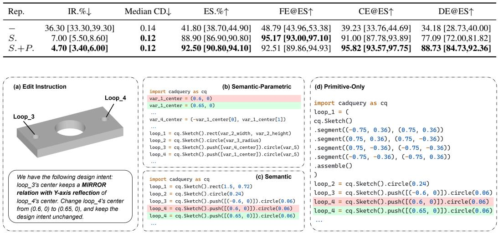  
Figure 4: Examples of zero-shot intent-preserving edits under different target representations. Semantic targets expose feature-level operations for local modification, while semantic–parametric targets make reusable relations explicit for consistency-preserving refinements.

We restrict the edit scope to the code-level intent signals studied in this paper: semantic features, equality-like relations over reusable parameters, and lightweight derived parametric relations. Given a source program and an edit instruction, the model outputs the full edited program using the corresponding generation checkpoint, with no additional editing fine-tuning. Each instruction explicitly refers to the edited object using its loop name in the source program. This intentionally factors out open-ended edit-target localization and isolates whether each representation supports the requested local modification once the target is identified.

Results. Table 3 shows that semantic lifting leads to a large improvement over primitive-only code in zero-shot editing. Overall ES increases from 41.80% to 88.90%, while FE@ES increases from 48.79% to 95.17%. IR also drops from 36.30% to 7.00%, suggesting that semantic feature-level programs provide a more reliable basis for full-program editing than verbose primitive traces. Paired bootstrap intervals in Appendix D support the improvement across overall ES and the three edit categories. Parametric lifting provides a more targeted benefit. Moving from S. to S.+P. keeps the geometry proxy comparable, with the same Median CD of 0.12, and FE@ES remains similar. The main gains appear in relation-aware edits: CE@ES increases from 91.00% to 95.82%, and DE@ES increases from 77.09% to 88.73%, with paired bootstrap confidence intervals excluding zero. These results suggest that explicit parameter and relation structure is useful when local refinements must preserve equality-like or derived relations. More qualitative results refer to Appendix E.

These results suggest that representation granularity affects zero-shot intent-preserving editing under our controlled benchmark. Thus, editing serves as a downstream validation of the representation: semantic structure makes local feature edits more reliable, and explicit parametric structure help preserve relations during refinement. A finer breakdown by edit subtype is provided in Appendix D.

## 4.5 Visually Grounded Editing

To isolate editing performance from target localization, the preceding zero-shot experiment uses explicit loop identifiers. We extend this evaluation to visually grounded editing using 200 cases from IntentCAD-Edit-1K with at least two candidate features (80 FE, 60 CE, and 60 DE). Loop identifiers are replaced with spatial descriptions while preserving the edit operations and target values. GPT-5.4

Edit instruction: Set the height of the outer rectangular profile on the top face to 0.942856, while preserving the equal-dimension relations among the related features. Leave all unrelated geometry unchanged.

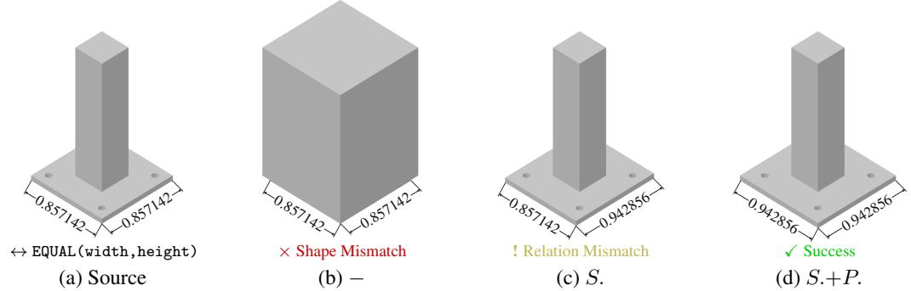  
Figure 5: Qualitative comparison of visually grounded editing across different source representations.

edits each aligned source program using the same four-view rendering and instruction. We also use GPT-5.4 to separately rate source program editability on a 0–10 scale without representation labels. Localization checks whether the intended target loop is modified, while ES additionally requires executable and correct edits, including relation–dependent updates.

Table 4: Visually grounded editing on 200 cases. VLM scores range from 0 to 10.
<table><tr><td>Rep.</td><td>Loc. (%) ↑</td><td>ES (%) ↑</td><td>FE@ES (%) ↑</td><td>CE@ES (%) ↑</td><td>DE@ES (%) ↑</td><td>VLM↑</td></tr><tr><td></td><td>69.50</td><td>36.50</td><td>33.75</td><td>33.33</td><td>43.33</td><td>6.58</td></tr><tr><td>S.</td><td>84.00</td><td>66.00</td><td>86.25</td><td>48.33</td><td>56.67</td><td>7.86</td></tr><tr><td>S.+P.</td><td>91.50</td><td>78.50</td><td>78.75</td><td>73.33</td><td>83.33</td><td>8.94</td></tr></table>

Table 4 shows that semantic lifting improves localization from 69.50% to 84.00% and ES from 36.50% to 66.00%, while parametric lifting further raises them to 91.50% and 78.50%, respectively. The additional ES gains mainly occur in CE and DE, although S. performs better on FE. Higher VLM ratings also suggest improved perceived editability. Figure 5 illustrates how explicit parameter relations help preserve dimensional consistency during editing.

## 5 Limitations

Several limitations define the current scope of Intent2CAD. First, it supports only a conservative set of commonly recoverable semantic templates, leaving many long-tail engineering features in primitive form. Extending semantic coverage to richer feature spaces remains important future work. Second, the text descriptions are primarily expert-level prompts, and generalization to casual or underspecified instructions remains unstudied. Third, our use of intent is limited to recoverable code-level signals rather than full design history or constraint-solving processes. Finally, the conservative pipeline reduces incorrect supervision, but may leave some valid relations unlifted.

## 6 Conclusion

This paper studied how semantic–parametric representation affects text-to-CAD generation under a controlled fine-tuning setup. Intent2CAD changes the supervision target rather than the model architecture or decoding procedure, representing CAD programs as executable CadQuery code with recoverable semantic features, reusable parameters, lightweight parametric relations, and low-level fallbacks. Our experiments suggest that semantic lifting improves reliability, geometric fidelity, feature recovery, and feature-level editing, while parametric lifting mainly benefits relation recovery and relation-aware edits. These findings provide evidence that the symbolic form of CAD supervision can affect the structure learned by text-to-CAD models. Within the scope of recoverable codelevel intent signals, structured supervision appears to be a promising direction for generating CAD programs that are not only executable, but also more amenable to later refinement.

## 7 Acknowledgments and Disclosure of Funding

This research was supported by the National Key R&D Program of China (No. 2023YFB4604800).   
The authors declare no competing interests.

## References

[1] Licheng Zhang, Bach Le, Naveed Akhtar, Siew-Kei Lam, and Duc Ngo. Large language models for computer-aided design: A survey. ACM Computing Surveys, 58(9):1–39, 2026.

[2] Negar Heidari and Alexandros Iosifidis. Geometric deep learning for computer-aided design: A survey. arXiv preprint arXiv:2402.17695, 2024.

[3] Karl DD Willis, Yewen Pu, Jieliang Luo, Hang Chu, Tao Du, Joseph G Lambourne, Armando Solar-Lezama, and Wojciech Matusik. Fusion 360 gallery: A dataset and environment for programmatic cad construction from human design sequences. ACM Transactions on Graphics (TOG), 40(4):1–24, 2021.

[4] David Robertson and Thomas J Allen. Cad system use and engineering performance. IEEE Transactions on Engineering Management, 40(3):274–282, 1993.

[5] Mohammad S Khan, Sankalp Sinha, Talha U Sheikh, Didier Stricker, Sk A Ali, and Muhammad Z Afzal. Text2cad: Generating sequential cad designs from beginner-to-expert level text prompts. Advances in Neural Information Processing Systems, 37:7552–7579, 2024.

[6] Prashant Govindarajan, Davide Baldelli, Jay Pathak, Quentin Fournier, and Sarath Chandar. Cadmium: Fine-tuning code language models for text-driven sequential cad design. arXiv preprint arXiv:2507.09792, 2025.

[7] Ruiyu Wang, Yu Yuan, Shizhao Sun, and Jiang Bian. Text-to-cad generation through infusing visual feedback in large language models. arXiv preprint arXiv:2501.19054, 2025.

[8] Yandong Guan, Xilin Wang, Ximing Xing, Jing Zhang, Dong Xu, and Qian Yu. Cad-coder: Textto-cad generation with chain-of-thought and geometric reward. arXiv preprint arXiv:2505.19713, 2025.

[9] Haoyang Xie and Feng Ju. Text-to-cadquery: A new paradigm for cad generation with scalable large model capabilities. arXiv preprint arXiv:2505.06507, 2025.

[10] Jiahao Li, Weijian Ma, Xueyang Li, Yunzhong Lou, Guichun Zhou, and Xiangdong Zhou. Cad-llama: leveraging large language models for computer-aided design parametric 3d model generation. In Proceedings of the IEEE/CVF Conference on Computer Vision and Pattern Recognition, pages 18563–18573, 2025.

[11] Jeffrey Otey, Pedro Company, Manuel Contero, and Jorge D Camba. Revisiting the design intent concept in the context of mechanical cad education. Computer-aided design and applications, 15(1):47–60, 2018.

[12] Sofia Kyratzi and Philip Azariadis. Integrated design intent of 3d parametric models. Computer-Aided Design, 146:103198, 2022.

[13] Evan Casey, Tianyu Zhang, Shu Ishida, John Roger Thompson, Amir Khasahmadi, Joseph George Lambourne, Pradeep Kumar Jayaraman, and Karl DD Willis. Aligning constraint generation with design intent in parametric cad. In 2025 IEEE/CVF International Conference on Computer Vision (ICCV), pages 8613–8622. IEEE, 2025.

[14] William Bouma, Ioannis Fudos, Christoph Hoffmann, Jiazhen Cai, and Robert Paige. Geometric constraint solver. Computer-aided design, 27(6):487–501, 1995.

[15] Rundi Wu, Chang Xiao, and Changxi Zheng. Deepcad: A deep generative network for computeraided design models. In Proceedings of the IEEE/CVF international conference on computer vision, pages 6772–6782, 2021.

[16] Siyu Wang, Cailian Chen, Xinyi Le, Qimin Xu, Lei Xu, Yanzhou Zhang, and Jie Yang. Cad-gpt: Synthesising cad construction sequence with spatial reasoning-enhanced multimodal llms. In Proceedings ofthe AAAI Conference on Artificial Intelligence, volume 39, pages 7880–7888, 2025.

[17] Yu Yuan, Shizhao Sun, Qi Liu, and Jiang Bian. Cad-editor: A locate-then-infill framework with automated training data synthesis for text-based cad editing. In International Conference on Machine Learning, pages 73588–73603. PMLR, 2025.

[18] Zhanwei Zhang, Kaiyuan Liu, Junjie Liu, Wenxiao Wang, Binbin Lin, Liang Xie, Chen Shen, and Deng Cai. Geocad: Local geometry-controllable cad generation with large language models. arXiv preprint arXiv:2506.10337, 2025.

[19] Zhanwei Zhang, Shizhao Sun, Wenxiao Wang, Deng Cai, and Jiang Bian. Flexcad: Unified and versatile controllable cad generation with fine-tuned large language models. arXiv preprint arXiv:2411.05823, 2024.

[20] Jiajun Wu, Chengkai Zhang, Tianfan Xue, Bill Freeman, and Josh Tenenbaum. Learning a probabilistic latent space of object shapes via 3d generative-adversarial modeling. Advances in neural information processing systems, 29, 2016.

[21] Jeong Joon Park, Peter Florence, Julian Straub, Richard Newcombe, and Steven Lovegrove. Deepsdf: Learning continuous signed distance functions for shape representation. In Proceedings of the IEEE/CVF conference on computer vision and pattern recognition, pages 165–174, 2019.

[22] Charlie Nash, Yaroslav Ganin, SM Ali Eslami, and Peter Battaglia. Polygen: An autoregressive generative model of 3d meshes. In International conference on machine learning, pages 7220–7229. PMLR, 2020.

[23] Guandao Yang, Xun Huang, Zekun Hao, Ming-Yu Liu, Serge Belongie, and Bharath Hariharan. Pointflow: 3d point cloud generation with continuous normalizing flows. In Proceedings ofthe IEEE/CVF international conference on computer vision, pages 4541–4550, 2019.

[24] Ari Seff, Yaniv Ovadia, Wenda Zhou, and Ryan P Adams. Sketchgraphs: A large-scale dataset for modeling relational geometry in computer-aided design. arXiv preprint arXiv:2007.08506, 2020.

[25] Karl DD Willis, Pradeep Kumar Jayaraman, Joseph G Lambourne, Hang Chu, and Yewen Pu. Engineering sketch generation for computer-aided design. In 2021 IEEE/CVF Conference on Computer Vision and Pattern Recognition Workshops (CVPRW), pages 2105–2114. IEEE, 2021.

[26] Christoph M Hoffmann and Robert Joan-Arinyo. A brief on constraint solving. Computer-Aided Design and Applications, 2(5):655–663, 2005.

[27] Yuezhi Yang and Hao Pan. Discovering design concepts for cad sketches. Advances in Neural Information Processing Systems, 35:28803–28814, 2022.

[28] Wamiq Para, Shariq Bhat, Paul Guerrero, Tom Kelly, Niloy Mitra, Leonidas Guibas, and Peter Wonka. Sketchgen: Generating constrained cad sketches. Advances in Neural Information Processing Systems, 34:5077–5088, 2021.

[29] Dacheng Qi, Chenyu Wang, Jingwei Xu, Tianzhe Chu, Zibo Zhao, Wen Liu, Wenrui Ding, Yi Ma, and Shenghua Gao. Pointer-cad: Unifying b-rep and command sequences via pointerbased edges & faces selection. arXiv preprint arXiv:2603.04337, 2026.

[30] Ruiyu Wang, Shizhao Sun, Weijian Ma, and Jiang Bian. Cad-tokenizer: Towards text-based cad prototyping via modality-specific tokenization. arXiv preprint arXiv:2509.21150, 2025.

[31] Maksim Kolodiazhnyi, Denis Tarasov, Dmitrii Zhemchuzhnikov, Alexander Nikulin, Ilya Zisman, Anna Vorontsova, Anton Konushin, Vladislav Kurenkov, and Danila Rukhovich. cadrille: Multi-modal cad reconstruction with reinforcement learning. arXiv preprint arXiv:2505.22914, 2025.

[32] Edward J Hu, yelong shen, Phillip Wallis, Zeyuan Allen-Zhu, Yuanzhi Li, Shean Wang, Lu Wang, and Weizhu Chen. LoRA: Low-rank adaptation of large language models. In International Conference on Learning Representations, 2022.

[33] Haocheng Yuan, Jing Xu, Hao Pan, Adrien Bousseau, Niloy J Mitra, and Changjian Li. Cadtalk: An algorithm and benchmark for semantic commenting of cad programs. In 2024 IEEE/CVF Conference on Computer Vision and Pattern Recognition (CVPR), pages 3753–3762. IEEE, 2024.

[34] Shiqi Wang, Zheng Li, Haifeng Qian, Chenghao Yang, Zijian Wang, Mingyue Shang, Varun Kumar, Samson Tan, Baishakhi Ray, Parminder Bhatia, et al. Recode: Robustness evaluation of code generation models. In Proceedings of the 61st Annual Meeting of the Association for Computational Linguistics (Volume 1: Long Papers), pages 13818–13843, 2023.

## A Additional Dataset and Pipeline Details

## A.1 Additional IntentCAD-100K Statistics

Data Distribution. Table 5 shows that the three sets exhibit highly consistent statistics, including the proportions of semantic and parametric lifted samples. Table 6 further reports the loop-type distribution of the three sets.

Table 5: Distribution of instances with semantic lifting (S.), parametric lifting (P.), and both semantic and parametric lifting (S.+P.) in each split (%).
<table><tr><td>Set</td><td>S.</td><td>P.</td><td>S.+P.</td></tr><tr><td>Train.</td><td>69.65</td><td>25.97</td><td>18.69</td></tr><tr><td>Val.</td><td>70.60</td><td>26.14</td><td>19.24</td></tr><tr><td>Test.</td><td>69.44</td><td>25.93</td><td>18.47</td></tr></table>

Table 6: Loop type distribution across dataset (%). Fall. denotes fallback loops with segments and arcs. Poly. and Reg. denotes irregular and regular polygons, respectively.
<table><tr><td colspan="3">Low-level</td><td colspan="4">High-level</td></tr><tr><td>Set</td><td>Circle</td><td>Fall.</td><td>Rect. Poly.</td><td>Fillet Reg.</td><td>Array</td><td>Slot</td></tr><tr><td>Train.</td><td>37.34</td><td></td><td>14.51 32.63 11.80</td><td>1.48</td><td>0.99</td><td>0.69 0.55</td></tr><tr><td>Val.</td><td>36.81</td><td></td><td>14.76 33.1611.40</td><td>1.66</td><td>0.90 0.76</td><td>0.55</td></tr><tr><td>Test.</td><td></td><td></td><td>37.9014.22 32.7011.23</td><td>1.51</td><td>1.10 0.75</td><td>0.60</td></tr></table>

Semantic lifting coverage. Table 7 reports sample-level semantic lifting coverage, complementing the loop-level distribution in Table 6.

Table 7: Sample-level semantic lifting coverage.
<table><tr><td>Set</td><td></td><td></td><td></td><td>Avg. semantic features Avg. circle loops Avg. fallback loops Fully fallback samples</td></tr><tr><td>Train</td><td>1.12</td><td>0.99</td><td>0.34</td><td>5,070 (6.29%)</td></tr><tr><td>Val.</td><td>1.13</td><td>0.99</td><td>0.35</td><td>622 (6.17%)</td></tr><tr><td>Test</td><td>1.12</td><td>1.00</td><td>0.33</td><td>615 (6.10%)</td></tr></table>

Source constraint distribution. Table 8 summarizes the source CAD constraints extracted before lifting, grouped by their primary use in our pipeline. Geometric constraints provide evidence for local feature lifting, while dimensional and parameter-related constraints support relation proposal and parameter rewriting. These source constraints are not one-to-one labels of the final explicit relations in code.

Table 8: Aggregate distribution of source CAD constraints before lifting, grouped into geometric and dimensional sketch constraints.
<table><tr><td colspan="3">Geometric constraints</td><td colspan="3">Dimensional constraints</td></tr><tr><td>Type</td><td>Count</td><td>Overall (%)</td><td>Type</td><td>Count</td><td>Overall (%)</td></tr><tr><td>PARALLEL</td><td>155,431</td><td>17.36</td><td>LENGTH</td><td>147,184</td><td>16.44</td></tr><tr><td>HORIZONTAL</td><td>125,251</td><td>13.99</td><td>DISTANCE</td><td>83,202</td><td>9.29</td></tr><tr><td>PERPENDICULAR</td><td>93,149</td><td>10.40</td><td>DIAMETER</td><td>77,295</td><td>8.63</td></tr><tr><td>TANGENT</td><td>68,346</td><td>7.63</td><td>RADIUS</td><td>21,991</td><td>2.46</td></tr><tr><td>VERTICAL</td><td>47,689</td><td>5.33</td><td>ANGLE</td><td>5,477</td><td>0.61</td></tr><tr><td>CONCENTRIC</td><td>26,617</td><td>2.97</td><td></td><td></td><td></td></tr><tr><td>EQUAL</td><td>22,428</td><td>2.51</td><td></td><td></td><td></td></tr><tr><td>MIRROR</td><td>21,249</td><td>2.37</td><td></td><td></td><td></td></tr><tr><td>Total</td><td>560,160</td><td>62.56</td><td>Total</td><td>335,149</td><td>37.43</td></tr></table>

## A.2 Duplicate Removal

Duplicate removal is performed after primitive CadQuery reconstruction and validity filtering, but before lifting and data splitting, ensuring that all three supervision representations remain aligned. Each primitive program is converted into an ordered construction signature from its operations and geometric arguments; floating-point values are rounded to four decimals and the serialized signature is hashed with SHA256. Duplicate hashes are removed after deterministic sorting.

This is construction-level rather than source-code or full geometric-equivalence deduplication: formatting differences are ignored, but programs with different operation orders or construction histories may remain distinct. This choice matches our setting, where CAD supervision depends on both final geometry and construction parameterization.

## A.3 Semantic–Parametric Lifting Details

Supported semantic features. Semantic lifting supports rectangles, regular and irregular polygons, slots, fillets, and arrays. Unsupported or ambiguous primitive groups are preserved as low-level fallbacks.

Supported parametric relations. Parametric lifting targets EQUAL, CONCENTRIC, MIRROR, DISTANCE, and RATIO relations. These relations are represented in code as shared variables or simple derived expressions after validation. Implementation details of rewrite proposal and validation are described below.

LLM-Assisted Local Rewrite Prompt. Stage II uses an LLM only as a constrained local rewrite proposer. The LLM receives the Stage-I program and primitive-level constraints, and returns a structured rewrite plan over variable definitions. The system prompt is shown in Prompt A.3. The user message contains the Stage-I CadQuery program and the corresponding serialized constraints.

Prompt 1: Prompt for Stage-II relation induction   
User message template:   
CadQuery Code.   
{code\_text}   
Constraints.   
{constraints\_summary\_json}   
Identify all valid variable substitutions based on EQUAL, CONCENTRIC, DISTANCE, LENGTH, RADIUS,   
DIAMETER, or MIRROR. Do not infer directly from PARALLEL, PERPENDICULAR, TANGENT, or other non  
substitution constraints. Output only the JSON object.   
System prompt:   
Role. You are a CAD parametrization expert. Analyze an already high-level CadQuery sketch script together   
with sketch-level geometric constraints, and rewrite only variable definitions into shared variables or simple   
expressions.   
Task. The code already uses high-level APIs such as rect, circle, slot, regularPolygon, and fillet.   
Do not change code structure, API calls, loops, or body logic. Only improve parameter definitions var\_\*.   
The goal is to recover human-intuitive parametric design intent, not to numerically fit arbitrary relations   
between variable values.   
Input notes. Code comments map constraint tags to loops, e.g., # ’JGV’, ’JGp’ -> loop\_2. Use these   
comments to connect constraint entities to the corresponding high-level geometry. A constraint entity may   
correspond to multiple sketch tags because one geometric entity can be represented by multiple sketch   
segments. Treat such tags as one grouped entity.   
Rewrite rules. Only modify var\_\* definitions. Do not change geometry, APIs, loops, or body logic.   
Infer parameter meaning from the existing high-level API, variable names, and provided sketch constraints.   
Preserve geometry exactly after substitutions, with tolerance ≤ 10−5. Prefer shared parameters or simple   
human-like expressions over repeated constants. Do not replace expressions entirely with bare numbers. If   
evidence is weak or ambiguous, make no change.   
Constraint use. EQUAL is strong evidence for shared parameters. CONCENTRIC, DISTANCE, and MIRROR   
may justify shared centers or simple symmetric expressions. LENGTH, RADIUS, and DIAMETER are dimension   
evidence only; use them only for equality or clearly intended simple relations. Other constraints are   
supporting context only, not sole evidence.   
Compatibility. Relations may be inferred between geometrically compatible quantities, not only identical   
property names, e.g., width–height, radius–radius, radius–diameter, line length–width/height, and distance–   
width/height/diameter. Do not relate incompatible quantities such as size–angle or size–side count.   
Output format. Return a JSON object with one required field, changes. If no changes are justified, return   
an empty list.

{   
"changes": [   
{   
"variable": "<variable\_name>",   
"new\_value": "<expression\_or\_variable>",   
"relation\_type": "shared" | "expression",   
"primary\_constraints": [   
{   
"type": "EQUAL" | "CONCENTRIC" | "DISTANCE" |   
"RADIUS" | "LENGTH" | "DIAMETER" | "MIRROR",   
"entities": ["<tag1>", "<tag2>"]   
}   
],   
"reason": "<brief explanation under 20 words>"   
}   
]   
}

## A.4 Validation and Text Description Generation Rules

Execution check. We execute each candidate CadQuery program. A program passes execution if it produces a valid non-empty solid whose volume can be queried successfully within 30 seconds.

Geometric consistency. Since Chamfer Distance is randomly sampled, we compare the candidate program p˜ against the Stage-I program $p ^ { ( 1 ) }$ using deterministic values, such as solid volume, the six axis-aligned bounding-box coordinates, and the three center-of-mass coordinates. A rewrite is accepted only if every checked scalar invariant differs under $1 0 ^ { - 5 }$ tolerance.

Locality check. We parse both $p ^ { ( 1 ) }$ and $\tilde { p }$ into ASTs and verify that the geometric operation sequence, loop identifiers, feature calls, extrusion operations, Boolean operations, and sketch topology remain unchanged. The rewrite may only introduce or modify variable assignments and parameter expressions. It is rejected if it adds, removes, reorders, or changes geometric operations.

Text Description Generation. For each accepted program, we use GPT-5.4 to generate one intentoriented engineering description from the accepted CadQuery script and the recovered constraint summary. The generator is instructed to verbalize only code-supported geometry, dimensions, construction order, body operations, and explicitly represented relations. It is also instructed not to mention Python, CadQuery, API names, variable names, loop identifiers, or other code-level symbols. Numeric-equality-only groups are not described as shared relations unless they are explicitly supported by the accepted program or constraint summary.

## A.5 Stage-wise Coverage and Validation

Stage I fully recognizes the semantic structure in 82.68% of the retained IntentCAD-100K programs. Incomplete recognition arises from unsupported feature patterns, insufficient constraint evidence, or geometric deviations beyond the matching tolerance. Unrecognized portions remain in primitive form rather than being assigned uncertain semantic labels.

Stage II proposes at least one relation rewrite for 34.24% of Stage-I programs. The absence of a proposal may reflect insufficient evidence or relations already encoded by semantic features. For example, parallelism and perpendicularity are intrinsic to rect. This percentage measures proposal coverage rather than the proportion of programs with accepted parametric lifting.

Among 78,930 candidate rewrites, 70,238 (88.99%) pass deterministic validation. The remaining candidates are rejected when substitutions violate executability, geometric consistency, or locality. Rejected rewrites retain the Stage-I representation, while unsuccessful semantic lifting preserves the corresponding primitive operations. These fallbacks are distinct from the initial filtering of raw sequences that cannot be converted into executable programs.

## B Details of Metric Definitions

## B.1 Generation Metrics

Execution Validity. Invalid Ratio (IR) is the fraction of predicted programs that fail to execute into a valid CadQuery solid. A prediction is considered executable if running the program produces an object whose solid volume can be queried successfully.

Chamfer Distance. For executable predictions, we tessellate both the predicted and ground-truth CadQuery solids with a tolerance of 0.001, uniformly sample 8192 surface points, normalize each point cloud by its maximum bounding-box extent, and compute symmetric squared Chamfer Distance. Following prior text-to-CAD works, reported CD values are multiplied by $\mathrm { i 0 ^ { 3 } }$

API Recovery. API Recovery (AR) measures whether the generated code recovers the semantic feature calls used by the ground-truth program. We parse the predicted and target programs into Python ASTs and extract multisets of canonical feature labels. Equivalent API interfaces are mapped to the same feature label when applicable, $\mathrm { e . g . }$ , slot and slot2D are both mapped to slot, pushPoints, rarray, and polarArray are mapped to array. Given ground-truth and predicted feature multisets $M _ { g }$ and $M _ { p } ,$ , AR is computed as the F1 score:

$$
P = \frac { \left| M _ { g } \cap M _ { p } \right| } { \left| M _ { p } \right| } , \quad R = \frac { \left| M _ { g } \cap M _ { p } \right| } { \left| M _ { g } \right| } , \quad A R = \frac { 2 P R } { P + R } .
$$

Samples without ground-truth canonical features are excluded from AR calculation.

Equal Relation Score. Equal Relation Score (ERS) measures preservation of explicit sharedparameter structure. We identify each variable that is referenced by two or more loop definitions as a shared parameter. Each shared parameter is represented by a structural signature consisting of its definition skeleton, its API argument roles, and the number of loops that reference it. Concrete variable names and numeric constants are abstracted in the skeleton, so the score focuses on whether the reusable parameter structure is preserved rather than whether the exact identifier names match. ERS is the fraction of ground-truth shared-parameter signatures greedily matched by the prediction. ERS is only reported for samples whose ground-truth programs contain shared parameters.

Parametric Relation Score. Parametric Relation Score (PRS) measures preservation of derived parameter expressions. A derived parameter is a variable whose right-hand side references at least one other variable. We represent each derived parameter by its expression skeleton and the number of referenced variables, and compute PRS as the fraction of ground-truth derived-relation signatures matched by the prediction. PRS is only reported for samples whose ground-truth programs contain derived parameter relations.

## B.2 Edit Metrics

Edit Success Rate. Edit Success Rate (ES) measures whether the generated program correctly realizes the requested edit. A prediction is counted as successful if it satisfies two conditions: (1) the program executes into a valid CAD solid; and (2) the loops affected by the edit match the deterministic target program. The affected loops include the directly edited loop and any loops that should change to preserve the declared relation.

The match is not based on string matching. For semantic loops, we compare the recovered feature type and resolved feature attributes, such as center, width, height, radius, angle, polygon points, slot dimensions, and fillet radius; variable names and expression surface forms are ignored after values are resolved. For primitive loops, we compare the resulting low-level segment/arc construction, and treat cyclic shifts and reversed traversal of the same closed loop as equivalent. Numeric values are compared with a tolerance of $1 0 ^ { - 5 }$ . The final ES is the percentage of edit samples that satisfy these conditions.

## C Edit Benchmark Details

## C.1 Edit Benchmark Construction Pipeline

We construct the edit benchmark by deterministic synthesis from the subset of IntentCAD-100K test set that contains both semantic and parametric lifting, without using LLM-generated targets. The purpose is to obtain aligned edit triples where the same edit instruction is applied to primitive-only, semantic-only, and semantic–parametric representations.

The synthesis follows a conservative pipeline similar to Stage I. We first identify editable local semantic features through AST parsing, and use loop/tag alignment to trace the affected loops across the three representations. The edit therefore is applied at the semantic level and then projected to the other representations: S.+P. updates shared or derived variable assignments when applicable, S. rewrites the corresponding feature parameters, and the primitive representation (−) regenerates the involved tagged loops as equivalent low-level primitive chains.

We keep only candidates that pass several validations: all source and target programs must be syntactically valid and executable, the target must introduce a non-trivial geometric change from the source, and the three target programs must remain mutually consistent under a strict geometric tolerance 10−5.

## C.2 Edit Type Distribution

Table 9 summarizes the three edit categories. The benchmark is designed to cover local feature changes, equality-style consistency preservation, and derived relation preservation. Table 10 further reports subtype statistics. Feature edits are approximately balanced between parameter modification and feature replacement, while relation-sensitive edits mainly cover EQUAL, CONCENTRIC, RATIO, MIRROR, and DISTANCE relations.

Table 9: Distribution of edit types.
<table><tr><td>Edit type</td><td>Count</td><td>Percentage</td></tr><tr><td>Feature Edit (FE)</td><td>414</td><td>41.40%</td></tr><tr><td>Consistency Edit (CE)</td><td>311</td><td>31.10%</td></tr><tr><td>Derived-Relation Edit (DE)</td><td>275</td><td>27.50%</td></tr></table>

Table 10: Subtype distribution of edits. Percentages are computed within each major edit type.
<table><tr><td>Type</td><td>Subtype</td><td>Count</td><td>Within-type</td></tr><tr><td rowspan="2">Feature</td><td>Parameter modification</td><td>200</td><td>48.31%</td></tr><tr><td>Feature replacement</td><td>214</td><td>51.69%</td></tr><tr><td rowspan="7">Consistency</td><td>EQUAL (height+width)</td><td>74</td><td>23.79%</td></tr><tr><td>EQUAL (height)</td><td>63</td><td>20.26%</td></tr><tr><td>EQUAL (radius)</td><td>63</td><td>20.26%</td></tr><tr><td>EQUAL (width)</td><td>62</td><td>19.94%</td></tr><tr><td>CONCENTRIC (center)</td><td>37</td><td>11.90%</td></tr><tr><td>EQUAL (fillet radius)</td><td>8</td><td>2.57%</td></tr><tr><td>EQUAL (other combinations)</td><td>4</td><td>1.28%</td></tr><tr><td rowspan="3">Derived-Relation</td><td>RATIO</td><td>131</td><td>47.64%</td></tr><tr><td>MIRROR</td><td>128</td><td>46.54%</td></tr><tr><td>DISTANCE</td><td>16</td><td>5.82%</td></tr></table>

## C.3 Edit Instruction Templates

We use three types of edit template. Each instruction describes the requested modification and explicitly asks the model to keep the remaining relations unchanged.

Table 11: Auxiliary syntax-validity and decoding-cost results. SV reports Python syntax validity, and Mean CT reports average completion tokens.
<table><tr><td>Experiment</td><td>Setting / Rep.</td><td>SV.%↑</td><td>Mean CT↓</td></tr><tr><td>Diagnostic Baseline Comparison</td><td></td><td></td><td></td></tr><tr><td></td><td>GPT-5.4</td><td>99.97</td><td>341.08</td></tr><tr><td></td><td>GPT-5.4-mini</td><td>99.98</td><td>258.74</td></tr><tr><td></td><td>Qwen3.5-397B-A17B</td><td>99.60</td><td>2109.67</td></tr><tr><td></td><td>Qwen3.5-plus</td><td>99.61</td><td>2115.25</td></tr><tr><td></td><td>CAD-Coder [8]</td><td>99.66</td><td>270.51</td></tr><tr><td></td><td>Qwen2.5-7B</td><td>99.75</td><td>381.64</td></tr><tr><td></td><td>+IntentCAD SFT</td><td>99.98</td><td>371.15</td></tr><tr><td></td><td>Qwen3.5-9B</td><td>91.64</td><td>1056.28</td></tr><tr><td></td><td>+IntentCAD SFT</td><td>99.99</td><td>365.23</td></tr><tr><td colspan="2">Controlled Ablation of Target Representations</td><td></td><td></td></tr><tr><td colspan="2"></td><td>97.95</td><td>713.74</td></tr><tr><td colspan="2">S.</td><td>99.99</td><td>341.21</td></tr><tr><td colspan="2"> $S , + P .$ </td><td>99.99</td><td>365.23</td></tr><tr><td colspan="2">Zero-shot Intent-Preserving Editing</td><td></td><td></td></tr><tr><td colspan="2"></td><td>66.20</td><td>2590.3</td></tr><tr><td colspan="2">S.</td><td>94.20</td><td>1334.7</td></tr><tr><td colspan="2"> $S , + P .$ </td><td>98.50</td><td>1248.5</td></tr></table>

Feature Edit. For parameter modifications, the instruction specifies the edited feature, loop identifier, attribute, old value, and new value: "Change the {attribute} of the {feature} in {loop} from {old\_value} to {new\_value}, and keep the other supported structures unchanged."

For feature replacements, the instruction specifies the target feature and its required attributes: "Replace the geometry in {loop} with a {new\_feature} feature, where {attribute descriptions}, and keep the design intent unchanged."

Consistency Edit. These instructions explicitly state an equality-style relation, such as EQUAL or CONCENTRIC, and ask the model to update one parameter while preserving the relation: "The following relation should be preserved: {affected slots} stay {relation}. Change {edited slot} from {old\_value} to {new\_value}, and keep the design intent unchanged."

Derived-Relation Edit. These instructions specify a derived relation such as MIRROR, RATIO, or DISTANCE, and ask the model to update the source parameter while preserving the relation: "The following relation should be preserved: {dependent slot} keeps a {relation} relation with {source slot}. Change {source slot} from {old\_value} to {new\_value}, and keep the design intent unchanged."

## D Additional Experiment Result Details

## D.1 Additional Quantitative Results

Table 11 reports some auxiliary quantitative results. We include Syntax Validity (SV) to measure Python syntax correctness, and Completion Tokens (CT) as an auxiliary measure of decoding cost during inference. These metrics complement the main evaluation, but they are not used as primary indicators of geometric fidelity, semantic feature recovery, relation preservation, or edit success.

For the controlled representation comparison, semantic lifting also reduces decoding cost. Mean CT decreases from 713.74 for the primitive-only representation (−) to 341.21 for the semantic representation (S.). For reference, the mean extracted generated-code lengths are 490.85, 339.21, and 363.23 tokens $\mathrm { f o r } - , S .$ , and $S , + P .$ , respectively. This suggests that the CT reduction from − to S. is not explained by final code length alone, and is also associated with the more compact and structured generation target introduced by semantic lifting.

Adding parametric lifting slightly increases Mean CT from 341.21 to 365.23. This is expected because ${ \bar { S } } , + P .$ introduces explicit variables and lightweight relations into the target code. The same trend appears in the extracted code length, which increases from 339.21 tokens for S. to 363.23 tokens for $S , + P .$

On the edit benchmark, SV improves from 66.20% for the primitive-only representation to 94.20% for S. and 98.50% for $S , + P .$ , indicating that lifted representations also make zero-shot editing less prone to syntactically invalid outputs. Mean CT also decreases from 2590.3 to 1334.7 and 1248.5, suggesting that the lifted representations lead to shorter edit responses.

## D.2 Implementation Details.

All fine-tuning experiments are implemented with a standard LoRA-based supervised fine-tuning recipe [32]. Unless otherwise specified, we use Qwen3.5-9B as the base model. The backbone parameters are frozen, and only the LoRA adapters are updated. LoRA is applied to both attention and feed-forward projection modules, including the query, key, value, output, gate, up, and down projections. For each supervision representation, we train a separate LoRA adapter for three epochs using the same optimizer configuration, effective batch construction, learning-rate schedule, and sequence-length setting. Thus, the controlled variants differ only in the supervision target representation. During inference, all variants use the same decoding configuration and maximum generation length 4096. All fine-tuning and evaluation experiments are conducted on 2 NVIDIA A100 40GB GPUs.

## D.3 Bootstrap and Paired Difference Analysis

All confidence intervals use percentile bootstrap with 10,000 resamples over test examples. For paired representation comparisons, the same example indices are resampled across representations. Positive differences indicate that the main representation performs better: for lower-is-better metrics such as IR and CD, we compute baseline minus main; for higher-is-better metrics, we compute main minus baseline.

For controlled generation, Table 12 analyzes representation differences using paired bootstrap confidence intervals. Semantic lifting yields supported improvements over primitive-only supervision: the intervals for IR and Mean CD are strictly positive. Its role is instead evaluated through relationoriented metrics: ERS and PRS are only meaningful when explicit shared parameters or derived relations exist, and are therefore reported as absolute scores for ${ \bar { \boldsymbol { S } } } + { \boldsymbol { P } } .$ in Table 2.

Table 12: Paired bootstrap difference confidence intervals for controlled generation comparisons. Positive values indicate improvement of the main representation. CD metrics are $\times 1 0 ^ { 3 }$
<table><tr><td>Comparison</td><td>Metric</td><td>Difference</td><td>95% CI</td></tr><tr><td> $S . \mathrm { v s . \mathrm { ~ - ~ } }$ </td><td>IR.%</td><td>+2.17</td><td>[1.87, 2.45]</td></tr><tr><td> $S . \mathrm { v s . \mathrm { ~ - ~ } }$ </td><td>Mean CD</td><td>+0.98</td><td>[0.38, 1.62]</td></tr><tr><td> $S . { + P } .$  vs. S.</td><td>IR.%</td><td>+0.02</td><td>[-0.07, 0.05]</td></tr><tr><td>S.+P. vs. S. Mean CD</td><td></td><td>-0.11</td><td>[-0.42, 0.18]</td></tr><tr><td> $S . { + P } .$ </td><td>vs. S. AR.%</td><td>-0.004</td><td>[-0.025, 0.016]</td></tr></table>

As shown in Table 13, semantic lifting improves zero-shot editing over primitive supervision across all edit categories. Adding parametric lifting provides smaller but targeted gains: the difference is not supported for feature edits, but is supported for consistency and derived-relation edits. This matches the role of parametric lifting as relation-aware supervision rather than generic feature-edit supervision.

## D.4 Breakdown of Zero-shot Intent-Preserving Editing

Table 14 provides category-level breakdowns. The main trend is consistent with Table 3: semantic lifting improves overall editability over primitive code, and parametric lifting provides additional gains on relation-sensitive edits that require preserving shared or derived parameters.

Table 13: Paired bootstrap difference confidence intervals for zero-shot editing. Positive values indicate improvement of the main representation.
<table><tr><td>Comparison</td><td>Metric</td><td>Difference</td><td>95% CI</td></tr><tr><td>S. vs. –</td><td>Overall ES.%</td><td>+47.10</td><td>[43.80, 50.50]</td></tr><tr><td>S. vs. –</td><td>FE@ES.%</td><td>+46.38</td><td>[41.06, 51.45]</td></tr><tr><td>S. vs. –</td><td>CE@ES.%</td><td>+51.77</td><td>[45.98, 57.56]</td></tr><tr><td>S. vs. –</td><td>DE@ES.%</td><td>+42.91</td><td>[36.36, 49.45]</td></tr><tr><td>S. vs. –</td><td>Overall IR.%</td><td>+29.30</td><td>[26.00, 32.60]</td></tr><tr><td>S.+P. vs. S.</td><td>Overall ES.%</td><td>+3.60</td><td>[1.20, 6.00]</td></tr><tr><td> $S . + P .$  vs. S.</td><td>FE@ES.%</td><td>-2.66</td><td>[-6.04, 0.72]</td></tr><tr><td> $S . + P .$  vs. S.</td><td>CE@ES.%</td><td>+4.82</td><td>[0.96, 8.68]</td></tr><tr><td> $S . + P .$  vs. S.</td><td>DE@ES.%</td><td>+11.64</td><td>[6.18, 17.09]</td></tr><tr><td>S.+P. vs. S.</td><td>Overall IR.%</td><td>+2.30</td><td>[0.30, 4.30]</td></tr></table>

Table 14: Detailed results on the edit benchmark. ∆S. denotes the improvement for semantic lifting. ∆P. denotes the additional improvement for parametric lifting.
<table><tr><td rowspan="2">Type</td><td colspan="3">IR.%↓</td><td colspan="3">ES.%↑</td><td colspan="2">∆S.</td><td colspan="2">∆P.</td></tr><tr><td></td><td>S.</td><td> $S , + P .$ </td><td></td><td>S.</td><td>S. + P.</td><td>IR</td><td>ES</td><td>IR</td><td>ES</td></tr><tr><td>Feature</td><td>28.74</td><td>4.11</td><td>4.11</td><td>48.79</td><td>95.17</td><td>92.51</td><td>+24.63</td><td>+46.38</td><td>+0.00</td><td>-2.66</td></tr><tr><td>Param</td><td>32.50</td><td>1.50</td><td>2.50</td><td>54.50</td><td>98.00</td><td>97.50</td><td>+31.00</td><td>+43.50</td><td>-1.00</td><td>-0.50</td></tr><tr><td>Replace</td><td>25.23</td><td>6.54</td><td>5.61</td><td>43.46</td><td>92.52</td><td>87.85</td><td>+18.69</td><td>+49.06</td><td>+0.93</td><td>-4.67</td></tr><tr><td>Consistency</td><td>41.16</td><td>6.43</td><td>3.22</td><td>39.23</td><td>91.00</td><td>95.82</td><td>+34.73</td><td>+51.77</td><td>+3.21</td><td>+4.82</td></tr><tr><td>Derived-Relation</td><td>42.18</td><td>12.00</td><td>7.27</td><td>34.18</td><td>77.09</td><td>88.73</td><td>+30.18</td><td>+42.91</td><td>+4.73</td><td>+11.64</td></tr></table>

## D.5 Semantic Versus Complexity

Semantic lifting jointly changes feature abstraction, API names, program structure, and target length. To examine whether the benefits of semantic lifting arise solely from shorter targets, we evaluate two additional variants under the same controlled setup. Primitive with semantic comments (Prim.+Cmt.) retains the primitive programs while adding feature-level comments inspired by CADTalk [33], without changing executable operations. Semantic with anonymous APIs (S.-Anon.) preserves the lifted feature structure and target token length but replaces meaningful API names with fixed anonymous aliases, which are restored before execution. This intervention is related to the semantics-preserving identifier perturbations studied in ReCode [34].

Both variants are trained independently using the same backbone, data split, and fine-tuning settings, and evaluated on identical test prompts. In Prim.+Cmt., feature comments are inserted before their corresponding primitive blocks, leaving the original operation sequence unchanged. In S.-Anon., a fixed dataset-wide codebook is used to replace semantic API names, with aliases chosen to preserve target token length under the model tokenizer. The inverse mapping is applied before execution, ensuring that validity and geometry are evaluated using the standard CadQuery APIs. These variants do not fully disentangle semantic content from API familiarity, but provide complementary evidence on whether the observed gains can be explained by shorter targets alone.

Table 15: Complementary representation variants. Brackets indicate 95% bootstrap confidence intervals. CD is $\mathrm { \tilde { \times 1 0 ^ { 3 } } }$ , and GT tokens denote mean target-code length.
<table><tr><td>Rep.</td><td>IR.%↓</td><td>Mean CD ↓</td><td>Median CD ↓</td><td>GT tokens</td></tr><tr><td></td><td>2.39 [2.09, 2.69]</td><td>1.44 [1.12, 2.18]</td><td>0.14</td><td>496.76</td></tr><tr><td>Prim.+Cmt.</td><td>1.27 [0.87, 1.94]</td><td>0.87 [0.52, 1.22]</td><td>0.12</td><td>502.55</td></tr><tr><td>S.-Anon.</td><td>14.36 [13.69, 15.06]</td><td>0.38 [0.25, 0.68]</td><td>0.12</td><td>339.23</td></tr><tr><td>S.</td><td>0.22 [0.12, 0.33]</td><td>0.46 [0.28, 0.77]</td><td>0.12</td><td>339.23</td></tr></table>

Findings. Prim.+Cmt. improves over the primitive representation despite retaining the full primitive generation trajectory with a slightly longer length, showing that explicit semantic guidance is beneficial without target shortening. The further improvement of S. shows that its compact featurelevel abstraction provides additional gains. However, although S.-Anon. preserves the same lifted program structure and has exactly the same ground-truth code length as S., its IR rises from 0.22% to 14.36% and is even worse than Prim.+Cmt.. The substantial degradation indicates that removing meaningful API names may make the representation considerably harder for the model to learn and generate reliably.

## E Additional Qualitative Comparisons

## E.1 Intent-oriented Text-to-CAD Generation

Figure 6 presents additional qualitative comparisons of CAD models and corresponding programs generated for primitive-only, semantic, and semantic–parametric supervisions.

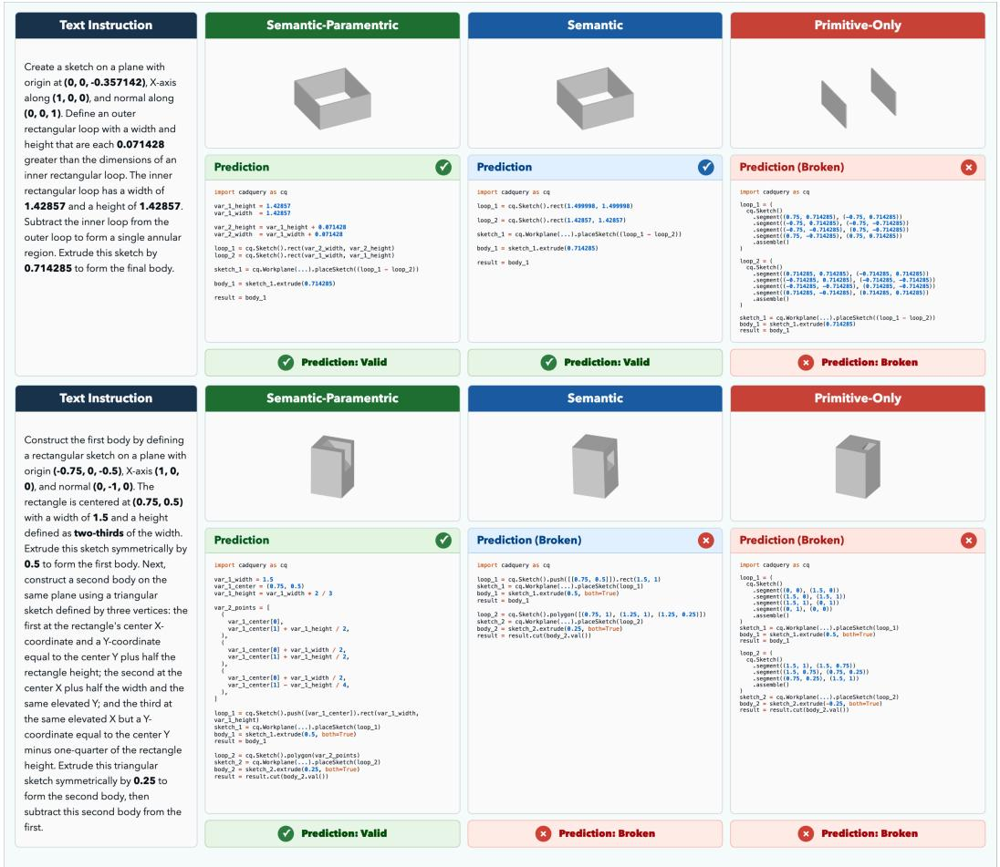  
Figure 6: Additional Qualitative Comparisons of Intent-oriented Text-to-CAD Generation for primitive-only, semantic, and semantic–parametric supervisions.

## E.2 Zero-shot Intent-Preserving Editing

Figure 7 presents additional qualitative comparisons of edited programs for primitive-only, semantic, and semantic–parametric supervisions.

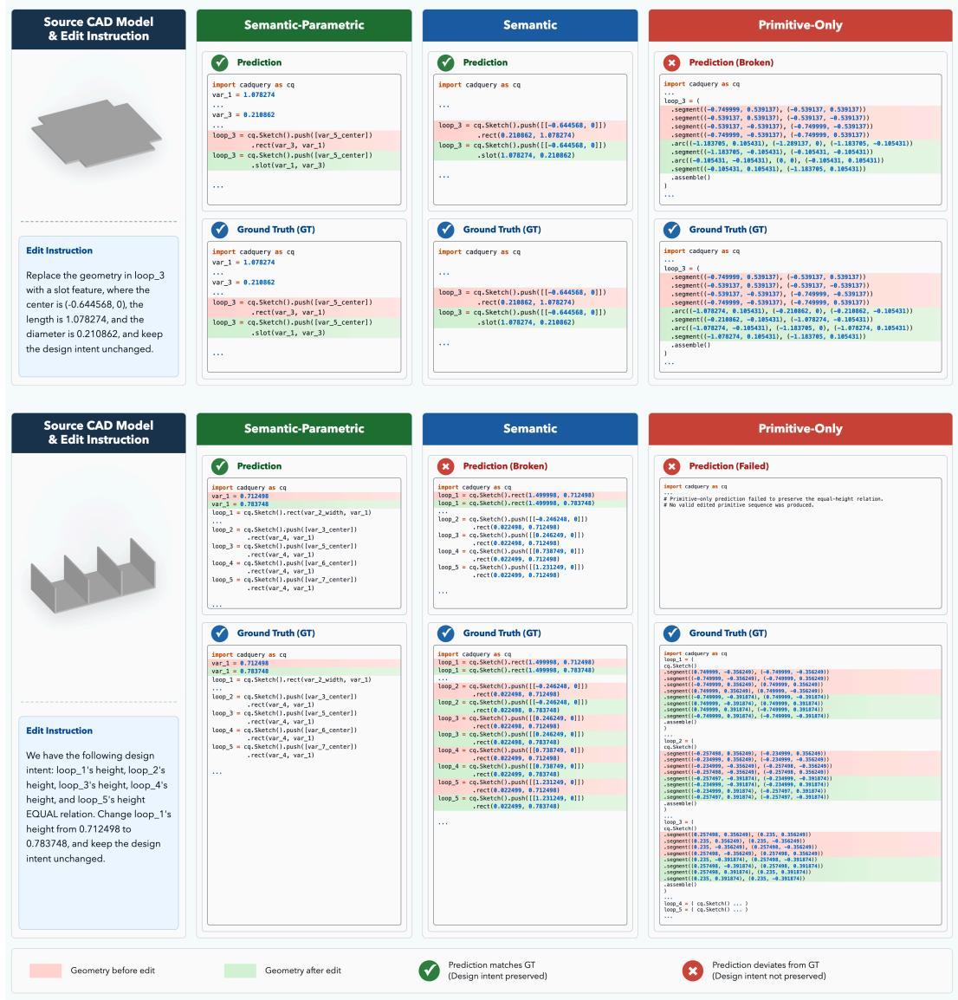  
Figure 7: Additional Qualitative Comparisons of Zero-shot Intent-Preserving Editing for primitiveonly, semantic, and semantic–parametric supervisions.

## E.3 Additional Qualitative Examples

## E.3.1 Text-to-CAD Generation

(a) GT

(b) −

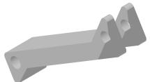  
Reference

Prompt: Construct thefirst body by defining a sketch on a plane . . . with a circular cutout . . . and unite it with the existing assembly.

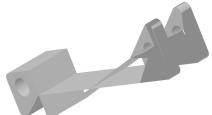  
× Shape Mismatch

(c) S.

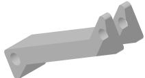  
✓ Success

(d) S.+P.

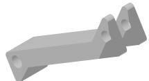  
✓ Success

Prompt: Construct thefirst body by sketching a closed loop on a plane . . . Extrude this sketch symmetrically . . . subtract it from the remaining geometry.

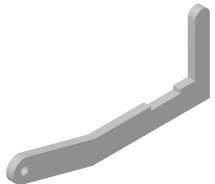  
Reference

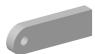  
× Shape Mismatch

  
✓ Success

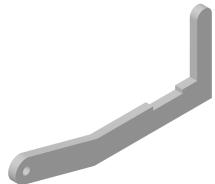  
✓ Success

Prompt: Construct the first body by sketching a circle with radius 0.107142 . . . Create the second body by sketching a regular hexagon . . . Finally, create the sixth body . . .

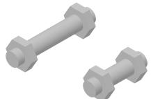  
Reference

× Execution Failed

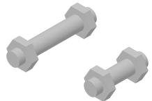  
✓ Success

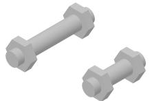  
✓ Success

Prompt: Construct the first body by defining a sketch on a plane . . . This sketch contains a rectangular loop . . . combined with a slot-shaped region . . . subtract the resulting bodyfrom the first body.

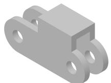  
Reference

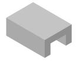  
× Shape Mismatch

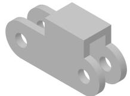  
✓ Success

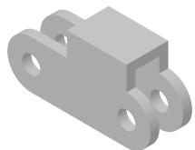  
✓ Success

Prompt: Construct thefirst body by defining a sketch on a plane . . . From this profile, subtract three circular cutouts . . . Finally, unite the second body with thefirst body.

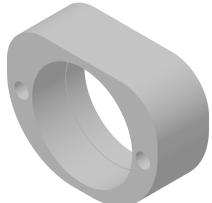  
Reference

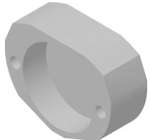  
× Shape Mismatch

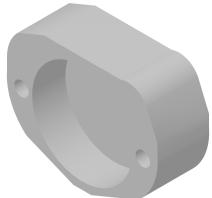  
× Shape Mismatch

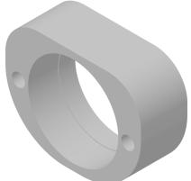  
✓ Success

Figure 8: Additional qualitative examples of text-to-CAD generation across the three representations.

## E.3.2 Intent-Preserving Editing

(a) Source

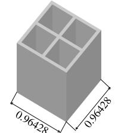  
Edit instruction: Change loop\_3.centerfrom (−0.227678, −0.227678) to (−0.177678, −0.227678), while preserving its mirror relations with loops 2, 4, and 5.  
↔ Mirror Relations

(b) −

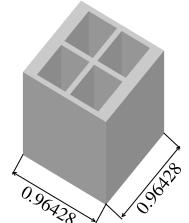  
× Shape Mismatch  
(c) S.  
× Execution Failed  
(d) S.+P.

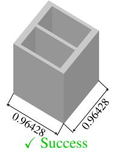  
Edit instruction: Replace the geometry in loop\_1 with a circle of radius 0.378571, while preserving the design intent.

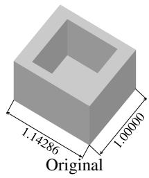

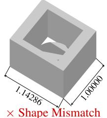

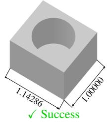

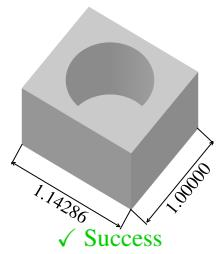  
Edit instruction: Add a fillet feature of radius 0.374999 to the rectangle in loop\_1, while preserving the design intent.

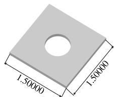  
Original

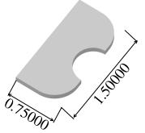  
× Shape Mismatch

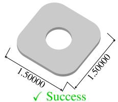

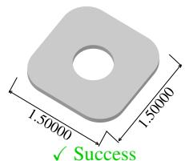  
Edit instruction: Change loop\_2.width from 0.482991 to 0.53129, while preserving its equal-width relation with loop\_3.

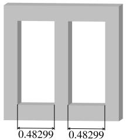  
↔ Equal Widths  
× Execution Failed

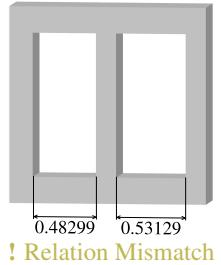

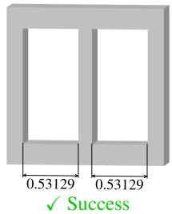

Edit instruction: Change loop\_5.centerfrom (0.529502, 0) to (0.579502, 0), while preserving its mirror relation with loop\_6.

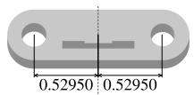  
↔ Mirror Relation

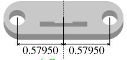  
✓ Success

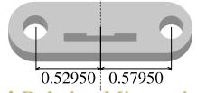  
! Relation Mismatch

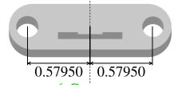  
✓ Success

Figure 9: Additional qualitative examples of intent-preserving editing across the three representations.